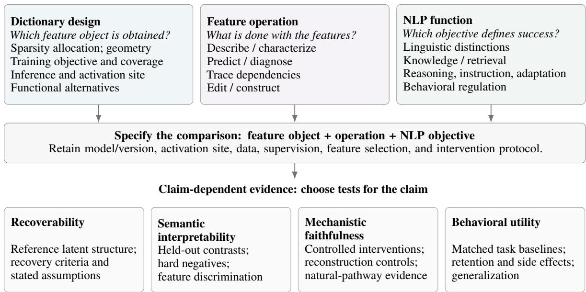
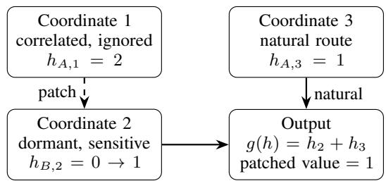
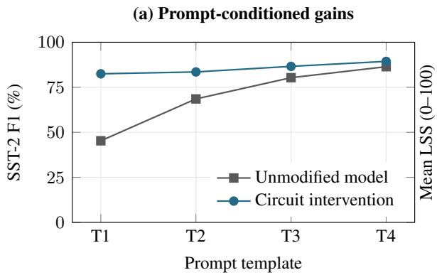
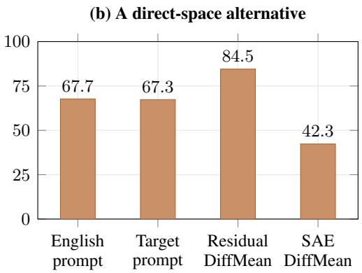

# Sparse Autoencoders for Mechanistic Interpretability in NLP: A Critical Survey of Recoverability, Interpretability, and Utility

Salima Lamsiyah

Adelaide Danilov

Oleksandr Marchenko Breneur Aria Nourbakhsh Department of Computer Science (DCS), University of Luxembourg Correspondence: salima.lamsiyah@uni.lu

## Abstract

Sparse autoencoders (SAEs) have emerged as a promising approach to mechanistic interpretability by decomposing language-model activations into sparse, potentially interpretable features. However, differences in design assumptions, evaluation objectives, and experimental settings complicate conclusions about their effectiveness. We present a critical survey of 138 studies on SAEs in natural language processing. Our contributions are fourfold: (1) we propose a task-grounded taxonomy connecting dictionary design, feature operations, and NLP functions; (2) we examine how sparsity allocation, geometry, data coverage, and inference affect feature recoverability; (3) we assess evidence for semantic interpretability, mechanistic faithfulness, and behavioral utility; and (4) we synthesize findings across multilingual processing, retrieval, reasoning, classification, and behavioral regulation, highlighting the roles of objectives, baselines, supervision, and intervention pipelines. Through comparative analyses of published results, we reconcile apparent disagreements, identify unresolved questions, and propose directions for more rigorous evaluation. An anonymous research register1 accompanies the survey.

## 1 Introduction

Sparse autoencoders encode model activations as sparse coefficients over a learned dictionary of feature directions (Cunningham et al., 2024). They make it possible to inspect concepts, compare representations, and intervene on internal variables at a finer granularity than whole layers or attention heads. Sparse interpretable sentence embeddings provide an earlier precedent (Trifonov et al., 2018); transformer studies established useful feature decompositions (Bricken et al., 2023; Cunningham et al., 2024); subsequent work scaled dictionaries and released reusable resources (Templeton et al., 2024; Gao et al., 2025; He et al., 2024b). The scientific opportunity is now broader: can these coordinates explain how language is represented and processed, and can that understanding improve NLP systems?

Answering this question requires separating four outcomes. Recoverability concerns whether an encoding procedure recovers the target latent structure, where that structure is specified. Semantic interpretability concerns whether a feature description makes discriminating predictions about activations or effects. Mechanisticfaithfulness concerns whether an explanation identifies computations the original model uses. Behavioral utility concerns success on a stated task with its competing objectives. These outcomes can agree, but their definitions do not imply agreement.

Consider language identity. Multilingual feature analyses use it to distinguish language-associated representations (Deng et al., 2025); language steering seeks to induce a chosen output language (Gurgurov et al., 2026); LangSAE removes it from pooled embeddings to improve multilingual retrieval (Kim et al., 2026). Grouping these studies simply as multilingual SAE applications hides an objective-dependent reversal: information useful for generation can be a nuisance for semantic retrieval. Conversely, grouping only by encoder architecture does not reveal this distinction at all.

Existing surveys provide complementary perspectives on SAEs and mechanistic interpretability. Shu et al. (2025) synthesize SAE architectures, training procedures, feature explanations, evaluation methods, and applications. Mueller et al. (2026a) organize NLP mechanistic interpretability around causal mediators and search methods, examining which computational units and analytical procedures support explanation, hypothesis testing, and model editing. Zhang et al. (2026a) connect localization and steering to improvements in alignment, capability, and efficiency, including SAE features, task-specific metrics, and checks for unintended effects. Building on these foundations, our survey examines how SAE construction and use jointly shape the comparability and interpretation of NLP findings.

This motivates three research questions. RQ1: Which design assumptions change what an SAE can recover? We compare allocation, geometry, data coverage, and inference under their stated objectives and theoretical assumptions (Section 3). RQ2: What evidence distinguishes an interpretable or useful feature from a faithful mechanism? We examine semantic tests, intervention controls, and counterexamples using a claimspecific rubric (Section 4). RQ3: Why do NLP studies reach different conclusions about SAE usefulness? We compare task objectives, supervision, and control pipelines, and reanalyse selected within-study results (Section 5).

Our taxonomy organizes SAE studies by dictionary design, feature operation, and NLP function. Our multi-label register and comparative analyses support a task-grounded synthesis that clarifies apparent disagreements and identifies unresolved questions.

## 2 Scope and Organizing Framework

We survey SAE methods for language-model analysis and NLP system construction, including relevant speech and multimodal extensions. Corpus selection and coding are detailed in Appendix A.

Three facets and their qualifiers. For study $s ,$ we record ${ \cal T } ( s ) = ( D _ { s } , O _ { s } , F _ { s } ; Z _ { s } )$ (Figure 1). Dictionary design $D _ { s }$ describes how features are obtained or constrained: sparsity allocation, geometry, coverage and objectives, inference and activation sites, or functional alternatives. Feature operation $O _ { s }$ describes their use: characterize representations, predict or diagnose outcomes, trace dependencies, or edit model behavior and construct systems. NLP function $F _ { s }$ specifies the evaluation target, covering linguistic distinctions, knowledge and retrieval, reasoning and adaptation, behavioral regulation, text analytics, speech and multimodal analysis, and general enabling research.

The facets interact: a task can shape dictionary training, while dictionary structure can enable particular operations. Qualifiers $Z _ { s }$ retain model/version, activation site, data, supervision, feature selection, and intervention protocol. Together, the upper boxes and central band in Figure 1 expose differences in experimental settings that may explain apparent disagreements.

Claim-dependent evidence. The taxonomy identifies comparable studies; the evidence framework assesses their claims. In the lower row of Figure 1, claims about feature recoverability, semantic interpretability, mechanistic faithfulness, and behavioral utility require different tests and controls. In particular, demonstrating the utility of SAE-derived features in a classifier, retriever, or controller does not necessarily establish the computations performed by the original model.

The operational definitions, study assignments, and cross-dimensional analyses are provided in Appendix B.

## 3 Dictionary Design and Recoverability

RQ1 asks which design assumptions determine what an SAE can recover. For an NLP researcher seeking a grammatical distinction, an unsuccessful feature search leaves several explanations open: the chosen representation, the dictionary’s constraints, the training data, or the encoding procedure. We compare methods by which of these limitations they address.

For activation $\textit { h } \in \mathbb { R } ^ { d }$ , an encoder produces $z = f _ { \theta } ( h ) \in \mathbb { R } ^ { m }$ and a decoder reconstructs $\hat { h } =$ $b + D z$ . A common objective is

$$
\mathcal { L } = \mathbb { E } [ \| h - b - D f _ { \theta } ( h ) \| _ { 2 } ^ { 2 } + \lambda \Omega ( z ) ] .\tag{1}
$$

This objective rewards reconstruction and sparsity; recovering a specified latent structure is a separate endpoint. Synthetic studies can compare against a known generating dictionary, whereas languagemodel studies must validate the proposed feature interpretation.

## 3.1 Defining the structure to be recovered

The activation site determines the starting object. Residual streams contain accumulated information; attention and MLP outputs characterize component contributions. Transcoders instead approximate a component’s input–output map (Dunefsky et al., 2024; Paulo et al., 2025). Layer transfer, shared dictionaries, and routing change training cost and parameter reuse (Ghilardi et al., 2024, 2025; Shi et al., 2025); comparisons still need to establish what structure is preserved across sites.

  
Figure 1: Three facets jointly define a comparison (top), interpreted alongside its experimental settings (middle). Complementary evidence targets assess what the findings support (bottom). Arrows show how the facets inform study comparison and claim assessment; the tests are illustrative and tailored to the claim.

Within a site, the question is how that structure should be represented. Splitting distributes a concept across latents, while absorption allows a specialized latent to carry a broader property (Chanin et al., 2025); neither supports equating an inactive coordinate with absent information. Subspace (Engels et al., 2025; Dalili and Mahdavi, 2026) and manifold approaches (Bhalla et al., 2026a) model structure beyond individual directions. Nested scales (Bussmann et al., 2025), parent–child gates (Muchane et al., 2025), and Kronecker factorization (Kurochkin et al., 2025) impose different forms of organization across features. Temporal smoothness (Bhalla et al., 2026b) and predictablecontext/novelty separation (Lubana et al., 2026) instead organize variation over sequences. These choices change the candidate unit of analysis: their NLP value depends on whether the resulting directions, groups, or temporal features capture the distinction under study.

## 3.2 Allocating sparse capacity

Once the target is specified, allocation determines which features can participate in each reconstruction. An $\ell _ { 1 }$ penalty encourages sparsity but also shrinks amplitudes. Gated SAEs separate selection from magnitude estimation, while JumpReLU learns activation thresholds (Rajamanoharan et al., 2024a,b). TopK fixes the number of retained coordinates per input (Gao et al., 2025); Batch-TopK distributes a budget across a batch and estimates an inference-time threshold (Bussmann et al., 2024). Top-AFA selects counts through a quasiorthogonality approximation (Lee et al., 2025), AdaptiveK uses a learned complexity signal (Yao et al., 2026), and Group Bias Adaptation (GBA) targets activation-frequency coverage (Chen et al., 2026b). These allocation rules make different assumptions about inputs, geometry, and feature frequency.

The results show why allocation cannot be ranked by reconstruction alone. BatchTopK improves reconstruction over TopK, but its Gemma-2-2B comparison with JumpReLU is mixed for downstream cross-entropy degradation (Bussmann et al., 2024). In GBA’s variable-sparsity synthetic experiment, TopK recovery falls from 98.4% at K = 20 to 23.4% at K = 50; full versus misspecified frequency coverage gives GBA 100% versus 3.9% recovery (Chen et al., 2026b). These rates use alignment threshold 0.9 and 128 generating features. They demonstrate sensitivity to allocation and coverage assumptions under known ground truth, rather than an NLP ranking. Comparisons should match average sparsity, data, and insertion protocol; decoder normalization must also be recorded because it changes coefficient scales (Appendix C).

## 3.3 Separating coverage from inference error

Even a suitable representation and budget cannot resolve every failure. Specialized sampling and tilted risk improve access to rare concepts (Muhamed et al., 2025b), changing the training distribution and emphasis of the objective. Weighted SAEs analyze recovery and reweighting under an idealized tied-weight model (Cui et al., 2026); those assumptions delimit the result’s applicability to languagemodel activations. Locally amortized inference addresses a different limitation: a shared encoder can leave an optimization gap relative to per-input sparse coding (Sun et al., 2026). Improving that approximation does not establish that the reference codes are the intended linguistic features. Thus data coverage, the learning objective, and encoding accuracy require separate comparisons.

Answer to RQ1. Recoverability has separable bottlenecks: the representation and its geometry, sparse allocation, training coverage, and inference. The evidence supports diagnosing the suspected bottleneck while matching the remaining conditions. Reconstruction, recovery against a specified reference, and behavioral preservation should remain separate endpoints. Technical comparisons and assumptions are detailed in Appendix C.

## 4 From Features to Explanations and Mechanisms

Recovering sparse features leaves their explanatory role unresolved. RQ2 asks what distinguishes a meaningful or useful feature from a faithful account of model computation. A feature may predict sentiment, support sentiment steering, or mediate the model’s own sentiment decision; these claims require different tests. Table 1 organizes support for a specified claim and evaluation setting. Appendix D develops the assessment rules through worked claims and a causal counterexample.

## 4.1 Testing the feature’s meaning

A feature description is a hypothesis about its behavior. Input-oriented descriptions predict what elicits activation; output-oriented descriptions predict contributions to generation (Gur-Arieh et al., 2025). Automated explanation (Paulo et al., 2024), agentic testing (Han et al., 2026), and counterexample-guided revision (Ma et al., 2025) make these hypotheses testable on held-out positives and hard negatives. The critical question is whether the description discriminates the intended property from alternatives. Descriptive collision tests whether one explanation also fits unrelated features (McCann, 2026); contrastive stories, semantic/functional neighborhoods, and conceptseparability tests examine complementary aspects of specificity (Gulko et al., 2025; Mercorio et al., 2025; Fereidouni et al., 2026; Härle et al., 2025).

The controls must preserve what the claim says should remain invariant. A grammatical feature should track the specified contrast across appropriate lexical controls; a lexical feature need not survive word substitution. Adversarial inputs test the limits of a description (Li et al., 2026a), while randomized SAE components and randomized host models challenge different sources of apparent interpretability (Korznikov et al., 2026; Heap et al., 2026). In the latter comparison, similar aggregate scores in several tested settings show that those metrics need not distinguish learned computations from structure present without training (Heap et al., 2026). Cross-run consistency asks whether features recur across learned dictionaries (Song et al., 2026); recurrence alone does not validate their meaning.

## 4.2 Testing predictive and causal effects

A useful predictor need not identify a variable the source model uses. For a known target, SAE probes should be compared with supervised probes on the original activations, given matched information (Kantamneni et al., 2025; Makelov et al., 2025). For control, direct activation directions provide an alternative (Gurgurov et al., 2026). These comparisons test the benefit of the SAE representation for the chosen objective. A reusable feature vocabulary can still support exploratory discovery beyond a predefined prediction task (Peng et al., 2025).

Interventions test what changes when a feature is edited. Their effects must be separated from damage introduced by reconstruction. With error $e = h - ( b + D z )$ , an error-preserving edit is

$$
h ^ { \prime } = b + D z ^ { \prime } + e = h + D ( z ^ { \prime } - z ) .\tag{2}
$$

Replacing h with $b + D z ^ { \prime }$ also removes e, so the measured effect combines the feature edit with reconstruction error. Retaining e isolates the decoded change but does not ensure that the edited activation lies within the model’s natural distribution. Null edits, matched-magnitude controls, naturally occurring replacement values, and off-target measurements test distinct alternatives. A controlled effect supports a causal claim about the manipulation; explaining the unmodified computation requires further evidence.

<table><tr><td>Claim</td><td>Weak evidence</td><td>Moderate evidence</td><td>Stronger evidence</td></tr><tr><td>Feature description</td><td>A label supported only by selected activating examples.</td><td>The description predicts feature activation on unseen positive and negative</td><td>Tests with hard negatives and counterexamples; the description distinguishes the feature from similar</td></tr><tr><td>Prediction / diagnosis Correlation observed on</td><td>training data.</td><td>Predictive performance on held-out data, compared with a relevant baseline.</td><td>Generalization and calibration tests; matched supervision and checks for confounding or data leakage.</td></tr><tr><td>Mechanistic role</td><td>Feature coactivation or behavioral changes without adequate controls.</td><td>A targeted intervention produces the predicted behavioral effect.</td><td>Semantic counterfactuals, reconstruction-error controls, and tests of alternative computational pathways or circuit dependencies.</td></tr><tr><td>Task control</td><td>A few selected examples of successful behavior modification.</td><td>Task improvement over a baseline, with effects on other capabilities assessed.</td><td>Matched feature-selection and control baselines, with robustness, side effects, and persistence evaluated.</td></tr></table>

Table 1: Evidence supporting different claims about SAE features. Stronger evidence requires more discriminating tests and appropriate controls. The criteria apply to specific claims under stated evaluation conditions, not to the overall quality of a paper.

## 4.3 Testing the proposed mechanism

The gap is explicit in Makelov et al. (2024). Their patching direction combines a concept-correlated component that is disconnected from the output with an ordinarily dormant, output-sensitive component. Patching transfers a signal between them and changes the answer through a route unused before intervention. The successful edit therefore fails to identify the natural mechanism; Appendix D.1 instantiates this counterexample. Conversely, redundant pathways can make a genuinely used feature dispensable under ablation. Necessity and sufficiency must consequently be interpreted relative to the tested interventions and contexts.

A circuit claim further specifies dependencies between features. Sparse feature circuits retain feature and error nodes and test task-relevant effects (Marks et al., 2025). Module-level interventions on coactivation groups (Deng et al., 2026) and transport-based feature matching (Cao et al., 2026) concern group effects and correspondence. Establishing a directed circuit also requires tests of the proposed downstream dependencies; edge attribution helps select candidates for those tests. Attention-output features, formal languages, and Othello models provide distinct computational testbeds whose scope must accompany the interpretation (Kissane et al., 2024; Menon et al., 2024; He et al., 2024a). Neurons, heads, key–value features, and functional dictionaries offer alternative units for the computational account (O’Neill and Bui, 2024; Arora et al., 2026; Ye et al., 2025; Shafran et al., 2026; Dunefsky et al., 2024); the comparison should establish what the SAE basis adds.

Answer to RQ2. Semantic interpretability rests on discriminating predictions, and utility on appropriate task comparisons. Mechanistic faithfulness requires evidence that the proposed variables and dependencies capture computation the original model uses. Controlled edits contribute to that assessment, but their success alone does not establish the claimed pathway. A feature can remain useful for control even when its mechanistic interpretation fails.

## 5 Comparing SAE Usefulness Across NLP Tasks

RQ3 asks why NLP studies reach different conclusions about SAE usefulness. The comparison depends on what the task requires, what information the method receives, and which alternative it must outperform. We organize the findings around these differences to identify both useful contributions and the conditions under which their advantages hold. Appendix E provides extended comparisons.

## 5.1 Objectives change the value of a feature

Language identity makes the role of the objective explicit. LangSAE removes language-associated components from pooled multilingual-e5 embeddings for semantic retrieval, whereas CLaS-Bench edits Llama-3.1-8B-Instruct activations to control the output language (Kim et al., 2026; Gurgurov et al., 2026). Suppressing language identity and strengthening it serve different goals. Their findings concern different task requirements.

Within CLaS-Bench, residual difference-inmeans scores 84.5 versus 42.3 for SAE differencein-means, a 42.2-point gap in the combined language/relevance metric (Gurgurov et al., 2026). The reported selected settings use layers 20 and 25, respectively, both at strength 5. This establishes an advantage for the selected residual-space pipeline; differences in available layers and selection prevent isolating the SAE basis as the cause (Appendix F).

Linguistic analysis asks a more specific question than language control. Language-associated groups support observation and intervention (Deng et al., 2025); LinguaLens tests Chinese/English linguistic contrasts (Jing et al., 2025), while TenseLoC localizes tense and tests English-feature steering (Tumurchuluun et al., 2025). Script-sensitive representations motivate matched-content and transliteration controls, with raw-neuron interventions serving as a direct comparator (Verma et al., 2026). Italian-model analysis extends coverage (Bondielli et al., 2025). Together, these studies motivate testing whether corresponding features preserve a specified linguistic contrast and intervention effect across languages; broad language selectivity or geometric similarity alone does not establish that transfer.

## 5.2 Representations and baselines define the comparison

Classification provides a concrete reconciliation. Positive Gemma results compare SAE classifiers with last-token hidden-state baselines (Gallifant et al., 2025). In sparse probing, adding attentionpooled dense baselines reduces the apparent advantage of pooled SAE probes (Kantamneni et al., 2025). Both studies examine pooling, so its presence alone cannot explain their disagreement. The within-study comparison establishes that baseline construction matters; attributing all cross-paper differences to it would require matching the model, data, feature selection, and classifier. Task-aligned classification additionally changes representation training (Bail et al., 2025).

DILA and topic modeling construct interpretable task systems (Wu et al., 2024; Zheng et al., 2026), rather than explaining an unchanged source model. Speech analysis, vision–language alignment, and multimodal tracing further change the representation being examined (Pluth et al., 2026; Lee et al., 2026; DHIMOÏLA et al., 2026; Kaushik et al., 2026; Yang et al., 2026). These extensions require comparisons appropriate to acoustic frames, visual embeddings, or text tokens.

## 5.3 Information access separates RAG outcomes

Retrieval-oriented objectives can preserve useful matching structure (Kang et al., 2025), while adapting a retriever around a frozen dictionary constructs a new retrieval system (Formal et al., 2026). For retrieval-augmented generation (RAG), improvements concern different stages: detecting unsupported output, choosing between context and memory, enriching a query, or repairing an answer. Table 2 distinguishes these operations and their information requirements. A detector can identify errors without explaining their cause, and increased reliance on context helps only when that context is trustworthy.

LatDefuse illustrates why information access belongs in the comparison. It optimizes latent edits toward a known correct token at answer divergence and evaluates distractor-vulnerable instances (Giannetti et al., 2026). The result establishes conditional repair capacity. Comparing its recovery rate directly with autonomous detection or correction would conflate different supervision and evaluation populations. An integrated system would need to evaluate detection, source arbitration, and repair together, including errors passed between stages.

## 5.4 Selection and prompts shape instruction gains

For reasoning, steering a strategy and identifying its computation are separate achievements. Reasoning-associated features can change traces or strategies (Galichin et al., 2025; Fang et al., 2026), while cue-injection and meaning-preserving tests can challenge an abstract-reasoning label (Ma et al., 2026). Temporal-difference analysis ties features to specified computational variables in an in-context reinforcement-learning task (Demircan et al., 2025). These findings answer different questions about control, feature meaning, and computation; lexical cues must be varied independently of the required operation to compare those claims.

Instruction methods also differ in how they select features: SAIF identifies instruction-related features (He et al., 2025), narrative editing generates compliant/violating contrasts (Zhao et al., 2025a), SISTER uses prompt variation (Cho and Hockenmaier, 2025), and PULSE uses labeled demonstration utility (Hao et al., 2026). Comparators need access to the same signals. Evaluation prompts matter as well: for Gemma-2-2B sentiment circuits, SST-2 F1 gains are 37.19 points under template T1 and 2.96 under T4 (Li et al., 2026b). These threerun mean differences establish prompt dependence within the reported setting; they do not isolate baseline headroom as its cause.

<table><tr><td>SAE use</td><td>Information used</td><td>Reported contribution</td><td>Key evaluation distinction</td></tr><tr><td>Hallucination detection and feedback (Chen et al., 2026a; Xiong et al., 2026)</td><td>Sparse features and detection signals; feedback adds a generation stage.</td><td>Detect unsupported answers and guide subsequent generation.</td><td>Evaluate detection and generation improvements separately.</td></tr><tr><td>Context-memory selection (Xin et al., 2025; Zhao et al., 2025b)</td><td>Features identified through contrasts between retrieved context and internal knowledge.</td><td>Change which information source the model relies on.</td><td>Measure source preference and answer correctness separately.</td></tr><tr><td>Query enrichment (Abdaljalil et al., 2025; Dong et al., 2026)</td><td>SAE-guided query modifications; some analyses select successful query expansions.</td><td>Improve retrieval/generation or analyze query-expansion effects.</td><td>Test on unselected queries and evaluate the contribution of the SAE within the full pipeline</td></tr><tr><td>Distractor repair (Giannetti et al., 2026)</td><td>Known correct answer token used to optimize latent activations on selected difficult examples.</td><td>Recover answers affected by distracting documents.</td><td>Distinguish oracle-assisted repair from autonomous error correction.</td></tr></table>

Table 2: Comparison of SAE-based approaches to RAG. The methods differ in their objectives, available information, and evaluation settings; their reported improvements therefore do not measure the same capability.

The stage of use changes the comparison further. Concept-based pretraining (Tack et al., 2026) and feature-guided fine-tuning data selection (Shi et al., 2026) construct changed models; transfer prediction (Zhang et al., 2026b) and sparse model diffing (Kassem et al., 2025) respectively anticipate and diagnose updates. Inference-time activation or input edits leave weights fixed; diffusion-language analyses additionally depend on denoising time and mask position (Wang et al., 2026b).

## 5.5 Controllers determine regulation trade-offs

Behavioral regulation tests what the complete intervention achieves. Refusal-feature analysis and adversarial detection (Yeo et al., 2025) concern different outcomes from maintaining benign capabilities during control. Static refusal amplification can impair unrelated capabilities (O’Brien et al., 2024); REINS and graph-regularized steering combine selected directions with runtime gating (Ding et al., 2026; Yeon et al., 2025). Their comparison therefore involves both the feature directions and the decision about when to intervene.

Unlearning makes this distinction concrete. Static suppression has mixed multi-topic results (Farrell et al., 2024); Dynamic SAE Guardrails add input-dependent classification (Muhamed et al., 2025a), whereas subspace-guided projection and CRISP modify parameters (Wang et al., 2025; Ashuach et al., 2026). Conditional intervention can avoid unnecessary edits, while parameter updates remove dependence on a runtime controller. Comparing their forget–retain trade-offs requires matching target knowledge, evaluation populations, retention tasks, and relearning attacks. Adaptation constraints (Wang et al., 2026a; Peng et al., 2026) and backdoor analyses (Zeng et al., 2026; Antoun et al., 2026) add further training and attack conditions. These differences identify what a controlled comparison must hold fixed before attributing a gain to the dictionary.

Answer to RQ3. SAE usefulness depends on the objective, representation, comparison baseline, available supervision, and intervention pipeline. Opposing treatments of language identity can both serve their respective tasks; classification, repair, and regulation results require matching the conditions defining success. The synthesis reconciles the scope of these findings. Establishing which factor causes a remaining performance difference requires experiments that vary it while controlling the others.

## 6 Research Directions and Practical Choices

The answers to RQ1–RQ3 identify recovery bottlenecks, requirements for mechanistic claims, and conditions shaping task utility. They motivate experiments that distinguish competing explanations and guide the choice of an appropriate unit of analysis.

## 6.1 Three testable comparisons

Discourse structure versus temporal persistence. Compare static and temporal dictionaries with matched host model, layer, capacity, average sparsity, and training corpus (Bhalla et al., 2026b; Lubana et al., 2026). Vary semantic continuity, lexical repetition, and abrupt discourse change independently. Measure held-out contrast discrimination and predicted intervention effects on entity/state tracking. This tests whether temporal structure captures discourse-relevant distinctions beyond lexical persistence; smooth codes and separate task gains would leave that relationship unresolved.

Feature matching versus intervention transfer. Match features across random seeds, paraphrases, and languages using geometry and activation distributions, then test whether correspondence predicts preservation of an independently specified intervention effect. Include unmatched and frequencymatched controls. Current consistency and matching measures (Song et al., 2026; Cao et al., 2026) motivate these comparisons, while known-concept disentanglement results (Mueller et al., 2026b) motivate testing functional roles separately.

Selection and controller versus dictionary. With fixed train/validation/test splits, cross SAE dictionaries with shared supervised or unsupervised selection rules and static or gated controllers. Include dense probes for prediction and direct-space directions for control, with matched labels and tuning budgets. Report the target–retention frontier. The probing/classification disagreement and conditional-control advances motivate this design; attributing their differences to selection or gating remains a hypothesis until those factors are controlled.

## 6.2 Choosing when an SAE adds value

For a known predictive target, begin with a welltuned supervised probe and a matched label budget. For output control, include direct activation directions before incurring dictionary-training and feature-selection costs. For a localized computational hypothesis, neurons, heads, or a functional surrogate may provide the required unit. Direct comparators support these choices (Ye et al., 2025;

Arora et al., 2026; Shafran et al., 2026; Gurgurov et al., 2026). An SAE is more compelling when a reusable, fine-grained feature vocabulary enables discovery, comparison across many questions, or a demonstrated specificity/cost advantage.

## 7 Conclusion

This survey critically examines the role of sparse autoencoders in mechanistic interpretability and NLP. Through a task-grounded taxonomy of dictionary design, feature operations, and NLP functions, we identify key challenges in feature recoverability, distinguish semantic interpretability from mechanistic faithfulness, and explain how task objectives and experimental pipelines shape reported utility. Our comparative synthesis reconciles apparent disagreements across studies and highlights where matched evaluations remain necessary. These findings provide NLP researchers with a framework for evaluating SAE contributions, selecting appropriate baselines, and determining whether useful features also explain the model’s underlying computations.

## Limitations

This survey focuses on sparse autoencoders for mechanistic interpretability and their applications to natural language processing. It does not aim to comprehensively cover related developments in sparse coding, disentangled representation learning, or interpretability methods beyond SAEs. Given the rapid evolution of this research area, our synthesis reflects the literature available within the survey’s defined scope. Comparisons across studies are constrained by differences in model architectures, datasets, feature representations, and evaluation protocols. Accordingly, our analyses emphasize the conditions under which findings are supported rather than establishing universal rankings of SAE methods. The proposed taxonomy and evidence framework provide a basis for future comparative evaluations, including controlled experiments across NLP tasks.

## Use of AI assistance

In preparing this manuscript, we used AI-assisted tools, including Grammarly and ChatGPT, for proofreading, grammar correction, and stylistic refinement. OpenAI Codex was used to assist in developing the HTML-based research register. The authors take full responsibility for the scientific content, analyses, and conclusions presented in this work.

## References

Samir Abdaljalil, Filippo Pallucchini, Andrea Seveso, Hasan Kurban, Fabio Mercorio, and Erchin Serpedin. 2025. SAFE: A Sparse Autoencoder-Based Framework for Robust Query Enrichment and Hallucination Mitigation in LLMs. In Findings ofthe Association for Computational Linguistics: EMNLP 2025, pages 9335–9346. Association for Computational Linguistics.

Wissam Antoun, Francis Kulumba, Théo Lasnier, Benoît Sagot, and Djamé Seddah. 2026. LLM Forensics: Where Do Backdoors Hide? Localizing and Controlling Trigger Mechanisms with Sparse Autoencoders. arXiv preprint arXiv:2609.07746.

Aryaman Arora, Zhengxuan Wu, Jacob Steinhardt, and Sarah Schwettmann. 2026. Language Model Circuits Are Sparse in the Neuron Basis. Preprint, arXiv:2601.22594.

Tomer Ashuach, Dana Arad, Aaron Mueller, Martin Tutek, and Yonatan Belinkov. 2026. CRISP: Persistent Concept Unlearning via Sparse Autoencoders. In Proceedings of the 64th Annual Meeting of the Associationfor Computational Linguistics (Volume 1: Long Papers), pages 1806–1825. Association for Computational Linguistics.

Bayram Ayadi and Annette Hautli-Janisz. 2026. Probing Bias Formation in Medical LLMs through Activation Steering. In Proceedings ofthe 64th Annual Meeting of the Association for Computational Linguistics (Volume 4: Student Research Workshop), pages 609–620. Association for Computational Linguistics.

Mathis Le Bail, Jérémie Dentan, Davide Buscaldi, and Sonia Vanier. 2025. Unveiling Decision-Making in LLMs for Text Classification : Extraction of influential and interpretable concepts with Sparse Autoencoders. Preprint, arXiv:2506.23951.

Usha Bhalla, Thomas Fel, Can Rager, Sheridan Feucht, Tal Haklay, Daniel Wurgaft, Siddharth Boppana, Matthew Kowal, Vasudev Shyam, Jack Merullo, Atticus Geiger, and Ekdeep Singh Lubana. 2026a. Do Sparse Autoencoders Capture Concept Manifolds? Preprint, arXiv:2604.28119.

Usha Bhalla, Alex Oesterling, Claudio Mayrink Verdun, Hima Lakkaraju, and Flavio Calmon. 2026b. Temporal Sparse Autoencoders: Leveraging the Sequential Nature of Language for Interpretability. In International Conference on Learning Representations, volume 2026, pages 141147–141175.

Alessandro Bondielli, Lucia C. Passaro, and Alessandro Lenci. 2025. Sparse Autoencoders Find Partially Interpretable Features in Italian Small Language Mod-

els. In Proceedings of the Eleventh Italian Conference on Computational Linguistics (CLiC-it 2025), pages 95–104. CEUR Workshop Proceedings.

Trenton Bricken, Adly Templeton, Joshua Batson, Brian Chen, Adam Jermyn, Tom Conerly, Nick Turner, Cem Anil, Carson Denison, Amanda Askell, Robert Lasenby, Yifan Wu, Shauna Kravec, Nicholas Schiefer, Tim Maxwell, Nicholas Joseph, Zac Hatfield-Dodds, Alex Tamkin, Karina Nguyen, and 6 others. 2023. Towards Monosemanticity: Decomposing Language Models With Dictionary Learning. Transformer Circuits Thread.

Bart Bussmann, Patrick Leask, and Neel Nanda. 2024. BatchTopK Sparse Autoencoders. NeurIPS 2024 Science of Deep Learning Workshop poster; arXiv:2412.06410.

Bart Bussmann, Noa Nabeshima, Adam Karvonen, and Neel Nanda. 2025. Learning multi-level features with matryoshka sparse autoencoders. In Proceedings of the 42nd International Conference on Machine Learning, volume 267, pages 6077–6101. PMLR.

Tue M. Cao, Nguyen Do, and My T. Thai. 2026. Semantic Optimal Transport for Sparse Autoencoder Feature Matching and Circuit Compression. arXiv preprint arXiv:2605.28567.

David Chanin, James Wilken-Smith, Tomáš Dulka, Hardik Bhatnagar, Satvik Golechha, and Joseph Bloom. 2025. A is for Absorption: Studying Feature Splitting and Absorption in Sparse Autoencoders. In Advances in Neural Information Processing Systems, volume 38, pages 82318–82355. Curran Associates, Inc.

Boshui Chen, Zhaoxin Fan, Ke Wang, Zhiying Leng, Faguo Wu, Hongwei Zheng, Yifan Sun, and Wenjun Wu. 2026a. HalluSAE: Detecting Hallucinations in Large Language Models via Sparse Auto-Encoders. Preprint, arXiv:2604.16430.

Siyu Chen, Heejune Sheen, Xuyuan Xiong, Tianhao Wang, and Zhuoran Yang. 2026b. Taming Polysemanticity in LLMs: Theory-Grounded Feature Recovery via Sparse Autoencoders. In International Conference on Learning Representations, volume 2026, pages 105429–105538.

Hakaze Cho, Haolin Yang, Yanshu Li, Brian M. Kurkoski, and Naoya Inoue. 2025. Binary Autoencoder for Mechanistic Interpretability of Large Language Models. Preprint, arXiv:2509.20997.

Ikhyun Cho and Julia Hockenmaier. 2025. Toward Efficient Sparse Autoencoder-Guided Steering for Improved In-Context Learning in Large Language Models. In Proceedings ofthe 2025 Conference on Empirical Methods in Natural Language Processing, pages 28961–28973. Association for Computational Linguistics.

Jingyi Cui, Qi Zhang, Yifei Wang, and Yisen Wang. 2026. On the Limits of Sparse Autoencoders: A Theoretical Framework and Reweighted Remedy. In International Conference on Learning Representations, volume 2026, pages 156036–156055.

Hoagy Cunningham, Aidan Ewart, Logan Riggs, Robert Huben, and Lee Sharkey. 2024. Sparse Autoencoders Find Highly Interpretable Features in Language Models. In International Conference on Learning Representations.

Seyed Arshan Dalili and Mehrdad Mahdavi. 2026. Subspace-Aware Sparse Autoencoders for Effective Mechanistic Interpretability. arXiv preprint arXiv:2606.06333.

Arnav Das, Gantavya Bhatt, Sahil Verma, Yiping Wang, Viswa Virinchi Muppirala, and Jeff Bilmes. 2026. Matched Data, Better Models: Target Aligned Data Filtering with Sparse Autoencoders. In International Conference on Learning Representations, volume 2026, pages 80531–80554.

Can Demircan, Tankred Saanum, Akshay Jagadish, Marcel Binz, and Eric Schulz. 2025. Sparse Autoencoders Reveal Temporal Difference Learning in Large Language Models. In International Conference on Learning Representations, volume 2025, pages 23743–23768.

Boyi Deng, Yu Wan, Baosong Yang, Yidan Zhang, and Fuli Feng. 2025. Unveiling Language-Specific Features in Large Language Models via Sparse Autoencoders. In Proceedings ofthe 63rd Annual Meeting of the Association for Computational Linguistics (Volume 1: Long Papers), pages 4563–4608. Association for Computational Linguistics.

Ruixuan Deng, Xiaoyang Hu, Miles Gilberti, Shane Storks, Aman Taxali, Mike Angstadt, Chandra Sripada, and Joyce Chai. 2026. Sparse Feature Coactivation Reveals Causal Semantic Modules in Large Language Models. In Proceedings ofthe 64th Annual Meeting of the Association for Computational Linguistics (Volume 1: Long Papers), pages 3419–3451. Association for Computational Linguistics.

Grégoire DHIMOÏLA, Thomas Fel, Victor Boutin, and Agustin Picard. 2026. Cross-Modal Redundancy and the Geometry of Vision–Language Embeddings. In International Conference on Learning Representations, volume 2026, pages 93307–93321.

Kai-Xuan Ding, Hao-Xiang Xu, Ji-Hua Peng, Zi-Qi Chen, Jiaqi Wang, and Zhen-Hua Ling. 2026. REINS: Refusal-Enhanced Inhibitory Steering with Sparse Autoencoder Features. arXiv preprint arXiv:2608.28233.

Fangan Dong, Weiran Shi, Zhiwei Xu, Xuri Ge, Ben He, Xin Xin, Zhumin Chen, and Ying Zhou. 2026. Tracing Query Expansion Effects through Sparse Autoencoder Features. arXiv preprint arXiv:2609.06968.

Jacob Dunefsky, Philippe Chlenski, and Neel Nanda. 2024. Transcoders Find Interpretable LLM Feature Circuits. In Advances in Neural Information Processing Systems, volume 37.

Josh Engels, Eric Michaud, Isaac Liao, Wes Gurnee, and Max Tegmark. 2025. Not All Language Model Features Are One-Dimensionally Linear. In International Conference on Learning Representations, volume 2025, pages 84591–84622.

Yi Fang, Wenjie Wang, Mingfeng Xue, Boyi Deng, Fengli Xu, Dayiheng Liu, and Fuli Feng. 2026. Controllable LLM Reasoning via Sparse Autoencoder-Based Steering. In Proceedings of the 64th Annual Meeting of the Association for Computational Linguistics (Volume 1: Long Papers), pages 21290– 21305. Association for Computational Linguistics.

Eoin Farrell, Yeu-Tong Lau, and Arthur Conmy. 2024. Applying sparse autoencoders to unlearn knowledge in language models. Preprint, arXiv:2410.19278.

Hengyi Feng, Zeang Sheng, Meiyi Qiang, Yang Li, and Wentao Zhang. 2026. Generative Giants, Retrieval Weaklings: Why do Multimodal Large Language Models Fail at Multimodal Retrieval? In Findings of the Associationfor Computational Linguistics: ACL 2026, pages 15917–15933. Association for Computational Linguistics.

Moghis Fereidouni, Muhammad Umair Haider, Peizhong Ju, and A.b. Siddique. 2026. Evaluating Sparse Autoencoders for Monosemantic Representation. In Findings ofthe Associationfor Computational Linguistics: EACL 2026, pages 5969–5984. Association for Computational Linguistics.

Thibault Formal, Maxime Louis, Hervé Déjean, and Stéphane Clinchant. 2026. Learning Retrieval Models with Sparse Autoencoders. In International Conference on Learning Representations, volume 2026, pages 149883–149913.

Andrey Galichin, Alexey Dontsov, Polina Druzhinina, Anton Razzhigaev, Oleg Y. Rogov, Elena Tutubalina, and Ivan Oseledets. 2025. I Have Covered All the Bases Here: Interpreting Reasoning Features in Large Language Models via Sparse Autoencoders. Preprint, arXiv:2503.18878.

Jack Gallifant, Shan Chen, Kuleen Sasse, Hugo Aerts, Thomas Hartvigsen, and Danielle Bitterman. 2025. Sparse Autoencoder Features for Classifications and Transferability. In Proceedings ofthe 2025 Conference on Empirical Methods in Natural Language Processing, pages 29939–29963. Association for Computational Linguistics.

Woody Haosheng Gan, Deqing Fu, Julian Asilis, Ollie Liu, Vatsal Sharan, Robin Jia, and Willie Neiswanger. 2026. Textual Steering Vectors Can Improve Visual Understanding in Multimodal Large Language Models. In Proceedings ofthe 64th Annual Meeting ofthe Association for Computational Linguistics (Volume 1: Long Papers), pages 40056–40087. Association for Computational Linguistics.

Leo Gao, Tom Dupre la Tour, Henk Tillman, Gabriel Goh, Rajan Troll, Alec Radford, Ilya Sutskever, Jan Leike, and Jeffrey Wu. 2025. Scaling and evaluating sparse autoencoders. In International Conference on Learning Representations, volume 2025, pages 26721–26754.

Davide Ghilardi, Federico Belotti, Marco Molinari, and Jaehyuk Lim. 2024. Accelerating Sparse Autoencoder Training via Layer-Wise Transfer Learning in Large Language Models. In Proceedings ofthe 7th BlackboxNLP Workshop: Analyzing and Interpreting Neural Networksfor NLP, pages 530–550. Association for Computational Linguistics.

Davide Ghilardi, Federico Belotti, Marco Molinari, Tao Ma, and Matteo Palmonari. 2025. Group-SAE: Efficient Training of Sparse Autoencoders for Large Language Models via Layer Groups. In Proceedings of the 2025 Conference on Empirical Methods in Natural Language Processing, pages 18657–18677. Association for Computational Linguistics.

Christian Giannetti, Giovanni Trappolini, Nicola Tonellotto, Fabrizio Silvestri, and Pietro Lio. 2026. The Mechanics of Interference: Defusing Distractors in RAG via Sparse Autoencoder Interventions. In Findings of the Association for Computational Linguistics: ACL 2026, pages 11999–12007. Association for Computational Linguistics.

Alex Gulko, Yusen Peng, and Sachin Kumar. 2025. CE-Bench: Towards a Reliable Contrastive Evaluation Benchmark of Interpretability of Sparse Autoencoders. In Proceedings ofthe 8th BlackboxNLP Workshop: Analyzing and Interpreting Neural Networksfor NLP, pages 1–15. Association for Computational Linguistics.

Yoav Gur-Arieh, Roy Mayan, Chen Agassy, Atticus Geiger, and Mor Geva. 2025. Enhancing Automated Interpretability with Output-Centric Feature Descriptions. In Proceedings of the 63rd Annual Meeting of the Associationfor Computational Linguistics (Volume 1: Long Papers), pages 5757–5778. Association for Computational Linguistics.

Daniil Gurgurov, Yusser Al Ghussin, Tanja Baeumel, Cheng-Ting Chou, Patrick Schramowski, Marius Mosbach, Josef van Genabith, and Simon Ostermann. 2026. CLaS-Bench: A Cross-Lingual Alignment and Steering Benchmark. In Findings of the Association for Computational Linguistics: ACL 2026, pages 21591–21628. Association for Computational Linguistics.

Jiaojiao Han, Wujiang Xu, Mingyu Jin, and Mengnan Du. 2026. SAGE: An Agentic Explainer Framework for Interpreting SAE Features in Language Models. In Proceedings ofthe 19th Conference ofthe European Chapter ofthe Associationfor Computational Linguistics (Volume 5: Industry Track), pages 483– 495. Association for Computational Linguistics.

Chenduo Hao, Chuanbao Gao, Pinjun Zeng, Jingze Zhu, Chonghan Liu, Zidong Liu, and Xu Yang.

2026. PULSE: Identifying Demonstration-Utility Features with Sparse Autoencoders. arXiv preprint arXiv:2609.32469.

Zhengfu He, Xuyang Ge, Qiong Tang, Tianxiang Sun, Qinyuan Cheng, and Xipeng Qiu. 2024a. Dictionary Learning Improves Patch-Free Circuit Discovery in Mechanistic Interpretability: A Case Study on Othello-GPT. Preprint, arXiv:2402.12201.

Zhengfu He, Wentao Shu, Xuyang Ge, Lingjie Chen, Junxuan Wang, Yunhua Zhou, Frances Liu, Qipeng Guo, Xuanjing Huang, Zuxuan Wu, Yu-Gang Jiang, and Xipeng Qiu. 2024b. Llama Scope: Extracting Millions of Features from Llama-3.1-8B with Sparse Autoencoders. Preprint, arXiv:2410.20526.

Zirui He, Haiyan Zhao, Yiran Qiao, Fan Yang, Ali Payani, Jing Ma, and Mengnan Du. 2025. SAIF: A Sparse Autoencoder Framework for Interpreting and Steering Instruction Following of Language Models. Preprint, arXiv:2502.11356.

Thomas Heap, Tim Lawson, Lucy Farnik, and Laurence Aitchison. 2026. Automated Interpretability Metrics Do Not Distinguish Trained and Random Transformers. In International Conference on Learning Representations, volume 2026, pages 75812–75892.

Sai Sumedh R. Hindupur, Ekdeep S Lubana, Thomas Fel, and Demba Ba. 2025. Projecting Assumptions: The Duality Between Sparse Autoencoders and Concept Geometry. In Advances in Neural Information Processing Systems, volume 38, pages 11649–11699. Curran Associates, Inc.

Ruben Härle, Felix Friedrich, Manuel Brack, Stephan Wäldchen, Björn Deiseroth, Patrick Schramowski, and Kristian Kersting. 2025. Measuring and Guiding Monosemanticity. Preprint, arXiv:2506.19382.

Yi Jing, Zijun Yao, Hongzhu Guo, Lingxu Ran, Xiaozhi Wang, Lei Hou, and Juanzi Li. 2025. LinguaLens: Towards Interpreting Linguistic Mechanisms of Large Language Models via Sparse Auto-Encoder. In Proceedings ofthe 2025 Conference on Empirical Methods in Natural Language Processing, pages 28232–28251. Association for Computational Linguistics.

Hao Kang, Tevin Wang, and Chenyan Xiong. 2025. Interpret and Control Dense Retrieval with Sparse Latent Features. In Proceedings ofthe 2025 Conference of the Nations of the Americas Chapter of the Associationfor Computational Linguistics: Human Language Technologies (Volume 2: Short Papers), pages 700–709. Association for Computational Linguistics.

Subhash Kantamneni, Joshua Engels, Senthooran Rajamanoharan, Max Tegmark, and Neel Nanda. 2025. Are Sparse Autoencoders Useful? A Case Study in Sparse Probing. Preprint, arXiv:2502.16681.

Aly M. Kassem, Zhuan Shi, Negar Rostamzadeh, and Golnoosh Farnadi. 2025. REVIVING YOUR

MNEME: Predicting The Side Effects of LLM Unlearning and Fine-Tuning via Sparse Model Diffing. In Proceedings of the 2025 Conference on Empirical Methods in Natural Language Processing, pages 32250–32263. Association for Computational Linguistics.

Chiraag Kaushik, Davis Barch, and Andrea Fanelli. 2026. Learning multimodal dictionary decompositions with group-sparse autoencoders. In International Conference on Learning Representations, volume 2026, pages 29872–29890.

Dongjun Kim, Jeongho Yoon, Chanjun Park, and Heuiseok Lim. 2026. LangSAE Editing: Improving Multilingual Information Retrieval via Post-hoc Language Identity Removal. In Proceedings of the 64th Annual Meeting of the Association for Computational Linguistics (Volume 1: Long Papers), pages 36374–36389. Association for Computational Linguistics.

Connor Kissane, Robert Krzyzanowski, Joseph Isaac Bloom, Arthur Conmy, and Neel Nanda. 2024. Interpreting Attention Layer Outputs with Sparse Autoencoders. Preprint, arXiv:2406.17759.

Anton Korznikov, Andrey Galichin, Alexey Dontsov, Oleg Rogov, Ivan Oseledets, and Elena Tutubalina. 2026. Sanity Checks for Sparse Autoencoders: Do SAEs Beat Random Baselines? arXiv preprint arXiv:2602.14111.

Vadim Kurochkin, Yaroslav Aksenov, Daniil Laptev, Daniil Gavrilov, and Nikita Balagansky. 2025. Kronecker Factorization Improves Efficiency and Interpretability of Sparse Autoencoders. arXiv preprint arXiv:2505.22255.

Kristian Kuznetsov, Laida Kushnareva, Anton Razzhigaev, Polina Druzhinina, Anastasia Voznyuk, Irina Piontkovskaya, Evgeny Burnaev, and Serguei Barannikov. 2025. Feature-Level Insights into Artificial Text Detection with Sparse Autoencoders. In Findings of the Association for Computational Linguistics: ACL 2025, pages 25727–25748. Association for Computational Linguistics.

Chungpa Lee, Jihoon Kwon, Kyle Min, and Jy-yong Sohn. 2026. Same Concept, Different Directions: Cross-Modal Feature Heterogeneity in Sparse Autoencoders. arXiv preprint arXiv:2606.29888.

Sewoong Lee, Adam Davies, Marc E. Canby, and Julia Hockenmaier. 2025. Evaluating and Designing Sparse Autoencoders by Approximating Quasi-Orthogonality. In Second Conference on Language Modeling.

Aaron J. Li, Suraj Srinivas, Usha Bhalla, and Himabindu Lakkaraju. 2026a. Evaluating Adversarial Robustness of Concept Representations in Sparse Autoencoders. In Proceedings of the 19th Conference of the European Chapter of the Association for Computational Linguistics (Volume 1: Long Papers), pages 5940–5957. Association for Computational Linguistics.

Shichen Li, Zhouyang Wang, Zhongqing Wang, and Peifeng Li. 2026b. Uncovering Sentiment Analysis Circuit in Large Language Model. In Proceedings of the 64th Annual Meeting of the Association for Computational Linguistics (Volume 1: Long Papers), pages 20269–20289. Association for Computational Linguistics.

Xueting Li, Qi Liu, Chenghao Xu, Xu Yang, Guangtao Lyu, Jiahua Li, and Cheng Deng. 2026c. Semantically Comprehensive Token Pruning in LVLMs via Maximizing Concept Coverage. In Proceedings of the 64th Annual Meeting of the Association for Computational Linguistics (Volume 1: Long Papers), pages 27829–27846. Association for Computational Linguistics.

Ekdeep Singh Lubana, Can Rager, Sai Sumedh R. Hindupur, Valérie Costa, Oam Patel, Sonia Murthy, Thomas Fel, Greta Tuckute, Daniel Wurgaft, Eric Bigelow, Demba Ba, Melanie Weber, and Aaron Mueller. 2026. Priors in time: Missing inductive biases for language model interpretability. In International Conference on Learning Representations, volume 2026, pages 42231–42290.

George Ma, Zhongyuan Liang, Irene Y. Chen, and Somayeh Sojoudi. 2026. Do Sparse Autoencoders Identify Reasoning Features in Language Models? In Proceedings ofthe 43rd International Conference on Machine Learning, volume 306, pages 84641–84688. PMLR.

George Ma, Samuel Pfrommer, and Somayeh Sojoudi. 2025. Revising and Falsifying Sparse Autoencoder Feature Explanations. In Advances in Neural Information Processing Systems, volume 38, pages 63175– 63217. Curran Associates, Inc.

Sweta Mahajan, Sukrut Rao, Jiahao Xie, Alexander Koller, and Bernt Schiele. 2026. TEVI: Text-Conditioned Editing of Visual Representations via Sparse Autoencoders for Improved Vision-Language Alignment. arXiv preprint arXiv:2606.07451.

Aleksandar Makelov, Georg Lange, and Neel Nanda. 2024. Is This the Subspace You Are Looking for? An Interpretability Illusion for Subspace Activation Patching. In International Conference on Learning Representations.

Aleksandar Makelov, Georg Lange, and Neel Nanda. 2025. Towards Principled Evaluations of Sparse Autoencoders for Interpretability and Control. In International Conference on Learning Representations, volume 2025, pages 33588–33636.

Samuel Marks, Can Rager, Eric Michaud, Yonatan Belinkov, David Bau, and Aaron Mueller. 2025. Sparse Feature Circuits: Discovering and Editing Interpretable Causal Graphs in Language Models. In International Conference on Learning Representations, volume 2025, pages 23888–23923.

Jordan F. McCann. 2026. Descriptive Collision in Sparse Autoencoder Auto-Interpretability: When

One Explanation Describes Many Features. Preprint, arXiv:2605.12874.

Tommaso Mencattini, Francesco Montagna, and Francesco Locatello. 2026. The Rate-Distortion-Polysemanticity Tradeoff in SAEs. arXiv preprint arXiv:2605.14694.

Abhinav Menon, Manish Shrivastava, David Krueger, and Ekdeep Singh Lubana. 2024. Analyzing (In)Abilities of SAEs via Formal Languages. Preprint, arXiv:2410.11767.

Fabio Mercorio, Filippo Pallucchini, Daniele Potertì, Antonio Serino, and Andrea Seveso. 2025. SFAL: Semantic-Functional Alignment Scores for Distributional Evaluation of Auto-Interpretability in Sparse Autoencoders. In Proceedings of the 2025 Conference on Empirical Methods in Natural Language Processing: Industry Track, pages 576–583. Association for Computational Linguistics.

Gouki Minegishi, Hiroki Furuta, Takeshi Kojima, Yusuke Iwasawa, and Yutaka Matsuo. 2026. Understanding Emergent Misalignment via Feature Superposition Geometry. In Proceedings of the 64th Annual Meeting ofthe Associationfor Computational Linguistics (Volume 1: Long Papers), pages 30385– 30414. Association for Computational Linguistics.

Marco Molinari, Victor Shao, Luca Imeneo, Mateusz Mikolajczak, Abhimanyu Pandey, Vladimir Tregubiak, and Sebastião Kuznetsov Ryder Torres Pereira. 2025. Interpretable Company Similarity with Sparse Autoencoders. In Proceedings of the 63rd Annual Meeting of the Association for Computational Linguistics (Volume 6: Industry Track), pages 1027– 1038. Association for Computational Linguistics.

Mark Muchane, Sean Richardson, Kiho Park, and Victor Veitch. 2025. Incorporating Hierarchical Semantics in Sparse Autoencoder Architectures. arXiv preprint arXiv:2506.01197.

Aaron Mueller, Jannik Brinkmann, Millicent Li, Samuel Marks, Koyena Pal, Nikhil Prakash, Can Rager, Aruna Sankaranarayanan, Arnab Sen Sharma, Jiuding Sun, Eric Todd, David Bau, and Yonatan Belinkov. 2026a. The Quest for the Right Mediator: Surveying Mechanistic Interpretability for NLP Through the Lens of Causal Mediation Analysis. Computational Linguistics, 52(1):331–378.

Aaron Mueller, Andrew Lee, Shruti Joshi, Ekdeep Singh Lubana, Dhanya Sridhar, and Patrik Reizinger. 2026b. From Isolation to Entanglement: When Do Interpretability Methods Identify and Disentangle Known Concepts? In Proceedings ofthe 64th Annual Meeting ofthe Associationfor Computational Linguistics (Volume 1: Long Papers), pages 17188–17210. Association for Computational Linguistics.

Aashiq Muhamed, Jacopo Bonato, Mona T Diab, and Virginia Smith. 2025a. Saes can improve unlearning: Dynamic sparse autoencoder guardrails for precision unlearning in llms. In Second Conference on Language Modeling.

Aashiq Muhamed, Mona T. Diab, and Virginia Smith. 2025b. Decoding Dark Matter: Specialized Sparse Autoencoders for Interpreting Rare Concepts in Foundation Models. In Findings of the Association for Computational Linguistics: NAACL 2025, pages 1604–1635. Association for Computational Linguistics.

Kyle O’Brien, David Majercak, Xavier Fernandes, Richard Edgar, Blake Bullwinkel, Jingya Chen, Harsha Nori, Dean Carignan, Eric Horvitz, and Forough Poursabzi-Sangdeh. 2024. Steering Language Model Refusal with Sparse Autoencoders. Preprint, arXiv:2411.11296.

Charles O’Neill and Thang Bui. 2024. Sparse Autoencoders Enable Scalable and Reliable Circuit Identification in Language Models. Preprint, arXiv:2405.12522.

Charles O’Neill, Christine Ye, Kartheik Iyer, and John F. Wu. 2024. Disentangling Dense Embeddings with Sparse Autoencoders. Preprint, arXiv:2408.00657.

Kiho Park, Yo Joong Choe, and Victor Veitch. 2024. The Linear Representation Hypothesis and the Geometry of Large Language Models. In Proceedings of the 41st International Conference on Machine Learning, volume 235, pages 39643–39666. PMLR.

Gonçalo Paulo, Alex Mallen, Caden Juang, and Nora Belrose. 2024. Automatically Interpreting Millions of Features in Large Language Models. Preprint, arXiv:2410.13928.

Gonçalo Paulo, Stepan Shabalin, and Nora Belrose. 2025. Transcoders Beat Sparse Autoencoders for Interpretability. Preprint, arXiv:2501.18823.

Kenny Peng, Rajiv Movva, Jon Kleinberg, Emma Pierson, and Nikhil Garg. 2025. Use Sparse Autoencoders to Discover Unknown Concepts, Not to Act on Known Concepts. Preprint, arXiv:2506.23845.

Songping Peng, Zhiheng Zhang, Daojian Zeng, Lincheng Jiang, and Xieping Gao. 2026. Preventing Safety Drift in Large Language Models via Coupled Weight and Activation Constraints. In Findings of the Associationfor Computational Linguistics: ACL 2026, pages 17646–17662. Association for Computational Linguistics.

Dan Pluth, Zachary Nicholas Houghton, Yu Zhou, and Vijay K. Gurbani. 2026. Mechanistic Interpretability of ASR models using Sparse Autoencoders. Preprint, arXiv:2605.12225.

Lucia Quirke, Stepan Shabalin, and Nora Belrose. 2025. Binary Sparse Coding for Interpretability. Preprint, arXiv:2509.25596.

Senthooran Rajamanoharan, Arthur Conmy, Lewis Smith, Tom Lieberum, Vikrant Varma, Janos Kramar, Rohin Shah, and Neel Nanda. 2024a. Improving Sparse Decomposition of Language Model Activations with Gated Sparse Autoencoders. In Advances in Neural Information Processing Systems.

Senthooran Rajamanoharan, Tom Lieberum, Nicolas Sonnerat, Arthur Conmy, Vikrant Varma, János Kramár, and Neel Nanda. 2024b. Jumping Ahead: Improving Reconstruction Fidelity with JumpReLU Sparse Autoencoders. Preprint, arXiv:2407.14435.

Or David Shafran, Atticus Geiger, and Mor Geva. 2026. Constructing Interpretable Features from Compositional Neuron Groups. In Proceedings of the 64th Annual Meeting of the Association for Computational Linguistics (Volume 1: Long Papers), pages 42326– 42348. Association for Computational Linguistics.

Ling Shi, Xinwei Wu, Xiaohu Zhao, Hao Wang, Heng Liu, Yangyang Liu, Linlong Xu, Longyue Wang, Deyi Xiong, and Weihua Luo. 2026. From Insight to Action: A Novel Framework for Interpretability-Guided Data Selection in Large Language Models. In Proceedings of the 64th Annual Meeting of the Associationfor Computational Linguistics (Volume 1: Long Papers), pages 6258–6272. Association for Computational Linguistics.

Wei Shi, Sihang Li, Tao Liang, Mingyang Wan, Guojun Ma, Xiang Wang, and Xiangnan He. 2025. Route Sparse Autoencoder to Interpret Large Language Models. In Proceedings ofthe 2025 Conference on Empirical Methods in Natural Language Processing, pages 6801–6815. Association for Computational Linguistics.

Dong Shu, Xuansheng Wu, Haiyan Zhao, Daking Rai, Ziyu Yao, Ninghao Liu, and Mengnan Du. 2025. A Survey on Sparse Autoencoders: Interpreting the Internal Mechanisms of Large Language Models. In Findings ofthe Associationfor Computational Linguistics: EMNLP 2025, pages 1690–1712. Association for Computational Linguistics.

Xiangchen Song, Aashiq Muhamed, Yujia Zheng, Lingjing Kong, Zeyu Tang, Mona T. Diab, Virginia Smith, and Kun Zhang. 2026. Mechanistic Interpretability Should Prioritize Feature Consistency in Sparse Autoencoders. In Proceedings ofthe 64th Annual Meeting ofthe Associationfor Computational Linguistics (Volume 1: Long Papers), pages 2172– 2210. Association for Computational Linguistics.

Samuel Soo, Chen Guang, Wesley Teng, Chandrasekaran Balaganesh, Tan Guoxian, and Yan Ming. 2025. Interpretable Steering of Large Language Models with Feature Guided Activation Additions. Preprint, arXiv:2501.09929.

Wenjie Sun, Di Wang, and Lijie Hu. 2026. The Price of Amortized inference in Sparse Autoencoders. In International Conference on Learning Representations, volume 2026, pages 72686–72710.

Jihoon Tack, Jack Lanchantin, Jane Dwivedi-Yu, Andrew Cohen, Ilia Kulikov, Janice Lan, Shibo Hao, Yuandong Tian, Jason E Weston, and Xian Li. 2026. LLM Pretraining with Continuous Concepts. In International Conference on Learning Representations, volume 2026, pages 54214–54231.

Adly Templeton, Tom Conerly, Jonathan Marcus, Jack Lindsey, Trenton Bricken, Brian Chen, Adam Pearce, Craig Citro, Emmanuel Ameisen, Andy Jones, Hoagy Cunningham, Nicholas L Turner, Callum McDougall, Monte MacDiarmid, C. Daniel Freeman, Theodore R. Sumers, Edward Rees, Joshua Batson, Adam Jermyn, and 3 others. 2024. Scaling Monosemanticity: Extracting Interpretable Features from Claude 3 Sonnet. Transformer Circuits Thread.

Valentin Trifonov, Octavian-Eugen Ganea, Anna Potapenko, and Thomas Hofmann. 2018. Learning and evaluating sparse interpretable sentence embeddings. In Proceedings of the 2018 EMNLP Workshop BlackboxNLP: analyzing and interpreting neural networksfor NLP, pages 200–210.

Ariun-Erdene Tumurchuluun, Yusser Al Ghussin, David Marecek, Josef Van Genabith, and Koelˇ Dutta Chowdhury. 2025. TenseLoC: Tense Localization and Control in a Multilingual LLM. In Proceedings of the 5th Workshop on Multilingual Representation Learning (MRL 2025), pages 243–264. Association for Computational Linguistics.

Aastha A K Verma, Anwoy Chatterjee, Mehak Gupta, and Tanmoy Chakraborty. 2026. Multilingual Language Models Encode Script Over Linguistic Structure. In Proceedings of the 64th Annual Meeting of the Associationfor Computational Linguistics (Volume 1: Long Papers), pages 33685–33719. Association for Computational Linguistics.

Dianyun Wang, Qingsen Ma, Yuhu Shang, Zhifeng Lu, Zhenbo Xu, Lechen Ning, Huijia Wu, and Zhaofeng He. 2026a. Interpretable Safety Alignment via SAE-Constructed Low-Rank Subspace Adaptation. In Proceedings ofthe 64th Annual Meeting ofthe Association for Computational Linguistics (Volume 1: Long Papers), pages 4703–4721. Association for Computational Linguistics.

Xu Wang, Bingqing Jiang, Yu Wan, Baosong Yang, Lingpeng Kong, and Difan Zou. 2026b. DLM-Scope: Mechanistic Interpretability of Diffusion Language Models via Sparse Autoencoders. Preprint, arXiv:2602.05859.

Xu Wang, Zihao Li, Benyou Wang, Yan Hu, and Difan Zou. 2025. Model Unlearning via Sparse Autoencoder Subspace Guided Projections. In Proceedings of the 2025 Conference on Empirical Methods in Natural Language Processing, pages 26530–26546. Association for Computational Linguistics.

Jiaqi Weng, Han Zheng, Hanyu Zhang, Ej Zhou, Qinqin He, Jialing Tao, Hui Xue, Zhixuan Chu, and Xiting Wang. 2026. Safe-SAIL: Towards a Fine-grained Safety Landscape of Large Language Models via Sparse Autoencoder Interpretation Framework. In Findings of the Association for Computational Linguistics: ACL 2026, pages 18916–18935. Association for Computational Linguistics.

John Wu, David Wu, and Jimeng Sun. 2024. DILA: Dictionary Label Attention for Mechanistic Interpretability in High-dimensional Multi-label Medical Coding Prediction. Preprint, arXiv:2409.10504.

Chunlei Xin, Shuheng Zhou, Huijia Zhu, Weiqiang Wang, Xuanang Chen, Xinyan Guan, Yaojie Lu, Hongyu Lin, Xianpei Han, and Le Sun. 2025. Sparse Latents Steer Retrieval-Augmented Generation. In Proceedings of the 63rd Annual Meeting of the Associationfor Computational Linguistics (Volume 1: Long Papers), pages 4547–4562. Association for Computational Linguistics.

Guangzhi Xiong, Zhenghao He, Bohan Liu, Sanchit Sinha, and Aidong Zhang. 2026. Toward Faithful Retrieval-Augmented Generation with Sparse Autoencoders. In International Conference on Learning Representations, volume 2026, pages 112549– 112577.

Jingcheng Yang, Tianhu Xiong, Shengyi Qian, Klara Nahrstedt, and Mingyuan Wu. 2026. Circuit Tracing in Vision-Language Models: Understanding the Internal Mechanisms of Multimodal Thinking. Preprint, arXiv:2602.20330.

Yifei Yao, Hanrong Zhang, and Mengnan Du. 2026. AdaptiveK: Complexity-Driven Sparse Autoencoders for Interpretable Language Model Representations. In Findings of the Association for Computational Linguistics: ACL 2026, pages 23702–23728. Association for Computational Linguistics.

Mengyu Ye, Jun Suzuki, Tatsuro Inaba, and Tatsuki Kuribayashi. 2025. Transformer Key-Value Memories Are Nearly as Interpretable as Sparse Autoencoders. In Advances in Neural Information Processing Systems, volume 38, pages 172042–172107. Curran Associates, Inc.

Wei Jie Yeo, Nirmalendu Prakash, Clement Neo, Ranjan Satapathy, Roy Ka-Wei Lee, and Erik Cambria. 2025. Understanding Refusal in Language Models with Sparse Autoencoders. In Findings ofthe Associationfor Computational Linguistics: EMNLP 2025, pages 6377–6399. Association for Computational Linguistics.

Jehyeok Yeon, Federico Cinus, Yifan Wu, and Luca Luceri. 2025. Graph-Regularized Sparse Autoencoders for LLM Safety Steering. arXiv preprint arXiv:2512.06655.

Zhuohao Yu, Xingru Jiang, Weizheng Gu, Yidong Wang, Qingsong Wen, Shikun Zhang, and Wei Ye. 2025. SAEMark: Steering Personalized Multilingual LLM Watermarks with Sparse Autoencoders. In Advances in Neural Information Processing Systems, volume 38, pages 158702–158731. Curran Associates, Inc.

Vladimir Zaigrajew, Hubert Baniecki, and Przemyslaw Biecek. 2025. Interpreting CLIP with Hierarchical Sparse Autoencoders. In Forty-second International Conference on Machine Learning.

Yizhe Zeng, Chenxu Niu, Wei Zhang, Hao Huang, Yunpeng Li, Dongxu Han, Dan Du, Cheng Hong, Hequn Xian, and Yuling Liu. 2026. Why Are LLM Backdoor Defenses Fragmented? A Feature-Level Explanation with Sparse Autoencoders. arXiv preprint arXiv:2608.30403.

Hengyuan Zhang, Zhihao Zhang, Ercong Nie, Mingyang Wang, Zunhai Su, Yiwei Wang, Qianli Wang, Shuzhou Yuan, Xufeng Duan, Qibo Xue, Zeping Yu, Chenming Shang, Xiao Liang, Jing Xiong, Hui Shen, Chaofan Tao, Zhengwu Liu, Senjie Jin, Zhiheng Xi, and 9 others. 2026a. Locate, steer, and improve: A practical survey of actionable mechanistic interpretability in large language models. In Findings ofthe Associationfor Computational Linguistics: ACL 2026, pages 10317–10362, San Diego, California, United States. Association for Computational Linguistics.

Qi Zhang, Yifei Wang, Xiaohan Wang, Jiajun Chai, Guojun Yin, Wei Lin, and Yisen Wang. 2026b. SAE as a Crystal Ball: Interpretable Features Predict Crossdomain Transferability of LLMs without Training. In International Conference on Learning Representations, volume 2026, pages 35869–35888.

Shuyi Zhang, Wei Shi, Sihang Li, Jiayi Liao, Hengxing Cai, and Xiang Wang. 2025. Interpretable Reward Model via Sparse Autoencoder. Preprint, arXiv:2508.08746.

Runcong Zhao, Chengyu Cao, Qinglin Zhu, Xiucheng Ly, Shun Shao, Lin Gui, Ruifeng Xu, and Yulan He. 2025a. Sparse Activation Editing for Reliable Instruction Following in Narratives. In Proceedings of the 2025 Conference on Empirical Methods in Natural Language Processing, pages 25817–25832. Association for Computational Linguistics.

Yu Zhao, Alessio Devoto, Giwon Hong, Xiaotang Du, Aryo Pradipta Gema, Hongru Wang, Xuanli He, Kam-Fai Wong, and Pasquale Minervini. 2025b. Steering Knowledge Selection Behaviours in LLMs via SAE-Based Representation Engineering. In Proceedings of the 2025 Conference of the Nations of the Americas Chapter ofthe Associationfor Computational Linguistics: Human Language Technologies (Volume 1: Long Papers), pages 5117–5136. Association for Computational Linguistics.

Yusong Zhao, Hengyi Wang, Tanuja Ganu, Akshay Nambi, and Hao Wang. 2026. SAE++: Cascaded Sparse Autoencoders Learn Multi-Level Visual Concepts in Multimodal LLMs. arXiv preprint arXiv:2606.16193.

Carolina Zheng, Nicolas Beltran-Velez, Sweta Karlekar, Claudia Shi, Achille Nazaret, Asif Mallik, Amir Feder, and David M. Blei. 2026. Model Directions, Not Words: Mechanistic Topic Models Using Sparse Autoencoders. Transactions of the Association for Computational Linguistics, 14:2187–2212.

Mian Zhong, Katherine A. Keith, and Anjalie Field. 2026. Exploring Sparse Autoencoders in Text-Based

Causal Confounding Adjustment. arXiv preprint arXiv:2609.01322.

Xudong Zhu, Mohammad Mahdi Khalili, and Zhihui Zhu. 2026. AbsTopK: Rethinking Sparse Autoencoders For Bidirectional Features. In International Conference on Learning Representations, volume 2026, pages 50325–50352.

## A Survey Methodology and Reproducibility

We conducted a structured critical survey of SAE methods and their applications to language-model analysis and NLP system construction, including relevant speech and multimodal extensions. The literature search focused on sparse autoencoders, dictionary learning, mechanistic interpretability, language models, feature circuits, and activation steering. We consulted Google Scholar, Semantic Scholar, and the ACL Anthology, covering publications primarily from 2024 to 2026 in ACL, EMNLP, ICLR, NeurIPS, ICML, and related venues, including Findings papers, with a literature cutoff of 12 October 2026. Figure 2 summarizes the included studies by reference-version year. Conference proceedings, PMLR, arXiv, and OpenReview were also consulted to identify and verify relevant studies and publication versions.

Of the 199 records collected, five duplicate or overlapping version pairs were merged, yielding 194 unique candidates. Following scope and source verification, 138 studies were included. Six additional methodological anchors and four background works informed the discussion but were excluded from the study-frequency counts. Each included study was classified according to dictionary design, feature operation, and NLP function, with relevant experimental settings and source references retained.

The anonymous research register linked in the abstract provides the study records, coding guide, selection decisions, source-level evidence ledger, numerical extractions, and reproduction script as pages and individual files. Reported findings are distinguished from our interpretations.

## B Taxonomy Definitions and Cross-Dimensional Analysis

## B.1 Operational definitions and multi-label rules

For study $s , T ( s ) = ( D _ { s } , O _ { s } , F _ { s } ; Z _ { s } )$ records dictionary design, feature operation, and NLP function, with model/site, supervision, selection, intervention, and source-version qualifiers in $Z _ { s }$ . Table 3 defines the labels and assignment boundaries. Labels describe source-supported contributions retained in the synthesis; multiple labels preserve overlap, while an absent secondary label denotes an unextracted contribution. The facets can interact and are not assumed statistically independent.

<table><tr><td rowspan=2 colspan=1>Linguistic structure</td><td rowspan=1 colspan=1>2023</td><td rowspan=1 colspan=1>2024</td><td rowspan=1 colspan=1>2025</td><td rowspan=1 colspan=1>2026</td></tr><tr><td rowspan=1 colspan=1>0</td><td rowspan=1 colspan=1>0</td><td rowspan=1 colspan=1>5</td><td rowspan=1 colspan=1>3</td></tr><tr><td rowspan=1 colspan=1>Dictionary design</td><td rowspan=1 colspan=1>1</td><td rowspan=1 colspan=1>5</td><td rowspan=1 colspan=1>12</td><td rowspan=1 colspan=1>10</td></tr><tr><td rowspan=1 colspan=1>Text analysis</td><td rowspan=1 colspan=1>0</td><td rowspan=1 colspan=1>1</td><td rowspan=1 colspan=1>5</td><td rowspan=1 colspan=1>2</td></tr><tr><td rowspan=1 colspan=1>Knowledge/retrieval</td><td rowspan=1 colspan=1>0</td><td rowspan=1 colspan=1>1</td><td rowspan=1 colspan=1>5</td><td rowspan=1 colspan=1>6</td></tr><tr><td rowspan=1 colspan=1>Feature methodology</td><td rowspan=1 colspan=1>0</td><td rowspan=1 colspan=1>4</td><td rowspan=1 colspan=1>13</td><td rowspan=1 colspan=1>16</td></tr><tr><td rowspan=1 colspan=1>Circuits/reasoning</td><td rowspan=1 colspan=1>0</td><td rowspan=1 colspan=1>5</td><td rowspan=1 colspan=1>6</td><td rowspan=1 colspan=1>9</td></tr><tr><td rowspan=1 colspan=1>Safety/alignment</td><td rowspan=1 colspan=1>0</td><td rowspan=1 colspan=1>2</td><td rowspan=1 colspan=1>6</td><td rowspan=1 colspan=1>9</td></tr><tr><td rowspan=1 colspan=1>Speech/multimodal</td><td rowspan=1 colspan=1>0</td><td rowspan=1 colspan=1>0</td><td rowspan=1 colspan=1>1</td><td rowspan=1 colspan=1>11</td></tr></table>

Figure 2: Year of the selected reference version, after publication-metadata corrections. A 2024 preprint published in 2025 is counted in 2025. This is a cohort profile, not a publication-growth curve or first-appearance timeline.

The register serializes each facet as a set. Its compact notation is design / operation / function; for example, A / DE / LK describes an adopted dictionary used to characterize and edit a language/retrieval representation. Codes within a set are alphabetized in printed tables; their order has no substantive meaning. A study can have several codes in a facet. An ambiguous label is retained only with a sourcesupported rationale; unresolved method details remain unassessed in the claim ledger. Qualifiers use explicit fields for model, site, dictionary, selection information, population, endpoint, comparator, version, and source locator. “Unassessed” means not extracted here, “explicitly not evaluated” requires a source statement, and “not applicable” requires a reason tied to the claim. None is a negative result.

Primary topics identify a study’s central contribution; facet labels capture its additional roles. A multilingual retriever can therefore receive both knowledge/retrieval and linguistic-function labels. Table 4 illustrates decisions where the representation, operation, or interpretation target would otherwise be conflated.

## B.2 Quantitative use of the taxonomy

Figure 3 counts co-occurring labels in all 138 included studies. Each study contributes at most one count to a given cell; a multi-function or multioperation study can contribute to several cells. Consequently, cell totals cannot be added to recover 138. The full register includes roles and genres so that a comparator, an extension, and a position paper are visible. The general-function category prevents forcing enabling research into an NLP application label.

<table><tr><td>Code</td><td>Category</td><td>Assignment criterion</td><td>Boundary or clarification</td></tr><tr><td colspan="4">Dictionary design (D)</td></tr><tr><td>A</td><td>Adopted/comparative</td><td>Uses or compares an existing dictionary; dictionary construction is not the main contribution.</td><td>Does not imply a new SAE architecture.</td></tr><tr><td>B</td><td>Budget/amplitude</td><td>Changes sparsity allocation or separates feature selection from activation magnitude.</td><td>Using a TopK checkpoint alone does not qualify.</td></tr><tr><td>G</td><td>Geometry/structure</td><td>Changes feature geometry, grouping, hierarchy, signs, or relational constraints.</td><td>A semantic label does not establish a multidimensional representation.</td></tr><tr><td>C</td><td>Coverage/objective</td><td>Changes training-data coverage or the objective determining what is preserved.</td><td>Task-specific supervision is recorded separately.</td></tr><tr><td>I</td><td>Inference/site/sharing</td><td>Changes sparse-code inference, activation sites, or parameter sharing.</td><td>Choosing a layer for an application is not necessarily a design contribution.</td></tr><tr><td>F</td><td>Functional/alternative</td><td>Uses a functional surrogate, alternative basis, or direct representation as a</td><td>Transcoders model input-output mappings, not same-state reconstruction.</td></tr><tr><td colspan="4">Feature operation (O)</td></tr><tr><td>D</td><td>Describe/characterize</td><td>Analyzes features, representations, reconstruction, or interpretability.</td><td>A feature description does not establish a natural computational mechanism.</td></tr><tr><td>P</td><td>Predict/diagnose</td><td>Uses features to predict outcomes or diagnose observed changes.</td><td>Predictive association does not establish causation.</td></tr><tr><td>T</td><td>Trace dependencies</td><td>Identifies or tests directed computational dependencies or algorithmic relationships.</td><td>Undirected coactivation alone is insufficient.</td></tr><tr><td>E</td><td>Edit/construct</td><td>Modifies activations, inputs, parameters, data, or SAE-based task systems.</td><td>Ordinary SAE training is not itself a system-construction contribution.</td></tr><tr><td colspan="4">NLP function (F)</td></tr><tr><td>L</td><td>Linguistic distinctions</td><td>Investigates language identity, script, grammar, lexical properties, or language-linked speech factors.</td><td>Using a language model alone does not establish a linguistic contribution.</td></tr><tr><td>K</td><td>Knowledge/retrieval</td><td>Studies retrieval, source reliance, context use, or unsupported answers.</td><td>Knowledge unlearning is primarily behavioral regulation.</td></tr><tr><td>R</td><td>Reasoning/adaptation</td><td>Studies reasoning, instruction following, transfer, or model adaptation.</td><td>Distinguish changes to weights, inputs, and runtime activations.</td></tr><tr><td>S</td><td>Behavioral regulation</td><td>Studies refusal, bias, unlearning, adversarial behavior, or safety control.</td><td>A narrow safety result does not establish general safety.</td></tr><tr><td>A</td><td>Text analytics</td><td>Studies classification, topic modeling, text provenance, or text-based analysis.</td><td>The target may be a downstream system, not the original language model.</td></tr><tr><td>X</td><td>Speech/multimodal</td><td>Studies language-linked acoustic, visual, or cross-modal representations.</td><td>Modality-specific findings may not transfer to text-only models.</td></tr><tr><td>G</td><td>General/enabling</td><td>Develops general SAE methods or tools without a specific NLP application.</td><td>Not a substitute for missing methodological information.</td></tr><tr><td>Ambiguous case</td><td>Coding decision</td><td>Why the distinction matters</td><td>Examples</td></tr><tr><td>Hybrid SAE-classifier</td><td>Design: objective; operations: describe, predict, construct; function: text analytics.</td><td>An interpretable task-specific classifier does not necessarily explain the original language model.</td><td>DILA and task-specific classification (Wu et al., 2024; Bail</td></tr><tr><td>Transcoder</td><td>Design: functional alternative; operations: trace, characterize.</td><td>A transcoder approximates an input-output mapping rather than reconstructing the same activation.</td><td>Transcoder methods (Dunefsky et al., 2024; Paulo et al.,</td></tr><tr><td>Sparse model diffing</td><td>functions: adaptation, regulation.</td><td>Operations: describe, diagnose; Analyzing changes after an update differs from predicting their effects before training.</td><td>MNEME and transfer prediction (Kassem et al., 2025; Zhang et al., 2026b).</td></tr><tr><td>SAE-informed data selection</td><td>Operation: construct; function: adaptation or multimodal extension.</td><td>Selecting training data changes the resulting system; feature analysis is a separate step.</td><td>IGDS and data filtering (Shi et al., 2026; Das et al., 2026).</td></tr><tr><td>Feature-guided steering</td><td>Operation: edit; adopted dictionary unless its design is modified.</td><td>Performance gains may depend on feature selection, optimization, or gating rather than the dictionary alone.</td><td>FGAA and REINS (Soo et al., 2025; Ding et al., 2026).</td></tr><tr><td>Coactivation modules</td><td>Operations: characterize, edit; no automatic tracing label.</td><td>Coactivation and group interventions do not establish directed computational dependencies.</td><td>Coactivation modules (Deng et al., 2026).</td></tr><tr><td>Direct comparators and position papers</td><td>Record study role and genre separately from taxonomy labels.</td><td>Empirical alternatives and conceptual arguments provide different forms of evidence.</td><td>Neuron circuits and concept discovery (Arora et al., 2026; Peng et al., 2025).</td></tr></table>

Table 3: Operational codebook for the proposed three-facet taxonomy. Studies may receive multiple codes within each dimension. Identical letters can have different meanings across dimensions. Assignments describe the contributions analyzed in this survey, not study quality.

Table 4: Examples of ambiguous taxonomy assignments. The coding decisions reflect the contributions examined in this survey rather than every experiment reported in each study.

The linguistic-function count rises from eight primary-topic studies to 15 when secondary functions are retained. This is an observed property of our coding, not evidence that 15 independent causal mechanisms have been found. The map also separates prediction-focused analytics from dependency-tracing contributions and records the many interventions and system-construction studies that use an adopted dictionary. These patterns help choose case comparisons; they do not establish field-wide research prevalence, quality, or missing experiments.

## C Technical Comparisons and Assumptions

Tables 5 and 6 expand RQ1 by separating allocation rules from geometric, structural, and inference assumptions, and by retaining each comparison’s endpoint.

## C.1 Sparsity, scale, and allocation

The $\ell _ { 0 }$ quantity counts nonzero code coordinates. For m decoder columns $D _ { j }$ , reconstruction admits a scale ambiguity: $D _ { j } z _ { j } = ( c D _ { j } ) ( z _ { j } / c )$ . Without constraining or accounting for decoder norms, a model can reduce an activation penalty without changing reconstruction. Unit-norm decoders are one response; architectures can instead use scaleaware formulations. Comparisons should record input centering/normalization, decoder norms, nonnegativity or signed latents, and how intervention strength is translated into activation space. A unit coefficient in two dictionaries need not be an equal intervention.

With an $\ell _ { 1 }$ objective, shrinking nonzero coefficients can lower loss even when the correct support is known. Gating or thresholding can mitigate this amplitude bias. Recovering the true concept dictionary is a different question, because correlated inputs, overcomplete alternatives, and inference error can preserve ambiguity after shrinkage is reduced. Binary codes remove one amplitude channel but change the rate–distortion trade-off (Quirke et al., 2025; Cho et al., 2025). Reconstruction, sparsity, semantic discrimination, and downstream loss should therefore remain separate endpoints.

## C.2 Identifiability and the object represented

The linear representation hypothesis concerns representing a concept through a direction or lowdimensional linear structure (Park et al., 2024). Superposition concerns encoding more features than available dimensions using overlapping directions. Neither assumption by itself guarantees that a particular learned dictionary uniquely recovers the intended concepts.

A low reconstruction error means the selected codes reproduce activations under a metric. It does not guarantee that a unique dictionary is identifiable from that distribution. Permutation/scaling symmetries are elementary ambiguities; correlated or hierarchical factors can support substantively different decompositions. Ground-truth recovery is measurable in synthetic settings with a known generating dictionary. In a natural LM, semantic tests, controlled tasks, and functional comparisons provide partial constraints, rather than direct access to an agreed ground-truth feature inventory.

Splitting represents a nominal concept through multiple latents, sometimes at different granularities. Absorption occurs when a specialized feature also carries a more general property, so absence of the nominal general feature’s activation does not imply absence of that information (Chanin et al., 2025). Composition concerns how multiple factors combine to represent or compute a target; Kron-SAE’s factorized interactions implement a different assumption from either phenomenon (Kurochkin et al., 2025). Ablating one split coordinate may underestimate distributed involvement; ablating an absorbing coordinate can affect several semantic properties. These are reasons to inspect feature sets and their side effects, not to assume every feature group is a causal mechanism.

A multidimensional concept occupies a subspace or requires several coordinates (Engels et al., 2025; Dalili and Mahdavi, 2026). A concept manifold introduces continuous geometry that may be represented by global spanning features or local tiling (Bhalla et al., 2026a). Matryoshka dictionaries couple nested reconstruction scales (Bussmann et al., 2025); hierarchical gating models explicit parent–child dependence (Muchane et al., 2025); cascaded SAE++ learns higher-level concepts over decoder directions (Zhao et al., 2026). These differences determine what an intervention on a node, group, prefix, or subspace means. The rate– distortion–polysemanticity model further shows why co-occurrence can change the preferred decomposition (Mencattini et al., 2026).

<table><tr><td>Method</td><td>Allocation strategy</td><td>Evidence and setting</td><td>Implication for recoverability</td></tr><tr><td>TopK (Gao et al., 2025)</td><td>Selects a fixed number k of activations per input.</td><td>Evaluated through dictionary scaling, reconstruction, and behavioral preservation.</td><td>A fixed budget may be insufficient for complex inputs or excessive for simple ones.</td></tr><tr><td>BatchTopK (Bussmann et al., 2024)</td><td>Selects Bk activations across a batch; uses an estimated threshold at inference.</td><td>GPT-2 Small and Gemma-2-2B Improved reconstruction over TopK; mixed downstream cross-entropy results against JumpReLU.</td><td>Reconstruction gains do not guarantee better behavioral preservation or semantic interpretability.</td></tr><tr><td>Top-AFA (Lee et al., 2025)</td><td>Adapts the number of active features using a quasi-orthogonality-based magnitude approximation.</td><td>Theoretical approximation bounds and GPT-2 experiments on OpenWebText.</td><td>Adaptive sparsity can follow geometric assumptions without a learned complexity predictor.</td></tr><tr><td>AdaptiveK (Yao et al., 2026)</td><td>Predicts input complexity to determine the sparsity budget.</td><td>Empirical evaluations of complexity-dependent allocation and downstream behavior.</td><td>Adaptive allocation does not by itself establish recovery of meaningful semantic features.</td></tr><tr><td>GBA (Chen et al., Adapts feature activation 2026b)</td><td>frequencies across groups under specified coverage assumptions.</td><td>Synthetic feature-recovery experiments; performance depends on frequency coverage (Appendix F).</td><td>Recovery depends on coverage assumptions; synthetic results do not establish NLP generalization.</td></tr></table>

Table 5: Comparison of sparsity-allocation methods and their implications for feature recoverability. The methods differ in their allocation rules, assumptions, and evaluation settings. Improvements in reconstruction or synthetic recovery do not necessarily imply better semantic interpretability or downstream performance.

<table><tr><td>Method / design</td><td>Key assumption or change</td><td>Reported evidence</td><td>Implication or limitation</td></tr><tr><td>Gated / JumpReLU SAEs (Rajamanoharan et al., 2024a,b)</td><td>Separate feature selection from activation magnitude, or use learned activation thresholds.</td><td>Improvements in sparsity and reconstruction under the respective training objectives.</td><td>Reducing shrinkage does not guarantee recovery of the intended semantic features</td></tr><tr><td>Signed / subspace features (Zhu et al., 2026; Dalili and Mahdavi, 2026; Engels et al., 2025)</td><td>Represent concepts using signed coordinates or multidimensional subspaces instead of single nonnegative features.</td><td>Investigations of feature polarity, distributed concepts, and multidimensional geometry.</td><td>Comparisons must account for feature dimensionality and representation capacity.</td></tr><tr><td>Hierarchy / composition (Bussmann et al., 2025; Muchane et al., 2025; Kurochkin et al., 2025)</td><td>Introduce nested dictionaries, parent-child dependencies, or compositional feature structures.</td><td>Methods for representing multiple feature scales, hierarchies, or compositions.</td><td>Learned hierarchies do not necessarily correspond to linguistic structures or causal circuits.</td></tr><tr><td>Weighted SAE (WSAE) (Cui et al., 2026)</td><td>Analyzes recovery under specified geometric, sparsity, and tied-weight assumptions.</td><td>Theoretical recovery results under an idealized generative model.</td><td>Recovery guarantees do not automatically extend to real language-model activations.</td></tr><tr><td>Geometry-oriented theory (Hindupur et al., 2025)</td><td>Relates feature recovery to concept geometry and the reconstruction model.</td><td>Identifies conditions under which particular concept structures are recoverable.</td><td>Recovering a geometric structure does not establish its linguistic meaning.</td></tr><tr><td>Local Amortized SAE (LocA-SAE) (Sun et al., 2026)</td><td>Addresses the gap between shared-encoder predictions and per-input sparse inference.</td><td>Gemma-2-2B experiments with iterative inference, including a 200-step ISTA reference.</td><td>Improved inference does not establish recovery of ground-truth semantic features.</td></tr></table>

Table 6: Comparison of SAE design assumptions and their implications for feature recoverability. The methods address different aspects of representation learning, including sparsity, geometry, structure, and inference. Their reported results should be interpreted under the corresponding assumptions and evaluation settings.

<table><tr><td rowspan=2 colspan=10>Function × operation                                    Design × operation</td></tr><tr><td rowspan=1 colspan=1>D</td><td rowspan=1 colspan=1>P</td><td rowspan=1 colspan=1>T</td><td rowspan=1 colspan=1>E</td><td rowspan=1 colspan=1></td><td rowspan=1 colspan=1>D</td><td rowspan=1 colspan=1>P</td><td rowspan=1 colspan=1>T</td><td rowspan=1 colspan=1>E</td></tr><tr><td rowspan=7 colspan=1>LinguisticRetrievalReasoning/adaptationRegulationText analyticsSpeech/multimodalGeneral/enabling</td><td rowspan=1 colspan=1>14</td><td rowspan=1 colspan=1>0</td><td rowspan=1 colspan=1>1</td><td rowspan=1 colspan=1>13</td><td rowspan=1 colspan=1>Adopted/comparative</td><td rowspan=1 colspan=1>64</td><td rowspan=1 colspan=1>18</td><td rowspan=1 colspan=1>7</td><td rowspan=1 colspan=1>55</td></tr><tr><td rowspan=1 colspan=1>11</td><td rowspan=1 colspan=1>6</td><td rowspan=1 colspan=1>0</td><td rowspan=1 colspan=1>12</td><td rowspan=1 colspan=1>Budget/amplitude</td><td rowspan=1 colspan=1>8</td><td rowspan=1 colspan=1>0</td><td rowspan=1 colspan=1>0</td><td rowspan=1 colspan=1>0</td></tr><tr><td rowspan=1 colspan=1>15</td><td rowspan=1 colspan=1>3</td><td rowspan=1 colspan=1>8</td><td rowspan=1 colspan=1>15</td><td rowspan=1 colspan=1>Geometry/structure</td><td rowspan=1 colspan=1>22</td><td rowspan=1 colspan=1>1</td><td rowspan=1 colspan=1>0</td><td rowspan=1 colspan=1>3</td></tr><tr><td rowspan=1 colspan=1>14</td><td rowspan=1 colspan=1>6</td><td rowspan=1 colspan=1>2</td><td rowspan=1 colspan=1>16</td><td rowspan=1 colspan=1>Coverage/objective</td><td rowspan=1 colspan=1>10</td><td rowspan=1 colspan=1>3</td><td rowspan=1 colspan=1>0</td><td rowspan=1 colspan=1>8</td></tr><tr><td rowspan=1 colspan=1>5</td><td rowspan=1 colspan=1>7</td><td rowspan=1 colspan=1>0</td><td rowspan=1 colspan=1>5</td><td rowspan=1 colspan=1>Inference/site/sharing</td><td rowspan=1 colspan=1>8</td><td rowspan=1 colspan=1>0</td><td rowspan=1 colspan=1>1</td><td rowspan=1 colspan=1>1</td></tr><tr><td rowspan=1 colspan=1>7</td><td rowspan=1 colspan=1>1</td><td rowspan=1 colspan=1>1</td><td rowspan=1 colspan=1>7</td><td rowspan=1 colspan=1>Functional/alternative</td><td rowspan=1 colspan=1>9</td><td rowspan=1 colspan=1>0</td><td rowspan=1 colspan=1>4</td><td rowspan=1 colspan=1>7</td></tr><tr><td rowspan=1 colspan=1>58</td><td rowspan=1 colspan=1>1</td><td rowspan=1 colspan=1>2</td><td rowspan=1 colspan=1>14</td><td rowspan=1 colspan=5></td></tr></table>

Figure 3: Multi-label taxonomy of the 138 included studies. Left: operations by function. Right: design facets by operation. Cells count extracted contributions, not performed interventions or strong evidence. D/P/T/E denote characterize, predict, trace, and edit/construct. Full definitions and role/genre fields accompany the register.

## C.3 Sequence, coverage, and computational site

Temporal smoothness and predictable-context decomposition are different hypotheses about sequences (Bhalla et al., 2026b; Lubana et al., 2026). The former favors slowly changing higher-level factors; the latter separates predictable information from novelty. Neither supplies semantic ground truth: repeated lexical forms can be temporally stable, and a linguistically important contrast can be predictable. A discourse experiment should independently vary semantic continuity, lexical repetition, and information novelty, measuring both feature organization and intervention effects.

Coverage is an independent source of failure. A concept absent or extremely rare in the training activations cannot be recovered as reliably as one repeatedly represented in appropriate contexts. Specialized SAEs change sampling and risk weighting (Muhamed et al., 2025b); multilingual coverage adds language, script, tokenization, and construction-frequency imbalances. Generalpurpose and specialized dictionaries should be compared with their different data and supervision budgets visible. An apparent architectural advantage can otherwise be a coverage advantage.

Residual-stream SAEs characterize a mixed running state; attention-output SAEs expose contextdependent writes; MLP-output SAEs characterize another update to that state. A transcoder learns a sparse approximation to an input–output function, creating a different candidate causal object.

A pooled-embedding SAE for retrieval collapses token position and belongs to a different representation level. Speech frames, visual tokens, and diffusion timestep/mask position introduce further indexing variables.

## D Evidence Framework and Causal Counterexample

Table 1 relates each claim to its evidential requirements; Table 7 applies those distinctions to published findings. A semantic description requires held-out contrasts and discrimination from neighboring features. Predictive and control claims require matched supervision, selection, and baselines. A mechanistic claim additionally concerns the computation used by the unmodified model. Evidence is assessed for the stated proposition and setting, rather than assigned as a single paper-level score. Full extraction fields and assessment rules accompany the register (Appendix A).

## D.1 Why causal success can mislead: an explicit example

Figure 4 illustrates how a successful intervention can bypass the natural computation. Following the disconnected/dormant decomposition of Makelov et al. (2024), consider a pedagogical threecoordinate instantiation. The model naturally has $h _ { A } \ = \ ( 2 , 0 , 1 )$ and $h _ { B } \ = \ ( 0 , 0 , 0 )$ , with downstream output $g ( h ) = h _ { 2 } + h _ { 3 }$ . Coordinate 1 distinguishes inputs but is ignored downstream; coordinate 2 can change the output but is naturally dormant here; coordinate 3 carries the natural output difference.

Let $v = ( 1 , 1 , 0 ) / \sqrt { 2 } .$ Patching the projection

<table><tr><td>Scientific claim</td><td>Reported evidence</td><td>What can be concluded</td><td>Further validation</td></tr><tr><td>Features represent abstract reasoning</td><td>Reasoning-related activations; cue-injection and meaning-preserving tests (Galichin et al., 2025; Ma et al..</td><td>Activation patterns alone do not establish abstract reasoning; counterexamples can weaken the interpretation.</td><td>Test semantic contrasts independently of control utility.</td></tr><tr><td>Feature descriptions identify distinct features</td><td>Descriptions predict activations but may also fit unrelated features (McCann, 2026).</td><td>A plausible description does not Use hard negatives and necessarily distinguish one feature from another.</td><td>neighboring-feature discrimination.</td></tr><tr><td>Successful patching reveals a mechanism</td><td>A patch can reproduce an output through disconnected and dormant components (Makelov et al. 2024).</td><td>A causal intervention need not recover the model&#x27;s natural computation.</td><td>Test natural pathways and component-specific effects</td></tr><tr><td>Sparse circuits explain grammatical behavior</td><td>Feature/error circuits with controlled interventions on agreement tasks (Marks et al., 2025).</td><td>Provides evidence for a mechanistic role within the tested setting.</td><td>Test transfer across tasks, contexts, and distributions.</td></tr><tr><td>SAEs improve classification</td><td>Positive task-specific and pooled representations; mixed generic probing results (Gallifant et al., 2025; Bail et al., 2025;</td><td>Benefits depend on the representation, supervision, and classification pipeline.</td><td>Match feature selection, pooling, model capacity, and baselines.</td></tr><tr><td>SAEs enable safe knowledge removal</td><td>Kantamneni et al., 2025) Forgetting results under different populations, controllers, and Muhamed et al., 2025a; Ashuach et al., 2026).</td><td>Unmatched results do not establish a general retention tests (Farrell et al., 2024; forgetting-retention advantage.</td><td>Compare selected populations, retention, intervention type, and relearning.</td></tr></table>

Table 7: Examples of claim-dependent evidence in SAE research. Each case distinguishes reported findings from the conclusions they support and identifies additional validation needed for broader claims. Assessments concern specific claims and evaluation settings, not the overall quality of the cited studies.

  
Figure 4: A successful patch can create an alternative route. Solid labels describe the natural computation in the illustrative example; the patch transfers input information from the ignored coordinate into the dormant output-sensitive coordinate.

from A into B gives

$$
\begin{array} { r } { h _ { B } ^ { \prime } = h _ { B } + v v ^ { \top } ( h _ { A } - h _ { B } ) = ( 1 , 1 , 0 ) , } \end{array}\tag{3}
$$

$$
g ( h _ { A } ) = 1 , \qquad g ( h _ { B } ) = 0 , \qquad g ( h _ { B } ^ { \prime } ) = 1 .\tag{4}
$$

The patch passes an output-substitution test while leaving coordinate 3 unchanged. Its read signal came from a disconnected coordinate, and its write effect used the dormant coordinate. An encoder proportional to [1, 1, 0] can therefore track a useful input contrast without identifying the route naturally responsible for the output. This illustration is our explicit instantiation of the published argument, not a new experiment or a claim that all trained SAEs exhibit the failure.

The feature claim should be weakened at the natural-pathway check, even if its activation label and output intervention both look correct. Testing the disconnected and dormant components separately exposes the mismatch. This answers the question of whether causal validation is sufficient: an intervention is causal as a manipulation, but its success need not validate the proposed interpretation of the unmodified computation.

## D.2 Reconstruction, distribution shift, and edges

Equation 2 preserves the original reconstruction residual. A null edit $z ^ { \prime } = z$ then returns the original activation, while replacing it with the decoded reconstruction can alter the model before any intended edit occurs. This distinguishes reconstruction damage from the effect of the feature delta. It does not ensure that the edited state was naturally reachable. Large coefficients, incompatible coactivation, or simultaneous edits across sites can create off-manifold states.

Matched-norm random directions, naturally occurring replacement values, coefficient sweeps, retention tasks, and token-level effects probe different confounds. They should be selected for the claim rather than applied as an undifferentiated checklist. A failed off-target test may weaken specificity while leaving a target causal effect intact. A null necessity result can reflect redundant computation; it does not by itself prove irrelevance. Sufficiency is likewise conditional on the receiving context and intervention convention.

An edge in a circuit diagram should state its construction: activation correlation, geometric matching, gradient-based attribution, or interventionconfirmed dependence. These are not interchangeable. Attribution can prioritize candidate edges efficiently, while controlled removal/restoration and counterfactual tests assess whether the selected path supports the task. Transcoder reconstruction of a component function and SAE reconstruction of one state have different error terms; a circuit comparison must retain those differences.

## E Deep Comparative NLP Cases

These cases extend RQ3 by comparing representations, objectives, and intervention pipelines. Numerical contrasts are examined in Appendix F; selected source observations and their interpretations are documented in Appendix G.

## E.1 Linguistic identity, grammatical variables, and transfer

The multilingual literature moves through several distinct objects. Language-associated groups (Deng et al., 2025) concern broad selectivity and combined interventions. LinguaLens constructs counterfactual contrasts and tests ablation/enhancement on Llama-3.1-8B with OpenSAE checkpoints; its causal estimates depend on the selected examples and LLM-judged outcome (Jing et al., 2025). TenseLoC distinguishes locating an attention-output bottleneck from steering selected residual-stream SAE features (Tumurchuluun et al., 2025). Script-controlled analysis demonstrates why broad language associations may track writing systems; its raw-neuron interventions belong to a direct-comparator role (Verma et al., 2026).

The comparison suggests an ordered set of questions, not an evidence hierarchy across papers. First identify what varies: language identity, script, tense, meaning, or discourse role. Then hold matched semantic content where possible, use minimal grammatical contrasts, and test paraphrase or transliteration when the claim predicts invariance. Finally assess whether a matched feature preserves the predicted intervention effect across languages. Vector similarity alone does not establish that equivalence.

Evidence from Italian models (Bondielli et al., 2025) and the studied multilingual sets establishes broader coverage than English-only discovery. It does not justify an extrapolation to all low-resource languages or morphologically diverse systems. Tokenization, script, corpus frequency, and syntactic constructions can each change the learned decomposition. A useful next comparison samples these factors explicitly and reports per-language semantic and functional outcomes rather than only a macro-average.

## E.2 Language identity as a target and as a nuisance

LangSAE uses a frozen multilingual-e5-large encoder, mean-pooled 1,024-dimensional representations, and a TopK-style sparse dictionary; it removes language-associated components before normalized retrieval scoring (Kim et al., 2026). Its training construction draws on mMARCO and MIRACL in ten languages. The question is whether the edited representation preserves semantic query– document relations while reducing an unwanted language cue.

CLaS-Bench instead studies output-language control in an autoregressive instruction model (Gurgurov et al., 2026). A language cue that is undesirable for language-invariant retrieval is now the target signal. The source compares direct residual methods, probes, and SAE-derived directions under method-specific settings. Its mean score combines language fidelity and response relevance, and SAE comparisons are limited to layers with available checkpoints. Consequently, the observed directspace advantage does not isolate dictionary quality from layer availability and selection procedure. The common term “language feature” conceals these opposite objectives and different representation sites.

## E.3 Prediction versus construction in sparse classification

Kantamneni et al. (2025) evaluate sparse probes on Gemma-2-9B with JumpReLU GemmaScope dictionaries, with a Llama-3.1-8B/TopK replication. They examine last-token and multi-token maxpooled representations, attention-pooled dense baselines, and feature binarization. Gallifant et al. (2025) use frozen Gemma-family models and public dictionaries, vary pooling and binarization, and train logistic regression with five-fold crossvalidation. Their neural baseline uses last-token hidden states. Bail et al. (2025) instead align representations to classification tasks; their encoder-only and decoder-only models also use different extraction sites.

Source observation: the within-study baseline comparison in Kantamneni et al. (2025) reduces the apparent pooled-SAE advantage when attentionpooled dense probes are available. This provides direct evidence that baseline construction matters in that protocol. Survey interpretation: positive classification results and limited generic-probing gains need not contradict each other because the representation, aggregation, selected features, classifier, and baseline differ. It would be inaccurate to attribute the difference simply to one paper using pooling and the other omitting it. Nor does this comparison isolate the cause of every difference between Gallifant et al. (2025); Kantamneni et al. (2025); Bail et al. (2025). A matched study should fix model, layer, dataset split, label and tuning budgets while varying pooling, feature selection, task alignment, and head capacity.

## E.4 RAG: detection, source arbitration, and oracle repair

Table 2 summarizes the stage and information requirements underlying these comparisons. Dense embedding decomposition (O’Neill et al., 2024) and retrieval-oriented objectives (Kang et al., 2025; Formal et al., 2026) can produce controllable representations. Query-expansion feature discovery selects 2,000 pairs that improve MRR@10 (Dong et al., 2026). The source also analyzes helpful, neutral, and harmful expansions (their Appendix B.2); this broader diagnostic analysis does not remove the success-conditioned selection of steering latents. SAFE integrates feature signals into query enrichment and subsequent generation (Abdaljalil et al., 2025). All of these are system-level contributions whose SAE-specific benefit requires a pipeline ablation.

HalluSAE and RAGLens predict hallucinationrelated outcomes (Chen et al., 2026a; Xiong et al., 2026). RAGLens evaluates Llama2-7B/13B on RAGTruth and Dolly and tests additional model/dataset combinations; its detector and feedback stage are separate evaluations. Re-encoding through another backbone is not evidence that identical latent indices or meanings transfer. Sparselatent source arbitration in Llama-3.1-8B (Xin et al., 2025) and SPARE (Zhao et al., 2025b) instead changes reliance on context or internal knowledge. A proper correctness analysis must cross the intervention with whether each source is trustworthy.

LatDefuse selects distractor-vulnerable BioASQ, Natural Questions, and PopQA cases, then optimizes latent activations toward the known correct token at the first answer divergence (Giannetti et al., 2026). Both the host model and SAE remain frozen. The selected population contains approximately 255 instances per model, with gold context between two hard distractors. Its DCD/MDR decoding baselines also use oracle information—gold versus distractor document roles—but this is different from the correct-token optimization target. Source observation: optimized edits restore answers in this selected setting. Survey interpretation: this establishes conditional repair capacity, not autonomous error detection or correction; post-hoc feature labels do not uniquely identify a natural semantic mechanism. The source acknowledges supervision and semantic-interpretation limits. Its Llama naming remains inconsistent: its Section 4.1 and footnote 2 name Llama-3-8B, while its Table 1 and SAE checkpoint name Llama-3.1-8B. We retain that unresolved discrepancy in the ledger and use the unambiguous Gemma-2-2B setting for concrete model examples.

## E.5 Reasoning and instruction: labels, cues, and supervision

Reasoning steering (Galichin et al., 2025; Fang et al., 2026) and reasoning-feature falsification (Ma et al., 2026) concern different propositions. A feature can help induce a strategy while responding to a phrase rather than an abstract operation. Meaning-preserving rewrites and cue insertion test the semantic label; controlled reasoning tasks and targeted counterfactuals test the computational interpretation. Temporal-difference analysis supplies explicit reward/value/error variables in a specified in-context reinforcement-learning task (Demircan et al., 2025); it should not be described as a temporal SAE architecture or as general evidence about chain-of-thought reasoning.

For instruction following, generated compliant/violating narrative contrasts (Zhao et al., 2025a), prompt-variation feature selection (Cho and Hockenmaier, 2025), instruction-associated latents (He et al., 2025), and labeled demonstration utility (Hao et al., 2026) provide different information to the method. A comparison that grants a known target to one selector and only an unsupervised label to another does not isolate representation quality. In sentiment circuits, the same intervention has markedly different gains across prompt templates (Li et al., 2026b); this motivates reporting the prompt baseline as part of the method’s information and evaluation context.

CoCoMix changes pretraining by predicting and interleaving SAE-derived concepts (Tack et al., 2026); IGDS selects fine-tuning data using feature recall and intervention-based relevance (Shi et al., 2026). Transfer prediction uses pre-update signals (Zhang et al., 2026b), whereas MNEME diagnoses changes after an update (Kassem et al., 2025). These stages have distinct prediction targets and access to labels or updated weights. Input optimization and inference-time activation edits are not weight adaptation. Diffusion-language work additionally conditions its feature interpretation on timestep and mask state (Wang et al., 2026b).

## E.6 Safety and unlearning: location, conditionality, persistence

Feature discovery, adversarial detection, and control should be extracted as separate claims. Constant refusal amplification has an observable target/benign-utility trade-off (O’Brien et al., 2024). REINS uses harmful-feature suppression, refusal enhancement, and gating on Qwen3.5 base models (Ding et al., 2026); graph-regularized steering also combines structured directions with a runtime decision (Yeon et al., 2025). These are composite controllers, so an improvement over static steering need not be an improvement in feature semantics.

Early SAE unlearning evaluates selected knowledge and has mixed multi-topic results (Farrell et al., 2024). Dynamic SAE Guardrails use Gemma-2-2B-it with a layer-3 residual SAE and input-dependent feature statistics (Muhamed et al., 2025a). SSPU and CRISP change parameters using SAE-derived constraints (Wang et al., 2025; Ashuach et al., 2026). The former runtime gate can avoid acting on unrelated inputs; persistent parameter changes eliminate that particular runtime dependency but create a different forgetting/retention and relearning problem. We compare where the change resides and what information selects it; a pooled ranking across unmatched benchmark denominators would hide these differences.

Reward modeling (Zhang et al., 2025), low-rank adaptation (Wang et al., 2026a), and coupled constraints during fine-tuning (Peng et al., 2026) construct interpretable or constrained training systems. Emergent-misalignment geometry (Minegishi et al., 2026), medical-bias steering (Ayadi and Hautli-Janisz, 2026), and fine-grained safety resources (Weng et al., 2026) add domain-specific diagnostic and control targets. Backdoor analyses find different roles for trigger detection, propagation, and output control across attack constructions and sites (Zeng et al., 2026; Antoun et al., 2026). These results motivate reporting the attack and benign population, not extrapolating a narrow diagnostic success to general safety.

## E.7 Text analytics, speech, and multimodal extensions

Company similarity (Molinari et al., 2025), artificial-text detection (Kuznetsov et al., 2025), medical coding (Wu et al., 2024), classification (Bail et al., 2025), and topic modeling (Zheng et al., 2026) use sparse features to construct or explain task systems. Watermark sampling (Yu et al., 2025) and text-based confounding adjustment (Zhong et al., 2026) have still different targets. In the latter, causal adjustment concerns an external data-generating question, not necessarily the language model’s internal causal mechanism. These studies remain in the map to mark the boundary between interpretable system construction and source-model explanation.

Whisper analysis operates on acoustic encoder frames rather than text-token residual states (Pluth et al., 2026). Cross-modal feature heterogeneity, energy alignment, and group-sparse dictionaries test how text and visual representations share or separate concepts (Lee et al., 2026; DHIMOÏLA et al., 2026; Kaushik et al., 2026). Hierarchical CLIP features and cascaded SAE++ introduce further structural objects (Zaigrajew et al., 2025; Zhao et al., 2026); multimodal circuit tracing models input–output dependencies using transcoders (Yang et al., 2026). A semantic label can be shared while directions or causal roles differ, so text-only geometric conclusions do not transfer automatically.

Other extensions construct systems: sparsefeature distribution matching selects image-caption training data (Das et al., 2026), concept coverage guides token pruning (Li et al., 2026c), and caption-conditioned masks alter visual representations for retrieval (Mahajan et al., 2026). Representation analysis motivates multimodal retrieval realignment (Feng et al., 2026); text-derived visual steering also contains non-SAE alternatives, whose gains must not be attributed wholly to SAEs (Gan et al., 2026). These cases test representation portability and objective dependence, while their specific accuracy or retrieval outcomes remain modality- and protocol-dependent.

## F Secondary Analyses of Published Results

The numerical panels were selected because each source supplies a within-study contrast relevant to a different part of the argument: changing the prompt while holding the intervention family fixed, and changing the representation/control method under a language-steering benchmark. They are illustrative mechanism-of-comparison cases, not a representative meta-analysis. The source results are replotted in Figure 5; our additions are subtraction of percentage-point differences and their interpretation in the taxonomy. We run no new model experiments.

## F.1 Sentiment and prompt dependence

The left panel of Figure 5 contrasts baseline and intervention scores under the four prompts. Li et al. (2026b) report baseline F1 of 45.29, 68.53, 80.33, and 86.43 for templates T1–T4, and intervention F1 of 82.48, 83.52, 86.61, and 89.39. Their differences are 37.19, 14.99, 6.28, and 2.96 percentage points. These are absolute differences, not relative percentage improvements.

The reported results concern the Gemma-2-2B setting; Llama-3.1-8B results are separate. GemmaScope 16k dictionaries with average $\ell _ { 0 }$ nearest 100 cover residual, MLP, and attention sites. The sentiment circuit is derived from SST-2, with node/edge thresholds 0.073/0.007. Strength is calibrated on contrastive validation data to target a logit-margin gain of 2.0 and is capped at 3. Evaluation selects the label using first output-token logits, without free-generation decoding. The source’s “zero-shot” label refers to prompting; it does not imply unsupervised circuit discovery or strength selection. Observation: the three-run mean F1 differences vary across T1–T4. Interpretation: useful gains are prompt-conditioned in this setting; differences in baseline quality and remaining headroom are not isolated causal explanations. The extracted results supply no dispersion, so no error bars or significance tests are added.

  
Figure 5: Published within-study results, replotted for two distinct comparisons. Left: Gemma-2-2B SST-2 F1 under four templates and sentiment-circuit amplification (Li et al., 2026b); three-run means are reported without dispersion in the extracted table. Right: mean CLaS-Bench language-steering score for Llama-3.1-8B-Instruct over 32 languages (Gurgurov et al., 2026). Different tasks, metrics, and selection protocols prohibit a cross-panel ranking.

## F.2 Language steering and direct-space alternatives

The right panel of Figure 5 complements the objective comparison in Appendix E.2 with a withinbenchmark contrast between intervention pipelines. Gurgurov et al. (2026) report mean languagesteering scores of 67.7 for English prompts, 67.3 for target-language prompts, 84.5 for residual difference-in-means, 48.6 for a linear probe, 15.1 for PCA, 42.3 for SAE difference-in-means, 23.6 for LDA, and 80.1 for LAPE. Figure 5 (right) selects the two prompt baselines and two differencein-means representations; the numerical-analysis page of the online register retains all eight values. The residual-minus-SAE difference is 42.2 score points.

The language-steering score is the harmonic mean $\mathrm { L S S } = 2 \mathrm { L F S O R } / ( \mathrm { L F S } + \mathrm { O R } )$ , reported on a 0–100 scale: LFS is the target-language success fraction measured with FastText language identification; OR is normalized 0/1/2 relevance scored by Qwen-3-8B. The reported scores average over 32 languages on Llama-3.1-8B-Instruct. The selected settings use residual DiffMean at layer 20 and SAE DiffMean at layer 25, both with strength 5, based on the source’s ablations. We retain these reported settings; the conflicting prose setting is recorded in Case E10. SAE checkpoints exist only at layers 4, 12, 18, 20, and 25. The SAE intervention adds the reconstruction-error residual back after decoding; its gap cannot simply be attributed to replacing the hidden state with a lossy reconstruction. Observation: residual DiffMean has the higher reported score. Interpretation: this supports the complete selected pipeline in this benchmark, without isolating reconstruction error, language coverage, or dictionary quality as its cause. Neither equal layer coverage/compute nor an independent held-out tuning protocol is inferred. No uncertainty or significance estimate is reconstructed from the means.

## F.3 Selected denominators in unlearning and repair

Farrell et al. (2024) evaluate WMDP-Bio questions answered correctly under all 24 answer-option permutations: 172 of 1,273 for Gemma-2B-it and 522 for Gemma-2-2B-it. This targets reliably available knowledge rather than the entire benchmark population. LatDefuse similarly conditions on distractorvulnerable cases and a known correct token (Giannetti et al., 2026). Their rates therefore cannot be pooled with full-benchmark or autonomous-system accuracy. We retain the selected denominators as part of the claim rather than treating them as generic limitations detached from the comparison.

## F.4 Capacity allocation and synthetic recovery

This comparison expands the coverage-sensitive result in Table 5; the online evidence ledger supplies the source locator for Case E02. Chen et al. (2026b) use 128 generating features in 42 dimensions and an 8,192-unit SAE; half the normalized samples sum three features and half sum 20. The source clarifies that sample sparsity varies but marginal feature frequencies are uniform, f = $( 3 + 2 0 ) / ( 2 { \cdot } 1 2 8 ) \approx 0 . 0 9$ . Full-coverage GBA uses ten target-frequency groups spanning 0.001–0.5;

misspecified coverage uses ten groups spanning 0.001–0.01, excluding f. At alignment threshold 0.9, TopK with K = 20, 30, 50 recovers 98.4%, 24.2%, and 23.4%; full/misspecified GBA recover 100%/3.9%. Results at the 0.8 threshold differ. Observation: recovery changes with these settings. Interpretation: this is sensitivity to sparsity allocation and target-frequency coverage in a known synthetic model, not evidence about long-tail linguistic recovery or NLP accuracy.

## G Selected Source-Level Evidence Cases

The six cases below document the observations underlying the recovery, semantic-validation, and NLP comparisons. Original case identifiers link them to the complete 28-case ledger in the online register (Appendix A), which retains detailed extraction fields, source locators, and source-version hashes. Each case separates the published result from our interpretation.

E02. Recovery depends on frequency coverage Source and setting: Chen et al. (2026b): a synthetic dictionary with uniform marginal feature frequencies and variable sample sparsity (Appendix F.4). Observation: at alignment threshold 0.9, TopK recovery is 98.4/24.2/23.4% for $K \ : = \ : 2 0 / 3 0 / 5 0 ;$ GBA reaches 100% with full target-frequency coverage and 3.9% when coverage excludes the generating frequency. Interpretation: sparsity allocation and specified frequency coverage change recovery in this known model. The comparison does not measure long-tail linguistic recovery or NLP accuracy.

E10. Direct-space steering can outperform SAE steering Source and setting: Gurgurov et al. (2026): CLaS-Bench on Llama-3.1-8B-Instruct across 32 languages (Appendix F.2). Observation: residual and SAE DiffMean score 84.5 and 42.3. The reported selected settings use layers 20/25, respectively, with strength 5; the source prose instead gives an SAE peak at strength 15. This discrepancy remains unresolved. Interpretation: the result favors the selected residual pipeline; it does not isolate dictionary quality from selection and available layers. The SAE edit restores the reconstruction residual, excluding simple reconstruction replacement as an explanation of the gap.

E11. Sparse-probe gains depend on the baseline Source and setting: Kantamneni et al. (2025): Gemma-2-9B/JumpReLU GemmaScope, with a

Llama-3.1-8B/TopK replication. Observation: providing attention-pooled dense probes reduces the apparent advantage of max-pooled SAE probes; the source also examines binarization. Interpretation: baseline construction matters within this protocol. Both compared classification studies examine pooling, so its mere presence cannot reconcile their findings. Appendix E.3 separates the remaining differences in representation, feature selection, supervision, and classifier capacity.

E16. Latent optimization establishes conditional repair Source and setting: Giannetti et al. (2026): frozen models and dictionaries, approximately 255 distractor-vulnerable examples per model (Appendix E.4). Observation: optimizing latents toward the correct token recovers answers in this selected population. DCD/MDR comparators instead use oracle document roles. Gemma-2-2B is unambiguous; Llama model naming differs between methods and result labels. Interpretation: these results establish answer-conditioned repair capacity. They do not evaluate autonomous detection/correction, and post-hoc feature labels do not uniquely identify the natural mechanism.

E17. Sentiment gains vary with the prompt Source and setting: Li et al. (2026b): Gemma-2- 2B, SST-2, GemmaScope dictionaries, validationcalibrated circuit amplification, and first-outputtoken classification (Appendix F.1). Observation: three-run mean F1 gains across T1–T4 are 37.19, 14.99, 6.28, and 2.96 percentage points. Interpretation: the measured benefit is prompt-dependent; baseline headroom is not isolated as its cause. Zeroshot prompting does not imply unsupervised circuit discovery or strength selection. The extracted means provide no dispersion for significance testing.

E20. Counterexamples refine feature descriptions Source and setting: Ma et al. (2025), methods on feature sampling, explanation, activation simulation, and revision: selected features from Gemma-2-9B, Llama-3.1-8B, and GPT-2 Small, assessed with held-out and synthetic tests. Observation: mismatches between description-predicted and observed activation reveal failures in initial explanations and guide revisions. Interpretation: this supports a falsifiable description workflow. Description accuracy does not establish a computational role, consistent with the claim distinctions in Table 1 and Appendix D.