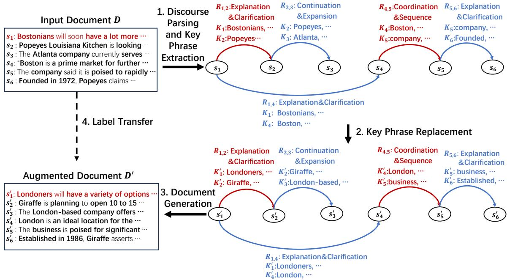

# Structure-Preserving Document-Level Data Augmentation via Discourse Parsing

Ruilin Shang1 Shilong Hou1 Zi Long2,∗ Xianghua Fu2

1Shenzhen University, China

2Shenzhen Technology University, China

2410263057@mails.szu.edu.cn hou\_work@yeah.net

longzi@sztu.edu.cn fuxianghua@sztu.edu.cn

∗Corresponding author

## Abstract

Data augmentation (DA) plays a vital role in improving model performance in low-resource or limited-supervision scenarios within Natural Language Processing (NLP). Existing DA methods, such as synonym replacement and back-translation, have demonstrated effectiveness on the word or sentence level; however, they frequently neglect discourse-level coherence and logical flow, which are essential for complex tasks dependent on inter-sentential relationships. In this paper, we propose a structure-preserving document-level data augmentation framework based on large language models (LLMs) and document-level discourse structure parsing. Our approach identifies rhetorical relations between sentence pairs and extracts key phrases, which are then replaced with semantically coherent but topically shifted content while preserving the original discourse structure. Experimental results on text sum marization and question answering show that the proposed augmented data provides complementary supervision and improves combineddata training across the evaluated tasks. Comparisons with a standard RST parser and controlled ablations further support the proposed discourse representation.

## 1 Introduction

Data augmentation (DA) is a pivotal strategy in Natural Language Processing (NLP) for addressing data sparsity in low-resource scenarios by synthetically expanding training sets to improve model robustness and generalization (Shorten and Khoshgoftaar, 2019; Shorten et al., 2021; Feng et al., 2021a; Chen et al., 2023). While lexical- and sentence-level DA (e.g., synonym replacement, back-translation) are effective for sentence-level tasks, they may be less effective in documentlevel contexts like text summarization and question answering (QA). Recent document-level DA methods (Huang et al., 2023; Wu et al., 2024) frequently overlook higher-level structures, such as inter-sentential coherence and logical flow, leading to semantically inconsistent noise that undermines model training.

To enhance document-level coherence, some researchers incorporate discourse-level information. For instance, Feng et al. (2021b) use dialogueaware strategies for meeting transcripts, Li et al. (2025) apply content reordering, and Jahangir et al. (2024) generate QA pairs guided by discourse relations. However, these methods usually encode discourse information for a specific task or operation and do not provide a unified mechanism for representing cross-sentence dependencies across tasks and domains. More importantly, these methods implicitly prioritize content diversity while overlooking document structure and task-level supervision. We further argue that, in document-level data augmentation, an important challenge is label invalidation caused by structural distortion.

Preserving discourse structure during augmentation retains the sentence-level units on which downstream labels are defined. For summarization, labels can be transferred through sentence indices. For extractive QA, the transformed answer can be located within the aligned sentence to reconstruct its new token span. This avoids regenerating task labels with an LLM, which may introduce additional noise or bias. Structural preservation therefore supports label reuse while allowing the document content to change.

We propose a structure-preserving DA framework based on document-level discourse structure analysis. Our method models rhetorical relations and key phrases between sentence pairs, replacing content while preserving sentence order, count, and discourse structure. This ensures sentencelevel alignment between original and augmented documents, enabling consistent label transfer. Experiments on summarization and QA tasks demonstrate the effectiveness of the proposed augmentation across multiple datasets and training settings. Our contributions are summarized as follows:

  
Figure 1: Structure-preserving document-level data augmentation.

• A document-level discourse structure analysis framework that structurally models rhetorical relations and sentence-level key semantics.

• A novel discourse-level DA method that manipulates core content while preserving rhetorical structures to generate coherent, diverse instances.

• Extensive experiments across four languages, two tasks, multiple model architectures, and controlled discourse variants demonstrate the robustness of the proposed framework.

## 2 Related Work

Data augmentation (DA) expands training data through operations based on prior knowledge (Wei and Zou, 2019) for supervised (Wei and Zou, 2019) or semi-supervised learning (Xie et al., 2020). Current methods span token (Niu and Bansal, 2018; Kumar et al., 2020), sentence (Sennrich et al., 2016; Chen et al., 2020), adversarial (Cheng et al., 2019; Morris et al., 2020), and hidden-space (Malandrakis et al., 2019; Chen et al., 2021) levels. Recently, LLMs (Ye et al., 2022; Chowdhury and Chadha, 2024; Sahu et al., 2025) have significantly advanced DA with their generative power.

While effective at the sentence level, standard DA may disrupt coherence in document-level tasks (Huang et al., 2023; Wu et al., 2024) because it does not explicitly preserve inter-sentential dependencies. Recent studies therefore incorporate discourse information into data augmentation (Pasunuru et al., 2021; Jahangir et al., 2024; Li et al., 2025). These approaches, however, are generally designed for particular tasks or use selected discourse cues without constructing a reusable document-level representation. In contrast, our document-level discourse structure analysis framework jointly represents antecedent links, rhetorical relations, and sentence-level key semantics, and uses this structure to constrain document generation and label transfer.

Regarding discourse parsing, foundational frameworks like RST (Mann and Thompson, 1988) and PDTB (Miltsakaki et al., 2004) provide structured representations via rhetorical trees or argument spans, with recent advances driven by neural parsers (Morey et al., 2017; Shi et al., 2020; Hu and Wan, 2023). Recent unified RST parsers support multiple languages and relation inventories (Chistova, 2025). We adopt a simpler sentence-level representation designed for aligned generation and compare it with UniRST in Section 6.1.

## 3 Methodology

As shown in Algorithm 1 and Fig. 1, we propose a structure-preserving data augmentation framework defined by three invariants: (1) unchanged document structure, (2) preserved rhetorical relations, and (3) identical sentence count and ordering. These ensure that sentence-level supervision remains aligned, i.e., the i-th sentence in the augmented document $\mathbf { D ^ { \prime } }$ corresponds exactly to the i-th sentence in the original D.

Algorithm 1 Structure-Preserving Document-  
Level Data Augmentation   
Require: Document $\begin{array} { l } { \mathbf { D } = \left\{ s _ { 1 } , \ldots , s _ { n } \right\} } \\ { \operatorname* { d o c u m e n t } \mathbf { D } ^ { \prime } = \left\{ s _ { 1 } ^ { \prime } , \ldots , s _ { n } ^ { \prime } \right\} } \end{array}$   
Ensure: Augmented   
Stage 1: Discourse parsing and key phrase extraction   
1: OriList $ [ ]$   
2: for $j  2$ to n do   
3: $s _ { i } \gets \mathrm { F I N D V A L I D } \big ( s _ { 1 } , \dots , s _ { j - 1 } \big )$   
4: $R _ { i , j }  \alpha ( s _ { i } , s _ { j } )$   
5: $\mathbf { K } _ { i } \gets \beta ( s _ { i } )$ ▷ $\mathbf { K } _ { i } = ( k _ { i } ^ { 1 } , \ldots , k _ { i } ^ { p } )$   
6: $\mathbf { K } _ { j } \gets \beta ( s _ { j } )$ ▷ $\mathbf { K } _ { j } = ( k _ { j } ^ { 1 } , \dots , k _ { j } ^ { q } )$   
7: $\mathbf { A } _ { i , j }  ( s _ { i } , \mathbf { K } _ { i } , s _ { j } , \mathbf { K } _ { j } , R _ { i , j } )$   
8: OriList.APPEND(Ai,j)   
9: end for   
Stage 2: Key phrase replacement   
10: AugList $\dot {  } [ \begin{array} { l } { \bar { 1 } } \\ { \bar { 1 } } \end{array} ]$   
11: for all $\mathbf { A } _ { i , j } \in \partial$ OriList do   
12: $\mathbf { K } _ { < i } ^ { \prime } \xleftarrow { } ( \mathbf { K } _ { 1 } ^ { \prime } , \dots , \mathbf { K } _ { i - 1 } ^ { \prime } )$   
13: $\mathbf { K } _ { i } ^ { \prime }  \gamma ( \mathbf { K } _ { i } , \mathbf { K } _ { < i } ^ { \prime } )$ ▷ $\mathbf { K } _ { i } ^ { \prime } = ( k _ { i } ^ { \prime 1 } , \dots , k _ { i } ^ { \prime p } )$   
14: $\mathbf { K } _ { < j } ^ { \prime }  ( \mathbf { K } _ { 1 } ^ { \prime } , \dotsc , \mathbf { K } _ { j - 1 } ^ { \prime } )$   
15: $\mathbf { K } _ { j } ^ { \prime }  \gamma ( \mathbf { K } _ { j } , \mathbf { K } _ { < j } ^ { \prime } )$ ▷ $\mathbf { \nabla } \cdot \mathbf { K } _ { j } ^ { \prime } = ( k _ { j } ^ { \prime 1 } , \dots , k _ { j } ^ { \prime q } )$   
16: $\mathbf { A } _ { i , j } ^ { \prime }  ( s _ { i } , \mathbf { K } _ { i } ^ { \prime } , s _ { j } , \mathbf { K } _ { j } ^ { \prime } , R _ { i , j } )$   
17: AugList.APPEND $\left( \mathbf { A } _ { i , j } ^ { \prime } \right)$   
18: end for   
Stage 3: Document generation   
19: $\mathbf { D ^ { \prime } }  [ ]$   
20: for $i \gets 1$ to n do   
21: $s _ { i } ^ { \prime } \gets \delta ( \mathbf { A } _ { i , * } ^ { \prime } , \mathbf { A } _ { * , i } ^ { \prime } )$   
22: D′.APPEND(s′i)   
23: end for   
24: return $\mathbf { D ^ { \prime } }$

## 3.1 Discourse Structure Analysis and Key Phrase Extraction

Given $\mathbf { D } = s _ { 1 } , \ldots , s _ { n } .$ , we identify rhetorical structures and key semantics (Algorithm 1, Lines 1–9), adopting a simplified alternative to standard RST tailored to sentence-aligned generation. Each sentence $s _ { j } \ ( j \ \geq \ 2 )$ is linked to a single antecedent $s _ { i } ( i < j )$ via a relation $R _ { i , j }$ . We define six relation categories: Causality & Condition, Contrast & Transition, Coordination & Sequence, Explanation & Clarification, Summary & Generalization, and Continuation & Expansion. This design balances expressiveness and robustness, covering common inter-sentential functions while reducing the sparsity associated with fine-grained taxonomies. 1

The function FINDVALID first examines the immediately preceding sentence $s _ { j - 1 }$ . If no valid relation is found, it scans $s _ { 1 } , \ldots , s _ { j - 2 }$ . When the scan also fails, $s _ { j }$ is linked to $s _ { j - 1 }$ using Continuation $\&$ Expansion as the default relation. This adjacent-first heuristic does not change the $O ( n ^ { 2 } )$ worst-case complexity, but it reduces the number of relation checks when a local antecedent is accepted. Function $\alpha ( s _ { i } , s _ { j } )$ predicts the rhetorical relation $R _ { i , j }$ between two sentences. Function $\beta ( s _ { i } )$ extracts salient semantic phrases Ki that capture the core content of a sentence, such as named entities, noun phrases, event triggers, and domain-specific concepts. The extracted information is represented as $\mathbf { A } i , j = ( s _ { i } , \mathbf { K } _ { i } , s _ { j } , \mathbf { K } j , R i , j )$

## 3.2 Key Phrase Replacement

In Lines 10–18, we generate augmented key phrases $\mathbf { K } _ { i } ^ { \prime } , \mathbf { K } _ { j } ^ { \prime }$ while preserving $R _ { i , j }$ . The function $\gamma$ replaces each $k \in \mathbf { K }$ with a semantically consistent but topically distinct alternative, referencing previously replaced phrases $( \mathbf { K } _ { 1 } ^ { \prime } , \cdots , \mathbf { K } _ { i - 1 } ^ { \prime } )$ to maintain thematic consistency. We enforce a globally consistent mapping such that identical source key phrases are consistently replaced with the same target phrase. To further constrain semantic drift, a target topic is randomly sampled in advance, and all replacements are conditioned on this topic rather than generated freely. This results in structure-preserved augmented placeholders $\mathbf { A } _ { i , j } ^ { \prime } = ( s _ { i } , \mathbf { K } _ { i } ^ { \prime } , s _ { j } , \mathbf { K } _ { j } ^ { \prime } , R _ { i , j } )$ .

## 3.3 Document Generation

Finally, D′ is generated by assembling sentences $\{ s _ { 1 } ^ { \prime } , \ldots , s _ { n } ^ { \prime } \}$ (Lines 19–24). For each sentence index i, function $\delta ( A _ { i , * } ^ { \prime } , A _ { * , i } ^ { \prime } )$ synthesizes a new sentence $s _ { i } ^ { \prime }$ that incorporates the modified key phrases while adhering to the original rhetorical relations $R _ { i , j }$ . This stage maintains global structural consistency while introducing semantic diversity.

## 3.4 Label Transfer

As the document layout is preserved, target-side annotations can be derived via rule-based mapping. For text summarization, if a sentence $s _ { i }$ in the original document is selected as part of the summary, its augmented counterpart $s _ { i } ^ { \prime }$ is assigned the same label, ensuring consistent supervision under sentencelevel alignment.

For question answering, we perform token-level label transfer via span reconstruction. During key phrase replacement, the same transformation $\gamma$ is applied to the context, question, and answer to maintain consistency. Instead of reusing original token spans, we locate the corresponding transformed answer string in the augmented context to reconstruct the answer span. As sentence order is preserved, the answer remains within the corresponding sentence $s _ { i } ^ { \prime }$ aligned with the original $s _ { i } ,$ and key-phrase-level replacements ensure a consistent mapping between original and transformed answer tokens.

## 4 Experiment Settings

## 4.1 Datasets and Metrics

We evaluate the framework on text summarization and extractive QA. For summarization, we use the Chinese Abstractive Corpus2, Newsroom (Grusky et al., 2018), and IndoSum (Kurniawan and Louvan, 2018). For QA, we use SQuAD 1.1 (Rajpurkar et al., 2016) and the Japanese dataset JaQuAD (So et al., 2022).

For summarization, we formulate supervision at the sentence level. Reference summaries are aligned to source sentences by exact sentence matching during preprocessing, and the resulting sentence indices are used as supervision. The same indices are then assigned to the aligned sentences in the augmented document. To support sentencelevel label transfer on IndoSum, we retain documents whose reference summary forms a contiguous span in the source document.

For each summarization dataset, we sample 2,000 instances for the input set, 2,000 for the control set, and 1,000 for testing. For each QA dataset, we use 4,000 input instances, 4,000 control instances, and 1,000 test instances. Within each dataset, input, control, and the test set are mutually exclusive, and the augmented set is generated only from the input set.

Summarization performance is measured by BLEU (Papineni et al., 2002), ROUGE-1, ROUGE-2, and ROUGE-L (Lin, 2004). QA performance is evaluated using F1 score and Exact Match (EM) (Rajpurkar et al., 2016).

## 4.2 Training Configurations and Baselines

To systematically evaluate the proposed structurepreserving DA approach, we fine-tune a base LLM under six distinct training configurations: (1) Inp, which uses only the sampled input data; (2) Con, which uses only the control data; (3) Aug, which uses only the augmented data generated from Inp by the augmentation method being evaluated; (4) Inp+Con, which combines the input and control data; (5) Inp+Aug, which combines the input and augmented data; and (6) Inp+Con+Aug, which integrates the input, control, and augmented data. For our method, each augmented document maintains one-to-one alignment with the original in sentence order and count, enabling direct transfer of sentence-level supervision.

We compare with several DA strategies. For both tasks, we include Back-Translation (Sennrich et al., 2016), which modifies only the source document or QA context while retaining the original supervision; in QA, the question and answer remain unchanged. For summarization, we additionally include MixSumm (Sahu et al., 2025), while for QA we include Two-Step QA Augmentation (Chowdhury and Chadha, 2024).

To assess label reusability, we include LLMbased Summary Relabeling and LLM-based QA Relabeling, which replace transferred labels with labels regenerated by Qwen2.5-7B-Instruct (Qwen et al., 2025)3. Direct LLM Augmentation instead generates augmented instances and labels without our discourse constraints. All LLM-based augmentation baselines use Qwen2.5-7B-Instruct.

In Tables 1 and 2, Aug, Inp+Aug, and Inp+Con+Aug denote the corresponding training configurations under each augmentation method.

## 4.3 Implementation Details

For data augmentation, we use Qwen2.5-7B-Instruct to perform discourse structure analysis, key-phrase replacement, and document generation. The augmentation process is decomposed into three independently prompted stages, each executed with a single prompt.

For downstream tasks, Qwen2.5-3B-Instruct4 is used for zero-shot evaluation. We fine-tune Qwen2.5-3B-Base5 using LoRA (Hu et al., 2022)

<table><tr><td rowspan="2">Training Configuration</td><td colspan="4">Chinese Abstractive Corpus</td><td colspan="4">Newsroom</td><td colspan="4">IndoSum</td></tr><tr><td>B</td><td>R1</td><td>R2</td><td>RL</td><td>B</td><td>R1</td><td>R2</td><td>RL</td><td>B</td><td>R1</td><td>R2</td><td>RL</td></tr><tr><td>Reference Settings</td><td></td><td></td><td></td><td></td><td></td><td></td><td></td><td></td><td></td><td></td><td></td><td></td></tr><tr><td>Zero-shot LLM 4</td><td></td><td></td><td>0.1390.2900.193</td><td>0.265</td><td></td><td></td><td></td><td>0.267 0.401 0.290 0.364 0.151 0.290 0.248 0.273</td><td></td><td></td><td></td><td></td></tr><tr><td>Inp</td><td></td><td></td><td>0.2490.391 0.312</td><td>0.372</td><td></td><td></td><td></td><td>0.634 0.697 0.657 0.686 0.728 0.749 0.741 0.747</td><td></td><td></td><td></td><td></td></tr><tr><td>Con</td><td></td><td></td><td>0.228 0.3700.289</td><td>0.351</td><td></td><td></td><td></td><td>0.653 0.712 0.676 0.703 0.746 0.765 0.756 0.763</td><td></td><td></td><td></td><td></td></tr><tr><td>Inp+Con</td><td></td><td></td><td>0.2690.3920.318</td><td>0.376</td><td></td><td></td><td></td><td></td><td></td><td></td><td>0.686 0.741 0.709 0.733 0.757 0.783 0.776 0.782</td><td></td></tr><tr><td colspan="9">Back-Translation (Sennrich et al., 2016)</td><td></td><td></td><td></td><td></td></tr><tr><td>Aug</td><td></td><td>0.211 0.3100.247</td><td></td><td>0.298</td><td></td><td></td><td></td><td></td><td></td><td></td><td></td><td>0.752 0.769 0.739 0.761 0.498 0.516 0.4660.505</td></tr><tr><td>Inp+Aug</td><td></td><td></td><td>0.2100.3370.259</td><td>0.319</td><td></td><td></td><td></td><td></td><td></td><td></td><td></td><td>0.768 0.775 0.744 0.766 0.601 0.663 0.577 0.643</td></tr><tr><td>Inp+Con+Aug</td><td></td><td>0.1980.3350.253</td><td></td><td>0.315</td><td>0.7740.7590.730</td><td></td><td></td><td>0.751 0.672 0.689</td><td></td><td></td><td></td><td>0.6470.671</td></tr><tr><td colspan="9">MixSumm (Sahu et al., 2025)</td><td></td><td></td><td></td><td></td></tr><tr><td>Aug</td><td>0.2960.393</td><td></td><td>0.329</td><td>0.378</td><td></td><td></td><td></td><td></td><td></td><td></td><td></td><td>0.147 0.293 0.161 0.250 0.358 0.415 0.389 0.407</td></tr><tr><td>Inp+Aug</td><td>0.2230.344</td><td></td><td>0.263</td><td>0.325</td><td>0.4630.5450.462</td><td></td><td></td><td></td><td></td><td></td><td></td><td>0.5180.5820.6370.6290.631</td></tr><tr><td>Inp+Con+Aug</td><td>0.1930.317</td><td></td><td>0.236</td><td>0.297</td><td></td><td></td><td>0.611 0.6240.570</td><td></td><td></td><td></td><td>0.608 0.560 0.615 0.588 0.609</td><td></td></tr><tr><td colspan="9">LLM-based Summary Relabeling 3</td><td></td><td></td><td></td><td></td></tr><tr><td>Aug</td><td>0.2210.3450.271</td><td></td><td></td><td>0.329</td><td></td><td></td><td></td><td></td><td></td><td></td><td></td><td>0.599 0.656 0.597 0.638 0.380 0.442 0.421 0.435</td></tr><tr><td>Inp+Aug</td><td>0.1860.3290.243</td><td></td><td></td><td>0.309</td><td></td><td></td><td></td><td></td><td></td><td></td><td></td><td>0.748 0.756 0.7220.747 0.572 0.592 0.517 0.571</td></tr><tr><td>Inp+Con+Aug</td><td>0.1650.3120.223</td><td></td><td></td><td>0.291</td><td></td><td></td><td>0.751 0.767 0.707</td><td></td><td></td><td></td><td>0.7300.5900.6450.5790.625</td><td></td></tr><tr><td colspan="9">Direct LLM Augmentation 3</td><td></td><td></td><td></td><td></td></tr><tr><td>Aug</td><td></td><td>0.1980.3440.256</td><td></td><td>0.324</td><td></td><td></td><td></td><td></td><td></td><td></td><td></td><td>0.338 0.446 0.337 0.406 0.317 0.376 0.3060.375</td></tr><tr><td>Inp+Aug</td><td></td><td>0.1930.3400.252</td><td></td><td>0.320</td><td></td><td></td><td></td><td></td><td></td><td></td><td>0.590 0.645 0.588 0.626 0.401 0.463 0.397 0.461</td><td></td></tr><tr><td>Inp+Con+Aug</td><td>0.2140.3540.270</td><td></td><td></td><td>0.334</td><td>0.677</td><td></td><td>0.7240.676</td><td>0.708</td><td>0.598</td><td></td><td>0.615 0.589</td><td>0.607</td></tr><tr><td colspan="9">Our Method</td><td></td><td></td><td></td><td></td><td></td></tr><tr><td>Aug</td><td></td><td></td><td>0.2470.3830.304</td><td>0.360</td><td></td><td></td><td></td><td></td><td></td><td></td><td></td><td>0.639 0.696 0.658 0.6860.703 0.758 0.751 0.757</td></tr><tr><td>Inp+Aug</td><td>0.269</td><td>0.395</td><td>0.319</td><td>0.379</td><td>0.775</td><td></td><td>0.796 0.765</td><td>0.787</td><td>0.779</td><td>0.792</td><td>0.786</td><td>0.789</td></tr><tr><td>Inp+Con+Aug</td><td>0.276</td><td>0.417</td><td>0.343</td><td>0.400</td><td>0.780</td><td>0.789</td><td>0.757</td><td>0.780</td><td>0.782</td><td>0.801</td><td>0.795</td><td>0.799</td></tr></table>

Table 1: Performance of fine-tuning and data augmentation methods on the Chinese Abstractive Corpus, Newsroom, and IndoSum. B, R1, R2, and RL denote BLEU, ROUGE-1, ROUGE-2, and ROUGE-L.

with rank 8. The batch size is 1 per device with gradient accumulation of 32. We train for 3 epochs with a learning rate of $1 \times 1 0 ^ { - 5 }$ , using a cosine scheduler with 0.1 warmup ratio. All experiments are conducted in bfloat16 precision.

## 5 Results

## 5.1 Results on Text Summarization

Utility of augmented data. Table 1 reports the results on three summarization datasets. On the Chinese corpus, Inp+Con+Aug improves over Inp+Con from 0.269 to 0.276 in BLEU and from 0.376 to 0.400 in ROUGE-L. Although MixSumm obtains the highest standalone BLEU score under the Aug configuration, its performance decreases when mixed with real data. In contrast, the proposed augmentation remains effective in the combined-data setting and achieves the best ROUGE-1, ROUGE-2, and ROUGE-L scores.

The complementary effect is stronger on Newsroom. Adding Aug to Inp increases BLEU from 0.634 to 0.775, while adding Aug to Inp+Con increases it from 0.686 to 0.780. Inp+Aug achieves the best ROUGE scores, and Inp+Con+Aug achieves the best BLEU score. On IndoSum, Inp+Con+Aug obtains the best result on all four metrics, improving BLEU from 0.757 to 0.782 and ROUGE-L from 0.782 to 0.799 over Inp+Con. These results show that the generated documents provide complementary training signals rather than merely duplicating the input set.

Reliability of transferred labels. The comparison with LLM-based Summary Relabeling separates the quality of augmented documents from the reliability of their supervision. Under Inp+Aug, the proposed method achieves BLEU scores of 0.269, 0.775, and 0.779 on the Chinese corpus, Newsroom, and IndoSum, respectively. Under the same Inp+Aug configuration, LLM-based Summary Relabeling obtains 0.186, 0.748, and 0.572. The gaps become particularly large on the Chinese corpus and IndoSum.

These results indicate that regenerating summary labels introduces additional supervision noise. Our framework instead transfers the original sentence indices to the aligned augmented sentences, avoiding additional label regeneration. Back-translation remains competitive on Newsroom, but its advantage is smaller in combined-data settings. Overall, the results suggest that both content diversity and label compatibility contribute to effective documentlevel augmentation.

<table><tr><td rowspan="2">Training Configuration</td><td colspan="2">SQuAD</td><td colspan="2">JaQuAD</td></tr><tr><td>EM</td><td>F1</td><td>EM</td><td>F1</td></tr><tr><td>Reference Settings</td><td></td><td></td><td></td><td></td></tr><tr><td>Zero-shot LLM⁴</td><td></td><td></td><td>0.6360.791 0.6590.773</td><td></td></tr><tr><td>Inp</td><td></td><td></td><td></td><td>0.7080.780 0.547 0.713</td></tr><tr><td>Con</td><td></td><td></td><td></td><td>0.6900.742 0.598 0.743</td></tr><tr><td>Inp+Con</td><td></td><td></td><td></td><td>0.697 0.746 0.681 0.729</td></tr><tr><td>Back-Translation (Sennrich et al., 2016)</td><td></td><td></td><td></td><td></td></tr><tr><td>Aug</td><td></td><td></td><td></td><td>0.362 0.508 0.117 0.433</td></tr><tr><td>Inp+Aug</td><td>0.4260.559 0.381 0.585</td><td></td><td></td><td></td></tr><tr><td>Inp+Con+Aug</td><td>0.5140.6400.5480.774</td><td></td><td></td><td></td></tr><tr><td>Two-Step QA Augmentation (Chowdhury and Chadha, 2024)</td><td></td><td></td><td></td><td></td></tr><tr><td>Aug</td><td>0.2760.479 0.166 0.489</td><td></td><td></td><td></td></tr><tr><td>Inp+Aug</td><td></td><td></td><td></td><td>0.4700.622 0.5030.735</td></tr><tr><td>Inp+Con+Aug</td><td></td><td></td><td></td><td>0.421 0.542 0.531 0.759</td></tr><tr><td>LLM-based QA Relabeling 3</td><td></td><td></td><td></td><td></td></tr><tr><td>Aug</td><td></td><td></td><td></td><td>0.315 0.460 0.209 0.500</td></tr><tr><td>Inp+Aug</td><td>0.3700.5150.5290.741</td><td></td><td></td><td></td></tr><tr><td>Inp+Con+Aug</td><td></td><td></td><td></td><td>0.5770.606 0.5950.787</td></tr><tr><td>Direct LLM Augmentation 3</td><td></td><td></td><td></td><td></td></tr><tr><td>Aug</td><td></td><td></td><td></td><td>0.3020.4440.1100.433</td></tr><tr><td>Inp+Aug</td><td></td><td>0.3130.4500.4420.681</td><td></td><td></td></tr><tr><td>Inp+Con+Aug</td><td>0.5760.6770.5240.780</td><td></td><td></td><td></td></tr><tr><td>Our Method</td><td></td><td></td><td></td><td></td></tr><tr><td>Aug</td><td></td><td></td><td></td><td>0.6980.7400.5460.728</td></tr><tr><td>Inp+Aug</td><td></td><td>0.701 0.751 0.688 0.771</td><td></td><td></td></tr><tr><td>Inp+Con+Aug</td><td>0.731 0.779 0.6580.811</td><td></td><td></td><td></td></tr></table>

Table 2: Performance of fine-tuning and data augmentation methods on the English SQuAD and Japanese JaQuAD question answering tasks.

## 5.2 Question Answering Results

Results on SQuAD. Table 2 reports the results on SQuAD and JaQuAD. On SQuAD, Aug alone reaches 0.698 EM, close to the 0.708 obtained by Inp, indicating that the augmented contexts retain substantial answer supervision. Adding Aug to Inp+Con improves EM from 0.697 to 0.731 and F1 from 0.746 to 0.779. The resulting F1 is also close to the best fine-tuned result of 0.780 obtained by Inp. Thus, the main improvement is not limited to token overlap but also appears in exact answer matching.

The comparison with regenerated labels provides further evidence for the role of alignment. Under Inp+Aug, our method obtains 0.701 EM and 0.751 F1, whereas LLM-based QA Relabeling obtains only 0.370 and 0.515. Back-Translation, Two-Step

QA Augmentation, and Direct LLM Augmentation are also weaker under the corresponding configurations. These methods may alter the relationship among the context, question, and answer, while our method applies consistent transformations and reconstructs the answer span.

Results on JaQuAD. JaQuAD shows a different balance between EM and F1. Inp+Aug obtains the highest EM score of 0.688, whereas Inp+Con+Aug obtains the highest F1 score of 0.811. Compared with Inp+Con, adding Aug increases F1 from 0.729 to 0.811, although EM decreases from 0.681 to 0.658. This divergence suggests that augmented training improves answer-token coverage but does not always produce the exact reference boundary or surface form.

Nevertheless, under Inp+Con+Aug, our method obtains higher numerical EM and F1 scores than the corresponding augmentation baselines. The results therefore support cross-lingual applicability while also showing that exact matching remains sensitive to language-specific answer realization.

## 6 Analysis

## 6.1 Analysis of Discourse Structure

Multilingual relation validation. To examine whether the six-relation inventory transfers across languages, we manually annotate 100 sentence pairs from each of the Chinese, English, Indonesian, and Japanese datasets. The predicted relations achieve accuracies of 81%, 78%, 71%, and 74%, respectively, supporting the cross-lingual applicability of the coarse-grained relation scheme.

Comparison with UniRST. First, we replace the proposed discourse analysis with UniRST (Chistova, 2025). We use the tchewik/isanlp\_rst\_v3 parser with the zho.rst.gcdt relation inventory for Chinese and eng.rst.rstdt for English. To make its output compatible with our generator, we map the original fine-grained relation labels into the six categories used by our framework. The complete mapping is provided in Appendix A, while all other augmentation and training settings remain unchanged.

Second, we evaluate two ablations. In w/o Relation, rhetorical relations are removed from the generation input. In Adjacent-only, each sentence can only select its immediately preceding sentence as the antecedent, thereby removing long-distance antecedent search. All other settings remain unchanged.

<table><tr><td rowspan="2">Method</td><td rowspan="2">Configuration</td><td colspan="4">Chinese Abstractive Corpus</td><td colspan="4">Newsroom</td><td colspan="2">SQuAD</td></tr><tr><td>BLEU</td><td>R1</td><td>R2</td><td>RL</td><td>BLEU</td><td>R1</td><td>R2</td><td>RL</td><td>EM</td><td>F1</td></tr><tr><td colspan="2">Proposed method</td><td></td><td></td><td></td><td></td><td></td><td></td><td></td><td></td><td></td><td></td></tr><tr><td rowspan="3">Full method</td><td>Aug</td><td>0.247</td><td>0.383</td><td>0.304</td><td>0.360</td><td>0.639</td><td>0.6960.658 0.6860.6980.740</td><td></td><td></td><td></td><td></td></tr><tr><td>Inp+Aug</td><td>0.269</td><td>0.395</td><td>0.319</td><td>0.379</td><td>0.775</td><td>0.796 0.765</td><td></td><td>0.787</td><td>0.701</td><td>0.751</td></tr><tr><td>Inp+Con+Aug</td><td>0.276</td><td>0.417</td><td>0.343</td><td>0.400</td><td>0.780</td><td>0.789</td><td>0.757</td><td>0.780</td><td>0.731</td><td>0.779</td></tr><tr><td colspan="2">Comparison with UniRST</td><td></td><td></td><td></td><td></td><td></td><td></td><td></td><td></td><td></td><td></td></tr><tr><td rowspan="3">UniRST</td><td>Aug</td><td>0.164</td><td></td><td>0.3030.216</td><td>0.283</td><td>0.285</td><td></td><td></td><td></td><td></td><td>0.387 0.2680.3440.3930.559</td></tr><tr><td>Inp+Aug</td><td>0.184</td><td></td><td>0.3140.236</td><td>0.298</td><td>0.580</td><td></td><td></td><td></td><td></td><td>0.639 0.582 0.620 0.490 0.629</td></tr><tr><td>Inp+Con+Aug</td><td>0.174</td><td></td><td>0.299 0.220</td><td>0.282</td><td>0.731</td><td></td><td></td><td></td><td></td><td>0.768 0.731 0.755 0.506 0.692</td></tr><tr><td colspan="2">Ablation study</td><td></td><td></td><td></td><td></td><td></td><td></td><td></td><td></td><td></td><td></td></tr><tr><td rowspan="3">w/o Relation</td><td>Aug</td><td>0.189</td><td></td><td>0.2300.199</td><td>0.222</td><td>0.356</td><td></td><td></td><td></td><td></td><td>0.522 0.477 0.510 0.455 0.582</td></tr><tr><td>Inp+Aug</td><td>0.208</td><td></td><td>0.3380.285</td><td>0.320</td><td>0.448</td><td></td><td></td><td></td><td></td><td>0.559 0.5290.552 0.515 0.606</td></tr><tr><td>Inp+Con+Aug</td><td>0.240</td><td></td><td>0.381 0.326</td><td>0.362</td><td>0.618</td><td></td><td></td><td></td><td></td><td>0.639 0.606 0.630 0.570 0.615</td></tr><tr><td rowspan="3">Adjacent-only Inp+Aug</td><td>Aug</td><td>0.194</td><td></td><td>0.252 0.218</td><td>0.243</td><td>0.348</td><td></td><td></td><td></td><td></td><td>0.558 0.527 0.552 0.384 0.395</td></tr><tr><td></td><td>0.226</td><td></td><td>0.347 0.302</td><td>0.334</td><td>0.423</td><td></td><td></td><td></td><td></td><td>0.581 0.5560.575 0.4590.483</td></tr><tr><td>Inp+Con+Aug</td><td>0.240</td><td>0.383 0.328</td><td></td><td>0.364</td><td>0.654</td><td></td><td></td><td></td><td></td><td>0.614 0.591 0.609 0.573 0.591</td></tr></table>

Table 3: Comparison with UniRST and controlled discourse ablations under matched training configurations.

Effect of rhetorical relations. Removing relation labels reduces performance on all three evaluated datasets. Under Inp+Con+Aug, w/o Relation obtains 0.240 BLEU and 0.362 ROUGE-L on the Chinese corpus, compared with 0.276 and 0.400 for the full method. On Newsroom, its BLEU decreases from 0.780 to 0.618, while SQuAD EM decreases from 0.731 to 0.570. These results indicate that sentence order alone is insufficient to preserve the intended logical connection during regeneration.

Effect of antecedent selection. Adjacent-only retains rhetorical labels but removes non-adjacent antecedent links. On SQuAD under Inp+Con+Aug, it obtains 0.573 EM and 0.591 F1, compared with 0.570/0.615 for w/o Relation and 0.731/0.779 for the full method. It therefore slightly improves EM over w/o Relation but yields a lower F1 score. The ordering is also inconsistent across summarization metrics, suggesting that restricting all antecedents to adjacent sentences does not provide a stable advantage. Overall, rhetorical labels provide local guidance, while flexible antecedent selection captures dependencies beyond adjacent sentences.

## 6.2 Generalization Across Architectures

Tables 4 and 5 examine whether the effect depends on LLM fine-tuning using BertSum (Liu and Lapata, 2019), SimCLS (Liu and Liu, 2021), RoBERTa (Liu et al., 2019), and ELECTRA (Clark et al., 2020). On the Chinese corpus, adding Aug to

Inp+Con improves ROUGE-L from 0.492 to 0.512 for BertSum and from 0.493 to 0.511 for SimCLS. On Newsroom, the corresponding improvements are from 0.851 to 0.867 and from 0.850 to 0.874, respectively. The gains also appear across BLEU and the other ROUGE metrics.

The same pattern holds for discriminative QA models. RoBERTa improves from 0.633/0.775 to 0.653/0.795 in EM/F1, while ELECTRA improves from 0.624/0.775 to 0.659/0.798. Under the same architectures and combined-data settings, MixSumm and Two-Step QA Augmentation remain below the proposed method.

These results indicate that the benefit is not specific to Qwen. The augmented data also benefits extractive, contrastive, and discriminative architectures, demonstrating its generalization across downstream model families.

## 6.3 Label Transfer Validity

To directly assess label-transfer reliability, we manually inspect 100 randomly sampled augmented instances from the Chinese Abstractive Corpus for summarization and 100 from SQuAD for QA. For summarization, a transfer is valid if the selected sentence still captures the main topic or an important aspect of the augmented document; 96 out of 100 instances satisfy this criterion. For QA, a transfer is valid if the answer is supported by the augmented context and reasonably answers the transformed question; 89 out of 100 instances are judged valid. These results provide direct evidence that the alignment-based strategy preserves supervision for most augmented instances.

<table><tr><td rowspan="2">Dataset</td><td rowspan="2">Training Configuration</td><td colspan="4">BertSum</td><td colspan="4">SimCLS</td></tr><tr><td>BLEU</td><td>R-1</td><td>R-2</td><td>R-L</td><td>BLEU</td><td>R-1</td><td>R-2</td><td>R-L</td></tr><tr><td rowspan="9">Chinese Abstractive Corpus</td><td>Inp</td><td>0.430</td><td>0.515</td><td>0.462</td><td>0.502</td><td>0.439</td><td>0.522</td><td>0.466</td><td>0.507</td></tr><tr><td>Con</td><td>0.411</td><td>0.497</td><td>0.440</td><td>0.482</td><td>0.423</td><td>0.507</td><td>0.450</td><td>0.492</td></tr><tr><td>Aug</td><td>0.415</td><td>0.496</td><td>0.445</td><td>0.484</td><td>0.439</td><td>0.517</td><td>0.463</td><td>0.503</td></tr><tr><td>Inp+Con</td><td>0.422</td><td>0.505</td><td>0.452</td><td>0.492</td><td>0.424</td><td>0.509</td><td>0.453</td><td>0.493</td></tr><tr><td>Inp+Aug</td><td>0.422</td><td>0.508</td><td>0.451</td><td>0.493</td><td>0.431</td><td></td><td>0.5160.4580.501</td><td></td></tr><tr><td>Inp+Con+Aug</td><td>0.442</td><td>0.526</td><td>0.471</td><td>0.512</td><td>0.442</td><td>0.5260.470</td><td></td><td>0.511</td></tr><tr><td>Aug-MixSumm</td><td>0.237</td><td>0.351</td><td>0.267</td><td>0.328</td><td>0.354</td><td>0.443</td><td>0.375</td><td>0.424</td></tr><tr><td>Inp+Aug-MixSumm</td><td>0.408</td><td>0.496</td><td>0.435</td><td>0.480</td><td>0.418</td><td>0.503</td><td>0.445</td><td>0.488</td></tr><tr><td>Inp+Con+Aug-MixSumm</td><td>0.303</td><td>0.402</td><td>0.335</td><td>0.387</td><td>0.425</td><td>0.509</td><td>0.451</td><td>0.493</td></tr><tr><td rowspan="9">Newsroom</td><td>Inp</td><td>0.857</td><td>0.861</td><td>0.840</td><td>0.855</td><td>0.858</td><td>0.860</td><td>0.840</td><td>0.854</td></tr><tr><td>Con</td><td>0.850</td><td>0.857</td><td>0.834</td><td>0.851</td><td>0.840</td><td>0.846</td><td>0.822</td><td>0.839</td></tr><tr><td>Aug</td><td>0.851</td><td>0.857</td><td>0.836</td><td>0.852</td><td>0.856</td><td>0.862</td><td>0.841</td><td>0.856</td></tr><tr><td>Inp+Con</td><td>0.854</td><td>0.856</td><td>0.836</td><td>0.851</td><td>0.852</td><td>0.860</td><td>0.837</td><td>0.850</td></tr><tr><td>Inp+Aug</td><td>0.862</td><td>0.864</td><td>0.845</td><td>0.860</td><td>0.877</td><td>0.875</td><td>0.858</td><td>0.871</td></tr><tr><td>Inp+Con+Aug</td><td>0.870</td><td>0.872</td><td>0.855</td><td>0.867</td><td>0.877</td><td>0.879</td><td>0.861</td><td>0.874</td></tr><tr><td>Aug-MixSumm</td><td>0.142</td><td>0.292</td><td>0.153</td><td>0.244</td><td>0.271</td><td>0.395</td><td>0.270</td><td>0.349</td></tr><tr><td>Inp+Aug-MixSumm</td><td>0.589</td><td>0.644</td><td>0.580</td><td>0.623</td><td>0.783</td><td>0.798</td><td>0.765</td><td>0.787</td></tr><tr><td>Inp+Con+Aug-MixSumm</td><td>0.808</td><td>0.820</td><td>0.792</td><td>0.812</td><td>0.827</td><td>0.837</td><td></td><td>0.810 0.829</td></tr></table>

Table 4: Performance of BertSum and SimCLS on the text summarization task. Inp, Con, and Aug denote the original input, control data, and our augmented data, respectively. Aug-MixSumm denotes the training configuration using MixSumm-generated augmented data (Sahu et al., 2025).

<table><tr><td rowspan="2">Training Configuration</td><td colspan="2">RoBERTa</td><td colspan="2">ELECTRA</td></tr><tr><td>EM</td><td>F1</td><td>EM</td><td>F1</td></tr><tr><td>Inp</td><td>0.611</td><td>0.748</td><td>0.618</td><td>0.749</td></tr><tr><td>Con</td><td>0.620</td><td>0.762</td><td>0.602</td><td>0.750</td></tr><tr><td>Aug</td><td>0.625</td><td>0.748</td><td>0.609</td><td>0.751</td></tr><tr><td>Inp+Con</td><td>0.633</td><td>0.775</td><td>0.624</td><td>0.775</td></tr><tr><td>Inp+Aug</td><td>0.621</td><td>0.761</td><td>0.627</td><td>0.762</td></tr><tr><td>Inp+Con+Aug</td><td>0.653</td><td>0.795</td><td>0.659</td><td>0.798</td></tr><tr><td>Aug-Two-Step</td><td>0.383</td><td>0.589</td><td>0.358</td><td>0.565</td></tr><tr><td>Inp+Aug-Two-Step</td><td>0.589</td><td>0.755</td><td>0.583</td><td>0.731</td></tr><tr><td>Inp+Con+Aug-Two-Step</td><td>0.637</td><td>0.775</td><td>0.6060.764</td><td></td></tr></table>

Table 5: Performance of RoBERTa and ELECTRA on SQuAD. Inp, Con, and Aug denote the original input, control data, and our augmented data, respectively. Aug-Two-Step denotes the training configuration using Two-Step QA augmentation (Chowdhury and Chadha, 2024).

To further assess the quality of the augmented documents, we manually evaluate 50 augmented samples for each of Chinese, English, Indonesian, and Japanese (200 in total) on fluency, coherence, and discourse-structure preservation using a fivepoint scale, and additionally assess whether the major rhetorical relations are preserved. Averaged across the four languages, the scores are 4.11 for fluency, 3.93 for coherence, and 3.86 for discoursestructure preservation, with 81.5% of the evaluated samples preserving the major relations.

## 7 Conclusion

We propose a structure-preserving document-level data augmentation framework based on discourse structure parsing. The framework changes document content while preserving sentence order, antecedent links, and rhetorical constraints, allowing downstream supervision to remain aligned.

Experiments on three summarization datasets and two extractive QA datasets show that the augmented data provides useful and complementary training signals. Comparisons with LLM-based relabeling and Direct LLM Augmentation show that label validity materially affects downstream performance. The UniRST comparison and controlled ablations further show that both rhetorical relations and flexible antecedent selection contribute to downstream performance. Improvements with BertSum, SimCLS, RoBERTa, and ELECTRA indicate that the method is not limited to LLM finetuning.

Overall, the framework is intended to supplement rather than replace real training data by generating diverse documents whose supervision remains stable and reusable.

## References

J. Chen, D. Tam, C. Raffel, M. Bansal, and D. Yang. 2023. An empirical survey of data augmentation for

limited data learning in NLP. Trans. Assoc. Comput. Linguist., 11:191–211.

Jiaao Chen, Dinghan Shen, Weizhu Chen, and Diyi Yang. 2021. Hiddencut: Simple data augmentation for natural language understanding with better generalizability. In Proceedings ofthe 59th Annual Meeting ofthe Associationfor Computational Linguistics and the 11th International Joint Conference on Natural Language Processing (Volume 1: Long Papers), pages 4380–4390.

Jiaao Chen, Yuwei Wu, and Diyi Yang. 2020. Semisupervised models via data augmentation for classifying interactive affective responses. In Proceedings of the AAAI 2020 Workshop on Affective Content Analysis, pages 151–160.

Yong Cheng, Lu Jiang, and Wolfgang Macherey. 2019. Robust neural machine translation with doubly adversarial inputs. In Proc. ACL, pages 4324–4333.

Elena Chistova. 2025. Bridging discourse treebanks with a unified rhetorical structure parser. In Proceedings of the 6th Workshop on Computational Approaches to Discourse, Context and Document-Level Inferences (CODI 2025), pages 197–208, Suzhou, China. Association for Computational Linguistics.

Arijit Chowdhury and Aman Chadha. 2024. Generative data augmentation using llms improves distributional robustness in question answering. In Proc. EACL (SRW), pages 258–265.

Kevin Clark, Thang Luong, Quoc V. Le, and Christopher Manning. 2020. Electra: Pre-training text encoders as discriminators rather than generators. In ICLR.

Steven Y Feng, Varun Gangal, Jason Wei, Sarath Chandar, Soroush Vosoughi, Teruko Mitamura, and Eduard Hovy. 2021a. A survey of data augmentation approaches for nlp. In Findings of the association for computational linguistics: ACL-IJCNLP 2021, pages 968–988.

Xiachong Feng, Xiaocheng Feng, Bing Qin, and Xinwei Geng. 2021b. Dialogue discourse-aware graph model and data augmentation for meeting summarization. In Proceedings of the Thirtieth International Joint Conference on Artificial Intelligence, IJCAI-21, pages 3808–3814. International Joint Conferences on Artificial Intelligence Organization. Main Track.

Max Grusky, Mor Naaman, and Yoav Artzi. 2018. Newsroom: A dataset of 1.3 million summaries with diverse extractive strategies. In Proc. NAACL-HLT, pages 708–719.

Edward J Hu, Yelong Shen, Phillip Wallis, Zeyuan Allen-Zhu, Yuanzhi Li, Shean Wang, Lu Wang, and Weizhu Chen. 2022. LoRA: Low-Rank Adaptation of Large Language Models. In International Conference on Learning Representations.

Xinyu Hu and Xiaojun Wan. 2023. RST discourse parsing as text-to-text generation. IEEE/ACM Trans. Audio Speech Lang. Process., 31:3278–3289.

Xiaosai Huang, Jing Li, Jia Wu, Jun Chang, and Donghua Liu. 2023. Transfer learning with document-level data augmentation for aspect-level sentiment classification. IEEE Trans. Big Data, 9(6):1643–1657.

Khushnur Jahangir, Philippe Muller, and Chloé Braud. 2024. Complex question generation using discoursebased data augmentation. In Proceedings of the 5th Workshop on Computational Approaches to Discourse (CODI 2024), pages 105–119.

Yangfeng Ji and Jacob Eisenstein. 2014. Representation learning for text-level discourse parsing. In Proceedings ofthe 52nd annual meeting ofthe associationfor computational linguistics (volume 1: Long papers), pages 13–24.

Varun Kumar, Ashutosh Choudhary, and Eunah Cho. 2020. Data augmentation using pre-trained transformer models. In Proc. LifeLongNLP, pages 18–26.

Kemal Kurniawan and Samuel Louvan. 2018. IndoSum: A new benchmark dataset for indonesian text summarization. In 2018 International Conference on Asian Language Processing, pages 215–220. IEEE.

Weihao Li, Dan Jiang, Han Zhang, Kejing Xiao, and Shaozhong Cao. 2025. An adaptive fusion-based data augmentation method for abstract dialogue summarization. PeerJ Comput. Sci., 11:e2845.

Chin-Yew Lin. 2004. Rouge: A package for automatic evaluation of summaries. In Text Summarization Branches Out, pages 74–81.

Yang Liu and Mirella Lapata. 2019. Text summarization with pretrained encoders. In Proceedings ofthe 2019 conference on empirical methods in natural language processing and the 9th international joint conference on natural language processing (EMNLP-IJCNLP), pages 3730–3740.

Yinhan Liu, Myle Ott, Naman Goyal, Jingfei Du, Mandar Joshi, Danqi Chen, Omer Levy, Mike Lewis, Luke Zettlemoyer, and Veselin Stoyanov. 2019. RoBERTa: A robustly optimized bert pretraining approach. arXiv preprint arXiv:1907.11692.

Yixin Liu and Pengfei Liu. 2021. Simcls: A simple framework for contrastive learning of abstractive summarization. In Proceedings ofthe 59th Annual Meeting of the Association for Computational Linguistics and the 11th International Joint Conference on Natural Language Processing (Volume 2: Short Papers), pages 1065–1072.

Nikolaos Malandrakis, Minmin Shen, Anuj Goyal, Shuyang Gao, Abhishek Sethi, and Angeliki Metallinou. 2019. Controlled text generation for data augmentation in intelligent artificial agents. In Proc. WNGT, pages 90–98.

W. C. Mann and S. A. Thompson. 1988. Rhetorical structure theory: Toward a functional theory of text organization. Text, 8(3):243–281.

Eleni Miltsakaki, Aravind Joshi, Rashmi Prasad, and Bonnie Webber. 2004. Annotating discourse connectives and their arguments. In Proceedings ofthe workshopfrontiers in corpus annotation at HLT-NAACL 2004, pages 9–16.

Mathieu Morey, Philippe Muller, and Nicholas Asher. 2017. How much progress have we made on rst discourse parsing? a replication study of recent results on the rst-dt. In Proceedings ofthe 2017 Conference on Empirical Methods in Natural Language Processing, pages 1319–1324.

John Morris, Eli Lifland, Jin Yong Yoo, Jake Grigsby, Di Jin, and Yanjun Qi. 2020. Textattack: A framework for adversarial attacks, data augmentation, and adversarial training in nlp. In Proc. EMNLP, pages 119–126.

Tong Niu and Mohit Bansal. 2018. Adversarial oversensitivity and over-stability strategies for dialogue models. In Proc. CoNLL, pages 486–496.

Kishore Papineni, Salim Roukos, Todd Ward, and Wei-Jing Zhu. 2002. BLEU: A method for automatic evaluation of machine translation. In Proc. ACL, pages 311–318.

Ramakanth Pasunuru, Asli Celikyilmaz, Michel Galley, Chenyan Xiong, Yizhe Zhang, Mohit Bansal, and Jianfeng Gao. 2021. Data augmentation for abstractive query-focused multi-document summarization. In Proc. AAAI, pages 13666–13674.

Qwen, An Yang, Baosong Yang, Beichen Zhang, Binyuan Hui, Bo Zheng, Bowen Yu, Chengyuan Li, Dayiheng Liu, Fei Huang, Haoran Wei, Huan Lin, Jian Yang, Jianhong Tu, Jianwei Zhang, Jianxin Yang, Jiaxi Yang, Jingren Zhou, Junyang Lin, and 24 others. 2025. Qwen2.5 technical report. Preprint, arXiv:2412.15115.

Pranav Rajpurkar, Jian Zhang, Konstantin Lopyrev, and Percy Liang. 2016. Squad: 100,000+ questions for machine comprehension of text. In Proceedings of the 2016 conference on empirical methods in natural language processing, pages 2383–2392.

Gaurav Sahu, Olga Vechtomova, and Issam H Laradji. 2025. A guide to effectively leveraging llms for lowresource text summarization: Data augmentation and semi-supervised approaches. In Proc. NAACL, pages 1584–1603.

Rico Sennrich, Barry Haddow, and Alexandra Birch. 2016. Improving neural machine translation models with monolingual data. In Proc. ACL, pages 86–96.

Ke Shi, Zhengyuan Liu, and Nancy F Chen. 2020. An end-to-end document-level neural discourse parser exploiting multi-granularity representations. arXiv preprint arXiv:2012.11169.

Connor Shorten and Taghi M Khoshgoftaar. 2019. A survey on image data augmentation for deep learning. J. Big Data, 6(1):1–48.

Connor Shorten, Taghi M Khoshgoftaar, and Borko Furht. 2021. Text data augmentation for deep learning. J. Big Data, 8(1):101.

ByungHoon So, Kyuhong Byun, Kyungwon Kang, and Seongjin Cho. 2022. JaQuAD: Japanese question answering dataset for machine reading comprehension. arXiv preprint arXiv:2202.01764.

Jason Wei and Kai Zou. 2019. EDA: Easy data augmentation techniques for boosting performance on text classification tasks. In Proc. EMNLP-IJCNLP, pages 6382–6388.

Minghao Wu, Yufei Wang, George Foster, Lizhen Qu, and Gholamreza Haffari. 2024. Importance-aware data augmentation for document-level neural machine translation. In Proc. EACL, pages 740–752.

Qizhe Xie, Zihang Dai, Eduard Hovy, Thang Luong, and Quoc Le. 2020. Unsupervised data augmentation for consistency training. Adv. Neural Inf. Process. Syst., 33:6256–6268.

Jiacheng Ye, Jiahui Gao, Qintong Li, Hang Xu, Jiangtao Feng, Zhiyong Wu, Tao Yu, and Lingpeng Kong. 2022. Zerogen: Efficient zero-shot learning via dataset generation. In Proceedings ofthe 2022 conference on empirical methods in natural language processing, pages 11653–11669.

## A Mapping UniRST Relations to the Proposed Relation Categories

UniRST does not define a single universal relation inventory. Instead, its output labels depend on the discourse treebank used for training. To make these outputs compatible with our document generator, we map the source relation labels predicted by UniRST to the six categories used in our framework.

In Table 6, coarse relationfamilies describe the general semantic functions of the source relations, such as cause, condition, and elaboration. They are included only to explain the mapping criterion. Source relation labels refer to the concrete finegrained labels processed by our mapping procedure. The mapping is designed specifically for our augmentation framework and is not intended as an official equivalence between the original discourse inventories.

The mapping follows the dominant semantic function of each source relation. Causal, conditional, and purposive relations are grouped together; adversative relations form the contrast category; multinuclear joint and temporal relations form the coordination category; relations that provide background, evidence, attributes, or manner information form the explanation category; evaluative and restatement relations form the summary category. Purely organizational relations are assigned to Continuation & Expansion because they do not express one of the five more specific semantic functions.

<table><tr><td>Target category</td><td>Source relations mapped to this category</td></tr><tr><td>Causality &amp; Condition</td><td>Coarse relation families: Cause, Condition, and Enablement. Source relation labels: causal-cause, causal-result, contingency-condition, purpose-attribute, and purpose-goal.</td></tr><tr><td>Contrast &amp; Transition</td><td>Coarse relation families: Comparison, Contrast, and Topic-Change. Source relation labels: adversative-antithesis, adversative-concession, and adversative-contrast.</td></tr><tr><td>Coordination &amp; Sequence</td><td>Coarse relation families: Joint and Temporal. Source relation labels: joint-list, joint-disjunction, joint-sequence, and joint-other. Coarse relation families: Attribution,</td></tr><tr><td>Explanation &amp; Clarification</td><td>Background, Elaboration, Explanation, Manner-Means, and Topic-Comment. Source relation labels: attribution-positive, attribution-negative, context-background, context-circumstance, elaboration-additional, elaboration-attribute, explanation-evidence, explanation-justify, explanation-motivation. mode-manner, mode-means, topic-question, and</td></tr><tr><td>Summary &amp; Generalization</td><td>topic-solutionhood. Coarse relation families: Evaluation and Summary. Source relation labels: evaluation-comment, restatement-partial,and restatement-repetition.</td></tr><tr><td>Continuation &amp; Expansion</td><td>Coarse relation families: Textual Organization, Same-Unit, Span, and other structural relations. Source relation labels: organization-heading, organization-phatic, organization-preparation, same-unit, and other unmatched structural labels.</td></tr></table>

Table 6: Relation label mapping used in our framework, where fine-grained discourse relation labels predicted by UniRST are grouped into six target categories. The grouping is designed for document augmentation purposes and follows semantic correspondence between relations rather than modifying the original UniRST relation definitions.