# SwarmRSI: Recursive Self-Improvement through Evolving Scientific Agent Swarm

Qianru Meng<sup>1</sup> Xi Zhang<sup>1</sup> Konstantinos Papakostas<sup>1</sup> Congfeng Cao<sup>1</sup> Wenxiang Hu<sup>1</sup> Tianyi Lu<sup>2</sup> Xiao Zhang<sup>3</sup> Lun Zhou<sup>1</sup> Zaiqiao Meng<sup>1</sup> Zhaochun Ren<sup>2</sup> Xiaohui Yan<sup>1</sup>\* Yougang Lyu<sup>1</sup>\*

<sup>1</sup>Huawei Technologies Co., Ltd. <sup>2</sup>Leiden University <sup>3</sup>University of Groningen qm17509@gmail.com, yanxiaohui2@huawei.com, youganglyu@gmail.com

## Abstract

Recursive self-improvement (RSI) in scientific research aims to improve agents’ research ca pabilities through their own experimental experience. Scientific agent swarms can pursue this goal when one agent’s findings and implementations advance another’s research. Two obstacles stand in the way. A failed experiment does not reveal whether its hypothesis or its implementation was at fault, and a program without overall gains can hide components that other agents need. We introduce SWARMRSI, a framework in which a swarm improves its research by evolving the research states its agents inherit, including hypotheses, programs and experimental evidence. Feedback-Guided Swarm Mutation uses other agents’ feedback to decide whether to revise a hypothesis or its program. Complementary Swarm Recombination tests retained hypotheses on other agents’ programs and combines complementary components. Recursive Swarm Evolution returns every outcome to a shared graph that guides which state each agent updates next. SWARMRSI achieves state-of-the-art (SOTA) results on OpenProblems and NatureBench. With Gemini 3.1 Pro Preview, it reaches an average score of 76.2 on OpenProblems, and it matches the published SOTA on 44.4% of NatureBench tasks, the highest Match-SOTA rate among compared methods. On MLE-Bench Lite, it wins medals on 81.8% of tasks, above hypothesis and program evolution agents with the same backbone. With DeepSeek-V4-Pro in one seed over all 90 NatureBench tasks, about 77% of final best programs descend from a rebase, a crossover or an update triggered by feedback. Biologists reproduce two of its programs and use them in follow-up analyses of intestinal and splenic immunity.

## 1 Introduction

Recursive self-improvement (RSI) in scientific research aims to improve agents’ research capabilities through their own experimental experience (Guo et al., 2026a; Srikanth et al., 2026). Scientific agent swarms offer a way to pursue this goal by coordinating idea generation, implementation, and evaluation across specialized agents (Yang et al., 2025; Tang et al., 2025; Yamada et al., 2025; Lee et al., 2026). Persistent memories and shared histories retain experimental experience for later research (Lyu et al., 2026; Zhu et al., 2026; Du et al., 2026; Weng et al., 2026), and accumulated histories can also support improvements to exploration strategies (Zheng et al., 2026). Together, these capabilities create an opportunity for agents exploring different directions to use one another’s findings and implementations in subsequent research.

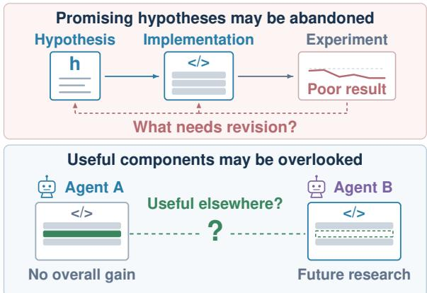  
Figure 1: Two limitations motivating SWARMRSI. In the top example, a poor result does not show whether the hypothesis or its implementation needs revision, and a promising hypothesis is abandoned. In the bottom example, a program without overall gains holds components useful to another agent’s later research. Dashed links mark open revisions and potential reuse.

However, sharing experience does not ensure that agents use it to make better research decisions. Program evolution refines executable candidates through execution feedback (Jiang et al., 2025; Nam et al., 2025; Novikov et al., 2025; Liu et al., 2025), while hypothesis evolution improves research directions through iterative generation and evaluation (Gottweis et al., 2026; Wang et al., 2026a; Liu et al., 2026; Jin et al., 2026). As Figure 1 illustrates, promising hypotheses are abandoned after inadequate implementations, and useful components are overlooked in programs that perform poorly overall.

We hypothesize that these limitations arise from two interrelated dependencies in scientific research. The value of a hypothesis depends on how it is implemented and how rigorously it is tested. An unsuccessful experiment therefore leaves unclear whether the research direction or its implementation needs revision (Ma et al., 2026; Koo et al., 2026), and feedback from other agents identifies which changes are worth pursuing. Intermediate results also become stepping stones for other search paths (Wang et al., 2019, 2020), and their value depends on combinations with later findings or implementations. Their current performance thus underestimates their contribution to other agents future research. This leads to our central question of how scientific agent swarms can evolve toward recursive self-improvement.

To address this, we introduce SWARMRSI, a framework that evolves scientific agent swarms for recursive self-improvement. Each agent uses its hypotheses, programs, experimental evidence, and unresolved needs to plan further research, and a shared graph records these inheritable research states. In Feedback-Guided Swarm Mutation, agents revise hypotheses and programs using other agents’ experimental feedback. Performance differences inform hypothesis revision, and unmet research needs guide implementation changes. In Complementary Swarm Recombination, agents revisit retained hypotheses on other agents’ implementations and combine program components with complementary strengths. Recursive Swarm Evolution evaluates the resulting candidates, retains useful results, feedback and unresolved needs in the shared graph, and uses these states to decide which hypotheses agents revisit and which programs they refine. Each experiment thus updates the states that later agents start from.

We evaluate SWARMRSI on OpenProblems (Luecken et al., 2025), NatureBench (Wang et al., 2026b) and MLE-Bench Lite (Chan et al., 2025), 118 scientific coding and machine-learning engineering tasks, with two backbones. It achieves SOTA results on OpenProblems and NatureBench and outperforms hypothesis and program evolution agents with the same backbone. With DeepSeek-V4-Pro in one seed over all 90 NatureBench tasks, about 77% of its final best programs descend from a rebase, a crossover or an update triggered by feedback. Biologists reproduce two of its programs and use them in follow-up analyses of intestinal and splenic immunity.

Our main contributions are:

• We formulate RSI for scientific agent swarms as evolving inheritable research states, so that each experiment updates the hypotheses, programs and evidence that later agents start from.

• We introduce SWARMRSI, which updates these states through Feedback-Guided Swarm Mutation, Complementary Swarm Recombination and Recursive Swarm Evolution.

• SWARMRSI achieves SOTA results on Open-Problems and NatureBench, most of its final NatureBench programs build on inherited states, and biologists reproduce its programs for immune analyses.

## 2 Related Work

## 2.1 LLM Agents for Scientific Research

LLM agents automate scientific research through hypothesis generation, experiment implementation, and result evaluation (Tang et al., 2025; Yamada et al., 2025). Agents centred on programs search over or refine code with execution feedback (Jiang et al., 2025; Nam et al., 2025), R&D-Agent coordinates proposal generation and implementation through specialized roles (Yang et al., 2025), and systems with memory carry execution experience into later experiments (Zhu et al., 2026; Du et al., 2026). Closest to our setting, Arbor links explicit hypotheses to programs and experimental evidence in a persistent hypothesis tree (Jin et al., 2026), and SAGE evaluates competing failure explanations to direct interventions toward hypotheses, experimental design, or implementation (Ma et al., 2026). SWARMRSI likewise grounds hypotheses in experiments and lets agents use one another’s feedback and partial results.

## 2.2 Recursive Self-Improvement of Agents

Recursive self-improvement uses an agent’s own experience to improve the mechanisms that guide its subsequent activity. AIDE<sup>2</sup> retains accepted code modifications as the basis for further selfimprovement (Srikanth et al., 2026), Dream-RSI refines exploration policies with replay simulators built from historical discovery trees (Zheng et al., 2026), MASS alternates workflow evolution with model fine-tuning (Lee et al., 2026), and AQuA uses recorded experiments to guide later research proposals (Guo et al., 2026a). These methods improve the agent’s code, policy, workflow, or proposals. SWARMRSI instead evolves the research states that agents inherit, revising them with other agents’ feedback and reusing retained hypotheses and program components across agents.

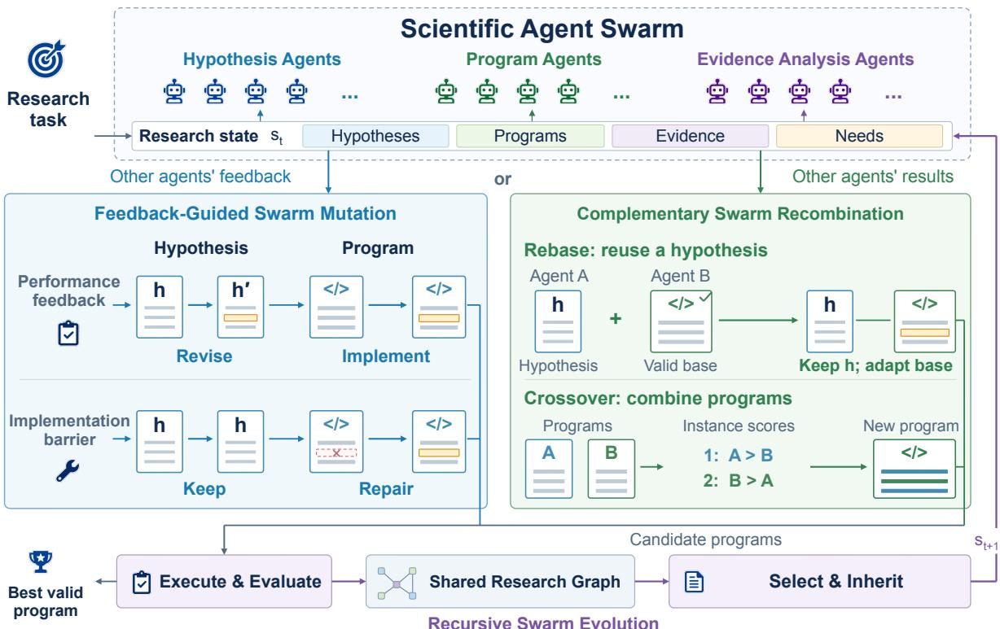  
Figure 2: Overview of SWARMRSI. Scientific agents use research states assembled from a shared graph. Feedback-Guided Swarm Mutation revises a hypothesis and implements the revision, or retains the hypothesis and repairs its program. Highlighted lines show local modifications. Complementary Swarm Recombination preserves a hypothesis while adapting another agent’s valid program base (rebase), or compares results across instances and adapts components from complementary programs into one new program (crossover). Blue and green code lines indicate crossover sources. The comparisons and code layouts are schematic. All candidates undergo execution and evaluation, and all attempts, whether successful, failed or without gain, update the graph and the next agent’s state $s _ { t + 1 }$

## 3 SwarmRSI

SWARMRSI evolves scientific agent swarms by updating the research states agents inherit. Feedback-Guided Swarm Mutation uses other agents’ feedback to guide revisions, and Complementary Swarm Recombination reuses their hypotheses and program components. Recursive Swarm Evolution evaluates every candidate and retains its outcome, so each experiment informs subsequent research. Figure 2 shows the shared research state and the execution loop that updates it.

## 3.1 Preliminaries

Scientific research task. Given a research goal $q ,$ a starter program $p _ { 0 }$ , and budget B, we seek a valid program with high utility. A hypothesis h specifies a modeling or algorithmic mechanism, and a program p implements it under the task’s constraints. Different programs may test the same hypothesis. Let $\mathcal { P } _ { \mathrm { v a l i d } } ( B )$ contain the valid programs found and evaluated within budget. The system returns

$$
p _ { B } ^ { \star } \in \underset { p \in \mathcal { P } _ { \mathrm { v a l i d } } ( B ) } { \arg \operatorname* { m a x } } u ( p ) ,\tag{1}
$$

where $u ( p )$ is the utility measured under the task’s evaluation protocol.

Scientific agent swarm. A scientific agent is a research policy for hypothesis proposal, program development, or evidence analysis. At research step t, the acting agent uses a research state

$$
\begin{array} { r } { s _ { t } = ( \mathcal { H } _ { t } , \mathcal { P } _ { t } , \mathcal { E } _ { t } , \mathcal { U } _ { t } ) , } \end{array}\tag{2}
$$

containing the hypotheses, programs, experimental evidence, and unresolved needs available for its current action. It assembles this state from relevant records in the shared graph $\mathcal { G } _ { t }$ , including other agents’ results, and unresolved research needs. Each record $\xi _ { i } ~ = ~ ( H _ { i } , P _ { i } , X _ { i } , E _ { i } )$ contains the tested hypothesis, parent and resulting programs, outcome, and execution and implementation evidence. The graph retains failed attempts and attempts without gain, and its edges track hypothesis– program associations and parent or reuse relations. Mutation and recombination use $s _ { t }$ to generate subsequent candidates.

## 3.2 Feedback-Guided Swarm Mutation

To guide revisions of hypotheses and their implementations, Feedback-Guided Swarm Mutation uses experimental feedback from the swarm. An unsuccessful run points to an implementation barrier, and differences across instances point to a revised research direction. At step t, the agent uses the selected parent pair $( h _ { t } , p _ { t } )$ and state $s _ { t } ,$ which provides outcomes, implementation evidence, and unresolved needs from its own and other agents records.

The agent proposes a hypothesis and a revision plan:

$$
( \tilde { h } _ { t } , \delta _ { t } ) = \mathrm { P r o p o s e } ( q , h _ { t } , p _ { t } ; s _ { t } ) ,\tag{3}
$$

where $\delta _ { t }$ describes the intended changes and their rationale. Differences across instances guide hypothesis revisions, and execution failures or unrealized interventions guide program repair. We call a revision that changes the hypothesis an H-mutation, and one that keeps it $( \tilde { h } _ { t } = h _ { t } )$ and repairs only the implementation a P-mutation. The agent then implements the plan on the parent program using relevant state information:

$$
\tilde { p } _ { t } = \mathrm { I m p l e m e n t } ( p _ { t } , \tilde { h } _ { t } , \delta _ { t } ; s _ { t } ) .\tag{4}
$$

The resulting candidate $( \tilde { h } _ { t } , \tilde { p } _ { t } )$ retains its parent relation and revision rationale in the shared research state. It then enters the shared evaluation loop, which tests validity and measures utility.

## 3.3 Complementary Swarm Recombination

Complementary Swarm Recombination reuses partial results across agents, including programs whose overall scores did not improve.

Hypothesis reuse. For a hypothesis $h _ { t }$ with unresolved implementation needs, an agent selects a valid base $b _ { t }$ from another agent by matching these needs to program mechanisms (Wiegand et al., 2001). The rebase operation keeps $h _ { t }$ and adapts its implementation to $b _ { t }$ , giving $( \tilde { h } _ { t } , \tilde { p } _ { t } ) =$ $( h _ { t } , \mathrm { R e b a s e } ( h _ { t } , b _ { t } ; s _ { t } ) )$ .

Program recombination. Crossover combines programs with complementary strengths across instances (Holland, 1975; Goldberg, 1989). For each dataset or subtask k, let $p _ { k } ^ { \star }$ be the valid program with the highest utility $u _ { k }$ observed by step t. Donors are the programs that outperform the parent on some instance, ranked by their largest advantage,

$$
\begin{array} { r l } & { \mathcal { D } ( p _ { t } ) = \{ p _ { k } ^ { \star } : u _ { k } ( p _ { k } ^ { \star } ) > u _ { k } ( p _ { t } ) \} , } \\ & { \Delta _ { t } ( d ) = \displaystyle \operatorname* { m a x } _ { k : p _ { k } ^ { \star } = d } \bigl [ u _ { k } ( d ) - u _ { k } ( p _ { t } ) \bigr ] . } \end{array}\tag{5}
$$

Each instance takes its components from the highest ranked donor that outperforms the parent there and keeps the parent’s components elsewhere. Both operations record their sources and send the new candidate to the shared evaluation loop.

## 3.4 Recursive Swarm Evolution

Recursive Swarm Evolution decides which update to make next and returns every outcome to the shared graph. It maintains a hypothesis frontier $\mathcal { F } _ { H }$ of active hypotheses and a program frontier $\mathcal { F } _ { P }$ of valid program representatives. For H/P selection, which decides whether the next step revises a hypothesis (H) or a program (P), it scores each feasible frontier $f \in \{ H , P \}$ with a discounted-UCB index (Auer et al., 2002; Garivier and Moulines, 2011)

$$
S _ { f } = \hat { \mu } _ { f } + \beta \sqrt { \frac { \log ( 1 + N _ { H } + N _ { P } ) } { N _ { f } } } + \gamma \psi _ { f } ,\tag{6}
$$

where $\hat { \mu } _ { f }$ is recent improvement per token cost, $N _ { f }$ is the discounted experiment count, and $\psi _ { f }$ is the saturated pressure from unresolved needs that $f$ can address. The weights $\beta$ and $\gamma$ set exploration and request pressure. Untried frontiers and frontiers that have waited long take priority over the score.

Each candidate is executed and evaluated under the task protocol. Execution checks test completion and task compliance, and source and output comparisons check whether the intended change was implemented. The record $\xi _ { t }$ of every attempt, including failed ones and those without gain, updates the graph to $\mathcal { G } _ { t + 1 }$ , from which the next acting agent assembles its state $s _ { t + 1 }$ . An implementation failure keeps the hypothesis and requests program repair, mixed gains and losses across instances request a revised hypothesis, and a new incumbent requests that retained hypotheses be realized on it. The loop repeats until budget B is exhausted and returns the best valid program.

<table><tr><td>Method</td><td>Backbone</td><td>Denoise</td><td>Label</td><td>Batch</td><td>SVG</td><td>Decomp</td><td>Visual</td><td>Avg ↑</td></tr><tr><td>Human Expert Task-specific</td><td></td><td>28.0</td><td>85.0</td><td>71.0</td><td>66.0</td><td>49.0</td><td>44.0</td><td>57.2</td></tr><tr><td>Biomni</td><td>Claude 4 Sonnet</td><td>16.0</td><td>89.0</td><td>82.0</td><td>16.0</td><td>53.0</td><td>35.0</td><td>48.5</td></tr><tr><td>ChatGPT</td><td>GPT-5</td><td>3.0</td><td>81.0</td><td>83.0</td><td>60.0</td><td>74.0</td><td>38.0</td><td>56.5</td></tr><tr><td>AIDE†</td><td>DeepSeek-V4-Pro</td><td>27.4</td><td>70.6</td><td>78.0</td><td>72.8</td><td>46.1</td><td>39.8</td><td>55.8</td></tr><tr><td>TusoAI†</td><td>DeepSeek-V4-Pro</td><td>31.5</td><td>58.7</td><td>79.5</td><td>79.0</td><td>84.1</td><td>69.8</td><td>67.1</td></tr><tr><td>SWARMRSI†</td><td>DeepSeek-V4-Pro Gemini 3.1 Pro Preview</td><td>33.6 40.2</td><td>74.2 80.7</td><td>82.5 78.8</td><td>83.9 87.8</td><td>86.0 83.4</td><td>84.8 86.4</td><td>74.2 76.2</td></tr></table>

Table 1: Main results on the six OpenProblems tasks. Scores are normalized and scaled by 100. Avg is the six-task mean, recomputed from reported task scores for published references. † denotes our means over three seeds. Bold and underlined values indicate best and second best results, including ties at the reported precision.

<table><tr><td></td><td></td><td colspan="2">All</td><td colspan="2">Protein</td><td colspan="2">Cellular</td><td colspan="2">Physical</td><td colspan="2">Molec.</td><td colspan="2">Relat.</td><td colspan="2">Biomed.</td></tr><tr><td>Method</td><td>Backbone</td><td>S↑</td><td>M↑</td><td>S↑</td><td>M↑</td><td>S↑</td><td>M↑</td><td>S↑</td><td>M↑</td><td>S↑</td><td>M↑</td><td>S↑</td><td>M↑</td><td>S↑</td><td>M↑</td></tr><tr><td rowspan="5">Claude Code</td><td>DeepSeek-V4-Pro</td><td>4.4</td><td>23.3</td><td>6.3</td><td>37.5</td><td>9.7</td><td>29.0</td><td>0.0</td><td>7.7</td><td>0.0</td><td>9.1</td><td>0.0</td><td>60.0</td><td>0.0</td><td>7.1</td></tr><tr><td>MiniMax-M3</td><td>6.7</td><td>27.8</td><td>6.3</td><td>37.5</td><td>12.9</td><td>29.0</td><td>7.7</td><td>15.4</td><td>0.0</td><td>36.4</td><td>0.0</td><td>60.0</td><td>0.0</td><td>7.1</td></tr><tr><td>GLM-5.2</td><td>13.3</td><td>35.6</td><td>12.5</td><td>43.8</td><td>22.6</td><td>41.9</td><td>15.4</td><td>15.4</td><td>0.0</td><td>36.4</td><td>0.0</td><td>60.0</td><td>7.1</td><td>21.4</td></tr><tr><td>Kimi K3</td><td>14.4</td><td>33.3</td><td>6.3</td><td>31.3</td><td>22.6</td><td>38.7</td><td>15.4</td><td>15.4</td><td>9.1</td><td>36.4</td><td>0.0</td><td>60.0</td><td>14.3</td><td>28.6</td></tr><tr><td>Qwen 3.8 Max 0902</td><td>17.8</td><td>35.6</td><td>12.5</td><td>37.5</td><td>25.8</td><td>38.7</td><td>23.1</td><td>23.1</td><td>0.0</td><td>27.3</td><td>0.0</td><td>60.0</td><td>21.4</td><td>35.7</td></tr><tr><td rowspan="2">Codex</td><td>GPT-5.4</td><td>6.7</td><td>24.4</td><td>6.3</td><td>37.5</td><td>9.7</td><td>22.6</td><td>15.4</td><td>23.1</td><td>0.0</td><td>18.2</td><td>0.0</td><td>60.0</td><td>0.0</td><td>7.1</td></tr><tr><td>GPT-5.5</td><td>4.4</td><td>25.6</td><td>6.3</td><td>31.3</td><td>9.7</td><td>25.8</td><td>0.0</td><td>7.7</td><td>0.0</td><td>18.2</td><td>0.0</td><td>60.0</td><td>0.0</td><td>28.6</td></tr><tr><td>Gemini CLI</td><td>Gemini 3.5 Flash</td><td>10.0</td><td>25.6</td><td>6.3</td><td>31.3</td><td>16.1</td><td>32.3</td><td>23.1</td><td>23.1</td><td>0.0</td><td>18.2</td><td>0.0</td><td>60.0</td><td>0.0</td><td>0.0</td></tr><tr><td>Arbor†</td><td>DeepSeek-V4-Pro</td><td>12.2</td><td>36.7*</td><td>6.3</td><td>31.3</td><td>16.1</td><td>48.4</td><td>23.1</td><td>23.1</td><td>0.0</td><td>27.3</td><td>0.0</td><td>60.0</td><td>14.3</td><td>28.6</td></tr><tr><td>AIDE†</td><td>DeepSeek-V4-Pro</td><td>10.0</td><td>27.8*</td><td>6.3</td><td>25.0</td><td>16.1</td><td>35.5</td><td>15.4</td><td>15.4</td><td>0.0</td><td>27.3</td><td>0.0</td><td>60.0</td><td>7.1</td><td>14.3</td></tr><tr><td rowspan="2">SWARMRSI†</td><td>DeepSeek-V4-Pro</td><td>15.6</td><td>44.4</td><td>0.0</td><td>37.5</td><td>22.6</td><td>48.4</td><td>53.8</td><td>53.8</td><td>0.0</td><td>45.5</td><td>0.0</td><td>60.0</td><td>0.0</td><td>28.6</td></tr><tr><td>Gemini 3.1 Pro Preview</td><td>14.4</td><td>44.4</td><td>6.3</td><td>43.8</td><td>22.6</td><td>38.7</td><td>23.1</td><td>61.5</td><td>9.1</td><td>54.5</td><td>20.0</td><td>80.0</td><td>0.0</td><td>21.4</td></tr></table>

Table 2: Main results on all 90 NatureBench tasks. S and M denote Surpass-SOTA and Match-SOTA rates (%). † denotes our means over three seeds. ∗ marks All-M differences from SWARMRSI with the same backbone significant at p < 0.05 (McNemar test). Bold and underlined values indicate best and second best rates, including ties.

<table><tr><td>Method</td><td>Backbone</td><td>Above Median ↑</td><td></td><td>Bronze Silver Gold ↑</td><td></td><td>Any-Medal ↑</td></tr><tr><td rowspan="2">MLEvolve</td><td>DeepSeek-V4-Pro†</td><td>81.8</td><td>9.1</td><td>27.3</td><td>36.4</td><td>72.7</td></tr><tr><td>Gemini 3.1 Pro Preview</td><td></td><td>一</td><td></td><td>一</td><td>80.3</td></tr><tr><td rowspan="2">Arbor</td><td>DeepSeek-V4-Pro†</td><td>86.4</td><td>4.5</td><td>31.8</td><td>40.9</td><td>77.3</td></tr><tr><td>GPT-5.5</td><td>95.5</td><td>0.0</td><td>9.1</td><td>77.3</td><td>86.4</td></tr><tr><td>ML-Master 2.0</td><td>DeepSeek-V3.2-Speciale</td><td>84.9</td><td>13.6</td><td>31.8</td><td>30.3</td><td>75.8</td></tr><tr><td></td><td>Famou-Agent 2.0 Gemini 3 Pro Preview</td><td>93.9</td><td>12.1</td><td>18.2</td><td>50.0</td><td>80.3</td></tr><tr><td rowspan="2">SWARMRSI†</td><td>DeepSeek-V4-Pro</td><td>90.9</td><td>9.1</td><td>27.3</td><td>45.5</td><td>81.8</td></tr><tr><td>Gemini 3.1 Pro Preview</td><td>86.4</td><td>9.1</td><td>31.8</td><td>40.9</td><td>81.8</td></tr></table>

Table 3: Main results on 22 MLE-Bench Lite tasks (%). † denotes our means over three seeds. Any-Medal combines exclusive medal rates before rounding, and – denotes unreported values. Bold and underlined values indicate best and second best Above Median, Gold, and Any-Medal rates, including ties.

## 4 Experiments

## 4.1 Research Questions

We address four research questions and illustrate biological applications through case studies: RQ1: How does SWARMRSI perform across benchmarks and backbones, and at what token cost? RQ2: How do Feedback-Guided Swarm Mutation, Complementary Swarm Recombination, and Recursive

Swarm Evolution contribute to performance? RQ3: How do experimental feedback and reused intermediate results guide the swarm’s subsequent research within and across tasks? RQ4: What are the main failure modes, and how frequent are they?

## 4.2 Benchmarks

We evaluate SWARMRSI on scientific coding and machine-learning engineering tasks across three benchmarks. OpenProblems (Luecken et al., 2025) contains six single-cell analysis tasks following TusoAI (Turcan et al., 2026). NatureBench (Wang et al., 2026b) contains all 90 scientific coding tasks across six domains. MLE-Bench Lite (Chan et al., 2025) contains 22 competitions from its low-complexity split.

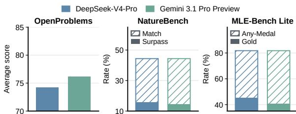  
Figure 3: SWARMRSI with two backbones. Full bars give Match-SOTA and Any-Medal rates (%), and solid portions give Surpass-SOTA and Gold rates.

<table><tr><td>Variant</td><td>Match</td><td>Surpass</td><td>Mean g</td></tr><tr><td>SWARMRSI</td><td>44.4</td><td>15.6</td><td>12.8</td></tr><tr><td>Feedback-Guided Swarm Mutation</td><td></td><td></td><td></td></tr><tr><td>w/o H-mutation</td><td>34.4</td><td>8.9</td><td>7.2</td></tr><tr><td>w/o P-mutation</td><td>31.1</td><td>6.7</td><td>5.4</td></tr><tr><td>Complementary Swarm Recombination</td><td></td><td></td><td></td></tr><tr><td>w/o recombination</td><td>37.8</td><td>7.8</td><td>7.6</td></tr><tr><td>Recursive Swarm Evolution</td><td></td><td></td><td></td></tr><tr><td>w/o shared graph</td><td>36.7</td><td>10.0</td><td>8.1</td></tr><tr><td>w/o H/P selection</td><td>35.6</td><td>8.9</td><td>4.6</td></tr></table>

Table 4: NatureBench ablations on all 90 tasks with DeepSeek-V4-Pro, averaged over three seeds and grouped by the mechanism each variant removes. Match and Surpass are Match-SOTA and Surpass-SOTA rates (%), and mean g is scaled by 100.

## 4.3 Baselines

We compare against program evolution agents (AIDE and MLEvolve), hypothesis evolution agents (Arbor), domain-specific scientific agents (TusoAI and Biomni (Huang et al., 2026)), and general coding agents (Claude Code (Anthropic, 2026), Codex (OpenAI, 2026a) and Gemini CLI (Google, 2026)).

## 4.4 Evaluation Metrics

OpenProblems reports normalized task scores scaled by 100 and their unweighted mean. NatureBench reports Match-SOTA $( g ~ \geq ~ 0 )$ and Surpass-SOTA $( g > 0 . 1 )$ rates, where g is the official direction-adjusted improvement over SOTA. MLE-Bench Lite reports Above Median and medal rates from official grading on the private test split. Rates retain all tasks in the denominator, including invalid or missing results. Match-SOTA comparisons with Arbor and AIDE on NatureBench use 95% paired bootstrap confidence intervals and Mc-

Nemar tests, and other comparisons are descriptive. Token cost sums uncached input and output tokens over all LLM calls in a search.

## 4.5 Implementation Details

SWARMRSI and rerun baselines use DeepSeek-V4- Pro (DeepSeek, 2026) under matched settings for each benchmark. Results from our runs in Tables 1– 3 are averaged over three random seeds. Published results keep the settings of their sources. We additionally evaluate SWARMRSI with Gemini 3.1 Pro Preview (Google DeepMind, 2026). In each run, all agents share one backbone and advance lineages that exchange results through the shared graph.

## 5 Results and Analysis

To answer our research questions, we compare benchmark performance, conduct component ablations, examine search trajectories, analyze annotated failures, and report biological case studies.

## 5.1 Main Results (RQ1)

Tables 1 to 3 summarize benchmark performance, and we make three observations.

• SWARMRSI outperforms domain-specific and general coding agents. With DeepSeek-V4- Pro, it reaches an OpenProblems average of 74.2 against 67.1 for TusoAI and exceeds Claude Code with the same backbone by 21.1 percentage points (pp) in NatureBench Match-SOTA.

• SWARMRSI outperforms hypothesis and program evolution agents. With the same backbone, its NatureBench Match-SOTA rate exceeds Arbor by 7.8 pp and AIDE by 16.7 pp, both significantly. Its 81.8% Any-Medal rate on MLE-Bench Lite also exceeds Arbor and MLEvolve, and, as shown in Section B.6, it uses fewer tokens than TusoAI and Arbor.

• SWARMRSI remains strong across backbones. As shown in Figure 3, with Gemini 3.1 Pro Preview it reaches the highest OpenProblems average of 76.2 and the same 44.4% NatureBench Match-SOTA rate as with DeepSeek-V4-Pro, which exceeds every compared method, and it keeps the 81.8% Any-Medal rate on MLE-Bench Lite.

## 5.2 Ablation Studies (RQ2)

Table 4 compares SWARMRSI with five variants on all 90 NatureBench tasks using DeepSeek-V4-Pro, grouped by the mechanism they remove and otherwise unchanged. w/o H-mutation only repairs programs under existing hypotheses, w/o P-mutation only revises hypotheses, w/o recombination disables rebase and crossover, w/o shared graph removes agents’ access to one another’s records, and w/o H/P selection replaces adaptive H/P selection with fixed H/P alternation. As shown in Table 6, all variants lower mean g with paired 95% CIs excluding zero, and we make three observations.

• Feedback-Guided Swarm Mutation needs both revision modes. Removing H- or Pmutation lowers Match-SOTA by 10.0 and 13.3 pp, respectively. The two modes are complementary, and program repair contributes more.

• Complementary Swarm Recombination improves solution quality. Disabling rebase and crossover lowers Match-SOTA by 6.7 pp and Surpass-SOTA from 15.6% to 7.8%, and its drop in mean g excludes zero. RQ3 traces this gain to reused hypotheses and program components in most final programs.

• Recursive Swarm Evolution depends on the shared graph and H/P selection. Match-SOTA drops by 7.8 pp without the shared graph, through which agents use other agents’ records, and by 8.9 pp without H/P selection, which also causes the largest drop in mean g.

## 5.3 Trajectory Analysis (RQ3)

We examine how SWARMRSI uses feedback and retained research states during search. Figure 4a,b compares diagnostics with AIDE and Arbor on all 90 NatureBench tasks, and Figure 4c,d shows one run per method on two tasks.

• SWARMRSI recovers more failed implementations and turns more of its hypotheses into improvements. Later refinement turns 35% of failed implementations into new best valid programs, compared with 12% for AIDE and 5% for Arbor. Of its proposed hypotheses, 62% lead to an improvement, against 17% for Arbor.

• SWARMRSI revises with prior feedback. In one NatureBench seed with DeepSeek-V4-Pro, updates triggered by performance feedback or unresolved implementation requests reach a 28.4% rate of new bests, against 21.9% over all updates. On 00917, after nine candidates without improvement, two successive hypothesis mutations revise the program’s readout and reach Surpass-SOTA.

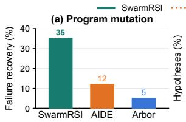

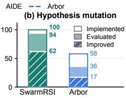

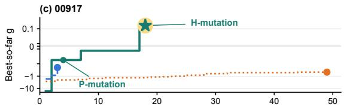

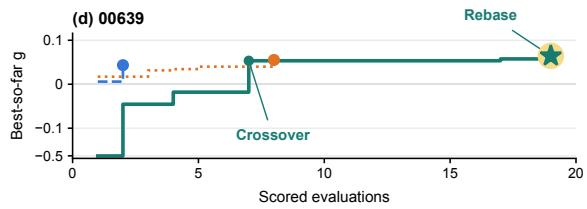  
Figure 4: Search behaviour on NatureBench with DeepSeek-V4-Pro. (a) Failure recovery, the share of failed implementations whose later refinement yields a new best, over 90 tasks. (b) Nested shares of proposed hypotheses that are implemented (white), evaluated (light) and improved (hatched). (c, d) Best-so-far g of one recorded run per method on symmetric log axes.

• SWARMRSI reuses partial results across research trajectories. In the same seed, about 77% of final best programs descend from at least one rebase, crossover or update triggered by feedback, and these updates yield new bests more often than other updates at every stage of search. On 00639, crossover combines components from three programs to reach Match-SOTA, and a later rebase step activates retained message-passing and ranking-loss code that the program had not executed, further improving g. On 00795, rebase tests an unrealized hypothesis on a later program, and crossover then reuses a component from a program that had not improved overall.

• Inherited research states transfer to new tasks. As shown in Section C.2, the state inherited after three generations of source tasks raises mean g on 12 held-out NatureBench tasks from 12.01 to 21.89 and Match-SOTA from 41.7% to 86.1% over cold start.

## 5.4 Failure Analysis (RQ4)

We annotate 644 failed attempts from 35 SWARMRSI task trajectories that fall below Match-SOTA on NatureBench or earn no medal on MLE-Bench Lite. Two annotators judge implementation fidelity, execution success and improvement over the preceding best valid result, with Cohen’s κ = 0.92. Most failures are faithful interventions without gains. They account for 93.3% of these failures, and implementation or execution problems for 6.7%. A valid score can hide such a problem, as on task 00838, where downstream code overwrites a proposed amino-acid substitution that the evaluation thus never tests, which is why Feedback-Guided Swarm Mutation reads implementation evidence alongside scores. On task 02316, by contrast, a negative-binomial mixture with a Potts spatial prior runs correctly but collapses all locations into one cluster, a faithful intervention without gain.

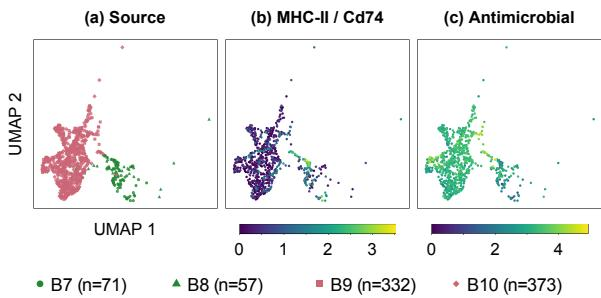  
(e) SwarmRSI  
(f) B­cell environments

(d) Manual anatomy  
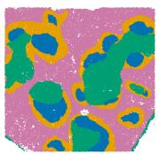

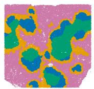

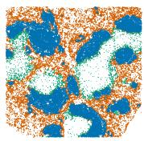  
B-zone PALS Marginal zone Red pulp No annotation  
E1 E2 E3  
Figure 5: Biological case studies. (a–c) UMAP of the reproduced SWARMRSI representation for 833 target enterocytes, coloured by source and by MHC-II/Cd74 and antimicrobial RNA scores (mean normalized log RNA). Green and pink denote helminth day-10 and Salmonella sources. (d–f) BALBc-1 spleen with manual annotations, SWARMRSI program partitions, and expert neighbourhood groups E1 (B/follicular-dendritic-cellrich), E2 (myeloid/erythroid-rich) and E3 (T-cell-rich).

## 5.5 Biological Case Studies

We examine the scientific utility of programs evolved by SWARMRSI. Biologists reproduced two of its programs and interpreted them with measured RNA and protein.

Enterocyte: infection-associated immune expression. On the contrastiveVI task (Weinberger et al., 2023), the evolved program removes from each infected cell the mean of its healthy neighbours before reducing the residuals. On the Haber intestinal instance (Haber et al., 2017), measured enterocyte RNA shows higher MHC-II scores in helminth day 10 than Salmonella infection, with means of 1.17 and 0.34. Figure 5a–c shows the corresponding expression gradients on the reproduced representation. Within the two helminth day-10 sources, MHC-II scores are locally more coherent on this representation than on RNA PCA, with Spearman’s $\rho$ after covariate adjustment of 0.77 and 0.69 against 0.65 and 0.40, whereas antimicrobial scores are less locally coherent than on RNA PCA in each of the four sources.

CytoCommunity: spatial context without consistent marker shifts. On the CytoCommunity task (Hu et al., 2024), the evolved program combines anatomical priors derived from phenotypes with an anatomically constrained Markov random field, raising g from 0.045 to 0.102. Figure 5d–f compares its partitions with manual anatomy and experts’ subsequent grouping of B-cell neighbourhoods by local cell composition. Across three spleen images, 20–21% of B cells in the manually annotated marginal zone occupy myeloid/erythroidrich neighbourhoods. Goltsev et al. (2018) reported that B220 and CD79b levels on splenic B cells vary with the local neighbourhood across the spleen. Within the marginal zone, after matching these B cells on location and phenotype within each image, these and four other markers show no consistent shift between neighbourhoods across the three images, and the B220 effect changes sign.

## 6 Conclusion

We began with two obstacles for scientific agent swarms. A failed experiment does not show whether its hypothesis or its implementation was at fault, and a program without overall gains can still hold a component that another agent needs. SWARMRSI addresses both. Feedback-Guided Swarm Mutation uses other agents’ feedback to decide whether to revise a hypothesis or repair its program, and Complementary Swarm Recombination carries retained hypotheses and useful components into other agents’ work. Recursive Swarm Evolution returns every outcome to the shared graph, so each experiment changes the states that later agents start from. It achieves SOTA results on OpenProblems and NatureBench and outperforms baselines with the same backbone, most final NatureBench programs build on such reuse, and biologists reproduce its programs for follow-up analyses of intestinal and splenic immunity. A swarm thus improves its own research by evolving what its agents inherit.

## References

Anthropic. 2026. Claude Code. https://claude. com/product/claude-code. Product documentation; accessed 6 September 2026.

Peter Auer, Nicolò Cesa-Bianchi, and Paul Fischer. 2002. Finite-time analysis of the multiarmed bandit problem. Machine Learning, 47(2–3):235–256.

Congfeng Cao, Lipeng Zuo, Konstantinos Papakostas, Qiwei Xu, Songwei Xu, Lun Zhou, Zhaochun Ren, Yougang Lyu, and Xiaohui Yan. 2026. SearchJev: A fast and calibrated system-1 model for search agents. arXiv preprint arXiv:2610.05107.

Jun Shern Chan, Neil Chowdhury, Oliver Jaffe, James Aung, Dane Sherburn, Evan Mays, Giulio Starace, Kevin Liu, Leon Maksin, Tejal Patwardhan, Lilian Weng, and Aleksander M ˛adry. 2025. MLEbench: Evaluating machine learning agents on machine learning engineering. In International Conference on Learning Representations.

DeepSeek. 2026. DeepSeek V4 Preview Release. https://api-docs.deepseek.com/news/ news260424/.

Shangheng Du, Xiangchao Yan, Jinxin Shi, Zongsheng Cao, Shiyang Feng, Zichen Liang, Boyuan Sun, Tianshuo Peng, Yifan Zhou, Xin Li, Jie Zhou, Liang He, Bo Zhang, and Lei Bai. 2026. MLEvolve: A self-evolving framework for automated machine learning algorithm discovery. arXiv preprint arXiv:2606.06473.

FrontisAI. 2026. NatureBench leaderboard. https:// frontisai.github.io/NatureBench/. Accessed 7 October 2026.

Aurélien Garivier and Eric Moulines. 2011. On upperconfidence bound policies for switching bandit problems. In International Conference on Algorithmic Learning Theory, pages 174–188.

Timnit Gebru, Jamie Morgenstern, Briana Vecchione, Jennifer Wortman Vaughan, Hanna Wallach, Hal Daumé, III, and Kate Crawford. 2021. Datasheets for datasets. Communications of the ACM, 64(12):86– 92.

David E. Goldberg. 1989. Genetic Algorithms in Search, Optimization, and Machine Learning. Addison-Wesley.

Yury Goltsev, Nikolay Samusik, Julia Kennedy-Darling, Salil Bhate, Matthew Hale, Gustavo Vazquez, Sarah Black, and Garry P. Nolan. 2018. Deep profiling of mouse splenic architecture with CODEX multiplexed imaging. Cell, 174(4):968–981.e15.

Google. 2026. Gemini CLI. https://github.com/ google-gemini/gemini-cli. Official repository and documentation; accessed 5 October 2026.

Google DeepMind. 2026. Gemini 3.1 Pro: A smarter model for your most complex tasks. https://blog.google/innovation-and-ai/ models-and-research/gemini-models/ gemini-3-1-pro/.

Juraj Gottweis, Wei-Hung Weng, Alexander Daryin, Tao Tu, Petar Sirkovic, Artiom Myaskovsky, Grzegorz Glowaty, Felix Weissenberger, Alessio Orlandi, Dan Popovici, Anil Palepu, Keran Rong, Ryutaro Tanno, Khaled Saab, Fan Zhang, Jacob Blum, Andrew Carroll, Kavita Kulkarni, Nenad Tomašev, and 32 others. 2026. Accelerating scientific discovery with Co-Scientist. Nature, 655(8122):487–496.

Jiacheng Guo, Suozhi Huang, Yunlong Gao, Zihao Li, Jason Ge, Shushu Liang, Xu Kuang, and Mengdi Wang. 2026a. AQuA: Recursively self-improving quantitative trading research agents. arXiv preprint arXiv:2608.12841.

Shuyu Guo, Wenxiang Hu, Yuyue Zhao, Yougang Lyu, and Xiaohui Yan. 2026b. RubricReviewer: From direct critique to objective and comprehensive rubric-driven peer review. arXiv preprint arXiv:2608.00005.

Adam L. Haber, Moshe Biton, Noga Rogel, Rebecca H. Herbst, Karthik Shekhar, Christopher Smillie, Grace Burgin, Toni M. Delorey, Michael R. Howitt, Yarden Katz, Itay Tirosh, Semir Beyaz, Danielle Dionne, Mei Zhang, Raktima Raychowdhury, Wendy S. Garrett, Orit Rozenblatt-Rosen, Hai Ning Shi, Omer Yilmaz, and 2 others. 2017. A single-cell survey of the small intestinal epithelium. Nature, 551(7680):333– 339.

John H. Holland. 1975. Adaptation in Natural and Artificial Systems. University of Michigan Press.

Yuxuan Hu, Jiazhen Rong, Yafei Xu, Runzhi Xie, Jacqueline Peng, Lin Gao, and Kai Tan. 2024. Unsupervised and supervised discovery of tissue cellular neighborhoods from cell phenotypes. Nature Methods, 21(2):267–278.

Kexin Huang, Serena Zhang, Hanchen Wang, Yuanhao Qu, Yingzhou Lu, Ryan Li, Yusuf Roohani, Lin Qiu, Shiyi Cao, Gavin Li, Junze Zhang, Di Yin, Rick Wierenga, Deniz Kavi, Sherry Liu, Tianwei She, Shruti Marwaha, Jennefer N. Carter, Xin Zhou, and 9 others. 2026. Autonomous biomedical research with an artificial intelligence agent. Science, 393(6813):eadz4351.

Zhengyao Jiang, Dominik Schmidt, Dhruv Srikanth, Dixing Xu, Ian Kaplan, Deniss Jacenko, and Yuxiang Wu. 2025. AIDE: AI-driven exploration in the space of code. arXiv preprint arXiv:2502.13138.

Jiajie Jin, Yuyang Hu, Kai Qiu, Qi Dai, Chong Luo, Guanting Dong, Xiaoxi Li, Tong Zhao, Xiaolong Ma, Gongrui Zhang, Zhirong Wu, Bei Liu, Zhengyuan Yang, Linjie Li, Lijuan Wang, Hongjin Qian, Yutao Zhu, and Zhicheng Dou. 2026. Toward generalist autonomous research via hypothesis-tree refinement. arXiv preprint arXiv:2606.11926.

Evangelos Kanoulas, Panagiotis Eustratiadis, Yongkang Li, Yougang Lyu, Vaishali Pal, Gabrielle Poerwawinata, Jingfen Qiao, and Zihan Wang. 2025. Agent-centric information access. arXiv preprint arXiv:2502.19298.

Philipp Koehn. 2004. Statistical significance tests for machine translation evaluation. In Proceedings ofthe 2004 Conference on Empirical Methods in Natural Language Processing, pages 388–395. Association for Computational Linguistics.

Jaywon Koo, Jefferson Hernandez, Ruozhen He, Hanjie Chen, Chen Wei, and Vicente Ordonez. 2026. Agentic discovery with active hypothesis exploration for visual recognition. arXiv preprint arXiv:2604.12999.

Hyunin Lee, Jinglue Xu, Jeffrey Seely, Donghyun Lee, Somayeh Sojoudi, Matei Zaharia, and Yujin Tang. 2026. Recursive self-improvement through multi-agent self-supervision. arXiv preprint arXiv:2610.12176.

Annan Li, Chufan Wu, Zengle Ge, Yee Hin Chong, Zhinan Hou, Lizhe Cao, Cheng Ju, Jianmin Wu, Huaiming Li, Haobo Zhang, Shenghao Feng, Mo Zhao, Fengzhi Qiu, Rui Yang, Mengmeng Zhang, Wenyi Zhu, Yingying Sun, Quan Sun, Shunhao Yan, and 3 others. 2025. The FM agent. arXiv preprint arXiv:2510.26144.

Stephanie Lin, Jacob Hilton, and Owain Evans. 2022. TruthfulQA: Measuring how models mimic human falsehoods. In Proceedings ofthe 60th Annual Meet ing ofthe Associationfor Computational Linguistics (Volume 1: Long Papers), pages 3214–3252. Association for Computational Linguistics.

Jieyuan Liu, Mengzhou Hu, Jefferson Chen, JungHo Kong, Pratibha Jagannatha, Yiming Gao, Dexter Pratt, Hsin-Yuan Lee, Zhiting Hu, Trey Ideker, Wei Wang, Eric P. Xing, and Zhen Wang. 2026. HypoEvolve: Genetic algorithms enable multi-agent LLMs to discover scientific hypotheses. arXiv preprint arXiv:2609.15938.

Zexi Liu, Yuzhu Cai, Xinyu Zhu, Yujie Zheng, Runkun Chen, Ying Wen, Yanfeng Wang, Weinan E, and Siheng Chen. 2025. ML-Master: Towards AI-for-AI via integration of exploration and reasoning. arXiv preprint arXiv:2506.16499.

Chris Lu, Cong Lu, Robert Tjarko Lange, Jakob Foerster, Jeff Clune, and David Ha. 2024. The AI scientist: Towards fully automated open-ended scientific discovery. arXiv preprint arXiv:2408.06292.

Malte D. Luecken, Scott Gigante, Daniel B. Burkhardt, Robrecht Cannoodt, Daniel C. Strobl, Nikolay S. Markov, Luke Zappia, Giovanni Palla, Wesley Lewis, Daniel Dimitrov, Michael E. Vinyard, D. S. Magruder, Michaela F. Mueller, Alma Andersson, Emma Dann, Qian Qin, Dominik J. Otto, Michal Klein, Olga Borisovna Botvinnik, and 36 others. 2025. Defining and benchmarking open problems in singlecell analysis. Nature Biotechnology, 43(7):1035– 1040.

Yougang Lyu, Jitai Hao, Zihan Wang, Kai Zhao, Shen Gao, Pengjie Ren, Zhumin Chen, Fang Wang, and Zhaochun Ren. 2023a. Multi-defendant legal judgment prediction via hierarchical reasoning. In Findings of the Association for Computational Linguistics: EMNLP 2023, pages 2198–2209. Association for Computational Linguistics.

Yougang Lyu, Piji Li, Yechang Yang, Maarten de Rijke, Pengjie Ren, Yukun Zhao, Dawei Yin, and Zhaochun Ren. 2023b. Feature-level debiased natural language understanding. In Proceedings of the AAAI Conference on Artificial Intelligence, volume 37, pages 13353–13361.

Yougang Lyu, Shijie Ren, Yue Feng, Zihan Wang, Zhumin Chen, Zhaochun Ren, and Maarten de Rijke. 2025a. Self-adaptive cognitive debiasing for large language models in decision-making. arXiv preprint arXiv:2504.04141.

Yougang Lyu, Zihan Wang, Zhaochun Ren, Pengjie Ren, Zhumin Chen, Xiaozhong Liu, Yujun Li, Hongsong Li, and Hongye Song. 2022. Improving legal judgment prediction through reinforced criminal element extraction. Information Processing & Management, 59(1):102780.

Yougang Lyu, Lingyong Yan, Shuaiqiang Wang, Haibo Shi, Dawei Yin, Pengjie Ren, Zhumin Chen, Maarten de Rijke, and Zhaochun Ren. 2024a. KnowTuning: Knowledge-aware fine-tuning for large language models. In Proceedings ofthe 2024 Conference on Empirical Methods in Natural Language Processing, pages 14535–14556. Association for Computational Linguistics.

Yougang Lyu, Lingyong Yan, Zihan Wang, Dawei Yin, Pengjie Ren, Maarten de Rijke, and Zhaochun Ren. 2025b. MACPO: Weak-to-strong alignment via multi-agent contrastive preference optimization. In The Thirteenth International Conference on Learning Representations.

Yougang Lyu, Xi Zhang, Yuyue Zhao, Konstantinos Papakostas, Xinhao Yi, Shuyu Guo, Wenxiang Hu, Jan Piotrowski, Jakub Kaliski, Jacopo Urbani, Zaiqiao Meng, Lun Zhou, Zhaochun Ren, and Xiaohui Yan. 2026. EvoScientist: Towards multi-agent evolving AI scientists for end-to-end scientific discovery. arXiv preprint arXiv:2603.08127.

Yougang Lyu, Xiaoyu Zhang, Zhaochun Ren, and Maarten de Rijke. 2024b. Cognitive biases in large language models for news recommendation. In 1st Workshop on Risks, Opportunities, and Evaluation of Generative Models in Recommender Systems. ROE-GEN@RecSys 2024.

Yougang Lyu, Xiaoyu Zhang, Lingyong Yan, Maarten de Rijke, Zhaochun Ren, and Xiuying Chen. 2025c. DeepShop: A benchmark for deep research shopping agents. arXiv preprint arXiv:2506.02839.

Jie Ma, Binfei Chu, Jie Gao, Jinlu Zhang, Yiwei Ma, Yi Tan, Jiayi Ji, Xiaoshuai Sun, and Rongrong Ji.

2026. One reflection is not enough: Self-correcting autonomous research via multi-hypothesis failure attribution. arXiv preprint arXiv:2606.31478.

Jaehyun Nam, Jinsung Yoon, Jiefeng Chen, Jinwoo Shin, Sercan Ö. Arık, and Tomas Pfister. 2025. MLE-STAR: Machine learning engineering agent via search and targeted refinement. arXiv preprint arXiv:2506.15692.

Alexander Novikov, Ngân Vu, Marvin Eisenberger, Em-˜ ilien Dupont, Po-Sen Huang, Adam Zsolt Wagner, Sergey Shirobokov, Borislav Kozlovskii, Francisco J. R. Ruiz, Abbas Mehrabian, M. Pawan Kumar, Abigail See, Swarat Chaudhuri, George Holland, Alex Davies, Sebastian Nowozin, Pushmeet Kohli, and Matej Balog. 2025. AlphaEvolve: A coding agent for scientific and algorithmic discovery. arXiv preprint arXiv:2506.13131.

OpenAI. 2026a. Codex CLI. https://developers. openai.com/codex/cli. Official documentation; accessed 5 October 2026.

OpenAI. 2026b. MLE-Bench leaderboard. https: //github.com/openai/mle-bench#leaderboard. Accessed 7 October 2026.

Alicia Parrish, Angelica Chen, Nikita Nangia, Vishakh Padmakumar, Jason Phang, Jana Thompson, Phu Mon Htut, and Samuel R. Bowman. 2022. BBQ: A hand-built bias benchmark for question answering. In Findings ofthe Associationfor Computational Linguistics: ACL 2022, pages 2086–2105. Association for Computational Linguistics.

Mitchell A. Potter and Kenneth A. De Jong. 2000. Cooperative coevolution: An architecture for evolving coadapted subcomponents. Evolutionary Computation, 8(1):1–29.

Rafael Rafailov, Archit Sharma, Eric Mitchell, Christopher D. Manning, Stefano Ermon, and Chelsea Finn. 2023. Direct preference optimization: Your language model is secretly a reward model. In Advances in Neural Information Processing Systems, volume 36.

Andreas Sauter, Yuyue Zhao, Jacopo Urbani, Wenxiang Hu, Zaiqiao Meng, Lun Zhou, Xiaohui Yan, and Yougang Lyu. 2026. EvoIdeator: Evolving scientific ideas through checklist-grounded reinforcement learning. arXiv preprint arXiv:2603.21728.

Samuel Schmidgall, Yusheng Su, Ze Wang, Ximeng Sun, Jialian Wu, Xiaodong Yu, Jiang Liu, Michael Moor, Zicheng Liu, and Emad Barsoum. 2025. Agent laboratory: Using LLM agents as research assistants. arXiv preprint arXiv:2501.04227.

Roy Schwartz, Jesse Dodge, Noah A. Smith, and Oren Etzioni. 2020. Green AI. Communications of the ACM, 63(12):54–63.

Zhengliang Shi, Yiqun Chen, Haitao Li, Weiwei Sun, Shiyu Ni, Yougang Lyu, Run-Ze Fan, Bowen Jin, Yixuan Weng, Minjun Zhu, Qiujie Xie, Xinyu Guo,

Qu Yang, Jiayi Wu, Jujia Zhao, Xiaqiang Tang, Xinbei Ma, Cunxiang Wang, Jiaxin Mao, and 7 others. 2025. Deep research: A systematic survey. arXiv preprint arXiv:2512.02038.

Dhruv Srikanth, Bingchen Zhao, Dixing Xu, Yuxiang Wu, and Zhengyao Jiang. 2026. Recursive selfimprovement of AI research agents. arXiv preprint arXiv:2609.26457.

Jiabin Tang, Lianghao Xia, Zhonghang Li, and Chao Huang. 2025. AI-Researcher: Autonomous scientific innovation. In Advances in Neural Information Processing Systems.

Alistair Turcan, Kexin Huang, Lei Li, and Martin Jinye Zhang. 2026. TusoAI: Agentic optimization for scientific methods. In International Conference on Learning Representations.

Haorui Wang, Parshin Shojaee, Kazem Meidani, Kunyang Sun, José Miguel Hernández-Lobato, Teresa Head-Gordon, Jiajun He, Chandan K. Reddy, Chao Zhang, and Yuanqi Du. 2026a. Towards diverse scientific hypothesis search with large language models. In Proceedings ofthe 43rd International Conference on Machine Learning, volume 306 of Proceedings of Machine Learning Research, pages 129851–129891. PMLR.

Rui Wang, Joel Lehman, Jeff Clune, and Kenneth O. Stanley. 2019. Paired open-ended trailblazer (POET): Endlessly generating increasingly complex and diverse learning environments and their solutions. arXiv preprint arXiv:1901.01753.

Rui Wang, Joel Lehman, Aditya Rawal, Jiale Zhi, Yulun Li, Jeff Clune, and Kenneth O. Stanley. 2020. Enhanced POET: Open-ended reinforcement learning through unbounded invention of learning challenges and their solutions. In International Conference on Machine Learning.

Yuru Wang, Lejun Cheng, Yuxin Zuo, Sihang Zeng, Bingxiang He, Che Jiang, Junlin Yang, Yuchong Wang, Kaikai Zhao, Weifeng Huang, Kai Tian, Zhenzhao Yuan, Jincheng Zhong, Weizhi Wang, Ning Ding, Bowen Zhou, and Kaiyan Zhang. 2026b. NatureBench: Can coding agents match the published SOTA of nature-family papers? arXiv preprint arXiv:2606.24530.

Zihan Wang, Ziqi Zhao, Yougang Lyu, Zhumin Chen, Maarten de Rijke, and Zhaochun Ren. 2025. A cooperative multi-agent framework for zero-shot named entity recognition. In Proceedings of the ACM on Web Conference 2025, pages 4183–4195. Association for Computing Machinery.

Ethan Weinberger, Chris Lin, and Su-In Lee. 2023. Isolating salient variations of interest in single-cell data with contrastiveVI. Nature Methods, 20(9):1336– 1345.

Yixuan Weng, Minjun Zhu, Qiujie Xie, Qiyao Sun, Zhen Lin, Sifan Liu, and Yue Zhang. 2026. DeepScientist:

Advancing frontier-pushing scientific findings progressively. In International Conference on Learning Representations.

R. Paul Wiegand, William C. Liles, and Kenneth A. De Jong. 2001. An empirical analysis of collaboration methods in cooperative coevolutionary algorithms. In Proceedings of the Genetic and Evolutionary Computation Conference (GECCO). Morgan Kaufmann.

Shiguang Wu, Zhongkun Liu, Zhen Zhang, Zheng Chen, Wentao Deng, Wenhao Zhang, Jiyuan Yang, Zhitao Yao, Yougang Lyu, Xin Xin, Shen Gao, Pengjie Ren, Zhaochun Ren, and Zhumin Chen. 2023. fuzi.mingcha. GitHub repository.

Yutaro Yamada, Robert Tjarko Lange, Cong Lu, Shengran Hu, Chris Lu, Jakob Foerster, Jeff Clune, and David Ha. 2025. The AI Scientist-v2: Workshoplevel automated scientific discovery via agentic tree search. arXiv preprint arXiv:2504.08066.

Xu Yang, Xiao Yang, Shikai Fang, Yifei Zhang, Jian Wang, Bowen Xian, Qizheng Li, Jingyuan Li, Minrui Xu, Yuante Li, Haoran Pan, Yuge Zhang, Weiqing Liu, Yelong Shen, Weizhu Chen, and Jiang Bian. 2025. R&D-Agent: An LLM-agent framework towards autonomous data science. arXiv preprint arXiv:2505.14738.

Kaike Zhang, Yunfan Wu, Yougang Lyu, Du Su, Yingqiang Ge, Shuchang Liu, Qi Cao, Zhaochun Ren, and Fei Sun. 2025. The 1st workshop on humancentered recommender systems. In Companion Proceedings ofthe ACM on Web Conference 2025, pages 2088–2091. ACM.

Xiaoyu Zhang, Ruobing Xie, Yougang Lyu, Xin Xin, Pengjie Ren, Mingfei Liang, Bo Zhang, Zhanhui Kang, Maarten de Rijke, and Zhaochun Ren. 2024. Towards empathetic conversational recommender systems. In Proceedings ofthe 18th ACM Conference on Recommender Systems, pages 84–93. Association for Computing Machinery.

Tong Zheng, Xidong Wu, Zheng Zhang, Zhankui He, Chaoyi Zhang, Benjamin Coleman, Ruoqiao Wei, Di Bai, Haolin Liu, Rui Liu, Xue Wang, Yue Zhuan, Wang-Cheng Kang, Renkai Xiang, Heng Huang, Xinwu Cheng, and Yunsong Guo. 2026. Dream-RSI: Recursive self-improvement through evolving worlds. arXiv preprint arXiv:2609.14858.

Xinyu Zhu, Yuzhu Cai, Zexi Liu, Bingyang Zheng, Cheng Wang, Rui Ye, Yuzhi Zhang, Linfeng Zhang, Weinan E, Siheng Chen, and Yanfeng Wang. 2026. Toward ultra-long-horizon agentic science: Cognitive accumulation for machine learning engineering. arXiv preprint arXiv:2601.10402.

## A Method Details

This section supplements Section 3 with details of Recursive Swarm Evolution, execution feedback, and Complementary Swarm Recombination.

```latex
Algorithm 1 SWARMRSI search loop
Require: goal q, starter program p<sub>0</sub>, utility u, budget B
1: Initialize $\mathcal { G } _ { 0 }$ with root drafts from p , and set $\mathcal { F } _ { H } , \mathcal { F } _ { P } \gets$
initial frontiers
2: while budget B remains do
3: Choose frontier f by priority rules and Equation (6)
4: Choose H-/P-mutation, rebase or crossover in f
5: if rebase then
6: keep h and select base $p ^ { \prime } \in \mathcal { F } _ { P }$ by need–label
overlap, or the new incumbent
7: else if crossover then
8: select donors $\mathcal { D } ( \boldsymbol { p } )$ from per-instance utilities u<sub>k</sub>
9: end if
10: Planner forms experiment $( h , p )$ , coder implements,
evaluate u
11: Code and scientific audits $\begin{array} { r l } {  } & { { } E , } \end{array}$ append $\begin{array} { r l } { \xi } & { { } = } \end{array}$
$( H , P , X , E )$ to G
12: Emit requests: failure → deepen, mixed per-instance
→ broaden, new incumbent → deepen retained h
13: Update $\mathcal { F } _ { H } , \mathcal { F } _ { P } , ( N _ { f } , G _ { f } , C _ { f } )$ and $U _ { f }$
14: end while
15: return best valid program in G
```

## A.1 Recursive Swarm Evolution

The hypothesis frontier $\mathcal { F } _ { H }$ retains active hypotheses balanced across mechanism families. The program frontier $\mathcal { F } _ { P }$ retains the incumbent $p ^ { \star }$ and the best program of each realized family. H-mutation revises the hypothesis toward an alternative modeling or algorithmic mechanism, whereas P-mutation keeps the hypothesis and refines an existing program lineage.

Table 5 lists the shared selection settings for DeepSeek-V4-Pro and Gemini 3.1 Pro Preview across all three benchmarks.

<table><tr><td>Parameter</td><td>Value</td></tr><tr><td>Discount factor ρ</td><td>0.9</td></tr><tr><td>Exploration weight  $\beta$ </td><td>0.5</td></tr><tr><td>Request-pressure weight γ Request-pressure saturation K</td><td>0.25</td></tr><tr><td>Eligible-wait threshold W</td><td>4 8</td></tr><tr><td>Tokens per cost unit T</td><td>1,000</td></tr><tr><td>Improvement scale s</td><td>1.0</td></tr><tr><td>Active hypotheses / program representatives</td><td>4/8</td></tr><tr><td>Candidate pairs per hypothesis Sources per hypothesis adaptation</td><td>2</td></tr><tr><td>Scored local continuations / local attempts</td><td>1</td></tr><tr><td></td><td>2/4</td></tr><tr><td>Local stagnation patience</td><td>1</td></tr><tr><td>Initial root drafts</td><td>3</td></tr></table>

Table 5: Shared H/P-selection parameters and search limits across both backbones and all three benchmarks.

Improvement and computational cost. For an experiment initiated by frontier $a _ { t } \in \{ H , P \}$ , let $u _ { t }$ be its utility and ${ \boldsymbol u } _ { t } ^ { - }$ the preceding incumbent utility. Reward and normalized token cost are

$$
\begin{array} { l } { r _ { t } = \displaystyle \operatorname* { m i n } \biggl ( 1 , \operatorname* { m a x } \biggl ( 0 , \frac { u _ { t } - u _ { t } ^ { - } } { s } \biggr ) \biggr ) , } \\ { c _ { t } = \displaystyle \operatorname* { m a x } \biggl ( 1 , \frac { \tau _ { t } } { T } \biggr ) , } \end{array}\tag{7}
$$

where $\tau _ { t }$ includes the experiment’s planner and coder tokens. Without a prior incumbent, reward is zero. Failed or unscored outcomes receive zero reward and keep their cost, and infrastructure failures leave the statistics unchanged.

Selection score updates. Initialize $N _ { f } = G _ { f } =$ $C _ { f } = 0$ for both frontiers. After each experiment other than an infrastructure failure, update both frontiers:

$$
\begin{array} { r l } & { N _ { f }  \rho N _ { f } + \mathbf { 1 } [ f = a _ { t } ] , } \\ & { G _ { f }  \rho G _ { f } + \mathbf { 1 } [ f = a _ { t } ] r _ { t } , } \\ & { C _ { f }  \rho C _ { f } + \mathbf { 1 } [ f = a _ { t } ] c _ { t } . } \end{array}\tag{8}
$$

The controller scores each sampled, feasible frontier using Equation (6), with $\hat { \mu } _ { f } = G _ { f } / C _ { f }$ as recent improvement per cost. For $U _ { f }$ unresolved requests addressable by frontier $f ,$ request pressure is $\psi _ { f } = \mathrm { m i n } ( U _ { f } , K ) / K$ . These requests are generated by experiments in both frontiers, coupling their allocation. Setting $\gamma = 0$ removes request pressure from the index. Discounting emphasizes recent outcomes, while request pressure saturates at $K = 4$

Frontier scheduling. A sole feasible frontier is selected directly. When both are feasible, frontiers without an updated sample take priority, with H preceding P. Subsequently, a frontier waiting for W eligible choices takes priority. Otherwise, the highest index wins. Ties favor lower discounted selection count, then H. Waiting counters advance only when both frontiers compete. Local program refinement may precede the next frontier choice, subject to the continuation, attempt, and stagnation limits in Table 5. The index adapts discounted UCB to allocation between the hypothesis and program frontiers.

Ablation without H/P selection. The w/o H/P selection variant in Table 4 replaces this allocation rule with H/P alternation, starting with H and selecting the other frontier if the scheduled one is infeasible. Both frontiers, H- and P-mutation, the shared graph, audits, local refinement, recombination, and total search budget remain unchanged.

## A.2 Execution and Feedback

The execution harness and search controller perform the online audits automatically. The code audit uses execution status, artifact validity and evaluator feedback to check execution and the task contract. The scientific audit screens implementation evidence by comparing parent and offspring source code and recorded submitted outputs. It flags unchanged source or syntax trees, newly added functions without static name references, or identical submitted outputs when comparable output records are available. The controller uses these source/output flags to gate hypothesis credit. A valid scored candidate without such a flag receives hypothesis credit (Potter and De Jong, 2000). Flagged or unscored attempts retain program-level evidence and unresolved implementation requests. Hypothesis credit records a valid scored candidate passing the source/output checks. Improvement per cost drives H/P selection. Failed states and states without gain remain available in the graph together with their resulting programs, outcomes, and audit evidence.

An implementation failure retains the hypothesis and emits a deepen request for program refinement. Mixed per-instance gains and losses emit a broaden request for hypothesis exploration. An improved incumbent also creates deepen requests for hypotheses previously realized on older programs. These requests retain unresolved needs for later mutation or recombination.

## A.3 Complementary Swarm Recombination

Rebase selection. Rebase preserves hypothesis content and selects a different program from $\mathcal { F } _ { P }$ as its implementation base. Candidates are ranked by the overlap between the recorded need and mechanism labels associated with scored, unflagged programs. A request triggered by a new incumbent directly targets that program. The coder then realizes the hypothesis on the selected base, so that for a selected base $b _ { t }$

$$
\left( \tilde { h } _ { t } , \tilde { p } _ { t } \right) = \left( h _ { t } , \mathrm { R e b a s e } ( h _ { t } , b _ { t } ; s _ { t } ) \right) .\tag{9}
$$

Crossover selection. Equation (5) defines candidate donors and their priorities from observed perinstance utilities. At most two donors are selected by their largest per-instance advantage. Let $\widehat { \mathcal { D } } _ { t }$ contain the selected donors. Sources are assigned before implementation as

$$
\begin{array} { r } { \sigma _ { t } ( k ) = \left\{ \begin{array} { l l } { p _ { k } ^ { \star } , } & { p _ { k } ^ { \star } \in \widehat { \mathcal { D } } _ { t } \mathrm { a n d } u _ { k } ( p _ { k } ^ { \star } ) > u _ { k } ( p _ { t } ) , } \\ { p _ { t } , } & { \mathrm { o t h e r w i s e } , } \end{array} \right. } \end{array}\tag{10}
$$

so the offspring uses donor components on the instances they win and retains the parent’s components elsewhere. This assignment is fixed from measured feedback before implementation. Crossover is inactive for aggregate-only feedback. Both operators produce new candidates evaluated through the shared execution and audit loop.

State update. After each evaluation, the record $\xi _ { t }$ updates the shared graph, the next acting agent assembles its state, and a mutation or recombination operation generates the next candidate,

$$
\begin{array} { r } { \begin{array} { r l } & { \mathcal { G } _ { t + 1 } = \mathrm { U p d a t e } ( \mathcal { G } _ { t } , \xi _ { t } ) , } \\ & { s _ { t + 1 } = \mathrm { A s s e m b l e } ( q , \mathcal { G } _ { t + 1 } ) , } \\ & { ( \tilde { h } _ { t + 1 } , \tilde { p } _ { t + 1 } ) = \mathrm { G e n e r a t e } ( q ; s _ { t + 1 } ) . } \end{array} } \end{array}\tag{11}
$$

Update retains the record and refreshes the associated research needs, Assemble collects the records relevant to the next agent, and Generate applies an eligible operation to the selected sources.

## B Experimental Setup

## B.1 Benchmarks

OpenProblems. OpenProblems follows the sixtask single-cell panel used by TusoAI (Turcan et al., 2026): denoising, label prediction, batch integration, spatially variable gene identification, decomposition and visualization.

NatureBench. NatureBench (Wang et al., 2026b) includes 90 tasks in protein biology, cellular omics, physical modeling, molecular design, relational reasoning and biomedical modeling.

MLE-Bench Lite. MLE-Bench Lite (Chan et al., 2025) comprises 22 low-complexity competitions involving model construction and competition submission.

## B.2 Baselines

Benchmark-specific comparisons. On Open-Problems, we compare with expert-designed methods and ChatGPT reported by TusoAI (Turcan et al., 2026), Biomni (Huang et al., 2026), AIDE (Jiang et al., 2025), and TusoAI. On NatureBench, we compare with Claude Code (Anthropic, 2026), Codex and Gemini CLI (Wang et al.,

2026b), Arbor (Jin et al., 2026), and AIDE. NatureBench results without † in Table 2 are taken from the official NatureBench leaderboard (FrontisAI, 2026) (accessed 7 October 2026). These entries follow NatureBench’s standard protocol. Comparisons with published results are descriptive. On MLE-Bench Lite, we compare with MLEvolve (Du et al., 2026), ML-Master 2.0 (Zhu et al., 2026), Arbor (Jin et al., 2026), and Famou-Agent 2.0 (Li et al., 2025). Reported competition results are taken from the official MLE-Bench leaderboard (OpenAI, 2026b) or the original papers (Jin et al., 2026; Du et al., 2026).

Matched-backbone reruns. We rerun AIDE and TusoAI on OpenProblems, AIDE and Arbor on NatureBench, and MLEvolve and Arbor on MLE-Bench Lite using DeepSeek-V4-Pro. We do not rerun MLEvolve on NatureBench because its harness uses MLE-Bench’s competition submission and grading format (Du et al., 2026). AIDE serves as the program-evolution representative on NatureBench.

## B.3 Evaluation Details

Grading procedures. OpenProblems uses each task’s official evaluator. NatureBench results are assessed by the benchmark’s validity judge before computing Match-SOTA and Surpass-SOTA rates. MLE-Bench Lite submissions are graded by the official grader on the private test split.

Metric definitions. OpenProblems uses the normalized task scores reported by TusoAI (Turcan et al., 2026), with higher values indicating better performance. Scores are scaled by 100. Avg is the unweighted mean over the six tasks, using each task’s benchmark-defined normalization. For NatureBench, the instance-level direction-adjusted improvement is

$$
g _ { i } = d _ { i } \frac { m _ { i } - m _ { i } ^ { \mathrm { S O T A } } } { | m _ { i } ^ { \mathrm { S O T A } } | } ,\tag{12}
$$

where m is the score, $m _ { i } ^ { \mathrm { S O T A } }$ is its reference and $d _ { i } \in \{ - 1 , + 1 \}$ specifies the metric direction. A task’s g averages its instance-level improvements. Match-SOTA counts judge-valid tasks with $g \geq 0$ Surpass-SOTA counts those with $g > 0 . 1$ . Both rates use all 90 tasks, retaining invalid and missing results in the denominator. S and M denote Surpass-SOTA and Match-SOTA. For the ablations, Mean g (%) is $\begin{array} { r } { 1 0 0 \times \frac { 1 } { 9 0 } \sum _ { j = 1 } ^ { 9 0 } g _ { j } } \end{array}$ , where $g _ { j }$ is task j’s relative improvement. All ablation tasks have valid results. MLE-Bench Lite reports Above Median, exclusive Bronze, Silver and Gold rates, and Any-Medal, the fraction of all 22 tasks earning any medal. Invalid or missing submissions receive no medal. All rates use the full task set.

Aggregation across runs. For SWARMRSI and matched-backbone reruns in Tables 1–3, we compute each benchmark metric separately for each of three seeds, then average the three values equally. Each seed covers the same six OpenProblems tasks, 90 NatureBench tasks, or 22 MLE-Bench Lite competitions. Task scores and domain-specific rates are averaged in the same way. Results in Tables 1–3 are reported to one decimal place after aggregation. Published reference results retain their original reporting protocols. Medal rates are rounded independently, so their displayed sum may differ from Any-Medal by 0.1 pp.

Token consumption. For Figure 6, we sum uncached input and output tokens from all LLM calls throughout each task’s search. We report the mean over all tasks in each benchmark and the three seeds, in millions of tokens per task. Arbor’s token consumption is on the same scale as the 20.19M tokens per task reported in its original paper (Jin et al., 2026).

Significance testing. We compare NatureBench Match-SOTA outcomes for SWARMRSI, Arbor and AIDE with DeepSeek-V4-Pro, using the 90 tasks as paired units. Each task contributes its mean binary Match-SOTA outcome across the three runs. As Section B.7 explains, each method’s tasklevel Match-SOTA outcomes are identical across its three seeds. We resample the 90 paired task means with replacement 10,000 times and recompute the rate difference in each replicate (Koehn, 2004). The 2.5th and 97.5th percentiles give the 95% paired bootstrap confidence interval. The Match-SOTA improvement over Arbor is 7.8 pp (95% CI [2.2, 13.3]). The improvement over AIDE is 16.7 pp (95% CI [8.9, 24.4]). Exact McNemar tests use the discordant task pairs: SWARMRSIonly/baseline-only successes are 7/0 against Arbor and 15/0 against AIDE. The resulting p-values are 0.015625 and 0.0000610, respectively. Differences are computed before rounding the displayed rates. Other benchmark and leaderboard comparisons are reported descriptively.

## B.4 Implementation Details

Backbones. SWARMRSI and the rerun baselines use DeepSeek-V4-Pro (DeepSeek, 2026). Additional SWARMRSI runs use Gemini 3.1 Pro Preview (Google DeepMind, 2026).

Time budgets. We set per-task time limits to 8 hours on OpenProblems (Turcan et al., 2026), 4 hours on NatureBench (Wang et al., 2026b), and 12 hours on MLE-Bench Lite (Du et al., 2026). Within each benchmark, SWARMRSI and rerun baselines share the evaluation protocol and time limit.

Hardware configurations. SWARMRSI and rerun baselines use the same hardware within each benchmark. OpenProblems runs use 4 CPU threads and 50 GB of memory, each of the 87 NatureBench tasks that require a GPU uses one GPU, and MLE-Bench Lite runs use 21 vCPUs, 234 GB of RAM and one GPU. These follow the published protocols for OpenProblems (Turcan et al., 2026), NatureBench (Wang et al., 2026b), and MLE-Bench Lite (Du et al., 2026).

## B.5 Ablation Settings and Aggregation

The variants in Table 4 use the same planner, coder, evaluator and total search budget. The w/o shared graph variant preserves hypotheses, executable programs, and experimental feedback while disabling their graph-based organization and reuse. The w/o H-mutation variant only repairs programs under existing hypotheses $( \tilde { h } _ { t } = h _ { t } )$ , while w/o Pmutation only revises hypotheses. The w/o recombination variant disables both rebase and crossover in Complementary Swarm Recombination, retaining within-trajectory evolution. The w/o H/P selection variant, described in Section A.1, retains both frontiers and replaces adaptive H/P selection with fixed H/P alternation.

For seed $s ,$ let $n _ { s } ^ { M }$ and $n _ { s } ^ { S }$ count judge-valid tasks with $\begin{array} { r l r } { g } & { { } \ge } & { 0 } \end{array}$ and $\begin{array} { r l r } { g } & { { } > } & { 0 . 1 } \end{array}$ , respectively. The reported rates are $\textstyle { \frac { 1 0 0 } { 3 } } \sum _ { s = 1 } ^ { 3 } n _ { s } ^ { M } / 9 0$ and $\textstyle { \frac { 1 0 0 } { 3 } } \sum _ { s = 1 } ^ { 3 } n _ { s } ^ { S } / 9 0$ . Mean $g$ is $\textstyle { \frac { 1 0 0 } { 2 7 0 } } \sum _ { s = 1 } ^ { 3 } \sum _ { t = 1 } ^ { 9 0 }$ g<sub>s,t</sub>. All ablation tasks have valid results. Thus, each seed contributes equally, and values are rounded to one decimal place only after averaging.

## B.6 Performance and Token Cost

Figure 6 plots benchmark performance against mean tokens per task for SWARMRSI and the rerun baselines with DeepSeek-V4-Pro.

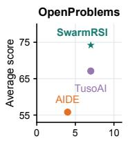

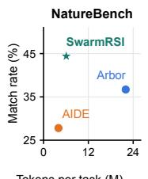  
Tokens per task (M)

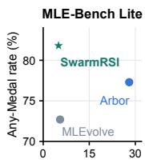  
Figure 6: Performance against mean tokens per task for SWARMRSI and rerun baselines with DeepSeek-V4- Pro. OpenProblems reports normalized average scores scaled by 100, and NatureBench and MLE-Bench Lite report Match-SOTA and Any-Medal rates (%).

## B.7 Statistical Reliability

Table 6 reports, for each ablation in Table 4, the drop $\Delta g$ in mean $g$ from SWARMRSI with a taskpaired bootstrap 95% confidence interval over the 90 NatureBench tasks. All intervals exclude zero.

<table><tr><td>Variant</td><td> $\Delta g$ </td><td>95% CI</td></tr><tr><td>w/o H-mutation</td><td>5.6</td><td>[1.2, 10.2]</td></tr><tr><td>w/o P-mutation</td><td>7.4</td><td>[3.0, 11.9]</td></tr><tr><td>w/o recombination</td><td>5.2</td><td>[2.5, 7.9]</td></tr><tr><td>w/o shared graph</td><td>4.7</td><td>[0.3, 9.3]</td></tr><tr><td>w/o H/P selection</td><td>8.2</td><td>[4.2, 12.4]</td></tr></table>

Table 6: Drop in mean $g$ (scaled by 100) from SWARMRSI for each ablation, with task-paired bootstrap 95% CIs.

We evaluate all methods marked with † in Table 1 using three independent random seeds. We report the mean performance and compute 95% confidence intervals using the Student’s t-distribution:

$$
\mathrm { C I } _ { 9 5 \% } = \bar { x } \pm t _ { 0 . 9 7 5 , 2 } \frac { s } { \sqrt { 3 } } ,
$$

where x¯ and s denote the sample mean and sample standard deviation across the three seeds, respectively. Table 7 reports the per-seed OpenProblems scores, and Table 8 reports their 95% CI halfwidths. The Avg CI is computed from the three per-seed averages before rounding.

Thresholded outcomes. In the main experiments of Tables 1–3 and Table 4, task-level $g$ scores varied across three independent seeds, with pertask ranges of 0.0123–0.0781. However, no task crossed the Match-SOTA $( g = 0 )$ or Surpass-SOTA $( g = 0 . 1 )$ threshold, and no MLE-Bench Lite competition crossed an Above-Median or medal boundary. Consequently, the thresholded success rates remained identical across seeds, despite variation in the underlying continuous scores.

<table><tr><td>Method</td><td>Seed</td><td>Denoise</td><td>Label</td><td>Batch</td><td>SVG</td><td>Decomp</td><td>Visual</td><td> $\operatorname { A v g }$ </td></tr><tr><td rowspan="3">SWARMRSI (DeepSeek)</td><td>1</td><td>34.1</td><td>74.6</td><td>83.1</td><td>84.7</td><td>85.6</td><td>85.2</td><td>74.55</td></tr><tr><td>2</td><td>33.5</td><td>73.5</td><td>82.8</td><td>83.8</td><td>86.6</td><td>84.6</td><td>74.13</td></tr><tr><td>3</td><td>33.3</td><td>74.4</td><td>81.6</td><td>83.1</td><td>85.8</td><td>84.7</td><td>73.82</td></tr><tr><td rowspan="3">SWARMRSI (Gemini)</td><td>1</td><td>40.2</td><td>81.5</td><td>79.0</td><td>86.6</td><td>82.7</td><td>85.5</td><td>75.92</td></tr><tr><td>2</td><td>40.2</td><td>80.7</td><td>78.1</td><td>88.8</td><td>84.0</td><td>86.1</td><td>76.32</td></tr><tr><td>3</td><td>40.3</td><td>80.0</td><td>79.4</td><td>88.1</td><td>83.6</td><td>87.5</td><td>76.48</td></tr><tr><td rowspan="3">AIDE (DeepSeek)</td><td>1</td><td>27.3</td><td>70.5</td><td>78.6</td><td>72.2</td><td>46.6</td><td>40.4</td><td>55.93</td></tr><tr><td>2</td><td>28.5</td><td>70.2</td><td>77.5</td><td>74.5</td><td>45.4</td><td>39.6</td><td>55.95</td></tr><tr><td>3</td><td>26.4</td><td>71.2</td><td>77.9</td><td>71.6</td><td>46.4</td><td>39.5</td><td>55.50</td></tr><tr><td rowspan="3">TusoAI (DeepSeek)</td><td>1</td><td>29.3</td><td>57.5</td><td>79.5</td><td>79.0</td><td>84.6</td><td>69.9</td><td>66.63</td></tr><tr><td>2</td><td>32.9</td><td>59.1</td><td>78.8</td><td>80.1</td><td>83.9</td><td>69.7</td><td>67.42</td></tr><tr><td>3</td><td>32.2</td><td>59.5</td><td>80.1</td><td>77.9</td><td>83.9</td><td>69.9</td><td>67.25</td></tr></table>

Table 7: Per-seed OpenProblems scores for all † entries in Table 1. Scores are normalized and scaled by 100. Avg is the six-task mean, shown to two decimal places. DeepSeek and Gemini denote DeepSeek-V4-Pro and Gemini 3.1 Pro Preview, respectively.

<table><tr><td>Method</td><td>Denoise</td><td>Label</td><td>Batch</td><td>SVG</td><td>Decomp</td><td>Visual</td><td> $\operatorname { A v g }$ </td></tr><tr><td>SWARMRSI (DeepSeek)</td><td>1.03</td><td>1.46</td><td>1.97</td><td>1.99</td><td>1.31</td><td>0.80</td><td>0.91</td></tr><tr><td>SWARMRSI (Gemini)</td><td>0.14</td><td>1.86</td><td>1.65</td><td>2.79</td><td>1.65</td><td>2.55</td><td>0.72</td></tr><tr><td>AIDE (DeepSeek)</td><td>2.62</td><td>1.27</td><td>1.38</td><td>3.80</td><td>1.60</td><td>1.23</td><td>0.63</td></tr><tr><td>TusoAI (DeepSeek)</td><td>4.74</td><td>2.63</td><td>1.62</td><td>2.73</td><td>1.00</td><td>0.29</td><td>1.03</td></tr></table>

Table 8: 95% CI half-widths for the OpenProblems means over three seeds in Table 1, computed using the Student’s t-distribution from Table 7. Intervals are the unrounded means ± these half-widths, on the score scale of Table 1.

## C Additional Trajectory Analyses

Section C.1 gives trajectory construction and operator-level evidence for Section 5.3, and Section C.3 gives aggregate search statistics.

## C.1 Comparative Trajectories

We analyze one recorded run per method and task. The two examples in Figure 4c,d illustrate successive hypothesis mutations on 00917, and crossover followed by rebase on 00639. The plotted runs use DeepSeek-V4-Pro. Candidate scores and operator sequences accompany the plotting code.

Trajectory construction. For each method, a scored evaluation is a recorded finite score accepted by its evaluator interface. AIDE nodes marked buggy or worst are excluded from this axis. We plot $B _ { k } = \operatorname* { m a x } _ { i \leq k } g _ { i }$ over these records, with stepwise interpolation and no extrapolation beyond the last observation. Unscored records are retained in the source data and counted separately below. Arbor records evaluator calls, whereas AIDE records candidate nodes. The plot uses scored evaluations for both methods.

Analysis of search operators. Operator markers use the frontier episodes associated with each candidate’s action ID. In 00917, candidate 3 is a program mutation of candidate 1. Its $g = - 0 . 9 9 0 3$ does not improve the incumbent $( g = - 0 . 0 5 0 1 )$ . In 00917, candidate 6 retains the recurrent shell-sequence program at $g = - 0 . 0 1 6 2$ . Candidates 7–15 do not improve this incumbent. Hypothesis-mutation candidates 16 and 17 descend from candidates 6 and 16, respectively, replacing the readout with normalized allocation and then a saturating absorption– yield readout. Both modify the executed readout and are reevaluated, reaching $g = 0 . 0 9 2 8$ (Match-SOTA) and 0.1807 (Surpass-SOTA). In 00639, candidate 8 (zero-based index, scored evaluation 7) uses candidate 4 for esol, freesolv, and lipophilicity, candidate 1 for fluorescence and stability, and candidate 0 for the two reaction instances. Its code reuses separate descriptor, neural-sequence, and hashed-reaction branches from the source programs. Candidate 19 includes message-passing and ranking-loss functions, but its entry-point routing does not execute them. Candidate 20, recorded as rebase, activates those paths for lipophilicity and fluorescence, respectively. Their instance improvements change from 0.1002581 to 0.1337743 and from −0.0201618 to −0.0056382. The other five instance scores remain unchanged. The mean consequently rises from 0.0575466 to 0.0644094. The activated functions were already present in candidate 19 and absent from retrieved source 16. The step repairs their entry-point routing.

<table><tr><td>Task</td><td>Method</td><td>Scored/records</td><td>Best g</td></tr><tr><td>00917</td><td>SWARMRSI</td><td>18/18</td><td>0.1807</td></tr><tr><td rowspan="5">00639</td><td>Arbor</td><td>3/4</td><td>-0.2007</td></tr><tr><td>AIDE</td><td>49/50</td><td>-0.4742</td></tr><tr><td>SWARMRSI</td><td>19/21</td><td>0.0644</td></tr><tr><td>Arbor</td><td>2/3</td><td>0.0434</td></tr><tr><td>AIDE</td><td>8/28</td><td>0.0552</td></tr></table>

Table 9: Selected runs with their scored evaluations, recorded events and best observed g.

A retained hypothesis on a new program base. As shown in Table 10, task 00795 provides a complete sequence linking an implementation request, a changed program base, executable transfer and per-instance evaluation. Candidate 4 proposes using a source program’s molecular-function predictor on one instance while retaining the parent’s other four predictors. Its submitted outputs are identical to candidate 3’s, so the controller retains the hypothesis with an unresolved implementation request. Candidate 8 subsequently improves the program through hypothesis mutation. Rebase candidate 9 returns to the retained hypothesis on this newer base, with source program 1 supplying the implementation context. The code disables the ranking-loss term for the target predictor and adopts the source’s 30-threshold public-validation checkpoint rule. The target branch executes these settings and writes its predictions. The target Fmax rises from 0.5032 to 0.5087, while the other four instance scores remain unchanged. This raises g from −0.06388 to −0.06186.

<table><tr><td>Candidate Recorded change</td><td>g</td></tr><tr><td>4</td><td>Retained hypothesis. Outputs un- —0.08323 changed from 3</td></tr><tr><td>8 program base</td><td>Hypothesis mutation produces a new —0.06388</td></tr><tr><td>9</td><td>Rebase: target predictor uses source —0.06186 training and checkpoint rules</td></tr><tr><td>11</td><td>Crossover: source 5 supplies a second —0.05573 instance predictor</td></tr><tr><td>15 without fallback</td><td>Rebase: target predictor implemented —0.05408</td></tr></table>

Table 10: Recorded process on 00795. Candidate indices are zero-based. Each g comes from a valid evaluation of the resulting program.

Crossover candidate 11 then adds source 5’s predictor on a second instance, reproducing its Fmax of 0.3773 and preserving candidate 9’s other four scores. Its execution log records another fit and prediction pass for the first transferred predictor, retaining its Fmax of 0.5087. Source 5 had a lower aggregate score than its incumbent, yet its component remains useful in this new program. Candidates 13 and 14 attempt another transfer but retain candidate 11’s submitted outputs. Their implementation requests remain open. Candidate 15 realizes the retained target predictor without falling back to the incumbent’s outputs, increasing its Fmax to 0.5133 while preserving the other four scores. The sequence shows how an untested hypothesis survives its first implementation, is tested on a later program base, and contributes to subsequent component reuse and refinement.

## Feedback-linked updates and component reuse.

We analyze one complete seed (90 runs) with DeepSeek-V4-Pro and recorded request identifiers. These runs cover all 90 NatureBench tasks and comprise 1,948 search attempts and 426 new-best candidates. Program feedback prompted hypothesis mutations, while unresolved implementation requests for retained hypotheses prompted rebase updates on the program frontier. We matched these updates to their originating requests using recorded request and episode identifiers. These updates comprised 296 attempts (15.2%) and produced 84 new-best candidates (19.7%), a 28.4% new-best rate versus the overall 21.9%. Including crossover, the union of these events comprised 731 attempts (37.5%) and produced 173 new-best candidates (40.6%).

Cumulative progress across search stages. To examine whether progress builds on inherited research states, we trace each run’s final best program through its recorded code-parent and interventionsource edges. In about 77% of runs, this lineage contains at least one rebase, crossover, or update triggered by feedback. Table 11 further divides each run’s attempts into early, middle and late thirds by step order. Reuse and update triggered by feedbacks achieve higher new-best rates than other updates in every stage, and their share of newbest candidates increases slightly over the course of search. The overall new-best rate declines as search proceeds, consistent with diminishing returns as the incumbent improves.

## C.2 Cross-Task Transfer

Cross-task research state inheritance. After each generation, the accumulated research state is preserved for subsequent tasks. This state includes hypotheses, program components, experimental evidence, and unresolved implementation needs. On a new task, prior records are retrieved by matching their mechanism labels to the task description and initialize the agent’s research state, while candidate programs are adapted and evaluated under the new task’s constraints.

<table><tr><td>Stage</td><td colspan="2">Reuse hit Other hit Reuse share</td></tr><tr><td>Early</td><td>32.0 25.8</td><td>40.5</td></tr><tr><td>Middle</td><td>18.2 16.8</td><td>41.1</td></tr><tr><td>Late</td><td>18.1 15.0</td><td>42.6</td></tr></table>

Table 11: New-best rates (%) of reuse and update triggered by feedbacks (rebase, crossover and mutations triggered by feedback) and of other updates across search stages on NatureBench. Reuse share is the percentage of new-best candidates from these updates.

Experimental setup and results. We run SWARMRSI with DeepSeek-V4-Pro on six NatureBench source tasks in three generations of two tasks each, and each generation starts from the cross-task state exported by the previous one. We then search 12 held-out NatureBench tasks, fixed in advance and disjoint from the source tasks, from an empty state and from the state after each generation, with three seeds and the same budget per task. As shown in Table 12, mean g rises from 12.01 under cold start to 16.15, 20.16 and 21.89 after one, two and three generations, and Gen 3 improves on cold start by 9.88 points. Match-SOTA rises from 41.7% to 86.1% and Surpass-SOTA from 33.3% to 58.3%, while tokens per task fall from 12.17M to 10.94M. Gains are largest over the first two generations, and Gen 3 matches Gen 2 on Match-SOTA and improves mainly through Surpass-SOTA. Unlike the main experiments described in Section B.7, some held-out tasks cross the Match-SOTA or Surpass-SOTA threshold in only some seeds, so the rates in Table 12 count the 36 task and seed pairs, for example 31 of 36 for Match-SOTA after Gen 3.

<table><tr><td>Variant</td><td>Match</td><td>Surpass</td><td>Mean g</td><td> $\Delta g$  [95% CI]</td><td>Tokens</td></tr><tr><td>Cold start</td><td>41.7</td><td>33.3</td><td>12.01</td><td></td><td>12.17</td></tr><tr><td>Gen 1</td><td>58.3</td><td>41.7</td><td>16.15</td><td>4.14 [1.82, 6.49]</td><td>11.86</td></tr><tr><td>Gen 2</td><td>86.1</td><td>44.4</td><td>20.16</td><td>8.15 [5.67, 10.59]</td><td>11.52</td></tr><tr><td>Gen 3</td><td>86.1</td><td>58.3</td><td>21.89</td><td>9.88 [6.88, 13.06]</td><td>10.94</td></tr></table>

Table 12: Search on 12 held-out NatureBench tasks with DeepSeek-V4-Pro, starting from an empty state (cold start) or from the state inherited after each generation, averaged over three seeds. Match and Surpass are Match-SOTA and Surpass-SOTA rates (%), mean g is scaled by 100, and $\Delta g$ is the gain over cold start with a paired task-cluster bootstrap 95% CI from 10,000 resamples. Tokens are means per task in millions.

## C.3 Aggregate Search Behavior

Program mutation. Figure 4a compares SWARMRSI with AIDE and Arbor across all 90 NatureBench tasks. Stagnation, the share of scored candidates that do not improve the preceding best valid result, is 43% for SWARMRSI, compared with 63% for AIDE and 70% for Arbor. Failure recovery is the share of failed implementations whose subsequent refinement yields a new best valid program, with failed implementations as the denominator.

Hypothesis mutation. Figure 4b reports the proportions of proposed hypotheses that are implemented, evaluated with a valid numeric score, and associated with an improvement over the preceding best valid result. For each method, all three proportions use the total number of proposed hypotheses in its search records as the denominator.

## D Human Failure Analysis

Sample and unit of analysis. We reviewed 35 failed SWARMRSI task trajectories across NatureBench and MLE-Bench Lite. The annotation unit was an individual attempt, assessed against the best preceding valid result using each benchmark’s metric direction. The final failure set comprised 644 attempts across these trajectories, after applying the exclusions below. OpenProblems reports continuous normalized scores without a binary success criterion, so no OpenProblems trajectories enter the failure set. The 35 trajectories comprise 32 NatureBench tasks below Match-SOTA and 3 MLE-Bench Lite competitions without a medal.

Evaluation criteria. Annotators examined the proposed intervention, implementation and execution records, evaluator outputs, and preceding scores. Implementation or execution failure denotes an intervention that could not be reliably tested because of code or interface errors, execution interruptions, or proposal–implementation mismatches. No performance gain denotes a faithfully implemented and executed intervention with a valid evaluation that did not improve the preceding best valid result. Equal scores were treated as no gain. Recovered intermediate errors were judged by the final evaluated outcome. Successful verification or restoration of an existing result, and repetition of an attained metric ceiling, were excluded from the failure counts. Attempts with insufficient evidence to distinguish the two failure classes were also excluded.

Human review and agreement. Two annotators with PhDs in bioinformatics engineering reviewed the evidence using these criteria, with inter-rater agreement of Cohen’s $\kappa = 0 . 9 2$

Representative cases. On task 00838, a proposed amino-acid substitution was overwritten by downstream rules, leaving the evaluated output unchanged This was an implementation failure despite a valid score. In contrast, on task 02316, a negative-binomial mixture with a Potts spatial prior ran successfully but collapsed all locations into one cluster, yielding ARI zero. This was a no-gain outcome.

## E Biological Case Studies

Sections E.1 and E.2 detail the Enterocyte and CytoCommunity case studies from Section 5.5 with their data, programs and expert analyses.

## E.1 Enterocyte: Infection-Associated Expression Variation

Task, data and selected program. NatureBench task s41592-023-01955-3 is associated with contrastiveVI (Weinberger et al., 2023) and returns a low-dimensional target-cell representation. The program selected by SWARMRSI comes from step 4 of five recorded steps. Its recorded task-level $g = 1 . 8 3 8 4 6 1$ averages the Haber, McFarland and Norman instances. The analysis here concerns only the Haber intestinal instance (Haber et al., 2017), GEO GSE92332. The public matrix contains 9,842 cells and 15,215 genes: 3,240 healthy background cells, 2,711 helminth day-10 and 1,770 Salmonella target cells, and 2,121 helminth day-3 cells outside the target submission. The published Enterocyte annotation selects 1,458 cells, including 833 targets (128 helminth day-10 and 705 Salmonella).

Evolved program and expert reproduction. For Haber, the program normalizes total counts to 10,000 and applies log1p, selects 2,000 genes by variance across target and background cells, and standardizes using background means and standard deviations, clipping at ±10. It identifies 20 healthy neighbours per target in a 50-dimensional background PCA space and subtracts their mean expression. A singular-value decomposition yields a 20-dimensional residual space. A 15-neighbour graph then smooths the first ten residual coordinates for two iterations, including a self weight. Experts reproduced the program. Local-coherence analysis uses its ten-dimensional outputs. The embedding is constructed from RNA, and infection labels parsed from public cell identifiers are used for diagnostic silhouette reporting.

Measured programs and source units. Each program score is the arithmetic mean of its genes $\log ( 1 + 1 0 ^ { 4 } x / \sum x )$ expression. The MHC-IIassociated set is Cd74, H2-Aa, H2-Ab1 and H2- Eb1 (the input matrix uses dots in the H2 gene names). The interferon set is Stat1, Isg15, Ifit1, Ifit3, Oas1a and Irf7. All six genes are present in the matrix. The antimicrobial set contains Reg3g, Reg3b, Lcn2 and Saa1. Its signal is dominated by Reg3g/Reg3b, with Lcn2 undetected and Saa1 low in these enterocytes. B1–B4 are control sources, B5/B6 helminth day 3, B7/B8 helminth day 10, and B9/B10 Salmonella. Source labels denote sequencing batches. Figure 8 shows that the four MHC-II genes each have higher source means in B7/B8 than in B9/B10. The antimicrobial program means are 2.120 and 3.158 in B7/B8 versus 3.114 and 3.130 in B9/B10, showing a source-dependent contrast. Table 13 reports MHC-II and interferon means for all ten sources. Pooling enterocytes within each condition gives MHC-II means of 1.168 in helminth day 10, 0.335 in Salmonella and 0.202 in controls. The corresponding interferon means are 0.356, 0.438 and 0.150. These condition means weight each source by its enterocyte count.

<table><tr><td>Source</td><td>Cells</td><td>MHC-II</td><td>Interferon</td></tr><tr><td>B1</td><td>59</td><td>0.354</td><td>0.115</td></tr><tr><td>B2</td><td>46</td><td>0.126</td><td>0.166</td></tr><tr><td>B3</td><td>98</td><td>0.375</td><td>0.136</td></tr><tr><td>B4</td><td>221</td><td>0.100</td><td>0.162</td></tr><tr><td>B5</td><td>75</td><td>0.377</td><td>0.391</td></tr><tr><td>B6</td><td>126</td><td>1.495</td><td>0.636</td></tr><tr><td>B7</td><td>71</td><td>1.509</td><td>0.395</td></tr><tr><td>B8</td><td>57</td><td>0.744</td><td>0.306</td></tr><tr><td>B9</td><td>332</td><td>0.299</td><td>0.444</td></tr><tr><td>B10</td><td>373</td><td>0.367</td><td>0.432</td></tr></table>

Table 13: Measured enterocyte RNA program means by sequencing source. Scores average normalized log RNA across the four MHC-II or six interferon genes. B1–B4 are controls, B5/B6 helminth day 3, B7/B8 helminth day 10 and B9/B10 Salmonella.

Representation follow-up and sensitivity checks. Measured RNA and the reproduced representation are matched by cell identifier. Within each of B7– B10, the analysis selects ten neighbours among cells of the same Enterocyte type and source, excludes the focal cell, and correlates its program score with the neighbours’ mean score using Spearman’s ρ. Figure 7 reports these unadjusted correlations. Sensitivity checks use five and fifteen neighbours and the representation saved from the original SWARMRSI run. For covariate sensitivity, each program score is regressed within source on an intercept, log1p total UMI, log1p detected genes and the mean absorptive-marker score (Alpi, Apoa1, Fabp1, Fabp2, Sis). Table 14 reports the same correlation using the residual score and the mean residual of the fixed ten neighbours. Local coherence quantifies measured RNA structure retained in each RNA-derived representation.

Additional visualizations. The following figures report within-source coherence and gene-level source means. Figure 5a–c shows RNA scores on the reproduced representation.

<table><tr><td>Source</td><td>Program</td><td>Cells</td><td>RNA PCA</td><td>Reproduced output</td><td>Recorded output</td></tr><tr><td>B7</td><td>MHC-II</td><td>71</td><td>0.650</td><td>0.768</td><td>0.766</td></tr><tr><td>B8</td><td>MHC-II</td><td>57</td><td>0.396</td><td>0.685</td><td>0.686</td></tr><tr><td>B9</td><td>MHC-II</td><td>332</td><td>0.331</td><td>0.326</td><td>0.313</td></tr><tr><td>B10</td><td>MHC-II</td><td>373</td><td>0.356</td><td>0.351</td><td>0.347</td></tr><tr><td>B7</td><td>Antimicrobial</td><td>71</td><td>0.311</td><td>-0.045</td><td>-0.056</td></tr><tr><td>B8</td><td>Antimicrobial</td><td>57</td><td>0.689</td><td>0.593</td><td>0.612</td></tr><tr><td>B9</td><td>Antimicrobial</td><td>332</td><td>0.370</td><td>0.324</td><td>0.331</td></tr><tr><td>B10</td><td>Antimicrobial</td><td>373</td><td>0.509</td><td>0.296</td><td>0.286</td></tr></table>

Table 14: Within-source local coherence after covariate adjustment. Entries are Spearman correlations between a cell’s residual RNA score and its ten neighbours’ mean residual score. Reproduced/recorded outputs are the expert reproduction and the representation saved from the original SWARMRSI run. Counts are cells per source.

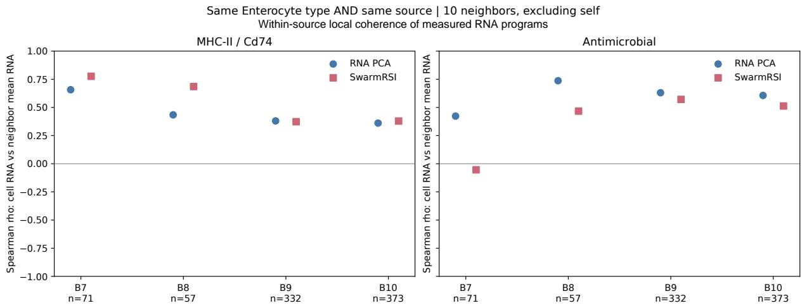  
Figure 7: Within-source expression coherence in enterocytes. Within each source, Spearman correlation compares cells’ measured RNA program scores with their ten nearest neighbours’ mean scores, excluding each focal cell. Neighbours are defined in RNA PCA (blue) or the reproduced SWARMRSI representation (pink), and the correlations are not adjusted for covariates.

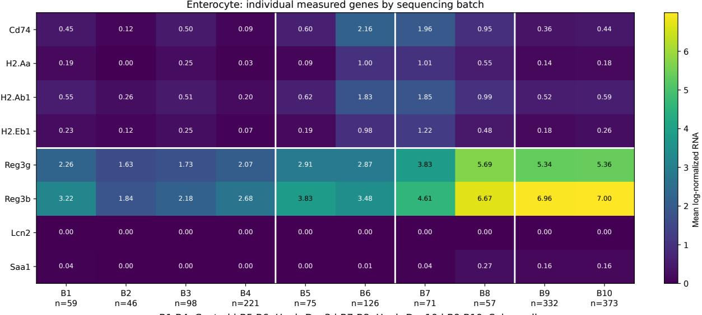  
B1-B4: Control | B5-B6: Hpoly.Day3 | B7-B8: Hpoly.Day10 | B9-B10: Salmonella

Figure 8: Source means of individual measured genes in enterocytes. Hpoly.Day3/Day10 denote helminth day 3/day 10 sources. The antimicrobial set is primarily Reg3g/Reg3b. Zero Lcn2 denotes non-detection in this matrix. Values are mean normalized log RNA.

## E.2 CytoCommunity: Spatial Context and Protein Follow-up

b  
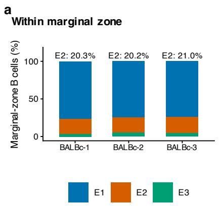

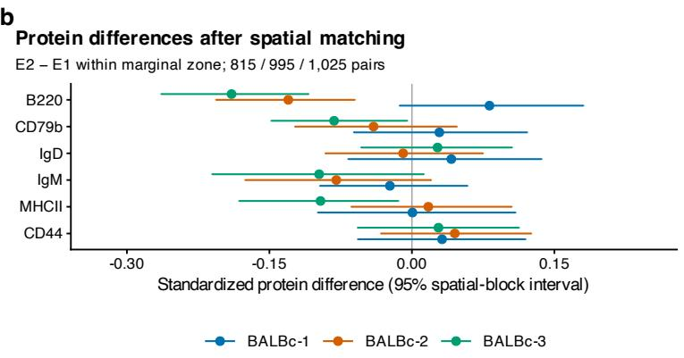  
Figure 9: Expert follow-up of B-cell neighbourhoods across three spleen images. E1–E3 are post-hoc groups defined by local cell composition. (a) Their proportions among B cells in the manually annotated marginal zone. (b) All six primary protein contrasts after within-image spatial/phenotype matching, E2 minus E1 in that zone (815, 995 and 1,025 pairs). Points are standardized transformed-protein differences. Intervals are 95% within-image spatial-block bootstrap intervals.

Dataset and evolved program. NatureBench task s41592-023-02124-2 uses three healthy mouse spleen CODEX images associated with CytoCommunity (Hu et al., 2024): 82,382, 81,925 and 80,973 cells, respectively, with 27 supplied cell phenotypes. SWARMRSI receives coordinates and phenotype labels. The expert follow-up separately examines measured protein intensities. The program selected by SWARMRSI comes from step 12 of a 15-step search and raises g from 0.04507 to 0.10215. It uses phenotype-derived anatomical priors, 50-neighbour composition and interface features, Gaussian EM, an anatomically constrained spatial MRF and cleanup of components smaller than 150 cells. Recorded macro-F1 and AMI are 0.639247 and 0.583341. Macro-F1 includes the unannotated reference category, whose F1 is zero. Marginal-zone F1 is 0.600, 0.593 and 0.635.

Post-hoc neighbourhood descriptions. The analysis includes 35,168, 33,544 and 32,451 conventionally annotated B cells (101,163 total). Experts fit three exploratory neighbourhoodcomposition prototypes in the first image and then hold them fixed for the other two, giving B/FDCrich (E1), myeloid/erythroid-rich (E2) and T-cellrich (E3) groups. E1–E3 describe local cell composition around B cells in this post-hoc analysis. They are distinct from the program’s anatomical partitions. The primary comparison uses E2 versus E1 within the manual marginal zone, independently of whether the SWARMRSI program assigned that cell to the marginal zone. Coordinates are analyzed in dataset units.

Expert protein and geometry checks. The analysis uses processed protein measurements for all 245,280 cells. Within each image and manual marginal zone, matching is exact on original phenotype cluster and imaging tile, then uses five geometry variables with a 0.5-SD per-variable caliper, joint distance at most 1 and no replacement. There are 815, 995 and 1,025 matched E2–E1 pairs, retaining 42.5%, 46.2% and 41.1% of E2 cells, respectively. Maximum absolute geometry standardized mean differences are 0.080, 0.063 and 0.083. Protein contrasts use this matched overlap subset. All six preselected proteins (CD79b, B220, IgD, IgM, MHCII, CD44) are shown in Figure 9b. Measurements are transformed as arcsinh(x/150), retaining negative values. Effects are differences of transformed means divided by the within-image contrast-population standard deviation. Intervals use 1,000 bootstrap resamples of 1,000-coordinateunit spatial blocks within each image. B220 effects are +0.082, −0.130 and −0.190. Stricter 0.25- SD matching also yields inconsistent directions. In spatially blocked validation, adding neighbourhood labels to a geometry/phenotype protein predictor produces $\Delta R ^ { 2 }$ from −0.00098 to +0.00967 across 18 image–protein combinations. Neighbourhood labels add little predictive information for these six protein markers in spatially blocked validation.

## F Limitations

SWARMRSI requires an evaluator that can execute candidate programs, so research without executable feedback is outside its scope. Execution feedback does not always reveal whether the intended intervention was faithfully implemented, and performance gains alone do not establish its scientific mechanism. Rebase selects program bases by matching recorded implementation needs to program mechanism labels, a heuristic that does not measure what a program can do. Crossover applies only when a benchmark reports scores per instance. H/P selection adapts discounted UCB without inheriting its guarantees, and its benefit is established only empirically.

Evaluation covers comparisons under matched budgets on three benchmark families. The human failure analysis characterizes 644 annotated failed attempts from 35 task trajectories. Cross-task evidence comes from six source tasks, 12 held-out tasks and one backbone, and generations are confounded with the number of source tasks seen.

The evaluation does not separately assess literature synthesis (Shi et al., 2025), idea quality (Sauter et al., 2026), or peer-review quality (Guo et al., 2026b). Generalization to complete research workflows (Lu et al., 2024; Schmidgall et al., 2025; Lyu et al., 2026) and information-access agents (Kanoulas et al., 2025; Cao et al., 2026) requires additional evaluation.

Other untested settings include legal reasoning (Lyu et al., 2022, 2023a; Wu et al., 2023), zeroshot entity extraction (Wang et al., 2025), conversational recommendation (Zhang et al., 2024), and shopping research (Lyu et al., 2025c). These settings require task-specific objectives and evaluation protocols.

## G Ethics Statement

Benchmark gains do not establish factual reliability or alignment with human preferences, which require separate evaluation and optimization (Lin et al., 2022; Lyu et al., 2024a; Rafailov et al., 2023; Lyu et al., 2025b). We do not assess robustness to dataset shortcuts (Lyu et al., 2023b), social stereotypes (Parrish et al., 2022), or cognitive biases (Lyu et al., 2024b, 2025a), nor do we test harmful-content generation. Applications that affect people should preserve user agency and provide domain-appropriate human oversight (Zhang et al., 2025).

Generated programs and scientific interpretations require independent validation before use beyond the benchmark setting. The execution and scientific audits check task validity and implementation evidence; they do not certify security or scientific correctness. The biological case studies analyse existing datasets, and their associations do not establish causal mechanisms or clinical validity. Any deployment should restrict code execution, external-tool access and credentials to the approved scope, and review proposed uses for potential harm.

Data reuse should respect source licences, access restrictions and privacy requirements, with provenance and intended uses documented (Gebru et al., 2021). We report time budgets, hardware configurations and token consumption to support resourceaware comparisons (Schwartz et al., 2020). Token consumption is not a direct measurement of energy use or carbon emissions.