# TARGET-TOKEN ASYMMETRY CAN MASQUERADE AS DEPTH SPECIALIZATION

Danlin Li1 Miao Li1 Xu Han2 Jiecheng Lu1

1Georgia Institute of Technology 2AWS

jlu414@gatech.edu

## ABSTRACT

Layer-ablation studies often perturb early or late layers of a language model, compare the damage to prediction on two corpora, and read a larger early-layer effect on one corpus as early-layer specialization for its task. Such a comparison averages over the tokens that each corpus asks the model to predict, and these target tokens differ: math solutions, for example, ask for far more whitespace and numbers than encyclopedia prose. We show that this difference can create the appearance of depth specialization. We split a cross-corpus early–late damage interaction by target-token type and recompute it under a target mixture shared by both corpora. Between GSM8K and Wikitext, a positive interaction replicates across five model instances. In the three fully decomposed models, only whitespace has a positive interaction. Removing whitespace reverses the pooled effect in all three, and matching the full target mixture reverses it in two. The diagnosis holds under position matching, adversarial reassignment of token types, and a continuous readout. The risk can also be anticipated from the tokenizer alone. A screen computed before any model runs places every held-out pair it scored in the region its label predicts, and on the pairs it rates at high or medium risk, removing whitespace reverses every positive pooled estimate. A smaller content-word effect one token ahead follows the share of content targets that the unablated model already predicts. A cross-corpus depth effect therefore supports an interpretation of task specialization only after the target-token mixture is reported, the effect is decomposed by token type, and a mixture-matched summary keeps its sign.

## 1 INTRODUCTION

Interpretability research often asks which layers of a Transformer (Vaswani et al., 2017) carry the computation behind a behavior, because the answer shapes mechanistic explanations and tells later analyses where to look. A common and inexpensive test perturbs a band of early or late layers, measures how much next-token accuracy drops, and compares the drop across corpora. Suppose that perturbing the early layers hurts accuracy on math solutions more than on encyclopedia prose, relative to the same comparison for the late layers. It is then natural to conclude that the early layers matter more for mathematical reasoning, and the conclusion gains weight when the pattern repeats across model families.

This reading assumes that the two corpora pose comparable prediction tasks. The token that the model must predict at an evaluated position is its target token, and a pooled accuracy averages over every target, whether it is a word, a number, a punctuation mark, or a bare space. Corpora differ in how often each kind occurs. Figure 1a shows two evaluated positions. In a GSM8K solution (Cobbe et al., 2021) that ends with “The answer is 9”, the tokenizer writes the space before the number as a token of its own, so the model is scored on predicting a lone space. At an evaluated position in a Wikitext article (Merity et al., 2017), the model is scored on the word “Issue”. Math solutions ask for far more whitespace and numbers than encyclopedia prose does (Figure 1b). A perturbation that changes how often the model predicts a space therefore moves the pooled score of the math corpus more, even if it affects words in the same way in both corpora.

This confound is hard to see because it lives inside the quantity that makes the test attractive. A pooled score is cheap to compute and easy to replicate, and a target mixture that repeats across models makes the pooled contrast repeat as well, so replication alone cannot tell a depth effect from a composition effect. Aggregation bias of this kind is classical (Simpson, 1951). Work on tokenization disparity (Petrov et al., 2023; Wegmann et al., 2025), evaluation validity (Liang et al., 2023; Schaeffer et al., 2023), and the dependence of activation patching and ablation on the chosen intervention and metric (Zhang & Nanda, 2024; Li & Janson, 2024; Miller et al., 2024) documents related measurement risks. The stakes are practical: layer-level findings guide where later work edits a model (Meng et al., 2022) or which layers it decodes from. For example, DoLa contrasts predictions from earlier and later layers to improve factuality (Chuang et al., 2024). Cross-corpus depth attribution therefore needs a direct measurement of how much of a pooled contrast the target mixture carries, and a way to anticipate that risk before a model is run.

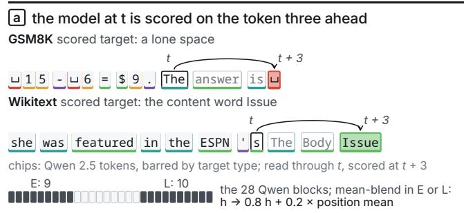

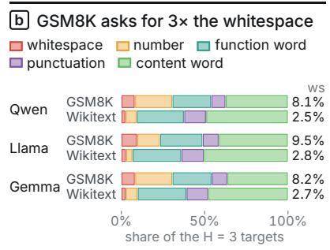

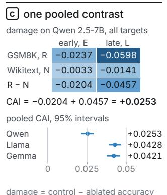

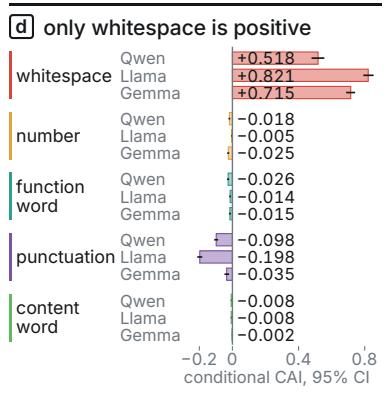

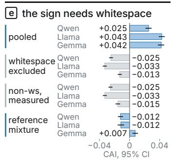  
grey: the whitespace cell left out; reference mixture: the five cells at Wikitext's type shares  
Figure 1: The argument on one model instance: Qwen2.5-7B, GSM8K against Wikitext, three tokens ahead, mean-blend, top-1 accuracy. Panel a quotes two real evaluated positions, one chip per token with the scored target filled, selected for readability and target type (Appendix B), and marks the two blended layer bands. Panel b gives each corpus’s H=3 target-type shares in all three models. Panel c fills in the four damage terms of Eq. (2) and gives each model’s pooled CAI. Panel d gives the conditional CAI of each target type, Eq. (3), and panel e sets the pooled estimate beside two summaries $M ( q )$ and the directly measured non-whitespace CAI. Under the two corpora’s combined mixture q, with whitespace share 5.3%, $M ( q ) = 0 . 0 5 3 \times 0 . 5 1 8 - 0 . 0 2 3 = + 0 . 0 0 { \bar { 4 } }$ . The pooled +0.0253 weights each corpus by its own mixture: $M ( \pi _ { \mathcal { R } } ) = + 0 . 0 2 0 7 .$ , the mixture shift adds +0.0057, and per-sequence averaging adds −0.0011. Intervals are 95%, and Table 1 lists the values.

We study one such contrast in detail. Our measure, the contextual ablation interaction (CAI), is a difference of differences: how much more an early-layer perturbation damages accuracy on a focal corpus than on a reference corpus, minus the same difference for a late-layer perturbation (Figure 1c). We fix a mild perturbation that blends each layer’s output toward the corpus average at the same position, and we score the model on the token three positions past the visible text. In this setting the CAI of GSM8K against Wikitext is positive in every model instance we audited. We then split the CAI by the type of the target token, recompute it under a target mixture shared by both corpora, and test whether a screen computed from the tokenizer alone can label a corpus pair’s risk before any model runs.

The positive contrast comes from whitespace targets (Figure 1d–e). The CAI restricted to whitespace targets is far larger than the pooled estimate, every other target type has a non-positive estimate, and removing whitespace reverses the pooled sign. Across the other high- and medium-risk corpus pairs, excluding whitespace reverses every positive pooled estimate. Position matching, adversarial reassignment of token types, and a continuous readout further support the whitespace finding. On every held-out and DoLa pair that the screen rated at high or low risk in advance, the measured interaction falls in the region that the label predicts.

The paper makes three contributions. The first is a diagnosis: the evaluated target population carries a replicated pooled depth contrast, which makes target-token composition a concrete source of aggregation bias in cross-corpus depth attribution. The second is a tokenizer-only screen that rates a corpus pair’s risk before any model runs. The third is a reporting protocol that decomposes a pooled depth effect by target type, tests mixture-matched summaries, and splits a remaining positive cell by whether the unablated model predicts its targets. Applied to a content-word effect one token ahead under a second perturbation, that split traces the effect to how many content targets the model already predicts in each corpus.

## 2 MEASURING A DEPTH CONTRAST BY TARGET TYPE

Damage and the interaction. We compare a focal corpus R with a reference corpus $\mathcal { N }$ and perturb either an early layer band E or a late layer band L. At each evaluated position t, the model reads the prefix $x _ { 1 } , \ldots , x _ { t }$ , and the argmax of its next-token logits at t is scored against the target token $x _ { t + k }$ . Causal masking hides $x _ { t + 1 } , \ldots , x _ { t + k }$ , so the horizon H=k asks for a token k positions past the visible context, and H=1 is ordinary next-token prediction. For a corpus $C ,$ operator $^ { O , }$ and layer band B, intervention damage is

$$
\begin{array} { r } { \mathrm { D } _ { B } ^ { o } ( C , k ) = \operatorname { a c c } _ { \mathrm { c t r l } } ( C , k ) - \operatorname { a c c } _ { \mathrm { a b l a t e } } ^ { o } ( B , C , k ) . } \end{array}\tag{1}
$$

Positive damage means that the intervention reduced accuracy relative to the unperturbed control pass. The contextual ablation interaction compares the excess damage on the focal corpus under the two bands:

$$
\mathrm { C A I } _ { k } ^ { o } = [ \mathrm { D } _ { E } ^ { o } ( \mathcal { R } , k ) - \mathrm { D } _ { E } ^ { o } ( \mathcal { N } , k ) ] - [ \mathrm { D } _ { L } ^ { o } ( \mathcal { R } , k ) - \mathrm { D } _ { L } ^ { o } ( \mathcal { N } , k ) ] .\tag{2}
$$

A positive CAI means that the early band creates more excess damage on R than the late band does, the pattern that would suggest early-layer specialization for the focal corpus’s task. We split layers into thirds and use the first and last thirds as E and L. Our canonical pair is GSM8K as $\mathcal { R }$ against Wikitext as $\mathcal { N }$ , and Figure 1c fills in its four damage terms.

Interventions and readouts. Both interventions blend the residual-stream output of every Transformer block in the band, at every position, as $h ^ { \prime } = ( 1 - \alpha ) h + \alpha g$ with $\alpha = 0 . 2$ . Mean-blend sets $g$ to $h _ { \mathrm { p o s } }$ , the same layer’s control-pass mean at the same position over the corpus’s evaluated sequences. Mild-resample sets $g$ to the same layer and position of a donor sequence from the same corpus. Donors follow a random derangement, so no sequence is its own donor, and positions past the donor’s length are left unchanged. The primary analysis uses H=3 mean-blend top-1 CAI, and the content-word cell of Section 5 uses H=1 mild-resample. We also use the target margin, the gold-token logit minus the largest competing logit, as a continuous readout.

Target types and conditional cells. A deterministic map classifies each vocabulary token by ordered rules on its decoded string with surrounding whitespace stripped. The token is whitespace if nothing remains; a number if every remaining character is a digit, period, comma, or plus sign and at least one is a digit; punctuation if every character is Unicode punctuation, a space, or a tab; a function word if the lower-cased string is one of 106 listed function words; and a content word otherwise, including a token that fails to decode. A leading space therefore leaves a word’s class unchanged, and a token mixing letters and digits is a content word. Conditional CAI replaces each accuracy in (2) with the mean per-sequence accuracy on the targets of one type τ, giving four conditional damage terms $\mathrm { D } _ { B } ^ { o } ( C , k \mid \bar { \tau } )$

$$
\mathrm { C A I } _ { k , \tau } ^ { o } = [ \mathrm { D } _ { E } ^ { o } ( \mathcal { R } , k \mid \tau ) - \mathrm { D } _ { E } ^ { o } ( \mathcal { N } , k \mid \tau ) ] - [ \mathrm { D } _ { L } ^ { o } ( \mathcal { R } , k \mid \tau ) - \mathrm { D } _ { L } ^ { o } ( \mathcal { N } , k \mid \tau ) ] .\tag{3}
$$

A sequence enters the cell of type $\tau$ when its targets include that type, and a cell requires at least 10 such sequences per corpus.

Mixture summaries. Let $\pi _ { C } ( \tau )$ be the share of type τ among corpus $C ^ { \bullet } s$ evaluated targets. For any mixture q applied to both corpora, we summarize the cells as $\begin{array} { r } { \dot { M } ( q ) \dot { = } \sum _ { \tau } q ( \tau ) \mathrm { C A I } _ { k , \tau } ^ { o } , } \end{array}$ . Whitespace excluded sets $q ( \mathrm { w s } ) = 0$ and includes only the other token types that meet the minimum sequence requirement. We rescale their weights to sum to one. Reference mixture uses the reference corpus’s target-type proportions, $q = \pi _ { \mathcal { N } }$ For the canonical pair, the whitespace-excluded weights are based on the two corpora’s combined target counts. For the other corpus pairs in Section 4, they are based on the focal corpus’s counts from the tokenizer-only screen (Appendix C). Pooled CAI reflects each corpus’s own target-token mixture, whereas $M ( \pi _ { \mathcal R } )$ ) uses the focal corpus’s mixture for both corpora. Let $\Delta _ { C } ( \tau ) \dot { \mathbf { \xi } } = \mathrm { D } _ { E } ^ { o } ( C , k \mid \tau ) - \mathrm { D } _ { L } ^ { o } ( C , k \mid \tau )$ denote the early–late difference in damage for type τ. If both pooled and conditional accuracies are calculated over tokens, then $\begin{array} { r } { \mathrm { C A I } _ { k } ^ { o } = \overline { { M ( \pi _ { \mathcal { R } } ) } } ^ { \circ } + \sum _ { \tau } [ \pi _ { \mathcal { R } } ( \tau ) - \pi _ { \mathcal { N } } ( \tau ) ] \Delta _ { \mathcal { N } } ( \tau ) } \end{array}$ . Our estimator instead averages accuracy within each sequence first, which introduces a residual reported in Appendix A. All intervals are 95% percentile intervals from resampling sequences within each corpus. For a mixture summary every draw recomputes the cells. The canonical draws also recompute the weights, and the draws for the other pairs keep the screen’s weights fixed.

Diagnostic interaction. To compare corpus pairs by how strongly a setting singles out whitespace, we contrast the whitespace-minus-content gap of the primary setting with the same gap in a reference setting, H=1 mild-resample, whose whitespace and content cells are both small in every audited instance (Table 15). Writing mb and rs for conditional CAI under mean-blend and mild-resample, the diagnostic interaction is

$$
I = ( \mathrm { m b } _ { H = 3 , \mathrm { w s } } - \mathrm { m b } _ { H = 3 , \mathrm { c o n t } } ) - ( \mathrm { r s } _ { H = 1 , \mathrm { w s } } - \mathrm { r s } _ { H = 1 , \mathrm { c o n t } } ) .\tag{4}
$$

Both terms come from model outputs, and a large positive I marks a pair whose primary-setting contrast is concentrated on whitespace.

Screen, data, and models. Before model evaluation, we measure two tokenizer-only quantities: the target whitespace-rate gap $\Delta _ { \mathrm { w s } } = \pi _ { \mathcal { R } } ( \mathrm { w s } ) - \pi _ { \mathcal { N } } ( \mathrm { w s } )$ and the characters-per-token gap $\Delta _ { \mathrm { c h a r s } }$ , the reference corpus’s mean characters per token minus the focal corpus’s. Section 4 states the rule that turns them into a risk label before any model runs. The evaluated corpora include GSM8K (Cobbe et al., 2021), Wikitext (Merity et al., 2017), MATH (Hendrycks et al., 2021), DROP (Dua et al., 2019), ARC-Challenge (Clark et al., 2018), StrategyQA (Geva et al., 2021), FACTOR-News (Muhlgay et al., 2024), HotpotQA (Yang et al., 2018), AG News (Zhang et al., 2015), SQuAD (Rajpurkar et al., 2016), TinyStories (Eldan & Li, 2023), and CodeSearchNet (Husain et al., 2019). The three primary model families are Qwen2.5, Llama 3.2, and Gemma 2 (Qwen Team, 2024; Grattafiori et al., 2024; Gemma Team, 2024). The canonical five-instance audit also includes gemma-2-9b-it and Hermes-3-Llama-3.1-8B (Teknium et al., 2024). Except in Table 49, which lists base checkpoints, every model name denotes an instruction-tuned checkpoint. Appendix A lists the short names used in figure panels. Table 3 gives per-pair sample sizes.

## 3 THE POOLED EFFECT COLLAPSES TO WHITESPACE

We start with the canonical pair in the primary setting, H=3 mean-blend top-1 accuracy, for the three primary models (Table 1). The pooled CAI is small and positive, while the whitespace cell is larger than it by more than an order of magnitude in every model. The four non-whitespace point estimates are non-positive in every model. Eleven of those twelve intervals lie strictly below zero, and the Gemma content interval includes zero, with an upper endpoint of +0.00001. The whitespace-excluded summary is negative with an interval below zero in all three models, and so is the CAI measured directly as one cell over all non-whitespace targets. The reference mixture is negative for Qwen and Llama and positive for Gemma: at Wikitext’s 2.7% whitespace share, the Gemma whitespace cell still contributes +0.019, which outweighs the −0.012 from the other four types. The pooled result therefore reflects the whitespace cell.

Where the positive whitespace contrast arises. On the canonical sample, late-band mean-blend raises H=3 whitespace accuracy on GSM8K from about 0.02 under control to between 0.79 and 0.95 in the three models, and it changes Wikitext whitespace accuracy by at most 0.16 (Figure 2a, Table 9). Split into its early and late parts, the whitespace cell has a positive late part in every model, and its early part is negative, so the late part exceeds the whole cell. The positive contrast therefore arises from larger late-band accuracy gains on GSM8K whitespace. The predictions show why: the late band makes a single space the top-1 prediction at 0.70 to 0.91 of GSM8K positions, whatever the target, and a space is the most frequent GSM8K H=3 target. On Wikitext the late-band default is a comma or and (Table 10).

Table 1: Canonical GSM8K/Wikitext H=3 mean-blend top-1 audit on 300 sequences per corpus: the pooled estimate, every conditional cell, and three summaries (whitespace excluded, all nonwhitespace targets measured as one cell, and the reference mixture over all five cells), each with its 95% sequence-bootstrap interval. Under each model, the whitespace share of the evaluated targets in GSM8K and in Wikitext. nN counts the Wikitext sequences that supply a target of that type (Qwen/Llama/Gemma), and every cell uses all 300 GSM8K sequences. The whitespace cell rests on 3,348/3,526/3,281 GSM8K and 1,093/1,171/1,150 Wikitext target tokens, and Table 6 gives all counts.
<table><tr><td>Estimate</td><td>Qwen2.5-7B ws 8.1% / 2.5%</td><td>Llama-3.2-3B ws 9.5% / 2.8%</td><td>gemma-2-2b-it ws 8.2% / 2.7%</td><td>nN</td></tr><tr><td>pooled</td><td>+0.0253 [0.0211, 0.0292]</td><td>+0.0428 [0.0389, 0.0468]</td><td>+0.0421 [0.0376, 0.0460]</td><td>300</td></tr><tr><td>whitespace</td><td>+0.5181 [0.4786, 0.5560]</td><td>+0.8215 [0.7920, 0.8538]</td><td>+0.7155 [0.6879,0.7420]</td><td>217/217/218</td></tr><tr><td>content word</td><td>-0.0077 [-0.0097,-0.0056][-0.0099,-0.0051]</td><td>-0.0076</td><td>-0.0019 [-0.0040,0.0000]</td><td>300</td></tr><tr><td>number</td><td>-0.0181 [-0.0233, -0.0129][-0.0082, -0.0032][-0.0313,-0.0191]</td><td>-0.0055</td><td>-0.0246</td><td>219/218/220</td></tr><tr><td>punctuation</td><td>-0.0981 [-0.1099,-0.0867][-0.2125,-0.1821] [-0.0482, -0.0202]</td><td>-0.1975</td><td>-0.0350</td><td>300</td></tr><tr><td>function word</td><td>-0.0257</td><td>-0.0138 [-0.0324,-0.0194][-0.0191, -0.0089][-0.0211, -0.0094]</td><td>-0.0154</td><td>300</td></tr><tr><td>whitespace excluded</td><td>-0.0247 [-0.0272, -0.0220] [-0.0355, -0.0303] [-0.0157,-0.0104]</td><td>-0.0330</td><td>-0.0131</td><td>300</td></tr><tr><td>non-whitespace, measured</td><td>-0.0253 [-0.0280,-0.0227][-0.0355,-0.0303] [-0.0186, -0.0125]</td><td>-0.0329</td><td>-0.0155</td><td>300</td></tr><tr><td>reference mixture</td><td>-0.0121 [-0.0154, -0.0087][-0.0158, -0.0073]</td><td>-0.0116</td><td>+0.0074 [0.0039,0.0111]</td><td>300</td></tr></table>

Replication and position. A separate 200-sequence audit measures both operators on the same sequences (Appendix F). Its diagnostic interaction I is positive in all five instances, from +0.52 to +0.81, with no non-positive draw among 10,000 bootstrap resamples (Figure 2b). A position-control sample of 200 sequences per corpus then evaluates the whitespace cell within relative-position quartiles and within bins defined by each whitespace target’s distance from the final GSM8K answer span. Every quartile remains positive for every model. The position-matched estimate, which reweights GSM8K to Wikitext’s whitespace-position distribution, is also positive in all three models. Each model’s effect is positive both inside the final answer clause and at least 17 tokens away from it, so the effect extends beyond the phrase “The answer is” and the final sequence quartile (Figure 2c, Table 52).

## 4 SCREENING CORPUS PAIRS BEFORE A MODEL RUNS

Decomposing a CAI requires model runs on every corpus pair. A screen can flag a pair in advance: it assigns a risk label from tokenizer-only means over the three tokenizers, and each label predicts the region in which the pair’s model outputs will fall. Table 2 gives both halves: the input rule, applied in order until one line holds, and the observed region against which each label is scored. JS is the Jensen–Shannon divergence between the two corpora’s target-type distributions. The input thresholds come from eleven calibration rows, one per model instance on GSM8K/Wikitext, code/Wikitext, and HotpotQA/AGNews (Appendix J). The pair selection and the input rule were fixed before any intervention outcome was computed. The three output thresholds were set with the calibration rows in view, which makes the held-out evaluation against them exploratory. The scored assignments stay unchanged over a wide range of cutoffs (Appendix J).

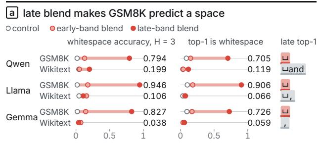

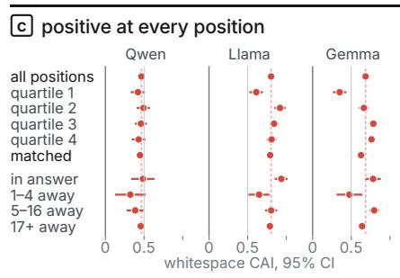

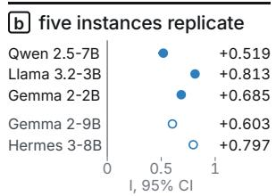  
I = mean-blend H = 3 (ws − content) minus mild-resample H = 1 (ws − content); 200 sequences per corpus; no draw ≤ 0 in 10,000 resamples; hollow: audit-only instances

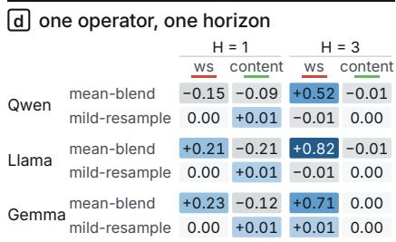  
conditional CAI at top-1; blue positive, grey negative, each shaded by its size

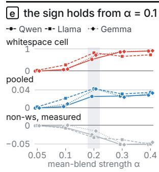  
Figure 2: The positive contrast arises from late-band mean-blend on GSM8K whitespace. It persists across instances, positions, and strengths from $\alpha = 0 . 1 \mathrm { t o } 0 . 4 ,$ and its whitespace concentration is largest under mean-blend three tokens ahead. Panel a gives H=3 whitespace accuracy, averaged within sequences, and the share of positions whose top-1 prediction is whitespace, under control and the two blended bands. The chip is the modal late-band top-1 token. Panel b gives the diagnostic interaction I of Eq. (4) in the five same-sequence audit instances. Panel c gives the whitespace CAI of the position-control sample by relative-position quartile, after position matching, and by distance from the final answer span. The dashed line is each model’s all-positions estimate. Panel d gives the operator × horizon grid, and panel e the whitespace cell, the pooled CAI and the directly measured non-whitespace CAI at five mean-blend strengths, with α = 0.2 shaded. Intervals are 95%. Appendix Tables 9, 10, 16, 51 and 52 list the values.

Table 2: The tokenizer-only screen. The input rule assigns the first label whose condition holds, and each label is scored against the observed region, which is computed from model outputs. “Whitespace largest” means that the H=3 mean-blend whitespace cell exceeds both zero and the content-word cell.
<table><tr><td>Label</td><td>Input rule (tokenizer only)</td><td>Observed region and interval criterion</td></tr><tr><td>boundary</td><td>focal corpus is source code, and either  $\Delta _ { \mathrm { w s } } > \hat { 0 . 0 4 }$  or newline and indentation tokens exceed 25% of its whitespace targets</td><td>not scored</td></tr><tr><td>high</td><td> $\Delta _ { \mathrm { w s } } \geq 0 . 0 4 5 , \Delta _ { \mathrm { c h a r s } } \geq \bar { 0 } . 5 0 ,$  and  $\mathrm { J S } \geq 0 . 0 1$ </td><td> $I \geq 0 . 3 5$  with whitespace largest; I interval above zero</td></tr><tr><td>low</td><td> $| \Delta _ { \mathrm { w s } } | \leq 0 . 0 2 0$  and  $| \Delta _ { \mathrm { c h a r s } } | \leq 0 . 3 5$ </td><td> $| I | \leq 0 . 2 0$  and  $| \mathrm { C A I _ { p o o l e d } } | \le 0 . 0 8 ; I$  interval contains zero</td></tr><tr><td>medium ambiguous otherwise</td><td> $\Delta _ { \mathrm { w s } } \geq 0 . 0 3 0 \mathrm { o r } \Delta _ { \mathrm { c h a r s } } \geq 0 . 3 5$ </td><td>no held-out pair not scored</td></tr></table>

Held-out pairs. Five held-out pairs were run on the three primary models. Three received scored labels (GSM8K/TinyStories high; SQuAD/AGNews and AGNews/Wikitext low), which gives nine scored rows. Code against docstrings (boundary) and TinyStories/AGNews (ambiguous) are reported

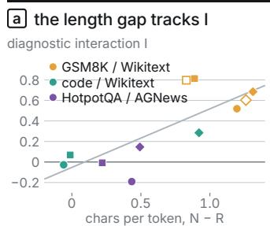  
Pearson 0.78, Spearman 0.72

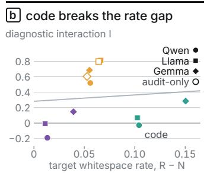

c the length gap keeps its sign
<table><tr><td></td><td>n length</td><td></td><td>rate</td></tr><tr><td>all rows</td><td>11</td><td>0.78</td><td>0.09</td></tr><tr><td>one family out</td><td></td><td></td><td></td></tr><tr><td>no Qwen</td><td>8</td><td>0.78</td><td>0.01</td></tr><tr><td>no Llama</td><td>7</td><td>0.90</td><td>0.06</td></tr><tr><td>no Gemma</td><td>7</td><td>0.77</td><td>0.19</td></tr><tr><td>one corpus pair out</td><td></td><td></td><td></td></tr><tr><td>no GSM8K / Wikitext</td><td>6</td><td>0.54</td><td>0.67</td></tr><tr><td>no code / Wikitext</td><td>8</td><td>0.77</td><td>0.96</td></tr><tr><td>no HotpotQA / AGNews</td><td>8</td><td>0.78</td><td>-0.69</td></tr></table>

Pearson r with I over the rows left in; blue positive, grey negative

d all 15 scored rows land in their predicted region
<table><tr><td rowspan="2">label</td><td rowspan="2">focal, R</td><td rowspan="2">reference, N</td><td colspan="2">screen input</td></tr><tr><td>rate</td><td>length</td></tr><tr><td>high</td><td>GSM8K</td><td>TinyStories</td><td>+0.0739</td><td>+0.8052</td></tr><tr><td>high</td><td>GSM8K</td><td>FACTOR-News</td><td>+0.0619</td><td>+1.1306</td></tr><tr><td>low</td><td>SQuAD</td><td>AGNews</td><td>+0.0077</td><td>+0.3276</td></tr><tr><td>low</td><td>AGNews</td><td>Wikitext</td><td>-0.0099</td><td>+0.0055</td></tr><tr><td>low</td><td>StrategyQA</td><td>FACTOR-News</td><td>-0.0068</td><td>+0.0865</td></tr><tr><td>boundary</td><td></td><td></td><td></td><td></td></tr><tr><td></td><td>code</td><td>docstrings</td><td>+0.1414 +0.0771</td><td></td></tr><tr><td>ambiguous</td><td>TinyStories</td><td>AGNews</td><td>-0.0202-0.0383</td><td></td></tr></table>

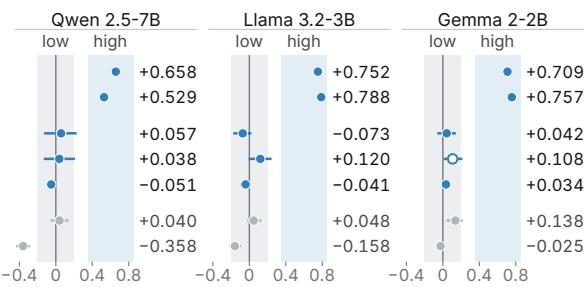  
I with its 95% bootstrap interval; shaded: the scored regions, |I| ≤ 0.20 for low and I ≥ 0.35 for high; hollow: in its region, interval excludes zero; grey: not scored. Screen inputs: means over the three tokenizers; the FACTOR-News pairs are from the DoLa audit.

Figure 3: The tokenizer-only screen and every pair it labelled in advance. Panels a and b plot the diagnostic interaction I, measured from model outputs, against the two tokenizer-only gaps for the eleven calibration rows: characters per token, $\Delta _ { \mathrm { c h a r s } } .$ , in a and target whitespace rate, $\Delta _ { \mathrm { w s } } ,$ , in b, each with its least-squares line. Panel c gives both Pearson correlations over all eleven rows and with one tokenizer family or one corpus pair left out. Panel d lists the five held-out pairs and the two DoLa pairs with the screen’s two inputs, the label fixed before any intervention, and I with its 95% bootstrap interval in each primary model (Tables 26 and 29).

unscored. All nine scored rows fall in the region their label predicts, and eight of nine also meet the interval criterion. Gemma on AGNews/Wikitext is the exception: its point estimates lie in the low region, and its interval excludes zero (Table 26, Figure 3d).

DoLa corpus audit. We apply the CAI protocol to two corpus pairs built from benchmarks evaluated by DoLa (Chuang et al., 2024): GSM8K/FACTOR-News and StrategyQA/FACTOR-News. The tokenizer-only screen rates these pairs at different risk levels. FACTOR-News sequences are drawn from the 1,036-row test split of a public NEWS-FACTOR mirror (Appendix J.3). For high-risk GSM8K/FACTOR-News, the audit interaction and pooled CAI are positive in every model, while both mixture summaries are negative. For low-risk StrategyQA/FACTOR-News, every interaction interval contains zero (Table 29). All six prospective region predictions agree with the observed outcomes. Our ablation contrast on GSM8K/FACTOR-News therefore depends on the target mixture in the same way as the canonical contrast.

Coverage and reversals. Table 3 lists every decomposed pair with its per-model pooled and whitespace-excluded estimates, and the reversals follow the screen’s labels. Among the pooledpositive rows of high- and medium-risk pairs, 14 of 14 reverse sign once whitespace is excluded, each with a pooled interval wholly above zero and a whitespace-excluded interval wholly below it (Tables 1 and 23). Reference reweighting turns 11 of the same 14 rows negative (Table 30). Among the other pooled-positive rows, 2 of 10 reverse, both from Gemma: code/docstrings, with both intervals excluding zero, and SQuAD/AGNews, whose pooled and whitespace-excluded intervals both contain zero. Within the reasoning corpora, MATH and DROP have positive diagnostic interactions with intervals excluding zero in every model row, and all ARC intervals include zero (Table 27). Across the canonical, MATH, DROP, and ARC rows, the whitespace-rate gap and the pooled CAI agree at Spearman $\rho = 0 . 9 3 7$

Table 3: H=3 mean-blend top-1 CAI for every decomposed corpus pair, as pooled and whitespaceexcluded estimates per model. “reversed” counts rows whose whitespace-excluded estimate is negative among rows with a positive pooled estimate. n is the number of sequences per corpus for Qwen/Llama/Gemma, and a value that rounds to zero is printed to its first significant digit. Table 1 and Table 23 give the 95% intervals, and Appendix I lists two further screen-only pairs and the condition count.
<table><tr><td></td><td></td><td></td><td colspan="3">pooled / whitespace excluded</td><td></td></tr><tr><td>Pair</td><td>screen</td><td>n</td><td>Qwen2.5-7B</td><td>Llama-3.2-3B</td><td>gemma-2-2b-it</td><td>reversed</td></tr><tr><td>GSM8K/Wikitext</td><td>high (cal.)</td><td>300</td><td>+0.025 / -0.025</td><td>+0.043 /-0.033</td><td>+0.042/-0.013</td><td>3/3</td></tr><tr><td>GSM8K/TinyStories</td><td>high</td><td>200/195/200</td><td>+0.025 / -0.029</td><td>+0.041 /-0.028</td><td>+0.028 /-0.024</td><td>3/3</td></tr><tr><td>GSM8K/FACTOR-News</td><td>high</td><td>200</td><td>+0.034/-0.018</td><td>+0.047/-0.027</td><td>+0.035 /-0.021</td><td>3/3</td></tr><tr><td>MATH/Wikitext</td><td>medium</td><td>200</td><td>-0.009 /-0.024</td><td>+0.006 /-0.031</td><td>+0.012 /-0.008</td><td>2/2</td></tr><tr><td>DROP/Wikitext</td><td>medium</td><td>168/185/159</td><td>+0.008 /-0.021</td><td>+0.018 /-0.028</td><td>+0.012/-0.014</td><td>3/3</td></tr><tr><td>code/docstrings</td><td>boundary</td><td>200</td><td>-0.005/-0.019</td><td>-0.006 / -0.013</td><td>+0.017/-0.035</td><td>1/1</td></tr><tr><td>AGNews/Wikitext</td><td>low</td><td>82/75/82</td><td>-0.019/-0.017</td><td>-0.001/+0.00003</td><td>+0.005/+0.005</td><td>0/1</td></tr><tr><td>SQuAD/AGNews</td><td>low</td><td>118/119/138</td><td>+0.025 /+0.022</td><td>-0.002 /-0.012</td><td>+0.00002 /-0.008</td><td>1/2</td></tr><tr><td>ARC/Wikitext</td><td>low</td><td>189/196/190</td><td>+0.004/+0.005</td><td>-0.009 / -0.024</td><td>+0.007/+0.007</td><td>0/2</td></tr><tr><td>StrategyQA/FACTOR-News</td><td>low</td><td>150/135/149</td><td>-0.005 /-0.006</td><td>-0.007/-0.008</td><td>+0.001/+0.001</td><td>0/1</td></tr><tr><td>TinyStories/AGNews</td><td>ambiguous</td><td>200</td><td>+0.010/+0.021</td><td>+0.006 /+0.006</td><td>+0.006 /+0.005</td><td>0/3</td></tr></table>

## 5 ROBUSTNESS ACROSS DEFINITIONS AND READOUTS

The checks in this section examine how the findings vary with the intervention, prediction horizon, token classification, and readout.

Operator and horizon. Within the operator-by-horizon grid, mean-blend H=3 is concentrated on whitespace, while mild-resample H=3 is near zero for both target types. Mild-resample H=1 gives a small positive content cell, which we split by control accuracy below. The grid cells come from samples of different sizes, so we compare them one cell at a time (Figure 2d, Table 16).

Classifier boundaries. We evaluate the primary horizon with four fixed vocabulary policies, including two that move selected content tokens into the function-word class and an adversarial map that assigns every token beginning with whitespace to the whitespace class. That map dilutes the whitespace effect by a factor of 8.2 to 8.7, and whitespace still holds the largest positive H=3 cell in every model and the only positive cell in two. Among the policy-conditioned non-whitespace estimates, only the Gemma content cell is positive at H=3, under two policies, and both of its intervals include zero. At H=1 under mean-blend, restricting the content class to tokens without leading whitespace yields positive content-word CAI in all three models (Appendix J.9).

Continuous target margin. Under mean-blend at both H=1 and H=3, the target-margin CAI shows the same selectivity. The six whitespace estimates run from +1.23 to +3.37 logits with every interval excluding zero. Five of the six content estimates are negative, and the remaining one, Gemma at H=1, is positive with an interval that includes zero (Table 18). In three further checks (Appendix G.2), log probability at H=3 gives a negative content-word CAI in every primary model, the logit lens without ablation puts every H=3 late-band contrast near zero, and same-corpus H=1 patching stays positive for content targets (Figure 6c–d). The positive pooled H=3 estimate also recurs in both halves of an easy/hard GSM8K split, in three base checkpoints, and after equalizing perturbation norms across corpora, and these controls pool over target types (Appendix L).

The one-token-ahead content-word cell. In the operator grid, the only positive content cell lies at H=1 under mild-resample. A separate H=1 mild-resample series of 250 sequences per corpus measures it at top-1 and adds OLMo 2 (Walsh et al., 2025) and Qwen 3 (Qwen Team, 2025) to the three primary models. Its content-word CAI runs from +0.0086 to +0.0148 across the five instances, and its 95% bootstrap interval excludes zero in each (Table 44). In every instance the unablated model predicts a larger share of the GSM8K content targets than of the Wikitext ones. The operator removes most of those correct predictions in both corpora, more under the early band than under the late band. Each corpus’s early-minus-late damage gap therefore grows with its control accuracy. We split the content targets by control-pass correctness and weight the two strata by their Wikitext shares. The resulting estimates run from −0.0028 to +0.0031 with every interval including zero, and the paired difference from the content cell excludes zero in all five instances (Table 46). The content cell thus follows a second composition difference in the evaluated targets, the share that the model already predicts. Two smaller effects remain: Llama keeps a control-correct cell whose interval lies above zero, and reweighting by strata that depend on the input alone, such as repeated tokens, leaves a smaller positive cell (Appendix K.4). For number, punctuation, and function-word targets, three of the 15 reweighted intervals lie wholly above zero, against eight unsplit cells above zero (Table 45).

## 6 RELATED WORK

Classical aggregation bias explains how a population mixture alters a pooled contrast (Simpson, 1951), and target-token composition is a concrete source of it in cross-corpus depth attribution. In our case the whitespace conditional effect is positive, so the pooled sign agrees with the stratum that has the largest positive conditional effect, and the decomposition changes the task interpretation attached to the pooled contrast. Table 21, in Appendix H, lists the reporting patterns most exposed to this risk beside the evidence each one needs. Because the taxonomy concerns how outputs are aggregated, it applies to any setting that pools scores over a naturalistic target population, including layerwise readouts (nostalgebraist, 2020; Belrose et al., 2023; Ghandeharioun et al., 2024), contrastive layer decoding (Chuang et al., 2024), and causal tracing (Meng et al., 2022).

Ablation-validity studies vary interventions or faithfulness metrics (Zhang & Nanda, 2024; Li & Janson, 2024; Miller et al., 2024). Our analysis complements these studies and analyses of attention structure and expressivity (Lu & Yang, 2025; 2026a;b; Lu et al., 2025) by partitioning targets under a fixed intervention, which concentrates the replicated H=3 contrast on whitespace and leaves all four non-whitespace conditional point estimates non-positive. Causal abstraction provides a broader framework for intervention-based explanations (Geiger et al., 2025).

## 7 DISCUSSION AND LIMITATIONS

A depth effect can replicate because its target-token mixture replicates, and in our main case the replicated whitespace mixture carries the positive pooled contrast. Across the high- and medium-risk rows with positive pooled estimates, whitespace exclusion reverses every one.

What changes in practice. Report each corpus’s target-type proportions and characters per token as a low-cost tokenizer-only screen. Log the target-token ID beside each correctness bit and report conditional cells: the decomposition and mixture checks reuse predictions the experiment already collected. When a positive cell remains, split its targets by whether the unablated model predicts them. The operator mostly removes correct predictions, so a double difference of damage grows with control accuracy.

Reading the two mixture summaries. Whitespace removal asks whether any broad non-whitespace effect remains, and it is the decisive check in our high- and medium-risk rows. Reference reweighting holds the measured conditional cells fixed and changes only their weights, so a retained positive whitespace contribution can outweigh the negative contributions of the other types, as it does for Gemma. The first summary therefore tests for a non-whitespace effect, and the second shows how the measured cells combine under the reference corpus’s mixture. Whitespace can also carry structure in code, markup, and tables, which is why the screen treats source code as a boundary case.

Limitations. The primary claim concerns H=3 mean-blend top-1 CAI, and the continuous targetmargin readout corroborates it. The position analysis covers canonical-pair whitespace, and the control-accuracy split covers the H=1 mild-resample series, so the positive H=1 mean-blend content cells of the classifier-policy check remain unsplit. The main estimates use the perturbation strength α = 0.2. In the strength sweep, the H=3 mean-blend whitespace interval lies above zero in every model at every strength above the weakest, and the directly measured non-whitespace interval never lies above zero (Figure 2e). The pooled H=1 mild-resample CAI interval lies wholly above zero at most of the seven strengths in each model (Appendix L.3). The same protocol applies to any cross-corpus depth claim: report which tokens were predicted, decompose the effect by target type, and match the mixture before drawing a conclusion about depth.

## AI USE STATEMENT

We used generative AI tools to implement the measurement, analysis, and figure code, to reformat the public corpora into the evaluated prompt format, and to interpret results. We also used them to design the experiments, to give feedback on the methodology, and to propose and refine the hypotheses that the runs were built to test. Finally, we used them to develop the audit framework and to formulate its definitions. Those definitions include the interaction estimand in (2), the conditional and mixture summaries, and the screening quantity in (4). Synthetic data generation, translation, mathematical proof, and qualitative analysis are not applicable to this work, which evaluates the public corpora in their released language, states no theorem, and analyzes no interview, survey, or free-text data. We also used generative AI tools to create and edit code, draw figures, draft and edit sections of this paper and its appendix, identify and summarize related work, format references, and suggest the title and section structure.

We have reviewed all AI-assisted work. An internal verifier recomputes the estimates, intervals, table cells, result counts, and ranges printed in the text and tables of this paper and its appendix from the result artifacts, and it fails when a printed result differs from the artifact that produced it. The reported target-type decomposition, position controls, and held-out outcomes are read from those artifacts. Prose descriptions of the intervention were checked against the runner code that performs it, and the risk labels in Section 4 were assigned before the held-out pairs were evaluated. We take responsibility for the final content of this work, including text, claims, and artifacts produced with the aid of generative AI.

## ETHICS STATEMENT

Depth-attribution claims feed model auditing and deployment decisions, so a measurement error in this class of study can become a false safety or capability claim about where a competence lives inside a network. The audit makes the evaluated target population explicit and reports an interval with each conditional cell. It also splits the remaining positive content cell by the unablated model’s correctness, which relates that cell to the share of targets the model already predicts. This work evaluates public checkpoints on public corpora and involves no human subjects or new data collection. This arXiv submission includes no research scripts, machine-readable result files, or model weights. Appendix O discusses broader-impact considerations.

## REPRODUCIBILITY STATEMENT

The measurement protocol is specified in Section 2 and Appendix A. They give the estimands, the deterministic target-token classifier, the band, horizon, and operator definitions, and the sequencelevel resampling convention behind every reported interval. The main text and appendix report the experimental results, sample counts, and numerical summaries. An internal CPU verifier was used to cross-check the reported results against the underlying result files. The analysis and evaluation scripts, machine-readable result files, and figure-generation scripts are not provided with this arXiv submission. Appendix N summarizes the analyses and the resample counts that differ across them. The corpora and checkpoints are the public releases cited in Section 2.

## REFERENCES

Nora Belrose, Igor Ostrovsky, Lev McKinney, Zach Furman, Logan Smith, Danny Halawi, Stella Biderman, and Jacob Steinhardt. Eliciting latent predictions from transformers with the tuned lens, 2023. URL https://arxiv.org/abs/2303.08112.

Yung-Sung Chuang, Yujia Xie, Hongyin Luo, Yoon Kim, James Glass, and Pengcheng He. DoLa: Decoding by contrasting layers improves factuality in large language models. In International Conference on Learning Representations, 2024. URL https://arxiv.org/abs/2309. 03883.

Peter Clark, Isaac Cowhey, Oren Etzioni, Tushar Khot, Ashish Sabharwal, Carissa Schoenick, and Oyvind Tafjord. Think you have solved question answering? Try ARC, the AI2 reasoning challenge, 2018. URL https://arxiv.org/abs/1803.05457.

Karl Cobbe, Vineet Kosaraju, Mohammad Bavarian, Mark Chen, Heewoo Jun, Lukasz Kaiser, Matthias Plappert, Jerry Tworek, Jacob Hilton, Reiichiro Nakano, Christopher Hesse, and John Schulman. Training verifiers to solve math word problems, 2021. URL https://arxiv.org/ abs/2110.14168.

Dheeru Dua, Yizhong Wang, Pradeep Dasigi, Gabriel Stanovsky, Sameer Singh, and Matt Gardner. DROP: A reading comprehension benchmark requiring discrete reasoning over paragraphs. In Proceedings of the 2019 Conference of the North American Chapter of the Association for Computational Linguistics: Human Language Technologies, Volume 1 (Long and Short Papers), pp. 2368–2378, Minneapolis, Minnesota, 2019. Association for Computational Linguistics. doi: 10.18653/v1/N19-1246. URL https://aclanthology.org/N19-1246/.

Ronen Eldan and Yuanzhi Li. TinyStories: How small can language models be and still speak coherent English?, 2023. URL https://arxiv.org/abs/2305.07759.

Atticus Geiger, Duligur Ibeling, Amir Zur, Maheep Chaudhary, Sonakshi Chauhan, Jing Huang, Aryaman Arora, Zhengxuan Wu, Noah Goodman, Christopher Potts, and Thomas Icard. Causal abstraction: A theoretical foundation for mechanistic interpretability. Journal ofMachine Learning Research, 26(83):1–64, 2025. URL https://www.jmlr.org/papers/v26/23-0058. html.

Gemma Team. Gemma 2: Improving open language models at a practical size, 2024. URL https://arxiv.org/abs/2408.00118.

Mor Geva, Daniel Khashabi, Elad Segal, Tushar Khot, Dan Roth, and Jonathan Berant. Did Aristotle use a laptop? A question answering benchmark with implicit reasoning strategies. Transactions ofthe Associationfor Computational Linguistics, 9:346–361, 2021. doi: 10.1162/tacl\_a\_00370. URL https://aclanthology.org/2021.tacl-1.21/.

Asma Ghandeharioun, Avi Caciularu, Adam Pearce, Lucas Dixon, and Mor Geva. Patchscopes: A unifying framework for inspecting hidden representations of language models. In Ruslan Salakhutdinov, Zico Kolter, Katherine Heller, Adrian Weller, Nuria Oliver, Jonathan Scarlett, and Felix Berkenkamp (eds.), Proceedings of the 41st International Conference on Machine Learning, volume 235 of Proceedings ofMachine Learning Research, pp. 15466–15490. PMLR, 2024. URL https://proceedings.mlr.press/v235/ghandeharioun24a.html.

Aaron Grattafiori et al. The Llama 3 herd of models, 2024. URL https://arxiv.org/abs/ 2407.21783.

Dan Hendrycks, Collin Burns, Saurav Kadavath, Akul Arora, Steven Basart, Eric Tang, Dawn Song, and Jacob Steinhardt. Measuring mathematical problem solving with the MATH dataset. In Proceedings ofthe Neural Information Processing Systems Track on Datasets and Benchmarks, volume 1, 2021. URL https://datasets-benchmarks-proceedings.neurips. cc/paper\_files/paper/2021/hash/be83ab3ecd0db773eb2dc1b0a17836a1- Abstract-round2.html.

Hamel Husain, Ho-Hsiang Wu, Tiferet Gazit, Miltiadis Allamanis, and Marc Brockschmidt. Code-SearchNet challenge: Evaluating the state of semantic code search, 2019. URL https: //arxiv.org/abs/1909.09436.

Maximilian Li and Lucas Janson. Optimal ablation for interpretability. In Advances in Neural Information Processing Systems, volume 37, 2024. URL https://openreview.net/ forum?id=opt72TYzwZ.

Percy Liang, Rishi Bommasani, Tony Lee, et al. Holistic evaluation of language models. Transactions on Machine Learning Research, 2023. URL https://openreview.net/forum?id= iO4LZibEqW.

Jiecheng Lu and Shihao Yang. Linear transformers as VAR models: Aligning autoregressive attention mechanisms with autoregressive forecasting. In Proceedings ofthe 42nd International Conference on Machine Learning, volume 267 of Proceedings ofMachine Learning Research, pp. 40848– 40867. PMLR, 2025. URL https://proceedings.mlr.press/v267/lu25r.html.

Jiecheng Lu and Shihao Yang. Free energy mixer. In International Conference on Learning Representations, 2026a. URL https://openreview.net/forum?id=vjQnKToCnV.

Jiecheng Lu and Shihao Yang. HyperMLP: An integrated perspective for sequence modeling. In Proceedings of the 43rd International Conference on Machine Learning, volume 306 of Proceedings of Machine Learning Research, pp. 81824–81879. PMLR, 2026b. URL https://proceedings.mlr.press/v306/lu26aq.html.

Jiecheng Lu, Xu Han, Yan Sun, Viresh Pati, Yubin Kim, Siddhartha Somani, and Shihao Yang. ZeroS: Zero-sum linear attention for efficient transformers. In Advances in Neural Information Processing Systems, volume 38, 2025. doi: 10.52202/085713- 0438. URL https://proceedings.neurips.cc/paper\_files/paper/2025/hash/ 1363163299a172662dcf0c0f9932acf6-Abstract-Conference.html.

Kevin Meng, David Bau, Alex Andonian, and Yonatan Belinkov. Locating and editing factual associations in GPT. In Advances in Neural Information Processing Systems, volume 35, 2022. URL https://arxiv.org/abs/2202.05262.

Stephen Merity, Caiming Xiong, James Bradbury, and Richard Socher. Pointer sentinel mixture models. In International Conference on Learning Representations, 2017. URL https:// arxiv.org/abs/1609.07843.

Joseph Miller, Bilal Chughtai, and William Saunders. Transformer circuit evaluation metrics are not robust. In First Conference on Language Modeling, 2024. URL https://openreview. net/forum?id=zSf8PJyQb2.

Dor Muhlgay, Ori Ram, Inbal Magar, Yoav Levine, Nir Ratner, Yonatan Belinkov, Omri Abend, Kevin Leyton-Brown, Amnon Shashua, and Yoav Shoham. Generating benchmarks for factuality evaluation of language models. In Proceedings of the 18th Conference of the European Chapter of the Association for Computational Linguistics (Volume 1: Long Papers), pp. 49–66, St. Julian’s, Malta, 2024. Association for Computational Linguistics. doi: 10.18653/v1/2024.eacl-long.4. URL https://aclanthology.org/2024.eacl-long.4/.

nostalgebraist. Interpreting GPT: The logit lens. https://www.lesswrong.com/posts/ AcKRB8wDpdaN6v6ru/interpreting-gpt-the-logit-lens, 2020. Blog post.

Aleksandar Petrov, Emanuele La Malfa, Philip H. S. Torr, and Adel Bibi. Language model tokenizers introduce unfairness between languages. In Advances in Neural Information Processing Systems, volume 36, 2023.

Qwen Team. Qwen2.5 technical report, 2024. URL https://arxiv.org/abs/2412.15115.

Qwen Team. Qwen3 technical report, 2025. URL https://arxiv.org/abs/2505.09388.

Pranav Rajpurkar, Jian Zhang, Konstantin Lopyrev, and Percy Liang. SQuAD: 100,000+ questions for machine comprehension of text. In Proceedings ofthe 2016 Conference on Empirical Methods in Natural Language Processing, pp. 2383–2392, Austin, Texas, 2016. Association for Computational Linguistics. doi: 10.18653/v1/D16-1264. URL https://aclanthology.org/D16- 1264/.

Rylan Schaeffer, Brando Miranda, and Sanmi Koyejo. Are emergent abilities of large language models a mirage? In Advances in Neural Information Processing Systems, volume 36, 2023. URL https://arxiv.org/abs/2304.15004.

Edward H. Simpson. The interpretation of interaction in contingency tables. Journal of the Royal Statistical Society: Series B (Methodological), 13(2):238–241, 1951. doi: 10.1111/j.2517-6161. 1951.tb00088.x.

Ryan Teknium, Jeffrey Quesnelle, and Chen Guang. Hermes 3 technical report, 2024. URL https://arxiv.org/abs/2408.11857.

Ashish Vaswani, Noam Shazeer, Niki Parmar, Jakob Uszkoreit, Llion Jones, Aidan N. Gomez, Lukasz Kaiser, and Illia Polosukhin. Attention is all you need. In Advances in Neural Information Processing Systems, volume 30, 2017.

Evan Pete Walsh, Luca Soldaini, Dirk Groeneveld, Kyle Lo, Shane Arora, Akshita Bhagia, Yuling Gu, Shengyi Huang, Matt Jordan, Nathan Lambert, Dustin Schwenk, Oyvind Tafjord, Taira Anderson, David Atkinson, Faeze Brahman, Christopher Clark, Pradeep Dasigi, Nouha Dziri, Allyson Ettinger, Michal Guerquin, David Heineman, Hamish Ivison, Pang Wei Koh, Jiacheng Liu, Saumya Malik, William Merrill, Lester James Validad Miranda, Jacob Morrison, Tyler Murray, Crystal Nam, Jake Poznanski, Valentina Pyatkin, Aman Rangapur, Michael Schmitz, Sam Skjonsberg, David Wadden, Christopher Wilhelm, Michael Wilson, Luke Zettlemoyer, Ali Farhadi, Noah A. Smith, and Hannaneh Hajishirzi. 2 OLMo 2 Furious (COLM’s version). In Second Conference on Language Modeling, 2025. URL https://openreview.net/forum?id=2ezugTT9kU.

Anna Wegmann, Dong Nguyen, and David Jurgens. Tokenization is sensitive to language variation. In Findings ofthe Associationfor Computational Linguistics: ACL 2025, pp. 10958–10983, Vienna, Austria, 2025. Association for Computational Linguistics. doi: 10.18653/v1/2025.findings-acl.572. URL https://aclanthology.org/2025.findings-acl.572/.

Zhilin Yang, Peng Qi, Saizheng Zhang, Yoshua Bengio, William W. Cohen, Ruslan Salakhutdinov, and Christopher D. Manning. HotpotQA: A dataset for diverse, explainable multi-hop question answering. In Proceedings ofthe 2018 Conference on Empirical Methods in Natural Language Processing, pp. 2369–2380, Brussels, Belgium, 2018. Association for Computational Linguistics. doi: 10.18653/v1/D18-1259. URL https://aclanthology.org/D18-1259/.

Fred Zhang and Neel Nanda. Towards best practices of activation patching in language models: Metrics and methods. In International Conference on Learning Representations, 2024. URL https://arxiv.org/abs/2309.16042.

Xiang Zhang, Junbo Zhao, and Yann LeCun. Character-level convolutional networks for text classification. In Advances in Neural Information Processing Systems, volume 28, 2015.

## A AUDIT PROTOCOL AND ADDITIONAL DEFINITIONS

This appendix gives the full protocol and detailed results that support the main text. For each aggregate depth result we report (i) a target-token decomposition, (ii) mixture diagnostics, (iii) comparisons across interventions, horizons, and readouts, and (iv) the one-token-ahead content-token cell used for calibration, split by control accuracy.

## A.1 NOTATION AND ESTIMANDS

For a corpus $C \in \{ \mathcal { R } , \mathcal { N } \}$ , offset k (equivalently, horizon $H \ = \ k )$ , band $B \in \{ E , L \}$ , and perturbation operator o, the damage score is

$$
\begin{array} { r } { \mathrm { D } _ { B } ^ { o } ( C , k ) = \operatorname { a c c } _ { \mathrm { c t r l } } ( C , k ) - \operatorname { a c c } _ { \mathrm { a b l a t e } } ^ { o } ( B , C , k ) . } \end{array}
$$

The contextual ablation interaction is

$$
\mathrm { C A I } _ { k } ^ { o } = \left[ \mathrm { D } _ { E } ^ { o } ( \mathcal { R } , k ) - \mathrm { D } _ { E } ^ { o } ( \mathcal { N } , k ) \right] - \left[ \mathrm { D } _ { L } ^ { o } ( \mathcal { R } , k ) - \mathrm { D } _ { L } ^ { o } ( \mathcal { N } , k ) \right] .
$$

$\mathbf { A }$ positive value means that the early-band perturbation produces more excess damage on $\mathcal { R }$ than on ${ \mathcal { N } } .$ , relative to the corresponding late-band contrast. The difference-in-differences estimand has a task-level interpretation when the two corpora present comparable target-token prediction tasks.

For a token type τ, the conditional interaction is

$$
\begin{array} { r l } & { \mathrm { C A I } _ { k , \tau } ^ { o } = \big [ \mathrm { D } _ { E } ^ { o } ( \mathcal { R } , k \mid g ( x _ { t + k } ) = \tau ) - \mathrm { D } _ { E } ^ { o } ( \mathcal { N } , k \mid g ( x _ { t + k } ) = \tau ) \big ] } \\ & { \quad \quad \quad \quad - \big [ \mathrm { D } _ { L } ^ { o } ( \mathcal { R } , k \mid g ( x _ { t + k } ) = \tau ) - \mathrm { D } _ { L } ^ { o } ( \mathcal { N } , k \mid g ( x _ { t + k } ) = \tau ) \big ] . } \end{array}
$$

Let $\pi _ { C } ( \tau )$ be the target-type distribution in corpus $C .$ The mixture summary under a target distribution $q$ is

$$
M ( q ) = \sum _ { \tau } q ( \tau ) \mathrm { C A I } _ { k , \tau } ^ { o } .
$$

The two summaries in the main text are

$$
\begin{array} { r l r } {  { M _ { \mathrm { \tiny \mathrm { \to ~ w s } } } = \sum _ { \tau \ne \mathrm { w s } } \frac { w ( \tau ) } { \sum _ { \sigma \ne \mathrm { w s } } w ( \sigma ) } \mathrm { C A I } _ { k , \tau } ^ { o } , } } \\ & { } & { M _ { N } = \sum _ { \tau } \pi _ { N } ( \tau ) \mathrm { C A I } _ { k , \tau } ^ { o } , \quad } \end{array}
$$

where $w ( \tau )$ is a target count. The canonical table takes w from the two corpora’s combined counts, and the expansion and held-out rows take it from the focal corpus’s counts. $M _ { \mathrm { \Gamma \to w s } }$ asks whether the effect survives after removing whitespace targets. $M _ { \mathcal { N } }$ asks whether it survives when the target-type mixture is changed to match the reference corpus.

Both summaries reweight the measured conditional cells, and one identity relates them to the pooled interaction. Write $\Delta _ { C } \mathsf { \bar { ( } } \tau ) = \mathrm { D } _ { E } ^ { o } ( C , k \mid \tau ) - \mathrm { D } _ { L } ^ { o } ( C , k \mid \tau )$ . If accuracy is pooled over tokens, each pooled damage term is the mixture of its conditional terms, so

$$
\mathrm { C A I } _ { k } ^ { o } = \sum _ { \tau } \pi _ { \mathcal { R } } ( \tau ) \Delta _ { \mathcal { R } } ( \tau ) - \sum _ { \tau } \pi _ { \mathcal { N } } ( \tau ) \Delta _ { \mathcal { N } } ( \tau ) , \qquad M ( q ) = \sum _ { \tau } q ( \tau ) \big [ \Delta _ { \mathcal { R } } ( \tau ) - \Delta _ { \mathcal { N } } ( \tau ) \big ] ,
$$

where $M ( q )$ applies one mixture to both corpora. Taking $q = \pi _ { \mathcal { R } }$

$$
\mathrm { C A I } _ { k } ^ { o } - M ( \pi _ { \mathcal R } ) = \sum _ { \tau } \left[ \pi _ { \mathcal R } ( \tau ) - \pi _ { \mathcal N } ( \tau ) \right] \Delta _ { \mathcal N } ( \tau ) ,
$$

which is zero when the two corpora share a target-type mixture. The estimator averages accuracy within each sequence before averaging over sequences, so the identity holds up to a residual. Table 8 gives the pooled CAI, $M ( \pi _ { \mathcal { R } } )$ , the mixture-shift term, and the residual for each model on the canonical sample. The residual is at most 0.0023 in absolute value. The same table splits $M ( q )$ at the two corpora’s combined target shares into its whitespace term and its other four terms, which with their sum are the three middle bars of each group in Figure 4d.

## A.2 TARGET-TOKEN CLASSIFIER

The classifier maps each vocabulary token to one of five categories by applying the following rules, in order, to the token’s decoded string after stripping surrounding whitespace, and the first rule that matches assigns the category.

1. Whitespace: the stripped string is empty, so the token consists of spaces, tabs, newlines, or carriage returns.

2. Number: every character is a digit or one of the period, comma, and plus sign, and at least one character is a digit.

3. Punctuation: every character is Unicode punctuation, a space, or a tab.

4. Function word: the lower-cased string is one of 106 English function words listed in the fixed inventory in Appendix N.

5. Content word: every remaining token, including any token that fails to decode.

This vocabulary-level map is applied to the target token $x _ { t + k }$ at each evaluated source position. Each class name reports the decoded string form of a vocabulary token. The map shows whether mechanically distinct classes drive an aggregate metric. Mixture diagnostics and prompt-level examples then test the resulting categories.

## A.3 BANDS, HORIZONS, AND OPERATORS

We partition layers into thirds, using the first third as the early band E and the final third as the late band L. H=3 mean-blend measures the aggregate artifact, and H=1 mild-resample gives the calibration setting and the content-token cell of Appendix K.4. Both operators replace the output h of every Transformer block in the band, at every position, with

$$
h ^ { \prime } = ( 1 - \alpha ) h + \alpha g , \qquad \alpha = 0 . 2 .
$$

Under mean-blend, g is the mean of the same block’s output at the same position over the control pass of the same corpus. Under mild-resample, g is the same block’s output at the same position in a donor sequence from the same corpus. Donors are assigned by a derangement of the corpus’s sequences, so no sequence is its own donor, and positions past the donor’s length are left unchanged. The H=3 artifact is a mean-blend result, and the positive content-token cell is a mild-resample result. The diagnostic interaction in Eq. 4 takes the whitespace-minus-content difference of conditional CAI under each setting, mean-blend at H=3 and mild-resample at H=1, and subtracts the second from the first.

## A.4 MODEL NAMES

Figure panels label the checkpoints in short form (Qwen 2.5-7B, Qwen 3-1.7B, Llama 3.2-3B, Gemma 2-2B, Gemma 2-9B, Hermes 3-8B), and the text and tables use the release identifiers, often without the -Instruct or -it suffix. Outside Table 49, which lists the base checkpoints, every model name denotes the instruction-tuned checkpoint.

## A.5 BOOTSTRAP AND SIGNIFICANCE CONVENTION

For comparisons across token types and intervention settings, each sequence is the resampling unit. Unless otherwise stated, the main audit intervals use 10,000 sequence-level bootstrap resamples. The MATH, DROP, and ARC extensions use 2,000 resamples, and other supplemental analyses state their own counts. The one-sided p-value is the fraction of bootstrap draws for which the interaction is non-positive. When no bootstrap draw is non-positive, the paper reports the bound $p < 1 0 ^ { - 4 }$ Intervals and p-values are computed per estimand without multiplicity adjustment.

## B PROMPT-LEVEL VIGNETTES

The examples below show the token-type distinction directly. They were selected by readability and target type, using only the prompt window and its target-token label.

Table 4: Prompt-level cases illustrating the target-token confound and the code boundary. The bracketed token is the evaluated target.
<table><tr><td>Case</td><td>Target type</td><td>Context excerpt</td></tr><tr><td>GSM8K H=3</td><td>whitespace</td><td>That means the price for her ticket was 15 - 6 = $9. The answer is[[[SPACE]]]9</td></tr><tr><td>Wikitext H=3</td><td>content</td><td>12 Olympics . In July 2014, she was featured in the ESPN &#x27;s The Body[[ Issue]].</td></tr><tr><td>Code H=3</td><td>whitespace</td><td>.X = vec1.X * vec2.X new_vec.Y = vec1.Y * vec2.Y[[\n]] return new_vec</td></tr><tr><td>GSM8K H=1 content cell</td><td>content</td><td>supplies remaining in the ship is now 240-144 = 96 pounds. The[[ answer]] is 96</td></tr></table>

The first two rows show why an H=3 top-1 aggregate can compare different prediction problems across domains. GSM8K frequently places a whitespace target before an answer token, whereas the reference prose example places a content target. The code row illustrates a boundary case in which structural whitespace motivates reporting characters per token in addition to the target whitespace rate. The final row shows a content-word target of the H = 1 mild-resample series.

## C COMPLETE TARGET-TOKEN DECOMPOSITION

Estimator provenance. Several tables in this appendix estimate the same H = 3 mean-blend whitespace CAI cell using different sample sizes and analysis settings. The canonical target-type decomposition, same-sequence bootstrap audit, and portability analysis share the same estimand family and sign pattern. The analyses differ in sample composition, target-type support, missing-token handling, bootstrap scope, and included readouts, so their values differ slightly.

## C.1 CONDITIONAL CAI CELLS

Table 5: Canonical H=3 mean-blend target-token decomposition on GSM8K versus Wikitext. Entries report CAI with 95% bootstrap intervals in brackets.
<table><tr><td>Target type</td><td>Qwen2.5-7B</td><td>Llama-3.2-3B</td><td>gemma-2-2b-it</td></tr><tr><td>whitespace</td><td>+0.5181 [0.4786, 0.5560]</td><td>+0.8215 [0.7920, 0.8538]</td><td>+0.7155 [0.6879, 0.7420]</td></tr><tr><td>content</td><td></td><td>-0.0077[-0.0097, -0.0056] -0.0076[-0.0099, -0.0051] -0.0019[-0.0040, 0.0000]</td><td></td></tr><tr><td>number</td><td></td><td></td><td>-0.0181[-0.0233, -0.0129] -0.0055[-0.0082, -0.0032] -0.0246[-0.0313, -0.0191]</td></tr><tr><td>punctuation</td><td></td><td></td><td>-0.0981[-0.1099, -0.0867] -0.1975[-0.2125, -0.1821] -0.0350 [-0.0482, -0.0202]</td></tr><tr><td></td><td>function word -0.0257[-0.0324, -0.0194] -0.0138 [-0.0191, -0.0089] -0.0154[-0.0211, -0.0094]</td><td></td><td></td></tr></table>

The sign structure carries the result. The positive effect is isolated to whitespace targets, and content, number, punctuation, and function-word targets are non-positive. The aggregate H=3 mean-blend effect therefore measures the whitespace cell.

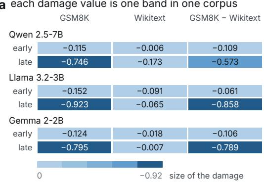

a each damage value is one band in one corpus
<table><tr><td rowspan=1 colspan=4>GSM8K        Wikitext    GSM8K – WikitextQwen 2.5-7B</td></tr><tr><td rowspan=1 colspan=1>early</td><td rowspan=1 colspan=1>-0.115</td><td rowspan=1 colspan=1>-0.006</td><td rowspan=1 colspan=1>-0.109</td></tr><tr><td rowspan=2 colspan=1>lateLlama 3</td><td rowspan=1 colspan=1>-0.746</td><td rowspan=1 colspan=1>-0.173</td><td rowspan=1 colspan=1>-0.573</td></tr><tr><td rowspan=1 colspan=1>.2-3B</td><td rowspan=1 colspan=1></td><td rowspan=1 colspan=1></td></tr><tr><td rowspan=1 colspan=1>early</td><td rowspan=1 colspan=1>-0.152</td><td rowspan=1 colspan=1>-0.091</td><td rowspan=1 colspan=1>-0.061</td></tr><tr><td rowspan=1 colspan=1>late</td><td rowspan=1 colspan=1>-0.923</td><td rowspan=1 colspan=1>-0.065</td><td rowspan=1 colspan=1>-0.858</td></tr></table>

damage = whitespace accuracy, ablation off − ablation on every value is negative: the ablation raised whitespace accuracy interaction = the last column's early row minus its late row here +0.464, +0.797, +0.682, from a 200-sequence side study

b GSM8K asks for three times as much whitespace  
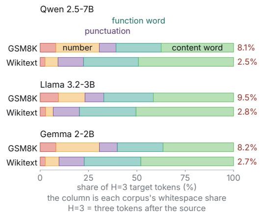

c given the target type, only whitespace is positive  
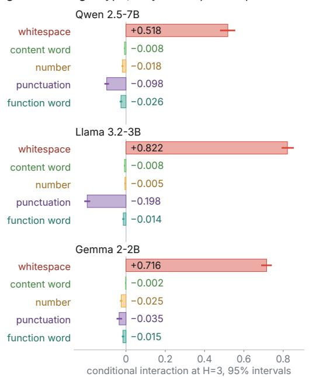

d removing whitespace reverses the pooled estimate Qwen 2.5-7B  
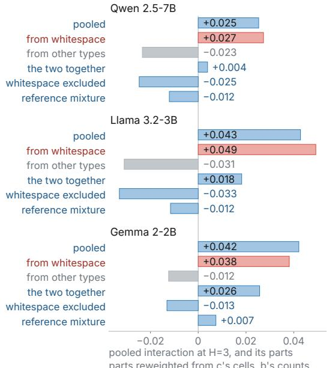  
Figure 4: The pooled depth interaction for GSM8K versus Wikitext is carried by one target type. Panel a reports ablation damage by layer band, corpus, and model for whitespace targets, on a separate 200-sequence sample. Its interaction subtracts the late row of the last column from the early row. Panels b–d come from the canonical 300-sequence sample. Panel b shows each corpus’s target-token mixture at a three-token-ahead horizon $\scriptstyle ( \mathrm { H } = 3 ) .$ , panel c gives the interaction conditional on target type with 95% intervals, and panel d places the pooled estimate beside $M ( q )$ at the combined target shares, split into its whitespace term and its other four terms, and beside the two mixture summaries. Table 1 lists the values of panel c and the pooled and summary values of panel d with their support, and Appendix A gives the three $M ( q )$ values.

## C.2 PER-SEQUENCE RECORDS FOR THE REWEIGHTED ROWS

The intervals of the whitespace-excluded and reference-mixture rows of Table 1 need per-sequence records. A second evaluation pass with the same data, length matching, 300 sequences per corpus, operator, and bands keeps these records, and it reproduces the pooled CAI and all five conditional cells of the decomposition to four decimals for all three models. Each of 2,000 bootstrap draws resamples sequences within each corpus, recomputes the five cells, and recomputes the weights from the resampled target counts. The same records give the directly measured non-whitespace row, which scores top-1 accuracy over all non-whitespace targets of each sequence together. Table 6 gives the target counts behind the weights and the support of the two cells that fall below 300 sequences.

Table 6: H=3 target counts in the canonical sample, 300 sequences per corpus. The whitespaceexcluded row of Table 1 weights the four non-whitespace cells by the summed counts of the two corpora, and the reference-mixture row weights all five cells by the Wikitext $( \mathcal { N } )$ counts. The last two columns count the sequences with at least one number or whitespace target. Every other type appears in all 300 sequences of each corpus.
<table><tr><td></td><td></td><td colspan="5">targets</td><td colspan="2">sequences</td></tr><tr><td>Model</td><td>Corpus</td><td>content</td><td>number</td><td>punct.</td><td>whitespace</td><td>function</td><td>number</td><td>whitespace</td></tr><tr><td>Qwen2.5-7B</td><td>GSM8K</td><td>15,425</td><td>9,259</td><td>3,561</td><td>3,348</td><td>9,632</td><td>300</td><td>300</td></tr><tr><td>Qwen2.5-7B</td><td>Wikitext</td><td>21,193</td><td>2,884</td><td>5,696</td><td>1,093</td><td>12,245</td><td>219</td><td>217</td></tr><tr><td>Llama-3.2-3B</td><td>GSM8K</td><td>15,427</td><td>5,093</td><td>3,618</td><td>3,526</td><td>9,512</td><td>300</td><td>300</td></tr><tr><td>Llama-3.2-3B</td><td>Wikitext</td><td>20,786</td><td>1,609</td><td>5,603</td><td>1,171</td><td>12,051</td><td>218</td><td>217</td></tr><tr><td>gemma-2-2b</td><td>GSM8K</td><td>14,624</td><td>8,997</td><td>3,731</td><td>3,281</td><td>9,482</td><td>300</td><td>300</td></tr><tr><td>gemma-2-2b</td><td>Wikitext</td><td>20,639</td><td>3,049</td><td>5,610</td><td>1,150</td><td>12,610</td><td>220</td><td>218</td></tr></table>

## C.3 WEIGHTING RULE FOR THE WHITESPACE-EXCLUDED SUMMARY

The canonical whitespace-excluded summary weights the four non-whitespace cells by the combined target counts of the two corpora, renormalized to sum to one. The expansion and held-out rows weight them by the focal corpus’s counts. Under the focal-corpus weights the canonical estimate is negative for all three models (Table 8), so the reversal holds under either weighting rule.

## C.4 TARGET-TYPE WEIGHTS

Table 7: Target-type distributions for GSM8K (R) and Wikitext $( \mathcal { N } )$ at $_ { \mathrm { H } = 3 }$
<table><tr><td>Model</td><td>Domain</td><td>content</td><td>number</td><td>punctuation</td><td>whitespace</td><td>function-word</td></tr><tr><td>Qwen2.5-7B-Instruct</td><td>GSM8K</td><td>0.3742</td><td>0.2246</td><td>0.0864</td><td>0.0812</td><td>0.2336</td></tr><tr><td>Qwen2.5-7B-Instruct</td><td>Wikitext</td><td>0.4916</td><td>0.0669</td><td>0.1321</td><td>0.0254</td><td>0.2840</td></tr><tr><td>Llama-3.2-3B-Instruct</td><td>GSM8K</td><td>0.4150</td><td>0.1370</td><td>0.0973</td><td>0.0948</td><td>0.2559</td></tr><tr><td>Llama-3.2-3B-Instruct</td><td>Wikitext</td><td>0.5043</td><td>0.0390</td><td>0.1359</td><td>0.0284</td><td>0.2924</td></tr><tr><td>gemma-2-2b-it</td><td>GSM8K</td><td>0.3646</td><td>0.2243</td><td>0.0930</td><td>0.0818</td><td>0.2364</td></tr><tr><td>gemma-2-2b-it</td><td>Wikitext</td><td>0.4793</td><td>0.0708</td><td>0.1303</td><td>0.0267</td><td>0.2929</td></tr></table>

At H=3, GSM8K has higher rates of whitespace and number targets than Wikitext.

## C.5 MIXTURE DIAGNOSTICS

Table 8: Mixture audit estimands for the canonical H=3 mean-blend interaction. The first block gives the estimands that test whether the broad H=3 interpretation survives target-token exclusion and reference-mixture reweighting. $\Delta _ { \mathrm { w s } }$ is the target whitespace-rate gap, a tokenizer-only quantity. The second block splits the pooled CAI by the identity of Appendix A, on the per-sequence records of Appendix C, which reproduce the first row to four decimals. The third block splits $M ( q )$ at the combined target shares, as drawn in Figure 4d.
<table><tr><td>Estimand</td><td>Qwen2.5-7B-Instruct</td><td>Llama-3.2-3B-Instruct</td><td>gemma-2-2b-it</td></tr><tr><td>raw pooled CAI</td><td>0.0253</td><td>0.0428</td><td>0.0421</td></tr><tr><td> $\Delta _ { \mathrm { w s } } { \mathrm { - r a t e } }$ </td><td>0.0559</td><td>0.0664</td><td>0.0551</td></tr><tr><td>ws-excluded, combined weights</td><td>-0.0247</td><td>-0.0330</td><td>-0.0131</td></tr><tr><td>ws-excluded, focal weights</td><td>-0.0233</td><td>-0.0294</td><td>-0.0143</td></tr><tr><td>reference-reweighted</td><td>-0.0121</td><td>-0.0116</td><td>0.0074</td></tr><tr><td> $M ( \pi _ { \mathcal R } )$ </td><td>0.0207</td><td>0.0513</td><td>0.0454</td></tr><tr><td>mixture-shift term</td><td>0.0057</td><td>-0.0097</td><td>-0.0011</td></tr><tr><td>residual</td><td>-0.0011</td><td>0.0012</td><td>-0.0023</td></tr><tr><td>whitespace term of  $M ( q )$ </td><td>0.0273</td><td>0.0492</td><td>0.0381</td></tr><tr><td>other four terms of  $M ( q )$ </td><td>-0.0234</td><td>-0.0310</td><td>-0.0124</td></tr><tr><td>M(q)</td><td>0.0039</td><td>0.0182</td><td>0.0257</td></tr></table>

The whitespace conditional cell is positive, and every non-whitespace conditional cell in Table 5 is non-positive. The whitespace-excluded estimate is negative for all three primary models, while reference-distribution reweighting reduces the estimate to near zero or reverses its sign.

## D EARLY/LATE MECHANISM DECOMPOSITION

Table 9 gives the accuracy components behind the canonical H=3 mean-blend whitespace cell, from the per-sequence records of Appendix C. Each accuracy is averaged within a sequence and then over the sequences that have a whitespace target. Define the early contribution as $\dot { D _ { E } ( \mathcal { R } ) } - \dot { D _ { E } ( \mathcal { N } ) }$ and the late contribution as $D _ { L } ( \mathcal { N } ) - D _ { L } ( \mathcal { R } )$ , so their sum is the cell. Negative damage means that the perturbation increased accuracy relative to control.

Table 9: Whitespace accuracy at H=3 under control, early-band, and late-band mean-blend on the canonical sample, with the damage terms $D _ { E }$ and $D _ { L }$ and the number n of sequences with a whitespace target. The last two columns give the early and late contributions to the whitespace cell of Table 1.
<table><tr><td>Model</td><td>Corpus</td><td>n</td><td>control</td><td>early</td><td>late</td><td> $D _ { E }$ </td><td> $D _ { L }$ </td><td>early contr.</td><td>late contr.</td></tr><tr><td rowspan="2">Qwen2.5-7B</td><td>GSM8K</td><td>300</td><td>0.0166</td><td>0.1273</td><td>0.7936</td><td>-0.1107</td><td>-0.7770</td><td>-0.1013</td><td>+0.6194</td></tr><tr><td>Wikitext</td><td>217</td><td>0.0418</td><td>0.0512</td><td>0.1994</td><td>-0.0094</td><td>一 -0.1576</td><td></td><td></td></tr><tr><td rowspan="2">Llama-3.2-3B</td><td>GSM8K</td><td>300</td><td>0.0179</td><td>0.1747</td><td>0.9457</td><td>-0.1567</td><td>一 -0.9277</td><td>-0.0453</td><td>+0.8667</td></tr><tr><td>Wikitext</td><td>217</td><td>0.0451</td><td>0.1566</td><td>0.1061</td><td>-0.1114</td><td>-0.0610</td><td></td><td></td></tr><tr><td rowspan="2">gemma-2-2b</td><td>GSM8K</td><td>300</td><td>0.0196</td><td>0.1438</td><td>0.8269</td><td>-0.1242</td><td>-0.8073</td><td>-0.1040</td><td>+0.8194</td></tr><tr><td>Wikitext</td><td>218</td><td>0.0504</td><td>0.0706</td><td>0.0383</td><td>-0.0202</td><td>+0.0121</td><td></td><td></td></tr></table>

The late contribution carries the whole positive cell in every model, because late-band mean-blend lifts GSM8K whitespace accuracy from near zero to most targets, a gain several times the size of its change on Wikitext in every model. The early contribution is negative in every model. Table 10 reads the predictions behind that gain. On GSM8K the late band makes a single space the top-1 prediction at 0.70 to 0.91 of all positions, whereas whitespace is the top-1 prediction at 0.09 to 0.10 of positions under control. It predicts whitespace at non-whitespace targets about as often, so the prediction barely depends on the target type. A space is the most frequent GSM8K H=3 target, at 0.08 to 0.09 of targets. On Wikitext the modal late-band prediction is a comma or $\_ \mathrm { a n d } ,$ , and whitespace stays the top-1 prediction at no more than 0.12 of positions. The late state thus moves predictions toward a frequent default continuation, and on GSM8K that continuation matches many whitespace targets.

Table 10: Top-1 predictions behind Table 9, from control and late-band mean-blend passes at $\alpha = 0 . 2$ on the same 300 sequences per corpus. The columns give the share of all positions whose top-1 token is whitespace under control and under the late band, the most frequent late-band top-1 token ( marks a space) and its share of positions, the share of non-whitespace H=3 targets at which the late band predicts whitespace, and the whitespace share of the H=3 targets.
<table><tr><td colspan="2"></td><td colspan="2">ws top-1</td><td colspan="2">modal late top-1</td><td rowspan="2">ws top-1 at non-ws targets</td><td rowspan="2">ws share of targets</td></tr><tr><td>Model</td><td>Corpus</td><td>control</td><td>late</td><td>token</td><td>share</td></tr><tr><td rowspan="2">Qwen2.5-7B</td><td>GSM8K</td><td>0.088</td><td>0.705</td><td></td><td>0.705</td><td>0.700</td><td>0.081</td></tr><tr><td>Wikitext</td><td>0.035</td><td>0.119</td><td>L and</td><td>0.215</td><td>0.118</td><td>0.025</td></tr><tr><td rowspan="2">Llama-3.2-3B</td><td>GSM8K</td><td>0.102</td><td>0.906</td><td></td><td>0.906</td><td>0.900</td><td>0.095</td></tr><tr><td>Wikitext</td><td>0.036</td><td>0.066</td><td>L L1</td><td>0.672</td><td>0.066</td><td>0.028</td></tr><tr><td rowspan="2">gemma-2-2b</td><td>GSM8K</td><td>0.097</td><td>0.726</td><td></td><td>0.726</td><td>0.717</td><td>0.082</td></tr><tr><td>Wikitext</td><td>0.056</td><td>0.059</td><td>L 1</td><td>0.371</td><td>0.060</td><td>0.027</td></tr></table>

## E POSITION AND ANSWER-DISTANCE CONTROLS

The position control applies the canonical H=3 position-aware mean-blend protocol with $\alpha = 0 . 2$ to 200 matched GSM8K and 200 matched Wikitext sequences per model. Table 14 specifies the layer bands for each architecture. Each whitespace target is annotated with its absolute and relative sequence position, target ID, distance from GSM8K’s final answer span, and correctness under the control, early, and late conditions. We first average accuracy within each sequence and then across sequences, with 95% intervals from 10,000 sequence-level bootstrap resamples drawn independently within each domain.

a positive in all five models  
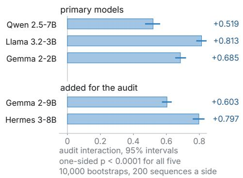  
c positive in every quarter of the sequence

b one cell of the two-by-two carries the whole audit mean-blend, H=3 mild-resample, H=1
<table><tr><td rowspan=2 colspan=5>whitespace content word whitespace content wordQwen 2.5-7B</td></tr><tr><td rowspan=1 colspan=1>+0.507</td><td rowspan=1 colspan=1>-0.007</td><td rowspan=1 colspan=1>+0.002</td><td rowspan=1 colspan=1>+0.007</td></tr><tr><td rowspan=1 colspan=1>Llama 3.2-3B</td><td rowspan=1 colspan=1>+0.795</td><td rowspan=1 colspan=1>-0.007</td><td rowspan=1 colspan=1>-0.001</td><td rowspan=1 colspan=1>+0.010</td></tr><tr><td rowspan=1 colspan=1>Gemma 2-2B</td><td rowspan=1 colspan=1>+0.682</td><td rowspan=1 colspan=1>-0.002</td><td rowspan=1 colspan=1>+0.009</td><td rowspan=1 colspan=1>+0.009</td></tr><tr><td rowspan=1 colspan=1>Gemma 2-9B</td><td rowspan=1 colspan=1>+0.602</td><td rowspan=1 colspan=1>-0.002</td><td rowspan=1 colspan=1>+0.009</td><td rowspan=1 colspan=1>+0.009</td></tr><tr><td rowspan=1 colspan=2>Hermes 3-8B +0.788</td><td rowspan=1 colspan=1>-0.007</td><td rowspan=1 colspan=1>+0.007</td><td rowspan=1 colspan=1>+0.009</td></tr><tr><td rowspan=1 colspan=1>0</td><td rowspan=1 colspan=4>or less      0.80 size of the interaction</td></tr></table>

cell = interaction for one target type under one operator gap = the whitespace cell minus the content word cell audit interaction = the mean-blend gap minus the mild-resample gap

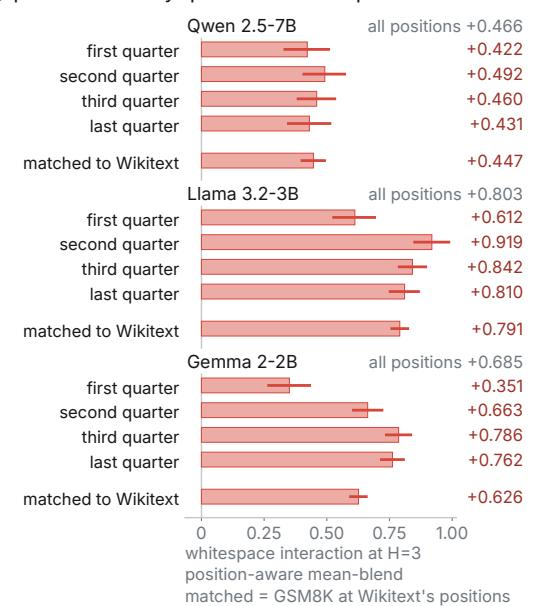

d and at every distance from the answer  
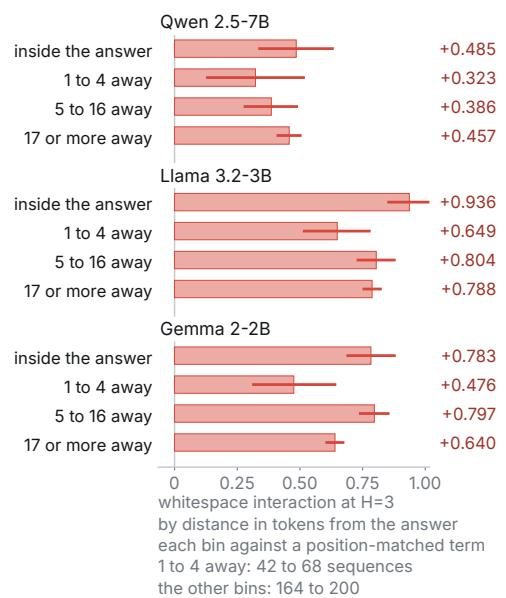  
Figure 5: The interaction persists across model instances and whitespace positions. Panel a gives the diagnostic interaction per instance with 95% intervals. Panel b shows whitespace and content-word CAI under each operator and horizon for all five same-sequence audit instances. Panel c gives the whitespace interaction by relative-position quartile and after position reweighting. Panel d groups the same estimate by distance from the final answer span, and Table 13 gives the event support.

Table 11: Whitespace CAI by relative-position quartile. Event support is reported as GSM8K/Wikitext. Sequence support varies because a sequence need not contain a whitespace event in every quartile.
<table><tr><td>Model</td><td>quartile</td><td>CAI</td><td>95% CI</td><td>events  $\mathcal { R } / \mathcal { N }$ </td></tr><tr><td rowspan="3">Qwen</td><td>Q1</td><td>+0.422</td><td>[0.327, 0.513]</td><td>349/215</td></tr><tr><td>Q2</td><td>+0.492</td><td>[0.403, 0.577]</td><td>407/205</td></tr><tr><td>Q3</td><td>+0.460</td><td>[0.380, 0.537]</td><td>723/197</td></tr><tr><td rowspan="5">Llama</td><td>Q4</td><td>+0.431</td><td>[0.341, 0.518]</td><td>778/184</td></tr><tr><td>Q1</td><td>+0.612</td><td>[0.522, 0.696]</td><td>371/225</td></tr><tr><td>Q2</td><td>+0.919</td><td>[0.845, 0.992]</td><td>370/194</td></tr><tr><td>Q3</td><td>+0.842</td><td>[0.783, 0.900]</td><td>788/189</td></tr><tr><td>Q4</td><td>+0.810</td><td>[0.747, 0.871]</td><td>850/204</td></tr><tr><td rowspan="4">Gemma</td><td>Q1</td><td>+0.351</td><td>[0.263, 0.437]</td><td>359/228</td></tr><tr><td>Q2</td><td>+0.663</td><td>[0.601, 0.725]</td><td>397/221</td></tr><tr><td>Q3</td><td>+0.786</td><td>[0.732, 0.840]</td><td>706/198</td></tr><tr><td>Q4</td><td>+0.762</td><td>[0.712, 0.811]</td><td>761/184</td></tr><tr><td colspan="5">Full-sample events: Qwen 2,257/801, Llama 2,379/812, and Gemma 2,223/831.</td></tr></table>

All 12 quartile intervals exclude zero, and the final table row gives the full-sample event support. Quartile conditioning leaves a residual position mixture, so we partition relative position into deciles and reweight the GSM8K depth term to Wikitext’s empirical whitespace-position distribution.

Table 12: Position-matched whitespace estimate. The GSM8K depth term is reweighted to Wikitext’s relative-position decile weights. The Wikitext term retains its empirical distribution.
<table><tr><td>Model</td><td>position-matched CAI</td><td>95% CI</td></tr><tr><td>Qwen2.5-7B</td><td>+0.447</td><td>[0.395, 0.496]</td></tr><tr><td>Llama-3.2-3B</td><td>+0.791</td><td>[0.754, 0.828]</td></tr><tr><td>gemma-2-2b</td><td>+0.626</td><td>[0.589, 0.663]</td></tr></table>

For the answer-distance control, the final GSM8K answer span begins at the last occurrence of the literal phrase The answer is and continues to the end of the sequence. Each GSM8K bin is compared with a Wikitext depth term reweighted to that bin’s relative-position distribution, so each bin contrast matches the two domains on relative position.

Table 13: GSM8K whitespace CAI by distance from the final answer span, each compared with position-matched Wikitext. Support is GSM8K sequences/events.
<table><tr><td>Model</td><td>bin</td><td>CAI</td><td>95% CI</td><td>sequences/events</td></tr><tr><td rowspan="3">Qwen</td><td>inside answer</td><td>+0.485</td><td>[0.334, 0.635]</td><td>200/200</td></tr><tr><td>1–4 tokens</td><td>+0.323</td><td>[0.126, 0.520]</td><td>46/46</td></tr><tr><td>5–16 tokens</td><td>+0.386</td><td>[0.275, 0.492]</td><td>169/331</td></tr><tr><td rowspan="5">Llama</td><td>17+ tokens</td><td>+0.457</td><td>[0.407, 0.507]</td><td>196/1680</td></tr><tr><td>inside answer</td><td>+0.936</td><td>[0.848, 1.017]</td><td>200/200</td></tr><tr><td>1-4 tokens</td><td>+0.649</td><td>[0.512, 0.782]</td><td>68/68</td></tr><tr><td>5–16 tokens</td><td>+0.804</td><td>[0.726, 0.882]</td><td>174/350</td></tr><tr><td>17+ tokens</td><td>+0.788</td><td>[0.750, 0.827]</td><td>198/1761</td></tr><tr><td rowspan="5">Gemma</td><td>inside answer</td><td>+0.783</td><td>[0.686, 0.882]</td><td>200/200</td></tr><tr><td>1–4 tokens</td><td>+0.476</td><td>[0.310, 0.645]</td><td>42/42</td></tr><tr><td>5–16 tokens</td><td>+0.797</td><td>[0.735, 0.858]</td><td>164/303</td></tr><tr><td>17+ tokens</td><td>+0.640</td><td>[0.602, 0.677]</td><td>196/1678</td></tr><tr><td></td><td></td><td></td><td></td></tr></table>

Every answer-distance interval is positive, including the bin for targets at least 17 tokens away, as Figure 5d shows. Table 13 gives each bin’s sequence and event support. The effect therefore survives conditioning on relative position and on distance from the literal answer phrase.

Table 14: Layer bands used for the position control. Qwen and Llama use early layers 0–8 and late layers 18–27 of 28 total layers.
<table><tr><td>Model</td><td>total layers</td><td>early band</td><td>late band</td></tr><tr><td>Qwen2.5-7B</td><td>28</td><td>0-8</td><td>18-27</td></tr><tr><td>Llama-3.2-3B</td><td>28</td><td>0-8</td><td>18-27</td></tr><tr><td>gemma-2-2b</td><td>26</td><td>0-7</td><td>16-25</td></tr></table>

## F TOKEN TYPE BY INTERVENTION SETTING

## F.1 AUDIT CELLS

Table 15: Same-sequence $2 \times 2$ audit cells for ${ \cal I } = ( \mathrm { m b } _ { H = 3 , \mathrm { w s } } - \mathrm { m b } _ { H = 3 , \mathrm { c o n t } } ) - ( \mathrm { r s } _ { H = 1 , \mathrm { w s } } - \mathrm { \Gamma }$ $\mathrm { r s } _ { H = 1 , \mathrm { c o n t } } )$ . The estimates use the audit sample and bootstrap analysis.
<table><tr><td>Model</td><td> $\operatorname { m b } _ { H = 3 , \mathrm { w s } }$ </td><td> $\operatorname { m b } _ { H = 3 , \operatorname { c o n t } }$ </td><td> $\mathrm { r s } _ { H = 1 , \mathrm { w s } }$ </td><td> $\mathbf { r } \mathbf { S } _ { H = 1 , \mathrm { c o n t } }$ </td><td>I</td><td>95% CI</td></tr><tr><td>Qwen2.5-7B-Instruct</td><td>0.5066</td><td>-0.0074</td><td>0.0020</td><td>0.0072</td><td>0.5193</td><td>[0.4705, 0.5621]</td></tr><tr><td>gemma-2-2b-it</td><td>0.6820</td><td>-0.0022</td><td>0.0087</td><td>0.0094</td><td>0.6850</td><td>[0.6534, 0.7192]</td></tr><tr><td>Llama-3.2-3B-Instruct</td><td>0.7954</td><td>-0.0072</td><td>-0.0005</td><td>0.0102</td><td>0.8133</td><td>[0.7811, 0.8436]</td></tr><tr><td>gemma-2-9b-it</td><td>0.6015</td><td>-0.0019</td><td>0.0093</td><td>0.0093</td><td>0.6034</td><td>[0.5729, 0.6325]</td></tr><tr><td>Hermes-3-Llama-3.1-8B</td><td>0.7879</td><td>-0.0069</td><td>0.0069</td><td>0.0089</td><td>0.7968</td><td>[0.7597, 0.8312]</td></tr></table>

Figure 5a gives each interaction with its 95% interval, while Figure 5b shows the same-sequence audit cells for all five instances and Table 15 reports those cells numerically. All five audit interactions are positive, with no non-positive draw among 10,000 bootstrap resamples. In every instance the

mean-blend H=3 whitespace cell exceeds its content cell by more than 0.51. The mild-resample H=1 whitespace and content cells agree to within 0.011.

## F.2 WHAT THE INTERACTION SUBTRACTS

A high whitespace CAI can come from a whitespace-sensitive domain feature or from an operator artifact, and control accuracy differs across models. The interaction I subtracts the content cell within each operator and then subtracts the matched mild-resample difference, so it measures how far the whitespace cell of the primary setting separates from its content-token cell, relative to the same gap in the reference setting.

## G SCOPE CHECKS FOR THE AUDIT

## G.1 OPERATOR, HORIZON, AND TARGET-TYPE GRID

Table 16 expands the main audit contrast into a compact operator × horizon × target-type grid on GSM8K/Wikitext. The mean-blend and mild-resample cells come from estimates with different sample sizes. The grid shows the sign pattern across the cells, and the main interaction gives the estimate with its bootstrap uncertainty.

Table 16: Operator × horizon × target-type grid on GSM8K/Wikitext. Values are top-1 CAI. Mean-blend cells use the target-type decomposition, whereas mild-resample cells use the effect-size analysis.
<table><tr><td>Model</td><td>Operator</td><td>H=1 ws</td><td>H=1 content</td><td>H=3 ws</td><td>H=3 content</td></tr><tr><td>Qwen2.5-7B</td><td>mean-blend</td><td>-0.149</td><td>-0.093</td><td>+0.518</td><td>-0.008</td></tr><tr><td>Qwen2.5-7B</td><td>mild-resample</td><td>-0.001</td><td>+0.011</td><td>-0.013</td><td>-0.001</td></tr><tr><td>Llama-3.2-3B</td><td>mean-blend</td><td>+0.208</td><td>-0.206</td><td>+0.821</td><td>-0.008</td></tr><tr><td>Llama-3.2-3B</td><td>mild-resample</td><td>-0.004</td><td>+0.012</td><td>-0.009</td><td>-0.0001</td></tr><tr><td>gemma-2-2b</td><td>mean-blend</td><td>+0.231</td><td>-0.116</td><td>+0.715</td><td>-0.002</td></tr><tr><td>gemma-2-2b</td><td>mild-resample</td><td>-0.004</td><td>+0.009</td><td>+0.014</td><td>-0.001</td></tr></table>

The grid separates the two findings: whitespace concentration is largest for mean-blend at H=3, whereas mild-resample H=3 is near zero for both target types. Appendix K.4 splits the positive mild-resample content cell at H=1 by control accuracy.

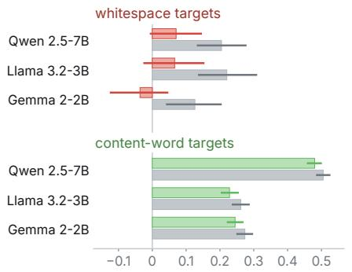  
a only mean-blend at H=3 singles out whitespace in all three whitespace content word

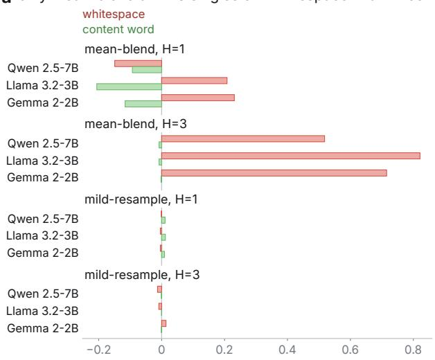

b a small content residual survives at H=1  
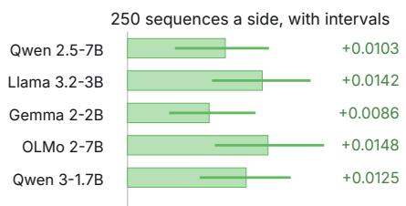  
conditional interaction at the target type, top-1 accuracy at H=1 mean-blend the gap is −0.06, +0.41 and +0.35, by row every mild-resample cell is within 0.015 of zero cells draw on separate analyses, so sample sizes differ; the appendix grid records the values; no intervals here

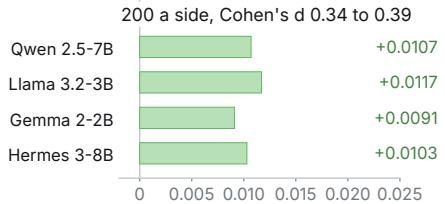  
H=1 content-word interaction, mild-resample, early and late thirds alpha 0.2; one cell, two analyses, all nine positive the residual is 0.0086 to 0.0148 of top-1 accuracy; in the 200-a-side bank it is 1.2% to 1.9% of the reasoning corpus's control top-1  
c under patching it is content that moves

d and without an ablation the difference still arrives late  
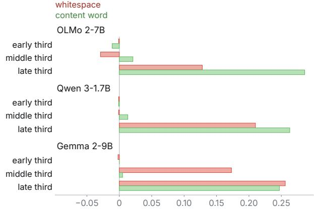  
top-1 patching damage, GSM8K minus Wikitext, 120 sequences a side, 89 to 91 Wikitext sequences in the whitespace rows; alpha 0.2 early-band blend, 1,000 bootstraps upper bar = same-corpus donor, lower = other-corpus donor  
logit-lens top-1 at H=1, GSM8K minus Wikitext, mean per layer third; no ablation, no band contras flat until the last third, except Gemma 2-9B's whitespace at +0.17 in the middle

Figure 6: Whitespace concentration is largest under one operator and horizon, and checks outside that cell yield small positive content-token effects. Panel a shows whitespace and content-word CAI over the operator × horizon grid. Panel b shows two measurements of the H=1 mild-resample content-word CAI: 250 sequences per corpus with 95% intervals, and 200 per corpus with Cohen’s d. Panel c gives the activation-patching check at top-1 by target type, with the same-corpus donor above and the other-corpus donor below. Panel d reports unablated logit-lens top-1 accuracy at H=1, GSM8K minus Wikitext, averaged within each layer third. Table 16 records the grid cell by cell, and Appendix G.2 gives the patching and logit-lens protocols.

## G.2 CHECKS BEYOND CAI

These checks test whether target-type auditing remains informative beyond top-1 CAI. For each readout or intervention, we ask which target-token types drive the aggregate, whether mixture diagnostics change the conclusion, and whether a task-appropriate non-whitespace cell remains.

## G.2.1 LOG-PROBABILITY CAI TARGET-TYPE AUDIT

Table 17 compares target log probability with a matched top-1 estimate. The top-1 artifact remains concentrated on whitespace in all three primary models. The two readouts yield different results: the pooled result reverses for Qwen, whereas Llama and Gemma remain positive before reference reweighting. Under log probability, the content, punctuation, and function-word cells and the reference-reweighted estimate are negative in all three models, and the number cell is positive for Llama and Gemma.

Table 17: H=3 mean-blend CAI under top-1 and log-probability readouts, split by target type on GSM8K/Wikitext. The top-1 rows provide a matched comparison for log probability. “ws-excl.” renormalizes over non-whitespace types, and “ref-rw.” applies Wikitext target-type proportions.
<table><tr><td>Model</td><td>Readout</td><td>pooled</td><td>WS</td><td>content</td><td>nonws</td><td>ws-excl.</td><td>ref-rw.</td></tr><tr><td>Qwen2.5-7B</td><td>top-1</td><td>+0.026</td><td>+0.464</td><td>-0.008</td><td>-0.023</td><td>-0.021</td><td>-0.010</td></tr><tr><td>Qwen2.5-7B</td><td>logprob</td><td>-1.031</td><td>+0.444</td><td>-1.062</td><td>-1.298</td><td>-1.222</td><td>-1.381</td></tr><tr><td>Llama-3.2-3B</td><td>top-1</td><td>+0.042</td><td>+0.797</td><td>-0.008</td><td>-0.033</td><td>-0.030</td><td>-0.011</td></tr><tr><td>Llama-3.2-3B</td><td>logprob</td><td>+0.141</td><td>+1.448</td><td>-0.266</td><td>-0.114</td><td>+0.056</td><td>-0.166</td></tr><tr><td>gemma-2-2b</td><td>top-1</td><td>+0.041</td><td>+0.682</td><td>-0.002</td><td>-0.016</td><td>-0.015</td><td>+0.007</td></tr><tr><td>gemma-2-2b</td><td>logprob</td><td>+0.249</td><td>+0.961</td><td>-0.046</td><td>+0.097</td><td>-0.012</td><td>-0.147</td></tr></table>

## G.2.2 CONTINUOUS TARGET-MARGIN AUDIT

The target margin is the gold target token’s logit minus the largest competing logit. It changes continuously as a perturbation moves the gold token, including movements that leave the gold token at rank one. The damage and CAI equations keep their form, with mean target margin as the scored quantity. We retain conditioning by horizon (H=1/H=3) and target type (whitespace/content).

Table 18: Target-margin CAI on GSM8K/Wikitext. Brackets are 95% bootstrap intervals.
<table><tr><td>Model</td><td>H=1 whitespace</td><td>H=1 content</td><td>H=3 whitespace</td><td>H=3 content</td></tr><tr><td>Qwen2.5-7B</td><td>+1.661 [1.338, 1.974]</td><td>-0.535 [–0.758, -0.313]</td><td>+1.721 [1.413, 2.035]</td><td>-1.188 [-1.354, -1.013]</td></tr><tr><td>Llama-3.2-3B</td><td>+2.198 [1.971, 2.420]</td><td>-0.819 [-1.039, -0.617]</td><td>+3.374 [3.101, 3.644]</td><td>-0.388 [-0.530, -0.246]</td></tr><tr><td>gemma-2-2b</td><td>+1.229 [1.010, 1.444]</td><td>+0.172 [–0.018, 0.368]</td><td>+1.593 [1.374, 1.803]</td><td>-0.279 [–0.420, -0.145]</td></tr></table>

All six whitespace intervals exclude zero, while five of the six content point estimates are negative and the remaining Gemma H=1 interval includes zero. The H=3 target-type asymmetry therefore holds on a continuous scale as well, with different CAI magnitudes on the two readouts.

## G.2.3 NON-CAI LAYERWISE LENS AUDIT

Table 19 reports a non-intervention residual-stream logit-lens readout on the same three primary models. The estimand is a layerwise top-1 domain difference, averaged over the late third of layers and split by target type. At H=1, the content-target late-layer contrast exceeds the pooled estimate in all three models. At H=3, the late-layer contrasts are near zero, so the CAI artifact is absent from this readout. Target-type conditioning therefore changes the interpretation of this layerwise readout, which lies outside the CAI estimand.

Table 19: Non-CAI logit-lens target-type audit. Values are late-band top-1 domain differences on GSM8K/Wikitext, averaged over the final third of layers.
<table><tr><td>Model</td><td>H=1 pooled</td><td>H=1 ws</td><td>H=1 cont.</td><td>H=1 nonws</td><td>H=3 pooled</td><td>H=3 ws</td><td>H=3 cont.</td><td>H=3 nonws</td></tr><tr><td>Qwen2.5-7B</td><td>+0.1332</td><td>+0.0778</td><td>+0.1918</td><td>+0.1365</td><td>+0.0004</td><td>-0.0047</td><td>+0.0012</td><td>+0.0005</td></tr><tr><td>Llama-3.2-3B</td><td>+0.1908</td><td>+0.1961</td><td>+0.2460</td><td>+0.1928</td><td>+0.0021</td><td>-0.0041</td><td>+0.0051</td><td>+0.0025</td></tr><tr><td>gemma-2-2b</td><td>+0.1678</td><td>+0.1004</td><td>+0.1984</td><td>+0.1657</td><td>+0.0026</td><td>-0.0167</td><td>+0.0020</td><td>+0.0030</td></tr></table>

## G.2.4 ACTIVATION PATCHING WITH TARGET-TYPE UNCERTAINTY

Table 20 reports an H=1 activation-patching check with target-type bootstrap intervals. Each estimate is GSM8K damage minus Wikitext damage, where damage is the control H=1 score minus the score after each early-band layer’s output is blended, position by position, toward a donor sequence’s at $\alpha = 0 . 2$ . The same-domain donor is another sequence of the same corpus, and the cross-domain donor is the aligned sequence of the other corpus. In the table the score is target log probability. Same-domain patching is positive for content and non-whitespace targets in all three primary models. Cross-domain patching is strongly reversed in Qwen, reversed or null in Gemma, and attenuated but still weakly positive for non-whitespace targets in Llama. These results separate same-domain from cross-domain patching, and the cross-domain sign varies by model. Figure 6c shows the same intervention scored by top-1 correctness for whitespace and content-word targets.

Table 20: Activation-patching target-type check. Values are H=1 log-probability effects with 95% bootstrap intervals.
<table><tr><td>Model</td><td>content same</td><td>content cross</td><td>nonws same</td><td>nonws cross</td></tr><tr><td>Qwen2.5-7B</td><td>+9.725 [8.891, 10.576]</td><td>-4.723 [-5.510, -3.842]</td><td>+8.632 [7.798, 9.365]</td><td>-4.763 [-5.515, -3.949]</td></tr><tr><td>Llama-3.2-3B</td><td>+1.616 [1.093, 2.186]</td><td>+0.048 [-0.483, 0.581]</td><td>+2.225 [1.772, 2.715]</td><td>+0.694 [0.149, 1.172]</td></tr><tr><td>gemma-2-2b</td><td>+1.654 [1.108, 2.178]</td><td>-0.218 [–0.784, 0.325]</td><td>+1.641 [1.183, 2.105]</td><td>-0.170 [–0.692, 0.299]</td></tr></table>

These results show that the target-type audit applies to aggregate readouts and interventions over naturalistic domain contrasts.

## H PRIOR-PATTERN TAXONOMY

The audit applies to reporting patterns that aggregate over naturalistic target populations. Table 21 summarizes the main cases and our results for two comparisons motivated by DoLa. The extended taxonomy in Table 22 separates these aggregates from fixed-target settings, where domain-level target mixtures pose less risk.

Table 21: At-risk reporting patterns and the evidence needed before a broad depth claim. DoLa motivates the two corpus pairs measured here with our operators, and the other rows identify settings in which the diagnostic applies.
<table><tr><td>Pattern</td><td>Risk</td><td>Required check / result here</td></tr><tr><td>Layerwise readout</td><td>Pooling next-token scores across naturalistic corpora</td><td>Target-type cells and mixture matching</td></tr><tr><td>Layer contrast / DoLa</td><td>Corpus-level layer buckets may covary with format</td><td>GSM8K/FACTOR high-risk in 3/3. StrategyQA/FACTOR low-region in 3/3</td></tr><tr><td>Causal tracing / patching</td><td>Localization score depends on target population as well as intervention</td><td>Log target id and condition on task-appropriate targets</td></tr><tr><td>Ablation CAI</td><td>Replicated pooled interaction may inherit a stable mixture gap</td><td>Canonical pooled effect becomes negative after whitespace removal in 3/3</td></tr></table>

Table 22: Reporting patterns covered by the target-type audit.
<table><tr><td>Experimental pattern</td><td>Why it is at risk</td><td>What the audit changes</td></tr><tr><td>Layerwise top-1 next-token readouts over math/prose or code/prose corpora, as in logit- lens, tuned-lens, or patchscope- style studies when summarized by naturalistic-domain accu- racy</td><td>The readout pools different target- token populations before assign- ing a depth label</td><td>Report target-type cells and reweighted estimates before inter- preting a replicated layer peak as depth specialization</td></tr><tr><td>Layer-contrast or intervention scores aggregated over natu- ralistic domain pairs, includ- ing DoLa-style layer contrasts or activation-patching variants when used as domain-level</td><td>The layer or intervention contrast can inherit tokenizer and target- mixture asymmetries from the benchmark</td><td>Surviving non-whitespace cells and mixture-matched estimates support the broad claim. Their collapse identifies a stable measurement con- found</td></tr><tr><td>next-token metrics Fixed-target factual tracing or prompt-local causal restoration, such as ROME-style factual as- sociation localization Scenario- or option-level evalu- ations with matched answer for-</td><td>The target token is usually part of the constructed prompt or fact, so domain mixture is a secondary threat there Target-token composition is partly controlled by the bench- mark design</td><td>The audit becomes relevant when the same tools are scaled to natural- istic domain aggregates Report the format control. Target- type auditing becomes important if</td></tr></table>

## I CONDITION ACCOUNTING FOR THE COVERAGE TABLE

Table 3 reports one row per corpus pair. The table contains 33 decomposed model–pair rows across the eleven fully decomposed pairs. Two further pairs enter only the calibration screen: code/Wikitext, labelled boundary, and HotpotQA/AGNews, the lower-risk calibration region of Table 33. The HotpotQA/AGNews mean gaps, $\Delta _ { \mathrm { w s } } = 0 . 0 2 1$ and $\Delta _ { \mathrm { c h a r s } } = 0 . 3 8$ , meet the medium rule of Table 2. For these pairs the audit measured the diagnostic interaction I on each primary model (Table 31) without a pooled or whitespace-excluded decomposition, so they have no row in Table 3. The canonical pair contributes two audit-only instances, and each screen-only pair adds three instances. The total is therefore 41 distinct conditions over 13 pairs and five instances once these additions are included. Table 16 records the two central interventions at both horizons, and Table 23 gives 95% intervals for the pooled and whitespace-excluded values of the ten expansion pairs, one row per pair and model.

Table 23: H=3 mean-blend top-1 CAI for the ten expansion pairs of Table 3, one row per pair and model (30 rows), pooled and with whitespace excluded, each with its 95% sequence-bootstrap interval. Each of 2,000 draws resamples sequences within each corpus and recomputes the cells, with the weights held at the screen’s target-type shares. The intervals come from an evaluation pass that repeats each audit’s sequences, operator, bands, and horizon and reproduces every pooled value, conditiona cell, and mixture summary of the audit to within $1 0 ^ { - 6 }$ . The number cells of GSM8K/TinyStories and TinyStories/AGNews, with 4 and 1 sequence pairs, fall below the support rule of 10 and stay out of the whitespace-excluded summary, as in the audit, and Table 24 gives every row’s support. Measured directly over all non-whitespace targets, numbers included, the CAI of these six rows has the sign of their whitespace-excluded values, from −0.0314 to −0.0289 on GSM8K/TinyStories and from +0.0064 to +0.0222 on TinyStories/AGNews. A draw in which a retained cell falls below the rule is dropped, which leaves 1,750 to 1,997 draws in five whitespace-excluded rows, the three ARC rows and the Qwen and Llama SQuAD rows. A value that rounds to zero is printed to its first significant digit.
<table><tr><td>Pair</td><td>model</td><td>n</td><td>pooled</td><td>95% interval</td><td>ws-excl.</td><td>95% interval</td></tr><tr><td rowspan="3">GSM8K/TinyStories</td><td>Qwen</td><td>200</td><td>+0.0254</td><td>[0.0209, 0.0298]</td><td>-0.0291</td><td>[-0.0321, -0.0262]</td></tr><tr><td>Llama</td><td>195</td><td>+0.0407</td><td>[0.0358, 0.0453]</td><td>-0.0280</td><td>[-0.0307, -0.0255]</td></tr><tr><td>Gemma</td><td>200</td><td>+0.0276</td><td>[0.0211, 0.0336]</td><td>-0.0238</td><td>[-0.0273, -0.0201]</td></tr><tr><td rowspan="3">GSM8K/FACTOR-News</td><td>Qwen</td><td>200</td><td>+0.0340</td><td>[0.0297, 0.0386]</td><td>-0.0182</td><td>[-0.0213, -0.0151]</td></tr><tr><td>Llama</td><td>200</td><td>+0.0467</td><td>[0.0420, 0.0514]</td><td>-0.0266</td><td>[-0.0296, -0.0236]</td></tr><tr><td>Gemma</td><td>200</td><td>+0.0351</td><td>[0.0286, 0.0413]</td><td>-0.0207</td><td>[–0.0247, -0.0167]</td></tr><tr><td rowspan="3">MATH/Wikitext</td><td>Qwen</td><td>200</td><td>-0.0087</td><td>[-0.0133, -0.0040]</td><td>-0.0242</td><td>[-0.0276, -0.0208]</td></tr><tr><td>Llama</td><td>200</td><td>+0.0062</td><td>[0.0007, 0.0120]</td><td>-0.0314</td><td>[-0.0358, -0.0269]</td></tr><tr><td>Gemma</td><td>200</td><td>+0.0120</td><td>[0.0072, 0.0167]</td><td>-0.0079</td><td>[-0.0112, -0.0045]</td></tr><tr><td rowspan="3">DROP/Wikitext</td><td>Qwen</td><td>168</td><td>+0.0078</td><td>[0.0032, 0.0126]</td><td>-0.0211</td><td>[-0.0239, -0.0180]</td></tr><tr><td>Llama</td><td>185</td><td>+0.0179</td><td>[0.0136, 0.0222]</td><td>-0.0283</td><td>[-0.0311, -0.0256]</td></tr><tr><td>Gemma</td><td>159</td><td>+0.0123</td><td>[0.0085, 0.0164]</td><td>-0.0143</td><td>[-0.0171, -0.0113]</td></tr><tr><td rowspan="3">code/docstrings</td><td>Qwen</td><td>200</td><td>-0.0051</td><td>[-0.0099, -0.0009]</td><td>-0.0194</td><td>[-0.0243, -0.0150]</td></tr><tr><td>Llama</td><td>200</td><td>-0.0060</td><td>[-0.0101, -0.0019]</td><td>-0.0131</td><td>[-0.0178, -0.0087]</td></tr><tr><td>Gemma</td><td>200</td><td>+0.0166</td><td>[0.0117, 0.0216]</td><td>-0.0352</td><td>[-0.0407, -0.0294]</td></tr><tr><td rowspan="3">AGNews/Wikitext</td><td>Qwen</td><td>82</td><td>-0.0192</td><td>[-0.0264, -0.0119]</td><td>-0.0174</td><td>[-0.0250, -0.0103]</td></tr><tr><td>Llama</td><td>75</td><td>-0.0006</td><td>[-0.0097, 0.0086]</td><td>+0.00003</td><td>[-0.0086, 0.0090]</td></tr><tr><td>Gemma</td><td>82</td><td>+0.0051</td><td>[-0.0021, 0.0122]</td><td>+0.0050</td><td>[-0.0032, 0.0131]</td></tr><tr><td rowspan="3">SQuAD/AGNews</td><td>Qwen</td><td>118</td><td>+0.0245</td><td>[0.0158, 0.0336]</td><td>+0.0221</td><td>[0.0127, 0.0321]</td></tr><tr><td>Llama</td><td>119</td><td>-0.0017</td><td>[-0.0078, 0.0050]</td><td>-0.0120</td><td>[-0.0197, -0.0041]</td></tr><tr><td>Gemma</td><td>138</td><td>+0.00002</td><td>[-0.0081, 0.0083]</td><td>-0.0082</td><td>[-0.0178, 0.0014]</td></tr><tr><td rowspan="3">ARC/Wikitext</td><td>Qwen</td><td>189</td><td>+0.0038</td><td>[-0.0008, 0.0082]</td><td>+0.0051</td><td>[0.0004, 0.0096]</td></tr><tr><td>Llama</td><td>196</td><td>-0.0089</td><td>[-0.0131, -0.0047]</td><td>-0.0241</td><td>[-0.0293, -0.0192]</td></tr><tr><td>Gemma</td><td>190</td><td>+0.0074</td><td>[0.0039, 0.0109]</td><td>+0.0070</td><td>[0.0033, 0.0108]</td></tr><tr><td>StrategyQA/ FACTOR-News</td><td>Qwen</td><td>150</td><td>-0.0048</td><td>[-0.0094, -0.00002]</td><td>-0.0055</td><td>[-0.0102, -0.0007]</td></tr><tr><td rowspan="2"></td><td>Llama</td><td>135</td><td>-0.0070</td><td>[-0.0118, -0.0026]</td><td>-0.0075</td><td>[-0.0121, -0.0031]</td></tr><tr><td>Gemma</td><td>149</td><td>+0.0009</td><td>[–0.0052, 0.0071]</td><td>+0.0011</td><td>[-0.0047, 0.0072]</td></tr><tr><td rowspan="3">TinyStories/AGNews</td><td>Qwen</td><td>200</td><td>+0.0099</td><td>[0.0058, 0.0141]</td><td>+0.0205</td><td>[0.0159, 0.0252]</td></tr><tr><td>Llama Gemma</td><td>200</td><td>+0.0060</td><td>[0.0021, 0.0096]</td><td>+0.0055</td><td>[0.0008, 0.0101]</td></tr><tr><td></td><td>200</td><td>+0.0060</td><td>[0.0012, 0.0108]</td><td>+0.0050</td><td>[-0.0004, 0.0101]</td></tr></table>

Table 24: Support behind Table 23. A sequence pair is the focal and the reference sequence at one index. Each sequence receives three passes, the unablated control pass and the early-band and late-band mean-blend passes, and a pair enters a cell when both sequences have an H=3 target of that type in all three. The content, punctuation, and function-word cells use every pair in every row except the code/docstrings function-word cells, at 193, 193, and 192 of 200 for Qwen, Llama, and Gemma. Target counts are the H=3 targets of each corpus in the control pass, focal / reference, and the non-whitespace column sums the four other types. ∗ marks a cell below the support rule of 10 pairs, which is not estimated. The six starred number cells stay out of their rows’ whitespace-excluded summaries. The starred whitespace cell, Llama on SQuAD/AGNews, enters neither printed value of Table 23, since the pooled value uses all targets and the whitespace-excluded value drops whitespace.
<table><tr><td></td><td></td><td></td><td colspan="2">whitespace</td><td colspan="2">number</td><td>non-whitespace</td></tr><tr><td>Pair</td><td>model</td><td>n</td><td>pairs</td><td>targets</td><td>pairs</td><td>targets</td><td>targets</td></tr><tr><td>GSM8K/TinyStories</td><td>Qwen</td><td>200</td><td>89</td><td>2,600 / 208</td><td>4*</td><td>7,002 / 4</td><td>28,837 / 33,433</td></tr><tr><td></td><td>Llama</td><td>195</td><td>84</td><td>2,722 / 192</td><td>4*</td><td>3,977 / 4</td><td>27,058 / 32,332</td></tr><tr><td></td><td>Gemma</td><td>200</td><td>193</td><td>2,631 / 770</td><td>4*</td><td>7,036 /4</td><td>29,125 / 32,955</td></tr><tr><td>GSM8K/FACTOR-News</td><td>Qwen</td><td>200</td><td>195</td><td>2,339 / 733</td><td>196</td><td>6,201 / 2,090</td><td>25,533 / 28,488</td></tr><tr><td></td><td>Llama</td><td>200</td><td>195</td><td>2,447 / 745</td><td></td><td>1963,632 / 1,180</td><td>23,729 / 27,605</td></tr><tr><td></td><td>Gemma</td><td>200</td><td>196</td><td>2,394 / 729</td><td>197</td><td>6,241 / 2,066</td><td>25,562 / 28,327</td></tr><tr><td>MATH/Wikitext</td><td>Qwen</td><td>200</td><td>135</td><td>1,075 / 794</td><td>151</td><td>5,933 / 2,080</td><td>28,377 / 27,132</td></tr><tr><td></td><td>Llama</td><td>200</td><td>139</td><td>1,092 / 852</td><td>151</td><td>4,581 / 1,132</td><td>27,596 /26,411</td></tr><tr><td></td><td>Gemma</td><td>200</td><td>137</td><td>1,076 / 813</td><td>151</td><td>5,905 / 2,132</td><td>27,549 / 26,935</td></tr><tr><td>DROP/Wikitext</td><td>Qwen</td><td>168</td><td>137</td><td>1,839 / 845</td><td>139</td><td>5,070 / 2,183</td><td>30,388 / 29,844</td></tr><tr><td></td><td>Llama</td><td>185</td><td>149</td><td>2,106 / 957</td><td>150</td><td>3,355 / 1,267</td><td>32,421/31,417</td></tr><tr><td></td><td>Gemma</td><td>159</td><td>132</td><td>1,744 / 823</td><td>133</td><td>4,956 /2,132</td><td>28,149 / 27,847</td></tr><tr><td>code/docstrings</td><td>Qwen</td><td>200</td><td>40</td><td>2,747 / 115</td><td>37</td><td>439 / 549</td><td>17,929 / 17,135</td></tr><tr><td></td><td>Llama</td><td>200</td><td>41</td><td>2,747 / 121</td><td>38</td><td>348 / 419</td><td>18,038 / 17,366</td></tr><tr><td></td><td>Gemma</td><td>200</td><td>45</td><td>4,036 / 132</td><td>38</td><td>383 / 638</td><td>18,781 / 19,053</td></tr><tr><td>AGNews/Wikitext</td><td>Qwen</td><td>82</td><td>22</td><td>67 / 129</td><td>29</td><td>263 / 354</td><td>4,178 / 4,990</td></tr><tr><td></td><td>Llama</td><td>75</td><td>19</td><td>62 / 120</td><td>26</td><td>127 / 168</td><td>3,787 / 4,464</td></tr><tr><td></td><td>Gemma</td><td>82</td><td>23</td><td>68 / 134</td><td>31</td><td>296 / 361</td><td>4,363 / 5,018</td></tr><tr><td>SQuAD/AGNews</td><td>Qwen</td><td>118</td><td>13</td><td>86 / 46</td><td>24</td><td>373 / 175</td><td>4,170 / 4,496</td></tr><tr><td></td><td>Llama</td><td>119</td><td>8*</td><td>59 / 57</td><td>15</td><td>133 / 128</td><td>4,384 / 4,620</td></tr><tr><td></td><td>Gemma</td><td>138</td><td>14</td><td>103 / 51</td><td>28</td><td>458 / 190</td><td>4,911 / 5,356</td></tr><tr><td>ARC/Wikitext</td><td>Qwen</td><td>189</td><td>14</td><td>81 / 365</td><td>17</td><td>205 / 1,042</td><td>13,264 / 16,081</td></tr><tr><td></td><td>Llama</td><td>196</td><td>13</td><td>91 / 436</td><td>16</td><td>134 /635</td><td>13,891 / 16,784</td></tr><tr><td></td><td>Gemma</td><td>190</td><td>11</td><td>91 /362</td><td>15</td><td>220 / 1,043</td><td>13,768 / 16,053</td></tr><tr><td>StrategyQA/FACTOR-News</td><td>Qwen</td><td>150</td><td>81</td><td>244 / 445</td><td>82</td><td>818 / 1,224</td><td>11,148 / 16,506</td></tr><tr><td></td><td>Llama</td><td>135</td><td>66</td><td>195 / 410</td><td>67</td><td>331 / 612</td><td>10,066 /13,935</td></tr><tr><td></td><td>Gemma</td><td>149</td><td>77</td><td>240 / 445</td><td>78</td><td>819 / 1,223</td><td>10,958 / 15,884</td></tr><tr><td>TinyStories/AGNews</td><td>Qwen</td><td>200</td><td>43</td><td>147 / 395</td><td>1*</td><td>3 / 994</td><td>28,272 /12,321</td></tr><tr><td></td><td>Llama</td><td>200</td><td>41</td><td>147 /388</td><td>1*</td><td>1/ 491</td><td>28,470 / 12,087</td></tr><tr><td></td><td>Gemma</td><td>200</td><td>124</td><td>661 /398</td><td>1*</td><td>4 / 1,018</td><td>28,287 / 12,480</td></tr></table>

## J RISK STRATIFICATION AND HELD-OUT EXPANSION

## J.1 PROSPECTIVE HELD-OUT DOMAIN-PAIR EXPANSION

The held-out analysis tests risk stratification: whether the screen assigns each pair to the region it later occupies. We prospectively selected five of 11 candidate domain pairs using tokenizer-side features from Qwen2.5-7B-Instruct, Llama-3.2-3B-Instruct, and gemma-2-2b-it before examining any intervention outcomes. The selection covers one high-risk prose pair, two low-risk prose pairs, a structural boundary case, and an ambiguous case. The same CAI audit was then applied to Qwen, Llama, and Gemma.

Table 25: Prospective selection of held-out pairs based on tokenizer-side features. $\Delta _ { \mathrm { w s } } , \Delta _ { \mathrm { c h a r s } } ,$ and target-type Jensen–Shannon divergence (JS) are means over the three tokenizers.
<table><tr><td>Pair</td><td>Pred.</td><td> $\Delta _ { \mathrm { w s } }$ </td><td> $\Delta _ { \mathrm { c h a r s } }$ </td><td>JS</td><td>Selection reason</td></tr><tr><td>GSM8K/TinyStories</td><td>high</td><td>+0.0739</td><td>+0.8052</td><td>0.0952</td><td>Large positive whitespace-rate and chars/token gaps in a prose pair</td></tr><tr><td>SQuAD/AGNews</td><td>low</td><td>+0.0077</td><td>+0.3276</td><td>0.0074</td><td>New QA/news pair with a small target- mixture gap</td></tr><tr><td>AGNews/Wikitext</td><td>low</td><td>-0.0099</td><td>+0.0055</td><td>0.0036</td><td>Non-reasoning prose/prose baseline with small gaps</td></tr><tr><td>CodeSearchNet code/docs</td><td>boundary</td><td>+0.1414</td><td>+0.0771</td><td>0.0537</td><td>Structural whitespace flag with newline/indentation-heavy whites-</td></tr><tr><td>TinyStories/AGNews</td><td>ambiguous</td><td>-0.0202</td><td>-0.0383</td><td>0.0374</td><td>pace Weak or inconsistent tokenizer-side signal</td></tr></table>

Table 26: Held-out audit outcomes across three model families. Each n is the number of matched sequences per side. Rows labelled boundary or ambiguous in advance are reported unscored. The audit counts support within each corpus. Llama’s SQuAD/AGNews I uses an H=3 whitespace cell from 28 SQuAD and 38 AGNews sequences with a whitespace target, and 8 matched pairs have one on both sides, below the paired rule of Table 24.
<table><tr><td>Pair</td><td>Model</td><td>predicted region</td><td>n</td><td>H=3 pooled</td><td>ws-excl.</td><td>audit I [95% CI]</td></tr><tr><td>GSM8K/TinyStories</td><td>Qwen</td><td>high</td><td>200</td><td>+0.0254</td><td>-0.0291</td><td>+0.6579 [0.6252, 0.6874]</td></tr><tr><td></td><td>Llama</td><td>high</td><td>195</td><td>+0.0407</td><td>-0.0280</td><td>+0.7522 [0.7223, 0.7805]</td></tr><tr><td></td><td>Gemma</td><td>high</td><td>200</td><td>+0.0276</td><td>-0.0238</td><td>+0.7088 [0.6844, 0.7360]</td></tr><tr><td>SQuAD/AGNews</td><td>Qwen</td><td>low</td><td>118</td><td>+0.0245</td><td>+0.0221</td><td>+0.0573 [-0.1302, 0.2287]</td></tr><tr><td></td><td>Llama</td><td>low</td><td>119</td><td>-0.0017</td><td>-0.0120</td><td>-0.0727 [-0.1763, 0.0225]</td></tr><tr><td></td><td>Gemma</td><td>low</td><td>138</td><td>+0.000019</td><td>-0.0082</td><td>+0.0421 [-0.0615, 0.1420]</td></tr><tr><td>AGNews/Wikitext</td><td>Qwen</td><td>low</td><td>82</td><td>-0.0192</td><td>-0.0174</td><td>+0.0381 [-0.1308, 0.2104]</td></tr><tr><td></td><td>Llama</td><td>low</td><td>75</td><td>-0.0006</td><td>+0.00003</td><td>+0.1202 [-0.0076, 0.2440]</td></tr><tr><td></td><td>Gemma</td><td>low</td><td>82</td><td>+0.0051</td><td>+0.0050</td><td>+0.1076 [0.0078, 0.2140]</td></tr><tr><td>CodeSearchNet code/docs</td><td>Qwen</td><td>boundary</td><td>200</td><td>-0.0051</td><td>-0.0194</td><td>+0.0404 [-0.0575, 0.1382]</td></tr><tr><td></td><td>Llama</td><td>boundary</td><td>200</td><td>-0.0060</td><td>-0.0131</td><td>+0.0481 [-0.0244, 0.1325]</td></tr><tr><td></td><td>Gemma</td><td>boundary</td><td>200</td><td>+0.0166</td><td>-0.0352</td><td>+0.1375 [0.0416, 0.2187]</td></tr><tr><td>TinyStories/AGNews</td><td>Qwen</td><td>ambiguous</td><td>200</td><td>+0.0099</td><td>+0.0205</td><td>-0.3583 [-0.4357, -0.2816]</td></tr><tr><td></td><td>Llama</td><td>ambiguous</td><td>200</td><td>+0.0060</td><td>+0.0055</td><td>-0.1581 [-0.2174, -0.0916]</td></tr><tr><td></td><td>Gemma</td><td>ambiguous</td><td>200</td><td>+0.0060</td><td>+0.0050</td><td>-0.0254 [–0.0582, 0.0059]</td></tr></table>

All nine high/low rows fall within their predicted regions, and eight also meet the corresponding confidence-interval prediction. Gemma on AGNews/Wikitext is the exception. Its interval lies strictly above zero, and its point estimates, I = 0.108 and a pooled CAI of 0.005, meet the predefined low-risk criteria. The boundary results distinguish structural whitespace from prose-formatting whitespace. In the ambiguous region, tokenizer-only features indicate that a full audit is needed.

All nine scored assignments are unchanged for any high cutoff between 0.13 and 0.65 and any low cutoff on |I| in the same range paired with a pooled bound of 0.03 or more, because every scored row labelled low has $| I |$ below that range and every row labelled high has $| I |$ above it (Table 26).

## J.2 REASONING-PAIR EXTENSION

Table 27: MATH, DROP, and ARC extension against Wikitext across three model families. Values are H=3 mean-blend top-1 CAI except I, which is the interaction in Eq. 4. Intervals use 2,000 sequence-level bootstrap resamples. Across these nine rows and the three canonical rows of Table 1, 12 model–pair rows, the whitespace-rate gap and pooled CAI have Spearman $\rho = 0 . 9 3 7 1$ , with agreement in 60 of 66 pairwise orderings.
<table><tr><td>Pair</td><td>Model</td><td>n/side</td><td>pooled</td><td>WS</td><td>ws-excl.</td><td>ref-rw.</td><td>I</td><td>95% CI</td></tr><tr><td>MATH/Wikitext</td><td>Qwen</td><td>200</td><td>-0.0087</td><td>+0.4324</td><td>-0.0242</td><td>-0.0058</td><td>+0.5183</td><td>[0.4504, 0.5841]</td></tr><tr><td></td><td>Llama</td><td>200</td><td>+0.0062</td><td>+0.6431</td><td>-0.0314</td><td>+0.0027</td><td>+0.6895</td><td>[0.6249, 0.7527]</td></tr><tr><td></td><td>Gemma</td><td>200</td><td>+0.0120</td><td>+0.5188</td><td>-0.0079</td><td>+0.0124</td><td>+0.5878</td><td>[0.5285, 0.6471]</td></tr><tr><td>DROP/Wikitext</td><td>Qwen</td><td>168</td><td>+0.0078</td><td>+0.4327</td><td>-0.0211</td><td>-0.0105</td><td>+0.4265</td><td>[0.3723, 0.4794]</td></tr><tr><td></td><td>Llama</td><td>185</td><td>+0.0179</td><td>+0.7584</td><td>-0.0283</td><td>-0.0079</td><td>+0.7605</td><td>[0.7217, 0.7985]</td></tr><tr><td></td><td>Gemma</td><td>159</td><td>+0.0123</td><td>+0.4588</td><td>-0.0143</td><td>-0.0019</td><td>+0.4925</td><td>[0.4568, 0.5277]</td></tr><tr><td>ARC/Wikitext</td><td>Qwen</td><td>189</td><td>+0.0038</td><td>-0.0205</td><td>+0.0051</td><td>+0.0044</td><td>-0.0611</td><td>[-0.1432, 0.0341]</td></tr><tr><td></td><td>Llama</td><td>196</td><td>-0.0089</td><td>+0.0159</td><td>-0.0241</td><td>-0.0145</td><td>+0.0377</td><td>[-0.0279, 0.0938]</td></tr><tr><td></td><td>Gemma</td><td>190</td><td>+0.0074</td><td>-0.0281</td><td>+0.0070</td><td>+0.0051</td><td>-0.0004</td><td>[-0.0646, 0.0659]</td></tr></table>

MATH and DROP yield six positive interactions whose intervals exclude zero. Their pooled estimates are positive in five of six rows, all except Qwen/MATH at −0.0087. ARC is the low-risk control: all three of its interaction intervals include zero, and its whitespace cell is positive in one of the three models and negative in the other two. The screen separates the two medium-risk pairs from the low-risk control. Table 28 gives its inputs as means over the three tokenizers. Under Table 2, MATH and DROP miss the high rule on $\Delta _ { \mathrm { w s } }$ and meet the medium rule, and ARC meets the low rule.

Table 28: Screen inputs of the reasoning and DoLa-motivated pairs, as means over the three tokenizers, and the label each pair receives under Table 2.
<table><tr><td>Pair</td><td> $\Delta _ { \mathrm { w s } }$ </td><td> $\Delta _ { \mathrm { c h a r s } }$ </td><td>JS</td><td>Label</td></tr><tr><td>MATH/Wikitext</td><td>+0.0080</td><td>+1.8287</td><td>0.0252</td><td>medium</td></tr><tr><td>DROP/Wikitext</td><td>+0.0301</td><td>+0.5212</td><td>0.0126</td><td>medium</td></tr><tr><td>ARC/Wikitext</td><td>-0.0167</td><td>+0.0923</td><td>0.0127</td><td>low</td></tr><tr><td>GSM8K/FACTOR-News</td><td>+0.0619</td><td>+1.1306</td><td>0.0372</td><td>high</td></tr><tr><td>StrategyQA/FACTOR-News</td><td>-0.0068</td><td>+0.0865</td><td>0.0040</td><td>low</td></tr></table>

Across the canonical, MATH, DROP, and ARC pairs (12 model–pair rows), the tokenizer-only whitespace-rate gap and pooled H=3 CAI show strong rank agreement. Two of the three families, Llama and Gemma, reproduce the exact four-pair order, and Qwen swaps only MATH and ARC, as Table 27 shows.

## J.3 DOLA-MOTIVATED CORPUS-PAIR AUDIT

We apply CAI to two corpus pairs built from datasets studied by DoLa: GSM8K/FACTOR-News and StrategyQA/FACTOR-News. Both pairs were classified in advance using tokenizer-only criteria. On the tokenizer means in Table 28, GSM8K/FACTOR-News meets the high rule of Table 2, and StrategyQA/FACTOR-News meets the low rule. FACTOR-News sequences are drawn from the 1,036-row test split of a public NEWS-FACTOR mirror. The audit compares these corpora using our interventions. It does not evaluate DoLa’s layer selection or decoding gains.

Table 29: DoLa-motivated corpus audit. The first six rows are prospective. The last three are GSM8K/Wikitext calibration replications and are excluded from the 41-condition coverage count. Intervals use 10,000 sequence-level bootstrap resamples.
<table><tr><td>Pair</td><td>Model</td><td>n/side</td><td>pooled</td><td>WS</td><td>ws-excl.</td><td>ref-rw.</td><td>I</td><td>95% CI</td></tr><tr><td>GSM8K/FACTOR-News</td><td>Qwen</td><td>200</td><td>+0.0340</td><td>+0.5374</td><td>-0.0182</td><td>-0.0052</td><td>+0.5289</td><td>[0.4832, 0.5733]</td></tr><tr><td></td><td>Llama</td><td>200</td><td>+0.0467</td><td>+0.7878</td><td>-0.0266</td><td>-0.0060</td><td>+0.7883</td><td>[0.7494, 0.8270]</td></tr><tr><td></td><td>Gemma</td><td>200</td><td>+0.0351</td><td>+0.7598</td><td>-0.0207</td><td>-0.0043</td><td>+0.7566</td><td>[0.7196, 0.7932]</td></tr><tr><td>StrategyQA/FACTOR-News</td><td>Qwen</td><td>150</td><td>-0.0048</td><td>-0.0141</td><td>-0.0055</td><td>-0.0080</td><td>-0.0507</td><td>[-0.1023, 0.0034]</td></tr><tr><td></td><td>Llama</td><td>135</td><td>-0.0070</td><td>-0.0118</td><td>-0.0075</td><td>-0.0070</td><td>-0.0409</td><td>[-0.0982, 0.0119]</td></tr><tr><td></td><td>Gemma</td><td>149</td><td>+0.0009</td><td>+0.0335</td><td>+0.0011</td><td>+0.0017</td><td>+0.0337</td><td>[-0.0078, 0.0738]</td></tr><tr><td>GSM8K/Wikitext calibration</td><td>Qwen</td><td>200</td><td>+0.0260</td><td>+0.4525</td><td>-0.0216</td><td>-0.0114</td><td>+0.4532</td><td>[0.3943, 0.5097]</td></tr><tr><td></td><td>Llama</td><td>200</td><td>+0.0416</td><td>+0.8137</td><td>-0.0300</td><td>-0.0106</td><td>+0.8169</td><td>[0.7781, 0.8554]</td></tr><tr><td></td><td>Gemma</td><td>200</td><td>+0.0432</td><td>+0.7135</td><td>-0.0174</td><td>+0.0072</td><td>+0.7117</td><td>[0.6737, 0.7494]</td></tr></table>

All six prospective outcomes fall within their predicted regions. The three GSM8K/FACTOR rows show the high-risk pattern, including negative values under both mixture corrections, and all three StrategyQA/FACTOR interaction intervals contain zero. The result flags a target-mixture risk for GSM8K/FACTOR-News.

Table 30: Aggregate sign reversals among rows with positive pooled estimates. The two right-hand columns count reversals under whitespace removal (“ws-excl.”) and under the reference mixture (“ref.-rw.”). The high- and medium-risk set comprises the canonical, GSM8K/TinyStories, pooledpositive MATH/DROP, and GSM8K/FACTOR-News rows.
<table><tr><td>Set</td><td>pooled-positive rows</td><td>ws-excl.</td><td>ref.-rw.</td></tr><tr><td>High/medium risk</td><td>14</td><td>14</td><td>11</td></tr><tr><td>Other decomposed rows</td><td>10</td><td>2</td><td>n/a</td></tr></table>

In the first row, whitespace removal reverses the sign of all 14 estimates. Reference reweighting reverses 11 of 14. Its exceptions are Llama/MATH, Gemma/MATH, and Gemma on the canonical pair. Outside that set, 2 of 10 pooled-positive rows reverse under whitespace removal: Gemma on CodeSearchNet code/docs and Gemma on SQuAD/AGNews. The latter has an uncorrected estimate of $+ 1 . 9 \times 1 0 ^ { - 5 }$

The reversal counts cover rows whose pooled estimate starts positive. Among the 9 rows whose pooled estimate starts negative, 8 stay negative once whitespace is excluded, and Llama on AGNews/Wikitext moves just above zero (Table 23).

## J.4 CALIBRATION-SCREEN ROWS BY MODEL AND DOMAIN PAIR

Table 31: Calibration-screen risk rows. $\Delta _ { \mathrm { c h a r s } }$ is the mean number of characters per token in N minus R. $\Delta _ { \mathrm { w s } }$ is the target whitespace rate in R minus N.
<table><tr><td>Domain pair</td><td>Model</td><td> $\Delta _ { \mathrm { c h a r s } }$ </td><td> $\Delta _ { \mathrm { w s } }$ </td><td>audit I</td><td>p</td></tr><tr><td>GSM8K/Wikitext</td><td>Qwen2.5-7B</td><td>1.1960</td><td>0.0559</td><td>0.5193</td><td> $< 1 0 ^ { - 4 }$ </td></tr><tr><td>GSM8K/Wikitext</td><td>Llama-3.2-3B</td><td>0.8890</td><td>0.0664</td><td>0.8133</td><td> $< 1 0 ^ { - 4 }$ </td></tr><tr><td>GSM8K/Wikitext</td><td>gemma-2-2b</td><td>1.3120</td><td>0.0551</td><td>0.6850</td><td> $< 1 0 ^ { - 4 }$ </td></tr><tr><td>GSM8K/Wikitext</td><td>gemma-2-9b</td><td>1.2610</td><td>0.0527</td><td>0.6034</td><td> $< 1 0 ^ { - 4 }$ </td></tr><tr><td>GSM8K/Wikitext</td><td>Hermes-3-Llama-3.1-8B</td><td>0.8292</td><td>0.0642</td><td>0.7968</td><td> $< 1 0 ^ { - 4 }$ </td></tr><tr><td>Code/Wikitext</td><td>Qwen2.5-7B</td><td>-0.0595</td><td>0.1043</td><td>-0.0272</td><td>1.0</td></tr><tr><td>Code/Wikitext</td><td>Llama-3.2-3B</td><td>-0.0121</td><td>0.1026</td><td>0.0684</td><td>&lt; 0.001</td></tr><tr><td>Code/Wikitext</td><td>gemma-2-2b</td><td>0.9211</td><td>0.1505</td><td>0.2846</td><td>&lt; 0.001</td></tr><tr><td>HotpotQA/AGNews</td><td>Qwen2.5-7B</td><td>0.4339</td><td>0.0134</td><td>-0.1909</td><td>1.0</td></tr><tr><td>HotpotQA/AGNews</td><td>Llama-3.2-3B</td><td>0.2201</td><td>0.0111</td><td>-0.0079</td><td>1.0</td></tr><tr><td>HotpotQA/AGNews</td><td>gemma-2-2b</td><td>0.4926</td><td>0.0392</td><td>0.1464</td><td>&lt; 0.001</td></tr></table>

a the length gap orders the conditions  
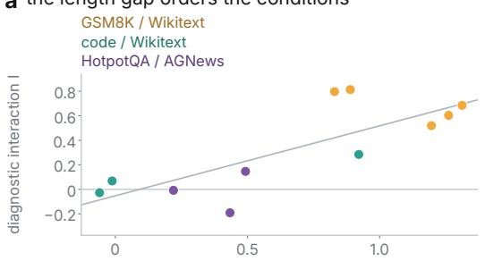  
chars per token, reference − target corpus least squares; Pearson 0.78, Spearman 0.72 one point is one model on one corpus pair, three corpus pairs calibrate the ordering

b the whitespace rate is a weak predictor  
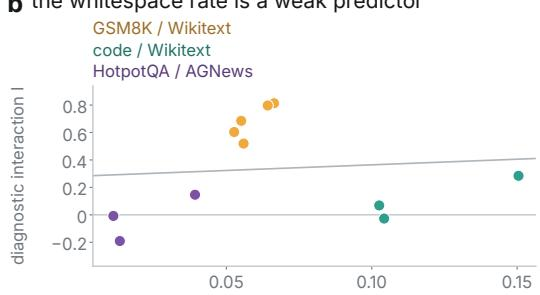  
whitespace target share, target − reference least squares; Pearson 0.09, Spearman 0.21 code whitespace is syntactic: code / Wikitex has the highest rate, and a low interaction  
c the length gap holds in every subset token-length gap whitespace-rate gap

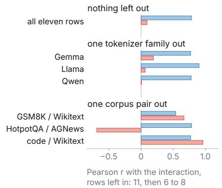  
d all three scored labels matched

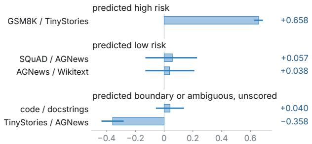  
diagnostic interaction I, Qwen 2.5-7B 200 a side, except 118 on SQuAD / AGNews and 82 on AGNews / Wikitext whiskers are 95% bootstrap intervals labels were fixed before interventions; the output regions are exploratory  
e the swing is whitespace only, and pooling hides it

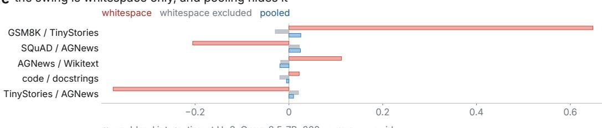  
except 118 and 82 on the two pairs panel d names  
whitespace excluded weights the four other types by the focal corpus's counts

Figure 7: The full screen figure. Panels a and b plot the diagnostic interaction I for the eleven calibration rows against the characters-per-token gap and against the target whitespace-rate gap. Panel c gives both Pearson correlations over all eleven rows and after leaving out one tokenizer family or one corpus pair. Panel d shows I with its 95% bootstrap interval for the five held-out pairs on Qwen2.5-7B, grouped by label, and panel e compares three H=3 mean-blend quantities for each held-out pair: the whitespace cell, the whitespace-excluded summary, and the pooled value. Figure 3 repeats panels a to c, and its panel d extends d to all three primary models and the two DoLa pairs.

Figure 7a and Figure 7b plot all eleven calibration-screen rows against two tokenizer-only predictors: characters per token in N minus R, and the target whitespace rate in R minus N. Table 31 lists the rows. Every GSM8K/Wikitext row has $p < 1 0 ^ { \overline { { - 4 } } }$ , and on the other two pairs the positive rows have $p < 0 . 0 0 1$ and the null or reversed rows have $p = 1 . 0$ . Table 32 makes the clustering explicit by aggregating the 11 model rows into three domain-pair regions. These summaries show where the risk pattern concentrates.

Table 32: Domain-pair-level aggregation for the calibration screen. Each cell reports mean [min, max] over model rows in that domain pair.
<table><tr><td>Domain pair</td><td>n</td><td> $\Delta _ { \mathrm { c h a r s } }$ </td><td> $\Delta _ { \mathrm { w s } }$ </td><td>audit I</td></tr><tr><td>GSM8K/Wikitext</td><td>5</td><td>1.097 [0.829, 1.312]</td><td>0.0589 [0.0527, 0.0664]</td><td>0.684 [0.519, 0.813]</td></tr><tr><td>Code/Wikitext</td><td>3</td><td>0.283 [-0.060, 0.921]</td><td>0.1191 [0.1026, 0.1505]</td><td>0.109 [–0.027, 0.285]</td></tr><tr><td>HotpotQA/AGNews</td><td>3</td><td>0.382 [0.220, 0.493]</td><td>0.0212 [0.0111, 0.0392]</td><td>-0.018 [–0.191, 0.146]</td></tr></table>

The rows form three risk regions. GSM8K/Wikitext is a high-risk prose pair, where both predictors agree and the audit interaction is large in every model. HotpotQA/AGNews is the lower-risk prose pair, with smaller whitespace-rate and characters-per-token gaps, yielding a null or reversed audit interaction in two rows and a weakly positive interaction for Gemma. Code/Wikitext forms a boundary region: its target whitespace rate is high, its whitespace is structural, and its audit magnitudes are mixed.

Table 33: Calibration-screen risk regions. Held-out domain-pair outcomes appear in Table 26.
<table><tr><td>Region</td><td>Observed predictor range</td><td>Interpretation</td></tr><tr><td>GSM8K/Wikitext</td><td> $\Delta _ { \mathrm { w s } } = 0 . 0 5 3 – 0 . 0 6 6 ,$   $\Delta _ { \mathrm { c h a r s } } = 0 . 8 3 \ – 1 . 3 1 ,$   $I = 0 . 5 2 – 0 . 8 1$ </td><td>High-risk prose pair. Both predictors agree, and all five rows have zero non-positive bootstrap draws</td></tr><tr><td>Code/Wikitext</td><td> $\Delta _ { \mathrm { w s } } = 0 . 1 0 3 \ – 0 . 1 5 0 ,$   $\Delta _ { \mathrm { c h a r s } } = - 0 . 0 6 \ – 0 . 9 2 ,$   $I = - 0 . 0 3 – 0 . 2 8$ </td><td>Boundary case. Whitespace targets are fre- quent and mostly newlines or indentation</td></tr><tr><td>HotpotQA/AGNews</td><td> $\Delta _ { \mathrm { w s } } = 0 . 0 1 1 \mathrm { - } 0 . 0 3 9 ,$   $\Delta _ { \mathrm { c h a r s } } = 0 . 2 2 \ – 0 . 4 9 ,$   $I = - 0 . 1 9 \ – 0 . 1 5$ </td><td>Lower-risk prose pair. Two rows are null or reversed, and one Gemma row is weakly positive</td></tr></table>

## J.5 CORRELATION AND LEAVE-ONE SENSITIVITY

Figure 7c compares the all-row correlations with values recomputed after leaving out one tokenizer family or one corpus pair. The characters-per-token correlation stays positive in every leave-one-out subset. The target whitespace rate tracks risk in prose but saturates on code, where whitespace is structural.

Table 34: Predictor correlations over the 11 model rows. The rows form three domain-pair clusters.
<table><tr><td>Predictor</td><td>Pearson r</td><td>Spearman ρ</td></tr><tr><td>Target whitespace-rate gap</td><td>0.093</td><td>0.209</td></tr><tr><td>Chars-per-token gap</td><td>0.783</td><td>0.718</td></tr></table>

Table 35: Leave-one-model-lineage sensitivity. The characters-per-token correlations stay positive with any one lineage left out.
<table><tr><td>Dropped lineage</td><td>n</td><td>Pearson ws</td><td>Spearman ws</td><td>Pearson chars</td><td>Spearman chars</td></tr><tr><td>Gemma</td><td>7</td><td>0.192</td><td>0.179</td><td>0.771</td><td>0.643</td></tr><tr><td>Llama</td><td>7</td><td>0.064</td><td>0.214</td><td>0.901</td><td>0.964</td></tr><tr><td>Qwen</td><td>8</td><td>0.006</td><td>0.310</td><td>0.778</td><td>0.619</td></tr></table>

Table 36: Leave-one-domain-pair sensitivity. Removing the code pair restores the direct relationship with target whitespace rate because whitespace serves a different function in code and prose.
<table><tr><td>Dropped pair</td><td>n</td><td>Pearson ws</td><td>Spearman ws</td><td>Pearson chars</td><td>Spearman chars</td></tr><tr><td>GSM8K/Wikitext</td><td>6</td><td>0.666</td><td>0.486</td><td>0.538</td><td>0.600</td></tr><tr><td>HotpotQA/AGNews</td><td>8</td><td>-0.689</td><td>-0.524</td><td>0.784</td><td>0.429</td></tr><tr><td>Code/Wikitext</td><td>8</td><td>0.961</td><td>0.905</td><td>0.771</td><td>0.619</td></tr></table>

These sensitivity results support the two-predictor screen. The target whitespace rate directly tracks risk for prose pairs, and characters per token provides a more reliable prospective proxy for code-like text and other corpora in which whitespace has domain-specific structure.

## J.6 CODE BOUNDARY DETAILS

The code boundary shows that whitespace frequency and whitespace function are separate quantities. Code has a high target whitespace rate, and the tokenizer-only subtype analysis identifies those targets as mostly newlines or indentation. The corresponding GSM8K/Wikitext whitespace targets are plain spaces, and the held-out CodeSearchNet code/docs pair shows the same qualitative boundary within one source family.

Code boundary vignette. The bracketed target in this code excerpt is a structural line break:

$$
. X = \texttt { v e c l . X ~ \star ~ } \texttt { v e c 2 . X ~ \ t e w \_ v e c . Y } = \texttt { v e c l . Y ~ \star ~ } \texttt { v e c l . Y ~ \star ~ } \texttt { r e c l . Y ~ \ t h \ e v e } \texttt { r e c l . X }
$$

This target is structural whitespace, which the subtype analysis in Table 40 separates from the plain spaces of prose.

## J.7 TOKENIZER-ONLY EXTENSION DETAILS

Table 37: Target rates for Code/Wikitext.
<table><tr><td>Model</td><td>R ws rate</td><td>N ws rate</td><td>R targets</td><td>N targets</td><td>R chars/token</td><td>N chars/token</td><td> $\Delta _ { \mathrm { c h a r s } }$ </td></tr><tr><td>Qwen2.5-7B</td><td>0.1319</td><td>0.0277</td><td>23307</td><td>26118</td><td>4.4728</td><td>4.4132</td><td>-0.0595</td></tr><tr><td>Llama-3.2-3B</td><td>0.1332</td><td>0.0306</td><td>23297</td><td>25991</td><td>4.4909</td><td>4.4788</td><td>-0.0121</td></tr><tr><td>gemma-2-2b</td><td>0.1786</td><td>0.0281</td><td>25321</td><td>26528</td><td>3.6877</td><td>4.6089</td><td>0.9211</td></tr></table>

Table 38: Target rates for HotpotQA/AGNews.
<table><tr><td>Model</td><td> $n _ { R } / n _ { N }$ </td><td>R ws rate</td><td>N ws rate</td><td>R targets</td><td>N targets</td><td>R chars/token</td><td>N chars/token</td><td> $\Delta _ { \mathrm { c h a r s } }$ </td></tr><tr><td>Qwen2.5-7B</td><td>146/146</td><td>0.0301</td><td>0.0167</td><td>5789</td><td>6403</td><td>4.2404</td><td>4.6743</td><td>0.4339</td></tr><tr><td>Llama-3.2-3B</td><td>135/135</td><td>0.0292</td><td>0.0181</td><td>5336</td><td>5856</td><td>4.4513</td><td>4.6715</td><td>0.2201</td></tr><tr><td>gemma-2-2b</td><td>161/161</td><td>0.0565</td><td>0.0173</td><td>6179</td><td>6950</td><td>4.2427</td><td>4.7354</td><td>0.4926</td></tr></table>

Table 39: Tokenizer statistics for the additional GSM8K/Wikitext audit models.
<table><tr><td>Model</td><td>R ws rate</td><td>N ws rate</td><td>R targets</td><td>N targets</td><td>R chars/token</td><td>N chars/token</td><td> $\Delta _ { \mathrm { c h a r s } }$ </td></tr><tr><td>gemma-2-9b-it</td><td>0.0813</td><td>0.0286</td><td>26947</td><td>28403</td><td>3.3460</td><td>4.6070</td><td>1.2610</td></tr><tr><td>Hermes-3-Llama-3.1-8B</td><td>0.0945</td><td>0.0303</td><td>24743</td><td>26392</td><td>3.6596</td><td>4.4888</td><td>0.8292</td></tr></table>

## J.8 WHITESPACE SUBTYPE AND CLASSIFIER ROBUSTNESS

The main classifier uses a coarse category boundary. A decoded token is whitespace only when its entire decoded text is whitespace. Otherwise, the text is stripped before the classifier assigns a number, punctuation, function-word, or content-word label. Leading-space BPE or SentencePiece tokens therefore retain their non-whitespace category after stripping.

Table 40: Whitespace subtype robustness at H=3, averaged over the Qwen2.5-7B, Llama-3.2-3B, and gemma-2-2b tokenizers. “ws rate” is the all-whitespace target rate. Subtype columns are proportions within whitespace targets. “lead cont.” is the proportion of content-word targets whose decoded token begins with whitespace and is classified after stripping. These tokenizer-only rates use their own 200 length-matched sequences per corpus, so they differ slightly from the canonical sample’s in Table 7 and the screen’s in Table 37.
<table><tr><td>Pair</td><td>Domain</td><td>ws rate</td><td>plain</td><td>newline</td><td>multi/indent</td><td>other</td><td>lead cont.</td></tr><tr><td>GSM8K/Wikitext</td><td>GSM8K</td><td>0.0888</td><td>1.000</td><td>0.000</td><td>0.000</td><td>0.000</td><td>0.9086</td></tr><tr><td>GSM8K/Wikitext</td><td>Wikitext</td><td>0.0276</td><td>1.000</td><td>0.000</td><td>0.000</td><td>0.000</td><td>0.8598</td></tr><tr><td>Code/Wikitext</td><td>Code</td><td>0.1454</td><td>0.039</td><td>0.266</td><td>0.687</td><td>0.007</td><td>0.4644</td></tr><tr><td>Code/Wikitext</td><td>Wikitext</td><td>0.0281</td><td>1.000</td><td>0.000</td><td>0.000</td><td>0.000</td><td>0.8647</td></tr></table>

The subtype analysis clarifies the code boundary because whitespace targets in the prose rows are plain-space tokens, whereas the additional code whitespace consists mainly of newlines and indentation. Whitespace function enters the screen alongside its frequency. The intervention analysis uses the coarser split between all-whitespace and non-whitespace targets. Under the canonical map every non-whitespace subclass is non-positive for the H=3 mean-blend artifact, and the one positive cell under the other maps is Gemma’s content cell in Appendix J.9.

## J.9 VOCABULARY-POLICY INTERVENTION AUDIT

The classifier-policy analysis keeps the sequences, activations, operator, horizon, and bootstrap procedure fixed while changing the vocabulary map. The canonical policy is the five-way map used throughout the paper. The lead-only policy keeps in the content class the content words whose decoded string begins with whitespace, and the nolead policy keeps the others. Each policy moves its other content words into the function class, so in their rows of Table 41 the function column pools the function words with the moved content words. The adversarial policy assigns every leading-whitespace token to the whitespace class, which absorbs most leading-space words.

Table 41: H=3 mean-blend top-1 CAI under four fixed classifier policies, using 200 sequences per side and 10,000 resamples. “n/a” denotes an empty or undefined function-word cell under the adversarial map. Under that map, whitespace CAI shrinks by factors of 8.2, 8.7, and 8.4 for Qwen, Llama, and Gemma. The shared positive Gemma nolead/adversarial content cell is +0.003, with intervals [−0.001, 0.010] and [−0.0007, 0.010].
<table><tr><td>Model</td><td>policy</td><td>whitespace</td><td>content</td><td>number</td><td>punctuation</td><td>function</td></tr><tr><td>Qwen</td><td>canonical</td><td>+0.4525</td><td>-0.0084</td><td>-0.0107</td><td>-0.1026</td><td>-0.0216</td></tr><tr><td rowspan="6">Llama</td><td>lead-only</td><td>+0.4525</td><td>-0.0090</td><td>-0.0107</td><td>-0.1026</td><td>-0.0182</td></tr><tr><td>nolead</td><td>+0.4525</td><td>-0.0018</td><td>-0.0107</td><td>-0.1026</td><td>-0.0137</td></tr><tr><td>adversarial</td><td>+0.0552</td><td>-0.0018</td><td>-0.0107</td><td>-0.0624</td><td>n/a</td></tr><tr><td>canonical</td><td>+0.8137</td><td>-0.0081</td><td>-0.0058</td><td>-0.1973</td><td>-0.0140</td></tr><tr><td>lead-only</td><td>+0.8137</td><td>-0.0082</td><td>-0.0058</td><td>-0.1973</td><td>-0.0133</td></tr><tr><td>nolead</td><td>+0.8137</td><td>-0.0059</td><td>-0.0058</td><td>-0.1973</td><td>-0.0106</td></tr><tr><td rowspan="5">Gemma</td><td>adversarial</td><td>+0.0940</td><td>-0.0059</td><td>-0.0058</td><td>-0.2682</td><td>n/a</td></tr><tr><td>canonical</td><td>+0.7135</td><td>-0.0023</td><td>-0.0319</td><td>-0.0548</td><td>-0.0109</td></tr><tr><td>lead-only</td><td>+0.7135</td><td>-0.0025</td><td>-0.0319</td><td>-0.0548</td><td>-0.0096</td></tr><tr><td>nolead</td><td>+0.7135</td><td>+0.0030</td><td>-0.0319</td><td>-0.0548</td><td>-0.0056</td></tr><tr><td>adversarial</td><td>+0.0852</td><td>+0.0030</td><td>-0.0319</td><td>-0.0541</td><td>n/a</td></tr></table>

H=1 nolead content. The corresponding rows are Qwen +0.077 [0.041, 0.115] (n = 174), Llama +0.116 [0.070, 0.160] (n = 191), and Gemma +0.068 [0.041, 0.095] (n = 184).

Table 42: Vocabulary class sizes for Table 41. Each entry counts vocabulary types. Under the adversarial map, whitespace accounts for approximately 36%, 46%, and 49% in Qwen, Llama, and Gemma.
<table><tr><td>Model</td><td>policy</td><td>whitespace</td><td>content</td><td>number</td><td>punctuation</td><td>function</td></tr><tr><td>Qwen</td><td>canonical</td><td>441</td><td>146438</td><td>28</td><td>4106</td><td>630</td></tr><tr><td rowspan="6">Llama</td><td>lead-only</td><td>441</td><td>52484</td><td>28</td><td>4106</td><td>94584</td></tr><tr><td>nolead</td><td>441</td><td>93954</td><td>28</td><td>4106</td><td>53114</td></tr><tr><td>adversarial</td><td>54409</td><td>93954</td><td>28</td><td>2985</td><td>267</td></tr><tr><td>canonical</td><td>530</td><td>121495</td><td>1206</td><td>4136</td><td>633</td></tr><tr><td>lead-only</td><td>530</td><td>57295</td><td>1206</td><td>4136</td><td>64833</td></tr><tr><td>nolead</td><td>530</td><td>64200</td><td>1206</td><td>4136</td><td>57928</td></tr><tr><td rowspan="5">Gemma</td><td>adversarial</td><td>59289</td><td>64200</td><td>1206</td><td>3038</td><td>267</td></tr><tr><td>canonical</td><td>152</td><td>251173</td><td>397</td><td>3658</td><td>620</td></tr><tr><td>lead-only</td><td>152</td><td>124041</td><td>397</td><td>3658</td><td>127752</td></tr><tr><td>nolead</td><td>152</td><td>127132</td><td>397</td><td>3658</td><td>124661</td></tr><tr><td>adversarial</td><td>125407</td><td>127132</td><td>350</td><td>2805</td><td>306</td></tr></table>

Under the adversarial map, the whitespace vocabulary class expands sharply and its CAI shrinks, yet whitespace remains the largest positive cell in all three models and the only positive cell in Qwen and Llama. In some rows the punctuation cell is the most negative cell and has the largest absolute value. The four maps define 45 non-whitespace cells, and a cell that a policy leaves unchanged repeats its estimate, which leaves 27 distinct estimates. One of them is positive, Gemma’s content estimate under the nolead and adversarial maps, and both of its intervals include zero (Table 41).

At H=1 under mean-blend, the nolead content cell is positive with an interval excluding zero in all three models, as the note in Table 41 reports.

## K THE ONE-TOKEN-AHEAD CONTENT-TOKEN CELL AND INDEPENDENTCORROBORATION

## K.1 CANONICAL H=1 CONTENT-TOKEN EFFECT-SIZE ROWS

Table 43: Scale diagnostics for the four canonical H=1 content-token mild-resample rows. CAI is the absolute top-1 interaction. Rel.% is 100× CAI divided by the reasoning-domain control top-1 level.
<table><tr><td>Model</td><td>CAI</td><td>d</td><td>rel.%</td><td>ctrl R</td><td>ctrl N</td><td>early R</td><td>early N</td><td>late R</td><td>late N</td><td>R/N chars</td></tr><tr><td>Qwen2.5-7B</td><td>0.0107</td><td>0.3507</td><td>1.22</td><td>0.8768</td><td>0.3904</td><td>0.0499</td><td>0.0350</td><td>0.0735</td><td>0.0479</td><td>3.260/4.456</td></tr><tr><td>Llama-3.2-3B</td><td>0.0117</td><td>0.3898</td><td>1.89</td><td>0.6194</td><td>0.3658</td><td>0.0604</td><td>0.0398</td><td>0.0858</td><td>0.0535</td><td>3.656/4.545</td></tr><tr><td>gemma-2-2b</td><td>0.0091</td><td>0.3407</td><td>1.51</td><td>0.6004</td><td>0.3277</td><td>0.0480</td><td>0.0289</td><td>0.0673</td><td>0.0392</td><td>3.335/4.647</td></tr><tr><td>Hermes-3-Llama-3.1-8B</td><td>0.0103</td><td>0.3370</td><td>1.64</td><td>0.6297</td><td>0.4262</td><td>0.0658</td><td>0.0490</td><td>0.0909</td><td>0.0638</td><td>3.656/4.545</td></tr></table>

These rows give the scale of the H=1 content cell. The relative percentage divides the interaction by the GSM8K control accuracy, the higher of the two control levels in every row, and Appendix K.4 traces the cell to that difference in control accuracy.

## K.2 FIVE-INSTANCE H=1 CONTENT-WORD RESULTS

Table 44: Supporting H=1 content-token mild-resample results under the same protocol. “Positive cell?” means that the reported 95% bootstrap interval is strictly positive. The intervals use 1,000 sequence-bootstrap resamples. Table 43 gives the four-row Cohen’s d result with its paired persequence diagnostics.

<table><tr><td>Model</td><td>CAI</td><td>95% CI</td><td> $n _ { R } / n _ { N }$ </td><td>Positive cell?</td></tr><tr><td>Qwen2.5-7B-Instruct</td><td>0.0103</td><td>[0.0050, 0.0149]</td><td>250/250</td><td>yes</td></tr><tr><td>Llama-3.2-3B-Instruct</td><td>0.0142</td><td>[0.0089, 0.0193]</td><td>250/250</td><td>yes</td></tr><tr><td>gemma-2-2b-it</td><td>0.0086</td><td>[0.0044, 0.0135]</td><td>250/250</td><td>yes</td></tr><tr><td>OLMo-2-1124-7B-Instruct</td><td>0.0148</td><td>[0.0092, 0.0207]</td><td>250/250</td><td>yes</td></tr><tr><td>Qwen3-1.7B</td><td>0.0125</td><td>[0.0076, 0.0172]</td><td>250/250</td><td>yes</td></tr></table>

## K.3 THE OTHER FOUR TARGET TYPES IN THE SAME H=1 SERIES

Table 45 conditions the same five-instance H=1 mild-resample series on the four remaining target types, so the one-token-ahead cells can be read type by type. With a positive cell defined as a strictly positive 95% bootstrap interval, number targets give four positive cells, punctuation gives three, function words give one, and whitespace gives none. Under this operator and horizon every positive cell sits on a non-whitespace type, which inverts the H=3 mean-blend ordering.

Table 45: H=1 mild-resample top-1 CAI on GSM8K/Wikitext for the four target types outside Table 44, under the same protocol and the same 250 sequences per corpus. $n _ { \mathcal { R } } / n _ { \mathcal { N } }$ counts the sequences supplying a target of the row’s type, so whitespace and number rows draw on fewer Wikitext sequences. “Positive cell?” means that the reported 95% bootstrap interval, from 1,000 sequence-bootstrap resamples, is strictly positive.
<table><tr><td>Target type</td><td>Model</td><td>CAI</td><td>95% CI</td><td> $n \pi / n \mathcal N$ </td><td>Positive cell?</td></tr><tr><td>whitespace</td><td>Qwen2.5-7B-Instruct</td><td>-0.0235</td><td>[-0.0465, -0.0030]</td><td>250/181</td><td>no</td></tr><tr><td>whitespace</td><td>Llama-3.2-3B-Instruct</td><td>-0.0028</td><td>[–0.0208, 0.0155]</td><td>250/179</td><td>no</td></tr><tr><td>whitespace</td><td>gemma-2-2b-it</td><td>-0.0076</td><td>[-0.0208, 0.0046]</td><td>250/182</td><td>no</td></tr><tr><td>whitespace</td><td>OLMo-2-1124-7B-Instruct</td><td>-0.0073</td><td>[-0.0303, 0.0107]</td><td>250/179</td><td>no</td></tr><tr><td>whitespace</td><td>Qwen3-1.7B</td><td>0.0038</td><td>[-0.0081, 0.0166]</td><td>250/181</td><td>no</td></tr><tr><td>number</td><td>Qwen2.5-7B-Instruct</td><td>0.0038</td><td>[-0.0054, 0.0134]</td><td>250/182</td><td>no</td></tr><tr><td>number</td><td>Llama-3.2-3B-Instruct</td><td>0.0629</td><td>[0.0465, 0.0816]</td><td>250/180</td><td>yes</td></tr><tr><td>number</td><td>gemma-2-2b-it</td><td>0.0445</td><td>[0.0352, 0.0551]</td><td>250/184</td><td>yes</td></tr><tr><td>number</td><td>OLMo-2-1124-7B-Instruct</td><td>0.0462</td><td>[0.0268, 0.0634]</td><td>250/180</td><td>yes</td></tr><tr><td>number</td><td>Qwen3-1.7B</td><td>0.0293</td><td>[0.0172, 0.0416]</td><td>250/182</td><td>yes</td></tr><tr><td>punctuation</td><td>Qwen2.5-7B-Instruct</td><td>0.0007</td><td>[-0.0088, 0.0109]</td><td>250/250</td><td>no</td></tr><tr><td>punctuation</td><td>Llama-3.2-3B-Instruct</td><td>0.0073</td><td>[-0.0013, 0.0162]</td><td>250/250</td><td>no</td></tr><tr><td>punctuation</td><td>gemma-2-2b-it</td><td>0.0234</td><td>[0.0160, 0.0309]</td><td>250/250</td><td>yes</td></tr><tr><td>punctuation</td><td>OLMo-2-1124-7B-Instruct</td><td>0.0183</td><td>[0.0071, 0.0287]</td><td>250/250</td><td>yes</td></tr><tr><td>punctuation</td><td>Qwen3-1.7B</td><td>0.0253</td><td>[0.0159, 0.0350]</td><td>250/250</td><td>yes</td></tr><tr><td>function word</td><td>Qwen2.5-7B-Instruct</td><td>0.0039</td><td>[-0.0017, 0.0095]</td><td>250/250</td><td></td></tr><tr><td>function word</td><td>Llama-3.2-3B-Instruct</td><td>0.0101</td><td>[0.0044, 0.0157]</td><td>250/250</td><td>no</td></tr><tr><td>function word</td><td>gemma-2-2b-it</td><td>-0.0004</td><td>[-0.0047, 0.0037]</td><td>250/250</td><td>yes no</td></tr><tr><td>function word</td><td>OLMo-2-1124-7B-Instruct</td><td>0.0025</td><td>[-0.0040, 0.0091]</td><td>250/250</td><td>no</td></tr><tr><td>function word</td><td>Qwen3-1.7B</td><td>-0.0030</td><td>[-0.0073, 0.0012]</td><td>250/250</td><td>no</td></tr></table>

## K.4 THE CONTENT CELL SPLIT BY CONTROL-PASS CORRECTNESS

The split needs each target’s token ID and its top-1 correctness under the control, early-band, and late-band passes. A second evaluation pass of the H=1 series with the same code path, data, length matching, donor derangement, bands, and $\alpha = 0 . 2$ records them, and it reproduces every H=1 top-1 type cell of the series exactly. Its intervals come from 2,000 sequence-bootstrap draws that recompute every stratum from the same draw, so they differ slightly from the 1,000-draw intervals of Table 44 and Table 45.

For a target type, let $p _ { C }$ be the share of its targets in corpus C that the control pass predicts at top-1. The operator acts on those correct predictions: it removes 91 to 94 percent of the control-correct content predictions under the early band and 86 to 92 percent under the late band, in both corpora, and it turns 0.2 to 1.5 percent of the control-wrong ones correct. The early band removes more than the late band in every corpus and model, so each corpus’s early-minus-late damage gap grows with pC, and $p _ { \mathcal { R } }$ exceeds $p _ { \mathcal { N } }$ for every type and model in Table 46. The split computes CAI separately among control-correct and control-wrong targets and combines the two cells with the Wikitext shares, $p _ { \mathcal { N } } \mathrm { C A I } _ { \mathrm { c o r r e c t } } + ( 1 - p _ { \mathcal { N } } ) \mathrm { C A I } _ { \mathrm { w r o n g } }$ . This keeps each stratum’s CAI and gives both corpora the reference composition. The strata come from the unablated pass, which neither band perturbs. Because the strata use the model’s own predictions, the split applies to a cell that has already been measured.

For content words every reweighted interval includes zero, and the paired difference from the content cell excludes zero in all five instances. Llama is the one instance whose control-correct content cell has an interval excluding zero. Among the other three types the reweighted interval lies wholly above zero for Llama and Gemma numbers and for Llama function words, three of 15 cells, compared with eight among the unsplit type cells, and it lies below zero for Qwen2.5 punctuation, the one instance whose control-wrong punctuation cell is negative.

Table 46: The four non-whitespace types of the H=1 mild-resample series, split by whether the control pass predicts the target at top-1. pR/pN is the control-correct share of the type’s GSM8K and Wikitext targets, and CAI is the type cell of Table 44 and Table 45, which give its interval. Correct and wrong give CAI within each stratum. Reweighted is $p _ { N } \mathrm { C A I _ { c o r r e c t } } + \bar { ( } 1 - p _ { N } )$ CAIwrong, and Diff. is CAI minus reweighted, paired within each draw. Bold marks a correct, wrong, reweighted, or Diff. value whose 95% interval excludes zero. The other intervals use 2,000 sequence-bootstrap draws. A value that rounds to zero is printed to its first significant digit.
<table><tr><td>Model</td><td>pR/pN</td><td>CAI</td><td>Correct</td><td>Wrong</td><td>Reweighted</td><td>95% CI</td><td>Diff.</td></tr><tr><td colspan="8">content word</td></tr><tr><td>Qwen2.5-7B</td><td>0.88/0.39</td><td>+0.0103</td><td>-0.0037</td><td>-0.0021</td><td>-0.0028</td><td>[-0.0073, 0.0018]</td><td>+0.0131</td></tr><tr><td>Llama-3.2-3B</td><td>0.62/0.37</td><td>+0.0142</td><td>+0.0106</td><td>-0.0014</td><td>+0.0031</td><td>-0.0008, 0.0069]</td><td>+0.0111</td></tr><tr><td>gemma-2-2b</td><td>0.61/0.33</td><td>+0.0086</td><td>-0.0021</td><td>+0.0010</td><td>-0.00003</td><td>-0.0036, 0.0034]</td><td>+0.0086</td></tr><tr><td>OLMo-2-7B</td><td>0.69/0.43</td><td>+0.0148</td><td>+0.0019</td><td>+0.0002</td><td>+0.0009</td><td>-0.0034, 0.0055]</td><td>+0.0139</td></tr><tr><td>Qwen3-1.7B</td><td>0.62/0.31</td><td>+0.0125</td><td>+0.0008</td><td>-0.0001</td><td>+0.0002</td><td>-0.0029,0.0034]</td><td>+0.0123</td></tr><tr><td>number</td><td></td><td></td><td></td><td></td><td></td><td></td><td></td></tr><tr><td colspan="8"></td></tr><tr><td>Qwen2.5-7B</td><td>0.92/0.61</td><td>+0.0038</td><td>-0.0012</td><td>-0.0222</td><td>-0.0094</td><td>[−0.0223, 0.0027]</td><td>+0.0132</td></tr><tr><td>Llama-3.2-3B</td><td>0.75/0.41</td><td>+0.0629</td><td>+0.0562</td><td>+0.0101</td><td>+0.0292</td><td>[0.0118, 0.0486]</td><td>+0.0337</td></tr><tr><td>gemma-2-2b</td><td>0.83/0.58</td><td>+0.0445</td><td>+0.0392</td><td>+0.0102</td><td>+0.0271</td><td>[0.0187,0.0353]</td><td>+0.0174</td></tr><tr><td>OLMo-2-7B</td><td>0.79/0.45</td><td>+0.0462</td><td>+0.0356</td><td>-0.0148</td><td>+0.0080</td><td>[-0.0095, 0.0236]</td><td>+0.0382</td></tr><tr><td>Qwen3-1.7B</td><td>0.84/0.56</td><td>+0.0293</td><td>+0.0298</td><td>-0.0136</td><td>+0.0109</td><td>[-0.0004,0.0217]</td><td>+0.0184</td></tr><tr><td>punctuation</td><td></td><td></td><td></td><td></td><td></td><td></td><td></td></tr><tr><td>Qwen2.5-7B</td><td>0.81/0.41</td><td>+0.0007</td><td>-0.0104</td><td>-0.0801</td><td>-0.0513</td><td>[-0.0705, -0.0329]</td><td>+0.0520</td></tr><tr><td>Llama-3.2-3B</td><td>0.69/0.51</td><td>+0.0073</td><td>-0.0119</td><td>+0.0065</td><td>-0.0028</td><td>[-0.0114,0.0064]</td><td>+0.0101</td></tr><tr><td>gemma-2-2b</td><td>0.75/0.38</td><td>+0.0234</td><td>+0.0147</td><td>+0.0041</td><td>+0.0081</td><td>-0.0012,0.0170]</td><td>+0.0154</td></tr><tr><td>OLMo-2-7B</td><td>0.68/0.51</td><td>+0.0183</td><td>+0.0128</td><td>+0.0042</td><td>+0.0086</td><td>-0.0020,0.0193]</td><td>+0.0097</td></tr><tr><td>Qwen3-1.7B</td><td>0.72/0.43</td><td>+0.0253</td><td>+0.0082</td><td>+0.0044</td><td>+0.0060</td><td>[-0.0032,0.0144]</td><td>+0.0193</td></tr><tr><td>function word</td><td></td><td></td><td></td><td></td><td></td><td></td><td></td></tr><tr><td colspan="8"></td></tr><tr><td>Qwen2.5-7B</td><td>0.83/0.56</td><td>+0.0039</td><td>-0.0049</td><td>-0.0028</td><td>-0.0040</td><td>[-0.0099, 0.0022]</td><td>+0.0079</td></tr><tr><td>Llama-3.2-3B</td><td>0.57/0.53</td><td>+0.0101</td><td>+0.0153</td><td>-0.0007</td><td>+0.0077</td><td>[0.0028, 0.0130]</td><td>+0.0023</td></tr><tr><td>gemma-2-2b</td><td>0.53/0.51</td><td>-0.0004</td><td>-0.0082</td><td>+0.0070</td><td>-0.0007</td><td>[-0.0048,0.0034]</td><td>+0.0002</td></tr><tr><td>OLMo-2-7B</td><td>0.59/0.52</td><td>+0.0025</td><td>+0.0060</td><td>-0.0122</td><td>-0.0028</td><td>-0.0096, 0.0038]</td><td>+0.0053</td></tr><tr><td>Qwen3-1.7B</td><td>0.57/0.54</td><td>-0.0030</td><td>-0.0074</td><td>+0.0019</td><td>-0.0031</td><td>[−0.0079, 0.0016]</td><td>+0.0001</td></tr></table>

Reweighting by strata that depend on the input alone leaves a smaller positive content cell (Table 47). Repeated tokens, which the model can copy from earlier in the sequence, make up 0.52 to 0.54 of the GSM8K content targets and 0.18 of the Wikitext ones. With the four repeated-by-leading-space strata weighted by the Wikitext shares, the estimate falls, and its interval stays above zero in four of five instances, all but Gemma. The high-frequency tertile has an interval above zero in all five instances, and no low-frequency interval lies above zero.

Table 47: Content-word CAI of the H=1 mild-resample series within strata that depend on the input alone, in bold when the 95% interval of 2,000 sequence-bootstrap draws excludes zero. A target is repeated when its token occurs earlier in the same sequence, and a leading space marks a word start. Frequency tertiles rank each token by its count among the content targets of both corpora. The last two rows combine the four repeated-by-leading-space strata with the GSM8K and with the Wikitext stratum shares.
<table><tr><td>Content stratum</td><td>Qwen2.5-7B</td><td>Llama-3.2-3B</td><td>gemma-2-2b</td><td>OLMo-2-7B</td><td>Qwen3-1.7B</td></tr><tr><td>all content targets</td><td>+0.0103</td><td>+0.0142</td><td>+0.0086</td><td>+0.0148</td><td>+0.0125</td></tr><tr><td>repeated in the sequence</td><td>+0.0099</td><td>+0.0186</td><td>+0.0106</td><td>+0.0060</td><td>+0.0113</td></tr><tr><td>first occurrence</td><td>+0.0051</td><td>+0.0028</td><td>+0.0012</td><td>+0.0076</td><td>+0.0014</td></tr><tr><td>leading space</td><td>+0.0089</td><td>+0.0158</td><td>+0.0090</td><td>+0.0168</td><td>+0.0124</td></tr><tr><td>no leading space</td><td>+0.0214</td><td>+0.0003</td><td>-0.0021</td><td>-0.0021</td><td>+0.0191</td></tr><tr><td>repeated, leading space</td><td>+0.0052</td><td>+0.0196</td><td>+0.0103</td><td>+0.0081</td><td>+0.0116</td></tr><tr><td>repeated, no leading space</td><td>+0.0352</td><td>+0.0089</td><td>-0.0032</td><td>+0.0078</td><td>+0.0378</td></tr><tr><td>first occurrence, leading space</td><td>+0.0053</td><td>+0.0038</td><td>+0.0014</td><td>+0.0094</td><td>+0.0025</td></tr><tr><td>first occurrence, no leading space</td><td>+0.0039</td><td>-0.0070</td><td>-0.0027</td><td>-0.0084</td><td>-0.0051</td></tr><tr><td>occurs in both corpora</td><td>+0.0099</td><td>+0.0154</td><td>+0.0089</td><td>+0.0139</td><td>+0.0132</td></tr><tr><td>occurs in one corpus</td><td>+0.0102</td><td>+0.0177</td><td>+0.0075</td><td>+0.0208</td><td>+0.0108</td></tr><tr><td>low-frequency tertile</td><td>-0.0002</td><td>-0.0012</td><td>-0.0044</td><td>-0.0037</td><td>+0.0030</td></tr><tr><td>middle-frequency tertile</td><td>+0.0028</td><td>+0.0072</td><td>+0.0032</td><td>+0.0048</td><td>+0.0072</td></tr><tr><td>high-frequency tertile</td><td>+0.0150</td><td>+0.0223</td><td>+0.0127</td><td>+0.0278</td><td>+0.0177</td></tr><tr><td>four strata, GSM8K shares</td><td>+0.0070</td><td>+0.0109</td><td>+0.0053</td><td>+0.0078</td><td>+0.0085</td></tr><tr><td>four strata, Wikitext shares</td><td>+0.0064</td><td>+0.0047</td><td>+0.0022</td><td>+0.0068</td><td>+0.0042</td></tr></table>

## K.5 CROSS-DOMAIN ACTIVATION PATCHING

Table 20 reports target-type bootstrap intervals for activation patching in the three primary models, and Figure 6c shows the same intervention under top-1. Here, activation patching and a log-probability readout replace ablation and top-1 CAI, respectively. The separation between same-domain and crossdomain patching further distinguishes the content/non-whitespace result from the H=3 mean-blend whitespace cell.

## L CONTROLS AND ROBUSTNESS DETAILS

## L.1 CONTROL SUMMARY

Table 48: Controls supporting the audit interpretation. Numerators report how many tested primary models satisfy the named criterion.
<table><tr><td>Control</td><td>Result</td><td>Interpretation</td></tr><tr><td>Easy/hard GSM8K split at H=3 top-1 Shuffled-rationale H=3</td><td>3/3 artifact pattern in each split 0/3 positive content</td><td>Both splits show the artifact pattern, with no monotonic difficulty gradient. With the rationale shuffled and its token</td></tr><tr><td>top-1</td><td>pattern</td><td>distribution preserved, no model shows a positive H=3 content-token pattern, the same sign as the canonical H=3 content cells of Table 1. The null also appears under the log-probability</td></tr><tr><td>Shuffled-rationale H=3 logprob Norm-equalized H=3 top-1</td><td>0/3 positive content pattern 3/3 pooled positive</td><td>readout. After equalizing perturbation norms across domains, pooled CAI is +0.027/+0.040/+0.040 in</td></tr></table>

## L.2 BASE-CHECKPOINT ROBUSTNESS

Table 49: Pooled H=3 top-1 CAI of base checkpoints on GSM8K/Wikitext under mean-blend at $\alpha = 0 . 2$ , with 95% bootstrap intervals and n length-matched sequences per corpus. The rows name base releases, which carry no -Instruct or -it suffix.
<table><tr><td>Base checkpoint</td><td>n</td><td>pooled H=3 CAI</td><td>95% CI</td></tr><tr><td>OLMo-2-1124-7B</td><td>298</td><td>+0.0342</td><td>[0.0298, 0.0388]</td></tr><tr><td>Qwen2.5-7B</td><td>290</td><td>+0.0237</td><td>[0.0192, 0.0279]</td></tr><tr><td>gemma-2-2b</td><td>285</td><td>+0.0107</td><td>[0.0058, 0.0152]</td></tr></table>

The positive pooled H=3 estimate appears before instruction tuning in all three base checkpoints. These base-checkpoint estimates pool over target types, and the target-type decomposition uses the instruction-tuned checkpoints.

## L.3 PERTURBATION STRENGTH

Every estimate outside this section fixes the perturbation strength at $\alpha = 0 . 2$ . Table 50 reports a mild-resample strength sweep: pooled top-1 CAI under mild-resample on GSM8K/Wikitext at seven values of α from 0.05 to 0.40, for the three primary models. With a positive cell defined as a strictly positive 95% interval, H=1 gives four to six positive cells of the seven strengths across the three models, and H=3 gives at most two. Qwen’s H=1 interval stops excluding zero above $\alpha = 0 . 2 $ , and at $\alpha = 0 . 1$ the Llama and Gemma H=1 estimates are strictly negative, so the H=1 estimate varies with strength in a pattern that differs across models.

Table 50: Pooled top-1 CAI under mild-resample on GSM8K/Wikitext across perturbation strengths, with 200 sequences per corpus and 1,000 sequence-level bootstrap resamples. Values carry five decimals because several H=3 interval endpoints fall below $1 0 ^ { - 4 }$ . The $\alpha = 0 . 2 0$ rows are the setting used elsewhere in the paper, measured on this 200-sequence subsample.
<table><tr><td>α</td><td>H=1 CAI</td><td>H=1 95%CI</td><td>H=3 CAI</td><td>H=3 95%CI</td></tr><tr><td colspan="5">Qwen2.5-7B</td></tr><tr><td>0.05</td><td>+0.08698</td><td>[0.07763, 0.09647]</td><td>-0.00148</td><td>[-0.00334, 0.00021]</td></tr><tr><td>0.10</td><td>+0.10093</td><td>[0.08539, 0.11567]</td><td>-0.00649</td><td>[-0.00911, -0.00373]</td></tr><tr><td>0.15</td><td>+0.00970</td><td>[0.00411, 0.01469]</td><td>-0.00132</td><td>[-0.00260, -0.00002]</td></tr><tr><td>0.20</td><td>+0.00531</td><td>[0.00147, 0.00933]</td><td>-0.00094</td><td>[-0.00201, 0.00014]</td></tr><tr><td>0.25</td><td>+0.00296</td><td>[-0.00048, 0.00639]</td><td>-0.00045</td><td>[-0.00136, 0.00044]</td></tr><tr><td>0.30</td><td>+0.00130</td><td>[-0.00207, 0.00483]</td><td>-0.00081</td><td>[-0.00174, 0.00002]</td></tr><tr><td>0.40</td><td>-0.00137</td><td>[-0.00439, 0.00180]</td><td>-0.00085</td><td>[-0.00173, -0.00002]</td></tr><tr><td colspan="5">Llama-3.2-3B</td></tr><tr><td>0.05 0.10</td><td>+0.01308 -0.03102</td><td>[0.00667, 0.01970] [-0.04428, -0.01797]</td><td>+0.00314 -0.00547</td><td>[0.00123, 0.00493] [-0.00851, -0.00218]</td></tr><tr><td>0.15 0.20</td><td>+0.02514 +0.01780</td><td>[0.02004, 0.03071] [0.01239, 0.02345]</td><td>+0.00172 -0.00055</td><td>[0.00015, 0.00305] [-0.00140, 0.00029]</td></tr><tr><td>0.25</td><td>+0.01413</td><td>[0.00901, 0.01946]</td><td>-0.00020</td><td>[-0.00089, 0.00050]</td></tr><tr><td>0.30</td><td>+0.01256</td><td>[0.00786, 0.01758]</td><td>-0.00023</td><td>[-0.00089, 0.00043]</td></tr><tr><td>0.40</td><td>+0.01101</td><td>[0.00607, 0.01588]</td><td>-0.00020</td><td>[-0.00086, 0.00044]</td></tr><tr><td colspan="5">gemma-2-2b</td></tr><tr><td>0.05</td><td>+0.02397</td><td>[0.01869, 0.02954]</td><td>+0.00176</td><td>[0.00004, 0.00335]</td></tr><tr><td>0.10</td><td>-0.05301</td><td>[-0.06518, -0.04073]</td><td>-0.00335</td><td>[-0.00618, -0.00029]</td></tr><tr><td>0.15</td><td>+0.02132</td><td>[0.01591, 0.02644]</td><td>-0.00046</td><td>[-0.00172, 0.00069]</td></tr><tr><td>0.20</td><td>+0.01559</td><td>[0.01062, 0.02078]</td><td>-0.00053</td><td>[-0.00149, 0.00046]</td></tr><tr><td>0.25</td><td>+0.01176</td><td>[0.00762, 0.01596]</td><td>-0.00038</td><td>[-0.00126, 0.00045]</td></tr><tr><td>0.30</td><td>+0.00892</td><td>[0.00495, 0.01292]</td><td>-0.00041</td><td>[-0.00122, 0.00037]</td></tr><tr><td>0.40</td><td>+0.00495</td><td>[0.00173, 0.00821]</td><td>-0.00058</td><td>[-0.00127, 0.00007]</td></tr><tr><td></td><td></td><td></td><td></td><td></td></tr></table>

Table 51 measures the strength dependence of the H=3 mean-blend decomposition itself. It applies the early- and late-band passes to the canonical 300-sequence sample at five strengths, and at $\alpha = 0 . 2$ it reproduces the pooled value, the five conditional cells, and both reweighted summaries of Table 1. The pooled interval lies above zero in 13 of the 15 model–strength rows, all but Qwen and Gemma at $\alpha = 0 . 0 5$ . The whitespace interval lies above zero at every strength from 0.10 in every model, and at 0.05 for Llama. The directly measured non-whitespace interval lies above zero in none of the 15 rows and below zero in 11 of the 13 pooled-positive rows. The one positive whitespace-excluded summary is Gemma’s at $\alpha = 0 . 1 0$ , where the direct non-whitespace interval, [−0.0016, 0.0016], contains zero.

Table 51: H=3 mean-blend top-1 CAI on the canonical GSM8K/Wikitext sample across perturbation strengths, with 300 sequences per corpus and 2,000 sequence-level bootstrap resamples. The columns are the pooled value, the whitespace cell, the whitespace-excluded summary with combined-count weights, and the non-whitespace CAI measured directly. At α = 0.20 the estimates equal those of Table 1, and the intervals come from this sweep’s resamples. A value that rounds to zero is printed to its first significant digit.
<table><tr><td>α</td><td>pooled</td><td>95% CI</td><td>WS</td><td></td><td>95% CI ws-excl.</td><td></td><td></td><td>95% CI nonws direct</td><td>95% CI</td></tr><tr><td colspan="10">Qwen2.5-7B</td></tr><tr><td></td><td></td><td>0.05 -0.0008 [-0.0022, 0.0005] -0.0157</td><td></td><td>[-0.0390, 0.0025] -0.0017 [-0.0032, -0.0004]</td><td></td><td></td><td></td><td></td><td>-0.0015 [-0.0028, -0.0003]</td></tr><tr><td></td><td> $0 . 1 0 ~ + 0 . 0 0 2 5$ </td><td>[0.0005, 0.0043] +0.0514</td><td></td><td>[0.0240, 0.0753] -0.0050 [-0.0067, -0.0034]</td><td></td><td></td><td></td><td></td><td>-0.0047 [-0.0063, -0.0031]</td></tr><tr><td></td><td>0.20+0.0253</td><td>[0.0213, 0.0292] +0.5181</td><td></td><td>[0.4770, 0.5562] -0.0247[-0.0272, -0.0220]</td><td></td><td></td><td></td><td></td><td>-0.0253 [-0.0280, -0.0227]</td></tr><tr><td></td><td>0.30 +0.0262</td><td>[0.0213, 0.0310]+0.8573</td><td></td><td>[0.8323, 0.8797] -0.0529[-0.0557, -0.0499]</td><td></td><td></td><td></td><td>-0.0511</td><td>[-0.0541, -0.0481]</td></tr><tr><td></td><td>0.40+0.0284</td><td>[0.0239, 0.0328] +0.8999</td><td></td><td>[0.8791, 0.9192] -0.0543[-0.0574, -0.0509]</td><td></td><td></td><td></td><td>-0.0516[-0.0544, -0.0489]</td><td></td></tr><tr><td colspan="10">Llama-3.2-3B</td></tr><tr><td></td><td>0.05 +0.0020</td><td>[0.0007, 0.0032] +0.0229</td><td></td><td>[0.0094, 0.0351] -0.0005</td><td></td><td>[-0.0016, 0.0006]</td><td></td><td>-0.0009</td><td>[-0.0019, 0.0002]</td></tr><tr><td></td><td>0.10+0.0212</td><td>[0.0183, 0.0241] +0.2698</td><td></td><td>[0.2401, 0.3014] -0.0062[-0.0082, -0.0042]</td><td></td><td></td><td></td><td></td><td>-0.0078 [-0.0097, -0.0058]</td></tr><tr><td></td><td>0.20 +0.0428</td><td>[0.0383, 0.0471] +0.8215</td><td></td><td>[0.7883, 0.8521] -0.0330[-0.0355, -0.0303]</td><td></td><td></td><td></td><td></td><td>-0.0329[-0.0355, -0.0303]</td></tr><tr><td></td><td>0.30 +0.0309</td><td>[0.0264, 0.0354] +0.6593</td><td></td><td>[0.6219, 0.6944] -0.0396[-0.0429, -0.0360]</td><td></td><td></td><td></td><td>-0.0386</td><td>[-0.0417, -0.0350]</td></tr><tr><td></td><td>0.40+0.0344</td><td>[0.0297, 0.0396] +0.7287</td><td></td><td>[0.6930, 0.7657] -0.0528</td><td></td><td>[-0.0563, -0.0491]</td><td></td><td>-0.0503</td><td>[-0.0535, -0.0470]</td></tr><tr><td colspan="10">gemma-2-2b</td></tr><tr><td></td><td>0.05 -0.0006</td><td>[-0.0016, 0.0005]-0.0073</td><td></td><td>[-0.0245, 0.0078] -0.0009</td><td></td><td>[-0.0019, 0.0000]</td><td></td><td></td><td>-0.0014 [-0.0024, -0.0004]</td></tr><tr><td></td><td>0.10+0.0087</td><td>[0.0068, 0.0108] +0.0751</td><td></td><td>[0.0504, 0.0968] +0.0018</td><td></td><td>[0.0001, 0.0034]</td><td></td><td>-0.00003</td><td>[-0.0016, 0.0016]</td></tr><tr><td></td><td>0.20 +0.0421</td><td>[0.0380, 0.0462] +0.7155</td><td></td><td>[0.6875, 0.7402] -0.0131[-0.0157, -0.0104]</td><td></td><td></td><td></td><td></td><td>-0.0155[-0.0186, -0.0125]</td></tr><tr><td></td><td>0.30+0.0236</td><td>[0.0189, 0.0285] +0.8763</td><td></td><td>[0.8628, 0.8895] -0.0512 [-0.0539, -0.0485]</td><td></td><td></td><td></td><td></td><td>-0.0518 [-0.0550, -0.0485]</td></tr><tr><td></td><td>0.40+0.0329</td><td>[0.0286, 0.0374] +0.9155</td><td></td><td>[0.9040, 0.9262] -0.0497 [-0.0523, -0.0472]</td><td></td><td></td><td></td><td></td><td>-0.0456[-0.0481, -0.0433]</td></tr></table>

## M RECOMMENDED REPORTING CHECKLIST FOR FUTURE STUDIES

For any naturalistic domain-pair depth-attribution study, we recommend reporting the following before assigning a broad mechanistic interpretation to an aggregate effect:

1. Log the exact target token ID and decoded form beside every score or correctness bit, together with sequence and source-position identifiers.

2. Report the domain-pair target-token-type distributions $\pi _ { \mathcal { R } }$ and $\pi _ { \mathcal { N } }$ at every evaluated horizon.

3. Name the checkpoint, intervention site and operator, layer bands, perturbation strength, horizon, and readout for each claim.

4. Compute a low-cost prospective risk proxy, such as characters-per-token asymmetry, before inspecting intervention outcomes.

5. Report conditional effects $\mathrm { C A I } _ { k , \tau } ^ { o }$ for whitespace, content, number, punctuation, and functionword targets, including cell support and sequence-level uncertainty.

6. Report a whitespace-excluded or otherwise task-appropriate mixture estimate and a referencereweighted estimate.

7. When target-token asymmetry is non-trivial, compare the suspected artifact cell with a taskappropriate calibration across operators or readouts.

8. Report every positive cell that remains, and split it by the unablated model’s top-1 correctness on its targets, since a double difference of damage grows with control accuracy when the corpora differ in it.

9. Add a note on domain semantics for code, markup, tables, or other formats where whitespace or punctuation is structural.

10. Report evaluated sequence counts and numbers of bootstrap resamples.

This checklist provides the minimum information needed to interpret an aggregate depth claim over naturalistic domain pairs. An effect that survives the audit supports a positive finding for the audited target types, and an effect that collapses under the audit identifies a mixture-driven aggregate.

## N REPRODUCIBILITY DETAILS

The main text and appendix provide the measurement protocol and report the numerical results for the canonical decomposition, held-out and reasoning-pair extensions, DoLa-motivated corpus audit, classifier-policy analysis, mechanism and margin analyses, and position control. The paper reports summary statistics, uncertainty intervals, and sample counts for these analyses. The underlying research code, machine-readable result files, and figure-generation scripts are not part of this arXiv submission.

Function-word inventory for Appendix A.2. The exact 106 function words, in lower case, are: the, a, an, is, are, was, were, be, been, being, have, has, had, do, does, did, will, would, could, should, may, might, can, shall, must, to, of, in, for, on, with, at, by, from, as, into, through, during, before, after, above, below, between, out, and, but, or, nor, not, so, yet, both, either, neither, each, every, all, any, few, more, most, other, some, such, no, only, same, than, too, very, just, that, this, these, those, it, its, he, she, they, them, their, we, us, our, you, your, i, me, my, if, then, else, when, while, where, who, which, what, how, there, here, also, about, up, over.

Each uncertainty statement identifies the sequence as the resampling unit. The MATH/DROP/ARC audits use 2,000 resamples. The five-instance interaction, DoLa, classifier-policy, and position audits use 10,000. The mixture-summary intervals of Table 1 and Table 23, DoLa rows included, use 2,000. Table 3, Table 26, Table 27, and Table 29 give every matched sample size.

## O BROADER IMPACT AND DATA CONSIDERATIONS

The audit lets an intervention-based analysis of a language model check whether an aggregate depth effect depends on the target mixture. Applying it to an aggregate calls for both parts of the paired reporting rule: the mixture correction on the pooled estimate, and a report of the target-type cells that remain positive, split by the unablated model’s correctness on their targets. The two together keep a corrected aggregate and its remaining positive cells in view at once. This arXiv submission contains no research scripts, machine-readable result files, or model weights.

## P NUMERICAL SUMMARY FOR THE POSITION FIGURE

Figure 5 presents estimates that are also useful in numerical form. The table below reports the plotted values at the precision used in the text. The operator × horizon grid of Figure 6 is tabulated next to that figure, in Table 16.

Table 52: Whitespace H=3 CAI by relative-position quartile and after position matching, as shown in Figure 2c and Figure 5c. Values are point estimates, and all 15 intervals exclude zero. The full intervals, event counts, and answer-distance bins are in Appendix E.
<table><tr><td>Model</td><td>Q1</td><td>Q2</td><td>Q3</td><td>Q4</td><td>position-matched</td></tr><tr><td>Qwen2.5-7B</td><td>+0.422</td><td>+0.492</td><td>+0.460</td><td>+0.431</td><td>+0.447</td></tr><tr><td>Llama-3.2-3B</td><td>+0.612</td><td>+0.919</td><td>+0.842</td><td>+0.810</td><td>+0.791</td></tr><tr><td>gemma-2-2b-it</td><td>+0.351</td><td>+0.663</td><td>+0.786</td><td>+0.762</td><td>+0.626</td></tr></table>