# Tail Competition Explains Scaling in Best-of-N Sampling for Verifiable Problems

Taro Yano NEC Corporation taro\_yano@nec.com

Yoichi Ishibashi NEC Corporation yoichi-ishibashi@nec.com

Masafumi Oyamada NEC Corporation oyamada@nec.com

## Abstract

Best-of-N sampling is a simple inference-time scaling strategy for large language models, yet its behavior under incomplete reward models remains poorly understood. We study Best-of-N as a competition between the extreme reward tails of correct and incorrect responses. This view shows that success depends not only on the probability of sampling a correct response, but also on whether correct responses dominate incorrect ones in the upper tail. Using extreme value theory, we characterize three asymptotic regimes: correct-tail-dominant, incorrect-tail-dominant, and critical explaining both monotonic gains and reward-hacking-induced degradation. We further derive finite-sample scaling laws for representative reward distributions, showing that, under Gaussian rewards, incorrect responses with sufficiently large variance can dominate selection even when their mean reward is lower. Unlike oracle selection, convergence with an incomplete selector can be polynomial rather than exponential. Finally, we propose a lightweight tail-tension criterion to estimate when additional sampling may become harmful. Experiments on synthetic data and real reward model scores are consistent with the theoretically predicted regimes, scaling laws, and diagnostic behavior, suggesting that tail competition provides a unified lens on Best-of-N sampling for verifiable problems.

## 1 Introduction

Large language models (LLMs) [OpenAI, 2023, Anthropic, 2026, Qwen Team, 2025, Llama Team, 2024, DeepSeek-AI, 2025, Abdin et al., 2024, NVIDIA, 2025, Gemma Team, 2025, Jiang et al., 2023, Kimi Team, 2025, MiniMax, 2025] have achieved strong performance across reasoning, coding, and agentic tasks. A central approach to improving such systems at inference time is inferencetime scaling including Chain-of-Thought [Wei et al., 2022, Kojima et al., 2022, Snell et al., 2024, Gemini Team, 2025], self-refining methods [Madaan et al., 2023, Shinn et al., 2023] or planning and acting [Yao et al., 2023].

One representative approach is Best-of-N (BoN) sampling. BoN is a simple yet powerful inferencetime scaling method that generates multiple candidate responses from an LLM and selects the response with the highest score under a reward model. Brown et al. [2024] and Schaeffer et al. [2025] represent one line of work that concisely illustrates why inference-time scaling is effective: even if a single inference does not yield a correct answer, performing n inferences makes the probability that at least one correct answer is included scale exponentially in n as exp $( - \mathrm { e } ^ { - n p } ) \approx 1 { \stackrel { - } { - } } \mathrm { e } ^ { - n p }$ . However, they do not discuss the rate at which performance scales when an incomplete reward function is used. Moreover, the performance of BoN does not necessarily improve monotonically with the number of candidates n. For example, reward hacking [Gao et al., 2023] is known to occur, where responses that receive high scores from the BoN reward model may nevertheless have low scores under the true reward model. Several existing studies have discussed reward hacking from the perspectives of reward-function error [Khalaf et al., 2025], regret bounds [Aminian et al., 2025], and the relationship between true and proxy rewards [Hsu et al., 2026]. However, when and why reward hacking arises remains insufficiently understood.

We analyze BoN for verifiable problems from the perspective of the reward-score distributions of correct and incorrect responses. Starting from the fact that BoN succeeds only when the maximum reward among correct responses exceeds that among incorrect responses [Rakhsha et al., 2025], we show that both the scaling rate and reward hacking can be explained by the competition between the upper tail of the score distribution for correct responses and the upper tail of the score distribution for incorrect responses. In particular, when the RM scores of correct and incorrect responses follow Gaussian distributions with means $\mu _ { c } , \mu _ { w }$ and variances $\sigma _ { c } ^ { 2 } , \sigma _ { w } ^ { 2 }$ , respectively, we show that the scaling is polynomial of n rather than exponential, and that reward hacking occurs when $\mu _ { c } > \mu _ { w }$ and $\sigma _ { c } < \sigma _ { w }$ . This clearly indicates that the competition between correct and incorrect responses is governed by the means of the distributions when n is small, whereas it is governed by their variances when n is large. Thus, reward hacking can be understood as arising from the competition between two effects: performance improves for small n due to $\mu _ { c } > \mu _ { w }$ , while performance deteriorates for large n due to $\sigma _ { w } > \sigma _ { c }$

Furthermore, we connect the theory to a practical early stopping method. From the tail competition between the two distributions, the number of candidates $n ^ { \star }$ at which correct and incorrect outcomes are balanced can be derived analytically. However, at inference time, the correctness labels of individual candidate responses are unavailable, so the score distributions of the correct and incorrect classes cannot be used directly. We therefore fit a two-component Gaussian mixture distribution to the reward-model scores in an unsupervised manner, associating the high-mean component with correct responses and the low-mean component with incorrect responses. Using the estimated distribution parameters, we compute $n ^ { \star }$ and propose an early stopping criterion that stops sampling before the planned budget n when the hacking condition is satisfied. This method requires no correctness labels and can be applied by adding only lightweight distribution fitting to standard BoN inference.

The contributions of this work are as follows.

• We characterize BoN as a tail competition between correct and incorrect reward distributions, yielding phase conditions including monotonic improvement and reward hacking.

• We derive finite-n scaling laws, showing that incomplete selection can converge polynomially rather than exponentially.

• We propose a label-free tail-tension early-stopping rule.

• We confirm the effectiveness of our theoretical results and the proposed early stopping method in experiments.

## 2 Best-of-N Sampling in Verifiable Problems

## 2.1 Setting

BoN sampling first generates n responses $\{ y _ { i } \} _ { i = 1 } ^ { n }$ to a problem x using an LLM $\pi ( \cdot \mid x )$ . In this paper, we assume that $\{ y _ { i } \} _ { i = 1 } ^ { n }$ are independent and identically distributed. Next, a reward model is used to compute a reward $\bar { r ( x , y _ { i } ) } \in \mathbb { R }$ for each of the n responses, and the response with the highest score is selected as the final answer $\hat { y } _ { \mathrm { b o n } }$ as follows:

$$
{ \hat { y } } _ { \mathrm { b o n } } = \operatorname * { a r g m a x } _ { y \in \{ y _ { i } \} _ { i = 1 } ^ { n } } r ( x , y ) .\tag{1}
$$

In this paper, we consider verifiable problems for which there exists a set of correct answers $Y ^ { \star }$ for a problem x. We define a response as correct when $y \in Y ^ { \star }$ , and incorrect when $y \not \in Y ^ { \star }$ . For notational simplicity, we define the probability that BoN produces a correct answer for problem x, denoted by $\begin{array} { r } { S _ { n } ( x ) , \overset { \cdot } { \mathrm { a s } } S _ { n } ( x ) : = \mathbb { E } _ { \{ y _ { i } \sim \pi ( \cdot | x ) \} _ { i = 1 } ^ { n } } \left[ \operatorname* { P r } ( \hat { y } _ { \mathrm { b o n } } \in Y ^ { \star } \mid x , \{ y _ { i } \} _ { i = 1 } ^ { n } ) \right] } \end{array}$

Since y generated by the LLM is a random variable following $\pi ( \cdot \mid x )$ , the reward value $r ( x , y )$ itself is also a random variable. Here, we assume that the conditional cumulative distribution functions of the reward s given whether the response is correct or incorrect, $F _ { c } ( s \mid x ) : = \operatorname* { P r } ( r ( x , y ) \leq s \mid y \in Y ^ { \star } , x )$ and $F _ { w } ( \bar { s } \mid x ) : = \operatorname* { P r } ( r ( x , y ) \stackrel { \cdot } { \leq } s \mid y \notin Y ^ { \star } , x )$ , exist and are continuous.

## 2.2 Decomposition into Generation and Aggregation

BoN can be decomposed into two phases: generating responses and selecting one from them. First, in the generation phase, let $p ( x ) : = \bar { \operatorname { P r } } _ { y \sim \pi ( \cdot | x ) } ( y \in \bar { Y ^ { \star } } \mid \bar { x } )$ be the probability that a single generation is correct, i.e., Pass@1. Then, when generating n responses, we can expect approximately $n \cdot p ( x )$ of them to be correct. Next, in the selection phase, when the generated responses contain k correct answers, let $A _ { n } ( k ; x ) : = \mathrm { P r } ( \hat { y } _ { \mathrm { b o n } } \in Y ^ { \star } \mid \bar { x } , k$ : correct) denote the probability that the selection succeeds. Then the success probability can be decomposed according to the number of correct and incorrect responses generated by the generator as follows:

$$
S _ { n } ( x ) = \sum _ { k = 0 } ^ { n } { \binom { n } { k } } p ( x ) ^ { k } ( 1 - p ( x ) ) ^ { n - k } A _ { n } ( k ; x ) .\tag{2}
$$

This means that the number of correct answers produced by the generator fluctuates around $n p ( x )$ and $S _ { n }$ is obtained by summing over these fluctuations. On the other hand, if the selector’s accuracy does not change significantly under such fluctuations, then $A _ { n } ( \lfloor n p ( x ) \rfloor ; x )$ is almost equal to $S _ { n } ( x )$ as the following lemma.

Lemma 1 (Reduction to the typical region). Fix an input x and assume that $0 < p ( x ) < 1$ . Let $k _ { n } : = \lfloor n p ( x ) \rfloor$ . Suppose that, for any $\bar { M } > 0 ;$

$$
\mathbb { E } _ { k \sim \mathrm { B i n } ( n , p ( x ) ) } \left[ | A _ { n } ( k ; x ) - A _ { n } ( k _ { n } ; x ) | \mathbf { 1 } \{ | k - k _ { n } | \le M \sqrt { n } \} \right] \xrightarrow [ n \to \infty ] { } 0 .
$$

Then the following holds:

$$
\operatorname* { l i m } _ { n \to \infty } \operatorname* { s u p } _ { } | S _ { n } ( x ) - A _ { n } ( k _ { n } ; x ) | \leq 2 e ^ { - 2 ( M - 1 ) ^ { 2 } } .
$$

The proof is given in Appendix A.1. This result shows that, in the regime where n is sufficiently large, the success probability of BoN, $S _ { n } ( x )$ , is dominated by the selection accuracy in the typical region, where there are np correct responses and $n ( 1 - p )$ incorrect responses. Through this decomposition, if the success probability of BoN selection ${ \dot { A } } _ { n } ( k ; x )$ does not vary rapidly with the number of correct responses near $\begin{array} { r } { k = k _ { n } . } \end{array}$ , then BoN reduces to the typical-region selection performance. Therefore, in the following discussion, we focus on this quantity $A _ { n } ( k _ { n } ; x )$

## 3 Tail-Competition

In this section, we introduce a framework that views BoN as a competition between the reward maxima of correct and incorrect responses. By approximating the respective reward maxima using extreme value theory, we analyze how BoN accuracy changes as n grows. As a simple illustrative example, we consider the case where the rewards of correct and incorrect responses follow Gaussian distributions. However, the framework and results apply to almost any continuous distribution and are not limited to the Gaussian case.

## 3.1 Extreme Value Theory Approximation

It is known that the maximum value in a sample set of a random variable, after appropriate normalization, converges in distribution as $n \to \infty$ to one of three types of extreme value distributions. In this paper, we use this fact to analyze the asymptotic behavior when n is large. To simplify notation, we write $p : = p ( x ) , k _ { n } : = \lfloor n p \rfloor , m _ { n } : = n - k _ { n }$ . According to the Fisher–Tippett–Gnedenko theorem [Fréchet, 1927, Fisher and Tippett, 1928, Gnedenko, 1943], if

$$
{ \frac { M ( m ) - b ( m ) } { a ( m ) } } { \xrightarrow { } } Z ,\tag{3}
$$

has non-degenerate limit for the maximum value $M ( m ) = \operatorname* { m a x } _ { x _ { i } \in X } x _ { j }$ of m samples $\{ x _ { i } | x _ { i } \sim$ $P \} _ { j = 1 } ^ { m }$ with appropriate $b ( m ) \in \mathbb { R } , a ( m ) > 0 , Z$ follows one of three distributions: the Gumbel distribution, the Fréchet distribution, or the Weibull distribution depending on P. Light-tailed distributions whose tails decay exponentially, such as the gaussian distribution, converge to the Gumbel distribution; heavy-tailed distributions, such as the Pareto distribution, converge to the Fréchet distribution; and distributions with bounded random variables, such as the beta distribution, converge to the Weibull distribution. Therefore, for algorithms that depend only on the maximum value, such as BoN sampling, most distributions can be covered by examining the above three types of distributions, regardless of what distribution the reward distribution follows.

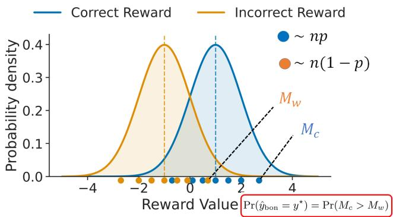  
Figure 1: An illustrative overview of our explanation of BoN for verifiable problems. When n responses are sampled, assuming $\displaystyle \operatorname { p a s s } \ @ 1 \ : = \ : p .$ , we obtain approximately $n p$ correct responses and $n ( 1 - p )$ incorrect responses, each assigned a reward according to the corresponding reward distribution. Whether BoN selects a correct response is determined by the competition between the maximum reward $M _ { c }$ among the np correct responses and the maximum reward $M _ { w }$ among the $n ( 1 - p )$ incorrect responses. When n is sufficiently large, these maxima are governed by the tails of the respective distributions. Thus, the performance of BoN depends on the competition between the tails of the reward distributions for correct and incorrect responses.

Example: Gaussian distribution. When a random variable X follows a gaussian distribution $X \sim \bar { \mathcal { N } } ( \mu , \sigma ^ { 2 } )$ with mean $\mu$ and variance $\sigma ^ { 2 }$

$$
a ( m ) = \frac { \sigma } { \sqrt { 2 \log m } - \frac { \log \log m + \log ( 4 \pi ) } { 2 \sqrt { 2 \log m } } } , ~ b ( m ) = \mu + \sigma \cdot \left( \sqrt { 2 \log m } - \frac { \log \log m + \log ( 4 \pi ) } { 2 \sqrt { 2 \log m } } \right) ,\tag{4}
$$

then the scaled maximum value $\frac { M ( m ) - b ( m ) } { a ( m ) }$ of m samples drawn from the gaussian distribution using the above $a ( m ) , b ( m )$ converges in distribution to the standard Gumbel distribution as $m  \infty$

Based on the Fisher–Tippett–Gnedenko theorem, this paper appropriately chooses $a _ { c } ( m ; x ) ~ >$ $0 , b _ { c } ( m ; x )$ and $a _ { w } ( m ; x ) > 0 , b _ { w } ( m ; x )$ for correct and incorrect answers, respectively, and approximates

$$
\frac { M _ { c } ( k _ { n } ) - b _ { c } ( k _ { n } ; x ) } { a _ { c } ( k _ { n } ; x ) } \approx Z _ { c } , ~ \frac { M _ { w } ( m _ { n } ) - b _ { w } ( m _ { n } ; x ) } { a _ { w } ( m _ { n } ; x ) } \approx Z _ { w } ,\tag{5}
$$

as above.

## 3.2 Classification of BoN Behaviors

In this section, we show that the correctness probability of BoN sampling converges, for general reward distributions, to three regimes as $n \to \infty$ , together with the corresponding conditions, and how these regimes are realized when specific reward distributions are assumed.

First, to simplify notation, define

$$
\alpha _ { n } ( x ) : = \frac { a _ { c } ( k _ { n } ; x ) } { a _ { w } ( m _ { n } ; x ) } , \qquad \beta _ { n } ( x ) : = \frac { b _ { c } ( k _ { n } ; x ) - b _ { w } ( m _ { n } ; x ) } { a _ { w } ( m _ { n } ; x ) } .
$$

Theorem 1 (Behavior for infinite n). In the typical region $k _ { n } = \lfloor n p \rfloor$ , the extreme value approximation gives

$$
A _ { n } ( k _ { n } ; x ) = \operatorname* { P r } ( M _ { c } ( k _ { n } ) > M _ { w } ( m _ { n } ) ) \approx \operatorname* { P r } \bigl ( \alpha _ { n } ( x ) Z _ { c } - Z _ { w } > - \beta _ { n } ( x ) \bigr ) .
$$

Table 1: Four phases of BoN n-dependence. The initial trend is determined by $\operatorname* { P r } ( R _ { c } > R _ { w } \mid x )$ while the asymptotic behavior is determined by the tail-dominant side in Theorem 1.
<table><tr><td>Phase</td><td></td><td>Initial trend Asymptotic limit</td><td>Typical behavior</td></tr><tr><td>iA</td><td> $S _ { 2 } > S _ { 1 }$ </td><td> $S _ { n } \to 1$ </td><td>monotonic improvement</td></tr><tr><td>iB</td><td> $S _ { 2 } < S _ { 1 }$ </td><td> $S _ { n } \to 1$ </td><td>delayed improvement (e.g. U-shape)</td></tr><tr><td>iiA</td><td> $S _ { 2 } > S _ { 1 }$ </td><td> $S _ { n } \to 0$ </td><td>“reward hacking&quot; (e.g. inverted U-shape)</td></tr><tr><td>iiB</td><td> $S _ { 2 } < S _ { 1 }$ </td><td> $S _ { n } \to 0$ </td><td>monotonic degradation</td></tr></table>

Then the asymptotic behavior of $A _ { n } ( k _ { n } ; x )$ is classified into the following three regimes.

(i) Correct-side extreme-value-dominant phase. If any of the following holds: $( a ) \alpha _ { n }  \alpha \in$ $( 0 , \infty )$ and $\beta _ { n } \to + \infty , ( b ) \alpha _ { n } \to \infty$ and $\beta _ { n } / \alpha _ { n }  + \infty ,$ , or $( c ) \alpha _ { n }  0$ and $\beta _ { n }  + \infty ,$ , then $A _ { n } ( k _ { n } ; x ) \to 1$

(ii) Incorrect-side extreme-value-dominant phase. If any of the following holds: (a) $\alpha _ { n }  \alpha \in$ $( 0 , \infty )$ and $\beta _ { n } \to - \infty , ( b ) \alpha _ { n } \to \infty$ and $\beta _ { n } / \alpha _ { n }  - \infty$ , or $( c ) \alpha _ { n }  0$ and $\beta _ { n } \to - \infty$ , then $A _ { n } ( k _ { n } ; x ) \to 0 .$

(iii) Critical phase. $I f ( a ) \alpha _ { n } \to \alpha \in ( 0 , \infty )$ and $\beta _ { n } \to \beta \in \mathbb { R }$ , then $A _ { n } ( k _ { n } ; x )  \mathrm { P r } ( \alpha Z _ { c } - Z _ { w } >$ $- \beta ) ; ( b ) \alpha _ { n }  \infty$ and $\beta _ { n } / \alpha _ { n }  \tau \in \mathbb { R } ,$ , then $A _ { n } ( k _ { n } ; x ) \to \operatorname* { P r } ( Z _ { c } > - \tau ) ; o r ( c ) \alpha _ { n } \to 0$ and $\beta _ { n } \to \beta \in \mathbb { R } ,$ , then $A _ { n } ( k _ { n } ; x ) \to P r ( Z _ { w } < \beta )$ .

See Appendix A.2 for the proof.

Example: Gaussian distribution. Assume that the rewards for correct and incorrect answers follow gaussian distributions with means $\mu _ { c } , \mu _ { w }$ and variances $\sigma _ { c } ^ { 2 } , \sigma _ { w } ^ { 2 }$ , respectively. In this case, by taking $a _ { n } , b _ { n }$ as in Eq. 4, the asymptotic behavior as $n  \infty \mathrm { i s }$ , by Theorem 1,

• when $\sigma _ { c } > \sigma _ { w } ,$ , or when $\sigma _ { c } = \sigma _ { w } , \mu _ { c } > \mu _ { w }$ , the correct-side extreme-value-dominant phase,

• when $\sigma _ { c } < \sigma _ { w }$ , or when $\sigma _ { c } = \sigma _ { w } , \mu _ { c } < \mu _ { w } .$ , the incorrect-side extreme-value-dominant phase,

• when $\sigma _ { c } = \sigma _ { w } , \mu _ { c } = \mu _ { w }$ , the critical phase.

Proof. First, $\alpha _ { n }  \frac { \sigma _ { c } } { \sigma _ { w } } < \infty$ , so it converges to a finite value. Since the largest dominant term of $\beta _ { n }$ is $\frac { \sigma _ { c } - \sigma _ { w } } { \sigma _ { w } } \cdot 2$ log n, the phase becomes the correct-side extreme-value-dominant phase when the sign of $\sigma _ { c } - \sigma _ { w }$ is positive, and the incorrect-side extreme-value-dominant phase when it is negative. When it is $0 , \frac { \mu _ { c } - \mu _ { w } } { \sigma _ { w } } \sqrt { 2 }$ log n becomes the dominant term. Therefore, if $\mu _ { c } > \mu _ { w }$ , the phase becomes the correct-side extreme-value-dominant phase; if $\mu _ { c } < \mu _ { w }$ , the phase becomes the incorrect-side extreme-value-dominant phase; and only when $\mu _ { c } = \mu _ { w }$ , that is, when the reward distributions for correct and incorrect answers are exactly the same, does it converge to the critical phase. □

In the case of the gaussian distribution, as $n  \infty .$ , the maximum reward increases according to $b ( m )$ namely $\sigma { \sqrt { 2 \log m } }$ , and values in the right tail of the reward distributions for correct and incorrect answers are obtained; the side with the thicker right tail dominates. This means that even if the mean reward for correct answers is higher than that for incorrect answers, if the variance of incorrect answers is higher, the accuracy converges to 0 as $n \to \infty$ . Thus, it is important for the success of BoN that the right tail of the distribution is properly optimized. Moreover, since the critical phase holds only when the correct and incorrect answers have exactly the same distribution, it is considered to occur very rarely in practice.

Four phases of n-dependence. The behavior of BoN as a function of n is determined by two factors: the initial direction from $n = 1 \mathrm { t o } n = 2$ , and the asymptotic tail-dominant side as $n \to \infty$ The former is governed by $\operatorname* { P r } ( R _ { c } > R _ { w } \ | \ x )$ , while the latter is determined by Theorem 1. This yields the four phases summarized in Table 1.

Here, $S _ { 2 } > S _ { 1 }$ is equivalent to $\operatorname* { P r } ( R _ { c } > R _ { w } \mid x ) > 1 / 2$ . Thus, small-n improvement is controlled by pairwise correct–incorrect comparison, whereas large-n behavior is controlled by the extreme upper tails. The most important non-monotonic case is phase iiA: BoN initially improves, but eventually degrades because the incorrect-answer tail dominates. We refer to this regime as reward hacking.

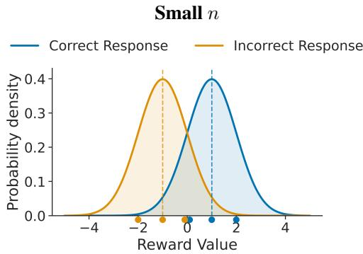

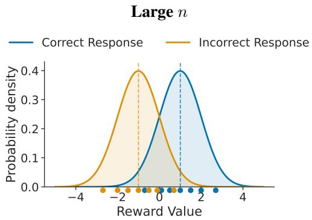

Reward Model with Reward Hacking  
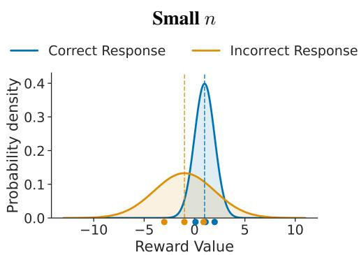

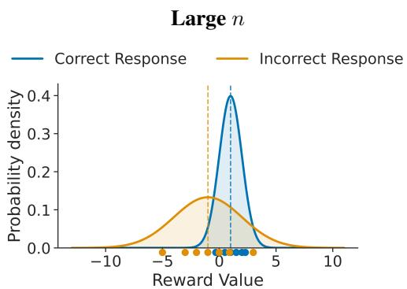  
Figure 2: An illustrative explanation of reward hacking in verifiable problems. The blue and orange points represent correct and incorrect sampled responses, respectively, with n points in total. The response outlined in red is the one selected by BoN. Thus, if a blue response is outlined in red, BoN successfully selects a correct response. In the monotonic-improvement case (top row), correct and incorrect responses have reward distributions with the same variance, so their maximum rewards grow at similar rates as n increases. In the reward-hacking case (bottom row), incorrect responses have larger reward variance, causing their maximum reward to grow faster and eventually exceed that of correct responses. Thus, BoN selects a correct response at small n but incorrect one at large n.

Example: Gaussian distribution. For $n = 2 ,$ , the condition under which BoN accuracy improves is $\begin{array} { r } { \operatorname* { P r } ( R _ { c } > R _ { w } \mid x ) = \Phi \Bigg ( \frac { \mu _ { c } - \mu _ { w } } { \sqrt { \sigma _ { c } ^ { 2 } + \sigma _ { w } ^ { 2 } } } \Bigg ) } \end{array}$ , which implies $\mu _ { c } > \mu _ { w } ,$ , where Φ is the cumulative distribution function of gaussian distribution. Moreover, the incorrect side is upper-tail dominant if and only if $\sigma _ { w } > \sigma _ { c }$ . Thus, the Gaussian reward-hacking regime is

$$
\mu _ { c } > \mu _ { w } \qquad \mathrm { a n d } \qquad \sigma _ { w } > \sigma _ { c } .\tag{6}
$$

## An illustration is shown in figure 2.

In this regime, the characteristic turnover scale is obtained by equating the first-order extreme-value approximations of the correct and incorrect maxima: $\mu _ { c } + \sigma _ { c } \sqrt { 2 \log n } \approx \mu _ { w } + \sigma _ { w } \sqrt { 2 \log n }$ . Thus, we define the turn-over n as follows.

$$
n ^ { \star } ( x ) : = \exp \left( \frac { ( \mu _ { c } - \mu _ { w } ) ^ { 2 } } { 2 ( \sigma _ { w } - \sigma _ { c } ) ^ { 2 } } \right) ,\tag{7}
$$

where, $n ^ { \star } ( x )$ is a leading-order extreme-value crossover scale: it indicates where the incorrect maximum reward catches up with the correct maximum reward, rather than the exact optimizer of $S _ { n } ( x )$

## 4 Scaling Law

In this section, in the correct-side extreme-value-dominant or critical phase, we analyze how the speed of asymptotic convergence to accuracy 1, that is, the n-scaling, differs between the oracle selection function and an incomplete selection function. In general, the scaling behavior changes depending on the reward distribution. This section describes the universal approximate behavior for three domains of attraction: the Gumbel distribution, the Fréchet distribution, and the Weibull distribution.

To derive the scaling law for finite $n ,$ we first evaluate the error due to the EVT approximation. Given the CDF errors $\epsilon _ { c } ( n ) , \epsilon _ { w } ( n )$ induced by the EVT approximations of the reward distributions for correct and incorrect answers, the following lemma holds for the EVT approximation of $A _ { n } .$ , defined as $\tilde { A } _ { n } ( k _ { n } ) : = \mathrm { P r } ( a _ { c } ( k _ { n } ) Z _ { c } ( k _ { n } ) + b _ { c } > a _ { w } ( m _ { n } ) Z _ { w } ( m _ { n } ) + b _ { w } )$

Lemma 2 (EVT approximation error bound). When the CDF errors are given by

$$
\epsilon _ { c } ( n ) \mathrm { ~ } : = \mathrm { ~ } \operatorname* { s u p } _ { z } | \operatorname* { P r } ( M _ { c } ( k _ { n } ) \leq z ) - \operatorname* { P r } ( a _ { c } ( k _ { n } ) Z _ { c } ( k _ { n } ) + b _ { c } \leq z ) | ,\tag{8}
$$

$$
\epsilon _ { w } ( n ) \quad : = \quad \operatorname* { s u p } _ { z } | \operatorname* { P r } ( M _ { w } ( m _ { n } ) \leq z ) - \operatorname* { P r } ( a _ { w } ( m _ { n } ) Z _ { w } ( m _ { n } ) + b _ { w } \leq z ) | ,\tag{9}
$$

we have

$$
| A _ { n } ( k _ { n } ) - \tilde { A } _ { n } ( k _ { n } ) | \leq \epsilon _ { c } ( n ) + \epsilon _ { w } ( n ) .\tag{10}
$$

The proof is provided in Appendix A.3. We will derive the scaling law of ${ \tilde { A } } _ { n }$ in the rest of this section.

Theorem 2 (Finite-n scaling in the Gumbel domain of attraction). Assume that the reward distribution belongs to the Gumbel domain ofattraction and that $\alpha _ { n }  \alpha < \infty$ and $\beta _ { n } \to \infty$ hold. Then, itfalls into the correct-side extreme-value-dominant phase and

$$
\tilde { A } _ { n } ( k _ { n } ; x ) = 1 - \Gamma ( 1 + \alpha ) \mathrm { e } ^ { - \beta _ { n } } + o ( \mathrm { e } ^ { - \beta _ { n } } ) ,\tag{11}
$$

holds.

Example: Gaussian distribution. If the reward follows a Gaussian distribution and belongs to the correct-side extreme-value-dominant phase, then $\alpha _ { n }  \frac { \sigma _ { c } } { \sigma _ { w } } < \infty$ and $\beta _ { n } \to \infty$ , and

$$
\tilde { A } _ { n } ( k _ { n } ; x ) \approx 1 - \Gamma \left( 1 + \frac { \sigma _ { c } } { \sigma _ { w } } \right) p ^ { - \frac { \sigma _ { c } } { \sigma _ { w } } } ( 1 - p ) ^ { 2 - \frac { \sigma _ { c } } { \sigma _ { w } } } n ^ { - \gamma _ { n } } ,\tag{12}
$$

where $\begin{array} { r } { \gamma _ { n } = 2 \left( \frac { \sigma _ { c } } { \sigma _ { w } } - 1 \right) + \frac { \mu _ { c } - \mu _ { w } } { \sigma _ { w } } \sqrt { \frac { 2 } { \log { n } } } - \left( \frac { \sigma _ { c } } { \sigma _ { w } } - 1 \right) \frac { \log \left( 4 \pi \log { n } \right) } { \log { n } } } \end{array}$ . This shows that, up to logarithmic and sub-polynomial corrections, the convergence is governed by the polynomial rate, which is slower than the exponential asymptotic convergence $1 - \mathrm { e } ^ { - n p }$ obtained when using the oracle selection function. On the other hand, it is well known that the convergence of the scaled Gaussian maximum to the Gumbel distribution is slow. Consequently, when the EVT approximation error is taken into account, while the precise scaling law is still polynomial in $n ,$ but with a different exponent. Further details are provided in Appendix $\mathrm { A } . 7$

Theorem 3 (Finite-n scaling in the Fréchet domain of attraction). Assume that the reward distribution belongs to the Fréchet domain ofattraction with shape parameter $\rho _ { c } , \rho _ { w }$ . Furthermore, we assume that $\begin{array} { r } { b _ { m } ( x ) = 0 , \alpha _ { n } ( x ) : = \frac { a _ { c } ( k _ { n } ; x ) } { a _ { w } ( m _ { n } ; x ) }  } \end{array}$ ∞ holds. Then,

$$
\tilde { A } _ { n } ( k _ { n } ; x ) = 1 - \Gamma \Bigl ( 1 + \frac { \rho _ { w } } { \rho _ { c } } \Bigr ) \alpha _ { n } ( x ) ^ { - \rho _ { w } } + o ( \alpha _ { n } ( x ) ^ { - \rho _ { w } } ) ,\tag{13}
$$

holds.

Theorem 4 (Finite-n scaling in the Weibull domain of attraction). Assume that the reward distribution belongs to the Weibull domain of attraction with shape parameter $\xi _ { c } < 0 , \xi _ { w } < 0$ and share a common finite upper endpoint: $r _ { c } ^ { \operatorname* { m a x } } = r _ { w } ^ { \operatorname* { m a x } } = : r ^ { \operatorname* { m a x } }$ . Choose the location normalizations as $b _ { c } ( k _ { n } ) = b _ { w } ( m _ { n } ) = r _ { \mathrm { m a x } }$ and assume $\begin{array} { r } { \alpha _ { n } ( x ) : = \frac { a _ { c } ( k _ { n } ; x ) } { a _ { n } ( m _ { n } ; x ) }  0 . } \end{array}$ Then,

$$
\tilde { A } _ { n } ( k _ { n } ; x ) = 1 - \Gamma \Big ( 1 + \frac { \xi _ { c } } { \xi _ { w } } \Big ) \alpha _ { n } ( x ) ^ { - \frac { 1 } { \xi } } + o \big ( \alpha _ { n } ( x ) ^ { - \frac { 1 } { \xi } } \big ) .\tag{14}
$$

See section A.4, A.5, and A.6 for the proofs.

## 5 Tail-Tension Early Stopping

Motivated by the tail-competition analysis in Section 3, we propose tail-tension early stopping, an online rule that stops BoN sampling before the planned budget n when additional samples are predicted to be harmful. After observing the reward scores of the first t candidates, we fit a two-component Gaussian mixture to the per-query score distribution,

$$
\boldsymbol { r } \sim \pi _ { h } \mathcal { N } ( \mu _ { h } , \sigma _ { h } ^ { 2 } ) + \pi _ { l } \mathcal { N } ( \mu _ { l } , \sigma _ { l } ^ { 2 } ) ,\tag{15}
$$

where the high-mean component is used as a proxy for correct responses and the low-mean component as a proxy for incorrect responses: $( \mu _ { c } , \sigma _ { c } , p ) \gets ( \mu _ { h } , \sigma _ { h } , \pi _ { h } )$ and $( \mu _ { w } , \sigma _ { w } , 1 - p ) \gets ( \mu _ { l } , \sigma _ { l } , \pi _ { l } )$ This assignment is only a proxy, and we discuss the potential issues caused by misassignment in Appendix B.1. Furthermore, we show that misassignment is rare in practice because the reward model is sufficiently optimized and introduce a conservative guard against potential misassignment.

Early stopping is considered only when the low-mean component has larger variance, $\sigma _ { l } > \sigma _ { h }$ . Under the Gaussian analysis, this corresponds to $\sigma _ { w } > \sigma _ { c }$ , where the incorrect-answer tail can dominate for large n and cause reward hacking. Under this condition, the stopping point is estimated as

$$
\hat { n } ^ { \star } \approx \exp \left( \frac { ( \mu _ { h } - \mu _ { l } ) ^ { 2 } } { 2 ( \sigma _ { l } - \sigma _ { h } ) ^ { 2 } } \right) .\tag{16}
$$

To account for the dependence on n beyond leading order, we can numerically solve $\mu _ { h } ~ +$ $\sigma _ { h } \sqrt { 2 \log ( n \pi _ { h } ) } = \mu _ { l } + \sigma _ { l } \sqrt { 2 \log ( n \pi _ { l } ) } $ . Since we observed very little change in accuracy, we do not include corrections beyond the leading-order approximation.

Since the extreme-value approximation is unreliable for very small budgets, we do not stop before a minimum budget $n _ { \mathrm { t h } }$ . The online stopping rule is therefore

$$
\tau = \operatorname* { m i n } \left\{ t \leq N : t \geq n _ { \mathrm { t h } } , \sigma _ { l } > \sigma _ { h } , \hat { n } ^ { \star } \leq t \right\} ,\tag{17}
$$

with $\tau = n$ if the set is empty. Equivalently, sampling continues until either the planned budget is reached or the estimated optimal budget has been reached under the tail-tension condition. The final response is selected from the generated candidates as $\hat { y } = \arg \operatorname* { m a x } _ { 1 \leq i \leq \tau } r ( x , y _ { i } )$ . The overhead is only a lightweight mixture fit and the computation of nˆ⋆. Since the rule is online, it saves both generation and reward-model inference cost whenever $\tau < n$

## 6 Experiments

In this section, we experimentally examine the following points. (1) What kind of distribution do real-world reward models follow? (2) Whether the conditions for the four-phase classification and the predicted convergence destinations are correct (3) The validity of the scaling law (4) The effectiveness of Tail-Tension Early Stopping

Setting. We use the 10,000-response-per-problem dataset 1 [Brown et al., 2024], which covers 2,878 problem–generator pairs across MATH [Hendrycks et al., 2021], MiniF2F [Zheng et al., 2022], GSM8K [Cobbe et al., 2021], and CodeContests [Li et al., 2022]. In this study, we assigned rewards to the 10,000 generated responses for each of the 2,878 (problem, model) pairs and used them for response selection in BoN sampling. To measure the accuracy of BoN for each n, we sampled n responses from the 10,000 responses, simulated this process 1,000 times, and report the average. The reward models used in our experiments are Skywork series 2 [Liu et al., 2025] including Skywork-Reward-V2-Llama-3.1-8B, Skywork-Reward-V2-Qwen3-8B, Skywork-Reward-V2-Qwen3-4B, and Skywork-Reward-V2-Qwen3-1.7B, Llama-3.1-8B-Instruct-RM-RB2 [Malik et al., 2025]3, and RAMO-Llama3.1-8B4, were selected from top-ranked models in RewardBench 2 [Malik et al., 2025]. We used vLLM [Kwon et al., 2023] for reward model inference, and all experiments were conducted on NVIDIA L40S (48GB) GPUs.

Overall results. Figure 3 shows representative real-data results. Oracle Pass@n improves rapidly with n, whereas BoN with incomplete reward models often improves more slowly, saturates, or degrades. This gap confirms that generation-side scaling, i.e., Pass@n theory alone does not explain BoN performance; selection depends critically on the reward-score tails.

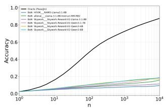

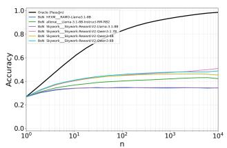

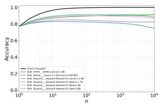  
Figure 3: Overall results for MATH with Pythia-12B, MATH with Llama-3-8B-Instruct, and GSM8K with Llama-3-8B-Instruct. The gap between BoN and oracle selection often widens with n, and some settings exhibit non-monotonic BoN accuracy.

What kind of distribution do real-world reward models follow? Our theory provides a framework applicable to general continuous distributions with max-stability, but in order to confirm that actual reward distributions fall into such domains, we use MATH-Pythia 12B combination and fit the distributions with max-stability using maximum likelihood and evaluate the goodness of fit using the Anderson–Darling test (AD test), log-likelihood, AIC [Akaike, 1974], and BIC [Schwarz, 1978]. The results are shown in Table 4. From the pass rates of the AD test, we can see that real-world reward distributions can reasonably modeled by distributions with max-stability. Table 3 summarizes reward-score statistics for correct and incorrect responses. Across settings, correct responses have higher mean scores, while incorrect responses often have larger variance, especially except for Sky-Qwen-4B. This mean–variance pattern suggests tail tension: correct responses are favored on average, but incorrect responses may dominate the high-reward tail and can be evidence that reward hacking frequently occurs in real-world scenarios.

Verification of theoretical results using synthetic data with Gaussian reward distributions. To verify the theory in a clean setting, we use synthetic data in which correct and incorrect responses follow Gaussian distributions with different mean and variance parameters, and pass@1 is assumed to be $p = [ 0 . 0 5 , 0 . 1 , 0 . 3 , 0 . 5 ]$ ]. Figure 4 shows whether the four-phase classification and the theoretical n⋆ agree. The four panels from left to right correspond to $\mathrm { \bar { \rho } } ( \mu _ { c } - \mu _ { w } , \sigma _ { c } ^ { 2 } - \sigma _ { w } ^ { 2 } ) \to$ $( + , + ) , ( - , - ) , ( + , - ) , ( - , + )$ , respectively, satisfying the theoretical requirements of phase $\mathrm { i A }$ phase iiB, phase iiA (reward hacking), and phase iB, respectively, and we confirm that they indeed match the expected behavior. We also see that the theoretically predicted $n ^ { \star }$ agrees well.

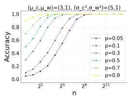

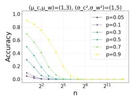

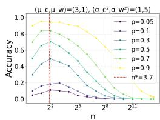

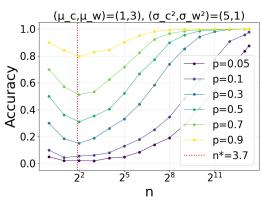  
Figure 4: Synthetic Gaussian experiments for the four phases. The observed BoN curves match the predicted iA, iiB, iiA, and iB behaviors, and the predicted $n ^ { \star }$ aligns with the empirical optimum in the reward-hacking phase.

Figure 5 shows the results of confirming the consistency between the theoretical formula of the scaling law and the experimental results using synthetic data. The circular points in the figure are the average accuracies from BoN simulations, while the dotted line is the scaling law predicted by the theory, showing that the theory and experiments are consistent. The square points are plotted to confirm Lemma 1, and correspond to the results restricted to cases where $\dot { k } _ { n }$ correct responses were generated during the simulation, namely $A _ { n } ( k _ { n } ; x )$ . Since the circular points, i.e., $S _ { n } ( x )$ , and the square points, ${ \bar { A } } _ { n } ( k _ { n } ; x )$ , take close values, we can confirm the correctness of Lemma 1. In addition, all results obtained under different simulation conditions are shown in Figure 7.

Effectiveness of the proposed early stopping method. We evaluate the effectiveness of the early stopping method introduced in Section 5 in an online setting, where only n generated samples are available for fitting the Gaussian mixture model. We show the results of RAMO-Llama3.1-8B, where reward hacking occurs particularly often. Results for other reward models are provided in Appendix B.2. Since the extreme-value approximation of the Gaussian distribution has an average deviation of about 3–4% at $n = 3 2$ , we set $n _ { \mathrm { t h } } = 3 2$ . Experimental results with standard deviation are shown in Figure 6. From left to right, the panels show the results on

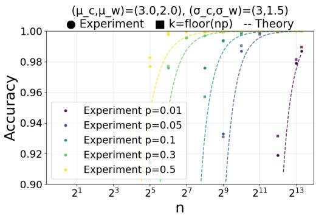  
Figure 5: Experimental validation of the EVT approximated Gaussian scaling law. BoN accuracy follows the predicted finite-n scaling Eq. (12) well. Furthermore, the typicalregion accuracy $A _ { n } ( k _ { n } ; x )$ closely matches $S _ { n } ( x )$ as in Lemma 1.

the entire dataset, on datasets where reward hacking occurs, and on datasets where it does not occur. In each case, the upper plot shows accuracy, while the lower plot shows the total number of generated samples. On datasets where reward hacking occurs, the proposed method outperforms standard BoN while also substantially reducing computational cost. In contrast, in the rightmost plot, where accuracy increases monotonically, early stopping is in principle suboptimal; accordingly, the proposed method does not increase accuracy.

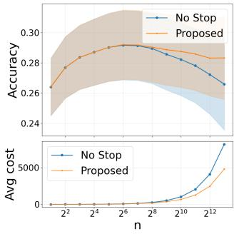

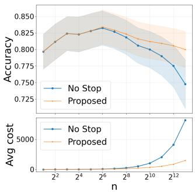

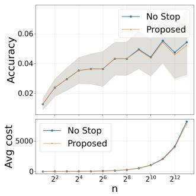  
Figure 6: Tail-tension early stopping on RAMO-Llama3.1-8B scores. The proposed method mitigates degradation in reward-hacking cases while reducing computational cost.

## 7 Related Work

Scaling Laws for Inference-Time Scaling Methods. Inference-time scaling improves LLM performance by allocating more computation at inference time [Snell et al., 2024, Muennighoff et al., 2025]. Its basic principle is that, with multiple sampled generations, pass@n approaches one exponentially fast as n increases [Brown et al., 2024, Schaeffer et al., 2025], suggesting that performance can improve if a correct answer can be selected, though this law assumes oracle selection. Chen et al. [2024] showed that Majority Vote and Filter-Vote reduce error roughly exponentially when correctness probability converges to one, e.g., when the correct answer has a positive probability gap over the most frequent incorrect answer. Chen et al. [2025] proposed knockout-style and league-style selection algorithms with polynomial failure bounds, assuming nonzero correct-generation probability and better-than-random correct–incorrect comparisons.

Analysis of Best-of-N sampling. Mukherjee et al. [2025] analyze inference-time scaling with a verifier via optimal transport, relating generator coverage, verifier ROC, and sampling sub-optimality. Huang et al. [2025a] analyzes BoN regret, explaining overoptimization as a trade-off between gains from larger n and degradation from reward-model errors. Because reward models are only proxies for true objectives such as preferences, safety, or correctness, strong optimization can cause reward hacking or overoptimization [Gao et al., 2023]. Khalaf et al. [2025] formally defines reward hacking and proposes HedgeTune, which tunes dataset-specific parameters using validation data. Kwa et al. [2024] argues that reward-model errors dominate in the high-reward regime, especially under heavy tails, and cannot be eliminated by KL regularization. Hsu et al. [2026] shows that optimistic selection works for light-tailed distributions, whereas heavy-tailed ones require pessimistic regularization, and proposes Best-of-Tails based on Tsallis-divergence regularization. Unlike previous work on KL divergence, regret, or the tail of a single reward distribution, our extreme-value-theoretic analysis characterizes when BoN improves monotonically or suffers reward hacking. In particular, it shows that even with a heavy-tailed marginal reward distribution, BoN can remain in an improving phase when the correct-response tail dominates, yielding new scaling laws and optimal-stopping results.

## 8 Conclusion

In this work, we formulated Best-of-N sampling for verifiable problems as a competition between the upper tails of the reward-score distributions for correct and incorrect responses. From this formulation, we derived three main consequences. First, we classified the scaling behavior of BoN into four phases including monotonic scaling and reward hacking. Second, for representative reward score distributions, we derived finite-sample scaling laws, showing that incomplete reward models can lead to polynomial convergence unlike oracle selection, and that Gaussian reward models can exhibit reward hacking when the variance of incorrect responses is large. Third, as an application of the theory, we derived a tail-tension criterion that estimates the risk of oversampling using only reward scores. Through experiments, we confirmed that the proposed tail-competition perspective explains the phase classification, scaling laws, and emergence of reward hacking in BoN.

Limitations and Future Work. Our analysis has several limitations, which also suggest promising directions for future work. First, this study focuses on verifiable problems, and applying the proposed theoretical framework to open-ended tasks remains an important direction for future research. Second, while our early stopping method is designed for settings in which the reward distribution separates correct and incorrect answers, further investigation is needed for more general cases, such as nonbimodal or far from Gaussian reward distributions or scenarios in which incorrect answers receive higher average rewards than correct ones. Finally, while our analysis focuses on the asymptotic regime of large n to obtain closed-form scaling laws and characterize the qualitative behavior of BoN, developing practical methods for accurately identifying such regimes at finite n from real-world data remains an important direction for future work.

## References

Marah I Abdin, Jyoti Aneja, Harkirat S. Behl, Sébastien Bubeck, Ronen Eldan, Suriya Gunasekar, Michael Harrison, Russell J. Hewett, Mojan Javaheripi, Piero Kauffmann, James R. Lee, Yin Tat Lee, Yuanzhi Li, Weishung Liu, Caio C. T. Mendes, Anh Nguyen, Eric Price, Gustavo de Rosa, Olli Saarikivi, Adil Salim, Shital Shah, Xin Wang, Rachel Ward, Yue Wu, Dingli Yu, Cyril Zhang, and Yi Zhang. Phi-4 technical report. CoRR, abs/2412.08905, 2024. doi: 10.48550/ARXIV.2412.08905. URL https://doi.org/10.48550/arXiv.2412.08905.

Hirotugu Akaike. A new look at the statistical model identification. IEEE Transactions on Automatic Control, 19(6):716–723, 1974. doi: 10.1109/TAC.1974.1100705.

Gholamali Aminian, Idan Shenfeld, Amir R. Asadi, Ahmad Beirami, and Youssef Mroueh. Best-of-n through the smoothing lens: KL divergence and regret analysis. CoRR, abs/2507.05913, 2025. doi: 10.48550/ARXIV.2507.05913. URL https://doi.org/10.48550/arXiv.2507.05913.

Anthropic. System card: Claude opus 4.6. https://www-cdn.anthropic.com/ 14e4fb01875d2a69f646fa5e574dea2b1c0ff7b5.pdf, 2026. Accessed: 2026-03-29.

Bradley C. A. Brown, Jordan Juravsky, Ryan Ehrlich, Ronald Clark, Quoc V. Le, Christopher Ré, and Azalia Mirhoseini. Large language monkeys: Scaling inference compute with repeated sampling. CoRR, abs/2407.21787, 2024. doi: 10.48550/ARXIV.2407.21787. URL https: //doi.org/10.48550/arXiv.2407.21787.

Lingjiao Chen, Jared Davis, Boris Hanin, Peter Bailis, Ion Stoica, Matei Zaharia, and James Zou. Are more llm calls all you need? towards the scaling properties of compound ai systems. In A. Globerson, L. Mackey, D. Belgrave, A. Fan, U. Paquet, J. Tomczak, and C. Zhang, editors, Advances in Neural Information Processing Systems, volume 37, pages 45767–45790. Curran Associates, Inc., 2024. doi: 10.52202/079017-1455. URL https://proceedings.neurips.cc/paper\_files/ paper/2024/file/51173cf34c5faac9796a47dc2fdd3a71-Paper-Conference.pdf.

Yanxi Chen, Xuchen Pan, Yaliang Li, Bolin Ding, and Jingren Zhou. Provable scaling laws for the test-time compute of large language models. In The Thirty-ninth Annual Conference on Neural Information Processing Systems, 2025. URL https://openreview.net/forum?id=GBMzJLhsRj.

Karl Cobbe, Vineet Kosaraju, Mohammad Bavarian, Mark Chen, Heewoo Jun, Lukasz Kaiser, Matthias Plappert, Jerry Tworek, Jacob Hilton, Reiichiro Nakano, Christopher Hesse, and John Schulman. Training verifiers to solve math word problems. CoRR, abs/2110.14168, 2021. URL https://arxiv.org/abs/2110.14168.

DeepSeek-AI. Deepseek-v3.2: Pushing the frontier of open large language models. CoRR, abs/2512.02556, 2025. doi: 10.48550/ARXIV.2512.02556. URL https://doi.org/10.48550/ arXiv.2512.02556.

Ronald A. Fisher and Leonard H. C. Tippett. Limiting forms of the frequency distribution of the largest or smallest member of a sample. Mathematical Proceedings ofthe Cambridge Philosophical Society, 24(2):180–190, 1928. doi: 10.1017/S0305004100015681.

Maurice Fréchet. Sur la loi de probabilité de l’écart maximum. Annales de la Société Polonaise de Mathématique, 6:93–116, 1927.

Leo Gao, John Schulman, and Jacob Hilton. Scaling laws for reward model overoptimization. In Andreas Krause, Emma Brunskill, Kyunghyun Cho, Barbara Engelhardt, Sivan Sabato, and Jonathan Scarlett, editors, International Conference on Machine Learning, ICML 2023, 23-29 July 2023, Honolulu, Hawaii, USA, Proceedings of Machine Learning Research, pages 10835–10866. PMLR, 2023. URL https://proceedings.mlr.press/v202/gao23h.html.

Gemini Team. Gemini 2.5: Pushing the frontier with advanced reasoning, multimodality, long context, and next generation agentic capabilities. CoRR, abs/2507.06261, 2025. doi: 10.48550/ARXIV. 2507.06261. URL https://doi.org/10.48550/arXiv.2507.06261.

Gemma Team. Gemma 3 technical report. CoRR, abs/2503.19786, 2025. doi: 10.48550/ARXIV. 2503.19786. URL https://doi.org/10.48550/arXiv.2503.19786.

Boris V. Gnedenko. Sur la distribution limite du terme maximum d’une série aléatoire. Annals of Mathematics, 44(3):423–453, 1943. doi: 10.2307/1968974.

Dan Hendrycks, Collin Burns, Saurav Kadavath, Akul Arora, Steven Basart, Eric Tang, Dawn Song, and Jacob Steinhardt. Measuring mathematical problem solving with the MATH dataset. In Joaquin Vanschoren and Sai-Kit Yeung, editors, Proceedings ofthe Neural Information Processing Systems Track on Datasets and Benchmarks 1, NeurIPS Datasets and Benchmarks 2021, December 2021, virtual, 2021. URL https://datasets-benchmarks-proceedings.neurips.cc/paper/ 2021/hash/be83ab3ecd0db773eb2dc1b0a17836a1-Abstract-round2.html.

Hsiang Hsu, Eric Lei, and Chun-Fu Chen. Best-of-tails: Bridging optimism and pessimism in inference-time alignment. CoRR, abs/2603.06797, 2026. doi: 10.48550/ARXIV.2603.06797. URL https://doi.org/10.48550/arXiv.2603.06797.

Audrey Huang, Adam Block, Qinghua Liu, Nan Jiang, Akshay Krishnamurthy, and Dylan J. Foster. Is best-of-n the best of them? coverage, scaling, and optimality in inference-time alignment. In Aarti Singh, Maryam Fazel, Daniel Hsu, Simon Lacoste-Julien, Felix Berkenkamp, Tegan Maharaj, Kiri Wagstaff, and Jerry Zhu, editors, Forty-second International Conference on Machine Learning, ICML 2025, Vancouver, BC, Canada, July 13-19, 2025, volume 267 of Proceedings ofMachine Learning Research. PMLR / OpenReview.net, 2025a. URL https://proceedings.mlr.press/ v267/huang25c.html.

Chengsong Huang, Langlin Huang, Jixuan Leng, Jiacheng Liu, and Jiaxin Huang. Efficient test-time scaling via self-calibration. CoRR, abs/2503.00031, 2025b. doi: 10.48550/ARXIV.2503.00031. URL https://doi.org/10.48550/arXiv.2503.00031.

Albert Q. Jiang, Alexandre Sablayrolles, Arthur Mensch, Chris Bamford, Devendra Singh Chaplot, Diego de Las Casas, Florian Bressand, Gianna Lengyel, Guillaume Lample, Lucile Saulnier, Lélio Renard Lavaud, Marie-Anne Lachaux, Pierre Stock, Teven Le Scao, Thibaut Lavril, Thomas Wang, Timothée Lacroix, and William El Sayed. Mistral 7b. CoRR, abs/2310.06825, 2023. doi: 10.48550/ARXIV.2310.06825. URL https://doi.org/10.48550/arXiv.2310.06825.

Yusuf Hakan Kalayci, Vinod Raman, and Shaddin Dughmi. Optimal stopping vs best-of-n for inference time optimization. CoRR, abs/2510.01394, 2025. doi: 10.48550/ARXIV.2510.01394. URL https://doi.org/10.48550/arXiv.2510.01394.

Hadi Khalaf, Claudio Mayrink Verdun, Alex Oesterling, Himabindu Lakkaraju, and Flávio du Pin Calmon. Inference-time reward hacking in large language models. CoRR, abs/2506.19248, 2025. doi: 10.48550/ARXIV.2506.19248. URL https://doi.org/10.48550/arXiv.2506.19248.

Kimi Team. Kimi K2: open agentic intelligence. CoRR, abs/2507.20534, 2025. doi: 10.48550/ ARXIV.2507.20534. URL https://doi.org/10.48550/arXiv.2507.20534.

Takeshi Kojima, Shixiang Shane Gu, Machel Reid, Yutaka Matsuo, and Yusuke Iwasawa. Large language models are zero-shot reasoners. In Sanmi Koyejo, S. Mohamed, A. Agarwal, Danielle Belgrave, K. Cho, and A. Oh, editors, Advances in Neural Information Processing Systems 35: Annual Conference on Neural Information Processing Systems 2022, NeurIPS 2022, New Orleans, LA, USA, November 28 - December 9, 2022, 2022. URL http://papers.nips.cc/paper\_files/ paper/2022/hash/8bb0d291acd4acf06ef112099c16f326-Abstract-Conference.html.

Thomas Kwa, Drake Thomas, and Adrià Garriga-Alonso. Catastrophic goodhart: regularizing RLHF with KL divergence does not mitigate heavy-tailed reward misspecification. In Amir Globersons, Lester Mackey, Danielle Belgrave, Angela Fan, Ulrich Paquet, Jakub M. Tomczak, and Cheng Zhang, editors, Advances in Neural Information Processing Systems 38: Annual Conference on Neural Information Processing Systems 2024, NeurIPS 2024, Vancouver, BC, Canada, December 10 - 15, 2024, 2024. URL http://papers.nips.cc/paper\_files/paper/ 2024/hash/1a8189929f3d7bd6183718f42c3f4309-Abstract-Conference.html.

Woosuk Kwon, Zhuohan Li, Siyuan Zhuang, Ying Sheng, Lianmin Zheng, Cody Hao Yu, Joseph E. Gonzalez, Hao Zhang, and Ion Stoica. Efficient memory management for large language model serving with pagedattention. In Proceedings of the ACM SIGOPS 29th Symposium on Operating Systems Principles, 2023.

Yujia Li, David H. Choi, Junyoung Chung, Nate Kushman, Julian Schrittwieser, Rémi Leblond, Tom Eccles, James Keeling, Felix Gimeno, Agustin Dal Lago, Thomas Hubert, Peter Choy, Cyprien de Masson d’Autume, Igor Babuschkin, Xinyun Chen, Po-Sen Huang, Johannes Welbl, Sven Gowal, Alexey Cherepanov, James Molloy, Daniel J. Mankowitz, Esme Sutherland Robson, Pushmeet Kohli, Nando de Freitas, Koray Kavukcuoglu, and Oriol Vinyals. Competition-level code generation with alphacode. CoRR, abs/2203.07814, 2022. doi: 10.48550/ARXIV.2203.07814. URL https://doi.org/10.48550/arXiv.2203.07814.

Chris Yuhao Liu, Liang Zeng, Yuzhen Xiao, Jujie He, Jiacai Liu, Chaojie Wang, Rui Yan, Wei Shen, Fuxiang Zhang, Jiacheng Xu, Yang Liu, and Yahui Zhou. Skywork-reward-v2: Scaling preference data curation via human-ai synergy. CoRR, abs/2507.01352, 2025. doi: 10.48550/ARXIV.2507. 01352. URL https://doi.org/10.48550/arXiv.2507.01352.

Llama Team. The llama 3 herd of models. CoRR, abs/2407.21783, 2024. doi: 10.48550/ARXIV. 2407.21783. URL https://doi.org/10.48550/arXiv.2407.21783.

Aman Madaan, Niket Tandon, Prakhar Gupta, Skyler Hallinan, Luyu Gao, Sarah Wiegreffe, Uri Alon, Nouha Dziri, Shrimai Prabhumoye, Yiming Yang, Shashank Gupta, Bodhisattwa Prasad Majumder, Katherine Hermann, Sean Welleck, Amir Yazdanbakhsh, and Peter Clark. Self-refine: Iterative refinement with self-feedback. In Alice Oh, Tristan Naumann, Amir Globerson, Kate Saenko, Moritz Hardt, and Sergey Levine, editors, Advances in Neural Information Processing Systems 36:

Annual Conference on Neural Information Processing Systems 2023, NeurIPS 2023, New Orleans, LA, USA, December 10 - 16, 2023, 2023. URL http://papers.nips.cc/paper\_files/paper/ 2023/hash/91edff07232fb1b55a505a9e9f6c0ff3-Abstract-Conference.html.

Saumya Malik, Valentina Pyatkin, Sander Land, Jacob Morrison, Noah A. Smith, Hannaneh Hajishirzi, and Nathan Lambert. Rewardbench 2: Advancing reward model evaluation. CoRR, abs/2506.01937, 2025. doi: 10.48550/ARXIV.2506.01937. URL https://doi.org/10.48550 arXiv.2506.01937.

MiniMax. Minimax-m1: Scaling test-time compute efficiently with lightning attention. CoRR, abs/2506.13585, 2025. doi: 10.48550/ARXIV.2506.13585. URL https://doi.org/10.48550/ arXiv.2506.13585.

Niklas Muennighoff, Zitong Yang, Weijia Shi, Xiang Lisa Li, Li Fei-Fei, Hannaneh Hajishirzi, Luke Zettlemoyer, Percy Liang, Emmanuel J. Candès, and Tatsunori Hashimoto. s1: Simple test-time scaling. In Christos Christodoulopoulos, Tanmoy Chakraborty, Carolyn Rose, and Violet Peng, editors, Proceedings of the 2025 Conference on Empirical Methods in Natural Language Processing, EMNLP 2025, Suzhou, China, November 4-9, 2025, pages 20275–20321. Association for Computational Linguistics, 2025. doi: 10.18653/V1/2025.EMNLP-MAIN.1025. URL https://doi.org/10.18653/v1/2025.emnlp-main.1025.

Arpan Mukherjee, Marcello Bullo, Debabrota Basu, and Deniz Gündüz. Test-time verification via optimal transport: Coverage, roc, & sub-optimality. CoRR, abs/2510.18982, 2025. doi: 10.48550/ARXIV.2510.18982. URL https://doi.org/10.48550/arXiv.2510.18982.

NVIDIA. NVIDIA nemotron 3: Efficient and open intelligence. CoRR, abs/2512.20856, 2025. doi: 10.48550/ARXIV.2512.20856. URL https://doi.org/10.48550/arXiv.2512.20856.

OpenAI. GPT-4 technical report. CoRR, abs/2303.08774, 2023. doi: 10.48550/ARXIV.2303.08774. URL https://doi.org/10.48550/arXiv.2303.08774.

Qwen Team. Qwen3 technical report. CoRR, abs/2505.09388, 2025. doi: 10.48550/ARXIV.2505. 09388. URL https://doi.org/10.48550/arXiv.2505.09388.

Amin Rakhsha, Kanika Madan, Tianyu Zhang, Amir-massoud Farahmand, and Amir Khasahmadi. Majority of the bests: Improving best-of-n via bootstrapping. CoRR, abs/2511.18630, 2025. doi: 10.48550/ARXIV.2511.18630. URL https://doi.org/10.48550/arXiv.2511.18630.

Rylan Schaeffer, Joshua Kazdan, John Hughes, Jordan Juravsky, Sara Price, Aengus Lynch, Erik Jones, Robert Kirk, Azalia Mirhoseini, and Sanmi Koyejo. How do large language monkeys get their power (laws)? In Aarti Singh, Maryam Fazel, Daniel Hsu, Simon Lacoste-Julien, Felix Berkenkamp, Tegan Maharaj, Kiri Wagstaff, and Jerry Zhu, editors, Forty-second International Conference on Machine Learning, ICML 2025, Vancouver, BC, Canada, July 13-19, 2025, volume 267 of Proceedings ofMachine Learning Research. PMLR / OpenReview.net, 2025. URL https: //proceedings.mlr.press/v267/schaeffer25a.html.

Gideon Schwarz. Estimating the dimension of a model. The Annals ofStatistics, 6(2):461–464, 1978. doi: 10.1214/aos/1176344136.

Noah Shinn, Federico Cassano, Ashwin Gopinath, Karthik Narasimhan, and Shunyu Yao. Reflexion: language agents with verbal reinforcement learning. In Alice Oh, Tristan Naumann, Amir Globerson, Kate Saenko, Moritz Hardt, and Sergey Levine, editors, Advances in Neural Information Processing Systems 36: Annual Conference on Neural Information Processing Systems 2023, NeurIPS 2023, New Orleans, LA, USA, December 10 - 16, 2023, 2023. URL http://papers.nips.cc/paper\_files/paper/2023/hash/ 1b44b878bb782e6954cd888628510e90-Abstract-Conference.html.

Charlie Snell, Jaehoon Lee, Kelvin Xu, and Aviral Kumar. Scaling LLM test-time compute optimally can be more effective than scaling model parameters. CoRR, abs/2408.03314, 2024. doi: 10.48550/ ARXIV.2408.03314. URL https://doi.org/10.48550/arXiv.2408.03314.

Guangya Wan, Zixin Stephen Xu, Sasa Zorc, Manel Baucells, Mengxuan Hu, Hao Wang, and Sheng Li. BEACON: bayesian optimal stopping for efficient LLM sampling. CoRR, abs/2510.15945, 2025. doi: 10.48550/ARXIV.2510.15945. URL https://doi.org/10.48550/arXiv.2510.15945.

Jason Wei, Xuezhi Wang, Dale Schuurmans, Maarten Bosma, Brian Ichter, Fei Xia, Ed H. Chi, Quoc V. Le, and Denny Zhou. Chain-of-thought prompting elicits reasoning in large language models. In Sanmi Koyejo, S. Mohamed, A. Agarwal, Danielle Belgrave, K. Cho, and A. Oh, editors, Advances in Neural Information Processing Systems 35: Annual Conference on Neural Information Processing Systems 2022, NeurIPS 2022, New Orleans, LA, USA, November 28 - December 9, 2022, 2022. URL http://papers.nips.cc/paper\_files/paper/2022/hash/ 9d5609613524ecf4f15af0f7b31abca4-Abstract-Conference.html.

Shunyu Yao, Jeffrey Zhao, Dian Yu, Nan Du, Izhak Shafran, Karthik R. Narasimhan, and Yuan Cao. React: Synergizing reasoning and acting in language models. In The Eleventh International Conference on Learning Representations, ICLR 2023, Kigali, Rwanda, May 1-5, 2023. OpenReview.net, 2023. URL https://openreview.net/forum?id=WE\_vluYUL-X.

Kunhao Zheng, Jesse Michael Han, and Stanislas Polu. minif2f: a cross-system benchmark for formal olympiad-level mathematics. In The Tenth International Conference on Learning Representations, ICLR 2022, Virtual Event, April 25-29, 2022. OpenReview.net, 2022. URL https://openreview. net/forum?id=9ZPegFuFTFv.

## A Proofs

## A.1 Lemma 1

Proof sketch. We decompose the difference between $S _ { n }$ and $A _ { n }$ according to whether K lies within $M \sqrt { n }$ of $k _ { n }$ or farther away. The contribution from the former term tends to zero by the assumption that the expected variation of $A _ { n } ( K ; x )$ within $M \sqrt { n }$ of $K = k _ { n }$ is zero. On the other hand, the contribution from the latter term is exponentially small by Hoeffding’s inequality.

Proof. Let $K \sim \mathrm { B i n } ( n , p ( x ) )$ . Then

$$
S _ { n } ( x ) = \mathbb { E } _ { K \sim \mathrm { B i n } ( n , p ( x ) ) } [ A _ { n } ( K ; x ) ]
$$

holds. Therefore, for any $M > 1$

$$
\begin{array} { r l } & { | S _ { n } ( x ) - A _ { n } ( k _ { n } ; x ) | \leq \mathbb { E } \big [ | A _ { n } ( K ; x ) - A _ { n } ( k _ { n } ; x ) | \mathbf { 1 } \{ | K - k _ { n } | \leq M \sqrt { n } \} \big ] } \\ & { \qquad + \operatorname* { P r } ( | K - k _ { n } | > M \sqrt { n } ) } \end{array}\tag{18}
$$

Here, we used the fact that the absolute value of the expectation is no greater than the expectation of the absolute value, and we split the possible values of K into the region near the mean and the region that deviates substantially from the mean; the latter term is bounded by using $0 \leq A _ { n } \leq 1$ , which implies $| A _ { n } ( K ; x ) - A _ { n } ( k _ { n } ; x ) | \leq 1$

Since $0 \leq n p ( x ) - k _ { n } < 1 , { \mathrm { i f ~ } } | K - k _ { n } | > M { \sqrt { n } }$ and $n \geq 1$ , then by the triangle inequality and the assumption, $| \dot { K } - n p ( x ) | \geq | \dot { K } - k _ { n } | - | n p ( x ) ^ { ' } - k _ { n } | > M \sqrt { n } - 1 \dot { \geq } M \sqrt { n } - \sqrt { n }$ holds. Therefore, by the monotonicity of probability,

$$
\operatorname* { P r } ( | K - k _ { n } | > M { \sqrt { n } } ) \leq \operatorname* { P r } \left( | K - n p ( x ) | > ( M - 1 ) { \sqrt { n } } \right) .
$$

By using Hoeffding’s inequality, we have

$$
\operatorname* { P r } \left( | K - n p ( x ) | > ( M - 1 ) { \sqrt { n } } \right) = \operatorname* { P r } \left( \left| { \frac { K } { n } } - p ( x ) \right| > { \frac { M - 1 } { \sqrt { n } } } \right) \leq 2 e ^ { - 2 ( M - 1 ) ^ { 2 } } .
$$

Here, the coefficient 2 appears because Hoeffding’s inequality is applied to each of the two tails in $\begin{array} { r } { \operatorname* { P r } \Big ( \big | \frac { K } { n } - p ( x ) \big | > \frac { M - 1 } { \sqrt { n } } \Big ) = \operatorname* { P r } \Big ( \frac { K } { n } - p ( x ) > \frac { M - 1 } { \sqrt { n } } \Big ) + \operatorname* { P r } \Big ( \frac { K } { n } - p ( x ) < - \frac { M - 1 } { \sqrt { n } } \Big ) } \end{array}$

Finally, the following holds.

$$
\operatorname* { l i m } _ { n \to \infty } \operatorname* { s u p } _ { } | S _ { n } ( x ) - A _ { n } ( k _ { n } ; x ) | \leq 2 e ^ { - 2 ( M - 1 ) ^ { 2 } } .
$$

Here, we used the assumption of the lemma to conclude that the first term on the right-hand side of Equation 18 converges to 0 as $n \to \infty$ □

## A.2 Theorem 1

Proof. First, define the expression inside the probability in $A _ { n }$ by

$$
W _ { n } : = \alpha _ { n } Z _ { c } - Z _ { w } + \beta _ { n } ,\tag{19}
$$

and compute its limit as $n  \infty$ . Then, computing the final probability lim $_ { n  \infty } A _ { n } ( k _ { n } ; x ) =$ $\begin{array} { r } { \operatorname* { l i m } _ { n  \infty } \mathrm { \bar { P } r } ( W _ { n } > 0 ) } \end{array}$ gives Table 2 below.

Table 2: Limits of $A _ { n } ( k _ { n } ; x )$ classified by the limiting values of $\alpha _ { n }$ and $\beta _ { n }$ as $n \to \infty$
<table><tr><td>Limit of  $\alpha _ { n }$ </td><td>Other limit</td><td>Limit of  $W _ { n }$ </td><td>Limit of  $A _ { n } ( k _ { n } ; x )$ </td></tr><tr><td> $\alpha _ { n }  \alpha \in ( 0 , \infty )$ </td><td> $\beta _ { n } \to \infty$ </td><td>∞</td><td>1</td></tr><tr><td> $\alpha _ { n }  \alpha \in ( 0 , \infty )$ </td><td> $\beta _ { n } \to - \infty$ </td><td>-∞</td><td>0</td></tr><tr><td> $\alpha _ { n }  \alpha \in ( 0 , \infty )$ </td><td> $\beta _ { n } \to \beta \in \mathbb { R }$ </td><td> $\alpha Z _ { c } + \beta - Z _ { w }$ </td><td> $\mathrm { P r } ( \alpha Z _ { c } + \beta - Z _ { w } > 0 )$ </td></tr><tr><td> $\alpha _ { n }  \infty$ </td><td> $\frac { \beta _ { n } } { \ ! }  \infty$ </td><td>∞</td><td>1</td></tr><tr><td> $\alpha _ { n }  \infty$ </td><td> $\frac { \alpha _ { n } } { \beta _ { n } } _ {  \infty }$   ${ \frac { \ d \rho _ { n } } { \ d \alpha _ { n } } }  - \infty$ </td><td>-∞</td><td>0</td></tr><tr><td> $\alpha _ { n }  \infty$ </td><td> $\frac { \beta _ { n } } { \alpha _ { n } }  \tau \in \mathbb { R }$ </td><td> $\begin{array} { r } { \frac { W _ { n } } { \alpha _ { n } }  ( Z _ { c } + \tau ) } \end{array}$ </td><td> $\mathrm { P r } \big ( Z _ { c } > - \tau \big )$ </td></tr><tr><td> $\alpha _ { n }  0$ </td><td> $\beta _ { n } \to \infty$ </td><td>∞</td><td>1</td></tr><tr><td> $\alpha _ { n }  0$ </td><td> $\beta _ { n } \to - \infty$ </td><td>-∞</td><td>0</td></tr><tr><td> $\alpha _ { n }  0$ </td><td> $\beta _ { n } \to \beta \in \mathbb { R }$ </td><td> $\beta - Z _ { w }$ </td><td> $P r ( Z _ { w } < \beta )$ </td></tr></table>

## A.3 Lemma 2

Proof. Let $\tilde { M } _ { c , n } : = a _ { c } ( k _ { n } ) Z _ { c } + b _ { c } ( k _ { n } ) , \tilde { M } _ { w , n } : = a _ { w } ( m _ { n } ) Z _ { w } + b _ { w } ( m _ { n } )$ , and $F _ { c , n } , F _ { w , n } , \tilde { F } _ { c , n }$ and $\tilde { F } _ { w , n }$ be the CDF for $M _ { c } , M _ { w } , \tilde { M } _ { c , n }$ and $\tilde { M } _ { w , n } .$ , respectively. Since $\mathrm { P r } ( M _ { c } \ > \ M _ { w } ) \ =$ $\mathbb { E } _ { M _ { c } } [ F _ { w , n } ( M _ { c } ) ]$ and $\mathrm { P r } ( \tilde { M } _ { c , n } > \tilde { M } _ { w , n } ) = \mathbb { E } _ { \tilde { M } _ { c , n } } [ \tilde { F } _ { w , n } ( \tilde { M } _ { c , n } ) ]$ , by the triangle inequality, the difference is bounded by $\varepsilon _ { w , n } + \left| \mathbb { E } _ { M _ { c } } [ \tilde { F } _ { w , n } ( M _ { c } ) ] - \mathbb { E } _ { \tilde { M } _ { c , n } } [ \tilde { F } _ { w , n } ( \tilde { M } _ { c , n } ) ] \right|$ . Since $\tilde { F } _ { w , n }$ is a continuous increasing CDF with values in $[ 0 , 1 ]$ , the tail integral formula gives, for any random variable X,

$$
\mathbb { E } [ \tilde { F } _ { w , n } ( X ) ] = \int _ { 0 } ^ { 1 } \operatorname* { P r } \Bigl ( X > \tilde { F } _ { w , n } ^ { - 1 } ( u ) \Bigr ) \ d u .
$$

Therefore,

$$
\begin{array} { r l } & { \left| \mathbb E [ \tilde { F } _ { w , n } ( M _ { c } ) ] - \mathbb E [ \tilde { F } _ { w , n } ( \tilde { M } _ { c , n } ) ] \right| \leq \displaystyle \int _ { 0 } ^ { 1 } \left| F _ { c , n } ( \tilde { F } _ { w , n } ^ { - 1 } ( u ) ) - \tilde { F } _ { c , n } ( \tilde { F } _ { w , n } ^ { - 1 } ( u ) ) \right| d u } \\ & { \qquad \leq \varepsilon _ { c , n } . } \end{array}
$$

Combining the two bounds proves the claim.

## A.4 Theorem 2

Proof sketch. Since $\operatorname* { P r } \{ G _ { w } \ge \alpha _ { n } G _ { c } + \beta _ { n } \} = 1 - \exp \{ - \mathrm { e } ^ { - ( \alpha _ { n } G _ { c } + \beta _ { n } ) } \}  \mathrm { e } ^ { - \beta _ { n } } \mathrm { e } ^ { - \alpha _ { n } G _ { c } }$ , and $\alpha _ { n } \ \to \ \alpha$ and $\beta _ { n } \to \infty$ , the probability is expected to decay to zero approximately at the rate $\mathrm { e } ^ { - \beta _ { n } }$ . To determine the coefficient, we apply the dominated convergence theorem to $\mathrm { e } ^ { \tilde { \beta } _ { n } } \operatorname* { P r } \{ G _ { w } \geq$ $\alpha _ { n } G _ { c } + \beta _ { n } \}$ , which allows us to interchange the limit and the expectation and thereby reduce the problem to evaluating the integra $\mathbb { E } _ { G _ { c } } [ \mathrm { e } ^ { - \alpha \mathbf { \bar { G } } _ { c } } ]$

Proof. With Gumbel extreme-value approximation $\psi ( t ) : = \mathrm { P r } ( G _ { w } \geq t ) = 1 - \exp ( - e ^ { - t } )$ , independence gives $\mathrm { P r } \{ G _ { w } \ge \alpha _ { n } G _ { c } + \beta _ { n } \} = \mathbb { E } _ { G _ { c } } \big [ \psi ( \alpha _ { n } G _ { c } + \beta _ { n } ) \big ]$ . Define $H _ { n } ( y ) : = e ^ { \beta _ { n } } \psi ( \alpha _ { n } y + \beta _ { n } )$ Since $\beta _ { n }  \infty$ and $\alpha _ { n }  \alpha < \infty .$ , for each fixed y, $H _ { n } ( y ) \stackrel { \textstyle , } { = } e ^ { \beta _ { n } } \bigl ( 1 - \exp \{ - e ^ { - ( \alpha _ { n } y + \beta _ { n } ) } \} \bigr ) $ $e ^ { - \alpha y }$ . Moreover, using $1 - e ^ { - u } \leq u .$ , we have $0 \leq H _ { n } ( y ) \leq e ^ { - \alpha _ { n } y }$ . For sufficiently large n, choose $R > 0$ such that $0 \leq \bar { \alpha } _ { n } \leq R ;$ ; then $H _ { n } ( y ) \leq 1 + e ^ { - R y }$ . This is integrable under the standard Gumbel law, because for $q > - 1 , \mathbb { E } [ e ^ { - q G } ] = \Gamma ( \overbar { 1 } + q )$ , obtained from the change of variables $u = e ^ { - t }$ in the Gumbel density. Hence the dominated convergence theorem yields

$$
e ^ { \beta _ { n } } \operatorname* { P r } \{ G _ { w } \geq \alpha _ { n } G _ { c } + \beta _ { n } \} = \mathbb { E } [ H _ { n } ( G _ { c } ) ]  \mathbb { E } [ e ^ { - \alpha G _ { c } } ] = \Gamma ( 1 + \alpha ) .
$$

Therefore, $\operatorname* { P r } \{ G _ { w } \ge \alpha _ { n } G _ { c } + \beta _ { n } \} = \Gamma ( 1 + \alpha ) e ^ { - \beta _ { n } } + o ( e ^ { - \beta _ { n } } )$ holds, and we obtain

$$
\tilde { A } _ { n } ( k _ { n } ; x ) = 1 - \Gamma ( 1 + \alpha ) e ^ { - \beta _ { n } ( x ) } + o \Big ( e ^ { - \beta _ { n } ( x ) } \Big ) .
$$

## A.5 Theorem 3

Proof sketch. The basic idea is the same as in the proof for the Gumbel distribution (Appendix A.4): instead of dividing by $\mathrm { e } ^ { - \beta _ { n } }$ , we divide the probability by $\alpha _ { n } ^ { - \rho _ { w } }$ , which converges to zero to calculate the coefficient.

Proof. With the Fréchet extreme-value approximation, $Z _ { c }$ and $Z _ { w }$ are independent and have Fréchet distribution function $\exp \bigl ( - z ^ { - \rho _ { c } } \bigr )$ and $\exp \bigl ( - z ^ { - \rho _ { w } } \bigr )$ , respectively. Set $r _ { n } : = \alpha _ { n } ^ { - \rho _ { w } }$ . In the correctside extreme-value-dominant phase, $\alpha _ { n }  \infty$ , hence $r _ { n } \to 0$ . Therefore, $1 - \ddot { \mathrm { P r } } \{ \alpha _ { n } Z _ { c } > Z _ { w } \} =$ $\mathbb { E } \left[ 1 - \exp \left\{ - r _ { n } Z _ { c } ^ { - \rho _ { w } } \right\} \right]$ . Using $0 \leq ( 1 - e ^ { - u } ) \leq$ u for $u > 0$ , the integrand divided by $r _ { n }$ converges pointwise to $Z _ { c } ^ { - \rho _ { w } }$ and is dominated by $Z _ { c } ^ { - \rho _ { w } }$ . This dominating variable is integrable: if $T : = Z _ { c } ^ { - \rho _ { c } }$ then $T \sim \mathrm { E x p } ( 1 )$ , and hence

$$
\mathbb { E } [ Z _ { c } ^ { - \rho _ { w } } ] = \mathbb { E } \left[ T ^ { \rho _ { w } / \rho _ { c } } \right] = \Gamma \left( 1 + \frac { \rho _ { w } } { \rho _ { c } } \right) < \infty .
$$

By dominated convergence, $\begin{array} { r } { 1 - \operatorname* { P r } \{ \alpha _ { n } Z _ { c } > Z _ { w } \} = \Gamma \left( 1 + \frac { \rho _ { w } } { \rho _ { c } } \right) \alpha _ { n } ^ { - \rho _ { w } } + o ( \alpha _ { n } ^ { - \rho _ { w } } ) } \end{array}$ . Therefore,

$$
\tilde { A } _ { n } ( k _ { n } ; x ) = 1 - \Gamma \biggl ( 1 + { \frac { \rho _ { w } } { \rho _ { c } } } \biggr ) \alpha _ { n } ( x ) ^ { - \rho _ { w } } + o \bigl ( \alpha _ { n } ( x ) ^ { - \rho _ { w } } \bigr ) .
$$

## A.6 Theorem 4

Proof sketch. The basic idea is the same as in the proof for the Gumbel distribution (Appendix A.4): instead of dividing by $\mathrm { e } ^ { - \beta _ { n } }$ , we divide the probability by $\alpha _ { n } ^ { - \frac { 1 } { \xi _ { w } } }$ , which converges to zero and examine the coefficient.

Proof. Since the common upper endpoint is $r ^ { \mathrm { m a x } }$ , the event $M _ { c } ( k _ { n } ; x ) > M _ { w } ( m _ { n } ; x )$ is equivalent t $\mathsf { o r } ^ { \bar { \operatorname* { m a x } } } - M _ { c } ( k _ { n } ; x ) < r ^ { \operatorname* { m a x } } - M _ { w } ( \bar { m } _ { n } ; x )$ . Since $b _ { c } = b _ { w }$ from the assumption, $\beta _ { n } = 0$ . Therefore, using the Weibull survival function $\operatorname* { P r } ( Y _ { w } > y ) = \exp ( - y ^ { - \frac { 1 } { \xi _ { w } } } )$

$$
\mathrm { P r } \{ \alpha _ { n } Y _ { c } < Y _ { w } \} = \mathbb { E } _ { Y _ { c } } \left[ \exp \left\{ - \alpha _ { n } ^ { - \frac { 1 } { \xi _ { w } } } Y _ { c } ^ { - \frac { 1 } { \xi _ { w } } } \right\} \right] .
$$

Set $r _ { n } : = \alpha _ { n } ^ { - \frac { 1 } { \xi w } }$ . In the correct-side extreme-value-dominant phase, $\alpha _ { n }  0$ , hence $r _ { n } \to 0$ . Again, $0 \leq ( 1 - e ^ { - u } ) / u \leq 1$ implies that the integrand divided by $r _ { n }$ converges pointwise to $Y _ { c } ^ { - \frac { 1 } { \xi w } }$ and is dominated by $Y _ { c } ^ { - \frac { 1 } { \xi w } }$ . This variable is integrable: if $\mathbf { \bar { \rho } } _ { T : = Y _ { c } } - \frac { \mathbf { \rho } _ { \varepsilon } } { \varepsilon _ { c } }$ , then $T \sim \mathrm { E x p } ( 1 )$ , so

$$
\mathbb { E } [ Y _ { c } ^ { - \frac { 1 } { \xi _ { w } } } ] = \mathbb { E } \left[ T ^ { - \frac { 1 } { \xi _ { w } } / - \frac { 1 } { \xi _ { c } } } \right] = \Gamma \left( 1 + \frac { - \frac { 1 } { \xi _ { w } } } { - \frac { 1 } { \xi _ { c } } } \right) < \infty .
$$

Therefore, $\begin{array} { r } { 1 - \operatorname* { P r } \{ \alpha _ { n } Y _ { c } < Y _ { w } \} = \Gamma \Big ( 1 + { \frac { - { \frac { 1 } { \xi _ { w } } } } { - { \frac { 1 } { \xi _ { c } } } } } \Big ) \alpha _ { n } ^ { - { \frac { 1 } { \xi _ { w } } } } + o \bigg ( \alpha _ { n } ^ { - { \frac { 1 } { \xi _ { w } } } } \bigg ) } \end{array}$ . Thus,

$$
\tilde { A } _ { n } ( k _ { n } ; x ) = 1 - \Gamma \left( 1 + \frac { - \frac { 1 } { \xi _ { w } } } { - \frac { 1 } { \xi _ { c } } } \right) \alpha _ { n } ( x ) ^ { - \frac { 1 } { \xi _ { w } } } + o \Big ( \alpha _ { n } ( x ) ^ { - \frac { 1 } { \xi _ { w } } } \Big ) .
$$

## A.7 Scaling Law for Gaussian Distribution without Extreme Value Approximation

We calculate the scaling law for reward model with Gaussian distribution without extreme value approximation.

Let $\begin{array} { r } { Z _ { k } = \frac { M _ { c } ( k ) - \mu _ { c } } { \sigma _ { c } } } \end{array}$ . Then,

$$
1 - A _ { n } ( k ) = 1 - \mathbb { E } _ { Z _ { k } } [ \Phi ( \frac { \sigma _ { c } Z _ { k } + \mu _ { c } - \mu _ { w } } { \sigma _ { w } } ) ^ { m } ] ,\tag{20}
$$

since $1 - A _ { n } ( k ) = \operatorname* { P r } ( M _ { c } ( k ) < M _ { w } ( m ) ) = \operatorname* { P r } ( \sigma _ { c } Z _ { k } + \mu _ { c } < M _ { w } ) = 1 - \operatorname* { P r } ( \sigma _ { c } Z _ { k } + \mu _ { c } \geq M _ { w } ) .$ $\begin{array} { r } { M _ { w } ) = 1 - \mathbb { E } _ { Z _ { k } } [ \mathrm { P r } ( \sigma _ { c } z + \mu _ { c } \geq R _ { w } ) ^ { m } ] = 1 - \mathbb { E } _ { Z _ { k } } [ \mathrm { P r } ( \frac { \sigma _ { c } Z _ { k } + \mu _ { c } - \mu _ { w } } { \sigma _ { w } } \geq \frac { \sigma _ { c } R _ { w } - \mu _ { w } } { \sigma _ { w } } ) ^ { m } ] = 1 - \mathbb { E } _ { Z _ { k } } [ \mathrm { P r } ( \frac { \sigma _ { c } Z _ { k } + \mu _ { c } - \mu _ { w } } { \sigma _ { w } } \geq \frac { \sigma _ { c } R _ { w } } { \sigma _ { w } } ) ^ { m } ] . } \end{array}$ $\begin{array} { r } { \mathbb { E } _ { Z _ { k } } [ \Phi \big ( \frac { \sigma _ { c } Z _ { k } + \mu _ { c } - \mu _ { w } } { \sigma _ { w } } \big ) ^ { m } \big ] } \end{array}$ , where Φ is the CDF for standard normal distribution.

First, to approximate the integrand for large k, we calculate the Mills’ ratio for $1 - \Phi ( x )$ . The result is

$$
1 - \Phi ( x ) = \frac { \phi ( x ) } { x } ( 1 + O ( x ^ { - 2 } ) ) ,\tag{21}
$$

where $\phi$ is PDF for standard normal distribution. To confirm Eq.(21), $\begin{array} { r } { 1 - \Phi ( x ) = \int _ { x } ^ { \infty } \phi ( u ) d u = } \end{array}$ $\begin{array} { r } { - \int _ { x } ^ { \infty } { \frac { \phi ^ { \prime } ( u ) } { u } } d u = - [ \frac { \phi ( u ) } { u } ] _ { x } ^ { \infty } - \int _ { x } ^ { \infty } { \frac { \phi ( u ) } { u ^ { 2 } } } d u = \frac { \phi ( x ) } { x } - \int _ { x } ^ { \infty } { \frac { \phi ( u ) } { u ^ { 2 } } } d u } \end{array}$ . We used $\phi ^ { \prime } ( u ) = - u \phi ( u )$ for the standard normal distribution for the second equality. Since $\begin{array} { r } { \int _ { x } ^ { \infty } \frac { \phi ( u ) } { u ^ { 2 } } d u \leq \frac { 1 } { x ^ { 2 } } \int _ { x } ^ { \infty } \phi ( u ) d u = \frac { 1 - \Phi ( x ) } { x ^ { 2 } } } \end{array}$ we get $\begin{array} { r } { 1 - \Phi ( x ) \ge \frac { \phi ( x ) } { x } - \frac { 1 - \Phi ( x ) } { x ^ { 2 } } \Leftrightarrow 1 - \Phi ( x ) \ge \frac { \phi ( x ) } { x } ( 1 + \frac { 1 } { x ^ { 2 } } ) ^ { - 1 } = \frac { \phi ( x ) } { x } ( 1 - \frac { 1 } { x ^ { 2 } } + O ( x ^ { - 4 } ) ) } \end{array}$ Combining $\begin{array} { r } { 1 - \Phi ( x ) \le \frac { \phi ( x ) } { x } } \end{array}$ , Eq.(21) follows.

Second, we prove that $\begin{array} { r } { u _ { k } : = \Phi ^ { - 1 } ( 1 - \frac { 1 } { k } ) } \end{array}$ for large k satisfies the following.

$$
\begin{array} { r } { u _ { k } ^ { 2 } = 2 \log k - \log 4 \pi - \log \log k + o ( 1 ) . } \end{array}\tag{22}
$$

By the definition of $u _ { k }$ and Mills’ ratio, we get $\begin{array} { r } { 1 - \Phi ( u _ { k } ) = \frac { 1 } { k } \Leftrightarrow \frac { \phi ( u _ { k } ) } { u _ { k } } ( 1 + O ( u _ { k } ^ { - 2 } ) ) = \frac { 1 } { k } \Leftrightarrow } \end{array}$ $u _ { k } ^ { 2 } + 2 \log \sqrt { 2 \pi } + 2 \log u _ { k } + O ( u _ { k } ^ { - 2 } ) = 2 \mathrm { l }$ og k, where we used log $( 1 + x ) = x + O ( x ^ { 2 } )$ for $x \to 0$ Then, comparing leading order, $\ddot { u _ { k } ^ { 2 } } ( 1 + o ( 1 ) ) = 2$ log k ⇔ $u _ { k } ^ { 2 } = 2$ log $k ( 1 + o ( 1 ) ,$ ). Returning back to the original equation, we get $u _ { k } ^ { 2 } = 2$ log k − log 4π − log log $k + o ( 1 )$ ).

Additionally, convenient formulas as:

$$
\frac { u _ { k } } { u _ { \frac { k } { v } } } = \sqrt { \frac { 2 \log k + o ( \log k ) } { 2 \log \frac { k } { v } + o ( \log k ) } } \to 1 ,\tag{23}
$$

$$
u _ { \frac { k } { v } } ^ { 2 } - u _ { k } ^ { 2 } = 2 \log k - 2 \log v - \log 4 \pi - \log \{ \log k ( 1 - { \frac { \log v } { \log k } } ) \} - ( 2 \log k - \log 4 \pi - \log \log k ) ,
$$

$$
u _ { \frac { k } { v } } - u _ { k } = \frac { u _ { \frac { k } { v } } ^ { 2 } - u _ { k } ^ { 2 } } { u _ { \frac { k } { v } } + u _ { k } }  0 .
$$

$$
\to - 2 \log v\tag{24}
$$

(25)

Then, we define $v = k ( 1 - \Phi ( z ) ) \Leftrightarrow z = u _ { \frac { k } { \eta } }$ , and $\begin{array} { r } { \frac { d z } { d v } = - \frac { 1 } { k \phi ( z ) } } \end{array}$ holds. Thus,

$$
\begin{array} { r c l } { { 1 - A _ { n } ( k ) } } & { { = } } & { { \displaystyle \int _ { - \infty } ^ { \infty } [ 1 - \Phi ^ { m } ( \frac { \sigma _ { c } } { \sigma _ { w } } z + \frac { \mu _ { c } - \mu _ { w } } { \sigma _ { w } } ) ] k \phi ( z ) \Phi ( z ) ^ { k - 1 } d z } } \\ { { } } & { { = } } & { { \displaystyle \int _ { 0 } ^ { k } [ 1 - \Phi ^ { m } ( \frac { \sigma _ { c } } { \sigma _ { w } } u _ { \frac { k } { v } } + \frac { \mu _ { c } - \mu _ { w } } { \sigma _ { w } } ) ] ( 1 - \frac { v } { k } ) ^ { k - 1 } d v . } } \end{array}\tag{26}
$$

(27)

Dividing the integral by $\begin{array} { r } { m ( 1 - \Phi ( \frac { \sigma _ { c } } { \sigma _ { w } } u _ { k } + \frac { \mu _ { c } - \mu _ { w } } { \sigma _ { w } } ) ) } \end{array}$ ),

$$
\begin{array} { r l } & { \frac { 1 - A _ { n } ( k ) } { m ( 1 - \Phi ( \frac { \sigma _ { c } } { \sigma _ { w } } u _ { k } + \frac { \mu _ { c } - \mu _ { w } } { \sigma _ { w } } ) ) } } \\ & { = \int _ { 0 } ^ { k } \frac { \left[ 1 - \Phi ^ { m } ( \frac { \sigma _ { c } } { \sigma _ { w } } u _ { \frac { k } { v } } + \frac { \mu _ { c } - \mu _ { w } } { \sigma _ { w } } ) \right] } { m ( 1 - \Phi ( \frac { \sigma _ { c } } { \sigma _ { w } } u _ { k } + \frac { \mu _ { c } - \mu _ { w } } { \sigma _ { w } } ) ) } ( 1 - \frac { v } { k } ) ^ { k - 1 } d v } \\ & { = \int _ { 0 } ^ { k } \frac { \left[ m ( 1 - \Phi ( \frac { \sigma _ { c } } { \sigma _ { w } } u _ { \frac { k } { v } } + \frac { \mu _ { c } - \mu _ { w } } { \sigma _ { w } } ) + O ( m ^ { 2 } ( 1 - \Phi ) ^ { 2 } ) \right] } { m ( 1 - \Phi ( \frac { \sigma _ { c } } { \sigma _ { w } } u _ { k } + \frac { \mu _ { c } - \mu _ { w } } { \sigma _ { w } } ) ) } ( 1 - \frac { v } { k } ) ^ { k - 1 } d v . } \end{array}\tag{28}
$$

By using Mills ratio,

$$
\begin{array} { r l } & { \frac { 1 - \Phi \left( \frac { \sigma _ { c } } { \sigma _ { w } } u _ { \frac { k } { v } } + \frac { \mu _ { c } - \mu _ { w } } { \sigma _ { w } } \right) } { 1 - \Phi \left( \frac { \sigma _ { c } } { \sigma _ { w } } u _ { k } + \frac { \mu _ { c } - \mu _ { w } } { \sigma _ { w } } \right) } = \frac { \frac { \sigma _ { c } } { \sigma _ { w } } u _ { k } + \frac { \mu _ { c } - \mu _ { w } } { \sigma _ { w } } } { \frac { \sigma _ { c } } { \sigma _ { w } } u _ { \frac { k } { v } } + \frac { \mu _ { c } - \mu _ { w } } { \sigma _ { w } } } } \\ & { \qquad \cdot \exp \left[ - \frac { ( \frac { \sigma _ { c } } { \sigma _ { w } } u _ { \frac { k } { v } } + \frac { \mu _ { c } - \mu _ { w } } { \sigma _ { w } } ) ^ { 2 } - \big ( \frac { \sigma _ { c } } { \sigma _ { w } } u _ { k } + \frac { \mu _ { c } - \mu _ { w } } { \sigma _ { w } } \big ) ^ { 2 } } { 2 } \right] ( 1 + o ( 1 ) ) . } \end{array}\tag{29}
$$

Exponential becomes $\begin{array} { r } { - \frac 1 2 \left[ \big ( \frac { \sigma _ { c } } { \sigma _ { w } } \big ) ^ { 2 } \big ( u _ { \frac { k } { v } } ^ { 2 } - u _ { k } ^ { 2 } \big ) + 2 \frac { \sigma _ { c } \left( \mu _ { c } - \mu _ { w } \right) } { \sigma _ { w } ^ { 2 } } \big ( u _ { \frac { k } { v } } - u _ { k } \big ) \right] } \end{array}$ . Therefore, applying formulas for $u _ { k } .$ , we obtain

$$
\frac { 1 - \Phi \big ( \frac { \sigma _ { c } } { \sigma _ { w } } u _ { \frac { k } { v } } + \frac { \mu _ { c } - \mu _ { w } } { \sigma _ { w } } \big ) } { 1 - \Phi \big ( \frac { \sigma _ { c } } { \sigma _ { w } } u _ { k } + \frac { \mu _ { c } - \mu _ { w } } { \sigma _ { w } } \big ) }  1 \cdot \exp [ \frac { \big ( \frac { \sigma _ { c } } { \sigma _ { w } } \big ) ^ { 2 } \cdot \big ( - 2 \log v \big ) - 0 } { 2 } ] = v ^ { r ^ { 2 } } .\tag{30}
$$

Finally, we can get

$$
\frac { 1 - A _ { n } ( k ) } { m ( 1 - \Phi ( \frac { \sigma _ { c } } { \sigma _ { w } } u _ { k } + \frac { \mu _ { c } - \mu _ { w } } { \sigma _ { w } } ) ) } \to \int _ { 0 } ^ { \infty } v ^ { ( \frac { \sigma _ { c } } { \sigma _ { w } } ) ^ { 2 } } \mathrm { e } ^ { v } d v = \Gamma \left( 1 + \left( \frac { \sigma _ { c } } { \sigma _ { w } } \right) ^ { 2 } \right) .\tag{31}
$$

Thus

$$
1 - A _ { n } ( k _ { n } ) \sim \Gamma ( 1 + r ^ { 2 } ) m _ { n } \left( 1 - \Phi \left( \frac { \sigma _ { c } } { \sigma _ { w } } \Phi ^ { - 1 } ( 1 - \frac { 1 } { k _ { n } } ) + \frac { \mu _ { c } - \mu _ { w } } { \sigma _ { w } } \right) \right) .
$$

Furthermore, using Eq. (22) and Mills’ ratio, we obtain the following scaling law for Gaussian distribution without extreme value approximation.

$$
\begin{array} { r l r } & { } & { 1 - A _ { n } ( k _ { n } ) \sim \frac { \Gamma ( 1 + ( \frac { \sigma _ { c } } { \sigma _ { w } } ) ^ { 2 } ) } { \frac { \sigma _ { c } } { \sigma _ { w } } } \frac { 1 - p } { p ^ { ( \frac { \sigma _ { c } } { \sigma _ { w } } ) ^ { 2 } } } ( 4 \pi \log n ) ^ { ( ( \frac { \sigma _ { c } } { \sigma _ { w } } ) ^ { 2 } - 1 ) / 2 } n ^ { - ( ( \frac { \sigma _ { c } } { \sigma _ { w } } ) ^ { 2 } - 1 ) } } \\ & { } & { \cdot \exp \biggl ( - \frac { 1 } { 2 \sigma _ { w } ^ { 2 } } \left\{ 2 \sigma _ { c } ( \mu _ { c } - \mu _ { w } ) \sqrt { 2 \log n } + ( \mu _ { c } - \mu _ { w } ) ^ { 2 } \right\} \biggr ) . } \end{array}
$$

## B Supplementary Experimental Results

## B.1 Misassignment in Tail-Tension Early Stopping

We introduced tail-tension early stopping method of Best-of-N sampling in Section 5. In this section, we discuss the failure mode of our method, specifically the cases in which the heuristic “higher-mean component ↔ correct-answer component” assignment fails. We show that, such cases are empirically rare in our experiments, and cases in which this mismatch actually degrades the performance of the early-stopping method are even rarer. Moreover, this risk can be further mitigated by adopting a stricter early-stopping criterion.

For simplicity, consider the case in which the reward distributions are well approximated by Gaussian distributions. When $\mu _ { w } > \mu _ { c } ,$ the accuracy of BoN exhibits one of two behaviors as n increases:

it either decreases monotonically, or first decreases and then recovers for large n, resulting in a U-shaped curve.

Phase iiB: Monotonic decrease.

When $\mu _ { c } < \mu _ { w }$ and $\sigma _ { c } < \sigma _ { w }$ , the components are misaligned under the proposed method, resulting in $\sigma _ { l } < \sigma _ { h }$ . Early stopping is therefore not triggered, and the method behaves identically to standard BoN.

Phase iB: Delayed improvement (e.g., a U-shaped curve).

When $\mu _ { c } < \mu _ { w }$ and $\sigma _ { c } > \sigma _ { w } ,$ , the components are again misaligned under the proposed method, but now $\sigma _ { l } > \sigma _ { h }$ . Early stopping is therefore triggered and may prevent the method from benefiting from the recovery in performance that occurs at large n.

We show that the phases iiB and iB are rare in the real-world reward models. The table B.1 reports the fraction of problem instances for which the empirical mean reward of incorrect responses $\mu _ { w }$ exceeds that of correct responses $\mu _ { c }$ by at least t (phases iiB and iB), and vice versa (phases iiA and iA). These results show that misaligned cases are far less frequent than correctly aligned cases, supporting the empirical validity of this assumption in the settings we evaluate.

<table><tr><td>t</td><td> $\mu _ { c } \leq \mu _ { w } - t$ </td><td> $\mu _ { c } \geq \mu _ { w } + t$ </td></tr><tr><td>0.0</td><td>11.11%</td><td>88.89%</td></tr><tr><td>0.5</td><td>5.99%</td><td>82.43%</td></tr><tr><td>1.0</td><td>3.49%</td><td>73.41%</td></tr><tr><td>2.0</td><td>1.35%</td><td>54.61%</td></tr></table>

The table B.1 further reports the proportion of cases satisfying $( \mu _ { c } \leq \mu _ { w } - t )$ and $\left( \sigma _ { c } > \sigma _ { w } \right)$ , phase iiB, which early stopping can be harmful, as well as the proportion satisfying $( \mu _ { c } \geq \mu _ { w } + t )$ and $\left( \sigma _ { w } > \sigma _ { c } \right)$ , phase iiA, for which early stopping is beneficial.
<table><tr><td>t</td><td> $\mu _ { c } \le \mu _ { w } - t$  and  $\sigma _ { c } > \sigma _ { w }$ </td><td> $\mu _ { c } \geq \mu _ { w }$  + t and  $\sigma _ { w } > \sigma _ { c }$ </td></tr><tr><td>0.0</td><td>1.39%</td><td>70.76%</td></tr><tr><td>0.5</td><td>0.60%</td><td>65.14%</td></tr><tr><td>1.0</td><td>0.40%</td><td>57.19%</td></tr><tr><td>2.0</td><td>0.19%</td><td>40.42%</td></tr></table>

By triggering early stopping only when the difference between the mean values is at least 1.0, we can retain the ability to stop 57.19% of possible hacking cases while reducing the fraction of instances in the potentially harmful reversal regime to 0.40%.

## B.2 Full Results for Tail-Tension Early Stopping

We show the full results using all reward models excpet for RAMO-Llama3.1-8B, which was used in Section 6. The results show that, in many cases, inference cost can be reduced with little or no loss in overall accuracy. In particular, among reward-hacking cases, our method suppresses the degradation in accuracy relative to standard BoN.

## B.3 Analysis of Reward Distribution

The results of Section 6, which examined what kind of distribution the reward distribution of the reward model follows, are shown in Table 4, and the statistics of the reward-value data are reported in Table 3.

## B.4 Full Results of Scaling Law Experiments

In addition, Figure 7 shows the full results of the experiment verifying the scaling law using synthetic data, demonstrating that the theory explains the experimental results well regardless of the parameters of the normal distribution.

<table><tr><td>Method / n</td><td> $2 ^ { 5 }$ </td><td> $2 ^ { 6 }$ </td><td>27</td><td> $2 ^ { 8 }$ </td><td> $2 ^ { 9 }$ </td><td> $2 ^ { 1 0 }$ </td><td>211</td><td>212</td><td> $2 ^ { 1 3 }$ </td></tr><tr><td colspan="8">Skywork-Reward-v2-Qwen3-1.7B</td><td></td><td></td><td></td></tr><tr><td>No-stop (all)</td><td>0.3260</td><td>0.3339</td><td>0.3427</td><td>0.3506</td><td>0.3546</td><td>0.3605</td><td>0.3664</td><td>0.3712</td><td></td><td>0.3731</td></tr><tr><td>Early stopping (all)</td><td>0.3260</td><td>0.3336</td><td>0.3414</td><td>0.3484</td><td>0.3527</td><td></td><td>0.3582</td><td>0.3643</td><td>0.3693</td><td>0.3729</td></tr><tr><td>No-stop (hack)</td><td>0.1576</td><td>0.1572</td><td>0.1609</td><td>0.1626</td><td>0.1576</td><td></td><td>0.1507</td><td>0.1330</td><td>0.1033</td><td>0.0366</td></tr><tr><td>Early stopping (hack)</td><td>0.1576</td><td>0.1569</td><td>0.1606</td><td>0.1624</td><td>0.1593</td><td></td><td>0.1563</td><td>0.1462</td><td>0.1255</td><td>0.0792</td></tr><tr><td>Cost saved</td><td>2.8%</td><td>7.4%</td><td>12.6%</td><td>17.4%</td><td>21.0%</td><td></td><td>23.6%</td><td>25.4%</td><td>26.7%</td><td>27.6%</td></tr><tr><td colspan="9">Skywork-Reward-v2-Qwen3-4B</td><td></td></tr><tr><td>No-stop (all)</td><td>0.3313</td><td>0.3396</td><td>0.3468</td><td>0.3539</td><td>0.3607</td><td>0.3652</td><td>0.3707</td><td></td><td>0.3739</td><td>0.3751</td></tr><tr><td>Early stopping (all)</td><td>0.3313</td><td>0.3391</td><td>0.3464</td><td>0.3532</td><td>0.3587</td><td></td><td>0.3639</td><td>0.3696</td><td>0.3727</td><td>0.3756</td></tr><tr><td>No-stop (hack)</td><td>0.2518</td><td>0.2532</td><td>0.2567</td><td>0.2589</td><td>0.2613</td><td></td><td>0.2555</td><td>0.2503</td><td>0.2301</td><td>0.1785</td></tr><tr><td>Early stopping (hack)</td><td>0.2518</td><td>0.2526</td><td>0.2567</td><td>0.2593</td><td>0.2612</td><td></td><td>0.2602</td><td>0.2579</td><td>0.2402</td><td>0.1999</td></tr><tr><td>Cost saved</td><td>2.0%</td><td>5.3%</td><td>9.0%</td><td>12.6%</td><td>15.4%</td><td></td><td>17.5%</td><td>19.1%</td><td>20.2%</td><td>21.0%</td></tr><tr><td colspan="9">Skywork-Reward-v2-Qwen3-8B</td><td></td></tr><tr><td>No-stop (all)</td><td>0.3345</td><td>0.3448</td><td>0.3538</td><td>0.3636</td><td>0.3732</td><td></td><td>0.3792</td><td>0.3871</td><td>0.3895</td><td>0.3945</td></tr><tr><td>Early stopping (all)</td><td>0.3345</td><td>0.3442</td><td>0.3526</td><td>0.3613</td><td></td><td>0.3700</td><td>0.3751</td><td>0.3834</td><td>0.3874</td><td>0.3937</td></tr><tr><td>No-stop (hack)</td><td>0.1571</td><td>0.1620</td><td>0.1602</td><td>0.1624</td><td>0.1606</td><td></td><td>0.1526</td><td>0.1416</td><td>0.1072</td><td>0.0487</td></tr><tr><td>Early stopping (hack)</td><td>0.1571</td><td>0.1622</td><td>0.1608</td><td>0.1618</td><td>0.1626</td><td></td><td>0.1560</td><td>0.1509</td><td>0.1262</td><td>0.0855</td></tr><tr><td>Cost saved</td><td>2.8%</td><td>7.5%</td><td>12.8%</td><td>17.6%</td><td>21.3%</td><td></td><td>23.9%</td><td>25.8%</td><td>27.1%</td><td>27.9%</td></tr><tr><td colspan="9">allenai/Llama-3.1-8B-Instruct-RM-RB2</td><td></td></tr><tr><td>No-stop (all)</td><td>0.3150</td><td>0.3202</td><td>0.3253</td><td>0.3303</td><td></td><td>0.3338</td><td>0.3370</td><td>0.3398</td><td>0.3405</td><td>0.3432</td></tr><tr><td>Early stopping (all)</td><td>0.3150</td><td>0.3195</td><td>0.3247</td><td>0.3285</td><td></td><td>0.3329</td><td>0.3366</td><td>0.3400</td><td>0.3427</td><td>0.3501</td></tr><tr><td>No-stop (hack)</td><td>0.1902</td><td>0.1877</td><td>0.1859</td><td>0.1799</td><td></td><td>0.1736</td><td>0.1636</td><td>0.1466</td><td>0.1135</td><td>0.0568</td></tr><tr><td>Early stopping (hack)</td><td>0.1902</td><td>0.1867</td><td>0.1872</td><td>0.1829</td><td></td><td>0.1814</td><td>0.1767</td><td>0.1675</td><td>0.1482</td><td>0.1161</td></tr><tr><td>Cost saved</td><td>3.6%</td><td>9.3%</td><td>15.6%</td><td>21.0%</td><td></td><td>25.0%</td><td>27.8%</td><td>29.7%</td><td>31.1%</td><td>32.0%</td></tr></table>

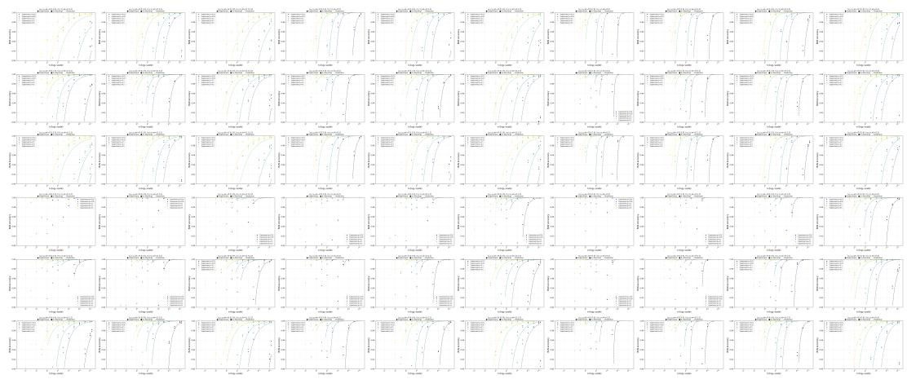  
Figure 7: Full results of the experiment verifying the scaling law using synthetic data.

## B.5 An Experimental Comparison of Early Stopping Methods

We experimentally compare our Tail-Tension Early Stopping with early stopping methods proposed in Kalayci et al. [2025] but do not compare against Wan et al. [2025] and Huang et al. [2025b], because the former is not an anytime algorithm, requiring total budget information beforehand and the latter requires training an additional calibration score.

Experimental Settings. The methods ucb\_t090, ucb\_t095, ucb\_t099, ucb\_c1e-3, and ucb\_c2e-4 are variants proposed by Kalayci et al. [2025]. The ucb\_t090, ucb\_t095, ucb\_t099 correspond to the Target Acceptance Rate Variant described in Section 4.3, with $\tau _ { \mathrm { t a r g e t } } = 0 . 9 0 , 0 . 9 5 , 0 . 9 9$ independently. The ucb\_c1e-3, and ucb\_c2e-4 correspond to the variants of Algorithm 1 in the paper with $c \doteq 1 0 ^ { - 3 }$ and $2 \times 1 0 ^ { - 4 }$ . The parameter $t _ { \mathrm { m i n } }$ in Kalayci et al. [2025] corresponds to $n _ { \mathrm { t h } }$ in our method. To ensure a fair comparison, we used the same value as $n _ { \mathrm { t h } } = t _ { \mathrm { m i n } } = 3 2 ~ \mathrm { F i n a l l y }$ because the maximum total computational budget was fixed at in these experiments and can not fully consumed , we report entries for which no accuracy value could be obtained as N/A.

Table 3: Properties of the reward distributions for correct and incorrect answers. c, w are subscripts denoting correct and incorrect answers, respectively, and $\mu , \sigma ^ { 2 } , \gamma , T$ denote the mean, variance, skewness, and tail ratio (the ratio of the right tail to the left tail) of the reward distribution, respectively. In all cases, correct answers are assigned higher reward values on average than incorrect answers. On the other hand, except for Sky-Qwen-4B, the reward models have higher variance for the rewards of incorrect answers than for those of correct answers across all three datasets.
<table><tr><td>RM</td><td> $\mu _ { c }$ </td><td> $\mu _ { w }$ </td><td>一  $\sigma _ { c } ^ { 2 }$ </td><td> $\sigma _ { w } ^ { 2 }$ </td><td> $\gamma _ { c }$ </td><td> $\gamma _ { w }$ </td><td> $T _ { c }$ </td><td> $T _ { w }$ </td></tr><tr><td colspan="9">GSM8K_Llama-3-8B-Instruct</td></tr><tr><td>RAMO allenai-RB2</td><td>-2.8 0.42</td><td>-4 -0.86</td><td>0.49 0.37</td><td>1.4 1.3</td><td>-1.1 -1.6</td><td>-0.97 -1.2</td><td>0.77 0.64</td><td>0.75 0.57</td></tr><tr><td>Sky-Llama-8B</td><td>11</td><td>5.7</td><td>22</td><td>28</td><td>0.32</td><td>-0.41</td><td>1.4</td><td>0.89</td></tr><tr><td>Sky-Qwen-1.7B</td><td>4.2 11</td><td>1.1 7.8</td><td>1.9 1.9</td><td>5.3 6.3</td><td>-0.98 -1</td><td>-0.77 -1.1</td><td>0.71 0.69</td><td>0.72 0.67</td></tr><tr><td>Sky-Qwen-4B Sky-Qwen-8B</td><td>6.4</td><td>2.5</td><td>2.2</td><td>7.5</td><td>-1.2</td><td>-0.89</td><td>0.72</td><td>0.71</td></tr><tr><td>MATH_Llama-3-8B-Instruct</td><td></td><td></td><td></td><td></td><td></td><td></td><td></td><td></td></tr><tr><td colspan="9">RAMO</td></tr><tr><td>allenai-RB2</td><td>-2.1 -0.069</td><td>-3.2 -1</td><td>2 0.87</td><td>4.3 1.8</td><td>-1.6 -1.1</td><td>-1.3 -0.89</td><td>0.75 0.69</td><td>0.65 0.68</td></tr><tr><td>Sky-Llama-8B Sky-Qwen-1.7B</td><td>18 6.1</td><td>11 3.4</td><td>53 3.7</td><td>74 8.1</td><td>-0.22 -1</td><td>0.41 -0.8</td><td>1.3 0.64</td><td>1.3 0.68</td></tr><tr><td>Sky-Qwen-4B</td><td>17</td><td>11</td><td>35</td><td>22</td><td>0.033</td><td>0.39</td><td>1.6</td><td>1.1</td></tr><tr><td>Sky-Qwen-8B</td><td>8.3</td><td>4.7</td><td>7.1</td><td>12</td><td>-0.94</td><td>-0.89</td><td>0.7</td><td>0.66</td></tr><tr><td>MATH_Pythia-12B</td><td></td><td></td><td></td><td></td><td></td><td></td><td></td><td></td></tr><tr><td>RAMO</td><td>-5.4</td><td>-7.3</td><td>3.7</td><td></td><td></td><td></td><td></td><td></td></tr><tr><td></td><td>-3.8</td><td></td><td></td><td>6.9</td><td>-0.38</td><td>-0.41</td><td>0.83</td><td>0.76</td></tr><tr><td>allenai-RB2</td><td></td><td>-5.3</td><td>2.3</td><td>2.5</td><td>0.022</td><td>0.35</td><td>1.1</td><td>1.3</td></tr><tr><td>Sky-Llama-8B</td><td>0.29</td><td>-6.1</td><td>42</td><td>48</td><td>-0.032</td><td>-0.0075</td><td>0.88</td><td>0.98</td></tr><tr><td>Sky-Qwen-1.7B</td><td>-0.93</td><td>-4.2</td><td>9.6</td><td>11</td><td>-0.13</td><td>0.24</td><td>0.91</td><td>1.2</td></tr><tr><td>Sky-Qwen-4B</td><td>5.3</td><td>1.2</td><td>17</td><td>15</td><td>0.15</td><td>0.33</td><td>0.97</td><td>1.3</td></tr><tr><td></td><td></td><td>-5.2</td><td></td><td></td><td></td><td></td><td></td><td></td></tr><tr><td>Sky-Qwen-8B</td><td>-0.78</td><td></td><td>19</td><td>20</td><td>-0.2</td><td>0.3</td><td>0.88</td><td>1.3</td></tr></table>

Since different early-stopping methods use different amounts of computation, we compare accuracy under the same effective computational budget, allowing computation saved by early stopping on one sample to be reused for other samples. For each method, we linearly interpolate between adjacent points on its accuracy–budget curve and report the interpolate values at budgets of the form $n = 2 ^ { x }$

Results. The result is shown in the table 5. The result shows that our method is comparable or outperforms all five variants at the same effective budget, especially for larger effective budget settings.

Table 4: Goodness of fit of the reward distributions for correct and incorrect answers to representative probability distributions. c, w are subscripts denoting correct and incorrect answers, respectively. Even when the displayed values appear identical, the judgment is based on the internal numerical ranking.
<table><tr><td></td><td>normal</td><td>student_t</td><td>skew_normal</td><td>skew_t</td><td>gen_normal</td><td>logistic</td><td>laplace</td><td>johnson_su</td><td>gumbel</td></tr><tr><td>RAMO</td><td></td><td></td><td></td><td></td><td></td><td></td><td></td><td></td><td></td></tr><tr><td>AD pass rate (c) ↑</td><td>0.47</td><td>0.53</td><td>0.74</td><td>0.81</td><td>0.54</td><td>0.44</td><td>0.23</td><td>0.67</td><td>0.090</td></tr><tr><td>AD pass rate (w) ↑</td><td>0.047</td><td>0.16</td><td>0.31</td><td>0.35</td><td>0.15</td><td>0.062</td><td>0.047</td><td>0.34</td><td>0.0078</td></tr><tr><td>AIC mean (c) ↓</td><td>740</td><td>740</td><td>730</td><td>730</td><td>740</td><td>740</td><td>750</td><td>730</td><td>790</td></tr><tr><td>AIC mean (w)↓</td><td>1400</td><td>1400</td><td>1400</td><td>1400</td><td>1400</td><td>1400</td><td>1400</td><td>1400</td><td>1500</td></tr><tr><td>BIC mean (c) ↓</td><td>750</td><td>750</td><td>740</td><td>740</td><td>750</td><td>750</td><td>760</td><td>740</td><td>800</td></tr><tr><td>BIC mean (w)↓</td><td>1400</td><td>1400</td><td>1400</td><td>1400</td><td>1400</td><td>1400</td><td>1500</td><td>1400</td><td>1500</td></tr><tr><td>log-lik mean (c) ↑</td><td>-2.0</td><td>-2.0</td><td>-2.0</td><td>-2.0</td><td>-2.0</td><td>-2.0</td><td>-2.1</td><td>-2.0</td><td>-2.2</td></tr><tr><td>log-lik mean (w) ↑</td><td>-2.4</td><td>-2.4</td><td>-2.3</td><td>-2.3</td><td>-2.3</td><td>-2.4</td><td>-2.4</td><td>-2.3</td><td>-2.5</td></tr><tr><td>allenai-RB2</td><td></td><td></td><td></td><td></td><td></td><td></td><td></td><td></td><td></td></tr><tr><td>AD pass rate (c) ↑</td><td>0.37</td><td>0.36</td><td>0.54</td><td>0.50</td><td>0.58</td><td>0.26</td><td>0.14</td><td>0.46</td><td>0.23</td></tr><tr><td>AD pass rate (w) ↑</td><td>0.21</td><td>0.27</td><td>0.65</td><td>0.64</td><td>0.30</td><td>0.17</td><td>0.031</td><td>0.66</td><td>0.20</td></tr><tr><td>AIC mean (c)↓</td><td>660</td><td>660</td><td>640</td><td>650</td><td>650</td><td>660</td><td>680</td><td>640</td><td>680</td></tr><tr><td>AIC mean (w)↓</td><td>1100</td><td>1100</td><td>1100</td><td>1100</td><td>1100</td><td>1100</td><td>1100</td><td>1100</td><td>1100</td></tr><tr><td>BIC mean (c) ↓</td><td>660</td><td>670</td><td>650</td><td>660</td><td>660</td><td>670</td><td>690</td><td>650</td><td>690</td></tr><tr><td>BIC mean (w)↓</td><td>1100</td><td>1100</td><td>1100</td><td>1100</td><td>1100</td><td>1100</td><td>1100</td><td>1100</td><td>1100</td></tr><tr><td>log-lik mean (c) ↑</td><td>-1.8</td><td>-1.8</td><td>-1.8</td><td>-1.8</td><td>-1.8</td><td>-1.8</td><td>-1.8</td><td>-1.7</td><td>-1.8</td></tr><tr><td>log-lik mean (w) ↑</td><td>-1.8</td><td>-1.8</td><td>-1.8</td><td>-1.8</td><td>-1.8</td><td>-1.8</td><td>-1.9</td><td>-1.8</td><td>-1.8</td></tr><tr><td>Sky-Llama-8B</td><td></td><td></td><td></td><td></td><td></td><td></td><td></td><td></td><td></td></tr><tr><td>AD pass rate (c) ↑</td><td>0.40</td><td>0.50</td><td>0.59</td><td>0.65</td><td>0.54</td><td>0.38</td><td>0.31</td><td>0.59</td><td>0.13</td></tr><tr><td>AD pass rate (w) ↑</td><td>0.45</td><td>0.48</td><td>0.67</td><td>0.63</td><td>0.52</td><td>0.34</td><td>0.031</td><td>0.62</td><td>0.0078</td></tr><tr><td>AIC mean (c) ↓</td><td>1200</td><td>1200</td><td>1200</td><td>1200</td><td>1200</td><td>1200</td><td>1200</td><td>1100</td><td>1200</td></tr><tr><td>AIC mean (w) ↓</td><td>2000</td><td>2000</td><td>2000</td><td>2000</td><td>2000</td><td>2000</td><td>2000</td><td>2000</td><td>2000</td></tr><tr><td>BIC mean (c) ↓</td><td>1200</td><td>1200</td><td>1200</td><td>1200</td><td>1200</td><td>1200</td><td>1200</td><td>1100</td><td>1200</td></tr><tr><td>BIC mean (w)↓</td><td>2000</td><td>2000</td><td>2000</td><td>2000</td><td>2000</td><td>2000</td><td>2000</td><td>2000</td><td>2000</td></tr><tr><td>log-lik mean (c) ↑</td><td>-3.2</td><td>-3.2</td><td>-3.2</td><td>-3.2</td><td>-3.2</td><td>-3.2</td><td>-3.2</td><td>-3.1</td><td>-3.3</td></tr><tr><td>log-lik mean (w) ↑</td><td>-3.3</td><td>-3.3</td><td>-3.3</td><td>-3.3</td><td>-3.3</td><td>-3.3</td><td>-3.4</td><td>-3.3</td><td>-3.4</td></tr><tr><td>Sky-Qwen-1.7B</td><td></td><td></td><td></td><td></td><td></td><td></td><td></td><td></td><td></td></tr><tr><td>AD pass rate (c) ↑</td><td>0.45</td><td>0.44</td><td>0.65</td><td>0.56</td><td>0.60</td><td>0.38</td><td>0.23</td><td>0.59</td><td>0.15</td></tr><tr><td>AD pass rate (w) ↑</td><td>0.23</td><td>0.27</td><td>0.43</td><td>0.35</td><td>0.45</td><td>0.13</td><td>0</td><td>0.40</td><td>0.078</td></tr><tr><td>AIC mean (c) ↓</td><td>920</td><td>920</td><td>910</td><td>920</td><td>920</td><td>930</td><td>940</td><td>910</td><td>950</td></tr><tr><td>AIC mean (w)↓</td><td>1600</td><td>1600</td><td>1600</td><td>1600</td><td>1600</td><td>1600</td><td>1600</td><td>1600</td><td>1600</td></tr><tr><td>BIC mean (c) ↓</td><td>930</td><td>930</td><td>920</td><td>930</td><td>920</td><td>930</td><td>950</td><td>930</td><td>960</td></tr><tr><td>BIC mean (w)↓</td><td>1600</td><td>1600</td><td>1600</td><td>1600</td><td>1600</td><td>1600</td><td>1600</td><td>1600</td><td>1600</td></tr><tr><td>log-lik mean (c) ↑</td><td>-2.5</td><td>-2.5</td><td>-2.5</td><td>-2.5</td><td>-2.5</td><td>-2.5</td><td>-2.6</td><td>-2.5</td><td>-2.6</td></tr><tr><td>log-lik mean (w) ↑</td><td>-2.6</td><td>-2.6</td><td>-2.6</td><td>-2.6</td><td>-2.6</td><td>-2.6</td><td>-2.7</td><td>-2.6</td><td>-2.6</td></tr><tr><td>Sky-Qwen-4B</td><td></td><td></td><td></td><td></td><td></td><td></td><td></td><td></td><td></td></tr><tr><td>AD pass rate (c) ↑</td><td>0.40</td><td>0.54</td><td>0.62</td><td>0.55</td><td>0.60</td><td>0.42</td><td>0.29</td><td>0.60</td><td>0.15</td></tr><tr><td>AD pass rate (w) ↑</td><td>0.20</td><td>0.21</td><td>0.55</td><td>0.52</td><td>0.31</td><td>0.086</td><td>0.0078</td><td>0.47</td><td>0.20</td></tr><tr><td>AIC mean (c) ↓</td><td>1000</td><td>1000</td><td>1000</td><td>990</td><td>1000</td><td>1000</td><td>1000</td><td>990 1600</td><td>1000 1600</td></tr><tr><td>AIC mean (w)↓ BIC mean (c) ↓</td><td>1600 1000</td><td>1600 1000</td><td>1600 1000</td><td>1600 1000</td><td>1600 1000</td><td>1600 1000</td><td>1700 1000</td></table>

Table 5: Experimental comparison of our Tail-Tension Early Stopping with Kalayci et al. [2025].
<table><tr><td>Cost</td><td>Ours</td><td> $\mathsf { u c b \_ t } 0 9 0$ </td><td>ucb_t095</td><td>ucb_t099</td><td> $\mathsf { u c b \_ c l e } - 3$ </td><td> $\mathsf { u c b \_ c 2 e { - } } 4$ </td></tr><tr><td>4</td><td>0.288</td><td>0.285</td><td>0.285</td><td>0.285</td><td>0.285</td><td>0.285</td></tr><tr><td>8</td><td>0.299</td><td>0.298</td><td>0.298</td><td>0.298</td><td>0.298</td><td>0.298</td></tr><tr><td>16</td><td>0.309</td><td>0.308</td><td>0.308</td><td>0.308</td><td>0.308</td><td>0.308</td></tr><tr><td>32</td><td>0.316</td><td>0.317</td><td>0.317</td><td>0.316</td><td>0.318</td><td>0.318</td></tr><tr><td>64</td><td>0.322</td><td>0.323</td><td>0.323</td><td>0.323</td><td>0.318</td><td>0.318</td></tr><tr><td>128</td><td>0.327</td><td>0.324</td><td>0.325</td><td>0.326</td><td>0.317</td><td>0.317</td></tr><tr><td>256</td><td>0.332</td><td>0.323</td><td>0.324</td><td>0.325</td><td>0.317</td><td>0.316</td></tr><tr><td>512</td><td>0.335</td><td>0.322</td><td>0.323</td><td>0.324</td><td>0.316</td><td>0.315</td></tr><tr><td>1024</td><td>0.339</td><td>0.321</td><td>0.321</td><td>0.322</td><td>N/A</td><td>0.315</td></tr><tr><td>2048</td><td>0.342</td><td>N/A</td><td>N/A</td><td>N/A</td><td>N/A</td><td>N/A</td></tr><tr><td>4096</td><td>0.345</td><td>N/A</td><td>N/A</td><td>N/A</td><td>N/A</td><td>N/A</td></tr><tr><td>8192</td><td>N/A</td><td>N/A</td><td>N/A</td><td>N/A</td><td>N/A</td><td>N/A</td></tr></table>

## NeurIPS Paper Checklist

## 1. Claims

Question: Do the main claims made in the abstract and introduction accurately reflect the paper’s contributions and scope?

Answer: [Yes]

Justification: The claims in the abstract and introduction match the theoretical analysis, proposed method, and experiments, and are limited to verifiable problems with rewardmodel-based selection.

Guidelines:

• The answer [N/A] means that the abstract and introduction do not include the claims made in the paper.

• The abstract and/or introduction should clearly state the claims made, including the contributions made in the paper and important assumptions and limitations. A [No] or [N/A] answer to this question will not be perceived well by the reviewers.

• The claims made should match theoretical and experimental results, and reflect how much the results can be expected to generalize to other settings.

• It is fine to include aspirational goals as motivation as long as it is clear that these goals are not attained by the paper.

## 2. Limitations

Question: Does the paper discuss the limitations of the work performed by the authors?

Answer: [Yes]

Justification: The paper discusses limitations in Section 8.

Guidelines:

• The answer [N/A] means that the paper has no limitation while the answer [No] means that the paper has limitations, but those are not discussed in the paper.

• The authors are encouraged to create a separate “Limitations” section in their paper.

• The paper should point out any strong assumptions and how robust the results are to violations of these assumptions (e.g., independence assumptions, noiseless settings, model well-specification, asymptotic approximations only holding locally). The authors should reflect on how these assumptions might be violated in practice and what the implications would be.

• The authors should reflect on the scope of the claims made, e.g., if the approach was only tested on a few datasets or with a few runs. In general, empirical results often depend on implicit assumptions, which should be articulated.

• The authors should reflect on the factors that influence the performance of the approach. For example, a facial recognition algorithm may perform poorly when image resolution is low or images are taken in low lighting. Or a speech-to-text system might not be used reliably to provide closed captions for online lectures because it fails to handle technical jargon.

• The authors should discuss the computational efficiency of the proposed algorithms and how they scale with dataset size.

• If applicable, the authors should discuss possible limitations of their approach to address problems of privacy and fairness.

• While the authors might fear that complete honesty about limitations might be used by reviewers as grounds for rejection, a worse outcome might be that reviewers discover limitations that aren’t acknowledged in the paper. The authors should use their best judgment and recognize that individual actions in favor of transparency play an important role in developing norms that preserve the integrity of the community. Reviewers will be specifically instructed to not penalize honesty concerning limitations.

## 3. Theory assumptions and proofs

Question: For each theoretical result, does the paper provide the full set of assumptions and a complete (and correct) proof?

Answer: [Yes]

Justification: The theoretical assumptions are stated in the main text, and complete proofs of the lemmas and theorems are provided in the appendix.

## Guidelines:

• The answer [N/A] means that the paper does not include theoretical results.

• All the theorems, formulas, and proofs in the paper should be numbered and crossreferenced.

• All assumptions should be clearly stated or referenced in the statement of any theorems.

• The proofs can either appear in the main paper or the supplemental material, but if they appear in the supplemental material, the authors are encouraged to provide a short proof sketch to provide intuition.

• Inversely, any informal proof provided in the core of the paper should be complemented by formal proofs provided in appendix or supplemental material.

• Theorems and Lemmas that the proof relies upon should be properly referenced.

## 4. Experimental result reproducibility

Question: Does the paper fully disclose all the information needed to reproduce the main experimental results of the paper to the extent that it affects the main claims and/or conclusions of the paper (regardless of whether the code and data are provided or not)?

Answer: [Yes]

Justification: The paper specifies the datasets, reward models, evaluation protocol, simulation procedure, and compute setup used in the experiments.

Guidelines:

• The answer [N/A] means that the paper does not include experiments.

• If the paper includes experiments, a [No] answer to this question will not be perceived well by the reviewers: Making the paper reproducible is important, regardless of whether the code and data are provided or not.

• If the contribution is a dataset and/or model, the authors should describe the steps taken to make their results reproducible or verifiable.

• Depending on the contribution, reproducibility can be accomplished in various ways. For example, if the contribution is a novel architecture, describing the architecture fully might suffice, or if the contribution is a specific model and empirical evaluation, it may be necessary to either make it possible for others to replicate the model with the same dataset, or provide access to the model. In general. releasing code and data is often one good way to accomplish this, but reproducibility can also be provided via detailed instructions for how to replicate the results, access to a hosted model (e.g., in the case of a large language model), releasing of a model checkpoint, or other means that are appropriate to the research performed.

• While NeurIPS does not require releasing code, the conference does require all submissions to provide some reasonable avenue for reproducibility, which may depend on the nature of the contribution. For example

(a) If the contribution is primarily a new algorithm, the paper should make it clear how to reproduce that algorithm.

(b) If the contribution is primarily a new model architecture, the paper should describe the architecture clearly and fully.

(c) If the contribution is a new model (e.g., a large language model), then there should either be a way to access this model for reproducing the results or a way to reproduce the model (e.g., with an open-source dataset or instructions for how to construct the dataset).

(d) We recognize that reproducibility may be tricky in some cases, in which case authors are welcome to describe the particular way they provide for reproducibility. In the case of closed-source models, it may be that access to the model is limited in some way (e.g., to registered users), but it should be possible for other researchers to have some path to reproducing or verifying the results.

## 5. Open access to data and code

Question: Does the paper provide open access to the data and code, with sufficient instructions to faithfully reproduce the main experimental results, as described in supplemental material?

Answer: [No]

Justification: The paper uses publicly available datasets and models and describes them with URL in the paper, but the full reproduction code is not included in the current submission. Guidelines:

• The answer [N/A] means that paper does not include experiments requiring code.

• Please see the NeurIPS code and data submission guidelines (https://neurips.cc/ public/guides/CodeSubmissionPolicy) for more details.

• While we encourage the release of code and data, we understand that this might not be possible, so [No] is an acceptable answer. Papers cannot be rejected simply for not including code, unless this is central to the contribution (e.g., for a new open-source benchmark).

• The instructions should contain the exact command and environment needed to run to reproduce the results. See the NeurIPS code and data submission guidelines (https: //neurips.cc/public/guides/CodeSubmissionPolicy) for more details.

• The authors should provide instructions on data access and preparation, including how to access the raw data, preprocessed data, intermediate data, and generated data, etc.

• The authors should provide scripts to reproduce all experimental results for the new proposed method and baselines. If only a subset of experiments are reproducible, they should state which ones are omitted from the script and why.

• At submission time, to preserve anonymity, the authors should release anonymized versions (if applicable).

• Providing as much information as possible in supplemental material (appended to the paper) is recommended, but including URLs to data and code is permitted.

## 6. Experimental setting/details

Question: Does the paper specify all the training and test details (e.g., data splits, hyperparameters, how they were chosen, type of optimizer) necessary to understand the results?

Answer: [Yes]

Justification: The paper describes the datasets, reward models, sampling protocol, number of trials, and hardware used for the main experiments.

Guidelines:

• The answer [N/A] means that the paper does not include experiments.

• The experimental setting should be presented in the core of the paper to a level of detail that is necessary to appreciate the results and make sense of them.

• The full details can be provided either with the code, in appendix, or as supplemental material.

## 7. Experiment statistical significance

Question: Does the paper report error bars suitably and correctly defined or other appropriate information about the statistical significance of the experiments?

Answer: [Yes]

Justification: The paper reports standard deviation in the experiments of the proposed method.

Guidelines:

• The answer [N/A] means that the paper does not include experiments.

• The authors should answer [Yes] if the results are accompanied by error bars, confidence intervals, or statistical significance tests, at least for the experiments that support the main claims of the paper.

• The factors of variability that the error bars are capturing should be clearly stated (for example, train/test split, initialization, random drawing of some parameter, or overall run with given experimental conditions).

• The method for calculating the error bars should be explained (closed form formula, call to a library function, bootstrap, etc.)

• The assumptions made should be given (e.g., Normally distributed errors).

• It should be clear whether the error bar is the standard deviation or the standard error of the mean.

• It is OK to report 1-sigma error bars, but one should state it. The authors should preferably report a 2-sigma error bar than state that they have a 96% CI, if the hypothesis of Normality of errors is not verified.

• For asymmetric distributions, the authors should be careful not to show in tables or figures symmetric error bars that would yield results that are out of range (e.g., negative error rates).

• If error bars are reported in tables or plots, the authors should explain in the text how they were calculated and reference the corresponding figures or tables in the text.

## 8. Experiments compute resources

Question: For each experiment, does the paper provide sufficient information on the computer resources (type of compute workers, memory, time of execution) needed to reproduce the experiments?

Answer: [Yes]

Justification: The paper reports the GPU type and memory used for reward-model inference and describes the computationally lightweight simulation setup.

Guidelines:

• The answer [N/A] means that the paper does not include experiments.

• The paper should indicate the type of compute workers CPU or GPU, internal cluster, or cloud provider, including relevant memory and storage.

• The paper should provide the amount of compute required for each of the individual experimental runs as well as estimate the total compute.

• The paper should disclose whether the full research project required more compute than the experiments reported in the paper (e.g., preliminary or failed experiments that didn’t make it into the paper).

## 9. Code of ethics

Question: Does the research conducted in the paper conform, in every respect, with the NeurIPS Code of Ethics https://neurips.cc/public/EthicsGuidelines?

Answer: [Yes]

Justification: The work uses public datasets and models, does not involve human-subject experiments or private data, and follows the NeurIPS Code of Ethics.

Guidelines:

• The answer [N/A] means that the authors have not reviewed the NeurIPS Code of Ethics.

• If the authors answer [No], they should explain the special circumstances that require a deviation from the Code of Ethics.

• The authors should make sure to preserve anonymity (e.g., if there is a special consideration due to laws or regulations in their jurisdiction).

## 10. Broader impacts

Question: Does the paper discuss both potential positive societal impacts and negative societal impacts of the work performed?

Answer: [N/A]

Justification: Our analysis is a general theory for understanding Best-of-N sampling. The societal impacts depend heavily on the specific use cases and deployment contexts. Therefore, a detailed discussion of societal impacts falls outside the scope of this work.

Guidelines:

• The answer [N/A] means that there is no societal impact of the work performed.

• If the authors answer [N/A] or [No], they should explain why their work has no societal impact or why the paper does not address societal impact.

• Examples of negative societal impacts include potential malicious or unintended uses (e.g., disinformation, generating fake profiles, surveillance), fairness considerations (e.g., deployment of technologies that could make decisions that unfairly impact specific groups), privacy considerations, and security considerations.

• The conference expects that many papers will be foundational research and not tied to particular applications, let alone deployments. However, if there is a direct path to any negative applications, the authors should point it out. For example, it is legitimate to point out that an improvement in the quality of generative models could be used to generate Deepfakes for disinformation. On the other hand, it is not needed to point out that a generic algorithm for optimizing neural networks could enable people to train models that generate Deepfakes faster.

• The authors should consider possible harms that could arise when the technology is being used as intended and functioning correctly, harms that could arise when the technology is being used as intended but gives incorrect results, and harms following from (intentional or unintentional) misuse of the technology.

• If there are negative societal impacts, the authors could also discuss possible mitigation strategies (e.g., gated release of models, providing defenses in addition to attacks, mechanisms for monitoring misuse, mechanisms to monitor how a system learns from feedback over time, improving the efficiency and accessibility of ML).

## 11. Safeguards

Question: Does the paper describe safeguards that have been put in place for responsible release of data or models that have a high risk for misuse (e.g., pre-trained language models, image generators, or scraped datasets)?

Answer: [N/A]

Justification: The paper does not release new high-risk models, scraped datasets, or other assets requiring additional safeguards.

Guidelines:

• The answer [N/A] means that the paper poses no such risks.

• Released models that have a high risk for misuse or dual-use should be released with necessary safeguards to allow for controlled use of the model, for example by requiring that users adhere to usage guidelines or restrictions to access the model or implementing safety filters.

• Datasets that have been scraped from the Internet could pose safety risks. The authors should describe how they avoided releasing unsafe images.

• We recognize that providing effective safeguards is challenging, and many papers do not require this, but we encourage authors to take this into account and make a best faith effort.

## 12. Licenses for existing assets

Question: Are the creators or original owners of assets (e.g., code, data, models), used in the paper, properly credited and are the license and terms of use explicitly mentioned and properly respected?

Answer: [No]

Justification: The paper cites the existing datasets and models and following the licenses, but does not yet explicitly list their licenses or terms of use.

Guidelines:

• The answer [N/A] means that the paper does not use existing assets.

• The authors should cite the original paper that produced the code package or dataset.

• The authors should state which version of the asset is used and, if possible, include a URL.

• The name of the license (e.g., CC-BY 4.0) should be included for each asset.

• For scraped data from a particular source (e.g., website), the copyright and terms of service of that source should be provided.

• If assets are released, the license, copyright information, and terms of use in the package should be provided. For popular datasets, paperswithcode.com/datasets has curated licenses for some datasets. Their licensing guide can help determine the license of a dataset.

• For existing datasets that are re-packaged, both the original license and the license of the derived asset (if it has changed) should be provided.

• If this information is not available online, the authors are encouraged to reach out to the asset’s creators.

## 13. New assets

Question: Are new assets introduced in the paper well documented and is the documentation provided alongside the assets?

Answer: [N/A]

Justification: The paper does not release a new dataset, model checkpoint, benchmark, or other standalone asset.

Guidelines:

• The answer [N/A] means that the paper does not release new assets.

• Researchers should communicate the details of the dataset/code/model as part of their submissions via structured templates. This includes details about training, license, limitations, etc.

• The paper should discuss whether and how consent was obtained from people whose asset is used.

• At submission time, remember to anonymize your assets (if applicable). You can either create an anonymized URL or include an anonymized zip file.

## 14. Crowdsourcing and research with human subjects

Question: For crowdsourcing experiments and research with human subjects, does the paper include the full text of instructions given to participants and screenshots, if applicable, as well as details about compensation (if any)?

Answer: [N/A]

Justification: The paper does not involve crowdsourcing or new research with human subjects.

Guidelines:

• The answer [N/A] means that the paper does not involve crowdsourcing nor research with human subjects.

• Including this information in the supplemental material is fine, but if the main contribution of the paper involves human subjects, then as much detail as possible should be included in the main paper.

• According to the NeurIPS Code of Ethics, workers involved in data collection, curation, or other labor should be paid at least the minimum wage in the country of the data collector.

## 15. Institutional review board (IRB) approvals or equivalent for research with human subjects

Question: Does the paper describe potential risks incurred by study participants, whether such risks were disclosed to the subjects, and whether Institutional Review Board (IRB) approvals (or an equivalent approval/review based on the requirements of your country or institution) were obtained?

Answer: [N/A]

Justification: The paper does not involve human-subject research, so IRB approval is not applicable.

Guidelines:

• The answer [N/A] means that the paper does not involve crowdsourcing nor research with human subjects.

• Depending on the country in which research is conducted, IRB approval (or equivalent) may be required for any human subjects research. If you obtained IRB approval, you should clearly state this in the paper.

• We recognize that the procedures for this may vary significantly between institutions and locations, and we expect authors to adhere to the NeurIPS Code of Ethics and the guidelines for their institution.

• For initial submissions, do not include any information that would break anonymity (if applicable), such as the institution conducting the review.

## 16. Declaration of LLM usage

Question: Does the paper describe the usage of LLMs if it is an important, original, or non-standard component of the core methods in this research? Note that if the LLM is used only for writing, editing, or formatting purposes and does not impact the core methodology, scientific rigor, or originality of the research, declaration is not required.

Answer: [Yes]

Justification: This work investigates Best-of-n sampling of LLMs and proposes a new method for improving their performance. The methodology and experimental settings are described in Sections 5 and 6.

Guidelines:

• The answer [N/A] means that the core method development in this research does not involve LLMs as any important, original, or non-standard components.

• Please refer to our LLM policy in the NeurIPS handbook for what should or should not be described.