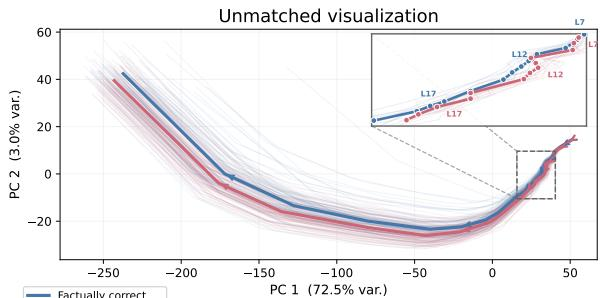
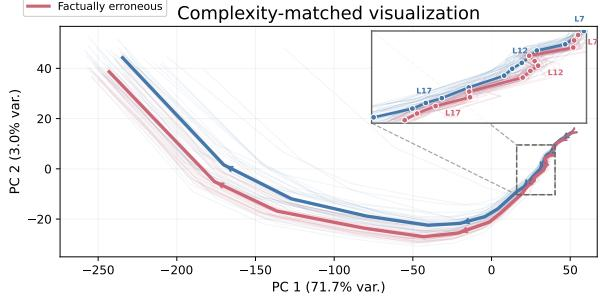
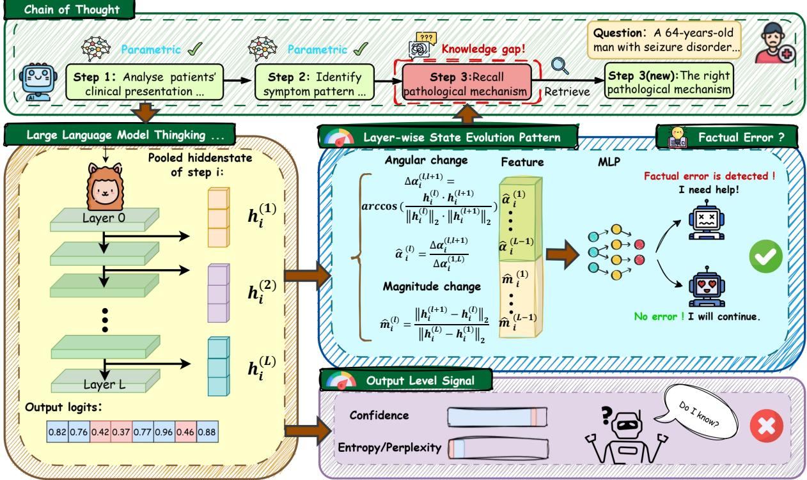
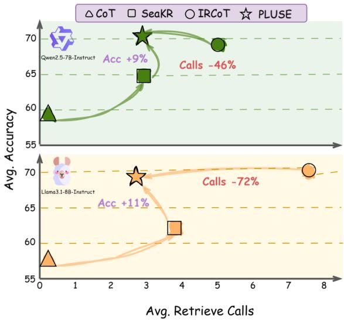
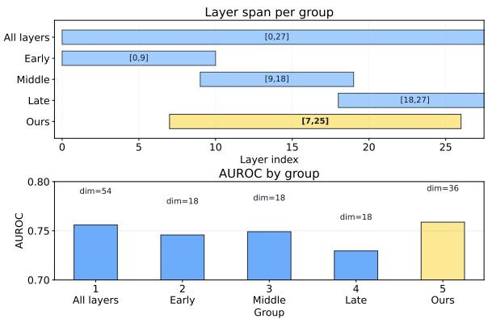
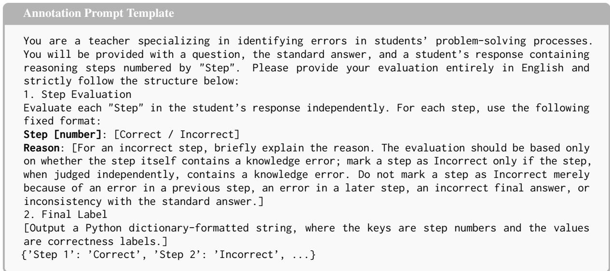
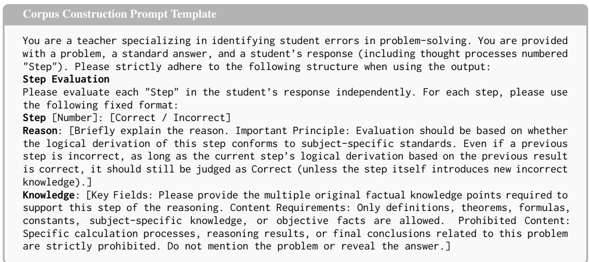
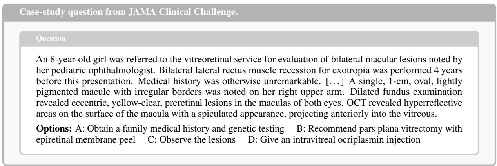
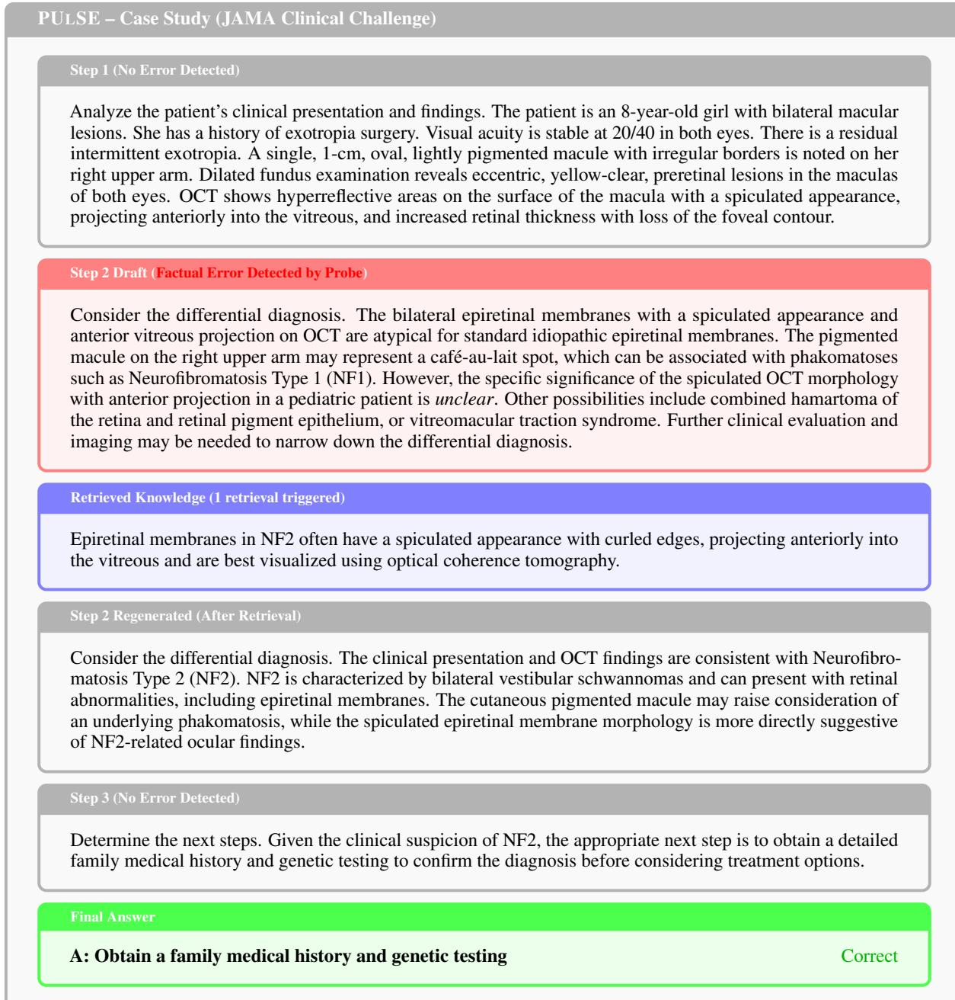
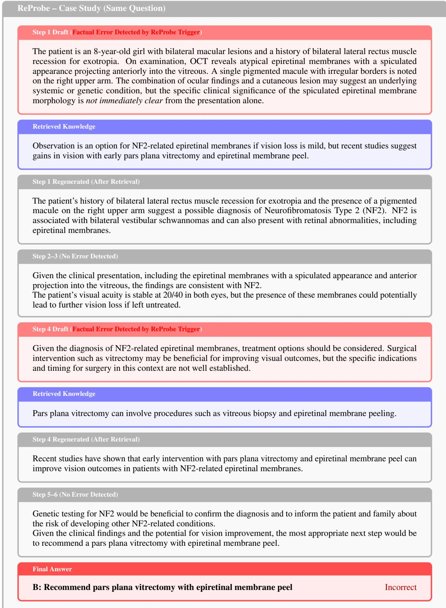

# Taking the PULSE of Medical Reasoning: Step-Level Retrieval Timing for Knowledge-Grounded Inference

Danyang Zhao, Sendong Zhao\*, Yanrui Du, Haochun Wang, Ming Ma Wenhao Li, Jingbo Wang, Jiatong Liu, Bing Qin Harbin Institute of Technology

## Abstract

Reliable medical reasoning requires LLMs to dynamically access external biomedical evidence to improve factual trustworthiness and reasoning accuracy. However, indiscriminate retrieval can introduce noise and latency, raising a critical retrieval-timing problem: at each reasoning step, the system must decide whether the model’s internal knowledge is reliable or external evidence is needed. We propose PULSE, a lightweight probing method that uses the model’s internal representations as intrinsic signals for step-level retrieval control. Our posterior trajectory analysis reveals that erroneous steps exhibit substantially higher inter-layer volatility than correct ones, suggesting unstable internal knowledge. Based on this finding, PULSE trains a compact probe on inter-layer geometric features to detect factual errors upon step completion, and uses it as an adaptive trigger for retrieval and step regeneration. Across four medical benchmarks, PULSE-timed retrieval matches exhaustive per-step retrieval in accuracy while reducing retrieval calls by 72%, and can transfer to an unseen legal domain, indicating potential domain-agnostic generality. Overall, our study provides an initial step toward shifting retrieval-trigger design from surface-level confidence estimates to internal activation dynamics for adaptive access.

## 1 Introduction

Reliable medical reasoning requires Large Language Models (LLMs) to access external biomedical evidence to support factual trustworthiness and reasoning accuracy, particularly when specialized or rapidly evolving knowledge is needed (Tu et al., 2025; Singhal et al., 2023; Bayat et al., 2023; Berger et al., 2025). Existing retrieval-augmented generation (RAG) research has devoted substantial attention to improving the relevance and quality of external evidence (Xiong et al., 2024). However, in multi-step medical reasoning, factual errors may arise at specific steps rather than throughout the entire reasoning chain (Wu et al., 2025; Sun et al., 2025), raising a question beyond evidence quality: how can retrieval timing be determined to achieve a better balance between reasoning accuracy and retrieval frequency than indiscriminate retrieval?

  
Figure 1: Layer-wise PCA trajectories of hidden states. Bold lines: group means; faint lines: individual samples. (a) Unmatched. (b) Complexity-matched.

Existing retrieval-augmented methods differ mainly in the granularity at which retrieval is triggered. Question-level retrieval retrieves evidence before reasoning begins (Lewis et al., 2020; Lu et al., 2025), but is too coarse to address factual errors that emerge only in intermediate reasoning steps. Exhaustive step-level retrieval can provide targeted support, but requires frequent retrieval calls and may introduce unnecessary or distracting evidence (Huang and Huang, 2024). Token-level retrieval further refines the trigger granularity (Jiang et al., 2023; Su et al., 2024), yet it fails to preserve the semantic integrity of a complete reasoning step.

Step-level adaptive retrieval therefore offers a natural granularity (Yao et al., 2025), and its effectiveness hinges on a critical retrieval-timing problem: after each reasoning step, the system must decide whether the model’s internal knowledge is reliable or external evidence is required.

A central challenge is how to obtain reliable trigger signals. Most existing approaches rely on output-level uncertainty signals, such as perplexity (Si et al., 2022), entropy (Kuhn et al., 2023), or maximum softmax probability, to estimate whether the model is likely to be wrong. While useful, these signals are derived from the final output distribution and may provide only a surface-level view of the model’s reasoning state. Another line of work has shown that factual knowledge and reasoningrelated information are encoded in the model’s hidden representations (Meng et al., 2022; Geva et al., 2021; Azaria and Mitchell, 2023; Lu et al., 2026), and that probes over multi-layer representations can help assess reasoning quality (Ni et al., 2025). The key is to translate these representations into a signal for deciding when to retrieve. These findings suggest that layer-wise internal dynamics may contain richer trigger signals.

Motivated by this perspective, we investigate whether the layer-wise evolution of hidden states can serve as an intrinsic signal for step-level factual error detection. Our posterior trajectory analysis reveals that factually erroneous reasoning steps exhibit substantially higher inter-layer volatility than correct ones, even after controlling for reasoning complexity, as shown in Figure 1. This pattern suggests that when a model fails to ground a step in its internal knowledge, its representations undergo unstable transitions across layers. We term this phenomenon internal knowledge instability and build upon it to propose PULSE (Probing Ungrounded reasoning via Layer-wise State Evolution), a lightweight probing method for adaptive retrieval control. PULSE extracts compact geometric features from hidden-state trajectories and detects factual errors upon step completion. Rather than retrieve at every step, it selectively triggers biomedical retrieval and step regeneration when a potential factual error is detected, reducing unnecessary retrieval calls.

Our study evaluates PULSE on four medical QA benchmarks. PULSE-timed retrieval matches exhaustive per-step retrieval in downstream accuracy while reducing retrieval calls by 72%, achieving a favorable balance between accuracy and retrieval frequency. Moreover, the same trigger transfers zero-shot to an unseen legal domain, suggesting that layer-wise trajectory volatility may capture a domain-agnostic signal of factual grounding failure rather than dataset-specific artifacts. Overall, our contributions can be summarized as follows:

• Geometric Signal. We identify elevated interlayer volatility in hidden states as a geometric signature of step-level factual errors, providing an intrinsic basis for retrieval timing.

• Retrieval Trigger. We propose PULSE, a lightweight probe that determines retrieval timing from the geometric evolution of hidden states across layers.

• Retrieval Efficiency. We show that PULSEtimed retrieval matches exhaustive retrieval with 72% fewer calls and generalizes zeroshot across domains.

## 2 Related Work

Retrieval-Augmented Generation (RAG) mitigates LLM factual deficiencies by incorporating external knowledge (Lewis et al., 2020). A central challenge in multi-step reasoning is deciding when to retrieve and how to retrieve—exhaustive per-step retrieval introduces latency and noise, while omitting retrieval at knowledge-deficient steps allows errors to propagate.

Retrieval Strategy. To handle multi-step reasoning, methods such as IRCoT (Trivedi et al., 2023) and ReAct (Yao et al., 2023) interleave retrieval with generation, while recent work improves query formulation and chunk selection (Su et al., 2024). These advances address the retrieval pipeline itself and are orthogonal to our contribution; PULSE can serve as a front-end trigger for any such retriever.

Retrieval Timing. The more fundamental question is when retrieval is needed (Tang et al., 2025). Existing triggering signals fall into two categories by their source.

At the output level, methods rely on generationtime statistics: token probability thresholds (Jiang et al., 2023), semantic entropy over sampled outputs (Kuhn et al., 2023), logit-based uncertainty regressors (Liu et al., 2024), and composite heuristics combining token probability with attention-based importance scoring (Su et al., 2024). Trained reflection tokens (Asai et al., 2024) also operate in the output space. These signals are cheap to compute but remain surface-level proxies that conflate linguistic uncertainty with genuine knowledge deficiency.

  
Figure 2: Overview of PULSE. Layer-wise geometric trajectory features of each reasoning step are fed into an MLP probe to detect factual errors. Flagged steps trigger retrieval, whose accuracy gain interventionally validates the detection. Output-level signals (purple) serve as baselines.

At the internal level, recent work examines hidden-state geometry for factual assessment. SeaKR (Yao et al., 2025) uses hidden-state uncertainty to trigger retrieval adaptively. CoE (Wang et al., 2025) aggregates cross-layer geometric feature changes into scalar scores, while Cheang et al. (2025) and Lee et al. (2025) analyze internal state geometry during knowledge recall and selfverification. However, these efforts operate at the granularity of a complete query or response—none localizes knowledge deficiency to individual reasoning steps.

PULSE bridges this gap by bringing layer-wise geometric trajectory analysis to the step level. It learns how trajectories co-evolve across layers, capturing discriminative evolution patterns that signal factual errors within each reasoning step and providing fine-grained, domain-transferable retrieval triggering signals.

## 3 Checking the PULSE

We propose PULSE (Probing Ungrounded reasoning via Layer-wise State Evolution), a method that detects factual errors at individual reasoning steps by exploiting the geometric structure of layer-wise hidden-state trajectories. Figure 2 illustrates the overall workflow.

## 3.1 Posterior Trajectory Analysis

To understand how a model’s internal representations differ between factually correct and erroneous reasoning steps, we examine the layer-wise evolution of hidden states during chain-of-thought generation.

Step-level trajectory construction. Consider a reasoning step $s _ { i }$ spanning tokens $( t _ { i } ^ { ( 1 ) } , \dots , t _ { i } ^ { ( K _ { i } ) } )$ For a Transformer with L layers, let $\mathbf { z } _ { i , k } ^ { ( l ) } \in \mathbb { R } ^ { d }$ denote the hidden state of token $t _ { i } ^ { ( k ) }$ at layer l. We obtain a single vector summarizing the step at each layer via mean pooling:

$$
h _ { i } ^ { ( l ) } = \frac { 1 } { K _ { i } } \sum _ { k = 1 } ^ { K _ { i } } \mathbf { z } _ { i , k } ^ { ( l ) }\tag{1}
$$

The ordered sequence $( h _ { i } ^ { ( 1 ) } , \ldots , h _ { i } ^ { ( L ) } )$ then constitutes the layer-wise trajectory of step $s _ { i } ,$ encoding how the model’s representation of that step transforms as it propagates through successive layers.

Trajectory visualization. Each step is annotated as factually correct or erroneous (annotation protocol detailed in Appendix A.3). We project these layer-wise representations into two dimensions via PCA and trace each step’s trajectory across layers (Figure 1, top). Two patterns emerge clearly: (1) trajectories of factually erroneous steps exhibit markedly higher volatility—particularly in mid-tolate layers—compared to correct steps, and (2) the two classes show separation in the projected space. Crucially, this separation is not attributable to any single layer’s activation; rather, it arises from the sequential pattern of how representations evolve across the layer stack.

Controlling for step complexity. A natural concern is that the observed volatility merely reflects differences in reasoning complexity rather than factual correctness. To control for this confound, we stratify steps by token count and internal line-break structure as coarse complexity proxies, then repeat the PCA visualization within matched strata (Figure 1, bottom). The mid-to-late-layer volatility gap between correct and erroneous steps persists across all strata, confirming that the geometric divergence is not reducible to step complexity.

Implication. These observations indicate that layer-wise evolution carries an intrinsic, complexity-independent signal for distinguishing grounded from ungrounded reasoning, motivating the detection method we formalize next.

## 3.2 Prior Error Detection

The posterior analysis reveals that factual errors leave a distinctive geometric footprint in layer-wise trajectories. To quantify trajectory volatility in a form amenable to learned classification, we decompose each step’s trajectory into two complementary feature sequences that capture how the representation evolves across layers, then train a lightweight probe on these features.

Angular change sequence. We measure directional reorientation between adjacent layers via the normalized inter-layer angle:

$$
\hat { \alpha } _ { i } ^ { ( l ) } = \frac { \alpha _ { i } ^ { ( l , l + 1 ) } } { \alpha _ { i } ^ { ( l _ { s } , l _ { e } ) } } , \quad l = l _ { s } , \ldots , l _ { e } - 1\tag{2}
$$

where

$$
\alpha _ { i } ^ { ( a , b ) } = \operatorname { a r c c o s } \left( \frac { h _ { i } ^ { ( a ) } \cdot h _ { i } ^ { ( b ) } } { \| h _ { i } ^ { ( a ) } \| _ { 2 } \| h _ { i } ^ { ( b ) } \| _ { 2 } } \right)\tag{3}
$$

This yields $A _ { i } = ( \hat { \alpha } _ { i } ^ { ( l _ { s } ) } , \ldots , \hat { \alpha } _ { i } ^ { ( l _ { e } - 1 ) } ) \in \mathbb { R } ^ { l _ { e } - l _ { s } }$ larger values indicate more pronounced directional shifts at that layer transition. Normalizing by the endpoint angle $\left( \alpha _ { i } ^ { \left( l _ { s } , l _ { e } \right) } \right.$ removes the influence of a step’s overall angular span.

Magnitude change sequence. Complementarily, we quantify how the representation scale evolves across successive layers by measuring the normalized inter-layer displacement:

$$
\Delta m _ { i } ^ { ( l ) } = \frac { \parallel h _ { i } ^ { ( l + 1 ) } - h _ { i } ^ { ( l ) } \parallel _ { 2 } } { \parallel h _ { i } ^ { ( l _ { e } ) } - h _ { i } ^ { ( l _ { s } ) } \parallel _ { 2 } } , \quad l = l _ { s } , \ldots , l _ { e } - 1\tag{4}
$$

This yields the sequence $M _ { i }$ $( \Delta m _ { i } ^ { ( l _ { s } ) } , \ldots , \Delta m _ { i } ^ { ( l _ { e } - 1 ) } ) \quad \mathrm { ~ \ s ~ { ~ \mathscr ~ { ~ E ~ } ~ } ~ } \quad \mathbb { R } ^ { l _ { e } - l _ { s } }$ where each element captures the relative expansion or contraction at a single layer transition. Normalizing by the total displacement $\| h _ { i } ^ { ( l _ { e } ) } - h _ { i } ^ { ( l _ { s } ) } \| _ { 2 }$ ensures comparability across steps of different overall magnitude.

Feature concatenation and probe. Together, angular and magnitude sequences provide a structured geometric characterization of trajectory volatility—the former tracking “in what direction” it turns, the latter tracking “how far” the representation moves. We concatenate them into a unified feature vector:

$$
\mathbf { f } _ { i } = [ A _ { i } ; ~ M _ { i } ] \in \mathbb { R } ^ { 2 ( l _ { e } - l _ { s } ) }\tag{5}
$$

Here $[ l _ { s } , l _ { e } ]$ denotes a contiguous layer range restricted to mid-to-late layers, motivated by Section 3.1; its specific boundaries are validated in the ablation study (Section 5.1). An MLP probe $g \colon  { \mathbb { R } } ^ { 2 ( l _ { e } - l _ { s } ) } \to [ 0 , 1 ]$ with two hidden layers (dimensions 128 and 64, ReLU activations) maps the trajectory feature vector to an error probability, trained with binary cross-entropy loss for up to 1,000 iterations using Adam. At inference time, given a new step $s _ { i } ,$ we extract its hidden states across $[ l _ { s } , l _ { e } ]$ , compute $\mathbf { f } _ { i } .$ , and obtain $g ( \mathbf { f } _ { i } )$ ; steps exceeding a threshold are flagged as likely factual errors.

## 3.3 Detection Experiments

Datasets. We train the probe on 1,000 MedM-CQA (Pal et al., 2022) and 173 AfriMedQA (Nimo et al., 2025) questions (70/30 train/val split; labeling protocol and step-level statistics in Appendix A). We evaluate on an in-distribution set of 300 held-out MedMCQA questions and an out-ofdistribution set from MMLU-Pro (Biology) (Wang et al., 2024), testing whether the geometric signal transfers without re-training. The resulting label distribution is imbalanced, motivating the use of PR AUC alongside AUROC.

Table 1: Factual error detection performance on Qwen2.5 and Llama3.1. Threshold-independent metrics (AUROC, PR AUC) are reported as primary metrics. Baseline thresholds are selected via Youden’s J statistic; probe-based methods use a default threshold of 0.5. Best results per dataset are in bold.
<table><tr><td></td><td colspan="5">MedMCQA (ID)</td><td colspan="5">MMLU-Pro (Biology) (OOD)</td></tr><tr><td>Method</td><td>Prec.</td><td>Rec.</td><td>F1</td><td>AUROC</td><td>PR AUC</td><td>Prec.</td><td>Rec.</td><td>F1</td><td>AUROC</td><td>PR AUC</td></tr><tr><td>Backbone:</td><td colspan="8">Qwen2.5-7B-Instruct</td><td></td><td></td></tr><tr><td>PPL</td><td>.4433</td><td>.6160</td><td>.5155</td><td>.6112</td><td>.4768</td><td>.4643</td><td>.0138</td><td>.0268</td><td>.4776</td><td>.2200</td></tr><tr><td>MaxProb</td><td>.4480</td><td>.5436</td><td>.4912</td><td>.6043</td><td>.4727</td><td>.5417</td><td>.0138</td><td>.0269</td><td>.4838</td><td>.2224</td></tr><tr><td>Entropy</td><td>.4538</td><td>.6289</td><td>.5272</td><td>.6264</td><td>.4932</td><td>.2727</td><td>.0477</td><td>.0812</td><td>.4695</td><td>.2177</td></tr><tr><td>CoE-R</td><td>.4419</td><td>.5436</td><td>.4875</td><td>.5843</td><td>.4204</td><td>.2774</td><td>.6140</td><td>.3822</td><td>.5981</td><td>.2808</td></tr><tr><td>CoE-C</td><td>.4571</td><td>.7607</td><td>.5710</td><td>.6560</td><td>.4948</td><td>.3032</td><td>.6394</td><td>.4113</td><td>.6442</td><td>.3630</td></tr><tr><td>ReProbe</td><td>.4420</td><td>.9325</td><td>.5998</td><td>.7350</td><td>.5847</td><td>.3287</td><td>.6300</td><td>.4320</td><td>.6789</td><td>.3866</td></tr><tr><td>PULSE</td><td>.5027</td><td>.8571</td><td>.6337</td><td>.7385</td><td>.5666</td><td>.3608</td><td>.6829</td><td>.4721</td><td>.7273</td><td>.4316</td></tr><tr><td>Backbone: Llama3.1-8B-Instruct</td><td colspan="8"></td><td></td><td></td></tr><tr><td>PPL</td><td>.3306</td><td>.3015</td><td>.3154</td><td>.5310</td><td>.3185</td><td>.6352</td><td>.2741</td><td>.3856</td><td>.6090</td><td>.5156</td></tr><tr><td>MaxProb</td><td>.3822</td><td>.1854</td><td>.2497</td><td>.5299</td><td>.3141</td><td>.6352</td><td>.2793</td><td>.3830</td><td>.6093</td><td>.5149</td></tr><tr><td>Entropy</td><td>.3719</td><td>.2772</td><td>.3176</td><td>.5446</td><td>.3428</td><td>.5634</td><td>.2993</td><td>.3909</td><td>.5921</td><td>.4836</td></tr><tr><td>CoE-R</td><td>.2964</td><td>.9757</td><td>.4546</td><td>.5323</td><td>.2704</td><td>.5683</td><td>.5471</td><td>.5575</td><td>.7204</td><td>.6341</td></tr><tr><td>CoE-C</td><td>.3047</td><td>.7697</td><td>.4365</td><td>.6018</td><td>.3552</td><td>.5274</td><td>.6575</td><td>.5853</td><td>.7257</td><td>.6144</td></tr><tr><td>ReProbe</td><td>.4474</td><td>.6211</td><td>.5201</td><td>.7431</td><td>.5103</td><td>.6223</td><td>.5830</td><td>.6021</td><td>.7406</td><td>.6451</td></tr><tr><td>PULSE</td><td>.4450</td><td>.6816</td><td>.5385</td><td>.7528</td><td>.5150</td><td>.6060</td><td>.6844</td><td>.6428</td><td>.7933</td><td>.6982</td></tr></table>

Baselines. We compare against training-free output-level indicators (PPL, MaxProb, Entropy) and hidden-state-based methods (CoE-R/C (Wang et al., 2025), ReProbe (Ni et al., 2025)). Full descriptions are provided in Appendix B.

Implementation details. We conduct experiments on Qwen2.5-7B-Instruct (Yang et al., 2024) and Llama3.1-8B-Instruct (Grattafiori et al., 2024). We extract hidden states from layers 7–25 (Qwen) and 6–31 (Llama), and compute the magnitude and angular change sequences in Section 3.2. Layer intervals are selected on the MedMCQA trainingvalidation split (Section 5.1). We report AUROC, PR AUC, F1, Precision, and Recall.

Results and analysis. Table 1 reports detection performance on both backbones. On the indistribution MedMCQA set, PULSE achieves the highest AUROC on both backbones (0.7385 on Qwen, 0.7528 on Llama) and consistently leads in

F1. Compared with ReProbe, which concatenates all layer states without modeling their order, the gain confirms that preserving layer-by-layer geometric structure provides additional discriminative signal.

The advantage widens on the out-of-distribution MMLU-Biology set: on Llama, AUROC reaches 0.7933 versus 0.7406 for ReProbe (+5.3 pp) without any re-training, indicating that the learned patterns reflect a general internal signature of factual errors rather than dataset-specific artifacts. Furthermore, the probe remains predictive after excluding steps with explicit uncertainty expressions (Appendix B.3). Output-level methods (PPL, Max-Prob, Entropy) degrade substantially under distribution shift, suggesting that surface-level confidence cannot reliably reveal the model’s epistemic state regarding factual grounding.

## 4 Retrieving on PULSE

Having established that PULSE reliably detects step-level factual errors from trajectory geometry, we now validate its practical utility through an adaptive retrieval framework: if the probe correctly pinpoints where factual errors occur, supplying external evidence at those steps should yield greater accuracy gains with fewer retrievals.

## 4.1 Error-Triggered Retrieval Framework

Using the probe output as a retrieval trigger, we construct a step-level adaptive retrieval framework. At inference time, the model is prompted to generate chain-of-thought reasoning in which each step begins with a “Step” prefix, yielding well-delimited semantic units. After each step $s _ { i }$ is generated, we extract its layer-wise trajectory, compute the feature vector $\mathbf { f } _ { i }$ , and pass it to the probe g. If $g ( \mathbf { f } _ { i } ) > \tau$ , where τ is the detection threshold, the system extracts important tokens from the factually erroneous step and retrieves relevant passages from an external corpus, and then injects them into the context for subsequent reasoning; otherwise, the model continues with its parametric knowledge alone, avoiding unnecessary external evidence.

We explore two knowledge injection strategies, both of which regenerate the flagged step while keeping all prior steps intact: (i) $\mathbf { P U } \mathbf { L S } \mathbf { E _ { f r o n t } } \mathrm { : }$ retrieved passages are prepended before the question following IRCoT (Trivedi et al., 2023); (ii) $\mathbf { P U } \mathbf { L S } \mathbf { E } _ { \mathbf { s t e p } } { \mathrm { : } }$ retrieved passages are inserted immediately before the flagged step.

## 4.2 Retrieval Experiments

Datasets. We evaluate on questions entirely unseen during probe training: (1) MedMCQA (Pal et al., 2022), a large-scale medical entrance exam dataset covering diverse medical subjects; (2) JAMA Clinical Challenge (Chen et al., 2025), challenging case-based medical questions from the Journal of the American Medical Association; and (3) the health and biology subsets of MMLU-Pro (Wang et al., 2024), two challenging multiplechoice benchmarks covering diverse biomedical topics.

Baselines. We compare against methods spanning the retrieval-frequency spectrum: CoT (Wei et al., 2022) (no retrieval), IRCoT (Trivedi et al., 2023) (retrieval at every step), DRAGIN (Su et al., 2024) (output-based adaptive retrieval), SeaKR (Yao et al., 2025) (hidden-state-based adaptive retrieval), and ReProbe (Ni et al., 2025) (a hidden-state probe used as a drop-in retrieval trigger within our framework). All methods share the backbone LLM, retriever, and corpus; answer generation uses greedy decoding. Full descriptions are in Appendix B.

External knowledge source. We use GPT-5.1 as an external knowledge provider to prepare factual statements offline. The collection is prepared offline for each benchmark, with construction inputs, answer-neutralization, and quality-control procedures detailed in Appendix C.2. All methods access the same fixed knowledge collection through BM25, enabling comparison of retrieval-triggering strategies with a shared external knowledge source. We additionally evaluate on independent public medical corpora to examine performance across different knowledge sources and retrieval configurations (Appendix C.1).

  
Figure 3: Accuracy–efficiency Pareto front on the four medical QA benchmarks (averaged). Top: Qwen2.5- 7B-Instruct; Bottom: Llama3.1-8B-Instruct. The x-axis reports the mean number of retrieval calls per question and the y-axis reports average accuracy.

Evaluation metrics. We report answer accuracy (%) as the primary metric and the average number of retrieval calls per instance (#Ret) to quantify retrieval efficiency.

Results and analysis. Table 2 presents end-toend results on four medical QA benchmarks for both injection strategies; Figure 3 visualizes the accuracy–efficiency trade-off.

Supplying external evidence at detected steps yields large accuracy gains. Compared with unassisted CoT, PULSE produces substantial improvements across all benchmarks and backbones (e.g., +24.67% on MedMCQA and +8.53% on JAMA with Qwen; +21.67% and +10.42% on MedMCQA and Biology with Llama). The gains from evidenceconditioned regeneration at probe-flagged steps provide additional support for the usefulness of the detection signal beyond the correlation-based metrics in Table 1. On JAMA, both variants outperform IRCoT and ReProbe in paired tests (Holm-adjusted $p < 0 . 0 5 ;$ Appendix B.4).

Table 2: Main results on four medical QA benchmarks using BM25 retrieval. Acc: accuracy (%). #Ret: average number of retrieval calls per test instance. Bold: best; underline: second best within each backbone group (excluding CoT for #Ret).
<table><tr><td rowspan="2">Method</td><td colspan="2">MedMCQA</td><td colspan="2">JAMA</td><td colspan="2">MMLU-Pro (Health)</td><td colspan="2">MMLU-Pro (Biology)</td></tr><tr><td>Acc (%) #Ret↓ Acc (%)</td><td></td><td></td><td>#Ret↓</td><td>Acc (%)</td><td>#Ret↓</td><td>Acc (%)</td><td>#Ret↓</td></tr><tr><td colspan="9">Backbone: Qwen2.5-7B-Instruct</td></tr><tr><td>CoT</td><td>57.00</td><td>0</td><td>50.30</td><td>0</td><td>57.21</td><td>0</td><td>72.52</td><td>0</td></tr><tr><td>IRCoT</td><td>85.33</td><td>5.06</td><td>53.87</td><td>4.38</td><td>65.28</td><td>5.34</td><td>72.80</td><td>5.51</td></tr><tr><td>DRAGIN</td><td>58.33</td><td>3.52</td><td>53.74</td><td>5.70</td><td>58.19</td><td>4.16</td><td>73.78</td><td>2.76</td></tr><tr><td>SeaKR ReProbe</td><td>79.00 77.33</td><td>2.43 2.41</td><td>54.91 56.19</td><td>4.06 3.13</td><td>58.07 62.59</td><td>2.83 2.90</td><td>63.88 72.66</td><td>2.56 2.35</td></tr><tr><td> $\mathrm { P U L S E _ { \mathrm { s t e p } } }$ </td><td>77.00</td><td>2.05</td><td>58.57</td><td>2.72</td><td>65.16</td><td>2.52</td><td>74.90</td><td>1.93</td></tr><tr><td> $\mathrm { P U L S E _ { f r o n t } }$ </td><td>81.67</td><td>2.75</td><td>58.83</td><td>3.00</td><td>63.08</td><td>2.61</td><td>76.43</td><td>2.62</td></tr><tr><td colspan="9">Backbone: Llama 3.1 8B Instruct</td></tr><tr><td>CoT IRCoT</td><td>62.00</td><td>0</td><td>53.47</td><td>0</td><td>53.79</td><td>0</td><td>60.15</td><td>0</td></tr><tr><td>DRAGIN</td><td>87.67 63.67</td><td>6.96 3.89</td><td>58.31 51.49</td><td>6.76 2.80</td><td>62.22 54.77</td><td>8.60 3.00</td><td>71.69 62.76</td><td>8.29 2.42</td></tr><tr><td>SeaKR</td><td>71.67</td><td>3.57</td><td>55.72</td><td>4.94</td><td>58.01</td><td>4.04</td><td>62.34</td><td>2.66</td></tr><tr><td>ReProbe</td><td>80.33</td><td>2.62</td><td>55.66</td><td>2.52</td><td>56.23</td><td>2.46</td><td>67.09</td><td>2.98</td></tr><tr><td> $\mathrm { P U L S E _ { \mathrm { s t e p } } }$ </td><td>82.33</td><td>2.28</td><td>57.84</td><td>2.01</td><td>60.15</td><td>2.39</td><td>68.62</td><td>1.78</td></tr><tr><td> $\mathrm { P U L S E _ { f r o n t } }$ </td><td>83.67</td><td>2.05</td><td>57.78</td><td>1.86</td><td>63.50</td><td>2.36</td><td>70.57</td><td>2.34</td></tr></table>

More precise targeting achieves greater gains with fewer retrievals. DRAGIN and SeaKR, despite moderate retrieval frequency, often fail to improve—and sometimes degrade—accuracy relative to CoT (e.g., DRAGIN drops to 51.49% on JAMA with Llama versus 53.47% for CoT), suggesting that imprecise triggering introduces noise rather than useful knowledge. Under the same steplevel injection protocol, $\mathrm { P U L S E _ { \mathrm { s t e p } } }$ consistently outperforms ReProbe with fewer calls: on Qwen, +2.38% on JAMA with 13% fewer calls, +2.57% on Health with 13% fewer calls, and +2.24% on Biology with 18% fewer calls; similar patterns hold on Llama (+2.18% on JAMA with 20% fewer calls, +1.53% on Biology with 40% fewer calls). This simultaneous improvement on both axes confirms that trajectory geometry provides a more precise error signal than concatenated hidden states.

Targeted retrieval matches exhaustive retrieval with fewer calls. IRCoT retrieves at every step (5–9 calls per instance). $\mathrm { P U L S E _ { f r o n t } }$ surpasses it on JAMA (+4.96%) and MMLU-Pro (Biology) (+3.63%) with Qwen using only 2.6–3.0 calls, and on MMLU-Pro (Health) (+1.28%) with Llama at 2.36 versus 8.60 calls. On the remaining benchmarks it stays within 2–4% at roughly one-third the retrieval budget. Retrieving for the right steps matters more than retrieving for all steps. Both injection variants improve over unassisted CoT across all benchmarks and backbones while using fewer retrieval calls than IRCoT, with their relative accuracy varying across settings. These results support the utility of layer-wise trajectory features for guiding selective access to external knowledge.

## 5 Analysis

This section addresses two questions: whether the probe’s design choices (feature type and layer interval) are well-justified (Section 5.1), and whether the detected signal generalizes beyond the training domain (Section 5.2).

## 5.1 Ablation

Feature ablation. Table 3 compares detection and downstream performance through component ablations of the fixed feature design on MMLU-Pro (Biology), with the probe trained on MedM-CQA (out-of-distribution). Using magnitude alone yields the lowest AUROC (0.6565) and undertriggers retrieval (2.51 calls), leaving many factual errors undetected. Using angle alone improves detection (AUROC 0.6866) but over-triggers (2.94 calls), introducing unnecessary retrievals that may distract the reasoning process. Combining both features achieves the best AUROC (0.7273) and downstream accuracy (76.43%) at moderate retrieval cost (2.62 calls), confirming that the two dimensions capture complementary aspects of the model’s internal state and are both necessary for reliable factual error detection.

Table 3: Feature ablation on MMLU-Pro (Biology) with Qwen2.5-7B-Instruct. Probe is trained on MedMCQA and evaluated out-of-distribution on MMLU-Pro (Biology).
<table><tr><td rowspan="2">Feature</td><td colspan="3">Detection End-to-End</td></tr><tr><td>AUROC PR AUC Acc(%) Avg #Ret</td><td></td><td></td></tr><tr><td>Mag</td><td>.6565</td><td>.3547 75.31</td><td>2.51</td></tr><tr><td>Angle</td><td>.6866</td><td>.3903 75.59</td><td>2.94</td></tr><tr><td>Mag + Ang</td><td>.7273</td><td>.4316 76.43</td><td>2.62</td></tr></table>

Layer interval selection. Figure 4 compares layer intervals on the MedMCQA trainingvalidation split. The late-only interval ([18,27]) performs worst (AUROC 0.7295): when restricted to final layers, the representations increasingly commit to the output distribution and lose discriminative signal about factual errors. The early interval ([0,9]) also underperforms (AUROC 0.7457), as shallow layers primarily encode token-level syntax before higher-level reasoning representations have formed. The middle interval ([9,18]) reaches 0.7491, confirming that intermediate layers carry the strongest per-segment signal.

Our selected interval [7,25] achieves the highest AUROC (0.7588) and F1 (0.5474), outperforming even the all-layer configuration (AUROC 0.7559, F1 0.5378) despite using only 36 of 54 features. This indicates that early and late layers contribute domain-specific token-distribution noise that harms both discrimination and generalization; excluding them yields a more robust and compact representation. We therefore adopt [7,25] as the default interval. Llama 3.1 exhibits the same pattern; we adopt layers [6,31] following the same selection logic. Since retrieval is triggered by the probe’s binary output, this choice directly determines when evidence is supplied during reasoning.

## 5.2 Cross-Domain Generalization

To test whether the geometric signal is domainagnostic, we directly apply the probe trained exclusively on medical data (MedMCQA + AfriMedQA) to the MMLU-Pro Law subset (1,101 instances)

  
Figure 4: Layer-interval AUROC on the MedMCQA training-validation split (Qwen2.5-7B-Instruct).

Table 4: Cross-domain transfer to MMLU-Pro (Law) with Qwen2.5-7B-Instruct. The probe is trained solely on medical data and applied without adaptation.
<table><tr><td>Method</td><td>Acc (%)</td><td>Avg #Ret</td></tr><tr><td>CoT</td><td>28.52</td><td>0</td></tr><tr><td>IRCoT</td><td>39.96</td><td>4.48</td></tr><tr><td>PULSE</td><td>42.23</td><td>2.36</td></tr></table>

without any adaptation. As shown in Table 4, PULSE achieves 42.23% accuracy with 2.36 retrieval calls per instance, outperforming both the CoT baseline (28.52%) and IRCoT (39.96% at 4.48 calls). The probe attains higher accuracy than exhaustive retrieval with roughly half as many retrieval calls, supporting transfer of triggering decisions to an unseen domain. Combined with the layer-selection analysis above, these results support the interpretation that middle-layer trajectory fluctuations reflect a general computational signature of failed internal knowledge retrieval, independent of the specific domain of the missing knowledge.

## 6 Conclusion

We have shown that factually erroneous reasoning steps exhibit a distinctive geometric signature in middle-layer hidden states—a latent pulse encoded in the model’s forward pass. By monitoring this signal at the step level, PULSE grounds retrieval timing in the model’s computational trajectory, matching or surpassing exhaustive per-step retrieval with only 28–54% of the calls across four medical benchmarks and transferring zero-shot to legal reasoning. Just as a physician takes a patient’s pulse to decide when to intervene, a reasoning system can take the pulse of its hidden dynamics to decide when external knowledge is needed. Future work may extend trajectory-based error signals as process-level rewards in agentic settings and verify whether the signature persists at larger model scales.

## Limitations

Model access. PULSE requires access to intermediate hidden states, limiting its applicability to open-weight models. It cannot be directly deployed on black-box APIs.

Step structure. The method assumes the model produces explicit step-by-step reasoning with clear boundaries (e.g., special token-delimited steps). For free-form or single-paragraph generations, more flexible logical segmentation strategies—such as semantic chunking or clause-level boundary detection—may be needed to define the units over which trajectory features are computed.

## References

Akari Asai, Zeqiu Wu, Yizhong Wang, Avi Sil, and Hannaneh Hajishirzi. 2024. Self-rag: Learning to retrieve, generate, and critique through self-reflection. In International conference on learning representations, volume 2024, pages 9112–9141.

Amos Azaria and Tom Mitchell. 2023. The internal state of an LLM knows when it’s lying. In Findings of the Association for Computational Linguistics: EMNLP 2023, pages 967–976, Singapore. Association for Computational Linguistics.

Farima Fatahi Bayat, Kun Qian, Benjamin Han, Yisi Sang, Anton Belyy, Samira Khorshidi, Fei Wu, Ihab Ilyas, and Yunyao Li. 2023. Fleek: Factual error detection and correction with evidence retrieved from external knowledge. In Proceedings ofthe 2023 Conference on Empirical Methods in Natural Language Processing: System Demonstrations, pages 124–130.

Armin Berger, Sarthak Khanna, David Berghaus, and Rafet Sifa. 2025. Reasoning llms in the medical domain: A literature survey. 2025 IEEE 12th International Conference on Data Science and Advanced Analytics (DSAA), pages 1–10.

Chi Seng Cheang, Hou Pong Chan, Wenxuan Zhang, and Yang Deng. 2025. Large language models do not really know what they don’t know. arXiv preprint arXiv:2510.09033.

Hanjie Chen, Zhouxiang Fang, Yash Singla, and Mark Dredze. 2025. Benchmarking large language models on answering and explaining challenging medical questions. In Proceedings of the 2025 Conference of the Nations of the Americas Chapter of the Associationfor Computational Linguistics: Human Language Technologies (Volume 1: Long Papers), pages 3563–3599, Albuquerque, New Mexico. Association for Computational Linguistics.

Mor Geva, Roei Schuster, Jonathan Berant, and Omer Levy. 2021. Transformer feed-forward layers are keyvalue memories. In Proceedings ofthe 2021 Confer-

ence on Empirical Methods in Natural Language Processing, pages 5484–5495, Online and Punta Cana, Dominican Republic. Association for Computational Linguistics.

Aaron Grattafiori, Abhimanyu Dubey, Abhinav Jauhri, Abhinav Pandey, Abhishek Kadian, Ahmad Al-Dahle, Aiesha Letman, Akhil Mathur, Alan Schelten, Alex Vaughan, and 1 others. 2024. The llama 3 herd of models. arXiv preprint arXiv:2407.21783.

Yizheng Huang and Jimmy X. Huang. 2024. A survey on retrieval-augmented text generation for large language models. ACM Computing Surveys.

Zhengbao Jiang, Frank F Xu, Luyu Gao, Zhiqing Sun, Qian Liu, Jane Dwivedi-Yu, Yiming Yang, Jamie Callan, and Graham Neubig. 2023. Active retrieval augmented generation. In Proceedings ofthe 2023 conference on empirical methods in natural language processing, pages 7969–7992.

Di Jin, Eileen Pan, Nassim Oufattole, Wei-Hung Weng, Hanyi Fang, and Peter Szolovits. 2021. What disease does this patient have? a large-scale open domain question answering dataset from medical exams. Applied Sciences, 11(14):6421.

Lorenz Kuhn, Yarin Gal, and Sebastian Farquhar. 2023. Semantic uncertainty: Linguistic invariances for uncertainty estimation in natural language generation. arXiv preprint arXiv:2302.09664.

Andrew Lee, Lihao Sun, Chris Wendler, Fernanda Vié- gas, and Martin Wattenberg. 2025. The geometry of self-verification in a task-specific reasoning model. In Mechanistic Interpretability Workshop at NeurIPS 2025.

Patrick Lewis, Ethan Perez, Aleksandra Piktus, Fabio Petroni, Vladimir Karpukhin, Naman Goyal, Heinrich Küttler, Mike Lewis, Wen-tau Yih, Tim Rocktäschel, and 1 others. 2020. Retrieval-augmented generation for knowledge-intensive nlp tasks. Advances in neural information processing systems, 33:9459– 9474.

Linyu Liu, Yu Pan, Xiaocheng Li, and Guanting Chen. 2024. Uncertainty estimation and quantification for llms: A simple supervised approach. arXiv preprint arXiv:2404.15993.

Ming Lu, Chaozhuo Li, Pengbo Wang, Chenxu Wang, Litian Zhang, Zheng Liu, Qiwei Ye, Yi Hua, Yushan Cai, Yuanbo Xu, Hao Zhao, Feiran Huang, Xi Zhang, and Philip S. Yu. 2026. Loki’s dance of illusions: A comprehensive survey of hallucination in large language models. IEEE Transactions on Computational Social Systems, pages 1–32.

Yuxing Lu, Gecheng Fu, Wei Wu, Xukai Zhao, Sin Yee Goi, and Jinzhuo Wang. 2025. Doctorrag: Medical rag fusing knowledge with patient analogy through textual gradients. ArXiv, abs/2505.19538.

Kevin Meng, David Bau, Alex Andonian, and Yonatan Belinkov. 2022. Locating and editing factual associations in gpt. Advances in Neural Information Processing Systems 35.

Jingwei Ni, Ekaterina Fadeeva, Tianyi Wu, Mubashara Akhtar, Jiaheng Zhang, Elliott Ash, Markus Leippold, Timothy Baldwin, See Kiong Ng, Artem Shelmanov, and Mrinmaya Sachan. 2025. Reprobe: Efficient test-time scaling of multi-step reasoning by probing internal states of large language models.

Charles Nimo, Tobi Olatunji, Abraham Toluwase Owodunni, Tassallah Abdullahi, Emmanuel Ayodele, Mardhiyah Sanni, Ezinwanne C. Aka, Folafunmi Omofoye, Foutse Yuehgoh, Timothy Faniran, Bonaventure F. P. Dossou, Moshood O. Yekini, Jonas Kemp, Katherine A Heller, Jude Chidubem Omeke, Chidi Asuzu Md, Naome A Etori, Aïmérou Ndiaye, Ifeoma Okoh, and 7 others. 2025. AfriMed-QA: A pan-African, multi-specialty, medical questionanswering benchmark dataset. In Proceedings ofthe 63rd Annual Meeting of the Association for Computational Linguistics (Volume 1: Long Papers), pages 1948–1973, Vienna, Austria. Association for Computational Linguistics.

Ankit Pal, Logesh Kumar Umapathi, and Malaikannan Sankarasubbu. 2022. Medmcqa: A large-scale multi-subject multi-choice dataset for medical domain question answering. In Conference on health, inference, and learning, pages 248–260. PMLR.

Chenglei Si, Zhe Gan, Zhengyuan Yang, Shuohang Wang, Jianfeng Wang, Jordan Boyd-Graber, and Lijuan Wang. 2022. Prompting gpt-3 to be reliable. arXiv preprint arXiv:2210.09150.

Karan Singhal, Shekoofeh Azizi, Tao Tu, S Sara Mahdavi, Jason Wei, Hyung Won Chung, Nathan Scales, Ajay Tanwani, Heather Cole-Lewis, Stephen Pfohl, and 1 others. 2023. Large language models encode clinical knowledge. Nature, 620(7972):172–180.

Weihang Su, Yichen Tang, Qingyao Ai, Zhijing Wu, and Yiqun Liu. 2024. DRAGIN: Dynamic retrieval augmented generation based on the real-time information needs of large language models. In Proceedings of the 62nd Annual Meeting of the Association for Computational Linguistics (Volume 1: Long Papers), pages 12991–13013, Bangkok, Thailand. Association for Computational Linguistics.

Yu Sun, Xingyu Qian, Weiwen Xu, Hao Zhang, Chenghao Xiao, Long Li, Deli Zhao, Wenbing Huang, Tingyang Xu, Qifeng Bai, and Yu Rong. 2025. ReasonMed: A 370k multi-agent generated dataset for advancing medical reasoning. arXiv preprint arXiv:2506.09513.

Xiangru Tang, Wanghan Xu, Yujie Wang, Zijie Guo, Yanjun Shao, Jiapeng Chen, Cixuan Zhang, Ziyi Wang, Lixin Zhang, Guancheng Wan, Wenlong Zhang, Lei Bai, Zhenfei Yin, Philip Torr, Hanrui

Wang, and Di Jin. 2025. Eigen-1: Adaptive multiagent refinement with monitor-based rag for scientific reasoning. ArXiv, abs/2509.21193.

Harsh Trivedi, Niranjan Balasubramanian, Tushar Khot, and Ashish Sabharwal. 2023. Interleaving retrieval with chain-of-thought reasoning for knowledgeintensive multi-step questions. In Proceedings of the 61st Annual Meeting of the Association for Computational Linguistics (Volume 1: Long Papers), pages 10014–10037, Toronto, Canada. Association for Computational Linguistics.

Tao Tu, Mike Schaekermann, Anil Palepu, Khaled Saab, Jan Freyberg, Ryutaro Tanno, Amy Wang, Brenna Li, Mohamed Amin, Yong Cheng, Elahe Vedadi, Nenad Tomasev, Shekoofeh Azizi, Karan Singhal, Le Hou, Albert Webson, Kavita Kulkarni, S. Mahdavi, Christopher Semturs, and Vivek Natarajan. 2025. Towards conversational diagnostic artificial intelligence. Nature, 642:442–450.

Yiming Wang, Pei Zhang, Baosong Yang, Derek Wong, and Rui Wang. 2025. Latent space chain-ofembedding enables output-free llm self-evaluation. In International Conference on Learning Representations, volume 2025, pages 70938–70970.

Yubo Wang, Xueguang Ma, Ge Zhang, Yuansheng Ni, Abhranil Chandra, Shiguang Guo, Weiming Ren, Aaran Arulraj, Xuan He, Ziyan Jiang, and 1 others. 2024. Mmlu-pro: A more robust and challenging multi-task language understanding benchmark. Advances in Neural Information Processing Systems, 37:95266–95290.

Jason Wei, Xuezhi Wang, Dale Schuurmans, Maarten Bosma, Fei Xia, Ed Chi, Quoc V Le, Denny Zhou, and 1 others. 2022. Chain-of-thought prompting elicits reasoning in large language models. Advances in neural information processing systems, 35:24824– 24837.

Juncheng Wu, Wenlong Deng, Xingxuan Li, Sheng Liu, Taomian Mi, Yifan Peng, Ziyang Xu, Yi Liu, Hyunjin Cho, Chang-In Choi, Yihan Cao, Hui Ren, Xiang Li, Xiaoxiao Li, and Yuyin Zhou. 2025. MedReason: Eliciting factual medical reasoning steps in LLMs via knowledge graphs. arXiv preprint arXiv:2504.00993.

Guangzhi Xiong, Qiao Jin, Zhiyong Lu, and Aidong Zhang. 2024. Benchmarking retrieval-augmented generation for medicine. In Findings of the Association for Computational Linguistics: ACL 2024, pages 6233–6251, Bangkok, Thailand. Association for Computational Linguistics.

An Yang, Baosong Yang, Beichen Zhang, Binyuan Hui, Bo Zheng, Bowen Yu, Chengyuan Li, Dayiheng Liu, Fei Huang, Haoran Wei, and 1 others. 2024. Qwen2. 5 technical report. arXiv preprint arXiv:2412.15115.

Shunyu Yao, Jeffrey Zhao, Dian Yu, Nan Du, Izhak Shafran, Karthik Narasimhan, and Yuan Cao. 2023. React: Synergizing reasoning and acting in language

models. Publisher Copyright: © 2023 11th International Conference on Learning Representations, ICLR 2023. All rights reserved.; 11th International Conference on Learning Representations, ICLR 2023 ; Conference date: 01-05-2023 Through 05-05-2023.

Zijun Yao, Weijian Qi, Liangming Pan, Shulin Cao, Linmei Hu, Liu Weichuan, Lei Hou, and Juanzi Li. 2025. SeaKR: Self-aware knowledge retrieval for adaptive retrieval augmented generation. In Proceedings ofthe 63rd Annual Meeting ofthe Association for Computational Linguistics (Volume 1: Long Papers), pages 27022–27043, Vienna, Austria. Association for Computational Linguistics.

## A Dataset and Annotation Details

## A.1 Data Sources and Splits

Our experimental pipeline involves three categories of data: (1) probe training data, used to train the factual error detection probe; (2) probe evaluation data, used to assess detection performance under both in-distribution (ID) and out-of-distribution (OOD) settings; and (3) end-to-end evaluation data, used to measure downstream QA accuracy when the probe is integrated with retrieval-augmented generation.

For probe training, we combine MedMCQA (Pal et al., 2022) and AfriMedQA (Nimo et al., 2025) to ensure diversity in question difficulty and cultural context. For probe evaluation, we hold out a separate MedMCQA subset as the ID test and use MMLU-Pro-Biology (Wang et al., 2024) as the OOD test, which differs in domain granularity and question style. Table 5 summarizes question-level statistics, and Table 6 provides step-level statistics for the probe training and evaluation splits.

Table 5: Question-level statistics across all datasets.
<table><tr><td>Role</td><td>Questions Avg Steps Domain</td><td></td></tr><tr><td>Train/Valid 1173</td><td>3.7</td><td>Medicine</td></tr><tr><td>Test (ID) 300</td><td>4.9</td><td>Medicine</td></tr><tr><td>Test (OOD) 717</td><td>5.9</td><td>Biology</td></tr></table>

Table 6: Step-level statistics for probe training and evaluation. Error Ratio denotes the proportion of steps labeled as containing a factual error.
<table><tr><td colspan="4">Split Total No-Error Error Error Ratio</td></tr><tr><td>Train/Valid 4348</td><td>3216</td><td>1132</td><td>26.0%</td></tr><tr><td>Test (ID) 1483</td><td>944</td><td>539</td><td>36.4%</td></tr><tr><td>Test (OOD) 4257</td><td>3314</td><td>943</td><td>22.1%</td></tr></table>

## A.2 Step Segmentation Protocol

To obtain discrete reasoning steps from chain-ofthought outputs, we instruct the backbone model to structure its response using explicit step prefixes. The generation prompt includes the following instruction:

Think step by step and output the   
reasoning process before answering.   
Each step should be started with   
"Step".

We then segment the generated output using rulebased matching: each segment beginning with the pattern "Step [N]:" is extracted as an individual reasoning step. Steps that do not conform to this format (e.g., malformed outputs or steps lacking the required prefix) are discarded. In practice, the vast majority of generated outputs conform to the prescribed format across all datasets.

Figure 5 provides a complete example of a segmented reasoning chain along with its step-level annotations.

## A.3 Factual Error Annotation Protocol

Definition. A reasoning step is labeled as a factual error if at least one atomic factual claim asserted in that step is incorrect or unsupported by established domain knowledge. Each step is evaluated independently. Repeating or reasserting an earlier false factual claim remains an error in the current step. In contrast, a valid conditional inference from an erroneous premise is not labeled erroneous solely because that premise was introduced earlier or the conclusion is inapplicable to the question; the current step must itself assert an incorrect factual claim. Thus, inherited error refers to a false claim repeated in the step, not automatic propagation of a preceding step’s label.

In Figure 5, Steps 6–7 are positive because they assert, respectively, a false physiological mechanism and the false claim that triphasic flow is observed in lower-limb veins. Their labels do not follow merely from preceding errors.

Automated Annotation with GPT. We employ GPT to generate step-level annotations at scale. The annotator model receives the question, the correct answer, and the model’s full reasoning chain, and is instructed to evaluate each step independently. The complete prompt template is shown below:

Using this protocol, we annotated 4,348 steps in the training set and 5,740 steps across the two probe evaluation sets.

Human Verification. Two graduate students divided the questions for manual verification of GPT-generated step labels. Each reviewer decomposed the assigned steps into atomic factual claims, retrieved medical or biological references, and checked the claims against those sources. All chains with an incorrect final answer were reviewed, and identified labeling errors were corrected. For correct-answer chains, an additional random sample of 100 questions (approximately 400 steps) was reviewed, with step-level labeling accuracy above 95%. This was a division-of-work verification procedure rather than independent double annotation.

  
Figure 5: A complete annotated example showing the question, segmented reasoning steps, and step-level factual error labels with justifications.

The review assessed reference-supported factual consistency of individual atomic claims. The original annotation prompt below evaluates each step independently, consistent with distinguishing repeated false claims from valid conditional deductions.

## A.4 Class Distribution and Training Considerations

As shown in Table 6, the training set exhibits a class imbalance with an error ratio of 26.0% (approximately 1:2.8 positive-to-negative ratio). To mitigate the effect of this imbalance on probe training, we apply a positive class weight of 3 in the binary cross-entropy loss, which approximately matches the inverse class frequency ratio. This weighting ensures that the probe does not trivially learn to predict the majority class. We found results to be robust across weight values in the range [2, 5].

The error ratio varies across evaluation sets: the ID test shows a higher error ratio (36.4%) because it is drawn from questions the model frequently answers incorrectly, while the OOD test has a lower error ratio (22.1%) reflecting a different difficulty distribution. This variation allows us to assess probe robustness under different prevalence conditions, which is why we report both AU-

  
Figure 6: Annotation Prompt Template

ROC (threshold-invariant) and PR AUC (sensitive to class prevalence) as evaluation metrics.

## B Baseline Details

## B.1 Baselines for Factual Error Detection (Section 3.3)

Perplexity (PPL) (Si et al., 2022). For each reasoning step, we compute the average token-level negative log-likelihood (i.e., surprisal) under the backbone model. A higher perplexity indicates that the model assigns lower probability to its own generation, which may signal factual uncertainty. We treat perplexity as a step-level anomaly score and select the detection threshold via Youden’s J statistic on the validation set.

MaxProb. For each reasoning step, we record the maximum softmax probability across all generated tokens and average these values as the step-level confidence score. Lower average maximum probability suggests the model is less committed to its token choices, potentially indicating erroneous content. The decision threshold is again selected via Youden’s J statistic.

Entropy (Kuhn et al., 2023). We compute the Shannon entropy of the next-token probability distribution at each decoding position, then average over all tokens in the step and normalize by sequence length. Higher entropy reflects greater distributional uncertainty. The threshold is selected identically to the other output-level methods.

CoE-R / CoE-C (Wang et al., 2025). Both methods compute the magnitude change and angular change between adjacent hidden states across all layers for a reasoning step. CoE-R averages the difference between local magnitude and angular ratios into a single scalar; CoE-C treats each layer transition as a complex number and takes the magnitude of their average resultant vector. Both are trainingfree and compress the full layer-wise progression into one score per step.

ReProbe (Ni et al., 2025). ReProbe concatenates the hidden-state vectors from all layers at the final token position of a reasoning step, forming a high-dimensional representation of the step’s full internal state. This concatenated vector is then projected and classified by a lightweight Transformer encoder trained with binary cross-entropy. Unlike our method, ReProbe does not explicitly model the sequential, layer-by-layer structure of the representation trajectory.

## B.2 Baselines for Retrieval Experiments (Section 4.2)

CoT (Wei et al., 2022). Standard chain-ofthought prompting without any retrieval, representing the backbone model’s intrinsic reasoning capability.

IRCoT (Trivedi et al., 2023). At every reasoning step, the system issues a retrieval call, prepends the top-k passages to the query, and continues generation. This represents an indiscriminate full-retrieval strategy and serves as an upper bound on retrieval

frequency.

DRAGIN (Su et al., 2024). Retrieval is triggered when the maximum token-level entropy within a reasoning step exceeds a calibrated threshold. The retrieval query is constructed from the tokens with the highest attention-weighted information gain in the flagged step.

SeaKR (Yao et al., 2025). The system samples multiple continuations for the current step and estimates the model’s internal uncertainty via hiddenstate covariance across samples. Retrieval is invoked when this covariance exceeds a threshold, indicating that the model lacks sufficient parametric support. A self-refinement module then selects between the original and the retrieval-augmented continuation.

ReProbe (Ni et al., 2025). A lightweight Transformer probe is trained on the concatenation of hidden states across all layers at the final token of each step. We integrate its binary classification output into our retrieval framework as a drop-in trigger replacement: retrieval is called whenever ReProbe flags a step as factually erroneous, using the same injection strategy and corpus as PULSE.

## B.3 Robustness to Explicit Uncertainty Expressions

We evaluate the existing Qwen2.5-7B-Instruct reasoning traces with frozen PULSE and ReProbe weights, without regenerating reasoning or retraining either probe. We retain steps with aligned reasoning text, cached representations, and labels. The resulting diagnostic pools contain 1,464 MedM-CQA steps and 4,097 MMLU-Pro (Biology) steps; these aligned pools are evaluated separately from the main detection table.

We exclude an entire step if it contains a case-insensitive, word-boundary match to a predefined uncertainty lexicon: may, might, could, unclear, uncertain, not clear, not immediately clear, not well established, possibly, perhaps, and suggest/suggests/suggested/suggesting. The original step text and representations are otherwise unchanged. Both probes are evaluated on identical subsets.

PULSE retains discrimination on the nonhedging subsets (Table 7). Its AUROC changes from .746 to .744 on MedMCQA and from .712 to .704 on Biology. ReProbe also retains predictive performance and attains higher PR-AUC on these subsets. These results indicate that PULSE’s signal is not confined to steps containing the listed explicit uncertainty expressions.

We compute 95% percentile confidence intervals using 2,000 question-level bootstrap resamples, retaining all eligible steps from each sampled question (seed 20260918). PULSE’s non-hedging AUROC intervals are [.714, .775] on MedMCQA and [.677, .728] on Biology.

Auxiliary MedBullets analysis. The MedBullets rows marked † cover 198 questions after excluding 92 records with inconsistent step counts, 16 conflicting annotations, and two duplicate traces from 308 cached records. They retain the historical convention of treating missing evaluation entries as Correct; this auxiliary result is distinguished from the primary MedMCQA and Biology diagnostics.

## B.4 Paired Statistical Analysis on JAMA

We align the saved Qwen2.5-7B-Instruct predictions by question text and complete answer options across all 1,511 JAMA questions. For each comparison, we compute the accuracy difference using 20,000 paired question-level bootstrap resamples (seed 20261011) and report its 95% percentile interval. We additionally apply a two-sided exact McNemar test and Holm correction across the four PULSE–baseline comparisons in Table 8. These intervals describe question-level uncertainty for the fixed evaluated runs.

Answer-extraction sensitivity. The main-table scoring counts are 885 (PULSE-step), 889 (PULSE-front), 814 (IRCoT), and 849 (ReProbe). Requiring an explicit final Answer: option label changes one ReProbe outcome, reducing its count to 848; the other counts are unchanged. Under this strict extraction, PULSE-step and PULSE-front exceed ReProbe by 2.45 and 2.71 points, with intervals [0.46, 4.50] and [0.73, 4.70], respectively. All four Holm-adjusted tests remain below .05. Differences are computed from these counts, before percentage rounding; 889/1,511 is 58.8352%, while the main table retains its originally reported 58.83%.

## C External Knowledge Sources and Retrieval Setup

This appendix examines how corpus coverage and retrieval configuration interact with retrieval timing. We first evaluate retrieval-augmented reasoning using benchmark-independent public medical corpora (Section C.1). The first experiment presents a failure case caused by insufficient corpus support, while the second examines whether selective retrieval remains effective when the public corpus is better aligned with the benchmark. We then describe how factual knowledge is obtained from GPT-5.1 and prepared for the main experiments (Section C.2), followed by the retrieval configuration (Section C.3).

Table 7: Detection before and after filtering explicit uncertainty expressions. “All aligned” is the diagnostic pool before filtering; “Non-hedging” excludes lexicon-matched steps. PR-AUC uses trapezoidal integration. Error prevalence is reported because filtering changes class balance.
<table><tr><td colspan="4"></td><td colspan="2">PULSE</td><td colspan="2">ReProbe</td></tr><tr><td>Dataset</td><td>Subset</td><td>Steps</td><td>Error (%)</td><td>AUROC</td><td>PR-AUC</td><td>AUROC</td><td>PR-AUC</td></tr><tr><td>MedMCQA</td><td>All aligned</td><td>1,464</td><td>36.3</td><td>.746</td><td>.583</td><td>.728</td><td>.588</td></tr><tr><td rowspan="2">MMLU-Pro (Biology)</td><td>Non-hedging</td><td>1,365</td><td>35.1</td><td>.744</td><td>.570</td><td>.732</td><td>.575</td></tr><tr><td>All aligned</td><td>4,097</td><td>22.4</td><td>.712</td><td>.417</td><td>.694</td><td>.438</td></tr><tr><td rowspan="3">MedBullets†</td><td>Non-hedging</td><td>3,662</td><td>21.2</td><td>.704</td><td>.386</td><td>.697</td><td>.431</td></tr><tr><td>All aligned</td><td>844</td><td>35.4</td><td>.752</td><td>.564</td><td>.736</td><td>.609</td></tr><tr><td>Non-hedging</td><td>571</td><td>32.6</td><td>.742</td><td>.524</td><td>.749</td><td>.598</td></tr></table>

Table 8: Paired JAMA comparisons (n = 1, 511), retaining the main table’s answer-scoring convention. Differences and confidence intervals are in percentage points. Wins/losses count questions answered correctly only by PULSE or only by the baseline. All four comparisons remain significant after Holm correction within this family.
<table><tr><td>PULSE variant</td><td>Baseline</td><td>Difference</td><td>95% CI</td><td>Wins/losses</td><td>Exact p</td><td>Holm p</td></tr><tr><td>Step</td><td>IRCoT</td><td>+4.70</td><td>[2.38, 7.15]</td><td>209/138</td><td>.000163</td><td>.000490</td></tr><tr><td>Step</td><td>ReProbe</td><td>+2.38</td><td>[0.40, 4.43]</td><td>140/104</td><td>.024849</td><td>.024849</td></tr><tr><td>Front</td><td>IRCoT</td><td>+4.96</td><td>[2.65, 7.35]</td><td>207/132</td><td>.000055</td><td>.000219</td></tr><tr><td>Front</td><td>ReProbe</td><td>+2.65</td><td>[0.66, 4.63]</td><td>139/99</td><td>.011315</td><td>.022630</td></tr></table>

## C.1 Evaluation with Public Medical Corpora

JAMA with the MedRAG Textbook corpus. To assess factual-error-triggered retrieval under realistic conditions, we first conducted a pilot experiment using the open-source Textbook corpus from MedRAG (Xiong et al., 2024), which contains approximately 160K passages drawn from medical textbooks. We evaluated a random sample of 500 JAMA questions using BM25 retrieval with the top-3 candidates, selecting the first non-duplicate passage at each retrieval step.

Table 9 reports the results. All three retrievalaugmented methods perform below the no-retrieval CoT baseline in this setting. PULSE, which retrieves more conservatively, experiences a smaller degradation than IRCoT and SeaKR. More generally, the results indicate that repeatedly retrieving from an insufficiently matched corpus does not compensate for missing evidence and may instead expose the model to additional distractors.

Table 9: Accuracy (%) on 500 JAMA questions using the public MedRAG Textbook corpus. All retrievalaugmented methods perform below the no-retrieval CoT baseline in this corpus–benchmark setting.
<table><tr><td>Method</td><td>Acc. (%)</td><td>Avg. Ret.</td></tr><tr><td>CoT (no retrieval)</td><td>51.40</td><td>0.00</td></tr><tr><td>PULSE (Ours)</td><td>47.60</td><td>2.25</td></tr><tr><td>IRCoT</td><td>45.40</td><td>3.85</td></tr><tr><td>SeaKR</td><td>42.40</td><td>3.43</td></tr></table>

We attribute this result to two compounding factors: (1) insufficient coverage, because a general textbook corpus does not reliably contain the finegrained factual knowledge required by every JAMA reasoning step; and (2) retrieval noise, because passages that are medically related to a question may nevertheless be irrelevant to the specific uncertainty encountered during reasoning. Consequently, an appropriate retrieval trigger cannot recover knowledge that is absent from the corpus, while an irrelevant passage may still mislead the model even when retrieval occurs at a reasonable step.

MedQA with the public StatPearls corpus. To examine whether the preceding failure primarily reflects corpus–benchmark mismatch, we conduct a follow-up experiment on a reserved sample of 600 MedQA (Jin et al., 2021) questions. These questions are disjoint from the data used to develop and freeze the final retrieval configuration.

We use the public StatPearls corpus distributed through MedRAG (Xiong et al., 2024). The corpus is independent of the MedQA questions, gold labels, and generated reasoning trajectories. Passages are retrieved using the MedCPT dense index with a top-6 candidate budget. We preserve both section titles and passage contents so that the text presented to the model remains consistent with the representation used to construct the index.

The retrieval pipeline uses the original question, its terminal task, and the current question-grounded reasoning focus to formulate retrieval queries. Retrieved evidence is presented with a neutral instruction stating that it may be incomplete or irrelevant and should be ignored when it does not directly apply.

All methods are evaluated on the same 600 questions using the same Qwen2.5-7B-Instruct checkpoint, StatPearls corpus, MedCPT index, candidate budget, and answer-evaluation procedure. Each method retains its retrieval controller and, where applicable, its native evidence-selection mechanism. For PULSE and IRCoT, the same answer-blind candidate-selection policy is used to select at most one directly relevant passage from the retrieved candidates. This policy observes the question and all answer choices symmetrically but never observes the gold label.

Method-specific triggering and selection configurations are fixed before evaluation and are not tuned on the reserved 600-question sample. Thus, the differences in retrieval frequency arise from the corresponding retrieval strategies.

Table 10: Results on the reserved MedQA sample using the public StatPearls corpus (n = 600). Avg. Ret. denotes the average number of retrieval calls per question.
<table><tr><td>Method</td><td>Acc. (%)</td><td>Avg. Ret.</td></tr><tr><td>CoT (no retrieval)</td><td>61.67</td><td>0.00</td></tr><tr><td>IRCoT</td><td>61.33</td><td>5.57</td></tr><tr><td>SeaKR</td><td>61.33</td><td>3.66</td></tr><tr><td>PULSE (Ours)</td><td>63.50</td><td>0.96</td></tr></table>

As shown in Table 10, PULSE achieves the highest numerical accuracy. It exceeds CoT by 1.83 percentage points, IRCoT and SeaKR by 2.17 points. At the same time, PULSE reduces the average number of retrieval calls by 82.8% relative to IRCoT, 73.8% relative to SeaKR.

Retrieval frequency varies across questions: PULSE skips retrieval entirely for 230 of the 600 questions (38.3%) and selectively invokes the retriever on the remaining questions. Its retrieval calls are therefore concentrated on reasoning trajectories identified as more likely to require external factual support.

Together, the two public-corpus experiments illustrate the interaction between evidence availability and retrieval timing. On JAMA, limited corpus coverage makes retrieval harmful on average, and conservative triggering mainly limits the resulting degradation. On MedQA with the better-aligned public StatPearls corpus and a quality-controlled retrieval pipeline, selective retrieval improves over no retrieval while requiring substantially fewer retrieval calls than the retrieval baselines. This contrast supports the importance of retrieval timing without assuming that timing alone can compensate for an unsuitable corpus.

## C.2 Knowledge Preparation

GPT-5.1 serves as an external knowledge provider for the main experiments. We generate factual knowledge statements offline using benchmarkspecific inputs and organize them into a searchable collection for each benchmark. The resulting collections are fixed before evaluation and shared across retrieval methods.

Generation procedure. For each question in the dataset, we provide GPT-5.1 with the question, the gold answer, and the model-generated chain-ofthought reasoning. These inputs are used only during offline corpus construction to enumerate the factual knowledge needed to support the model’s possible reasoning steps, including factual misconceptions that may arise in its chain of thought. The reference answers and reasoning traces used for offline construction are not supplied as additional inputs during evaluation; retrieval queries are formed from the reasoning steps generated at inference time. The model is prompted to evaluate each reasoning step and produce the factual knowledge required to support that step. The full prompt template is shown below:

Each step yields 1–4 knowledge statements depending on the complexity of the reasoning involved.

Filtering and quality control. We apply a threestage answer-neutralization and quality-control process. First, rule-based matching removes statements that contain calculation processes, problemspecific reasoning chains, or direct answers (identified via keyword patterns such as “therefore the answer is”, “substituting into the equation”, and similar phrases). Second, a separate LLM pass screens the remaining statements for explicit or implicit answer-revealing cues and rewrites suspicious entries as standalone, answer-neutral factual knowledge. This neutralization removes option labels, correctness judgments, question-specific conclusions, and language that explicitly endorses or eliminates an answer choice, while preserving the underlying domain fact. Third, the authors conduct a random audit of the processed statements to verify that sampled entries constitute objective factual claims (e.g., definitions, theorems, and biomedical facts) rather than problem-specific reasoning or answer-bearing conclusions. Entries that fail this audit are removed or revised. Duplicate statements within each benchmark corpus are then removed.

  
Figure 7: Prompt template for corpus construction.

Corpus statistics. Table 11 summarizes the resulting corpora. Each knowledge statement is 1–3 sentences in length.

Table 11: Corpus statistics (number of unique knowledge statements per benchmark).
<table><tr><td>Benchmark</td><td># Statements</td></tr><tr><td>JAMA</td><td>20,225</td></tr><tr><td>MMLUPro_Health</td><td>4,522</td></tr><tr><td>MMLUPro_Biology</td><td>4,262</td></tr><tr><td>MedMCQA (test, 300 questions)</td><td>1,503</td></tr></table>

Random-trigger control. To disentangle the benefit of access to external knowledge from the additional benefit of learned retrieval timing, we replace only the PULSE trigger with an independent Bernoulli trigger on JAMA using Qwen2.5- 7B-Instruct. Each completed reasoning step triggers retrieval with probability $p = 0 . 5 5$ . The corpus, BM25 retriever, query construction, evidence prepending, regeneration of the triggering step with all preceding steps preserved, and decoding configuration are otherwise identical to PULSEfront. Random-trigger results are averaged over three seeds; the remaining rows are reproduced from Table 2 for direct comparison.

Table 12: Diagnostic random-trigger control on JAMA with Qwen2.5-7B-Instruct (n = 1,511). Random uses a per-step trigger probability of 0.55 and is averaged over three seeds. † denotes results reproduced from Table 2.
<table><tr><td>Method</td><td>Acc. (%) ↑</td><td>Avg. Ret. ↓</td></tr><tr><td>CoT†</td><td>50.30</td><td>0.00</td></tr><tr><td>IRCoT†</td><td>53.87</td><td>4.38</td></tr><tr><td>Random  $( p = 0 . 5 5 )$ </td><td>55.32</td><td>2.81</td></tr><tr><td> $\underline { { \mathrm { P U L S E } _ { \mathrm { f r o n t } } ^ { \dagger } } }$ </td><td>58.83</td><td>3.00</td></tr></table>

Random triggering can also benefit from access to the shared knowledge collection. For any fixed set of factual-error steps, a Bernoulli trigger with $p = 0 . 5 5$ covers 55% of them in expectation. When such a trigger coincides with an erroneous step, the shared knowledge collection and the query derived from the current reasoning step provide a reasonable opportunity to retrieve corrective evidence, explaining why Random improves over no-retrieval CoT. However, Random also misses 45% of factualerror steps in expectation and spends the same trigger probability on already-correct steps. At a nearly identical retrieval budget, $\mathbf { P U L S E _ { \mathrm { f r o n t } } }$ improves over Random by approximately 3.5 accuracy points. This result is consistent with the learned trigger allocating retrievals more selectively toward correctable factual errors while avoiding unnecessary interventions. IRCoT performs below both selective strategies despite substantially more retrieval calls, further showing that retrieval frequency alone does not determine downstream accuracy. Together with the answer-neutralization pipeline above, this control separates the baseline benefit of evidence availability from the additional benefit of learned retrieval timing.

## C.3 Retrieval Configuration

We use BM25 to retrieve factual statements from the GPT-5.1-generated knowledge collection. At each reasoning step where retrieval is triggered, we construct the query by extracting content words from the current step text, retaining only tokens with part-of-speech tags in {NOUN, PROPN, NUM, ADJ, VERB, ADV}. This filtering removes function words and improves retrieval precision for factual content.

We retrieve the top-3 candidate passages and select the first passage that has not already been used in a previous retrieval step for the same question, ensuring that each triggered retrieval injects novel information. The format for integrating retrieved knowledge into the prompt is illustrated in Appendix D.

Design rationale. A shared knowledge collection and fixed retrieval configuration reduce variation in the knowledge-access pipeline when comparing retrieval-triggering strategies. The public-corpus experiments in Section C.1 complement this comparison by examining performance with different knowledge sources and retrieval configurations.

## C.4 Computational Resources

PULSE introduces only a small trainable component. The step-level error probe is implemented as a two-layer MLP with hidden dimensions 128 and 64, and takes as input low-dimensional magnitude and angular features rather than full hidden states. As a result, the probe contains only on the order of tens of thousands of trainable parameters, which is negligible compared with the frozen backbone LLM. The backbone model is not fine-tuned.

To compute the magnitude and angular trajectory features, PULSE records hidden states during generation. Storage requirements depend on the number of recorded states, layers, and the backbone’s hidden dimension. Retrieval calls are triggered by the probe’s step-level decisions. Experiments were conducted on NVIDIA A100 GPUs (80 GB).

## D Case Study

## Analysis

Both methods detect a factual error early in the reasoning process and enter the iterative retrieval loop. PULSE detects the error at Step 2, where the model recognizes that the OCT morphology is atypical but fails to connect the spiculated epiretinal membrane pattern to NF2. A single targeted retrieval provides this missing diagnostic knowledge: epiretinal membranes in NF2 often have a spiculated appearance and project anteriorly into the vitreous. With this diagnostic-level evidence, the regenerated step correctly identifies NF2 as the likely underlying condition, and the model proceeds to select family history and genetic testing as the appropriate next step before treatment decisions are made.

ReProbe, in contrast, triggers retrieval earlier at Step 1 and retrieves management-oriented evidence about observation versus early vitrectomy for NF2-related epiretinal membranes. Although this evidence is factually relevant, it is premature for the question, whose correct next step is diagnostic confirmation rather than immediate treatment. ReProbe later triggers a second retrieval at Step 4, which injects additional procedural knowledge about pars plana vitrectomy and epiretinal membrane peeling. This second retrieval further primes the model toward a treatment-oriented conclusion. As a result, even though the model mentions genetic testing in Step 5, it ultimately prioritizes surgical intervention in Step 6 and selects the incorrect answer.

This case highlights that retrieval timing can affect downstream reasoning, even when the retrieved evidence is factually relevant. Evidence about management or surgical procedures may be helpful in other contexts but in this question it is introduced before the diagnosis has been established, shifting the reasoning trajectory from diagnostic confirmation toward treatment selection. In this example, PULSE triggers retrieval at a step more directly tied to the missing diagnostic fact, and therefore resolves the key factual gap with fewer

  
Figure 8: Case-study question from JAMA Clinical Challenge.

retrieval calls.

## E Ethical Considerations and Responsible Use

## E.1 Risks and Safety

PULSE is a research framework for studying factual error detection and adaptive retrieval in benchmark medical QA. Its outputs should not be interpreted as medical advice or substitutes for professional judgment.

Potential risks include both false negatives and false positives. A false negative may allow an incorrect medical claim to influence downstream reasoning. A false positive may trigger unnecessary retrieval, introduce distracting evidence, or shift the model toward an incorrect conclusion. Retrieved passages may also be incomplete, outdated, irrelevant, or inconsistent with current medical guidance, particularly in open-world biomedical corpora.

A low error score or retrieved passage does not guarantee factual correctness, patient-specific applicability, treatment safety, or guideline compliance. Applications beyond benchmark research would require task-specific validation, up-to-date evidence sources, and qualified professional oversight.

## E.2 Data Privacy

Our experiments use publicly available medical QA benchmarks and biomedical text corpora. We do not collect new patient data, access electronic health records, or process identifiable protected health information. The study is conducted in a benchmark evaluation setting and does not involve interaction with patients or human subjects.

## E.3 Use of AI Assistants

We use large language models to support step-level factuality annotation and data quality filtering. The prompts, label schema, and filtering procedures are described in Appendix A.3 and Appendix C.2. Automatically produced labels may contain errors; they serve as noisy supervision and evaluation aids for research rather than authoritative medical judgments.

  
Figure 9: Case study of PULSE on a JAMA Clinical Challenge question.

  
Figure 10: Case study of ReProbe on the same question.