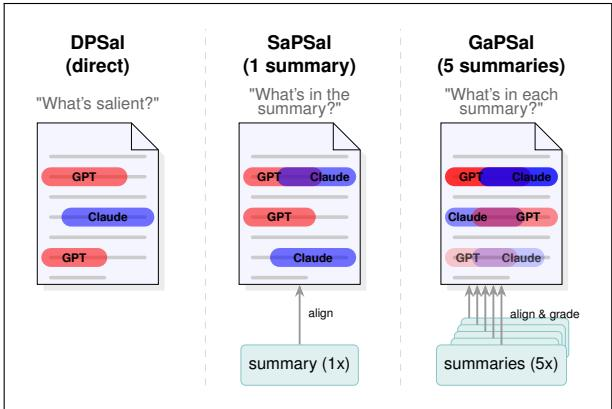
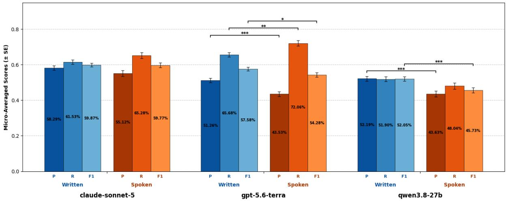
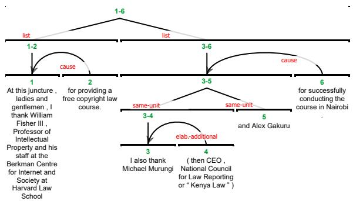
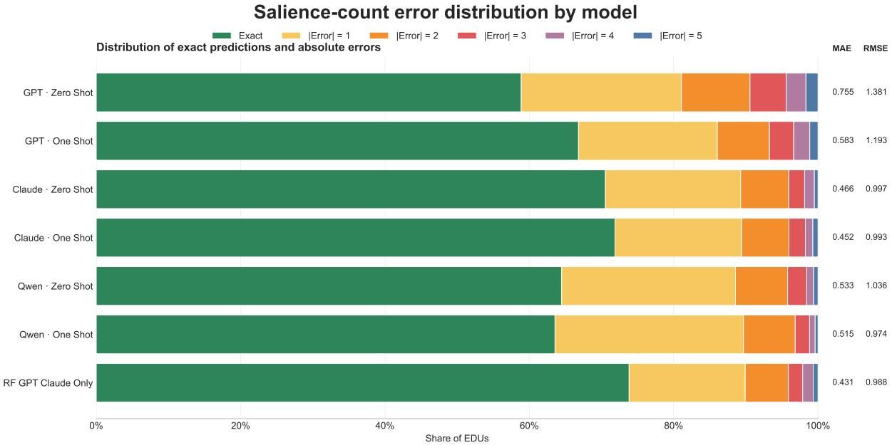
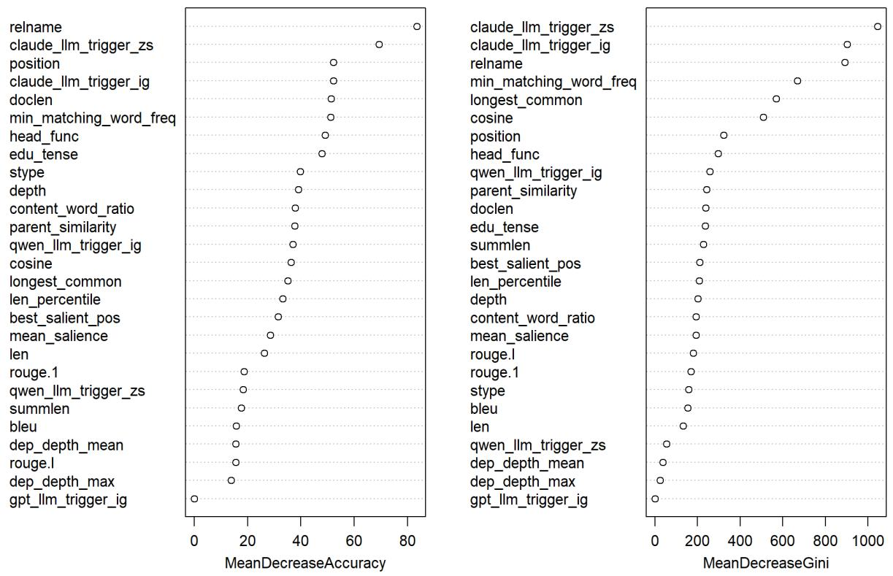
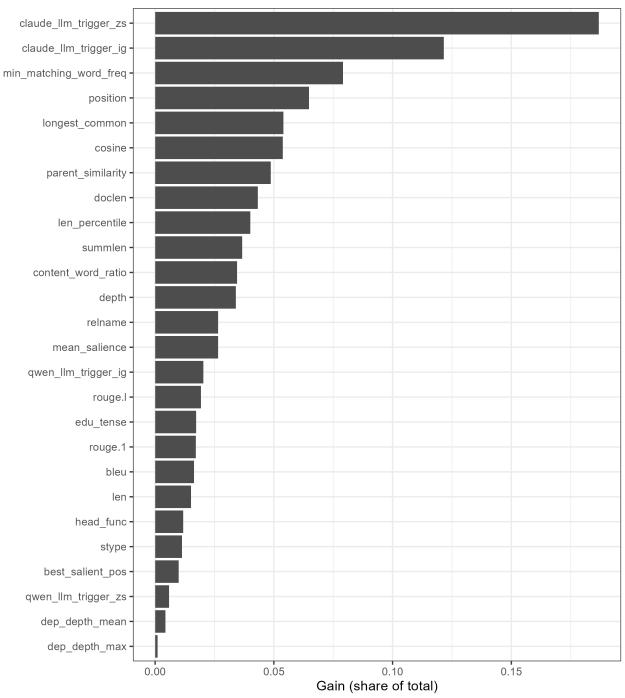
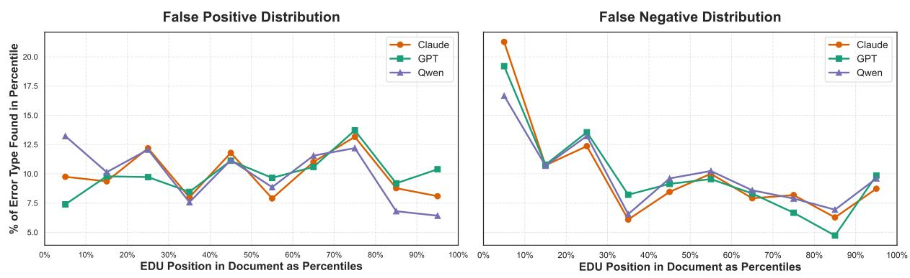
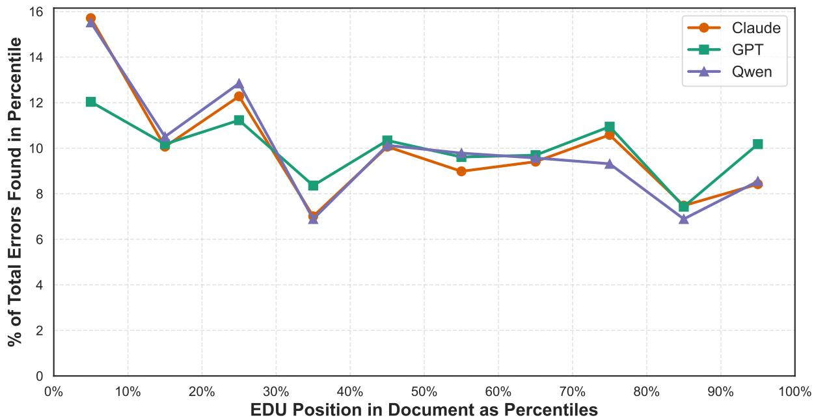

# The Sum of All Summaries: PROPALIGN for Graded Proposition Salience Evaluation

Lin Ai1 Emma Thronson1 Katherine Conhaim1 Amir Zeldes1 1Department of Linguistics, Georgetown University, USA Correspondence: la987@georgetown.edu

## Abstract

Identification and ranking of salient propositions in documents is indirectly involved in many AI tasks, but few papers define proposition salience scores clearly, make diverse data available, or evaluate models directly on the task. This paper proposes PROPALIGN, a multiple-summary-based approach for propositional salience score estimation, and releases PROPALIGNBANK, an accompanying dataset for the method with 138K alignments of over 35K propositions. We compare several approaches to salient proposition extraction in English across a broad range of spoken and written genres, and demonstrate that naively asking models for judgments leads to inconsistencies. By contrast, graded, summary-based metrics are more stable. We further observe that while single models perform worse than humans, an ensemble of models incorporating linguistic features approaches manual annotation quality ceilings. In addition, analyses of the model outputs suggest insights into how models can extract salient information with and without the use of summaries.

## 1 Introduction

Identifying the most salient information in a document and ranking information for salience are important tasks in information retrieval, automatic summarization, and computational social science (Wang et al., 2020; Bar-Haim et al., 2020; Le and Luu, 2024; Dong et al., 2025). A major challenge in approaching salience in natural language is that definitions are very general and appeal to subjective judgments, which make it hard for both humans and models to agree on ‘the’ correct answer, or to place salience judgments on a reliable ratio scale.

Motivated by the need for a stable operationalization of proposition salience, in this paper we propose PROPALIGN, an approach that utilizes summarization-based salience metrics previously used for Salient Entity Extraction (SEE; Bullough et al. 2024; Lin and Zeldes 2024). The framework relies on the idea that if something is salient in a document, it will be difficult to summarize the document without mentioning it (Dunietz and Gillick, 2014). However, because this approach is susceptible to the inherent subjectivity and variability of individual summaries and yields only a binary judgment of salience, we adopt a more nuanced approach that uses multiple summaries to mitigate individual idiosyncrasies and yield a graded salience metric. We refer to directly querying for salience as DPSAL (direct proposition salience), querying based on appearance in a single summary as SaPSal (Summary-aligned Proposition Salience), and using multiple summaries as GaPSal (Graded-aligned Proposition Salience, see Figure 1 and Section 4.1).

  
Figure 1: Asking models for salient text is more subjective and less consistent than asking what appears in a summary. Multiple summaries can compensate for summary subjectivity and yield gradient salience scores, and model judgments overlap more on the right.

A further question that frameworks seeking to operationalize proposition salience must contend with is the unit of analysis. While documents are often divided into sentences to be ranked for importance, sentences can be quite long, and it is possible for only parts of a sentence to be relevant (Zhou et al., 2020; Peng et al., 2023). Zeldes et al. (2026) found that among the 20% of sentences that contained salient information, half of them included non-salient clauses, motivating a focus on smaller units. Though various possibilities exist, Wu et al. (2023) found that Elementary Discourse Units (EDUs) as defined in Rhetorical Structure Theory (Mann and Thompson, 1988), which correspond roughly to clauses or predications, are an optimal unit for fine-grained content extraction. Because EDUs have been studied extensively and have clear segmentation guidelines (Carlson and Marcu, 2001) and abundant publicly available data, for the remainder of this paper, we will use EDUs as the operationalization for propositions.

The main contributions of this paper are:

• We present PROPALIGN, a method and task for salient proposition extraction

• We release PROPALIGNBANK, the first large scale dataset for graded summary-based proposition salience scoring

• Our annotations include tens of thousands of manual alignments for evaluation

• We evaluate three open-weight and frontier LLMs on several versions of the task and create an ensemble to produce additional silver standard data

## 2 Related work

## 2.1 Proposition salience extraction

Little previous work has targeted salience extraction outside of downstream tasks such as extractive summarization (see Section 2.2). The closest work in terms of goals is Liu et al. (2018), who attempted to extract salient events from the NYT corpus (Sandhaus, 2008). However, their approach considered only a restricted subset of verbal predicates as candidates and relied on automatic FrameNet-based semantic parsing and coarse lemma matching against article abstracts to identify salient propositions. Choubey et al. (2020) annotated news articles for eight content type categories including ‘main events’, but did not directly evaluate salience or produce graded scores. Also closely related to our work is the Pyramid method of Nenkova and Passonneau (2004), which evaluated generated summaries by aligning their content with semantic content units identified across multiple human reference summaries and weighted according to their frequency of occurrence. The method was developed using a subset of the Document Understanding Conference (DUC) data (Harman and Over, 2002). However they were not concerned with scoring salience as an end goal, and the data has not been released. Finally, Zeldes et al. (2026) approached gradient proposition salience evaluation directly and produced the test set we will use below for evaluation. But they provided no training or development data and did not attempt to automatically predict salience scores or evaluate computational models on the task in any way, a gap which this paper aims to close.

## 2.2 Salience for extractive summarization

The task of extractive summarization is closely related to proposition salience, as it focuses on identifying which passages best describe a document’s content. Early extractive summarization methods used sentence-similarity graphs to represent documents and unsupervised learning techniques to identify the most salient sentences (Mihalcea and Tarau, 2004; Erkan and Radev, 2004). The advent of deep learning gave rise to neural network-based methods, primarily through supervised learning using pre-existing extractive summarization datasets (Cao et al., 2015; Cheng and Lapata, 2016; Nallapati et al., 2017; Ren et al., 2017; Zhou et al., 2018). More recently, transformer architectures were used to identify salient sentences for summarization in specific target domains (Liu and Lapata, 2019; Zhang et al., 2019). Other approaches to salience combine encoder-based models with graph-based approaches that capture document position and inter-sentence redundancy. (Zheng and Lapata, 2019; Jia et al., 2020; Wang et al., 2020). In addition, generative models have been used to produce extractive summaries as a sequence generation task but with mixed results (Zhang et al., 2023; Le and Luu, 2024). Finally, some work has also tested diffusion models on domain-specific extractive summarization (Dong et al., 2025).

## 2.3 RST-based approaches

Rhetorical Structure Theory (RST) constructs hierarchical tree graphs over Elementary Discourse Units (EDUs) to express their relative importance (see Appendix C). Studies using RST to identify content for summarization found that RST tree nesting depth was a strong predictor of salience (Louis et al., 2010). Further work showed that EDUs, instead of sentences, more closely matched content found in human-generated summaries, and that EDUs work as better units for near-extractive summarization (Li et al., 2016). Later work leveraged EDUs as part of deep learning approaches to summarization for more concise text extraction (Liu and Chen, 2019). In DiscoBERT (Xu et al., 2020), RST tree relationships were used to create Graph Convolutional Networks which showed significant improvement when compared with contemporary encoder models. A similar approach using a heterogeneous Graph model with EDUs performed comparably to DiscoBERT. Xiao et al. (2020) modified an attention head in a BERT model with information about a document’s RST tree and found improvements on extractive summarization using either EDUs or sentences as the minimal unit of analysis.

## 3 Data

Documents As underlying text for PROPALIGN-BANK we use the freely available GUM (Georgetown University Multilayer corpus) data from Zeldes et al. (2026), which provides five human written summaries for documents in the dev and test partitions of the corpus, as well as one human written and four model-generated summaries for the training set (see Table 1). The original data covers ∼290K tokens in over 35K propositions across 16 spoken and written genres of English, including face-to-face conversations, news and language on the Internet across modalities (e.g. Reddit, YouTube vlogs, Wikipedia, and podcasts).

Manual annotation Zeldes et al. (2026) provided manual alignments of EDUs to summaries in the GUM test set. For this study, we manually align all EDUs in the corresponding dev set to each of five summaries per document, resulting in ∼20K manual alignments, as shown in Table 1. Following the test set’s manual, we label each alignment as good, approximate (a likely trigger for content in the summary but not an exact match), or component (one part of content mentioned in the summary in aggregate), and track duplicate alignments (multiple propositions corresponding to or triggering the same summary text). As an example, consider the following summary and the text in (1).

Summary: ...editors ofGlobal Voices discuss Mangal Shobhajatra, a festive procession for the Bengali New Year that serves as a symbol of unity and diversity in Bangladesh...

(1) [What you’re hearing is Mangal Shobhajatra, an annual procession of thousands of people]1 [But what might look like just a street party is actually a creative stand for unity and against the forces of intolerance]2 [I’m Lauren, news editor at Global Voices]3 [I’m Sahar, managing editor at Global Voices]4 [today we are digging deep into Bangladesh’s Mangal Shobhajatra]5

The units in orange are considered good matches, the cyan unit is considered approximate (possible trigger for ‘symbol of unity and diversity’), and the green units are components, since the summary mentions editors of Global Voices, aggregating over the two. Additionally, unit 5 is marked as a near duplicate of unit 1, since both align with ‘discuss Mangal Shobhajatra, an annual procession...’. We also include double annotations for 25 document-summary pairs and obtain inter-annotator agreement numbers (see Section 5.1), which are in line with numbers from Zeldes et al.. See Appendix A for more detailed definitions which we provide to models.

Splits and additional annotations Below we use the test split for scoring all algorithms, the dev split for few-shot examples and to train an ensemble approach leveraging multiple LLMs to predict on the test set. We use this ensemble to produce a high quality annotated version of the training set, for which summaries and EDU segments exist, but no alignments, with the future goal of enabling fine-tuning of open models on the task directly. Because the GUM data already includes a range of annotations, such as syntactic dependency trees, RST discourse parses and alignments of entities to summaries, we will leverage these annotations next to LLM alignment predictions in Section 5.3 to improve prediction accuracy on the silver training set.

## 4 Methods

## 4.1 Settings

We evaluate several methods to extract salient propositions using LLMs:

DPSAL As a baseline, we test model’s direct sensitivity to proposition salience without providing any summaries. Because this baseline prompt does not reference a summary, we evaluate its outputs against summary-independent gold labels, which

<table><tr><td>Genre</td><td>Source</td><td>Docs</td><td>EDUs</td><td>Alignments</td><td>Genre</td><td>Source</td><td>Docs</td><td>EDUs</td><td>Alignments</td></tr><tr><td>Academic writing</td><td>Various</td><td>18</td><td>1,981</td><td>9,905</td><td>How-to guides</td><td>wikiHow</td><td>19</td><td>2,399</td><td>11,995</td></tr><tr><td>Biographies</td><td>Wikipedia</td><td>20</td><td>2,071</td><td>10,355</td><td>Interviews</td><td>Wikinews</td><td>19</td><td>2,408</td><td>12,040</td></tr><tr><td>Vlogs</td><td>YouTube</td><td>15</td><td>2,438</td><td>12,190</td><td>Letters</td><td>Various</td><td>18</td><td>2,102</td><td>10,510</td></tr><tr><td>Conversations</td><td>UCSB Corpus</td><td>15</td><td>3,083</td><td>15,415</td><td>News stories</td><td>Wikinews</td><td>24</td><td>1,912</td><td>9,560</td></tr><tr><td>Courtroom transcripts</td><td>Various</td><td>14</td><td>2,143</td><td>10,715</td><td>Podcasts</td><td>Various</td><td>14</td><td>2,256</td><td>11,280</td></tr><tr><td>Essays</td><td>Various</td><td>14</td><td>2,001</td><td>10,005</td><td>Political speeches</td><td>Various</td><td>15</td><td>1,913</td><td>9,565</td></tr><tr><td>Fiction</td><td>CC fiction</td><td>19</td><td>2,474</td><td>12,370</td><td>Textbooks</td><td>OpenStax</td><td>15</td><td>2,030</td><td>10,150</td></tr><tr><td>Forum discussions</td><td>reddit</td><td>18</td><td>2,263</td><td>11,315</td><td>Travel guides</td><td>Wikivoyage</td><td>18</td><td>1,796</td><td>8,980</td></tr></table>

Total docs / EDUs / aligns: 275 / 35,270 / 176,350 (dev: 32 / 3,896 / 19,480 test: 32 / 3,779 / 18,895 train: 211 / 27,595 / 137,975)

Table 1: Overview of the PROPALIGNBANK data from GUM.

we construct by pooling human annotations across five summaries: An EDU is salient if it is annotated as salient for at least one summary. For a fair comparison, we apply the same pooling procedure to predictions from models using the summary-based approach, treating an EDU as salient if the model identifies it as salient for at least one summary.

SAPSAL For a finer-grained evaluation of the summary-based approach, we compare predictions against gold labels for each summary, testing whether models correctly identified that an EDU contributes to information in a specific summary.

GAPSAL In this setting, we collect predictions from five summaries of each document and compute a single numeric score of 0–5 per proposition. We evaluate models purely on their ability to predict the correct number, and not whether those predictions are based on the correct summary (i.e. a model can be right for the wrong reason if it answers positively for summary 1 and negatively for summary 2 when an EDU actually appeared in summary 2 but not 1).

## 4.2 Models and prompts

While our preference would be to evaluate openweight models, in practice we find that parameter efficient models severely underperform frontier models. We therefore prioritize comparisons of GPT-5.6-terra and Claude-sonnet-5, two recent, high-end but affordable models, and the smaller open-weight Qwen-3.8-27B. We first evaluate performance on DPSAL by prompting single models, but store all responses with the goal of training a model ensemble fed by all predictions, which we evaluate below as well. We set reasoning to “None” for all API calls to keep costs manageable. Temperature is set to zero and Top K and Top P are not explicitly set.

To prompt models in the DPSAL setting, we formulate a zero-shot, summary-free prompt which simply tasks models with identifying the most important units that describe the content of the document and a one-shot prompt with an example document and gold labels. The model is asked to output only the ID number of the salient units in a json format. See the full prompt in Appendix A.

In the other settings, models are given a summary and asked to identify units that contribute information to the summary in three steps: (1) attempt to align each EDU with a specific part of the given summary; (2) if successful, classify the alignment as good, approximate, or component; (3) if the unit is redundant with a previously aligned unit for this summary, mark it as a duplicate of that ID. The prompt briefly defines each category and instructs models to include a short note on the corresponding text in the summary that prompted them to include it as aligned. See example outputs in Appendix B and Appendix A for complete prompt templates.

For prompt types, we compare a zero-shot setting and an in-genre one-shot setting, which uses a single document and summary pair to illustrate how the salience criteria apply to documents of the same genre (e.g. if the model is predicting on a news article, the example is a different news article from the dev set). Note that this also applies to the DPSAL setting, in which the one-shot example can help the model to understand what is considered salient, even though here no summary is included.

Since we have 10 dev set summary-document pairs for each genre, we make sure to choose a pair that contains all subtypes of match, including duplicate matches if possible. See the actual demonstration pairs and the number of subtypes included for each pair in Appendix D.

## 4.3 Ensembles

Because the train partition of our data is too large to annotate manually (\~138K alignments), we generate the most accurate labels possible by ensembling predictions from LLMs together with additional annotations from the GUM dataset. As a metalearner algorithm, we test Random Forest and XGBoost, and predict alignments for each EDU-summary pair.

Features We utilize a combination of linguistic features and LLM-generated features. The LLM features come from prompting the Claude, GPT, and Qwen models and include both the binary judgments and predicted subtypes of each model. Linguistic features include lexical, positional, and similarity-based metrics, as well as annotations derived from the RST annotations available for GUM, such as RST relation name for each EDU and RST dependency depth, ROUGE scores for the summary vs. the EDU, cosine similarity based on sentence embeddings, and minimum frequency of any matching word between the summary and the EDU. A detailed list of features is given in Appendix H.2.

Optimizing We tune each metalearner with 5- fold cross validation, with folds assigned at the document level. We utilize Optuna (Akiba et al., 2019) to optimize our Random Forest and XGBoost models. The search space covers model parameters, class imbalance handling, and the classification threshold (Appendix H). For Random Forest, we perform backward elimination to prune out features. Features are ranked by decrease in impurity and are dropped if the cross-validated F1 score stays within a threshold of the best score seen so far. Full details for hyperparameter optimization are outlined in Appendix H.

## 4.4 Metrics

The objective of the PROPALIGN method is to produce a graded salience score for each proposition in a text, which lends itself to reporting a ratio-scaled Absolute or Root Mean Squared Error (MAE/RMSE, how far predictions are from the target). However, in order to compare our method to naively prompting models to extract salient propositions, a binary setting may be more appropriate, where a positive judgment equates to ‘summaryworthiness’ (i.e. the proposition might appear in at least one summary). We refer to directly querying models for salience judgments as DPSAL (Direct Proposition Salience), aligning propositions to a single summary as SAPSAL (Summary-aligned Proposition Salience), and aligning propositions to multiple summaries as GAPSAL (Graded-aligned Proposition Salience).

<table><tr><td>Setting</td><td>F1</td></tr><tr><td>Baseline zero-shot</td><td>0.464</td></tr><tr><td>Baseline one-shot</td><td>0.638</td></tr><tr><td>Summary zero-shot</td><td>0.716</td></tr><tr><td>Summary one-shot</td><td>0.767</td></tr></table>

Table 2: Inter-model agreement between GPT and Claude, measured by F1 across experimental settings.

Since EDUs can be discontinuous (e.g. interrupted by a relative clause, which is its own EDU), we evaluate model outputs on lists of IDs, where a positive judgment on any part of a discontinuous unit is considered to apply to the whole proposition. We report RMSE for GAPSAL, as well as precision, recall, and F1 score for all settings, and we use mutual F1 score as a measure of agreement between models in both DPSAL and the aligned settings, as well as to assess quality of our manually annotated data. Although we follow Zeldes et al. (2026) in tasking models with predicting whether alignments are good, approximate, or component alignments, we found that models do not reliably match human judgments and therefore use untyped judgments, ignoring these labels, as the deciding metric. We report subtype performance in Appendix F.

## 5 Results

## 5.1 DPSAL baselines and agreement

Table 2 shows mutual F1 scores representing agreement between our two frontier models, GPT-5.6-terra and Claude-sonnet-5 for DP-SAL and SAPSAL, the latter using a single summary (Qwen performance is substantially worse, see below).2 We note first based on the table that adding a one-shot example to attune models to the targeted concept of salience is helpful (significantly better scores for one-shot over zero-shot, $p \ < \ 0 . 0 5 )$ . Second, we see a clear and significant improvement in agreement when using the summary based method, suggesting PROPALIGN is substantially more stable and reproducible than direct prompting.

Next we compare both zero-shot and one-shot scores against human reference annotations across the direct LLM baseline and the summary-based outputs. Table 3 gives results under a pooled setting, where baseline performance uses no summary, and the summary-based comparison is pooled: if a model aligns an EDU to any of 5 summaries across 5 runs, the EDU is predicted to be ‘salient’. As can be seen from the table, summary-based approaches strongly outperform the baseline approaches, even when an example is provided. We perform McNemar’s test between the best performing baseline one-shot model (Claude) and the worst performing summary-based zero-shot model (Qwen) and confirm that zero-shot summary-based Qwen shows a statistically significant improvement over baseline one-shot Claude, $\chi ^ { 2 } ( 1 , N = 3 , 5 7 1 ) = 5 . 1 0$ $p = . 0 2 4$

<table><tr><td>Setting</td><td>Model</td><td>P</td><td>R</td><td>F1</td></tr><tr><td>Baseline zero-shot</td><td>GPT Claude Qwen</td><td>0.742 0.594 0.720</td><td>0.161 0.332 0.089</td><td>0.264 0.426 0.159</td></tr><tr><td>Baseline one-shot</td><td>GPT Claude Qwen</td><td>0.548 0.517 0.575</td><td>0.451 0.517 0.293</td><td>0.495 0.517 0.388</td></tr><tr><td>Summary zero-shot</td><td>GPT Claude Qwen</td><td>0.509 0.650 0.555</td><td>0.850 0.728 0.606</td><td>0.637 0.687 0.580</td></tr><tr><td>Summary one-shot</td><td>GPT Claude Qwen</td><td>0.606 0.680 0.540</td><td>0.802 0.739 0.696</td><td>0.690 0.709 0.608</td></tr><tr><td>Humans</td><td></td><td>0.708</td><td>0.698</td><td>0.703</td></tr></table>

Table 3: Precision (P), recall (R), and F1 across models and experimental settings, evaluated against aggregated human gold labels and output IDs.

The summary-based method allows the much smaller Qwen model to become competitive with frontier models – one-shot summary-based Qwen outperforms baseline one-shot GPT and Claude without the summary-based task setup. The gap between Qwen and the frontier models in the summary based experiments is substantially smaller too (about 10 points, compared to the 27 point gap between zero shot baseline Qwen and the best frontier model in that setup, Claude). This suggests that the more well-defined and stable task setup can enable the use of much more cost-effective models for salient proposition extraction.

<table><tr><td>Setting</td><td>Model</td><td>P</td><td>R</td><td>F1</td><td>MAE</td><td>RMSE</td></tr><tr><td rowspan="3">Summary zero-shot</td><td>GPT</td><td>0.401</td><td>0.717</td><td>0.515</td><td>0.755</td><td>1.38</td></tr><tr><td>Claude</td><td>0.568</td><td>0.639</td><td>0.601</td><td>0.466</td><td>0.996</td></tr><tr><td>Qwen</td><td>0.507</td><td>0.392</td><td>0.431</td><td>0.533</td><td>1.035</td></tr><tr><td rowspan="3">Summary one-shot</td><td>GPT</td><td>0.480</td><td>0.679</td><td>0.563</td><td>0.583</td><td>1.19</td></tr><tr><td>Claude</td><td>0.572</td><td>0.629</td><td>0.599</td><td>0.452</td><td>0.993</td></tr><tr><td>Qwen</td><td>0.478</td><td>0.504</td><td>0.496</td><td>0.515</td><td>0.973</td></tr><tr><td>Ensemble</td><td></td><td>0.592</td><td>0.655</td><td>0.622</td><td>0.431</td><td>0.988</td></tr><tr><td>Humans</td><td></td><td>0.708</td><td>0.698</td><td>0.703</td><td>0.328</td><td>0.798</td></tr></table>

Table 4: Precision (P), recall (R), F1, mean absolute error (MAE), and root mean squared error (RMSE) across experimental settings, the ensemble, and human performance for the fine-grained evaluation scheme.

The table also reports similarly computed mutual P/R/F1 using double annotated data, evaluated in a binary setting (salient for any summary/nonsalient), to match model scoring in this setting. Here we note that summary-based one-shot Claude approaches the human ceiling under this setting, showing no statistically significant difference, though humans do actually outperform all LLMs on EDU-summary aligned pairs (see GAPSAL results below).

## 5.2 SAPSAL performance

Next, we ask each model to align EDUs to the existing summaries and score using fine-grained evaluation, based on precision and recall of each EDU-summary alignment pair (non-pooled microaverage). Table 4 shows that in-genre one-shot demonstration helps for GPT and Qwen significantly $( p < 0 . 0 5 )$ in this setting, but surprisingly not for Claude. Using McNemar’s test with continuity correction, there is no statistical difference between the outputs of Claude zero-shot and Claude one-shot, $\chi ^ { 2 } ( 1 , N = 1 7 , 8 5 5 ) = 0 . 0 2 , p = . 8 9 7 .$ Although Claude is the best single model for obtaining pairwise alignments for a SAPSAL approach, other models are competitive in obtaining the final graded scores across all five summaries, which are much more stable. We turn to these next.

## 5.3 GAPSAL and Ensemble

Switching from mutual P/R/F1 scores to numeric estimates of deviation from the target score of each EDU (0–5), we again see better performance for one-shot predictions in each model (lower MAE and RMSE). Claude scores the best in MAE, consistent with its performance in F1. Although Qwen achieves the lowest overall RMSE, this is largely because its errors consist primarily of small deviations from the gold salience scores, which RMSE penalizes less heavily than Claude’s less frequent but larger errors. This contrasts with Qwen’s poor F1 score. These seemingly conflicting facts stem from the fact that in our summary one-shot experiment, Qwen often obtained a correct total salience score by relying on incorrect individual alignments (false positives compensating for false negatives); in other words, it is sometimes right for the wrong reasons, or often has deviations of just 1 point from 0 – see details in Appendix G. However a 1 point deviation above 0 (somewhat salient vs. not at all) may be more significant for downstream users than a numerically larger error between predictions of 2 and 4, which penalize especially Claude.

To construct the best possible predictions for the full PROPALIGNBANK dataset, we found that including the binary salience predictions from GPT and Claude in a tuned Random Forest, in addition to the linguistic features, gives the best F1 score. In addition, during model development, we found that the LLM-generated labels for duplicate, approximate, and component propositions did not improve performance, and therefore we retained only the binary salience predictions as our LLM-based features. This ensemble method also gives the best MAE score. Although this method is not usable in realistic settings for unseen data, since the ensemble leverages manual annotations from the GUM corpus, we are able to use it to annotate the training partition automatically, which we release as an additional silver-standard partition of our dataset.

We perform McNemar’s test with continuity correction on the difference between the best performing single model and the ensemble. The tuned Random Forest ensemble model shows a statistically significant improvement over Claude zero-shot and Claude one-shot, $\chi ^ { 2 } ( 1 , N = 1 7 , 8 5 5 ) = 2 0 . 5 9$ $\textit { p } \ < \ . 0 0 1$ and $\chi ^ { 2 } ( 1 , N ~ = ~ 1 7 , 8 5 5 ) ~ = ~ 1 4 . 6 1$ $p ~ < ~ . 0 0 1$ respectively. In addition, human performance still shows a statistically significant advantage over the ensemble $( \chi ^ { 2 } ( 1 , N = 8 , 5 8 5 ) =$ $3 9 . 4 7 , p < . 0 0 1 )$ respectively, which is our best model, suggesting room for improvement on the task.3

## 6 Error analysis

## 6.1 Quantitative analysis

Figure 2 shows model performance on spoken versus written data. The best model, Claude, shows no significant difference across modalities, though precision is lower than recall. GPT and Qwen show significantly better F1 and precision on written data, though GPT’s recall is significantly better on the spoken modality. Low precision on speech is the weakest point for all three models.

There were also effects noted on the position of EDUs in the document, as errors were most concentrated in the first 30% of EDUs across all models. The effects were most noticeable with Claude and Qwen having over 15% of errors in the first 10% of EDUs. A more detailed analysis of error types and position is provided in Appendix I.

## 6.2 Qualitative analysis

Looking at the lowest-scoring documents for the frontier models in the development set, we observe multiple failures in identification of levels of granularity and generalization. For example, in analyzing a Reddit post about macroeconomics discussing how and to whom countries can be in debt, summary-one shot GPT flags the following false overlaps with the summary, which humans skipped:

Summary: ...author explains how money is aform of debt whose value depends on the amount of money in circulation ...

(2) [You can borrow from your own people]

(3) [if the govt decided to print 1 quadrillion dollars,] [the value of the dollar would probably crash pretty hard]

Although the summary does not mention borrowing from a government’s people, the notions of borrowing and debt are closely related, and the model may generalize from phrases such as ‘amount of money in circulation’ to a reference to the people in a country. In the second error, devaluation of currency is related to value depending on the amount of money in circulation, but the summary does not discuss the cited example involving the US dollar, and there are better, more general trigger units in the document to align to ‘value depends on the amount of money in circulation’.

Conversely, for a conversation during a game of Risk, the summary mentions that the interlocutors are playing with cards. The gold annotations flag EDUs that specifically reference the users holding cards as approximate matches:

  
Figure 2: Precision, recall and F1 for three models on written and spoken test data.

Summary: Two people are playing a strategy game online involving cards...

(4) [How many cards do you have?]

(5) [You get the cards.]

In both (4) and (5), the human annotators utilize the mention of cards as a trigger for the content in the summary, which lacks other sources. However, Claude does not highlight either of these EDUs, instead opting for a mention of the word set (which indirectly references the cards) as in (6), despite the presence of obviously more related propositions in the document.

(6) [So you can’t have a set.]

## 7 Discussion

Why should we use summary based salience? Given the results, it is clear that naively asking models to extract salient information is substantially less stable than PROPALIGN. This result may seem unsurprising: if models don’t know that we define salience based on alignment with a summary that they are not provided, they will make mistakes. However, note that the same applies to direct prompting: without a clear operationalization, models are bound to disagree, and this study shows that agreement levels are much better for PROPALIGN, which is non-trivial. Additionally, using multiple summaries as components of a gradient salience score not only results in higher convergence across models, but also offers a more explainable criterion for quantitative salience ratings.

A second reason to seriously consider using PROPALIGN instead of direct querying methods is the very strong improvement in performance for the smaller Qwen model even in the zero-shot SAPSAL scenario – the simplest possible summarybased methodology. In this scenario, the much smaller Qwen model lags behind Claude Sonnet-5 by only 10 points, compared to the 27 point gap in DPSAL. The jump to the best GAPSAL method allows Qwen to go neck-and-neck with Claude in RMSE for gradient scores, though not in F1 score, and Claude has the advantage in MAE as well.

Isn’t this too complex to be practical? In production settings, the pipeline evaluated in this paper would involve obtaining multiple summaries per document and then aligning them to documents using multiple model runs, resulting in an expensive and complex setup. While this is indisputable, we emphasize that naive alternatives are ill defined, as seen from the lower scores in the baseline setting in Table 3 and the lower level of inter-model agreement in the baseline setting in Table 2.

That being said, the silver-standard training set created in this paper, with around 138K alignments, offers the potential to make further progress. The data could be used to study what makes propositions salient in discourse more directly, as well as to train systems on the more consistent concept of salience promoted here in order to predict it with a single fine-tuned model prompt, a possibility which we leave for further study.

## Limitations

This paper presupposes, rather than proves, that summary-based salience is a desirable target for quantifying salience, and does not compare the performance of its methods on possibly related preexisting tasks, such as extractive summarization. While we acknowledge an interesting relationship between salience metrics and extractive summarization, we consider these conceptually separate tasks: extractive summarization may have different priorities in specific domains, and is also concerned with intelligibility of extracts (for example problems created by the need to reconstruct pronouns, or insufficient context), whereas our method is fully agnostic of intelligibility in isolation. Similarly, approximate and component matches discussed above may make for poor extractive summaries, but we consider them salient since they are required triggers for content in the abstractive summaries used by our method.

Although our study covers a broad sample of 16 spoken and written genres, it is limited to English language sources. We are optimistic that our methods will be easy to apply to data in other languages, our results especially with regard to LLM performance may or may not generalize. We also recognize that a full application of the pipeline including collection of five abstractive summaries and alignment is relatively expensive compared to a DPSAL approach, and we leave it to future studies to leverage PROPALIGNBANK to fine-tune models end-to-end on the task data.

All annotations collected in this study were carried out by Computational Linguistics graduate students or post-grads on a voluntary basis as part of an academic research project. LLMs were accessed via the Open AI and OpenRouter APIs, at a total cost of \$35.

## References

Takuya Akiba, Shotaro Sano, Toshihiko Yanase, Takeru Ohta, and Masanori Koyama. 2019. Optuna: A nextgeneration hyperparameter optimization framework. Preprint, arXiv:1907.10902.

Roy Bar-Haim, Yoav Kantor, Lilach Eden, Roni Friedman, Dan Lahav, and Noam Slonim. 2020. Quantitative argument summarization and beyond: Crossdomain key point analysis. In Proceedings of the 2020 Conference on Empirical Methods in Natural Language Processing (EMNLP), pages 39–49, Online. Association for Computational Linguistics.

Benjamin Bullough, Harrison Lundberg, Chen Hu, and Weihang Xiao. 2024. Predicting entity salience in extremely short documents. In Proceedings of the 2024 Conference on Empirical Methods in Natural Language Processing: Industry Track, pages 50–64, Miami, Florida, US. Association for Computational Linguistics.

Ziqiang Cao, Furu Wei, Sujian Li, Wenjie Li, Ming Zhou, and Houfeng Wang. 2015. Learning summary prior representation for extractive summarization. In Proceedings of the 53rd Annual Meeting of the Association for Computational Linguistics and the 7th International Joint Conference on Natural Language Processing (Volume 2: Short Papers), pages 829– 833, Beijing, China. Association for Computational Linguistics.

Lynn Carlson and Daniel Marcu. 2001. Discourse tagging reference manual. Technical report, Information Sciences Institute, University of Southern California.

Jianpeng Cheng and Mirella Lapata. 2016. Neural summarization by extracting sentences and words. In Proceedings of the 54th Annual Meeting of the Associationfor Computational Linguistics (Volume 1: Long Papers), pages 484–494, Berlin, Germany. Association for Computational Linguistics.

Prafulla Kumar Choubey, Aaron Lee, Ruihong Huang, and Lu Wang. 2020. Discourse as a function of event: Profiling discourse structure in news articles around the main event. In Proceedings of the 58th Annual Meeting of the Association for Computational Linguistics, pages 5374–5386, Online. Association for Computational Linguistics.

Xiangyun Dong, Wei Li, Yuquan Le, Zhangyue Jiang, Junxi Zhong, and Zhong Wang. 2025. TermDiffuSum: A term-guided diffusion model for extractive summarization of legal documents. In Proceedings of the 31st International Conference on Computational Linguistics, pages 3222–3235, Abu Dhabi, UAE. Association for Computational Linguistics.

Jesse Dunietz and Daniel Gillick. 2014. A new entity salience task with millions of training examples. In Proceedings of the 14th Conference of the European Chapter of the Association for Computational Linguistics, volume 2: Short Papers, pages 205–209, Gothenburg, Sweden. Association for Computational Linguistics.

Günes Erkan and Dragomir R. Radev. 2004. Lexrank: graph-based lexical centrality as salience in text summarization. J. Artif. Int. Res., 22(1):457–479.

Donna K. Harman and Paul D. Over. 2002. The DUC summarization evaluations. In Proceedings of the Second International Conference on Human Language Technology Research.

Ruipeng Jia, Yanan Cao, Hengzhu Tang, Fang Fang, Cong Cao, and Shi Wang. 2020. Neural extractive summarization with hierarchical attentive heterogeneous graph network. In Proceedings of the 2020

Conference on Empirical Methods in Natural Language Processing (EMNLP), pages 3622–3631, Online. Association for Computational Linguistics.

Thang Le and Anh Tuan Luu. 2024. Extractive summarization with text generator. In Proceedings of the 2024 Conference of the North American Chapter ofthe Associationfor Computational Linguistics: Human Language Technologies (Volume 1: Long Papers), pages 157–174, Mexico City, Mexico. Association for Computational Linguistics.

Junyi Jessy Li, Kapil Thadani, and Amanda Stent. 2016. The role of discourse units in near-extractive summarization. In Proceedings ofthe 17th Annual Meeting ofthe Special Interest Group on Discourse and Dialogue, pages 137–147, Los Angeles. Association for Computational Linguistics.

Jessica Lin and Amir Zeldes. 2024. GUMsley: Evaluating entity salience in summarization for 12 English genres. In Proceedings ofthe 18th Conference ofthe European Chapter of the Association for Computational Linguistics (Volume 1: Long Papers), pages 2575–2588, St. Julian’s, Malta. Association for Computational Linguistics.

Yang Liu and Mirella Lapata. 2019. Text summarization with pretrained encoders. In Proceedings of the 2019 Conference on Empirical Methods in Natural Language Processing and the 9th International Joint Conference on Natural Language Processing (EMNLP-IJCNLP), pages 3730–3740, Hong Kong, China. Association for Computational Linguistics.

Zhengyuan Liu and Nancy Chen. 2019. Exploiting discourse-level segmentation for extractive summarization. In Proceedings ofthe 2nd Workshop on New Frontiers in Summarization, pages 116–121, Hong Kong, China. Association for Computational Linguistics.

Zhengzhong Liu, Chenyan Xiong, Teruko Mitamura, and Eduard Hovy. 2018. Automatic event salience identification. In Proceedings of the 2018 Conference on Empirical Methods in Natural Language Processing, pages 1226–1236, Brussels, Belgium. Association for Computational Linguistics.

Annie Louis, Aravind Joshi, and Ani Nenkova. 2010. Discourse indicators for content selection in summarization. In Proceedings of the SIGDIAL 2010 Conference, pages 147–156, Tokyo, Japan. Association for Computational Linguistics.

William C. Mann and Sandra A. Thompson. 1988. Rhetorical Structure Theory: Toward a functional theory of text organization. Text, 8(3):243–281.

Rada Mihalcea and Paul Tarau. 2004. TextRank: Bringing order into text. In Proceedings of the 2004 Conference on Empirical Methods in Natural Language Processing, pages 404–411, Barcelona, Spain. Association for Computational Linguistics.

Ramesh Nallapati, Feifei Zhai, and Bowen Zhou. 2017. Summarunner: a recurrent neural network based sequence model for extractive summarization of documents. In Proceedings of the Thirty-First AAAI Conference on Artificial Intelligence, AAAI’17, page 3075–3081. AAAI Press.

Ani Nenkova and Rebecca Passonneau. 2004. Evaluating content selection in summarization: The pyramid method. In Proceedings of the Human Language Technology Conference of the North American Chapter of the Association for Computational Linguistics: HLT-NAACL 2004, pages 145–152, Boston, Massachusetts, USA. Association for Computational Linguistics.

Cheng Peng, Tong Ge, and Yunhai Wang. 2023. Optimizing word search within documents by showing results in the context. Journal of Visualization, 26(2):441–455.

Pengjie Ren, Zhumin Chen, Zhaochun Ren, Furu Wei, Jun Ma, and Maarten de Rijke. 2017. Leveraging contextual sentence relations for extractive summarization using a neural attention model. In Proceedings of the 40th International ACM SIGIR Conference on Research and Development in Information Retrieval, SIGIR ’17, page 95–104, New York, NY, USA. Association for Computing Machinery.

Evan Sandhaus. 2008. The new york times annotated corpus. Linguistic Data Consortium, Philadelphia.

Danqing Wang, Pengfei Liu, Yining Zheng, Xipeng Qiu, and Xuanjing Huang. 2020. Heterogeneous graph neural networks for extractive document summarization. In Proceedings ofthe 58th Annual Meeting of the Association for Computational Linguistics, pages 6209–6219, Online. Association for Computational Linguistics.

Yuping Wu, Ching-Hsun Tseng, Jiayu Shang, Shengzhong Mao, Goran Nenadic, and Xiao-Jun Zeng. 2023. EDU-level extractive summarization with varying summary lengths. In Findings of the Associationfor Computational Linguistics: EACL 2023, pages 1655–1667, Dubrovnik, Croatia. Association for Computational Linguistics.

Wen Xiao, Patrick Huber, and Giuseppe Carenini. 2020. Do we really need that many parameters in transformer for extractive summarization? discourse can help ! In Proceedings of the First Workshop on Computational Approaches to Discourse, pages 124–134, Online. Association for Computational Linguistics.

Jiacheng Xu, Zhe Gan, Yu Cheng, and Jingjing Liu. 2020. Discourse-aware neural extractive text summarization. In Proceedings ofthe 58th Annual Meeting of the Association for Computational Linguistics, pages 5021–5031, Online. Association for Computational Linguistics.

Amir Zeldes, Katherine Conhaim, and Lauren Levine. 2026. Not worth mentioning? A pilot study on salient proposition annotation. In Proceedings of

the 20th Linguistic Annotation Workshop (LAW XX), pages 178–186, San Diego, California, USA. Association for Computational Linguistics.

Haopeng Zhang, Xiao Liu, and Jiawei Zhang. 2023. Extractive summarization via ChatGPT for faithful summary generation. In Findings of the Association for Computational Linguistics: EMNLP 2023, pages 3270–3278, Singapore. Association for Computational Linguistics.

Xingxing Zhang, Furu Wei, and Ming Zhou. 2019. HI-BERT: Document level pre-training of hierarchical bidirectional transformers for document summarization. In Proceedings ofthe 57th Annual Meeting of the Associationfor Computational Linguistics, pages 5059–5069, Florence, Italy. Association for Computational Linguistics.

Hao Zheng and Mirella Lapata. 2019. Sentence centrality revisited for unsupervised summarization. In Proceedings ofthe 57th Annual Meeting ofthe Associationfor Computational Linguistics, pages 6236– 6247, Florence, Italy. Association for Computational Linguistics.

Qingyu Zhou, Furu Wei, and Ming Zhou. 2020. At which level should we extract? an empirical analysis on extractive document summarization. In Proceedings of the 28th International Conference on Computational Linguistics, pages 5617–5628, Barcelona, Spain (Online). International Committee on Computational Linguistics.

Qingyu Zhou, Nan Yang, Furu Wei, Shaohan Huang, Ming Zhou, and Tiejun Zhao. 2018. Neural document summarization by jointly learning to score and select sentences. In Proceedings ofthe 56th Annual Meeting of the Association for Computational Linguistics (Volume 1: Long Papers), pages 654–663, Melbourne, Australia. Association for Computational Linguistics.

## A System Prompts for LLMs

## Baseline Prompt

You are a linguist trained in identifying the most important pieces of a document. Given a document that has been split into sub-sentence units, which are numbered, you should identify the units that best describe the content of the document.

Your response should take the form of a JSON object. You will provide the number for the chosen unit as a string.

Now let’s try with a document:

## Summary-based Prompt

You are an expert NLP system specialized in aligning document discourse units to summary sentences. Your task is to analyze a document and a summary, and for each document unit, determine whether it contributes to any information present in the summary.

For each unit: 1. Identify the specific summary sentence to which the unit may contribute information. 2. Compare the unit against that sentence: does it state, entail, paraphrase, vaguely relate to, or fail to support any part of it? 3. Include the unit only if it states, entails, or paraphrases part of the summary sentence. 4. Record the aligned part of the summary sentence in the triggers. 5. Decide whether the included unit is component, approximate, or duplicate.

Case: Normal Match vs. Non-Match

Rule: For Normal Match, set approximate and component to false when the unit expresses the same core proposition as a portion of the summary. The unit does not need to exactly match the summary’s grammatical form. Differences in active/passive voice, tense, word order, or surface phrasing do not disqualify the unit, as long as the same information is clearly stated. For Non-Match, exclude units that provide irrelevant context about an entity in the summary but do not express summary content directly.

Case: Fragments

Rule: Headlines, titles, fragments, or independent noun phrases are valid triggers if they assert summary content.

Case: Component

Rule: Set component to true when the unit provides one item, detail, or subclaim from a larger set that the summary combines into a broader statement, such as when several document units are summarized together as a list or category.

Case: Approximate

Rule: Set approximate to true when the unit is a valid match but expresses the summary content indirectly, incompletely, or with a meaningful shift in specificity, implication, or framing.

Case: Duplicate

Rule: Fill the duplicate list with the ID of the earliest unit that triggers the same summary content when the current unit expresses the same information redundantly.

## B Expected Output for Summary-based Prompts

{ "id": "74", "approximate": false, "component": false, "duplicate": ["70"], "triggers": "period of limited exposure generally leads to attrition" }

## C RST example

RST trees partition documents into Elementary Discourse Units (EDUs), which generally correspond to clauses, but may be discontinuous. Less central units form satellites for more central units (their ‘nuclei’), and equally prominent units may be coordinated as multinuclear nodes. The discourse function of each unit is expressed using a category label, and constituents containing multiple unit can recursively serve as satellites or nuclei in larger subtrees, recursively. Figure 3 illustrates this in an RST tree fragment.

The most central units are the coordinated constituents [1-2] and [3-6], which form a list of ‘thanking’ propositions. Unit [2] is a satellite of unit [1], expressing CAUSE for the thanks, and similarly unit [6] is a CAUSE satellite of [3-5]. Units [3] and [5] correspond to a discontinuous proposition, indicated by the SAME-UNIT label. The proposition is interrupted by unit [4], an elaboration satellite giving more information about a person being thanked.

  
Figure 3: Fragment from an RST tree in the GUM corpus.

## D One-shot Demonstration Pairings

See Table 5 for one-shot demonstration documentsummary pair from the dev set and the number of subtypes included in each demonstration.

## E Number of Original versus Normalized Qwen outputs

See Table 6 for the number of documents in Qwen outputs that require normalization.

## F Fine-grained evaluation

Table 7 provides numbers for the fine grained evaluation using exact subtypes (including prediction of approximate and component status). In this exact evaluation setting, scores are much lower.

## G Salience Score

Figure 4 shows the frequency distribution of prediction errors with absolute magnitudes ranging from 0 to 5 across different models.

## H Ensemble details

## H.1 Finetuning

All tuning is done using the train partition with 5-fold cross validation. Folds are assigned at the document level to prevent leakage of EDUs. Nonsalient EDUs are significantly more common than salient; each parameter configuration is scored by the F1 of the positive class on the out-of-fold predictions rather than per fold. Categorical features are one-hot encoded. We use Optuna’s Treestructured Parzen Estimator (TPE) with 60 trails per model.

## H.1.1 Random Forest

The search space for the Random Forest model is outlined in Table 8.

<table><tr><td>Genre</td><td>Dev example (summary)</td><td>Match</td><td>Approx.</td><td>Duplicate</td><td>Component</td><td>Types</td></tr><tr><td>academic</td><td>librarians (1)</td><td>7</td><td>4</td><td>1</td><td>0</td><td>3</td></tr><tr><td>bio</td><td>byron (2)</td><td>4</td><td>6</td><td>2</td><td>3</td><td>4</td></tr><tr><td>conversation</td><td>grounded (3)</td><td>4</td><td>7</td><td>4</td><td>2</td><td>4</td></tr><tr><td>court</td><td>loan (5)</td><td>6</td><td>4</td><td>4</td><td>3</td><td>4</td></tr><tr><td>essay</td><td>tools (4)</td><td>2</td><td>5</td><td>2</td><td>2</td><td>4</td></tr><tr><td>fiction</td><td>beast (2)</td><td>4</td><td>7</td><td>2</td><td>3</td><td>4</td></tr><tr><td>interview</td><td>gaming (1)</td><td>8</td><td>1</td><td>2</td><td>8</td><td>4</td></tr><tr><td>letter</td><td>wiki (5)</td><td>10</td><td>2</td><td>3</td><td>1</td><td>4</td></tr><tr><td>news</td><td>homeopathy (1)</td><td>5</td><td>4</td><td>4</td><td>3</td><td>4</td></tr><tr><td>podcast</td><td>bangladesh (2)</td><td>7</td><td>3</td><td>3</td><td>4</td><td>4</td></tr><tr><td>reddit</td><td>macroeconomics (2)</td><td>1</td><td>4</td><td>1</td><td>10</td><td>4</td></tr><tr><td>speech</td><td>inauguration (5)</td><td>6</td><td>4</td><td>4</td><td>8</td><td>4</td></tr><tr><td>textbook</td><td>labor (2)</td><td>4</td><td>8</td><td>6</td><td>0</td><td>3</td></tr><tr><td>vlog</td><td>portland (1)</td><td>8</td><td>6</td><td>5</td><td>2</td><td>4</td></tr><tr><td>voyage</td><td>coron (3)</td><td>5</td><td>2</td><td>2</td><td>0</td><td>3</td></tr><tr><td>whow</td><td>joke (2)</td><td>1</td><td>1</td><td>1</td><td>6</td><td>4</td></tr></table>

Table 5: Development-set examples used for one-shot in-genre prompting on the test set. Document names omit the prefix GUM\_<genre>\_. Types counts categories with a nonzero value.

<table><tr><td>Prompting</td><td>Normalized</td><td>Unnormalized</td><td>Total</td></tr><tr><td>Zero-shot</td><td>58</td><td>102</td><td>160</td></tr><tr><td>One-shot</td><td>11</td><td>149</td><td>160</td></tr><tr><td>Total</td><td>69</td><td>251</td><td>320</td></tr></table>

Table 6: Qwen test-set prediction files by whether at least one predicted EDU ID required normalization.

The final parameter configuration for this model is: 400 trees, max features 0.3, min samples per leaf 1, class weighting with a positive-class weight of 1.90, and a threshold of 0.465, using 27 features. The final model is retrained on the full train set and applied to the test partition with this threshold.

## H.1.2 XGBoost

The search space for the XGBoost model is outlined in Table 9.

The final parameter configuration for this model is: Max depth 9, learning rate 0.054, row subsample 0.864, column subsample 0.750, min child weight 9, 300 boosting rounds, scale\_pos\_weight 8.51, and a threshold of 0.546, using 34 features. The final model is retrained on the full train set and applied to the test partition with this threshold.

<table><tr><td>Setting</td><td>Model</td><td>P</td><td>R</td><td>F1</td></tr><tr><td rowspan="2">Summary zero-shot</td><td>GPT</td><td>0.323</td><td>0.509</td><td>0.395</td></tr><tr><td>Claude</td><td>0.345</td><td>0.256</td><td>0.294</td></tr><tr><td rowspan="2">Summary one-shot</td><td>GPT</td><td>0.395</td><td>0.479</td><td>0.433</td></tr><tr><td>Claude</td><td>0.411</td><td>0.328</td><td>0.365</td></tr></table>

Table 7: Precision (P), recall (R), and F1 for the subtypeaware fine-grained evaluation scheme. Extra predicted EDUs are false positives, while a salient EDU assigned the wrong subtype is counted once as a false negative.

## H.2 Features

Table 10 contains all of the features considered during ensemble training. Fine-tuning the ensemble models included pruning out less helpful features via greedy backward elimination, specifically using our Random Forest model. We provided the models with all possible features to begin. Features were ranked by decrease in impurity, and the removal of each was tested to investigate whether the F1 score improved. The features which remained are bolded in the table.

Using these final features, feature importance for the Random Forest model and XGBoost models are reported in Figures 5 and 6, respectively.

  
Figure 4: Absolute error distance from gold salience by model. Qwen models have more errors than any model except GPT zero shot, but disproportionately many off-by-one errors, usually between 0 and 1, resulting in better RMSE than expected, but worse MAE. Claude one-shot is the best model by F1 score except for the ensemble.

<table><tr><td>Parameter</td><td>Search space</td></tr><tr><td>Number of trees</td><td>{200, 300, . . . , 800}</td></tr><tr><td>Max feats per split</td><td>{sqrt, log2, 0.3, 0.5, 0.7}</td></tr><tr><td>Min samples per leaf</td><td>Integers in [1, 20]</td></tr><tr><td>Imbalance strategy</td><td>{none, class weight, balanced sub-</td></tr><tr><td>Positive-class weight</td><td>sample} Log-uniform on [1, max(1.5r, 2)]</td></tr><tr><td>Threshold</td><td>Uniform on [0.1, 0.6]</td></tr></table>

Table 8: Hyperparameter search space for the Random Forest model.

## I Position of Errors Across Documents

When looking at the distribution of errors across the length of documents in Figure 7, we expected to find a lost-in-the-middle effect. Models often focus more on the beginning or end of documents, but we did not observe this pattern. Across all models, the errors were concentrated in the first third of a document. This effect was especially notable in Claude and Qwen, with GPT making slightly fewer errors at the beginning. GPT showed a more stable distribution of errors, fluctuating between approximately 8% and 12%.

Splitting the graphs between false positives and false negatives, as shown in Figure 8, revealed that most of the errors occurring at the beginnings of documents were false negatives. This indicates that the models were not sufficiently attending to information at the beginnings of documents that humans considered salient. In contrast, the number of false negatives was, on average, lower but fluctuated more from percentile to percentile. The most notable spike was right before the ends of documents. Overall, models did not show a lost-inthe-middle effect and underpredicted the number of salient EDUs at the beginnings of documents and overpredicted EDUs later in documents,

<table><tr><td>Parameter</td><td>Search space</td></tr><tr><td>Max depth</td><td>Integers in [3, 10]</td></tr><tr><td>Learning rate</td><td>Log-uniform on [0.01, 0.3]</td></tr><tr><td>Row subsample</td><td>Uniform on [0.5, 1.0]</td></tr><tr><td>Column subsample</td><td>Uniform on [0.5, 1.0]</td></tr><tr><td>Min child weight</td><td>Integers in [1, 10]</td></tr><tr><td>Boosting rounds</td><td>{100, 150, . . . , 600}</td></tr><tr><td>scale_pos_weight</td><td>Uniform on [0.5r, 1.5r]</td></tr><tr><td>Threshold</td><td>Uniform on [0.1, 0.6]</td></tr></table>

Table 9: Hyperparameter search space for the XGBoost model.

  
Figure 5: Variable importance for Random Forest, calculated on dev.

  
Figure 6: Variable importance for XGBoost, calculated on dev.

  
Figure 8: Distribution of percentage of errors across EDUs in a document by error type.

## Location of Errors Across Document EDUs

  
Figure 7: Distribution of percentage of errors across EDUs in a document.

## Location of Errors Across Document EDUs by Error Type

<table><tr><td>Feature</td><td>Description</td></tr><tr><td>position</td><td>Normalized position of the EDU within its document</td></tr><tr><td>depth</td><td>Normalized depth of the EDU in the discourse (RST) tree</td></tr><tr><td>parent_similarity</td><td>Similarity between the EDU and its parent EDU</td></tr><tr><td>1en</td><td>Token length of the EDU</td></tr><tr><td>relname</td><td>RST discourse relation connecting the EDU to its parent</td></tr><tr><td>mention_count</td><td>Number of entity mentions whose span overlaps EDU</td></tr><tr><td>unique_salient</td><td>Number of overlapping salient mentions that belong to a singleton coreference cluster</td></tr><tr><td>mean_salience</td><td>Mean salience score of the entities tagged as salient</td></tr><tr><td>bleu</td><td>BLEU overlap between the EDU and the summary text</td></tr><tr><td>rouge-1</td><td>ROUGE-1 F1 between the EDU and the summary text</td></tr><tr><td>rouge-2</td><td>ROUGE-2 F1 between the EDU and the summary text</td></tr><tr><td>rouge-1</td><td>ROUGE-L F1 between the EDU and the summary text</td></tr><tr><td>cosine</td><td>Cosine similarity between EDU and summary embeddings</td></tr><tr><td>head_func</td><td>Dependency function of the EDU&#x27;s syntactic head (e.g. nsubj, root)</td></tr><tr><td>edu_tense</td><td>Grammatical tense of the EDU</td></tr><tr><td>stype</td><td>Sentence type of the EDU&#x27;s containing sentence</td></tr><tr><td>best_salient_pos</td><td>POS tag of the head token of the highest-ranked salient mention overlapping the EDU</td></tr><tr><td>is_sent</td><td>Whether the EDU corresponds to a full sentence (binary)</td></tr><tr><td>doclen</td><td>Token length of the source document</td></tr><tr><td>summlen</td><td>Length of the reference summary</td></tr><tr><td>longest_common</td><td>Length of the longest common substring between the EDU and the summary</td></tr><tr><td>min_matching_word_freq</td><td>Minimum corpus frequency among words shared between the EDU and the summary</td></tr><tr><td>cosine_norm</td><td>Normalized cosine similarity between EDU and summary</td></tr><tr><td>len_percentile</td><td>Percentile rank of the EDU&#x27;s length relative to other EDUs in the document</td></tr><tr><td>content_word_ratio</td><td>Proportion of content tokens in the EDU</td></tr><tr><td>dep_depth_mean</td><td>Mean depth of the EDU&#x27;s dependency parse</td></tr><tr><td>dep_depth_max</td><td>Maximum depth of the EDU&#x27;s dependency parse</td></tr><tr><td>entity_cohort_size</td><td>Size of the largest coreference chain among entities mentioned in the EDU</td></tr><tr><td>claude_llm_trigger_zs</td><td>Binary indicator that an LLM (Claude) tagged the EDU as salient, zero-shot</td></tr><tr><td>gpt_llm_trigger_zs</td><td>Binary indicator that an LLM (GPT) tagged the EDU as salient, zero-shot</td></tr><tr><td>qwen_1lm_trigger_zs</td><td>Binary indicator that an LLM (Qwen) tagged the EDU as salient, zero-shot</td></tr><tr><td>claude_llm_trigger_ig</td><td>Binary indicator that an LLM (Claude) tagged the EDU as salient, one-shot</td></tr><tr><td>gpt_1lm_trigger_ig</td><td>Binary indicator that an LLM (GPT) tagged the EDU as salient, one-shot</td></tr><tr><td> $\mathsf { q w e n \_ l l m \_ t r i g g e r \_ i g }$ </td><td>Binary indicator that an LLM (Qwen) tagged the EDU as salient, one-shot</td></tr></table>

Table 10: All possible features used for EDU-level salience classification. Features kept after pruning on dev are bolded.