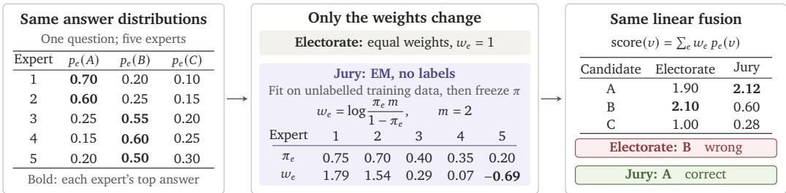
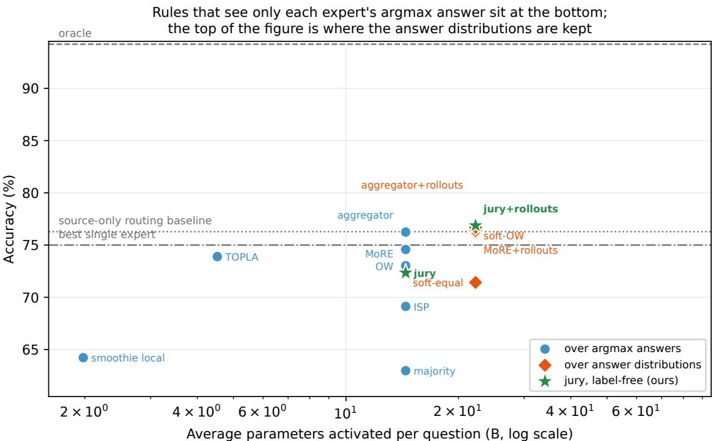
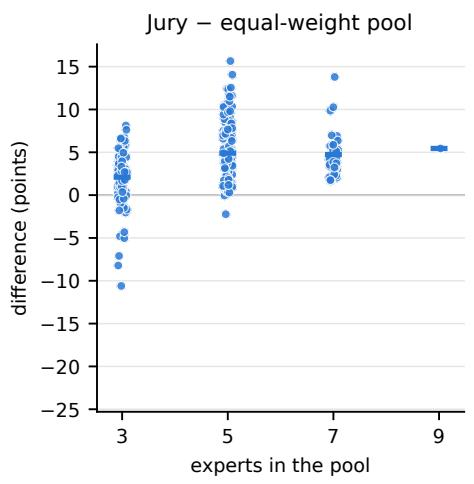
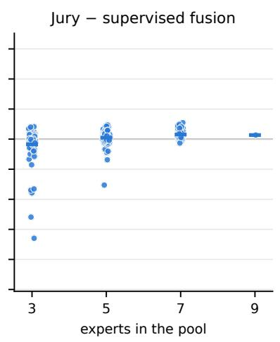
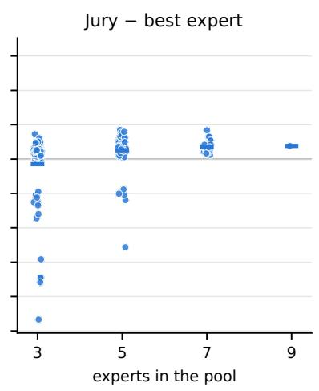
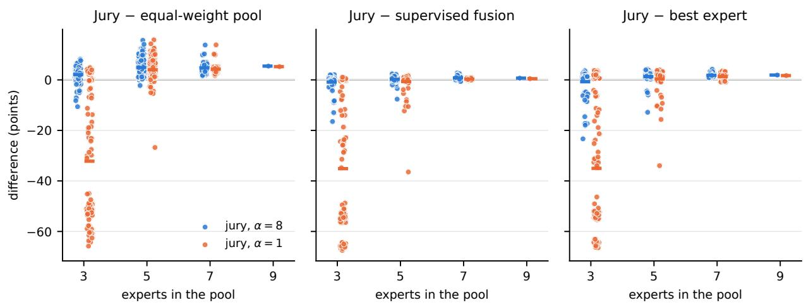

# A Jury, Not an Electorate: Label-Free Reliability Estimation for Ensembles of Language Models

Alessandro Rozza1, Davide Mambelli1, Steven Motta1, Juri Taresch1

distributed cognition

An ensemble of language models is a jury, not an electorate. The answers are testimony from witnesses of unknown reliability, and the question is not what the majority said but who is credible. Most ensemble methods assign each expert a fixed reputation, often learned from labels. We ask whether it can instead be inferred from the pattern of agreement and disagreement among the experts. We model the experts as a jury: each question has a latent true answer, each expert reports it with unknown reliability, and those reliabilities are estimated by Expectation Maximisation (EM) from unlabelled answer configurations alone. We show that its decision rule reduces to a log-odds weighted linear score over the experts’ answer distributions. What changes is not how the jury votes, but how it learns whom to trust. On a 1560-question benchmark, the jury, with nine experts of up to 3B parameters, performs comparably to the same fusion rule with label-fitted weights, showing no statistically significant advantage from supervision. Instead, it outperforms the best single model with matched self-consistency and the strongest label-free alternative on the full benchmark.

## 1. Introduction

A collection of language models can know more than any one of its members. Models trained at diferent scales, on diferent corpora, or for diferent domains fail in diferent places, so the answer that one model misses may already be present elsewhere in the pool. The dificulty is not creating diversity, but deciding how to use it when models disagree.

Most existing approaches treat model aggregation like an electorate with known candidates. Each model arrives with a reputation, learned from labelled data or inferred from the query, and the final answer is chosen by applying those reputations to the models’ votes. In that view, credibility is decided before the answers are heard.

We take a diferent perspective: once all experts have answered, the question is no longer how much we already trust each model, but what their testimony tells us about them. The evidence is the configuration of answers: which answers appear, how strongly they are supported, and which experts agree. A jury can judge who to trust from the testimony itself.

A pool can improve on a plain vote in two separate ways. The first comes from keeping the answer distributions: reducing each expert to its argmax discards the rest of its distribution. The second comes from weighting the experts: even when the distributions are kept, the experts still need to be weighted appropriately. The two are often mixed together, but they are conceptually diferent. On our benchmark, keeping the answer distributions improves majority voting by 8.4 points, and weighting the experts adds a further 5.5 points. A samplematched control shows that the first gain comes from the distribution itself rather than from additional test-time sampling.

Our contribution concerns the second gain: learning whom to trust without labels. We separate the efect of retaining the answer distributions from the efects of expert weighting and additional sampling. We use a simple generative model, inspired by Dawid and Skene [8], where each question has a latent true answer and each expert has an unknown reliability. Those reliabilities are estimated by EM from unlabelled answer configurations alone. The model never sees a gold answer. It sees the same training questions as the supervised baselines, but only the experts’ testimony.

Mathematically, the resulting decision rule is not a new family of ensemble methods. With one answer per expert, it reduces exactly to the classical log-odds weighted vote. With answer distributions, it becomes a weighted linear score over those distributions, equivalent to a linear opinion pool when the weights are non-negative and a signed linear fusion otherwise. Neither the vote nor the estimator is new in form: the first is a standard opinion pool, the second is an EM for a classical crowdsourcing model. What this work adds is the adaptation of that model to language-model outputs, and a direct test of whether reliabilities inferred from agreement can replace reliabilities measured on labels.

This allows a direct comparison with the same fusion rule whose weights are fitted from labelled questions, which we call the supervised linear fusion. On a 1560-question benchmark spanning six MMLU subjects, GSM8K, ARC-Challenge, and HellaSwag, nine experts of up to 3B parameters combined by the jury reach $7 6 . 9 \pm 1 . 3 \%$ . This is 2.0 points above the pool’s best single expert, with a 95% confidence interval of [+0.5, +3.6], 1.6 points above that expert when it is given the same eight-sample self-consistency on GSM8K $( [ + 0 . 0 , + 3 . 1 ] )$ and substantially above the best label-free alternative on the full benchmark. The jury also performs comparably to the supervised linear fusion.

Our contributions are fourfold. (1) We separate two gains that are often mixed together. The first is the use of answer distributions instead of argmax answers, which applies to any method. The second is how the experts are weighted. (2) We adapt the one-coin Dawid–Skene model to ensembles of language models with observed candidate sets and sampled answer distributions, and use it to obtain expert weights for linear fusion without labels. (3) We characterise the resulting rule exactly: on single answers it is the log-odds weighted vote, and on answer distributions a signed linear fusion. This makes the same rule with label-derived reliabilities the natural supervised reference. We also give a closed-form, moment-based identifiability result for the one-coin model with $K \ge 3$ that does not require any expert to be better than chance. (4) We extensively evaluate the method by ablating its assumptions and comparing it against ten post-hoc combiners under a common full-benchmark protocol, spanning both supervised and label-free methods, including SkillAggregation, with a +2.7 pp margin over its strongest tested variant.

## 2. Related work

We follow the taxonomy of Chen et al. [4], which divides LLM ensembling into what happens before, during and after inference.

Before inference: routing. A router maps the query to one model, trained on correctness labels [12, 13], on reward-model scores [30], or on human preferences [36]; others cast the choice as a bandit [34, 44] or select a subset by mutual information under a budget [48]. Simple embedding-based routers can also be competitive [28, 54]. This family is complementary to ours: it decides whom to ask, while we decide whom to believe once everyone has answered.

During inference: token, span and process fusion. These methods combine models during generation through vocabulary alignment [23, 52], perplexity-based weighting [32], span-level cross-scoring [29], speculative decoding [14], or process-reward search over partial reasoning chains [37]. They rely on logits or partial generations, while our method only uses final answers.

After inference: the family this paper belongs to. Aggregating completed answers splits into two groups. Weighting the experts covers plain majority voting over sampled outputs [27], unsupervised per-sample quality estimation [17], diversity-driven subset selection with a learned combiner [47], and the correlation-aware Optimal Weight and Inverse Surprising Popularity (ISP) rules of Ai et al. [1]. Answer-scoring methods form the smaller group: Jiang et al. [26] rank candidates with a pairwise cross-encoder over their text and then generate a fused answer, Si et al. [43] select among candidates with a supervised model over inter-expert agreement and confidence, and LENS [18] learns per-model confidence from hidden states.

Our method is a weighted linear fusion of the experts’ answer distributions, with the reliability vector as its only learned content (Section 3). We estimate those reliabilities directly from the experts’ unlabelled answer configurations. Other label-free methods that weight the experts estimate a model’s quality: Smoothie [17] from pairwise distances between outputs, and ISP [1] from second-order agreement statistics that detect answers more popular than predicted. Ai et al. [1] also propose OW-L and OW-I, which estimate each model’s accuracy without labels, from the pairwise agreement table or from ISP’s verdicts used as pseudo-labels, and then apply Optimal Weight; these are the closest published counterparts of our estimator.

A close reference-free setting is SkillAggregation [46], which learns to combine multiple LLM judgments without ground-truth labels and accepts both binary and probabilistic estimates. It extends Crowdlayer [41] with a learned context encoder and per-judge skill estimates, including context-dependent skills. Our method fits a restricted generative model to unlabelled answer configurations, yielding log-odds weights for a fixed linear fusion rule.

Opinion pooling. Combining probability distributions is a classical problem in statistics. With non-negative weights, our rule is Stone’s linear pool [45]; negative log-odds weights instead yield a signed linear fusion. The main alternative is the logarithmic pool, a weighted geometric mean related to the product of experts [20]; the principles distinguishing the two are reviewed by Genest and Zidek [15]. DeGroot’s consensus model instead iteratively averages expert opinions [9].

In this literature, weights are obtained from experts or fitted on questions with known answers, and equal weighting is often competitive [6]. In our work, the generative model of Section 3 determines the linear-fusion weights, and EM estimates them from agreement alone.

Cascades. Cascades escalate through models until an answer is accepted [3], using stopping rules [10], learned policies [21], or self-consistency [2]. They address the accuracy-cost trade-of rather than post-hoc aggregation.

Classical roots. Recovering a latent truth and the annotators’ reliabilities jointly, from agreement and without labels, is Dawid and Skene [8]; weighting voters by the log-odds of their accuracy is optimal for conditionally independent voters [35], with the �-ary form we use given in Ai et al. [1]; conditioning a combination on the input is the mixture-of-experts gate [25, 42]; and Prelec et al. [38] propose the approach for detecting answers that are more popular than predicted.

## 3. Method

Section 3.1 shows which answers a weighted vote over the experts’ argmax answers can reach, and identifies two separable sources of improvement. Section 3.2 introduces the generative model and derives the EM updates that estimate each expert’s reliability without labels. Section 3.3 characterises the resulting decision rule, and Section 3.4 outlines the modelling choices.

## 3.1. What a weighted vote over argmax answers can and cannot do

Fix a question $q$ and let E be the finite set of experts in the pool. Each expert $e \in { \mathcal { E } }$ returns an answer $a _ { e }$ from a task-dependent answer space $\mathcal { A } ;$ only the finite set of distinct answers actually produced, the candidate set $\mathcal { V } ( q ) = \{ a _ { e } : e \in \mathcal { E } \} \subseteq \mathcal { A }$ , enters the model. A weighted vote with weights $\boldsymbol { w } \in \mathbb { R } ^ { | \mathcal { E } | }$ returns

$$
\hat { y } ( w ) ~ = ~ \underset { \nu \in \mathcal { V } ( q ) } { \arg \operatorname* { m a x } } ~ \sum _ { e : a _ { e } = \nu } w _ { e } .\tag{1}
$$

We let � range over $\mathbb { R } ^ { | \mathcal { E } | }$ rather than over the simplex because the model-derived weights can be negative for suficiently weak experts, and the vote and the model should speak about the same object.

A weighted vote over argmax answers can only return an answer in $\mathcal { V } ( q )$ . Conversely, any $\nu \in \mathcal { V } ( q )$ can be made the winner by assigning all weight to an expert that proposed it. Changing the weights can therefore change which observed answer wins, but cannot enlarge the set of possible winners. Two separable gains lead beyond such a rule: keeping the answer distributions, which can enlarge the reachable set, and weighting the experts better.

## 3.2. A working generative model of the answer configuration

Rather than score a candidate from features of its supporters, we model how the answers arose. For a question with candidate set $\mathcal { V } ,$ let $z \in \mathcal { V }$ be the latent true answer. Each

expert � reports it with reliability $\pi _ { e ; }$ , and otherwise reports one of the remaining candidates uniformly:

$$
P ( a _ { e } = \nu \mid z ) ~ = ~ \left\{ \frac { \pi _ { e } , } { m } , \nu = z , \right.\tag{2}
$$

with $m = | \mathcal { V } | - 1$ . When $m = 0$ the pool is unanimous, $_ \textmd { ‰}$ is a singleton, (2) is vacuous and the verdict is that answer; such questions are also excluded from the estimation below, since they constrain no parameter.

What $\boldsymbol { \mathbf { \mathit { \Phi } } } _ { \mathbf { \mathit { \phi } } } ^ { \mathrm { ~ \tiny ~ { ~ \mathrm { ~  ~ } ~ } ~ } }$ is, and what the model is defined on. $\mathcal { V } ( q )$ is not a fixed label space. It is the set of distinct answers produced by the pool on $q \colon$ in the greedy regime the distinct argmax answers, and with repeated samples the union of all answers produced by the experts, over which $p _ { e }$ is the expert’s empirical frequency. If repeated samples are unavailable, $p _ { e }$ reduces to a point mass at the greedy answer; a non-answer is omitted from the likelihood. During fitting and prediction the set is treated as a fixed support, and (2) is a simplified emission model defined on that support: it does not model how the support itself was generated. This matters for what the model can claim. Conditioning on the observed support would itself induce dependence between the experts (if two experts can say � or � and the observed set is $\{ A , B \}$ , they are known to disagree), so the conditional independence used below is an assumption of the simplified model, not a consequence of the construction. The error channel is uniform over the alternatives in the support rather than over the task’s full answer space, and a candidate outside $\mathcal { V } ( q )$ has probability zero. The reliabilities $\pi _ { e }$ are therefore reliabilities according to this model, and need not equal the experts’ true probabilities of being correct. Appendix D reports a control in which the support of every multiple-choice question is fixed to its four options instead of being read of the answers.

The model assumes that, given ${ \boldsymbol { \mathscr { z } } } ,$ the experts are conditionally independent, so with a uniform prior over $\boldsymbol { \mathbf { \mathit { \Phi } } } _ { \mathcal { \mathbf { V } } }$ the verdict is

$$
\hat { y } ~ = ~ \underset { \nu \in \mathcal { V } } { \arg \operatorname* { m a x } } ~ \sum _ { e \in \mathcal { E } } \log P ( a _ { e } \mid z = \nu ) .\tag{3}
$$

This is a restricted form of Dawid and Skene [8]: one reliability per expert rather than a full confusion matrix, and a uniform error distribution over the remaining candidates. We use one reliability per expert, avoiding the $O ( | \varepsilon | | \mathcal { V } | ^ { 2 } )$ parameters of a full confusion-matrix model.

Estimating $\pi$ without labels. The reliabilities are estimated by EM. For a distribution $p _ { e , q }$ over $\mathcal { V } ( q )$ under the likelihood of Proposition 3, the M-step is

$$
\pi _ { e } = \frac { 1 } { | Q _ { e } | } \sum _ { q \in Q _ { e } } \sum _ { \nu \in \mathcal { V } ( q ) } \gamma _ { q } ( \nu ) p _ { e , q } ( \nu ) ,\tag{4}
$$

where $\gamma _ { q } ( \nu )$ is the posterior of the E-step and $Q _ { e }$ are the questions � answered. An expert’s reliability is the posterior-weighted mass it placed on each candidate, averaged over questions. For point-mass evidence $p _ { e , q } = \delta _ { a _ { e } }$ , this reduces to $\begin{array} { r } { \pi _ { e } = | Q _ { e } | ^ { - 1 } \sum _ { q \in Q _ { e } } \gamma _ { q } ( a _ { e } ) } \end{array}$

Writing $A _ { e }$ for the double sum in (4), the expected complete-data log-likelihood of expert � is $A _ { e }$ log $\pi _ { e } + \left( \left| Q _ { e } \right| - A _ { e } \right) \log ( 1 - \pi _ { e } )$ ; maximising gives $\pi _ { e } = A _ { e } / | Q _ { e } |$

Identifiability and optimisation. The EM updates explain how to estimate the reliabilities without labels. A separate question is whether the distribution of unlabelled responses determines them uniquely. Under task-specified support, as in Appendix D, the model yields the following label-free identifiability guarantee.

Proposition 1 (Label-free identifiability). Fix a support size $K \ge 3$ that occurs with positive $p r o b a b i l i t y ,$ and condition on questions with $| V ( q ) | = K .$ . Let $p _ { e }$ be the empirical distribution $o f$ expert $e { \bar { s } }$ answers sampled according to (2) on that support. Assume $( p _ { e } ) _ { e \in \mathcal { E } }$ are jointly observed and conditionally independent given $( z , q )$ , with question-independent reliabilities. If at least three experts satisfy $\pi _ { e } \neq 1 / K ,$ , then the reliability vector � is identifiable from the joint distribution of the $( p _ { e } ) _ { e \in \mathcal { E } }$ alone.

The proof in Appendix E reconstructs each reliability from second and third order agreement moments. This guarantee holds even when every expert’s probability of answering correctly is below $1 / K _ { ; }$ , the probability of uniform random guessing. Even when the reliabilities are identifiable, EM may converge to a local rather than a global maximum of the non-concave likelihood.

We initialise $\pi _ { e } = 0 . 6$ for every expert, giving all experts the same positive initial weight. We run a single EM fit with no restarts, stop when no parameter moves by more than $1 0 ^ { - 7 }$ or after 200 iterations, and clip $\pi _ { e }$ to [0.02, 0.98] to keep the log-odds finite. A 25-start sensitivity analysis confirms that the reported distributional fit is insensitive to this choice, as the highest-likelihood distributional solution found on every split is the one reached by the default start. The single-answer regime has an additional higher-likelihood degenerate mode (Appendix B.6). We fit � on unlabelled training configurations and freeze it before evaluation; no gold label is used during fitting.

## 3.3. What the rule actually is

Propositions 2 and 3 characterise how (3) reduces in the two evidence regimes.

Proposition 2 (Single answers: the log-odds weighted vote). With one answer per expert and $m \geq 1$

$$
\begin{array} { r } { \displaystyle \sum _ { e } \log P ( a _ { e } \mid z = \nu ) \ = \ C + \displaystyle \sum _ { e : a _ { e } = \nu } w _ { e } , } \\ { \displaystyle w _ { e } \ = \ \log \frac { \pi _ { e } m } { 1 - \pi _ { e } } , } \end{array}
$$

with $C = \textstyle \sum _ { \mathbf { \vec { \mathbf { \phi } } } }$ � log $\frac { 1 - \pi _ { e } } { m }$ independent of �. Hence (3) coincides with the weighted vote (1).

Proof. Substitute (2) and add and subtract $\textstyle \sum _ { e }$ log $\frac { 1 - \pi _ { e } } { m }$ .

Proposition 2 says that, with single answers, the jury is the Nitzan-Paroush log-odds rule [35] in the �-ary form of Ai et al. [1], with � estimated unsupervised instead of read of labels.

Proposition 3 (Distributions: a signed linear fusion). Let each expert supply a distribution $p _ { e }$ over V and let its contribution to the log-likelihood be � $\begin{array} { r } { \sum _ { u \in \mathcal { V } } p _ { e } ( u ) } \end{array}$ log $P ( a _ { e } = u \mid z = \nu )$ , with $\alpha > 0$ the evidence weight of Section 3.4. Then

$$
\begin{array} { r l r } {  { \hat { y } \ = \ \underset { \nu \in \mathcal { V } } { \arg \operatorname* { m a x } } \ \sum _ { e } w _ { e } p _ { e } ( \nu ) , } } \\ & { } & { w _ { e } \ = \ \log \frac { \pi _ { e } m } { 1 - \pi _ { e } } . } \end{array}
$$

Proof. $\textstyle \sum _ { u } p _ { e } ( u )$ log $P ( a _ { e } = u \mid z = \nu ) = p _ { e } ( \nu )$ log $\pi _ { e } + ( 1 - p _ { e } ( \nu ) )$ log $\begin{array} { r } { \frac { 1 - \pi _ { e } } { m } = C _ { e } + p _ { e } ( \nu ) w _ { e } } \end{array}$ with $C _ { e }$ independent of $\nu ;$ sum over $e ,$ drop the constant, and drop the common factor �, which leaves the argmax unchanged. □

Remark 1. Proposition 3 keeps the rule within weighted linear fusion. It remains an inner product between a weight vector and per-candidate evidence. Unlike voting over argmax answers, however, a candidate can win without being any expert’s top choice, so the reachable set can be strictly larger. Together the two propositions show that the method’s learned content is the reliability vector �, which determines the expert-specific component $o f w ,$ making the same fusion rule with label-fitted weights the natural supervised baseline.

Remark 2. The weights are not entirelyfixed in advance. Since $m = | \mathcal { V } | - 1$ depends on the answers observed, $\begin{array} { r } { w _ { e } = \log \frac { \pi _ { e } } { 1 - \pi _ { e } } + \log m } \end{array}$ carries a question-level ofset shared by every expert, contributing log � $\textstyle \sum _ { e } p _ { e } ( \nu )$ to the score — a multiple of the equal-weight pool. Only the perexpert part is fixed before the answers are seen. Note also that $w _ { e } < 0$ whenever $\pi _ { e } < 1 / | \mathcal { V } | _ { : }$ in which case the expert is voted against rather than merely ignored. The fusion score ranks candidates but need not be a probability, the posterior $\gamma _ { q }$ of (3) remains a probability distribution either way.

Figure 1 puts these pieces together on a toy example: the emission model, the label-free fit of �, the log-odds weights and the signed linear fusion.

## 3.4. Modelling choices

Evidence weight. Let $p _ { e , q }$ be the empirical distribution obtained from � samples of expert �. We weight its log-likelihood contribution by �. Setting � = � recovers the multinomial log-likelihood, up to a term independent of the latent answer and the reliabilities. We therefore use $\alpha = n$ as the default: $\alpha = 8$ for the sampled distributions, since the cache holds eight samples per expert and question (Section 4.1), and � = 1 for a single greedy answer. As an ablation, we also consider $\alpha = 1$ for a sampled distribution, which treats the whole distribution as one unit of evidence (see Appendix C). At fixed �, � does not change the argmax in Proposition 3, because it multiplies every candidate score by the same positive constant. It does, however, change the E-step distribution �, and therefore the fitted reliabilities.

  
Figure 1 | Toy example with five experts and three candidates. The gold answer is A, but three experts favour B. Both rules use the same answer distributions; only the weights difer. The equal-weight pool selects B, while the jury estimates � from unlabelled training configurations using (4) under (2), freezes it before test time, and selects A through the same linear fusion (Proposition 3). The numbers are illustrative.

Equation (2) assumes that experts are conditionally independent given the latent answer. To test sensitivity to shared failure modes, we also consider an extension with a second latent variable per question, a lure: a wrong answer toward which a specified group of experts may be jointly drawn. Each expert has a susceptibility parameter controlling its response to the lure. We consider groups defined by pre-training lineage and a pool-wide group (see Appendix C); the independent model remains the default.

## 4. Results

This section tests the jury empirically. Section 4.1 describes the benchmark and the evaluation setup. Section 4.2 compares the jury with label-free and supervised baselines and the best single expert, separates the gains from answer distributions and expert weighting, and reports robustness and compute. Section 4.3 examines the modelling choices of Section 3.4 and calibration. Further experimental details and analyses are in Appendices A to C.

## 4.1. Setup

Pool. Our pool contains nine instruction-tuned experts of up to 3B parameters, selected to vary in size, domain, and model family. The goal is to include models that fail in diferent ways, giving the combiner useful disagreement to exploit. qwen3b is the strongest expert overall (75.0%) and on multiple choice, while olmo2-1b leads on GSM8K despite being one of the weakest experts overall. The full model list and individual accuracies are given in Appendix A, Table 3.

Data. The benchmark has 1560 questions from four sources: 240 from MMLU [19] (40 from each of six subjects spanning humanities, law and science), 120 GSM8K [7] problems, the only generative slice, 600 ARC-Challenge [5] and 600 HellaSwag [53] questions. Every source is scored 0/1 against a single gold answer (for more details see Appendix A).

Answers and repeated sampling. Multiple choice is scored in one forward pass from the log-probabilities of the four option letters; GSM8K is answered by chain-of-thought generation, from which the final number is extracted (Appendix A). Besides one greedy answer per expert, the cache holds eight samples per expert per question $( T = 0 . 7 , p = 0 . 9 5 )$ i.e. self-consistency sampling [50] applied per expert. These samples give the distribution $p _ { e }$ that Proposition 3 consumes. On multiple choice they are draws from a distribution that the single forward pass has already computed, so they cost nothing extra.

Protocol and statistics. Every method is evaluated over ten stratified 50/50 train/test splits of the same cached answers; methods that need labels see only the training half. The jury is fitted on the unlabelled answer configurations of the same training half; fitting it on all configurations would leak no label, but would not be a matched comparison. We report the mean and standard deviation over splits. The ten test sets overlap heavily, so a paired �-test over splits would overstate the evidence [11, 33]. All comparisons therefore use a paired bootstrap over questions with 20,000 resamples, where a question’s score for a method is its mean correctness over the splits in which it was held out. Compute is the average number of parameters activated per question, which charges a router for the one expert it calls and a fusion rule for all nine.

The supervised linear fusion. The supervised linear fusion uses the fusion rule of Proposition 3 with its reliabilities read of labels. Its reliability for expert � is the accuracy of �’s greedy answer on the training half. The comparison with the jury is between two ways of estimating the reliabilities of one rule, not against every way of fitting weights from labels. The two estimators also difer in three implementation conventions (see Appendix A.1).

## 4.2. The comparison

Table 1 is the main comparison: ten post-hoc combiners re-implemented on this cache and run on the same ten splits with the same experts.

Two separable gains. Majority voting is the simplest form of model aggregation: every expert casts one equally weighted vote. Over all nine experts it scores $6 3 . 0 \pm 1 . 6 \%$ , twelve points below the best single expert. Replacing the argmax answers with the answer distributions, at equal weights, gives 71.4 ± 1.8%: a +8.4-point gain from keeping the distributions, with no weights and no labels. Weighting the experts by log-odds adds a further +5.5 points, reaching $7 6 . 9 \pm 1 . 3 \%$ . The first gain is available to any method; the second is where the jury operates, since it must learn from the testimony alone which witnesses to trust.

Table 2 shows that the first gain comes from the distribution not the extra samples. Its middle row is a sample-matched control that uses the same eight samples per expert, at the same cost, but reduces them to their mode before the rule sees them.

The two efects are separable but interact: weighting improves every evidence regime, and retaining the full distribution rather than its sample-matched mode improves every weighting scheme, by 2.2 to 8.3 points.

Label-free weights match supervised ones. The supervised linear fusion has the same functional form as the jury, with weights fitted on the labels of the training half. It reaches $7 6 . 2 \pm 1 . 4 \%$ , and the jury is +0.6 points above it ([+0.1, +1.2], $p = 0 . 0 2 )$ . Conditional on the ten fitted models the diference is small but significant in the jury’s favour. Once the variability of refitting is included as well, the nested bootstrap of Appendix B.2 gives a diference of +0.6 points with a 95% interval of $[ - 0 . 6 , + 2 . 0 ]$ : no statistically significant diference, and an interval that admits diferences of either sign, so not a demonstration of equivalence. On this benchmark, against this baseline, we find no evidence that supervised weight estimation outperforms label-free estimation.

<table><tr><td>Method</td><td></td><td>Labels Params (B)</td><td>Accuracy</td><td>Plurality Minority</td><td></td><td>∆ vs. jury [95% CI]</td></tr><tr><td>Best single expert</td><td></td><td>一</td><td> $7 5 . 0 \pm 1 . 0$ </td><td>一</td><td>一</td><td> $+ 2 . 0 ^ { * } \ [ + 0 . 5 , + 3 . 6 ]$ </td></tr><tr><td>+ self-consistency on GSM8K</td><td></td><td>一</td><td> $7 5 . 3 \pm 1 . 1$ </td><td></td><td></td><td> $+ 1 . 6 ^ { * } \ [ + 0 . 0 , + 3 . 1 ]$ </td></tr><tr><td>Majority vote [27]</td><td>no</td><td>14.4</td><td> $6 3 . 0 \pm 1 . 6$ </td><td>100.0</td><td></td><td> $6 . 2 \ + 1 4 . 1 ^ { * } \ [ + 1 2 . 0 , + 1 6 . 3 ]$ </td></tr><tr><td>Inverse Surprising</td><td>no</td><td>14.4</td><td> $6 9 . 1 \pm 1 . 6$ </td><td>98.5</td><td>27.4</td><td>+7.9* [+6.2, +9.6]</td></tr><tr><td>Popularity [1, 38]</td><td></td><td></td><td></td><td></td><td></td><td></td></tr><tr><td>Smoothie-Global [17]</td><td>no</td><td>1.5</td><td> $6 6 . 3 \pm 1 . 3$ </td><td>85.3</td><td>43.1</td><td> $+ 1 0 . 5 ^ { * } \ [ + 8 . 6 , + 1 2 . 4 ]$ </td></tr><tr><td>Smoothie-Local [17]</td><td>no</td><td>2.0</td><td> $6 4 . 2 \pm 1 . 6$ </td><td>83.4</td><td></td><td> $4 0 . 3 \ + 1 2 . 7 ^ { * } \ [ + 1 1 . 1 , + 1 4 . 4 ]$ </td></tr><tr><td>Optimal Weight [1, 35]</td><td>yes</td><td>14.4</td><td> $7 3 . 0 \pm 1 . 4$ </td><td>95.9</td><td>43.9</td><td> $+ 3 . 9 ^ { * } \ [ + 2 . 7 , \ : + 5 . 2 ]$ </td></tr><tr><td>LLM-TOPLA [47]</td><td>yes</td><td>4.5</td><td> $7 3 . 9 \pm 1 . 5$ </td><td>89.3</td><td>58.5</td><td> $+ 2 . 9 ^ { * } \ [ + 1 . 4 , + 4 . 5 ]$ </td></tr><tr><td>MoRE[43] MoRE + repeated</td><td>yes</td><td>14.4 22.2</td><td> $7 4 . 6 \pm 1 . 2$   $7 6 . 4 \pm 1 . 3$ </td><td>93.2</td><td>53.4</td><td> $+ 2 . 4 ^ { * } \ [ + 1 . 4 , + 3 . 6 ]$ </td></tr><tr><td>sampling [43]</td><td>yes</td><td></td><td></td><td>93.3</td><td>58.5</td><td> $+ 0 . 5 \ [ - 0 . 4 , + 1 . 5 ]$ </td></tr><tr><td>Equal-weight pool [45]</td><td>no</td><td>22.2</td><td> $7 1 . 4 \pm 1 . 8$ </td><td>96.8</td><td>37.2</td><td> $+ 5 . 5 ^ { * } \ [ + 4 . 1 , + 7 . 0 ]$ </td></tr><tr><td>Supervised linear fusion [1, 45]</td><td>yes</td><td>22.2</td><td> $7 6 . 2 \pm 1 . 4$ </td><td>95.6</td><td>53.5</td><td> $+ 0 . 6 ^ { * } \ [ + 0 . 1 , + 1 . 2 ]$ </td></tr><tr><td>Answer scoring, discriminative</td><td>yes</td><td>14.4</td><td> $7 6 . 2 \pm 1 . 3$ </td><td>93.1</td><td>58.7</td><td> $+ 0 . 7 \ [ - 0 . 4 , + 1 . 9 ]$ </td></tr><tr><td>+ repeated sampling</td><td>yes</td><td>22.2</td><td> $7 6 . 7 \pm 1 . 1$ </td><td>92.9</td><td>60.3</td><td> $+ 0 . 1 \ [ - 1 . 0 , + 1 . 2 ]$ </td></tr><tr><td>Jury (ours), greedy answers</td><td>no</td><td>14.4</td><td> $7 2 . 3 \pm 1 . 1$ </td><td>94.0</td><td>45.3</td><td> $+ 4 . 6 ^ { * } \ [ + 3 . 3 , + 5 . 9 ]$ </td></tr><tr><td>+ repeated sampling</td><td>no</td><td>22.2</td><td> $7 6 . 9 \pm 1 . 3$ </td><td>95.7</td><td>55.5</td><td></td></tr><tr><td>Oracle</td><td></td><td></td><td> $9 4 . 3 \pm 0 . 5$ </td><td></td><td>一</td><td></td></tr></table>

Table 1 | Methods evaluated on the same pool, cache, and ten splits. With self-consistency on GSM8K, the best single expert predicts by taking the mode of the same eight samples used by the distributional methods. The equal-weight pool and supervised linear fusion use answer distributions; the latter fits log-odds weights from labels (Proposition 3). Plurality denotes questions where the gold answer is the unique plurality winner; Minority denotes those where at least one expert gives the gold answer but it is not the unique plurality winner, including ties. Δ is the paired diference from the jury with repeated sampling, with a 95% bootstrap interval; ∗ marks $p < 0 . 0 5$ . Accuracies are means over the ten splits, whereas Δ averages per question first, so the two can difer by a few tenths. Implementation details in supplementary material.

Further supervised comparisons and per-task results are reported in Appendices A.1, B.2 and B.3.

Label-free comparisons. On the full benchmark, the greedy jury scores 72.3%, versus 69.1% for ISP [1], and with distributions it reaches 76.9%, +5.5 over the equal-weight pool ([+4.1, +7.0]) and +7.9 over ISP ([+6.2, +9.6]). On the 1440 fixed-label questions, SkillAggregation [46] reaches 73.2% with distributions without a labelled development set; even its test-selected upper reference, SkillAggregation-X, reaches 74.0%, 2.7 points below the jury at 76.6%. OW-L and OW-I [1] reach 71.3% and 71.6% on greedy answers, versus 72.4% for the greedy jury, with intervals including zero (Appendix B.4). Most of the gain comes from the minority stratum, where the gold answer is not the unique plurality winner: accuracy rises from 6.2% for majority voting to 55.5% for the jury, while the jury also reaches

<table><tr><td rowspan="2">Evidence the rule is given Params (B)</td><td rowspan="2"></td><td colspan="3">Weights over the experts</td></tr><tr><td></td><td>Equal Log-odds, supervised Log-odds, label-free</td><td></td></tr><tr><td>Greedy answer, 1 per expert</td><td>14.4</td><td> $6 3 . 0 \pm 1 . 6$ </td><td> $7 3 . 0 \pm 1 . 4$ </td><td> $7 2 . 3 \pm 1 . 1$ </td></tr><tr><td>Mode of 8 samples</td><td>22.2</td><td> $6 3 . 1 \pm 1 . 8$ </td><td> $7 3 . 4 \pm 1 . 4$ </td><td> $7 4 . 7 \pm 1 . 4$ </td></tr><tr><td>Full 8-sample distribution</td><td>22.2</td><td> $7 1 . 4 \pm 1 . 8$ </td><td> $7 6 . 2 \pm 1 . 4$ </td><td> $7 6 . 9 \pm 1 . 3$ </td></tr><tr><td>Distribution minus mode</td><td></td><td>+8.3</td><td>+2.8</td><td>+2.2</td></tr><tr><td>Mode minus greedy</td><td></td><td>+0.1</td><td>+0.4</td><td>+2.3</td></tr></table>

Table 2 | What the rule is allowed to see, against how it weights the experts. The middle row is the sample-matched control: it pays for the eight samples in full and then discards everything but their mode. Every entry is the mean over the same ten splits, ± one standard deviation. Diferences are computed before rounding.

95.7% on plurality questions.

Best single expert. qwen3b is the strongest expert overall (75.0%), and the jury reaches 76.9%, +2.0 ([+0.5, +3.6], � = 0.012). Giving every expert the same eight-sample selfconsistency on GSM8K and selecting on the training half again chooses qwen3b on every split, at 75.3%; the jury remains +1.6 ahead $( [ + 0 . 0 , + 3 . 1 ] , p = 0 . 0 4 8 )$ . The gain is concentrated on GSM8K, where qwen3b is weakest and olmo2-1b is the strongest expert; there the jury gains 20 points, while on the sources qwen3b already dominates it essentially matches that expert (Appendix B.1).

Robustness. Nested resampling leaves the main conclusions unchanged: the jury remains above the equal-weight pool (+5.5, [+2.9, +8.3]) and majority vote (+14.1, [+10.5, +17.8]), while its +0.6 margin over the supervised linear fusion is not significant once refitting is resampled as well ([−0.6, +2.0]; Appendix B.2).

Across sub-pools. Across 246 sub-pools, the jury beats the equal-weight pool on 79%, 98% and 100% of the three, five and seven expert pools, and the best expert on 82%, 96% and 100%, respectively; the advantage is therefore not specific to the full nine-expert pool. Appendix B.5 gives the full breakdown and the � = 1 degeneracies.

Cost. Sampled variants activate 22.2B parameters per question versus 14.4B for greedy variants, because only GSM8K re-runs the models; Figure 2 in the appendix plots accuracy against cost.

## 4.3. Model checks and calibration

Appendix C reports the full checks. Experts agree on wrong answers more often than independence predicts, but the correlated-error extension slightly lowers accuracy, and selective override does not help. The posterior is strongly overconfident (mean top-1 confidence

0.991 versus 76.9% accuracy; expected calibration error, computed over ten equal-width confidence bins, is 0.223) and requires recalibration before use as a confidence score.

## 5. Conclusion

We asked whether an ensemble of language models can work like a jury: infer credibility from testimony rather than be told it in advance. Keeping experts’ answer distributions instead of only their argmax improves majority voting by 8.4 points, and weighting experts adds a further 5.5 points. Our contribution is to the second: showing that a simple generative model [8], fitted by EM on unlabelled answers, learns expert weights without reading a gold answer.

The resulting jury reaches 76.9 ± 1.3%, beating the pool’s best greedy expert by 2.0 points, the same expert with eight-sample self-consistency on GSM8K by 1.6 points, and the strongest label-free alternative on the full benchmark by 5.5 points, while performing comparably to the supervised linear fusion, the same rule with weights fitted from labels, with a small edge that is significant conditional on the fitted models but not once the variability of refitting is included. The method therefore provides a label-free estimator of expert weights for linear fusion.

## 6. AI usage

In this work, we used generative AI tools (Codex, Claude) to assist with: (i) checking algebraic steps in the proofs, after the propositions and proof strategies had been developed by the authors; (ii) supporting the implementation of the evaluation code; (iii) editing the manuscript to improve readability; and (iv) identifying relevant literature.

## Limitations

Our evaluation uses a fixed pool of nine models and 1,560 questions, mostly multiple-choice. We test every subset of three, five, and seven experts, providing extensive coverage of combinations within this pool, but not of diferent underlying models. Most of the gain over the best single expert comes from GSM8K. The absence of a significant supervised advantage under the nested bootstrap does not establish equivalence or generalisation beyond the evaluated setting.

The jury requires outputs from every expert and repeated sampling for generative tasks, increasing inference cost. The comparison with the best greedy expert therefore measures the benefit of the complete system, including additional sampling, rather than aggregation alone.

## References

[1] Rui Ai, Yuqi Pan, David Simchi-Levi, Milind Tambe, and Haifeng Xu. Beyond majority voting: LLM aggregation by leveraging higher-order information. In Proceedings of the 43rd International Conference on Machine Learning, volume 306 of Proceedings of

Machine Learning Research, pages 1311–1340. PMLR, 2026. URL https://proceedings.mlr.press/v306/ai26d.html.

[2] Jianhao Chen, Zishuo Xun, Bocheng Zhou, Han Qi, Hangfan Zhang, Qiaosheng Zhang, Yang Chen, Wei Hu, Yuzhong Qu, and Shuyue Hu. Do we truly need so many samples? multi-llm repeated sampling eficiently scales test-time compute. In Proceedings of the AAAI Conference on Artificial Intelligence, volume 40, pages 20083–20091, 2026. doi: 10.1609/aaai.v40i24.39094.

[3] Lingjiao Chen, Matei Zaharia, and James Zou. FrugalGPT: How to use large language models while reducing cost and improving performance. Transactions on Machine Learning Research, 2024. ISSN 2835-8856. URL https://openreview.net/forum?id=cSimKw5p6R. Featured Certification.

[4] Zhijun Chen, Xiaodong Lu, Jingzheng Li, Pengpeng Chen, Zhuoran Li, Kai Sun, Yuankai Luo, Qianren Mao, Ming Li, Likang Xiao, Dingqi Yang, Yikun Ban, and Hailong Sun. Harnessing multiple large language models: A survey on llm ensemble. In Diego Calvanese, editor, Proceedings of the Thirty-Fifth International Joint Conference on Artificial Intelligence, IJCAI-26, pages 7807–7816. International Joint Conferences on Artificial Intelligence Organization, 8 2026. doi: 10.24963/ijcai.2026/867. URL https://doi.org/10.24963/ijcai.2026/867. Survey Track.

[5] Peter Clark, Isaac Cowhey, Oren Etzioni, Tushar Khot, Ashish Sabharwal, Carissa Schoenick, and Oyvind Tafjord. Think you have solved question answering? try arc, the ai2 reasoning challenge, 2018. URL https://arxiv.org/abs/1803.05457.

[6] Robert T. Clemen and Robert L. Winkler. Combining Probability Distributions from Experts in Risk Analysis. Risk Analysis, 19(2):187–203, 1999. doi: 10.1111/j.1539-6924.1999.tb00399.x.

[7] Karl Cobbe, Vineet Kosaraju, Mohammad Bavarian, Mark Chen, Heewoo Jun, Lukasz Kaiser, Matthias Plappert, Jerry Tworek, Jacob Hilton, Reiichiro Nakano, Christopher Hesse, and John Schulman. Training verifiers to solve math word problems, 2021. URL https://arxiv.org/abs/2110.14168.

[8] A. P. Dawid and A. M. Skene. Maximum Likelihood Estimation of Observer Error-Rates Using the EM Algorithm. Journal of the Royal Statistical Society: Series C (Applied Statistics), 28(1):20–28, 1979. doi: 10.2307/2346806.

[9] Morris H. DeGroot. Reaching a Consensus. Journal of the American Statistical Association, 69(345):118–121, 1974. doi: 10.1080/01621459.1974.10480137.

[10] Jasper Dekoninck, Maximilian Baader, and Martin Vechev. A unified approach to routing and cascading for LLMs. In Aarti Singh, Maryam Fazel, Daniel Hsu, Simon Lacoste-Julien, Felix Berkenkamp, Tegan Maharaj, Kiri Wagstaf, and Jerry Zhu, editors, Proceedings of the 42nd International Conference on Machine Learning, volume 267 of Proceedings of Machine Learning Research, pages 12987–13010. PMLR, 13–19 Jul 2025. URL https://proceedings.mlr.press/v267/dekoninck25a.html.

[11] Thomas G. Dietterich. Approximate Statistical Tests for Comparing Supervised Classification Learning Algorithms. Neural Computation, 10(7):1895–1923, 1998. doi: 10.1162/089976698300017197.

[12] Dujian Ding, Ankur Mallick, Chi Wang, Robert Sim, Subhabrata Mukherjee, Victor Rühle, Laks V. S. Lakshmanan, and Ahmed Awadallah. Hybrid llm: Cost-eficient and quality-aware query routing. In B. Kim, Y. Yue, S. Chaudhuri, K. Fragkiadaki, M. Khan,

and Y. Sun, editors, International Conference on Learning Representations, volume 2024, pages 41348–41366, 2024. URL https://proceedings.iclr.cc/paper\_files/paper/2024/ file/b47d93c99fa22ac0b377578af0a1f63a-Paper-Conference.pdf.

[13] Tao Feng, Yanzhen Shen, and Jiaxuan You. Graphrouter: A graph-based router for llm selections. In Y. Yue, A. Garg, N. Peng, F. Sha, and R. Yu, editors, International Conference on Learning Representations, volume 2025, pages 26186–26203, 2025. URL https://proceedings.iclr.cc/paper\_files/paper/2025/file/ 41b6674c28a9b93ec8d22a53ca25bc3b-Paper-Conference.pdf.

[14] Jiale Fu, Yuchu Jiang, Junkai Chen, Jiaming Fan, Xin Geng, and Xu Yang. Fast Large Language Model Collaborative Decoding via Speculation. In Aarti Singh, Maryam Fazel, Daniel Hsu, Simon Lacoste-Julien, Felix Berkenkamp, Tegan Maharaj, Kiri Wagstaf, and Jerry Zhu, editors, Proceedings of the 42nd International Conference on Machine Learning, volume 267 of Proceedings of Machine Learning Research, pages 17764–17782. PMLR, 13–19 Jul 2025. URL https://proceedings.mlr.press/v267/fu25c.html.

[15] Christian Genest and James V. Zidek. Combining Probability Distributions: A Critique and an Annotated Bibliography. Statistical Science, 1(1):114–135, 1986. doi: 10.1214/ss/1177013825.

[16] Granite Team, IBM. Granite-3.3-2b-instruct. Hugging Face model card, 2025. URL https://huggingface.co/ibm-granite/granite-3.3-2b-instruct. Released April 16, 2025.

[17] Neel Guha, Mayee F. Chen, Trevor Chow, Ishan S. Khare, and Christopher Ré. Smoothie: Label free language model routing. In A. Globerson, L. Mackey, D. Belgrave, A. Fan, U. Paquet, J. Tomczak, and C. Zhang, editors, Advances in Neural Information Processing Systems, volume 37, pages 127645–127672. Curran Associates, Inc., 2024. doi: 10.52202/079017-4053. URL https://proceedings.neurips.cc/paper\_files/paper/ 2024/file/e6b57a990462df5afa58d64ce2709db9-Paper-Conference.pdf.

[18] Jizhou Guo. Lens: Learning ensemble confidence from neural states for multi-llm answer integration, 2025. URL https://arxiv.org/abs/2507.23167.

[19] Dan Hendrycks, Collin Burns, Steven Basart, Andy Zou, Mantas Mazeika, Dawn Song, and Jacob Steinhardt. Measuring Massive Multitask Language Understanding. In International Conference on Learning Representations (ICLR), 2021. URL https://openreview.net/forum?id=d7KBjmI3GmQ.

[20] Geofrey E. Hinton. Training Products of Experts by Minimizing Contrastive Divergence. Neural Computation, 14(8):1771–1800, 2002. doi: 10.1162/089976602760128018.

[21] Jinwu Hu, Yufeng Wang, Shuhai Zhang, Kai Zhou, Guohao Chen, Yu Hu, Bin Xiao, and Mingkui Tan. Eficient dynamic ensembling for multiple llm experts. In James Kwok, editor, Proceedings of the Thirty-Fourth International Joint Conference on Artificial Intelligence, IJCAI-25, pages 8095–8103. International Joint Conferences on Artificial Intelligence Organization, 8 2025. doi: 10.24963/ijcai.2025/900. URL https://doi.org/10.24963/ijcai.2025/900. Main Track.

[22] Qitian Jason Hu, Jacob Bieker, Xiuyu Li, Nan Jiang, Benjamin Keigwin, Gaurav Ranganath, Kurt Keutzer, and Shriyash Kaustubh Upadhyay. Routerbench: A benchmark for multi-llm routing system, 2024. URL https://arxiv.org/abs/2403.12031.

[23] Yichong Huang, Xiaocheng Feng, Baohang Li, Yang Xiang, Hui Wang, Ting Liu, and Bing Qin. Ensemble learning for heterogeneous large language models with deep parallel collaboration. In A. Globerson, L. Mackey, D. Belgrave, A. Fan, U. Paquet, J. Tomczak, and C. Zhang, editors, Advances in Neural Information Processing Systems, volume 37, pages 119838–119860. Curran Associates, Inc., 2024. doi: 10.52202/079017-3808. URL https://proceedings.neurips.cc/paper\_files/paper/ 2024/file/d8a6eb79f8ccaacbe7198a5caf3a0323-Paper-Conference.pdf.

[24] Binyuan Hui, Jian Yang, Zeyu Cui, Jiaxi Yang, Dayiheng Liu, Lei Zhang, Tianyu Liu, Jiajun Zhang, Bowen Yu, Keming Lu, Kai Dang, Yang Fan, Yichang Zhang, An Yang, Rui Men, Fei Huang, Bo Zheng, Yibo Miao, Shanghaoran Quan, Yunlong Feng, Xingzhang Ren, Xuancheng Ren, Jingren Zhou, and Junyang Lin. Qwen2.5-coder technical report, 2024. URL https://arxiv.org/abs/2409.12186.

[25] Robert A. Jacobs, Michael I. Jordan, Steven J. Nowlan, and Geofrey E. Hinton. Adaptive Mixtures of Local Experts. Neural Computation, 3(1):79–87, 1991. doi: 10.1162/neco.1991.3.1.79.

[26] Dongfu Jiang, Xiang Ren, and Bill Yuchen Lin. LLM-blender: Ensembling large language models with pairwise ranking and generative fusion. In Anna Rogers, Jordan Boyd-Graber, and Naoaki Okazaki, editors, Proceedings of the 61st Annual Meeting of the Association for Computational Linguistics (Volume 1: Long Papers), pages 14165–14178, Toronto, Canada, July 2023. Association for Computational Linguistics. doi: 10.18653/v1/2023.acl-long.792. URL https://aclanthology.org/2023.acl-long.792/.

[27] Junyou Li, Qin Zhang, Yangbin Yu, Qiang Fu, and Deheng Ye. More agents is all you need. Transactions on Machine Learning Research, 2024. ISSN 2835-8856. URL https://openreview.net/forum?id=bgzUSZ8aeg.

[28] Yang Li. Rethinking Predictive Modeling for LLM Routing: When Simple kNN Beats Complex Learned Routers, 2025. URL https://doi.org/10.48550/arXiv.2505.12601. arXiv:2505.12601.

[29] Cong Liu, Xiaojun Quan, Yan Pan, Weigang Wu, Xu Chen, and Liang Lin. Cool-fusion: Fuse large language models without training. In Wanxiang Che, Joyce Nabende, Ekaterina Shutova, and Mohammad Taher Pilehvar, editors, Proceedings of the 63rd Annual Meeting of the Association for Computational Linguistics (Volume 1: Long Papers), pages 10617–10627, Vienna, Austria, July 2025. Association for Computational Linguistics. doi: 10.18653/v1/2025.acl-long.521. URL https://aclanthology.org/2025.acl-long.521/.

[30] Keming Lu, Hongyi Yuan, Runji Lin, Junyang Lin, Zheng Yuan, Chang Zhou, and Jingren Zhou. Routing to the expert: Eficient reward-guided ensemble of large language models. In Kevin Duh, Helena Gomez, and Steven Bethard, editors, Proceedings of the 2024 Conference of the North American Chapter of the Association for Computational Linguistics: Human Language Technologies (Volume 1: Long Papers), pages 1964–1974, Mexico City, Mexico, June 2024. Association for Computational Linguistics. doi: 10.18653/v1/2024.naacl-long.109. URL https://aclanthology.org/2024.naacl-long.109/.

[31] Pedro Henrique Martins, Patrick Fernandes, João Alves, Nuno M. Guerreiro, Ricardo Rei, Duarte M. Alves, José Pombal, Amin Farajian, Manuel Faysse, Mateusz Klimaszewski, Pierre Colombo, Barry Haddow, José G.C. de Souza, Alexandra Birch,

and André F.T. Martins. Eurollm: Multilingual language models for europe. Procedia Computer Science, 255:53–62, 2025. ISSN 1877-0509. doi: https://doi.org/10.1016/j.procs.2025.02.260. URL https://www.sciencedirect.com/science/article/pii/S1877050925006210. Proceedings of the Second EuroHPC user day.

[32] Costas Mavromatis, Petros Karypis, and George Karypis. Pack of LLMs: Model fusion at test-time via perplexity optimization. In First Conference on Language Modeling, 2024. URL https://openreview.net/forum?id=5Nsl0nlStc.

[33] Claude Nadeau and Yoshua Bengio. Inference for the Generalization Error. Machine Learning, 52:239–281, 2003. doi: https://doi.org/10.1023/A:1024068626366.

[34] Quang H. Nguyen, Thinh Dao, Duy C. Hoang, Juliette Decugis, Saurav Manchanda, Nitesh V. Chawla, and Khoa D. Doan. Metallm: A high-performant and cost-eficient dynamic framework for wrapping llms, 2025. URL https://arxiv.org/abs/2407.10834.

[35] Shmuel Nitzan and Jacob Paroush. Optimal Decision Rules in Uncertain Dichotomous Choice Situations. International Economic Review, 23(2):289–297, 1982. doi: 10.2307/2526438.

[36] Isaac Ong, Amjad Almahairi, Vincent Wu, Wei-Lin Chiang, Tianhao Wu, Joseph E. Gonzalez, M. Waleed Kadous, and Ion Stoica. Routellm: Learning to route llms with preference data. In Y. Yue, A. Garg, N. Peng, F. Sha, and R. Yu, editors, International Conference on Learning Representations, volume 2025, pages 34433–34448, 2025. URL https://proceedings.iclr.cc/paper\_files/paper/2025/file/ 5503a7c69d48a2f86fc00b3dc09de686-Paper-Conference.pdf.

[37] Sungjin Park, Xiao Liu, Yeyun Gong, and Edward Choi. Ensembling large language models with process reward-guided tree search for better complex reasoning. In Luis Chiruzzo, Alan Ritter, and Lu Wang, editors, Proceedings of the 2025 Conference of the Nations of the Americas Chapter of the Association for Computational Linguistics: Human Language Technologies (Volume 1: Long Papers), pages 10256–10277, Albuquerque, New Mexico, April 2025. Association for Computational Linguistics. doi: 10.18653/v1/2025.naacl-long.515. URL https://aclanthology.org/2025.naacl-long.515/.

[38] Dražen Prelec, H. Sebastian Seung, and John McCoy. A Solution to the Single-Question Crowd Wisdom Problem. Nature, 541(7638):532–535, 2017. doi: 10.1038/nature21054.

[39] Qwen Team. Qwen2.5 Technical Report, 2025. URL https://arxiv.org/abs/2412.15115.

[40] Qwen Team. Qwen3 Technical Report, 2025. URL https://arxiv.org/abs/2505.09388.

[41] Filipe Rodrigues and Francisco C. Pereira. Deep Learning from Crowds. In Proceedings of the AAAI Conference on Artificial Intelligence, volume 32, pages 1611–1618, 2018. doi: https://doi.org/10.1609/aaai.v32i1.11506.

[42] Noam Shazeer, Azalia Mirhoseini, Krzysztof Maziarz, Andy Davis, Quoc Le, Geofrey Hinton, and Jef Dean. Outrageously large neural networks: The sparsely-gated mixture-of-experts layer. In International Conference on Learning Representations (ICLR), 2017. URL https://openreview.net/forum?id=B1ckMDqlg.

[43] Chenglei Si, Weijia Shi, Chen Zhao, Luke Zettlemoyer, and Jordan Boyd-Graber. Getting MoRE out of mixture of language model reasoning experts. In Houda Bouamor,

Juan Pino, and Kalika Bali, editors, Findings of the Association for Computational Linguistics: EMNLP 2023, pages 8234–8249, Singapore, December 2023. Association for Computational Linguistics. doi: 10.18653/v1/2023.findings-emnlp.552. URL https://aclanthology.org/2023.findings-emnlp.552/.

[44] Dimitrios Sikeridis, Dennis Ramdass, and Pranay Pareek. Pickllm: Context-aware rl-assisted large language model routing. In Qingyun Wang, Wenpeng Yin, Abhishek Aich, Yumin Suh, and Kuan-Chuan Peng, editors, AI for Research and Scalable, Eficient Systems, pages 227–239. Springer Nature Singapore, 2025. doi: 10.1007/978-981-96-8912-5\_11.

[45] Mervyn Stone. The Opinion Pool. The Annals of Mathematical Statistics, 32(4): 1339–1342, 1961. doi: 10.1214/aoms/1177704873.

[46] Guangzhi Sun, Anmol Kagrecha, Potsawee Manakul, Phil Woodland, and Mark Gales. SkillAggregation: Reference-free LLM-dependent aggregation. In Wanxiang Che, Joyce Nabende, Ekaterina Shutova, and Mohammad Taher Pilehvar, editors, Proceedings of the 63rd Annual Meeting of the Association for Computational Linguistics (Volume 1: Long Papers), pages 15532–15548, Vienna, Austria, July 2025. Association for Computational Linguistics. doi: 10.18653/v1/2025.acl-long.756. URL https://aclanthology.org/2025.acl-long.756/.

[47] Selim Furkan Tekin, Fatih Ilhan, Tiansheng Huang, Sihao Hu, and Ling Liu. LLM-TOPLA: Eficient LLM ensemble by maximising diversity. In Yaser Al-Onaizan, Mohit Bansal, and Yun-Nung Chen, editors, Findings of the Association for Computational Linguistics: EMNLP 2024, pages 11951–11966, Miami, Florida, USA, November 2024. Association for Computational Linguistics. doi: 10.18653/v1/2024.findings-emnlp.698. URL https://aclanthology.org/2024.findings-emnlp.698/.

[48] Yigit Turkmen, Baturalp Buyukates, and Melih Bastopcu. Don’t Always Pick the Highest-Performing Model: An Information Theoretic View of LLM Ensemble Selection, 2026. URL https://doi.org/10.48550/arXiv.2602.08003. arXiv:2602.08003.

[49] Evan Pete Walsh, Luca Soldaini, Dirk Groeneveld, Kyle Lo, Shane Arora, Akshita Bhagia, Yuling Gu, Shengyi Huang, Matt Jordan, Nathan Lambert, Dustin Schwenk, Oyvind Tafjord, Taira Anderson, David Atkinson, Faeze Brahman, Christopher Clark, Pradeep Dasigi, Nouha Dziri, Allyson Ettinger, Michal Guerquin, David Heineman, Hamish Ivison, Pang Wei Koh, Jiacheng Liu, Saumya Malik, William Merrill, Lester James Validad Miranda, Jacob Morrison, Tyler Murray, Crystal Nam, Jake Poznanski, Valentina Pyatkin, Aman Rangapur, Michael Schmitz, Sam Skjonsberg, David Wadden, Christopher Wilhelm, Michael Wilson, Luke Zettlemoyer, Ali Farhadi, Noah A. Smith, and Hannaneh Hajishirzi. 2 OLMo 2 furious (COLM’s version). In Second Conference on Language Modeling, 2025. URL https://openreview.net/forum?id=2ezugTT9kU.

[50] Xuezhi Wang, Jason Wei, Dale Schuurmans, Quoc Le, Ed Chi, Sharan Narang, Aakanksha Chowdhery, and Denny Zhou. Self-Consistency Improves Chain of Thought Reasoning in Language Models. In International Conference on Learning Representations (ICLR), 2023. URL https://openreview.net/forum?id=1PL1NIMMrw.

[51] An Yang, Beichen Zhang, Binyuan Hui, Bofei Gao, Bowen Yu, Chengpeng Li, Dayiheng Liu, Jianhong Tu, Jingren Zhou, Junyang Lin, Keming Lu, Mingfeng Xue, Runji Lin, Tianyu Liu, Xingzhang Ren, and Zhenru Zhang. Qwen2.5-math technical report:

Toward mathematical expert model via self-improvement, 2024. URL https://arxiv.org/abs/2409.12122.

[52] Yao-Ching Yu, Chun-Chih Kuo, Ziqi Ye, Yu-Cheng Chang, and Yueh-Se Li. Breaking the ceiling of the LLM community by treating token generation as a classification for ensembling. In Yaser Al-Onaizan, Mohit Bansal, and Yun-Nung Chen, editors, Findings of the Associationfor Computational Linguistics: EMNLP 2024, pages 1826–1839. Association for Computational Linguistics, November 2024. doi: 10.18653/v1/2024.findings-emnlp.99. URL https://aclanthology.org/2024.findings-emnlp.99/.

[53] Rowan Zellers, Ari Holtzman, Yonatan Bisk, Ali Farhadi, and Yejin Choi. HellaSwag: Can a machine really finish your sentence? In Anna Korhonen, David Traum, and Lluís Màrquez, editors, Proceedings of the 57th Annual Meeting of the Association for Computational Linguistics, pages 4791–4800, Florence, Italy, July 2019. Association for Computational Linguistics. doi: 10.18653/v1/P19-1472. URL https://aclanthology.org/P19-1472/.

[54] Yiqun Zhang, Hao Li, Chenxu Wang, Linyao Chen, Qiaosheng Zhang, Peng Ye, Shi Feng, Xinrun Wang, Jia Xu, Lei Bai, and Shuyue Hu. The Avengers: A Routing Recipe for Collective Intelligence in Language Models. In Proceedings of the AAAI Conference on Artificial Intelligence, pages 34870—-34878, 2026. doi: 10.1609/aaai.v40i41.40790.

## A. Reproducibility and experimental details

Reproducibility. The anonymised supplementary material contains the complete implementation, the cached expert answers, and a Makefile. make rebuilds every table and figure from the cache in about ten minutes on a laptop without rerunning any language model, while make check verifies the regenerated results against the manuscript. The more expensive refitting, sub-pool, and SkillAggregation analyses include their measurements and dedicated rerun scripts; full commands and runtime details are provided in the supplementary material.

Experts. The pool includes: Qwen2.5 at 0.5B/1.5B/3B [39], Qwen3-0.6B [40], Qwen2.5- Math-1.5B [51], Qwen2.5-Coder-1.5B [24], OLMo-2-1B [49], Granite-3.3-2B [16] and EuroLLM-1.7B [31]. Each expert is run under its own chat template. Qwen3 is run with thinking mode disabled, because our single-pass multiple-choice protocol and the 256-token generation budget cannot accommodate it. Table 3 reports each expert’s overall and persource accuracy on all 1560 benchmark questions, together with the source-only routing baseline and the per-question oracle.

Choice of sources. The six MMLU subjects are world religions, professional law, high-school biology, prehistory, marketing and high-school geography, with 40 questions drawn uniformly without replacement from the test split of each. ARC-Challenge and HellaSwag are the multiple-choice sets that RouterBench [22] scores 0/1, and a binary score is what this paper’s framework requires end to end. The emission of (2) states whether an expert produced the true answer, the strata of Appendix A.2 are defined by whether the gold answer is on the table, and every interval is a proportion of questions answered correctly. RouterBench’s other sets are graded (GSM8K on five levels, MT-Bench on ten), and a fractional score identifies no gold answer. ARC and HellaSwag also have the four-option format the prompt and scorer already assume. Items with three or five options are dropped rather than reshaped, since � = |V| − 1 is what the error channel divides by. Sampling uses a fixed seed and the resulting question set is committed with the repository.

Efect of the added sources on the pool. Both added sets favour the largest generalist and penalise the specialists. qwen3b rises from 66.7% on the original 360 questions to 75.0%, while olmo2-1b, the pool’s best expert on GSM8K, falls from 56.1% to 41.0%. The gap between the best and second-best expert widens from 0.6 to 8.4 points, so the pool measured here is a harder case for combination than the original one. The source-only routing baseline (76.3%) lies 1.3 points above the best single expert (75.0%).

Answer protocol. Multiple choice is scored under a prompt that states the question and the four options and asks for the letter alone. The argmax over the A/B/C/D continuation tokens is the answer, and the normalised probability of the chosen letter is the expert’s self-confidence. GSM8K generation is capped at 256 new tokens. The final number is taken from a match of answer is . . . if present, and otherwise it is the last number in the completion. A completion containing no number is recorded as a non-answer and contributes nothing to any combiner.

<table><tr><td>Expert</td><td>Params (B)</td><td>All</td><td>MMLU</td><td>GSM8K</td><td>ARC-C</td><td>HellaSwag</td></tr><tr><td>qwen3b</td><td>3.00</td><td>75.0</td><td>71.2</td><td>57.5</td><td>80.8</td><td>74.2</td></tr><tr><td>granite2b</td><td>2.50</td><td>66.6</td><td>64.6</td><td>69.2</td><td>68.0</td><td>65.5</td></tr><tr><td>qwen1.5b</td><td>1.50</td><td>66.5</td><td>67.1</td><td>40.0</td><td>75.2</td><td>63.0</td></tr><tr><td>qwen-coder1.5b</td><td>1.50</td><td>52.3</td><td>56.2</td><td>26.7</td><td>61.3</td><td>46.8</td></tr><tr><td>qwen3-0.6b</td><td>0.75</td><td>45.4</td><td>45.4</td><td>53.3</td><td>48.5</td><td>40.7</td></tr><tr><td>olmo2-1b</td><td>1.50</td><td>41.0</td><td>47.1</td><td>74.2</td><td>42.0</td><td>31.0</td></tr><tr><td>qwen0.5b</td><td>0.50</td><td>32.4</td><td>37.5</td><td>39.2</td><td>32.8</td><td>28.5</td></tr><tr><td>qwen-math</td><td>1.50</td><td>28.9</td><td>28.7</td><td>52.5</td><td>26.2</td><td>27.0</td></tr><tr><td>eurollm1.7b</td><td>1.70</td><td>24.4</td><td>22.9</td><td>10.8</td><td>25.7</td><td>26.5</td></tr><tr><td>Random expert</td><td>1.61</td><td>48.1</td><td>49.0</td><td>47.0</td><td>51.2</td><td>44.8</td></tr><tr><td>Best expert per source</td><td>一</td><td>76.3</td><td></td><td></td><td></td><td></td></tr><tr><td>Oracle (best per question)</td><td>一</td><td>94.2</td><td>94.2</td><td>89.2</td><td>96.2</td><td>93.3</td></tr></table>

Table 3 | The nine experts alone, over all 1560 questions — which is why the per-source figures here difer by a point or two from Table 5, where every rule including this one is scored on held-out halves averaged over the ten splits. “Best expert per source” is a source-only routing baseline, not a bound on query-conditioned routing; the oracle is what a perfect per-question selector would score.

Numeric answers are compared after stripping separators and rounding at $1 0 ^ { - 4 }$ . On GSM8K the eight samples are eight real generations; on multiple choice they are a quantised copy of the distribution that the single forward pass already produces.

Candidate sets. On multiple choice, $\vert \mathcal V ( q ) \vert$ averages 2.98 with greedy answers and equals 4 after sampling on all but four of the 1440 questions. On GSM8K it averages 4.72 greedily and 17.84 after sampling, with a maximum of 38, counting the greedy and the sampled answers together. Thus the uniform-error channel nearly coincides with the task answer space on sampled multiple-choice questions, whereas on GSM8K it is defined by the pool’s observed behaviour.

## A.1. The supervised linear fusion

“Weights fitted on labels” can mean two things: estimating each expert’s reliability from the labels and converting it into a weight, or learning directly the weights that maximise the combined prediction’s accuracy. The baseline we call the supervised linear fusion is the first. Its reliability for expert � is the accuracy of �’s greedy answer on the training half,

$$
\hat { \pi } _ { e } ^ { \mathrm { s u p } } \ = \ \frac { 1 } { | Q _ { \mathrm { t r } } | } \sum _ { q \in Q _ { \mathrm { t r } } } \mathbf { 1 } \{ a _ { e , q } = y _ { q } \} ,\tag{5}
$$

over every training question, unanimous ones included and a non-answer counted as wrong, clipped to $[ 1 0 ^ { - 3 } , 1 - 1 0 ^ { - 3 } ]$ and turned into the log-odds weight $\begin{array} { r } { w _ { e } = \log \frac { \hat { \pi } _ { e } ^ { \operatorname* { s u p } } m } { 1 - \hat { \pi } _ { e } ^ { \operatorname* { s u p } } } } \end{array}$ of Proposition 3, with $m = | \mathcal { V } ( q ) | { - } 1$ on the same candidate set as the jury and applied to the same distributions $p _ { e , q }$ . It is therefore the fusion rule of Proposition 3 with its reliabilities read of labels, and the comparison with the jury is between two ways of estimating the reliabilities of one rule, not against every way of fitting weights from labels; the discriminative baselines of Table 1 (MoRE, LLM-TOPLA and our own answer scorer) are the supervised references of the second kind. The two estimators also difer in three implementation conventions, which we make explicit for completeness: the jury’s M-step (4) averages the posterior-weighted mass on each candidate over the questions the expert answered, excludes unanimous questions (which constrain nothing under the observed support) and clips to [0.02, 0.98]; the supervised estimate uses the greedy answer’s correctness, every training question and a wider clip. A distributional supervised plug-in based on the mass assigned to the gold answer gives the same qualitative conclusion conditional on the fitted models (Appendix B.2). Optimal Weight is the greedy-answer counterpart with the same reliabilities: on multiple choice it uses the task-defined $K = 4$ , whereas the jury uses $m = | \mathcal { V } ( q ) | - 1$ . The two coincide whenever all four options are present in $\mathcal { V } ( q )$ , but can difer on greedy inputs when the pool proposes only two or three options; see Section 4.2. We therefore also evaluate Optimal Weight refitted under the jury’s convention, which is then the same rule with � read of labels.

  
Figure 2 | Accuracy against average parameters activated per question. The methods that consume answer distributions occupy the top of the figure; among them the jury and the supervised linear fusion are separated by about half a point.

The greedy-answer comparison isolates the same distinction as Proposition 2: both methods belong to the same family of log-odds weighted votes, but estimate the reliabilities diferently. The jury scores $7 2 . 3 \pm 1 . 1 \%$ and Optimal Weight, with its task-defined $K = 4 _ { ; }$ scores $7 3 . 0 \pm 1 . 4 \%$ . Refitted under the jury’s own convention, $m = | \mathcal { V } ( q ) | - 1$ , so that the two rules difer in nothing but how � is estimated, Optimal Weight scores $7 3 . 3 \pm 1 . 1 \%$ , a diference of −0.8 points from the greedy jury $( [ - 1 . 8 , + 0 . 1 ] , p = 0 . 1 0 )$ that is not significant. The signed regime of Proposition 3 is not only theoretical: the weakest expert is fitted at $\pi = 0 . 2 3 < 0 . 2 5$ and therefore receives a negative weight.

## A.2. Reachability and question strata

We consider four settings: weighted voting over greedy answers, weighted voting over sampled modes, non-negative fusion over answer distributions, and signed fusion over answer distributions. Reachability is decided exactly by a linear program that maximises the margin $\begin{array} { r } { \operatorname* { m i n } _ { u \neq \nu } \sum _ { e } w _ { e } ( p _ { e } ( \nu ) - p _ { e } ( u ) ) } \end{array}$ of the gold answer � over every alternative; the gold answer is reachable when the optimum is positive. For the two fusions we solve it with a normalisation that only fixes the scale of �: over the simplex $\begin{array} { r } { ( w _ { e } \geq 0 , \sum _ { e } w _ { e } = 1 ) } \end{array}$ , a linear opinion pool, and over the box $w \in [ - 1 , 1 ] ^ { | \varepsilon | }$ , the signed fusion of Proposition 3.

Some weighted vote over greedy answers reaches the gold answer on 94.2% of the questions, yet no combiner in Table 1 exceeds 77%, so expressiveness is not the bottleneck. With signed weights the fusion reaches 99.7%, essentially every gold answer that was sampled at all. With non-negative weights, reachability rises only from 94.2% to 95.8%. Yet Section 4.2 shows a much larger accuracy gain from using the distributions. Their main benefit is therefore not simply to make new answers reachable, but to change how the already reachable candidates are ranked.

Candidate availability sets an absolute ceiling on any combiner restricted to $\mathcal { V } ( q )$ . With greedy answers, no expert proposes the gold answer on 5.8% of the questions. Repeated sampling restores most of these answers, leaving only 0.3% of questions on which the gold answer is never sampled. Each is an error for every rule confined to the corresponding candidate set: the first for rules over greedy answers, the second for rules over the sampled distributions.

Where methods separate. The plurality and minority strata defined in Table 1 contain 60.9% and 33.3% of the questions, respectively. The remaining 5.8% are unreachable from greedy answers: no expert proposes the gold answer. On minority questions, an average of 2.4 experts support the gold answer, against 4.3 for a plurality answer. Weighted voting can recover the gold answer by assigning more weight to its supporters; ties also allow majority voting to answer some minority questions correctly (6.2% in Table 1). The jury remains 17.4 percentage points below the greedy-answer oracle (94.3%). Most of this gap lies in the minority stratum, where the jury recovers 55.5% of the questions, compared with 95.7% in the plurality stratum.

## B. Robustness of the comparison

## B.1. Accuracy by source

Table 5 breaks the margin over the best expert down by source. The jury is ahead by +20.0 points on GSM8K and +2.2 on MMLU, and within a few tenths of a point on ARC-Challenge (−0.1) and HellaSwag (+0.2). Weighted by size, GSM8K contributes +1.54 of the +1.92, so most of the margin comes from the source where qwen3b is weakest (57.5% over all questions, Table 3) and a diferent expert, olmo2-1b, is the best in the pool (74.2%). Here, the other experts provide information that qwen3b lacks. Eight-sample self-consistency on GSM8K, from the same cached samples, lifts qwen3b there by +4.9 points and leaves the other sources unchanged; the jury is still +15.1 ahead of it on GSM8K and +1.6 overall. On the two sets where qwen3b is also the pool’s best expert, combining does not improve on it, but it incurs essentially no accuracy loss either. A deployment cannot know in advance which questions are which. The margin is smaller than the +11 points of the original 360-question pool because the added sources widened the lead of the best expert (Appendix A); what a combiner can gain is bounded by how much the pool’s members disagree usefully.

<table><tr><td>Reachable set</td><td>All</td><td>MMLU</td><td>GSM8K</td><td>ARC-C</td><td>HellaSwag</td></tr><tr><td>Weighted vote, greedy answers</td><td>94.2</td><td>94.2</td><td>89.2</td><td>96.2</td><td>93.3</td></tr><tr><td>Weighted vote, sampled modes</td><td>95.6</td><td>95.0</td><td>92.5</td><td>97.0</td><td>95.2</td></tr><tr><td>Distribution fusion, ∃w ≥ 0</td><td>95.8</td><td>96.7</td><td>91.7</td><td>96.8</td><td>95.3</td></tr><tr><td>Distribution fusion, ∃w signed</td><td>99.7</td><td>100.0</td><td>95.8</td><td>100.0</td><td>100.0</td></tr><tr><td>Upper bound: gold sampled at all</td><td>99.7</td><td>100.0</td><td>96.7</td><td>100.0</td><td>100.0</td></tr></table>

Table 4 | How often the gold answer is reachable under four evidence and weighting regimes. For a weighted vote, the reachable set is exactly the set of answers proposed by the experts; distributional reachability is decided exactly by a linear program over non-negative or signed weights.

<table><tr><td>Method</td><td>MMLU</td><td>GSM8K</td><td>ARC-C</td><td>HellaSwag</td><td>Overall</td></tr><tr><td>Best single expert</td><td>72.6</td><td>59.8</td><td>80.2</td><td>73.7</td><td>75.0</td></tr><tr><td>+ self-consistency on GSM8K</td><td>72.6</td><td>64.7</td><td>80.2</td><td>73.7</td><td>75.3</td></tr><tr><td>Majority vote</td><td>65.2</td><td>71.5</td><td>67.5</td><td>55.8</td><td>63.0</td></tr><tr><td>Equal-weight pool</td><td>68.8</td><td>78.3</td><td>75.4</td><td>67.1</td><td>71.4</td></tr><tr><td>MoRE + repeated sampling</td><td>72.5</td><td>79.8</td><td>80.2</td><td>73.4</td><td>76.4</td></tr><tr><td>Supervised linear fusion</td><td>74.3</td><td>80.2</td><td>79.7</td><td>72.7</td><td>76.2</td></tr><tr><td>Jury (ours) + repeated sampling</td><td>74.8</td><td>79.8</td><td>80.1</td><td>73.9</td><td>76.9</td></tr><tr><td>Questions</td><td>240</td><td>120</td><td>600</td><td>600</td><td>1560</td></tr></table>

Table 5 | Accuracy by source dataset. Three quarters of the benchmark is ARC and HellaSwag, and they reorder the pool, so an overall number alone cannot say whether a result holds across the four sources or rests on one. Means over the same ten splits.

## B.2. Refitting and resampling

The paired bootstrap resamples questions while holding fixed the ten fitted models, so it is an interval for the diference given thosefits. Table 6 adds one source of variability at a time, over 2000 replicas each. Redrawing the split and refitting every method (middle column) barely changes anything. The majority-vote row goes from [+12.0, +16.3] to [+12.2, +16.3] and the equal-weight row from [+4.1, +7.0] to [+4.1, +7.2]. The three comparisons against fitted rules widen by a fifth to a third, against about 70% on the original 360-question benchmark, because each method is now fitted on 780 training questions rather than 180.

The right column is the nested bootstrap. The questions are resampled with replacement, then split, and everything is refitted inside the replica, with every copy of a question assigned to the same side of the split. Only this column includes, besides the sampling of questions, the variability of refitting every method on a fresh training half. Intervals widen by 70% for

<table><tr><td rowspan="2">Resampled</td><td colspan="3">∆ vs. jury, 95% interval</td></tr><tr><td>Questions</td><td>Split and fit</td><td>Both</td></tr><tr><td>Supervised linear fusion</td><td> $+ 0 . 6 \ [ + 0 . 1 , + 1 . 2 ]$ </td><td> $+ 0 . 7 \ [ + 0 . 0 , + 1 . 4 ]$ </td><td> $+ 0 . 6 \ [ - 0 . 6 , + 2 . 0 ]$ </td></tr><tr><td>MoRE + repeated sampling</td><td>+0.5 [-0.4, +1.5]</td><td>+0.5 [-0.6, +1.7]</td><td> $+ 0 . 5 \ [ - 1 . 6 , + 2 . 6 ]$ </td></tr><tr><td>Answer scoring + repeated sampling</td><td>+0.1 [-1.0, +1.2]</td><td> $+ 0 . 2 \ [ - 1 . 3 , + 1 . 7 ]$ </td><td> $+ 1 . 9 \ [ - 1 . 0 , + 5 . 1 ]$ </td></tr><tr><td>Equal-weight pool</td><td> $+ 5 . 5 \ [ + 4 . 1 , + 7 . 0 ]$ </td><td> $+ 5 . 6 \ [ + 4 . 1 , + 7 . 2 ]$ </td><td> $+ 5 . 5 \ [ + 2 . 9 , + 8 . 3 ]$ </td></tr><tr><td>Majority vote</td><td> $+ 1 4 . 1 \ [ + 1 2 . 0 , + 1 6 . 3 ]$ </td><td> $+ 1 4 . 2 \ [ + 1 2 . 2 , + 1 6 . 3 ]$ </td><td> $+ 1 4 . 1 \ [ + 1 0 . 5 , + 1 7 . 8 ]$ </td></tr></table>

Table 6 | The same paired diferences, resampling one more thing at a time. Questions is the paired bootstrap of Table 1, which holds the ten fitted models fixed. Split and fit draws a fresh stratified split and refits every method on it. Both additionally resamples the 1560 questions with replacement. The first column is conditional on the ten fitted models; the other two include the variability of refitting, and their centres are means over the replicas rather than the point estimates of the first column. 2000 replicas each.

majority voting, by about 140% for the comparison with the supervised fusion, and by about 180% for the answer scorer, whose fit varies most from replica to replica. The margin over the equal-weight pool (+5.5, [+2.9, +8.3]) and over majority voting (+14.1, [+10.5, +17.8]) both survive. In this column the intervals against the supervised rules include zero: the jury’s +0.6 over the supervised linear fusion, significant given the ten fits, has interval $[ - 0 . 6 , + 2 . 0 ]$ once refitting is resampled as well. A bootstrap training half holds about 63% distinct questions, so every fitted method is fitted on less data than the protocol gives it; the centre reported is the mean replica diference, which is why the answer scorer’s moves from +0.1 to +1.9: its fit loses more than the jury’s on the smaller efective training set.

Equivalence with the supervised linear fusion. An interval that contains zero says only that no diference was detected. Equivalence is a separate claim, which requires a margin of practically negligible diference and an interval that lies inside it. The 90% interval for the jury minus the supervised linear fusion is [+0.2, +1.1], conditional on the ten fits: the jury is ahead at the 5% level one-sided, and two one-sided tests support equivalence at a margin of ±1.1 points or wider, against ±2.3 on the original benchmark. The nested 90% interval, [−0.4, +1.8], neither separates the two nor lies within ±1 point, so no equivalence claim is available at that margin once refitting is resampled. The results therefore show no significant supervised advantage on this benchmark, and a label-free advantage that is significant conditional on the fits but not once the variability of refitting is included.

The distributional supervised plug-in. The supervised linear fusion of (5) estimates each reliability from the greedy answer’s correctness. A distributional supervised plug-in uses the mass assigned to the gold answer in place of the posterior-weighted mass in (4), while retaining the supervised baseline’s averaging and clipping conventions:

$$
\hat { \pi } _ { e } ^ { \mathrm { s u p , d i s t } } \ = \ \frac { 1 } { | Q _ { \mathrm { t r } } | } \sum _ { q \in Q _ { \mathrm { t r } } } p _ { e , q } ( y _ { q } ) .\tag{6}
$$

The average includes every training question. We define $p _ { e , q } ( y _ { q } ) = 0$ when the gold answer lies outside $\mathcal { V } ( q )$ ; it is also zero whenever the expert assigns no mass to an in-support gold answer.

We apply the clipping interval of $( 5 ) , [ 1 0 ^ { - 3 } , 1 - 1 0 ^ { - 3 } ]$ , and convert the resulting reliabilities into the log-odds weights of Proposition 3. On the same ten splits it reaches $7 6 . 6 \pm 1 . 4 \%$ between the greedy-correctness estimate $( 7 6 . 2 \pm 1 . 4 \% )$ and the jury $( 7 6 . 9 \pm 1 . 3 \% )$ ; the jury’s paired diference over it is $+ 0 . 3 \ ( [ + 0 . 1 , + 0 . 6 ] , p = 0 . 0 2 )$ conditional on the ten fits. We did not run the nested bootstrap for this variant. The conclusion is the one of Section 4.2: reading the reliabilities of labels, by either estimator, buys no measurable accuracy over estimating them from agreement on this benchmark.

## B.3. Per-task reliabilities

A single reliability per expert is a strong assumption for this pool: qwen3b scores 76.5% on multiple choice against 57.5% on arithmetic, and olmo2-1b the reverse (38.3% against 74.2%). Table 7 relaxes this restriction on both sides. The supervised linear fusion fits its weights on each task’s training questions, and the jury runs EM separately on each task’s configurations. The task is part of the query, so every rule may read it. Both sides improve, and the jury stays ahead: $7 7 . 3 \pm 1 . 3 \%$ against $7 6 . 4 \pm 1 . 3 \%$ , a diference of $+ 0 . 9 \left( \left[ + 0 . 3 , + 1 . 5 \right] \right)$ The label-free side improves more (+0.4 against +0.2), and the 90% interval for label-free minus supervised moves from $[ + 0 . 2 , + 1 . 1 ]$ to $[ + 0 . 4 , + 1 . 4 ]$ . Whether supervision wins with a richer parameterisation, per subject or conditioned on the query, remains an open question.

## B.4. SkillAggregation, OW-L and OW-I on the multiple-choice questions

SkillAggregation [46] assumes a fixed label space in its published multi-class formulation, so we compare against it on the multiple-choice questions and leave GSM8K out. The released code is binary. We implement the multi-class extension of the authors’ Appendix F: a context encoder whose bottleneck predicts the class, one confusion matrix per judge, a regulariser on those matrices, and the conditional-independence posterior as the group estimate. The encoder and the training recipe follow the release (GPT-2 trained end to end, batch 8, learning rate $1 0 ^ { - 4 }$ , every judge initialised at skill $0 . 7 , \lambda = 0 . 1 )$ , with the question and its four options as the context. We make two changes. We train for 40 epochs where the release uses 10; this horizon was chosen after inspecting the accuracy trajectory against the gold answers, so the no-development-set configuration should not be read as free of benchmark-level protocol tuning. For a judge that reports a distribution, the posterior uses that distribution as a fractional count, which reduces to the authors’ posterior for a single vote.

We follow their transductive fitting protocol, which is more generous than the jury’s. The model is fitted on the experts’ answers to all 1440 questions, test questions included, without reading a label, whereas the jury is fitted on the training half only. For the distributional rows, SkillAggregation receives the same per-expert answer distributions used by the jury and the equal-weight pool, from the same eight samples per expert and question. The authors also choose � and the checkpoint on 250 labelled questions; we report the method without that development set (the released $\lambda ,$ the last epoch), with it, and at the best observed epoch and � over the 40 epochs, selected on the test questions themselves, one choice for all ten splits. That last row is a test oracle: no protocol could deliver it, and because the selection used the test questions we report its diference from the jury without an interval.

<table><tr><td>Weights</td><td>Labels</td><td>Global</td><td>Per task</td><td>Δ</td></tr><tr><td>Supervised linear fusion yes Jury (ours)</td><td>no</td><td> $7 6 . 2 \pm 1 . 4$   $7 6 . 9 \pm 1 . 3$ </td><td> $7 6 . 4 \pm 1 . 3 + 0 . 2$   $7 7 . 3 \pm 1 . 3 + 0 . 4$ </td><td></td></tr><tr><td>Label-free minus supervised, same parameterisation</td><td></td><td></td><td></td><td></td></tr><tr><td>global</td><td></td><td> $+ 0 . 6 \ [ + 0 . 1 , + 1 . 2 ]$ </td><td></td><td></td></tr><tr><td>per task</td><td></td><td> $+ 0 . 9 \ [ + 0 . 3 , + 1 . 5 ]$ </td><td></td><td></td></tr></table>

Table 7 | One reliability per expert against one per expert and task, on both sides of the supervision line. The lower block is the label-free minus supervised diference at each parameterisation, with its 95% paired bootstrap interval over questions.

<table><tr><td>Method</td><td>Labels Input</td><td></td><td>Accuracy</td><td>∆ vs. jury [95% CI]</td></tr><tr><td>Majority vote</td><td>no</td><td>greedy</td><td> $6 2 . 3 \pm 1 . 8$ </td><td> $+ 1 4 . 6 ^ { * } \ [ + 1 2 . 4 , + 1 6 . 9 ]$ </td></tr><tr><td>Inverse Surprising Popularity (ISP)</td><td>no</td><td>greedy</td><td> $6 8 . 9 \pm 1 . 7$ </td><td> $+ 7 . 9 ^ { * } \ [ + 6 . 1 , \ + 9 . 7 ]$ </td></tr><tr><td>Optimal Weight, accuracies learned (OW-L)</td><td>no</td><td>greedy</td><td> $7 1 . 3 \pm 1 . 7$ </td><td> $+ 5 . 3 ^ { * } \ [ + 3 . 8 , + 6 . 9 ]$ </td></tr><tr><td>Optimal Weight, ISP pseudo-labels (OW-I)</td><td>no</td><td>greedy</td><td> $7 1 . 6 \pm 1 . 6$ </td><td> $+ 5 . 2 ^ { * } \ [ + 3 . 6 , + 6 . 7 ]$ </td></tr><tr><td>Equal-weight pool</td><td>no</td><td>distributions</td><td> $7 0 . 8 \pm 1 . 9$ </td><td> $+ 5 . 9 ^ { * } \ [ + 4 . 4 , + 7 . 5 ]$ </td></tr><tr><td>SkillAggregation [46]</td><td>no</td><td>greedy</td><td> $6 6 . 8 \pm 1 . 8$ </td><td> $+ 1 0 . 2 ^ { * } \ [ + 8 . 2 , + 1 2 . 2 ]$ </td></tr><tr><td>+ answer distributions</td><td>no</td><td>distributions</td><td> $7 3 . 2 \pm 1 . 9$ </td><td> $+ 3 . 5 ^ { * } \ [ + 2 . 2 , + 4 . 8 ]$ </td></tr><tr><td>+ development set</td><td>250</td><td>distributions</td><td> $7 2 . 9 \pm 1 . 7$ </td><td>+3.7* [+2.4, +5.0]</td></tr><tr><td>+ best observed epoch and λ (test oracle)</td><td>test</td><td>distributions</td><td> $7 3 . 5 \pm 1 . 9$ </td><td>+3.1</td></tr><tr><td>SkillAggregation-X [46]</td><td>no</td><td>distributions</td><td> $4 9 . 6 \pm 1 . 8$ </td><td> $+ 2 6 . 6 ^ { * } \ [ + 2 4 . 0 , + 2 9 . 3 ]$ </td></tr><tr><td>+ development set</td><td>250</td><td>distributions</td><td> $7 3 . 2 \pm 1 . 3$ </td><td>+3.4* [+2.1, +4.8]</td></tr><tr><td>+ best observed epoch and λ (test oracle)</td><td>test</td><td>distributions</td><td> $7 4 . 0 \pm 1 . 3$ </td><td>+2.7</td></tr><tr><td>Supervised linear fusion</td><td>yes</td><td>distributions</td><td> $7 5 . 9 \pm 1 . 4$ </td><td> $+ 0 . 7 ^ { * } \ [ + 0 . 2 , + 1 . 3 ]$ </td></tr><tr><td>Jury (ours), greedy answers</td><td>no</td><td>greedy</td><td> $7 2 . 4 \pm 1 . 1$ </td><td> $+ 4 . 3 ^ { * } \ [ + 3 . 0 , + 5 . 7 ]$ </td></tr><tr><td>+ repeated sampling</td><td>no</td><td>distributions</td><td> $7 6 . 6 \pm 1 . 4$ </td><td></td></tr></table>

Table 8 | The 1440 multiple-choice questions only, over the same ten splits. Every rule other than SkillAggregation, OW-L and OW-I is the one of Table 1, fitted as there and scored on the multiple-choice test questions; OW-L and OW-I are fitted, without labels, on the training half of each split. Labels is what the rule reads: SkillAggregation’s development set is 250 labelled questions from the training half, used to choose � and the epoch, and test marks the best observed epoch and � over the 40 epochs, selected on the test questions themselves. Δ is the paired diference against the jury with repeated sampling, with a 95% bootstrap interval over questions; ∗ marks $p < 0 . 0 5$ . The test-oracle rows give the point diference alone: the selection used the same questions, so no interval or test is reported.

OW-L and OW-I. Ai et al. [1] also give two label-free estimates of the accuracies that Optimal Weight needs, and they are the closest published counterparts of the jury’s M-step. OW-L fits the accuracies $x _ { 1 } , \ldots , x _ { N }$ by least squares to the empirical second-order table ${ \hat { P } } ( A _ { i } = s _ { k } \mid A _ { j } = s _ { l } )$ , using the closed form that table takes under their model, in which every wrong answer is equally likely (their Equation 6 and Appendix F.2). OW-I runs ISP and takes each expert’s rate of agreement with ISP’s verdicts as its accuracy. Both then weight expert � by log[ $\left( K - 1 \right) x _ { i } / ( 1 - x _ { i } ) ]$ with the task-defined $K = 4$ and take the weighted plurality of the greedy answers. Like ISP they need a fixed label space, so we evaluate them on the multiple-choice questions, with the agreement table and the pseudo-labels estimated on the unlabelled training half of each split, as for ISP and the jury; fitting them on all 1440 questions instead, as in their own protocol, moves either result by at most 0.2 points. We solve OW-L’s least-squares problem with L-BFGS-B from five starts and keep the lowest loss.

Table 8 gives the result. On greedy answers OW-L reaches 71.3% and OW-I 71.6%, both above ISP (68.9%) and majority voting (62.3%), and 1.0 and 0.9 points below the greedy jury (72.4%), with paired intervals [−0.1, +2.2] and $[ - 0 . 2 , + 1 . 9 ]$ that include zero. The three estimators read the same greedy evidence and order the experts alike: the Spearman correlation between the estimated and the true training accuracies is 0.97 for both, although both overestimate every expert, OW-L by 0.14 and OW-I by 0.10 on average. Unlike OW-L and OW-I, the jury can use answer distributions: with them it reaches 76.6%, 5.3 and 5.2 points above OW-L and OW-I ([+3.8, +6.9] and $[ + 3 . 6 , + 6 . 7 ] )$ , and neither rule accepts a distribution.

On greedy answers SkillAggregation reaches 66.8%, above majority voting (62.3%) and below the jury on the same input (72.4%). On answer distributions it reaches 73.2% without labels, above the equal-weight pool (70.8%), and the development set does not change this (72.9%). The context-dependent variant, SkillAggregation-X, matches the base model when � is chosen on the development set (73.2%) and falls to 49.6% at the released $\lambda = 0 . 1$ which over-regularises its context-dependent confusion matrices; at $\lambda \le 0 . 0 1$ it stays near 73% from the tenth epoch onwards. The best observed result over the 40 epochs is 74.0% for SkillAggregation-X $( \lambda = 0$ , epoch 10) and 73.5% for the base model $( \lambda = 0 . 1$ , epoch 32). Even this test-selected upper reference remains 2.7 points below the jury with repeated sampling (3.1 for the base model), and below the supervised linear fusion (75.9%).

## B.5. Replication across sub-pools

The main experiments use a single nine-model ensemble. To test sensitivity to pool composition, we repeat the comparison on every sub-pool of 3, 5 and 7 experts drawn from it (84 + 126 + 36 = 246 pools), on the same ten splits, with every rule fitted exactly as in Table 1 on the pool’s own experts: the jury by EM on the training half, the supervised linear fusion on the training labels, the equal-weight pool on nothing, and the best expert picked on the training half. Table 9 and Figure 3 report the distribution over pools of the three paired diferences the paper rests on.

Consistent across sub-pools. With the paper’s evidence weight, � = 8, the jury beats the equal-weight pool on 79% of the 84 three-expert pools, 98% of the 126 five-expert pools and all 36 seven-expert pools, by +2.1, +4.9 and +4.7 points on average. It is at or above the pool’s best expert on 82%, 96% and 100% of them, by −0.7, +1.3 and +1.8 points on average; on 14 of the 15 three-expert and all 5 five-expert exceptions the supervised fusion does not beat that expert either: these are pools of weak experts on which neither the jury nor the supervised fusion improves on the best expert. Against the supervised fusion the jury is −0.9, +0.2 and +0.8 points on average and within one point on 74%, 77% and 67% of the pools, with the remainder split both ways; on the full pool it is +0.7.

<table><tr><td>Jury</td><td>Pool Pools size</td><td></td><td></td><td>(%)</td><td>Jury Degen. – equal-weight pool</td><td> $\Delta \ > 0 \ ( \% )$ </td><td>– supervised fusion  $\Delta \ > 0 \ ( \% )$ </td><td></td><td>– best expert  $\Delta \mathbf { \theta } > 0$ </td><td>(%)</td></tr><tr><td> $\alpha = 8$ </td><td>3</td><td>84</td><td> $6 4 . 0 \pm 1 3 . 7$ </td><td>0</td><td> $+ 2 . 1 \pm 3 . 4$ </td><td>79</td><td> $- 0 . 9 \pm 2 . 9$ </td><td>42</td><td> $- 0 . 7 \pm 5 . 0$ </td><td>82</td></tr><tr><td></td><td>5</td><td>126</td><td> $7 1 . 6 \pm 6 . 9$ </td><td>0</td><td> $+ 4 . 9 \pm 3 . 5$ </td><td>98</td><td> $+ 0 . 2 \pm 1 . 1$ </td><td>63</td><td> $+ 1 . 3 \pm 1 . 9$ </td><td>96</td></tr><tr><td></td><td>7</td><td>36</td><td> $7 4 . 8 \pm 3 . 2$ </td><td>0</td><td> $+ 4 . 7 \pm 2 . 5$ </td><td>100</td><td> $+ 0 . 8 \pm 0 . 8$ </td><td>86</td><td> $+ 1 . 8 \pm 0 . 7$ </td><td>100</td></tr><tr><td></td><td>9</td><td>1</td><td> $7 6 . 9 \pm 0 . 0$ </td><td>0</td><td> $+ 5 . 4 \pm 0 . 0$ </td><td>100</td><td> $+ 0 . 7 \pm 0 . 0$ </td><td>100</td><td> $+ 1 . 9 \pm 0 . 0$ </td><td>100</td></tr><tr><td> $\alpha = 1$ </td><td>3</td><td>84</td><td> $2 9 . 8 \pm 2 4 . 3$ </td><td>69</td><td> $- 3 2 . 2 \pm 2 4 . 3$ </td><td>17</td><td> $- 3 5 . 1 \pm 2 4 . 9$ </td><td></td><td> $8 \ - 3 5 . 0 \pm 2 4 . 8$ </td><td>20</td></tr><tr><td></td><td>5</td><td>126</td><td> $7 0 . 7 \pm 8 . 4$ </td><td>1</td><td> $+ 4 . 0 \pm 4 . 7$ </td><td>94</td><td> $- 0 . 7 \pm 3 . 9$ </td><td>50</td><td> $+ 0 . 4 \pm 4 . 2$ </td><td>83</td></tr><tr><td></td><td>7</td><td>36</td><td> $7 4 . 3 \pm 3 . 1$ </td><td>0</td><td> $+ 4 . 2 \pm 2 . 4$ </td><td>100</td><td> $+ 0 . 3 \pm 0 . 3$ </td><td>78</td><td> $+ 1 . 3 \pm 1 . 2$ </td><td>81</td></tr><tr><td></td><td>9</td><td>1</td><td> $7 6 . 7 \pm 0 . 0$ </td><td>0</td><td> $+ 5 . 2 \pm 0 . 0$ </td><td>100</td><td> $+ 0 . 5 \pm 0 . 0$ </td><td>100</td><td> $+ 1 . 7 \pm 0 . 0$ </td><td>100</td></tr></table>

Table 9 | Every rule of the main comparison refitted on each sub-pool of 3, 5 and 7 of the nine experts, and on the full pool, over the same ten splits. A pool’s number is its mean over the splits, so the full-pool row averages split-level diferences and can difer by a tenth of a point from the question-level paired diferences of Table 1; each column gives the mean and standard deviation over pools of that number, and > 0 the share of pools on which the jury is ahead; the three − columns are the jury minus that rule. Degen. is the share of pools on which the jury falls ten or more points below majority voting, the operational criterion used here to flag degenerate fits. The jury is fitted with the paper’s evidence weight, the multinomial $\alpha = 8$ , and with the fractional � = 1 of the ablation. The pools overlap, so the spread is descriptive.

  
Figure 3 | The $\mathrm { j u r y } ^ { \prime } s$ margin over the equal-weight pool, the supervised fusion, and the best expert across sub-pools of diferent sizes. Each dot is one sub-pool; the horizontal bar marks the mean at each pool size. Figure 4 overlays the $\alpha = 1$ ablation.

Degenerate fits with fractional evidence weighting. The same experiment also shows why the model-implied multinomial weight is preferable in small pools. With the fractional $\alpha = 1$ the jury still replicates from five experts upwards (it beats the equal-weight pool on 94% and 100% of those pools and is within a point of the supervised fusion on 85% and 100%), but on 58 of the 84 three-expert pools it collapses to an average accuracy of 15.8%, far below chance. The collapse persists under the initialisations we tried: EM converges to the same solution from constant starts of 0.6 and 0.9 and from the plurality-agreement start. Its objective value exceeds that obtained using the empirically estimated expert reliabilities.

These checks show that the failure is not specific to the default initialisation; they do not establish local or global optimality. The multi-start analysis of Appendix B.6 shows that, on the full pool in the greedy $\alpha = 1$ regime, the default fit is not globally optimal: a degenerate fixed point with higher likelihood exists on every split. No higher-likelihood alternative was found for the sampled-distribution $\alpha = 8$ regime. At the three-expert degenerate solution every $\pi _ { e }$ is below $1 / | \mathcal { V } |$ , every weight of Proposition 3 is negative, and the verdict is the candidate with the least mass weighted by $| w _ { e } |$ , arg min $\begin{array} { r } { \sum _ { e } | w _ { e } | p _ { e } ( \nu ) } \end{array}$ , which is the candidate with the least total mass only when the weights share one absolute value. The mechanism is the fractional likelihood: with one unit of evidence per expert, the hypothesis that every expert missed the truth costs $\textstyle \sum _ { e } \log { \frac { 1 - \pi _ { e } } { m } }$ , which for small $\pi _ { e }$ is about as cheap as the truth channel of a weak expert, so once the pool is weak enough the model prefers to explain every configuration as a shared miss. The multinomial weight $\alpha = 8$ scales every expert’s log-likelihood, the shared-miss channel included, so at fixed parameters it changes no verdict; what it changes is the E-step, whose posteriors become far more concentrated, and through them the fixed points EM reaches. From the default initialisation we observed no degenerate fit with $\alpha = 8$ on any of the 247 pools, which is an empirical finding about these pools and not a guarantee: random starts do reach a degenerate mode on 3 of 200 runs (Appendix B.6). The collapse is also visible without labels: on one split, the verdict of a degenerate fit agrees with the greedy plurality on $1 7 \%$ of the test questions on average, against 67% for the other fits and 66% at $\alpha = 8$ , and a threshold of 40% flags 54 of the 58 degenerate fits and 2 of the 26 others.

What the choice costs. On the full pool the two weights are within noise (76.9% against 76.7%), and with five and seven experts $\alpha = 8$ is at least as good as $\alpha = 1$ on every column. The multinomial weight is therefore free where the fractional one works and decisive where it failed on the pools tested. This confirms the multinomial choice used by default; its one measurable cost is a more concentrated posterior (Appendix C). A deployment on a pool of unknown strength can in any case check the fit without labels by the share of questions on which the verdict agrees with the plurality.

## B.6. Sensitivity to the EM start

For the sampled-distribution regime with $\alpha = 8$ , we rerun EM on each of the ten splits from 25 initialisations: constants 0.3, 0.5, 0.6 and 0.9, a plurality-agreement initialisation that sets $\pi _ { e }$ to the mass expert � places on the plurality answer on average, and 20 random vectors sampled uniformly from [0.05, 0.95] (Table 10). Of the 250 runs, 247 converge to the same solution as the default 0.6 start to numerical tolerance. The remaining three converge to a degenerate solution whose log-likelihood is lower by approximately 9,600 nats, where nats are log-likelihood units based on the natural logarithm. Thus, on every split, the highest-likelihood solution found is the one reached by the default start, with identical verdicts and reliabilities difering by at most $2 \times 1 0 ^ { - 7 }$ across the non-degenerate runs.

With greedy answers and $\alpha = 1$ , every split has a degenerate fixed point whose loglikelihood is higher than that of the solution reached from the default 0.6 initialisation. The gap ranges from 33 to 114 nats across splits. At this mode, the strongest experts are assigned very low reliabilities and consequently receive negative weights, yielding approximately 9% accuracy. The default 0.6 start never reaches this mode, whereas the constant 0.3 start does on every split and 19 of 20 random starts reach it on at least one split. Thus the greedy fit reported in Table 1 is not a global maximiser of the single-answer likelihood: the default start converges to a lower-likelihood fixed point. In contrast, in the sampled-distribution regime with $\alpha = 8$ , no higher-likelihood alternative was found in the 250 runs.

<table><tr><td>Start</td><td>as default</td><td>Same solution ∆ log-lik. of the others (nats)</td><td>Test accuracy (%) min</td><td>max</td></tr><tr><td></td><td> $\alpha = 8$ </td><td></td><td></td><td></td></tr><tr><td>Sampled distributions, Constant 0.6 (default)</td><td>10/10</td><td></td><td>75.0</td><td>79.5</td></tr><tr><td>Constant 0.3</td><td>10/10</td><td></td><td>75.0</td><td>79.5</td></tr><tr><td>Constant 0.5</td><td>10/10</td><td></td><td>75.0</td><td>79.5</td></tr><tr><td>Constant 0.9</td><td>10/10</td><td></td><td>75.0</td><td>79.5</td></tr><tr><td>Plurality agreement</td><td>10/10</td><td></td><td>75.0</td><td>79.5</td></tr><tr><td>Random, 20 draws</td><td>197/200</td><td>–9,568 to –9,889</td><td>8.5</td><td>79.5</td></tr><tr><td>Greedy answers,  $\alpha = 1$ </td><td></td><td></td><td></td><td></td></tr><tr><td>Constant 0.6 (default)</td><td>10/10</td><td></td><td>71.3</td><td>74.5</td></tr><tr><td>Constant 0.3</td><td>0/10</td><td> $+ 3 3 \mathrm { t o } + 1 1 4$ </td><td>7.6</td><td>9.2</td></tr><tr><td>Constant 0.5</td><td>10/10</td><td></td><td>71.3</td><td>74.5</td></tr><tr><td>Constant 0.9</td><td>10/10</td><td></td><td>一 71.3</td><td>74.5</td></tr><tr><td>Plurality agreement</td><td>10/10</td><td></td><td>71.3</td><td>74.5</td></tr><tr><td>Random, 20 draws</td><td>144/200</td><td> $+ 3 3 \mathrm { t o } + 1 1 4$ </td><td>7.6</td><td>74.5</td></tr></table>

Table 10 | The EM of Section 3 re-run on each of the ten splits of the full pool from 25 initialisations, in both evidence regimes of Table 1. Same solution as default counts the runs whose final log-likelihood is within $1 0 ^ { - 3 }$ nats of the default start’s; $\Delta$ log-lik. is the range, over the other runs, of their log-likelihood minus the default start’s; the accuracy columns are the extremes over the runs and splits of that row.

## C. Ablations

Evidence weight. Sweeping � over {0.5, 1, 2, 4, 8} gives 75.9, 76.7, 76.8, 76.9 and 76.9%. All values from $\alpha = 1$ upwards are within noise of the default $\alpha = 8 _ { \mathrm { ; } }$ , the exact multinomial weight for eight samples, and only $\alpha = 0 . 5$ has a cost (−1.0 points). On the full pool the results are therefore insensitive to this choice for $\alpha \ge 1$ . On sub-pools of three experts they are not: Appendix B.5 reports degenerate fits with $\alpha = 1$ on most three-expert pools, but none with $\alpha = 8$ from the default initialisation on the tested pools (Figure 4). What � does change on the full pool is the calibration of the posterior, reported below.

Correlated errors. Table 11 reports both halves of the check in Section 3.4. On greedy answers a shared lure leaves the verdicts identical to those of the independent model, except for a −0.05 change with the pool-wide grouping. With repeated sampling the susceptibilities are fitted away from zero (the largest averages 0.7 by lineage and 0.8 pool-wide over the ten splits) and the channel costs accuracy: −0.6 points by lineage, on none of the ten splits positive, and −0.4 pool-wide. Under the fractional weight � = 1 every susceptibility collapsed to zero and the verdicts were identical. Measured against gold, the excess probability that two experts give the same wrong answer when both are wrong, over the rate expected from independent errors, is +10.3 points for pairs sharing a pre-training lineage and +11.6 points for pairs that do not (against +1.2 and +3.5 on the original benchmark, since four-option questions concentrate the wrong answers). Lineage therefore does not predict correlated error, which is a caution about family-diversity heuristics. The observed dependence is therefore real, but this parameterisation does not improve predictive accuracy.

  
Figure 4 | Figure 3 with the fractional � = 1 overlaid. With three experts, the lower cluster corresponds to the degenerate fits described in Appendix B.5; no such fits were observed with multinomial weighting from the default initialisation on the tested pools.

Selective override. Table 12 sweeps a threshold � by which the verdict must beat the plurality before it may overturn it. For the jury posterior and for the discriminative scorer’s margin alike, accuracy is highest at or near $\tau = 0 \mathrm { : }$ : protecting the plurality stratum costs more than it returns. The jury’s posterior is so concentrated under the multinomial weight that thresholds up to 0.5 change almost nothing.

Calibration. Expected calibration error is 0.223 over ten bins: mean top-1 confidence is 0.991 against 76.9% accuracy, with a Brier score of 0.448 and a negative log-likelihood of 4.97 where the gold answer is on the table. The multinomial weight makes the posterior nearly one-hot, since it counts eight units of evidence per expert; with the fractional weight � = 1 the same numbers are 0.155, 0.917, 0.388 and 0.984. The posterior ranks candidates well but needs recalibration before being read as a probability, and more so at $\alpha = 8$ than at $\alpha = 1$

## D. The support control

Section 3.2 builds $\mathcal { V } ( q )$ from the answers the pool produced and defines the emission model on that support. On multiple choice the answer space is known before any expert is asked, so the support need not be reconstructed from the testimony. This control fixes $\mathcal { V } ( q ) \ : = \ : \{ A , B , C , D \}$ on every multiple-choice question: � = 3 always, an option nobody proposed is a candidate with zero empirical mass, and a question on which the pool is unanimous is no longer a singleton and enters EM, since under a fixed space unanimity is evidence about the reliabilities. About ten of the roughly 720 multiple-choice training questions per split are unanimous on greedy answers. Every parameter is re-estimated under the fixed support; nothing is changed at prediction time only. GSM8K keeps the observed support, its answer space being unbounded. The supervised linear fusion and Optimal Weight are run under the same convention, so the control applies on both sides of the supervision line; for Optimal Weight the four-option column is the task-defined � = 4 of Table 1 and the observed column the refit of Appendix A.1.

<table><tr><td></td><td>Pairs Agree on error</td><td></td><td>Excess over chance</td></tr><tr><td>Same pre-training lineage</td><td>10</td><td>42.0</td><td>+10.3</td></tr><tr><td>Different lineage</td><td>26</td><td>43.9</td><td>+11.6</td></tr><tr><td colspan="4">Accuracy with a shared-error channel switched on</td></tr><tr><td>Greedy answers, no lure</td><td></td><td>72.3</td><td></td></tr><tr><td>+ lineage lure</td><td></td><td>72.3</td><td>±0.00 (identical)</td></tr><tr><td>+ pool lure</td><td></td><td>72.3</td><td>-0.05 (-0.65)</td></tr><tr><td>With repeated sampling, no lure</td><td></td><td>76.9</td><td></td></tr><tr><td>+ lineage lure</td><td></td><td>76.2</td><td>-0.63 (-5.68)</td></tr><tr><td>+ pool lure</td><td></td><td>76.4</td><td>-0.42 (-1.59)</td></tr></table>

Table 11 | Is there correlated error to model? Measured against gold for every pair of experts, and then by ofering the jury a shared-error channel over the same ten splits. In the lower block, the parenthesised value is the paired � statistic of the diference over the ten splits.

<table><tr><td>τ</td><td>Override rate Accuracy</td><td>Plurality</td><td>Minority</td></tr><tr><td>Jury score, with repeated sampling</td><td></td><td></td><td></td></tr><tr><td>0 (trust the jury) 23.4</td><td>76.9</td><td>95.7</td><td>55.5</td></tr><tr><td>0.1</td><td>23.3 76.9</td><td>95.8</td><td>55.5</td></tr><tr><td>0.2</td><td>23.3 76.9</td><td>95.8</td><td>55.5</td></tr><tr><td>0.3</td><td>23.2 76.9</td><td>95.8</td><td>55.4</td></tr><tr><td>0.5 22.9</td><td>76.9</td><td>96.0</td><td>55.2</td></tr><tr><td>0.7</td><td>22.2 76.8</td><td>96.1</td><td>54.6</td></tr><tr><td>discriminative scorer, greedy answers</td><td></td><td></td><td></td></tr><tr><td>0.00 28.8</td><td>76.2</td><td>93.1</td><td>58.7</td></tr><tr><td>0.12 25.5</td><td>76.1</td><td>94.7</td><td>55.4</td></tr><tr><td>0.24</td><td>22.2 75.6</td><td>95.8</td><td>51.6</td></tr><tr><td>0.36 18.5</td><td>74.6</td><td>97.1</td><td>46.3</td></tr><tr><td>∞ (consensus)</td><td>0.0 63.0</td><td>100.0</td><td>6.2</td></tr><tr><td colspan="2">discriminative scorer, with repeated sampling</td><td></td><td></td></tr><tr><td>0.00</td><td>29.3 76.7</td><td>92.9</td><td>60.3</td></tr><tr><td>0.12</td><td>25.8 76.6</td><td>94.6</td><td>57.0</td></tr><tr><td>0.24</td><td>22.6 76.1</td><td>96.0</td><td>53.0</td></tr><tr><td>0.36</td><td>19.5 75.4</td><td>97.1</td><td>48.8</td></tr><tr><td>∞ (consensus)</td><td>0.0 63.0</td><td>100.0</td><td>6.2</td></tr></table>

Table 12 | Selective override: the verdict must beat the plurality by � to stand. � = ∞ returns the plurality answer always; � = 0 always takes the verdict. Accuracy never rises as � grows.

Table 13 gives the result. With repeated sampling nothing changes: the sampled support already contains all four options on all but four of the 1440 questions (Section 4.1), so the fitted reliabilities agree to three decimals and every verdict is identical, for the jury and for the supervised fusion alike. On greedy answers, where the pool proposes 2.98 options on average, the four-option support moves the jury by −0.4 points $( [ - 1 . 2 , + 0 . 4 ] )$ and Optimal Weight by −0.2 ([−1.2, +0.9]), neither significant; the greedy reliabilities rise by 0.01 to 0.04, since the unanimous questions now count as agreement. On this benchmark the construction of the support is therefore not what the results rest on. The control says nothing about the other assumptions of the model, conditional independence in particular, which Appendix C examines separately.

<table><tr><td rowspan="2">Rule</td><td colspan="3">All 1560 questions</td><td colspan="3">Multiple choice only</td></tr><tr><td>Labels</td><td></td><td>Observed Four options</td><td>∆[95% CI]</td><td></td><td>Observed Four options</td></tr><tr><td>Optimal Weight, greedy answers</td><td>yes</td><td> $7 3 . 3 \pm 1 . 1$ </td><td> $7 3 . 0 \pm 1 . 4$ </td><td> $- 0 . 2 \ [ - 1 . 2 , + 0 . 9 ]$ </td><td>73.5</td><td>73.2</td></tr><tr><td>Jury (ours), greedy answers</td><td>no</td><td> $7 2 . 3 \pm 1 . 1$ </td><td> $7 2 . 0 \pm 1 . 3$ </td><td> $- 0 . 4 \ [ - 1 . 2 , + 0 . 4 ]$ </td><td>72.4</td><td>72.0</td></tr><tr><td>Supervised linear fusion</td><td>yes</td><td> $7 6 . 2 \pm 1 . 4$ </td><td> $7 6 . 2 \pm 1 . 4$ </td><td> $+ 0 . 0 \ [ + 0 . 0 , + 0 . 0 ]$ </td><td>75.9</td><td>75.9</td></tr><tr><td>Jury (ours) + repeated sampling</td><td>no</td><td> $7 6 . 9 \pm 1 . 3$ </td><td> $7 6 . 9 \pm 1 . 3$ </td><td> $+ 0 . 0 \ [ + 0 . 0 , + 0 . 0 ]$ </td><td>76.6</td><td>76.6</td></tr></table>

Table 13 | The candidate set read of the pool’s answers (Observed, the paper’s convention) against the task’s four options on every multiple-choice question (Four options), with every parameter re-estimated under each. Same answers, same ten splits. $\Delta$ is the paired diference, four options minus observed, with a 95% bootstrap interval over questions; GSM8K keeps the observed support in both columns, so the right-hand block restricts to the 1440 multiplechoice questions.

## E. Proof of Proposition 1

Proof. Write $\mathcal { V } = \mathcal { V } ( q )$ , with $| \mathcal { V } | = K \ge 3$ . Throughout the proof, all expectations are taken within the group of questions with $| \mathcal { V } ( q ) | = K$ . As the reliabilities are question-independent, identifying them within this group identifies the same vector � for all questions.

For a question $q ,$ let expert � provide a fixed number $n _ { e } ~ \geq ~ 1$ of sampled answers $a _ { e , 1 } , \ldots , a _ { e , n _ { e } }$ . Its empirical answer distribution is

$$
p _ { e } ( \nu ) = \frac { 1 } { n _ { e } } \sum _ { r = 1 } ^ { n _ { e } } \mathbf { 1 } \{ a _ { e , r } = \nu \} , \qquad \nu \in \mathcal { V } ,
$$

where we drop $q$ in the notation. As each sample follows the emission model (2), we get

$$
\begin{array} { c l l } { { \mathbb { E } [ p _ { e } ( \nu ) \mid z , q ] = \displaystyle \frac { 1 } { n _ { e } } \sum _ { r = 1 } ^ { n _ { e } } P ( a _ { e , r } = \nu \mid z , q ) } } \\ { { = P ( a _ { e } = \nu \mid z , q ) . } } \end{array}
$$

Thus the empirical frequencies are unbiased for the emission probabilities.

Define the centred frequencies and rescaled reliabilities by

$$
x _ { e } ( \nu ) = p _ { e } ( \nu ) - \frac { 1 } { K } ,
$$

$$
s _ { e } = \frac { K \pi _ { e } - 1 } { K - 1 } .
$$

Equivalently, $\pi _ { e } = ( ( K - 1 ) s _ { e } + 1 ) / K$ . In particular, $s _ { e } = 0$ corresponds exactly to chance-level reliability, $\pi _ { e } = 1 / K$

Using the conditional mean of $p _ { e } ( \nu )$ above, the emission model gives

$$
\begin{array} { l } { \displaystyle \mathbb { E } [ x _ { e } ( \nu ) \mid z , q ] } \\ { \displaystyle = \left\{ \begin{array} { l l } { \displaystyle \pi _ { e } - \frac { 1 } { K } , } & { \nu = z , } \\ { \displaystyle \frac { 1 - \pi _ { e } } { K - 1 } - \frac { 1 } { K } , } & { \nu \neq z . } \end{array} \right. } \end{array}
$$

Substituting the expression for $\pi _ { e }$ simplifies to

$$
\mathbb { E } [ x _ { e } ( \nu ) \mid z , q ] = \left\{ \begin{array} { l l } { \displaystyle \frac { K - 1 } { K } s _ { e } , } & { \nu = z , } \\ { \displaystyle - \frac { 1 } { K } s _ { e } , } & { \nu \neq z . } \end{array} \right.\tag{7}
$$

For distinct experts $i , j , k ,$ , define the second- and third-order centred agreement moments

$$
A _ { i j } ^ { 2 } : = \mathbb { E } \left[ \sum _ { \nu \in \mathcal { V } } x _ { i } ( \nu ) x _ { j } ( \nu ) \right] ,\tag{8}
$$

$$
A _ { i j k } ^ { 3 } : = \mathbb { E } \Bigg [ \sum _ { \nu \in \mathcal { V } } x _ { i } ( \nu ) x _ { j } ( \nu ) x _ { k } ( \nu ) \Bigg ] .\tag{9}
$$

These moments are determined by the joint distribution of the observed empirical distributions, thus their definitions do not involve the latent true answer.

By assumption, the empirical distributions are conditionally independent across experts given $( z , q )$ . Their centred responses therefore satisfy

$$
\begin{array} { r l } & { \mathbb { E } [ x _ { i } ( \nu ) x _ { j } ( \nu ) \mid z , q ] } \\ & { \quad = \mathbb { E } [ x _ { i } ( \nu ) \mid z , q ] \mathbb { E } [ x _ { j } ( \nu ) \mid z , q ] , } \end{array}
$$

and the analogous factorisation holds for three distinct experts. Each support contains one candidate with $\nu = \mathcal { z }$ and $K - 1$ candidates with $\nu \neq z$ . Using (7), their contributions to the second-order moment give

$$
\begin{array} { c } { { \displaystyle { A _ { i j } ^ { 2 } = s _ { i } s _ { j } \left[ \frac { ( K - 1 ) ^ { 2 } } { K ^ { 2 } } + \frac { K - 1 } { K ^ { 2 } } \right] } } } \\ { { = \displaystyle { \frac { K - 1 } { K } s _ { i } s _ { j } } . } } \end{array}\tag{10}
$$

The first term inside the brackets comes from $\nu = z ;$ the second sums the contributions of the $K - 1$ alternatives. For the third-order moment, the product of three negative coeficients at an alternative candidate changes the sign of the second term:

$$
\begin{array} { c } { { A _ { i j k } ^ { 3 } = s _ { i } s _ { j } s _ { k } \left[ \frac { ( K - 1 ) ^ { 3 } } { K ^ { 3 } } - \frac { K - 1 } { K ^ { 3 } } \right] } } \\ { { = \displaystyle \frac { ( K - 1 ) ( K - 2 ) } { K ^ { 2 } } s _ { i } s _ { j } s _ { k } . } } \end{array}\tag{11}
$$

The conditional sums just computed do not depend on � or � once the support size is fixed. Averaging over the latent answer and the questions in this group therefore leaves both expressions unchanged, giving the displayed moments.

Whenever $A _ { i j } ^ { 2 } \neq 0$ , dividing (11) by (10) cancels $s _ { i } s _ { j }$ and yields

$$
\frac { A _ { i j k } ^ { 3 } } { A _ { i j } ^ { 2 } } = \frac { K - 2 } { K } s _ { k } ,
$$

$$
s _ { k } = \frac { K } { K - 2 } \frac { A _ { i j k } ^ { 3 } } { A _ { i j } ^ { 2 } } .
$$

Since $K \ge 3$ , this coeficient is nonzero. Returning to the original parameterisation gives

$$
\begin{array} { c } { { \pi _ { k } = \displaystyle \frac { ( K - 1 ) s _ { k } + 1 } { K } } } \\ { { = \displaystyle \frac { 1 } { K } + \frac { K - 1 } { K - 2 } \frac { A _ { i j k } ^ { 3 } } { A _ { i j } ^ { 2 } } . } } \end{array}\tag{12}
$$

It remains to check that a usable pair $i , j$ exists for every target expert $k \in { \mathcal { E } }$ . By (10),

$$
A _ { i j } ^ { 2 } \neq 0 \quad \Longleftrightarrow \quad s _ { i } \neq 0 { \mathrm { ~ a n d ~ } } s _ { j } \neq 0 .
$$

The assumption supplies at least three experts with $s _ { e } \neq 0$ . For any $k ,$ at least two of them are diferent from $k ;$ choosing these as $i , j$ makes the denominator in (12) nonzero.

The formula also covers chance-level experts: if $s _ { k } = 0$ , then $A _ { i j k } ^ { 3 } = 0$ and it returns $\pi _ { k } = 1 / K$

The moments (8) and (9) are functions of the joint distribution of the unlabelled expert outputs on the task-defined supports. In particular, a usable pair can be recognised from $A _ { i j } ^ { 2 } \neq 0$ without knowing the experts’ reliabilities in advance.

Now suppose two reliability vectors � and $\pi ^ { \prime }$ induce the same observable distribution. They then have the same second- and third-order moments. For each target expert $k ,$ choose a pair with $A _ { i j } ^ { 2 } \neq 0$ as above. Applying (12) to the shared moments gives $\pi _ { k } = \pi _ { k } ^ { \prime }$ . This holds for every $k \in { \dot { \mathcal { E } } }$ , so $\pi = \pi ^ { \prime }$ , proving identifiability. □