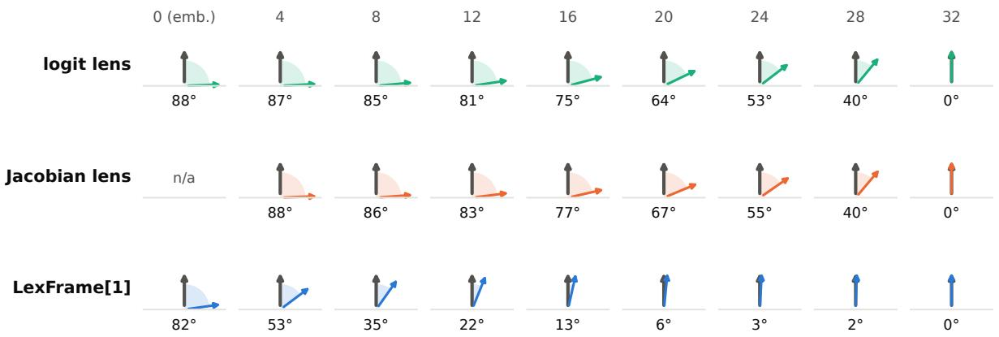
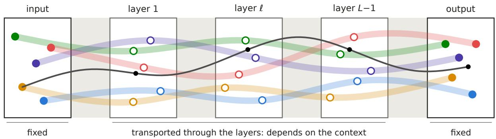
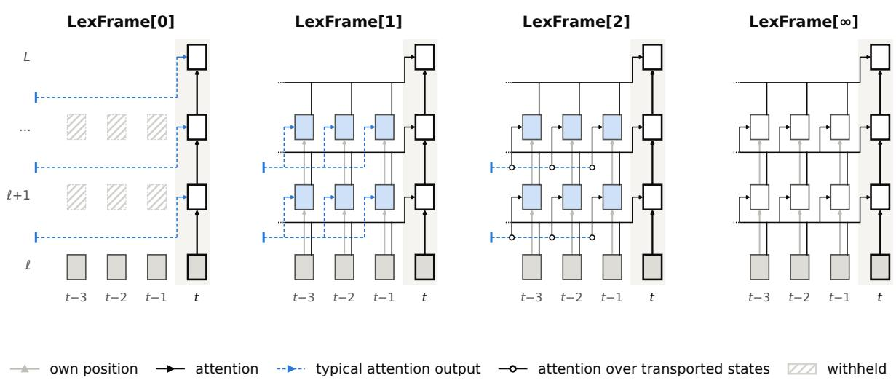
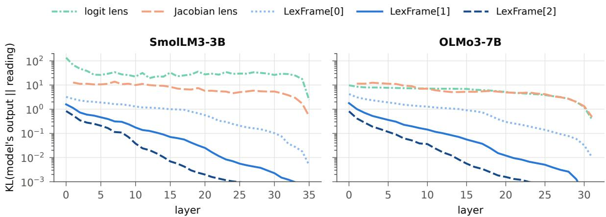
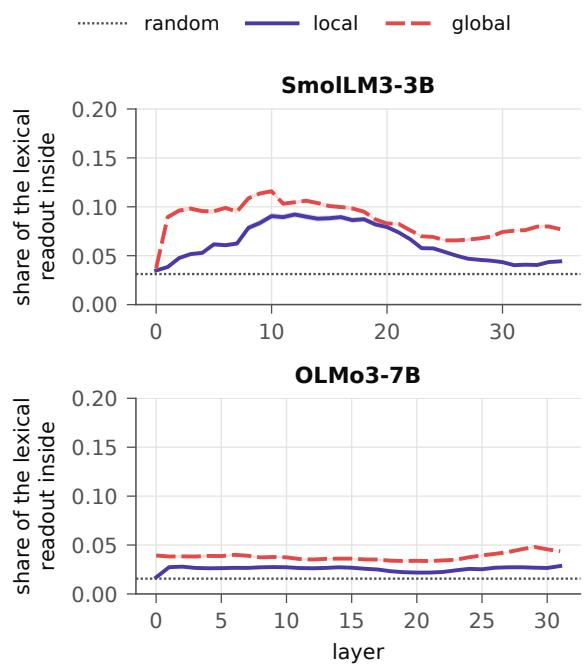
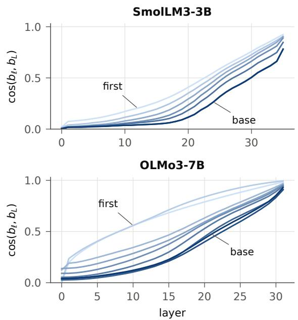
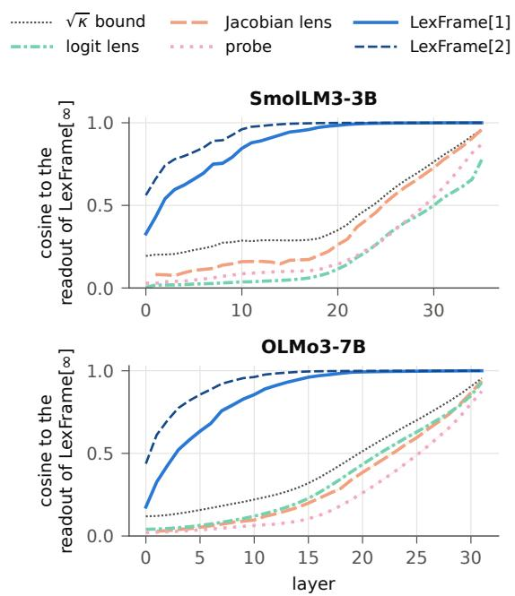
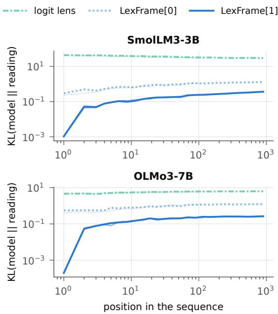

Lexical Reference Frames: Interpreting LM Residual Streams in Native Semantics

Jian Gu Monash University jian.gu@monash.edu

Hongyu Zhang Chongqing University hyzhang@cqu.edu.cn

Chunyang Chen Technical University of Munich chun-yang.chen@tum.de

Aldeida Aleti Monash University aldeida.aleti@monash.edu

## Abstract

The vocabulary of a language model is its native semantics: the embedding and the unembedding fix the meaning of a state at the two ends of the residual stream. Between them, existing methods either reuse a fixed lens or treat the states as a point cloud, and neither reads a state the way the model does. We argue that every hidden state has a native reference frame, induced by the layers that read it next and adaptive to the context. Lexical reference frames approximate it by reading a state through the model’s own remaining layers with a stated number of rounds of attention between positions and a typical attention output for the rest, without fitting to the model’s output. No lens, with fixed directions per layer, can exceed the square root of the native frame’s coherence, 0.30 and 0.35 at mid-depth of SmolLM3-3B and OLMo3-7B, whereas the first-order frame, LEXFRAME[1], reaches 0.97 and 0.97 and reads a state within 0.16 nats of the model’s output. Its coefficients attribute predictions more faithfully than attribution patching, its lexical basis steers a prediction while sparing other tokens, and its confident readings would let an early exit skip 0.45 and 0.42 of the layers, where lenses skip almost none. In this way, lexical reference frames make every hidden state of the model readable, attributable and steerable.1

## 1 Introduction

Between its input and output tokens, a language model computes nothing but states of its residual stream, which every layer reads and writes (Elhage et al., 2021). Its vocabulary is in this sense the native semantics of the model, the only units of meaning that it is designed to receive and to express. The model defines the lexical meaning of a state at the two ends of the stream: the embedding assigns each token a state, and the unembedding maps a final state to logits over tokens. Intermediate states lack such a definition, although interpretability research and its applications read them constantly: early exit and self-speculative decoding stop the computation at a layer whose reading already names the output (Schuster et al., 2022; Elhoushi et al., 2024), hallucination detectors judge an answer by its hidden states (Orgad et al., 2025; Zhang et al., 2025), and knowledge editors locate and rewrite facts at intermediate layers (Meng et al., 2023; Fang et al., 2025). Each depends on how faithfully a tool such as a lens reads these states, and model compression, which distils a smaller or pruned student by matching the intermediate states of its teacher, relies on what these states mean (Romero et al., 2015; Dasgupta and Cohn, 2025; Muralidharan et al., 2024). This meaning is set by the remaining layers, which read each state in the context of its prefix.

Two families of methods address these states and fail in opposite ways. The first reads a state with a lens: the logit lens applies the output frame to every layer unchanged (nostalgebraist, 2020), the tuned lens learns one affine map per layer fitted to the model’s output (Belrose et al., 2023), and the Jacobian lens averages the Jacobian of the remaining layers over positions and prompts (Gurnee et al., 2026). Each fixes one linear map per layer, so every state of a layer is read identically, regardless of its prefix. The second family keeps every state and does without a reading. It treats the states of a layer as a point cloud and reports its rank, intrinsic dimension, anisotropy or similarity to other layers (Kornblith et al., 2019; Ansuini et al., 2019; Garrido et al., 2022; Skean et al., 2025). Such statistics describe how the states are distributed rather than how the model uses them: two states close in the cloud may lead to different predictions, and two distant ones to the same.

Both families omit the frame in which the model itself reads a state: the directions along which a state changes the logit of a token are a property of the remaining layers and therefore differ from layer to layer; because these layers attend to the preceding tokens, they also differ between contexts, so no method with one map per layer can follow them, however it is fitted. In OLMo3-7B (Figure 1), after layer 16 of 32, the logit-lens direction for a token deviates by 75 degrees from the model’s own lexical readout and the Jacobian-lens direction by 77 degrees, and four layers before the output both still deviate by at least 40 degrees.

  
Figure 1: Angle between the lexical readout of LEXFRAME[∞] for a token (grey) and the direction each method offers, after every fourth layer of OLMo3-7B: medians over states and tokens, zero at the output by definition.

Our starting point is that these directions, the lexical readouts, form a reference frame: we call their family at a state its lexical reference frame, and the frame that the complete model induces its nativeframe. The native frame returns the model’s output at every layer, so a useful frame withholds a stated part of this computation: the frame of order n, written LEXFRAME[n], transports a state through the model’s own layers with n rounds of attention between positions and replaces the remaining attention by a typical attention output, estimated once per layer from unlabelled text. LEXFRAME[0] reads what a state holds by itself, LEXFRAME[1] what it draws from its prefix, and LEXFRAME[∞] is the native frame. The idea is simple: read a state the way the model reads it, through the layers that remain and with the context it sees. A lens ignores the context and is therefore bounded; a frame uses it, as far as its order allows. As nothing is fitted to the model’s output, lexical reference frames are comparable across layers, checkpoints and models.

We evaluate lexical reference frames at every layer of SmolLM3-3B (Hugging Face, 2025) and OLMo3-7B (Team OLMo, 2025) and at 16 of their training checkpoints, against the logit lens, the Jacobian lens, a supervised probe and distances on the point cloud. From the middle layers on, LEXFRAME[1] recovers the native frame’s lexical readouts beyond the bound of every lens and matches the model’s output in content and confidence, which lenses do only near the output; one round of attention to the prefix closes most of the gap that LEXFRAME[0] leaves. Its readings settle on the model’s prediction early enough for an early exit to skip more than two fifths of the layers, and they stay faithful along training while the logit lens degrades. Distances on the point cloud barely predict the effect of replacing a state, as lexical readouts lie almost entirely outside the directions in which the states vary. In the coordinates of the frame, the lexical basis writes a prediction into the stream more selectively than the readout, and differences of coefficients attribute it to layers and sublayers more faithfully than attribution patching. We therefore expect lexical reference frames to be a strong alternative to lenses in these applications. In summary, this paper makes three contributions.

• We show that the layers that remain give every hidden state its own frame in the vocabulary, and we prove that no lens with one map per layer can follow this frame across the different contexts in which a state occurs.

• We define frames that read a hidden state in the model’s native semantics through its own layers with a chosen amount of context, and we compute them in closed form from unlabelled text, without any training.

• We show on two model families and their training checkpoints that these frames follow the model from the middle layers on, where lenses fail, and support early exit, steering and attribution at every layer of the model.

## 2 Related Work

Prior work on the intermediate layers of language models asks which tokens a state stands for, how the states of a layer are distributed, and which directions or components drive a prediction, and a reference frame bears on all three questions.

Language model lenses. The logit lens reads an intermediate state with the model’s own output frame (nostalgebraist, 2020), and it underlies studies of how predictions are refined across depth (Jastrz˛ebski et al., 2017; Geva et al., 2020, 2022; Dar et al., 2022; Halawi et al., 2023; Katz et al., 2024; Wendler et al., 2024; Lad et al., 2024). Later lenses use a map per layer, trained to match the output (Belrose et al., 2023; Din et al., 2023) or given by a Jacobian of the remaining layers (Hernandez et al., 2023; Gurnee et al., 2026), or patch the state into another forward pass (Ghandeharioun et al., 2024; Pal et al., 2023). Gu et al. (2026c) fix a set of anchors and measure the states of all layers against them, and Gu et al. (2026b) tie the input and output frames to each other through the pseudo-inverse of one shared token memory. Lenses are thus frames that ignore the context, and we bound how closely any can approximate the native frame.

Point clouds and manifolds. A large body of work summarises the states of a layer by statistics of the cloud they form, such as similarity between layers (Raghu et al., 2017; Kornblith et al., 2019), intrinsic dimension (Facco et al., 2018; Ansuini et al., 2019; Valeriani et al., 2023), effective rank (Garrido et al., 2022) and anisotropy (Ethayarajh, 2019; Gao et al., 2019; Razzhigaev et al., 2023; Bernas et al., 2026). Recent studies follow these statistics across layers (Cheng et al., 2024; Skean et al., 2025) and across training (Saphra and Lopez, 2018; Tigges et al., 2024; Lee et al., 2024). We quantify how much these statistics reveal about the way the model uses the states of a layer.

Directions and components. Linear probes learn a direction from labelled states (Alain and Bengio, 2016; Tenney et al., 2019; Hewitt and Liang, 2019; Belinkov, 2021), and steering methods add a direction to the states to change the output (Subramani et al., 2022; Turner et al., 2023; Li et al., 2023; Zou et al., 2023; Panickssery et al., 2023; Arditi et al., 2024). Both rest on the hypothesis that concepts are represented as directions (Park et al., 2023), which Park et al. (2026) derive from the information geometry of the softmax for the output layer only. The contribution of a component to a prediction is likewise computed along a direction, by projecting what the component writes onto the output frame (Wang et al., 2022), or measured by patching (Meng et al., 2022; Conmy et al., 2023; Syed et al., 2023). A frame supplies directions for each state without supervision, and we test them in steering and attribution at every layer.

## 3 Lexical Reference Frames

We describe a hidden state by the frame in which the model reads it in its vocabulary: fixed at both ends of the residual stream, adaptive in between and approximated at finite order (Appendix C).

## 3.1 Preliminaries

Layers are numbered from 1 to $L ,$ and layer 0 denotes the embedding. Let $x _ { \ell } ( t ) \in \mathbb { R } ^ { d }$ be the hidden state, the residual stream after layer ℓ at position t. Layer k reads the stream and writes its update back into it (Elhage et al., 2021; Veit et al., 2016), $x _ { k } ( t ) = F _ { k } \big ( x _ { k - 1 } ( t ) , a _ { k } ( t ) \big )$ , where $a _ { k } ( t )$ is the output of its attention at position t, which depends on the states of the other positions, and $F _ { k }$ contains the residual connections, the normalisations and the feed-forward block. The native semantics of the model are its vocabulary labels, the smallest units of meaning that it receives and produces, in which a reference frame expresses a state.

At its two interfaces the model itself gives every label a geometric form. At the input, the embedding assigns label v the state $E _ { v }$ . At the output, the logit of v is $z _ { v } = w _ { v } ^ { \top } N ( x _ { L } ( t ) )$ with the final normalisation N and the unembedding row $w _ { v }$ , and its centred value is $\begin{array} { r } { c _ { v } = z _ { v } - \frac { 1 } { | V | } \sum _ { u } z _ { u } } \end{array}$ . The state whose logits come closest, in least squares, to the indicator $e _ { v }$ of v is $s _ { v } = W ^ { + } e _ { v }$ , which Gu et al. (2024) call its semantic basis. We call such a family of vectors, one per label, a lexical basis. The input lexical basis and the output lexical basis are the same for every text, so the reference frames that they span, the input frame and the output frame, are fixed. Earlier work measures states against these fixed frames and decomposes them into coefficients on the output lexical basis, to select layers for finetuning (Gu et al., 2025) and to transfer knowledge across model scales (Gu et al., 2026a).

## 3.2 Native Reference Frame

Between the interfaces the model defines no basis, and a frame must be adaptive: specific to the layer and sensitive to the context. A state receives its meaning from the layers that remain, which read it from the stream. They transport $x _ { \ell } ( t )$ , together with the states of its prefix, to the last layer, where the output frame applies. We call this passage layerwise transport and write $T _ { \ell }$ for the map from $x _ { \ell } ( t )$ to $x _ { L } ( t )$ with the states of the prefix held fixed. The output frame reaches layer ℓ by being pulled back through this map,

  
Figure 2: Lexical bases of five tokens (colours) and one state (black) across the layers: fixed at the two interfaces (filled), dependent on the context in between (hollow).

$$
b _ { \ell } ( v ) = \frac { \partial c _ { v } } { \partial x _ { \ell } ( t ) } = J _ { \ell } ^ { \top } ( w _ { v } - \bar { w } ) ,\tag{1}
$$

where $J _ { \ell } = { \partial N ( T _ { \ell } ) } / { \partial x _ { \ell } ( t ) }$ is the Jacobian of the transport followed by the final normalisation, and w¯ is the mean unembedding row. We call $b _ { \ell } ( v )$ the lexical readout of label v at the state, and the family of these directions over the vocabulary is the lexical referenceframe of the state. The lexical basis at the layer is $s _ { \ell } ( v ) = J _ { \ell } ^ { + } s _ { v }$ , the direction in which the state must move for the output to move along $s _ { v }$ . Both are determined anew for every state, as Figure 2 illustrates: they depend on the layer, since $J _ { \ell }$ contains all remaining layers, and on the context, since these layers attend to the prefix. The coefficient of a state on label v is the inner product that the model itself takes, applied after the transport,

$$
z _ { \ell } ( v ) = \big \langle w _ { v } , N \big ( T _ { \ell } ( x _ { \ell } ( t ) ) \big ) \big \rangle ,\tag{2}
$$

and the reading of the state is the distribution over the next token that these coefficients give. The frame that the complete model induces is the native reference frame of the state, in short its native frame. Basis and coefficients give the stream coordinates in the vocabulary at every layer, which is the purpose of the frame: the coefficients read the stream, the basis writes into it, and their differences attribute a prediction to what a layer writes.

The dependence on the context is quantified by the coherence $\kappa _ { \ell } ( v )$ , the mean cosine between the unit lexical readouts of label v at states from different sequences. A lens is specific to the layer but not sensitive to the context: it offers one direction per label and layer. The mean cosine of a fixed unit vector u with unit lexical readouts $\hat { b } _ { i }$ is $u ^ { \top } \bar { b } \leq \| \bar { b } \|$ where ¯b is their mean. Since $\| { \bar { b } } \| ^ { 2 }$ tends to $\kappa _ { \ell } ( v )$ over many states, no lens exceeds a mean cosine of $\sqrt { \kappa _ { \ell } ( v ) }$ with the native frame. The native frame is the reference for interventions, but its reading is the model’s output; an informative reading withholds part of the remaining computation.

## 3.3 Orders of Reference Frames

A frame of order n replaces the transport $T _ { \ell }$ by one that computes only n rounds of attention between positions, and so has its own lexical readouts, lexical basis and reading $q _ { \ell } ^ { ( n ) }$ . Its transport still runs through every remaining layer, which makes it specific to the layer; from order 1 on the state also attends to its prefix, and the order counts the hops that information may travel between positions above layer ℓ. A frame that withholds more is further from the model but more informative about the state, and as nothing in it is fitted to the model’s output, agreement with the model is a finding. As Figure 3 shows, every remaining layer updates the state at position t from the state one layer below and its attention over the other positions; all frames keep the first input and differ in the second.

Order 0. LEXFRAME[0] withholds the prefix and reads a state without its context, and its reading is what the state holds by itself. It transports $x _ { \ell } ( t )$ through the layers $k > \ell$ with the model’s own $F _ { k }$ and it replaces the attention output by a typical one,

$$
\hat { a } _ { k } ( u ) = \bar { a } _ { k } + \left( u - \bar { u } _ { k } \right) G _ { k } ,\tag{3}
$$

  
Figure 3: What a frame of each order computes to read the state at position t of layer ℓ: the layer’s own attention (solid black) and typical attention outputs (dashed blue). The order in brackets counts the rounds of attention between positions above layer ℓ, like hops of message passing: the context reaches the state only through the state itself (0), directly from the prefix (1), through one relay in the prefix (2), or without limit (∞).

where u is the attention input at position $t , \bar { u } _ { k }$ and $\bar { a } _ { k }$ are the means of the attention input and output of layer k, and $G _ { k }$ is the ridge regression of the attention output on its input, fitted once for each layer on unlabelled calibration text. Because the transport keeps every remaining layer, LEXFRAME[0] is still a nonlinear reading that depends on the state, unlike a lens, and it lacks only what the remaining layers would gather from other positions.

Order 1. LEXFRAME[1] lets the state attend to its prefix. The state at position t is transported as before, but in every layer its attention is the layer’s own attention, computed over the prefix. The states of the prefix are themselves transported from layer ℓ by LEXFRAME[0], so the frame withholds only the attention among the prefix positions after layer ℓ. The state attends with the layer’s own queries, keys and values, but each prefix position evolves in isolation. The reading is what the state draws from its prefix; the step from LEXFRAME[0] measures what this one round of attention contributes.

Order 2. In LEXFRAME[2] the attention also reaches within the prefix: the prefix positions attend too, each with the layer’s own attention over its own prefix, which is transported by LEXFRAME[0]. Information can therefore travel two steps, from an earlier token through a prefix position to the state, a route that LEXFRAME[1] cannot represent. The step from LEXFRAME[1] to LEXFRAME[2] measures what this one exchange among the prefix positions contributes. In general LEXFRAME[n] attends to a prefix of states of order n − 1; each order thus computes one more round of attention between positions, and reading at order n runs $n + 1$ streams through the remaining layers. Higher orders add exchanges within the prefix and converge to the model.

Order ∞. In the limit of the order nothing is withheld, and LEXFRAME[∞] recovers the model as the native frame: every position attends to the true states of its prefix, which are the states that the model itself computes. Two identities follow: the reading of every layer in LEXFRAME[∞] equals the model’s output, and LEXFRAME[n] is exact wherever at most n layers remain. Near the output all orders therefore agree with the model; they differ where much of the computation lies ahead. The reading of LEXFRAME[∞] adds nothing to the model’s prediction; its value lies in its lexical readouts and basis, which every frame of finite order approximates.

## 4 Experiments

We compare frames with lenses and point clouds, then test their coordinates and their use in steering and attribution. Appendix A details the setup; Appendix B adds training checkpoints, lexical readouts, context length, settling depth and ablations.

Setup. We use SmolLM3-3B with 36 layers and OLMo3-7B with 32 layers, recent competitive open-weight models that release checkpoints from every stage of training; SmolLM3 ties its input and output embeddings, OLMo3 does not. We run them in the precision of the released weights and report pairs of values in this order. Text comes from WikiText-103, cut into sequences of 128 tokens. The typical attention outputs are estimated on 256 sequences of the training split, and every measurement uses the test split and every layer. The Jacobian lens is fitted with its reference implementation on 100 prompts. We omit the tuned lens, which is trained on the model’s output, the quantity on which readings are scored, and is bounded like every lens. As a supervised reference we add a linear probe, a ridge regression of the centred logit on the states, fitted on separate text. Divergences are Kullback–Leibler divergences from the model’s output to a reading, in nats, and averages over layers are unweighted. LEXFRAME[∞] is the reference for readings and the exact frame in interventions.

  
Figure 4: Divergence in nats from the model’s output to the reading of each frame and each lens, per layer: each further order lowers it at nearly every layer, while both lenses stay several nats above all frames until near the output.

## 4.1 Comparison with Lenses

We compare frames and lenses in the directions along which they measure a label and in the distributions that they assign to a state. At intermediate layers, LEXFRAME[∞] departs sharply from the output frame: at mid-depth its lexical readouts have a cosine of only 0.07 and 0.26 with those of the last layer, and their coherence across contexts is 0.09 and 0.12. We compare each method’s direction for a label, the gradient of its reading or its fixed vector, with these readouts for 64 labels across the frequency ranking. LEXFRAME[1] follows them closely from the middle layers on, with a layer-averaged cosine of 0.89 and 0.87, because it computes the same transport and withholds only the attention among the prefix positions. The lenses and the probe average between 0.21 and 0.36, and their failure is structural rather than a matter of fitting. The Jacobian lens stays at or below the bound $\sqrt { \kappa _ { \ell } }$ at every layer and the supervised probe falls further below it, whereas at mid-depth, where the bound is 0.30 and 0.35, LEXFRAME[1] reaches 0.97 and 0.97: no single direction matches a readout that changes with the context. LEXFRAME[2] raises the mean cosine to 0.95 and 0.95: LEXFRAME[1] misses the exchange within the prefix.

The divergence from the model’s output (Figure 4) shows the same ladder: averaged over layers, LEXFRAME[0] is at 0.87 and 0.93 nats, LEXFRAME[1] at 0.16 and 0.15, and LEXFRAME[2] at 0.06 and 0.05. The first round of attention thus closes most of the divergence of LEXFRAME[0]: at mid-depth LEXFRAME[1] is within 0.04 and 0.05 nats, and from there on a state and one round of attention to its prefix determine nearly all of its reading. The lenses diverge by several nats, although LEXFRAME[0] uses no more of the context than they do; transport through the model’s own layers hence matters more than a fitted map. The gap is widest in SmolLM3, whose output frame is also its input frame: at the embedding its logit lens names the input token itself for 0.83 of the positions, against 0.00 in OLMo3. Conversely, a layer skip, which feeds a layer’s states to the last four layers with attention but without transport, remains at 7.00 and 2.59 nats: a reading needs both transport and attention.

<table><tr><td>Method</td><td>KL↓ Top-1↑</td><td>ECE↓</td></tr><tr><td>SmolLM3-3B</td><td></td><td>0.04 0.632</td></tr><tr><td>Logit lens Jacobian lens</td><td>29.06 7.51</td><td>0.14 0.376</td></tr><tr><td>LEXFRAME[0]</td><td>0.87</td><td>0.64 0.018</td></tr><tr><td>LEXFRAME[1]</td><td>0.16</td><td>0.86 0.027</td></tr><tr><td>LEXFRAME[2]</td><td>0.06</td><td>0.92 0.020</td></tr><tr><td>OLMo3-7B</td><td></td><td></td></tr><tr><td>Logit lens</td><td>5.66 0.15</td><td>0.107</td></tr><tr><td></td><td></td><td></td></tr><tr><td>Jacobian lens</td><td>6.19 0.13</td><td>0.191</td></tr><tr><td>LEXFRAME[0]</td><td>0.93</td><td>0.64 0.045</td></tr><tr><td>LEXFRAME[1]</td><td>0.15</td><td></td></tr><tr><td></td><td>0.86</td><td>0.018</td></tr><tr><td>LEXFRAME[2]</td><td>0.05 0.93</td><td>0.020</td></tr></table>

Table 1: Layer-averaged readings: divergence from the model, top-token agreement and calibration error.

In Table 1, LEXFRAME[1] names the model’s top token for 0.86 and 0.86 of the states, and for nine tenths of them from layer 18 and 17 on, whereas the lenses reach one half only one or two layers before the output. LEXFRAME[1] does not merely reproduce the output: at the embedding, where most of the computation remains, it agrees on only 0.42 and 0.39. Its calibration error against the actual next token, 0.027 and 0.018, is close to that of the model itself, 0.018 and 0.023, so its probabilities can be interpreted as a prediction in their own right, unlike those of the lenses. Counted back from the last layer, LEXFRAME[1] keeps the model’s top token over 0.82 and 0.81 of the layers, a lens over at most 0.11. An early exit at the first layer whose reading is confident, with the threshold set on held-out sequences for 0.95 agreement with the model, would therefore skip 0.45 and 0.42 of the layers with LEXFRAME[1] but at most 0.04 with a lens, whose confidence does not track whether it is right. Along training, a fixed lens loses ground: from the first trained to the last checkpoint, the divergence of the logit lens grows from 4.82 to 29.06 nats in SmolLM3 and from 2.32 to 5.66 in OLMo3, while LEXFRAME[1] keeps the model’s top token on at least 0.85 and 0.86 of the states throughout.

## 4.2 Comparison with Point-Cloud Geometry

Without a frame, a point cloud relates to the model’s computation only through distances. We replace the state of one position by the real state of another position at the same layer, complete the forward pass, and measure the change in the output, for 7961 pairs per layer. Table 2 shows that, averaged over layers, no distance on the cloud predicts this change well: none exceeds a rank correlation of 0.28, and the geodesic distance, which follows the curvature of the cloud, performs worse than the plain cosine distance. The divergence between the readings of the two states in LEXFRAME[1] reaches 0.94 and 0.95, and already 0.64 and 0.66 at the embedding, because it compares them in exactly the directions to which the remaining layers respond. Along fixed directions, a lens reaches at most 0.28, so a reading must also follow the frame.

  
Figure 5: Share of a lexical readout’s squared norm in 64 local or global principal directions of the cloud.

<table><tr><td>Distance</td><td>SmolLM3-3B OLMo3-7B</td></tr><tr><td>Logit lens Jacobian lens</td><td>0.11 0.16 0.28 0.24</td></tr><tr><td>Cosine</td><td>0.27 0.28</td></tr><tr><td>Euclidean</td><td>0.08 0.12</td></tr><tr><td>Principal subspace</td><td>0.09 0.13</td></tr><tr><td>Mahalanobis</td><td>0.08 0.03</td></tr><tr><td>Geodesic</td><td>0.09 0.07</td></tr><tr><td>LEXFRAME[1]</td><td>0.94 0.95</td></tr></table>

Table 2: Rank correlation between a distance of two states and the effect of replacing one by the other.

Figure 5 explains this in terms of the framework: for each state we estimate the tangent space of the cloud from its 128 nearest states and measure how much of a lexical readout falls into its 64 leading directions. The local share peaks at 9.2 and 2.9 percent, at most about three times the 3.1 and 1.6 percent of a random direction. Since a lexical readout is the gradient of a logit, moving along the directions in which the cloud varies changes the logits far less than moving as far along the readout: the cloud mainly describes variation that the remaining layers ignore, yet distances weigh it fully.

## 4.3 Coordinates at Intermediate Layers

At the output, the vocabulary is a coordinate system for the residual stream: the lexical basis gives the axes, the directions in which writing a label moves a state, and the coefficients give the coordinates, how much of each label the state holds. Together they compose a state from labels; we test whether a frame carries both to intermediate layers.

We compute $J _ { \ell }$ in 32-bit precision for 64 states per layer, move each state by 0.1 of its norm along $s _ { \ell } ( v )$ for 64 labels, and ask whether v is the label whose logit gains most, which Table 3 counts. For the lexical basis at the layer this holds in 0.98 and 1.00 of the cases, from the first layers on. The lexical readout of LEXFRAME[∞] succeeds less often, in 0.56 and 0.79: as the gradient $J _ { \ell } ^ { \top } ( w _ { v } - \bar { w } )$ of the logit of $v ,$ it raises v fastest but also every label whose logit moves with ${ \mathrm { i t } } ,$ and it agrees with $J _ { \ell } ^ { + } s _ { v }$ only where the remaining layers stretch all directions alike. The direction that measures a label is therefore not the direction that moves the output toward it. The fixed frames do worse than the basis: the output frame, with $s _ { v }$ unchanged, reaches 0.45 and 0.80, and the input frame reaches 0.42 in SmolLM3, which ties its input and output embeddings, and 0.00 in OLMo3, which does not. With the Jacobian of LEXFRAME[1], the share is 0.84 and 0.97, against 0.54 and 0.73 for its readout, so the frame supplies most of the basis itself.

<table><tr><td>Direction</td><td>SmolLM3-3B OLMo3-7B</td></tr><tr><td>Input frame</td><td>0.42 0.00</td></tr><tr><td>Output frame</td><td>0.45 0.80</td></tr><tr><td>LEXFRAME[1], readout</td><td>0.54 0.73</td></tr><tr><td>LEXFRAME[1], basis</td><td>0.84 0.97</td></tr><tr><td>LEXFRAME[∞], readout</td><td>0.56 0.79</td></tr><tr><td>LEXFRAME[∞], basis</td><td>0.98 1.00</td></tr></table>

Table 3: Share of moves along the lexical readout or basis of a label that raise its logit most, averaged over layers; fixed frames use their basis unchanged.

Table 4 tests whether the coefficient of a label, its inner product with the unembedding row after it, can do without the transport. With the state of the layer itself, or with its image under one fixed map per layer, it is several nats from the model’s logits, and with the state that LEXFRAME[1] transports it is within 0.16 and 0.15 nats. Nor can the transport be linearised: the inner product of the lexical readout of LEXFRAME[∞] with the state of its layer has a correlation of only 0.10 and 0.02 with the logit, because the readout is the slope of the logit at the state and not a measure of how much of the label the state holds. An adaptive frame is local: basis and coefficients hold at one state and are tied by the transport, not by one matrix as at the output.

<table><tr><td colspan="2">SmolLM3-3B OLMo3-7B</td></tr><tr><td>Paired state KL↓</td><td>Top-1 ↑ KL↓ Top-1 ↑</td></tr><tr><td>Layer state 8.36</td><td>0.04 5.64 0.15</td></tr><tr><td>Fixed map 5.19</td><td>0.13 5.46 0.13</td></tr><tr><td>LEXFRAME[1] 0.16</td><td>0.87 0.15 0.84</td></tr></table>

Table 4: Coefficients on the output lexical basis against model logits on 512 positions, averaged over layers: divergence (nats) at the best scale, top-token agreement.

## 4.4 Steering and Attribution

The two halves of these coordinates serve two interventions on the stream: steering writes into it along the basis, and attribution reads through the coefficients what a component wrote. In steering, the task is to make the runner-up token $u ,$ the target that needs the smallest move, overtake the top token v by moving a single state. A frame offers two directions for this: the lexical readout of the logit difference, $b _ { \ell } ( u ) - b _ { \ell } ( v )$ , which is its gradient, and the difference of the lexical basis vectors, $s _ { \ell } ( u ) - s _ { \ell } ( v )$ . We move each state along each direction in steps from 0.01 to 1 times its norm and record the first step that flips the prediction and the change in the other tokens at that step.

Along the lexical readout, LEXFRAME[1] flips 0.92 and 0.94 of the predictions, nearly as many as LEXFRAME[∞] with 0.95 and 0.97, and the lenses at most 0.81. The lexical basis flips nearly as many, but it disturbs the other tokens far less, 0.009 and 0.004 nats at the flip against 0.033 and 0.025, and therefore makes the most clean flips, 0.73 and 0.85 of the predictions. As in the lexical-basis test, the readout is the steepest ascent of the logit difference and spreads the change over every token moving with u or v, while the basis is the move whose firstorder effect on the output comes closest to raising u against v alone. The basis computed from the

<table><tr><td>Direction Reach ↑ Side ↓ Clean ↑</td></tr><tr><td>SmolLM3-3B Logit lens 0.69 0.024 0.49</td></tr><tr><td>Jacobian lens 0.78 0.039 0.49</td></tr><tr><td>LEXFRAME[1], readout 0.92 0.034 0.61</td></tr><tr><td>LEXFRAME[1], basis 0.89 0.011 0.71 0.033 0.63</td></tr><tr><td>LEXFRAME[∞], readout 0.95 LEXFRAME[∞], basis 0.90 0.009 0.73</td></tr><tr><td>OLMo3-7B</td></tr><tr><td>Logit lens 0.81 0.020 0.57</td></tr><tr><td>Jacobian lens 0.79 0.032 0.51</td></tr><tr><td>LEXFRAME[1], readout 0.94 0.026 0.64</td></tr><tr><td>LEXFRAME[1], basis 0.95 0.005 0.82</td></tr><tr><td>LEXFRAME[∞], readout 0.97 0.025 0.67 LEXFRAME[∞], basis 0.97 0.004 0.85</td></tr></table>

Table 5: Steering along the lexical readout or basis, averaged over layers: share of predictions flipped, median change in the other tokens at the first flip (nats), and share flipped with a change below 0.1 nats.

Jacobian of LEXFRAME[1] reaches 0.71 and 0.82; selective steering thus works even without access to the Jacobian of the model itself. At single positions of layer 16, the readout of LEXFRAME[1] flips the prediction with a median step of 0.10 and 0.03 of the state’s norm, as for LEXFRAME[∞], while both lenses need steps ten times as large.

In attribution, the task is to quantify how much a component, a layer or one of its two sublayers, contributed to the centred logit of the predicted token. As the reference we remove what the component wrote at one position, leave the prefix untouched, complete the forward pass, and measure the change in the logit, on 64 sequences. This effect is the difference of coefficients in LEXFRAME[∞], so the test asks whether a frame that withholds exchanges within the prefix still attributes as the model does. In a frame, the attribution is the change in the coefficient of the predicted token when the component is removed from the state. We compare it with the same difference taken in the two lenses, of which the logit lens gives direct logit attribution, and with linear attributions, the inner product of a lexical readout with the component, which for LEXFRAME[∞] is attribution patching (Syed et al., 2023; Kramár et al., 2024).

In Table 6, the difference in LEXFRAME[1] follows the measured effect at 0.88 and 0.90, closer than the linear attribution of LEXFRAME[∞], at 0.62 and 0.68, although the latter uses the model’s Jacobian. The agreement holds at single positions: across their layers, the difference correlates with the measured effect at 0.97 and 0.93 in the median and exceeds both lenses at 0.99 and 0.98 of positions. A linear attribution assumes that the effect of a write is proportional to it, and its deficit is largest for the feed-forward block (MLP), 0.88 and 0.90 against 0.63 and 0.71, but small for attention, 0.79 and 0.85 against 0.75 and 0.84: the remaining layers respond almost linearly to attention writes and far beyond first order to feed-forward writes. The two lenses reach at most 0.20: direct logit attribution measures only the direct path from a write to the output, which carries little of the effect.

<table><tr><td>Attribution</td><td>Layer Attention MLP</td></tr><tr><td>SmolLM3-3B</td><td></td></tr><tr><td>Logit lens</td><td>0.08 0.13 0.04</td></tr><tr><td>Jacobian lens</td><td>0.12 0.18 0.10</td></tr><tr><td>LEXFRAME[1], diff</td><td>0.88 0.79 0.88</td></tr><tr><td>LEXFRAME[1], linear</td><td>0.57 0.67 0.58 0.62</td></tr><tr><td>LEXFRAME[∞], linear</td><td>0.75 0.63</td></tr><tr><td>OLMo3-7B 0.14</td><td></td></tr><tr><td>Logit lens</td><td>0.18 0.12 0.15</td></tr><tr><td>Jacobian lens</td><td>0.20 0.12</td></tr><tr><td>LEXFRAME[1], diff</td><td>0.90 0.85 0.90</td></tr><tr><td>LEXFRAME[1], linear</td><td>0.62 0.75 0.64</td></tr><tr><td>LEXFRAME[∞], linear</td><td>0.68 0.84 0.71</td></tr></table>

Table 6: Layer-averaged correlation of attributed and measured effects on the predicted logit.

## 5 Conclusion

Every hidden state of a language model has a native reference frame, fixed at the two ends of the residual stream and adaptive in between, and lexical reference frames approximate it to a stated order without fitting to the model’s output. In two model families LEXFRAME[1] recovers the model’s lexical readouts and output from mid-depth on, beyond the reach of any method with one map per layer, and it attributes and steers predictions. The frame explains why a fixed lens fails at mid-depth, increasingly so along training, and why the point cloud reveals little about how the model uses a state. To interpret a state, read it as the model does: through the layers that remain, with the context it sees, and in its own native semantics, a reading that can stand in for lenses.

## References

Guillaume Alain and Yoshua Bengio. 2016. Understanding intermediate layers using linear classifier probes. Preprint, arXiv:1610.01644. ArXiv:1610.01644.

Alessio Ansuini, Alessandro Laio, Jakob H. Macke, and Davide Zoccolan. 2019. Intrinsic dimension of data representations in deep neural networks. Preprint, arXiv:1905.12784. ArXiv:1905.12784.

Andy Arditi, Oscar Obeso, Aaquib Syed, Daniel Paleka, Nina Panickssery, Wes Gurnee, and Neel Nanda. 2024. Refusal in Language Models Is Mediated by a Single Direction. Preprint, arXiv:2406.11717. ArXiv:2406.11717.

Yonatan Belinkov. 2021. Probing Classifiers: Promises, Shortcomings, and Advances. Preprint, arXiv:2102.12452. ArXiv:2102.12452.

Nora Belrose, Igor Ostrovsky, Lev McKinney, Zach Furman, Logan Smith, Danny Halawi, Stella Biderman, and Jacob Steinhardt. 2023. Eliciting Latent Predictions from Transformers with the Tuned Lens. Preprint, arXiv:2303.08112. ArXiv:2303.08112.

Raphael Bernas, Fanny Jourdan, Antonin Poché, and Céline Hudelot. 2026. Revisiting Anisotropy in Language Transformers: The Geometry of Learning Dynamics. Preprint, arXiv:2604.08764. ArXiv:2604.08764.

Emily Cheng, Diego Doimo, Corentin Kervadec, Iuri Macocco, Jade Yu, Alessandro Laio, and Marco Baroni. 2024. Emergence of a High-Dimensional Abstraction Phase in Language Transformers. Preprint, arXiv:2405.15471. ArXiv:2405.15471.

Arthur Conmy, Augustine N. Mavor-Parker, Aengus Lynch, Stefan Heimersheim, and Adrià Garriga-Alonso. 2023. Towards Automated Circuit Discovery for Mechanistic Interpretability. Preprint, arXiv:2304.14997. ArXiv:2304.14997.

Guy Dar, Mor Geva, Ankit Gupta, and Jonathan Berant. 2022. Analyzing Transformers in Embedding Space. Preprint, arXiv:2209.02535. ArXiv:2209.02535.

Sayantan Dasgupta and Trevor Cohn. 2025. Improving Language Model Distillation through Hidden State Matching. In The Thirteenth International Conference on Learning Representations.

Alexander Yom Din, Taelin Karidi, Leshem Choshen, and Mor Geva. 2023. Jump to Conclusions: Short-Cutting Transformers With Linear Transformations. Preprint, arXiv:2303.09435. ArXiv:2303.09435.

Nelson Elhage, Neel Nanda, Catherine Olsson, Tom Henighan, Nicholas Joseph, Ben Mann, Amanda Askell, Yuntao Bai, Anna Chen, Tom Conerly, Nova DasSarma, Dawn Drain, Deep Ganguli, Zac Hatfield-Dodds, Danny Hernandez, Andy Jones, Jackson Kernion, Liane Lovitt, Kamal Ndousse, and 6 others. 2021. A Mathematical Framework for Transformer Circuits. Transformer Circuits Thread.

Mostafa Elhoushi, Akshat Shrivastava, Diana Liskovich, Basil Hosmer, Bram Wasti, Liangzhen Lai, Anas Mahmoud, Bilge Acun, Saurabh Agarwal, Ahmed Roman, Ahmed A Aly, Beidi Chen, and Carole-Jean Wu. 2024. LayerSkip: Enabling Early Exit Inference and Self-Speculative Decoding. In Proceedings of the 62nd Annual Meeting of the Association for Computational Linguistics (Volume 1: Long Papers), pages 12622–12642, Bangkok, Thailand. Association for Computational Linguistics.

Kawin Ethayarajh. 2019. How Contextual are Contextualized Word Representations? Comparing the Geometry of BERT, ELMo, and GPT-2 Embeddings. Preprint, arXiv:1909.00512. ArXiv:1909.00512.

Elena Facco, Maria d’Errico, Alex Rodriguez, and Alessandro Laio. 2018. Estimating the intrinsic dimension of datasets by a minimal neighborhood information. Preprint, arXiv:1803.06992. ArXiv:1803.06992.

Junfeng Fang, Houcheng Jiang, Kun Wang, Yunshan Ma, Xiang Wang, Xiangnan He, and Tat-Seng Chua. 2025. AlphaEdit: Null-Space Constrained Knowledge Editing for Language Models. In The Thirteenth International Conference on Learning Representations.

David Chin-Lung Fong and Michael Saunders. 2011. LSMR: An iterative algorithm for sparse leastsquares problems. SIAM Journal on Scientific Computing, 33(5):2950–2971.

Jun Gao, Di He, Xu Tan, Tao Qin, Liwei Wang, and Tie-Yan Liu. 2019. Representation Degeneration Problem in Training Natural Language Generation Models. Preprint, arXiv:1907.12009. ArXiv:1907.12009.

Quentin Garrido, Randall Balestriero, Laurent Najman, and Yann Lecun. 2022. RankMe: Assessing the downstream performance of pretrained selfsupervised representations by their rank. Preprint, arXiv:2210.02885. ArXiv:2210.02885.

Mor Geva, Avi Caciularu, Kevin Ro Wang, and Yoav Goldberg. 2022. Transformer Feed-Forward Layers Build Predictions by Promoting Concepts in the Vocabulary Space. Preprint, arXiv:2203.14680. ArXiv:2203.14680.

Mor Geva, Roei Schuster, Jonathan Berant, and Omer Levy. 2020. Transformer Feed-Forward Layers Are Key-Value Memories. Preprint, arXiv:2012.14913. ArXiv:2012.14913.

Asma Ghandeharioun, Avi Caciularu, Adam Pearce, Lucas Dixon, and Mor Geva. 2024. Patchscopes: A Unifying Framework for Inspecting Hidden Representations of Language Models. Preprint, arXiv:2401.06102. ArXiv:2401.06102.

Jian Gu, Aldeida Aleti, Chunyang Chen, and Hongyu Zhang. 2024. Vocabulary-Defined Semantics: Latent Space Clustering for Improving In-Context Learning. Preprint, arXiv:2401.16184. ArXiv:2401.16184.

Jian Gu, Aldeida Aleti, Chunyang Chen, and Hongyu Zhang. 2025. A Semantic-Aware Layer-Freezing Approach to Computation-Efficient Fine-Tuning of Language Models. In Findings of the Association for Computational Linguistics: ACL 2025, pages 8019–8033, Vienna, Austria. Association for Computational Linguistics.

Jian Gu, Aldeida Aleti, Chunyang Chen, and Hongyu Zhang. 2026a. Beyond Neural Incompatibility: Cross-Scale Knowledge Transfer in Large Language Models through Latent Semantic Alignment. In Findings ofthe Associationfor Computational Linguistics: ACL 2026, pages 21893–21905, San Diego, California, United States. Association for Computational Linguistics.

Jian Gu, Aldeida Aleti, Chunyang Chen, and Hongyu Zhang. 2026b. Rethinking weight tying: Pseudoinverse tying for LM stable training and updates. arXiv preprint arXiv:2602.04556.

Jian Gu, Aldeida Aleti, Chunyang Chen, and Hongyu Zhang. 2026c. SemRF: A Semantic Reference Frame for Residual-Stream Dynamics in Language Models. Preprint, arXiv:2606.32022. ArXiv:2606.32022.

Chuan Guo, Geoff Pleiss, Yu Sun, and Kilian Q. Weinberger. 2017. On Calibration of Modern Neural Networks. Preprint, arXiv:1706.04599. ArXiv:1706.04599.

Wes Gurnee, Nicholas Sofroniew, Adam Pearce, Mateusz Piotrowski, Isaac Kauvar, Runjin Chen, Anna Soligo, Paul Bogdan, Euan Ong, Rowan Wang, Ben Thompson, David Abrahams, Subhash Kantamneni, Emmanuel Ameisen, Joshua Batson, and Jack Lindsey. 2026. Verbalizable Representations Form a Global Workspace in Language Models. Preprint, arXiv:2607.15495. ArXiv:2607.15495.

Danny Halawi, Jean-Stanislas Denain, and Jacob Steinhardt. 2023. Overthinking the Truth: Understanding how Language Models Process False Demonstrations. Preprint, arXiv:2307.09476. ArXiv:2307.09476.

Evan Hernandez, Arnab Sen Sharma, Tal Haklay, Kevin Meng, Martin Wattenberg, Jacob Andreas, Yonatan Belinkov, and David Bau. 2023. Linearity of Relation Decoding in Transformer Language Models. Preprint, arXiv:2308.09124. ArXiv:2308.09124.

John Hewitt and Percy Liang. 2019. Designing and Interpreting Probes with Control Tasks. Preprint, arXiv:1909.03368. ArXiv:1909.03368.

Hugging Face. 2025. SmolLM3: Smol, multilingual, long-context reasoner. Hugging Face blog.

Stanisław Jastrz˛ebski, Devansh Arpit, Nicolas Ballas, Vikas Verma, Tong Che, and Yoshua Bengio. 2017. Residual Connections Encourage Iterative Inference. Preprint, arXiv:1710.04773. ArXiv:1710.04773.

Shahar Katz, Yonatan Belinkov, Mor Geva, and Lior Wolf. 2024. Backward Lens: Projecting Language Model Gradients into the Vocabulary Space. Preprint, arXiv:2402.12865. ArXiv:2402.12865.

Simon Kornblith, Mohammad Norouzi, Honglak Lee, and Geoffrey Hinton. 2019. Similarity of Neural Network Representations Revisited. Preprint, arXiv:1905.00414. ArXiv:1905.00414.

János Kramár, Tom Lieberum, Rohin Shah, and Neel Nanda. 2024. AtP\*: An efficient and scalable method for localizing LLM behaviour to components. Preprint, arXiv:2403.00745. ArXiv:2403.00745.

Vedang Lad, Jin Hwa Lee, Wes Gurnee, and Max Tegmark. 2024. The Remarkable Robustness of LLMs: Stages of Inference? Preprint, arXiv:2406.19384. ArXiv:2406.19384.

Jin Hwa Lee, Thomas Jiralerspong, Lei Yu, Yoshua Bengio, and Emily Cheng. 2024. Geometric Signatures of Compositionality Across a Language Model’s Lifetime. Preprint, arXiv:2410.01444. ArXiv:2410.01444.

Kenneth Li, Oam Patel, Fernanda Viégas, Hanspeter Pfister, and Martin Wattenberg. 2023. Inference-Time Intervention: Eliciting Truthful Answers from a Language Model. Preprint, arXiv:2306.03341. ArXiv:2306.03341.

Kevin Meng, David Bau, Alex Andonian, and Yonatan Belinkov. 2022. Locating and Editing Factual Associations in GPT. Preprint, arXiv:2202.05262. ArXiv:2202.05262.

Kevin Meng, Arnab Sen Sharma, Alex Andonian, Yonatan Belinkov, and David Bau. 2023. Mass-Editing Memory in a Transformer. In The Eleventh International Conference on Learning Representations.

Stephen Merity, Caiming Xiong, James Bradbury, and Richard Socher. 2016. Pointer Sentinel Mixture Models. Preprint, arXiv:1609.07843. ArXiv:1609.07843.

Saurav Muralidharan, Sharath Turuvekere Sreenivas, Raviraj Joshi, Marcin Chochowski, Mostofa Patwary, Mohammad Shoeybi, Bryan Catanzaro, Jan Kautz, and Pavlo Molchanov. 2024. Compact Language Models via Pruning and Knowledge Distillation. In Advances in Neural Information Processing Systems.

nostalgebraist. 2020. Interpreting GPT: The Logit Lens. LessWrong.

Hadas Orgad, Michael Toker, Zorik Gekhman, Roi Reichart, Idan Szpektor, Hadas Kotek, and Yonatan Belinkov. 2025. LLMs Know More Than They Show: On the Intrinsic Representation of LLM Hallucinations. In The Thirteenth International Conference on Learning Representations.

Koyena Pal, Jiuding Sun, Andrew Yuan, Byron C. Wallace, and David Bau. 2023. Future Lens: Anticipating Subsequent Tokens from a Single Hidden State. Preprint, arXiv:2311.04897. ArXiv:2311.04897.

Nina Panickssery, Nick Gabrieli, Julian Schulz, Meg Tong, Evan Hubinger, and Alexander Matt Turner. 2023. Steering Llama 2 via Contrastive Activation Addition. Preprint, arXiv:2312.06681. ArXiv:2312.06681.

Kiho Park, Yo Joong Choe, and Victor Veitch. 2023. The Linear Representation Hypothesis and the Geometry of Large Language Models. Preprint, arXiv:2311.03658. ArXiv:2311.03658.

Kiho Park, Todd Nief, Yo Joong Choe, and Victor Veitch. 2026. The Information Geometry of Softmax: Probing and Steering. Preprint, arXiv:2602.15293. ArXiv:2602.15293.

Maithra Raghu, Justin Gilmer, Jason Yosinski, and Jascha Sohl-Dickstein. 2017. SVCCA: Singular Vector Canonical Correlation Analysis for Deep Learning Dynamics and Interpretability. Preprint, arXiv:1706.05806. ArXiv:1706.05806.

Anton Razzhigaev, Matvey Mikhalchuk, Elizaveta Goncharova, Ivan Oseledets, Denis Dimitrov, and Andrey Kuznetsov. 2023. The Shape of Learning: Anisotropy and Intrinsic Dimensions in Transformer-Based Models. Preprint, arXiv:2311.05928. ArXiv:2311.05928.

Adriana Romero, Nicolas Ballas, Samira Ebrahimi Kahou, Antoine Chassang, Carlo Gatta, and Yoshua Bengio. 2015. FitNets: Hints for Thin Deep Nets. In The Third International Conference on Learning Representations.

Naomi Saphra and Adam Lopez. 2018. Understanding Learning Dynamics Of Language Models with SVCCA. Preprint, arXiv:1811.00225. ArXiv:1811.00225.

Tal Schuster, Adam Fisch, Jai Gupta, Mostafa Dehghani, Dara Bahri, Vinh Q. Tran, Yi Tay, and Donald Metzler. 2022. Confident Adaptive Language Modeling. In Advances in Neural Information Processing Systems.

Oscar Skean, Md Rifat Arefin, Dan Zhao, Niket Patel, Jalal Naghiyev, Yann LeCun, and Ravid Shwartz-Ziv. 2025. Layer by Layer: Uncovering Hidden Representations in Language Models. Preprint, arXiv:2502.02013. ArXiv:2502.02013.

Nishant Subramani, Nivedita Suresh, and Matthew E. Peters. 2022. Extracting Latent Steering Vectors from Pretrained Language Models. Preprint, arXiv:2205.05124. ArXiv:2205.05124.

Aaquib Syed, Can Rager, and Arthur Conmy. 2023. Attribution Patching Outperforms Automated Circuit Discovery. Preprint, arXiv:2310.10348. ArXiv:2310.10348.

Team OLMo. 2025. Olmo 3. Preprint, arXiv:2512.13961. ArXiv:2512.13961.

Ian Tenney, Dipanjan Das, and Ellie Pavlick. 2019. BERT Rediscovers the Classical NLP Pipeline. Preprint, arXiv:1905.05950. ArXiv:1905.05950.

Curt Tigges, Michael Hanna, Qinan Yu, and Stella Biderman. 2024. LLM Circuit Analyses Are Consistent Across Training and Scale. Preprint, arXiv:2407.10827. ArXiv:2407.10827.

Alexander Matt Turner, Lisa Thiergart, Gavin Leech, David Udell, Juan J. Vazquez, Ulisse Mini, and Monte MacDiarmid. 2023. Steering Language Models With Activation Engineering. Preprint, arXiv:2308.10248. ArXiv:2308.10248.

Lucrezia Valeriani, Diego Doimo, Francesca Cuturello, Alessandro Laio, Alessio Ansuini, and Alberto Cazzaniga. 2023. The geometry of hidden representations of large transformer models. Preprint, arXiv:2302.00294. ArXiv:2302.00294.

Andreas Veit, Michael Wilber, and Serge Belongie. 2016. Residual Networks Behave Like Ensembles of Relatively Shallow Networks. Preprint, arXiv:1605.06431. ArXiv:1605.06431.

Kevin Wang, Alexandre Variengien, Arthur Conmy, Buck Shlegeris, and Jacob Steinhardt. 2022. Interpretability in the Wild: a Circuit for Indirect Object Identification in GPT-2 small. Preprint, arXiv:2211.00593. ArXiv:2211.00593.

Chris Wendler, Veniamin Veselovsky, Giovanni Monea, and Robert West. 2024. Do Llamas Work in English? On the Latent Language of Multilingual Transformers. Preprint, arXiv:2402.10588. ArXiv:2402.10588.

Zhenliang Zhang, Xinyu Hu, Huixuan Zhang, Junzhe Zhang, and Xiaojun Wan. 2025. ICR Probe: Tracking Hidden State Dynamics for Reliable Hallucination Detection in LLMs. In Proceedings of the 63rd Annual Meeting ofthe Associationfor Computational Linguistics (Volume 1: Long Papers), pages 17986– 18002, Vienna, Austria. Association for Computational Linguistics.

Andy Zou, Long Phan, Sarah Chen, James Campbell, Phillip Guo, Richard Ren, Alexander Pan, Xuwang Yin, Mantas Mazeika, Ann-Kathrin Dombrowski, Shashwat Goel, Nathaniel Li, Michael J. Byun, Zifan Wang, Alex Mallen, Steven Basart, Sanmi Koyejo, Dawn Song, Matt Fredrikson, and 2 others. 2023. Representation Engineering: A Top-Down Approach to AI Transparency. Preprint, arXiv:2310.01405. ArXiv:2310.01405.

## A Technical Details

## A.1 Implementation Details

Models and data. The SmolLM3 checkpoints follow a grid in which the number of training tokens roughly triples from one checkpoint to the next, and the OLMo3 checkpoints are chosen at matching token counts, with the randomly initialised model and an early checkpoint at four billion tokens in addition. Both families include the checkpoints at the end of their later training stages. The Jacobian lens is defined from layer 1 on, and every average over layers runs over layers 1 to $L - 1$ without the embedding, where the Jacobian lens is undefined, and the output, where every reading is exact. We calibrate on 256 sequences of 128 tokens from the training split and evaluate on 64 sequences of 128 tokens from the test split.

Estimation methods. The frames involve no training: the typical attention outputs are fitted in closed form from one forward pass over the calibration text, with the ridge of every layer chosen from a fixed grid by two-fold cross-validation over the calibration sequences. Gradients are taken through the released weights in their stored half precision. The lexical basis $s _ { \ell } ( v ) = J _ { \ell } ^ { + } s _ { \iota }$ solves $\operatorname* { m i n } _ { \delta } \lVert J _ { \ell } \delta$ $s _ { v } \| ^ { 2 } + \lambda \| \delta \| ^ { 2 }$ with $\lambda = 1 0 ^ { - 3 } \| J _ { \ell } ^ { \top } s _ { v } \| ^ { 2 } / \| s _ { v } \| ^ { 2 }$ , the same relative ridge in both experiments that use it. In the lexical-basis test we form $J _ { \ell }$ explicitly in 32- bit arithmetic, with the stored weights cast exactly, and solve the problem in closed form for all labels at once; every move is then evaluated in the model itself, whichever Jacobian produced the direction. In steering, which needs the basis at every position, we solve the problem without forming $J _ { \ell }$ by 30 steps of LSMR (Fong and Saunders, 2011) from zero, where a product $J _ { \ell } \delta$ is one forward-mode pass and a product $J _ { \ell } ^ { \top } y$ one backward pass.

Evaluation methods. Positions and tokens are sampled once with fixed seeds, every experiment uses the same test sequences, and all results are from a single run, which is deterministic up to the rounding of the arithmetic. The first identity of Section 3.3 holds up to the rounding of half precision, with a divergence of 0.0009 and 0.0002 nats. The calibration error is the expected calibration error of Guo et al. (2017) with 15 bins. The substitution test was repeated on a second, disjoint part of the test split, where it gives 0.94 and 0.95 for LEXFRAME[1] and 0.28 and 0.27 for the cosine distance, nearly the same as on the first. Intervals are 95% percentile bootstrap intervals from at least 300 resamples of the test sequences, so that positions of the same sequence stay together. They appear as bands in the figures; in Tables 1 to 7, which report means, their half-width is at most 12% of a divergence, 0.004 nats for the change in the other tokens in steering, and 0.04 for every other value.

## A.2 Artifacts and Computations

We use SmolLM3-3B (Hugging Face, 2025) and OLMo3-7B (Team OLMo, 2025) with their published intermediate checkpoints, both released under the Apache 2.0 licence. The text is the English WikiText-103 corpus (Merity et al., 2016), released under the Creative Commons Attribution-ShareAlike licence, with about 103 million tokens in its training split and 0.25 million in its test split. Our use of these artifacts is consistent with their intended use, and the text contains no information that we collected or annotated. The experiments ran on NVIDIA RTX 4080 SUPER GPUs, and every run uses a single GPU. The whole project used about 500 GPU hours, of which about 100 hours produced the final experiments reported in this paper; the remainder was spent on preliminary experiments. The implementation is written in Python 3.12 with PyTorch 2.12 and Transformers 5.16.

## A.3 AI Use Disclosure

AI assistants supported the writing of this paper and the preparation of its code. The authors checked all text, code and results and take full responsibility.

## B Additional Results

Training checkpoints. LEXFRAME[∞] is defined through the layers that remain, so it changes with the layer and whenever these layers change. Figure 6 shows this for every label of the direction test, as the cosine between the lexical readout of LEXFRAME[∞] at a layer and at the last layer of the same forward pass. In the base models the middepth cosine is 0.07 and 0.26: the output frame is far from the frame that the model uses there. This departure is learned: at the first checkpoint the middepth cosine is 0.34 in SmolLM3, whose earliest released checkpoint is already well into training, and 0.71 in the randomly initialised OLMo3, and it falls over the course of training. A frame that does not adapt suits only the last layers, where this cosine stays high at every checkpoint.

Across checkpoints, the ranking of the readings is stable in both families. In SmolLM3 the divergence of the logit lens from the model’s output grows from 4.82 to 29.06 nats, while that of LEXFRAME[1] only moves from 0.15 to 0.16. The decline of the logit lens thus follows the rotation of the frame at mid-depth: a lens degrades not because the model becomes harder to read but because the model’s own frames move away from the output frame. Averaged over layers, LEXFRAME[1] agrees with the model’s top token on at least 0.85 and 0.86 of the states at every trained checkpoint, while the logit lens falls from 0.21 to 0.04 and from 0.27 to 0.15. Every value is an average over all layers and over the same 64 test sequences, and the typical attention outputs are estimated anew at every checkpoint, so the comparison along training is free of the confound that a lens fitted at one checkpoint is stale at the next. The randomly initialised OLMo3 is a control: LEXFRAME[1] is within 0.11 nats of its output and the logit lens 0.52 nats away, as every frame is built from its model’s layers.

  
Figure 6: Cosine between the lexical readouts of LEXFRAME[∞] at a layer and at the last layer, for every checkpoint from the first (lightest) to the last (darkest).

Lexical readouts. Figure 7 resolves the comparison of lexical readouts by layer. LEXFRAME[1] exceeds a cosine of 0.95 with LEXFRAME[∞] from layer 16 and 15 on, and LEXFRAME[2] from layer 10 and 9 on, while the fixed directions approach the frame only in the last layers, where little computation remains. At mid-depth the Jacobian lens reaches only 0.20 and 0.23, so even a lens fitted to the model’s own Jacobian stays well below the bound $\sqrt { \kappa _ { \ell } } .$ , and it does not exceed it at any layer. The bound itself rises toward the output, as the readouts depend less and less on the context, and every fixed direction rises with it. The frames are weakest at the first layers, where most of the exchange among prefix positions still lies ahead: there LEXFRAME[1] reaches 0.33 and 0.18, and LEXFRAME[2], which adds one such exchange, already reaches 0.56 and 0.44.

  
Figure 7: Cosine of each method’s direction for a label with the lexical readout of LEXFRAME[∞], per layer, and the coherence bound $\sqrt { \kappa _ { \ell } }$

Context length. A longer context offers more positions to attend to and therefore more attention that a frame of finite order withholds, so long sequences test the orders directly. We repeated the readings on 64 sequences of 1024 tokens, with the typical attention outputs estimated on the same number of calibration tokens. The divergence of LEXFRAME[1] from the model’s output rises only from 0.16 and 0.15 to 0.25 and 0.18 nats; the order of all methods is unchanged, with LEXFRAME[0] at 1.11 and 1.06, LEXFRAME[2] at 0.15 and 0.08 and the lenses at 6.04 or more, and LEXFRAME[1] still agrees with the model’s top token on 0.84 and 0.86 of the states. The attention among the prefix positions that LEXFRAME[1] withholds grows with the context, but at intermediate layers it contributes little to what a state means to the model, so a longer prefix adds little to the divergence. Figure 8 resolves the divergence by position, that is, by the length of the context: it grows slowly, without a break between the two lengths, so the frame does not degrade at any particular context length.

  
Figure 8: Divergence from the model’s output to each reading by position, averaged over layers, for sequences of 1024 tokens (thick) and 128 tokens (thin).

Settling depth. Counted back from the last layer, the unbroken run of layers whose reading names the model’s top token shows from which depth a prediction is settled, the quantity on which early exit relies. Over all 8128 positions and every layer (Table 7), LEXFRAME[1] is settled over 0.82 and 0.81 of the layers, the Jacobian lens over 0.09 and 0.09 and the logit lens over 0.03 and 0.11, and each order lengthens the run, from 0.58 and 0.58 for LEXFRAME[0] to 0.89 and 0.90 for LEXFRAME[2]. An exit cannot know the model’s top token; it leaves at the first layer whose reading is confident beyond a threshold. With the threshold chosen on half of the sequences for 0.95 agreement with the model and applied to the other half, LEXFRAME[1] leaves 0.45 and 0.42 of the layers unused, the lenses at most 0.04, since their confidence does not track whether they are right. LEXFRAME[1] saves no computation, as it transports a state through the later layers, but it shows how much depth a lens-based exit wastes.

Ablation of fitted terms. The fitted terms of a frame are those of the typical attention output in Equation 3, the means $\bar { u } _ { k }$ and $\bar { a } _ { k }$ and the ridge regression $G _ { k }$ , and Table 8 tests whether the regression matters by keeping only the mean $\bar { a } _ { k }$ or by setting the output to zero. Both replacements make every measure of LEXFRAME[1] worse: its divergence from the model’s output grows several times, and both the cosine of its lexical readouts with those of

<table><tr><td>Method Settled layers ↑ Skipped layers ↑</td></tr><tr><td>SmolLM3-3B</td></tr><tr><td>Logit lens 0.03 0.00</td></tr><tr><td>Jacobian lens 0.09 0.00 LEXFRAME[0] 0.58 0.23</td></tr><tr><td>LEXFRAME[1] 0.82 0.45</td></tr><tr><td>LEXFRAME[2] 0.89 0.53</td></tr><tr><td>OLMo3-7B</td></tr><tr><td>Logit lens 0.11 0.04</td></tr><tr><td>Jacobian lens 0.09 0.03</td></tr><tr><td>LEXFRAME[0] 0.58 0.20</td></tr><tr><td>LEXFRAME[1] 0.81 0.42</td></tr><tr><td>LEXFRAME[2] 0.90 0.54</td></tr></table>

Table 7: Share of layers, counted back from the last, over which each reading keeps the model’s top token (settled), and share skipped by a confidence-based exit.

LEXFRAME[∞] and the correlation of its attribution with the measured effect drop markedly. The attention that a frame withholds is therefore not a constant: it varies with the input of the attention, and one linear map per layer already captures enough of this variation to keep the frame close to the model. With four calibration sequences, about five hundred tokens, the divergence of LEXFRAME[1] from the model’s output is 0.41 and 0.34 nats, against 0.16 and 0.15 with the 256 sequences used throughout. The estimate needs little text because it has few degrees of freedom: one linear map per layer between two quantities inside that layer, with a ridge chosen by cross-validation. On three disjoint calibration texts, the divergence lies between 0.160 and 0.163 nats in SmolLM3 and between 0.146 and 0.151 in OLMo3, so the frame barely depends on the choice of calibration text.

<table><tr><td colspan="3">Fitted terms KL ↓ Cosine ↑ Attribution ↑</td></tr><tr><td>SmolLM3-3B</td><td></td><td></td></tr><tr><td>Regression</td><td>0.16 0.89</td><td>0.88</td></tr><tr><td>Mean</td><td>1.26 0.73</td><td>0.67</td></tr><tr><td>Zero</td><td>0.76</td><td>0.71 0.68</td></tr><tr><td>OLMo3-7B</td><td></td><td></td></tr><tr><td>Regression</td><td>0.15 0.87</td><td>0.90</td></tr><tr><td>Mean</td><td>0.52</td><td>0.74 0.77</td></tr><tr><td>Zero</td><td>0.47</td><td>0.74 0.77</td></tr></table>

Table 8: LEXFRAME[1] with fitted terms (regression), mean or zero output, averaged over layers: divergence (nats), cosine with LEXFRAME[∞] and attribution.

Worked example. Table 9 shows a position where OLMo3 continues “A review of Boulter $\mathrm { ^ , s }$ performance in The” with “Guardian” at probability 0.29 rather than “Times” at 0.22. LEXFRAME[1] names this token from layer 16 on, the Jacobian lens from layer 20 on and the logit lens from layer 24 on, so the frame reads the prediction well before either lens. Below that layer LEXFRAME[1] already reads whole words that can follow “The” here, and at layer 12 the runner-up “Times”: the state hence holds the two newspaper titles that the model weighs at the output, and the next layers settle between them. The logit lens returns mostly word fragments until layer 24, because it reads every state along the output directions, which intermediate states do not yet use. The Jacobian lens returns unrelated tokens until layer 20, since its map averages over contexts and cannot follow this one, although it is fitted to the model’s own Jacobian. The position thus shows in a single case what the statistics over all positions report in aggregate: the frame follows the model’s own choice, including the alternative it weighs, several layers before either of the two lenses does.

<table><tr><td></td><td>Layer Logit lens</td><td>Jacobian lens LEXFRAME</td></tr><tr><td>0</td><td>“oretical&quot;</td><td>&quot;New&quot; 一</td></tr><tr><td>4</td><td>“oretical&quot;</td><td>“flavours&quot; “Bill”</td></tr><tr><td>8</td><td> $\ " \boldsymbol { \mathsf { n t o } } ^ { \bullet \bullet }$ </td><td>“urga” 99 “Bill”</td></tr><tr><td>12</td><td>&quot;comparison&#x27;</td><td>“...\n\n&quot; “Times&quot;</td></tr><tr><td>16</td><td>“orem&quot;</td><td>“Illustrated&quot; “Guardian&quot;</td></tr><tr><td>20</td><td>“odor&quot;</td><td>&quot;Guardian&#x27; “Guardian&quot;</td></tr><tr><td>24</td><td>“Guardian&quot;</td><td>&quot;Guardian&#x27; 9 “Guardian&quot;</td></tr><tr><td>28</td><td>&quot;Guardian&quot; 99</td><td>&quot;Guardian&#x27; 99 “Guardian&quot;</td></tr><tr><td>32</td><td>&quot;Guardian&#x27; 99</td><td>&quot;Guardian&#x27; 99 “Guardian&quot;</td></tr></table>

Table 9: Top token of each reading after every fourth layer of OLMo3-7B at one position, where layer 32 is the output of the whole model.

## C Properties of Reference Frames

This appendix states in full the properties of reference frames, which express a hidden state in the native semantics of the model: the two sides of a frame, how close a lens and an order can come to the model, and the complexity of the orders. Throughout, a state $x _ { \ell } ( t )$ is read with the states $x _ { \ell } ( s ) , s < t$ , of its prefix given, and $T _ { \ell } ^ { ( n ) }$ denotes the transport of order n.

## C.1 Lexical Readout and Lexical Basis

The lexical readout $b _ { \ell } ( v ) = J _ { \ell } ^ { \top } ( w _ { v } - \bar { w } )$ and the basis vector $s _ { \ell } ( v ) = J _ { \ell } ^ { + } s _ { v }$ are the two sides of a frame. The first is a covector: it measures how a small change in the state changes the coefficient of v. The second is a vector: among all changes δ of the state it is the smallest one whose first-order effect $J _ { \ell } \delta$ on the last state is closest to $s _ { v }$ . The same construction with $T _ { \ell } ^ { ( 1 ) }$ in place of $T _ { \ell }$ gives the basis of LEXFRAME[1].

The two sides are dual in the sense of frames rather than of bases. The vocabulary is larger than the state, so the unembedding rows $w _ { v }$ span the space of states without being a basis of it, and $s _ { v } =$ $( \bar { W } ^ { \top } W ) ^ { - 1 } w _ { v }$ is their canonical dual: $\Sigma _ { v } { s _ { v } } { w _ { v } ^ { \top } }$ = $I ,$ , so a normalised last state is the sum of its logits times the vectors $s _ { v }$ . To first order the same holds at layer $\ell ,$ up to the ridge in $J _ { \ell } ^ { + }$ and the centring of the logits: $\begin{array} { r } { \sum _ { v } s _ { \ell } ( v ) ( J _ { \ell } ^ { \top } w _ { v } ) ^ { \top } = J _ { \ell } ^ { + } J _ { \ell } , } \end{array}$ , the projection onto the directions that reach the output.

At an intermediate layer the coefficient of a label cannot be taken as an inner product with the state itself. By the chain rule, the pairing of a lexical readout with its state is

$$
\left. b _ { \ell } ( v ) , x _ { \ell } ( t ) \right. = \frac { d } { d \alpha } c _ { v } \big ( \alpha x _ { \ell } ( t ) \big ) \Big | _ { \alpha = 1 } ,\tag{4}
$$

the response of the centred logit to a rescaling of the state, which the normalisations of the remaining layers largely remove. It would equal $c _ { v }$ only if the transport were homogeneous of degree one, which it is not, and its measured correlation with the logit is 0.10 and 0.02. The coefficient is therefore a value of the transported state and not a linear function of the state $x _ { \ell } ( t )$ at the layer.

## C.2 Coherence Bound and Exactness

Let $\hat { b } _ { 1 } , \dotsc , \hat { b } _ { m }$ be the unit lexical readouts of one label at m states of a layer, and let u be a unit vector that does not depend on the state. Its mean cosine with them is $\begin{array} { r } { \frac 1 m \sum _ { i } u ^ { \top } \hat { b } _ { i } = u ^ { \top } \bar { b } \le \| \bar { b } \| } \end{array}$ , with $\bar { b }$ the mean of the $\hat { b } _ { i } .$ and

$$
\| \bar { b } \| ^ { 2 } = \frac { 1 } { m ^ { 2 } } \sum _ { i , j } \hat { b } _ { i } ^ { \top } \hat { b } _ { j } = \frac { 1 } { m } + \Bigl ( 1 - \frac { 1 } { m } \Bigr ) \kappa ,\tag{5}
$$

where $\kappa$ is the mean cosine over pairs of distinct states; with states from many sequences this tends to the coherence, which is measured over pairs from different sequences. For many states the bound is $\sqrt { \kappa }$ , and it is attained by the mean direction $u = \dot { \bar { b } } / \| \bar { b } \|$ . No lens, however it is fitted, can therefore exceed $\sqrt { \kappa _ { \ell } ( v ) }$ on average: the bound is a property of LEXFRAME[∞] and not of an estimator. A lens followed by the final normalisation N varies with the state only through $N ,$ and in practice it also stays below this bound.

Write $h _ { k } ^ { n } ( t )$ for the state of position t at layer $k > \ell$ in LEXFRAME[n]. Order 0 replaces the attention of every layer by the typical attention output, and order $n \geq 1$ computes the layer’s own attention over the prefix states of order $n - 1$

$$
\begin{array} { r l } & { h _ { k } ^ { n } ( t ) = F _ { k } \big ( h _ { k - 1 } ^ { n } ( t ) , a _ { k } ^ { n } ( t ) \big ) , } \\ & { a _ { k } ^ { n } ( t ) = \mathrm { A t t } _ { k } \big ( h _ { k - 1 } ^ { n } ( t ) ; \{ h _ { k - 1 } ^ { n - 1 } ( s ) \} _ { s < t } \big ) , } \end{array}\tag{6}
$$

with $h _ { \ell } ^ { n } = x _ { \ell }$ for every n. By induction on n, the state of order n equals the true state for its first n layers: $h _ { k } ^ { n } ( t ) = x _ { k } ( t )$ for $k \leq \ell + n$ . This holds trivially for $n = 0$ , and if it holds for $n - 1$ , the attention of layer $k \leq \ell + \ i$ n attends to prefix states of order $n - 1$ at layer $k - 1 \leq \ell + n - 1$ , which are the true ones. Two identities follow. LEXFRAME[n] is exact wherever at most n layers remain, $L -$ $\ell \leq n$ , and for $n \geq L - \ell$ every state is the true one, so LEXFRAME[∞] returns the model’s output at every layer. The orders differ from the model only through the attention between positions more than n layers above the state.

## C.3 Complexity Analysis

We count costs in forward passes, a measure independent of the hardware. Calibration is one forward pass over the calibration text and one ridge regression per layer. Reading the states of layer ℓ at order n runs $n + 1$ streams through the $L - \ell$ remaining layers, so reading every layer of a sequence, at all positions at once, costs about $( n + 1 ) ( L + 1 ) / 2$ forward passes. A fitted lens reads a state with one matrix product, which is cheaper per state, but the fit is not: the Jacobian lens needs the Jacobian of the last state with respect to the states of every layer, one backward pass per dimension of the state, for each of its P prompts, about Pd backward passes in total. With LEXFRAME[1], a lens therefore becomes cheaper only after about $P d / ( L + 1 )$ sequences have been read at every layer, and the fit must be repeated for every checkpoint, while a frame only repeats its calibration pass. Fitting the Jacobian lens took 18 and 44 times as long as calibrating the frames and reading every layer of the 64 test sequences at orders 0 to 2.

## D Discussion

The framework rests on one idea: read a hidden state as the model reads it, through the layers that remain and with the context it sees. Lenses read each layer with one fixed map, and point clouds read no state at all; a frame lets the remaining layers, which decide what a state means, do the reading in the model’s native semantics, its vocabulary.

A reference frame separates two questions that a lens answers at once: along which directions the model measures a label at a state, and how much of the label the state holds. Existing methods appear as special cases: a lens is a frame that does not adapt to the context and is therefore bounded by the coherence of the native frame, a probe is a fixed lexical readout learned under supervision, and a point cloud is a set of states without a frame. The native frame answers both questions exactly, and the orders make it informative by stating what is withheld. Both parts of the model’s reading are necessary: transport alone, in LEXFRAME[0], already brings a reading far closer to the model than any fitted map, whereas attention to the prefix without transport, in a layer skip, does not, and no fitting lifts a method that ignores the context above the coherence bound. The order thus makes the use of the context a controlled variable, so that what each hop between positions contributes can be measured.

The value of this view lies in what it makes comparable. The vocabulary is shared by every layer, checkpoint and model of a family, and a frame expresses all of their states in it without a trained component whose faithfulness would need a separate argument. The native frame is thus a reference against which any interpretation of a hidden state can be scored, and a frame calibrated anew in a single pass can follow a model through training, fine-tuning or editing in the same units. Early exit, hallucination detection and knowledge editing read hidden states through lenses or probes, and model compression matches the hidden states of a teacher, so each could read these states in the frame of the model instead; we expect such uses to benefit, but leave them to future work.