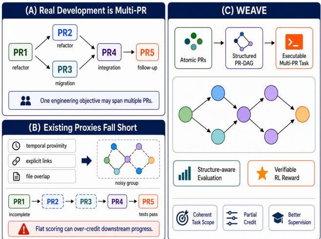
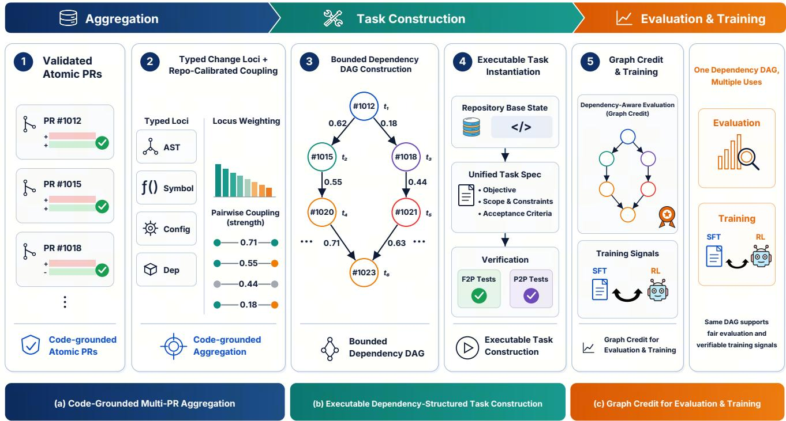
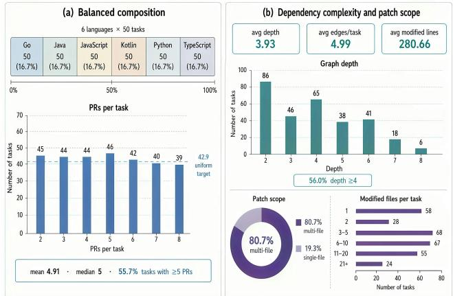
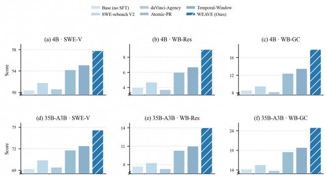
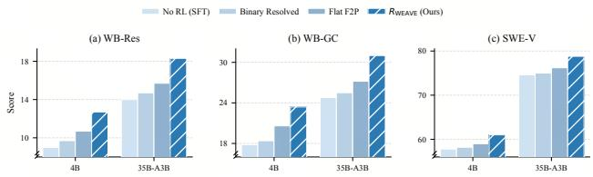
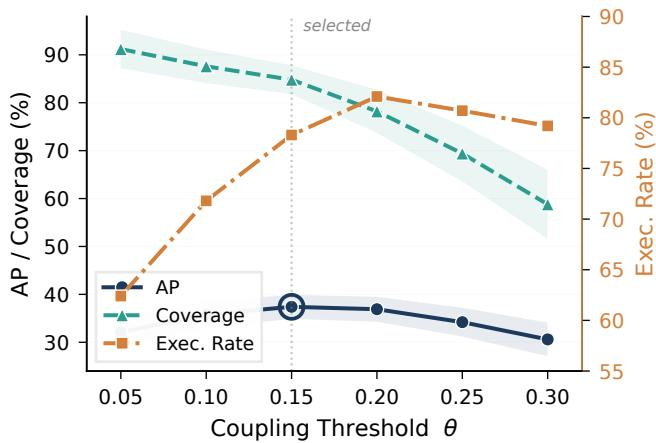
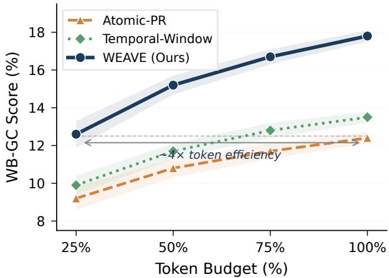
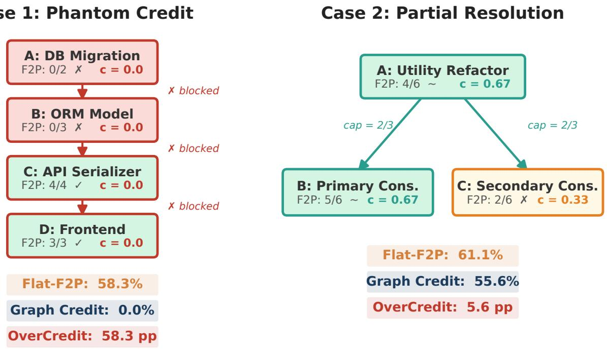

# WEAVE<sub>:</sub> W<sub>eav</sub>in<sub>g</sub> R<sub>ea</sub>l<sub>-</sub>W<sub>o</sub>rld C<sub>o</sub>d<sub>e</sub> E<sub>vo</sub>l<sub>u</sub>ti<sub>o</sub>n int<sub>o</sub> D<sub>epe</sub>nd<sub>e</sub>n<sub>cy-</sub>Str<sub>uc</sub>t<sub>u</sub>r<sub>e</sub>d T<sub>as</sub>k<sub>s</sub> f<sub>o</sub>r B<sub>e</sub>n<sub>c</sub>hm<sub>a</sub>rkin<sub>g a</sub>nd Tr<sub>a</sub>inin<sub>g</sub> C<sub>o</sub>d<sub>e</sub> A<sub>ge</sub>nt<sub>s</sub>

<sub>Weihao</sub> <sub>Li</sub>1∗<sub>,</sub> <sub>Zihang</sub> <sub>Xu</sub>2∗<sub>,</sub> <sub>Zhongqiu</sub> <sub>Wang</sub>1∗ S<sub>ongwe</sub>i Y<sub>u</sub><sup>4</sup><sub>,</sub> W<sub>enq</sub>i<sub>ang</sub> Zh<sub>u</sub><sup>1</sup><sub>,</sub> Y<sub>uec</sub>h<sub>en</sub> L<sub>uo</sub><sup>3</sup> <sub>Jingxuan Xu</sub>4<sub>, Yanan Wu</sub>1<sub>, Haoyang Huang</sub>1<sub>, Ken Deng</sub>1†

<sup>1</sup>I<sub>n</sub>d<sub>epen</sub>d<sub>en</sub>t R<sub>esearc</sub>h<sub>ers,</sub> <sup>2</sup>Sh<sub>ang</sub>h<sub>a</sub>i A<sub>r</sub>tifi<sub>c</sub>i<sub>a</sub>l I<sub>n</sub>t<sub>e</sub>lli<sub>gence</sub> L<sub>a</sub>b<sub>ora</sub>t<sub>ory</sub> <sup>3</sup>T<sub>s</sub>i<sub>ng</sub>h<sub>ua</sub> U<sub>n</sub>i<sub>vers</sub>it<sub>y,</sub> <sup>4</sup>N<sub>a</sub>ti<sub>ona</sub>l U<sub>n</sub>i<sub>vers</sub>it<sub>y</sub> <sub>o</sub>f Si<sub>ngapore</sub> 12532572@mail.sustech.edu.cn

## Abstract

R<sub>ea</sub>l<sub>-wor</sub>ld <sub>so</sub>ft<sub>ware eng</sub>i<sub>neer</sub>i<sub>ng rare</sub>l<sub>y cons</sub>i<sub>s</sub>t<sub>s o</sub>f i<sub>so</sub>l<sub>a</sub>t<sub>e</sub>d <sub>c</sub>h<sub>anges.</sub> F<sub>ea</sub>t<sub>ures,</sub> <sub>m</sub>i<sub>gra</sub>ti<sub>ons,</sub> <sub>an</sub>d <sub>sys</sub>t<sub>ema</sub>ti<sub>c</sub> fi<sub>xes</sub> <sub>o</sub>ft<sub>en</sub> <sub>un-</sub> fold across multi<sub>p</sub>le <sub>p</sub>ull requests (PRs), requirin<sub>g</sub> coordi-<sub>na</sub>t<sub>e</sub>d <sub>mo</sub>difi<sub>ca</sub>ti<sub>ons</sub> <sub>across</sub> <sub>a</sub> <sub>repos</sub>it<sub>ory.</sub> Y<sub>e</sub>t <sub>mos</sub>t <sub>execu</sub>t<sub>a</sub>bl<sub>e</sub> <sub>repos</sub>it<sub>ory-</sub>l<sub>eve</sub>l b<sub>enc</sub>h<sub>mar</sub>k<sub>s re</sub>t<sub>a</sub>i<sub>n a s</sub>i<sub>ng</sub>l<sub>e</sub> i<sub>ssue or</sub> PR <sub>as</sub> th<sub>e</sub> t<sub>as</sub>k <sub>un</sub>it<sub>,</sub> <sub>w</sub>hil<sub>e</sub> <sub>ex</sub>i<sub>s</sub>ti<sub>ng</sub> <sub>mu</sub>lti<sub>-</sub>PR <sub>se</sub>tti<sub>ngs</sub> <sub>re</sub>l<sub>y</sub> <sub>on</sub> <sub>coarse</sub> <sub>aggrega</sub>ti<sub>on an</sub>d <sub>s</sub>t<sub>ruc</sub>t<sub>ure-agnos</sub>ti<sub>c eva</sub>l<sub>ua</sub>ti<sub>on.</sub> Thi<sub>s m</sub>i<sub>sma</sub>t<sub>c</sub>h <sub>o</sub>b<sub>scures</sub> d<sub>epen</sub>d<sub>enc</sub>i<sub>es</sub> <sub>among</sub> <sub>c</sub>h<sub>anges</sub> <sub>an</sub>d li<sub>m</sub>it<sub>s</sub> <sub>progress</sub> <sub>measuremen</sub>t <sub>an</sub>d l<sub>earn</sub>i<sub>ng</sub> <sub>s</sub>i<sub>gna</sub>l<sub>s</sub> f<sub>or</sub> l<sub>ong-</sub>h<sub>or</sub>i<sub>zon</sub> <sub>co</sub>d<sub>e</sub> <sub>agen</sub>t<sub>s.</sub> W<sub>e</sub> i<sub>n</sub>t<sub>ro</sub>d<sub>uce</sub> WEAVE<sub>, a</sub> f<sub>ramewor</sub>k th<sub>a</sub>t t<sub>rans</sub>f<sub>orms</sub> <sub>ver</sub>ifi<sub>e</sub>d PR hi<sub>s</sub>t<sub>or</sub>i<sub>es</sub> i<sub>n</sub>t<sub>o execu</sub>t<sub>a</sub>bl<sub>e,</sub> d<sub>epen</sub>d<sub>ency-s</sub>t<sub>ruc</sub>t<sub>ure</sub>d t<sub>as</sub>k<sub>s.</sub> WEAVE l<sub>everages</sub> <sub>repos</sub>it<sub>ory-ca</sub>lib<sub>ra</sub>t<sub>e</sub>d t<sub>ype</sub>d <sub>c</sub>h<sub>ange</sub> l<sub>oc</sub>i t<sub>o organ</sub>i<sub>ze re</sub>l<sub>a</sub>t<sub>e</sub>d PR<sub>s</sub> i<sub>n</sub>t<sub>o</sub> b<sub>oun</sub>d<sub>e</sub>d DAG<sub>s an</sub>d i<sub>ns</sub>t<sub>an</sub>ti<sub>a</sub>t<sub>e</sub> <sub>eac</sub>h <sub>as a un</sub>ifi<sub>e</sub>d <sub>execu</sub>t<sub>a</sub>bl<sub>e</sub> t<sub>as</sub>k<sub>.</sub> W<sub>e</sub> f<sub>ur</sub>th<sub>er</sub> i<sub>n</sub>t<sub>ro</sub>d<sub>uce</sub> G<sub>rap</sub>h C<sub>re</sub>dit<sub>, a</sub> d<sub>e</sub>t<sub>erm</sub>i<sub>n</sub>i<sub>s</sub>ti<sub>c,</sub> t<sub>es</sub>t<sub>-groun</sub>d<sub>e</sub>d <sub>me</sub>t<sub>r</sub>i<sub>c</sub> th<sub>a</sub>t <sub>measures</sub> <sup>d</sup>e<sub>p</sub>en<sup>d</sup>enc<sub>y</sub>-cons<sup>i</sup>stent <sub>p</sub>art<sup>i</sup>a<sup>l</sup> <sub>p</sub>ro<sub>g</sub>ress an<sup>d</sup> su<sub>pp</sub>orts <sup>d</sup>ense, <sub>ver</sub>ifi<sub>a</sub>bl<sub>e rewar</sub>d<sub>s</sub> f<sub>or re</sub>i<sub>n</sub>f<sub>orcemen</sub>t l<sub>earn</sub>i<sub>ng.</sub> E<sub>xper</sub>i<sub>men</sub>t<sub>s</sub> <sub>on</sub> t<sub>as</sub>k <sub>cons</sub>t<sub>ruc</sub>ti<sub>on, agen</sub>t <sub>eva</sub>l<sub>ua</sub>ti<sub>on, superv</sub>i<sub>se</sub>d fi<sub>ne-</sub>t<sub>un</sub>i<sub>ng,</sub> <sub>an</sub>d <sub>re</sub>i<sub>n</sub>f<sub>orcemen</sub>t l<sub>earn</sub>i<sub>ng s</sub>h<sub>ow</sub> th<sub>a</sub>t WEAVE <sub>y</sub>i<sub>e</sub>ld<sub>s co</sub>h<sub>eren</sub>t <sub>execu</sub>t<sub>a</sub>bl<sub>e</sub> t<sub>as</sub>k<sub>s, ena</sub>bl<sub>es more</sub> f<sub>a</sub>ithf<sub>u</sub>l <sub>progress measuremen</sub>t th<sub>an</sub> fl<sub>a</sub>t <sub>scor</sub>i<sub>ng, an</sub>d <sub>prov</sub>id<sub>es e</sub>f<sub>ec</sub>ti<sub>ve superv</sub>i<sub>s</sub>i<sub>on an</sub>d <sub>ver</sub>i<sub>-</sub> fi<sub>a</sub>bl<sub>e rewar</sub>d<sub>s</sub> f<sub>or</sub> t<sub>ra</sub>i<sub>n</sub>i<sub>ng co</sub>d<sub>e agen</sub>t<sub>s.</sub>

## 1 Intr<sub>o</sub>d<sub>uc</sub>ti<sub>o</sub>n

E<sub>xecu</sub>t<sub>a</sub>bl<sub>e</sub> <sub>repos</sub>it<sub>ory-</sub>l<sub>eve</sub>l b<sub>enc</sub>h<sub>mar</sub>k<sub>s</sub> h<sub>ave</sub> i<sub>ncreas</sub>i<sub>ng</sub>l<sub>y</sub> b<sub>ecome</sub> <sub>a</sub> <sub>cen</sub>t<sub>ra</sub>l t<sub>es</sub>tb<sub>e</sub>d f<sub>or</sub> <sub>so</sub>ft<sub>ware</sub> <sub>eng</sub>i<sub>neer</sub>i<sub>ng</sub> <sub>agen</sub>t<sub>s.</sub> SWE<sub>-</sub>b<sub>enc</sub>h <sub>an</sub>d it<sub>s</sub> <sub>var</sub>i<sub>an</sub>t<sub>s</sub> <sub>pa</sub>i<sub>r</sub> <sub>a</sub> <sub>na</sub>t<sub>ura</sub>l<sub>-</sub>l<sub>anguage</sub> i<sub>s-</sub> <sub>sue w</sub>ith <sub>a repos</sub>it<sub>ory s</sub>t<sub>a</sub>t<sub>e an</sub>d <sub>an execu</sub>t<sub>a</sub>bl<sub>e</sub> t<sub>es</sub>t <sub>orac</sub>l<sub>e,</sub> <sub>ena</sub>bli<sub>ng s</sub>t<sub>an</sub>d<sub>ar</sub>di<sub>ze</sub>d<sub>, ver</sub>ifi<sub>a</sub>bl<sub>e eva</sub>l<sub>ua</sub>ti<sub>on o</sub>f <sub>genera</sub>t<sub>e</sub>d <sub>p</sub>atches (Jimenez et al. 2023; Zan et al. 2025; Den<sub>g</sub> et al. 2025). Most benchmarks, however, retain a sin<sub>g</sub>le issue or <sub>p</sub>ull request (PR) as the basic task unit. This abstraction ca<sub>p</sub>- t<sub>ures</sub> i<sub>so</sub>l<sub>a</sub>t<sub>e</sub>d b<sub>ug</sub> fi<sub>xes an</sub>d l<sub>oca</sub>li<sub>ze</sub>d f<sub>ea</sub>t<sub>ures,</sub> b<sub>u</sub>t <sub>on</sub>l<sub>y a</sub> <sub>res</sub>t<sub>r</sub>i<sub>c</sub>t<sub>e</sub>d <sub>por</sub>ti<sub>on o</sub>f <sub>rea</sub>l <sub>so</sub>ft<sub>ware</sub> d<sub>eve</sub>l<sub>opmen</sub>t<sub>.</sub> I<sub>n prac</sub>ti<sub>ce,</sub> <sub>a s</sub>i<sub>ng</sub>l<sub>e</sub> f<sub>ea</sub>t<sub>ure, m</sub>i<sub>gra</sub>ti<sub>on,</sub> d<sub>epen</sub>d<sub>ency upgra</sub>d<sub>e, or sys</sub>t<sub>em-</sub> <sub>a</sub>ti<sub>c</sub> fi<sub>x o</sub>ft<sub>en evo</sub>l<sub>ves across mu</sub>lti<sub>p</sub>l<sub>e</sub> PR<sub>s.</sub> Th<sub>ese c</sub>h<sub>anges may</sub> b<sub>e sequen</sub>ti<sub>a</sub>l<sub>,</sub> b<sub>ranc</sub>h i<sub>n para</sub>ll<sub>e</sub>l<sub>, or converge</sub> th<sub>roug</sub>h l<sub>a</sub>t<sub>er</sub> i<sub>n</sub>t<sub>egra</sub>ti<sub>on.</sub> Th<sub>e m</sub>i<sub>ss</sub>i<sub>ng a</sub>b<sub>s</sub>t<sub>rac</sub>ti<sub>on</sub> i<sub>s</sub> th<sub>ere</sub>f<sub>ore no</sub>t <sub>mere</sub>l<sub>y</sub> longer context or a larger patch, but the dependency structure connecting multiple changes into a coherent engineering objective. Figure 1 summarizes this mismatch between d<sub>epen</sub>d<sub>ency-s</sub>t<sub>ruc</sub>t<sub>ure</sub>d d<sub>eve</sub>l<sub>opmen</sub>t<sub>, proxy-</sub>b<sub>ase</sub>d t<sub>as</sub>k <sub>con-</sub> <sub>s</sub>t<sub>ruc</sub>ti<sub>on, an</sub>d <sub>s</sub>t<sub>ruc</sub>t<sub>ure-agnos</sub>ti<sub>c cre</sub>dit <sub>ass</sub>i<sub>gnmen</sub>t<sub>.</sub>

  
Figure 1: Real-world objectives span dependent PRs, but <sub>ex</sub>i<sub>s</sub>ti<sub>ng</sub> <sub>prox</sub>i<sub>es</sub> <sub>o</sub>b<sub>scure</sub> t<sub>as</sub>k <sub>s</sub>t<sub>ruc</sub>t<sub>ure</sub> <sub>an</sub>d <sub>cre</sub>dit <sub>ass</sub>i<sub>gnmen</sub>t<sub>.</sub> WEAVE <sub>cons</sub>t<sub>ruc</sub>t<sub>s execu</sub>t<sub>a</sub>bl<sub>e</sub> d<sub>epen</sub>d<sub>ency-s</sub>t<sub>ruc</sub>t<sub>ure</sub>d t<sub>as</sub>k<sub>s</sub> f<sub>or ver</sub>ifi<sub>a</sub>bl<sub>e eva</sub>l<sub>ua</sub>ti<sub>on an</sub>d <sub>rewar</sub>d<sub>s.</sub>

R<sub>ecen</sub>t <sub>wor</sub>k h<sub>as</sub> <sub>move</sub>d b<sub>eyon</sub>d i<sub>so</sub>l<sub>a</sub>t<sub>e</sub>d PR<sub>s</sub> b<sub>y</sub> <sub>group</sub>i<sub>ng</sub> <sub>c</sub>h<sub>anges</sub> th<sub>roug</sub>h <sub>re</sub>l<sub>ease w</sub>i<sub>n</sub>d<sub>ows,</sub> t<sub>empora</sub>l <sub>spans, exp</sub>li<sub>c</sub>it cross-references, or object-level dependencies (Thai et al. 2025; Chen et al. 2026; Jian<sub>g</sub> et al. 2026; Zhou et al. 2026). Th<sub>ese e</sub>f<sub>or</sub>t<sub>s a</sub>d<sub>vance</sub> l<sub>ong-</sub>h<sub>or</sub>i<sub>zon so</sub>ft<sub>ware eng</sub>i<sub>neer</sub>i<sub>ng, ye</sub>t t<sub>wo coup</sub>l<sub>e</sub>d <sub>c</sub>h<sub>a</sub>ll<sub>enges rema</sub>i<sub>n.</sub> Fi<sub>rs</sub>t<sub>,</sub> th<sub>ese aggrega</sub>ti<sub>on s</sub>i<sub>g-</sub> <sub>na</sub>l<sub>s are</sub> i<sub>mper</sub>f<sub>ec</sub>t <sub>prox</sub>i<sub>es</sub> f<sub>or</sub> t<sub>as</sub>k <sub>co</sub>h<sub>erence:</sub> t<sub>empora</sub>l <sub>prox-</sub> i<sub>m</sub>it<sub>y</sub> <sub>can</sub> <sub>merge</sub> <sub>unre</sub>l<sub>a</sub>t<sub>e</sub>d <sub>c</sub>h<sub>anges,</sub> <sub>exp</sub>li<sub>c</sub>it <sub>re</sub>f<sub>erences</sub> <sub>are</sub> <sub>sparse,</sub> <sub>an</sub>d <sub>coarse</sub> <sub>over</sub>l<sub>ap</sub> i<sub>s</sub> <sub>o</sub>ft<sub>en</sub> d<sub>om</sub>i<sub>na</sub>t<sub>e</sub>d b<sub>y</sub> f<sub>requen</sub>tl<sub>y</sub> <sub>mo</sub>difi<sub>e</sub>d <sub>u</sub>tiliti<sub>es, con</sub>fi<sub>gura</sub>ti<sub>on</sub> fil<sub>es, or</sub> d<sub>epen</sub>d<sub>ency man</sub>i<sub>-</sub> f<sub>es</sub>t<sub>s.</sub> M<sub>oreover, a re</sub>l<sub>a</sub>t<sub>e</sub>d <sub>c</sub>h<sub>ange se</sub>t d<sub>oes no</sub>t it<sub>se</sub>lf d<sub>e</sub>fi<sub>ne a</sub> <sub>repro</sub>d<sub>uc</sub>ibl<sub>e</sub> t<sub>as</sub>k <sub>w</sub>ith <sub>a</sub> <sub>va</sub>lid b<sub>ase</sub> <sub>s</sub>t<sub>a</sub>t<sub>e,</sub> t<sub>as</sub>k <sub>spec</sub>ifi<sub>ca</sub>ti<sub>on,</sub> <sub>an</sub>d <sub>execu</sub>t<sub>a</sub>bl<sub>e orac</sub>l<sub>e.</sub> S<sub>econ</sub>d<sub>, curren</sub>t <sub>eva</sub>l<sub>ua</sub>ti<sub>on poor</sub>l<sub>y cap-</sub> t<sub>ures</sub> <sub>s</sub>t<sub>ruc</sub>t<sub>ure</sub>d <sub>par</sub>ti<sub>a</sub>l <sub>progress.</sub> Bi<sub>nary</sub> <sub>reso</sub>l<sub>u</sub>ti<sub>on</sub> i<sub>gnores</sub> <sub>progress</sub> <sub>on</sub> <sub>unso</sub>l<sub>ve</sub>d t<sub>as</sub>k<sub>s,</sub> <sub>w</sub>hil<sub>e</sub> fl<sub>a</sub>t t<sub>es</sub>t<sub>-</sub> <sub>or</sub> PR<sub>-</sub>l<sub>eve</sub>l <sub>ag-</sub> <sub>grega</sub>ti<sub>on</sub> <sub>over</sub>l<sub>oo</sub>k<sub>s</sub> d<sub>epen</sub>d<sub>enc</sub>i<sub>es</sub> <sub>an</sub>d <sub>may</sub> <sub>over-cre</sub>dit d<sub>own-</sub> <sub>s</sub>t<sub>ream</sub> b<sub>e</sub>h<sub>av</sub>i<sub>or</sub> b<sub>u</sub>ilt <sub>on</sub> i<sub>ncomp</sub>l<sub>e</sub>t<sub>e ups</sub>t<sub>ream c</sub>h<sub>anges.</sub> Th<sub>e</sub> <sub>same</sub> i<sub>ssue wea</sub>k<sub>ens re</sub>i<sub>n</sub>f<sub>orcemen</sub>t l<sub>earn</sub>i<sub>ng:</sub> bi<sub>nary rewar</sub>d<sub>s</sub> <sub>are sparse, w</sub>h<sub>ereas pa</sub>t<sub>c</sub>h<sub>-s</sub>i<sub>m</sub>il<sub>ar</sub>it<sub>y an</sub>d l<sub>earne</sub>d <sub>rewar</sub>d<sub>s may</sub> not ali<sub>g</sub>n with executable task semantics (Tao et al. 2025; We et al. 2025; Wan<sub>g</sub> et al. 2026; Shum et al. 2025). Addressin<sub>g</sub> th<sub>ese</sub> li<sub>m</sub>it<sub>a</sub>ti<sub>ons</sub> <sub>requ</sub>i<sub>res</sub> <sub>a</sub> <sub>un</sub>ifi<sub>e</sub>d<sub>,</sub> <sub>co</sub>d<sub>e-groun</sub>d<sub>e</sub>d <sub>represen-</sub> t<sub>a</sub>ti<sub>on</sub> f<sub>or execu</sub>t<sub>a</sub>bl<sub>e</sub> t<sub>as</sub>k <sub>cons</sub>t<sub>ruc</sub>ti<sub>on,</sub> d<sub>epen</sub>d<sub>ency-aware</sub> <sub>eva</sub>l<sub>ua</sub>ti<sub>on,</sub> <sub>an</sub>d <sub>ver</sub>ifi<sub>a</sub>bl<sub>e</sub> l<sub>earn</sub>i<sub>ng</sub> <sub>s</sub>i<sub>gna</sub>l<sub>s.</sub>

T<sub>a</sub>bl<sub>e</sub> 1<sub>:</sub> C<sub>ompar</sub>i<sub>son o</sub>f <sub>execu</sub>t<sub>a</sub>bl<sub>e so</sub>ft<sub>ware-eng</sub>i<sub>neer</sub>i<sub>ng</sub> b<sub>enc</sub>h<sub>mar</sub>k<sub>s</sub> St<sub>ruc</sub>t<sub>.</sub> d<sub>eno</sub>t<sub>es</sub> t<sub>as</sub>k <sub>s</sub>t<sub>ruc</sub>t<sub>ure re</sub>t<sub>a</sub>i<sub>ne</sub>d f<sub>or eva</sub>l<sub>ua</sub>ti<sub>on;</sub> Exec. indicates an executable oracle; and Train indicates available executable trainin<sub>g</sub> data. ∼ denotes <sub>p</sub>artial su<sub>pp</sub>ort.
<table><tr><td>Benchmark</td><td>Unit</td><td>Construction</td><td>Struct.</td><td>Exec.</td><td>Credit</td><td>Train</td><td>Lang.</td></tr><tr><td>SWE-bench Verified</td><td>Issue-PR</td><td>Issue linked</td><td>Atomic</td><td></td><td>Binary</td><td></td><td>Py</td></tr><tr><td>Multi-SWE-bench</td><td>Issue-PR</td><td>Issue linked</td><td>Atomic</td><td></td><td>Binary</td><td></td><td>Multi</td></tr><tr><td>SWE-Gym</td><td>Issue-PR</td><td>Real issues</td><td>Atomic</td><td></td><td>Binary</td><td></td><td>Py</td></tr><tr><td>SWE-EVO</td><td>Release delta</td><td>Release based</td><td>Flat</td><td></td><td>Flat F2P</td><td></td><td>Py</td></tr><tr><td>SWE-CI</td><td>Commit span</td><td>Evolution span</td><td>Sequence</td><td></td><td>EvoScore</td><td></td><td>Py</td></tr><tr><td>SWE-Milestone</td><td>Milestone</td><td>Commit + LLM</td><td>DAG</td><td></td><td>Milestone</td><td></td><td>Multi</td></tr><tr><td>daVinci-Agency</td><td>PR chain</td><td>Explicit references</td><td>Chain</td><td>2</td><td></td><td></td><td>Multi</td></tr><tr><td>WEAVE (Ours)</td><td>Coupled PRs</td><td>Typed-locus coupling</td><td>DAG</td><td>V</td><td>Graph Credit</td><td>7</td><td>Multi</td></tr></table>

W<sub>e</sub> i<sub>n</sub>t<sub>ro</sub>d<sub>uce</sub> WEAVE<sub>, a</sub> f<sub>ramewor</sub>k f<sub>or weav</sub>i<sub>ng rea</sub>l<sub>-</sub> <sub>wor</sub>ld <sub>co</sub>d<sub>e evo</sub>l<sub>u</sub>ti<sub>on</sub> i<sub>n</sub>t<sub>o execu</sub>t<sub>a</sub>bl<sub>e,</sub> d<sub>epen</sub>d<sub>ency-s</sub>t<sub>ruc</sub>t<sub>ure</sub>d t<sub>as</sub>k<sub>s</sub> f<sub>or</sub> b<sub>enc</sub>h<sub>mar</sub>ki<sub>ng an</sub>d t<sub>ra</sub>i<sub>n</sub>i<sub>ng co</sub>d<sub>e agen</sub>t<sub>s.</sub> A<sub>s</sub> ill<sub>us-</sub> t<sub>ra</sub>t<sub>e</sub>d i<sub>n</sub> Fi<sub>gure</sub> 1<sub>,</sub> WEAVE <sub>s</sub>t<sub>ar</sub>t<sub>s</sub> f<sub>rom ver</sub>ifi<sub>e</sub>d <sub>a</sub>t<sub>om</sub>i<sub>c</sub> PR<sub>s,</sub> id<sub>en</sub>tifi<sub>es co</sub>d<sub>e-groun</sub>d<sub>e</sub>d <sub>re</sub>l<sub>a</sub>ti<sub>ons</sub> th<sub>roug</sub>h t<sub>ype</sub>d <sub>c</sub>h<sub>ange</sub> l<sub>oc</sub>i <sub>ca</sub>lib<sub>ra</sub>t<sub>e</sub>d b<sub>y</sub> <sub>repos</sub>it<sub>ory-</sub>l<sub>oca</sub>l f<sub>requenc</sub>i<sub>es,</sub> <sub>an</sub>d <sub>organ</sub>i<sub>zes</sub> <sub>re-</sub> l<sub>a</sub>t<sub>e</sub>d <sub>c</sub>h<sub>anges</sub> i<sub>n</sub>t<sub>o</sub> b<sub>oun</sub>d<sub>e</sub>d d<sub>epen</sub>d<sub>ency</sub> DAG<sub>s.</sub> E<sub>ac</sub>h DAG i<sub>s</sub> i<sub>ns</sub>t<sub>an</sub>ti<sub>a</sub>t<sub>e</sub>d <sub>as a repro</sub>d<sub>uc</sub>ibl<sub>e repos</sub>it<sub>ory-</sub>l<sub>eve</sub>l t<sub>as</sub>k <sub>w</sub>ith <sub>a un</sub>ifi<sub>e</sub>d <sub>spec</sub>ifi<sub>ca</sub>ti<sub>on an</sub>d <sub>execu</sub>t<sub>a</sub>bl<sub>e orac</sub>l<sub>e, w</sub>hil<sub>e rema</sub>i<sub>n-</sub> i<sub>ng eva</sub>l<sub>ua</sub>t<sub>or-s</sub>id<sub>e me</sub>t<sub>a</sub>d<sub>a</sub>t<sub>a unava</sub>il<sub>a</sub>bl<sub>e</sub> t<sub>o</sub> th<sub>e agen</sub>t<sub>.</sub> B<sub>eyon</sub>d t<sub>as</sub>k <sub>cons</sub>t<sub>ruc</sub>ti<sub>on,</sub> th<sub>e</sub> DAG <sub>prov</sub>id<sub>es a common</sub> i<sub>n</sub>t<sub>er</sub>f<sub>ace</sub> f<sub>or measur</sub>i<sub>ng an</sub>d l<sub>earn</sub>i<sub>ng</sub> f<sub>rom s</sub>t<sub>ruc</sub>t<sub>ure</sub>d <sub>progress.</sub> W<sub>e</sub> i<sub>n</sub>t<sub>ro</sub>d<sub>uce</sub> G<sub>rap</sub>h C<sub>re</sub>dit<sub>, a</sub> d<sub>e</sub>t<sub>erm</sub>i<sub>n</sub>i<sub>s</sub>ti<sub>c an</sub>d t<sub>es</sub>t<sub>-groun</sub>d<sub>e</sub>d <sub>me</sub>t<sub>r</sub>i<sub>c</sub> th<sub>a</sub>t <sub>comp</sub>l<sub>emen</sub>t<sub>s</sub> bi<sub>nary reso</sub>l<sub>u</sub>ti<sub>on</sub> b<sub>y rewar</sub>di<sub>ng</sub> d<sub>epen</sub>d<sub>ency-cons</sub>i<sub>s</sub>t<sub>en</sub>t <sub>par</sub>ti<sub>a</sub>l <sub>comp</sub>l<sub>e</sub>ti<sub>on.</sub> Th<sub>e same s</sub>t<sub>ruc-</sub> t<sub>ure suppor</sub>t<sub>s</sub> d<sub>ense, ver</sub>ifi<sub>a</sub>bl<sub>e rewar</sub>d<sub>s</sub> f<sub>or re</sub>i<sub>n</sub>f<sub>orcemen</sub>t l<sub>earn</sub>i<sub>ng, w</sub>hil<sub>e</sub> th<sub>e cons</sub>t<sub>ruc</sub>t<sub>e</sub>d <sub>corpus prov</sub>id<sub>es</sub> l<sub>ong-</sub>h<sub>or</sub>i<sub>zon</sub> trajectories for supervised fine-tuning. WEAVE thereby unifi<sub>es execu</sub>t<sub>a</sub>bl<sub>e</sub> t<sub>as</sub>k <sub>cons</sub>t<sub>ruc</sub>ti<sub>on, s</sub>t<sub>ruc</sub>t<sub>ure-aware eva</sub>l<sub>ua</sub>ti<sub>on,</sub> <sub>an</sub>d <sub>agen</sub>t t<sub>ra</sub>i<sub>n</sub>i<sub>ng over rea</sub>li<sub>s</sub>ti<sub>c mu</sub>lti<sub>-</sub>PR <sub>so</sub>ft<sub>ware evo</sub>l<sub>u</sub>ti<sub>on.</sub>

T<sub>o</sub> <sub>assess</sub> b<sub>o</sub>th th<sub>e</sub> b<sub>enc</sub>h<sub>mar</sub>ki<sub>ng</sub> <sub>an</sub>d t<sub>ra</sub>i<sub>n</sub>i<sub>ng</sub> <sub>u</sub>tilit<sub>y</sub> <sub>o</sub>f WEAVE<sub>,</sub> <sub>we</sub> <sub>con</sub>d<sub>uc</sub>t <sub>a</sub> f<sub>our-par</sub>t <sub>emp</sub>i<sub>r</sub>i<sub>ca</sub>l <sub>s</sub>t<sub>u</sub>d<sub>y</sub> <sub>cover</sub>i<sub>ng</sub> t<sub>as</sub>k <sub>cons</sub>t<sub>ruc</sub>ti<sub>on,</sub> <sub>agen</sub>t <sub>eva</sub>l<sub>ua</sub>ti<sub>on,</sub> <sub>superv</sub>i<sub>se</sub>d fi<sub>ne-</sub>t<sub>un</sub>i<sub>ng,</sub> <sub>an</sub>d <sub>re</sub>i<sub>n</sub>f<sub>orcemen</sub>t l<sub>earn</sub>i<sub>ng.</sub> WEAVE <sub>y</sub>i<sub>e</sub>ld<sub>s</sub> 3200 t<sub>ra</sub>i<sub>n</sub>i<sub>ng</sub> t<sub>as</sub>k<sub>s an</sub>d 300 h<sub>e</sub>ld<sub>-ou</sub>t b<sub>enc</sub>h<sub>mar</sub>k t<sub>as</sub>k<sub>s spann</sub>i<sub>ng s</sub>i<sub>x pro-</sub> g<sup>rammin</sup>g <sup>lan</sup>gu<sup>a</sup>g<sup>es</sup>. <sup>Its</sup> <sup>code-</sup>g<sup>ro</sup>u<sup>nded</sup> <sup>a</sup>gg<sup>re</sup>g<sup>ation</sup> p<sup>ro-</sup> d<sub>uces more co</sub>h<sub>eren</sub>t t<sub>as</sub>k <sub>group</sub>i<sub>ngs an</sub>d <sub>a</sub> hi<sub>g</sub>h<sub>er execu</sub>t<sub>a</sub>bl<sub>e-</sub> t<sub>as</sub>k <sub>y</sub>i<sub>e</sub>ld th<sub>an</sub> t<sub>empora</sub>l <sub>an</sub>d <sub>coarse-over</sub>l<sub>ap</sub> b<sub>ase</sub>li<sub>nes.</sub> E<sub>va</sub>l<sub>-</sub> <sub>ua</sub>ti<sub>ons o</sub>f <sub>e</sub>i<sub>g</sub>ht <sub>so</sub>ft<sub>ware eng</sub>i<sub>neer</sub>i<sub>ng agen</sub>t<sub>s</sub> f<sub>ur</sub>th<sub>er s</sub>h<sub>ow</sub> th<sub>a</sub>t G<sub>rap</sub>h C<sub>re</sub>dit <sub>exposes s</sub>t<sub>ruc</sub>t<sub>ura</sub>ll<sub>y</sub> i<sub>ncons</sub>i<sub>s</sub>t<sub>en</sub>t <sub>cre</sub>dit <sub>o</sub>b<sub>scure</sub>d b<sub>y</sub> fl<sub>a</sub>t <sub>scor</sub>i<sub>ng.</sub> U<sub>n</sub>d<sub>er ma</sub>t<sub>c</sub>h<sub>e</sub>d <sub>superv</sub>i<sub>se</sub>d<sub>-</sub>t<sub>o</sub>k<sub>en</sub> b<sub>u</sub>d<sub>ge</sub>t<sub>s,</sub> WEAVE<sub>-</sub>b<sub>ase</sub>d <sub>superv</sub>i<sub>s</sub>i<sub>on</sub> i<sub>mproves</sub> d<sub>owns</sub>t<sub>ream</sub> <sub>agen</sub>t <sub>per</sub>f<sub>ormance, w</sub>hil<sub>e grap</sub>h<sub>-s</sub>t<sub>ruc</sub>t<sub>ure</sub>d <sub>rewar</sub>d<sub>s ou</sub>t<sub>per-</sub> f<sub>orm</sub> bi<sub>nary an</sub>d fl<sub>a</sub>t<sub>-rewar</sub>d b<sub>ase</sub>li<sub>nes.</sub> T<sub>oge</sub>th<sub>er,</sub> th<sub>ese resu</sub>lt<sub>s</sub> <sub>es</sub>t<sub>a</sub>bli<sub>s</sub>h d<sub>epen</sub>d<sub>ency-s</sub>t<sub>ruc</sub>t<sub>ure</sub>d t<sub>as</sub>k<sub>s as a pr</sub>i<sub>nc</sub>i<sub>p</sub>l<sub>e</sub>d f<sub>oun-</sub> d<sub>a</sub>ti<sub>on</sub> f<sub>or</sub> b<sub>o</sub>th <sub>eva</sub>l<sub>ua</sub>ti<sub>ng an</sub>d i<sub>mprov</sub>i<sub>ng co</sub>d<sub>e agen</sub>t<sub>s.</sub>

C<sub>o</sub>ntrib<sub>u</sub>ti<sub>o</sub>n<sub>s.</sub> O<sub>ur con</sub>t<sub>r</sub>ib<sub>u</sub>ti<sub>ons are</sub> th<sub>ree</sub>f<sub>o</sub>ld<sub>:</sub> • Executable de<sub>p</sub>endenc<sub>y</sub>-structured task construction. W<sub>e</sub> i<sub>n</sub>t<sub>ro</sub>d<sub>uce</sub> WEAVE<sub>, a</sub> f<sub>ramewor</sub>k th<sub>a</sub>t <sub>cons</sub>t<sub>ruc</sub>t<sub>s</sub> b<sub>oun</sub>d<sub>e</sub>d d<sub>epen</sub>d<sub>ency</sub> DAG<sub>s</sub> f<sub>rom</sub> <sub>ver</sub>ifi<sub>e</sub>d PR hi<sub>s</sub>t<sub>or</sub>i<sub>es</sub> <sub>us</sub>i<sub>ng repos</sub>it<sub>ory-ca</sub>lib<sub>ra</sub>t<sub>e</sub>d t<sub>ype</sub>d <sub>c</sub>h<sub>ange</sub> l<sub>oc</sub>i<sub>, an</sub>d i<sub>ns</sub>t<sub>an-</sub> ti<sub>a</sub>t<sub>es eac</sub>h <sub>grap</sub>h <sub>as a un</sub>ifi<sub>e</sub>d <sub>execu</sub>t<sub>a</sub>bl<sub>e</sub> t<sub>as</sub>k<sub>.</sub>

• Structure-aware evaluation and verifiable credit. We i<sub>n</sub>t<sub>ro</sub>d<sub>uce</sub> G<sub>rap</sub>h C<sub>re</sub>dit<sub>, a</sub> d<sub>e</sub>t<sub>erm</sub>i<sub>n</sub>i<sub>s</sub>ti<sub>c,</sub> t<sub>es</sub>t<sub>-groun</sub>d<sub>e</sub>d <sub>me</sub>t<sub>r</sub>i<sub>c</sub> f<sub>or eva</sub>l<sub>ua</sub>ti<sub>ng</sub> d<sub>epen</sub>d<sub>ency-cons</sub>i<sub>s</sub>t<sub>en</sub>t <sub>par</sub>ti<sub>a</sub>l <sub>progress.</sub> B<sub>y con</sub>diti<sub>on</sub>i<sub>ng cre</sub>dit <sub>on ups</sub>t<sub>ream reso</sub>l<sub>u</sub>ti<sub>on,</sub> it <sub>comp</sub>l<sub>emen</sub>t<sub>s</sub> bi<sub>nary an</sub>d fl<sub>a</sub>t <sub>scor</sub>i<sub>ng w</sub>hil<sub>e prov</sub>idi<sub>ng a</sub> d<sub>ense, ver</sub>ifi<sub>a</sub>bl<sub>e s</sub>i<sub>gna</sub>l f<sub>or agen</sub>t <sub>op</sub>ti<sub>m</sub>i<sub>za</sub>ti<sub>on.</sub>

• Em<sub>p</sub>irical validation for benchmarkin<sub>g</sub> and trainin<sub>g</sub>. E<sub>x</sub>t<sub>ens</sub>i<sub>ve exper</sub>i<sub>men</sub>t<sub>s s</sub>h<sub>ow</sub> th<sub>a</sub>t WEAVE <sub>y</sub>i<sub>e</sub>ld<sub>s co</sub>h<sub>eren</sub>t <sub>execu</sub>t<sub>a</sub>bl<sub>e</sub> t<sub>as</sub>k<sub>s,</sub> <sub>cap</sub>t<sub>ures</sub> <sub>progress</sub> <sub>m</sub>i<sub>sse</sub>d b<sub>y</sub> <sub>s</sub>t<sub>ruc</sub>t<sub>ure-</sub> <sub>agnos</sub>ti<sub>c eva</sub>l<sub>ua</sub>ti<sub>on, an</sub>d <sub>prov</sub>id<sub>es e</sub>f<sub>ec</sub>ti<sub>ve superv</sub>i<sub>s</sub>i<sub>on</sub> <sub>an</sub>d <sub>ver</sub>ifi<sub>a</sub>bl<sub>e</sub> <sub>rewar</sub>d<sub>s</sub> f<sub>or</sub> t<sub>ra</sub>i<sub>n</sub>i<sub>ng</sub> <sub>co</sub>d<sub>e</sub> <sub>agen</sub>t<sub>s.</sub>

## 2 R<sub>e</sub>l<sub>a</sub>t<sub>e</sub>d W<sub>or</sub>k

T<sub>a</sub>bl<sub>e</sub> 1 <sub>compares represen</sub>t<sub>a</sub>ti<sub>ve execu</sub>t<sub>a</sub>bl<sub>e so</sub>ft<sub>ware-</sub> <sub>eng</sub>i<sub>neer</sub>i<sub>ng</sub> b<sub>enc</sub>h<sub>mar</sub>k<sub>s</sub> b<sub>y</sub> t<sub>as</sub>k <sub>un</sub>it<sub>, cons</sub>t<sub>ruc</sub>ti<sub>on, re</sub>t<sub>a</sub>i<sub>ne</sub>d <sub>s</sub>t<sub>ruc</sub>t<sub>ure,</sub> <sub>eva</sub>l<sub>ua</sub>ti<sub>on</sub> <sub>granu</sub>l<sub>ar</sub>it<sub>y,</sub> <sub>an</sub>d t<sub>ra</sub>i<sub>n</sub>i<sub>ng</sub> <sub>suppor</sub>t<sub>.</sub>

## 2<sub>.</sub>1 Sin<sub>g</sub>l<sub>e-</sub>PR S<sub>o</sub>ft<sub>wa</sub>r<sub>e</sub> En<sub>g</sub>in<sub>ee</sub>rin<sub>g</sub> B<sub>e</sub>n<sub>c</sub>hm<sub>a</sub>rk<sub>s</sub>

SWE<sub>-</sub>b<sub>enc</sub>h <sub>es</sub>t<sub>a</sub>bli<sub>s</sub>h<sub>e</sub>d <sub>execu</sub>t<sub>a</sub>bl<sub>e repos</sub>it<sub>ory-</sub>l<sub>eve</sub>l <sub>eva</sub>l<sub>ua-</sub> ti<sub>on</sub> b<sub>y pa</sub>i<sub>r</sub>i<sub>ng an</sub> i<sub>ssue an</sub>d <sub>a pre-c</sub>h<sub>ange repos</sub>it<sub>ory s</sub>t<sub>a</sub>t<sub>e w</sub>ith F2P/P2P tests (Jimenez et al. 2023). Subsequent benchmarks i<sub>mprove</sub> i<sub>ns</sub>t<sub>ance qua</sub>lit<sub>y or expan</sub>d th<sub>e same a</sub>t<sub>om</sub>i<sub>c</sub> i<sub>ssue–</sub>PR f<sub>ormu</sub>l<sub>a</sub>ti<sub>on across v</sub>i<sub>sua</sub>l <sub>so</sub>ft<sub>ware, programm</sub>i<sub>ng</sub> l<sub>anguages,</sub> <sub>recen</sub>t <sub>repos</sub>it<sub>ory</sub> <sub>s</sub>t<sub>a</sub>t<sub>es,</sub> <sub>an</sub>d <sub>more</sub> <sub>c</sub>h<sub>a</sub>ll<sub>eng</sub>i<sub>ng</sub> <sub>en</sub>t<sub>erpr</sub>i<sub>se-</sub> scale chan<sub>g</sub>es (Jimenez et al. 2023; Yan<sub>g</sub> et al. 2024; Zan et al. 2025; Zhan<sub>g</sub> et al. 2025a; Den<sub>g</sub> et al. 2025). Exe-<sub>cu</sub>t<sub>a</sub>bl<sub>e wo</sub>rkb<sub>e</sub>n<sub>c</sub>h<sub>es suc</sub>h <sub>as</sub> SWE<sub>-</sub>G<sub>y</sub>m<sub>,</sub> R2E<sub>-</sub>G<sub>y</sub>m<sub>,</sub> SWE<sub>-</sub> S<sub>m</sub>ith<sub>, an</sub>d SWE<sub>-re</sub>b<sub>enc</sub>h V2 f<sub>ur</sub>th<sub>er sca</sub>l<sub>e</sub> thi<sub>s pr</sub>i<sub>m</sub>iti<sub>ve</sub> f<sub>or</sub> trajectory generation and model training (Pan et al. 2024; Jain et al. 2025; Yan<sub>g</sub> et al. 2025; Badertdinov et al. 2025). T<sub>oge</sub>th<sub>er</sub> <sub>w</sub>ith <sub>recen</sub>t <sub>con</sub>t<sub>am</sub>i<sub>na</sub>ti<sub>on</sub> <sub>ana</sub>l<sub>yses,</sub> th<sub>ese</sub> <sub>wor</sub>k<sub>s</sub> <sub>es</sub>t<sub>a</sub>bli<sub>s</sub>h th<sub>e</sub> f<sub>oun</sub>d<sub>a</sub>ti<sub>ons o</sub>f <sub>ver</sub>ifi<sub>a</sub>bl<sub>e</sub> SWE<sub>-agen</sub>t <sub>eva</sub>l<sub>ua</sub>ti<sub>on</sub> <sub>an</sub>d t<sub>ra</sub>i<sub>n</sub>i<sub>ng, w</sub>hil<sub>e genera</sub>ll<sub>y re</sub>t<sub>a</sub>i<sub>n</sub>i<sub>ng an</sub> i<sub>n</sub>di<sub>v</sub>id<sub>ua</sub>l i<sub>ssue,</sub> <sub>comm</sub>it<sub>, or</sub> PR <sub>as</sub> th<sub>e</sub> b<sub>as</sub>i<sub>c</sub> t<sub>as</sub>k <sub>un</sub>it<sub>.</sub>

  
Fi<sub>gure</sub> 2<sub>:</sub> O<sub>verv</sub>i<sub>ew o</sub>f WEAVE<sub>.</sub> V<sub>a</sub>lid<sub>a</sub>t<sub>e</sub>d PR<sub>s are represen</sub>t<sub>e</sub>d b<sub>y</sub> t<sub>ype</sub>d <sub>c</sub>h<sub>ange</sub> l<sub>oc</sub>i<sub>, coup</sub>l<sub>e</sub>d i<sub>n</sub>t<sub>o</sub> b<sub>oun</sub>d<sub>e</sub>d d<sub>epen</sub>d<sub>ency</sub> DAG<sub>s,</sub> <sub>an</sub>d i<sub>ns</sub>t<sub>an</sub>ti<sub>a</sub>t<sub>e</sub>d <sub>as execu</sub>t<sub>a</sub>bl<sub>e</sub> t<sub>as</sub>k<sub>s w</sub>ith <sub>un</sub>ifi<sub>e</sub>d <sub>spec</sub>ifi<sub>ca</sub>ti<sub>ons an</sub>d <sub>no</sub>d<sub>e-a</sub>tt<sub>r</sub>ib<sub>u</sub>t<sub>e</sub>d t<sub>es</sub>t <sub>orac</sub>l<sub>es.</sub> Th<sub>e resu</sub>lti<sub>ng grap</sub>h<sub>s suppor</sub>t <sub>s</sub>t<sub>ruc</sub>t<sub>ure-aware</sub> <sub>eva</sub>l<sub>ua</sub>ti<sub>on</sub> <sub>an</sub>d <sub>re</sub>i<sub>n</sub>f<sub>orcemen</sub>t l<sub>earn</sub>i<sub>ng.</sub>

## 2<sub>.</sub>2 M<sub>u</sub>lti<sub>-</sub>PR S<sub>o</sub>ft<sub>ware</sub> E<sub>ng</sub>i<sub>neer</sub>i<sub>ng</sub> B<sub>enc</sub>h<sub>mar</sub>k<sub>s</sub>

R<sub>ecen</sub>t <sub>wor</sub>k <sub>ex</sub>t<sub>en</sub>d<sub>s so</sub>ft<sub>ware-eng</sub>i<sub>neer</sub>i<sub>ng eva</sub>l<sub>ua</sub>ti<sub>on</sub> t<sub>o</sub> b<sub>roa</sub>d<sub>er un</sub>it<sub>s</sub> b<sub>y aggrega</sub>ti<sub>ng c</sub>h<sub>anges across re</sub>l<sub>eases,</sub> f<sub>ea-</sub> tures, or develo<sub>p</sub>ment roadma<sub>p</sub>s (Thai et al. 2025; Zhou et al. 2026; Xu et al. 2026), or b<sub>y</sub> <sub>p</sub>reservin<sub>g</sub> re<sub>p</sub>ositor<sub>y</sub> evolution th<sub>roug</sub>h t<sub>empora</sub>l PR <sub>ranges, comm</sub>it <sub>spans, re</sub>l<sub>ease c</sub>h<sub>a</sub>i<sub>ns,</sub> and chronolo<sub>g</sub>icall<sub>y</sub> linked fixes (Shastr<sub>y</sub> et al. 2026; Chen et al. 2026; Lam et al. 2026; Jin et al. 2026). Other a<sub>pp</sub>roaches <sub>recons</sub>t<sub>ruc</sub>t <sub>m</sub>il<sub>es</sub>t<sub>one</sub> DAG<sub>s or m</sub>i<sub>ne exp</sub>li<sub>c</sub>itl<sub>y re</sub>f<sub>erence</sub>d PR chains (Den<sub>g</sub> et al. 2026; Jian<sub>g</sub> et al. 2026). These bench-<sub>mar</sub>k<sub>s common</sub>l<sub>y measure progress</sub> th<sub>roug</sub>h fl<sub>a</sub>t t<sub>es</sub>t <sub>comp</sub>l<sub>e-</sub> ti<sub>on, s</sub>t<sub>age- or componen</sub>t<sub>-</sub>l<sub>eve</sub>l <sub>scores, or m</sub>il<sub>es</sub>t<sub>one reso</sub>l<sub>u-</sub> ti<sub>on.</sub> R<sub>e</sub>l<sub>a</sub>t<sub>e</sub>d <sub>wor</sub>k h<sub>as a</sub>l<sub>so exp</sub>l<sub>ore</sub>d d<sub>enser s</sub>i<sub>gna</sub>l<sub>s</sub> b<sub>ase</sub>d <sub>on</sub> <sub>pa</sub>t<sub>c</sub>h <sub>s</sub>i<sub>m</sub>il<sub>ar</sub>it<sub>y, we</sub>i<sub>g</sub>ht<sub>e</sub>d t<sub>es</sub>t<sub>s,</sub> l<sub>earne</sub>d <sub>rewar</sub>d <sub>mo</sub>d<sub>e</sub>l<sub>s, pro-</sub> <sub>cess</sub> f<sub>ee</sub>db<sub>ac</sub>k<sub>, en</sub>h<sub>ance</sub>d t<sub>es</sub>t <sub>orac</sub>l<sub>es, an</sub>d <sub>mu</sub>ltidi<sub>mens</sub>i<sub>ona</sub>l evaluation (Wei et al. 2025; Wan<sub>g</sub> et al. 2026; Shum et al. 2025<sub>;</sub> D<sub>a</sub>i <sub>e</sub>t <sub>a</sub>l<sub>.</sub> 2024<sub>;</sub> Y<sub>u e</sub>t <sub>a</sub>l<sub>.</sub> 2025<sub>;</sub> T<sub>ao e</sub>t <sub>a</sub>l<sub>.</sub> 2025<sub>;</sub> H<sub>e</sub> et al. 2025; Miserendino et al. 2025), while <sub>g</sub>ra<sub>p</sub>h structures <sub>an</sub>d <sub>cross-</sub>l<sub>anguage co</sub>d<sub>e represen</sub>t<sub>a</sub>ti<sub>ons</sub> h<sub>ave</sub> b<sub>een use</sub>d t<sub>o</sub> or<sub>g</sub>an<sup>i</sup>ze a<sub>g</sub>ent wor<sup>kfl</sup>ows or su<sub>pp</sub>ort structura<sup>l</sup> <sub>p</sub>ro<sub>g</sub>ram ana<sup>l</sup>- <sub>y</sub>sis (Chen et al. 2024; Son<sub>g</sub> et al. 2024; Zhan<sub>g</sub> et al. 2025b; Vo<sub>g</sub>el et al. 2026). WEAVE com<sub>p</sub>lements these directions b<sub>y</sub> <sub>cons</sub>t<sub>ruc</sub>ti<sub>ng</sub> <sub>execu</sub>t<sub>a</sub>bl<sub>e</sub> PR<sub>-</sub>DAG t<sub>as</sub>k<sub>s</sub> f<sub>rom</sub> <sub>repos</sub>it<sub>ory-</sub> <sub>ca</sub>lib<sub>ra</sub>t<sub>e</sub>d <sub>co</sub>d<sub>e coup</sub>li<sub>ng an</sub>d d<sub>er</sub>i<sub>v</sub>i<sub>ng grap</sub>h<sub>-con</sub>diti<sub>one</sub>d <sub>par-</sub> ti<sub>a</sub>l <sub>cre</sub>dit f<sub>rom no</sub>d<sub>e-a</sub>tt<sub>r</sub>ib<sub>u</sub>t<sub>e</sub>d t<sub>es</sub>t<sub>s, w</sub>hi<sub>c</sub>h <sub>can a</sub>l<sub>so serve as</sub> <sub>a</sub> d<sub>ense, ver</sub>ifi<sub>a</sub>bl<sub>e ou</sub>t<sub>come s</sub>i<sub>gna</sub>l d<sub>ur</sub>i<sub>ng op</sub>ti<sub>m</sub>i<sub>za</sub>ti<sub>on.</sub>

## 3 D<sub>epe</sub>nd<sub>e</sub>n<sub>cy</sub>-Str<sub>uc</sub>t<sub>u</sub>r<sub>e</sub>d T<sub>as</sub>k C<sub>o</sub>n<sub>s</sub>tr<sub>uc</sub>ti<sub>o</sub>n 3<sub>.</sub>1 O<sub>ve</sub>r<sub>v</sub>i<sub>ew a</sub>nd T<sub>as</sub>k D<sub>e</sub>finiti<sub>o</sub>n

WEAVE <sub>cons</sub>t<sub>ruc</sub>t<sub>s execu</sub>t<sub>a</sub>bl<sub>e</sub> d<sub>epen</sub>d<sub>ency-s</sub>t<sub>ruc</sub>t<sub>ure</sub>d t<sub>as</sub>k<sub>s</sub> f<sub>rom va</sub>lid<sub>a</sub>t<sub>e</sub>d <sub>a</sub>t<sub>om</sub>i<sub>c</sub> PR i<sub>ns</sub>t<sub>ances.</sub> A<sub>s</sub> ill<sub>us</sub>t<sub>ra</sub>t<sub>e</sub>d i<sub>n</sub> Fi<sub>g-</sub> <sub>ure</sub> 2<sub>,</sub> th<sub>e cons</sub>t<sub>ruc</sub>ti<sub>on con</sub>t<sub>a</sub>i<sub>ns</sub> t<sub>wo s</sub>t<sub>ages.</sub> Fi<sub>rs</sub>t<sub>,</sub> WEAVE <sub>represen</sub>t<sub>s</sub> <sub>eac</sub>h PR b<sub>y</sub> th<sub>e</sub> <sub>program</sub> <sub>en</sub>titi<sub>es</sub> it <sub>mo</sub>difi<sub>es</sub> <sub>an</sub>d <sub>aggrega</sub>t<sub>es s</sub>t<sub>rong</sub>l<sub>y coup</sub>l<sub>e</sub>d PR<sub>s</sub> i<sub>n</sub>t<sub>o</sub> b<sub>oun</sub>d<sub>e</sub>d d<sub>epen-</sub> d<sub>ency</sub> DAG<sub>s.</sub> S<sub>econ</sub>d<sub>, eac</sub>h <sub>can</sub>did<sub>a</sub>t<sub>e grap</sub>h i<sub>s</sub> i<sub>ns</sub>t<sub>an</sub>ti<sub>a</sub>t<sub>e</sub>d <sub>as</sub> <sub>a</sub> <sub>s</sub>i<sub>ng</sub>l<sub>e-env</sub>i<sub>ronmen</sub>t t<sub>as</sub>k <sub>w</sub>ith <sub>a</sub> <sub>un</sub>ifi<sub>e</sub>d <sub>spec</sub>ifi<sub>ca</sub>ti<sub>on,</sub> <sub>execu</sub>t<sub>a</sub>bl<sub>e</sub> t<sub>es</sub>t<sub>s, an</sub>d <sub>no</sub>d<sub>e-</sub>l<sub>eve</sub>l t<sub>es</sub>t <sub>a</sub>tt<sub>r</sub>ib<sub>u</sub>ti<sub>on.</sub> Th<sub>e re-</sub> <sub>su</sub>lti<sub>ng</sub> <sub>grap</sub>h i<sub>s</sub> <sub>re</sub>t<sub>a</sub>i<sub>ne</sub>d <sub>as</sub> <sub>eva</sub>l<sub>ua</sub>t<sub>or-s</sub>id<sub>e</sub> <sub>me</sub>t<sub>a</sub>d<sub>a</sub>t<sub>a</sub> <sub>an</sub>d i<sub>s</sub> <sub>su</sub>b<sub>sequen</sub>tl<sub>y</sub> <sub>use</sub>d f<sub>or</sub> th<sub>e</sub> <sub>grap</sub>h<sub>-con</sub>diti<sub>one</sub>d <sub>cre</sub>dit <sub>an</sub>d <sub>re</sub>i<sub>n</sub>f<sub>orcemen</sub>t<sub>-</sub>l<sub>earn</sub>i<sub>ng me</sub>th<sub>o</sub>d<sub>s</sub> i<sub>n</sub> S<sub>ec</sub>ti<sub>on</sub> 4<sub>.</sub>

A fi<sub>na</sub>l WEAVE i<sub>ns</sub>t<sub>ance</sub> i<sub>s</sub> d<sub>e</sub>fi<sub>ne</sub>d <sub>as</sub>

$$
\mathcal { T } = \left( S _ { \mathrm { b a s e } } , q , G , \mathcal { T } _ { \mathrm { F 2 P } } , \mathcal { T } _ { \mathrm { P 2 P } } , A \right) ,\tag{1}
$$

<sub>w</sub>h<sub>ere</sub> $S _ { \mathrm { b a s e } }$ i<sub>s</sub> th<sub>e repos</sub>it<sub>ory s</sub>t<sub>a</sub>t<sub>e presen</sub>t<sub>e</sub>d t<sub>o</sub> th<sub>e agen</sub>t<sub>,</sub> $q$ i<sub>s</sub> <sub>a</sub> <sub>un</sub>ifi<sub>e</sub>d t<sub>as</sub>k <sub>spec</sub>ifi<sub>ca</sub>ti<sub>on,</sub> $G \overset { \vartriangle } { = } ( V , E )$ i<sub>s</sub> th<sub>e</sub> d<sub>epen-</sub> d<sub>ency</sub> DAG<sub>,</sub> $\mathcal { T } _ { \mathrm { F 2 P } }$ <sub>an</sub>d $\mathcal { T } _ { \mathrm { P 2 P } }$ <sub>are</sub> th<sub>e</sub> f<sub>unc</sub>ti<sub>ona</sub>l <sub>an</sub>d <sub>regress</sub>i<sub>on</sub> test sets, and A denotes test-to-node attribution. The a<sub>g</sub>ent <sub>o</sub>b<sub>serves</sub> <sub>on</sub>l<sub>y</sub> $S _ { \mathrm { b a s e } }$ <sub>an</sub>d $q ;$ i<sub>n</sub>di<sub>v</sub>id<sub>ua</sub>l PR d<sub>escr</sub>i<sub>p</sub>ti<sub>ons,</sub> id<sub>en-</sub> tifi<sub>ers,</sub> hi<sub>s</sub>t<sub>or</sub>i<sub>ca</sub>l d<sub>ecompos</sub>iti<sub>on,</sub> <sub>an</sub>d th<sub>e</sub> <sub>grap</sub>h it<sub>se</sub>lf <sub>are</sub> <sub>no</sub>t ex<sub>p</sub>ose<sup>d</sup>.

## 3<sub>.</sub>2 R<sub>epos</sub>it<sub>o</sub>r<sub>y</sub>-C<sub>a</sub>libr<sub>a</sub>t<sub>e</sub>d DAG C<sub>o</sub>n<sub>s</sub>tr<sub>uc</sub>ti<sub>o</sub>n

T<sub>empora</sub>l <sub>prox</sub>i<sub>m</sub>it<sub>y</sub> <sub>an</sub>d fil<sub>e-</sub>l<sub>eve</sub>l <sub>over</sub>l<sub>ap</sub> <sub>are</sub> i<sub>nsu</sub>fi<sub>c</sub>i<sub>en</sub>t f<sub>or</sub> <sub>re</sub>li<sub>a</sub>bl<sub>e</sub> d<sub>epen</sub>d<sub>ency recovery: near</sub>b<sub>y</sub> PR<sub>s may</sub> b<sub>e unre</sub>l<sub>a</sub>t<sub>e</sub>d<sub>,</sub> <sub>w</sub>hil<sub>e</sub> f<sub>requen</sub>tl<sub>y</sub> <sub>mo</sub>difi<sub>e</sub>d fil<sub>es</sub> <sub>may</sub> <sub>connec</sub>t <sub>o</sub>th<sub>erw</sub>i<sub>se</sub> i<sub>n-</sub> d<sub>epe</sub>nd<sub>e</sub>nt <sub>c</sub>h<sub>a</sub>n<sub>ges.</sub> WEAVE th<sub>e</sub>r<sub>e</sub>f<sub>o</sub>r<sub>e</sub> r<sub>ep</sub>r<sub>ese</sub>nt<sub>s</sub> PR<sub>s a</sub>t th<sub>e</sub> l<sub>eve</sub>l <sub>o</sub>f t<sub>ype</sub>d <sub>c</sub>h<sub>ange</sub> l<sub>oc</sub>i <sub>an</sub>d <sub>ca</sub>lib<sub>ra</sub>t<sub>es</sub> th<sub>e</sub>i<sub>r s</sub>h<sub>are</sub>d <sub>ev</sub>id<sub>ence</sub> <sub>aga</sub>i<sub>ns</sub>t <sub>repos</sub>it<sub>ory-spec</sub>ifi<sub>c mo</sub>difi<sub>ca</sub>ti<sub>on pa</sub>tt<sub>erns.</sub>

T<sub>ype</sub>d <sub>c</sub>h<sub>a</sub>n<sub>ge</sub> l<sub>oc</sub>i<sub>.</sub> F<sub>or eac</sub>h $\mathrm { P R } \ : p ,$ we extract a set o<sup>f</sup> t<sub>yp</sub>e<sup>d</sup> <sub>c</sub>h<sub>ange</sub> l<sub>oc</sub>i

$$
{ \mathcal { L } } ( p ) = { \mathcal { L } } _ { \mathrm { a s t } } ( p ) \cup { \mathcal { L } } _ { \mathrm { s y m } } ( p ) \cup { \mathcal { L } } _ { \mathrm { c f g } } ( p ) \cup { \mathcal { L } } _ { \mathrm { d e c l } } ( p ) \cup { \mathcal { L } } _ { \mathrm { d e p } } ( p ) .\tag{2}
$$

Th<sub>ese</sub> l<sub>oc</sub>i <sub>cap</sub>t<sub>ure</sub> AST d<sub>ec</sub>l<sub>ara</sub>ti<sub>ons,</sub> li<sub>g</sub>ht<sub>we</sub>i<sub>g</sub>ht <sub>sym</sub>b<sub>o</sub>l<sub>s,</sub> <sub>s</sub>t<sub>ruc</sub>t<sub>ure</sub>d <sub>con</sub>fi<sub>gura</sub>ti<sub>on or sc</sub>h<sub>ema en</sub>t<sub>r</sub>i<sub>es, an</sub>d d<sub>epen</sub>d<sub>ency</sub> k<sub>eys.</sub> Th<sub>us,</sub> <sub>a</sub> PR i<sub>s</sub> r<sub>ep</sub>r<sub>ese</sub>nt<sub>e</sub>d b<sub>y</sub> th<sub>e</sub> <sub>co</sub>n<sub>c</sub>r<sub>e</sub>t<sub>e</sub> <sub>p</sub>r<sub>og</sub>r<sub>a</sub>m <sub>e</sub>nti<sub>-</sub> ti<sub>es an</sub>d <sub>s</sub>t<sub>ruc</sub>t<sub>ure</sub>d <sub>en</sub>t<sub>r</sub>i<sub>es</sub> it <sub>c</sub>h<sub>anges, ra</sub>th<sub>er</sub> th<sub>an</sub> b<sub>y</sub> th<sub>e</sub> fil<sub>es</sub> it t<sub>ouc</sub>h<sub>es.</sub> T<sub>ype-spec</sub>ifi<sub>c ex</sub>t<sub>rac</sub>ti<sub>on preven</sub>t<sub>s con</sub>fi<sub>gura</sub>ti<sub>on</sub> fil<sub>es, man</sub>if<sub>es</sub>t<sub>s, an</sub>d l<sub>oc</sub>kfil<sub>es</sub> f<sub>rom</sub> b<sub>e</sub>i<sub>ng</sub> t<sub>rea</sub>t<sub>e</sub>d <sub>as s</sub>i<sub>ng</sub>l<sub>e</sub> <sub>s</sub>h<sub>are</sub>d l<sub>oca</sub>ti<sub>ons.</sub> T<sub>es</sub>t fil<sub>es, genera</sub>t<sub>e</sub>d <sub>or ven</sub>d<sub>ore</sub>d <sub>co</sub>d<sub>e, an</sub>d bi<sub>nary</sub> dif<sub>s are exc</sub>l<sub>u</sub>d<sub>e</sub>d f<sub>rom aggrega</sub>ti<sub>on.</sub> D<sub>e</sub>t<sub>a</sub>il<sub>e</sub>d <sub>ex</sub>t<sub>rac-</sub> ti<sub>on ru</sub>l<sub>es are prov</sub>id<sub>e</sub>d i<sub>n</sub> A<sub>ppen</sub>di<sub>x.</sub>

R<sub>epos</sub>it<sub>o</sub>r<sub>y-ca</sub>libr<sub>a</sub>t<sub>e</sub>d <sub>coup</sub>lin<sub>g.</sub> Th<sub>e</sub> <sub>ev</sub>id<sub>en</sub>ti<sub>a</sub>l <sub>va</sub>l<sub>ue</sub> <sub>o</sub>f <sub>a</sub> l<sub>ocus</sub> d<sub>epen</sub>d<sub>s on</sub> h<sub>ow</sub> f<sub>requen</sub>tl<sub>y</sub> it i<sub>s mo</sub>difi<sub>e</sub>d <sub>w</sub>ithi<sub>n</sub> it<sub>s</sub> re<sub>p</sub>os<sup>i</sup>tor<sub>y</sub>. <sup>L</sup>et $\mathcal { P } _ { R }$ b<sub>e</sub> th<sub>e</sub> <sub>can</sub>did<sub>a</sub>t<sub>e</sub> PR <sub>se</sub>t i<sub>n</sub> <sub>repos</sub>it<sub>ory</sub> $R ,$ $N _ { R } = | \mathcal { P } _ { R } |$ <sub>, an</sub>d

df ${ \bf \Phi } _ { R } ( \ell ) \doteq | \{ p \in { \mathcal P } _ { R } : \ell \in { \mathcal L } ( p ) \} |$ b<sub>e</sub> th<sub>e num</sub>b<sub>er o</sub>f PR<sub>s</sub> t<sub>ouc</sub>hi<sub>ng</sub> l<sub>ocus</sub> $\ell .$ We assign ℓ the repositor<sub>y</sub>-local inverse-<sup>f</sup>re<sub>q</sub>uenc<sub>y</sub> we<sup>i</sup><sub>g</sub><sup>h</sup>t

$$
w _ { R } ( \ell ) = \log \left( \frac { N _ { R } + 1 } { \mathrm { d f } _ { R } ( \ell ) + 1 } \right) + 1 .\tag{3}
$$

Th<sub>e</sub> <sub>coup</sub>li<sub>ng</sub> <sub>score</sub> b<sub>e</sub>t<sub>ween</sub> $\mathrm { P R } s p _ { i }$ <sub>an</sub>d $p _ { j }$ i<sub>s</sub> th<sub>en</sub> d<sub>e</sub>fi<sub>ne</sub>d <sub>as</sub>

$$
s _ { R } ( p _ { i } , p _ { j } ) = \frac { \sum _ { \ell \in \mathcal { L } ( p _ { i } ) \cap \mathcal { L } ( p _ { j } ) } w _ { R } ( \ell ) } { \sum _ { \ell \in \mathcal { L } ( p _ { i } ) \cup \mathcal { L } ( p _ { j } ) } w _ { R } ( \ell ) } .\tag{4}
$$

Thi<sub>s</sub> <sub>we</sub>i<sub>g</sub>ht<sub>e</sub>d <sub>over</sub>l<sub>ap</sub> <sub>suppresses</sub> <sub>repos</sub>it<sub>ory-w</sub>id<sub>e</sub> h<sub>u</sub>b<sub>s</sub> <sub>an</sub>d <sub>emp</sub>h<sub>as</sub>i<sub>zes</sub> <sub>spec</sub>ifi<sub>c,</sub> i<sub>n</sub>f<sub>requen</sub>tl<sub>y</sub> <sub>mo</sub>difi<sub>e</sub>d l<sub>oc</sub>i th<sub>a</sub>t <sub>prov</sub>id<sub>e</sub> <sub>s</sub>t<sub>ronger</sub> <sub>ev</sub>id<sub>ence</sub> <sub>o</sub>f <sub>con</sub>ti<sub>nuous</sub> <sub>eng</sub>i<sub>neer</sub>i<sub>ng</sub> <sub>wor</sub>k<sub>.</sub>

Ed<sub>ge</sub> filt<sub>e</sub>rin<sub>g a</sub>nd b<sub>ou</sub>nd<sub>e</sub>d DAG <sub>asse</sub>mbl<sub>y.</sub> C<sub>an</sub>did<sub>a</sub>t<sub>e</sub> <sub>re</sub>l<sub>a</sub>ti<sub>ons</sub> <sub>are</sub> <sub>cons</sub>t<sub>ruc</sub>t<sub>e</sub>d <sub>on</sub>l<sub>y</sub> <sub>w</sub>ithi<sub>n</sub> th<sub>e</sub> <sub>same</sub> <sub>repos</sub>it<sub>ory:</sub>

$$
E _ { R } ^ { \mathrm { c a n d } } = \{ ( p _ { i } , p _ { j } ) \mid t _ { i } < t _ { j } , t _ { j } - t _ { i } \leq \Delta , s _ { R } ( p _ { i } , p _ { j } ) \geq \theta \} \ ,\tag{5}
$$

<sub>w</sub>h<sub>ere</sub> $\Delta$ is the search radius and θ the minimum coupling th<sub>res</sub>h<sub>o</sub>ld<sub>.</sub> M<sub>erge</sub> ti<sub>me on</sub>l<sub>y cons</sub>t<sub>ra</sub>i<sub>ns searc</sub>h <sub>an</sub>d <sub>or</sub>i<sub>en</sub>t<sub>s</sub> <sub>e</sub>d<sub>ges;</sub> t<sub>empora</sub>l <sub>prox</sub>i<sub>m</sub>it<sub>y</sub> d<sub>oes no</sub>t i<sub>n</sub>di<sub>ca</sub>t<sub>e coup</sub>li<sub>ng.</sub>

W<sub>e</sub> <sub>remove</sub> <sub>re</sub>l<sub>a</sub>ti<sub>ons</sub> i<sub>n</sub>d<sub>uce</sub>d b<sub>y</sub> <sub>repea</sub>t<sub>e</sub>d <sub>or</sub> <sub>reverse</sub>d <sub>c</sub>h<sub>anges,</sub> i<sub>nc</sub>l<sub>u</sub>di<sub>ng</sub> <sub>rever</sub>t<sub>s,</sub> b<sub>ac</sub>k<sub>por</sub>t<sub>s,</sub> <sub>re</sub>l<sub>ease</sub> <sub>rep</sub>l<sub>ays,</sub> <sub>an</sub>d <sub>near-</sub>d<sub>up</sub>li<sub>ca</sub>t<sub>e pa</sub>t<sub>c</sub>h<sub>es.</sub> Th<sub>e rema</sub>i<sub>n</sub>i<sub>ng e</sub>d<sub>ges</sub> d<sub>e</sub>fi<sub>ne</sub> <sub>repos</sub>it<sub>ory-</sub>l<sub>eve</sub>l <sub>connec</sub>t<sub>e</sub>d <sub>componen</sub>t<sub>s.</sub> C<sub>omponen</sub>t<sub>s o</sub>f <sub>a</sub>t most K nodes are retained; larger ones are reduced to high-<sub>scor</sub>i<sub>ng</sub> <sub>connec</sub>t<sub>e</sub>d <sub>su</sub>b<sub>grap</sub>h<sub>s.</sub> P<sub>reserv</sub>i<sub>ng</sub> <sub>a</sub>ll <sub>surv</sub>i<sub>v</sub>i<sub>ng</sub> <sub>e</sub>d<sub>ges</sub> <sub>among se</sub>l<sub>ec</sub>t<sub>e</sub>d <sub>no</sub>d<sub>es y</sub>i<sub>e</sub>ld<sub>s</sub> b<sub>oun</sub>d<sub>e</sub>d d<sub>epen</sub>d<sub>ency</sub> DAG<sub>s</sub> with linear, fork, join, and mixed structures. Merge-time lin-<sub>ear</sub>i<sub>za</sub>ti<sub>on</sub> i<sub>s use</sub>d <sub>on</sub>l<sub>y as a</sub> b<sub>ase</sub>li<sub>ne.</sub> A<sub>ppen</sub>di<sub>x</sub> d<sub>e</sub>t<sub>a</sub>il<sub>s</sub> f<sub>ur</sub>th<sub>er</sub> filt<sub>er</sub>i<sub>ng an</sub>d <sub>grap</sub>h <sub>assem</sub>bl<sub>y.</sub>

## 3<sub>.</sub>3 E<sub>xecu</sub>t<sub>a</sub>bl<sub>e</sub> T<sub>as</sub>k In<sub>s</sub>t<sub>a</sub>nti<sub>a</sub>ti<sub>o</sub>n

A d<sub>epen</sub>d<sub>ency</sub> DAG d<sub>e</sub>fi<sub>nes</sub> th<sub>e scope o</sub>f <sub>a can</sub>did<sub>a</sub>t<sub>e</sub> t<sub>as</sub>k b<sub>u</sub>t d<sub>oes no</sub>t b<sub>y</sub> it<sub>se</sub>lf <sub>prov</sub>id<sub>e an execu</sub>t<sub>a</sub>bl<sub>e</sub> b<sub>enc</sub>h<sub>mar</sub>k i<sub>ns</sub>t<sub>ance.</sub> WEAVE th<sub>ere</sub>f<sub>ore</sub> <sub>cons</sub>t<sub>ruc</sub>t<sub>s</sub> <sub>a</sub> <sub>un</sub>ifi<sub>e</sub>d <sub>repos</sub>it<sub>ory</sub> <sub>s</sub>t<sub>a</sub>t<sub>e,</sub> t<sub>as</sub>k <sub>spec</sub>ifi<sub>ca</sub>ti<sub>on,</sub> <sub>an</sub>d t<sub>es</sub>t <sub>orac</sub>l<sub>e</sub> f<sub>or</sub> <sub>eac</sub>h <sub>re</sub>t<sub>a</sub>i<sub>ne</sub>d <sub>grap</sub>h<sub>.</sub>

  
Fi<sub>gure</sub> 3<sub>:</sub> C<sub>ompos</sub>iti<sub>on an</sub>d <sub>s</sub>t<sub>ruc</sub>t<sub>ura</sub>l <sub>c</sub>h<sub>arac</sub>t<sub>er</sub>i<sub>s</sub>ti<sub>cs o</sub>f WEAVE-Bench. (a) Lan<sub>g</sub>ua<sub>g</sub>e balance and PR scale. (b) D<sub>epe</sub>nd<sub>e</sub>n<sub>cy-</sub>DAG <sub>co</sub>m<sub>p</sub>l<sub>ex</sub>it<sub>y a</sub>nd <sub>pa</sub>t<sub>c</sub>h <sub>scope.</sub>

E<sub>xecu</sub>t<sub>a</sub>bl<sub>e</sub> t<sub>as</sub>k in<sub>s</sub>t<sub>a</sub>nti<sub>a</sub>ti<sub>o</sub>n<sub>.</sub> F<sub>or</sub> <sub>eac</sub>h <sub>can</sub>did<sub>a</sub>t<sub>e</sub> <sub>grap</sub>h G, we start from a repositor<sub>y</sub> state $S _ { \mathrm { g o l d } }$ <sub>con</sub>t<sub>a</sub>i<sub>n</sub>i<sub>ng a</sub>ll <sub>con-</sub> <sub>s</sub>tit<sub>uen</sub>t PR<sub>s</sub> <sub>an</sub>d <sub>rever</sub>t th<sub>e</sub>i<sub>r</sub> <sub>c</sub>h<sub>anges</sub> t<sub>o</sub> <sub>cons</sub>t<sub>ruc</sub>t th<sub>e</sub> <sub>coun-</sub> t<sub>er</sub>f<sub>ac</sub>t<sub>ua</sub>l b<sub>ase s</sub>t<sub>a</sub>t<sub>e</sub> $S _ { \mathrm { b a s e } } .$ <sub>, w</sub>hil<sub>e preserv</sub>i<sub>ng c</sub>h<sub>anges ou</sub>t<sub>s</sub>id<sub>e</sub> G. We then consolidate the PR objectives into a single task <sub>spec</sub>ifi<sub>ca</sub>ti<sub>on</sub> $q ,$ <sub>remov</sub>i<sub>ng</sub> PR id<sub>en</sub>tifi<sub>ers, comm</sub>it <sub>me</sub>t<sub>a</sub>d<sub>a</sub>t<sub>a,</sub> <sub>an</sub>d hi<sub>s</sub>t<sub>or</sub>i<sub>ca</sub>l i<sub>mp</sub>l<sub>emen</sub>t<sub>a</sub>ti<sub>on</sub> d<sub>e</sub>t<sub>a</sub>il<sub>s.</sub> Th<sub>e agen</sub>t <sub>so</sub>l<sub>ves</sub> th<sub>e</sub> t<sub>as</sub>k i<sub>n a s</sub>i<sub>ng</sub>l<sub>e repos</sub>it<sub>ory s</sub>t<sub>a</sub>t<sub>e an</sub>d <sub>re</sub>t<sub>urns one pa</sub>t<sub>c</sub>h<sub>, w</sub>ith<sub>ou</sub>t <sub>repro</sub>d<sub>uc</sub>i<sub>ng</sub> th<sub>e</sub> <sub>or</sub>i<sub>g</sub>i<sub>na</sub>l PR <sub>sequence.</sub>

Th<sub>e com</sub>bi<sub>ne</sub>d <sub>execu</sub>t<sub>a</sub>bl<sub>e orac</sub>l<sub>e mus</sub>t <sub>sa</sub>ti<sub>s</sub>f<sub>y</sub>

$$
{ \mathcal { T } } _ { \mathrm { F 2 P } } ( S _ { \mathrm { b a s e } } ) = { \mathrm { f a i l } } , \qquad { \mathcal { T } } _ { \mathrm { F 2 P } } ( S _ { \mathrm { g o l d } } ) = { \mathrm { p a s s } } ,\tag{6}
$$

<sub>w</sub>hil<sub>e</sub> <sub>preserv</sub>i<sub>ng</sub> th<sub>e</sub> <sub>requ</sub>i<sub>re</sub>d $\mathcal { T } _ { \mathrm { P 2 P } }$ b<sub>e</sub>h<sub>av</sub>i<sub>or.</sub> C<sub>an</sub>did<sub>a</sub>t<sub>es</sub> <sub>are</sub> di<sub>scar</sub>d<sub>e</sub>d <sub>w</sub>h<sub>en</sub> <sub>repos</sub>it<sub>ory</sub> <sub>recons</sub>t<sub>ruc</sub>ti<sub>on,</sub> <sub>go</sub>ld<sub>-pa</sub>t<sub>c</sub>h <sub>app</sub>li<sub>-</sub> <sub>ca</sub>ti<sub>on, or execu</sub>t<sub>a</sub>bl<sub>e va</sub>lid<sub>a</sub>ti<sub>on</sub> f<sub>a</sub>il<sub>s.</sub>

Node attribution and cor<sub>p</sub>us construction. To su<sub>pp</sub>ort <sub>grap</sub>h<sub>-con</sub>diti<sub>one</sub>d <sub>cre</sub>dit<sub>, eac</sub>h <sub>va</sub>lid F2P t<sub>es</sub>t i<sub>s ass</sub>i<sub>gne</sub>d t<sub>o</sub> <sub>a</sub> PR <sub>no</sub>d<sub>e w</sub>h<sub>en</sub> hi<sub>g</sub>h<sub>-con</sub>fid<sub>ence a</sub>tt<sub>r</sub>ib<sub>u</sub>ti<sub>on</sub> i<sub>s poss</sub>ibl<sub>e:</sub>

$$
A : { \mathcal { T } } _ { \mathrm { F 2 P } } \to V \cup \{ { \mathrm { a m b i g u o u s } } , { \mathrm { u n a t t r i b u t e d } } \} .\tag{7}
$$

Att<sub>r</sub>ib<sub>u</sub>t<sub>e</sub>d t<sub>es</sub>t<sub>s ena</sub>bl<sub>e no</sub>d<sub>e-</sub>l<sub>eve</sub>l <sub>scor</sub>i<sub>ng, w</sub>hil<sub>e a</sub>ll <sub>va</sub>lid t<sub>es</sub>t<sub>s</sub> d<sub>e</sub>t<sub>erm</sub>i<sub>ne</sub> f<sub>u</sub>ll<sub>-</sub>t<sub>as</sub>k <sub>correc</sub>t<sub>ness.</sub> W<sub>e</sub> <sub>re</sub>t<sub>a</sub>i<sub>n</sub> <sub>on</sub>l<sub>y</sub> <sub>exe-</sub> <sub>cu</sub>t<sub>a</sub>bl<sub>e</sub> i<sub>ns</sub>t<sub>ances w</sub>ith <sub>a</sub>d<sub>equa</sub>t<sub>e a</sub>tt<sub>r</sub>ib<sub>u</sub>ti<sub>on coverage an</sub>d <sub>no</sub> <sub>recovera</sub>bl<sub>e</sub> t<sub>arge</sub>t <sub>comm</sub>it<sub>s</sub> <sub>or</sub> <sub>repos</sub>it<sub>ory</sub> hi<sub>s</sub>t<sub>ory.</sub> A<sub>ppen</sub>di<sub>x</sub> d<sub>e</sub>t<sub>a</sub>il<sub>s recons</sub>t<sub>ruc</sub>ti<sub>on an</sub>d <sub>a</sub>tt<sub>r</sub>ib<sub>u</sub>ti<sub>on.</sub>

V<sub>a</sub>lid<sub>a</sub>t<sub>e</sub>d i<sub>ns</sub>t<sub>ances are par</sub>titi<sub>one</sub>d i<sub>n</sub>t<sub>o</sub> WEAVE<sub>-</sub>T<sub>rain</sub> <sub>an</sub>d th<sub>e</sub> h<sub>e</sub>ld<sub>-ou</sub>t WEAVE<sub>-</sub>B<sub>ench.</sub> W<sub>e en</sub>f<sub>orce</sub> t<sub>empora</sub>l <sub>sep-</sub> <sub>ara</sub>ti<sub>on an</sub>d <sub>e</sub>li<sub>m</sub>i<sub>na</sub>t<sub>e over</sub>l<sub>app</sub>i<sub>ng</sub> t<sub>arge</sub>t PR<sub>s,</sub> d<sub>up</sub>li<sub>ca</sub>t<sub>e or</sub> <sub>near-</sub>d<sub>up</sub>li<sub>ca</sub>t<sub>e pa</sub>t<sub>c</sub>h<sub>es, an</sub>d <sub>o</sub>th<sub>er</sub> di<sub>rec</sub>t <sub>so</sub>l<sub>u</sub>ti<sub>on</sub> l<sub>ea</sub>k<sub>age</sub> <sub>across sp</sub>lit<sub>s.</sub> A<sub>s s</sub>h<sub>own</sub> i<sub>n</sub> Fi<sub>gure</sub> 3<sub>,</sub> WEAVE<sub>-</sub>B<sub>ench</sub> b<sub>a</sub>l<sub>ances</sub> l<sub>anguage</sub> <sub>coverage</sub> <sub>w</sub>hil<sub>e</sub> <sub>spann</sub>i<sub>ng</sub> di<sub>verse</sub> t<sub>as</sub>k <sub>sca</sub>l<sub>es,</sub> d<sub>epen-</sub> d<sub>ency s</sub>t<sub>ruc</sub>t<sub>ures, an</sub>d <sub>pa</sub>t<sub>c</sub>h <sub>scopes,</sub> i<sub>nc</sub>l<sub>u</sub>di<sub>ng non-</sub>li<sub>near</sub> PR d<sub>epen</sub>d<sub>enc</sub>i<sub>es an</sub>d <sub>coor</sub>di<sub>na</sub>t<sub>e</sub>d <sub>mu</sub>lti<sub>-</sub>fil<sub>e c</sub>h<sub>anges.</sub>

## 4 Gr<sub>ap</sub>h Cr<sub>e</sub>dit

Bi<sub>nary reso</sub>l<sub>u</sub>ti<sub>on prov</sub>id<sub>es a</sub> d<sub>e</sub>fi<sub>n</sub>iti<sub>ve measure o</sub>f f<sub>u</sub>ll<sub>-</sub>t<sub>as</sub>k <sub>correc</sub>t<sub>ness</sub> b<sub>u</sub>t <sub>canno</sub>t di<sub>s</sub>ti<sub>ngu</sub>i<sub>s</sub>h <sub>progress</sub> <sub>among</sub> <sub>unso</sub>l<sub>ve</sub>d t<sub>as</sub>k<sub>s.</sub> Fl<sub>a</sub>t t<sub>es</sub>t <sub>scor</sub>i<sub>ng</sub> <sub>o</sub>f<sub>ers</sub> fi<sub>ner</sub> <sub>granu</sub>l<sub>ar</sub>it<sub>y</sub> b<sub>u</sub>t i<sub>gnores</sub> d<sub>epen</sub>d<sub>enc</sub>i<sub>es:</sub> <sub>a</sub> d<sub>owns</sub>t<sub>ream</sub> <sub>no</sub>d<sub>e</sub> <sub>may</sub> <sub>pass</sub> it<sub>s</sub> l<sub>oca</sub>l t<sub>es</sub>t<sub>s</sub> <sub>w</sub>hil<sub>e an ups</sub>t<sub>ream prerequ</sub>i<sub>s</sub>it<sub>e rema</sub>i<sub>ns unreso</sub>l<sub>ve</sub>d<sub>.</sub> W<sub>e ca</sub>ll the resulting structurally unsupported score phantom credit. G<sub>rap</sub>h C<sub>re</sub>dit <sub>a</sub>dd<sub>resses</sub> thi<sub>s</sub> li<sub>m</sub>it<sub>a</sub>ti<sub>on</sub> b<sub>y con</sub>diti<sub>on</sub>i<sub>ng no</sub>d<sub>e-</sub> l<sub>eve</sub>l <sub>comp</sub>l<sub>e</sub>ti<sub>on on</sub> th<sub>e</sub> t<sub>as</sub>k DAG<sub>.</sub>

## 4<sub>.</sub>1 D<sub>epe</sub>nd<sub>e</sub>n<sub>cy</sub>-C<sub>o</sub>nditi<sub>o</sub>n<sub>e</sub>d S<sub>co</sub>rin<sub>g</sub>

For each evaluable node v, let $\mathcal { T } _ { v }$ d<sub>eno</sub>t<sub>e</sub> it<sub>s</sub> <sub>con</sub>fid<sub>en</sub>tl<sub>y</sub> <sub>a</sub>t<sub>-</sub> t<sub>r</sub>ib<sub>u</sub>t<sub>e</sub>d F2P t<sub>es</sub>t<sub>s.</sub> It<sub>s</sub> l<sub>oca</sub>l <sub>comp</sub>l<sub>e</sub>ti<sub>on</sub> i<sub>s</sub>

$$
\ell _ { v } = \frac { 1 } { | T _ { v } | } \sum _ { t \in T _ { v } } \mathbb { I } [ t \ \mathrm { p a s s e s } ] .\tag{8}
$$

L<sub>e</sub>t $V _ { A } = \{ v \in V : | \mathcal { T } _ { v } | > 0 \}$ <sub>an</sub>d l<sub>e</sub>t $G _ { A } = ( V _ { A } , E _ { A } )$ b<sub>e</sub> th<sub>e</sub> i<sub>n</sub>d<sub>uce</sub>d <sub>scor</sub>i<sub>ng grap</sub>h<sub>.</sub> A<sub>m</sub>bi<sub>guous an</sub>d <sub>una</sub>tt<sub>r</sub>ib<sub>u</sub>t<sub>e</sub>d t<sub>es</sub>t<sub>s rema</sub>i<sub>n par</sub>t <sub>o</sub>f th<sub>e</sub> f<sub>u</sub>ll<sub>-</sub>t<sub>as</sub>k <sub>orac</sub>l<sub>e</sub> b<sub>u</sub>t <sub>are exc</sub>l<sub>u</sub>d<sub>e</sub>d f<sub>rom</sub> <sub>no</sub>d<sub>e-</sub>l<sub>eve</sub>l <sub>scor</sub>i<sub>ng.</sub>

T<sub>o en</sub>f<sub>orce</sub> d<sub>epen</sub>d<sub>ency cons</sub>i<sub>s</sub>t<sub>ency, we recurs</sub>i<sub>ve</sub>l<sub>y</sub> d<sub>e</sub>fi<sub>ne</sub> the efective credit of node v as

$$
c _ { v } = \left\{ \begin{array} { l l } { \ell _ { v } , } & { \mathrm { p a } _ { G _ { A } } ( v ) = \emptyset , } \\ { \mathrm { m i n } \Biggl \{ \ell _ { v } , \operatorname* { m i n } _ { u \in \mathrm { p a } _ { G _ { A } } ( v ) } c _ { u } \Biggr \} , } & { \mathrm { o t h e r w i s e } . } \end{array} \right.\tag{9}
$$

B<sub>ecause</sub> $G _ { A }$ i<sub>s acyc</sub>li<sub>c,</sub> thi<sub>s recurs</sub>i<sub>on</sub> i<sub>s we</sub>ll d<sub>e</sub>fi<sub>ne</sub>d<sub>.</sub> G<sub>rap</sub>h C<sub>re</sub>dit i<sub>s</sub> th<sub>e mean e</sub>f<sub>ec</sub>ti<sub>ve cre</sub>dit <sub>over eva</sub>l<sub>ua</sub>bl<sub>e no</sub>d<sub>es:</sub>

$$
\mathrm { G r a p h C r e d i t } ( G _ { A } ) = \frac { 1 } { | V _ { A } | } \sum _ { v \in V _ { A } } c _ { v } .\tag{10}
$$

Th<sub>e recurs</sub>i<sub>ve m</sub>i<sub>n</sub>i<sub>mum caps eac</sub>h <sub>no</sub>d<sub>e</sub>’<sub>s cre</sub>dit b<sub>y</sub> it<sub>s</sub> <sub>own comp</sub>l<sub>e</sub>ti<sub>on an</sub>d th<sub>a</sub>t <sub>o</sub>f it<sub>s ups</sub>t<sub>ream prerequ</sub>i<sub>s</sub>it<sub>es.</sub> Th<sub>us,</sub> d<sub>owns</sub>t<sub>ream</sub> t<sub>es</sub>t <sub>passes canno</sub>t <sub>rece</sub>i<sub>ve more cre</sub>dit th<sub>an</sub> th<sub>e</sub> l<sub>eas</sub>t<sub>-comp</sub>l<sub>e</sub>t<sub>e</sub> <sub>prerequ</sub>i<sub>s</sub>it<sub>e</sub> <sub>on</sub> th<sub>e</sub>i<sub>r</sub> d<sub>epen</sub>d<sub>ency</sub> <sub>pa</sub>th<sub>s.</sub> G<sub>rap</sub>h C<sub>re</sub>dit <sub>re</sub>li<sub>es so</sub>l<sub>e</sub>l<sub>y on execu</sub>t<sub>a</sub>bl<sub>e ou</sub>t<sub>comes an</sub>d <sub>eva</sub>l<sub>ua</sub>t<sub>or-</sub> <sub>s</sub>id<sub>e</sub> <sub>grap</sub>h <sub>me</sub>t<sub>a</sub>d<sub>a</sub>t<sub>a;</sub> it <sub>ne</sub>ith<sub>er</sub> i<sub>mposes</sub> th<sub>e</sub> hi<sub>s</sub>t<sub>or</sub>i<sub>ca</sub>l PR order nor uses patch similarity or learned judges.

## 4<sub>.</sub>2 E<sub>va</sub>l<sub>ua</sub>ti<sub>o</sub>n <sub>a</sub>nd A<sub>ge</sub>nt O<sub>p</sub>timi<sub>za</sub>ti<sub>o</sub>n

E<sub>va</sub>l<sub>ua</sub>ti<sub>o</sub>n Pr<sub>o</sub>t<sub>oco</sub>l W<sub>e repor</sub>t G<sub>rap</sub>h C<sub>re</sub>dit <sub>a</sub>l<sub>ongs</sub>id<sub>e</sub> t<sub>wo</sub> <sub>comp</sub>l<sub>emen</sub>t<sub>ary</sub> <sub>me</sub>t<sub>r</sub>i<sub>cs.</sub> R<sub>esolved</sub> <sub>measures</sub> f<sub>u</sub>ll<sub>-</sub>t<sub>as</sub>k <sub>correc</sub>t<sub>ness an</sub>d <sub>rema</sub>i<sub>ns</sub> th<sub>e pr</sub>i<sub>mary</sub> b<sub>enc</sub>h<sub>mar</sub>k <sub>me</sub>t<sub>r</sub>i<sub>c,</sub> <sub>w</sub>hil<sub>e</sub> Fl<sub>a</sub>t<sub>-</sub>F2P <sub>measures</sub> th<sub>e</sub> f<sub>rac</sub>ti<sub>on o</sub>f f<sub>unc</sub>ti<sub>ona</sub>l t<sub>es</sub>t<sub>s</sub> <sub>passe</sub>d<sub>.</sub> G<sub>rap</sub>h C<sub>re</sub>dit i<sub>ns</sub>t<sub>ea</sub>d <sub>cap</sub>t<sub>ures</sub> d<sub>epen</sub>d<sub>ency-cons</sub>i<sub>s</sub>t<sub>en</sub>t <sub>par</sub>ti<sub>a</sub>l <sub>progress,</sub> <sub>prov</sub>idi<sub>ng</sub> <sub>a</sub> <sub>s</sub>t<sub>ruc</sub>t<sub>ura</sub>l di<sub>agnos</sub>ti<sub>c</sub> f<sub>or</sub> <sub>un-</sub> <sub>so</sub>l<sub>ve</sub>d t<sub>as</sub>k<sub>s.</sub> Alt<sub>erna</sub>ti<sub>ve</sub> <sub>grap</sub>h <sub>opera</sub>t<sub>ors,</sub> li<sub>near</sub>i<sub>ze</sub>d <sub>scor</sub>i<sub>ng,</sub> and randomized-<sub>g</sub>raph controls are examined in RQ2.

R<sub>e</sub>inf<sub>o</sub>r<sub>ce</sub>m<sub>e</sub>nt<sub>-</sub>L<sub>ea</sub>rnin<sub>g</sub> R<sub>ewa</sub>rd G<sub>rap</sub>h C<sub>re</sub>dit <sub>a</sub>l<sub>so</sub> <sub>pro-</sub> <sub>v</sub>id<sub>es a s</sub>t<sub>ruc</sub>t<sub>ura</sub>l <sub>s</sub>i<sub>gna</sub>l f<sub>or re</sub>i<sub>n</sub>f<sub>orcemen</sub>t l<sub>earn</sub>i<sub>ng.</sub> W<sub>e com-</sub> bi<sub>ne</sub> fl<sub>a</sub>t f<sub>unc</sub>ti<sub>ona</sub>l <sub>progress,</sub> d<sub>epen</sub>d<sub>ency-con</sub>diti<sub>one</sub>d <sub>cre</sub>dit<sub>,</sub> f<sub>u</sub>ll<sub>-</sub>t<sub>as</sub>k <sub>reso</sub>l<sub>u</sub>ti<sub>on, an</sub>d <sub>regress</sub>i<sub>on preserva</sub>ti<sub>on:</sub>

$$
\begin{array} { r } { R _ { \mathrm { W E A V E } } = \lambda _ { \mathrm { f 2 p } } ~ \mathrm { F l a t F 2 P } + \lambda _ { \mathrm { g r a p h } } ~ \mathrm { G r a p h C r e d i t } ( G _ { A } ) } \\ { + \lambda _ { \mathrm { s o l v e } } ~ \mathrm { R e s o l v e d } - \lambda _ { \mathrm { r e g } } ~ \mathrm { R e g } _ { \mathrm { P 2 P } } . ~ } \end{array}\tag{11}
$$

H<sub>ere,</sub> $\mathrm { R e g } _ { \mathrm { P 2 P } }$ <sub>p</sub>ena<sup>li</sup>zes re<sub>g</sub>ress<sup>i</sup>ons on <sub>p</sub>rev<sup>i</sup>ous<sup>l</sup><sub>y</sub> <sub>p</sub>ass<sup>i</sup>n<sub>g</sub> t<sub>es</sub>t<sub>s, an</sub>d <sub>a</sub>ll <sub>coe</sub>fi<sub>c</sub>i<sub>en</sub>t<sub>s are nonnega</sub>ti<sub>ve.</sub> G<sub>rap</sub>h C<sub>re</sub>dit i<sub>s</sub> th<sub>ere</sub>f<sub>ore a s</sub>t<sub>ruc</sub>t<sub>ura</sub>l <sub>componen</sub>t <sub>o</sub>f th<sub>e rewar</sub>d <sub>ra</sub>th<sub>er</sub> th<sub>an</sub> a standalone objective. Since every term is computed from <sub>execu</sub>t<sub>a</sub>bl<sub>e</sub> t<sub>es</sub>t <sub>ou</sub>t<sub>comes</sub> <sub>on</sub> th<sub>e</sub> <sub>genera</sub>t<sub>e</sub>d <sub>pa</sub>t<sub>c</sub>h<sub>,</sub> $R _ { \mathrm { W E A V E } }$ <sub>prov</sub>id<sub>es</sub> d<sub>ense,</sub> <sub>ver</sub>ifi<sub>a</sub>bl<sub>e</sub> f<sub>ee</sub>db<sub>ac</sub>k<sub>.</sub> T<sub>ra</sub>i<sub>n</sub>i<sub>ng</sub> d<sub>e</sub>t<sub>a</sub>il<sub>s</sub> <sub>an</sub>d <sub>re-</sub> ward comparisons are presented in RQ4.

## 5 Ex<sub>pe</sub>rim<sub>e</sub>nt<sub>s</sub>

W<sub>e</sub> <sub>eva</sub>l<sub>ua</sub>t<sub>e</sub> WEAVE <sub>a</sub>l<sub>ong</sub> th<sub>e</sub> <sub>comp</sub>l<sub>e</sub>t<sub>e</sub> <sub>p</sub>i<sub>pe</sub>li<sub>ne</sub> f<sub>rom</sub> t<sub>as</sub>k <sub>cons</sub>t<sub>ruc</sub>ti<sub>on</sub> t<sub>o agen</sub>t <sub>eva</sub>l<sub>ua</sub>ti<sub>on an</sub>d i<sub>mprovemen</sub>t<sub>.</sub> S<sub>pec</sub>ifi<sub>-</sub> <sub>ca</sub>ll<sub>y, we cons</sub>id<sub>er</sub> th<sub>e</sub> f<sub>o</sub>ll<sub>ow</sub>i<sub>ng researc</sub>h <sub>ques</sub>ti<sub>ons:</sub>

• RQ1 Does WEAVE construct coherent and executable d<sub>epen</sub>d<sub>ency</sub> DAG<sub>s</sub>?

• RQ2 How do current software en<sub>g</sub>ineerin<sub>g</sub> a<sub>g</sub>ents <sub>p</sub>erf<sub>orm</sub> <sub>on</sub> WEAVE<sub>-</sub>B<sub>ench,</sub> <sub>an</sub>d d<sub>oes</sub> G<sub>rap</sub>h C<sub>re</sub>dit <sub>prov</sub>id<sub>e</sub> di<sub>agnos</sub>ti<sub>c</sub> i<sub>n</sub>f<sub>orma</sub>ti<sub>on</sub> b<sub>eyon</sub>d fl<sub>a</sub>t <sub>eva</sub>l<sub>ua</sub>ti<sub>on</sub>?

• RQ3 Do WEAVE tasks <sub>p</sub>rovide more efective and tokeneficient supervision for trajectory SFT?

• RQ4 Does <sub>g</sub>ra<sub>p</sub>h-conditioned credit <sub>p</sub>rovide additional <sub>ga</sub>i<sub>ns w</sub>h<sub>en use</sub>d <sub>as a re</sub>i<sub>n</sub>f<sub>orcemen</sub>t<sub>-</sub>l<sub>earn</sub>i<sub>ng rewar</sub>d?

C<sub>o</sub>mm<sub>o</sub>n <sub>se</sub>ttin<sub>gs.</sub> W<sub>e use</sub> WEAVE<sub>-</sub>T<sub>rain</sub> f<sub>or superv</sub>i<sub>se</sub>d fi<sub>ne-</sub>t<sub>un</sub>i<sub>ng an</sub>d <sub>re</sub>i<sub>n</sub>f<sub>orcemen</sub>t l<sub>earn</sub>i<sub>ng, a</sub> h<sub>e</sub>ld<sub>-ou</sub>t <sub>ca</sub>lib<sub>ra</sub>ti<sub>on</sub> <sub>su</sub>b<sub>se</sub>t f<sub>or</sub> th<sub>res</sub>h<sub>o</sub>ld <sub>se</sub>l<sub>ec</sub>ti<sub>on an</sub>d h<sub>yperparame</sub>t<sub>er</sub> t<sub>un</sub>i<sub>ng, an</sub>d WEAVE<sub>-</sub>B<sub>ench exc</sub>l<sub>us</sub>i<sub>ve</sub>l<sub>y</sub> f<sub>or</sub> fi<sub>na</sub>l <sub>eva</sub>l<sub>ua</sub>ti<sub>on.</sub> W<sub>e en</sub>f<sub>orce</sub> t<sub>empora</sub>l <sub>separa</sub>ti<sub>on</sub> <sub>across</sub> <sub>sp</sub>lit<sub>s</sub> <sub>an</sub>d <sub>remove</sub> <sub>over</sub>l<sub>app</sub>i<sub>ng</sub> t<sub>ar-</sub> <sub>ge</sub>t PR<sub>s,</sub> id<sub>en</sub>ti<sub>ca</sub>l <sub>or near-</sub>d<sub>up</sub>li<sub>ca</sub>t<sub>e pa</sub>t<sub>c</sub>h<sub>es, an</sub>d <sub>recovera</sub>bl<sub>e</sub> t<sub>arge</sub>t<sub>-comm</sub>it <sub>me</sub>t<sub>a</sub>d<sub>a</sub>t<sub>a.</sub> U<sub>n</sub>l<sub>ess o</sub>th<sub>erw</sub>i<sub>se spec</sub>ifi<sub>e</sub>d<sub>, agen</sub>t <sub>runs use</sub> th<sub>e same</sub> t<sub>oo</sub>l i<sub>n</sub>t<sub>er</sub>f<sub>ace,</sub> i<sub>n</sub>t<sub>erac</sub>ti<sub>on</sub> b<sub>u</sub>d<sub>ge</sub>t<sub>, con-</sub> t<sub>ex</sub>t li<sub>m</sub>it<sub>, an</sub>d <sub>execu</sub>ti<sub>on</sub> ti<sub>meou</sub>t<sub>.</sub> W<sub>e repor</sub>t t<sub>as</sub>k<sub>-</sub>l<sub>eve</sub>l <sub>macro</sub> <sub>averages an</sub>d <sub>o</sub>bt<sub>a</sub>i<sub>n con</sub>fid<sub>ence</sub> i<sub>n</sub>t<sub>erva</sub>l<sub>s</sub> th<sub>roug</sub>h t<sub>as</sub>k<sub>-</sub>l<sub>eve</sub>l b<sub>oo</sub>t<sub>s</sub>t<sub>rap</sub> <sub>resamp</sub>li<sub>ng.</sub> C<sub>omp</sub>l<sub>e</sub>t<sub>e</sub> i<sub>mp</sub>l<sub>emen</sub>t<sub>a</sub>ti<sub>on</sub> d<sub>e</sub>t<sub>a</sub>il<sub>s</sub> <sub>an</sub>d h<sub>yperparame</sub>t<sub>ers are prov</sub>id<sub>e</sub>d i<sub>n</sub> th<sub>e appen</sub>di<sub>x.</sub>

## 5.1 RQ1: Construction Validity

T<sub>o va</sub>lid<sub>a</sub>t<sub>e</sub> WEAVE’<sub>s cons</sub>t<sub>ruc</sub>ti<sub>on p</sub>i<sub>pe</sub>li<sub>ne, we eva</sub>l<sub>ua</sub>t<sub>e</sub> <sub>w</sub>h<sub>e</sub>th<sub>er</sub> t<sub>ype</sub>d<sub>-</sub>l<sub>ocus coup</sub>li<sub>ng recovers</sub> t<sub>rue</sub> d<sub>epen</sub>d<sub>ency</sub> <sub>e</sub>d<sub>ges more re</sub>li<sub>a</sub>bl<sub>y</sub> th<sub>an s</sub>i<sub>ng</sub>l<sub>e-s</sub>i<sub>gna</sub>l <sub>a</sub>lt<sub>erna</sub>ti<sub>ves.</sub> Th<sub>e eva</sub>l<sub>-</sub> <sub>ua</sub>ti<sub>on covers</sub> 30 <sub>re os</sub>it<sub>or</sub>i<sub>es con</sub>t<sub>a</sub>i<sub>n</sub>i<sub>n</sub> 1<sub>,</sub>198 <sub>va</sub>lid<sub>a</sub>t<sub>e</sub>d <sub>a</sub>t<sub>om</sub>i<sub>c</sub> PR<sub>s.</sub> T<sub>o</sub> <sub>es</sub>t<sub>a</sub>bli<sub>s</sub>h <sub>groun</sub>d t<sub>ru</sub>th<sub>,</sub> th<sub>ree</sub> <sub>exper</sub>t <sub>anno</sub>t<sub>a-</sub> t<sub>ors</sub> i<sub>n</sub>d<sub>epen</sub>d<sub>en</sub>tl<sub>y assess can</sub>did<sub>a</sub>t<sub>e</sub> PR <sub>pa</sub>i<sub>rs an</sub>d l<sub>a</sub>b<sub>e</sub>l <sub>eac</sub>h as dependency, same-task but independent, loosely related, or unrelated; a senior annotator adjudicates disagreements, <sub>y</sub>ieldin<sub>g</sub> 219 <sub>g</sub>old de<sub>p</sub>endenc<sub>y</sub> ed<sub>g</sub>es (Fleiss’ $\kappa = 0 . 7 9 1 )$ <sub>.</sub> E<sub>ac</sub>h <sub>me</sub>th<sub>o</sub>d <sub>pro</sub>d<sub>uces a score</sub>d <sub>ran</sub>ki<sub>ng o</sub>f <sub>can</sub>did<sub>a</sub>t<sub>e e</sub>d<sub>ges; we</sub> r<sub>epo</sub>rt m<sub>ac</sub>r<sub>o-ave</sub>r<sub>age</sub>d AP <sub>ove</sub>r r<sub>epos</sub>it<sub>o</sub>ri<sub>es,</sub> C<sub>ove</sub>r<sub>age—</sub>th<sub>e</sub> f<sub>rac</sub>ti<sub>on o</sub>f <sub>go</sub>ld <sub>e</sub>d<sub>ges reca</sub>ll<sub>e</sub>d <sub>a</sub>t f<sub>u</sub>ll <sub>em</sub>i<sub>ss</sub>i<sub>on—an</sub>d <sub>poo</sub>l<sub>e</sub>d Precision at rank 50 (P@50). All methods feed into the identical downstream executable construction <sub>p</sub>i<sub>p</sub>eline (§3.3).

W<sub>e co</sub>m<sub>pa</sub>r<sub>e</sub> WEAVE <sub>aga</sub>in<sub>s</sub>t f<sub>ou</sub>r <sub>s</sub>in<sub>g</sub>l<sub>e-s</sub>i<sub>g</sub>n<sub>a</sub>l b<sub>ase-</sub> lines: Temporal Window (merge-time adjacency within $\Delta = 3 0 \mathrm { d a y s } )$ , Traceabilit<sub>y</sub> Links (ex<sub>p</sub>licit cross-PR references such as closes and depends on), File Overla<sub>p</sub> (wei<sub>g</sub>hted Jaccard over chan<sub>g</sub>ed-file <sub>p</sub>aths), and S<sub>y</sub>mbol Overla<sub>p</sub> (shared function and class declarations via li<sub>g</sub>htwei<sub>g</sub>ht static anal<sub>y</sub>sis). Score-based methods retain at most $3 N _ { R }$ to<sub>p</sub>-scorin<sub>g</sub> ed<sub>g</sub>es <sub>p</sub>er re<sub>p</sub>ositor<sub>y</sub> (where $N _ { R }$ i<sub>s</sub> the PR count); threshold sensitivit<sub>y</sub> is re<sub>p</sub>orted in A<sub>pp</sub>endix.

Results. WEAVE achieves the hi<sub>g</sub>hest AP (37.7%), out-<sub>p</sub>erformin<sub>g</sub> the next-best baseline (File Overla<sub>p</sub>, 26.6%) b<sub>y</sub> 11.1 <sub>p</sub>oints (<sub>p</sub>aired ∆AP 95% CI: [+2.7, +20.1]), with si<sub>g</sub>- <sub>n</sub>ifi<sub>cance aga</sub>i<sub>ns</sub>t <sub>a</sub>ll f<sub>our</sub> b<sub>ase</sub>li<sub>nes a</sub>ft<sub>er</sub> H<sub>o</sub>l<sub>m–</sub>B<sub>on</sub>f<sub>erron</sub>i <sub>correc</sub>ti<sub>on</sub> $( p \leq 0 . 0 0 9$ ; Table 3). Cruciall<sub>y</sub>, WEAVE achieves th<sub>e</sub> hi<sub>g</sub>h<sub>es</sub>t <sub>reca</sub>ll<sub>:</sub> 84<sub>.</sub>5% C<sub>overage</sub> <sub>excee</sub>d<sub>s</sub> <sub>a</sub>ll b<sub>ase</sub>li<sub>nes,</sub> includin<sub>g</sub> those desi<sub>g</sub>ned for breadth (Tem<sub>p</sub>oral Window 73.1%, File Overla<sub>p</sub> 73.5%). No baseline matches WEAVE <sub>on</sub> b<sub>o</sub>th <sub>axes—</sub>t<sub>ype</sub>d<sub>-</sub>l<sub>ocus</sub> <sub>coup</sub>li<sub>ng</sub> i<sub>s</sub> th<sub>e</sub> <sub>on</sub>l<sub>y</sub> <sub>me</sub>th<sub>o</sub>d th<sub>a</sub>t <sub>escapes</sub> th<sub>e prec</sub>i<sub>s</sub>i<sub>on–reca</sub>ll t<sub>ra</sub>d<sub>e-o</sub>f <sub>c</sub>h<sub>arac</sub>t<sub>er</sub>i<sub>z</sub>i<sub>ng s</sub>i<sub>ng</sub>l<sub>e-</sub> <sub>s</sub>i<sub>gna</sub>l <sub>a</sub>lt<sub>erna</sub>ti<sub>ves.</sub> Th<sub>e a</sub>d<sub>van</sub>t<sub>age s</sub>t<sub>ems</sub> f<sub>rom</sub> t<sub>wo mec</sub>h<sub>a-</sub> <sub>n</sub>i<sub>sms:</sub> <sub>repos</sub>it<sub>ory-ca</sub>lib<sub>ra</sub>t<sub>e</sub>d IDF <sub>we</sub>i<sub>g</sub>hti<sub>ng</sub> <sub>suppresses</sub> h<sub>u</sub>b<sub>-</sub> file false ed<sub>g</sub>es (P@50: File Overla<sub>p</sub> 10% vs. WEAVE 38%), <sub>w</sub>hil<sub>e mu</sub>lti<sub>-c</sub>h<sub>anne</sub>l <sub>ev</sub>id<sub>ence recovers</sub> d<sub>epen</sub>d<sub>enc</sub>i<sub>es</sub> i<sub>nv</sub>i<sub>s</sub>i<sub>-</sub> bl<sub>e</sub> t<sub>o any s</sub>i<sub>ng</sub>l<sub>e s</sub>i<sub>gna</sub>l<sub>—e.g.,</sub> T<sub>racea</sub>bilit<sub>y</sub> Li<sub>n</sub>k<sub>s covers on</sub>l<sub>y</sub> th<sub>e</sub> 12<sub>.</sub>8% <sub>o</sub>f t<sub>rue</sub> <sub>e</sub>d<sub>ges</sub> <sub>carry</sub>i<sub>ng</sub> <sub>exp</sub>li<sub>c</sub>it <sub>cross-re</sub>f<sub>erences.</sub> Additi<sub>ona</sub>l P@K <sub>curves, per-repos</sub>it<sub>ory</sub> AP di<sub>s</sub>t<sub>r</sub>ib<sub>u</sub>ti<sub>ons, an</sub>d l<sub>ocus-</sub>t<sub>ype a</sub>bl<sub>a</sub>ti<sub>ons are prov</sub>id<sub>e</sub>d i<sub>n</sub> A<sub>ppen</sub>di<sub>x.</sub>

Table 2: A ent erformance on WEAVE-Bench (8 models × 2 scafolds). Resolved: all F2P ass no P2P re ressions. Flat-F2P attributed F2P <sub>p</sub>ass rate. Graph Credit: de<sub>p</sub>endenc<sub>y</sub>-conditioned <sub>p</sub>artial score (§4.1). OverCredit: <sub>p</sub>hantom credit = Flat-F2P − Gra<sub>p</sub>h Credit. Turns/Tok: <sub>p</sub>er-task avera<sub>g</sub>es. Models <sub>g</sub>rou<sub>p</sub>ed b<sub>y</sub> scafold and ordered b<sub>y</sub> model famil<sub>y</sub> (MiniMax, Dee<sub>p</sub>Seek, Kimi, GLM, Claude), with earlier versions listed first within each famil<sub>y</sub>; best <sub>p</sub>er-column bolded within each scafold.
<table><tr><td>Scaffold</td><td>Model</td><td>Resolved↑</td><td>Flat-F2P↑</td><td>GraphCr.↑</td><td> $\mathbf { O v e r C r } . \downarrow$ </td><td>Turns↓</td><td>Tok (M)↓</td></tr><tr><td rowspan="8">OpenCode</td><td>MiniMax-2.7</td><td>12.3</td><td>24.2</td><td>13.4</td><td>10.8</td><td>90.9</td><td>5.98</td></tr><tr><td>DeepSeek-V4-Flash</td><td>21.0</td><td>21.8</td><td>14.6</td><td>7.2</td><td>78.7</td><td>6.03</td></tr><tr><td>Kimi-K2.5</td><td>14.0</td><td>12.4</td><td>5.1</td><td>7.3</td><td>88.6</td><td>6.65</td></tr><tr><td>Kimi-K2.6</td><td>29.3</td><td>30.1</td><td>21.4</td><td>8.7</td><td>96.3</td><td>8.16</td></tr><tr><td>GLM-5.1</td><td>28.7</td><td>24.1</td><td>14.5</td><td>9.6</td><td>114.8</td><td>7.88</td></tr><tr><td>GLM-5.2</td><td>34.0</td><td>32.5</td><td>23.8</td><td>8.7</td><td>145.1</td><td>12.17</td></tr><tr><td>Claude Opus 4.6</td><td>30.3</td><td>24.9</td><td>15.8</td><td>9.1</td><td>90.8</td><td>4.34</td></tr><tr><td>Claude Opus 4.7</td><td>41.0</td><td>45.6</td><td>37.2</td><td>8.4</td><td>68.6</td><td>4.40</td></tr><tr><td rowspan="8">Cline</td><td>MiniMax-2.7</td><td>9.7</td><td>19.1</td><td>10.5</td><td>8.6</td><td>114.7</td><td>5.71</td></tr><tr><td>DeepSeek-V4-Flash</td><td>34.3</td><td>58.1</td><td>41.3</td><td>16.8</td><td>143.9</td><td>7.80</td></tr><tr><td>Kimi-K2.5</td><td>18.7</td><td>27.5</td><td>16.8</td><td>10.7</td><td>103.7</td><td>5.30</td></tr><tr><td>Kimi-K2.6</td><td>37.3</td><td>69.1</td><td>57.2</td><td>11.9</td><td>108.7</td><td>5.28</td></tr><tr><td>GLM-5.1</td><td>21.0</td><td>18.8</td><td>11.6</td><td>7.2</td><td>191.3</td><td>10.42</td></tr><tr><td>GLM-5.2</td><td>43.0</td><td>59.5</td><td>44.1</td><td>15.4</td><td>138.2</td><td>7.52</td></tr><tr><td>Claude Opus 4.6</td><td>36.3</td><td>61.3</td><td>47.6</td><td>13.7</td><td>44.5</td><td>1.65</td></tr><tr><td>Claude Opus 4.7</td><td>48.7</td><td>64.4</td><td>50.8</td><td>13.6</td><td>46.8</td><td>2.11</td></tr></table>

Table 3: De<sub>p</sub>endenc<sub>y</sub> recover<sub>y</sub> qualit<sub>y</sub> (30 re<sub>p</sub>os, 219 <sub>g</sub>old <sub>e</sub>d<sub>ges,</sub> Fl<sub>e</sub>i<sub>ss</sub> $\kappa { = } 0 . 7 9 1 )$ . <sup>AP</sup>: <sub>p</sub>er-re<sub>p</sub>o macro-avera<sub>g</sub>e. <sup>C</sup>ov-<sub>erage: go</sub>ld<sub>-e</sub>d<sub>ge reca</sub>ll <sub>a</sub>t <sub>em</sub>i<sub>ss</sub>i<sub>on.</sub> P@50<sub>: poo</sub>l<sub>e</sub>d t<sub>op-</sub>50 <sub>prec</sub>i<sub>s</sub>i<sub>on.</sub> P<sub>a</sub>i<sub>re</sub>d b<sub>oo</sub>t<sub>s</sub>t<sub>rap</sub> + H<sub>o</sub>l<sub>m correc</sub>ti<sub>on;</sub> $^ { * * } p { < } 0 . \bar { 0 1 }$
<table><tr><td>Method</td><td>AP↑</td><td>Coverage↑</td><td>P@50↑</td></tr><tr><td>Temporal Window</td><td>5.1</td><td>73.1</td><td>2.0</td></tr><tr><td>Traceability Links</td><td>17.2</td><td>12.8</td><td>28.0</td></tr><tr><td>File Overlap</td><td>26.6</td><td>73.5</td><td>10.0</td></tr><tr><td>Symbol Overlap</td><td>24.0</td><td>69.0</td><td>30.0</td></tr><tr><td>WEAVE (Ours)</td><td> $3 7 . 7 ^ { \ast \ast }$ </td><td>84.5</td><td>38.0</td></tr></table>

## 5.2 RQ2: Benchmark Performance

W<sub>e</sub> <sub>eva</sub>l<sub>ua</sub>t<sub>e</sub> <sub>e</sub>i<sub>g</sub>ht f<sub>ron</sub>ti<sub>er</sub> <sub>mo</sub>d<sub>e</sub>l<sub>s</sub> f<sub>rom</sub> fi<sub>ve</sub> <sub>prov</sub>id<sub>ers—</sub> Cl<sub>au</sub>d<sub>e</sub> O<sub>pus</sub> 4<sub>.</sub>7<sub>,</sub> Cl<sub>au</sub>d<sub>e</sub> O<sub>pus</sub> 4<sub>.</sub>6<sub>,</sub> GLM<sub>-</sub>5<sub>.</sub>2<sub>,</sub> GLM<sub>-</sub>5<sub>.</sub>1<sub>,</sub> D<sub>eep</sub>S<sub>ee</sub>k<sub>-</sub>V4<sub>-</sub>Fl<sub>as</sub>h<sub>,</sub> Ki<sub>m</sub>i<sub>-</sub>K2<sub>.</sub>6<sub>,</sub> Ki<sub>m</sub>i<sub>-</sub>K2<sub>.</sub>5<sub>, an</sub>d Mi<sub>n</sub>iM<sub>ax-</sub> 2.7—under two a<sub>g</sub>ent scafolds (O<sub>p</sub>enCode, Cline) on the full WEAVE-Bench suite (300 tasks, 16 confi<sub>g</sub>urations). All confi<sub>g</sub>urations share the same task s<sub>p</sub>ecificati<sub>on, repos</sub>it<sub>ory s</sub>t<sub>a</sub>t<sub>e, an</sub>d t<sub>oo</sub>l <sub>perm</sub>i<sub>ss</sub>i<sub>ons.</sub> T<sub>a</sub>bl<sub>e</sub> 2 <sub>repor</sub>t<sub>s</sub> th<sub>ree</sub> <sub>scor</sub>i<sub>ng</sub> <sub>reg</sub>i<sub>mes</sub> <sub>o</sub>f i<sub>ncreas</sub>i<sub>ng</sub> <sub>s</sub>t<sub>ruc</sub>t<sub>ura</sub>l <sub>awareness—</sub> Resolved (binar<sub>y</sub> full-task correctness), Flat-F2P (fraction of attributed F2P tests <sub>p</sub>assed (Thai et al. 2025)), and Gra<sub>p</sub>h Credit (§4.1)—to<sub>g</sub>ether with OverCredit = Flat-F2P − Gra<sub>p</sub>h Credit and <sub>p</sub>er-task eficienc<sub>y</sub> (interaction turns, total tokens).

Results. The stron<sub>g</sub>est confi<sub>g</sub>uration (Claude O<sub>p</sub>us 4.7 + Cline, 48.7% Resolved) out<sub>p</sub>erforms the weakest (MiniMax-2.7 + Cline, 9.7%) by >5×, confirming that dependency-<sub>s</sub>t<sub>ruc</sub>t<sub>ure</sub>d <sub>mu</sub>lti<sub>-</sub>PR t<sub>as</sub>k<sub>s are qua</sub>lit<sub>a</sub>ti<sub>ve</sub>l<sub>y</sub> h<sub>ar</sub>d<sub>er</sub> th<sub>an</sub> i<sub>so-</sub> l<sub>a</sub>t<sub>e</sub>d <sub>s</sub>i<sub>ng</sub>l<sub>e-</sub>PR b<sub>enc</sub>h<sub>mar</sub>k<sub>s w</sub>h<sub>ere</sub> f<sub>ron</sub>ti<sub>er mo</sub>d<sub>e</sub>l<sub>s excee</sub>d 50% Resolved (Jimenez et al. 2023). Across all 16 confi<sub>gura</sub>ti<sub>ons,</sub> Fl<sub>a</sub>t<sub>-</sub>F2P <sub>excee</sub>d<sub>s</sub> G<sub>rap</sub>h C<sub>re</sub>dit b<sub>y</sub> 10<sub>.</sub>5 <sub>pp on</sub> avera<sub>g</sub>e (ran<sub>g</sub>e 7.2–16.8 <sub>pp</sub>), ex<sub>p</sub>osin<sub>g</sub> substantial <sub>p</sub>hantom <sub>cre</sub>dit<sub>.</sub> Th<sub>e gap</sub> i<sub>s sca</sub>f<sub>o</sub>ld<sub>-sens</sub>iti<sub>ve:</sub> Cli<sub>ne con</sub>fi<sub>gura</sub>ti<sub>ons</sub> exhibit lar<sub>g</sub>er OverCredit (mean 12.2 <sub>pp</sub>) than O<sub>p</sub>enCode (mean 8.6 <sub>pp</sub>), indicatin<sub>g</sub> that Cline’s more ex<sub>p</sub>lorator<sub>y</sub> strate<sub>gy p</sub>ro<sup>d</sup>uces more <sup>d</sup>ownstream test <sub>p</sub>asses t<sup>h</sup>at <sup>d</sup>o not sur-<sub>v</sub>i<sub>ve</sub> d<sub>epen</sub>d<sub>ency</sub> <sub>con</sub>diti<sub>on</sub>i<sub>ng.</sub> N<sub>o</sub>t<sub>a</sub>bl<sub>y,</sub> O<sub>ver</sub>C<sub>re</sub>dit d<sub>oes</sub> <sub>no</sub>t <sub>corre</sub>l<sub>a</sub>t<sub>e mono</sub>t<sub>on</sub>i<sub>ca</sub>ll<sub>y w</sub>ith Fl<sub>a</sub>t<sub>-</sub>F2P<sub>:</sub> Ki<sub>m</sub>i<sub>-</sub>K2<sub>.</sub>6 + Cli<sub>ne</sub> achieves the hi<sub>g</sub>hest Flat-F2P (69.1%) <sub>y</sub>et exhibits onl<sub>y</sub> moderate OverCredit (11.9 <sub>pp</sub>), while Dee<sub>p</sub>Seek-V4-Flash + Cli<sub>ne reac</sub>h<sub>es</sub> 58<sub>.</sub>1% Fl<sub>a</sub>t<sub>-</sub>F2P <sub>w</sub>ith th<sub>e</sub> l<sub>arges</sub>t O<sub>ver</sub>C<sub>re</sub>dit (16.8 <sub>pp</sub>)—su<sub>gg</sub>estin<sub>g</sub> that the former resolves u<sub>p</sub>stream de-<sub>pen</sub>d<sub>enc</sub>i<sub>es more</sub> f<sub>a</sub>ithf<sub>u</sub>ll<sub>y</sub> d<sub>esp</sub>it<sub>e ex</sub>t<sub>ens</sub>i<sub>ve</sub> d<sub>owns</sub>t<sub>ream</sub> <sub>progress.</sub> R<sub>ep</sub>l<sub>ac</sub>i<sub>ng</sub> th<sub>e</sub> t<sub>rue</sub> DAG <sub>w</sub>ith <sub>no</sub>d<sub>e-permu</sub>t<sub>e</sub>d <sub>ran-</sub> dom <sub>g</sub>ra<sub>p</sub>hs reduces the <sub>g</sub>a<sub>p</sub> to < 2 <sub>pp</sub> (A<sub>pp</sub>endix), verif<sub>y</sub>in<sub>g</sub> th<sub>a</sub>t th<sub>e s</sub>i<sub>gna</sub>l <sub>ar</sub>i<sub>ses</sub> f<sub>rom rea</sub>l d<sub>epen</sub>d<sub>ency s</sub>t<sub>ruc</sub>t<sub>ure.</sub> Th<sub>e</sub> <sub>same grap</sub>h th<sub>a</sub>t <sub>ena</sub>bl<sub>es</sub> thi<sub>s</sub> di<sub>agnos</sub>ti<sub>c nex</sub>t i<sub>mproves</sub> t<sub>ra</sub>i<sub>n-</sub>

  
Fi<sub>gure</sub> 4<sub>:</sub> SFT <sub>compar</sub>i<sub>son</sub> <sub>across</sub> dif<sub>eren</sub>t d<sub>a</sub>t<sub>a</sub> <sub>cons</sub>t<sub>ruc</sub>ti<sub>on</sub> strate<sub>g</sub><sup>i</sup>es.

in<sub>g</sub> (§5.3).

## 5.3 RQ3: SFT Utility and Token Eficiency

W<sub>e exam</sub>i<sub>ne w</sub>h<sub>e</sub>th<sub>er</sub> d<sub>epen</sub>d<sub>ency-s</sub>t<sub>ruc</sub>t<sub>ure</sub>d t<sub>as</sub>k<sub>s prov</sub>id<sub>e</sub> more efective supervision for trajectory-level SFT. We fine-tune two open-wei<sub>g</sub>ht backbones, Qwen3.5-4B and Qwen3.5-35B-A3B, usin<sub>g</sub> the Cline scafold for both trajectory generation and evaluation.

D<sub>a</sub>t<sub>a sou</sub>r<sub>ces.</sub> W<sub>e compare</sub> th<sub>ree var</sub>i<sub>an</sub>t<sub>s cons</sub>t<sub>ruc</sub>t<sub>e</sub>d f<sub>rom</sub> th<sub>e</sub> <sub>same</sub> <sub>repos</sub>it<sub>ory</sub> <sub>poo</sub>l<sub>:</sub> At<sub>om</sub>i<sub>c-</sub>PR<sub>,</sub> <sub>w</sub>hi<sub>c</sub>h t<sub>rea</sub>t<sub>s</sub> <sub>eac</sub>h PR ind<sub>epe</sub>nd<sub>e</sub>ntl<sub>y;</sub> Tem<sub>p</sub>oral-Windo<sub>w, w</sub>hi<sub>c</sub>h <sub>g</sub>r<sub>oups</sub> PR<sub>s</sub> <sub>merge</sub>d <sub>w</sub>ithi<sub>n</sub> <sub>a</sub> 30<sub>-</sub>d<sub>ay</sub> <sub>w</sub>i<sub>n</sub>d<sub>ow;</sub> <sub>an</sub>d WEAVE<sub>,</sub> <sub>w</sub>hi<sub>c</sub>h <sub>ag-</sub> <sub>g</sub>r<sub>ega</sub>t<sub>es</sub> PR<sub>s</sub> <sub>acco</sub>rdin<sub>g</sub> t<sub>o</sub> t<sub>ype</sub>d<sub>-</sub>l<sub>ocus</sub> d<sub>epe</sub>nd<sub>e</sub>n<sub>c</sub>i<sub>es.</sub> Th<sub>ese</sub> variants share the same trajectory generator, quality filter, <sub>an</sub>d t<sub>ra</sub>i<sub>n</sub>i<sub>ng con</sub>fi<sub>gura</sub>ti<sub>on,</sub> dif<sub>er</sub>i<sub>ng on</sub>l<sub>y</sub> i<sub>n</sub> t<sub>as</sub>k <sub>cons</sub>t<sub>ruc-</sub> tion. We additionall<sub>y</sub> include SWE-rebench V2 (Badertdinov et al. 2025), using 5K sampled trajectories, and daVinci-A<sub>g</sub>enc<sub>y</sub> (Jian<sub>g</sub> et al. 2026), usin<sub>g</sub> its full cor<sub>p</sub>us, as external <sub>re</sub>f<sub>erences.</sub> F<sub>u</sub>ll t<sub>ra</sub>i<sub>n</sub>i<sub>ng</sub> d<sub>e</sub>t<sub>a</sub>il<sub>s</sub> <sub>are</sub> <sub>prov</sub>id<sub>e</sub>d i<sub>n</sub> th<sub>e</sub> A<sub>ppen</sub>di<sub>x.</sub>

R<sub>esu</sub>lt<sub>s.</sub> U<sub>n</sub>d<sub>er ma</sub>t<sub>c</sub>h<sub>e</sub>d t<sub>ra</sub>i<sub>n</sub>i<sub>ng con</sub>diti<sub>ons,</sub> WEAVE <sub>con-</sub> <sub>s</sub>i<sub>s</sub>t<sub>en</sub>tl<sub>y ou</sub>t<sub>per</sub>f<sub>orms</sub> b<sub>o</sub>th <sub>con</sub>t<sub>ro</sub>ll<sub>e</sub>d <sub>a</sub>lt<sub>erna</sub>ti<sub>ves across</sub> model scales and benchmarks (Fi<sub>g</sub>ure 4). On WEAVE-B<sub>ench,</sub> WEAVE i<sub>mproves</sub> R<sub>eso</sub>l<sub>ve</sub>d <sub>over</sub> At<sub>om</sub>i<sub>c-</sub>PR b<sub>y</sub> 3<sub>.</sub>0/3<sub>.</sub>7 <sub>pp a</sub>t 4B/35B<sub>, w</sub>ith l<sub>a</sub>r<sub>ge</sub>r Gr<sub>ap</sub>h Cr<sub>e</sub>dit <sub>g</sub>ains (5.4/6.2 <sub>pp</sub>), indicatin<sub>g</sub> stron<sub>g</sub>er de<sub>p</sub>endenc<sub>y</sub>-consistent <sub>progress</sub> <sub>even</sub> <sub>w</sub>ith<sub>ou</sub>t f<sub>u</sub>ll <sub>reso</sub>l<sub>u</sub>ti<sub>on.</sub> I<sub>mprovemen</sub>t<sub>s</sub> t<sub>rans-</sub> f<sub>er</sub> t<sub>o s</sub>i<sub>ng</sub>l<sub>e-</sub>PR b<sub>enc</sub>h<sub>mar</sub>k<sub>s:</sub> SWE<sub>-</sub>b<sub>enc</sub>h V<sub>er</sub>ifi<sub>e</sub>d i<sub>mproves</sub> b<sub>y</sub> 3<sub>.</sub>6/2<sub>.</sub>8 <sub>pp</sub> <sub>over</sub> At<sub>om</sub>i<sub>c-</sub>PR<sub>,</sub> <sub>w</sub>ith <sub>cons</sub>i<sub>s</sub>t<sub>en</sub>t <sub>ga</sub>i<sub>ns</sub> <sub>on</sub> SWE<sub>-</sub>b<sub>enc</sub>h P<sub>ro</sub> <sub>an</sub>d M<sub>u</sub>ltili<sub>ngua</sub>l<sub>.</sub> T<sub>empora</sub>l<sub>-</sub>Wi<sub>n</sub>d<sub>ow</sub> <sub>pro-</sub> <sub>v</sub>id<sub>es on</sub>l<sub>y mo</sub>d<sub>es</sub>t i<sub>mprovemen</sub>t<sub>s, con</sub>fi<sub>rm</sub>i<sub>ng</sub> th<sub>a</sub>t t<sub>empora</sub>l <sub>prox</sub>i<sub>m</sub>it<sub>y a</sub>l<sub>one</sub> i<sub>n</sub>t<sub>ro</sub>d<sub>uces wea</sub>k<sub>er superv</sub>i<sub>s</sub>i<sub>on</sub> th<sub>an ver</sub>ifi<sub>e</sub>d <sup>d</sup>e<sub>p</sub>en<sup>d</sup>enc<sub>y</sub> structure.

E<sub>x</sub>t<sub>erna</sub>l <sub>corpora y</sub>i<sub>e</sub>ld <sub>su</sub>b<sub>s</sub>t<sub>an</sub>ti<sub>a</sub>ll<sub>y sma</sub>ll<sub>er ga</sub>i<sub>ns:</sub> SWE<sub>-</sub> <sub>re</sub>b<sub>enc</sub>h V2 i<sub>mproves</sub> SWE<sub>-</sub>b<sub>enc</sub>h V<sub>er</sub>ifi<sub>e</sub>d b<sub>y</sub> <sub>on</sub>l<sub>y</sub> 1<sub>.</sub>2<sub>–</sub> 1<sub>.</sub>4 <sub>pp</sub> <sub>over</sub> b<sub>ase</sub> <sub>mo</sub>d<sub>e</sub>l<sub>s,</sub> <sub>w</sub>hil<sub>e</sub> d<sub>a</sub>Vi<sub>nc</sub>i<sub>-</sub>A<sub>gency</sub> <sub>s</sub>h<sub>ows</sub> <sub>no</sub> <sub>cons</sub>i<sub>s</sub>t<sub>en</sub>t i<sub>mprovemen</sub>t<sub>—sugges</sub>ti<sub>ng</sub> th<sub>a</sub>t t<sub>ra</sub>i<sub>n</sub>i<sub>ng</sub> <sub>u</sub>tilit<sub>y</sub> d<sub>e-</sub> <sub>pen</sub>d<sub>s</sub> <sub>on</sub> h<sub>ow</sub> <sub>c</sub>h<sub>anges</sub> <sub>are</sub> <sub>organ</sub>i<sub>ze</sub>d i<sub>n</sub>t<sub>o</sub> <sub>co</sub>h<sub>eren</sub>t t<sub>as</sub>k<sub>s,</sub> not merel<sub>y</sub> data volume. Token-scalin<sub>g</sub> anal<sub>y</sub>sis (A<sub>pp</sub>endix) f<sub>ur</sub>th<sub>er</sub> <sub>s</sub>h<sub>ows</sub> th<sub>a</sub>t WEAVE <sub>ma</sub>i<sub>n</sub>t<sub>a</sub>i<sub>ns</sub> <sub>s</sub>t<sub>ronger</sub> <sub>per</sub>f<sub>ormance</sub> <sub>across</sub> t<sub>ra</sub>i<sub>n</sub>i<sub>ng</sub> b<sub>u</sub>d<sub>ge</sub>t<sub>s,</sub> i<sub>n</sub>di<sub>ca</sub>ti<sub>ng more</sub> i<sub>n</sub>f<sub>orma</sub>ti<sub>on-</sub>d<sub>ense</sub> <sub>superv</sub>i<sub>s</sub>i<sub>on.</sub>

  
Fi<sub>gure</sub> 5<sub>:</sub> RL <sub>rewar</sub>d <sub>a</sub>bl<sub>a</sub>ti<sub>on on</sub> t<sub>wo mo</sub>d<sub>e</sub>l <sub>sca</sub>l<sub>es.</sub> All R<sub>uns</sub> <sub>s</sub>t<sub>ar</sub>t f<sub>rom</sub> th<sub>e</sub> WEAVE<sub>-</sub>SFT <sub>c</sub>h<sub>ec</sub>k<sub>po</sub>i<sub>n</sub>t <sub>w</sub>ith <sub>ma</sub>t<sub>c</sub>h<sub>e</sub>d <sub>ro</sub>ll<sub>ou</sub>t b<sub>u</sub>d<sub>ge</sub>t<sub>s.</sub>

## 5.4 RQ4: Graph-Conditioned Reinforcement L<sub>ea</sub>rnin<sub>g</sub>

W<sub>e</sub> <sub>assess</sub> <sub>w</sub>h<sub>e</sub>th<sub>er</sub> G<sub>rap</sub>h C<sub>re</sub>dit <sub>prov</sub>id<sub>es</sub> <sub>op</sub>ti<sub>m</sub>i<sub>za</sub>ti<sub>on</sub> <sub>va</sub>l<sub>ue</sub> b<sub>eyo</sub>nd <sub>supe</sub>r<sub>v</sub>i<sub>se</sub>d tr<sub>a</sub>inin<sub>g.</sub> St<sub>a</sub>rtin<sub>g</sub> fr<sub>o</sub>m th<sub>e</sub> WEAVE<sub>-</sub>SFT check<sub>p</sub>oint (Fi<sub>g</sub>ure 4), we a<sub>pp</sub>l<sub>y</sub> GRPO (Shao et al. 2024) <sub>on</sub> th<sub>e same</sub> WEAVE<sub>-</sub>T<sub>rain</sub> t<sub>as</sub>k<sub>s w</sub>ith id<sub>en</sub>ti<sub>ca</sub>l <sub>ro</sub>ll<sub>ou</sub>t b<sub>u</sub>d <sub>g</sub>ets (8 rollouts <sub>p</sub>er task), var<sub>y</sub>in<sub>g</sub> onl<sub>y</sub> the reward formulation: (1) no further RL (SFT-onl<sub>y</sub> baseline); (2) binar<sub>y</sub> Resolved reward; (3) flat F2P-based reward (r = FlatF2P); and (4) $R _ { \mathrm { W E A V E } } \left( \ S 4 . 2 \right)$ <sub>,</sub> <sub>w</sub>hi<sub>c</sub>h <sub>p</sub>l<sub>aces</sub> G<sub>rap</sub>h C<sub>re</sub>dit <sub>as</sub> th<sub>e</sub> d<sub>om-</sub> <sup>i</sup>nant com<sub>p</sub>onent $( \lambda _ { \mathrm { g r a p h } } = 0 . 5 , \lambda _ { \mathrm { s o l v e } } = 0 . 2 5 , \lambda _ { \mathrm { f 2 p } } = 0 . 1 5 $ $\lambda _ { \mathrm { r e g } } = 0 . 1 )$ <sub>, w</sub>ith <sub>a</sub> th<sub>ree-p</sub>h<sub>ase</sub> DAG<sub>-comp</sub>l<sub>ex</sub>it<sub>y curr</sub>i<sub>cu</sub>l<sub>um</sub> (∼1.0 <sub>pp</sub> over flat schedulin<sub>g</sub>; A<sub>pp</sub>endix).

Results. R<sub>WEAVE</sub> consistently outperforms all alternatives (Fi<sub>g</sub>ure 5). On Qwen3.5-4B, it im<sub>p</sub>roves Resolved b<sub>y</sub> 3.7 pp over SFT and 2.0 pp over flat F2P; on Qwen3.5- 35B<sub>-</sub>A3B<sub>, ga</sub>i<sub>ns are</sub> 4<sub>.</sub>3 <sub>an</sub>d 2<sub>.</sub>6 <sub>pp respec</sub>ti<sub>ve</sub>l<sub>y, s</sub>h<sub>ow</sub>i<sub>ng</sub> th<sub>a</sub>t <sub>grap</sub>h<sub>-con</sub>diti<sub>one</sub>d <sub>rewar</sub>d <sub>sca</sub>l<sub>es w</sub>ith <sub>mo</sub>d<sub>e</sub>l <sub>capac</sub>it<sub>y.</sub> Gra<sub>p</sub>h Credit se<sub>p</sub>aration is lar<sub>g</sub>er (+5.6/+6.2 <sub>pp</sub> over SFT at 4B/35B), indicatin<sub>g</sub> dis<sub>p</sub>ro<sub>p</sub>ortionate im<sub>p</sub>rovement in struct<sub>u</sub>r<sub>e</sub>d <sub>pa</sub>rti<sub>a</sub>l <sub>p</sub>r<sub>og</sub>r<sub>ess.</sub> Th<sub>e ga</sub>in<sub>s</sub> tr<sub>a</sub>n<sub>s</sub>f<sub>e</sub>r t<sub>o</sub> SWE<sub>-</sub>b<sub>e</sub>n<sub>c</sub>h V<sub>e</sub>r<sub>-</sub> ified (+3.2/+4.2 <sub>pp</sub> over SFT), confirmin<sub>g</sub> out-of-distribution <sub>genera</sub>li<sub>za</sub>ti<sub>on.</sub>

Bi<sub>nary</sub> R<sub>esolved rewar</sub>d <sub>y</sub>i<sub>e</sub>ld<sub>s marg</sub>i<sub>na</sub>l <sub>ga</sub>i<sub>ns</sub> $( { \leq } 0 . 7 { \mathrm { p p } } )$ <sub>cons</sub>i<sub>s</sub>t<sub>en</sub>t <sub>w</sub>ith <sub>sparse-s</sub>i<sub>gna</sub>l li<sub>m</sub>it<sub>a</sub>ti<sub>ons on</sub> l<sub>ong-</sub>h<sub>or</sub>i<sub>zon</sub> tasks (Wei et al. 2025). Flat F2P im<sub>p</sub>roves over binar<sub>y</sub> but under-performs R<sub>WEAVE</sub> on all metrics, confirming that de-<sub>pen</sub>d<sub>ency con</sub>diti<sub>on</sub>i<sub>ng e</sub>li<sub>m</sub>i<sub>na</sub>t<sub>es p</sub>h<sub>an</sub>t<sub>om-cre</sub>dit <sub>s</sub>h<sub>or</sub>t<sub>cu</sub>t<sub>s.</sub> All <sub>se</sub>tti<sub>ngs ma</sub>i<sub>n</sub>t<sub>a</sub>i<sub>n</sub> P2P <sub>regress</sub>i<sub>on</sub> b<sub>e</sub>l<sub>ow</sub> 2<sub>.</sub>3%<sub>; componen</sub>t <sub>a</sub>bl<sub>a</sub>ti<sub>ons</sub> i<sub>n</sub> A<sub>ppen</sub>di<sub>x.</sub>

## 6 C<sub>o</sub>n<sub>c</sub>l<sub>us</sub>i<sub>o</sub>n

Thi<sub>s paper a</sub>dd<sub>resses a</sub> f<sub>un</sub>d<sub>amen</sub>t<sub>a</sub>l li<sub>m</sub>it<sub>a</sub>ti<sub>on o</sub>f<sub>curren</sub>t <sub>so</sub>ft<sub>-</sub> <sub>ware eng</sub>i<sub>neer</sub>i<sub>ng agen</sub>t <sub>eva</sub>l<sub>ua</sub>ti<sub>on:</sub> th<sub>e</sub> l<sub>ac</sub>k <sub>o</sub>f <sub>a</sub> t<sub>as</sub>k <sub>a</sub>b<sub>s</sub>t<sub>rac-</sub> ti<sub>on</sub> th<sub>a</sub>t <sub>cap</sub>t<sub>ures</sub> <sub>causa</sub>l d<sub>epen</sub>d<sub>enc</sub>i<sub>es</sub> <sub>among</sub> <sub>mu</sub>lti<sub>p</sub>l<sub>e</sub> <sub>repos-</sub> it<sub>ory c</sub>h<sub>anges.</sub> W<sub>e</sub> i<sub>n</sub>t<sub>ro</sub>d<sub>uce</sub> WEAVE<sub>, w</sub>hi<sub>c</sub>h <sub>recovers</sub> d<sub>epen-</sub> d<sub>ency</sub> DAG<sub>s</sub> f<sub>rom ver</sub>ifi<sub>e</sub>d PR hi<sub>s</sub>t<sub>or</sub>i<sub>es</sub> th<sub>roug</sub>h <sub>repos</sub>it<sub>ory-</sub> <sub>ca</sub>lib<sub>ra</sub>t<sub>e</sub>d t<sub>ype</sub>d<sub>-</sub>l<sub>ocus</sub> <sub>coup</sub>li<sub>ng.</sub> Th<sub>e</sub> <sub>same</sub> <sub>grap</sub>h <sub>represen</sub>t<sub>a-</sub> ti<sub>on</sub> <sub>un</sub>ifi<sub>es</sub> t<sub>as</sub>k <sub>cons</sub>t<sub>ruc</sub>ti<sub>on,</sub> d<sub>epen</sub>d<sub>ency-con</sub>diti<sub>one</sub>d <sub>par-</sub> tial credit (Gra<sub>p</sub>h Credit), and structured reward desi<sub>g</sub>n, <sub>ena</sub>bli<sub>ng</sub> <sub>cons</sub>i<sub>s</sub>t<sub>en</sub>t <sub>eva</sub>l<sub>ua</sub>ti<sub>on</sub> <sub>an</sub>d <sub>op</sub>ti<sub>m</sub>i<sub>za</sub>ti<sub>on</sub> <sub>o</sub>f l<sub>ong-</sub> h<sub>or</sub>i<sub>zon co</sub>d<sub>e agen</sub>t<sub>s.</sub> E<sub>xper</sub>i<sub>men</sub>t<sub>s across cons</sub>t<sub>ruc</sub>ti<sub>on qua</sub>l<sub>-</sub> it<sub>y, agen</sub>t b<sub>enc</sub>h<sub>mar</sub>ki<sub>ng, superv</sub>i<sub>se</sub>d t<sub>ra</sub>i<sub>n</sub>i<sub>ng, an</sub>d <sub>re</sub>i<sub>n</sub>f<sub>orce-</sub> <sub>men</sub>t l<sub>earn</sub>i<sub>ng</sub> d<sub>emons</sub>t<sub>ra</sub>t<sub>e</sub> th<sub>e</sub> <sub>e</sub>f<sub>ec</sub>ti<sub>veness</sub> <sub>o</sub>f WEAVE <sub>as</sub> b<sub>o</sub>th <sub>a c</sub>h<sub>a</sub>ll<sub>eng</sub>i<sub>ng eva</sub>l<sub>ua</sub>ti<sub>on wor</sub>kb<sub>enc</sub>h <sub>an</sub>d <sub>an e</sub>f<sub>ec</sub>ti<sub>ve</sub>

## R<sub>e</sub>f<sub>erences</sub>

B<sub>a</sub>d<sub>er</sub>tdi<sub>nov,</sub> I<sub>.;</sub> G<sub>o</sub>l<sub>u</sub>b<sub>ev,</sub> A<sub>.;</sub> N<sub>e</sub>k<sub>ras</sub>h<sub>ev</sub>i<sub>c</sub>h<sub>,</sub> M<sub>.;</sub> Sh<sub>ev</sub>t<sub>sov,</sub> A<sub>.;</sub> K<sub>aras</sub>ik<sub>,</sub> S<sub>.;</sub> A<sub>n</sub>d<sub>r</sub>i<sub>us</sub>h<sub>c</sub>h<sub>en</sub>k<sub>o,</sub> A<sub>.;</sub> T<sub>ro</sub>fi<sub>mova,</sub> M<sub>.;</sub> Lit<sub>v</sub>i<sub>n</sub>t<sub>-</sub> <sub>seva,</sub> D<sub>.; an</sub>d Y<sub>ange</sub>l<sub>,</sub> B<sub>.</sub> 2025<sub>.</sub> SWE<sub>-re</sub>b<sub>enc</sub>h<sub>:</sub> A<sub>n</sub> A<sub>u</sub>t<sub>oma</sub>t<sub>e</sub>d Pi<sub>pe</sub>li<sub>ne</sub> f<sub>or</sub> T<sub>as</sub>k C<sub>o</sub>ll<sub>ec</sub>ti<sub>on an</sub>d D<sub>econ</sub>t<sub>am</sub>i<sub>na</sub>t<sub>e</sub>d E<sub>va</sub>l<sub>ua</sub>ti<sub>on</sub> <sub>o</sub>f S<sub>o</sub>ft<sub>ware</sub> E<sub>ng</sub>i<sub>neer</sub>i<sub>ng</sub> A<sub>gen</sub>t<sub>s. ar</sub>Xi<sub>v:</sub>2602<sub>.</sub>23866<sub>.</sub>

Ch<sub>e</sub>n<sub>,</sub> D<sub>.;</sub> Lin<sub>,</sub> S<sub>.;</sub> Z<sub>e</sub>n<sub>g,</sub> M<sub>.;</sub> Z<sub>a</sub>n<sub>,</sub> D<sub>.;</sub> W<sub>a</sub>n<sub>g,</sub> J<sub>.-</sub>G<sub>.;</sub> Ch<sub>es</sub>hk<sub>ov,</sub> A<sub>.;</sub> S<sub>un,</sub> J<sub>.;</sub> Y<sub>u,</sub> H<sub>.;</sub> D<sub>ong,</sub> G<sub>.;</sub> Ali<sub>ev,</sub> A<sub>.; e</sub>t <sub>a</sub>l<sub>.</sub> 2024<sub>.</sub> C<sub>o</sub>d<sub>e</sub>R<sub>:</sub> I<sub>ssue</sub> R<sub>eso</sub>l<sub>v</sub>i<sub>ng</sub> <sub>w</sub>ith M<sub>u</sub>lti<sub>-</sub>A<sub>gen</sub>t <sub>an</sub>d T<sub>as</sub>k G<sub>rap</sub>h<sub>s.</sub> <sub>ar</sub>Xi<sub>v:</sub>2406<sub>.</sub>01304<sub>.</sub>

Ch<sub>e</sub>n<sub>,</sub> J<sub>.;</sub> X<sub>u,</sub> X<sub>.;</sub> W<sub>e</sub>i<sub>,</sub> H<sub>.;</sub> Ch<sub>e</sub>n<sub>,</sub> C<sub>.; a</sub>nd Zh<sub>ao,</sub> B<sub>.</sub> 2026<sub>.</sub> SWE<sub>-</sub> CI<sub>:</sub> E<sub>va</sub>l<sub>ua</sub>ti<sub>ng</sub> A<sub>gen</sub>t C<sub>apa</sub>biliti<sub>es</sub> i<sub>n</sub> M<sub>a</sub>i<sub>n</sub>t<sub>a</sub>i<sub>n</sub>i<sub>ng</sub> C<sub>o</sub>d<sub>e</sub>b<sub>ases</sub> <sub>v</sub>i<sub>a</sub> C<sub>o</sub>ntin<sub>uous</sub> Int<sub>eg</sub>r<sub>a</sub>ti<sub>o</sub>n<sub>. a</sub>rXi<sub>v:</sub>2603<sub>.</sub>03823<sub>.</sub>

D<sub>a</sub>i<sub>,</sub> N<sub>.;</sub> W<sub>u,</sub> Z<sub>.;</sub> Zh<sub>eng,</sub> R<sub>.;</sub> W<sub>e</sub>i<sub>,</sub> Z<sub>.;</sub> Shi<sub>,</sub> W<sub>.;</sub> Ji<sub>n,</sub> X<sub>.;</sub> Li<sub>u,</sub> G<sub>.;</sub> D<sub>u</sub>n<sub>,</sub> C<sub>.;</sub> H<sub>ua</sub>n<sub>g,</sub> L<sub>.; a</sub>nd Y<sub>a</sub>n<sub>,</sub> L<sub>.</sub> 2024<sub>.</sub> Pr<sub>ocess</sub> S<sub>uperv</sub>i<sub>s</sub>i<sub>on-</sub>G<sub>u</sub>id<sub>e</sub>d P<sub>o</sub>li<sub>cy</sub> O<sub>p</sub>ti<sub>m</sub>i<sub>za</sub>ti<sub>on</sub> f<sub>or</sub> C<sub>o</sub>d<sub>e</sub> G<sub>enera-</sub> ti<sub>on. ar</sub>Xi<sub>v:</sub>2410<sub>.</sub>17621<sub>.</sub>

D<sub>eng,</sub> G<sub>.;</sub> Ch<sub>en,</sub> Z<sub>.;</sub> Y<sub>u,</sub> Z<sub>.;</sub> F<sub>an,</sub> H<sub>.;</sub> Li<sub>u,</sub> Y<sub>.;</sub> Y<sub>ang,</sub> Y<sub>.;</sub> P<sub>ar</sub>ikh<sub>,</sub> D<sub>.;</sub> K<sub>a</sub>nn<sub>a</sub>n<sub>,</sub> R<sub>.;</sub> C<sub>o</sub>n<sub>g,</sub> L<sub>.;</sub> W<sub>a</sub>n<sub>g,</sub> M<sub>.; e</sub>t <sub>a</sub>l<sub>.</sub> 2026<sub>.</sub> SWE<sub>-</sub> Mil<sub>es</sub>t<sub>one:</sub> E<sub>va</sub>l<sub>ua</sub>ti<sub>ng</sub> AI A<sub>gen</sub>t<sub>s on</sub> C<sub>on</sub>ti<sub>nuous</sub> S<sub>o</sub>ft<sub>ware</sub> Evolution. In International Conference on Machine Learning (ICML). Formerly EvoClaw.

D<sub>eng,</sub> X<sub>.;</sub> D<sub>a,</sub> J<sub>.;</sub> P<sub>an,</sub> E<sub>.;</sub> H<sub>e,</sub> Y<sub>.;</sub> Id<sub>e,</sub> C<sub>.;</sub> G<sub>arg,</sub> K<sub>.;</sub> L<sub>au</sub>f<sub>er,</sub> N<sub>.;</sub> P<sub>ar</sub>k<sub>,</sub> A<sub>.;</sub> P<sub>asar</sub>i<sub>,</sub> N<sub>.;</sub> R<sub>ane,</sub> C<sub>.; e</sub>t <sub>a</sub>l<sub>.</sub> 2025<sub>.</sub> SWE<sub>-</sub>B<sub>enc</sub>h Pr<sub>o:</sub> C<sub>a</sub>n AI A<sub>ge</sub>nt<sub>s</sub> S<sub>o</sub>l<sub>ve</sub> L<sub>o</sub>n<sub>g-</sub>H<sub>o</sub>ri<sub>zo</sub>n S<sub>o</sub>ft<sub>wa</sub>r<sub>e</sub> En<sub>g</sub>in<sub>ee</sub>r<sub>-</sub> i<sub>ng</sub> T<sub>as</sub>k<sub>s</sub>? <sub>ar</sub>Xi<sub>v:</sub>2509<sub>.</sub>16941<sub>.</sub>

He, X.; Liu, Q.; Du, M.; Yan, L.; Fan, Z.; Huan<sub>g</sub>, Y.; Yuan, Z<sub>.;</sub> <sub>a</sub>nd M<sub>a,</sub> Z<sub>.</sub> 2025<sub>.</sub> SWE<sub>-</sub>P<sub>e</sub>rf<sub>:</sub> C<sub>a</sub>n L<sub>a</sub>n<sub>guage</sub> M<sub>o</sub>d<sub>e</sub>l<sub>s</sub> O<sub>p</sub>ti<sub>m</sub>i<sub>ze</sub> C<sub>o</sub>d<sub>e</sub> P<sub>er</sub>f<sub>ormance</sub> <sub>on</sub> R<sub>ea</sub>l<sub>-</sub>W<sub>or</sub>ld R<sub>epos</sub>it<sub>or</sub>i<sub>es</sub>? <sub>ar</sub>Xi<sub>v:</sub>2507<sub>.</sub>12415<sub>.</sub>

J<sub>a</sub>in<sub>,</sub> N<sub>.;</sub> Sin<sub>g</sub>h<sub>,</sub> J<sub>.;</sub> Sh<sub>e</sub>tt<sub>y,</sub> M<sub>.;</sub> Zh<sub>e</sub>n<sub>g,</sub> L<sub>.;</sub> S<sub>e</sub>n<sub>,</sub> K<sub>.;</sub> <sub>a</sub>nd St<sub>o</sub>i<sub>ca,</sub> I<sub>.</sub> 2025<sub>.</sub> R2E<sub>-</sub>G<sub>ym:</sub> P<sub>roce</sub>d<sub>ura</sub>l E<sub>nv</sub>i<sub>ronmen</sub>t<sub>s an</sub>d H<sub>y</sub>brid V<sub>e</sub>rifi<sub>e</sub>r<sub>s</sub> f<sub>o</sub>r S<sub>ca</sub>lin<sub>g</sub> O<sub>pe</sub>n<sub>-</sub>W<sub>e</sub>i<sub>g</sub>ht<sub>s</sub> SWE A<sub>ge</sub>nt<sub>s.</sub> <sub>ar</sub>Xi<sub>v:</sub>2504<sub>.</sub>07164<sub>.</sub>

Ji<sub>a</sub>n<sub>g,</sub> M<sub>.;</sub> F<sub>u,</sub> D<sub>.;</sub> Shi<sub>,</sub> J<sub>.;</sub> Z<sub>e</sub>n<sub>g,</sub> J<sub>.;</sub> Si<sub>,</sub> W<sub>.;</sub> Li<sub>,</sub> K<sub>.;</sub> Li<sub>,</sub> X<sub>.;</sub> Xi<sub>ao,</sub> Y<sub>.;</sub> Li<sub>,</sub> W<sub>.;</sub> W<sub>ang,</sub> D<sub>.; e</sub>t <sub>a</sub>l<sub>.</sub> 2026<sub>.</sub> d<sub>a</sub>Vi<sub>nc</sub>i<sub>-</sub>A<sub>gency:</sub> U<sub>n</sub>l<sub>oc</sub>ki<sub>ng</sub> L<sub>ong-</sub>H<sub>or</sub>i<sub>zon</sub> A<sub>gency</sub> D<sub>a</sub>t<sub>a-</sub>Efi<sub>c</sub>i<sub>en</sub>tl<sub>y.</sub> <sub>ar</sub>Xi<sub>v:</sub>2602<sub>.</sub>02619<sub>.</sub>

Jim<sub>e</sub>n<sub>ez,</sub> C<sub>.</sub> E<sub>.;</sub> Y<sub>a</sub>n<sub>g,</sub> J<sub>.;</sub> W<sub>e</sub>tti<sub>g,</sub> A<sub>.;</sub> Y<sub>ao,</sub> S<sub>.;</sub> P<sub>e</sub>i<sub>,</sub> K<sub>.;</sub> Pr<sub>ess,</sub> O<sub>.; a</sub>nd N<sub>a</sub>r<sub>as</sub>imh<sub>a</sub>n<sub>,</sub> K<sub>.</sub> 2023<sub>.</sub> SWE<sub>-</sub>b<sub>e</sub>n<sub>c</sub>h<sub>:</sub> C<sub>a</sub>n L<sub>a</sub>n<sub>guage</sub> Models Resolve Real-World GitHub Issues? In International Conference on Learning Representations.

Jin, Q.; Tun<sub>g</sub>, L.; Li, K.; Shi, Q.; She, Y.; Jia, H.; Zhao, H<sub>.;</sub> Xi<sub>a,</sub> K<sub>.;</sub> D<sub>u,</sub> Z<sub>.;</sub> Zh<sub>ang,</sub> Y<sub>.; e</sub>t <sub>a</sub>l<sub>.</sub> 2026<sub>.</sub> Ch<sub>a</sub>i<sub>n</sub>SWE<sub>:</sub> B<sub>enc</sub>h<sub>mar</sub>ki<sub>ng</sub> C<sub>o</sub>di<sub>ng</sub> A<sub>gen</sub>t<sub>s on</sub> M<sub>u</sub>lti<sub>-</sub>B<sub>ug</sub> S<sub>o</sub>ft<sub>ware</sub> M<sub>a</sub>i<sub>n-</sub> t<sub>enance. ar</sub>Xi<sub>v:</sub>2607<sub>.</sub>02606<sub>.</sub>

L<sub>am,</sub> M<sub>.</sub> H<sub>.;</sub> W<sub>ang,</sub> C<sub>.;</sub> Li<sub>u,</sub> H<sub>.;</sub> Xi<sub>ao,</sub> J<sub>.;</sub> Li<sub>,</sub> H<sub>.-s.;</sub> H<sub>uang,</sub> J<sub>.-</sub>t<sub>.;</sub> Zh<sub>uo,</sub> T<sub>.</sub> Y<sub>.; a</sub>nd L<sub>yu,</sub> M<sub>.</sub> R<sub>.</sub> 2026<sub>.</sub> SWE<sub>-</sub>Ch<sub>a</sub>in<sub>:</sub> B<sub>e</sub>n<sub>c</sub>h<sub>-</sub> <sub>mar</sub>ki<sub>ng</sub> C<sub>o</sub>di<sub>ng</sub> A<sub>gen</sub>t<sub>s on</sub> Ch<sub>a</sub>i<sub>ne</sub>d R<sub>e</sub>l<sub>ease-</sub>L<sub>eve</sub>l P<sub>ac</sub>k<sub>age</sub> U<sub>pgra</sub>d<sub>es.</sub> <sub>ar</sub>Xi<sub>v:</sub>2605<sub>.</sub>14415<sub>.</sub>

Mi<sub>seren</sub>di<sub>no,</sub> S<sub>.;</sub> W<sub>ang,</sub> M<sub>.;</sub> P<sub>a</sub>t<sub>war</sub>dh<sub>an,</sub> T<sub>.;</sub> <sub>an</sub>d H<sub>e</sub>id<sub>ec</sub>k<sub>e,</sub> J. 2025. SWE-Lancer: Can Frontier LLMs Earn \$1 Million f<sub>rom</sub> R<sub>ea</sub>l<sub>-</sub>W<sub>or</sub>ld F<sub>ree</sub>l<sub>ance</sub> S<sub>o</sub>ft<sub>ware</sub> E<sub>ng</sub>i<sub>neer</sub>i<sub>ng</sub>? O<sub>pen</sub>AI bl<sub>og;</sub> <sub>ar</sub>Xi<sub>v</sub> <sub>prepr</sub>i<sub>n</sub>t<sub>.</sub>

P<sub>a</sub>n<sub>,</sub> J<sub>.;</sub> W<sub>a</sub>n<sub>g,</sub> X<sub>.;</sub> N<sub>eu</sub>bi<sub>g,</sub> G<sub>.;</sub> J<sub>a</sub>itl<sub>y,</sub> N<sub>.;</sub> Ji<sub>,</sub> H<sub>.;</sub> S<sub>u</sub>hr<sub>,</sub> A<sub>.;</sub> <sub>a</sub>nd Zh<sub>ang,</sub> Y<sub>.</sub> 2024<sub>.</sub> T<sub>ra</sub>i<sub>n</sub>i<sub>ng</sub> S<sub>o</sub>ft<sub>ware</sub> E<sub>ng</sub>i<sub>neer</sub>i<sub>ng</sub> A<sub>gen</sub>t<sub>s</sub> <sub>an</sub>d V<sub>er</sub>ifi<sub>ers w</sub>ith SWE<sub>-</sub>G<sub>ym. ar</sub>Xi<sub>v:</sub>2412<sub>.</sub>21139<sub>.</sub>

Shao, Z.; Wan<sub>g</sub>, P.; Zhu, Q.; Xu, R.; Son<sub>g</sub>, J.; Zhan<sub>g</sub>, M.; Li<sub>,</sub> Y<sub>.;</sub> W<sub>u,</sub> Y<sub>.; an</sub>d G<sub>uo,</sub> D<sub>.</sub> 2024<sub>.</sub> D<sub>eep</sub>S<sub>ee</sub>kM<sub>a</sub>th<sub>:</sub> P<sub>us</sub>hi<sub>ng</sub> th<sub>e</sub> Li<sub>m</sub>it<sub>s o</sub>f M<sub>a</sub>th<sub>ema</sub>ti<sub>ca</sub>l R<sub>eason</sub>i<sub>ng</sub> i<sub>n</sub> O<sub>pen</sub> L<sub>anguage</sub> Models. In arXiv.org. Introduces GRPO (Group Relative Polic<sub>y</sub> O<sub>p</sub>timization).

Sh<sub>as</sub>tr<sub>y,</sub> K<sub>.</sub> A<sub>.;</sub> S<sub>e</sub>nr<sub>aya</sub>n<sub>,</sub> G<sub>.;</sub> S<sub>a</sub>t<sub>apa</sub>r<sub>a,</sub> S<sub>.;</sub> P<sub>a</sub>nd<sub>a,</sub> P<sub>.; a</sub>nd D<sub>evagup</sub>t<sub>apu,</sub> C<sub>.</sub> 2026<sub>.</sub> B<sub>eyon</sub>d I<sub>so</sub>l<sub>a</sub>t<sub>e</sub>d T<sub>as</sub>k<sub>s:</sub> A F<sub>rame-</sub> <sub>wor</sub>k f<sub>or</sub> E<sub>va</sub>l<sub>ua</sub>ti<sub>ng</sub> C<sub>o</sub>di<sub>ng</sub> A<sub>gen</sub>t<sub>s</sub> <sub>on</sub> S<sub>equen</sub>ti<sub>a</sub>l S<sub>o</sub>ft<sub>ware</sub> E<sub>vo</sub>l<sub>u</sub>ti<sub>o</sub>n<sub>.</sub> SWE<sub>-</sub>STEPS<sub>, a</sub>rXi<sub>v:</sub>2604<sub>.</sub>03035<sub>.</sub>

Sh<sub>u</sub>m<sub>,</sub> K<sub>.;</sub> H<sub>u</sub>i<sub>,</sub> B<sub>.;</sub> Ch<sub>e</sub>n<sub>,</sub> J<sub>.;</sub> Zh<sub>a</sub>n<sub>g,</sub> L<sub>.;</sub> <sub>x.,</sub> W<sub>.;</sub> Y<sub>a</sub>n<sub>g,</sub> J<sub>.;</sub> H<sub>ua</sub>n<sub>g,</sub> Y<sub>.;</sub> Lin<sub>,</sub> J<sub>.; a</sub>nd H<sub>e,</sub> J<sub>.</sub> 2025<sub>.</sub> SWE<sub>-</sub>RM<sub>:</sub> E<sub>xecu</sub>ti<sub>on-</sub>f<sub>ree</sub> F<sub>ee</sub>db<sub>ac</sub>k F<sub>or</sub> S<sub>o</sub>ft<sub>ware</sub> E<sub>ng</sub>i<sub>neer</sub>i<sub>ng</sub> A<sub>gen</sub>t<sub>s.</sub> <sub>ar</sub>Xi<sub>v:</sub>2512<sub>.</sub>21919<sub>.</sub>

S<sub>o</sub>n<sub>g,</sub> Y<sub>.;</sub> L<sub>o</sub>thrit<sub>z,</sub> C<sub>.;</sub> T<sub>a</sub>n<sub>g,</sub> D<sub>.;</sub> Bi<sub>ssya</sub>ndé<sub>,</sub> T<sub>.</sub> F<sub>.; a</sub>nd Kl<sub>e</sub>in<sub>,</sub> J<sub>.</sub> 2024<sub>.</sub> R<sub>ev</sub>i<sub>s</sub>iti<sub>ng</sub> <sub>co</sub>d<sub>e</sub> <sub>s</sub>i<sub>m</sub>il<sub>ar</sub>it<sub>y</sub> <sub>eva</sub>l<sub>ua</sub>ti<sub>on</sub> <sub>w</sub>ith <sub>a</sub>b<sub>s</sub>t<sub>rac</sub>t syntax tree edit distance. In Annual Meeting of the Associationfor Computational Linguistics, 38–46. Association for C<sub>ompu</sub>t<sub>a</sub>ti<sub>ona</sub>l Li<sub>ngu</sub>i<sub>s</sub>ti<sub>cs.</sub>

T<sub>ao,</sub> L<sub>.;</sub> K<sub>u</sub>lik<sub>ov,</sub> I<sub>.;</sub> S<sub>a</sub>h<sub>a,</sub> S<sub>.;</sub> W<sub>ang,</sub> T<sub>.;</sub> X<sub>u,</sub> J<sub>.;</sub> Li<sub>,</sub> Y<sub>.;</sub> W<sub>es</sub>t<sub>on,</sub> J<sub>.; an</sub>d Y<sub>u,</sub> P<sub>.</sub> 2025<sub>.</sub> H<sub>y</sub>b<sub>r</sub>id R<sub>e</sub>i<sub>n</sub>f<sub>orcemen</sub>t<sub>:</sub> Wh<sub>en</sub> R<sub>ewar</sub>d I<sub>s</sub> S<sub>parse,</sub> It’<sub>s</sub> B<sub>e</sub>tt<sub>er</sub> t<sub>o</sub> B<sub>e</sub> D<sub>ense. ar</sub>Xi<sub>v:</sub>2510<sub>.</sub>07242<sub>.</sub>

Th<sub>a</sub>i<sub>,</sub> M<sub>.-</sub>T<sub>.;</sub> L<sub>e,</sub> T<sub>.;</sub> M<sub>a. n</sub>h<sub>,</sub> D<sub>.</sub> N<sub>.;</sub> Nh<sub>a</sub>t<sub>,</sub> H<sub>.</sub> P<sub>.;</sub> <sub>an</sub>d Bui, N. D. Q. 2025. SWE-EVO: Benchmarkin<sub>g</sub> Codi<sub>ng</sub> A<sub>gen</sub>t<sub>s</sub> i<sub>n</sub> L<sub>ong-</sub>H<sub>or</sub>i<sub>zon</sub> S<sub>o</sub>ft<sub>ware</sub> E<sub>vo</sub>l<sub>u</sub>ti<sub>on</sub> S<sub>cenar</sub>i<sub>os.</sub> <sub>ar</sub>Xi<sub>v:</sub>2512<sub>.</sub>18470<sub>.</sub>

V<sub>oge</sub>l<sub>,</sub> M<sub>.;</sub> M<sub>e e</sub>r<sub>-</sub>E<sub>sc</sub>h<sub>e</sub>nb<sub>ac</sub>h<sub>,</sub> F<sub>.;</sub> K<sub>o</sub>hl<sub>e</sub>r<sub>,</sub> S<sub>.;</sub> Grün<sub>ewa</sub>ld<sub>,</sub> E<sub>.;</sub> <sub>an</sub>d B<sub>a</sub>l<sub>zer,</sub> F<sub>.</sub> 2026<sub>.</sub> C<sub>o</sub>d<sub>e</sub>b<sub>ase-</sub>M<sub>emor :</sub> T<sub>ree-</sub>Sitt<sub>er-</sub>B<sub>ase</sub>d Kn<sub>ow</sub>l<sub>e</sub>d<sub>ge</sub> Gr<sub>ap</sub>h<sub>s</sub> f<sub>o</sub>r LLM C<sub>o</sub>d<sub>e</sub> E<sub>xp</sub>l<sub>o</sub>r<sub>a</sub>ti<sub>o</sub>n <sub>v</sub>i<sub>a</sub> MCP<sub>.</sub> <sub>ar</sub>Xi<sub>v:</sub>2603<sub>.</sub>27277<sub>.</sub>

W<sub>ang,</sub> L<sub>.;</sub> Li<sub>u,</sub> Y<sub>.;</sub> W<sub>u,</sub> X<sub>.;</sub> H<sub>u,</sub> X<sub>.;</sub> F<sub>an,</sub> Y<sub>.;</sub> Y<sub>u,</sub> K<sub>.;</sub> W<sub>eng,</sub> Q.; Xi, W.; and Li, X. 2026. Be<sub>y</sub>ond Binar<sub>y</sub>: Turnin<sub>g</sub> Partial S<sub>uccess</sub> i<sub>n</sub>t<sub>o</sub> D<sub>ense</sub> V<sub>er</sub>ifi<sub>a</sub>bl<sub>e</sub> R<sub>ewar</sub>d<sub>s</sub> f<sub>or</sub> R<sub>e</sub>i<sub>n</sub>f<sub>orcemen</sub>t L<sub>earn</sub>i<sub>ng</sub> i<sub>n</sub> C<sub>o</sub>d<sub>e</sub> G<sub>enera</sub>ti<sub>on. ar</sub>Xi<sub>v:</sub>2601<sub>.</sub>03525<sub>.</sub>

Wei, Y.; Duchenne, O.; Copet, J.; Carbonneaux, Q.; Zhan<sub>g</sub>, L<sub>.;</sub> Fri<sub>e</sub>d<sub>,</sub> D<sub>.;</sub> S<sub>y</sub>nn<sub>aeve,</sub> G<sub>.;</sub> Sin<sub>g</sub>h<sub>,</sub> R<sub>.;</sub> <sub>a</sub>nd W<sub>a</sub>n<sub>g,</sub> S<sub>.</sub> 2025<sub>.</sub> SWE<sub>-</sub>RL<sub>:</sub> Ad<sub>va</sub>n<sub>c</sub>in<sub>g</sub> LLM R<sub>easo</sub>nin<sub>g v</sub>i<sub>a</sub> R<sub>e</sub>inf<sub>o</sub>r<sub>ce</sub>m<sub>e</sub>nt Learning on Open Software Evolution. In Neural Information Processing Systems.

X<sub>u,</sub> X<sub>.;</sub> Y<sub>ang,</sub> R<sub>.;</sub> Sh<sub>en,</sub> H<sub>.;</sub> X<sub>u,</sub> W<sub>.;</sub> G<sub>ao,</sub> B<sub>.;</sub> W<sub>u,</sub> R<sub>.;</sub> Shi<sub>,</sub> K<sub>.;</sub> Xi<sub>e,</sub> W<sub>.;</sub> Ch<sub>en,</sub> X<sub>.;</sub> W<sub>u,</sub> M<sub>.; e</sub>t <sub>a</sub>l<sub>.</sub> 2026<sub>.</sub> R<sub>oa</sub>d<sub>map</sub>B<sub>enc</sub>h<sub>:</sub> E<sub>va</sub>l<sub>ua</sub>tin<sub>g</sub> L<sub>o</sub>n<sub>g-</sub>H<sub>o</sub>ri<sub>zo</sub>n A<sub>ge</sub>nti<sub>c</sub> S<sub>o</sub>ft<sub>wa</sub>r<sub>e</sub> D<sub>eve</sub>l<sub>op</sub>m<sub>e</sub>nt A<sub>cross</sub> V<sub>ers</sub>i<sub>on</sub> U<sub>pgra</sub>d<sub>es. ar</sub>Xi<sub>v:</sub>2605<sub>.</sub>15846<sub>.</sub>

Y<sub>a</sub>n<sub>g,</sub> J<sub>.;</sub> Jim<sub>e</sub>n<sub>ez,</sub> C<sub>.</sub> E<sub>.;</sub> Zh<sub>a</sub>n<sub>g,</sub> A<sub>.</sub> L<sub>.;</sub> Li<sub>e</sub>r<sub>e</sub>t<sub>,</sub> K<sub>.</sub> A<sub>.;</sub> Y<sub>a</sub>n<sub>g,</sub> J<sub>.;</sub> W<sub>u,</sub> X<sub>.;</sub> Pr<sub>ess,</sub> O<sub>.;</sub> M<sub>ue</sub>nni<sub>g</sub>h<sub>o</sub>f<sub>,</sub> N<sub>.;</sub> S<sub>y</sub>nn<sub>aeve,</sub> G<sub>.;</sub> N<sub>aras</sub>i<sub>m</sub>h<sub>an,</sub> K<sub>.</sub> R<sub>.; e</sub>t <sub>a</sub>l<sub>.</sub> 2024<sub>.</sub> SWE<sub>-</sub>b<sub>enc</sub>h M<sub>u</sub>lti<sub>mo</sub>d<sub>a</sub>l<sub>:</sub> D<sub>o</sub> AI S<sub>ys</sub>t<sub>e</sub>m<sub>s</sub> G<sub>e</sub>n<sub>e</sub>r<sub>a</sub>li<sub>ze</sub> t<sub>o</sub> Vi<sub>sua</sub>l S<sub>o</sub>ft<sub>wa</sub>r<sub>e</sub> D<sub>o</sub>m<sub>a</sub>in<sub>s</sub>? In arXiv.org.

Y<sub>a</sub>n<sub>g,</sub> J<sub>.;</sub> Li<sub>e</sub>r<sub>e</sub>t<sub>,</sub> K<sub>.;</sub> Jim<sub>e</sub>n<sub>ez,</sub> C<sub>.</sub> E<sub>.;</sub> W<sub>e</sub>tti<sub>g,</sub> A<sub>.;</sub> Kh<sub>a</sub>nd<sub>pu</sub>r<sub>,</sub> K<sub>.;</sub> Zh<sub>a</sub>n<sub>g,</sub> Y<sub>.;</sub> H<sub>u</sub>i<sub>,</sub> B<sub>.;</sub> Pr<sub>ess,</sub> O<sub>.;</sub> S<sub>c</sub>hmidt<sub>,</sub> L<sub>.; a</sub>nd Y<sub>a</sub>n<sub>g,</sub> D<sub>.</sub> 2025<sub>.</sub> SWE<sub>-sm</sub>ith<sub>:</sub> S<sub>ca</sub>li<sub>ng</sub> D<sub>a</sub>t<sub>a</sub> f<sub>or</sub> S<sub>o</sub>ft<sub>ware</sub> E<sub>ng</sub>i<sub>neer</sub>i<sub>ng</sub> A<sub>gen</sub>t<sub>s. ar</sub>Xi<sub>v:</sub>2504<sub>.</sub>21798<sub>.</sub>

Y<sub>u,</sub> B<sub>.;</sub> Zh<sub>u,</sub> Y<sub>.;</sub> H<sub>e,</sub> P<sub>.;</sub> <sub>an</sub>d K<sub>ang,</sub> D<sub>.</sub> 2025<sub>.</sub> UTB<sub>oos</sub>t<sub>:</sub> Ri<sub>gor-</sub> ous Evaluation of Coding Agents on SWE-Bench. In Annual

Meeting of the Association for Computational Linguistics, 3762<sub>–</sub>3774<sub>.</sub> A<sub>ssoc</sub>i<sub>a</sub>ti<sub>on</sub> f<sub>or</sub> C<sub>ompu</sub>t<sub>a</sub>ti<sub>ona</sub>l Li<sub>ngu</sub>i<sub>s</sub>ti<sub>cs.</sub>

Z<sub>an,</sub> D<sub>.;</sub> H<sub>uang,</sub> Z<sub>.;</sub> Li<sub>u,</sub> W<sub>.;</sub> Ch<sub>en,</sub> H<sub>.;</sub> Zh<sub>ang,</sub> L<sub>.;</sub> Xi<sub>n,</sub> S<sub>.;</sub> Chen, L.; Liu, Q.; Zhon<sub>g</sub>, X.; Li, A.; et al. 2025. Multi-SWEb<sub>enc</sub>h<sub>:</sub> A M<sub>u</sub>ltili<sub>ngua</sub>l B<sub>enc</sub>h<sub>mar</sub>k f<sub>or</sub> I<sub>ssue</sub> R<sub>eso</sub>l<sub>v</sub>i<sub>ng.</sub> I<sub>n</sub> arXiv.org.

Zh<sub>a</sub>n<sub>g,</sub> L<sub>.;</sub> H<sub>e,</sub> S<sub>.;</sub> Zh<sub>a</sub>n<sub>g,</sub> C<sub>.;</sub> K<sub>a</sub>n<sub>g,</sub> Y<sub>.;</sub> Li<sub>,</sub> B<sub>.;</sub> Xi<sub>e,</sub> C<sub>.;</sub> W<sub>a</sub>n<sub>g,</sub> J<sub>.;</sub> W<sub>a</sub>n<sub>g,</sub> M<sub>.;</sub> H<sub>ua</sub>n<sub>g,</sub> Y<sub>.;</sub> F<sub>u,</sub> S<sub>.; e</sub>t <sub>a</sub>l<sub>.</sub> 2025<sub>a.</sub> SWE<sub>-</sub>b<sub>e</sub>n<sub>c</sub>h Goes Live! In Neural Information Processing Systems.

Zh<sub>ang,</sub> Y<sub>.;</sub> Zh<sub>ao,</sub> X<sub>.;</sub> W<sub>ang,</sub> Z<sub>.;</sub> Y<sub>ang,</sub> C<sub>.;</sub> W<sub>e</sub>i<sub>,</sub> J<sub>.;</sub> <sub>an</sub>d W<sub>u,</sub> T<sub>.</sub> 2025b<sub>. c</sub>AST<sub>:</sub> E<sub>n</sub>h<sub>anc</sub>i<sub>ng</sub> C<sub>o</sub>d<sub>e</sub> R<sub>e</sub>t<sub>r</sub>i<sub>eva</sub>l<sub>-</sub>A<sub>ugmen</sub>t<sub>e</sub>d G<sub>en-</sub> <sub>era</sub>ti<sub>on</sub> <sub>w</sub>ith St<sub>ruc</sub>t<sub>ura</sub>l Ch<sub>un</sub>ki<sub>ng</sub> <sub>v</sub>i<sub>a</sub> Ab<sub>s</sub>t<sub>rac</sub>t S<sub>yn</sub>t<sub>ax</sub> T<sub>ree.</sub> <sub>ar</sub>Xi<sub>v:</sub>2506<sub>.</sub>15655<sub>.</sub>

Zhou, Q.; Zhan<sub>g</sub>, J.; Wan<sub>g</sub>, H.; Hao, R.; Wan<sub>g</sub>, J.; Han, M.; Y<sub>ang,</sub> Y<sub>.;</sub> W<sub>u,</sub> S<sub>.;</sub> P<sub>an,</sub> F<sub>.;</sub> F<sub>an,</sub> L<sub>.; e</sub>t <sub>a</sub>l<sub>.</sub> 2026<sub>.</sub> F<sub>ea</sub>t<sub>ure</sub>B<sub>enc</sub>h<sub>:</sub> B<sub>enc</sub>h<sub>mar</sub>ki<sub>ng</sub> A<sub>gen</sub>ti<sub>c</sub> C<sub>o</sub>di<sub>ng</sub> f<sub>or</sub> C<sub>omp</sub>l<sub>ex</sub> F<sub>ea</sub>t<sub>ure</sub> D<sub>eve</sub>l<sub>-</sub> opment. In arXiv.org.

## A C<sub>ons</sub>t<sub>ruc</sub>ti<sub>on</sub> Pi<sub>pe</sub>li<sub>ne</sub> D<sub>e</sub>t<sub>a</sub>il<sub>s</sub>

Thi<sub>s appen</sub>di<sub>x</sub> d<sub>e</sub>t<sub>a</sub>il<sub>s</sub> th<sub>e</sub> th<sub>ree s</sub>t<sub>ages o</sub>f th<sub>e</sub> WEAVE <sub>con-</sub> <sub>s</sub>t<sub>ruc</sub>ti<sub>on p</sub>i<sub>pe</sub>li<sub>ne</sub> i<sub>n</sub>t<sub>ro</sub>d<sub>uce</sub>d i<sub>n</sub> th<sub>e ma</sub>i<sub>n paper:</sub> t<sub>ype</sub>d <sub>c</sub>h<sub>ange</sub> loci extraction (§A.1), ed<sub>g</sub>e filterin<sub>g</sub> and bounded DAG assembl<sub>y</sub> (§A.2), and rollback construction with test attribution (§A.3).

## A<sub>.</sub>1 T<sub>ype</sub>d Ch<sub>a</sub>n<sub>ge</sub> L<sub>oc</sub>i E<sub>x</sub>tr<sub>ac</sub>ti<sub>o</sub>n

R<sub>ecover</sub>i<sub>ng</sub> d<sub>epen</sub>d<sub>ency</sub> <sub>s</sub>t<sub>ruc</sub>t<sub>ure</sub> f<sub>rom</sub> PR hi<sub>s</sub>t<sub>or</sub>i<sub>es</sub> <sub>requ</sub>i<sub>res</sub> <sub>a</sub> <sub>represen</sub>t<sub>a</sub>ti<sub>on</sub> <sub>granu</sub>l<sub>ar</sub> <sub>enoug</sub>h t<sub>o</sub> di<sub>s</sub>ti<sub>ngu</sub>i<sub>s</sub>h <sub>genu</sub>i<sub>ne</sub> <sub>en-</sub> <sub>g</sub>i<sub>neer</sub>i<sub>ng</sub> d<sub>epen</sub>d<sub>enc</sub>i<sub>es</sub> f<sub>rom</sub> <sub>co</sub>i<sub>nc</sub>id<sub>en</sub>t<sub>a</sub>l <sub>co-mo</sub>difi<sub>ca</sub>ti<sub>on.</sub> Fil<sub>e-</sub>l<sub>eve</sub>l <sub>over</sub>l<sub>ap—</sub>th<sub>e</sub> <sub>mos</sub>t <sub>common</sub> <sub>proxy</sub> i<sub>n</sub> <sub>pr</sub>i<sub>or</sub> <sub>wor</sub>k<sub>—</sub> <sub>con</sub>fl<sub>a</sub>t<sub>es</sub> di<sub>s</sub>ti<sub>nc</sub>t <sub>c</sub>h<sub>anges w</sub>ithi<sub>n s</sub>h<sub>are</sub>d fil<sub>es an</sub>d <sub>over-</sub> <sub>connec</sub>t<sub>s</sub> PR<sub>s</sub> th<sub>a</sub>t <sub>mo</sub>dif<sub>y</sub> f<sub>requen</sub>tl<sub>y</sub> t<sub>ouc</sub>h<sub>e</sub>d <sub>con</sub>fi<sub>gura</sub>ti<sub>on</sub> <sub>man</sub>if<sub>es</sub>t<sub>s,</sub> b<sub>arre</sub>l i<sub>mpor</sub>t<sub>s, or</sub> d<sub>epen</sub>d<sub>ency</sub> l<sub>oc</sub>kfil<sub>es.</sub> WEAVE addresses this by representing each PR as a set of typed change loci: fine-grained program entities extracted from its <sub>co</sub>d<sub>e</sub> dif<sub>, eac</sub>h <sub>anno</sub>t<sub>a</sub>t<sub>e</sub>d <sub>w</sub>ith <sub>a s</sub>t<sub>ruc</sub>t<sub>ura</sub>l <sub>ca</sub>t<sub>egory</sub> th<sub>a</sub>t d<sub>e</sub>t<sub>er-</sub> <sub>m</sub>i<sub>nes</sub> it<sub>s ev</sub>id<sub>en</sub>ti<sub>a</sub>l <sub>ro</sub>l<sub>e</sub> i<sub>n coup</sub>li<sub>ng compu</sub>t<sub>a</sub>ti<sub>on.</sub> W<sub>e</sub> d<sub>e</sub>fi<sub>ne</sub> fi<sub>ve</sub> l<sub>ocus</sub> t<sub>ypes,</sub> <sub>eac</sub>h d<sub>es</sub>i<sub>gne</sub>d t<sub>o</sub> <sub>cap</sub>t<sub>ure</sub> <sub>a</sub> di<sub>s</sub>ti<sub>nc</sub>t <sub>c</sub>h<sub>anne</sub>l <sub>o</sub>f <sub>cross-</sub>PR <sub>ev</sub>id<sub>ence:</sub>

1<sub>.</sub> AST d<sub>ec</sub>l<sub>a</sub>r<sub>a</sub>ti<sub>o</sub>n<sub>s</sub> $\left( \mathcal { L } _ { \mathrm { a s t } } \right) :$ F<sub>unc</sub>ti<sub>on, me</sub>th<sub>o</sub>d<sub>, an</sub>d <sub>c</sub>l<sub>ass</sub> d<sub>e</sub>fi<sub>n</sub>iti<sub>ons</sub> id<sub>en</sub>tifi<sub>e</sub>d <sub>v</sub>i<sub>a</sub> l<sub>anguage-spec</sub>ifi<sub>c</sub> AST <sub>p</sub>arsers. We extract full<sub>y</sub> qualified names (e.<sub>g</sub>., module.Class.method) to disambi<sub>g</sub>uate identicall<sub>y</sub> <sub>name</sub>d <sub>en</sub>titi<sub>es across</sub> fil<sub>es.</sub>

2<sub>.</sub> Li<sub>g</sub>ht<sub>we</sub>i<sub>g</sub>ht <sub>sym</sub>b<sub>o</sub>l<sub>s</sub> $( { \mathcal { L } } _ { \mathrm { s y m } } ) { \mathrm { : } }$ <sup>E</sup>x<sub>p</sub>orte<sup>d</sup> s<sub>y</sub>m<sup>b</sup>o<sup>l</sup>s, t<sub>yp</sub>e <sub>a</sub>li<sub>ases, cons</sub>t<sub>an</sub>t<sub>s, an</sub>d <sub>enum mem</sub>b<sub>ers ex</sub>t<sub>rac</sub>t<sub>e</sub>d f<sub>rom</sub> d<sub>ec</sub>l<sub>ara</sub>ti<sub>on-</sub>l<sub>eve</sub>l <sub>ana</sub>l<sub>ys</sub>i<sub>s w</sub>ith<sub>ou</sub>t f<sub>u</sub>ll <sub>seman</sub>ti<sub>c reso</sub>l<sub>u-</sub> ti<sub>on.</sub> Thi<sub>s cap</sub>t<sub>ures en</sub>titi<sub>es</sub> th<sub>a</sub>t d<sub>o no</sub>t <sub>correspon</sub>d t<sub>o</sub> f<sub>unc-</sub> ti<sub>on</sub> b<sub>o</sub>di<sub>es</sub> b<sub>u</sub>t <sub>serve</sub> <sub>as</sub> <sub>cross-mo</sub>d<sub>u</sub>l<sub>e</sub> i<sub>n</sub>t<sub>er</sub>f<sub>aces.</sub>

3<sub>.</sub> C<sub>o</sub>nfi<sub>gu</sub>r<sub>a</sub>ti<sub>o</sub>n <sub>a</sub>nd <sub>sc</sub>h<sub>e</sub>m<sub>a e</sub>ntri<sub>es</sub> $\begin{array} { r } { ( \mathcal { L } _ { \mathrm { c f g } } ) { : } } \end{array}$ <sub>:</sub> St<sub>ruc</sub>t<sub>ure</sub>d k<sub>eys</sub> in YAML<sub>,</sub> TOML<sub>,</sub> JSON<sub>, a</sub>nd INI <sub>co</sub>nfi<sub>gu</sub>r<sub>a</sub>ti<sub>o</sub>n fil<sub>es;</sub> d<sub>a</sub>t<sub>a</sub>b<sub>ase</sub> <sub>m</sub>i<sub>gra</sub>ti<sub>on</sub> <sub>co</sub>l<sub>umn</sub> d<sub>e</sub>fi<sub>n</sub>iti<sub>ons;</sub> API <sub>rou</sub>t<sub>e</sub> declarations; and protobuf/GraphQL field paths. Each entr<sub>y</sub> is re<sub>p</sub>resented as a dot-se<sub>p</sub>arated ke<sub>y</sub> <sub>p</sub>ath (e.<sub>g</sub>., server.http.timeout).

4<sub>.</sub> D<sub>ec</sub>l<sub>ara</sub>ti<sub>ons an</sub>d <sub>s</sub>i<sub>gna</sub>t<sub>ures</sub> $( { \mathcal { L } } _ { \mathrm { d e c l } } ) { \mathrm { : } }$ <sup>T</sup>yp<sup>e</sup> <sup>si</sup>g<sup>nat</sup>u<sup>res</sup>, i<sub>n</sub>t<sub>er</sub>f<sub>ace</sub> d<sub>e</sub>fi<sub>n</sub>iti<sub>ons, a</sub>b<sub>s</sub>t<sub>rac</sub>t <sub>me</sub>th<sub>o</sub>d d<sub>ec</sub>l<sub>ara</sub>ti<sub>ons, an</sub>d t<sub>ra</sub>it/<sub>pro</sub>t<sub>oco</sub>l <sub>requ</sub>i<sub>remen</sub>t<sub>s.</sub> Th<sub>ese cap</sub>t<sub>ure con</sub>t<sub>rac</sub>t<sub>-</sub>l<sub>eve</sub>l <sub>c</sub>h<sub>anges</sub> th<sub>a</sub>t d<sub>owns</sub>t<sub>ream</sub> i<sub>mp</sub>l<sub>emen</sub>t<sub>a</sub>ti<sub>ons</sub> d<sub>epen</sub>d <sub>on.</sub>

5<sub>.</sub> D<sub>epe</sub>nd<sub>e</sub>n<sub>cy</sub> k<sub>eys</sub> $( \mathcal { L } _ { \mathrm { d e p } } ) { : }$ Packa<sub>g</sub>e mana<sub>g</sub>er entries (e.<sub>g</sub>., requirements.txt, package.json, go.mod), i<sub>mpor</sub>t <sub>s</sub>t<sub>a</sub>t<sub>emen</sub>t<sub>s, an</sub>d b<sub>u</sub>ild<sub>-sys</sub>t<sub>em</sub> t<sub>arge</sub>t d<sub>ec</sub>l<sub>ara</sub>ti<sub>ons.</sub> Th<sub>ese</sub> <sub>cap</sub>t<sub>ure</sub> <sub>supp</sub>l<sub>y-c</sub>h<sub>a</sub>i<sub>n</sub> <sub>re</sub>l<sub>a</sub>ti<sub>ons</sub>hi<sub>ps</sub> b<sub>e</sub>t<sub>ween</sub> PR<sub>s</sub> th<sub>a</sub>t <sub>mo</sub>dif<sub>y s</sub>h<sub>are</sub>d <sub>ex</sub>t<sub>erna</sub>l d<sub>epen</sub>d<sub>enc</sub>i<sub>es.</sub>

L<sub>a</sub>n<sub>guage suppo</sub>rt<sub>.</sub> T<sub>a</sub>bl<sub>e</sub> 4 <sub>summar</sub>i<sub>zes</sub> th<sub>e ex</sub>t<sub>rac</sub>ti<sub>on</sub> <sub>capa</sub>biliti<sub>es</sub> f<sub>or</sub> th<sub>e s</sub>i<sub>x</sub> l<sub>anguages</sub> i<sub>n</sub> WEAVE<sub>-</sub>B<sub>ench an</sub>d WEAVE<sub>-</sub>T<sub>rain.</sub> AST <sub>pa</sub>r<sub>s</sub>in<sub>g</sub> i<sub>s</sub> im<sub>p</sub>l<sub>e</sub>m<sub>e</sub>nt<sub>e</sub>d <sub>v</sub>i<sub>a</sub> Tr<sub>ee-s</sub>itt<sub>e</sub>r <sub>grammars,</sub> <sub>w</sub>hi<sub>c</sub>h <sub>prov</sub>id<sub>e</sub> i<sub>ncremen</sub>t<sub>a</sub>l<sub>,</sub> <sub>error-</sub>t<sub>o</sub>l<sub>eran</sub>t <sub>pars-</sub> i<sub>ng</sub> f<sub>or</sub> <sub>a</sub>ll <sub>s</sub>i<sub>x</sub> l<sub>anguages.</sub> S<sub>ym</sub>b<sub>o</sub>l <sub>an</sub>d d<sub>ec</sub>l<sub>ara</sub>ti<sub>on</sub> <sub>ex</sub>t<sub>rac</sub>ti<sub>on</sub> b<sub>u</sub>ild <sub>on</sub> l<sub>anguage-spec</sub>ifi<sub>c</sub> T<sub>ree-s</sub>itt<sub>er</sub> <sub>quer</sub>i<sub>es;</sub> f<sub>or</sub> J<sub>ava</sub>S<sub>cr</sub>i<sub>p</sub>t<sub>,</sub> <sub>w</sub>hi<sub>c</sub>h l<sub>ac</sub>k<sub>s</sub> <sub>a</sub> <sub>na</sub>ti<sub>ve</sub> t<sub>ype</sub> <sub>sys</sub>t<sub>em,</sub> ${ \mathcal { L } } _ { \mathrm { d e c l } }$ <sub>re</sub>li<sub>es on</sub> h<sub>eur</sub>i<sub>s-</sub> ti<sub>c</sub> <sub>ex</sub>t<sub>rac</sub>ti<sub>on</sub> f<sub>rom</sub> JSD<sub>oc</sub> <sub>anno</sub>t<sub>a</sub>ti<sub>ons</sub> <sub>an</sub>d <sub>run</sub>ti<sub>me</sub> <sub>pa</sub>t<sub>-</sub> t<sub>erns.</sub> C<sub>on</sub>fi<sub>gura</sub>ti<sub>on</sub> <sub>an</sub>d d<sub>epen</sub>d<sub>ency</sub> l<sub>oc</sub>i <sub>are</sub> <sub>ex</sub>t<sub>rac</sub>t<sub>e</sub>d <sub>v</sub>i<sub>a</sub> format-s<sub>p</sub>ecific <sub>p</sub>arsers (JSON, YAML, TOML, XML, Gradle) rather than lan<sub>g</sub>ua<sub>g</sub>e <sub>g</sub>rammars; the <sub>p</sub>artial marks for

T<sub>a</sub>bl<sub>e</sub> 4<sub>:</sub> L<sub>anguage</sub> <sub>suppor</sub>t <sub>ma</sub>t<sub>r</sub>i<sub>x</sub> f<sub>or</sub> t<sub>ype</sub>d <sub>c</sub>h<sub>ange</sub> l<sub>oc</sub>i <sub>ex-</sub> traction. ✓: full su<sub>pp</sub>ort; ∼: <sub>p</sub>artial (heuristic-based).
<table><tr><td>Language</td><td> $\mathcal { L } _ { \mathrm { a s t } }$ </td><td> $\mathcal { L } _ { \mathrm { s y m } }$ </td><td> $\mathcal { L } _ { \mathrm { c f g } }$ </td><td> ${ \mathcal { L } } _ { \mathrm { d e c l } }$ </td><td> $\mathcal { L } _ { \mathrm { d e p } }$ </td></tr><tr><td>Python</td><td>√</td><td></td><td>√</td><td>√</td><td></td></tr><tr><td>TypeScript</td><td></td><td></td><td></td><td></td><td></td></tr><tr><td>JavaScript</td><td></td><td></td><td></td><td></td><td></td></tr><tr><td>Go</td><td></td><td></td><td></td><td></td><td></td></tr><tr><td>Java</td><td></td><td></td><td></td><td></td><td></td></tr><tr><td>Kotlin</td><td>&gt;&gt;</td><td>&gt;&gt;&gt;</td><td>&gt;&gt;222</td><td>~&gt;&gt;</td><td>ノ&gt;</td></tr></table>

G<sub>o,</sub> J<sub>ava, an</sub>d K<sub>o</sub>tli<sub>n re</sub>fl<sub>ec</sub>t l<sub>ower ecosys</sub>t<sub>em re</sub>li<sub>ance on</sub> <sub>s</sub>t<sub>ruc</sub>t<sub>ure</sub>d <sub>con</sub>fi<sub>gura</sub>ti<sub>on</sub> fil<sub>es</sub> <sub>re</sub>l<sub>a</sub>ti<sub>ve</sub> t<sub>o</sub> P<sub>y</sub>th<sub>on</sub> <sub>an</sub>d T<sub>ype-</sub> Script/JavaScript projects.

E<sub>xc</sub>l<sub>us</sub>i<sub>on ru</sub>l<sub>es.</sub> C<sub>er</sub>t<sub>a</sub>i<sub>n</sub> fil<sub>e ca</sub>t<sub>egor</sub>i<sub>es are exc</sub>l<sub>u</sub>d<sub>e</sub>d f<sub>rom</sub> l<sub>oc</sub>i <sub>ex</sub>t<sub>rac</sub>ti<sub>on</sub> b<sub>ecause</sub> th<sub>ey</sub> i<sub>n</sub>t<sub>ro</sub>d<sub>uce coup</sub>li<sub>ng s</sub>i<sub>gna</sub>l<sub>s unre-</sub> lated to en<sub>g</sub>ineerin<sub>g</sub> de<sub>p</sub>endencies. Test files (matchin<sub>g p</sub>att<sub>erns suc</sub>h <sub>as</sub> $\mathsf { t e s t \_ t } , \mathsf { \Psi } _ { - } ^ { \star } , \mathsf { \Psi } _ { - } ^ { \star } \mathsf { t e s t } , \mathsf { \Psi } _ { - } ^ { \star }$ <sub>, an</sub>d l<sub>anguage-spec</sub>ifi<sub>c</sub> test directories) are excluded because test co-modification f<sub>requen</sub>tl<sub>y re</sub>fl<sub>ec</sub>t<sub>s s</sub>h<sub>are</sub>d t<sub>es</sub>t i<sub>n</sub>f<sub>ras</sub>t<sub>ruc</sub>t<sub>ure ra</sub>th<sub>er</sub> th<sub>an</sub> <sub>pro</sub>d<sub>uc</sub>ti<sub>on-co</sub>d<sub>e</sub> d<sub>epen</sub>d<sub>ency.</sub> G<sub>e</sub>n<sub>e</sub>r<sub>a</sub>t<sub>e</sub>d <sub>co</sub>d<sub>e, ven</sub>d<sub>ore</sub>d d<sub>e-</sub> <sub>p</sub>endencies (e.<sub>g</sub>., vendor/, node\_modules/), and bi-<sub>nary</sub> fil<sub>es are exc</sub>l<sub>u</sub>d<sub>e</sub>d <sub>as</sub> th<sub>ey represen</sub>t <sub>mec</sub>h<sub>an</sub>i<sub>ca</sub>l <sub>ar</sub>tif<sub>ac</sub>t<sub>s.</sub> F<sub>o</sub>rm<sub>a</sub>ttin<sub>g-o</sub>nl<sub>y c</sub>h<sub>a</sub>n<sub>ges—</sub>PR<sub>s w</sub>h<sub>ere a</sub>ll h<sub>un</sub>k<sub>s con</sub>t<sub>a</sub>i<sub>n</sub> <sub>on</sub>l<sub>y w</sub>hit<sub>espace, commen</sub>t<sub>, or</sub> i<sub>mpor</sub>t<sub>-or</sub>d<sub>er mo</sub>difi<sub>ca</sub>ti<sub>ons</sub> (detected via AST-level dif equivalence)—are excluded to <sub>preven</sub>t <sub>au</sub>t<sub>oma</sub>t<sub>e</sub>d f<sub>orma</sub>tt<sub>ers</sub> f<sub>rom pro</sub>d<sub>uc</sub>i<sub>ng spur</sub>i<sub>ous cou-</sub> <sub>p</sub><sup>li</sup>n<sub>g</sub> e<sup>d</sup><sub>g</sub>es.

D<sub>e</sub>d<sub>up</sub>li<sub>ca</sub>ti<sub>o</sub>n <sub>a</sub>nd n<sub>o</sub>rm<sub>a</sub>li<sub>za</sub>ti<sub>o</sub>n<sub>.</sub> L<sub>oc</sub>i <sub>are canon</sub>i<sub>ca</sub>l<sub>-</sub> i<sub>ze</sub>d b<sub>e</sub>f<sub>ore compar</sub>i<sub>son:</sub> f<sub>u</sub>ll<sub>y qua</sub>lifi<sub>e</sub>d <sub>names are</sub> l<sub>ower-</sub> cased for case-insensitive lan<sub>g</sub>ua<sub>g</sub>es (Go ex<sub>p</sub>orted s<sub>y</sub>mbols exce<sub>p</sub>ted), trailin<sub>g</sub> version sufixes in de<sub>p</sub>endenc<sub>y</sub> ke<sub>y</sub>s are <sub>s</sub>t<sub>r</sub>i<sub>ppe</sub>d<sub>,</sub> <sub>an</sub>d <sub>con</sub>fi<sub>gura</sub>ti<sub>on</sub> <sub>pa</sub>th<sub>s</sub> <sub>are</sub> <sub>norma</sub>li<sub>ze</sub>d t<sub>o</sub> d<sub>o</sub>t <sub>no-</sub> t<sub>a</sub>ti<sub>on regar</sub>dl<sub>ess o</sub>f <sub>source</sub> f<sub>orma</sub>t<sub>.</sub>

Ill<sub>us</sub>tr<sub>a</sub>ti<sub>ve exa</sub>m<sub>p</sub>l<sub>e.</sub> W<sub>e</sub> ill<sub>us</sub>t<sub>ra</sub>t<sub>e</sub> t<sub>ype</sub>d <sub>c</sub>h<sub>ange</sub> l<sub>oc</sub>i <sub>ex-</sub> t<sub>rac</sub>ti<sub>on on a rea</sub>l WEAVE<sub>-</sub>B<sub>ench</sub> i<sub>ns</sub>t<sub>ance</sub> f<sub>rom a</sub> T<sub>ype-</sub> S<sub>cr</sub>i<sub>p</sub>t <sub>monorepo.</sub> PR<sub>1 a</sub>dd<sub>s</sub> f<sub>e</sub>d<sub>era</sub>ti<sub>on v</sub>2 li<sub>n</sub>k h<sub>an</sub>dli<sub>ng</sub> t<sub>o</sub> the import <sub>p</sub>acka<sub>g</sub>e, modif<sub>y</sub>in<sub>g</sub> both source code and the d<sub>epen</sub>d<sub>ency man</sub>if<sub>es</sub>t<sub>:</sub>

```diff
# PR1 diff (abridged)
a/.../import/package.json
+++ b/.../import/package.json
+ "@theguild/federation-composition":
+ "^0.18.3",
--- a/.../import/src/index.ts
+++ b/.../import/src/index.ts
+import { extractLinkImplementations }
+ from ’@theguild/federation-composition’;
+function importFederatedSchemaLinks(
+ def, defsByName) {
+ const { matchesImplementation,
+ resolveImportName }
+ = extractLinkImplementations({...});
+ const fedUrl = ’.../federation’;
+ if (matchesImplementation(
+ fedUrl, ’v2.0’))
+ addDef(resolveImportName(
+ fedUrl, ’@key’));
```

+}

E<sub>x</sub>t<sub>rac</sub>t<sub>e</sub>d t<sub>ype</sub>d <sub>c</sub>h<sub>ange</sub> l<sub>oc</sub>i f<sub>or</sub> $\mathrm { P R } _ { 1 }$ :

$\mathcal { L } _ { \mathrm { { a s t } } } \mathrm { { : } }$ importFederatedSchemaLinks (new function)

$\mathcal { L } _ { \mathrm { s y m } } \colon$ extractLinkImplementations,   
matchesImplementation,   
resolveImportName

$\begin{array} { r l } { \mathcal { L } _ { \mathrm { d e p } } \mathrm { : } } & { { } \ @ \mathrm { t h e g u i l d / } } \end{array}$ federation-composition $\Theta \hat { \bf \Phi } \hat { 0 } . 1 8 . 3$

A <sub>su</sub>b<sub>sequen</sub>t $\mathrm { P R _ { 2 } }$ <sub>ex</sub>t<sub>en</sub>d<sub>s</sub> f<sub>e</sub>d<sub>era</sub>ti<sub>on</sub> di<sub>rec</sub>ti<sub>ve suppor</sub>t in the merge <sub>p</sub>acka<sub>g</sub>e. Its dif adds the same de<sub>p</sub>en-<sup>d</sup>enc<sub>y</sub> (@theguild/federation-composition $\begin{array} { r l r } { \textsf { \textsf { Q } } ^ { } \widehat { } 0 \ldots 1 6 \ldots 0 } & { { } } & { \mathrm { ~ t ~ o ~ } \qquad \mathrm { ~ a ~ } } \end{array}$ diferent package.json <sub>an</sub>d <sub>ca</sub>ll<sub>s</sub> th<sub>e</sub> id<sub>en</sub>ti<sub>ca</sub>l <sub>sym</sub>b<sub>o</sub>l sequ<sup>ence</sup> (extractLinkImplementations, matchesImplementation, resolveImportName) in merge-typedefs.ts. The shared ${ \mathcal { L } } _ { \mathrm { d e p } }$ locus (same de<sub>p</sub>endenc<sub>y p</sub>acka<sub>g</sub>e) and $\mathcal { L } _ { \mathrm { s y m } }$ loci (same function s<sub>y</sub>mbols) <sub>p</sub>roduce a cou<sub>p</sub>lin<sub>g</sub> score well above the emission th<sub>res</sub>h<sub>o</sub>ld<sub>,</sub> d<sub>esp</sub>it<sub>e</sub> th<sub>e</sub> t<sub>wo</sub> PR<sub>s</sub> <sub>mo</sub>dif<sub>y</sub>i<sub>ng</sub> dif<sub>eren</sub>t <sub>pac</sub>k<sub>ages</sub> <sub>w</sub>ith <sub>no</sub> fil<sub>e-</sub>l<sub>eve</sub>l <sub>over</sub>l<sub>ap.</sub> A fil<sub>e-over</sub>l<sub>ap</sub> b<sub>ase</sub>li<sub>ne wou</sub>ld <sub>m</sub>i<sub>ss</sub> thi<sub>s e</sub>d<sub>ge en</sub>ti<sub>re</sub>l<sub>y, s</sub>i<sub>nce</sub> th<sub>e on</sub>l<sub>y s</sub>h<sub>are</sub>d fil<sub>e</sub> i<sub>s</sub> th<sub>e monorepo-</sub> wide yarn. $\mathsf { l o c k } \mathrm { - } \mathsf { a }$ h<sub>u</sub>b fil<sub>e w</sub>h<sub>ose repos</sub>it<sub>ory-ca</sub>lib<sub>ra</sub>t<sub>e</sub>d <sub>we</sub>i<sub>g</sub>ht i<sub>s near zero.</sub>

## A<sub>.</sub>2 Ed<sub>ge</sub> Filt<sub>e</sub>rin<sub>g</sub> <sub>a</sub>nd DAG A<sub>sse</sub>mbl<sub>y</sub>

M<sub>ec</sub>h<sub>a</sub>ni<sub>ca</sub>l<sub>-c</sub>h<sub>a</sub>n<sub>ge</sub> filt<sub>e</sub>rin<sub>g.</sub> N<sub>o</sub>t <sub>a</sub>ll PR <sub>pa</sub>i<sub>rs w</sub>ith hi<sub>g</sub>h <sub>coup</sub>li<sub>ng</sub> <sub>scores</sub> <sub>re</sub>fl<sub>ec</sub>t <sub>genu</sub>i<sub>ne</sub> <sub>eng</sub>i<sub>neer</sub>i<sub>ng</sub> d<sub>epen</sub>d<sub>enc</sub>i<sub>es.</sub> C<sub>er</sub>t<sub>a</sub>i<sub>n</sub> <sub>repos</sub>it<sub>ory</sub> <sub>ma</sub>i<sub>n</sub>t<sub>enance</sub> <sub>pa</sub>tt<sub>erns</sub> <sub>pro</sub>d<sub>uce</sub> <sub>mec</sub>h<sub>an</sub>i<sub>-</sub> <sub>ca</sub>ll<sub>y</sub> <sub>re</sub>l<sub>a</sub>t<sub>e</sub>d <sub>pa</sub>t<sub>c</sub>h<sub>es</sub> th<sub>a</sub>t i<sub>n</sub>fl<sub>a</sub>t<sub>e</sub> <sub>coup</sub>li<sub>ng</sub> <sub>me</sub>t<sub>r</sub>i<sub>cs</sub> <sub>w</sub>ith<sub>ou</sub>t <sub>mean</sub>i<sub>ng</sub>f<sub>u</sub>l t<sub>as</sub>k <sub>s</sub>t<sub>ruc</sub>t<sub>ure.</sub> W<sub>e</sub> id<sub>en</sub>tif<sub>y an</sub>d <sub>remove</sub> f<sub>our ca</sub>t<sub>-</sub> <sub>egor</sub>i<sub>es</sub> b<sub>e</sub>f<sub>ore</sub> DAG <sub>assem</sub>bl<sub>y:</sub>

• Reverts: PR $p _ { j }$ i<sub>s</sub> id<sub>en</sub>tifi<sub>e</sub>d <sub>as a rever</sub>t <sub>o</sub>f $p _ { i }$ <sub>v</sub>i<sub>a</sub> t<sub>wo</sub> com<sub>p</sub>lementar<sub>y</sub> si<sub>g</sub>nals: (i) title-level <sub>p</sub>atterns (Revert $" \cdot \cdot " )$ and (ii) content-level detection where the dif of $p _ { j }$ i<sub>s</sub> th<sub>e near-exac</sub>t $( \geq 9 5 \%$ line overla<sub>p</sub>) inverse of $p _ { i } { ' } \mathbf { s }$ dif<sub>.</sub>

• Back<sub>p</sub>orts and cherr<sub>y</sub>-<sub>p</sub>icks: PRs ex<sub>p</sub>licitl<sub>y</sub> labeled as cherr<sub>y</sub>-<sub>p</sub>icks or back<sub>p</sub>orts (via commit messa<sub>g</sub>e markers or branch metadata) to release branches re<sub>p</sub>resent the <sub>same</sub> l<sub>og</sub>i<sub>ca</sub>l <sub>c</sub>h<sub>ange</sub> <sub>app</sub>li<sub>e</sub>d <sub>across</sub> <sub>co</sub>d<sub>e</sub> <sub>s</sub>t<sub>a</sub>t<sub>es.</sub>

• Release-branch references: PRs whose title or bod<sub>y</sub> ref-<sub>erences re</sub>l<sub>ease, s</sub>t<sub>a</sub>bl<sub>e, ma</sub>i<sub>n</sub>t<sub>enance, or</sub> h<sub>o</sub>tfi<sub>x</sub> b<sub>ranc</sub>h<sub>es</sub> (detected via text <sub>p</sub>atterns such as release/, stable/, maint/, hotfix/) are removed, as the<sub>y</sub> t<sub>yp</sub>i<sub>ca</sub>ll<sub>y</sub> <sub>represen</sub>t i<sub>n</sub>t<sub>egra</sub>ti<sub>on</sub> <sub>merges</sub> <sub>ra</sub>th<sub>er</sub> th<sub>an</sub> i<sub>ncre-</sub> <sub>men</sub>t<sub>a</sub>l d<sub>eve</sub>l<sub>opmen</sub>t<sub>.</sub>

• Near-du<sub>p</sub>licate <sub>p</sub>atches: PR <sub>p</sub>airs with hi<sub>g</sub>h file-set overla<sub>p</sub> (Jaccard $\geq 0 . 8 )$ <sub>an</sub>d hi<sub>g</sub>h <sub>con</sub>t<sub>a</sub>i<sub>nmen</sub>t $( \geq 0 . 9 )$ i<sub>n</sub>di<sub>-</sub> <sup>cate tem</sup>p<sup>late-</sup>g<sup>enerated or co</sup>py<sup>-</sup>p<sup>aste chan</sup>g<sup>es rather than</sup> i<sub>ncremen</sub>t<sub>a</sub>l d<sub>eve</sub>l<sub>opmen</sub>t<sub>.</sub>

A<sub>cross</sub> <sub>our</sub> <sub>cons</sub>t<sub>ruc</sub>ti<sub>on</sub> <sub>corpus,</sub> b<sub>ac</sub>k<sub>por</sub>t<sub>s</sub> <sub>an</sub>d <sub>c</sub>h<sub>erry-p</sub>i<sub>c</sub>k<sub>s</sub> dominate the filtered set (>95%), as multi-branch workflows f<sub>requen</sub>tl<sub>y</sub> <sub>pro</sub>d<sub>uce</sub> <sub>mec</sub>h<sub>an</sub>i<sub>ca</sub>ll<sub>y</sub> id<sub>en</sub>ti<sub>ca</sub>l <sub>pa</sub>t<sub>c</sub>h<sub>es</sub> <sub>across</sub> <sub>re-</sub> l<sub>ease c</sub>h<sub>anne</sub>l<sub>s.</sub> R<sub>ever</sub>t<sub>s, re</sub>l<sub>ease-</sub>b<sub>ranc</sub>h <sub>re</sub>f<sub>erences, an</sub>d <sub>near-</sub> d<sub>up</sub>li<sub>ca</sub>t<sub>e</sub> <sub>pa</sub>t<sub>c</sub>h<sub>es</sub> <sub>eac</sub>h <sub>con</sub>t<sub>r</sub>ib<sub>u</sub>t<sub>e</sub> <sub>a</sub> <sub>sma</sub>ll f<sub>rac</sub>ti<sub>on</sub> <sub>o</sub>f th<sub>e</sub> <sub>re-</sub> <sub>ma</sub>i<sub>n</sub>d<sub>er.</sub>

C<sub>o</sub>m<sub>po</sub>n<sub>e</sub>nt <sub>pa</sub>rtiti<sub>o</sub>nin<sub>g.</sub> Aft<sub>er</sub> <sub>e</sub>d<sub>ge</sub> filt<sub>er</sub>i<sub>ng,</sub> th<sub>e</sub> <sub>rema</sub>i<sub>n-</sub> i<sub>ng e</sub>d<sub>ges w</sub>ithi<sub>n eac</sub>h <sub>repos</sub>it<sub>ory</sub> i<sub>n</sub>d<sub>uce connec</sub>t<sub>e</sub>d <sub>compo-</sub> <sub>nen</sub>t<sub>s.</sub> W<sub>e process</sub> th<sub>ese componen</sub>t<sub>s as</sub> f<sub>o</sub>ll<sub>ows:</sub>

• Com<sub>p</sub>onents with $| V | \leq K$ (where $K = 8 )$ <sub>are re</sub>t<sub>a</sub>i<sub>ne</sub>d <sub>as comp</sub>l<sub>e</sub>t<sub>e can</sub>did<sub>a</sub>t<sub>e</sub> DAG<sub>s.</sub>

• Lar<sub>g</sub>er com<sub>p</sub>onents are reduced via <sub>g</sub>reed<sub>y</sub> sub<sub>g</sub>ra<sub>p</sub>h ext<sub>rac</sub>ti<sub>on:</sub> <sub>we</sub> it<sub>era</sub>ti<sub>ve</sub>l<sub>y</sub> <sub>se</sub>l<sub>ec</sub>t th<sub>e</sub> hi<sub>g</sub>h<sub>es</sub>t<sub>-we</sub>i<sub>g</sub>ht <sub>con-</sub> <sub>nec</sub>t<sub>e</sub>d <sub>su</sub>b<sub>grap</sub>h <sub>o</sub>f $\mathrm { s i z e } \le K$ b<sub>y</sub> <sub>s</sub>t<sub>ar</sub>ti<sub>ng</sub> f<sub>rom</sub> th<sub>e</sub> d<sub>enses</sub>t node (hi<sub>g</sub>hest sum of incident ed<sub>g</sub>e wei<sub>g</sub>hts) and ex<sub>p</sub>andi<sub>ng v</sub>i<sub>a</sub> b<sub>es</sub>t<sub>-</sub>fi<sub>rs</sub>t <sub>searc</sub>h<sub>.</sub> E<sub>x</sub>t<sub>rac</sub>t<sub>e</sub>d <sub>su</sub>b<sub>grap</sub>h<sub>s are remove</sub>d f<sub>rom</sub> th<sub>e componen</sub>t<sub>, an</sub>d th<sub>e process repea</sub>t<sub>s un</sub>til <sub>no su</sub>b<sub>-</sub> <sub>grap</sub>h <sub>o</sub>f <sub>s</sub>i<sub>ze</sub> $\geq 2$ <sub>w</sub>ith <sub>mean e</sub>d<sub>ge we</sub>i<sub>g</sub>ht $\geq \theta$ <sub>rema</sub>i<sub>ns.</sub>

Node budget. The budget K controls the maximum numb<sub>er o</sub>f PR <sub>no</sub>d<sub>es</sub> i<sub>n a s</sub>i<sub>ng</sub>l<sub>e</sub> t<sub>as</sub>k<sub>.</sub> W<sub>e se</sub>t $K { = } 8$ b<sub>ase</sub>d <sub>on</sub> t<sub>wo</sub> <sub>cons</sub>id<sub>era</sub>ti<sub>ons.</sub>

First, rollback feasibility: constructing executable in-<sub>s</sub>t<sub>ances</sub> <sub>requ</sub>i<sub>res</sub> <sub>rever</sub>ti<sub>ng</sub> <sub>a</sub>ll <sub>cons</sub>tit<sub>uen</sub>t PR<sub>s</sub> f<sub>rom</sub> th<sub>e</sub> <sub>repos-</sub> itor<sub>y</sub>’s inte<sub>g</sub>rated state (§A.3). In our cor<sub>p</sub>us, the median mer<sub>g</sub>e-time s<sub>p</sub>an (first PR to last PR) is 51 da<sub>y</sub>s for $K { = } 4$ t<sub>as</sub>k<sub>s an</sub>d 78 d<sub>ays</sub> f<sub>or</sub> $K { = } 8$ tasks. Although larger K does <sub>no</sub>t <sub>mono</sub>t<sub>on</sub>i<sub>ca</sub>ll<sub>y</sub> i<sub>ncrease</sub> $\operatorname { s p a n } { - K = 8 }$ <sub>c</sub>h<sub>a</sub>i<sub>ns are o</sub>ft<sub>en</sub> d<sub>ense</sub> f<sub>ea</sub>t<sub>ure or m</sub>i<sub>gra</sub>ti<sub>on</sub> b<sub>urs</sub>t<sub>s w</sub>ith <sub>s</sub>h<sub>or</sub>t i<sub>n</sub>t<sub>er-</sub>PR i<sub>n</sub>t<sub>erva</sub>l<sub>s</sub> (∼10–15 da<sub>y</sub>s), while smaller chains can s<sub>p</sub>an lon<sub>g</sub>er <sub>p</sub>eriods <sub>w</sub>ith <sub>sparser comm</sub>it<sub>s—</sub>th<sub>e a</sub>b<sub>so</sub>l<sub>u</sub>t<sub>e span a</sub>t $K { = } 8$ (median ∼2.5 months, ran<sub>g</sub>e 17–332 da<sub>y</sub>s) means the re<sub>p</sub>ositor<sub>y</sub> accu-<sub>mu</sub>l<sub>a</sub>t<sub>es su</sub>b<sub>s</sub>t<sub>an</sub>ti<sub>a</sub>l i<sub>n</sub>t<sub>erven</sub>i<sub>ng c</sub>h<sub>anges</sub> f<sub>rom ou</sub>t<sub>s</sub>id<sub>e</sub> th<sub>e</sub> t<sub>as</sub>k <sub>scope, ra</sub>i<sub>s</sub>i<sub>ng</sub> th<sub>e pro</sub>b<sub>a</sub>bilit<sub>y o</sub>f <sub>non-</sub>t<sub>r</sub>i<sub>v</sub>i<sub>a</sub>l <sub>merge con</sub>fli<sub>c</sub>t<sub>s</sub> d<sub>ur</sub>i<sub>ng ro</sub>llb<sub>ac</sub>k <sub>cons</sub>t<sub>ruc</sub>ti<sub>on.</sub> I<sub>n</sub>d<sub>ee</sub>d<sub>, approx</sub>i<sub>ma</sub>t<sub>e</sub>l<sub>y</sub> 35% <sub>o</sub>f candidate DAGs are discarded durin<sub>g</sub> construction (§A.3).

Second, ecological validity: coherent engineering objecti<sub>ves</sub> i<sub>n open-source repos</sub>it<sub>or</sub>i<sub>es—</sub>f<sub>ea</sub>t<sub>ure a</sub>dditi<sub>ons, sys</sub>t<sub>em-</sub> <sub>a</sub>ti<sub>c</sub> <sub>re</sub>f<sub>ac</sub>t<sub>ors,</sub> d<sub>epen</sub>d<sub>ency</sub> <sub>upgra</sub>d<sub>es—rare</sub>l<sub>y</sub> <sub>pro</sub>d<sub>uce</sub> <sub>more</sub> th<sub>an e</sub>i<sub>g</sub>ht ti<sub>g</sub>htl<sub>y coup</sub>l<sub>e</sub>d PR<sub>s</sub> b<sub>e</sub>f<sub>ore coup</sub>li<sub>ng ev</sub>id<sub>ence</sub> b<sub>e-</sub> t<sub>ween per</sub>i<sub>p</sub>h<sub>era</sub>l <sub>c</sub>h<sub>anges</sub> f<sub>a</sub>ll<sub>s</sub> b<sub>e</sub>l<sub>ow</sub> th<sub>e</sub> d<sub>e</sub>t<sub>ec</sub>ti<sub>on</sub> th<sub>res</sub>h<sub>-</sub> <sub>o</sub>ld<sub>.</sub> I<sub>n</sub> <sub>our</sub> <sub>can</sub>did<sub>a</sub>t<sub>e</sub> <sub>poo</sub>l<sub>,</sub> <sub>connec</sub>t<sub>e</sub>d <sub>componen</sub>t<sub>s</sub> <sub>excee</sub>di<sub>ng</sub> 8 <sub>no</sub>d<sub>es pre</sub>d<sub>om</sub>i<sub>nan</sub>tl<sub>y ar</sub>i<sub>se</sub> f<sub>rom</sub> h<sub>u</sub>b<sub>-</sub>fil<sub>e co-mo</sub>difi<sub>ca</sub>ti<sub>on</sub> (shared confi<sub>g</sub>uration, CI <sub>p</sub>i<sub>p</sub>elines, or utilit<sub>y</sub> modules) rather than focused development objectives. This observation is <sub>cons</sub>i<sub>s</sub>t<sub>en</sub>t <sub>w</sub>ith <sub>pr</sub>i<sub>or</sub> <sub>wor</sub>k <sub>on</sub> <sub>so</sub>ft<sub>ware</sub> <sub>c</sub>h<sub>ange</sub> <sub>coup</sub>li<sub>ng,</sub> <sub>w</sub>h<sub>ere mean</sub>i<sub>ng</sub>f<sub>u</sub>l <sub>c</sub>h<sub>ange se</sub>t<sub>s</sub> t<sub>yp</sub>i<sub>ca</sub>ll<sub>y span</sub> 2<sub>–</sub>6 <sub>re</sub>l<sub>a</sub>t<sub>e</sub>d <sub>comm</sub>it<sub>s.</sub>

Th<sub>e resu</sub>lti<sub>ng</sub> b<sub>enc</sub>h<sub>mar</sub>k <sub>re</sub>fl<sub>ec</sub>t<sub>s</sub> thi<sub>s</sub> d<sub>es</sub>i<sub>gn:</sub> WEAVE<sub>-</sub> Bench tasks ran<sub>g</sub>e from 2 to 8 PR nodes (mean 4.91, median 5), with a broad distribution across this ran<sub>g</sub>e, s<sub>p</sub>annin<sub>g</sub> the f<sub>u</sub>ll <sub>comp</sub>l<sub>ex</sub>it<sub>y</sub> <sub>spec</sub>t<sub>rum</sub> f<sub>rom</sub> <sub>s</sub>i<sub>mp</sub>l<sub>e</sub> li<sub>near</sub> <sub>c</sub>h<sub>a</sub>i<sub>ns</sub> t<sub>o</sub> d<sub>eep</sub> b<sub>ranc</sub>hi<sub>ng</sub> d<sub>epen</sub>d<sub>ency</sub> <sub>s</sub>t<sub>ruc</sub>t<sub>ures.</sub>

Al<sub>gor</sub>ith<sub>m</sub> 1 <sub>summar</sub>i<sub>zes</sub> th<sub>e comp</sub>l<sub>e</sub>t<sub>e p</sub>i<sub>pe</sub>li<sub>ne</sub> f<sub>rom</sub> t<sub>ype</sub>d <sub>c</sub>h<sub>ange</sub> l<sub>oc</sub>i <sub>ex</sub>t<sub>rac</sub>ti<sub>on</sub> th<sub>roug</sub>h b<sub>oun</sub>d<sub>e</sub>d DAG <sub>assem</sub>bl<sub>y.</sub>

DAG <sub>o</sub>ri<sub>e</sub>nt<sub>a</sub>ti<sub>o</sub>n<sub>.</sub> All <sub>e</sub>d<sub>ges are or</sub>i<sub>en</sub>t<sub>e</sub>d b<sub>y merge</sub> ti<sub>mes-</sub> t<sub>amp:</sub> if $p _ { i }$ <sub>was</sub> <sub>merge</sub>d b<sub>e</sub>f<sub>ore</sub> $p _ { j }$ <sub>an</sub>d th<sub>e</sub> <sub>coup</sub>li<sub>ng</sub> <sub>score</sub> <sub>excee</sub>d<sub>s</sub> $\theta ,$ th<sub>e e</sub>d<sub>ge</sub> i<sub>s</sub> di<sub>rec</sub>t<sub>e</sub>d $p _ { i } \to p _ { j }$ <sub>.</sub> Thi<sub>s</sub> t<sub>empora</sub>l <sub>or</sub>i<sub>-</sub> <sub>en</sub>t<sub>a</sub>ti<sub>on re</sub>fl<sub>ec</sub>t<sub>s</sub> th<sub>e</sub> i<sub>ncremen</sub>t<sub>a</sub>l <sub>na</sub>t<sub>ure o</sub>f <sub>so</sub>ft<sub>ware</sub> d<sub>eve</sub>l<sub>-</sub> <sub>opmen</sub>t <sub>w</sub>ith<sub>ou</sub>t <sub>requ</sub>i<sub>r</sub>i<sub>ng exp</sub>li<sub>c</sub>it d<sub>epen</sub>d<sub>ency anno</sub>t<sub>a</sub>ti<sub>ons</sub> from develo<sub>p</sub>ers. C<sub>y</sub>cles (which would arise from conflictin<sub>g</sub> timestam<sub>p</sub>s in rebased histories) are broken b<sub>y</sub> removin<sub>g</sub> the l<sub>owes</sub>t<sub>-we</sub>i<sub>g</sub>ht b<sub>ac</sub>k<sub>-e</sub>d<sub>ge</sub> i<sub>n</sub> <sub>eac</sub>h <sub>s</sub>t<sub>rong</sub>l<sub>y</sub> <sub>connec</sub>t<sub>e</sub>d <sub>compo-</sub> nent.

Al<sub>gor</sub>ith<sub>m</sub> 1<sub>:</sub> D<sub>epen</sub>d<sub>ency</sub> DAG A<sub>ssem</sub>bl<sub>y</sub>   
Re<sub>qu</sub>ire: R<sub>epos</sub>it<sub>o</sub>r<sub>y</sub> $R ,$ <sub>merge</sub>d PR<sub>s</sub> $\{ p _ { 1 } , . . . , p _ { n } \}$ (b<sub>y</sub>   
timestamp), threshold θ, budget K, search radius $\Delta$   
Ensure: Set of candidate DAGs G   
1<sub>:</sub> // Ph<sub>ase</sub> 1<sub>:</sub> T<sub>ype</sub>d Ch<sub>a</sub>n<sub>ge</sub> L<sub>oc</sub>i E<sub>x</sub>tr<sub>ac</sub>ti<sub>o</sub>n   
2<sub>:</sub> f<sub>or eac</sub>h $p _ { i } \in \{ p _ { 1 } , . . . , p _ { n } \}$ do   
3<sub>:</sub> $L ( p _ { i } ) { \backslash } - \bar { \mathcal { L } } _ { \mathrm { a s t } } ( p _ { i } ) \backslash \backslash \bar { \mathcal { L } } _ { \mathrm { s y m } } ( p _ { i } ) \backslash \cup \mathcal { L } _ { \mathrm { c f g } } ( p _ { i } ) \cup \mathcal { L } _ { \mathrm { d e c l } } ( p _ { i } ) \cup$   
$\mathcal { L } _ { \mathrm { d e p } } ( p _ { i } )$   
4<sub>:</sub> A<sub>pp</sub>l<sub>y</sub> exclusion rules (test files, <sub>g</sub>enerated code, ven  
dored)   
5<sub>:</sub> end for   
6<sub>:</sub> // Ph<sub>ase</sub> 2<sub>:</sub> C<sub>a</sub>ndid<sub>a</sub>t<sub>e</sub> Ed<sub>ge</sub> G<sub>e</sub>n<sub>e</sub>r<sub>a</sub>ti<sub>o</sub>n   
7<sub>:</sub> $E ^ { \mathrm { c a n d } }  \infty$   
8<sub>:</sub> f<sub>or</sub> <sub>eac</sub>h <sub>pa</sub>i<sub>r</sub> $( p _ { i } , p _ { j } )$ <sub>w</sub>ith $| t ( p _ { j } ) - t ( p _ { i } ) | \leq \Delta$ do   
9: <sup>C</sup>om<sub>p</sub>ute $\begin{array} { r } { s _ { R } \big ( p _ { i } , p _ { j } \big ) = \frac { \sum _ { \ell \in L ( p _ { i } ) \cap L ( p _ { j } ) } w _ { R } ( \ell ) } { \sum _ { \ell \in L ( p _ { i } ) \cup L ( p _ { j } ) } w _ { R } ( \ell ) } } \end{array}$   
10<sub>:</sub> if $s _ { R } ( p _ { i } , p _ { j } ) \geq \theta$ then   
11<sub>:</sub> $E ^ { \mathrm { c a n d } } \xleftarrow {  } E ^ { \mathrm { c a n d } } \cup \{ ( p _ { i } , p _ { j } ) \}$   
12<sub>:</sub> <sub>en</sub>d if   
13<sub>: e</sub>nd f<sub>o</sub>r   
14<sub>:</sub> // Ph<sub>ase</sub> 3<sub>:</sub> M<sub>ec</sub>h<sub>a</sub>ni<sub>ca</sub>l<sub>-</sub>Ch<sub>a</sub>n<sub>ge</sub> Filt<sub>e</sub>rin<sub>g</sub>   
15<sub>:</sub> R<sub>emove rever</sub>t<sub>s,</sub> b<sub>ac</sub>k<sub>por</sub>t<sub>s, re</sub>l<sub>ease-</sub>b<sub>ranc</sub>h <sub>re</sub>f<sub>s, near-</sub>   
d<sub>up</sub>li<sub>ca</sub>t<sub>es</sub> f<sub>rom</sub> $E ^ { e }$ cand   
16<sub>:</sub> // Ph<sub>ase</sub> 4<sub>:</sub> C<sub>o</sub>m<sub>po</sub>n<sub>e</sub>nt P<sub>a</sub>rtiti<sub>o</sub>nin<sub>g</sub>   
17: Com<sub>p</sub>ute connected com<sub>p</sub>onents C from $( V , E ^ { \mathrm { c a n d } } )$   
18<sub>:</sub> $\mathcal { G }  \emptyset$   
19<sub>:</sub> for each com<sub>p</sub>onent $C _ { i } \in \mathcal { C }$ do   
20<sub>:</sub> if $| C _ { i } | \le \dot { K }$ then   
21<sub>:</sub> O<sub>r</sub>i<sub>en</sub>t <sub>e</sub>d<sub>ges</sub> b<sub>y</sub> ti<sub>mes</sub>t<sub>amp;</sub> b<sub>rea</sub>k <sub>cyc</sub>l<sub>es</sub>   
22<sub>:</sub> $\mathcal { G }  \mathcal { G } \cup \mathsf { \breve { \{ D A G } }  ( C _ { i } ) \}$   
23<sub>:</sub> <sub>e</sub>l<sub>se</sub>   
24<sub>:</sub> while ∃ sub<sub>g</sub>ra<sub>p</sub>h $S \subseteq C _ { i }$ <sub>w</sub>ith $| S | \ge 2 ,$ mean   
<sub>we</sub>i<sub>g</sub>ht $\geq \theta$ do   
25<sub>:</sub> Extract densest-first subgraph S with $| S | \le K$   
26<sub>:</sub> O<sub>r</sub>i<sub>en</sub>t <sub>e</sub>d<sub>ges;</sub> b<sub>rea</sub>k <sub>cyc</sub>l<sub>es;</sub> ${ \dot { \mathcal { G } } } \gets { \mathcal { G } } \cup \{ \operatorname { D A G } ( S ) \}$   
27<sub>:</sub> $C _ { i }  C _ { i } \bar { \backslash } S$   
28<sub>:</sub> <sub>e</sub>nd <sub>w</sub>hil<sub>e</sub>   
29<sub>:</sub> <sub>en</sub>d if   
30<sub>: e</sub>nd f<sub>o</sub>r   
31<sub>:</sub> // Ph<sub>ase</sub> 5<sub>:</sub> D<sub>ege</sub>n<sub>e</sub>r<sub>a</sub>t<sub>e</sub> Filt<sub>e</sub>rin<sub>g</sub>   
32<sub>:</sub> R<sub>emove s</sub>t<sub>ar grap</sub>h<sub>s,</sub> t<sub>r</sub>i<sub>v</sub>i<sub>a</sub>ll<sub>y ser</sub>i<sub>a</sub>l <sub>c</sub>h<sub>a</sub>i<sub>ns,</sub> di<sub>sconnec</sub>t<sub>e</sub>d   
DAG<sub>s</sub> f<sub>rom</sub> $\bar { \mathcal { G } }$   
33<sub>:</sub> return $\mathcal { G }$

D<sub>ege</sub>n<sub>e</sub>r<sub>a</sub>t<sub>e s</sub>tr<sub>uc</sub>t<sub>u</sub>r<sub>e</sub> filt<sub>e</sub>rin<sub>g.</sub> A <sub>su</sub>b<sub>se</sub>t <sub>o</sub>f <sub>assem</sub>bl<sub>e</sub>d DAG<sub>s</sub> <sub>are</sub> <sub>s</sub>t<sub>ruc</sub>t<sub>ura</sub>ll<sub>y</sub> <sub>un</sub>i<sub>n</sub>f<sub>orma</sub>ti<sub>ve</sub> f<sub>or</sub> <sub>eva</sub>l<sub>ua</sub>ti<sub>on</sub> d<sub>esp</sub>it<sub>e</sub> <sub>pass</sub>i<sub>ng</sub> <sub>coup</sub>li<sub>ng</sub> <sub>an</sub>d <sub>s</sub>i<sub>ze</sub> th<sub>res</sub>h<sub>o</sub>ld<sub>s.</sub> W<sub>e</sub> <sub>app</sub>l<sub>y</sub> th<sub>ree</sub> t<sub>opo-</sub> l<sub>og</sub>i<sub>ca</sub>l filt<sub>ers:</sub>

• Star <sub>g</sub>ra<sub>p</sub>hs<sub>,</sub> where a sin<sub>g</sub>le hub node accounts for ${ > } 8 0 \%$ <sub>o</sub>f <sub>a</sub>ll i<sub>nc</sub>id<sub>en</sub>t <sub>e</sub>d<sub>ges</sub> <sub>w</sub>ith <sub>no</sub> i<sub>n</sub>t<sub>er-</sub>l<sub>ea</sub>f <sub>connec</sub>ti<sub>ons,</sub> t<sub>yp-</sub> i<sub>ca</sub>ll<sub>y</sub> i<sub>n</sub>di<sub>ca</sub>t<sub>e</sub> <sub>a</sub> <sub>u</sub>tilit<sub>y-</sub>fil<sub>e</sub> <sub>ar</sub>tif<sub>ac</sub>t <sub>ra</sub>th<sub>er</sub> th<sub>an</sub> <sub>a</sub> <sub>genu</sub>i<sub>ne</sub> <sub>mu</sub>lti<sub>-par</sub>t<sub>y</sub> d<sub>epen</sub>d<sub>ency c</sub>h<sub>a</sub>i<sub>n.</sub>

• Triviall<sub>y</sub> serial chains with uniforml<sub>y</sub> low ed<sub>g</sub>e wei<sub>g</sub>hts (below the 25th <sub>p</sub>ercentile of the re<sub>p</sub>ositor<sub>y</sub>’s wei<sub>g</sub>ht distribution) and no branchin<sub>g</sub> structure, which <sub>p</sub>rovide limit<sub>e</sub>d <sub>eva</sub>l<sub>ua</sub>ti<sub>on s</sub>i<sub>gna</sub>l b<sub>eyon</sub>d <sub>w</sub>h<sub>a</sub>t <sub>s</sub>i<sub>ng</sub>l<sub>e-</sub>PR b<sub>enc</sub>h<sub>mar</sub>k<sub>s</sub> a<sup>l</sup>rea<sup>d</sup><sub>y</sub> ca<sub>p</sub>ture.

• Post-filterin<sub>g</sub> disconnection: DAGs that become dis-<sub>connec</sub>t<sub>e</sub>d <sub>a</sub>ft<sub>er mec</sub>h<sub>an</sub>i<sub>ca</sub>l<sub>-c</sub>h<sub>ange remova</sub>l <sub>are re-</sub> <sub>par</sub>titi<sub>one</sub>d i<sub>n</sub>t<sub>o</sub> th<sub>e</sub>i<sub>r connec</sub>t<sub>e</sub>d <sub>componen</sub>t<sub>s an</sub>d <sub>re-</sub> <sub>eva</sub>l<sub>ua</sub>t<sub>e</sub>d i<sub>n</sub>d<sub>epen</sub>d<sub>en</sub>tl<sub>y.</sub>

## A<sub>.</sub>3 R<sub>o</sub>llb<sub>ac</sub>k C<sub>o</sub>n<sub>s</sub>tr<sub>uc</sub>ti<sub>o</sub>n <sub>a</sub>nd T<sub>es</sub>t Attrib<sub>u</sub>ti<sub>o</sub>n

B<sub>ase s</sub>t<sub>a</sub>t<sub>e co</sub>n<sub>s</sub>tr<sub>uc</sub>ti<sub>o</sub>n<sub>.</sub> Gi<sub>ven a can</sub>did<sub>a</sub>t<sub>e</sub> DAG $G =$ $( V , E )$ <sub>an</sub>d th<sub>e repos</sub>it<sub>ory s</sub>t<sub>a</sub>t<sub>e</sub> $S _ { \mathrm { g o l d } }$ <sub>w</sub>h<sub>ere a</sub>ll <sub>cons</sub>tit<sub>uen</sub>t PR<sub>s</sub> h<sub>ave</sub> b<sub>een merge</sub>d<sub>, we cons</sub>t<sub>ruc</sub>t th<sub>e</sub> b<sub>ase s</sub>t<sub>a</sub>t<sub>e</sub> $S _ { \mathrm { b a s e } }$ by removing the changes introduced by all nodes in V. The primary mechanism is reverse-topological revert: we <sub>compu</sub>t<sub>e</sub> <sub>a</sub> t<sub>opo</sub>l<sub>og</sub>i<sub>ca</sub>l <sub>or</sub>d<sub>er</sub>i<sub>ng</sub> $\sigma$ <sub>o</sub>f $\hat { V }$ <sub>an</sub>d <sub>process</sub> <sub>no</sub>d<sub>es</sub> i<sub>n reverse or</sub>d<sub>er</sub> $\sigma ^ { - 1 }$ (leaves first), a<sub>pp</sub>l<sub>y</sub>in<sub>g</sub> ${ \mathfrak { g i t } }$ revert -no-commit for each node’s mer<sub>g</sub>e commit. PRs external to $G$ th<sub>a</sub>t <sub>were merge</sub>d b<sub>e</sub>t<sub>ween</sub> th<sub>e ear</sub>li<sub>es</sub>t <sub>an</sub>d l<sub>a</sub>t<sub>es</sub>t <sub>con-</sub> <sub>s</sub>tit<sub>uen</sub>t PR<sub>s are preserve</sub>d i<sub>n</sub> $S _ { \mathrm { b a s e } } ,$ <sub>ensur</sub>i<sub>ng</sub> th<sub>e</sub> b<sub>ase s</sub>t<sub>a</sub>t<sub>e</sub> <sub>re</sub>fl<sub>ec</sub>t<sub>s rea</sub>li<sub>s</sub>ti<sub>c repos</sub>it<sub>ory evo</sub>l<sub>u</sub>ti<sub>on ou</sub>t<sub>s</sub>id<sub>e</sub> th<sub>e</sub> t<sub>as</sub>k <sub>scope.</sub>

Wh<sub>en g</sub>it <sub>rever</sub>t <sub>pro</sub>d<sub>uces non-</sub>t<sub>r</sub>i<sub>v</sub>i<sub>a</sub>l <sub>merge con</sub>fli<sub>c</sub>t<sub>s—</sub> t<sub>yp</sub>i<sub>ca</sub>ll<sub>y</sub> <sub>cause</sub>d b<sub>y</sub> <sub>over</sub>l<sub>app</sub>i<sub>ng</sub> <sub>mo</sub>difi<sub>ca</sub>ti<sub>ons</sub> f<sub>rom</sub> i<sub>n</sub>t<sub>erven-</sub> ing commits or cross-cutting refactors—we employ an agentassisted carve as a fallback. In this path, an LLM-based agent receives the PR metadata (title, descri<sub>p</sub>tion, and code dif) <sub>an</sub>d <sub>removes</sub> th<sub>e</sub> t<sub>arge</sub>t <sub>c</sub>h<sub>anges</sub> f<sub>rom</sub> th<sub>e</sub> <sub>curren</sub>t <sub>repos</sub>it<sub>ory</sub> <sub>s</sub>t<sub>a</sub>t<sub>e</sub> <sub>w</sub>hil<sub>e</sub> <sub>preserv</sub>i<sub>ng</sub> <sub>surroun</sub>di<sub>ng</sub> <sub>co</sub>d<sub>e.</sub> Th<sub>e</sub> <sub>carve</sub> <sub>opera</sub>t<sub>es</sub> <sub>seman</sub>ti<sub>ca</sub>ll<sub>y ra</sub>th<sub>er</sub> th<sub>an mec</sub>h<sub>an</sub>i<sub>ca</sub>ll<sub>y:</sub> th<sub>e agen</sub>t id<sub>en</sub>tifi<sub>es</sub> <sub>w</sub>hi<sub>c</sub>h h<sub>un</sub>k<sub>s correspon</sub>d t<sub>o</sub> th<sub>e</sub> t<sub>arge</sub>t PR’<sub>s con</sub>t<sub>r</sub>ib<sub>u</sub>ti<sub>ons an</sub>d <sub>removes</sub> th<sub>em w</sub>hil<sub>e ma</sub>i<sub>n</sub>t<sub>a</sub>i<sub>n</sub>i<sub>ng syn</sub>t<sub>ac</sub>ti<sub>c an</sub>d b<sub>u</sub>ild <sub>va</sub>lidit<sub>y.</sub>

Aft<sub>er e</sub>ith<sub>er pa</sub>th<sub>,</sub> th<sub>e resu</sub>lti<sub>ng</sub> $S _ { \mathrm { b a s e } }$ i<sub>s va</sub>lid<sub>a</sub>t<sub>e</sub>d<sub>:</sub> it <sub>mus</sub>t com<sub>p</sub>ile successfull<sub>y</sub> and all P2P (<sub>p</sub>ass-to-<sub>p</sub>ass) tests must <sub>pass.</sub> C<sub>an</sub>did<sub>a</sub>t<sub>es w</sub>h<sub>ere ne</sub>ith<sub>er rever</sub>t <sub>nor carve pro</sub>d<sub>uces a</sub> <sub>va</sub>lid b<sub>ase s</sub>t<sub>a</sub>t<sub>e are</sub> di<sub>scar</sub>d<sub>e</sub>d<sub>.</sub>

Constr<sub>u</sub>ction s<sub>u</sub>ccess rates<sub>.</sub> A<sub>pp</sub>r<sub>ox</sub>im<sub>a</sub>t<sub>e</sub>l<sub>y</sub> 35% <sub>o</sub>f <sub>ca</sub>n<sub>-</sub> did<sub>a</sub>t<sub>e</sub> DAG<sub>s</sub> <sub>are</sub> di<sub>scar</sub>d<sub>e</sub>d d<sub>ur</sub>i<sub>ng</sub> <sub>cons</sub>t<sub>ruc</sub>ti<sub>on</sub> b<sub>ecause</sub> <sub>ne</sub>i<sub>-</sub> th<sub>er</sub> <sub>rever</sub>t <sub>nor</sub> <sub>carve</sub> <sub>pro</sub>d<sub>uces</sub> <sub>a</sub> <sub>va</sub>lid<sub>,</sub> t<sub>es</sub>t<sub>-pass</sub>i<sub>ng</sub> b<sub>ase</sub> <sub>s</sub>t<sub>a</sub>t<sub>e.</sub> Amon<sub>g</sub> the successfull<sub>y</sub> constructed instances (which form the final WEAVE-Bench and WEAVE-Train cor<sub>p</sub>ora), 73% <sub>are</sub> b<sub>u</sub>ilt <sub>v</sub>i<sub>a c</sub>l<sub>ean g</sub>it <sub>rever</sub>t <sub>an</sub>d 27% <sub>requ</sub>i<sub>re agen</sub>t<sub>-ass</sub>i<sub>s</sub>t<sub>e</sub>d <sub>carve.</sub> Th<sub>e</sub> hi<sub>g</sub>h<sub>er carve ra</sub>t<sub>e</sub> f<sub>or</sub> J<sub>ava an</sub>d K<sub>o</sub>tli<sub>n</sub> t<sub>as</sub>k<sub>s re</sub>fl<sub>ec</sub>t<sub>s</sub> <sup>stricter</sup> <sup>t</sup>yp<sup>e-s</sup>y<sup>stem</sup> <sup>constraints</sup> <sup>that</sup> p<sup>ro</sup>p<sup>a</sup>g<sup>ate</sup> <sup>thro</sup>ug<sup>h</sup> <sup>re</sup>v<sup>ert</sup> <sub>sequences, w</sub>hil<sub>e</sub> P<sub>y</sub>th<sub>on an</sub>d J<sub>ava</sub>S<sub>cr</sub>i<sub>p</sub>t t<sub>as</sub>k<sub>s ex</sub>hibit hi<sub>g</sub>h<sub>er</sub> <sub>c</sub>l<sub>ean-rever</sub>t <sub>ra</sub>t<sub>es</sub> d<sub>ue</sub> t<sub>o</sub> f<sub>ewer cross-mo</sub>d<sub>u</sub>l<sub>e comp</sub>il<sub>a</sub>ti<sub>on</sub> d<sub>e-</sub> <sub>pen</sub>d<sub>enc</sub>i<sub>es.</sub>

T<sub>es</sub>t <sub>a</sub>ttrib<sub>u</sub>ti<sub>o</sub>n<sub>.</sub> F<sub>or grap</sub>h<sub>-con</sub>diti<sub>one</sub>d <sub>scor</sub>i<sub>ng, eac</sub>h F2P t<sub>es</sub>t <sub>mus</sub>t b<sub>e assoc</sub>i<sub>a</sub>t<sub>e</sub>d <sub>w</sub>ith <sub>one or more</sub> PR <sub>no</sub>d<sub>es</sub> i<sub>n</sub> th<sub>e</sub> task DAG. The primary attribution mechanism is isolated revert: for each node $v \in V$ <sub>,</sub> we construct $S _ { v } = S _ { \mathrm { g o l d } } \ \backslash$ {v} <sup>b</sup><sub>y</sub> revert<sup>i</sup>n<sub>g</sub> on<sup>l</sup><sub>y</sub> $v { \mathrm { s } }$ <sub>c</sub>h<sub>anges,</sub> th<sub>en</sub> <sub>execu</sub>t<sub>e</sub> <sub>a</sub>ll F2P t<sub>es</sub>t<sub>s</sub> a<sub>g</sub>a<sup>i</sup>nst $S _ { v }$ . If exactly one node v causes test t to fail, t is attributed to $v ;$ if <sub>mu</sub>lti<sub>p</sub>l<sub>e no</sub>d<sub>es</sub> i<sub>n</sub>d<sub>epen</sub>d<sub>en</sub>tl<sub>y cause</sub> f<sub>a</sub>il<sub>ure,</sub> t is marked ambiguous; if t fails only under joint reversion, it is unattributed. In cases where isolated revert is infeasible for individual nodes (e.<sub>g</sub>., due to com<sub>p</sub>ilation de<sub>p</sub>endencies between constituent PRs), an a<sub>g</sub>ent-based attribution ste<sub>p</sub> <sub>supp</sub>l<sub>emen</sub>t<sub>s</sub> th<sub>e</sub> <sub>au</sub>t<sub>oma</sub>t<sub>e</sub>d <sub>proce</sub>d<sub>ure</sub> b<sub>y</sub> <sub>ana</sub>l<sub>yz</sub>i<sub>ng</sub> t<sub>es</sub>t <sub>se-</sub> <sub>man</sub>ti<sub>cs aga</sub>i<sub>ns</sub>t th<sub>e</sub> PR <sub>c</sub>h<sub>ange</sub> d<sub>escr</sub>i<sub>p</sub>ti<sub>ons.</sub>

Al<sub>gor</sub>ith<sub>m</sub> 2 f<sub>orma</sub>li<sub>zes</sub> th<sub>e ro</sub>llb<sub>ac</sub>k <sub>cons</sub>t<sub>ruc</sub>ti<sub>on an</sub>d t<sub>es</sub>t <sub>a</sub>tt<sub>r</sub>ib<sub>u</sub>ti<sub>on</sub> <sub>proce</sub>d<sub>ures.</sub>

```latex
Al <sub>or</sub>ith<sub>m</sub> 2<sub>:</sub> R<sub>o</sub>llb<sub>ac</sub>k C<sub>ons</sub>t<sub>ruc</sub>ti<sub>on an</sub>d T<sub>es</sub>t Att<sub>r</sub>ib<sub>u</sub>ti<sub>on</sub>
R<sub>equ</sub>ir<sub>e:</sub> DAG $G = ( V , E )$ , <sub>g</sub>o<sup>ld</sup> re<sub>p</sub>os<sup>i</sup>tor<sub>y</sub> state $S _ { \mathrm { g o l d } }$
En<sub>su</sub>r<sub>e:</sub> B<sub>ase s</sub>t<sub>a</sub>t<sub>e</sub> $S _ { \mathrm { b a s e } } ,$ t<sub>es</sub>t <sub>a</sub>tt<sub>r</sub>ib<sub>u</sub>ti<sub>on</sub> <sub>map</sub> $A : \breve { T } _ { \mathrm { F 2 P } } $
V ∪ {amb, unattr}
1<sub>:</sub> // Ph<sub>ase</sub> 1<sub>:</sub> R<sub>o</sub>llb<sub>ac</sub>k C<sub>ons</sub>t<sub>ruc</sub>ti<sub>on</sub>
2: Compute topological order σ of V
3<sub>:</sub> $S \gets \bar { S } _ { \mathrm { g o l d } }$
4: for each v in $\sigma ^ { - 1 }$ (leaves first) do
5<sub>:</sub> <sup>A</sup>pp<sup>l</sup>y ${ \mathfrak { g i t } }$ revert -no-commit of $v { \mathrm { s } }$ <sup>mer</sup>g<sup>e</sup>
commit to S
6<sub>:</sub> if <sub>non-</sub>t<sub>r</sub>i<sub>v</sub>i<sub>a</sub>l <sub>con</sub>fli<sub>c</sub>t th<sub>en</sub>
7<sub>:</sub> Attempt agent-assisted carve for v
8<sub>:</sub> if <sub>carve</sub> f<sub>a</sub>il<sub>s</sub> th<sub>en</sub>
9: di<sub>sca</sub>rd thi<sub>s</sub> DAG i<sub>ns</sub>t<sub>ance;</sub>
10<sub>:</sub> return ∅
11<sub>:</sub> <sub>en</sub>d if
12<sub>:</sub> <sub>en</sub>d if
13<sub>:</sub> <sub>e</sub>nd f<sub>o</sub>r
14<sub>:</sub> $S _ { \mathrm { b a s e } }  S$
15<sub>:</sub> V<sub>a</sub>lid<sub>a</sub>t<sub>e: comp</sub>il<sub>e</sub> $S _ { \mathrm { b a s e } } ;$ <sub>run</sub> P2P t<sub>es</sub>t<sub>s</sub>
16<sub>:</sub> // Ph<sub>ase</sub> 2<sub>:</sub> F2P T<sub>es</sub>t Di<sub>scovery</sub>
17<sub>:</sub> $T _ { \mathrm { F 2 P } } \gets \{ t : t$ f<sub>a</sub>il<sub>s</sub> i<sub>n</sub> $S _ { \mathrm { b a s e } } \wedge t$ <sub>p</sub>asses <sup>i</sup>n $S _ { \mathrm { g o l d } } \}$
18<sub>:</sub> // Ph<sub>ase</sub> 3<sub>:</sub> T<sub>es</sub>t Attrib<sub>u</sub>ti<sub>o</sub>n
19<sub>:</sub> f<sub>or eac</sub>h $t \in T _ { \mathrm { F 2 P } }$ do
20<sub>:</sub> candidates $( t ) \gets \emptyset$
21<sub>:</sub> f<sub>or eac</sub>h $v \in V$ do
22<sub>:</sub> $S _ { v }  S _ { \mathrm { g o l d } } \setminus \{ v \}$ {revert onl<sub>y</sub> v}
23<sub>:</sub> if t fails in $S _ { v }$ then
24<sub>:</sub> candidates(t) ← candidates(t) ∪ {v}
25<sub>:</sub> <sub>en</sub>d if
26<sub>:</sub> <sub>e</sub>nd f<sub>o</sub>r
27<sub>:</sub> if |candidates(t)| = 1 then
28<sub>:</sub> A(t) ← the unique $v \in$ candidates(t)
29<sub>:</sub> else if |candidates $( t ) | > 1$ then
30<sub>:</sub> A(t) ← ambiguous
31<sub>:</sub> <sub>e</sub>l<sub>se</sub>
32<sub>:</sub> A(t) ← unattributed
33<sub>:</sub> <sub>en</sub>d if
34<sub>:</sub> <sub>e</sub>nd f<sub>o</sub>r
35<sub>:</sub> return $S _ { \mathrm { b a s e } } , A$
```

## B Gr<sub>ap</sub>h Cr<sub>e</sub>dit An<sub>a</sub>l<sub>ys</sub>i<sub>s</sub>

Thi<sub>s</sub> <sub>appen</sub>di<sub>x</sub> <sub>supp</sub>l<sub>emen</sub>t<sub>s</sub> th<sub>e</sub> G<sub>rap</sub>h C<sub>re</sub>dit <sub>ana</sub>l<sub>ys</sub>i<sub>s</sub> <sub>pre-</sub> sented in RQ2. We examine how the dependenc<sub>y</sub> <sub>g</sub>raph— <sub>cons</sub>t<sub>ruc</sub>t<sub>e</sub>d <sub>v</sub>i<sub>a</sub> t<sub>ype</sub>d <sub>c</sub>h<sub>ange</sub> l<sub>oc</sub>i <sub>an</sub>d <sub>repos</sub>it<sub>ory-ca</sub>lib<sub>ra</sub>t<sub>e</sub>d <sub>coup</sub>li<sub>ng—</sub>i<sub>n</sub>t<sub>erac</sub>t<sub>s</sub> <sub>w</sub>ith dif<sub>eren</sub>t <sub>scor</sub>i<sub>ng</sub> <sub>opera</sub>t<sub>ors</sub> <sub>an</sub>d t<sub>as</sub>k to<sub>p</sub>o<sup>l</sup>o<sub>g</sub><sup>i</sup>es.

## B<sub>.</sub>1 Alt<sub>e</sub>rn<sub>a</sub>ti<sub>ve</sub> Gr<sub>ap</sub>h O<sub>pe</sub>r<sub>a</sub>t<sub>o</sub>r<sub>s</sub>

Th<sub>e</sub> <sub>ma</sub>i<sub>n</sub> <sub>paper</sub> d<sub>e</sub>fi<sub>nes</sub> G<sub>rap</sub>h C<sub>re</sub>dit <sub>us</sub>i<sub>ng</sub> th<sub>e</sub> <sub>recurs</sub>i<sub>ve</sub> minimum (min-bottleneck) o<sub>p</sub>erator. We evaluate three alt<sub>erna</sub>ti<sub>ve grap</sub>h <sub>opera</sub>t<sub>ors</sub> t<sub>o va</sub>lid<sub>a</sub>t<sub>e</sub> th<sub>e</sub> d<sub>es</sub>i<sub>gn c</sub>h<sub>o</sub>i<sub>ce:</sub>

T<sub>a</sub>bl<sub>e</sub> 5<sub>:</sub> C<sub>o</sub>m<sub>pa</sub>ri<sub>so</sub>n <sub>o</sub>f <sub>g</sub>r<sub>ap</sub>h <sub>ope</sub>r<sub>a</sub>t<sub>o</sub>r<sub>s.</sub> S<sub>pea</sub>rm<sub>a</sub>n $\rho$ <sub>w</sub>ith binary Resolved (higher = better diagnostic); residual Over-C<sub>re</sub>dit i<sub>s</sub> th<sub>e opera</sub>t<sub>or score m</sub>i<sub>nus</sub> th<sub>e m</sub>i<sub>n-</sub>b<sub>o</sub>ttl<sub>enec</sub>k <sub>score,</sub> i.e., the <sub>p</sub>hantom credit the o<sub>p</sub>erator fails to remove (lower = better). The linearized row therefore recovers the corpusl<sub>eve</sub>l O<sub>ver</sub>C<sub>re</sub>dit <sub>o</sub>f 10<sub>.</sub>5 <sub>pp</sub> <sub>repor</sub>t<sub>e</sub>d i<sub>n</sub> th<sub>e</sub> <sub>ma</sub>i<sub>n</sub> <sub>paper.</sub>
<table><tr><td>Operator</td><td>Spearman  $\rho \uparrow$ </td><td>Resid. OverCredit↓</td></tr><tr><td>Linearized (no graph)</td><td>0.69</td><td>10.5 pp</td></tr><tr><td>Depth-weighted</td><td>0.73</td><td>7.1 pp</td></tr><tr><td>Mean-parent</td><td>0.77</td><td>3.2 pp</td></tr><tr><td>Min-bottleneck (ours)</td><td>0.82</td><td>0.0 pp</td></tr></table>

M<sub>ea</sub>n<sub>-pa</sub>r<sub>e</sub>nt <sub>ope</sub>r<sub>a</sub>t<sub>o</sub>r<sub>.</sub> I<sub>ns</sub>t<sub>ea</sub>d <sub>o</sub>f t<sub>a</sub>ki<sub>ng</sub> th<sub>e m</sub>i<sub>n</sub>i<sub>mum</sub> <sub>over paren</sub>t <sub>cre</sub>dit<sub>s,</sub> th<sub>e mean-paren</sub>t <sub>var</sub>i<sub>an</sub>t <sub>averages</sub> th<sub>em:</sub>

$$
c _ { v } ^ { \mathrm { m e a n } } = \left\{ \begin{array} { l l } { \ell _ { v } , } & { \mathrm { p a } ( v ) = \emptyset , } \\ { \operatorname* { m i n } \Bigl ( \ell _ { v } , ~ \frac { 1 } { \mid \mathrm { p a } ( v ) \mid } \sum _ { u \in \mathrm { p a } ( v ) } c _ { u } ^ { \mathrm { m e a n } } \Bigr ) , } & { \mathrm { o t h e r w i s e . } } \end{array} \right.\tag{12}
$$

Thi<sub>s opera</sub>t<sub>or</sub> i<sub>s</sub> l<sub>ess conserva</sub>ti<sub>ve:</sub> it <sub>a</sub>ll<sub>ows par</sub>ti<sub>a</sub>l <sub>cre</sub>dit t<sub>o</sub> fl<sub>ow</sub> th<sub>roug</sub>h <sub>even w</sub>h<sub>en one paren</sub>t i<sub>s unreso</sub>l<sub>ve</sub>d<sub>, prov</sub>id<sub>e</sub>d ot<sup>h</sup>er <sub>p</sub>arents are com<sub>p</sub><sup>l</sup>ete.

D<sub>ep</sub>th<sub>-we</sub>i<sub>g</sub>ht<sub>e</sub>d <sub>ope</sub>r<sub>a</sub>t<sub>o</sub>r<sub>.</sub> Thi<sub>s var</sub>i<sub>an</sub>t di<sub>scoun</sub>t<sub>s cre</sub>dit b<sub>y</sub> th<sub>e</sub> d<sub>ep</sub>th <sub>o</sub>f th<sub>e no</sub>d<sub>e</sub> i<sub>n</sub> th<sub>e</sub> DAG<sub>:</sub>

$$
c _ { v } ^ { \mathrm { d e p t h } } = \ell _ { v } \cdot \gamma ^ { d ( v ) } ,\tag{13}
$$

<sub>w</sub>h<sub>ere</sub> $d ( v )$ i<sub>s</sub> th<sub>e</sub> l<sub>onges</sub>t<sub>-pa</sub>th d<sub>ep</sub>th f<sub>rom any roo</sub>t <sub>an</sub>d $\gamma =$ 0.95 is a decay factor. Deeper nodes receive inherently less <sub>cre</sub>dit <sub>regar</sub>dl<sub>ess o</sub>f <sub>ups</sub>t<sub>ream reso</sub>l<sub>u</sub>ti<sub>on.</sub>

Lin<sub>ea</sub>ri<sub>ze</sub>d <sub>sco</sub>rin<sub>g.</sub> N<sub>o</sub>d<sub>es are score</sub>d i<sub>n</sub>d<sub>epen</sub>d<sub>en</sub>tl<sub>y o</sub>f th<sub>e</sub> DAG<sub>, us</sub>i<sub>ng on</sub>l<sub>y</sub> t<sub>es</sub>t <sub>a</sub>tt<sub>r</sub>ib<sub>u</sub>ti<sub>on:</sub>

$$
c _ { v } ^ { \mathrm { l i n e a r } } = \ell _ { v } .\tag{14}
$$

This reduces to Flat-F2P restricted to attributed tests (no de<sub>p</sub>endenc<sub>y</sub> conditionin<sub>g</sub>), <sub>p</sub>rovidin<sub>g</sub> a direct com<sub>p</sub>arison to th<sub>e</sub> d<sub>epen</sub>d<sub>ency-</sub>f<sub>ree</sub> b<sub>ase</sub>li<sub>ne.</sub>

Em<sub>p</sub>iri<sub>ca</sub>l <sub>co</sub>m<sub>pa</sub>ri<sub>so</sub>n<sub>.</sub> T<sub>a</sub>bl<sub>e</sub> 5 <sub>repor</sub>t<sub>s</sub> th<sub>e</sub> <sub>corre</sub>l<sub>a</sub>ti<sub>on</sub> b<sub>e-</sub> t<sub>ween eac</sub>h <sub>opera</sub>t<sub>or</sub>’<sub>s score an</sub>d <sub>ac</sub>t<sub>ua</sub>l t<sub>as</sub>k <sub>reso</sub>l<sub>u</sub>ti<sub>on, mea-</sub> <sub>sure</sub>d <sub>across a</sub>ll WEAVE<sub>-</sub>B<sub>ench</sub> t<sub>as</sub>k<sub>s eva</sub>l<sub>ua</sub>t<sub>e</sub>d b<sub>y</sub> 8 <sub>mo</sub>d<sub>e</sub>l<sub>s</sub> $\times 2$ scafolds (4,800 a<sub>g</sub>ent runs).

Th<sub>e m</sub>i<sub>n-</sub>b<sub>o</sub>ttl<sub>enec</sub>k <sub>opera</sub>t<sub>or ac</sub>hi<sub>eves</sub> th<sub>e</sub> hi<sub>g</sub>h<sub>es</sub>t <sub>corre-</sub> l<sub>a</sub>ti<sub>on w</sub>ith R<sub>eso</sub>l<sub>ve</sub>d <sub>an</sub>d<sub>,</sub> b<sub>y cons</sub>t<sub>ruc</sub>ti<sub>on, e</sub>li<sub>m</sub>i<sub>na</sub>t<sub>es a</sub>ll <sub>p</sub>h<sub>an</sub>t<sub>om</sub> <sub>cre</sub>dit<sub>.</sub> Th<sub>e</sub> <sub>mean-paren</sub>t <sub>opera</sub>t<sub>or</sub> <sub>perm</sub>it<sub>s</sub> <sub>res</sub>id<sub>-</sub> ual <sub>p</sub>hantom credit (3.2 <sub>pp</sub>) because it avera<sub>g</sub>es rather than <sub>ga</sub>t<sub>es ups</sub>t<sub>ream</sub> d<sub>e</sub>fi<sub>c</sub>i<sub>enc</sub>i<sub>es;</sub> th<sub>e res</sub>id<sub>ua</sub>l i<sub>s mo</sub>d<sub>es</sub>t <sub>on</sub>l<sub>y</sub> because WEAVE-Bench is chain-dominated (median antichain width 1), and the two o<sub>p</sub>erators coincide exactl<sub>y</sub> at <sub>s</sub>i<sub>ng</sub>l<sub>e-paren</sub>t <sub>no</sub>d<sub>es.</sub> Th<sub>e</sub> d<sub>ep</sub>th<sub>-we</sub>i<sub>g</sub>ht<sub>e</sub>d <sub>opera</sub>t<sub>or pena</sub>li<sub>zes</sub> d<sub>eep no</sub>d<sub>es regar</sub>dl<sub>ess o</sub>f <sub>ac</sub>t<sub>ua</sub>l <sub>ups</sub>t<sub>ream comp</sub>l<sub>e</sub>ti<sub>on, re</sub>d<sub>uc-</sub> ing its diagnostic fidelity. These results justify the conservati<sub>ve</sub> <sub>m</sub>i<sub>n-</sub>b<sub>o</sub>ttl<sub>enec</sub>k d<sub>es</sub>i<sub>gn.</sub>

C<sub>o</sub>nn<sub>ec</sub>ti<sub>o</sub>n<sub>s</sub> t<sub>o</sub> <sub>c</sub>r<sub>e</sub>dit <sub>ass</sub>i<sub>g</sub>nm<sub>e</sub>nt in RL<sub>.</sub> G<sub>rap</sub>h C<sub>re</sub>dit’<sub>s</sub> <sub>recurs</sub>i<sub>ve con</sub>diti<sub>on</sub>i<sub>ng</sub> b<sub>ears s</sub>t<sub>ruc</sub>t<sub>ura</sub>l <sub>s</sub>i<sub>m</sub>il<sub>ar</sub>it<sub>y</sub> t<sub>o</sub> hi<sub>erar-</sub> <sub>c</sub>hi<sub>ca</sub>l <sub>cre</sub>dit <sub>ass</sub>i<sub>gnmen</sub>t i<sub>n mu</sub>lti<sub>-agen</sub>t <sub>re</sub>i<sub>n</sub>f<sub>orcemen</sub>t l<sub>earn-</sub> i<sub>ng</sub> <sub>an</sub>d <sub>process</sub> <sub>rewar</sub>d <sub>mo</sub>d<sub>e</sub>l<sub>s.</sub> H<sub>owever,</sub> G<sub>rap</sub>h C<sub>re</sub>dit <sub>op-</sub> erates on a known DAG derived from real code dependencies <sub>ra</sub>th<sub>er</sub> th<sub>an a</sub> l<sub>earne</sub>d l<sub>a</sub>t<sub>en</sub>t <sub>s</sub>t<sub>ruc</sub>t<sub>ure, ma</sub>ki<sub>ng</sub> it f<sub>u</sub>ll<sub>y</sub> d<sub>e</sub>t<sub>er-</sub> <sub>m</sub>i<sub>n</sub>i<sub>s</sub>ti<sub>c an</sub>d i<sub>n</sub>t<sub>erpre</sub>t<sub>a</sub>bl<sub>e.</sub> Th<sub>e m</sub>i<sub>n-</sub>b<sub>o</sub>ttl<sub>enec</sub>k <sub>opera</sub>t<sub>or</sub> i<sub>s</sub> analogous to the conjunction of preconditions in classical <sub>p</sub>l<sub>ann</sub>i<sub>ng—a</sub> t<sub>as</sub>k <sub>no</sub>d<sub>e</sub> <sub>rece</sub>i<sub>ves</sub> <sub>earne</sub>d <sub>cre</sub>dit <sub>on</sub>l<sub>y</sub> <sub>w</sub>h<sub>en</sub> <sub>a</sub>ll it<sub>s causa</sub>l <sub>prerequ</sub>i<sub>s</sub>it<sub>es are sa</sub>ti<sub>s</sub>fi<sub>e</sub>d<sub>.</sub>

## B<sub>.</sub>2 R<sub>a</sub>nd<sub>o</sub>mi<sub>ze</sub>d<sub>-</sub>Gr<sub>ap</sub>h C<sub>o</sub>ntr<sub>o</sub>l<sub>s</sub>

T<sub>o</sub> <sub>con</sub>fi<sub>rm</sub> th<sub>a</sub>t G<sub>rap</sub>h C<sub>re</sub>dit’<sub>s</sub> di<sub>agnos</sub>ti<sub>c</sub> <sub>va</sub>l<sub>ue</sub> <sub>ar</sub>i<sub>ses</sub> f<sub>rom</sub> the true dependency structure rather than arbitrary graph <sub>cons</sub>t<sub>ra</sub>i<sub>n</sub>t<sub>s,</sub> <sub>we</sub> <sub>eva</sub>l<sub>ua</sub>t<sub>e</sub> <sub>no</sub>d<sub>e-permu</sub>t<sub>e</sub>d <sub>ran</sub>d<sub>om</sub> <sub>grap</sub>h<sub>s</sub> <sub>as</sub> <sub>con</sub>t<sub>ro</sub>l<sub>s.</sub>

Ex<sub>pe</sub>rim<sub>e</sub>nt<sub>a</sub>l <sub>se</sub>t<sub>up.</sub> F<sub>or</sub> <sub>eac</sub>h WEAVE<sub>-</sub>B<sub>ench</sub> t<sub>as</sub>k<sub>,</sub> <sub>we</sub> <sub>genera</sub>t<sub>e</sub> 10 <sub>ran</sub>d<sub>om</sub> <sub>permu</sub>t<sub>a</sub>ti<sub>ons</sub> <sub>o</sub>f th<sub>e</sub> <sub>no</sub>d<sub>e</sub> l<sub>a</sub>b<sub>e</sub>l<sub>s</sub> <sub>w</sub>hil<sub>e</sub> <sub>p</sub>r<sub>ese</sub>r<sub>v</sub>in<sub>g</sub> th<sub>e</sub> DAG t<sub>opo</sub>l<sub>ogy.</sub> Gr<sub>ap</sub>h Cr<sub>e</sub>dit i<sub>s</sub> r<sub>eco</sub>m<sub>pu</sub>t<sub>e</sub>d <sub>un</sub>d<sub>er</sub> <sub>eac</sub>h <sub>permu</sub>t<sub>e</sub>d <sub>grap</sub>h<sub>,</sub> <sub>an</sub>d <sub>resu</sub>lt<sub>s</sub> <sub>are</sub> <sub>average</sub>d <sub>across</sub> <sub>p</sub>ermutat<sup>i</sup>ons.

Results. Under the true DAG, the mean OverCredit (Flat-F2P − Gra<sub>p</sub>h Credit) is 10.5 <sub>pp</sub> across all a<sub>g</sub>ent confi<sub>g</sub>urati<sub>ons.</sub> U<sub>n</sub>d<sub>er ran</sub>d<sub>om</sub>i<sub>ze</sub>d <sub>grap</sub>h<sub>s:</sub>

• Mean OverCredit dro<sub>p</sub>s to 1.6 <sub>pp</sub> (<2 <sub>pp</sub> as re<sub>p</sub>orted in the main text).

• The standard deviation across <sub>p</sub>ermutations is 0.7 <sub>pp,</sub> indi<sub>ca</sub>ti<sub>ng s</sub>t<sub>a</sub>bl<sub>e</sub> b<sub>e</sub>h<sub>av</sub>i<sub>or.</sub>

• For 89% of tasks<sub>,</sub> the randomized OverCredit is within <sup>2</sup> <sub>pp</sub> o<sup>f</sup> zero.

Thi<sub>s</sub> d<sub>emons</sub>t<sub>ra</sub>t<sub>es</sub> th<sub>a</sub>t th<sub>e gap</sub> b<sub>e</sub>t<sub>ween</sub> Fl<sub>a</sub>t<sub>-</sub>F2P <sub>an</sub>d G<sub>rap</sub>h C<sub>re</sub>dit <sub>un</sub>d<sub>er</sub> th<sub>e</sub> t<sub>rue</sub> DAG <sub>re</sub>fl<sub>ec</sub>t<sub>s genu</sub>i<sub>ne p</sub>h<sub>an</sub>t<sub>om</sub> <sub>cre</sub>dit <sub>ar</sub>i<sub>s</sub>i<sub>ng</sub> f<sub>rom</sub> d<sub>epen</sub>d<sub>ency v</sub>i<sub>o</sub>l<sub>a</sub>ti<sub>ons, no</sub>t <sub>an ar</sub>tif<sub>ac</sub>t <sub>o</sub>f <sup>i</sup>m<sub>p</sub>os<sup>i</sup>n<sub>g</sub> ar<sup>bi</sup>trar<sub>y</sub> <sub>g</sub>ra<sub>p</sub><sup>h</sup> structure.

## B<sub>.</sub>3 Ch<sub>a</sub>in<sub>-</sub>D<sub>ep</sub>th Int<sub>e</sub>r<sub>p</sub>r<sub>e</sub>t<sub>a</sub>ti<sub>o</sub>n

G<sub>rap</sub>h d<sub>ep</sub>th <sub>requ</sub>i<sub>res an exp</sub>li<sub>c</sub>it <sub>coun</sub>ti<sub>ng conven</sub>ti<sub>on.</sub> Th<sub>e</sub> b<sub>enc</sub>h<sub>mar</sub>k <sub>summary</sub> i<sub>n</sub> Fi<sub>gure</sub> 3 <sub>an</sub>d T<sub>a</sub>bl<sub>e</sub> 19 <sub>coun</sub>t<sub>s no</sub>d<sub>es</sub> on the longest path of the full task DAG G. For scoring and <sub>curr</sub>i<sub>cu</sub>l<sub>um</sub> th<sub>res</sub>h<sub>o</sub>ld<sub>s,</sub> d<sub>ep</sub>th <sub>coun</sub>t<sub>s</sub> <sub>e</sub>d<sub>ges;</sub> <sub>a</sub> <sub>pa</sub>th <sub>con</sub>t<sub>a</sub>i<sub>n</sub>i<sub>ng</sub> k nodes has k − 1 edges. A single-node graph therefore h<sub>as e</sub>d<sub>ge</sub> d<sub>ep</sub>th <sub>zero.</sub> Th<sub>e scor</sub>i<sub>ng grap</sub>h $G _ { A }$ i<sub>s</sub> i<sub>n</sub>d<sub>uce</sub>d b<sub>y</sub> <sub>eva</sub>l<sub>ua</sub>bl<sub>e no</sub>d<sub>es an</sub>d <sub>can</sub> h<sub>ave a s</sub>h<sub>or</sub>t<sub>er</sub> l<sub>onges</sub>t <sub>pa</sub>th th<sub>an</sub> th<sub>e</sub> f<sub>u</sub>ll t<sub>as</sub>k <sub>grap</sub>h<sub>.</sub>

Th<sub>e</sub> <sub>recurs</sub>i<sub>ve</sub> <sub>m</sub>i<sub>n</sub>i<sub>mum</sub> i<sub>n</sub> G<sub>rap</sub>h C<sub>re</sub>dit <sub>caps</sub> d<sub>owns</sub>t<sub>ream</sub> <sup>com</sup>p<sup>letion</sup> <sup>b</sup>y up<sup>stream</sup> p<sup>rere</sup>qu<sup>isites</sup> <sup>at</sup> <sup>e</sup>v<sup>er</sup>y <sup>ed</sup>g<sup>e</sup>. <sup>Lon</sup>g<sup>er</sup> <sub>c</sub>h<sub>a</sub>i<sub>ns</sub> <sub>consequen</sub>tl<sub>y</sub> <sub>prov</sub>id<sub>e</sub> <sub>more</sub> <sub>oppor</sub>t<sub>un</sub>iti<sub>es</sub> f<sub>or</sub> l<sub>oca</sub>ll<sub>y</sub> <sub>pass</sub>i<sub>ng</sub> t<sub>es</sub>t<sub>s</sub> t<sub>o</sub> b<sub>e</sub> <sub>cappe</sub>d b<sub>y</sub> <sub>an</sub> <sub>unreso</sub>l<sub>ve</sub>d <sub>ances</sub>t<sub>or.</sub> Thi<sub>s</sub> i<sub>s</sub> <sub>a s</sub>t<sub>ruc</sub>t<sub>ura</sub>l <sub>proper</sub>t<sub>y o</sub>f th<sub>e scor</sub>i<sub>ng ru</sub>l<sub>e;</sub> it d<sub>oes no</sub>t b<sub>y</sub> it<sub>se</sub>lf <sub>es</sub>t<sub>a</sub>bli<sub>s</sub>h <sub>an emp</sub>i<sub>r</sub>i<sub>ca</sub>l <sub>re</sub>l<sub>a</sub>ti<sub>ons</sub>hi<sub>p</sub> b<sub>e</sub>t<sub>ween c</sub>h<sub>a</sub>i<sub>n</sub> d<sub>ep</sub>th <sub>an</sub>d O<sub>ver</sub>C<sub>re</sub>dit<sub>.</sub> Th<sub>e overa</sub>ll O<sub>ver</sub>C<sub>re</sub>dit <sub>resu</sub>lt<sub>s are repor</sub>t<sub>e</sub>d i<sub>n</sub> S<sub>ec</sub>ti<sub>on</sub> 5<sub>.</sub>2<sub>.</sub>

## C E<sub>xpe</sub>rim<sub>e</sub>nt<sub>a</sub>l S<sub>e</sub>t<sub>up</sub>

Thi<sub>s appen</sub>di<sub>x prov</sub>id<sub>es</sub> i<sub>mp</sub>l<sub>emen</sub>t<sub>a</sub>ti<sub>on</sub> d<sub>e</sub>t<sub>a</sub>il<sub>s necessary</sub> f<sub>or</sub> <sub>repro</sub>d<sub>uc</sub>i<sub>ng</sub> th<sub>e</sub> <sub>exper</sub>i<sub>men</sub>t<sub>s</sub> i<sub>n</sub> th<sub>e</sub> <sub>ma</sub>i<sub>n</sub> <sub>paper:</sub> <sub>compu</sub>ti<sub>ng</sub> environment (§C.1), a<sub>g</sub>ent evaluation confi<sub>g</sub>uration (§C.2), <sub>an</sub>d <sub>sens</sub>iti<sub>v</sub>it<sub>y</sub> <sub>ana</sub>l<sub>ys</sub>i<sub>s</sub> <sub>o</sub>f th<sub>e</sub> t<sub>wo</sub> k<sub>ey</sub> <sub>cons</sub>t<sub>ruc</sub>ti<sub>on</sub> h<sub>yperpa-</sub> rameters (§C.3).

T<sub>a</sub>bl<sub>e</sub> 6<sub>:</sub> S<sub>ca</sub>f<sub>o</sub>ld <sub>eva</sub>l<sub>ua</sub>ti<sub>on con</sub>fi<sub>gura</sub>ti<sub>ons.</sub>
<table><tr><td>Parameter</td><td>Value</td></tr><tr><td>Max interaction turns</td><td>200</td></tr><tr><td>Total task timeout</td><td>2 hours</td></tr><tr><td>Test suite timeout</td><td>30 minutes</td></tr><tr><td>Tool interface</td><td>Shell + File Edit</td></tr><tr><td>Context window</td><td>Model-provider default</td></tr><tr><td>Temperature</td><td>Model-provider default</td></tr></table>

## C<sub>.</sub>1 C<sub>o</sub>m<sub>pu</sub>tin<sub>g</sub> Infr<sub>as</sub>tr<sub>uc</sub>t<sub>u</sub>r<sub>e</sub>

All <sub>exper</sub>i<sub>men</sub>t<sub>s—</sub>i<sub>nc</sub>l<sub>u</sub>di<sub>ng</sub> <sub>cons</sub>t<sub>ruc</sub>ti<sub>on</sub> <sub>p</sub>i<sub>pe</sub>li<sub>ne</sub> <sub>execu</sub>ti<sub>on,</sub> <sub>agen</sub>t <sub>eva</sub>l<sub>ua</sub>ti<sub>on,</sub> <sub>an</sub>d <sub>mo</sub>d<sub>e</sub>l t<sub>ra</sub>i<sub>n</sub>i<sub>ng—are</sub> <sub>con</sub>d<sub>uc</sub>t<sub>e</sub>d <sub>on</sub> <sub>a</sub> <sub>pr</sub>i<sub>va</sub>t<sub>e</sub> <sub>c</sub>l<sub>ou</sub>d <sub>c</sub>l<sub>us</sub>t<sub>er</sub> <sub>equ</sub>i<sub>ppe</sub>d <sub>w</sub>ith NVIDIA d<sub>a</sub>t<sub>acen</sub>t<sub>er</sub> GPU<sub>s.</sub>

S<sub>o</sub>ft<sub>ware env</sub>i<sub>ronmen</sub>t<sub>.</sub> A<sub>gen</sub>t <sub>eva</sub>l<sub>ua</sub>ti<sub>on runs execu</sub>t<sub>e</sub> i<sub>n</sub> i<sub>so</sub>l<sub>a</sub>t<sub>e</sub>d D<sub>oc</sub>k<sub>er con</sub>t<sub>a</sub>i<sub>ners.</sub> Th<sub>e pr</sub>i<sub>mary so</sub>ft<sub>ware s</sub>t<sub>ac</sub>k <sub>uses</sub> P<sub>y</sub>th<sub>on</sub> 3<sub>.</sub>12 <sub>w</sub>ith P<sub>y</sub>T<sub>orc</sub>h 2<sub>.x.</sub> M<sub>o</sub>d<sub>e</sub>l t<sub>ra</sub>i<sub>n</sub>i<sub>ng emp</sub>l<sub>oys a</sub> di<sub>s</sub>t<sub>r</sub>ib<sub>u</sub>t<sub>e</sub>d t<sub>ra</sub>i<sub>n</sub>i<sub>ng</sub> f<sub>ramewor</sub>k <sub>suppor</sub>ti<sub>ng</sub> Z<sub>e</sub>RO<sub>-</sub>3 <sub>para</sub>l<sub>-</sub> l<sub>e</sub>li<sub>sm, sequence para</sub>ll<sub>e</sub>li<sub>sm</sub> f<sub>or</sub> l<sub>ong-con</sub>t<sub>ex</sub>t b<sub>a</sub>t<sub>c</sub>h<sub>es, an</sub>d mixed-<sub>p</sub>recision (BF16) o<sub>p</sub>timization. For a<sub>g</sub>ent evaluation (RQ2), all ei<sub>g</sub>ht evaluated models are accessed throu<sub>g</sub>h their <sub>o</sub>fi<sub>c</sub>i<sub>a</sub>l <sub>prov</sub>id<sub>er en</sub>d<sub>po</sub>i<sub>n</sub>t<sub>s, so</sub> th<sub>a</sub>t <sub>measure</sub>d b<sub>e</sub>h<sub>av</sub>i<sub>or re-</sub> flects production inference settings. Trajectory generation for WEAVE-Train (§E.1) instead uses a self-hosted de<sub>p</sub>lo<sub>y</sub>- <sub>men</sub>t <sub>o</sub>f th<sub>e</sub> <sub>open-we</sub>i<sub>g</sub>ht <sub>genera</sub>t<sub>or,</sub> <sub>w</sub>hi<sub>c</sub>h <sub>ma</sub>k<sub>es</sub> th<sub>e</sub> <sub>corpus</sub> <sub>repro</sub>d<sub>uc</sub>ibl<sub>e</sub> <sub>w</sub>ith<sub>ou</sub>t d<sub>epen</sub>d<sub>ence</sub> <sub>on</sub> <sub>a</sub> h<sub>os</sub>t<sub>e</sub>d <sub>en</sub>d<sub>po</sub>i<sub>n</sub>t<sub>.</sub>

R<sub>esource a</sub>ll<sub>oca</sub>ti<sub>on.</sub> E<sub>ac</sub>h <sub>agen</sub>t <sub>eva</sub>l<sub>ua</sub>ti<sub>on run execu</sub>t<sub>es</sub> i<sub>n an</sub> i<sub>so</sub>l<sub>a</sub>t<sub>e</sub>d <sub>con</sub>t<sub>a</sub>i<sub>ner w</sub>ith <sub>a</sub> 2<sub>-</sub>h<sub>our</sub> t<sub>as</sub>k<sub>-</sub>l<sub>eve</sub>l ti<sub>meou</sub>t<sub>.</sub> SFT <sub>an</sub>d RL t<sub>ra</sub>i<sub>n</sub>i<sub>ng use mu</sub>lti<sub>-</sub>GPU di<sub>s</sub>t<sub>r</sub>ib<sub>u</sub>t<sub>e</sub>d <sub>con</sub>fi<sub>gura-</sub> ti<sub>ons.</sub> W<sub>e repor</sub>t th<sub>e</sub> h<sub>yperparame</sub>t<sub>ers</sub> th<sub>a</sub>t d<sub>e</sub>t<sub>erm</sub>i<sub>ne</sub> th<sub>e op-</sub> timization trajector<sub>y</sub> (§E.2, §E.3) rather than device counts <sub>or s</sub>h<sub>ar</sub>di<sub>ng</sub> t<sub>opo</sub>l<sub>ogy:</sub> th<sub>e</sub> f<sub>ormer</sub> f<sub>u</sub>ll<sub>y spec</sub>if<sub>y</sub> th<sub>e</sub> t<sub>ra</sub>i<sub>n</sub>i<sub>ng</sub> <sub>run, w</sub>hil<sub>e</sub> th<sub>e</sub> l<sub>a</sub>tt<sub>er are</sub> d<sub>ep</sub>l<sub>oymen</sub>t <sub>c</sub>h<sub>o</sub>i<sub>ces</sub> th<sub>a</sub>t <sub>vary w</sub>ith <sub>ava</sub>il<sub>a</sub>bl<sub>e</sub> h<sub>ar</sub>d<sub>ware an</sub>d <sub>are om</sub>itt<sub>e</sub>d <sub>per organ</sub>i<sub>za</sub>ti<sub>ona</sub>l <sub>po</sub>li<sub>cy.</sub>

## C<sub>.</sub>2 E<sub>va</sub>l<sub>ua</sub>ti<sub>o</sub>n C<sub>o</sub>nfi<sub>gu</sub>r<sub>a</sub>ti<sub>o</sub>n

T<sub>a</sub>bl<sub>e</sub> 6 <sub>summar</sub>i<sub>zes</sub> th<sub>e s</sub>h<sub>are</sub>d <sub>eva</sub>l<sub>ua</sub>ti<sub>on parame</sub>t<sub>ers</sub> f<sub>or</sub> both scafolds in RQ2.

B<sub>o</sub>th <sub>sca</sub>f<sub>o</sub>ld<sub>s s</sub>h<sub>are</sub> th<sub>e con</sub>fi<sub>gura</sub>ti<sub>on</sub> i<sub>n</sub> T<sub>a</sub>bl<sub>e</sub> 6<sub>.</sub> N<sub>o</sub>t<sub>a</sub>bl<sub>y,</sub> <sub>no per-</sub>t<sub>urn</sub> ti<sub>meou</sub>t<sub>,</sub> fil<sub>e-rea</sub>d li<sub>m</sub>it<sub>, or pa</sub>t<sub>c</sub>h<sub>-s</sub>i<sub>ze res</sub>t<sub>r</sub>i<sub>c-</sub> ti<sub>on</sub> i<sub>s</sub> i<sub>mpose</sub>d<sub>—agen</sub>t<sub>s may pro</sub>d<sub>uce ar</sub>bit<sub>rar</sub>il<sub>y</sub> l<sub>arge e</sub>dit<sub>s</sub> <sub>w</sub>ithi<sub>n</sub> th<sub>e</sub> t<sub>as</sub>k<sub>-</sub>l<sub>eve</sub>l b<sub>u</sub>d<sub>ge</sub>t<sub>.</sub> C<sub>on</sub>t<sub>ex</sub>t <sub>w</sub>i<sub>n</sub>d<sub>ow s</sub>i<sub>zes an</sub>d <sub>sam-</sub> <sub>p</sub>li<sub>ng</sub> t<sub>empera</sub>t<sub>ures</sub> f<sub>o</sub>ll<sub>ow</sub> th<sub>e</sub> d<sub>e</sub>f<sub>au</sub>lt <sub>se</sub>tti<sub>ngs o</sub>f <sub>eac</sub>h <sub>mo</sub>d<sub>e</sub>l <sub>prov</sub>id<sub>er</sub>’<sub>s</sub> <sub>o</sub>fi<sub>c</sub>i<sub>a</sub>l API<sub>;</sub> <sub>we</sub> d<sub>o</sub> <sub>no</sub>t <sub>overr</sub>id<sub>e</sub> th<sub>ese</sub> <sub>parame-</sub> t<sub>ers</sub> t<sub>o ensure resu</sub>lt<sub>s re</sub>fl<sub>ec</sub>t <sub>pro</sub>d<sub>uc</sub>ti<sub>on-equ</sub>i<sub>va</sub>l<sub>en</sub>t i<sub>n</sub>f<sub>erence</sub> b<sub>e</sub>h<sub>av</sub>i<sub>or.</sub>

S<sub>ca</sub>f<sub>o</sub>ld dif<sub>e</sub>r<sub>e</sub>n<sub>ces.</sub> O<sub>pen</sub>C<sub>o</sub>d<sub>e an</sub>d Cli<sub>ne</sub> dif<sub>er pr</sub>i<sub>mar</sub>il<sub>y</sub> i<sub>n</sub> th<sub>e</sub>i<sub>r</sub> <sub>sys</sub>t<sub>em</sub> <sub>promp</sub>t<sub>s</sub> <sub>an</sub>d t<sub>oo</sub>l i<sub>nvoca</sub>ti<sub>on</sub> <sub>pa</sub>tt<sub>erns.</sub> O<sub>pen-</sub> C<sub>o</sub>d<sub>e</sub> <sub>uses</sub> <sub>a</sub> <sub>s</sub>t<sub>ruc</sub>t<sub>ure</sub>d XML<sub>-</sub>b<sub>ase</sub>d <sub>ac</sub>ti<sub>on</sub> f<sub>orma</sub>t <sub>w</sub>ith <sub>ex-</sub> <sub>p</sub>li<sub>c</sub>it <sub>p</sub>l<sub>ann</sub>i<sub>ng</sub> <sub>s</sub>t<sub>eps,</sub> <sub>w</sub>hil<sub>e</sub> Cli<sub>ne</sub> <sub>emp</sub>l<sub>oys</sub> <sub>a</sub> <sub>conversa</sub>ti<sub>ona</sub>l f<sub>orma</sub>t <sub>w</sub>ith i<sub>mp</sub>li<sub>c</sub>it <sub>p</sub>l<sub>ann</sub>i<sub>ng.</sub> B<sub>o</sub>th <sub>expose</sub> id<sub>en</sub>ti<sub>ca</sub>l <sub>un</sub>d<sub>er</sub>l<sub>y-</sub> in<sub>g</sub> ca<sub>p</sub>abilities (shell execution, file readin<sub>g</sub>/writin<sub>g</sub>, <sub>p</sub>atch submission). The choice of two scafolds enables assess-<sub>men</sub>t <sub>o</sub>f <sub>sca</sub>f<sub>o</sub>ld<sub>-</sub>i<sub>nvar</sub>i<sub>an</sub>t <sub>mo</sub>d<sub>e</sub>l <sub>capa</sub>biliti<sub>es versus sca</sub>f<sub>o</sub>ld<sub>-</sub> <sub>spec</sub>ifi<sub>c</sub> b<sub>e</sub>h<sub>av</sub>i<sub>ors.</sub>

Table 7: Sensitivit<sub>y</sub> to coupling threshold θ (dev set, ∆=90 days). Bold: selected configuration.
<table><tr><td>θ</td><td>AP↑</td><td>Coverage↑</td><td>Exec. Rate↑</td></tr><tr><td>0.05</td><td>31.4</td><td>92.0</td><td>62.4</td></tr><tr><td>0.10</td><td>35.6</td><td>88.0</td><td>71.2</td></tr><tr><td>0.15</td><td>37.6</td><td>84.0</td><td>76.8</td></tr><tr><td>0.20</td><td>37.2</td><td>78.0</td><td>82.4</td></tr><tr><td>0.25</td><td>34.0</td><td>68.0</td><td>80.6</td></tr><tr><td>0.30</td><td>30.2</td><td>58.0</td><td>78.8</td></tr></table>

  
Fi<sub>gure</sub> 6<sub>:</sub> S<sub>ens</sub>iti<sub>v</sub>it<sub>y o</sub>f <sub>cons</sub>t<sub>ruc</sub>ti<sub>on qua</sub>lit<sub>y</sub> t<sub>o coup</sub>li<sub>ng</sub> threshold θ. Left axis: AP (solid) and Covera<sub>g</sub>e (dashed); right axis: executable construction rate. The selected θ = 0.20 (vertical dotted line) balances precision and recall while maintainin<sub>g</sub> hi<sub>g</sub>h executabilit<sub>y</sub>. Shaded re<sub>g</sub>ion indicates ±1 <sub>s</sub>t<sub>an</sub>d<sub>ar</sub>d d<sub>ev</sub>i<sub>a</sub>ti<sub>on</sub> <sub>across</sub> d<sub>eve</sub>l<sub>opmen</sub>t<sub>-se</sub>t <sub>repos</sub>it<sub>or</sub>i<sub>es.</sub>

## C<sub>.</sub>3 Thr<sub>es</sub>h<sub>o</sub>ld <sub>a</sub>nd H<sub>ype</sub>r<sub>pa</sub>r<sub>a</sub>m<sub>e</sub>t<sub>e</sub>r S<sub>e</sub>n<sub>s</sub>iti<sub>v</sub>it<sub>y</sub>

Coupling threshold θ. Table 7 reports construction qualit<sub>y</sub> metrics as a function of the coupling threshold θ on the develo<sub>p</sub>ment set (10 re<sub>p</sub>ositories, 50 <sub>g</sub>old ed<sub>g</sub>es).

W<sub>e se</sub>l<sub>ec</sub>t $\theta = 0 . 2 0$ <sub>as</sub> it <sub>ac</sub>hi<sub>eves</sub> th<sub>e</sub> b<sub>es</sub>t t<sub>ra</sub>d<sub>eo</sub>f b<sub>e-</sub> t<sub>ween e</sub>d<sub>ge prec</sub>i<sub>s</sub>i<sub>on an</sub>d <sub>execu</sub>t<sub>a</sub>bl<sub>e cons</sub>t<sub>ruc</sub>ti<sub>on success:</sub> AP remains within 0.4 pp of the peak (θ = 0.15) while the <sub>execu</sub>t<sub>a</sub>bl<sub>e cons</sub>t<sub>ruc</sub>ti<sub>on ra</sub>t<sub>e reac</sub>h<sub>es</sub> it<sub>s max</sub>i<sub>mum.</sub> L<sub>ower</sub> th<sub>res</sub>h<sub>o</sub>ld<sub>s</sub> i<sub>n</sub>t<sub>ro</sub>d<sub>uce spur</sub>i<sub>ous e</sub>d<sub>ges</sub> th<sub>a</sub>t i<sub>ncrease merge con-</sub> fli<sub>c</sub>t<sub>s</sub> d<sub>ur</sub>i<sub>ng ro</sub>llb<sub>ac</sub>k <sub>cons</sub>t<sub>ruc</sub>ti<sub>on, w</sub>hil<sub>e</sub> hi<sub>g</sub>h<sub>er</sub> th<sub>res</sub>h<sub>o</sub>ld<sub>s</sub> <sub>sacr</sub>ifi<sub>ce reca</sub>ll <sub>o</sub>f <sub>genu</sub>i<sub>ne</sub> d<sub>epen</sub>d<sub>ency re</sub>l<sub>a</sub>ti<sub>ons</sub>hi<sub>ps.</sub>

Search radius ∆. Table 8 re<sub>p</sub>orts sensitivit<sub>y</sub> to the tem<sub>p</sub>o-<sub>ra</sub>l <sub>searc</sub>h <sub>ra</sub>di<sub>us.</sub>

We select ∆ = 90 days. The median inter-PR interval in our cor<sub>p</sub>us is ∼2–3 weeks, well within this window; 90 da<sub>y</sub>s <sub>serves</sub> <sub>as</sub> <sub>a</sub> <sub>conserva</sub>ti<sub>ve</sub> <sub>upper</sub> b<sub>oun</sub>d th<sub>a</sub>t <sub>cap</sub>t<sub>ures</sub> l<sub>ong-</sub> li<sub>ve</sub>d f<sub>ea</sub>t<sub>ure</sub> <sub>arcs</sub> <sub>w</sub>ith<sub>ou</sub>t <sub>om</sub>itti<sub>ng</sub> <sub>genu</sub>i<sub>ne</sub> d<sub>epen</sub>d<sub>enc</sub>i<sub>es.</sub> C<sub>ove</sub>r<sub>age</sub> <sub>sa</sub>t<sub>u</sub>r<sub>a</sub>t<sub>es</sub> b<sub>y</sub> 60 d<sub>ays</sub> <sub>a</sub>nd <sub>ga</sub>in<sub>s</sub> <sub>o</sub>nl<sub>y</sub> 0<sub>.</sub>6 <sub>pp</sub> fr<sub>o</sub>m 60 t<sub>o</sub> 90<sub>,</sub> <sub>con</sub>fi<sub>rm</sub>i<sub>ng</sub> th<sub>a</sub>t 90 d<sub>ays</sub> i<sub>s</sub> <sub>a</sub> <sub>sa</sub>f<sub>e</sub> <sub>ce</sub>ili<sub>ng</sub> <sub>ra</sub>th<sub>er</sub> th<sub>an</sub> <sub>a</sub> ti<sub>g</sub>ht fit<sub>.</sub>

Table 8: Sensitivity to search radius ∆ (dev set, θ=0.20). B<sub>o</sub>ld<sub>: se</sub>l<sub>ec</sub>t<sub>e</sub>d <sub>con</sub>fi<sub>gura</sub>ti<sub>on.</sub>
<table><tr><td>∆ (days)</td><td>AP↑</td><td>Coverage↑</td><td>Candidates</td></tr><tr><td>7</td><td>38.4</td><td>48.0</td><td>326</td></tr><tr><td>14</td><td>38.0</td><td>60.0</td><td>708</td></tr><tr><td>30</td><td>37.6</td><td>72.0</td><td>1,482</td></tr><tr><td>60</td><td>37.4</td><td>77.4</td><td>3,716</td></tr><tr><td>90</td><td>37.2</td><td>78.0</td><td>6,218</td></tr></table>

T<sub>a</sub>bl<sub>e</sub> 9<sub>:</sub> P<sub>rec</sub>i<sub>s</sub>i<sub>on a</sub>t <sub>var</sub>i<sub>ous ran</sub>k <sub>cu</sub>t<sub>o</sub>f<sub>s.</sub> C<sub>an</sub>did<sub>a</sub>t<sub>e e</sub>d<sub>ges</sub> f<sub>rom a</sub>ll 30 <sub>repos</sub>it<sub>or</sub>i<sub>es are merge</sub>d i<sub>n</sub>t<sub>o one score-ran</sub>k<sub>e</sub>d li<sub>s</sub>t<sub>;</sub> P@K i<sub>s</sub> th<sub>e</sub> f<sub>rac</sub>ti<sub>on o</sub>f <sub>go</sub>ld d<sub>epen</sub>d<sub>ency e</sub>d<sub>ges among</sub> its top K entries.
<table><tr><td>Method</td><td>P@10</td><td>P@20</td><td>P@50</td><td>P@100</td></tr><tr><td>Temporal Window</td><td>10.0</td><td>5.0</td><td>2.0</td><td>2.0</td></tr><tr><td>Traceability Links</td><td>60.0</td><td>45.0</td><td>28.0</td><td>17.0</td></tr><tr><td>File Overlap</td><td>20.0</td><td>15.0</td><td>10.0</td><td>8.0</td></tr><tr><td>Symbol Overlap</td><td>50.0</td><td>40.0</td><td>30.0</td><td>22.0</td></tr><tr><td>WEAVE</td><td>70.0</td><td>50.0</td><td>38.0</td><td>29.0</td></tr></table>

## D Additi<sub>ona</sub>l E<sub>xper</sub>i<sub>men</sub>t<sub>a</sub>l R<sub>esu</sub>lt<sub>s</sub>

Thi<sub>s sec</sub>ti<sub>on prov</sub>id<sub>es ex</sub>t<sub>en</sub>d<sub>e</sub>d <sub>resu</sub>lt<sub>s</sub> f<sub>or a</sub>ll f<sub>our researc</sub>h <sub>ques</sub>ti<sub>ons.</sub> Th<sub>e</sub> d<sub>epen</sub>d<sub>ency</sub> <sub>grap</sub>h<sub>—as</sub> th<sub>e</sub> <sub>cen</sub>t<sub>ra</sub>l <sub>compu</sub>t<sub>a-</sub> tional object—connects these results: RQ1 validates graph construction qualit<sub>y</sub>, RQ2 evaluates a<sub>g</sub>ent performance under <sub>g</sub>raph-conditioned scorin<sub>g</sub>, and RQ3–RQ4 demonstrate th<sub>a</sub>t th<sub>e same grap</sub>h <sub>s</sub>t<sub>ruc</sub>t<sub>ure</sub> i<sub>mproves</sub> b<sub>o</sub>th <sub>superv</sub>i<sub>se</sub>d <sub>an</sub>d <sub>re</sub>i<sub>n</sub>f<sub>orcemen</sub>t<sub>-</sub>b<sub>ase</sub>d t<sub>ra</sub>i<sub>n</sub>i<sub>ng.</sub>

## D.1 RQ1 Extended Results

Pr<sub>ec</sub>i<sub>s</sub>i<sub>o</sub>n <sub>a</sub>t K <sub>cu</sub>r<sub>ves.</sub> T<sub>a</sub>bl<sub>e</sub> 9 <sub>repor</sub>t<sub>s</sub> <sub>prec</sub>i<sub>s</sub>i<sub>on</sub> <sub>a</sub>t <sub>mu</sub>lti<sub>-</sub> <sub>p</sub>l<sub>e</sub> <sub>ran</sub>k <sub>cu</sub>t<sub>o</sub>f<sub>s</sub> f<sub>or</sub> <sub>a</sub>ll <sub>me</sub>th<sub>o</sub>d<sub>s,</sub> <sub>prov</sub>idi<sub>ng</sub> <sub>a</sub> <sub>more</sub> <sub>comp</sub>l<sub>e</sub>t<sub>e</sub> <sub>v</sub>i<sub>ew o</sub>f <sub>ran</sub>ki<sub>ng qua</sub>lit<sub>y</sub> b<sub>eyon</sub>d P@50<sub>.</sub> F<sub>o</sub>ll<sub>ow</sub>i<sub>ng</sub> th<sub>e ma</sub>i<sub>n-</sub> t<sub>ex</sub>t <sub>pro</sub>t<sub>oco</sub>l<sub>, can</sub>did<sub>a</sub>t<sub>e e</sub>d<sub>ges</sub> f<sub>rom a</sub>ll 30 <sub>repos</sub>it<sub>or</sub>i<sub>es are</sub> <sub>merge</sub>d i<sub>n</sub>t<sub>o a s</sub>i<sub>ng</sub>l<sub>e score-ran</sub>k<sub>e</sub>d li<sub>s</sub>t<sub>, an</sub>d P@K i<sub>s</sub> th<sub>e</sub> f<sub>rac-</sub> tion of gold dependency edges among the top K entries of th<sub>a</sub>t <sub>poo</sub>l<sub>e</sub>d <sub>ran</sub>ki<sub>ng.</sub> B<sub>ecause</sub> th<sub>e poo</sub>l<sub>e</sub>d li<sub>s</sub>t i<sub>s score</sub>d <sub>g</sub>l<sub>o</sub>b<sub>-</sub> ally, P@K is quantized to multiples of 100/K percentage <sub>p</sub>o<sup>i</sup>nts.

WEAVE <sub>a</sub>tt<sub>a</sub>i<sub>ns</sub> th<sub>e</sub> hi<sub>g</sub>h<sub>es</sub>t <sub>prec</sub>i<sub>s</sub>i<sub>on a</sub>t <sub>every cu</sub>t<sub>o</sub>f<sub>, an</sub>d <sub>no s</sub>i<sub>ng</sub>l<sub>e</sub> b<sub>ase</sub>li<sub>ne</sub> i<sub>s cons</sub>i<sub>s</sub>t<sub>en</sub>tl<sub>y secon</sub>d<sub>:</sub> T<sub>racea</sub>bilit<sub>y</sub> Li<sub>n</sub>k<sub>s</sub> i<sub>s</sub> th<sub>e s</sub>t<sub>ronges</sub>t <sub>a</sub>lt<sub>erna</sub>ti<sub>ve a</sub>t $K \overset { \cdot } { \leq } 2 0$ <sub>, w</sub>h<sub>ere</sub> it<sub>s exp</sub>li<sub>c</sub>it <sub>cross-</sub> PR <sub>re</sub>f<sub>erences are a</sub>l<sub>mos</sub>t <sub>a</sub>l<sub>ways genu</sub>i<sub>ne,</sub> b<sub>u</sub>t it <sub>ex</sub>h<sub>aus</sub>t<sub>s</sub> it<sub>s</sub> recoverable ed<sub>g</sub>es earl<sub>y</sub> (Covera<sub>g</sub>e = 12.8%) and falls below S<sub>y</sub>mb<sub>o</sub>l O<sub>ve</sub>rl<sub>ap</sub> b<sub>y</sub> $K = 5 0$ <sub>.</sub> Thi<sub>s crossover</sub> i<sub>s prec</sub>i<sub>se</sub>l<sub>y w</sub>h<sub>y</sub> <sub>ne</sub>ith<sub>er s</sub>i<sub>gna</sub>l <sub>su</sub>fi<sub>ces a</sub>l<sub>one.</sub>

Pooled P@K and per-repositor<sub>y</sub> AP (reported in the RQ1 table of the main text) measure diferent <sub>p</sub>ro<sub>p</sub>erties and <sub>nee</sub>d <sub>no</sub>t <sub>agree.</sub> AP i<sub>s</sub> <sub>compu</sub>t<sub>e</sub>d <sub>w</sub>ithi<sub>n</sub> <sub>eac</sub>h <sub>repos</sub>it<sub>ory</sub> <sub>an</sub>d th<sub>en macro-average</sub>d<sub>, so</sub> it i<sub>s</sub> i<sub>nsens</sub>iti<sub>ve</sub> t<sub>o w</sub>h<sub>e</sub>th<sub>er scores</sub> are comparable across repositories; pooled P@K merges <sub>a</sub>ll <sub>repos</sub>it<sub>or</sub>i<sub>es</sub> i<sub>n</sub>t<sub>o</sub> <sub>one</sub> <sub>ran</sub>ki<sub>ng</sub> <sub>an</sub>d th<sub>ere</sub>f<sub>ore</sub> <sub>a</sub>dditi<sub>ona</sub>ll<sub>y</sub> <sub>rewar</sub>d<sub>s cross-repos</sub>it<sub>ory score ca</sub>lib<sub>ra</sub>ti<sub>on.</sub> Fil<sub>e</sub> O<sub>ver</sub>l<sub>ap</sub> il<sub>-</sub> l<sub>us</sub>t<sub>ra</sub>t<sub>es</sub> th<sub>e</sub> <sub>gap:</sub> it<sub>s</sub> <sub>raw</sub> J<sub>accar</sub>d <sub>scores</sub> <sub>ran</sub>k <sub>reasona</sub>bl<sub>y</sub> within a re<sub>p</sub>ositor<sub>y</sub> (AP 26.6%) but are dominated <sub>g</sub>loball<sub>y</sub> b<sub>y</sub> lar<sub>g</sub>e re<sub>p</sub>ositories with man<sub>y</sub> shared files (P@50 10.0%). WEAVE’<sub>s</sub> <sub>repos</sub>it<sub>ory-</sub>l<sub>oca</sub>l i<sub>nverse-</sub>f<sub>requency</sub> <sub>we</sub>i<sub>g</sub>hti<sub>ng</sub> <sub>nor-</sub> <sub>ma</sub>li<sub>zes</sub> l<sub>ocus ev</sub>id<sub>ence aga</sub>i<sub>ns</sub>t <sub>eac</sub>h <sub>repos</sub>it<sub>ory</sub>’<sub>s own mo</sub>di<sub>-</sub> fi<sub>ca</sub>ti<sub>on</sub> <sub>s</sub>t<sub>a</sub>ti<sub>s</sub>ti<sub>cs,</sub> <sub>w</sub>hi<sub>c</sub>h k<sub>eeps</sub> it<sub>s</sub> <sub>scores</sub> <sub>compara</sub>bl<sub>e</sub> <sub>across</sub> <sub>repos</sub>it<sub>or</sub>i<sub>es an</sub>d <sub>y</sub>i<sub>e</sub>ld<sub>s c</sub>l<sub>ose agreemen</sub>t b<sub>e</sub>t<sub>ween</sub> th<sub>e</sub> t<sub>wo</sub> views (AP 37.7% vs. P@50 38.0%).

T<sub>a</sub>bl<sub>e</sub> 10<sub>:</sub> L<sub>ocus-</sub>t<sub>ype</sub> <sub>a</sub>bl<sub>a</sub>ti<sub>on.</sub> “Si<sub>ng</sub>l<sub>e</sub>”<sub>:</sub> <sub>us</sub>i<sub>ng</sub> <sub>on</sub>l<sub>y</sub> th<sub>a</sub>t t<sub>ype.</sub> “−T<sub>yp</sub>e”: removin<sub>g</sub> that t<sub>yp</sub>e from the full set.
<table><tr><td>Configuration</td><td>AP↑</td><td>Coverage↑</td></tr><tr><td>Single type</td><td></td><td></td></tr><tr><td> $\mathcal { L } _ { \mathrm { a s t } } \ : \mathrm { o n l y }$ </td><td>28.4</td><td>62.1</td></tr><tr><td> $\mathcal { L } _ { \mathrm { s y m } } \mathrm { o n l y }$ </td><td>22.6</td><td>55.8</td></tr><tr><td> ${ \mathcal { L } } _ { \mathrm { c f g } } { \mathrm { ~ o n l y } }$ </td><td>14.2</td><td>38.4</td></tr><tr><td> ${ \mathcal { L } } _ { \mathrm { d e c l } } \ \mathrm { o n l y }$ </td><td>18.8</td><td>44.2</td></tr><tr><td> ${ \mathcal { L } } _ { \mathrm { d e p } } \ \mathrm { o n l y }$ </td><td>12.4</td><td>32.6</td></tr><tr><td>Leave-one-out</td><td></td><td></td></tr><tr><td> $- \mathcal { L } _ { \mathrm { a s t } }$ </td><td>31.2</td><td>76.8</td></tr><tr><td> $- \mathcal { L } _ { \mathrm { s y m } }$ </td><td>34.6</td><td>80.2</td></tr><tr><td> $- \mathcal { L } _ { \mathrm { c f g } }$ </td><td>36.8</td><td>83.4</td></tr><tr><td> $- { \mathcal { L } } _ { \mathrm { d e c l } }$ </td><td>35.4</td><td>82.1</td></tr><tr><td></td><td></td><td></td></tr><tr><td> $- \mathcal { L } _ { \mathrm { d e p } }$ </td><td>37.0</td><td>84.0</td></tr><tr><td>All types (WEAVE)</td><td>37.7</td><td>84.5</td></tr></table>

P<sub>e</sub>r<sub>-</sub>r<sub>epos</sub>it<sub>o</sub>r<sub>y</sub> AP di<sub>s</sub>trib<sub>u</sub>ti<sub>o</sub>n<sub>s.</sub> A<sub>cross</sub> th<sub>e</sub> 30 <sub>eva</sub>l<sub>ua-</sub> ti<sub>on repos</sub>it<sub>or</sub>i<sub>es,</sub> WEAVE <sub>ac</sub>hi<sub>eves:</sub>

• Median AP: 36.2% (IQR: 28.4–47.1%).

$\mathrm { A P } > 5 0 \%$ i<sub>n</sub> 6 <sub>repos</sub>it<sub>or</sub>i<sub>es.</sub>

$\mathrm { A P } < 2 0 \%$ in 3 repositories (all with <5 gold edges, limitin<sub>g</sub> statistical <sub>p</sub>ower).

The next-best method (File Overla<sub>p</sub>) achieves median AP of 24.8% (IQR: 18.2–35.6%). The macro-avera<sub>g</sub>e (37.7%) ex-<sub>cee</sub>d<sub>s</sub> th<sub>e me</sub>di<sub>an, re</sub>fl<sub>ec</sub>ti<sub>ng a m</sub>ild <sub>r</sub>i<sub>g</sub>ht <sub>s</sub>k<sub>ew: a sma</sub>ll <sub>num-</sub> b<sub>er o</sub>f <sub>repos</sub>it<sub>or</sub>i<sub>es w</sub>ith d<sub>ense, we</sub>ll<sub>-separa</sub>t<sub>e</sub>d d<sub>epen</sub>d<sub>ency</sub> <sub>s</sub>t<sub>ruc</sub>t<sub>ure ac</sub>hi<sub>eve</sub> hi<sub>g</sub>h AP<sub>, w</sub>hil<sub>e</sub> th<sub>e</sub> b<sub>u</sub>lk <sub>o</sub>f th<sub>e</sub> di<sub>s</sub>t<sub>r</sub>ib<sub>u-</sub> ti<sub>on</sub> i<sub>s concen</sub>t<sub>ra</sub>t<sub>e</sub>d b<sub>e</sub>t<sub>ween</sub> th<sub>e quar</sub>til<sub>es.</sub> Th<sub>e</sub> i<sub>n</sub>t<sub>erquar</sub>til<sub>e</sub> ranges of the two methods are disjoint at the median, indi-<sub>ca</sub>ti<sub>ng</sub> th<sub>a</sub>t WEAVE’<sub>s a</sub>d<sub>van</sub>t<sub>age</sub> i<sub>s</sub> di<sub>s</sub>t<sub>r</sub>ib<sub>u</sub>ti<sub>ona</sub>l <sub>ra</sub>th<sub>er</sub> th<sub>an</sub> d<sub>r</sub>i<sub>ven</sub> b<sub>y a</sub> f<sub>ew</sub> f<sub>avora</sub>bl<sub>e repos</sub>it<sub>or</sub>i<sub>es.</sub>

L<sub>ocus-</sub>t<sub>ype a</sub>bl<sub>a</sub>ti<sub>o</sub>n<sub>.</sub> T<sub>a</sub>bl<sub>e</sub> 10 <sub>eva</sub>l<sub>ua</sub>t<sub>es</sub> th<sub>e con</sub>t<sub>r</sub>ib<sub>u</sub>ti<sub>on</sub> <sub>o</sub>f <sub>eac</sub>h l<sub>ocus</sub> t<sub>ype</sub> b<sub>y</sub> t<sub>ra</sub>i<sub>n</sub>i<sub>ng</sub> <sub>w</sub>ith i<sub>n</sub>di<sub>v</sub>id<sub>ua</sub>l t<sub>ypes</sub> <sub>an</sub>d <sub>w</sub>ith l<sub>eave-one-ou</sub>t <sub>con</sub>fi<sub>gura</sub>ti<sub>ons.</sub>

$\mathcal { L } _ { \mathrm { a s t } }$ is the most informative sin<sub>g</sub>le t<sub>yp</sub>e (AP 28.4%), and its removal causes the lar<sub>g</sub>est AP dro<sub>p</sub> (−6.5 <sub>pp</sub>). However, <sub>no</sub> <sub>s</sub>i<sub>ng</sub>l<sub>e</sub> t<sub>ype</sub> <sub>ma</sub>t<sub>c</sub>h<sub>es</sub> th<sub>e</sub> f<sub>u</sub>ll <sub>com</sub>bi<sub>na</sub>ti<sub>on,</sub> <sub>con</sub>fi<sub>rm</sub>i<sub>ng</sub> th<sub>a</sub>t th<sub>e</sub> fi<sub>ve</sub> l<sub>ocus</sub> t<sub>ypes</sub> <sub>cap</sub>t<sub>ure</sub> <sub>comp</sub>l<sub>emen</sub>t<sub>ary</sub> <sub>ev</sub>id<sub>ence</sub> <sub>c</sub>h<sub>an-</sub> <sub>ne</sub>l<sub>s.</sub> C<sub>on</sub>fi<sub>gura</sub>ti<sub>on an</sub>d d<sub>epen</sub>d<sub>ency</sub> l<sub>oc</sub>i <sub>con</sub>t<sub>r</sub>ib<sub>u</sub>t<sub>e</sub> l<sub>ess</sub> i<sub>n-</sub> di<sub>v</sub>id<sub>ua</sub>ll<sub>y</sub> b<sub>u</sub>t i<sub>mprove</sub> <sub>coverage</sub> b<sub>y</sub> <sub>cap</sub>t<sub>ur</sub>i<sub>ng</sub> <sub>re</sub>l<sub>a</sub>ti<sub>ons</sub>hi<sub>ps</sub> i<sub>nv</sub>i<sub>s</sub>ibl<sub>e</sub> t<sub>o co</sub>d<sub>e-s</sub>t<sub>ruc</sub>t<sub>ura</sub>l <sub>ana</sub>l<sub>ys</sub>i<sub>s a</sub>l<sub>one.</sub>

T<sub>wo compar</sub>i<sub>sons aga</sub>i<sub>ns</sub>t th<sub>e ma</sub>i<sub>n-</sub>t<sub>ex</sub>t b<sub>ase</sub>li<sub>nes are wor</sub>th <sup>se</sup>p<sup>aratin</sup>g. $\mathcal { L } _ { \mathrm { a s t } }$ alone (AP 28.4%) alread<sub>y</sub> exceeds the stron<sub>g</sub>est baseline, File Overla<sub>p</sub> (26.6%), showin<sub>g</sub> that movi<sub>ng</sub> f<sub>rom</sub> fil<sub>e granu</sub>l<sub>ar</sub>it<sub>y</sub> t<sub>o</sub> d<sub>ec</sub>l<sub>ara</sub>ti<sub>on granu</sub>l<sub>ar</sub>it<sub>y</sub> i<sub>s</sub> it<sub>se</sub>lf th<sub>e</sub> d<sub>om</sub>i<sub>nan</sub>t <sub>source</sub> <sub>o</sub>f i<sub>mprovemen</sub>t<sub>.</sub> Th<sub>e</sub> S<sub>ym</sub>b<sub>o</sub>l O<sub>ver-</sub> lap baseline (24.0%) is not the counterpart of $\mathcal { L } _ { \mathrm { s y m } }$ <sub>a</sub>l<sub>one</sub> (22.6%): that baseline matches shared function and class d<sub>ec</sub>l<sub>ara</sub>ti<sub>ons,</sub> <sub>a</sub> <sub>scope</sub> <sub>spann</sub>i<sub>ng</sub> b<sub>o</sub>th $\mathcal { L } _ { \mathrm { a s t } }$ <sub>an</sub>d $\mathcal { L } _ { \mathrm { s y m } }$ <sub>,</sub> <sub>w</sub>h<sub>ereas</sub> $\mathcal { L } _ { \mathrm { s y m } }$ i<sub>n</sub> <sub>our</sub> d<sub>ecompos</sub>iti<sub>on</sub> <sub>covers</sub> <sub>on</sub>l<sub>y</sub> <sub>expor</sub>t<sub>e</sub>d <sub>sym</sub>b<sub>o</sub>l<sub>s,</sub> t<sub>ype a</sub>li<sub>ases, cons</sub>t<sub>an</sub>t<sub>s, an</sub>d <sub>enum mem</sub>b<sub>ers.</sub> Th<sub>e</sub> lik<sub>e-</sub>f<sub>or-</sub>lik<sub>e</sub> <sub>compar</sub>i<sub>son</sub> i<sub>s</sub> th<sub>ere</sub>f<sub>ore</sub> $\mathcal { L } _ { \mathrm { a s t } }$ (28.4%) a<sub>g</sub>ainst S<sub>y</sub>mbol Overla<sub>p</sub> (24.0%), which isolates the contribution of re<sub>p</sub>ositor<sub>y</sub>- <sub>ca</sub>lib<sub>ra</sub>t<sub>e</sub>d <sub>we</sub>i<sub>g</sub>hti<sub>ng.</sub>

  
Fi<sub>g</sub>ure 7: Token-scalin<sub>g</sub> curves for SFT trainin<sub>g</sub> (Qwen3.5- 4B, measured b<sub>y</sub> WEAVE-Bench Gra<sub>p</sub>h Credit). WEAVE (solid blue) achieves at 25% of the token bud<sub>g</sub>et what Atomic-PR (dashed oran<sub>g</sub>e) achieves at 100%, indicatin<sub>g</sub> a token-eficienc<sub>y</sub> advanta<sub>g</sub>e of at least ∼4×. Tem<sub>p</sub>oral-Window (dotted <sub>g</sub>reen) falls between the two. The three <sub>curves</sub> dif<sub>er</sub> i<sub>n s</sub>l<sub>ope ra</sub>th<sub>er</sub> th<sub>an o</sub>f<sub>se</sub>t<sub>,</sub> i<sub>n</sub>di<sub>ca</sub>ti<sub>ng</sub> th<sub>a</sub>t d<sub>epen</sub>d<sub>ency-s</sub>t<sub>ruc</sub>t<sub>ure</sub>d <sub>superv</sub>i<sub>s</sub>i<sub>on</sub> i<sub>s</sub> d<sub>enser per</sub> t<sub>o</sub>k<sub>en ra</sub>th<sub>er</sub> than merel<sub>y</sub> better initialized. Error bars show ±1 std across 3 <sub>ran</sub>d<sub>om see</sub>d<sub>s.</sub>

## D.2 RQ3 Full Numerical Results and Token S<sub>ca</sub>lin<sub>g</sub>

F<sub>u</sub>ll SFT <sub>compar</sub>i<sub>son</sub> t<sub>a</sub>bl<sub>e.</sub> T<sub>a</sub>bl<sub>e</sub> 11 <sub>prov</sub>id<sub>es</sub> th<sub>e com-</sub> <sub>p</sub>l<sub>e</sub>t<sub>e numer</sub>i<sub>ca</sub>l <sub>resu</sub>lt<sub>s un</sub>d<sub>er</sub>l<sub>y</sub>i<sub>ng</sub> th<sub>e</sub> SFT <sub>compar</sub>i<sub>son</sub> fi<sub>gure</sub> of the main text (RQ3).

T<sub>o</sub>k<sub>e</sub>n<sub>-sca</sub>lin<sub>g a</sub>n<sub>a</sub>l<sub>ys</sub>i<sub>s.</sub> W<sub>e eva</sub>l<sub>ua</sub>t<sub>e</sub> h<sub>ow eac</sub>h d<sub>a</sub>t<sub>a con-</sub> <sub>s</sub>t<sub>ruc</sub>ti<sub>on s</sub>t<sub>ra</sub>t<sub>egy sca</sub>l<sub>es w</sub>ith t<sub>ra</sub>i<sub>n</sub>i<sub>ng</sub> t<sub>o</sub>k<sub>en</sub> b<sub>u</sub>d<sub>ge</sub>t b<sub>y</sub> t<sub>ra</sub>i<sub>n-</sub> in<sub>g</sub> Qwen3.5-4B at 25%, 50%, 75%, and 100% of the full bud<sub>g</sub>et (∼158 M tokens; §E.1). Table 12 re<sub>p</sub>orts the resultin<sub>g</sub> WB<sub>-</sub>GC <sub>sco</sub>r<sub>es</sub> <sub>a</sub>nd Fi<sub>gu</sub>r<sub>e</sub> 7 <sub>p</sub>l<sub>o</sub>t<sub>s</sub> th<sub>e</sub> <sub>co</sub>rr<sub>espo</sub>ndin<sub>g</sub> <sub>cu</sub>r<sub>ves.</sub>

All th<sub>ree s</sub>t<sub>ra</sub>t<sub>eg</sub>i<sub>es sca</sub>l<sub>e approx</sub>i<sub>ma</sub>t<sub>e</sub>l<sub>y</sub> l<sub>og-</sub>li<sub>near</sub>l<sub>y</sub> i<sub>n</sub> t<sub>o-</sub> k<sub>en</sub> b<sub>u</sub>d<sub>ge</sub>t<sub>, ga</sub>i<sub>n</sub>i<sub>ng a roug</sub>hl<sub>y cons</sub>t<sub>an</sub>t <sub>amoun</sub>t <sub>per</sub> d<sub>ou</sub>bli<sub>ng</sub> (∼1.6 <sub>pp</sub> for Atomic-PR, ∼1.8 <sub>pp</sub> for Tem<sub>p</sub>oral-Window, ∼2.6 <sub>pp</sub> for WEAVE), with no strate<sub>gy</sub> saturatin<sub>g</sub> within the b<sub>u</sub>d<sub>ge</sub>t<sub>s</sub> t<sub>es</sub>t<sub>e</sub>d<sub>.</sub> Th<sub>e</sub> <sub>curves</sub> <sub>are</sub> <sub>separa</sub>t<sub>e</sub>d b<sub>y</sub> <sub>s</sub>l<sub>ope</sub> <sub>ra</sub>th<sub>er</sub> th<sub>an</sub> b<sub>y</sub> <sub>o</sub>f<sub>se</sub>t<sub>,</sub> <sub>w</sub>hi<sub>c</sub>h i<sub>s</sub> th<sub>e</sub> <sub>s</sub>i<sub>gna</sub>t<sub>ure</sub> <sub>o</sub>f <sub>a</sub> dif<sub>erence</sub> i<sub>n</sub> <sub>superv</sub>i<sub>-</sub> <sub>s</sub>i<sub>on</sub> d<sub>ens</sub>it<sub>y ra</sub>th<sub>er</sub> th<sub>an a</sub> fi<sub>xe</sub>d h<sub>ea</sub>d <sub>s</sub>t<sub>ar</sub>t<sub>.</sub> WEAVE <sub>reac</sub>h<sub>es a</sub>t 25% bud<sub>g</sub>et (12.6%) what Atomic-PR reaches onl<sub>y</sub> at 100% (12.4%). Since we do not evaluate below 25%, this establishes a token-eficiency advantage of at least ∼4× at this <sub>opera</sub>ti<sub>ng po</sub>i<sub>n</sub>t <sub>ra</sub>th<sub>er</sub> th<sub>an an exac</sub>t <sub>ra</sub>ti<sub>o.</sub>

Table 11: Full SFT com<sub>p</sub>arison across data construction strate<sub>g</sub>ies (matched token bud<sub>g</sub>et). All values are <sub>p</sub>ercenta<sub>g</sub>es (%). B<sub>o</sub>ld<sub>:</sub> b<sub>es</sub>t <sub>per mo</sub>d<sub>e</sub>l <sub>sca</sub>l<sub>e; un</sub>d<sub>er</sub>li<sub>ne:</sub> b<sub>es</sub>t <sub>overa</sub>ll<sub>.</sub>
<table><tr><td></td><td>Model Training Data</td><td>SWE-V</td><td>SWE-Pro</td><td>SWE-ML</td><td>WB-Res</td><td>WB-GC</td></tr><tr><td colspan="7">Qwen3.5-4B</td></tr><tr><td></td><td>Base (no SFT)</td><td>50.4</td><td>24.2</td><td>35.3</td><td>4.0</td><td>8.6</td></tr><tr><td colspan="7">External Reference</td></tr><tr><td>SWE-rebench V2</td><td></td><td>51.8</td><td>25.4</td><td>36.6</td><td>4.7</td><td>9.5</td></tr><tr><td></td><td>daVinci-Agency</td><td>50.6</td><td>24.0</td><td>35.7</td><td>3.7</td><td>8.2</td></tr><tr><td colspan="7">Controlled (same repos, matched tokens)</td></tr><tr><td>Atomic-PR</td><td></td><td>54.2</td><td>27.8</td><td>38.5</td><td>6.0</td><td>12.4</td></tr><tr><td></td><td>Temporal-Window</td><td>55.1</td><td>28.6</td><td>39.2</td><td>6.7</td><td>13.5</td></tr><tr><td>WEAVE</td><td></td><td>57.8</td><td>31.0</td><td>41.7</td><td>9.0</td><td>17.8</td></tr><tr><td colspan="7">Qwen3.5-35B-A3B</td></tr><tr><td>Base (no SFT)</td><td></td><td>69.2</td><td>44.6</td><td>60.3</td><td>7.7</td><td>14.2</td></tr><tr><td colspan="7">External Reference</td></tr><tr><td></td><td>SWE-rebench V2</td><td>70.4</td><td>45.8</td><td>61.4</td><td>8.3</td><td>15.3</td></tr><tr><td></td><td>daVinci-Agency</td><td>69.4</td><td>44.2</td><td>60.5</td><td>7.3</td><td>13.8</td></tr><tr><td colspan="7">Controlled (same repos, matched tokens)</td></tr><tr><td>Atomic-PR</td><td></td><td>71.8</td><td>47.6</td><td>62.7</td><td>10.3</td><td>18.6</td></tr><tr><td>Temporal-Window</td><td></td><td>72.4</td><td>48.3</td><td>63.2</td><td>11.0</td><td>19.7</td></tr><tr><td>WEAVE</td><td></td><td>74.6</td><td>50.8</td><td>65.9</td><td>14.0</td><td>24.8</td></tr></table>

Table 12: Token-scalin<sub>g</sub> anal<sub>y</sub>sis (Qwen3.5-4B, WB-GC metric).
<table><tr><td>Budget</td><td>25%</td><td>50%</td><td>75%</td><td>100%</td></tr><tr><td>Atomic-PR</td><td>9.2</td><td>10.8</td><td>11.7</td><td>12.4</td></tr><tr><td>Temporal-Window</td><td>9.9</td><td>11.7</td><td>12.8</td><td>13.5</td></tr><tr><td>WEAVE</td><td>12.6</td><td>15.2</td><td>16.7</td><td>17.8</td></tr></table>

## D.3 RQ4 Component Ablation and Curriculum

R<sub>ewa</sub>rd <sub>co</sub>m<sub>po</sub>n<sub>e</sub>nt <sub>a</sub>bl<sub>a</sub>ti<sub>o</sub>n<sub>.</sub> T<sub>a</sub>bl<sub>e</sub> 13 <sub>eva</sub>l<sub>ua</sub>t<sub>es</sub> th<sub>e con-</sub> tribution of each component in R<sub>WEAVE</sub> by progressive re-<sub>mova</sub>l<sub>.</sub>

G<sub>rap</sub>h C<sub>re</sub>dit i<sub>s</sub> th<sub>e mos</sub>t i<sub>mpac</sub>tf<sub>u</sub>l i<sub>n</sub>di<sub>v</sub>id<sub>ua</sub>l <sub>componen</sub>t<sub>:</sub> it<sub>s</sub> r<sub>e</sub>m<sub>ova</sub>l r<sub>e</sub>d<sub>uces</sub> WB<sub>-</sub>GC b<sub>y</sub> 4<sub>.</sub>4 <sub>pp a</sub>nd WB<sub>-</sub>R<sub>es</sub> b<sub>y</sub> 1<sub>.</sub>7 <sub>pp.</sub> Th<sub>e</sub> R<sub>eso</sub>l<sub>ve</sub>d b<sub>onus</sub> i<sub>s</sub> th<sub>e secon</sub>d <sub>mos</sub>t i<sub>mpor</sub>t<sub>an</sub>t <sub>compo-</sub> <sub>nen</sub>t<sub>, prov</sub>idi<sub>ng an exp</sub>li<sub>c</sub>it <sub>s</sub>i<sub>gna</sub>l f<sub>or</sub> f<sub>u</sub>ll<sub>-</sub>t<sub>as</sub>k <sub>comp</sub>l<sub>e</sub>ti<sub>on.</sub> Th<sub>e</sub> r<sub>eg</sub>r<sub>ess</sub>i<sub>o</sub>n <sub>pe</sub>n<sub>a</sub>lt<sub>y</sub> $( \mathrm { R e g } _ { \mathrm { P 2 P } } )$ h<sub>as m</sub>i<sub>n</sub>i<sub>ma</sub>l i<sub>mpac</sub>t <sub>on per-</sub> f<sub>ormance me</sub>t<sub>r</sub>i<sub>cs</sub> b<sub>u</sub>t i<sub>s cr</sub>iti<sub>ca</sub>l f<sub>or ma</sub>i<sub>n</sub>t<sub>a</sub>i<sub>n</sub>i<sub>ng co</sub>d<sub>e qua</sub>lit<sub>y:</sub> amon<sub>g</sub> the four reward variants compared in RQ4 the P2P r<sub>eg</sub>r<sub>ess</sub>i<sub>o</sub>n r<sub>a</sub>t<sub>e</sub> <sub>s</sub>t<sub>ays</sub> <sub>a</sub>t 1<sub>.</sub>8%<sub>,</sub> <sub>w</sub>h<sub>e</sub>r<sub>eas</sub> r<sub>e</sub>m<sub>ov</sub>in<sub>g</sub> th<sub>e</sub> <sub>pe</sub>n<sub>a</sub>lt<sub>y</sub> f<sub>rom</sub> $R _ { \mathrm { W E A V E } }$ <sub>ra</sub>i<sub>ses</sub> it t<sub>o</sub> 4<sub>.</sub>7%<sub>.</sub> Thi<sub>s a</sub>bl<sub>a</sub>ti<sub>on-on</sub>l<sub>y con</sub>fi<sub>g-</sub> <sub>ura</sub>ti<sub>on</sub> i<sub>s</sub> th<sub>e</sub> <sub>so</sub>l<sub>e</sub> <sub>se</sub>tti<sub>ng</sub> th<sub>a</sub>t <sub>excee</sub>d<sub>s</sub> th<sub>e</sub> 2<sub>.</sub>3% <sub>regress</sub>i<sub>on</sub> <sub>ce</sub>ili<sub>ng repor</sub>t<sub>e</sub>d i<sub>n</sub> th<sub>e ma</sub>i<sub>n</sub> t<sub>ex</sub>t<sub>.</sub>

Th<sub>e</sub> t<sub>wo s</sub>i<sub>ng</sub>l<sub>e-s</sub>i<sub>gna</sub>l <sub>rewar</sub>d<sub>s</sub> b<sub>oun</sub>d th<sub>e a</sub>bl<sub>a</sub>ti<sub>on</sub> f<sub>rom</sub> b<sub>e</sub>l<sub>ow.</sub> Bi<sub>nary</sub> R<sub>esolved</sub> i<sub>mproves</sub> <sub>over</sub> th<sub>e</sub> SFT <sub>c</sub>h<sub>ec</sub>k<sub>po</sub>i<sub>n</sub>t b<sub>y a</sub>t <sub>mos</sub>t 0<sub>.</sub>7 <sub>pp on any me</sub>t<sub>r</sub>i<sub>c: on</sub> WEAVE<sub>-</sub>B<sub>ench a ro</sub>ll<sub>-</sub> <sub>ou</sub>t <sub>earns</sub> <sub>rewar</sub>d <sub>on</sub>l<sub>y</sub> <sub>w</sub>h<sub>en</sub> <sub>every</sub> <sub>cons</sub>tit<sub>uen</sub>t PR i<sub>s</sub> <sub>so</sub>l<sub>ve</sub>d<sub>,</sub> <sub>so mos</sub>t <sub>ro</sub>ll<sub>ou</sub>t<sub>s re</sub>t<sub>urn</sub> id<sub>en</sub>ti<sub>ca</sub>l <sub>zero rewar</sub>d <sub>an</sub>d GRPO <sub>rece</sub>i<sub>ves</sub> <sub>a</sub>l<sub>mos</sub>t <sub>no</sub> <sub>a</sub>d<sub>van</sub>t<sub>age</sub> <sub>s</sub>i<sub>gna</sub>l t<sub>o</sub> dif<sub>eren</sub>ti<sub>a</sub>t<sub>e</sub> th<sub>em.</sub> Fl<sub>a</sub>t F2P <sub>res</sub>t<sub>ores a</sub> d<sub>ense s</sub>i<sub>gna</sub>l <sub>an</sub>d <sub>recovers roug</sub>hl<sub>y</sub> h<sub>a</sub>lf <sup>the</sup> g<sup>a</sup>p <sup>to</sup> $R _ { \mathrm { W E A V E } } ,$ b<sub>u</sub>t b<sub>ecause</sub> it <sub>cre</sub>dit<sub>s</sub> d<sub>owns</sub>t<sub>ream</sub> t<sub>es</sub>t <sub>passes</sub> i<sub>rrespec</sub>ti<sub>ve</sub> <sub>o</sub>f <sub>ups</sub>t<sub>ream</sub> <sub>s</sub>t<sub>a</sub>t<sub>e,</sub> it <sub>op</sub>ti<sub>m</sub>i<sub>zes</sub> <sub>prec</sub>i<sub>se</sub>l<sub>y</sub> th<sub>e p</sub>h<sub>an</sub>t<sub>om cre</sub>dit th<sub>a</sub>t G<sub>rap</sub>h C<sub>re</sub>dit i<sub>s</sub> d<sub>es</sub>i<sub>gne</sub>d t<sub>o remove.</sub> Removin<sub>g</sub> Gra<sub>p</sub>h Credit from the full reward (retainin<sub>g</sub> Resolved, FlatF2P, and the re<sub>g</sub>ression <sub>p</sub>enalt<sub>y</sub>) remains better th<sub>an</sub> Fl<sub>a</sub>t F2P <sub>a</sub>l<sub>one,</sub> <sub>con</sub>fi<sub>rm</sub>i<sub>ng</sub> th<sub>a</sub>t th<sub>e</sub> <sub>res</sub>id<sub>ua</sub>l <sub>componen</sub>t<sub>s</sub> <sub>con</sub>t<sub>r</sub>ib<sub>u</sub>t<sub>e</sub> i<sub>n</sub>d<sub>epen</sub>d<sub>en</sub>tl<sub>y.</sub>

Table 13: Reward component ablation (Qwen3.5-4B, after RL). All runs start from the same WEAVE-SFT check<sub>p</sub>oint with matched rollout bud<sub>g</sub>ets. ∆ is the WB-Res diference <sub>re</sub>l<sub>a</sub>ti<sub>ve</sub> t<sub>o</sub> f<sub>u</sub>ll $R _ { \mathrm { W E A V E } }$ <sub>.</sub> Aft<sub>er eac</sub>h <sub>remova</sub>l th<sub>e rema</sub>i<sub>n</sub>i<sub>ng</sub> <sub>coe</sub>fi<sub>c</sub>i<sub>en</sub>t<sub>s</sub> <sub>are</sub> <sub>renorma</sub>li<sub>ze</sub>d t<sub>o</sub> <sub>sum</sub> t<sub>o</sub> <sub>one,</sub> <sub>so</sub> dif<sub>erences</sub> <sub>re</sub>fl<sub>ec</sub>t th<sub>e m</sub>i<sub>ss</sub>i<sub>ng s</sub>i<sub>gna</sub>l <sub>ra</sub>th<sub>er</sub> th<sub>an a c</sub>h<sub>ange</sub> i<sub>n rewar</sub>d <sub>sca</sub>l<sub>e.</sub>
<table><tr><td>Reward Config</td><td>WB-Res</td><td>WB-GC</td><td>SWE-V</td><td> $\Delta$ </td></tr><tr><td>SFT only (no RL)</td><td>9.0</td><td>17.8</td><td>57.8</td><td>-3.7</td></tr><tr><td> $R _ { \mathrm { W E A V E } } \ \mathrm { ( f u l l ) }$  - GraphCredit</td><td>12.7 11.0</td><td>23.4 19.0</td><td>61.0 59.4</td><td>一 -1.7</td></tr><tr><td>– Resolved</td><td>11.6</td><td>22.3</td><td>60.1</td><td>-1.1</td></tr><tr><td>- FlatF2P</td><td>12.1</td><td>22.7</td><td>60.5</td><td>-0.6</td></tr><tr><td>- RegP2P</td><td>12.4</td><td>23.1</td><td>60.7</td><td>-0.3</td></tr><tr><td>Binary only (Resolved)</td><td>9.7</td><td>18.4</td><td>58.3</td><td>-3.0</td></tr><tr><td>Flat F2P only</td><td>10.7</td><td>18.8</td><td>59.0</td><td>-2.0</td></tr></table>

DAG<sub>-comp</sub>l<sub>ex</sub>it<sub>y</sub> <sub>curr</sub>i<sub>cu</sub>l<sub>um.</sub> T<sub>a</sub>bl<sub>e</sub> 14 <sub>compares</sub> th<sub>e</sub> three-<sub>p</sub>hase curriculum a<sub>g</sub>ainst flat (uniform random) task <sub>sc</sub>h<sub>e</sub>d<sub>u</sub>li<sub>ng.</sub>

Th<sub>e</sub> th<sub>ree-p</sub>h<sub>ase</sub> <sub>curr</sub>i<sub>cu</sub>l<sub>um</sub> <sub>prov</sub>id<sub>es</sub> <sub>cons</sub>i<sub>s</sub>t<sub>en</sub>t i<sub>mprove-</sub> ments of ∼1.0 <sub>pp</sub> across metrics. We observe that this benefit <sub>ar</sub>i<sub>ses</sub> <sub>pr</sub>i<sub>mar</sub>il<sub>y</sub> i<sub>n</sub> th<sub>e</sub> fi<sub>rs</sub>t 30% <sub>o</sub>f t<sub>ra</sub>i<sub>n</sub>i<sub>ng:</sub> th<sub>e</sub> <sub>curr</sub>i<sub>cu</sub>l<sub>um</sub> <sub>preven</sub>t<sub>s</sub> <sub>ear</sub>l<sub>y</sub> di<sub>vergence</sub> <sub>on</sub> <sub>over</sub>l<sub>y</sub> <sub>comp</sub>l<sub>ex</sub> t<sub>as</sub>k<sub>s</sub> b<sub>e</sub>f<sub>ore</sub> th<sub>e</sub> <sub>po</sub>li<sub>cy</sub> h<sub>as</sub> d<sub>eve</sub>l<sub>ope</sub>d b<sub>as</sub>i<sub>c</sub> <sub>mu</sub>lti<sub>-</sub>fil<sub>e</sub> <sub>e</sub>diti<sub>ng</sub> <sub>capa</sub>biliti<sub>es.</sub>

Table 14: Curriculum schedulin<sub>g</sub> com<sub>p</sub>arison (Qwen3.5-4B). Phases defined b<sub>y</sub> DAG com<sub>p</sub>lexit<sub>y</sub>: P1 (de<sub>p</sub>th $\leq 2 , | V | \leq 3 )$ P2 (de<sub>p</sub>th $\leq 3 , | \dot { V } | \leq 5 )$ , P3 (all tasks).
<table><tr><td>Scheduling</td><td>WB-Res</td><td>WB-GC</td><td>SWE-V</td></tr><tr><td>Flat (uniform random)</td><td>11.7</td><td>22.2</td><td>60.2</td></tr><tr><td>3-phase curriculum</td><td>12.7</td><td>23.4</td><td>61.0</td></tr><tr><td> $\Delta$ </td><td>+1.0pp</td><td>+1.2pp</td><td>+0.8 pp</td></tr></table>

C<sub>u</sub>rri<sub>cu</sub>l<sub>u</sub>m <sub>p</sub>h<sub>ase</sub> d<sub>e</sub>t<sub>a</sub>il<sub>s.</sub> Th<sub>e</sub> th<sub>ree</sub> <sub>p</sub>h<sub>ases</sub> <sub>are</sub> d<sub>e</sub>fi<sub>ne</sub>d b<sub>y</sub> DAG <sub>comp</sub>l<sub>ex</sub>it<sub>y</sub> th<sub>res</sub>h<sub>o</sub>ld<sub>s</sub> <sub>an</sub>d <sub>are</sub> <sub>a</sub>ll<sub>oca</sub>t<sub>e</sub>d <sub>equa</sub>l thi<sub>r</sub>d<sub>s</sub> <sub>o</sub>f th<sub>e up</sub>d<sub>a</sub>t<sub>e</sub> b<sub>u</sub>d<sub>ge</sub>t<sub>.</sub> T<sub>as</sub>k <sub>coun</sub>t<sub>s an</sub>d th<sub>e sc</sub>h<sub>e</sub>d<sub>u</sub>l<sub>e</sub> it<sub>se</sub>lf are <sub>g</sub>iven in §E.3; here we re<sub>p</sub>ort the dificult<sub>y g</sub>radient the <sub>curr</sub>i<sub>cu</sub>l<sub>um</sub> i<sub>n</sub>d<sub>uces:</sub>

• Phase 1 (0–33% of u<sub>p</sub>dates): de<sub>p</sub>th $\leq 2$ <sub>an</sub>d $| V | \leq 3 .$ Mean |V |: 2.39. Mean gold patch: 166 lines.

• Phase 2 (33–66%): de<sub>p</sub>th ≤3 and $| V | \le 5$ . Mean |V |: 3<sub>.</sub>03<sub>.</sub> M<sub>ean</sub> <sub>go</sub>ld <sub>pa</sub>t<sub>c</sub>h<sub>:</sub> 211 li<sub>nes.</sub>

• Phase 3 (66–100%): all tasks<sub>,</sub> sam<sub>p</sub>led uniforml<sub>y</sub>. Mean |V|: 4.16. Mean gold patch: 289 lines.

M<sub>ean pa</sub>t<sub>c</sub>h <sub>s</sub>i<sub>ze sca</sub>l<sub>es near-</sub>li<sub>near</sub>l<sub>y w</sub>ith <sub>no</sub>d<sub>e coun</sub>t <sub>a</sub>t <sub>roug</sub>hl<sub>y</sub> 70 li<sub>nes per</sub> PR <sub>no</sub>d<sub>e, so</sub> th<sub>e curr</sub>i<sub>cu</sub>l<sub>um</sub> i<sub>ncreases</sub> edit sco<sub>p</sub>e b<sub>y</sub> ∼1.7× from the first <sub>p</sub>hase to the last.

## E T<sub>ra</sub>i<sub>n</sub>i<sub>ng</sub> D<sub>e</sub>t<sub>a</sub>il<sub>s</sub>

Th<sub>e same</sub> d<sub>epen</sub>d<sub>ency grap</sub>h th<sub>a</sub>t d<sub>e</sub>fi<sub>nes eva</sub>l<sub>ua</sub>ti<sub>on</sub> t<sub>as</sub>k<sub>s an</sub>d G<sub>rap</sub>h C<sub>re</sub>dit <sub>scor</sub>i<sub>ng a</sub>l<sub>so s</sub>t<sub>ruc</sub>t<sub>ures</sub> th<sub>e</sub> t<sub>ra</sub>i<sub>n</sub>i<sub>ng p</sub>i<sub>pe</sub>li<sub>ne.</sub> Thi<sub>s</sub> <sub>sec</sub>ti<sub>on</sub> d<sub>e</sub>t<sub>a</sub>il<sub>s</sub> h<sub>ow</sub> WEAVE l<sub>everages</sub> th<sub>e</sub> PR d<sub>epen-</sub> dency DAG to generate high-quality SFT trajectories and <sub>grap</sub>h<sub>-s</sub>t<sub>ruc</sub>t<sub>ure</sub>d RL <sub>rewar</sub>d<sub>s, comp</sub>l<sub>e</sub>ti<sub>ng</sub> th<sub>e un</sub>ifi<sub>e</sub>d f<sub>rame-</sub> <sub>wor</sub>k f<sub>rom cons</sub>t<sub>ruc</sub>ti<sub>on</sub> th<sub>roug</sub>h <sub>op</sub>ti<sub>m</sub>i<sub>za</sub>ti<sub>on.</sub>

## E.1 Trajectory Generation and Quality Filtering

Trajectory generation setup. Training trajectories are <sub>genera</sub>t<sub>e</sub>d <sub>us</sub>i<sub>ng</sub> th<sub>e</sub> Cli<sub>ne sca</sub>f<sub>o</sub>ld <sub>w</sub>ith th<sub>e</sub> f<sub>o</sub>ll<sub>ow</sub>i<sub>ng con</sub>fi<sub>g-</sub> <sub>ura</sub>ti<sub>on:</sub>

• Generator model: GLM-5.2.

• Max turns: 200.

• Context window: 128K tokens.

• Tem<sub>p</sub>erature: 0.6 (for diversit<sub>y</sub>).

• Tasks attem<sub>p</sub>ted: 3<sub>,</sub>200 (all of WEAVE-Train).

• Attem<sub>p</sub>ts <sub>p</sub>er task: 3 (best-of-3 b<sub>y</sub> Gra<sub>p</sub>h Credit).

Ch<sub>o</sub>i<sub>ce o</sub>f <sub>ge</sub>n<sub>e</sub>r<sub>a</sub>t<sub>o</sub>r<sub>.</sub> W<sub>e genera</sub>t<sub>e w</sub>ith GLM<sub>-</sub>5<sub>.</sub>2 <sub>ra</sub>th<sub>er</sub> than the stron<sub>g</sub>est evaluated confi<sub>g</sub>uration (Claude O<sub>p</sub>us 4.7 + Cline, per the RQ2 results in the main text) for three reasons. Fi<sub>rs</sub>t<sub>,</sub> GLM<sub>-</sub>5<sub>.</sub>2 h<sub>as</sub> <sub>open</sub>l<sub>y</sub> <sub>re</sub>l<sub>ease</sub>d <sub>we</sub>i<sub>g</sub>ht<sub>s,</sub> <sub>so</sub> th<sub>e</sub> <sub>resu</sub>lti<sub>ng</sub> <sub>corpus can</sub> b<sub>e pu</sub>bli<sub>s</sub>h<sub>e</sub>d <sub>w</sub>ith<sub>ou</sub>t th<sub>e</sub> d<sub>er</sub>i<sub>ve</sub>d<sub>-</sub>d<sub>a</sub>t<sub>a res</sub>t<sub>r</sub>i<sub>c</sub>ti<sub>ons</sub> t<sup>h</sup>at <sub>p</sub>ro<sub>p</sub>r<sup>i</sup>etar<sub>y</sub> mo<sup>d</sup>e<sup>l</sup> out<sub>p</sub>uts carr<sub>y</sub>, an<sup>d</sup> t<sup>h</sup>e <sub>g</sub>enerat<sup>i</sup>on sta<sub>g</sub>e i<sub>s se</sub>lf<sub>-</sub>h<sub>os</sub>t<sub>a</sub>bl<sub>e an</sub>d th<sub>ere</sub>f<sub>ore</sub> i<sub>n</sub>d<sub>epen</sub>d<sub>en</sub>tl<sub>y repro</sub>d<sub>uc</sub>ibl<sub>e.</sub> S<sub>econ</sub>d<sub>,</sub> GLM<sub>-</sub>5<sub>.</sub>2 i<sub>s</sub> th<sub>e</sub> <sub>secon</sub>d<sub>-s</sub>t<sub>ronges</sub>t <sub>con</sub>fi<sub>gura</sub>ti<sub>on</sub> <sub>on</sub> WEAVE-Bench (43.0% versus 48.7% Resolved); the best-<sub>o</sub>f<sub>-</sub>3 <sub>pro</sub>t<sub>oco</sub>l <sub>a</sub>b<sub>sor</sub>b<sub>s</sub> <sub>mos</sub>t <sub>o</sub>f thi<sub>s</sub> 5<sub>.</sub>7 <sub>pp</sub> <sub>gap</sub> <sub>a</sub>t th<sub>e</sub> <sub>corpus</sub> l<sub>eve</sub>l<sub>.</sub> Thi<sub>r</sub>d<sub>, genera</sub>t<sub>or an</sub>d <sub>s</sub>t<sub>u</sub>d<sub>en</sub>t <sub>s</sub>h<sub>are a</sub> b<sub>roa</sub>dl<sub>y s</sub>i<sub>m</sub>il<sub>ar</sub> t<sub>oo</sub>l<sub>-</sub>i<sub>nvoca</sub>ti<sub>on</sub> f<sub>orma</sub>t<sub>, w</sub>hi<sub>c</sub>h <sub>re</sub>d<sub>uces</sub> f<sub>orma</sub>t <sub>a</sub>d<sub>ap</sub>t<sub>a</sub>ti<sub>on</sub> d<sub>ur-</sub> i<sub>ng</sub> di<sub>s</sub>till<sub>a</sub>ti<sub>on.</sub> Th<sub>e</sub> <sub>cos</sub>t i<sub>s</sub> th<sub>roug</sub>h<sub>pu</sub>t<sub>:</sub> GLM<sub>-</sub>5<sub>.</sub>2 <sub>averages</sub> 138<sub>.</sub>2 t<sub>urns an</sub>d 7<sub>.</sub>52 M <sub>cumu</sub>l<sub>a</sub>ti<sub>ve</sub> t<sub>o</sub>k<sub>ens per</sub> b<sub>enc</sub>h<sub>mar</sub>k t<sub>as</sub>k<sub>, aga</sub>i<sub>ns</sub>t 46<sub>.</sub>8 t<sub>urns an</sub>d 2<sub>.</sub>11 M f<sub>or</sub> Cl<sub>au</sub>d<sub>e</sub> O<sub>pus</sub> 4<sub>.</sub>7<sub>.</sub> This 3.6× <sub>g</sub>eneration overhead is wh<sub>y</sub> we ca<sub>p</sub> attem<sub>p</sub>ts at th<sub>ree per</sub> t<sub>as</sub>k <sub>ra</sub>th<sub>er</sub> th<sub>an samp</sub>li<sub>ng more w</sub>id<sub>e</sub>l<sub>y.</sub>

Quality filtering. Generated trajectories pass through five filters. These are deliberately strict: a trajectory that satisfi<sub>es</sub> d<sub>owns</sub>t<sub>ream</sub> t<sub>es</sub>t<sub>s</sub> <sub>w</sub>hil<sub>e</sub> l<sub>eav</sub>i<sub>ng</sub> <sub>ups</sub>t<sub>ream</sub> <sub>prerequ</sub>i<sub>s</sub>it<sub>es</sub> <sub>un</sub>i<sub>mp</sub>l<sub>emen</sub>t<sub>e</sub>d <sub>ex</sub>hibit<sub>s</sub> <sub>prec</sub>i<sub>se</sub>l<sub>y</sub> th<sub>e</sub> <sub>p</sub>h<sub>an</sub>t<sub>om</sub> <sub>cre</sub>dit th<sub>a</sub>t WEAVE<sub>-</sub>B<sub>ench</sub> i<sub>s</sub> d<sub>es</sub>i<sub>gne</sub>d t<sub>o</sub> <sub>expose,</sub> <sub>an</sub>d di<sub>s</sub>tilli<sub>ng</sub> <sub>suc</sub>h b<sub>e</sub>h<sub>av</sub>i<sub>or</sub> i<sub>n</sub>t<sub>o</sub> th<sub>e s</sub>t<sub>u</sub>d<sub>en</sub>t <sub>wou</sub>ld b<sub>e se</sub>lf<sub>-</sub>d<sub>e</sub>f<sub>ea</sub>ti<sub>ng.</sub> W<sub>e</sub> th<sub>ere-</sub> f<sub>ore</sub> <sub>ga</sub>t<sub>e</sub> <sub>on</sub> G<sub>rap</sub>h C<sub>re</sub>dit <sub>ra</sub>th<sub>er</sub> th<sub>an</sub> <sub>on</sub> fl<sub>a</sub>t t<sub>es</sub>t <sub>pass</sub> <sub>ra</sub>t<sub>e.</sub>

1. Dependency-consistent success filter: Retain trajectories satisfying both GraphCredit $\left( G _ { A } \right) \ \geq \ 0 . 8 \bar { 5 }$ <sub>an</sub>d $\mathrm { m i n } _ { v \in V _ { A } } c _ { v } \ \geq \ 0 . 5 0$ <sub>.</sub> Th<sub>e</sub> fi<sub>rs</sub>t <sub>con</sub>diti<sub>on</sub> <sub>requ</sub>i<sub>res</sub> <sub>near-</sub> <sub>comp</sub>l<sub>e</sub>t<sub>e</sub> <sub>reso</sub>l<sub>u</sub>ti<sub>on</sub> <sub>o</sub>f th<sub>e</sub> t<sub>as</sub>k <sub>grap</sub>h<sub>.</sub> Th<sub>e</sub> <sub>secon</sub>d i<sub>s</sub> <sub>app</sub>li<sub>e</sub>d <sub>per</sub> <sub>no</sub>d<sub>e</sub> <sub>an</sub>d f<sub>or</sub>bid<sub>s</sub> <sub>any</sub> <sub>s</sub>i<sub>ng</sub>l<sub>e</sub> <sub>no</sub>d<sub>e</sub> f<sub>rom</sub> <sub>re-</sub> <sub>ma</sub>i<sub>n</sub>i<sub>ng</sub> <sub>gross</sub>l<sub>y</sub> <sub>un</sub>i<sub>mp</sub>l<sub>emen</sub>t<sub>e</sub>d<sub>;</sub> b<sub>ecause</sub> $c _ { v }$ i<sub>s</sub> <sub>a</sub>l<sub>rea</sub>d<sub>y</sub> b<sub>o</sub>ttl<sub>enec</sub>k<sub>e</sub>d b<sub>y</sub> it<sub>s ances</sub>t<sub>ors un</sub>d<sub>er</sub> th<sub>e recurs</sub>i<sub>ve</sub> d<sub>e</sub>fi<sub>n</sub>i<sub>-</sub> ti<sub>on</sub> <sub>o</sub>f G<sub>rap</sub>h C<sub>re</sub>dit i<sub>n</sub> th<sub>e</sub> <sub>ma</sub>i<sub>n</sub> t<sub>ex</sub>t<sub>,</sub> it <sub>cons</sub>t<sub>ra</sub>i<sub>ns</sub> <sub>every</sub> dependency path simultaneously. A trajectory with high Fl<sub>a</sub>t<sub>-</sub>F2P b<sub>u</sub>t <sub>an unreso</sub>l<sub>ve</sub>d <sub>ups</sub>t<sub>ream no</sub>d<sub>e</sub> f<sub>a</sub>il<sub>s</sub> thi<sub>s</sub> filt<sub>er</sub> b<sub>y</sub> <sub>cons</sub>t<sub>ruc</sub>ti<sub>on.</sub>

2. Length filter: Discard trajectories shorter than 8 turns, and any trajectory that terminated by exhausting the 200- t<sub>urn or con</sub>t<sub>ex</sub>t b<sub>u</sub>d<sub>ge</sub>t <sub>ra</sub>th<sub>er</sub> th<sub>an</sub> b<sub>y su</sub>b<sub>m</sub>itti<sub>ng a pa</sub>t<sub>c</sub>h<sub>,</sub> <sub>s</sub>i<sub>nce</sub> t<sub>runca</sub>t<sub>e</sub>d <sub>ro</sub>ll<sub>ou</sub>t<sub>s are</sub> i<sub>ncomp</sub>l<sub>e</sub>t<sub>e</sub> b<sub>y cons</sub>t<sub>ruc</sub>ti<sub>on.</sub> Th<sub>e resu</sub>lti<sub>ng e</sub>f<sub>ec</sub>ti<sub>ve upper</sub> b<sub>oun</sub>d i<sub>s</sub> 150 t<sub>urns,</sub> 75% <sub>o</sub>f th<sub>e</sub> i<sub>n</sub>t<sub>erac</sub>ti<sub>on</sub> <sub>cap.</sub>

3. Regression filter: Discard trajectories exhibiting any P2P <sub>regress</sub>i<sub>on.</sub> F<sub>a</sub>ili<sub>ng</sub> P2P t<sub>es</sub>t<sub>s are re-execu</sub>t<sub>e</sub>d th<sub>ree</sub> ti<sub>mes</sub> <sub>an</sub>d <sub>coun</sub>t<sub>e</sub>d <sub>as</sub> <sub>regress</sub>i<sub>ons</sub> <sub>on</sub>l<sub>y</sub> <sub>w</sub>h<sub>en</sub> th<sub>ey</sub> f<sub>a</sub>il <sub>cons</sub>i<sub>s-</sub> t<sub>en</sub>tl<sub>y, so</sub> th<sub>a</sub>t fl<sub>a</sub>k<sub>y</sub> t<sub>es</sub>t<sub>s</sub> d<sub>o no</sub>t di<sub>scar</sub>d <sub>o</sub>th<sub>erw</sub>i<sub>se va</sub>lid trajectories.

4. Degenerate pattern filter: Remove trajectories with three or more consecutive identical tool calls (same tool, same ar<sub>g</sub>uments), or with edit churn above 0.5— th<sub>e</sub> f<sub>rac</sub>ti<sub>on o</sub>f <sub>e</sub>dit <sub>opera</sub>ti<sub>ons su</sub>b<sub>sequen</sub>tl<sub>y overwr</sub>itt<sub>en</sub> or reverted within the same trajectory—which indicates th<sub>ras</sub>hi<sub>ng ra</sub>th<sub>er</sub> th<sub>an</sub> i<sub>ncremen</sub>t<sub>a</sub>l <sub>progress.</sub>

5. Leakage filter: Discard trajectories in which the agent <sub>recovere</sub>d th<sub>e or</sub>i<sub>g</sub>i<sub>na</sub>l <sub>c</sub>h<sub>ange</sub> th<sub>roug</sub>h <sub>repos</sub>it<sub>ory</sub> hi<sub>s</sub>t<sub>ory</sub> <sub>or ne</sub>t<sub>wor</sub>k <sub>access,</sub> d<sub>e</sub>t<sub>ec</sub>t<sub>e</sub>d b<sub>y scann</sub>i<sub>ng</sub> t<sub>oo</sub>l<sub>-ca</sub>ll <sub>argu-</sub> ments for git log, git show, .git traversal, and <sub>ou</sub>tb<sub>oun</sub>d <sub>reques</sub>t<sub>s.</sub> T<sub>as</sub>k i<sub>ns</sub>t<sub>an</sub>ti<sub>a</sub>ti<sub>on a</sub>l<sub>rea</sub>d<sub>y removes re-</sub> <sub>covera</sub>bl<sub>e</sub> t<sub>arge</sub>t <sub>comm</sub>it<sub>s</sub> <sub>an</sub>d <sub>repos</sub>it<sub>ory</sub> hi<sub>s</sub>t<sub>ory;</sub> thi<sub>s</sub> filt<sub>er</sub> enforces the same guarantee at the trajectory level, where <sub>an agen</sub>t <sub>cou</sub>ld <sub>o</sub>th<sub>erw</sub>i<sub>se reac</sub>h th<sub>em a</sub>t <sub>run</sub> ti<sub>me.</sub>

S<sub>urv</sub>i<sub>v</sub>i<sub>ng ro</sub>ll<sub>ou</sub>t<sub>s are</sub> d<sub>e</sub>d<sub>up</sub>li<sub>ca</sub>t<sub>e</sub>d <sub>per</sub> t<sub>as</sub>k<sub>: we</sub> k<sub>eep</sub> th<sub>e</sub> <sub>a</sub>tt<sub>emp</sub>t <sub>w</sub>ith th<sub>e</sub> hi<sub>g</sub>h<sub>es</sub>t G<sub>rap</sub>h C<sub>re</sub>dit<sub>,</sub> b<sub>rea</sub>k ti<sub>es</sub> b<sub>y s</sub>h<sub>or</sub>t<sub>er</sub> trajectory length, and treat remaining attempts whose final <sub>pa</sub>t<sub>c</sub>h<sub>es excee</sub>d 0<sub>.</sub>9 <sub>norma</sub>li<sub>ze</sub>d <sub>e</sub>dit<sub>-</sub>di<sub>s</sub>t<sub>ance s</sub>i<sub>m</sub>il<sub>ar</sub>it<sub>y</sub> t<sub>o</sub> th<sub>e</sub> <sub>re</sub>t<sub>a</sub>i<sub>ne</sub>d <sub>one as</sub> d<sub>up</sub>li<sub>ca</sub>t<sub>es.</sub>

C<sub>o</sub>r<sub>pus</sub> <sub>s</sub>t<sub>a</sub>ti<sub>s</sub>ti<sub>cs</sub> <sub>a</sub>ft<sub>e</sub>r filt<sub>e</sub>rin<sub>g.</sub> T<sub>a</sub>bl<sub>e</sub> 15 <sub>repor</sub>t<sub>s</sub> th<sub>e</sub> <sub>y</sub>i<sub>e</sub>ld at eac<sup>h</sup> sta<sub>g</sub>e.

Table 15: Trajectory generation and filtering yield. All rows <sub>coun</sub>t <sub>ro</sub>ll<sub>ou</sub>t<sub>s excep</sub>t th<sub>e</sub> l<sub>as</sub>t<sub>, w</sub>hi<sub>c</sub>h <sub>coun</sub>t<sub>s one re</sub>t<sub>a</sub>i<sub>ne</sub>d trajectory per task.
<table><tr><td>Stage</td><td>Retained</td><td>Pass rate</td></tr><tr><td>Rollouts generated (3,200 × 3)</td><td>9,600</td><td>一</td></tr><tr><td>Dependency-consistent success</td><td>4,320</td><td>45.0%</td></tr><tr><td>Length</td><td>4,058</td><td>93.9%</td></tr><tr><td>Regression</td><td>3,857</td><td>95.0%</td></tr><tr><td>Degenerate pattern</td><td>3,699</td><td>95.9%</td></tr><tr><td>Leakage</td><td>3,644</td><td>98.5%</td></tr><tr><td>Per-task deduplication</td><td>2,304</td><td>72.0%†</td></tr></table>

<sup>†</sup>Fraction of the 3,200 tasks retaining at least one trajectory.

T<sub>a</sub>bl<sub>e</sub> 16<sub>:</sub> SFT t<sub>ra</sub>i<sub>n</sub>i<sub>ng</sub> <sub>con</sub>fi<sub>gura</sub>ti<sub>on.</sub> S<sub>earc</sub>h <sub>ranges</sub> <sub>are</sub> <sub>g</sub>i<sub>ven</sub> f<sub>or parame</sub>t<sub>ers</sub> t<sub>une</sub>d <sub>on</sub> th<sub>e</sub> h<sub>e</sub>ld<sub>-ou</sub>t <sub>ca</sub>lib<sub>ra</sub>ti<sub>on se</sub>t<sub>;</sub> “<sub>–</sub>” <sub>mar</sub>k<sub>s va</sub>l<sub>ues</sub> fi<sub>xe</sub>d <sub>a pr</sub>i<sub>or</sub>i<sub>.</sub>
<table><tr><td>Parameter</td><td>4B</td><td>35B-A3B</td><td>Search range</td></tr><tr><td>Learning rate</td><td>5e-6</td><td>3e-6</td><td>{2,3,5,10}e-6</td></tr><tr><td>LR schedule</td><td></td><td>Cosine, 10% floor</td><td></td></tr><tr><td>Warmup ratio</td><td>0.03</td><td>0.03</td><td>{0.01,0.03, 0.05}</td></tr><tr><td>Global batch (seq.)</td><td>16</td><td>16</td><td></td></tr><tr><td>Training epochs</td><td>3</td><td>3</td><td>{2,3,4}</td></tr><tr><td>Max sequence length</td><td></td><td>131,072</td><td></td></tr><tr><td>Weight decay</td><td>0.01</td><td>0.01</td><td></td></tr><tr><td>Adam β1/β2</td><td></td><td>0.9/0.95</td><td>一</td></tr><tr><td>Gradient clipping</td><td>1.0</td><td>1.0</td><td>一</td></tr><tr><td>Precision</td><td></td><td>BF16</td><td>一</td></tr><tr><td>Loss masking</td><td></td><td>Assistant tokens only</td><td>一</td></tr></table>

The final corpus contains 2,304 trajectories covering 72<sub>.</sub>0% <sub>o</sub>f WEAVE<sub>-</sub>T<sub>rain</sub> t<sub>as</sub>k<sub>s, w</sub>ith <sub>mean</sub> l<sub>eng</sub>th 61<sub>.</sub>4 t<sub>urns</sub> and mean size 68.4K tokens, totalin<sub>g</sub> ∼158 M trainin<sub>g</sub> tok<sub>ens.</sub> T<sub>as</sub>k <sub>coverage</sub> <sub>rema</sub>i<sub>ns</sub> <sub>approx</sub>i<sub>ma</sub>t<sub>e</sub>l<sub>y</sub> <sub>un</sub>if<sub>orm</sub> <sub>across</sub> de<sub>p</sub>endenc<sub>y</sub> de<sub>p</sub>th—74.1% for tasks of de<sub>p</sub>th ≤ 2 versus 69.4% for de<sub>p</sub>th ≥ 4—so the strict success filter does not bias th<sub>e corpus</sub> t<sub>owar</sub>d <sub>s</sub>h<sub>a</sub>ll<sub>ow s</sub>t<sub>ruc</sub>t<sub>ures, w</sub>hi<sub>c</sub>h <sub>wou</sub>ld <sub>o</sub>th<sub>erw</sub>i<sub>se</sub> <sub>un</sub>d<sub>ercu</sub>t th<sub>e</sub> <sub>superv</sub>i<sub>s</sub>i<sub>on</sub> <sub>s</sub>i<sub>gna</sub>l th<sub>a</sub>t <sub>mo</sub>ti<sub>va</sub>t<sub>es</sub> d<sub>epen</sub>d<sub>ency-</sub> <sub>s</sub>t<sub>ruc</sub>t<sub>ure</sub>d <sub>cons</sub>t<sub>ruc</sub>ti<sub>on.</sub>

## E<sub>.</sub>2 SFT C<sub>o</sub>nfi<sub>gu</sub>r<sub>a</sub>ti<sub>o</sub>n

T<sub>a</sub>bl<sub>e</sub> 16 d<sub>e</sub>t<sub>a</sub>il<sub>s</sub> th<sub>e</sub> SFT h<sub>yperparame</sub>t<sub>ers</sub> f<sub>or</sub> b<sub>o</sub>th <sub>mo</sub>d<sub>e</sub>l <sub>sca</sub>l<sub>es.</sub> W<sub>e repor</sub>t <sub>on</sub>l<sub>y parame</sub>t<sub>ers</sub> th<sub>a</sub>t <sub>a</sub>f<sub>ec</sub>t th<sub>e op</sub>ti<sub>m</sub>i<sub>za</sub>ti<sub>on</sub> objective or its trajectory; sharding strategy, device place-<sub>men</sub>t<sub>, an</sub>d <sub>accumu</sub>l<sub>a</sub>ti<sub>on</sub> f<sub>ac</sub>t<sub>ors are</sub> i<sub>mp</sub>l<sub>emen</sub>t<sub>a</sub>ti<sub>on c</sub>h<sub>o</sub>i<sub>ces</sub> th<sub>a</sub>t f<sub>o</sub>ll<sub>ow</sub> f<sub>rom</sub> th<sub>e</sub> <sub>g</sub>l<sub>o</sub>b<sub>a</sub>l b<sub>a</sub>t<sub>c</sub>h <sub>s</sub>i<sub>ze</sub> <sub>an</sub>d <sub>are</sub> <sub>om</sub>itt<sub>e</sub>d<sub>.</sub>

Th<sub>ree c</sub>h<sub>o</sub>i<sub>ces warran</sub>t <sub>commen</sub>t<sub>.</sub> L<sub>oss</sub> m<sub>as</sub>kin<sub>g: gra</sub>di<sub>-</sub> <sub>en</sub>t<sub>s are compu</sub>t<sub>e</sub>d <sub>on</sub>l<sub>y on ass</sub>i<sub>s</sub>t<sub>an</sub>t<sub>-genera</sub>t<sub>e</sub>d t<sub>o</sub>k<sub>ens;</sub> t<sub>oo</sub>l <sub>resu</sub>lt<sub>s,</sub> fil<sub>e</sub> <sub>con</sub>t<sub>en</sub>t<sub>s,</sub> <sub>an</sub>d t<sub>es</sub>t <sub>ou</sub>t<sub>pu</sub>t <sub>are</sub> <sub>supp</sub>li<sub>e</sub>d <sub>as</sub> <sub>con</sub>t<sub>ex</sub>t but excluded from the objective, since these constitute envi-<sub>ronmen</sub>t <sub>o</sub>b<sub>serva</sub>ti<sub>ons</sub> <sub>ra</sub>th<sub>er</sub> th<sub>an</sub> t<sub>arge</sub>t b<sub>e</sub>h<sub>av</sub>i<sub>or.</sub> S<sub>equence</sub> l<sub>e</sub>n<sub>g</sub>th<sub>:</sub> th<sub>e</sub> 131<sub>,</sub>072<sub>-</sub>t<sub>o</sub>k<sub>en w</sub>i<sub>n</sub>d<sub>ow ma</sub>t<sub>c</sub>h<sub>es</sub> th<sub>e genera</sub>t<sub>or</sub>’<sub>s</sub> context budget, so no retained trajectory is truncated during t<sub>ra</sub>i<sub>n</sub>i<sub>ng;</sub> t<sub>ra</sub>i<sub>n</sub>i<sub>ng a</sub>t thi<sub>s</sub> l<sub>eng</sub>th <sub>uses sequence para</sub>ll<sub>e</sub>li<sub>sm.</sub> Learning rate: with only 2,304 trajectories, the corpus is <sub>sma</sub>ll <sub>enoug</sub>h th<sub>a</sub>t th<sub>e</sub> hi<sub>g</sub>h<sub>er</sub> <sub>en</sub>d <sub>o</sub>f th<sub>e</sub> <sub>searc</sub>h <sub>range</sub> <sub>over</sub>fit<sub>s</sub> within one epoch. Qwen3.5-35B-A3B activates rou<sub>g</sub>hl<sub>y</sub> 3B <sub>parame</sub>t<sub>ers</sub> <sub>per</sub> t<sub>o</sub>k<sub>en,</sub> <sub>so</sub> it<sub>s</sub> <sub>op</sub>ti<sub>ma</sub>l <sub>ra</sub>t<sub>e</sub> i<sub>s</sub> <sub>c</sub>l<sub>ose</sub> t<sub>o—</sub>th<sub>oug</sub>h <sub>s</sub>li<sub>g</sub>htl<sub>y</sub> b<sub>e</sub>l<sub>ow—</sub>th<sub>a</sub>t <sub>o</sub>f th<sub>e</sub> 4B d<sub>ense mo</sub>d<sub>e</sub>l <sub>ra</sub>th<sub>er</sub> th<sub>an an</sub> <sub>or</sub>d<sub>er o</sub>f <sub>magn</sub>it<sub>u</sub>d<sub>e</sub> l<sub>ower.</sub>

B<sub>o</sub>th <sub>sca</sub>l<sub>es use</sub> id<sub>en</sub>ti<sub>ca</sub>l b<sub>a</sub>t<sub>c</sub>h <sub>s</sub>i<sub>ze an</sub>d <sub>epoc</sub>h <sub>coun</sub>t <sub>so</sub> that the controlled comparison in RQ3 varies onl<sub>y</sub> task con-<sub>s</sub>t<sub>ruc</sub>ti<sub>on.</sub> Th<sub>e</sub> <sub>resu</sub>lti<sub>ng</sub> <sub>sc</sub>h<sub>e</sub>d<sub>u</sub>l<sub>e</sub> i<sub>s</sub> 144 <sub>op</sub>ti<sub>m</sub>i<sub>zer</sub> <sub>s</sub>t<sub>eps</sub> <sub>per</sub> <sub>epoc</sub>h <sub>an</sub>d 432 <sub>s</sub>t<sub>eps</sub> <sub>overa</sub>ll<sub>,</sub> <sub>o</sub>f <sub>w</sub>hi<sub>c</sub>h th<sub>e</sub> fi<sub>rs</sub>t 13 <sub>are</sub> <sub>warmup.</sub> All <sub>runs use a s</sub>i<sub>ng</sub>l<sub>e</sub> fi<sub>xe</sub>d <sub>ran</sub>d<sub>om see</sub>d<sub>; repor</sub>t<sub>e</sub>d <sub>resu</sub>lt<sub>s are</sub> <sub>s</sub>i<sub>ng</sub>l<sub>e-run un</sub>l<sub>ess s</sub>t<sub>a</sub>t<sub>e</sub>d <sub>o</sub>th<sub>erw</sub>i<sub>se.</sub>

Data mixin<sub>g</sub> strate<sub>gy.</sub> F<sub>o</sub>r <sub>co</sub>ntr<sub>o</sub>ll<sub>e</sub>d <sub>co</sub>m<sub>pa</sub>ri<sub>so</sub>n<sub>s,</sub> <sub>we</sub> <sub>e</sub>n<sub>-</sub> <sub>sure ma</sub>t<sub>c</sub>h<sub>e</sub>d t<sub>o</sub>k<sub>en</sub> b<sub>u</sub>d<sub>ge</sub>t<sub>s across a</sub>ll d<sub>a</sub>t<sub>a sources:</sub>

• Each trainin<sub>g</sub> arm uses ∼158 M tokens.

• For external references (SWE-rebench V2<sub>,</sub> daVinci-Agency), we sample trajectories uniformly to match the t<sub>o</sub>k<sub>en</sub> b<sub>u</sub>d<sub>ge</sub>t<sub>.</sub>

• For controlled variants (Atomic-PR<sub>,</sub> Tem<sub>p</sub>oral-Window<sub>,</sub> WEAVE), trajectories are generated from the same reposit<sub>ory</sub> <sub>poo</sub>l <sub>us</sub>i<sub>ng</sub> th<sub>e</sub> <sub>same</sub> <sub>genera</sub>t<sub>or</sub> <sub>an</sub>d <sub>qua</sub>lit<sub>y</sub> filt<sub>er,</sub> dif<sub>er</sub>i<sub>ng</sub> <sub>on</sub>l<sub>y</sub> i<sub>n</sub> t<sub>as</sub>k <sub>cons</sub>t<sub>ruc</sub>ti<sub>on.</sub>

• All variants use identical SFT confi<sub>g</sub>uration (Table 16).

Ch<sub>ec</sub>k<sub>po</sub>int <sub>se</sub>l<sub>ec</sub>ti<sub>o</sub>n<sub>.</sub> W<sub>e se</sub>l<sub>ec</sub>t th<sub>e</sub> fi<sub>na</sub>l <sub>c</sub>h<sub>ec</sub>k<sub>po</sub>i<sub>n</sub>t b<sub>y</sub> Graph Credit on a held-out calibration set of 50 tasks disjoint from WEAVE-Bench, evaluatin<sub>g</sub> ever<sub>y</sub> 36 ste<sub>p</sub>s (one quarter e<sub>p</sub>och) for 12 evaluation <sub>p</sub>oints across the 432-ste<sub>p</sub> schedule.

## E<sub>.</sub>3 RL C<sub>o</sub>nfi<sub>gu</sub>r<sub>a</sub>ti<sub>o</sub>n

Table 17 details the GRPO confi<sub>g</sub>uration for RQ4. Unlike SFT, RL requires no gold trajectory—only an executable <sub>env</sub>i<sub>ronmen</sub>t<sub>—so</sub> th<sub>e promp</sub>t <sub>poo</sub>l i<sub>s</sub> th<sub>e</sub> f<sub>u</sub>ll WEAVE<sub>-</sub>T<sub>rain</sub> <sub>se</sub>t <sub>o</sub>f 3<sub>,</sub>200 t<sub>as</sub>k<sub>s ra</sub>th<sub>er</sub> th<sub>an</sub> th<sub>e</sub> 2<sub>,</sub>304 t<sub>as</sub>k<sub>s</sub> f<sub>or w</sub>hi<sub>c</sub>h <sub>a</sub> d<sub>emons</sub>t<sub>ra</sub>ti<sub>on surv</sub>i<sub>ve</sub>d filt<sub>er</sub>i<sub>ng.</sub>

W<sub>e</sub> <sub>spec</sub>if<sub>y</sub> th<sub>e</sub> i<sub>n</sub>t<sub>erac</sub>ti<sub>on</sub> b<sub>u</sub>d<sub>ge</sub>t i<sub>n</sub> t<sub>erms</sub> <sub>o</sub>f th<sub>e</sub> <sub>quan</sub>titi<sub>es</sub> th<sub>a</sub>t d<sub>e</sub>fi<sub>ne</sub> it<sub>—poo</sub>l <sub>s</sub>i<sub>ze,</sub> <sub>group</sub> <sub>s</sub>i<sub>ze,</sub> t<sub>as</sub>k<sub>s</sub> <sub>per</sub> <sub>up</sub>d<sub>a</sub>t<sub>e,</sub> <sub>an</sub>d <sub>passes</sub> <sub>over</sub> th<sub>e</sub> <sub>poo</sub>l<sub>—an</sub>d <sub>repor</sub>t th<sub>e</sub> i<sub>n</sub>d<sub>uce</sub>d <sub>up</sub>d<sub>a</sub>t<sub>e</sub> <sub>an</sub>d <sub>ep</sub>i<sub>so</sub>d<sub>e coun</sub>t<sub>s as</sub> d<sub>er</sub>i<sub>ve</sub>d <sub>va</sub>l<sub>ues, so</sub> th<sub>a</sub>t th<sub>e</sub> b<sub>u</sub>d<sub>ge</sub>t <sub>can</sub> b<sub>e</sub> <sub>recons</sub>t<sub>ruc</sub>t<sub>e</sub>d <sub>exac</sub>tl<sub>y.</sub>

B<sub>o</sub>th <sub>sca</sub>l<sub>es s</sub>h<sub>are</sub> th<sub>e same</sub> i<sub>n</sub>t<sub>erac</sub>ti<sub>on</sub> b<sub>u</sub>d<sub>ge</sub>t <sub>so</sub> th<sub>a</sub>t th<sub>e</sub> reward comparison in RQ4 is not confounded b<sub>y</sub> diferin<sub>g</sub> <sub>amoun</sub>t<sub>s</sub> <sub>o</sub>f <sub>exper</sub>i<sub>ence.</sub> Th<sub>e</sub> <sub>ro</sub>ll<sub>ou</sub>t t<sub>empera</sub>t<sub>ure</sub> <sub>o</sub>f 1<sub>.</sub>0 i<sub>s</sub> d<sub>e-</sub> lib<sub>era</sub>t<sub>e:</sub> GRPO d<sub>er</sub>i<sub>ves</sub> it<sub>s a</sub>d<sub>van</sub>t<sub>age s</sub>i<sub>gna</sub>l f<sub>rom var</sub>i<sub>a</sub>ti<sub>on</sub> within each group of G rollouts, so insuficient sampling di<sub>vers</sub>it<sub>y</sub> <sub>co</sub>ll<sub>apses</sub> th<sub>e</sub> <sub>group</sub> t<sub>o</sub> <sub>a</sub> <sub>common</sub> <sub>rewar</sub>d <sub>an</sub>d <sub>con-</sub> t<sub>r</sub>ib<sub>u</sub>t<sub>es no gra</sub>di<sub>en</sub>t<sub>.</sub>

R<sub>ewa</sub>rd <sub>coe</sub>fi<sub>c</sub>i<sub>e</sub>nt<sub>s.</sub> Th<sub>e rewar</sub>d $R _ { \mathrm { W E A V E } }$ <sub>uses</sub> th<sub>e</sub> f<sub>o</sub>l<sub>-</sub> lowin<sub>g</sub> coeficients (selected via <sub>g</sub>rid search on calibration set):

$\lambda _ { \mathrm { g r a p h } } = 0 . 5$ (dominant com<sub>p</sub>onent)

$\lambda _ { \mathrm { s o l v e } } = 0 . 2 5$ (full-task bonus)

$\lambda _ { \mathrm { f 2 p } } = 0 . 1 5$ (flat <sub>p</sub>ro<sub>g</sub>ress)

$\lambda _ { \mathrm { r e g } } = 0 . 1$ (re<sub>g</sub>ression <sub>p</sub>enalt<sub>y</sub>)

Table 17: RL (GRPO) trainin<sub>g</sub> confi<sub>g</sub>uration. Rows marked ∗ are derived from the rows above them. Search ran<sub>g</sub>es are <sub>g</sub>i<sub>ven</sub> f<sub>or parame</sub>t<sub>ers</sub> t<sub>une</sub>d <sub>on</sub> th<sub>e ca</sub>lib<sub>ra</sub>ti<sub>on se</sub>t<sub>.</sub>
<table><tr><td>Parameter</td><td>4B</td><td>35B-A3B</td><td>Search range</td></tr><tr><td>RL prompt pool</td><td></td><td>3,200 tasks</td><td></td></tr><tr><td>Rollouts per task (G)</td><td>8</td><td>8</td><td></td></tr><tr><td>Tasks per update</td><td>16</td><td>16</td><td></td></tr><tr><td>Passes over pool</td><td>2</td><td>2</td><td></td></tr><tr><td>* Policy updates</td><td>400</td><td>400</td><td></td></tr><tr><td>* Total episodes</td><td></td><td>51,200</td><td></td></tr><tr><td>Learning rate LR schedule</td><td>1e-6</td><td>5e-7</td><td>{5e-7, 1e-6, 2e-6}</td></tr><tr><td>KL coefficient (β)</td><td>0.01</td><td>Cosine decay</td><td>{0.005, 0.01, 0.04}</td></tr><tr><td>Clip ratio (€)</td><td></td><td>0.01</td><td></td></tr><tr><td>Rollout temperature</td><td>0.2</td><td>0.2</td><td></td></tr><tr><td>Max turns per episode</td><td>1.0</td><td>1.0</td><td>{0.8, 1.0}</td></tr><tr><td></td><td>200</td><td>200</td><td></td></tr><tr><td>Reference policy</td><td></td><td>SFT checkpoint</td><td></td></tr><tr><td>Advantage</td><td></td><td>Group-relative</td><td></td></tr><tr><td>Precision</td><td></td><td>BF16</td><td></td></tr></table>

Ad<sub>van</sub>t<sub>age norma</sub>li<sub>za</sub>ti<sub>on.</sub> GRPO i<sub>s cr</sub>iti<sub>c-</sub>f<sub>ree:</sub> f<sub>or eac</sub>h task we sample G = 8 rollouts, score each with R<sub>WEAVE</sub>, <sub>an</sub>d t<sub>a</sub>k<sub>e</sub> th<sub>e a</sub>d<sub>van</sub>t<sub>age o</sub>f <sub>a ro</sub>ll<sub>ou</sub>t t<sub>o</sub> b<sub>e</sub> it<sub>s rewar</sub>d <sub>cen</sub>t<sub>ere</sub>d and scaled by the mean and standard deviation within its own group. No value network, and hence no generalized <sub>a</sub>d<sub>van</sub>t<sub>age es</sub>ti<sub>ma</sub>ti<sub>on,</sub> i<sub>s use</sub>d<sub>.</sub> G<sub>roup-re</sub>l<sub>a</sub>ti<sub>ve norma</sub>li<sub>za</sub>ti<sub>on</sub> <sub>ma</sub>k<sub>es</sub> th<sub>e gra</sub>di<sub>en</sub>t i<sub>nvar</sub>i<sub>an</sub>t t<sub>o</sub> t<sub>as</sub>k difi<sub>cu</sub>lt<sub>y, so</sub> th<sub>a</sub>t <sub>easy</sub> <sub>an</sub>d h<sub>ar</sub>d t<sub>as</sub>k<sub>s con</sub>t<sub>r</sub>ib<sub>u</sub>t<sub>e compara</sub>bl<sub>y.</sub>

G<sub>roup-re</sub>l<sub>a</sub>ti<sub>ve</sub> <sub>norma</sub>li<sub>za</sub>ti<sub>on</sub> <sub>a</sub>l<sub>so</sub> <sub>exp</sub>l<sub>a</sub>i<sub>ns</sub> <sub>w</sub>h<sub>y</sub> <sub>rewar</sub>d d<sub>ens</sub>it<sub>y</sub> <sub>ma</sub>tt<sub>ers</sub> h<sub>ere</sub> b<sub>eyon</sub>d th<sub>e</sub> <sub>usua</sub>l <sub>sparse-rewar</sub>d <sub>argu-</sub> <sup>ment:</sup> <sup>a</sup> g<sup>ro</sup>up w<sup>hose</sup> $\check { G }$ <sub>ro</sub>ll<sub>ou</sub>t<sub>s</sub> <sub>a</sub>ll <sub>rece</sub>i<sub>ve</sub> th<sub>e</sub> <sub>same</sub> <sub>re-</sub> <sub>war</sub>d <sub>con</sub>t<sub>r</sub>ib<sub>u</sub>t<sub>es no gra</sub>di<sub>en</sub>t <sub>a</sub>t <sub>a</sub>ll<sub>, so a sparse rewar</sub>d <sub>was</sub>t<sub>es</sub> <sub>ro</sub>ll<sub>ou</sub>t b<sub>u</sub>d<sub>ge</sub>t <sub>ou</sub>t<sub>r</sub>i<sub>g</sub>ht <sub>ra</sub>th<sub>er</sub> th<sub>an</sub> <sub>mere</sub>l<sub>y</sub> l<sub>earn</sub>i<sub>ng</sub> <sub>s</sub>l<sub>ow</sub>l<sub>y.</sub> B<sub>ecause</sub> G<sub>rap</sub>h C<sub>re</sub>dit i<sub>s</sub> <sub>con</sub>ti<sub>nuous</sub> <sub>an</sub>d d<sub>epen</sub>d<sub>ency-</sub> <sub>con</sub>diti<sub>one</sub>d<sub>,</sub> it<sub>s</sub> <sub>groups</sub> <sub>a</sub>l<sub>mos</sub>t <sub>a</sub>l<sub>ways</sub> <sub>ex</sub>hibit <sub>w</sub>ithi<sub>n-group</sub> s<sub>p</sub>read. The em<sub>p</sub>irical conse<sub>q</sub>uence is <sub>q</sub>uantified in §D.3.

Thr<sub>ee-p</sub>h<sub>ase cu</sub>rri<sub>cu</sub>l<sub>u</sub>m<sub>.</sub> RL t<sub>ra</sub>i<sub>n</sub>i<sub>ng</sub> f<sub>o</sub>ll<sub>ows a</sub> DAG<sub>-</sub> <sub>comp</sub>l<sub>ex</sub>it<sub>y curr</sub>i<sub>cu</sub>l<sub>um over</sub> th<sub>e</sub> 3<sub>,</sub>200<sub>-</sub>t<sub>as</sub>k <sub>poo</sub>l<sub>.</sub> Ph<sub>ases are</sub> <sub>cumu</sub>l<sub>a</sub>ti<sub>ve—eac</sub>h <sub>a</sub>d<sub>m</sub>it<sub>s</sub> <sub>a</sub>ll t<sub>as</sub>k<sub>s</sub> f<sub>rom</sub> th<sub>e</sub> <sub>prev</sub>i<sub>ous</sub> <sub>p</sub>h<sub>ase—</sub> <sub>an</sub>d <sub>are</sub> <sub>a</sub>ll<sub>oca</sub>t<sub>e</sub>d <sub>equa</sub>l thi<sub>r</sub>d<sub>s</sub> <sub>o</sub>f th<sub>e</sub> 400 <sub>po</sub>li<sub>cy</sub> <sub>up</sub>d<sub>a</sub>t<sub>es:</sub>

• Phase 1 (u<sub>p</sub>dates 1–132): DAGs with de<sub>p</sub>th ≤2 and $| V | \leq$ 3. Eligible tasks: 1,048.

• Phase 2 (u<sub>p</sub>dates 133–264): DAGs with de<sub>p</sub>th ${ \le } 3$ <sub>an</sub>d $V | \leq 5 .$ Eli<sub>g</sub>ibl<sub>e</sub> t<sub>as</sub>k<sub>s:</sub> 1<sub>,</sub>864<sub>.</sub>

• Phase 3 (u<sub>p</sub>dates 265–400): all tasks<sub>,</sub> sam<sub>p</sub>led uniforml<sub>y</sub>. Eli<sub>g</sub>ibl<sub>e</sub> t<sub>as</sub>k<sub>s:</sub> 3<sub>,</sub>200<sub>.</sub>

Ph<sub>ase mem</sub>b<sub>ers</sub>hi<sub>p</sub> f<sub>o</sub>ll<sub>ows</sub> di<sub>rec</sub>tl<sub>y</sub> f<sub>rom</sub> th<sub>e</sub> WEAVE<sub>-</sub>T<sub>rain</sub> node and de<sub>p</sub>th distributions (Table 20); de<sub>p</sub>th is measured <sub>as</sub> th<sub>e num</sub>b<sub>er o</sub>f <sub>e</sub>d<sub>ges on</sub> th<sub>e</sub> l<sub>onges</sub>t <sub>pa</sub>th<sub>, cons</sub>i<sub>s</sub>t<sub>en</sub>t <sub>w</sub>ith §B.3.

## F D<sub>a</sub>t<sub>ase</sub>t St<sub>a</sub>ti<sub>s</sub>ti<sub>cs a</sub>nd C<sub>ase</sub> St<sub>u</sub>di<sub>es</sub>

Thi<sub>s</sub> <sub>sec</sub>ti<sub>on</sub> <sub>prov</sub>id<sub>es</sub> <sub>compre</sub>h<sub>ens</sub>i<sub>ve</sub> <sub>s</sub>t<sub>a</sub>ti<sub>s</sub>ti<sub>cs</sub> <sub>on</sub> WEAVE<sub>-</sub> B<sub>ench an</sub>d WEAVE<sub>-</sub>T<sub>rain,</sub> f<sub>o</sub>ll<sub>owe</sub>d b<sub>y qua</sub>lit<sub>a</sub>ti<sub>ve case</sub>

T<sub>a</sub>bl<sub>e</sub> 18<sub>:</sub> L<sub>anguage</sub> di<sub>s</sub>t<sub>r</sub>ib<sub>u</sub>ti<sub>on</sub> <sub>across</sub> d<sub>a</sub>t<sub>ase</sub>t <sub>sp</sub>lit<sub>s.</sub>
<table><tr><td>Language</td><td>WEAVE-Bench</td><td>WEAVE-Train</td></tr><tr><td>Python</td><td>50 (16.7%)</td><td>720 (22.5%)</td></tr><tr><td>TypeScript</td><td>50 (16.7%)</td><td>680 (21.3%)</td></tr><tr><td>JavaScript</td><td>50 (16.7%)</td><td>640 (20.0%)</td></tr><tr><td>Go</td><td>50 (16.7%)</td><td>480 (15.0%)</td></tr><tr><td>Kotlin</td><td>50 (16.7%)</td><td>360 (11.3%)</td></tr><tr><td>Java</td><td>50 (16.7%)</td><td>320 (10.0%)</td></tr><tr><td>Total</td><td>300</td><td>3,200</td></tr></table>

T<sub>a</sub>bl<sub>e</sub> 19<sub>:</sub> DAG <sub>s</sub>t<sub>ruc</sub>t<sub>ura</sub>l <sub>s</sub>t<sub>a</sub>ti<sub>s</sub>ti<sub>cs across sp</sub>lit<sub>s.</sub> D<sub>ep</sub>th <sub>coun</sub>t<sub>s</sub> <sub>no</sub>d<sub>es on</sub> th<sub>e</sub> l<sub>onges</sub>t <sub>pa</sub>th<sub>, ma</sub>t<sub>c</sub>hi<sub>ng</sub> th<sub>e</sub> b<sub>enc</sub>h<sub>mar</sub>k di<sub>s</sub>t<sub>r</sub>ib<sub>u-</sub> ti<sub>on</sub> i<sub>n</sub> Fi<sub>gure</sub> 3<sub>.</sub> T<sub>ra</sub>i<sub>n</sub>i<sub>ng</sub> d<sub>ep</sub>th i<sub>s conver</sub>t<sub>e</sub>d f<sub>rom e</sub>d<sub>ge coun</sub>t b<sub>y</sub> <sub>a</sub>ddi<sub>ng</sub> <sub>one;</sub> <sub>curr</sub>i<sub>cu</sub>l<sub>um</sub> th<sub>res</sub>h<sub>o</sub>ld<sub>s</sub> <sub>use</sub> <sub>e</sub>d<sub>ge</sub> <sub>coun</sub>t<sub>.</sub>
<table><tr><td>Metric</td><td colspan="2">WEAVE-Bench</td><td colspan="2">WEAVE-Train</td></tr><tr><td></td><td>Mean</td><td>Median</td><td>Mean</td><td>Median</td></tr><tr><td>Nodes  $( | V | )$ </td><td>4.91</td><td>5</td><td>4.16</td><td>4</td></tr><tr><td>Edges  $( | E | )$ </td><td>4.99</td><td>5</td><td>4.28</td><td>4</td></tr><tr><td>Depth (path nodes)</td><td>3.93</td><td>4</td><td>3.71</td><td>4</td></tr><tr><td>Width (max anti-chain)</td><td>1.50</td><td>1</td><td>1.31</td><td>1</td></tr></table>

<sub>s</sub>t<sub>u</sub>di<sub>es</sub> d<sub>emons</sub>t<sub>ra</sub>ti<sub>ng</sub> h<sub>ow</sub> G<sub>rap</sub>h C<sub>re</sub>dit <sub>opera</sub>t<sub>es on con-</sub> <sub>cre</sub>t<sub>e</sub> d<sub>epen</sub>d<sub>ency s</sub>t<sub>ruc</sub>t<sub>ures pro</sub>d<sub>uce</sub>d b<sub>y</sub> th<sub>e cons</sub>t<sub>ruc</sub>ti<sub>on</sub> <sub>p</sub>i<sub>pe</sub>li<sub>ne.</sub>

## F<sub>.</sub>1 WEAVE<sub>-</sub>B<sub>e</sub>n<sub>c</sub>h <sub>a</sub>nd WEAVE<sub>-</sub>Tr<sub>a</sub>in St<sub>a</sub>ti<sub>s</sub>ti<sub>cs</sub>

Lan<sub>gu</sub>a<sub>g</sub>e distrib<sub>u</sub>tion<sub>.</sub> T<sub>a</sub>bl<sub>e</sub> 18 r<sub>epo</sub>rt<sub>s</sub> th<sub>e</sub> l<sub>a</sub>n<sub>guage</sub> <sub>compos</sub>iti<sub>on o</sub>f b<sub>o</sub>th WEAVE<sub>-</sub>B<sub>ench an</sub>d WEAVE<sub>-</sub>T<sub>rain.</sub>

DAG <sub>s</sub>tr<sub>uc</sub>t<sub>u</sub>r<sub>e s</sub>t<sub>a</sub>ti<sub>s</sub>ti<sub>cs.</sub> T<sub>a</sub>bl<sub>e</sub> 19 <sub>c</sub>h<sub>arac</sub>t<sub>er</sub>i<sub>zes</sub> th<sub>e</sub> d<sub>e-</sub> p<sup>endenc</sup>y g<sup>ra</sup>p<sup>h</sup> <sup>str</sup>u<sup>ct</sup>u<sup>res</sup>.

T<sub>a</sub>bl<sub>e</sub> 20 <sub>g</sub>i<sub>ves</sub> th<sub>e</sub> f<sub>u</sub>ll <sub>no</sub>d<sub>e-coun</sub>t di<sub>s</sub>t<sub>r</sub>ib<sub>u</sub>ti<sub>on</sub> f<sub>or</sub> WEAVE<sub>-</sub>T<sub>rain, w</sub>hi<sub>c</sub>h d<sub>e</sub>t<sub>erm</sub>i<sub>nes</sub> th<sub>e e</sub>li<sub>g</sub>ibl<sub>e</sub> t<sub>as</sub>k <sub>poo</sub>l <sub>a</sub>t each <sub>p</sub>hase of the RL curriculum (§E.3).

To<sub>p</sub>olo<sub>gy</sub> distrib<sub>u</sub>tion<sub>.</sub>

• Linear chains (all nodes have in/out-de<sub>g</sub>ree ≤1): 44.3% <sub>o</sub>f WEAVE<sub>-</sub>B<sub>ench</sub> t<sub>as</sub>k<sub>s.</sub>

• Diamond structures (fork followed b<sub>y</sub> join): 15.7%.

• General DAGs (mixed fork/join <sub>p</sub>atterns): 15.0%.

• Fan structures (one root<sub>,</sub> multi<sub>p</sub>le leaves): 13.3%.

• Cross structures (multi<sub>p</sub>le interleaved de<sub>p</sub>endencies): 11<sub>.</sub>7%<sub>.</sub>

Patch and test statistics.

Re<sub>p</sub>ositor<sub>y</sub> co<sub>v</sub>era<sub>g</sub>e<sub>.</sub> WEAVE<sub>-</sub>B<sub>ench</sub> dr<sub>aws</sub> fr<sub>o</sub>m 52 <sub>un</sub>i<sub>que repos</sub>it<sub>or</sub>i<sub>es.</sub> Th<sub>e mos</sub>t<sub>-represen</sub>t<sub>e</sub>d <sub>repos</sub>it<sub>ory con-</sub> tributes 23 tasks (7.7%); the to<sub>p</sub>-12 re<sub>p</sub>ositories account for ${ \sim } 6 0 \%$ <sub>o</sub>f t<sub>as</sub>k<sub>s, w</sub>ith 12 <sub>repos</sub>it<sub>or</sub>i<sub>es con</sub>t<sub>r</sub>ib<sub>u</sub>ti<sub>ng on</sub>l<sub>y a s</sub>i<sub>n-</sub> <sub>g</sub>le task each. WEAVE-Train covers ∼120 re<sub>p</sub>ositories.

## F.2 Qualitative Examples

W<sub>e</sub> <sub>presen</sub>t t<sub>wo</sub> <sub>case</sub> <sub>s</sub>t<sub>u</sub>di<sub>es</sub> ill<sub>us</sub>t<sub>ra</sub>ti<sub>ng</sub> h<sub>ow</sub> G<sub>rap</sub>h C<sub>re</sub>dit <sub>revea</sub>l<sub>s p</sub>h<sub>an</sub>t<sub>om cre</sub>dit i<sub>n spec</sub>ifi<sub>c</sub> t<sub>as</sub>k<sub>s.</sub>

  
Fi<sub>g</sub>ure 8: De<sub>p</sub>endenc<sub>y</sub> <sub>g</sub>ra<sub>p</sub>hs for Case Studies 1 and 2. Left: 4-node DAG (Case 1). Node A (DB mi<sub>g</sub>ration) → Node B (ORM model) → Node C (API serializer) → Node D (frontend). Green fill indicates a<sub>g</sub>ent-com<sub>p</sub>leted nodes; red fill indicates unresolved. Right: 3-node DAG (Case 2). Node A (utilit<sub>y</sub> refactor) is <sub>p</sub>artiall<sub>y</sub> resolved (4/6 tests) and branches to Node B (<sub>p</sub>rimar<sub>y</sub> consumer, 5/6 tests) and Node C (secondar<sub>y</sub> consumer, 2/6 tests). Efective credits are $c _ { A } = c _ { B } = 2 / 3$ <sub>an</sub>d $c _ { C } = 1 / 3 ;$ N<sub>o</sub>d<sub>e</sub> B i<sub>s cappe</sub>d b<sub>y</sub> it<sub>s ups</sub>t<sub>ream prerequ</sub>i<sub>s</sub>it<sub>e.</sub> Ri<sub>g</sub>ht<sub>-pane</sub>l fill i<sub>n</sub>t<sub>ens</sub>it<sub>y enco</sub>d<sub>es</sub> $c _ { v }$

Table 20: Node-count distribution of WEAVE-Train (|V | mean 4.16, median 4).
<table><tr><td>|V|</td><td>2</td><td>3</td><td>4</td><td>5</td><td>6</td><td>7</td><td>8</td></tr><tr><td>Tasks</td><td>640</td><td>704</td><td>640</td><td>480</td><td>352</td><td>224</td><td>160</td></tr><tr><td>Share</td><td>20.0</td><td>22.0</td><td>20.0</td><td>15.0</td><td>11.0</td><td>7.0</td><td>5.0</td></tr></table>

T<sub>a</sub>bl<sub>e</sub> 21<sub>:</sub> P<sub>a</sub>t<sub>c</sub>h <sub>an</sub>d t<sub>es</sub>t <sub>s</sub>t<sub>a</sub>ti<sub>s</sub>ti<sub>cs</sub> f<sub>or</sub> WEAVE<sub>-</sub>B<sub>enc</sub>h<sub>.</sub>
<table><tr><td>Metric</td><td>Mean</td><td>Median</td><td>P25</td><td>P75</td></tr><tr><td>Gold patch (lines)</td><td>378</td><td>274</td><td>139</td><td>528</td></tr><tr><td>Files modified</td><td>8.4</td><td>6</td><td>3</td><td>12</td></tr><tr><td>F2P tests</td><td>18.6</td><td>12</td><td>6</td><td>24</td></tr><tr><td>P2P tests</td><td>142</td><td>87</td><td>34</td><td>198</td></tr><tr><td>Attributed tests (%)</td><td>72.8</td><td>76.4</td><td>61.2</td><td>86.3</td></tr></table>

C<sub>ase</sub> 1<sub>:</sub> D<sub>a</sub>t<sub>a</sub>b<sub>ase</sub> mi<sub>g</sub>r<sub>a</sub>ti<sub>o</sub>n <sub>w</sub>ith d<sub>ow</sub>n<sub>s</sub>tr<sub>ea</sub>m API <sub>c</sub>h<sub>a</sub>n<sub>ges.</sub> T<sub>as</sub>k <sub>s</sub>tr<sub>uc</sub>t<sub>u</sub>r<sub>e:</sub> A 4<sub>-no</sub>d<sub>e</sub> DAG i<sub>n a</sub> P<sub>y</sub>th<sub>on</sub> <sub>we</sub>b <sub>app</sub>li<sub>ca</sub>ti<sub>on.</sub> N<sub>o</sub>d<sub>e</sub> A i<sub>n</sub>t<sub>ro</sub>d<sub>uces</sub> <sub>a</sub> <sub>new</sub> d<sub>a</sub>t<sub>a</sub>b<sub>ase</sub> <sub>co</sub>l<sub>umn;</sub> N<sub>o</sub>d<sub>e</sub> B <sub>mo</sub>difi<sub>es</sub> th<sub>e</sub> ORM <sub>mo</sub>d<sub>e</sub>l t<sub>o expose</sub> th<sub>e co</sub>l<sub>umn;</sub> N<sub>o</sub>d<sub>e</sub> C <sub>up</sub>d<sub>a</sub>t<sub>es</sub> th<sub>e</sub> API <sub>ser</sub>i<sub>a</sub>li<sub>zer;</sub> N<sub>o</sub>d<sub>e</sub> D <sub>a</sub>dd<sub>s</sub> f<sub>ron</sub>t<sub>en</sub>d <sub>va</sub>lid<sub>a</sub>ti<sub>on.</sub> Th<sub>e</sub> d<sub>epen</sub>d<sub>ency</sub> <sub>grap</sub>h <sub>cap</sub>t<sub>ures</sub> th<sub>a</sub>t C <sub>an</sub>d D <sub>canno</sub>t f<sub>unc</sub>ti<sub>on</sub> <sub>correc</sub>tl<sub>y</sub> <sub>w</sub>ith<sub>ou</sub>t B’<sub>s</sub> ORM <sub>c</sub>h<sub>anges,</sub> <sub>w</sub>hi<sub>c</sub>h i<sub>n</sub> t<sub>urn requ</sub>i<sub>re</sub> A’<sub>s sc</sub>h<sub>ema m</sub>i<sub>gra</sub>ti<sub>on.</sub>

A<sub>g</sub>ent behavior (Claude Opus 4.7 / Cline): The a<sub>g</sub>ent successfull<sub>y</sub> im<sub>p</sub>lements Nodes C and D (API serializer and frontend validation) b<sub>y</sub> <sub>p</sub>attern-matchin<sub>g</sub> existin<sub>g</sub> code, but fails to modif<sub>y</sub> the database mi<sub>g</sub>ration (Node A) or ORM model (Node B). The downstream tests for Nodes C and D <sub>pass</sub> b<sub>ecause</sub> th<sub>e</sub> t<sub>es</sub>t fi<sub>x</sub>t<sub>ures</sub> <sub>moc</sub>k th<sub>e</sub> d<sub>a</sub>t<sub>a</sub>b<sub>ase</sub> l<sub>ayer.</sub>

K<sub>ey</sub> F2P t<sub>es</sub>t<sub>s</sub> <sub>a</sub>nd <sub>a</sub>ttrib<sub>u</sub>ti<sub>o</sub>n<sub>:</sub>

• Node A: test\_migration\_adds\_column<sub>,</sub> test\_rollback\_migration (2 tests, both fail)

• Node B<sub>:</sub> test\_model\_field\_exists, test\_model\_serialization, test\_model\_validation (3 tests, all fail)

• Node C: test\_api\_serialize\_new\_field<sub>,</sub> test\_api\_response\_schema, test\_api\_pagination\_with\_field, test\_api\_filter\_by\_field (4 tests, all <sub>p</sub>ass via mock)

• Node D: test\_frontend\_validation\_rule<sub>,</sub> test\_form\_field\_rendering, test\_error\_message\_display (3 tests, all <sub>p</sub>ass via mock)

S<sub>co</sub>rin<sub>g</sub> <sub>co</sub>m<sub>pa</sub>ri<sub>so</sub>n<sub>:</sub>

• Flat-F2P: 58.3% (7/12 attributed tests <sub>p</sub>ass).

• Gra<sub>p</sub>h Credit: 0.0% (Nodes C and D de<sub>p</sub>end on Node B<sub>,</sub> <sub>w</sub>hi<sub>c</sub>h d<sub>epen</sub>d<sub>s on</sub> N<sub>o</sub>d<sub>e</sub> A<sub>; s</sub>i<sub>nce</sub> $c _ { A } = 0$ <sub>, a</sub>ll d<sub>owns</sub>t<sub>ream</sub>

credits are ca<sub>pp</sub>ed at 0).

• OverCredit: 58.3 <sub>pp</sub>.

Thi<sub>s case</sub> d<sub>emons</sub>t<sub>ra</sub>t<sub>es</sub> th<sub>e mos</sub>t <sub>ex</sub>t<sub>reme</sub> f<sub>orm o</sub>f <sub>p</sub>h<sub>an-</sub> tom credit: the agent receives majority credit under flat scori<sub>ng</sub> d<sub>esp</sub>it<sub>e</sub> i<sub>mp</sub>l<sub>emen</sub>ti<sub>ng none o</sub>f th<sub>e</sub> f<sub>oun</sub>d<sub>a</sub>ti<sub>ona</sub>l <sub>c</sub>h<sub>anges.</sub> G<sub>rap</sub>h C<sub>re</sub>dit <sub>correc</sub>tl<sub>y</sub> id<sub>en</sub>tifi<sub>es</sub> th<sub>a</sub>t <sub>no genu</sub>i<sub>ne progress</sub> h<sub>as</sub> b<sub>een ma</sub>d<sub>e</sub> t<sub>owar</sub>d <sub>a co</sub>h<sub>eren</sub>t <sub>so</sub>l<sub>u</sub>ti<sub>on.</sub>

C<sub>ase</sub> 2<sub>:</sub> P<sub>ar</sub>ti<sub>a</sub>l <sub>reso</sub>l<sub>u</sub>ti<sub>on w</sub>ith <sub>m</sub>i<sub>xe</sub>d <sub>ups</sub>t<sub>ream com-</sub> <sub>p</sub>l<sub>e</sub>ti<sub>o</sub>n<sub>.</sub> T<sub>as</sub>k <sub>s</sub>tr<sub>uc</sub>t<sub>u</sub>r<sub>e:</sub> A 3<sub>-no</sub>d<sub>e</sub> DAG i<sub>n a</sub> T<sub>ype</sub>S<sub>cr</sub>i<sub>p</sub>t project. Node A refactors a shared utility module; Node B (de<sub>p</sub>ends on A) u<sub>p</sub>dates the <sub>p</sub>rimar<sub>y</sub> consumer; Node C (de-<sub>p</sub>ends on A) u<sub>p</sub>dates the secondar<sub>y</sub> consumer. This fork struct<sub>ure</sub> t<sub>es</sub>t<sub>s w</sub>h<sub>e</sub>th<sub>er</sub> G<sub>rap</sub>h C<sub>re</sub>dit <sub>correc</sub>tl<sub>y a</sub>tt<sub>r</sub>ib<sub>u</sub>t<sub>es par</sub>ti<sub>a</sub>l <sub>comp</sub>l<sub>e</sub>ti<sub>on across para</sub>ll<sub>e</sub>l d<sub>owns</sub>t<sub>ream no</sub>d<sub>es</sub> th<sub>a</sub>t <sub>s</sub>h<sub>are a</sub> common <sup>d</sup>e<sub>p</sub>en<sup>d</sup>enc<sub>y</sub>.

A<sub>g</sub>ent behavior (GLM-5.2 / OpenCode): The a<sub>g</sub>ent <sub>re</sub>f<sub>ac</sub>t<sub>ors</sub> N<sub>o</sub>d<sub>e</sub> A b<sub>u</sub>t <sub>m</sub>i<sub>sses</sub> t<sub>wo</sub> b<sub>e</sub>h<sub>av</sub>i<sub>ors o</sub>f th<sub>e or</sub>i<sub>g</sub>i<sub>-</sub> nal utilit<sub>y</sub> (ed<sub>g</sub>e-case handlin<sub>g</sub> and error <sub>p</sub>ro<sub>p</sub>a<sub>g</sub>ation), im-<sub>p</sub>lements Node B (<sub>p</sub>rimar<sub>y</sub> consumer u<sub>p</sub>date) a<sub>g</sub>ainst the <sub>new</sub> i<sub>n</sub>t<sub>er</sub>f<sub>ace, an</sub>d <sub>pro</sub>d<sub>uces an</sub> i<sub>ncorrec</sub>t i<sub>mp</sub>l<sub>emen</sub>t<sub>a</sub>ti<sub>on o</sub>f N<sub>o</sub>d<sub>e</sub> C th<sub>a</sub>t <sub>passes on</sub>l<sub>y</sub> 2 <sub>o</sub>f 6 <sub>a</sub>tt<sub>r</sub>ib<sub>u</sub>t<sub>e</sub>d t<sub>es</sub>t<sub>s.</sub>

## K<sub>ey</sub> F2P t<sub>es</sub>t<sub>s</sub> <sub>a</sub>nd <sub>a</sub>ttrib<sub>u</sub>ti<sub>o</sub>n<sub>:</sub>

test\_util\_edge\_cases,

• Node B<sub>:</sub> test\_primary\_ consumer\_integration, test\_primary\_consumer\_error\_path, test\_primary\_consumer\_caching, test\_primary\_consumer\_retry, test\_primary\_consumer\_events, test\_primary\_consumer\_metrics (6 tests, 5 <sub>p</sub>ass)

• Node C: test\_secondary\_consumer\_basic<sub>,</sub> test\_secondary\_consumer\_batch, test\_secondary\_consumer\_timeout, test\_secondary\_consumer\_fallback, test\_secondary\_consumer\_logging, test\_secondary\_consumer\_config (6 tests, 2 <sub>p</sub>ass)

## S<sub>co</sub>rin<sub>g</sub> <sub>co</sub>m<sub>pa</sub>ri<sub>so</sub>n<sub>:</sub>

• Flat-F2P: 61.1% (11/18 attributed tests <sub>p</sub>ass: 4/6 for A<sub>,</sub> 5/6 for B, 2/6 for C).

• Gra<sub>p</sub>h Credit: 55.6%. Node credits: $c _ { A } = 4 / 6 = 0 . 6 7$ (no parents), c<sub>B</sub> = min(5/6, c<sub>A</sub>) = 0.67, c<sub>C</sub> = min(2/6, c<sub>A</sub>) = 0.33. Mean = (2/3 + 2/3 + 1/3)/3 = 5/9 ≈ 0.556.

• OverCredit: 5.6 <sub>pp</sub>.

Thi<sub>s</sub> f<sub>or</sub>k <sub>exerc</sub>i<sub>ses</sub> b<sub>o</sub>th b<sub>ranc</sub>h<sub>es o</sub>f th<sub>e recurs</sub>i<sub>ve m</sub>i<sub>n</sub>i<sub>-</sub> mum. Node B’s local score (5/6) exceeds its <sub>p</sub>arent’s com<sub>p</sub>letion (c = 2/3) and is therefore capped: flat scoring would re<sub>p</sub>ort t<sup>h</sup>e <sub>p</sub>r<sup>i</sup>mar<sub>y</sub> consumer as near<sup>l</sup><sub>y</sub> com<sub>p</sub><sup>l</sup>ete even t<sup>h</sup>ou<sub>g</sub><sup>h</sup> t<sub>wo</sub> b<sub>e</sub>h<sub>av</sub>i<sub>ors o</sub>f th<sub>e u</sub>tilit<sub>y mo</sub>d<sub>u</sub>l<sub>e</sub> it <sub>consumes are s</sub>till <sub>m</sub>i<sub>ss-</sub> i<sub>ng.</sub> N<sub>o</sub>d<sub>e</sub> C<sub>,</sub> b<sub>y</sub> <sub>con</sub>t<sub>ras</sub>t<sub>,</sub> <sub>a</sub>l<sub>rea</sub>d<sub>y</sub> <sub>scores</sub> b<sub>e</sub>l<sub>ow</sub> it<sub>s</sub> <sub>paren</sub>t<sub>,</sub> <sub>so</sub> it<sub>s</sub> <sub>own</sub> l<sub>oca</sub>l <sub>comp</sub>l<sub>e</sub>ti<sub>on</sub> <sub>rema</sub>i<sub>ns</sub> th<sub>e</sub> bi<sub>n</sub>di<sub>ng</sub> <sub>cons</sub>t<sub>ra</sub>i<sub>n</sub>t <sub>an</sub>d G<sub>rap</sub>h C<sub>re</sub>dit l<sub>eaves</sub> it <sub>unc</sub>h<sub>ange</sub>d<sub>.</sub> Th<sub>e</sub> <sub>en</sub>ti<sub>re</sub> 5<sub>.</sub>6 <sub>pp</sub> O<sub>ver-</sub> C<sub>re</sub>dit i<sub>s</sub> th<sub>us a</sub>tt<sub>r</sub>ib<sub>u</sub>t<sub>a</sub>bl<sub>e</sub> t<sub>o</sub> N<sub>o</sub>d<sub>e</sub> B<sub>—prec</sub>i<sub>se</sub>l<sub>y</sub> th<sub>e s</sub>t<sub>ruc-</sub> t<sub>ura</sub>ll<sub>y unsuppor</sub>t<sub>e</sub>d <sub>por</sub>ti<sub>on o</sub>f it<sub>s score.</sub>

A<sub>gg</sub>re<sub>g</sub>ate <sub>p</sub>atterns. Across all 4<sub>,</sub>800 a<sub>g</sub>ent runs on WEAVE<sub>-</sub>B<sub>ench:</sub>

• 68% of runs exhibit >0 <sub>pp</sub> OverCredit.

• 23% exhibit >15 <sub>pp</sub> OverCredit (substantial <sub>p</sub>hantom credit).

• 8% exhibit >30 <sub>pp</sub> OverCredit (severe misre<sub>p</sub>resentation under flat scorin<sub>g</sub>).

• The correlation between Flat-F2P and actual Resolved is ρ = 0.69, while Graph Credit achieves ρ = 0.82—a 19% i<sub>mprovemen</sub>t i<sub>n</sub> di<sub>agnos</sub>ti<sub>c</sub> fid<sub>e</sub>lit<sub>y.</sub>