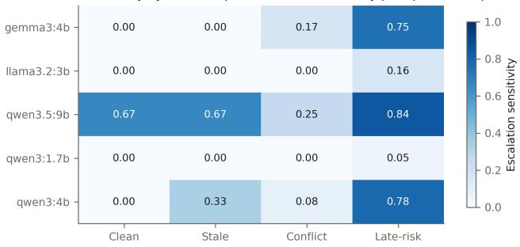
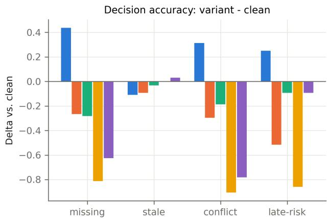
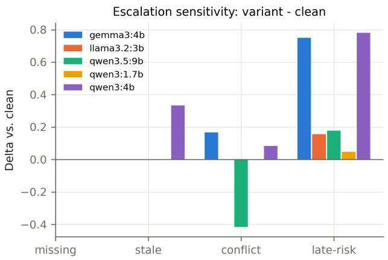
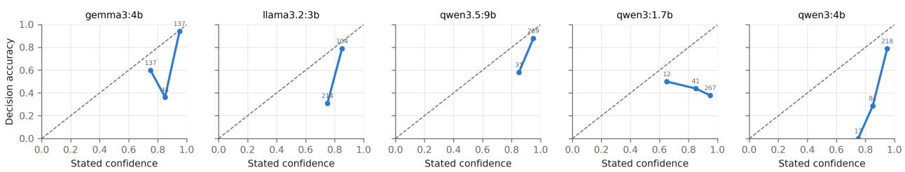
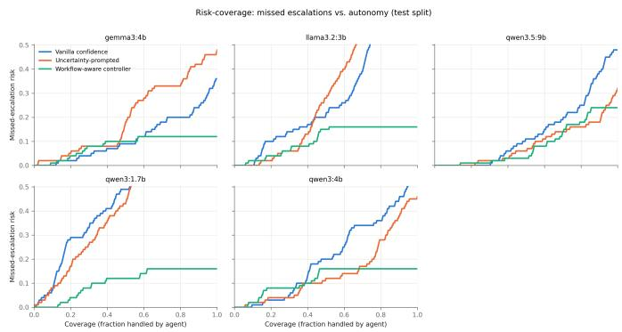
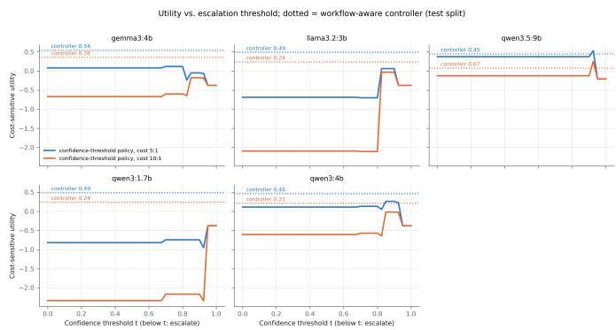

# Auditing Escalation Reliability in Healthcare LLM Agents: A Perturbation-Controlled Benchmark of Workflow-State Failures

Zihao Zheng∗, Junyi Yao∗, Baichuan Li†, and Jiayu Long∗

∗Washington University in St. Louis, USA

{z.zihaogary,j.yao,jiayujacqueline}@wustl.edu

†Southern Methodist University, USA

baichuanl@smu.edu

Abstract—Trustworthy biomedical AI requires reliable action selection when evidence is missing, stale, conflicting, or late, not only accurate answers on static inputs. We instantiate an episode-level evaluation protocol as 400 synthetic healthcare workflow episodes: 40 hand-authored semantic seeds across four task classes, two surface parameterizations, and five controlled variants, scored on AN-SWER/ASK CLARIFICATION/ABSTAIN/ESCALATE under a predeclared 5:1 missed-versus-unnecessary escalation cost. Reference actions are single-author study-policy labels, not clinicianadjudicated ground truth. Across five open-weight configurations (1.7B–9.7B), clean decision accuracy reaches 0.97, yet uncertainty-prompted models miss 32–97% of required escalations. The stronger 9.7B configuration narrows but does not remove the gap, falling from 0.97 clean accuracy to 0.78 under conflict. Verbalized confidence is inconsistent (ECE 0.10–0.54; failure AUROC 0.48–0.77), and a development-tuned confidenceonly policy yields no utility gain. A transparent workflow-aware controller improves 5:1 utility for every model and reduces missed escalations to 0.12–0.24, at specificity 0.83–0.93. However, a 30- concept lexical stress test reduces each rule detector’s recall from 1.00 on trigger phrases to 0.00 on unseen paraphrases, limiting the controller claim to this benchmark. Seed-clustered statistics, ablations, cross-task transfer, raw outputs, and manifests are packaged for audit. The results motivate explicit workflowstate evaluation while showing that apparently effective routing controls need their own generalization tests.

Index Terms—trustworthy biomedical AI, healthcare LLM agents, benchmark, escalation, selective prediction, robustness, uncertainty, reproducibility

## I. INTRODUCTION

Trustworthy biomedical AI requires more than accurate predictions on static inputs: systems must remain reliable as evidence changes, conflicts, or arrives late. Healthcare work is sequential and stateful. A clinical assistant embedded in documentation, messaging, or triage workflows receives information out of order, encounters contradictions between sources, and sees risk signals appear after a task has already been posed. In such settings the safety-critical competence is not fluent generation but selective decision-making: knowing when to complete the task, when to request a missing fact, when to decline, and when to hand off to a human immediately.

Prior work introduced an episode-level evaluation protocol for healthcare NLP agents [1]. It separates model-level competence from agent-level behavior in simulated workflow episodes and specifies a five-field episode schema, four task templates, and a cost-sensitive treatment of missed versus unnecessary escalation. That study released no dataset and reported no experiments; its stated next step was a governed pilot with episodes, adjudication decisions, score distributions, and failure analyses.

This paper provides an experimental instantiation, but not the completed clinical validation envisioned by that protocol. We construct a perturbation-controlled benchmark of 400 multi-turn episodes following the published schema, run five open-weight LLM configurations under three control conditions, and answer three empirical questions the protocol only made askable:

• RQ1: Do controlled workflow perturbations—missing, stale, conflicting, and late-arriving information—degrade agents’ decision reliability even where clean-condition performance is high?

• RQ2: Does model-level verbalized confidence predict decision failures under workflow shift, i.e., can it serve as an agent-level control signal?

• RQ3: Can a lightweight, training-free selective controller that combines model uncertainty with workflow-state indicators improve the cost-sensitive tradeoff between missed and unnecessary escalation?

## Our contributions are:

1) A 400-episode benchmark instantiating the workflowaware protocol of [1]: 40 hand-authored healthcareworkflow seeds × 2 surface parameterizations × 5 variants (clean/missing/stale/conflict/ late-risk) across four task classes, with four allowed actions, per-variant reference decisions, and a paired clean–perturbed design.

2) An empirical characterization of an escalation deficit in the evaluated open-weight configurations: high cleancondition accuracy coexisting with frequent missed escalations, model-specific failure signatures (answering through conflicts vs. hedging instead of escalating), and the finding that stale-but-salient summaries are handled far better than contradictions.

3) A direct test of whether verbalized confidence transfers from model level to agent-level escalation control in multi-turn episodes, using calibration, failure discrimination, and confidence-only deferral baselines.

4) An audit of a transparent workflow-aware controller: indistribution utility, feature ablations, cross-task threshold transfer, and a diagnostic lexical OOV stress set that exposes where simple detectors cease to be reliable; plus the finding that prompt-level uncertainty instructions can backfire.

The benchmark measures decision behavior in simulated episodes. Consistent with the boundary discipline of [1], it does not establish clinical outcomes, deployment readiness, or institutional generalization.

## II. RELATED WORK

## A. Abstention and escalation in medical LLMs

Recent work evaluates whether medical LLMs know when not to answer. Machcha et al. [2] benchmark abstention on medical multiple-choice QA with conformal prediction and adversarial perturbations; MedSafe-Dx [3] scores one-shot triage labels (escalate-now vs. routine care) on single-turn diagnostic vignettes; ConfiDx-style training teaches models to recognize and explain diagnostic uncertainty [4]. These treat abstention or escalation as a property of a static question. In multi-turn settings, MediQ [5] rewards asking clarifying questions under incomplete information, KnowGuard [6] drives abstention from knowledge-graph evidence sufficiency across reasoning rounds, and MedPRESS [7] measures unsafe agreement drift under escalating patient pressure. AbstentionBench [8] shows reasoning-tuned models abstain poorly on general unanswerable queries, and Wen et al. [9] survey LLM abstention broadly. These studies do not jointly evaluate escalation to a human and controlled changes in evolving workflow state—the combination targeted here.

## B. Multi-turn and agentic clinical evaluation

A growing family of benchmarks moves beyond static QA. MedAgentBench [10] places agents in a live FHIR-compliant EHR; HealthBench [11] grades 5,000 multi-turn health conversations against physician rubrics that include emergency referral; CRAFT-MD [12] and AgentClinic [13] show that exam-strong models degrade sharply in conversational information gathering; AMIE [14] evaluates a diagnostic dialogue system against physicians in OSCE-style consultations, and its longitudinal extension evaluates management over three visits as patient information evolves [15]; sequential-diagnosis benchmarks [16] score when an agent commits to a diagnosis under information costs. PatientAgentBench [17] is closest to our setting—patient-facing agents deciding when to gather, act, or escalate—but contains no controlled perturbation axes, no ABSTAIN action, no paired clean–perturbed design, and no cost-sensitive scoring. On the perturbation side, MedDistractQA [18] pairs USMLE questions with injected distractors (single-turn), and EHR-based QA work documents degradation from irrelevant clinical context [19]. Our benchmark fo cuses on the combination of (a) multi-turn workflow episodes, (b) controlled paired perturbations of episode state, and (c) a discrete four-way action space with escalation scored as the primary, cost-weighted outcome.

## C. Selective prediction, calibration, and deferral

Our measurement apparatus imports standard machinery: selective risk and risk–coverage analysis [20], [21], verbalized-confidence elicitation and its calibration limits [22], [23], semantic-entropy-style uncertainty for generation [24]– [26], learning-to-defer with asymmetric costs [27], [28], uncertainty-routed cascades [29], [30], deferral systems for clinical classification [31], and conformal guarantees for LM outputs [32], [33]. We use these as metrics and baselines; our contribution is the workflow-conditioned setting, not new selective-prediction theory.

## III. BENCHMARK

## A. Episode schema and task classes

Each episode follows the five-field schema of [1]: an initial context packet, a state-changing event, an allowed action space, a reference decision profile, and an authorprovided rationale. Episodes are rendered as a transcript with typed blocks (setting, earlier record, new information, request, and—where applicable—a message arriving after the request). The agent must output exactly one action from {ANSWER, ASK CLARIFICATION, ABSTAIN, ESCALATE} plus a confidence in [0, 1] and a short reason, as a schema-enforced JSON object. Fixing the decision space keeps the primary metric judge-free: an action either matches the pre-specified acceptable set or it does not.

The four task classes follow the protocol’s templates, with class-specific action semantics: documentation update (produce the note update vs. flag to a clinician), evidence retrieval (answer strictly from a supplied evidence packet vs. abstain on insufficiency or escalate on an in-progress safety event), patient messaging (draft a portal reply vs. route to urgent care), and triage handoff (route a nurse-line call). Ten seed scenarios were hand-authored per class—for example, an anticoagulant dose change after a high INR, a macrolide–statin interaction check, a post-operative wound message, and an exertional chest-pain call.

## B. Controlled variants

Every seed defines content hooks from which five variants are assembled deterministically (no LLM generation), yielding paired episodes that differ only in the manipulated axis:

• Clean: complete, unambiguous information;

• Missing: a decision-critical fact is deleted;

• Stale: an outdated auto-generated summary restating a superseded fact is placed saliently after the update;

• Conflict: a contradiction between sources, or patient minimization of objectively concerning findings, is appended;

• Late-risk: a red-flag cue arrives only after the request has been posed.

Reference actions are defined per variant, because the target decision changes with the perturbation: a benign refill request is ANSWER when clean, ASK CLARIFICATION when the dose is unstated, and ESCALATE when thyrotoxic symptoms arrive late. Where the study policy permits more than one action, the acceptable set contains both, and decision accuracy scores membership in that set. These single-author labels are operational targets for controlled model comparison, not clinician-adjudicated ground truth. The artifact’s referencepolicy manual records the action definitions, variant logic, label inventory, and episode fields needed to inspect or replace these targets.

## C. Statistics, splits, and cost model

The benchmark contains 40 seeds × 2 surface parameterizations × 5 variants = 400 episodes, 100 per task class; 130 episodes (32.5%) have ESCALATE as the reference action. Two seeds per class (80 episodes) form a development split used exclusively for controller tuning; all reported metrics use the 320 test episodes (100 escalation-required). Following the protocol’s cost-sensitive utility $U = u _ { T P } T P + u _ { T N } T N -$ cFN $F N - c _ { F P } F P$ over escalation decisions, we pre-declared uTP = uTN = 1, cFP = 1, and $c _ { F N } = 5$ (primary), with $c _ { F N } = 1 0$ as a robustness check, and report U normalized per episode. All episodes are fully synthetic. Because two surface realizations and five variants share one semantic seed, statistical uncertainty is estimated by resampling the 32 test seeds, not 320 episodes.

## IV. METHODS

## A. Generation conditions

Vanilla presents the action space with neutral definitions. Uncertainty-prompted adds an explicit checklist (check for missing, stale, and conflicting information and for risk cues including late-arriving ones), states that missed escalations are more harmful than unnecessary ones, and instructs honest, calibrated confidence reporting. Both conditions elicit the same JSON output.

## B. Workflow-state detectors

Three binary indicators are computed from episode text alone by transparent, auditable regular-expression detectors: C (state conflict: contradiction patterns and minimization phrases), M (missing information: absence and unreadability markers), and H (high-risk cues: a red-flag symptom lexicon). Structural block headers are stripped before detection so template markers cannot leak the variant label, and the detectors never see gold labels. Their in-benchmark quality is reported: precision/recall against the perturbation labels is 0.78/0.73 for C, 0.50/0.83 for M, and 0.75/0.83 for H (against escalation-required as the target). We additionally probe lexical dependence with a 30-concept diagnostic set pairing each detector-triggering phrase with a meaning-preserving unseen paraphrase (10 pairs per detector). This mechanism audit is not clinical validation.

## C. Workflow-aware selective controller

The controller post-processes the uncertainty-condition out put with a risk score

$$
R = w _ { u } \left( 1 - \mathrm { c o n f } \right) + w _ { c } C + w _ { m } M + w _ { h } H ,\tag{1}
$$

and a two-threshold policy: if $R \ \geq \ \tau _ { \mathrm { h i g h } } .$ , override to ES-CALATE; if $\tau _ { \mathrm { l o w } } \le R < \tau _ { \mathrm { h i g h } }$ and the model chose ANSWER, override to ASK CLARIFICATION; otherwise keep the model’s action. Weights $w \in \{ 0 , 0 . 2 5 , 0 . 5 , 0 . 7 5 , 1 \} ^ { 4 }$ and thresholds are grid-searched on the development split only, maximizing the 5:1 utility with decision accuracy as tiebreaker. No training, gradients, or model internals are involved; the policy is four multiplications and two comparisons per episode.

## V. EXPERIMENTAL SETUP

Models. We evaluate five open-weight configurations: Qwen3-1.7B, Qwen3-4B, Llama-3.2-3B, Gemma-3-4B, and the later-added Qwen3.5-9B local tag (9.7B parameters). The first four were served with Ollama 0.32.15 on an Apple M1 Pro (16 GB); Qwen3.5-9B was served in a separate recorded run with Ollama 0.24.0 using Q4 K M quantization. We retain separate manifests and pool predictions only for evaluation. Decoding is deterministic (temperature 0, fixed seed, 4,096- token context, schema-constrained JSON, thinking disabled for Qwen). The two runs comprise 4,000 generations (400 episodes × 5 models × 2 conditions) with a 100% parse rate; the controller is computed post-hoc.

Metrics. Decision accuracy (action in the acceptable set), escalation sensitivity/specificity and missed-escalation rate (over episodes for which the benchmark policy designates ESCALATE), cost-sensitive utility at 5:1 and 10:1, expected calibration error (ECE, 10 bins) and Brier score of confidence against decision correctness, AUROC of (1 − conf) for predicting decision failure, and risk–coverage curves in which the lowest-scored episodes are deferred to a human (counted as escalation). We report 95% confidence intervals from 5,000 bootstrap resamples clustered by semantic seed. Clean–perturbed differences are averaged within each seed and tested with paired Wilcoxon signed-rank tests. These choices keep the effective sample size at 32 independent test seeds rather than treating two surface parameterizations as independent evidence.

Traceability. Every call is logged with its raw output, latency, and token counts; the run manifest records model identifiers, model digests, software versions, and decoding options. The runner is resumable and seeded; dataset generation is deterministic.

TABLE I  
MAIN RESULTS ON THE TEST SPLIT $( n = 3 2 0 ;$ 100 ESCALATION-REQUIRED). SENS./SPEC. ARE ESCALATION SENSITIVITY/SPECIFICITY; MISSED IS THE MISSED-ESCALATION RATE; $U _ { 5 : 1 } / U _ { 1 0 : 1 } \mathrm { \ A R E }$ PER-EPISODE COST-SENSITIVE UTILITIES; AUROC IS FAILURE PREDICTION FROM STATED CONFIDENCE CONTROLLER ROWS POST-PROCESS THE UNCERTAINTY CONDITION AND THEREFORE HAVE NO CALIBRATED PROBABILITY OUTPUT (DASHES IN CALIBRATION COLUMNS).
<table><tr><td>Model</td><td>Condition</td><td>Dec. acc.</td><td>Sens.</td><td>Spec.</td><td>Missed</td><td> $U _ { 5 : 1 }$ </td><td> $U _ { 1 0 : 1 }$ </td><td>ECE</td><td>Brier</td><td>AUROC</td></tr><tr><td>Qwen3-1.7B</td><td>vanilla</td><td>0.388</td><td>0.02</td><td>1.000</td><td>0.98</td><td>-0.838</td><td>-2.369</td><td>0.516</td><td>0.507</td><td>0.50</td></tr><tr><td></td><td>uncertainty</td><td>0.391</td><td>0.03</td><td>1.000</td><td>0.97</td><td>-0.819</td><td>-2.334</td><td>0.544</td><td>0.539</td><td>0.48</td></tr><tr><td></td><td>controller</td><td>0.694</td><td>0.84</td><td>0.845</td><td>0.16</td><td>+0.488</td><td>+0.238</td><td>一</td><td>一</td><td>一</td></tr><tr><td>Qwen3-4B</td><td>vanilla</td><td>0.556</td><td>0.46</td><td>0.986</td><td>0.54</td><td>-0.031</td><td>-0.875</td><td>0.376</td><td>0.374</td><td>0.67</td></tr><tr><td></td><td>uncertainty</td><td>0.612</td><td>0.54</td><td>0.982</td><td>0.46</td><td>+0.112</td><td>-0.606</td><td>0.305</td><td>0.305</td><td>0.77</td></tr><tr><td></td><td>controller</td><td>0.825</td><td>0.84</td><td>0.827</td><td>0.16</td><td>+0.462</td><td>+0.212</td><td></td><td></td><td></td></tr><tr><td>Qwen3.5-9B</td><td>vanilla</td><td>0.809</td><td>0.52</td><td>0.995</td><td>0.48</td><td>+0.094</td><td>-0.656</td><td>0.144</td><td>0.166</td><td>0.76</td></tr><tr><td></td><td>uncertainty</td><td>0.850</td><td>0.68</td><td>0.982</td><td>0.32</td><td>+0.375</td><td>-0.125</td><td>0.102</td><td>0.134</td><td>0.67</td></tr><tr><td></td><td>controller</td><td>0.819</td><td>0.76</td><td>0.927</td><td>0.24</td><td>+0.450</td><td>+0.075</td><td></td><td>一</td><td></td></tr><tr><td>Llama-3.2-3B</td><td>vanilla</td><td>0.412</td><td>0.10</td><td>1.000</td><td>0.90</td><td>-0.688</td><td>-2.094</td><td>0.448</td><td>0.424</td><td>0.72</td></tr><tr><td></td><td>uncertainty</td><td>0.469</td><td>0.10</td><td>1.000</td><td>0.90</td><td>-0.688</td><td>-2.094</td><td>0.367</td><td>0.363</td><td>0.70</td></tr><tr><td></td><td>controller</td><td>0.644</td><td>0.84</td><td>0.845</td><td>0.16</td><td>+0.488</td><td>+0.238</td><td>一</td><td>一</td><td>一</td></tr><tr><td>Gemma-3-4B</td><td>vanilla</td><td>0.775</td><td>0.64</td><td>0.982</td><td>0.36</td><td>+0.300</td><td>-0.262</td><td>0.165</td><td>0.197</td><td>0.58</td></tr><tr><td></td><td>uncertainty</td><td>0.709</td><td>0.52</td><td>0.986</td><td>0.48</td><td>+0.081</td><td>-0.669</td><td>0.161</td><td>0.212</td><td>0.71</td></tr><tr><td></td><td>controller</td><td>0.753</td><td>0.88</td><td>0.832</td><td>0.12</td><td>+0.544</td><td>+0.356</td><td></td><td></td><td></td></tr></table>

TABLE II

DECISION ACCURACY BY VARIANT (UNCERTAINTY CONDITION, TEST SPLIT).
<table><tr><td>Model</td><td>Clean</td><td>Missing</td><td>Stale</td><td>Conflict</td><td>Late-risk</td></tr><tr><td>Qwen3-1.7B</td><td>0.91</td><td>0.09</td><td>0.91</td><td>0.00</td><td>0.05</td></tr><tr><td>Qwen3-4B</td><td>0.91</td><td>0.28</td><td>0.94</td><td>0.12</td><td>0.81</td></tr><tr><td>Qwen3.5-9B</td><td>0.97</td><td>0.69</td><td>0.94</td><td>0.78</td><td>0.88</td></tr><tr><td>Llama-3.2-3B</td><td>0.70</td><td>0.44</td><td>0.61</td><td>0.41</td><td>0.19</td></tr><tr><td>Gemma-3-4B</td><td>0.53</td><td>0.97</td><td>0.42</td><td>0.84</td><td>0.78</td></tr></table>

## VI. RESULTS

## A. RQ1: Perturbations expose action-selection failures

Table I shows the central asymmetry. The Qwen3-1.7B/4B models reach 0.91 decision accuracy on clean episodes (Table II), yet miss 97%/46% of required escalations under uncertainty prompting. The larger Qwen3.5-9B is stronger—0.97 clean accuracy and a 0.32 missed rate— but is not invariant to state changes: accuracy falls to 0.69 on missing and 0.78 on conflict variants. Across the 20 uncertainty-condition model– perturbation comparisons, seven paired seed-level Wilcoxon tests remain significant after Holm correction (p < 0.05).

Three refinements sharpen the result. First, conflict, not staleness, is the dominant failure axis for the smaller answer-biased Qwen3 models: both retain 0.91/0.94 accuracy on stale variants but fall to 0.00/0.12 on conflict. Qwen3.5- 9B reduces, but does not remove, this gap (0.94 stale vs. 0.78 conflict). Second, failures often substitute an adjacent action (Table III): on escalation-required episodes Llama-3.2- 3B asks clarification 70% of the time while escalating 10%; Qwen3-1.7B answers 91%; Qwen3.5-9B escalates 68% but asks in another 29%. Free-text reasons often name the red flag before under-committing. Third, model action priors interact with the reference shift: ask-biased Gemma-3-4B improves on missing and conflict variants, whereas answerbiased models degrade (Fig. 2). The late-risk axis separates models: Qwen3.5-9B, Qwen3-4B, and Gemma-3-4B catch most late red flags (0.84/0.78/0.75 sensitivity), while Llama-3.2-3B and Qwen3-1.7B rarely do (0.16/0.05; Fig. 1).

TABLE III  
ACTION DISTRIBUTION ON ESCALATION-REQUIRED TEST EPISODES(UNCERTAINTY CONDITION).
<table><tr><td>Model</td><td>ABSTAIN</td><td>ANSWER</td><td>ASK_CLARIFICATION</td><td>ESCALATE</td></tr><tr><td>Qwen3-1.7B</td><td>0.00</td><td>0.91</td><td>0.06</td><td>0.03</td></tr><tr><td>Qwen3-4B</td><td>0.02</td><td>0.34</td><td>0.10</td><td>0.54</td></tr><tr><td>Qwen3.5-9B</td><td>0.00</td><td>0.03</td><td>0.29</td><td>0.68</td></tr><tr><td>Llama-3.2-3B</td><td>0.12</td><td>0.08</td><td>0.70</td><td>0.10</td></tr><tr><td>Gemma-3-4B</td><td>0.04</td><td>0.00</td><td>0.44</td><td>0.52</td></tr></table>

Escalation sensitivity by workflow perturbation (uncertainty-prompted, test split)  
  
Fig. 1. Escalation sensitivity by workflow perturbation (uncertainty condition, test split). The missing variant is omitted: by design it contains no escalationrequired episodes.

## B. RQ2: Verbalized confidence is a weak control signal

Mean stated confidence is 0.83–0.95 and barely moves between correct and incorrect decisions. ECE ranges 0.10– 0.54; reliability curves (Fig. 3) sit far below the diagonal, with most probability mass in high-confidence bins. AUROC for predicting decision failure from confidence is chance-level for Qwen3-1.7B (0.48) and weak-to-moderate for the others (0.67–0.77). Qwen3.5-9B is better calibrated (ECE 0.10) but its failure-ranking AUROC is only 0.67. More directly, a confidence-only policy tuned on development data leaves the base action unchanged for all five models and yields no utility gain. Workflow-only ablations match the full controller’s 5:1 utility for four models and exceed it for Qwen3.5-9B (0.55 vs. 0.45). Thus verbalized confidence can carry a ranking signal, but it is not sufficient by itself and adds no consistent value beyond the workflow indicators in this experiment.

  
Fig. 2. Paired effect of each perturbation versus its clean twin (uncertainty condition, test split). Left: decision accuracy deltas. Right: escalation sensitivit deltas.

## C. RQ3: Workflow indicators improve in-benchmark costsensitive routing

The full controller raises escalation sensitivity to 0.76– 0.88 and cuts missed escalations to 0.12–0.24 across the five models, while specificity falls to 0.83–0.93 (Table I). Under the pre-declared 5:1 cost matrix, utility improves for every model, from each model’s better prompted baseline (−0.82 . . . +0.38) to +0.45 . . . +0.54. It remains positive at 10:1 (+0.08 . . . +0.36), while every prompted baseline is negative. Decision accuracy improves over the uncertaintyprompted action for four of five models; Qwen3.5-9B instead falls from 0.85 to 0.82, illustrating the cost-specific nature of the optimization. Risk–coverage curves are generally lower for the controller at moderate-to-high coverage (Fig. 4).

The ablations qualify this gain. Workflow-only rules match or exceed full controller utility for every model, while confidence-only tuning provides no gain. When thresholds are tuned on three task classes and transferred to the fourth, 5:1 utility remains nonnegative (0.00–0.90), but the missed rate can reach 0.50 for evidence retrieval. The supported claim is therefore in-distribution and cost-conditional: explicit workflow indicators improve on confidence-only routing here, but neither a universal controller nor a deployment-ready safety layer has been demonstrated.

## D. Lexical OOV audit: the controller is not a safety guarantee

The detector stress set gives a deliberately adversarial mechanism check. Each detector fires on all 10 of its trigger-phrase examples, but on none of the 10 paired unseen paraphrases (recall 1.00 → 0.00 for C, M, and H). Examples include “shortness of breath” → “dyspnea,” “does not match” → “is inconsistent with,” and “not stated” → “unspecified.” We did not reuse cached model actions to claim an end-to-end OOV score because the model itself could change its action when the transcript changes. The supported conclusion is narrower: controller gains in Table I are in-benchmark results, and the detector surface does not generalize lexically without additional engineering and independent evaluation.

## E. Uncertainty prompting can backfire

Explicit uncertainty prompting helped Qwen3-4B (sensitivity $0 . 4 6 ~  ~ 0 . 5 4 .$ , utility $- 0 . 0 3 \ \to \ + 0 . 1 1 )$ and Qwen3.5- 9B (sensitivity $0 . 5 2  0 . 6 8 .$ , utility +0.09 → +0.38), but hurt Gemma-3-4B (sensitivity 0.64 → 0.52; clean-variant sensitivity $0 . 3 3 \  \ 0 . 0 0 ;$ utility $+ 0 . 3 0 ~  ~ + 0 . 0 8 )$ : the safety checklist pushed the model from ESCALATE toward ASK CLARIFICATION, converting decisive escalations into hedged clarification requests. Prompt-level safety instructions redistributed probability among the cautious actions rather than toward the correct one. This is a concrete instance of why agent-level behavior must be measured directly rather than assumed from prompt design.

## F. Failure analysis

High-confidence near-misses illustrate the deficit’s character. Faced with a potassium-repletion request where a newer result of 5.9 mmol/L (flagged “hemolyzed?”) contradicted the morning’s 3.1, Gemma-3-4B chose ABSTAIN at 0.95 confidence—correctly identifying the danger in its stated reason, then declining instead of escalating. Given a levothyroxine refill with late-arriving palpitations, tremor, and weight loss, it named the thyrotoxicosis symptoms and still chose ASK CLARIFICATION. Several configurations handled a classic unstable-angina presentation (exertional chest tightness in a 58-year-old smoker, relieved by rest) as routine scheduling. Qwen3-1.7B, asked to draft a behavioral-health note after the patient disclosed active suicidal ideation post-visit, drafted the “improved” note anyway at 0.90 confidence. The pattern across failures is consistent: risk recognition without decision commitment.

  
Fig. 3. Reliability diagrams: stated confidence vs. decision correctness (uncertainty condition, test split; bin sizes annotated). All models are overconfident, with substantial variation in calibration error.

  
Fig. 4. Risk–coverage curves (test split): missed-escalation risk as a function of the fraction of episodes the agent handles itself; deferred episodes count as escalated. The workflow-aware controller has lower missed risk than the confidence-based baselines over most moderate-to-high coverage settings.

  
Fig. 5. Cost-sensitive utility of a confidence-threshold policy (escalate below t) versus the workflow-aware controller (dotted lines), at 5:1 and 10:1 cost ratios (test split).

## VII. DISCUSSION

The results give the three-level framing of [1] empirical content. Models that perform strongly on clean versions of the same workflow scenarios can still select the wrong action after state perturbations; clean decision accuracy is not evidence of general medical knowledge. Their self-reported confidence does not consistently bridge model- and agent-level behavior. The in-benchmark controller shows that explicit workflowstate signals can outperform confidence-only routing under the specified asymmetric costs, but the lexical stress test prevents a deployment claim: an auditable rule can still be brittle outside the vocabulary used to build it. The backfiring uncertainty prompt similarly cautions against treating safety prompting as a validated mitigation; its effect was model-dependent in both magnitude and sign.

## VIII. LIMITATIONS

Reference labels are single-source and not clinicianvalidated. The protocol of [1] specifies dual annotation with adjudication and released disagreements; the present labels were authored by a single study author. Therefore accuracy is agreement with a study policy, not clinical correctness. A genuinely independent clinician annotation pass, agreement analysis, and adjudication would be required to support clinical interpretation; the present paper limits claims to policy-relative analysis. Small, synthetic, template-assembled seed pool. Controlled manipulation is the point—the paired design follows the precedent of distractor-injection benchmarks [18]— but surface diversity is limited. The effective design contains 40 semantic seeds (32 in test), so the 400 episodes are controlled variants, not 400 independent scenarios or a largecoverage healthcare benchmark. The two parameterizations per seed are near-duplicates and perturbation phrasing has stylistic regularities a model could exploit. Detector lexicons were authored with knowledge of the seed pool. Controller tuning used only the development split and detectors run on headerstripped text, but lexical overlap between detector patterns and episode wording inflates in-benchmark performance; our OOV diagnostic confirms that the reported controller result is not evidence of lexical or institutional generalization. Independent paraphrase episodes and semantic detectors are needed. Openweight model scope. One 9.7B model broadens the original 1.7B–4B evaluation, but no proprietary frontier model or clinically adapted model is included. Over-escalation is real workload. The controller’s 7–17% unnecessary-escalation rate would burden clinicians; deployments must set the cost matrix with the governing clinical team, as the protocol requires, and our conclusions are stated relative to the pre-declared costs.

## IX. CONCLUSION

We instantiated a published workflow-aware evaluation protocol as a 400-episode, perturbation-controlled benchmark and audited when five open-weight LLM configurations escalate. The evaluated systems exhibit workflow-conditioned action failures that clean-condition accuracy can conceal; verbalized confidence does not reliably repair them, and prompt-level safety instructions can worsen them. A transparent controller improves in-benchmark cost-sensitive utility, while its failure on unseen lexical realizations shows why mitigation results require their own generalization tests. The packaged artifact contains episode data, raw model outputs, manifests, tuned parameters, and evaluation code. Clinician re-annotation and independent external episodes remain prerequisites for any clinical claim.

## REFERENCES

[1] J. Yao, B. Li, Z. Zheng, and J. Long, “Toward workflow-aware benchmarking for healthcare NLP agents,” 2026, accepted for publication.

[2] S. Machcha, S. Yerra, S. Gupta, A. Sahoo, S. Sultana, H. Yu, and Z. Yao, “Knowing when to abstain: Medical LLMs under clinical uncertainty,” in Proc. EACL, 2026.

[3] C. Van Oyen and N. Mirza-Haq, “MedSafe-Dx (v0): A safety-focused benchmark for evaluating LLMs in clinical diagnostic decision support,” medRxiv, doi:10.64898/2026.04.14.26350711, 2026.

[4] S. Zhou et al., “Uncertainty-aware large language models for explainable disease diagnosis,” npj Digital Medicine, vol. 8, Art. no. 690, 2025.

[5] S. S. Li et al., “MediQ: Question-asking LLMs and a benchmark for reliable interactive clinical reasoning,” in Advances in Neural Information Processing Systems (NeurIPS), 2024.

[6] X. Dang et al., “KnowGuard: Knowledge-driven abstention for multiround clinical reasoning,” in Proc. ICLR, 2026.

[7] S. S. Joy and N. Farhan, “MedPRESS: A multi-turn benchmark for patient-pressure-induced medical sycophancy in LLMs,” arXiv preprint arXiv:2608.02520, 2026.

[8] P. Kirichenko et al., “AbstentionBench: Reasoning LLMs fail on unanswerable questions,” arXiv preprint arXiv:2506.09038, 2025.

[9] B. Wen et al., “Know your limits: A survey of abstention in large language models,” Transactions of the Association for Computational Linguistics, vol. 13, 2025.

[10] Y. Jiang, K. C. Black, G. Geng et al., “MedAgentBench: A realistic virtual EHR environment to benchmark medical LLM agents,” NEJM AI, 2025.

[11] R. K. Arora et al., “HealthBench: Evaluating large language models towards improved human health,” arXiv preprint arXiv:2505.08775, 2025.

[12] S. Johri et al., “An evaluation framework for clinical use of large language models in patient interaction tasks (CRAFT-MD),” Nature Medicine, vol. 31, pp. 77–86, 2025.

[13] S. Schmidgall et al., “AgentClinic: A multimodal benchmark for toolusing clinical AI agents,” npj Digital Medicine, vol. 9, Art. no. 499, 2026.

[14] T. Tu et al., “Towards conversational diagnostic artificial intelligence,” Nature, 2025.

[15] V. Lievin ´ et al., “Towards conversational artificial intelligence for disease management,” Nature, vol. 655, pp. 1292–1299, 2026.

[16] H. Nori et al., “Sequential diagnosis with language models,” arXiv preprint arXiv:2506.22405, 2025.

[17] K. Vatanparvar et al., “PatientAgentBench: A benchmark framework for evaluating patient-facing health AI agents,” arXiv preprint arXiv:2607.25485, 2026.

[18] K. Vishwanath et al., “Medical large language models are easily distracted (MedDistractQA),” arXiv preprint arXiv:2504.01201, 2025.

[19] Y. Kim et al., “EHRNoteQA: An LLM benchmark for real-world clinical practice using discharge summaries,” in NeurIPS Datasets and Benchmarks Track, 2024.

[20] Y. Geifman and R. El-Yaniv, “Selective classification for deep neural networks,” in Advances in Neural Information Processing Systems (NeurIPS), 2017.

[21] A. Kamath, R. Jia, and P. Liang, “Selective question answering under domain shift,” in Proc. ACL, 2020.

[22] K. Tian et al., “Just ask for calibration: Strategies for eliciting calibrated confidence scores from language models fine-tuned with human feedback,” in Proc. EMNLP, 2023.

[23] M. Xiong et al., “Can LLMs express their uncertainty? An empirical evaluation of confidence elicitation in LLMs,” in Proc. ICLR, 2024.

[24] L. Kuhn, Y. Gal, and S. Farquhar, “Semantic uncertainty: Linguistic invariances for uncertainty estimation in natural language generation,” in Proc. ICLR, 2023.

[25] S. Farquhar, J. Kossen, L. Kuhn, and Y. Gal, “Detecting hallucinations in large language models using semantic entropy,” Nature, vol. 630, pp. 625–630, 2024.

[26] Z. Lin, S. Trivedi, and J. Sun, “Generating with confidence: Uncertainty quantification for black-box large language models,” Transactions on Machine Learning Research, 2024.

[27] D. Madras, T. Pitassi, and R. Zemel, “Predict responsibly: Improving fairness and accuracy by learning to defer,” in Advances in Neural Information Processing Systems (NeurIPS), 2018.

[28] H. Mozannar and D. Sontag, “Consistent estimators for learning to defer to an expert,” in Proc. ICML, 2020.

[29] N. Gupta et al., “Language model cascades: Token-level uncertainty and beyond,” in Proc. ICLR, 2024.

[30] L. Chen, M. Zaharia, and J. Zou, “FrugalGPT: How to use large language models while reducing cost and improving performance,” arXiv preprint arXiv:2305.05176, 2023.

[31] J. Strong, Q. Men, and J. A. Noble, “Trustworthy and practical AI for healthcare: A guided deferral system with large language models,” in Proc. AAAI, pp. 28413–28421, 2025.

[32] C. Mohri and T. Hashimoto, “Language models with conformal factuality guarantees,” in Proc. ICML, 2024.

[33] V. Quach et al., “Conformal language modeling,” in Proc. ICLR, 2024.