# AutoSFT: An Agentic System for Automated Data Research in Supervised Fine-Tuning

Bingxiang He∗†1, Pengqi Sun∗2, Shihao Peng∗1, Shaoxuan Li∗1, Huiyu Xiao∗2, Hongjian Shi∗3, Zixuan Fu∗1, Ziqing Qiao∗1, Yuxin Zuo∗†1, Cheng Qian4, Xinqiang Yu1, Jiayi Li3, Xiusi Chen5, Yizhen Song3, Xiangyang Wang1, Iofai Lei1, Yudong Wang1, Ning Ding1, Zhiyuan Liu1, Xiaozhi Wang‡1, Chaojun Xiao‡1

1Tsinghua University 2Beijing University of Posts and Telecommunications 3ModelBest Inc.

4University of Illinois Urbana-Champaign 5The Chinese University of Hong Kong

†Project Lead. ∗Core Contributors. ‡Corresponding Authors.

§ Code: https://github.com/Thinking-Space/AutoSFT.

# hebx24@mails.tsinghua.edu.cn, xzwang@sz.tsinghua.edu.cn, xcj@tsinghua.edu.cn

Abstract | Language model agents increasingly automate post-training, but when given the full training stack they converge on supervised fine-tuning and spend most efort revising training data. Existing systems give the agent one kind of control, selecting rows from a fixed pool or calling a generator, whereas a human data engineer adjusts proportions, prunes, repairs, replaces and synthesizes the data. We design a data action space for these changes and ask whether an automated system can make the full range rather than one of them, and what structure that requires. We first run this loop with a single agent, and it reaches only one action, adjusting category proportions, while its context fills with execution output and is discarded mid-search. We therefore introduce AutoSFT, a multi-agent system where a meta agent separates execution from analysis, gathers proposals from independent angles, and calls a synthesis subagent for capabilities the pool cannot cover, with the model, the trainer, and the budget fixed within each comparison. Adding each component in turn helps: the executor halves context loss, the analysis subagents lift the best IFEval by +6.5, and synthesis adds +3.4 IFEval and +2.9 IFBench. The same loop transfers to code, where analysis adds +3.7 MBPP+ over a single agent that does not improve. Every result comes from runs that retrain from the base model each round, so each component’s efect is individually attributable. Our findings suggest that automating SFT data research depends more on covering diverse data actions than on a stronger single action.

## 1. Introduction

LLM agents now run long workflows with little human oversight, and several systems use them to automate parts of AI research itself [Lu et al., 2026, Tang et al., 2025, Hu et al., 2025, Wen et al., 2026]. What makes such a loop searchable is that every proposal can be evaluated automatically, and post-training has this property, so recent benchmarks evaluate agents on it [Rank et al., 2026, Chen et al., 2026a]. Given control of the whole training stack, agents converge on one part: across the runs audited by PostTrainBench [Rank et al., 2026], they adopt supervised fine-tuning (SFT) and spend most of their remaining efort revising the training data. This agrees with a broader finding that a carefully curated dataset can match or outperform a much larger one [Zhou et al., 2023a, Chen et al., 2024, Muennighof et al., 2025], and that data selection and arrangement afect downstream performance directly [He et al., 2025a, Agarwal et al., 2025]. Recent systems therefore treat the data as the main search object [Wu et al., 2026, Luo et al., 2026, Zhao et al., 2026, Kulikov et al., 2026].

Each existing system gives the agent a single kind of control, selecting rows from a fixed pool or calling a generator. We ask whether an automated agent can instead command the full space of operations that an experienced data engineer uses. Such an engineer adjusts category proportions, prunes and repairs rows, replaces overlong responses, writes examples for missing capabilities, and orders the data. We write these six kinds of change as a data action space (Section 2), and use it only after a run to measure how much of that space the agent reaches.

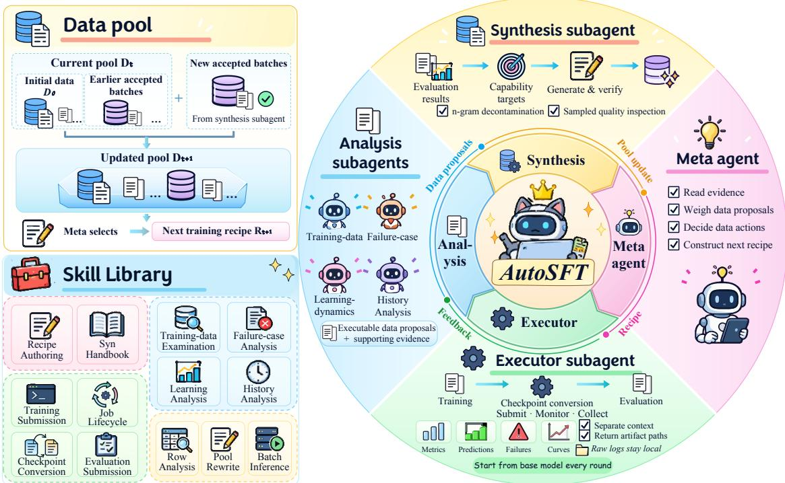  
Figure 1 | Overview of AutoSFT. The meta agent commits a recipe. An executor trains and evaluates it separately and returns artifact paths. Analysis subagents read these artifacts from complementary angles, and a synthesis subagent writes data for undersupplied capabilities. The meta agent integrates their proposals into the next recipe. All roles share a candidate data pool and a skill library.

We first study this question with a single agent, restarting each round from the same base checkpoint. The agent collapses onto one action family, repeats related recipes, and spends most of its context on raw command output rather than data analysis. Section 3 examines these failures, the trace evidence, and our fix, explaining why an undivided research loop is hard to sustain. One agent analyzes behavior, proposes data changes, executes experiments, and interprets logs, so execution competes with analysis for context and a single proposal stream reinforces recent choices. This yields two requirements: isolate execution from data analysis, and maintain complementary views of the same model behavior during proposal generation.

AutoSFT (Section 4) is a multi-agent system built around these two requirements. A meta agent owns each round and delegates to three kinds of subagent. An executor runs training, conversion, and evaluation separately, returning file paths and a short status report so the meta agent can spend its context on data. Analysis subagents read the same round from four angles: training data, failures, training signals, and earlier rounds, each returning one proposed data action. A synthesis subagent writes new data for capabilities the pool barely covers, which neither of the first two can add.

We add the three components one at a time, fixing the base model, initial pool, token budget, training script, and evaluation within each comparison, so any diference is attributable to the added component (Section 5). The executor halves context loss, the analysis subagents broaden the range of changes and raise best IFEval by +6.5, and synthesis adds +3.4 IFEval and +2.9 IFBench by covering undersupplied capabilities. The same loop transfers to code domain without a ready-made capability taxonomy, adding +3.7 MBPP+ over a single agent that does not improve (Section 5.4). Together, these results suggest that automating SFT data research depends less on a stronger single action than on structure that lets an agent cover the range of changes a data engineer makes.

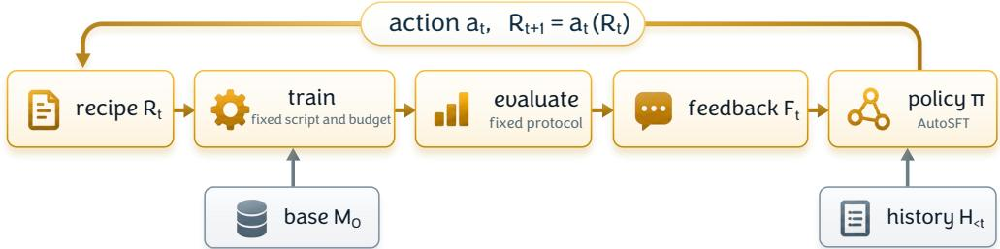  
Figure 2 | One round of the research loop. Only � varies across the configurations we compare.

Contributions. Our contributions are threefold.

• We frame automated SFT data research around a space of six data-engineering actions, and show that a corrected single-agent loop reaches only one of them (Sections 2 and 3).

• We build AutoSFT, a multi-agent system that isolates execution, gathers proposals from complementary analysis angles, and synthesizes data for capabilities the pool lacks (Section 4).

• Adding each component while retraining from the base model, so its efect is attributable, widens the actions a run takes and improves the recipe, by +6.5 IFEval from analysis, +3.4 IFEval and +2.9 IFBench from synthesis, and +3.7 MBPP+ in a code domain (Section 5).

## 2. Automated SFT Data Research

## 2.1. Research loop

An automated SFT data research loop searches over the data recipe that reaches the trainer while the base checkpoint stays fixed, as shown in Figure 2. We fix a base checkpoint $M _ { 0 }$ and an initial candidate pool $D _ { 0 } .$ . A recipe $R _ { t }$ gives every example in the round’s pool $D _ { t }$ a sampling weight, possibly zero, and any rows written during round � join the pool, so that $D _ { t + 1 }$ extends $D _ { t }$ . Training always re-initializes from $M _ { 0 } .$ , so train $( M _ { 0 } , R _ { t } )  C _ { t }$ and the pool and the recipe are the only quantities that carry research history across rounds.

We evaluate $C _ { t }$ on benchmarks $\{ T _ { k } \} _ { k = 1 } ^ { K }$ under one fixed protocol. A round returns the benchmark scores together with the per-example failures, the training dynamics, and a comparison against what earlier rounds tried, and we write this bundle as the feedback $F _ { t }$ . The recipe then advances through

$$
a _ { t } = \pi ( D _ { t } , R _ { t } , F _ { t } , H _ { < t } ) , \qquad R _ { t + 1 } = a _ { t } ( R _ { t } ) ,
$$

where $a _ { t }$ is a data action from the space A of Section 2.2, $R _ { t + 1 }$ is a recipe over $D _ { t + 1 }$ , and $H _ { < t }$ holds the recipes, feedback, and actions of every earlier round. We call � the research policy which is the procedure under study, turning a round’s feedback and the run’s history into the next data action. AutoSFT is one instance of research policy, implemented as a multi-agent system.

The trainer is a single SFT script that runs three epochs, and every recipe within a comparison is capped at the same token budget. Any two rounds therefore difer only in which rows they trained on, and no agent can trade training data for extra rounds. The loop runs until an objective is achieved. Section 3 reports the evidence behind the from-base rule, the fixed budget, and the score target.

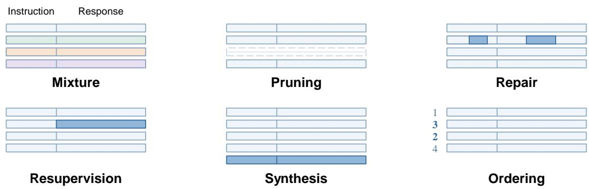  
Figure 3 | The six families of data action, drawn as their efect on the rows of a recipe. Shading marks what the action changes.

## 2.2. Data research actions

A recipe is built out of rows, where a row carries an instruction, a response, and the metadata that describes it. An action states which rows to train on, how often each appears, in what order, and whether any row is edited or newly written. Agents write recipes in free form with no field schema, operator list, and statement that a particular kind of change is available.

Figure 3 describes the six families of data action a data researcher makes most often. Each family is fixed by what happens to the rows and by the level at which the change is decided, which ranges from a whole category through a single row and a capability to the recipe as a whole, so an action can be labelled from the recipe dif without reading the agent’s stated reason.

Every family is reachable in every configuration we run, since an agent that can write a recipe can also call a model to rewrite a response or produce a new row. We apply the labels only after a run and report how many families a run covered alongside its scores.

Actions that leave the recipe unchanged, such as holding out a per-category validation set or evaluating a checkpoint more times, are research actions rather than data actions and stay outside A.

## 3. Pilot study: What limits single agents in SFT data research

We study how a single agent behaves when it owns an entire SFT data research loop. We reproduce the open-ended PostTrainBench setting [Rank et al., 2026] for Qwen3-1.7B-Base [Yang et al., 2025] on IFEval [Zhou et al., 2023b], in which the agent receives one H100, unrestricted internet access, and a ten-hour wall-clock budget. Six design choices in this setting interfere with measuring what the agent does with data, and we correct them before running the loop: we fix the training algorithm to SFT, provide an initial dataset pool instead of Internet search, add a second benchmark IFBench [Pyatkin et al., 2025], retrain from the base checkpoint each round, replace the wall-clock allowance with benchmark targets, and return richer feedback including training loss, category-level scores, and per-example failures. Details are deferred to Appendix A.

## 3.1. Three failure modes of the single-agent loop

Setup. The candidate pool is argilla/ifeval-like-data1, a verifiable instruction-following corpus [Xu et al., 2024b]. Each round draws a recipe of at most 10M tokens and trains for three epochs at sequence length 32,768, with global batch size 16 and learning rate $1 0 ^ { - 4 }$ . The loop stops when IFEval reaches 80 and IFBench reaches 50. A single Codex agent running GPT-5.5 at medium reasoning efort submitted 33 rounds and completed evaluation on 32 of them within 11.5 hours, at which point neither target had been reached.

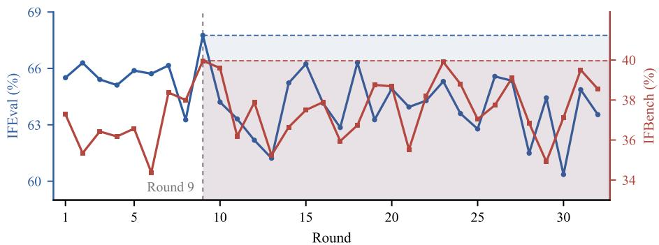

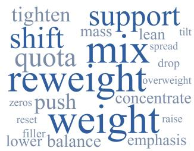  
Figure 4 | Left: benchmark scores over the 32 evaluated rounds on separate axes. Right: the terms the agent used to state its chosen data action, sized by how often it used them.

The search stays inside one family of actions. Every round adjusts how much of each category to train on, so the whole run falls in the mixture family. As Figure 4 shows, round 9 is the best on both benchmarks and the 23 rounds after it produce nothing better. The agent does not lack terms for the move it repeats, using 22 distinct expressions across the run, from reweight to raise and concentrate. What it lacks is variety in the move itself. Its reasoning never mentions repairing a row, replacing a response, or writing a new example, and the corresponding terms do not appear in the trace.

## Time Limits Reduce Per-Round Training Data.

The open-ended run is allotted ten hours, and Figure 5 reports the amount of data presented to the trainer in each round. The recipe expands over the first four rounds, reaching 264k rows, and then declines in every subsequent round, ending at 69k rows, which is 26% of the peak. The agent continues to submit rounds throughout, so the run does not terminate early. Rather, it progressively reduces the cost of each remaining round. Once a checkpoint is suficiently good to retain, additional training data yields no further improvement under the objective, whereas the time it would cost can be used for another attempt. Under benchmark targets, this contraction does not occur: recipe size is around max token budget, and the agent never refers to the remaining time budget.

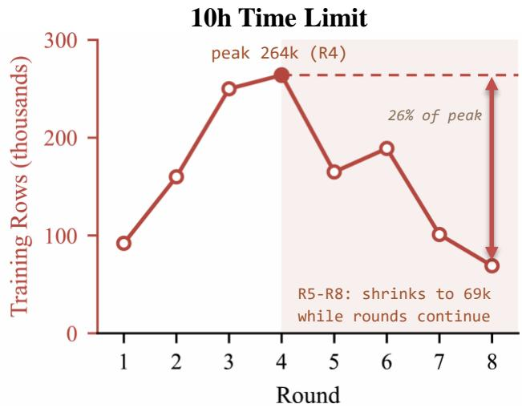  
Figure 5 | Training data per round under a wallclock budget.

The context fills and is discarded ten times. The agent runs data decisions, job submission, checkpoint conversion, and evaluation in one session, and Figure 6 shows that session filling to 94.7% of a 258,400-token window and being compacted ten times, first during round 2 and then every three to four rounds. Research history is therefore discarded and rebuilt ten times while the search is still running. The context is not dominated by the obvious suspect. Polling job status is the most frequent operation, at 371 calls, yet it accounts for only 1.7% of the 9.9M bytes accumulated. The space goes instead to a few large payloads: training output at 13.4%, repeated reads of the run record at 11.8%, applying the data action at 9.7%, and evaluation output at 8.9%. With the agent’s reasoning (16.3%) and compaction summaries (8.3%), six sources take two thirds of the window. None of them relates to choosing the next data action, which argues for giving those steps their own session.

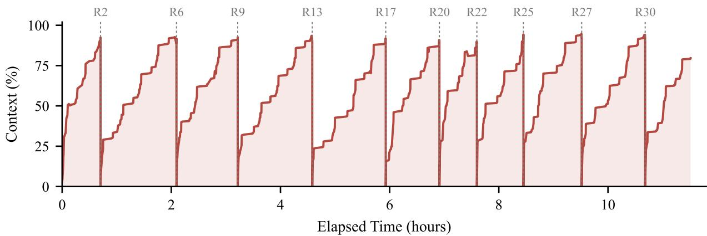  
Figure 6 | The single agent’s context. Dashed lines mark compactions labelled with the round.

## 3.2. From observations to requirements

The second observation is answered by the objective itself, and the controlled loop already carries that change. The other two set the structure AutoSFT has to provide. Execution has to leave the deciding agent’s context, so a dedicated executor runs submission, conversion, and evaluation in its own session and returns status receipts and artifact paths (Section 4.1). Proposals have to come from multiple lines of reasoning, so we run several analysis subagents from diferent angles, following Wen et al. [2026], who find that distinct starting directions preserve diversity across parallel agents (Section 4.2). Besides, neither change introduces data that the pool did not already contain, which is a separate limitation and the reason Section 4.3 introduces a third component.

## 4. AutoSFT

AutoSFT instantiates the research policy � of Section 2.1 and shares $M _ { 0 } , D _ { 0 }$ , and the training and evaluation protocol with the single agent of Section 3. A meta agent owns the round and delegates to three kinds of subagents: an executor subagent, four analysis subagents, and a synthesis subagent, whose information flow is shown in Figure 1. The meta agent hands $D _ { t }$ and $R _ { t }$ to the executor, which trains and evaluates in a separate session and returns the feedback $F _ { t }$ . The analysis and synthesis subagents then consult the relevant parts of $D _ { t } , R _ { t } , F _ { t } ,$ and $H _ { < t }$ through their associated files. Each analysis subagent proposes a change to the recipe from its own perspective, while the synthesis subagent generates data for undersupplied capability targets to form $D _ { t + 1 }$ . The meta agent weighs these proposals against its own reading and settles on $a _ { t }$ , giving $R _ { t + 1 } = a _ { t } \big ( D _ { t + 1 } , R _ { t } \big )$ . Implementation details, including a skill library and memory design, are given in Appendix B.

## 4.1. Executor subagent

As shown in Section 3.1, the context of the single-agent loop fills with the verbose logs and outputs of training and evaluation jobs, leaving the information that matters unused. Given this, we introduce an executor, which takes the entire lifecycle of training, checkpoint conversion, and evaluation out of the meta agent and maintains a context of its own. Specifically, everything it does is one cycle of submitting a job, monitoring it to completion, and collecting its artifacts: the cycle runs once on the training job to obtain the round’s model $C _ { t } ,$ and then once on each of the � benchmarks to obtain the evaluation results for $C _ { t } ,$ with the raw logs and intermediate outputs staying in its own context. When the workflow finishes, the executor saves the feedback artifacts and a structured execution report to files and returns only their paths. The meta agent and the analysis and synthesis subagents can then read the relevant files as needed, without receiving the full execution logs.

## 4.2. Analysis subagents

Section 3.1 shows that all 33 rounds of the single agent stay inside the mixture family: it pursues the objective through one kind of strategy. To break out of the limitation, we introduce four analysis agents, each of which examines the current round from a diferent evidence source: the training data, failure cases, learning dynamics, or research history.

The four subagents examine each round using complementary evidence. The training-data subagent reads $D _ { t }$ and $R _ { t } ,$ assesses the selected data for quality, dificulty, coverage, and redundancy, and proposes changes to its content or composition under the fixed token budget. The failure-case subagent compares successful and failed cases in $F _ { t }$ to identify recurring failure patterns and propose supervision to address them. The learning-dynamics subagent analyzes the training loss and other monitoring signals in $F _ { t }$ in relation to the data used for training, seeking evidence that explains stalled learning progress. The history subagent reads $H _ { < t }$ , distinguishes failed interventions from ideas that have not been adequately tested, and proposes corrections or renewed trials. Each subagent returns one executable data proposal with supporting evidence.

## 4.3. Synthesis subagent

In practice, the initial pool $D _ { 0 }$ may not cover every capability the benchmarks require, and for others it holds examples but too few to constitute efective supervision. We therefore introduce a synthesis subagent to generate examples for undersupplied capability targets. Such a target is convenient to state and to verify in the instruction-following setting: it is a single checkable constraint, or a combination of constraints that co-occur, such as repeating the instruction verbatim while using no comma, and in either case a programmatic verifier decides whether an example satisfies it.

Concretely, the synthesis agent is invoked in every round, reads the evaluation results, and derives a set of targets to strengthen. For each target whose supply in $D _ { t }$ is insuficient, it synthesizes examples that pass the target’s verifier. If no target is undersupplied in a given round, the synthesis agent generates no data. Generated data pass verification of the target’s constraint, an independent semantic review, and an �-gram overlap check against the evaluation sets, described in Appendix B.4. Those that pass enter $D _ { t + 1 }$ , and whether the round trains on them remains the meta agent’s decision.

## 5. Experiment

AutoSFT adds three components to the loop of Section 3, and we test them one at a time. Each subsection compares a base configuration against the same configuration with one component added, so a diference is attributable to that component alone, while Section 5.4 runs the full system on a coding domain to test whether the same structure transfers. Appendix D gives the full implementation settings for every comparison and an estimate of the compute and API cost of a run.

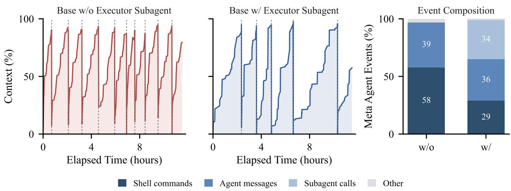  
Figure 7 | Context used by the meta agent over each run and the composition of its recorded events.

## 5.1. Executor subagent

Setup. The base configuration is the single agent of Section 3.1. Adding the executor places that lifecycle in a separate session, so the meta agent receives artifact paths and a brief status report rather than executing the lifecycle. Both runs begin from the same base checkpoint, share the same context window, and are evaluated from snapshots taken at 11.5 hours. All other settings are identical.

Result. The executor halves how often the meta agent loses its context. Over comparable elapsed time the base run compacts ten times and the executor run five (Figure 7). The composition of the meta agent’s work shows where the pressure was coming from. Shell commands fall from 58% of its recorded events to 29%, and a third of what remains is delegation to the executor. Status checks are the clearest instance of the material that leaves. The base agent issues 268 of them and spends 23.0% of its commands asking whether a job has completed. The base run rebuilds a context dominated by command output, whereas the executor run rebuilds a context containing the round’s analysis.

## 5.2. Analysis subagent

Setup. The base configuration uses one agent to read each round’s artifacts and write the next recipe. The analysis configuration adds four subagents that read the same round from training data, failed outputs, training signals, and earlier rounds, each proposing one change. A meta agent makes the final decision. Both configurations use the dataset in Section 3.1, start from the same base checkpoint, train for three epochs under a 3M-token cap, and are evaluated on IFEval using avg@10, per-comparison settings are given in Appendix D. Neither reached the target. We therefore report the base setting over 50 rounds and the analysis setting over 30 rounds under the same time budget.

Result. Analysis improves the score and reaches higher values earlier. As shown in Figure 8, the analysis run reaches 63.33 at R6, already above the best score the base run attains in 50 rounds, and climbs to 67.10 at R30. The base run’s best is 60.60 within the first 30 rounds and 62.35 across all 50, so analysis leads by 6.50 points at equal rounds and by 4.75 even when the base run is given 20 rounds more. The two runs also use the data-action families in diferent proportions (Figure 8, right). With analysis, repair and resupervision together account for 55% of the actions taken, whereas the base run stays within the mixture family, adjusting category proportions in every round as the single agent of Section 3.1 does. Neither run writes a new example, which is the subject of Section 5.3, and neither alters the training order because SFT fixes to a shufling seed.

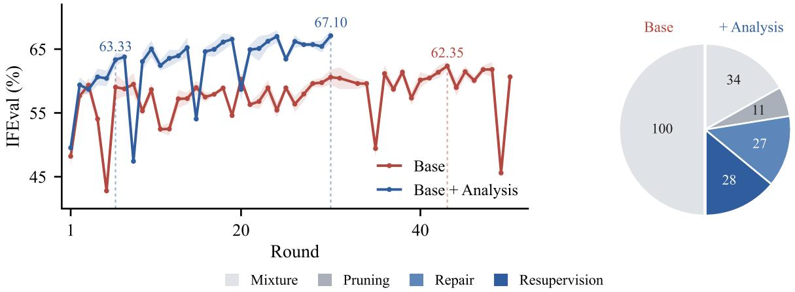  
Figure 8 | Left: IFEval per round, with dotted guides at the rounds named in the text. Right: distribution of data actions over Figure 3 in agent traces for w/ and w/o Analysis settings.

Furthermore, the actions that analysis unlocks often set a new best score, where a new best denotes a recipe that exceeds every earlier score in the same run. Selecting data by validation results sets a new best in 41.7% of its uses, and editing both instructions and answers in 6 of its 14 uses. The base run never takes these actions, since it stays within the mixture family, so Table 4 in Appendix C.1 reports its new-best rate only for mixture. In summary, analysis helps the meta agent read the same evidence in multiple ways, so it can better decide which supervision to change and whether the resulting examples teach the intended behavior.

## 5.3. Synthesis subagent

Setup. The base configuration selects from the staged pool and may edit the examples it selects. Adding the synthesis subagent enables a round to generate new examples for a capability, written against that capability’s verifier and admitted to the pool only after passing that verifier. Both runs train from the same base checkpoint for three epochs under a 100M-token cap that counts generated rows, and every checkpoint is evaluated as avg@10 on IFEval and IFBench. The budget is larger than in the previous two comparisons because a smaller budget would keep the pool below its size cap, whereas new data becomes valuable only once selection can no longer improve the recipe.

Result. Synthesis improves both benchmarks and reaches higher levels earlier. As shown in Figure 9 (left, middle), the synthesis run reaches a best IFEval of 81.58, compared with 78.15 for the base run, and a best IFBench of 51.95, compared with 49.02. Every IFEval checkpoint from R9 onward exceeds the best checkpoint that the base run attains over 31 rounds. The aggregate gain does not imply that every generated batch helps. The repeat\_prompt capability remains near 40% for the first 8 rounds, and the batch supplied at R9 raises it to 75.6% in the same round, showing a weakness the loop diagnoses and then addresses by generating new data. By contrast, odd\_even\_syllables is targeted in 3 separate rounds and scores zero in every round, suggesting that supply alone cannot teach a constraint the model cannot yet follow. In Appendix C.2, we trace the full run of these capabilities, and conduct a comprehensive per-capability comparison across all targets, showing that most capabilities ending higher with synthesis, with the largest gains on repetition, sentence and word counts, and comma avoidance.

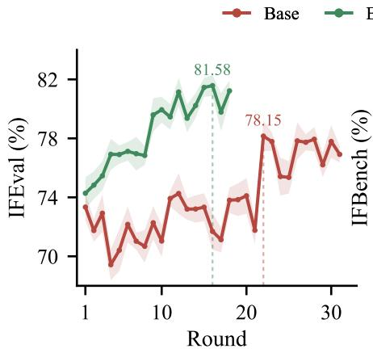

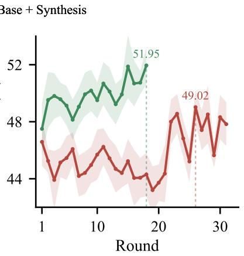

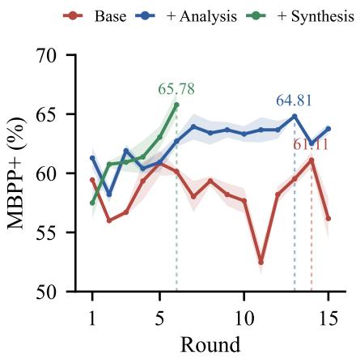  
Figure 9 | Scores per round. Left two panels: synthesis ablation on instruction following (Base vs Base + Synthesis, Section 5.3). Right panel: three configurations on code generation (Section 5.4). Bands give the standard deviation over evaluation repeats.

## 5.4. Generalization to code domain

Setup. To assess whether AutoSFT remains efective beyond instruction following, we evaluate it on code generation with MBPP+2. Unlike IFEval and IFBench, MBPP+ grades only by test execution and carries no capability breakdown, so the system builds its own capability structure from only the benchmark and the pool. The backbone is Qwen3-1.7B-Base with MBPP+ target score 70, and the pool holds 742,842 Python instruction–code pairs from OPC-SFT-Stage2 [Huang et al., 2025], KodCode-v1-SFT-R1 [Xu et al., 2025], and Magicoder-OSS-Instruct-75K [Wei et al., 2024]. Each round retrains from the backbone for three epochs at sequence length 8,192 under a 100M-token budget and is evaluated using avg@3. We compare these three configurations: Base, Base + Analysis, and Base + Analysis + Synthesis.

Result. Within 64 hours, Base and Base + Analysis each complete 15 rounds and Base + Analysis + Synthesis completes 6 (Figure 9, right panel). The single agent shows no sustained improvement, while Base + Analysis produces a consistent upward trend and reaches 64.8% at round 13. Adding synthesis incurs additional runtime per round but reaches 65.8% by round 6. The structure that helped in instruction following transfers to code: multi-agent analysis lifts the recipe above the single agent, and synthesis reaches a comparable peak in fewer rounds.

## 6. Related Work

Data selection and synthesis for post-training. Early works show that curation matters more than scale: a small, well-chosen set can match or outperform a much larger one [Zhou et al., 2023a, Muennighof et al., 2025], and data ordering alone shapes generalization [He et al., 2025a]. Selection methods prune or reweight examples by information gain or diversity [Agarwal et al., 2025, Chen et al., 2025]. Synthesis methods bootstrap instructions from seed sets, evolve complexity, or extract alignment data from aligned models [Wang et al., 2023, Xu et al., 2024a,b, Mitra et al., 2024, Ren et al., 2026]. Some data curation methods also optimize specifically for preference data, curating feedback or preference training pairs [Cui et al., 2024, He et al., 2025b, Deng et al., 2025]. All produce a fixed dataset without closing the loop on downstream training performance.

Automated data optimization. A growing body of work attempts to automate data research, closing the loop between data curation and model training. PostTrainBench [Rank et al., 2026] audits 84 agent runs and finds that almost all converge on SFT with data as the sole search object. On the selection side, TREX [Ma et al., 2026] searches recipes via MCTS, AutoSelection [Wu et al., 2026] formalizes operator-program search over a fixed pool, DataChef [Chen et al., 2026b] trains a policy with a proxy reward, and Luo et al. [2026] iterates on data alone with gains that plateau after round 8–15. On the synthesis side, Autodata [Kulikov et al., 2026] revises generation strategies from solver feedback, ANDES [Zhao et al., 2026] packages synthesis as a callable skill, and BigBang [The Endless Frontier Team, 2026] scales self-evolving synthesis with a critic proxy. Arbor [Jin et al., 2026], AutoSOTA [Li et al., 2026], and the Anthropic automated researcher [Wen et al., 2026] organize research with hypothesis trees, multi-agent decomposition, and diverse initial directions respectively. These systems address either selection or synthesis, while we unify both and retrain from base each round so that every action is individually attributable.

Benchmarks for AI research. Benchmarks now evaluate agents on ML research tasks at scales from single Kaggle problems to full R&D pipelines [Chan et al., 2025, Huang et al., 2024, Wijk et al., 2025, Kon et al., 2026, Zhang et al., 2025, Lyu et al., 2026, Garikaparthi et al., 2026, Xu et al., 2026], on AI infrastructure [Ouyang et al., 2025, Chi et al., 2026a, Φ-Bench contributors, 2026, Yeon et al., 2026], and on self-improvement [Zhan et al., 2026, Chi et al., 2026b, Chen et al., 2026a]. Closest to our setting, DataEnvGym [Khan et al., 2025] frames data generation as an RL loop, Curation-Bench [Kang et al., 2026] gives agents iterative control over a fixed pipeline, and RSIBench-Data [Meng et al., 2026] and DataPrep-Bench [Liang et al., 2026] benchmark data-centric recipe search. We difer by requiring from-base retraining each round, repeated evaluation to bound noise, and a verification gate on synthesis.

## 7. Conclusion

A single agent owning the full SFT data research loop collapses to one kind of change and loses context repeatedly. AutoSFT adds structure that an executor separates execution from analysis, several analysis subagents propose complementary changes, and a synthesis subagent writes data for uncovered capabilities. Adding each component one at a time under from-base retraining shows that the executor frees the meta agent’s context, analysis broadens changes and improves scores earlier, and synthesis reaches capabilities with almost no data in the pool. The same loop transfers to coding without a ready-made taxonomy, where the system builds its own structure from the benchmark and pool alone. These results suggest that the bottleneck may not be any single action but the structure that lets an agent cover the full range of data-engineer changes, and that multi-agent decomposition is a practical way to provide it.

## AI use statement

We used generative AI tools to edit prose for readability, to draft and refine figures, and to assist with code implementation for AutoSFT and the analysis scripts. We did not use generative AI tools to generate research ideas, design the methodology, or produce any reported result. The system under study is itself an LLM agent, so the data recipes, analysis, and synthesis prompts it produces are the object of our measurements rather than authored content of this paper. All reported numbers come from the fixed training and evaluation script rather than from any agent’s self-report, and the authors verified every claim against the per-round run ledger. We have reviewed all AI-assisted work and take responsibility for the final content of this paper.

## Ethics statement

The instruction-following pool is built from openly released datasets and the coding pool from public instruction–code corpora, cited in Section 3 and Section 5.4. Because the AutoSFT optimizes benchmark scores, it could in principle be used to inflate leaderboard numbers, and we report oftarget and held-out benchmarks so that a gain from overfitting the target is visible rather than hidden. We apply an �-gram overlap check between generated data and the evaluation sets in Appendix B.4, and we report the compute and API cost of the runs in Appendix D.

## Reproducibility statement

We will release the AutoSFT implementation, including the training and evaluation script and the agent scafolding, as anonymized supplementary material. The fixed training script, the token budget, and the from-base retraining protocol are described in Section 2 and Section 3, and the agent roles, prompts, and skill files are given in Appendix B. The initial data pool, the per-round recipes, and the raw evaluation outputs behind every reported number are recorded in a run ledger.

## References

Ishika Agarwal, Krishnateja Killamsetty, Lucian Popa, and Marina Danilevksy. DELIFT: Data eficient language model instruction fine tuning. In International Conference on Learning Representations (ICLR), 2025. URL https://arxiv.org/abs/2411.04425.

Φ-Bench contributors. �-bench: Can large language models engineer the infrastructure that powers them? https://faibench.org/, 2026. arXiv preprint forthcoming.

Jun Shern Chan, Neil Chowdhury, Oliver Jafe, James Aung, Dane Sherburn, Evan Mays, Giulio Starace, Kevin Liu, Leon Maksin, Tejal Patwardhan, et al. Mle-bench: Evaluating machine learning agents on machine learning engineering. In International Conference on Learning Representations, volume 2025, pages 50466–50494, 2025.

Wanyi Chen, Xiao Yang, Xu Yang, Tianming Sha, Qizheng Li, Zhuo Wang, Bowen Xian, Fang Kong, Weiqing Liu, and Jiang Bian. Agent2 RL-Bench: Can LLM agents engineer agentic RL post-training?, 2026a. URL https://arxiv.org/abs/2604.10547.

Xiusi Chen, Jyun-Yu Jiang, Wei-Cheng Chang, Cho-Jui Hsieh, Hsiang-Fu Yu, and Wei Wang. Minprompt: Graph-based minimal prompt data augmentation for few-shot question answering. In Proceedings of the 62nd Annual Meeting of the Association for Computational Linguistics (Volume 1: Long Papers), pages 254–266, 2024.

Yicheng Chen, Yining Li, Kai Hu, Zerun Ma, Haochen Ye, and Kai Chen. MIG: Automatic data selection for instruction tuning by maximizing information gain in semantic space. In Findings of the Associationfor Computational Linguistics: ACL 2025, 2025. doi: 10.18653/v1/2025.findings-acl.515. URL https://arxiv.org/abs/2504.13835.

Yicheng Chen, Zerun Ma, Xinchen Xie, Yining Li, and Kai Chen. DataChef: Cooking up optimal data recipes for LLM adaptation via reinforcement learning. arXiv preprint arXiv:2602.11089, 2026b. URL https://arxiv.org/abs/2602.11089.

Yizhe Chi, Deyao Hong, Dapeng Jiang, Tianwei Luo, Kaisen Yang, Boshi Zhang, Zhe Cao, Xiaoyan Fan, Bingxiang He, Han Hao, et al. Frontier-Eng: Benchmarking self-evolving agents on real-world

engineering tasks with generative optimization. arXiv preprint arXiv:2604.12290, 2026a. URL https://arxiv.org/abs/2604.12290.

Yizhe Chi, Wenyi Li, Deyao Hong, Xiaoqiu Wang, Mingju Gao, Kaisen Yang, Bingxiang He, Youjie Zheng, Calvin Xiao, and Qinhuai Na. AI4AI-Bench: Benchmarking LLM agents in algorithmic design for recursive self-improvement. arXiv preprint arXiv:2608.20318, 2026b. URL https: //arxiv.org/abs/2608.20318.

Ganqu Cui, Lifan Yuan, Ning Ding, Guanming Yao, Bingxiang He, Wei Zhu, Yuan Ni, Guotong Xie, Ruobing Xie, Yankai Lin, Zhiyuan Liu, and Maosong Sun. UltraFeedback: Boosting language models with scaled AI feedback. In Proceedings of the 41st International Conference on Machine Learning (ICML), 2024. URL https://arxiv.org/abs/2310.01377.

Xun Deng, Han Zhong, Rui Ai, Fuli Feng, Zheng Wang, and Xiangnan He. Less is more: Improving LLM alignment via preference data selection. In Advances in Neural Information Processing Systems (NeurIPS), 2025. URL https://arxiv.org/abs/2502.14560.

Aniketh Garikaparthi, Manasi Patwardhan, and Arman Cohan. ResearchGym: Evaluating language model agents on real-world AI research, 2026. URL https://arxiv.org/abs/2602.15112.

Bingxiang He, Ning Ding, Cheng Qian, Jia Deng, Ganqu Cui, Lifan Yuan, Haiwen Hong, Huan-ang Gao, Longtao Huang, Hui Xue, Huimin Chen, Zhiyuan Liu, and Maosong Sun. The right time matters: Data arrangement afects zero-shot generalization in instruction tuning. In Findings ofthe Association for Computational Linguistics: ACL 2025, 2025a. URL https://arxiv.org/abs/2406.11721.

Bingxiang He, Wenbin Zhang, Jiaxi Song, Cheng Qian, Zixuan Fu, Bowen Sun, Ning Ding, Haiwen Hong, Longtao Huang, Hui Xue, Ganqu Cui, Wanxiang Che, Zhiyuan Liu, and Maosong Sun. AIR: A systematic analysis of annotations, instructions, and response pairs in preference dataset. arXiv preprint arXiv:2504.03612, 2025b. URL https://arxiv.org/abs/2504.03612.

Shengran Hu, Cong Lu, and Jef Clune. Automated design of agentic systems. In The Thirteenth International Conference on Learning Representations, 2025. URL https://arxiv.org/abs/24 08.08435.

Qian Huang, Jian Vora, Percy Liang, and Jure Leskovec. MLAgentBench: Evaluating language agents on machine learning experimentation. In Proceedings ofthe 41st International Conference on Machine Learning (ICML), 2024. URL https://arxiv.org/abs/2310.03302.

Siming Huang, Tianhao Cheng, Jason Klein Liu, Weidi Xu, Jiaran Hao, Liuyihan Song, Yang Xu, Jian Yang, Jiaheng Liu, Chenchen Zhang, Linzheng Chai, Ruifeng Yuan, Xianzhen Luo, Qiufeng Wang, YuanTao Fan, Qingfu Zhu, Zhaoxiang Zhang, Yang Gao, Jie Fu, Qian Liu, Houyi Li, Ge Zhang, Yuan Qi, Yinghui Xu, Wei Chu, and Zili Wang. Opencoder: The open cookbook for top-tier code large language models. In Proceedings of the 63rd Annual Meeting of the Association for Computational Linguistics (Volume 1: Long Papers), pages 33167–33193, 2025. doi: 10.18653/v1/2025.acl-long. 1591. URL https://aclanthology.org/2025.acl-long.1591/.

Jiajie Jin, Yuyang Hu, Kai Qiu, Qi Dai, Chong Luo, Guanting Dong, Xiaoxi Li, Tong Zhao, Xiaolong Ma, Gongrui Zhang, Zhirong Wu, Bei Liu, Zhengyuan Yang, Linjie Li, Lijuan Wang, Hongjin Qian, Yutao Zhu, and Zhicheng Dou. Toward generalist autonomous research via hypothesis-tree refinement. arXiv preprint arXiv:2606.11926, 2026. URL https://arxiv.org/abs/2606.11926.

Feiyang Kang, Hanze Li, Adam Nguyen, Mahavir Dabas, Jiaqi W. Ma, Frederic Sala, Dawn Song, and Ruoxi Jia. Can generalist agents automate data curation?, 2026. URL https://arxiv.org/ab s/2606.04261.

Zaid Khan, Elias Stengel-Eskin, Jaemin Cho, and Mohit Bansal. DataEnvGym: Data generation agents in teacher environments with student feedback. In The Thirteenth International Conference on Learning Representations, 2025. URL https://arxiv.org/abs/2410.06215. Spotlight.

Patrick Tser Jern Kon, Jiachen Liu, Xinyi Zhu, Qiuyi Ding, Jingjia Peng, Jiarong Xing, Yibo Huang, Yiming Qiu, Jayanth Srinivasa, Myungjin Lee, Mosharaf Chowdhury, Matei Zaharia, and Ang Chen. EXP-Bench: Can AI conduct AI research experiments? In The Fourteenth International Conference on Learning Representations, 2026. URL https://arxiv.org/abs/2505.24785.

Ilia Kulikov, Chenxi Whitehouse, Tianhao Wu, Yixin Nie, Swarnadeep Saha, Eryk Helenowski, Weizhe Yuan, Olga Golovneva, Jack Lanchantin, Yoram Bachrach, Jakob Foerster, Xian Li, Han Fang, Sainbayar Sukhbaatar, and Jason Weston. Autodata: An agentic data scientist to create high quality synthetic data. arXiv preprint arXiv:2606.25996, 2026. URL https://arxiv.org/abs/2606.2 5996.

Yu Li, Chenyang Shao, Xinyang Liu, Ruotong Zhao, Peijie Liu, Hongyuan Su, Zhibin Chen, Qinglong Yang, Anjie Xu, Yi Fang, Qingbin Zeng, Tianxing Li, Jingbo Xu, Fengli Xu, Yong Li, and Tie-Yan Liu. AutoSOTA: An end-to-end automated research system for state-of-the-art AI model discovery. arXiv preprint arXiv:2604.05550, 2026. URL https://arxiv.org/abs/2604.05550.

Hao Liang, Qifeng Cai, Yibo Lin, Jianzhuo Du, Qifeng Xia, Sizhe Qiu, Linzhuang Sun, Meiyi Qiang, Zhaoyang Han, Xiaochen Ma, Bohan Zeng, Ruichuan An, Conghui He, and Wentao Zhang. DataPrep-Bench: Benchmarking LLMs as training data preparators. arXiv preprint arXiv:2607.20465, 2026. URL https://arxiv.org/abs/2607.20465.

Chris Lu, Cong Lu, Robert Tjarko Lange, Yutaro Yamada, Shengran Hu, Jakob Foerster, David Ha, and Jef Clune. Towards end-to-end automation of AI research. Nature, 651:914–919, 2026. doi: 10.1038/s41586-026-10265-5. URL https://doi.org/10.1038/s41586-026-10265-5.

Yujie Luo, Xiangyuan Ru, Jingsheng Zheng, Jingjing Wang, Yuqi Zhu, Jintian Zhang, Runnan Fang, Kewei Xu, Ye Liu, Zheng Wei, Jiang Bian, Zang Li, and Shumin Deng. Exploring autonomous agentic data engineering for model specialization. arXiv preprint arXiv:2605.30407, 2026. URL https://arxiv.org/abs/2605.30407.

Bohan Lyu, Yucheng Yang, Siqiao Huang, Jiaru Zhang, Qixin Xu, Xinghan Li, Xinyang Han, Yicheng Zhang, Huaqing Zhang, Runhan Huang, Kaicheng Yang, Zitao Chen, Wentao Guo, Junlin Yang, Xinyue Ai, Wenhao Chai, Yadi Cao, Ziran Yang, Kun Wang, Dapeng Jiang, Huan-ang Gao, Shange Tang, Chengshuai Shi, Simon S. Du, Max Simchowitz, Jiantao Jiao, Dawn Song, and Chi Jin. MLS-Bench: A holistic and rigorous assessment of AI systems on building better AI, 2026. URL https://arxiv.org/abs/2605.08678.

Zerun Ma, Guoqiang Wang, Xinchen Xie, Yicheng Chen, He Du, Bowen Li, Yanan Sun, Wenran Liu, Kai Chen, and Yining Li. TREX: Automating LLM fine-tuning via agent-driven tree-based exploration. arXiv preprint arXiv:2604.14116, 2026. URL https://arxiv.org/abs/2604.14116.

Fanqing Meng, Lingxiao Du, Qiguang Chen, Ziqi Zhao, Haocheng Lu, Mengkang Hu, and Michael Qizhe Shieh. RSIBench-Data: Benchmarking data-centric research for recursive selfimprovement. arXiv preprint arXiv:2607.25886, 2026. URL https://arxiv.org/abs/2607.2 5886.

Arindam Mitra, Luciano Del Corro, Guoqing Zheng, Shweti Mahajan, Dany Rouhana, Andres Codas, Yadong Lu, Wei-ge Chen, Olga Vrousgos, Corby Rosset, Fillipe Silva, Hamed Khanpour, Yash Lara, and Ahmed Awadallah. AgentInstruct: Toward generative teaching with agentic flows. arXiv preprint arXiv:2407.03502, 2024. URL https://arxiv.org/abs/2407.03502.

Niklas Muennighof, Zitong Yang, Weijia Shi, Xiang Lisa Li, Fei-Fei Li, Hannaneh Hajishirzi, Luke Zettlemoyer, Percy Liang, Emmanuel Candès, and Tatsunori Hashimoto. s1: Simple test-time scaling. In Proceedings of the 2025 Conference on Empirical Methods in Natural Language Processing (EMNLP), 2025. URL https://arxiv.org/abs/2501.19393.

Anne Ouyang, Simon Guo, Simran Arora, Alex L. Zhang, William Hu, Christopher Ré, and Azalia Mirhoseini. KernelBench: Can LLMs write eficient GPU kernels? In Proceedings of the 42nd International Conference on Machine Learning, 2025. URL https://arxiv.org/abs/2502.105 17.

Valentina Pyatkin, Saumya Malik, Victoria Graf, Hamish Ivison, Shengyi Huang, Pradeep Dasigi, Nathan Lambert, and Hannaneh Hajishirzi. Generalizing verifiable instruction following, 2025.

Ben Rank, Hardik Bhatnagar, Ameya Prabhu, Shira Eisenberg, Karina Nguyen, Matthias Bethge, and Maksym Andriushchenko. PostTrainBench: Can LLM agents automate LLM post-training? arXiv preprint arXiv:2603.08640, 2026. URL https://arxiv.org/abs/2603.08640.

Qingyu Ren, Qianyu He, Jiajie Zhu, Xingzhou Chen, Jingwen Chang, Zeye Sun, Han Xia, Fei Yu, Jiaqing Liang, and Yanghua Xiao. SEIF: Self-evolving reinforcement learning for instruction following. arXiv preprint arXiv:2605.07465, 2026. URL https://arxiv.org/abs/2605.07465.

Jiabin Tang, Lianghao Xia, Zhonghang Li, and Chao Huang. AI-Researcher: Autonomous scientific innovation. In Advances in Neural Information Processing Systems, volume 38, 2025. doi: 10.52202 /085713-0320. URL https://proceedings.neurips.cc/paper\_files/paper/2025/ha sh/0d904d300a105809a2114d727851e759-Abstract-Conference.html.

The Endless Frontier Team. BigBang: Pursuing open-ended intelligence through self-evolving synthesis of verifiable frontier tasks. Technical report, 2026. URL https://huggingface.co/endless-f rontier/BigBang-v1. Model card and technical report released August 2026. No arXiv preprint identified at time of writing.

Yizhong Wang, Yeganeh Kordi, Swaroop Mishra, Alisa Liu, Noah A. Smith, Daniel Khashabi, and Hannaneh Hajishirzi. Self-instruct: Aligning language models with self-generated instructions. In Proceedings of the 61st Annual Meeting of the Association for Computational Linguistics (ACL), 2023. URL https://arxiv.org/abs/2212.10560.

Yuxiang Wei, Zhe Wang, Jiawei Liu, Yifeng Ding, and Lingming Zhang. Magicoder: Empowering code generation with OSS-instruct. In Proceedings of the 41st International Conference on Machine Learning, volume 235 of Proceedings of Machine Learning Research, pages 52632–52657. PMLR, 21–27 Jul 2024. URL https://proceedings.mlr.press/v235/wei24h.html.

Jiaxin Wen, Liang Qiu, Joe Benton, Jan Hendrik Kirchner, and Jan Leike. Automated weak-to-strong researcher. Anthropic Alignment Science Blog, 2026. URL https://alignment.anthropic. com/2026/automated-w2s-researcher/. Published April 2026.

Hjalmar Wijk, Tao Lin, Joel Becker, Sami Jawhar, Neev Parikh, Thomas Broadley, Lawrence Chan, Michael Chen, Josh Clymer, Jai Dhyani, Elena Ericheva, Katharyn Garcia, Brian Goodrich, Nikola Jurkovic, Megan Kinniment, Aron Lajko, Seraphina Nix, Lucas Sato, William Saunders, Maksym Taran, Ben West, and Elizabeth Barnes. RE-Bench: Evaluating frontier AI R&D capabilities of language model agents against human experts. In Proceedings of the 42nd International Conference on Machine Learning, volume 267, pages 66772–66832, 2025. URL https://proceedings.ml r.press/v267/wijk25a.html.

Haodong Wu, Jiahao Zhang, Lijie Hu, and Yongqi Zhang. From instance selection to fixed-pool data recipe search for supervised fine-tuning. arXiv preprint arXiv:2605.12944, 2026. URL https://arxiv.org/abs/2605.12944.

Can Xu, Qingfeng Sun, Kai Zheng, Xiubo Geng, Pu Zhao, Jiazhan Feng, Chongyang Tao, Qingwei Lin, and Daxin Jiang. WizardLM: Empowering large pre-trained language models to follow complex instructions. In The Twelfth International Conference on Learning Representations, 2024a. URL https://openreview.net/forum?id=CfXh93NDgH.

Zhangchen Xu, Fengqing Jiang, Luyao Niu, Yuntian Deng, Radha Poovendran, Yejin Choi, and Bill Yuchen Lin. Magpie: Alignment data synthesis from scratch by prompting aligned LLMs with nothing. arXiv preprint arXiv:2406.08464, 2024b. URL https://arxiv.org/abs/2406.08464.

Zhangchen Xu, Yang Liu, Yueqin Yin, Mingyuan Zhou, and Radha Poovendran. Kodcode: A diverse, challenging, and verifiable synthetic dataset for coding. 2025. URL https://arxiv.org/abs/ 2503 02951.

Zhangchen Xu, Junda Chen, Yue Huang, Dongfu Jiang, Jiefeng Chen, Hang Hua, Zijian Wu, Zheyuan Liu, Zexue He, Lichi Li, Shizhe Diao, Jiaxin Pei, Jinsung Yoon, Hao Zhang, Mengdi Wang, Radha Poovendran, Misha Sra, Alex Pentland, and Zichen Chen. AutoLab: Can frontier models solve long-horizon auto research and engineering tasks?, 2026. URL https://arxiv.org/abs/2606 .05080.

An Yang, Anfeng Li, Baosong Yang, Beichen Zhang, Binyuan Hui, Bo Zheng, Bowen Yu, Chang Gao, Chengen Huang, Chenxu Lv, et al. Qwen3 technical report. arXiv preprint arXiv:2505.09388, 2025.

Jehyeok Yeon, Ben Rank, and Maksym Andriushchenko. InferenceBench: A benchmark for open-ended LLM inference optimization by AI agents, 2026. URL https://arxiv.org/abs/2607.20468.

Yuhao Zhan, Bingxiang He, Zecong Tang, and Chaojun Xiao. PACE-Bench: Benchmarking physics adaptation via code evolution in dynamic environments, 2026. URL https://arxiv.org/abs/ 2608.14441.

Yunxiang Zhang, Muhammad Khalifa, Shitanshu Bhushan, Grant D Murphy, Lajanugen Logeswaran, Jaekyeom Kim, Moontae Lee, Honglak Lee, and Lu Wang. MLRC-Bench: Can language agents solve machine learning research challenges? In Advances in Neural Information Processing Systems, 2025. URL https://arxiv.org/abs/2504.09702.

Zhengyang Zhao, Shengjie Ye, Lu Ma, Hao Liang, Hengyi Feng, and Wentao Zhang. ANDES: Agent native data evolving synthesis tool for autonomous instruction alignment. arXiv preprint arXiv:2606.01279, 2026. URL https://arxiv.org/abs/2606.01279.

Chunting Zhou, Pengfei Liu, Puxin Xu, Srini Iyer, Jiao Sun, Yuning Mao, Xuezhe Ma, Avia Efrat, Ping Yu, Lili Yu, Susan Zhang, Gargi Ghosh, Mike Lewis, Luke Zettlemoyer, and Omer Levy. LIMA: Less is more for alignment. In Advances in Neural Information Processing Systems (NeurIPS), 2023a. URL https://arxiv.org/abs/2305.11206.

Jefrey Zhou, Tianjian Lu, Swaroop Mishra, Siddhartha Brahma, Sujoy Basu, Yi Luan, Denny Zhou, and Le Hou. Instruction-following evaluation for large language models, 2023b. URL https: //arxiv.org/abs/2311.07911.

## A. Details of the single-agent run

## A.1. Data action distribution in full trajectory

Table 1 lists the action, the realized recipe size, and the two scores for every round. Round 9 is the best on both benchmarks and no later round improves either one. Beyond the settings in Section 3.1, all rounds share micro batch size 1 and minimum learning rate 10−7.

32 rounds are recorded as reweight and one as replay. Both are changes of proportion, which is why Section 3.1 places the whole run in mixture. Round 24 is the replay, and its records show why the distinction does not survive from-base retraining: it asks to reuse round 9’s row selection, but no round inherits anything from an earlier one, so the request is served by reassembling a recipe from the same pool. The result is 34,283 rows against round 9’s 34,184, with 599 row instances missing and 698 added. Replaying a category and restoring its proportion produce the same kind of recipe.

Table 1 | Results for all 32 rounds. Action is either reweight (W) or replay (P). The best score on each benchmark is in bold.
<table><tr><td>Round</td><td>Action</td><td>Rows</td><td>IFEval</td><td>IFBench</td><td>Round</td><td>Action</td><td>Rows</td><td>IFEval</td><td>IFBench</td></tr><tr><td>1</td><td>W</td><td>34,860</td><td>0.6550</td><td>0.3728</td><td>17</td><td>W</td><td>32,812</td><td>0.6286</td><td>0.3595</td></tr><tr><td>2</td><td>W</td><td>34,765</td><td>0.6630</td><td>0.3535</td><td>18</td><td>W</td><td>37,806</td><td>0.6631</td><td>0.3674</td></tr><tr><td>3</td><td>W</td><td>34,721</td><td>0.6541</td><td>0.3643</td><td>19</td><td>W</td><td>37,433</td><td>0.6327</td><td>0.3876</td></tr><tr><td>4</td><td>W</td><td>34,431</td><td>0.6511</td><td>0.3618</td><td>20</td><td>W</td><td>37,532</td><td>0.6492</td><td>0.3868</td></tr><tr><td>5</td><td>W</td><td>32,545</td><td>0.6588</td><td>0.3657</td><td>21</td><td>W</td><td>36,974</td><td>0.6395</td><td>0.3552</td></tr><tr><td>6</td><td>W</td><td>31,246</td><td>0.6572</td><td>0.3438</td><td>22</td><td>W</td><td>37,342</td><td>0.6428</td><td>0.3819</td></tr><tr><td>7</td><td>W</td><td>33,696</td><td>0.6616</td><td>0.3837</td><td>23</td><td>W</td><td>37,848</td><td>0.6531</td><td>0.3990</td></tr><tr><td>8</td><td>W</td><td>34,225</td><td>0.6327</td><td>0.3800</td><td>24</td><td>P</td><td>34,283</td><td>0.6360</td><td>0.3880</td></tr><tr><td>9</td><td>W</td><td>34,184</td><td>0.6776</td><td>0.3996</td><td>25</td><td>W</td><td>34,506</td><td>0.6278</td><td>0.3704</td></tr><tr><td>10</td><td>W</td><td>34,458</td><td>0.6421</td><td>0.3960</td><td>26</td><td>W</td><td>33,827</td><td>0.6557</td><td>0.3774</td></tr><tr><td>11</td><td>W</td><td>34,400</td><td>0.6331</td><td>0.3619</td><td>27</td><td>W</td><td>33,557</td><td>0.6534</td><td>0.3910</td></tr><tr><td>12</td><td>W</td><td>33,397</td><td>0.6218</td><td>0.3788</td><td>28</td><td>W</td><td>37,704</td><td>0.6149</td><td>0.3684</td></tr><tr><td>13</td><td>W</td><td>34,383</td><td>0.6122</td><td>0.3524</td><td>29</td><td>W</td><td>37,911</td><td>0.6443</td><td>0.3492</td></tr><tr><td>14</td><td>W</td><td>34,326</td><td>0.6523</td><td>0.3665</td><td>30</td><td>W</td><td>37,897</td><td>0.6036</td><td>0.3712</td></tr><tr><td>15</td><td>W</td><td>34,184</td><td>0.6623</td><td>0.3750</td><td>31</td><td>W</td><td>37,811</td><td>0.6487</td><td>0.3950</td></tr><tr><td>16</td><td>W</td><td>34,048</td><td>0.6415</td><td>0.3789</td><td>32</td><td>W</td><td>33,985</td><td>0.6354</td><td>0.3855</td></tr></table>

## A.2. Condensed trace

Figure 10 condenses the run into the rounds that carry something the main text relies on. Two of them are worth naming here. Round 15 is the only round whose recipe matches an earlier one exactly, and the agent did not set out to repeat anything: it was moving the seed forward from round 14 and landed back on round 9’s configuration by accident, which is what makes the pair usable as a measure of how much a repeated round moves. Rounds 19 and 24 are the two places where what the agent says it is doing and what its plan does come apart, which is why we label actions from the diference between consecutive recipes rather than from the agent’s description of a round.

## A.3. What fills the context

The deciding agent runs as one session of 877 model calls over 690.9 minutes, reaching 94.74% of its 258,400-token window before the tenth compaction. Table 2 breaks the trace down by what produced it.

## A single agent researches SFT data for Qwen3-1.7B-Base on IFEval and IFBench

[R1–R8: the opening move, and every move after it]   
Agent: "It will be a single ‘reweight‘ plan with a dense, explicit   
weight on every fixed category."   
-> 34,860 rows IFEval 65.50 IFBench 37.28   
– context compacted (R2, R6) –   
[R9: the best round of the run]   
Agent: "I’m writing round 9 as a tighter reweight, concentrating on   
the overlap between IFEval’s ‘keywords‘ and IFBench’s ‘words‘."   
-> 34,184 rows, seed 50 IFEval 67.76 IFBench 39.96   
– context compacted (R9) –   
[R15: a seed sweep lands back on round 9]   
Agent: "The only changes are the round id and seed; the action type   
and dense weights stay fixed."   
-> identical to R9 IFEval 66.23 (-1.53) IFBench 37.49 (-2.46)   
[R19–R23: the plan does not do what the round says]   
Agent: "... an exact return to the best historical weight profile   
and a fresh seed."   
-> the plan uses round 9’s realized row counts as weights   
capital\_word\_frequency: 25 -> 157   
[R24: the one round that is not a reweight]   
Agent: "... exact-row ‘replay‘ of round 9, using round 9’s original   
dense quota vector and row manifest."   
-> 34,283 rows: 599 of round 9’s rows missing, 698 added   
[R30–R33: still the same move]   
Agent: "I’m tightening the support set now: dropping the lower-value   
families and pushing more mass into the benchmark-relevant ones."   
Agent: "I’m keeping the best-known weight vector and moving the seed   
forward again."   
– context compacted, ten times in all –   
Never in 33 rounds: a row edited, a response replaced, an example   
written. Never once: a mention of time.  
Figure 10 | Condensed trace of the single-agent run, 33 rounds over 11.5h. Red marks an outcome that contradicts the round’s own description. Rounds not shown repeat the pattern of others.

The breakdown is coarse in one respect worth stating. Categories are assigned from the command that produced each record, so evaluation output that the agent reads through a general file read is counted as a file read rather than as evaluation output. The shares establish that a few large payloads dominate. They do not establish that context pressure caused the scores to stop improving.

## B. Details of AutoSFT implementation

## B.1. Capability taxonomy

Deciding what data a round needs is easier when the benchmark already says what it is testing. Instruction following does say so. Its prompts carry constraints of known kinds, and a benchmark that groups them lets a weak group be read directly of the scores, after which the agent can raise that group’s share, label existing rows by the capability they teach, or ask for new rows aimed at it. Most domains do not come with such a grouping, and we did not want a system that only works where one exists. The meta agent therefore builds and maintains the grouping itself. It starts from whatever structure the benchmark provides, which for instruction following is the published constraint types, and extends it as rounds expose distinctions the original grouping did not make. When a benchmark provides nothing, the agent derives the groups from the failures it observes. Every leaf of the resulting taxonomy is a requirement a program can decide, such as answering without using a comma, and carries the program that decides it. Rows in the pool are labelled by the leaves they satisfy, which is what allows the meta agent to select data by capability rather than by source and gives the synthesis subagent stable names to write against. The taxonomy is rebuilt for a new domain, and Section 5.4 reports how far that rebuilding got.

Table 2 | Share of the accumulated trace by source.
<table><tr><td>Source</td><td>Bytes</td><td>Share</td></tr><tr><td>Agent reasoning</td><td>1,610,649</td><td>16.3%</td></tr><tr><td>Training output</td><td>1,322,501</td><td>13.4%</td></tr><tr><td>Re-reading the run record</td><td>1,167,202</td><td>11.8%</td></tr><tr><td>Applying the data action</td><td>953,273</td><td>9.7%</td></tr><tr><td>Tool-call records</td><td>903,931</td><td>9.2%</td></tr><tr><td>Other file reads</td><td>889,396</td><td>9.0%</td></tr><tr><td>Evaluation output</td><td>881,025</td><td>8.9%</td></tr><tr><td>Compaction summaries</td><td>820,327</td><td>8.3%</td></tr><tr><td>Workspace search</td><td>404,512</td><td>4.1%</td></tr><tr><td>Assistant messages</td><td>359,744</td><td>3.6%</td></tr><tr><td>Job submission</td><td>259,481</td><td>2.6%</td></tr><tr><td>Polling job status</td><td>169,621</td><td>1.7%</td></tr><tr><td>Data index inspection</td><td>113,706</td><td>1.2%</td></tr><tr><td>Total</td><td>9,855,368</td><td>100%</td></tr></table>

## B.2. Memory

The history $H _ { < t }$ of Section 2.1 is the only thing a from-base loop carries between rounds, and AutoSFT puts more in it than a list of recipes and scores. Alongside those, it records the hypothesis a round registered before training, the verdict that hypothesis received, the lesson the verdict left, and the proposals the meta agent read but did not take. Each entry is keyed by round, so a later round can read what an earlier one expected as well as what it got.

Registering the hypothesis first is what makes it worth recording. A round states the data change it plans, why that change should move the metric, the round its result will be compared against, the direction it expects, and the finer observation that would show the change working as intended. The submission path refuses a round whose hypothesis was never written down. A prediction written after the results are known can always be adjusted to fit them, which is what the ordering prevents.

A verdict is read on two separate questions. The first asks what the benchmark mean did against the comparison round, judged only as a direction and only against the variation measured between repeated rounds. The second asks whether the finer observation actually appeared in the evaluation outputs. Keeping them apart matters because they can disagree, and a disagreement is informative. A score that rose without its intended efect appearing has some other cause, and an efect that appeared without a score change means the slice it touched was too small or a loss elsewhere cancelled it.

Table 3 | The skill library, by the role that owns each skill.
<table><tr><td>Role</td><td>Skill</td><td>Purpose</td></tr><tr><td rowspan="2">Meta agent</td><td>recipe authoring</td><td>Assemble the round&#x27;s training set from the pool under the token budget.</td></tr><tr><td>synthesis handbook</td><td>Describe the role of synthesis, the structure and update rules of its pool, and how to use its outputs.</td></tr><tr><td rowspan="4">Executor</td><td>training submission</td><td>Submit a training job to the cluster.</td></tr><tr><td>job lifecycle</td><td>Monitor, collect, and stop cluster jobs.</td></tr><tr><td>checkpoint conversion</td><td>Convert a trained checkpoint for evaluation.</td></tr><tr><td>evaluation submission</td><td>Submit one evaluation job per benchmark.</td></tr><tr><td rowspan="4">Analysis</td><td>training-data examination failure-case analysis</td><td>Quality, coverage, redundancy, and repairable rows. Passing against failing behaviour, and the supervision that</td></tr><tr><td>learning-dynamics analysis</td><td>covers it. Training signals read against the data that produced them.</td></tr><tr><td>history analysis</td><td>Past interventions, and ideas never properly tested.</td></tr><tr><td>row analysis</td><td>Re-derivable judgements over individual rows.</td></tr><tr><td rowspan="2">Synthesis</td><td>pool rewrite</td><td>Isolated, source-grounded repair trials.</td></tr><tr><td>batch inference</td><td>Batched model calls underlying the two above.</td></tr></table>

What a verdict leaves behind is a short statement of what it means for later rounds. A later round may disagree with an earlier statement by saying so in its own entry. Nothing already written is edited: a registered prediction cannot be changed and a decided round is not re-judged, so the memory holds what the run believed at the time rather than a version tidied up afterwards.

## B.3. Skill library

A skill is a written procedure owned by one role. Skills do not call one another, and the sequence belongs to the agent that runs them. Table 3 lists the library by role.

The four analysis skills are the reason four subagents disagree productively. They share their proposal section word for word, so all four return the same kind of object, and they difer only in the evidence each is told to start from. Diversity comes from the starting point rather than from handing each subagent a diferent menu of actions, which is consistent with none of them being shown the action space of Section 2.2. Figures 11 to 13 show one skill from each role.

## B.4. Synthesis constraints and verification

Generation constraints. The subagent phrases each capability requirement without reproducing evaluation wording, and the generated rows pass an �-gram overlap check against the evaluation sets before delivery, so a batch teaches the capability rather than the benchmark. Rows must come from model API calls rather than from a script, which prevents a worker from assembling responses that satisfy the verifier without genuinely demonstrating the capability.

Internal verification. The subagent attributes each evaluation subset’s requirements to an underlying capability, translates them into acceptance criteria, and builds a verifier for those criteria. It then generates candidates, checks them against the verifier, and revises until they meet the criteria, maintaining both the criteria and the verifier as it goes so that omissions are corrected without changing the intended capability.

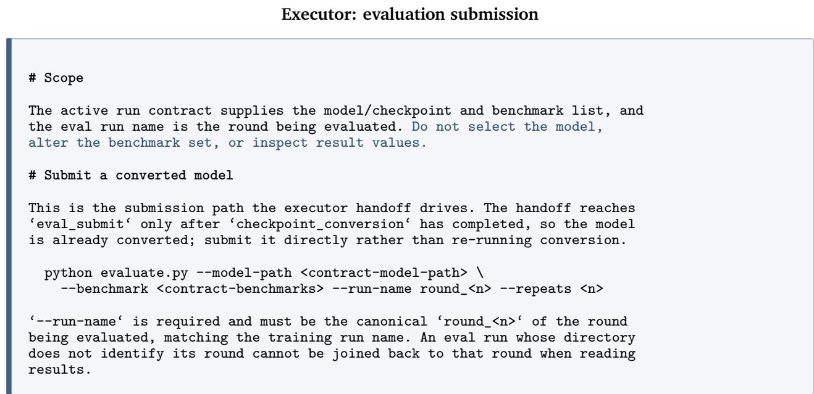  
Figure 11 | The executor is told what to run and is denied the one thing that would let it influence the round, which is reading the scores.

## C. Details of the experiments

## C.1. Analysis subagents

Figure 14 shows a case in which both runs address persistent repetition errors. The run with analysis varies the wording and order of the cue, while the base run increases exposure to the same template. The first raises strict repetition accuracy by 34.76 points, the second by 1.22.

Table 4 groups the data actions into the families of Figure 3 and shows the fraction of the rounds that used it which set a new best score, where a new best is a score above every earlier round in the same run. A round can use more than one action, so it counts towards each action it used. The base run reaches only the mixture family, so its entries appear there alone, and the other families were never used without analysis, as in the single agent of Section 3.1.

## C.2. Synthesis subagent

Figure 15 follows the two capabilities named in Section 5.3 over the full run with synthesis. For repeat\_prompt, the line shows the capability’s strict pass rate staying near 40% through the first eight rounds, then rising to 75.6% at round 9, the round its batch enters, and remaining between 62% and 80% for the rest of the run. For odd\_even\_syllables, the pass rate stays at zero despite batches in three separate rounds. The bars give the number of rows synthesized for the capability.

Figure 16 widens this to every capability the synthesis subagent targeted. For every capability targeted by the synthesis subagent, each bar shows the diference in whole-question strict pass rate between the run with synthesis and the run without synthesis, averaged over the last five rounds of each run. A question passes only when all of its co-occurring requirements pass. The number beside each bar is the number of questions the capability contains, and capabilities backed by fewer than ten questions are drawn faded because their diferences are likely to reflect small-sample noise. Most targeted capabilities show higher rates with synthesis, and the advantage is largest and best supported for repetition, sentence and word counts, and comma avoidance, each backed by dozens of questions. A few capabilities show lower rates, most of which are backed by only a handful of questions.

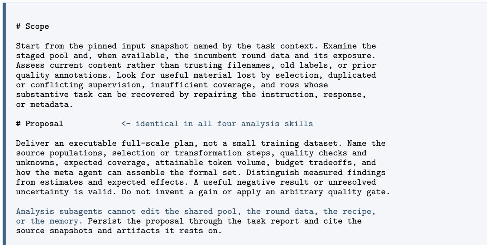  
Figure 12 | One of the four analysis skills. The others replace only the Scope section, so the four subagents start from diferent evidence and return the same kind of object.

Target selection checks data supply rather than relying on aggregate capability scores alone. The subagent selects a target when the pool contains far fewer than the 1000 rows it treats as suficient, and it records the count it finds. For example, the R9 targets matched only 4 to 161 staged rows each. The subagent excluded capabilities that already had ample data, reasoning that generating new examples cannot help a capability the pool already covers. A capability with a high aggregate score can therefore still be a target, because what is scarce is a specific constraint combination rather than the capability as a whole. An example is repetition together with a number word, as opposed to number words on their own. The score of an exact combination cannot be measured directly, because the benchmark contains at most one question for it. The comparison in Figure 16 is therefore made at the aggregate capability level.

## D. Experimental Details and Resource Usage

All experiments share one implementation for agent execution, supervised fine-tuning, and evaluation. A research agent coordinates each round and makes the data decisions, while a separate batchinference backend generates and reviews synthesized examples. Every candidate recipe is fine-tuned from the same base checkpoint, and only the research history and the evaluation feedback carry across rounds. Table 5 lists the settings common to every run.

The comparisons difer in only a few settings, listed in Table 6. The analysis and synthesis ablations draw from the same open instruction-following pool of Section 3 but under diferent token budgets, and the code experiments use a Python pool with a shorter sequence length. A benchmark score is reported as avg@k, the mean over � stochastic evaluations of one checkpoint. IFEval and IFBench use �=10 and MBPP+ uses �=3.

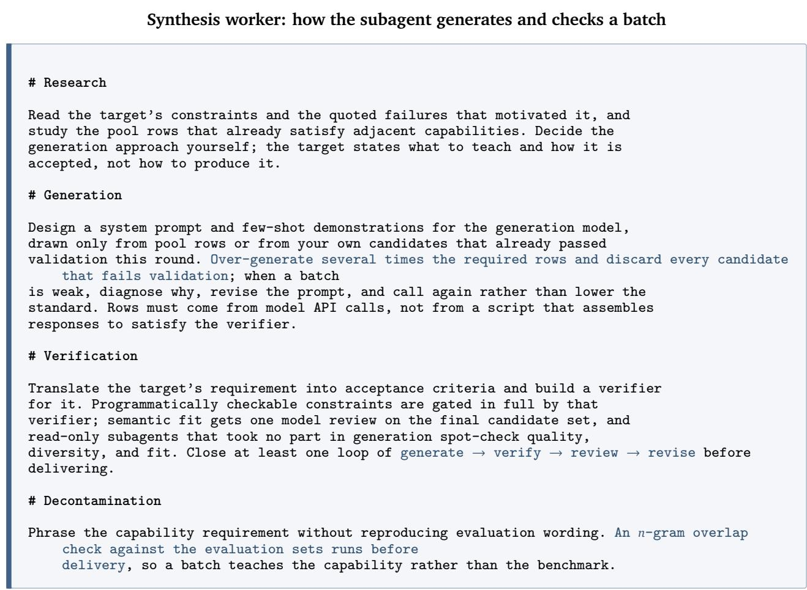  
Figure 13 | One skill given to the synthesis subagent. It fixes the internal loop by which a worker turns a target into a delivered batch, while leaving the generation strategy to the worker. The generation, verification, and decontamination checks it enforces are detailed in Appendix B.4.

Resource usage. We estimate the cost of a research run from the synthesis experiment, which uses the largest per-round budget of 100M tokens. Each round prepares data under agent guidance, fine-tunes one recipe, and evaluates the resulting checkpoint. Training takes about 0.8 GPU-hours per round on 8 H800 GPUs and evaluation about 0.15 GPU-hours on one, so a 20-round run costs roughly 130 GPU-hours. The research agent and the generation backend together consume about $2 . 6 \times 1 0 ^ { 8 }$ tokens per round, counting input, output, and reasoning tokens, for an estimated API cost near USD 95 per round, or USD 1,900 over the run. The paper reports about ten distinct runs and a few hundred rounds in total, counting a shared baseline once. Scaling each experiment by its token budget gives an order-of-magnitude total of $1 0 ^ { 3 }$ GPU-hours and USD $1 0 ^ { 4 }$ , with real usage varying by hardware utilization, evaluation protocol, and agent activity.

<table><tr><td>With analysis R10 → R14</td><td>Base R18 → R19</td></tr><tr><td>The failure reading traces the errors to 792 examples that share one template, and R11-R13 substitutions do not surpass R10.</td><td>The “repeat first&quot; directive at R18 improves repetition without raising the best score, which reads as useful but insufficient exposure.</td></tr><tr><td>The meta agent keeps 88.46% of R10&#x27;s tokens and replaces the rest with 2,752 examples that vary</td><td>The meta agent keeps the directive and expands from 500 to all 974 available examples of the</td></tr><tr><td>cue wording and order across all 16 cells. Strict repetition 39.02 → 73.78 (+34.76).</td><td>same template. Strict repetition 23.78 → 25.00 (+1.22).</td></tr></table>

Figure 14 | The second decision of Section 5.2. Explanations reflect the reasoning recorded at the time, and strict repetition is measured per instruction.

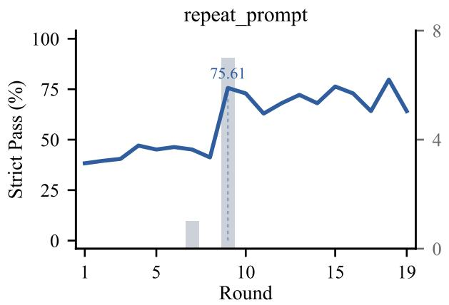

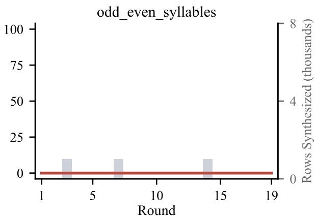  
Figure 15 | Two capabilities over the run with synthesis. The line is the capability’s whole-question strict pass rate each round, and the bars are the rows synthesized for it that round.

## E. Limitations

All results are obtained on one base model at one scale (Qwen3-1.7B-Base), so the efects we report may not hold at other scales, and a capability this model cannot learn from more data may be learnable by a larger one. Each comparison runs one search per configuration, and although repeated evaluation bounds the noise of a single checkpoint, it does not bound the variation between independent searches. Synthesis raises the aggregate score through a small number of learnable capabilities that the pool undersupplies, and it does not move capabilities the model cannot yet follow. The generalization study covers a single new domain with short runs, so it demonstrates that the loop can transfer but does not establish how broadly.

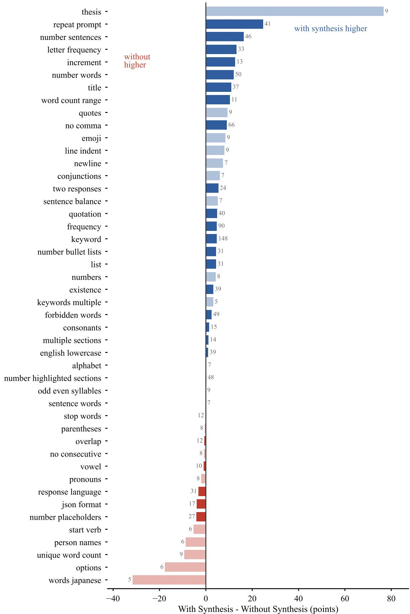  
Figure 16 | Per-capability comparison of the two runs of Section 5.3.

Table 4 | New-best rate by data action, as the number of rounds that set a new best over the number of rounds that used the action. The run with analysis covers 30 rounds and the base run its own rounds. A dash marks a family the base run did not use.
<table><tr><td>Data action</td><td>With analysis</td><td>Base</td></tr><tr><td>Mixture</td><td></td><td></td></tr><tr><td>Constraint type</td><td>33.3% (10/30)</td><td>17.2% (5/29)</td></tr><tr><td>Number of constraints</td><td>34.8% (8/23)</td><td>14.3% (1/7)</td></tr><tr><td>Rare constraint types</td><td>16.7% (1/6)</td><td>33.3% (2/6)</td></tr><tr><td>Language</td><td>25.0% (4/16)</td><td>0.0% (0/2)</td></tr><tr><td>Pool-wide selection</td><td>50.0% (2/4)</td><td>9.1% (1/11)</td></tr><tr><td>Restore earlier data</td><td>22.2% (2/9)</td><td>25.0% (2/8)</td></tr><tr><td>Full dataset reselection</td><td>50.0% (1/2)</td><td>20.0% (2/10)</td></tr><tr><td>Pruning</td><td></td><td></td></tr><tr><td>Validation results</td><td>41.7% (10/24)</td><td></td></tr><tr><td>Official checks</td><td>35.0% (7/20)</td><td></td></tr><tr><td>Text length</td><td>42.9% (6/14)</td><td></td></tr><tr><td>Repair</td><td></td><td></td></tr><tr><td>Edit instructions and answers</td><td>42.9% (6/14)</td><td></td></tr><tr><td>Resupervision</td><td></td><td></td></tr><tr><td>Replace answers only</td><td>0.0% (0/3)</td><td></td></tr></table>

Table 5 | Settings shared by every experiment.
<table><tr><td>Component</td><td>Setting</td></tr><tr><td>Agent</td><td></td></tr><tr><td>Harness</td><td>OpenAI Codex</td></tr><tr><td>Research agent</td><td>GPT-5.5, medium reasoning effort</td></tr><tr><td>Generation backend</td><td>DeepSeek V4 Flash</td></tr><tr><td>Training</td><td></td></tr><tr><td>Base model</td><td>Qwen3-1.7B-Base</td></tr><tr><td>Framework</td><td>Megatron-LM</td></tr><tr><td>Hardware</td><td>8× NVIDIA H800</td></tr><tr><td>Epochs per round</td><td>3</td></tr><tr><td>Batch size (global / micro)</td><td> $1 6 / 1$ </td></tr><tr><td>Optimizer</td><td>Adam  $( \beta _ { 1 } { = } 0 . 9 , \beta _ { 2 } { = } 0 . 9 5 , { \epsilon } { = } 1 0 ^ { - 8 } )$  , weight decay 0.1</td></tr><tr><td>Learning rate</td><td> $1 0 ^ { - 4 } \to 1 0 ^ { - 7 }$  , cosine decay per round, 5% warmup</td></tr><tr><td>Evaluation</td><td></td></tr><tr><td>Framework</td><td>OpenCompass with a vLLM backend</td></tr><tr><td>Hardware</td><td>1× NVIDIA H800</td></tr><tr><td>Decoding</td><td>temperature 0.7, zero-shot prompting</td></tr></table>

Table 6 | Settings that difer across the three comparisons. Within each comparison the run with and without the component share these settings, so a diference is attributable to the component alone.
<table><tr><td></td><td>Analysis</td><td>Synthesis</td><td>Code</td></tr><tr><td>Initial pool</td><td></td><td>Open ifeval-like pool (Section 3)</td><td>742,842 Python pairs</td></tr><tr><td>Token budget</td><td>3M</td><td>100M</td><td>100M</td></tr><tr><td>Sequence length</td><td>32,768</td><td>32,768</td><td>8,192</td></tr><tr><td>Benchmarks</td><td>IFEval</td><td>IFEval, IFBench</td><td>MBPP+</td></tr><tr><td>Evaluation</td><td>avg@10</td><td>avg@10</td><td>avg@3</td></tr></table>