# BIAS CONTROL AND INJECTION FOR MULTI-AGENT AGGREGATION

Sungjae Lee1,† Soheil Abbasloo2,∗ Jabin Koo1 Jungseul Ok1 1POSTECH 2Microsoft Research

## ABSTRACT

Multi-agent reasoning with large language models (LLMs) raises a central question for collective decision-making: when agents disagree, whose decision should be trusted? Resolving such disagreements is difficult because agents’ decisions are susceptible to non-semantic biases such as majority pressure and response-style preferences, which can obscure the quality of the underlying reasoning. Our analysis shows how bias can be both mitigated and exploited: bias control improves initial answer selection, while bias injection elicits decision instability that serves as a reliability signal. Building on these findings, we introduce a test-time aggregation framework that requires neither validation data nor prior knowledge of relative model strength. The framework implements bias control by presenting one stylenormalized reasoning trace per distinct answer, and bias injection by placing each aggregating agent’s initially selected answer in the minority. Overall, our framework achieves higher average accuracy and better token efficiency than competing non-oracle aggregation methods across three mathematical reasoning benchmarks and four heterogeneous LLM combinations. It also improves final-answer accuracy when applied to multi-agent debate and Mixture-of-Agents, without modifying their interaction or synthesis processes.

## 1 INTRODUCTION

Multi-agent reasoning benefits from the diverse and complementary solutions produced by multiple agents, yet those agents often reach conflicting conclusions. Whether candidate solutions are generated independently, revised through multi-agent debate, or synthesized across multiple stages, a correct answer among these conflicting solutions may still be missed during final aggregation (Ai et al., 2025; Du et al., 2023; Wang et al., 2025). The effectiveness of multi-agent reasoning therefore depends not only on generating useful solutions, but also on reliably resolving these disagreements (Wang et al., 2024b; Smit et al., 2023; Choi et al., 2026a; Wang et al., 2026a).

To reach a collective decision, frequency- and consistency-based aggregation methods rely on agreement among responses as evidence of correctness (Wang et al., 2022; Ai et al., 2025; Wang et al., 2026a). Agreement is often informative, but can favor a shared error over a correct minority answer. For example, majority voting (MV) is widely used and often effective. In our analysis, the sampled response pool contains a correct answer in 83.6% of cases on average, yet MV selects it in only 72.2% (Figure 1; see Section 5.1 for details). Alternatively, LLM-based aggregation can consider the reasoning behind each answer as additional evidence, allowing a correct minority answer to prevail. However, incorporating reasoning does not by itself ensure better selection: LLM decisions can be distorted by frequency, style, position, and other non-semantic biases (Ma et al., 2025; Zhu et al., 2025; Choi et al., 2025; Wang et al., 2024a; Shi et al., 2025; Feuer et al., 2025; Hwang et al., 2025; Choi et al., 2026b;

一 Correct answer selected by MV Correct answer available but missed No correct answer available

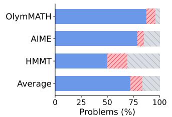  
Figure 1: Correct-answer availability and majority-vote accuracy. Majority voting is effective overall but still overlooks correct answers with limited support.

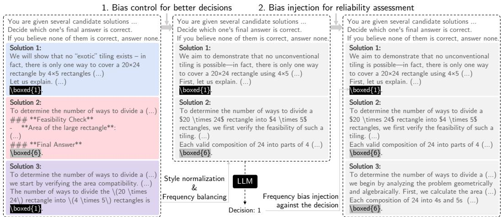  
Figure 2: Illustration of bias control and bias injection. Bias control forms an initial decision by comparing one style-normalized trace per distinct answer under balanced frequency. Bias injection then places the selected answer in the relative minority to assess its reliability. Bias is mitigated through control during decision formation and then exploited through injection to assess reliability.

Chen et al., 2024). How these biases are handled therefore matters for turning this additional reasoning evidence into better aggregation decisions.

Most prior work seeks to mitigate biases in LLM decisions by reducing or controlling their influence (Li et al., 2024; Dubois et al., 2024; Li et al., 2025; Yang et al., 2026b). In contrast, our key idea is to both mitigate and exploit bias: we first control presentation bias to improve an initial decision, then deliberately inject bias against the selected answer to assess that decision’s reliability. For bias control, we find that style normalization improves answer-selection accuracy beyond frequency balancing alone. For bias injection, we find that injecting frequency bias against the selected answer changes incorrect decisions more often than correct ones. The decision instability provides a more informative reliability signal than that obtained by reversing candidate order or repeating the same query. Based on these findings, we introduce a test-time framework for multi-agent aggregation with two complementary operations, bias control and bias injection (Figure 2).

The framework requires neither validation data nor prior knowledge of relative model strength. It operates directly on reasoning history, the collection of reasoning traces and their extracted answers available before final aggregation. Bias control retains one reasoning trace per distinct answer and rewrites each into a shared plain-prose form, helping the participating agents assess the reasoning with less influence from frequency and style biases. When their initial selections disagree, bias injection places each agent’s selected answer in the minority to assess the reliability of that decision on the current problem. The resulting problem-specific reliability signal guides final-answer selection.

We evaluate the framework on independently sampled responses from heterogeneous LLMs across three mathematical reasoning benchmarks and four model combinations. Our framework achieves higher average accuracy and better token efficiency than competing non-oracle aggregation methods. Applying the same aggregation procedure to multi-agent debate (Du et al., 2023) and Mixture-of-Agents (MoA) (Wang et al., 2025) also improves final-answer accuracy without modifying their interaction or synthesis processes.

## 2 RELATED WORK

Multi-Agent Reasoning. Multi-agent reasoning seeks to improve LLM problem solving by combining the outputs of multiple agents (Wang et al., 2026a; Tian et al., 2026; Cui et al., 2026). Agents may generate solutions independently, exchange intermediate reasoning, critique one another, synthesize responses, or revise their answers over multiple rounds (Du et al., 2023; Wang et al., 2025; Choi et al., 2026a; Tian et al., 2026; Cui et al., 2026; Zhu et al., 2026). These approaches aim to increase reasoning diversity and combine complementary strengths across agents (Wang et al., 2026a; Zhu et al., 2026). In practice, however, interaction does not consistently provide such benefits (Wang et al., 2024b; Smit et al., 2023; Choi et al., 2026a; Zhu et al., 2026). Multi-agent interactions may converge to an incorrect consensus, amplify early errors, or encourage agents to follow a dominant opinion rather than assess the underlying reasoning (Zhu et al., 2025; Choi et al., 2025; Okawa, 2026; Cui et al., 2026). As a result, a correct answer may appear among generated or intermediate responses without being selected as the final answer (Cui et al., 2026; Wang et al., 2026a).

Final-Answer Aggregation. Multi-agent frameworks use different rules for final-answer aggregation. Multi-agent debate commonly relies on terminal-round responses or consensus (Du et al., 2023; Choi et al., 2026a); SLM-MUX selects among model-wise majority answers using within-model consistency, with ties broken by each model’s historical accuracy measured on a separate validation set (Wang et al., 2026a); and Mixture-of-Agents synthesizes responses across successive layers through a designated final aggregator (Wang et al., 2025). However, majority voting and consistencybased aggregation can fail when model errors are correlated or a correct answer appears with low frequency (Choi et al., 2026a; Ai et al., 2025; Cui et al., 2026; Wang et al., 2026b). Recent work moves beyond raw answer counts by leveraging model accuracies and cross-model answer correlations (Ai et al., 2025), scoring answers based on changes across debate rounds (Cui et al., 2026), or retaining the best-supported rationale for each distinct answer (Wang et al., 2026b). Verification-based approaches similarly select among candidate answers using judgments from multiple verifiers (Lifshitz et al., 2025). Our framework draws candidate answers from the available reasoning history, which can include non-majority and intermediate answers. It assesses decision reliability independently for each problem without training, validation data, or prior knowledge of relative model strength.

Biases in Multi-Agent Aggregation. While reasoning traces provide additional evidence beyond final answers alone (Abbasloo, 2025), LLM interactions and judgments can be influenced by nonsemantic cues such as answer frequency, prompt position, response style, and model identity (Ma et al., 2025; Zhu et al., 2025; Choi et al., 2025; Wang et al., 2024a; Shi et al., 2025; Feuer et al., 2025; Choi et al., 2026b). These effects also matter in heterogeneous systems, where different LLMs produce reasoning traces with different response styles (Chen et al., 2025; Feuer et al., 2025). Consequently, a conclusion may be favored because it appears more frequently or is expressed in a preferred style rather than because its reasoning provides stronger evidence of correctness (Ma et al., 2025; Zhu et al., 2025; Choi et al., 2025; Hwang et al., 2025; Feuer et al., 2025). Most prior work focuses on analyzing biases in LLM decisions and mitigating their influence (Ma et al., 2025; Shi et al., 2025; Li et al., 2024; 2025; Ye et al., 2025; Yang et al., 2026b;a; Koo et al., 2026). Recent work also exploits biases to examine judge robustness (Yang et al., 2026c) and uses presentation perturbations to derive uncertainty signals (Badshah et al., 2026). We study the complementary use of bias mitigation through control and bias exploitation through injection for multi-agent aggregation.

## 3 MOTIVATION: INTERVENING ON BIASES

We examine how to intervene on presentation biases to both mitigate and exploit their effects in multiagent aggregation. Specifically, we ask whether controlling presentation biases improves agents’ initial answer selection and whether injecting adverse bias against their selected answers provides a useful signal of decision reliability.

Analysis setup. To isolate final-answer decision from upstream interaction dynamics, we analyze independently sampled response pools for 220 mathematical reasoning problems from OlymMATH, AIME, and HMMT. For each problem, we target three completed reasoning traces from each of four heterogeneous reasoning models: Qwen3-8B (Qwen), Phi-4-reasoning-plus (Phi), GLM-Z1-9B (GLM), and Nemotron-Nano-9B-v2 (Nemotron). We consider all four three-model combinations and focus on instances not resolved by unanimous model-level agreement. The participating models also serve as judges over the competing answers. See Section 5 for experimental details.

## 3.1 CONTROLLING BIASES IN CANDIDATE PRESENTATION

Following the one-rationale-per-answer construction of Wang et al. (2026b), we group reasoning traces by their final answers, retain one trace for each distinct answer, and present every answer once. The agent then selects among the resulting candidates or none if none is correct. This removes the original majority–minority relation and yields a frequency-balanced comparison.

Frequency balancing controls count-based cues, but not the source-dependent presentation patterns naturally embedded in reasoning traces generated by different LLMs. To control this remaining variation rather than compare raw traces directly, we rewrite each retained trace with the same prompt into a common plain-prose form. The prompt standardizes surface wording and formatting while instructing the rewriter to preserve the original length, reasoning content, numerical values, equations, and final answer. The normalization prompt and examples of original and normalized traces are provided in Figure 11 and Appendix D.4, respectively.

We compare paired decisions over the same problems, candidate answers, and source traces, with the normalized condition presenting the rewritten traces. To distinguish answer selection from parsing failures, we include only decision pairs whose selected answers can be successfully parsed in both conditions. As shown in Table 1, style normalization improves pooled answerselection accuracy and maintains or improves accuracy in 9 of the 12 agent–combination settings. These conditional results indicate that style normalization can improve dec

Table 1: Effect of style normalization on LLM decision accuracy. Rows identify the models forming the candidate pool, and columns identify the agent making the decision. Cells report Original → Normalized accuracy under frequencybalanced presentation on paired instances valid in both conditions; bold marks the higher value. Style normalization generally improves accuracy.
<table><tr><td rowspan="2">Models</td><td colspan="4">Answer-selection accuracy by agent (%)</td></tr><tr><td>Qwen</td><td>Phi</td><td>GLM</td><td>Nemo</td></tr><tr><td>Qwen-Phi-GLM</td><td></td><td></td><td>60.8→60.8 65.0→70.7 62.4→63.8</td><td></td></tr><tr><td>Qwen-Phi-Nemotron</td><td>62.1→63.9 68.2→70.6</td><td></td><td></td><td>57.8→58.1</td></tr><tr><td>Qwen-GLM-Nemotron 55.7→54.8</td><td></td><td></td><td>54.2→59.4 50.4→51.9</td><td></td></tr><tr><td>Phi-GLM-Nemotron</td><td></td><td></td><td>65.2→64.2 65.1→67.9 63.7→60.9</td><td></td></tr></table>

ision accuracy beyond frequency balancing.

## 3.2 INJECTING BIAS TO ELICIT DECISION INSTABILITY

Answer-frequency and conformity effects have been repeatedly observed in LLM decisions (Ma et al., 2025; Zhu et al., 2025; Choi et al., 2025), motivating their control during decision formation in Section 3.1. We ask whether this same susceptibility can instead be exploited after an initial controlled decision to assess its reliability through decision instability. We define decision instability as a change between the initial controlled decision and the second-pass decision. Placing the selected answer at a presentation disadvantage creates a stress test: a decision grounded in the underlying reasoning should be more likely to persist than a less reliable one. Here, the signal is whether the initial decision changes, not whether the perturbed query itself produces a better answer.

Holding the set of distinct answer hypotheses fixed, we compare three second-pass conditions. Repeated inference queries the judge again with the same biascontrolled presentation. Position swap reverses the candidate order, following prior work that uses bidirectional response orderings to derive uncertainty signals for selective judging (Badshah et al., 2026). Adverse-frequency injection applies stronger pressure by presenting the agent’s initially selected answer once and its strongest competing answer twice, placing the initial choice in the relative minority.

A useful second-pass intervention for final aggregation should change incorrect decisions more often than correct ones. As shown in Figure 3, adverse-frequency injection changes 59.8% of incorrect decisions, compared with 19.1% of correct decisions, yielding a 40.7-point gap. This exceeds the corresponding gaps of 32.5 points for repeated inference and 34.3 points for position swap, indicating that bias-induced decision instability provides a more selective reliability signal for aggregation. Section 6.2 shows that a substantial selectivity gap remains when the added trace is an exact copy.

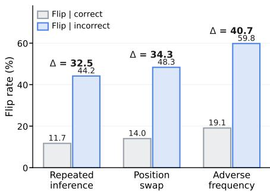  
Figure 3: Decision instability under bias injection. Bars show flip rates conditioned on initial correctness. Adverse-frequency yields the largest gap, offering a more selective signal for reliability assessment.

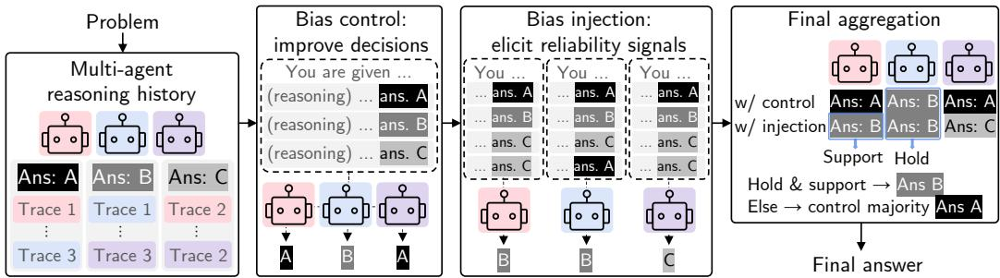  
Figure 4: Overview of the proposed aggregation framework. Responses from the reasoning history are grouped by answer. When agents disagree, the framework uses bias control to form LLM decisions and injects adverse-frequency bias to test their reliability. Final aggregation combines decision holds observed under bias injection with cross-agent support, without modifying upstream reasoning.

## 4 PROPOSED METHOD

Building on the findings in Section 3, we introduce a training- and validation-free aggregation framework (Figure 4). Cross-model agreement and disagreement provide useful information about decision uncertainty (Hamidieh et al., 2026). We therefore apply an upstream agreement gate, returning the agreed answer when it is satisfied and invoking additional aggregation otherwise. For independently sampled responses, the gate is satisfied when every participating model has the same unique modal answer among its completed responses; a within-model tie does not satisfy the gate. Bias control forms initial decisions; disagreement among these decisions triggers bias injection, which uses decision instability to assess their reliability on the current problem. The framework requires neither prior estimates of model strength nor a designated final aggregator and applies to independently sampled responses, multi-agent debate (Du et al., 2023), and Mixture-of-Agents (MoA) (Wang et al., 2025), without modifying upstream reasoning.

Bias control for initial decision. To improve initial answer selection, we place distinct answer hypotheses under more comparable presentation conditions. Given a problem and its upstream reasoning history, we group reasoning traces by their extracted final answers and retain one trace for each distinct answer. We present each retained answer once to balance its presentation frequency and rewrite each retained trace into a common plain-prose form to reduce source-dependent stylistic differences. We submit the resulting candidate set to J aggregating agents and let $c _ { j }$ denote the answer selected by agent $j .$ If the aggregating agents unanimously select the same answer after bias control, we return it; otherwise, we proceed to bias injection.

Bias injection for decision instability assessment. Resolving disagreement requires problemspecific evidence about which decisions remain reliable. Rather than assigning fixed reliability to agents, we stress-test each controlled decision on the current problem and observe whether it changes under an adverse presentation. For each agent, we construct a second-pass input based on its controlled decision. If the reasoning history contains an additional trace for the competing answer with the greatest original support, we apply adverse-frequency injection: the initially selected answer is presented once, whereas the competing answer is presented twice using distinct normalized traces. This places the initial choice in the relative minority while leaving the set of answer hypotheses unchanged. If no such additional trace is available, we instead reverse the candidate order. Let $p _ { j }$ denote agent j’s second-pass decision. The complete decision prompts are provided in Figure 12.

Final aggregation. To combine decisions from bias control and bias injection, we define the hold count ${ \bar { H ( a ) } } = | \{ j : c _ { j } = p _ { j } = a \} |$ and second-pass support count ${ \check { S } } ( a ) { \bar { = } } | \{ j : p _ { j } = a \} |$ for each answer a. We select a if at least one agent retains it and a majority supports it on the second pass, i.e., $H ( a ) > 0$ and $S ( a ) > J / 2$ . If no answer satisfies this condition, we return the strict-majority answer among the controlled decisions when one exists; otherwise, we select the answer with the most votes across both stages. Original response frequencies inform candidate construction but are not counted as votes in the final decision. Algorithm 1 provides the complete aggregation procedure.

## 5 EXPERIMENTS

## 5.1 EXPERIMENTAL SETUP

Models. We evaluate four open-weight reasoning models: Qwen3-8B (Yang et al., 2025), Phi-4- reasoning-plus (14B) (Abdin et al., 2025), GLM-Z1-9B-0414 (GLM et al., 2024), and NVIDIA-Nemotron-Nano-9B-v2 (Basant et al., 2025), referred to as Qwen, Phi, GLM, and Nemotron, respectively. We consider all four three-model combinations: Qwen–Phi–GLM, Qwen–Phi–Nemotron, Qwen–GLM–Nemotron, and Phi–GLM–Nemotron. We use Qwen as the default style normalizer; Appendix C.1 shows comparable final accuracy with different normalizers. We use the official model checkpoints and their default reasoning modes; full inference details are provided in Appendix B.

Benchmarks. We evaluate mathematical reasoning on 220 problems from three benchmarks: 100 problems from the English easy split of OlymMATH (Sun et al., 2026), 60 from AIME 2024– 2025 (Mathematical Association of America), and 60 from the February HMMT 2024–2025 competitions (Harvard–MIT Mathematics Tournament). We report final-answer accuracy using the same answer normalization and equivalence checks across all benchmarks and aggregation methods.

Baselines. Combined MV selects the most frequent answer across all sampled responses. SLM-MUX (Wang et al., 2026a) selects among model-wise modal answers using within-model consistency. Because our setting fixes model combinations and assumes no validation data, we omit its validationbased subset search and replace its validation-accuracy tie-breaker with plurality voting over the tied models’ completed samples, breaking residual ties by first occurrence. Appendix C.2 evaluates a test-set-informed oracle tie-breaker; Ours achieves higher average accuracy under either tie-breaking rule. Multi-Agent Verification (MAV) (Lifshitz et al., 2025) applies aspect-specific binary verification to the same candidate answers as our method, using one representative trace per answer. For each selected aspect, all three participating models evaluate every candidate, and we select the candidate with the most approvals. We also report Single-Best-SC (Wang et al., 2022), which retrospectively selects the strongest individual model under self-consistency and serves as an oracle model-selection reference rather than a deployable baseline.

Evaluation protocol. Our primary metric is final-answer accuracy, and we use mean total token usage, including input and output tokens, per problem as a proxy for inference cost. Methods with LLM-based aggregation are run three times over the fixed response pools, and their accuracies are averaged; rule-based methods are evaluated once. For MAV, we fix $k = 3$ and cumulatively include answer correctness, reasoning validity, and solution completeness to obtain three accuracy–cost points. For MoA, we evaluate each participating model as the final aggregator and retrospectively report the best-performing choice as an oracle reference. We target k completed responses per model, allowing at most 2k generation attempts and including tokens from all attempts in the reported cost. Our primary setting uses $k = 3 ,$ , with additional response budgets used to characterize the accuracy–cost trade-off. In this setting, the agreement-routing rule in Section 4 operates on the model-wise majority answers over the completed responses. In our framework, we retain up to four distinct candidate answers with the highest frequencies in the reasoning history and present them in descending frequency order.

## 5.2 EXPERIMENTAL RESULTS

Main results. For independently generated multi-LLM reasoning, our primary comparison examines the accuracy–cost trade-off across response budgets (Figure 5). Across all four model combinations, most Ours configurations with $k \in \{ \bar { 2 } , 3 , 4 \}$ lie on or near the observed Pareto frontier. Table 2 complements this comparison under our budget-matching protocol, reporting mean ± standard deviation over three runs for LLM-based aggregation methods. Here, Ours achieves the highest average accuracy in all four model combinations, outperforming the strongest non-oracle baseline by 3.2–6.2 percentage points and the retrospective Single-Best-SC oracle reference by 1.8–4.3 points. It also achieves the best or tied-best non-oracle accuracy in 12 of the 12 benchmark–combination pairs. We additionally evaluate a common subset of instances not resolved by the upstream agreement gate, determined from the $k = 3$ response pools before aggregation. Applying the same budget-matching rule within this subset, Ours outperforms the strongest non-oracle baseline by 5.8–9.5 percentage points across model combinations (Appendix C.3).

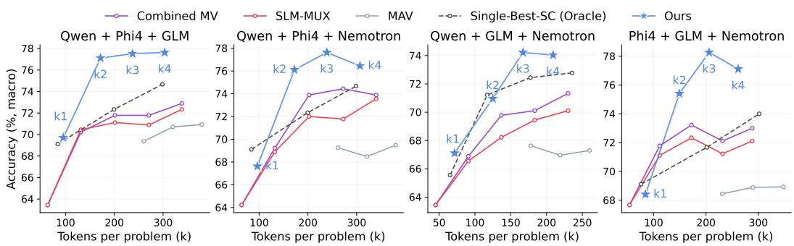  
Figure 5: Accuracy–cost trade-offs under independent sampling. Each panel shows one threemodel combination across response budgets. Accuracy is the macro-average across OlymMATH, AIME, and HMMT, and inference cost is measured by total input-and-output tokens per problem. Stars mark Ours. Most Ours configurations with $k \in \{ 2 , 3 , 4 \}$ lie on or near the observed Pareto frontier.

Table 2: Final-answer accuracy and inference efficiency across heterogeneous LLM combinations. Each baseline uses the nearest evaluated token budget at or above Ours. Average is the unweighted benchmark mean, and Tokens denotes input-and-output usage per problem. For LLM-based aggregation methods, values are mean ± standard deviation over three runs. Single-Best-SC is an oracle model-selection reference. Bold and underline mark the first- and second-ranked results, respectively. Ours achieves the highest average accuracy with fewer tokens in every combination.
<table><tr><td>Model combination Method</td><td></td><td>OlymMATH↑ AIME↑</td><td></td><td></td><td></td><td>HMMT ↑ Average ↑ Tokens (103) ↓</td></tr><tr><td rowspan="4">Qwen-Phi-GLM</td><td>Single-Best-SC (Wang et al., 2022)</td><td>89.0</td><td>83.3</td><td>51.7</td><td>74.7</td><td>298.7</td></tr><tr><td>Combined MV</td><td>87.0</td><td>80.0</td><td>48.3</td><td>71.8</td><td>270.8</td></tr><tr><td>MAV (Lifshitz et al., 2025)</td><td>82.0±2.0</td><td>71.1±2.5</td><td>55.0±2.9</td><td>69.4±0.9</td><td>260.6±0.9</td></tr><tr><td>SLM-MUX (Wang et al., 2026a) Ours</td><td>86.0 90.3±1.2</td><td>78.3</td><td>48.3</td><td>70.9 77.5±1.5</td><td>270.8 237.3±1.2</td></tr><tr><td rowspan="4">Qwen-Phi-Nemotron</td><td>Single-Best-SC</td><td>89.0</td><td>83.3±1.7 83.3</td><td>58.9±1.9 51.7</td><td>74.7</td><td>298.7</td></tr><tr><td></td><td></td><td></td><td></td><td></td><td></td></tr><tr><td>Combined MV MAV</td><td>90.0</td><td>78.3 70.6±1.0</td><td>55.0</td><td>74.4</td><td>272.5</td></tr><tr><td>SLM-MUX</td><td>81.7±0.6 87.0</td><td>76.7</td><td>55.6±4.2 51.7</td><td>69.3±1.2 71.8</td><td>261.6±0.9 272.5</td></tr><tr><td rowspan="4">Qwen-GLM-Nemotron</td><td>Ours</td><td>90.7±0.6</td><td>82.8±1.0</td><td>59.4±1.9</td><td>77.6±0.1</td><td>238.9±1.0</td></tr><tr><td>Single-Best-SC</td><td>89.0</td><td>80.0</td><td>48.3</td><td>72.4</td><td>177.6</td></tr><tr><td>Combined MV MAV</td><td>87.0</td><td>76.7</td><td>46.7</td><td>70.1</td><td>183.4</td></tr><tr><td>SLM-MUX</td><td>77.3±3.2 85.0</td><td>75.6±2.5 76.7</td><td>50.0±2.9 46.7</td><td>67.6±2.0 69.4</td><td>178.0±0.6 183.4</td></tr><tr><td rowspan="5">Phi-GLM-Nemotron</td><td>Ours</td><td>89.3±1.5</td><td>78.9±1.9</td><td>54.4±1.0</td><td>74.2±0.6</td><td>167.1±1.0</td></tr><tr><td>Single-Best-SC</td><td>87.0</td><td>83.3</td><td>51.7</td><td>74.0</td><td>301.7</td></tr><tr><td>Combined MV</td><td>88.0</td><td>80.0</td><td>48.3</td><td>72.1</td><td>231.7</td></tr><tr><td>MAV</td><td>82.0±1.0</td><td>71.7±2.9</td><td>51.7±2.9</td><td>68.4±2.0</td><td>231.0±0.4</td></tr><tr><td>SLM-MUX Ours</td><td>87.0 88.7±0.6</td><td>78.3 85.0±0.0</td><td>48.3 61.1±1.0</td><td>71.2 78.3±0.5</td><td>231.7 206.0±2.0</td></tr></table>

Recovery and retention relative to majority voting. We examine whether aggregation recovers overlooked correct answers while preserving correct selections. Using the same k = 3 reference response pools as Figure 1, we define recovery as accuracy when a correct answer is available but Combined MV is incorrect, and retention as accuracy when Combined MV is correct. As shown in Figure 6, Ours

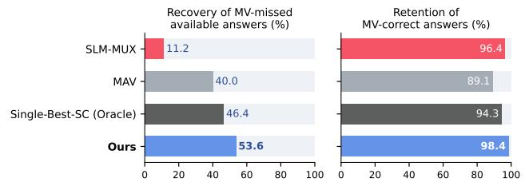  
Figure 6: Recovery and retention relative to majority voting. Rates are macro-averaged across benchmarks. Ours achieves the highest recovery while retaining most MV-correct answers.

achieves both the highest recovery rate, at 53.6%, and the highest retention rate, at 98.4%. MAV recovers 40.0% of missed answers with 89.1% retention, whereas SLM-MUX retains 96.4% but recovers only 11.2%. Single-Best-SC, included as an oracle reference with a target of nine completed responses from the retrospectively strongest model, achieves 46.4% recovery and 94.3% retention. These results show that Ours recovers more available correct answers while preserving nearly all MV-correct selections.

Application to multi-agent reasoning. We next apply the same decision procedure to reasoning histories produced by different multi-agent interaction frameworks such as multi-agent debate (Debate) (Du et al., 2023) and Mixture-of-Agents (MoA) (Wang et al., 2025). For each configuration, we keep the upstream reasoning history fixed and compare the native final decision with the corresponding +OURS variant. Since interaction may lead to biased consensus, we apply +OURS only when final answers disagree, their shared answer is supported by fewer than two initial, pre-interaction responses, or, for Debate, any agent changes its answer between the last two rounds. For MoA, agreement is checked among all final-layer proposers and the selected aggregator. Figure 7 shows that our method improves final-answer accuracy for both frameworks at a moderate additional inference cost.

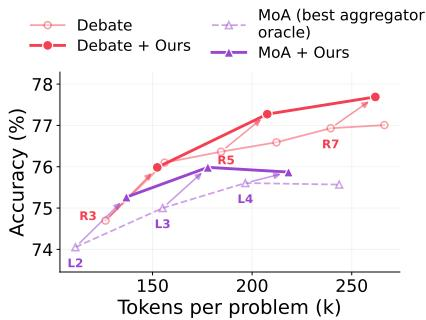  
Figure 7: Integration with multiagent reasoning. Arrows show pooledaccuracy gains from adding Ours. R/L denote Debate rounds/MoA layers.

## 6 ANALYSIS

## 6.1 UNDERSTANDING STYLE NORMALIZATION

More than formatting removal. We examine whether the crossgenerator convergence induced by style normalization can be explained by formatting removal alone. We construct matched pairs of reasoning traces produced by different generators for the same problem and answer, and compare deterministic formatting removal with full normalization. Figure 8 shows the comparison in the Phi representation space, which is not used for rewriting. Formatting removal reduces mean representation distance by only 1.7%, whereas full normalization reduces it by 8.2%. Results in the representation spaces of three LLMs are provided in Appendix D.1. Additional sourceattribution analyses assess how accurately a trace’s generating model can be identified from presentation features. Normalization reduces identification accuracy, particularly for formatting features, suggesting weaker model-specific presentation cues (Appendix D.2).

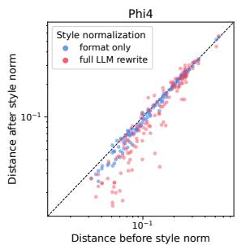  
Figure 8: Cross-generator convergence in Phi. Cosine distances between matched traces.

## 6.2 UNDERSTANDING BIAS INJECTION

Does bias injection yield a more reliable retained set? Section 3.2 showed that adverse-frequency bias injection dislodges incorrect decisions more selectively than repeated inference or position swap. We analyze instances where the controlled decisions are not unanimous and a second pass is issued, comparing the reliability of decisions that remain unchanged under each second-pass condition. As shown in Table 3, adverse-frequency injection retains 37.5% of controlled decisions, whose conditional accuracy is 46.9%, compared with 42.4% under position swap and 40.6% under repeated inference. Relative to the common controlled-decision accuracy of 30.3%, adverse-frequency injection yields the largest gain in retained-set accuracy, at 16.6 percentage points. It thus retains fewer decisions but produces a more accurate retained set, supporting decision persistence as a reliability signal. Additional analysis of final aggregation is provided in Appendix D.3.

Table 3: Reliability of retained decisions. Hold rate is the fraction unchanged on the second pass; held accuracy is their conditional accuracy. ∆ is the gain over the 30.3% controlled baseline.
<table><tr><td>Condition</td><td>Hold rate (%)</td><td>Held acc. (%)</td><td>∆ (pp)</td></tr><tr><td>Repeated inference</td><td>53.7</td><td>40.6</td><td>+10.3</td></tr><tr><td>Position swap</td><td>52.4</td><td>42.4</td><td>+12.1</td></tr><tr><td>Adverse frequency</td><td>37.5</td><td>46.9</td><td>+16.6</td></tr></table>

Does selectivity persist without new reasoning content? Our default injection adds a distinct trace for a competing answer, changing both presentation frequency and reasoning content. To examine the role of additional reasoning content, we compare second-pass conditions on instances with upstream disagreement, using the same initial controlled decisions across

Table 4: Content control for bias injection. Flip rates (%) are conditioned on initial correctness. Gap is the incorrect– correct difference in percentage points.
<table><tr><td>Condition</td><td>Flip | incorrect Flip | correct</td><td></td><td>Gap</td></tr><tr><td>Repeated inference</td><td>44.2</td><td>11.7</td><td>32.5</td></tr><tr><td>Position swap</td><td>48.3</td><td>14.0</td><td>34.3</td></tr><tr><td>Adverse freq. (exact copy)</td><td>56.2</td><td>18.9</td><td>37.3</td></tr><tr><td>Adverse freq. (distinct)</td><td>59.8</td><td>19.1</td><td>40.7</td></tr></table>

conditions. The exact-copy condition duplicates the competing trace already present, holding the competing answer, presentation order, and number of input blocks fixed. As shown in Table 4, exactcopy injection yields an incorrect–correct flip gap of 37.3 percentage points, compared with 32.5 for repeated inference and 34.3 for position swap. Using a distinct trace yields the largest observed gap, at 40.7 points. These results suggest a role for frequency bias in selectivity and support using distinct reasoning traces when available.

## 6.3 ABLATION

Figure 9 compares interventions on common evaluation sets comprising all instances reaching each stage. Accuracy is pooled across four model combinations and three runs. For bias control, we evaluate instances unresolved by the initial agreement gate, since normalization can affect subsequent controlled decisions and their agreement. Removing normalization reduces accuracy from 63.4% to 61.3%. For bias injection, we fix controlled decisions and compare second-pass strategies on instances where they disagree. The secondpass variants use the same final aggregation rule, while the no-second-pass baseline uses controlled decisions alone. Adverse-frequency injection achieves 41.6% accuracy, compared with 37.6% without a second pass,

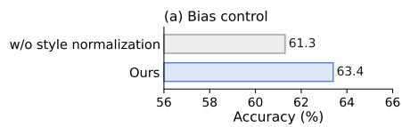

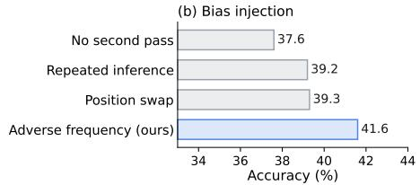  
Figure 9: Component ablations. Answer accuracy for (a) bias control and (b) bias injection.

tion swap. Among strategies using the same number of second-pass decisions, adverse-frequency injection yields the highest accuracy under the shared aggregation rule.

## 7 CONCLUSIONS

We introduced a training- and validation-free framework that both mitigates and exploits biases in multi-agent aggregation. Bias control reduces the influence of frequency and style to improve initial decisions, while bias injection elicits decision instability as a problem-specific reliability signal. Across three mathematical reasoning benchmarks and four heterogeneous model combinations, the framework improves accuracy and token efficiency. It also improves final-answer aggregation in debate and MoA without modifying their upstream processes.

## 8 LIMITATIONS

First, our evaluation focuses on mathematical reasoning with four open-weight models in the 8B–14B range. Broader evaluation would help assess how the benefits of bias control and the reliability signal from bias injection extend to other domains and larger models. Second, we study bias interventions at final aggregation, including for Debate and MoA, while keeping upstream reasoning histories fixed. Extending these interventions to interaction or synthesis is a direction for future work, with potential effects on both solution diversity and how agents reach agreement.

## REPRODUCIBILITY STATEMENT

The aggregation algorithm, experimental settings, and prompts are provided in Appendices A, B, and E, respectively. We will also release the source code and scripts needed to reproduce the reported experiments.

## AI USE STATEMENT

Generative AI assistants were used for manuscript editing and formatting, and for assistance with experimental and analysis code. All AI-assisted outputs were reviewed and verified by the authors, who take full responsibility for the final content of this work.

## REFERENCES

Soheil Abbasloo. Evaluating llm reasoning beyond correctness and cot. arXiv preprint arXiv:2510.18134, 2025.

Marah Abdin, Sahaj Agarwal, Ahmed Awadallah, Vidhisha Balachandran, Harkirat Behl, Lingjiao Chen, Gustavo de Rosa, Suriya Gunasekar, Mojan Javaheripi, Neel Joshi, et al. Phi-4-reasoning technical report. arXiv preprint arXiv:2504.21318, 2025.

Rui Ai, Yuqi Pan, David Simchi-Levi, Milind Tambe, and Haifeng Xu. Beyond majority voting: Llm aggregation by leveraging higher-order information. arXiv preprint arXiv:2510.01499, 2025.

Sher Badshah, Ali Emami, and Hassan Sajjad. Scope: Selective conformal optimized pairwise llm judging. arXiv preprint arXiv:2602.13110, 2026.

Aarti Basant, Abhijit Khairnar, Abhijit Paithankar, Abhinav Khattar, Adithya Renduchintala, Aditya Malte, Akhiad Bercovich, Akshay Hazare, Alejandra Rico, Aleksander Ficek, et al. Nvidia nemotron nano 2: An accurate and efficient hybrid mamba-transformer reasoning model. arXiv preprint arXiv:2508.14444, 2025.

Guiming Hardy Chen, Shunian Chen, Ziche Liu, Feng Jiang, and Benyou Wang. Humans or llms as the judge? a study on judgement bias. In Proceedings of the 2024 Conference on Empirical Methods in Natural Language Processing, pp. 8301–8327, 2024.

Zhi-Yuan Chen, Hao Wang, Xinyu Zhang, Enrui Hu, and Yankai Lin. Beyond the surface: Measuring self-preference in llm judgments. In Proceedings of the 2025 Conference on Empirical Methods in Natural Language Processing, pp. 1653–1672, 2025.

Hyeong Kyu Choi, Jerry Zhu, and Sharon Li. Debate or vote: Which yields better decisions in multiagent large language models? Advances in Neural Information Processing Systems, 38:101732– 101764, 2026a.

Hyeong Kyu Choi, Jerry Zhu, and Sharon Li. When identity skews debate: Anonymization for biasreduced multi-agent reasoning. In Proceedings ofthe 64th Annual Meeting ofthe Associationfor Computational Linguistics (Volume 1: Long Papers), pp. 14284–14311, 2026b.

Min Choi, Keonwoo Kim, Sungwon Chae, and Sangyeop Baek. An empirical study of group conformity in multi-agent systems. In Findings of the Association for Computational Linguistics: ACL 2025, pp. 5123–5139, 2025.

Yu Cui, Hang Fu, Haibin Zhang, Licheng Wang, and Cong Zuo. Free-mad: Consensus-free multiagent debate. In Findings of the Association for Computational Linguistics: ACL 2026, pp. 31977– 31997, 2026.

Yilun Du, Shuang Li, Antonio Torralba, Joshua B Tenenbaum, and Igor Mordatch. Improving factuality and reasoning in language models through multiagent debate. arXiv preprint arXiv:2305.14325, 2023.

Yann Dubois, Balazs Galambosi, Percy Liang, and Tatsunori B Hashimoto. Length-controlled´ alpacaeval: A simple way to debias automatic evaluators. arXiv preprint arXiv:2404.04475, 2024.

Benjamin Feuer, Micah Goldblum, Teresa Datta, Sanjana Nambiar, Raz Besaleli, Samuel Dooley, Max Cembalest, and John P Dickerson. Style outweighs substance: Failure modes of llm judges in alignment benchmarking. In International Conference on Learning Representations, volume 2025, pp. 11552–11582, 2025.

Team GLM, Aohan Zeng, Bin Xu, Bowen Wang, Chenhui Zhang, Da Yin, Dan Zhang, Diego Rojas, Guanyu Feng, Hanlin Zhao, et al. Chatglm: A family of large language models from glm-130b to glm-4 all tools. arXiv preprint arXiv:2406.12793, 2024.

Kimia Hamidieh, Veronika Thost, Walter Gerych, Mikhail Yurochkin, and Marzyeh Ghassemi. Complementing self-consistency with cross-model disagreement for uncertainty quantification. arXiv preprint arXiv:2604.17112, 2026.

Harvard–MIT Mathematics Tournament. Hmmt (harvard–mit mathematics tournament). URL https://www.hmmt.org/.

Yerin Hwang, Dongryeol Lee, Taegwan Kang, Yongil Kim, and Kyomin Jung. Can you trick the grader? adversarial persuasion of llm judges. In EMNLP (Findings), pp. 14632–14651, 2025.

Hamin Koo, ChanJoo Jung, Fangzhao Wu, and Jaehyung Kim. Auditing the judge: Human-grounded bias discovery, quantification, and mitigation in llm judges. In Trustworthy AI for Good (AI4GOOD) Workshop@ ICML 2026, 2026.

Haitao Li, Junjie Chen, Qingyao Ai, Zhumin Chu, Yujia Zhou, Qian Dong, and Yiqun Liu. Calibraeval: Calibrating prediction distribution to mitigate selection bias in llms-as-judges. In Proceedings of the 63rd Annual Meeting of the Association for Computational Linguistics (Volume 1: Long Papers), pp. 16537–16552, 2025.

Zongjie Li, Chaozheng Wang, Pingchuan Ma, Daoyuan Wu, Shuai Wang, Cuiyun Gao, and Yang Liu. Split and merge: Aligning position biases in llm-based evaluators. In Proceedings ofthe 2024 Conference on Empirical Methods in Natural Language Processing, pp. 11084–11108, 2024.

Shalev Lifshitz, Sheila A McIlraith, and Yilun Du. Multi-agent verification: Scaling test-time compute with multiple verifiers. arXiv preprint arXiv:2502.20379, 2025.

Chiyu Ma, Enpei Zhang, Yilun Zhao, Wenjun Liu, Yaning Jia, Peijun Qing, Lin Shi, Arman Cohan, Yujun Yan, and Soroush Vosoughi. Judging with many minds: Do more perspectives mean less prejudice? on bias amplification and resistance in multi-agent based llm-as-judge. In EMNLP (Findings), pp. 17356–17392, 2025.

Mathematical Association of America. American invitational mathematics examination (aime). URL https://maa.org/maa-invitational-competitions/.

Maya Okawa. Emergence of biased consensus in multi-agent llm debates. In Forty-third International Conference on Machine Learning, 2026.

Lin Shi, Chiyu Ma, Wenhua Liang, Xingjian Diao, Weicheng Ma, and Soroush Vosoughi. Judging the judges: A systematic study of position bias in llm-as-a-judge. In Proceedings of the 14th International Joint Conference on Natural Language Processing and the 4th Conference of the Asia-Pacific Chapter of the Association for Computational Linguistics, pp. 292–314, 2025.

Andries Smit, Paul Duckworth, Nathan Grinsztajn, Thomas D Barrett, and Arnu Pretorius. Should we be going mad? a look at multi-agent debate strategies for llms. arXiv preprint arXiv:2311.17371, 2023.

Haoxiang Sun, Yingqian Min, Zhipeng Chen, Wayne Xin Zhao, and Ji-Rong Wen. Challenging the boundaries of reasoning: An olympiad-level math benchmark for large language models. In Proceedings of the 64th Annual Meeting of the Association for Computational Linguistics (Volume 1: Long Papers), pp. 17438–17457, 2026.

Hongduan Tian, Xiao Feng, Ziyuan Zhao, Xiangyu Zhu, Rolan Yan, and Bo Han. Multi-agent debate with memory masking. In International Conference on Learning Representations, volume 2026, pp. 5122–5143, 2026.

Chenyu Wang, Zishen Wan, Hao Kang, Emma Chen, Zhiqiang Xie, Tushar Krishna, Vijay Janapa Reddi, and Yilun Du. Slm-mux: Orchestrating small language models for reasoning. In International Conference on Learning Representations, volume 2026, pp. 73697–73723, 2026a.

Fuyu Wang, Jiangtong Li, Kun Zhu, and Changjun Jiang. Can llms really judge? a progressive argumentation-mining framework for distinguishing understanding from aggregation. In Findings ofthe Associationfor Computational Linguistics: ACL 2026, pp. 29463–29482, 2026b.

Junlin Wang, Jue Wang, Ben Athiwaratkun, Ce Zhang, and James Y Zou. Mixture-of-agents enhances large language model capabilities. In International Conference on Learning Representations, volume 2025, pp. 33944–33963, 2025.

Peiyi Wang, Lei Li, Liang Chen, Zefan Cai, Dawei Zhu, Binghuai Lin, Yunbo Cao, Lingpeng Kong, Qi Liu, Tianyu Liu, et al. Large language models are not fair evaluators. In Proceedings of the 62nd annual meeting of the association for computational linguistics (volume 1: Long papers), pp. 9440–9450, 2024a.

Qineng Wang, Zihao Wang, Ying Su, Hanghang Tong, and Yangqiu Song. Rethinking the bounds of llm reasoning: Are multi-agent discussions the key? In Proceedings ofthe 62nd Annual Meeting of the Association for Computational Linguistics (Volume 1: Long Papers), pp. 6106–6131, 2024b.

Xuezhi Wang, Jason Wei, Dale Schuurmans, Quoc Le, Ed Chi, Sharan Narang, Aakanksha Chowdhery, and Denny Zhou. Self-consistency improves chain of thought reasoning in language models. arXiv preprint arXiv:2203.11171, 2022.

An Yang, Anfeng Li, Baosong Yang, Beichen Zhang, Binyuan Hui, Bo Zheng, Bowen Yu, Chang Gao, Chengen Huang, Chenxu Lv, et al. Qwen3 technical report. arXiv preprint arXiv:2505.09388, 2025.

Bo Yang, Lanfei Feng, Yunkui Chen, Yu Zhang, Xiao Xu, and Shijian Li. Fairjudge: An adaptive, debiased, and consistent llm-as-a-judge. arXiv preprint arXiv:2602.06625, 2026a.

Haoyan Yang, Runxue Bao, Cao Danica Xiao, Jun Ma, Parminder Bhatia, Shangqian Gao, and Taha Kass-Hout. Any large language model can be a reliable judge: Debiasing with a reasoning-based bias detector. Advances in Neural Information Processing Systems, 38:6318–6362, 2026b.

Xianglin Yang, Bryan Hooi, Gelei Deng, Tianwei Zhang, and Jin Song Dong. Turning bias into bugs: Bandit-guided style manipulation attacks on llm judges. arXiv preprint arXiv:2605.26156, 2026c.

Jiayi Ye, Yanbo Wang, Yue Huang, Dongping Chen, Qihui Zhang, Nuno Moniz, Tian Gao, Werner Geyer, Chao Huang, Pin-Yu Chen, et al. Justice or prejudice? quantifying biases in llm-as-a-judge. In International Conference on Learning Representations, volume 2025, pp. 102351–102390, 2025.

Xiaochen Zhu, Caiqi Zhang, Tom Stafford, Nigel Collier, and Andreas Vlachos. Conformity in large language models. In Proceedings of the 63rd Annual Meeting of the Association for Computational Linguistics (Volume 1: Long Papers), pp. 3854–3872, 2025.

Xiaochen Zhu, Caiqi Zhang, Yizhou Chi, Tom Stafford, Nigel Collier, and Andreas Vlachos. Demystifying multi-agent debate: The role of confidence and diversity. In Findings of the Association for Computational Linguistics: ACL 2026, pp. 33909–33930, 2026.

## A AGGREGATION ALGORITHM

Algorithm 1 summarizes the complete aggregation procedure.

Algorithm 1 Bias Control and Bias Injection for Multi-Agent Aggregation   
1: Input: Problem $q ,$ reasoning history $\mathcal { H } ~ = ~ \{ ( r _ { i } , a _ { i } ) \} _ { i = 1 } ^ { N }$ , upstream conclusions $u ,$ judges   
$\{ \mathcal { I } _ { j } \} _ { j = 1 } ^ { J }$ , normalizer $G _ { \mathrm { n o r m } }$   
2: Output: Final answer $\widehat { a }$   
Step 1: Agreement Routing   
3: if the upstream agreement gate is satisfied then   
4: return the agreed answer   
5: end if   
Step 2: Bias Control for Decision Formation   
6: Group H by answer into $\{ { \mathcal { R } } _ { a } \} _ { a \in { \mathcal { A } } }$ and set $n ( a )  \vert \mathcal { R } _ { a } \vert$   
7: Select one $\boldsymbol { r } _ { a } \in \mathcal { R } _ { a }$ and set $\widetilde { r _ { a } } \gets G _ { \mathrm { n o r m } } ( r _ { a } )$ for each a $\in A$   
8: $S ^ { \mathrm { c t r l } } \gets [ ( \widetilde { r } _ { a } , a ) ] _ { a \in \mathcal { A } } ,$ ordered by decreasing $n ( a )$   
9: $c _ { j } \gets \mathcal { T } _ { j } ( q , S ^ { \mathrm { c t r l } } )$ for $j = 1 , \dots , J$   
10: $\mathbf { i } \mathbf { \bar { f } } c _ { 1 } = \cdot \cdot \cdot = c _ { J }$ then   
11: return $c _ { 1 }$   
12: end if   
Step 3: Bias Injection for Reliability Assessment   
13: for $j = 1 , \dots , J$ do   
14: $b _ { j } \gets$ arg m $\operatorname { u x } _ { a \in { \mathcal { A } } \backslash \{ c _ { j } \} } n ( a )$   
15: if an unused trace $r _ { b _ { j } } ^ { \prime } \in \mathcal { R } _ { b _ { j } }$ exists then   
16: Form $S _ { j } ^ { \mathrm { p r o b e } }$ by adding $( G _ { \mathrm { n o r m } } ( r _ { b _ { j } } ^ { \prime } ) , b _ { j } )$ to $S ^ { \mathrm { c t r l } }$ , preserving the order of the existing   
candidates   
17: else   
18: $\hat { S } _ { j } ^ { \mathrm { p r o b e } } $ Reverse $( S ^ { \mathrm { c t r l } } )$   
19: end if   
20: $p _ { j }  \mathcal { I } _ { j } ( q , S _ { j } ^ { \mathrm { p r o b e } } )$   
21: end for   
Step 4: Final Aggregation   
22: For each $^ { a , }$ compute $H ( a ) = | \{ j : c _ { j } = p _ { j } = a \} |$ and $S ( a ) = | \{ j : p _ { j } { \stackrel { . } { = } } a \} |$   
23: if some a satisfies $H ( a ) { \stackrel { . } { > } } 0$ and $S ( \check { a } ) > \check { J } / 2$ then   
24: return a   
25: else   
26: return the strict-majority answer among $\{ c _ { j } \} _ { j = 1 } ^ { J }$ if one exists; otherwise, the most-voted   
answer across $\{ c _ { j } \} _ { j = 1 } ^ { J }$ and $\{ p _ { j } \} _ { j = 1 } ^ { J }$   
27: end if

## B EXPERIMENTAL SETTINGS

Table 5 summarizes the main hyperparameters. For CoT generation, we follow the sampling settings recommended in the respective models’ official model cards, where available, for temperature, top-$p ,$ and top-k. All methods use the same CoT generation rule: generation stops after k completed responses or 2k attempts per model, whichever occurs first. Truncated responses are discarded and resampled within the attempt limit, and tokens from all attempts are included in the reported cost. We prompt the normalizer to target 85–115% of the original length (Figure 11), while allowing a wider 80–120% range when accepting normalized traces.

Table 5: Hyperparameters used in the experiments.
<table><tr><td>Parameter</td><td colspan="2">Value</td></tr><tr><td colspan="3">CoT generation</td></tr><tr><td>Model</td><td>Temperature</td><td>Top-k</td></tr><tr><td>Phi-4-reasoning-plus</td><td>0.8</td><td>50</td></tr><tr><td>Qwen3-8B</td><td>0.6</td><td>20</td></tr><tr><td>GLM-Z1-9B-0414</td><td>0.6</td><td>40</td></tr><tr><td>NVIDIA-Nemotron-Nano-9B-v2</td><td>0.6</td><td>Disabled</td></tr><tr><td>Top-p</td><td colspan="2">0.95</td></tr><tr><td>Maximum output tokens</td><td colspan="2">32,768</td></tr><tr><td>Maximum generation attempts per model</td><td colspan="2">Twice the target number of completed responses</td></tr><tr><td colspan="3">Style normalization</td></tr><tr><td>Rewriter</td><td colspan="2">Qwen3-8B</td></tr><tr><td>Temperature</td><td colspan="2">0.6</td></tr><tr><td>Top-p</td><td colspan="2">0.95</td></tr><tr><td>Maximum output tokens</td><td colspan="2">28,672</td></tr><tr><td colspan="2">Maximum retries (failed length or answer-preservation check)</td><td>2</td></tr><tr><td colspan="2">Accepted length ratio</td><td>[0.8, 1.2]</td></tr><tr><td colspan="3">LLM decision</td></tr><tr><td colspan="3">Number of aggregating agents</td></tr><tr><td>Temperature</td><td colspan="2">3 0.6</td></tr><tr><td>Top-p</td><td colspan="2">0.95</td></tr><tr><td>Maximum output tokens</td><td colspan="2">32,768</td></tr><tr><td>Maximum retries (invalid output)</td><td colspan="2">2</td></tr><tr><td>Maximum candidate answers per prompt</td><td colspan="2">4</td></tr><tr><td>Maximum trace length per candidate (characters)</td><td colspan="2">6,000</td></tr><tr><td colspan="3">Multi-agent baselines</td></tr><tr><td>Temperature</td><td colspan="2">0.6</td></tr><tr><td>Top-p</td><td colspan="2">0.95</td></tr><tr><td>Maximum output tokens</td><td colspan="2"></td></tr><tr><td>Maximum retries (truncated output)</td><td colspan="2">32,768 4</td></tr></table>

## C EXTENDED EXPERIMENTAL RESULTS

## C.1 ROBUSTNESS TO THE STYLE NORMALIZER

We test whether the framework depends on Qwen3-8B as the style normalizer by replacing it with GLM-Z1-9B or Nemotron-Nano-9B while keeping the response pools and other settings fixed. Because the alternative normalizers were evaluated once, we use the first Qwen3-8B run as the matched reference rather than its three-run average. As shown in Table 6, replacing Qwen3-8B with GLM-Z1-9B or Nemotron-Nano-9B changes average accuracy by −2.4 to +1.3 percentage points across the four model combinations. These results suggest that the framework can also be used with alternative style normalizers.

## C.2 TIE-BREAKING IN SLM-MUX

SLM-MUX selects the modal answer of the model with the highest within-model consistency and originally resolves confidence ties using validation-set accuracy. Because our setting assumes no validation data, our main implementation instead applies label-free plurality voting over the pooled responses from tied models. To assess the effect of this substitution, we additionally evaluate a testset Best-SC oracle that selects the tied model with the highest SC@k accuracy on the corresponding test set. The two SLM-MUX variants use identical responses and inference cost. As shown in Table 7, the oracle tie-breaker yields higher average accuracy than Pooled MV in all four model combinations, while Ours exceeds the oracle variant by 3.8–6.4 percentage points.

Table 6: Final-answer accuracy with alternative style normalizers. Average is the unweighted mean across the three benchmarks, and $\Delta _ { \mathrm { Q w e n } }$ is its difference from the matched Qwen3-8B run. Alternative normalizers retain comparable performance across model combinations.
<table><tr><td>Model combination</td><td>Style normalizer</td><td>OlymMATH</td><td>AIME</td><td>HMMT</td><td>Average</td><td> $\Delta _ { \mathrm { Q w e n } }$  (pp)</td></tr><tr><td rowspan="3">Qwen-Phi-GLM</td><td>Qwen3-8B</td><td>89.0</td><td>81.7</td><td>56.7</td><td>75.8</td><td></td></tr><tr><td>GLM-Z1-9B</td><td>89.0</td><td>83.3</td><td>58.3</td><td>76.9</td><td>+1.1</td></tr><tr><td>Nemotron-Nano-9B</td><td>93.0</td><td>81.7</td><td>56.7</td><td>77.1</td><td>+1.3</td></tr><tr><td rowspan="3">Qwen-Phi-Nemotron</td><td>Qwen3-8B</td><td>91.0</td><td>83.3</td><td>58.3</td><td>77.6</td><td></td></tr><tr><td>GLM-Z1-9B</td><td>92.0</td><td>81.7</td><td>58.3</td><td>77.3</td><td>-0.3</td></tr><tr><td>Nemotron-Nano-9B</td><td>90.0</td><td>80.0</td><td>63.3</td><td>77.8</td><td>+0.2</td></tr><tr><td rowspan="3">Qwen-GLM-Nemotron</td><td>Qwen3-8B</td><td>91.0</td><td>80.0</td><td>53.3</td><td>74.8</td><td></td></tr><tr><td>GLM-Z1-9B</td><td>89.0</td><td>76.7</td><td>51.7</td><td>72.4</td><td>-2.4</td></tr><tr><td>Nemotron-Nano-9B</td><td>88.0</td><td>80.0</td><td>51.7</td><td>73.2</td><td>-1.6</td></tr><tr><td rowspan="3">Phi-GLM-Nemotron</td><td>Qwen3-8B</td><td>89.0</td><td>85.0</td><td>61.7</td><td>78.6</td><td></td></tr><tr><td>GLM-Z1-9B</td><td>87.0</td><td>83.3</td><td>60.0</td><td>76.8</td><td>-1.8</td></tr><tr><td>Nemotron-Nano-9B</td><td>89.0</td><td>85.0</td><td>58.3</td><td>77.4</td><td>-1.2</td></tr></table>

Table 7: SLM-MUX under alternative confidence tie-breakers. The two SLM-MUX variants differ only in confidence tie-breaking and use identical responses and inference cost. Test-set Best-SC selects the tied model with the highest test-set SC@k accuracy and serves as an oracle reference; Pooled MV is the label-free rule used in the main experiments. Ours is included for comparison, and bold marks the highest average.
<table><tr><td>Model combination</td><td>Method</td><td>Tie-breaker</td><td>OlymMATH</td><td>AIME</td><td>HMMT</td><td>Average</td></tr><tr><td rowspan="3">Qwen-Phi-GLM</td><td>SLM-MUX</td><td>Test-set Best-SC (oracle)</td><td>87.0</td><td>80.0</td><td>53.3</td><td>73.4</td></tr><tr><td>SLM-MUX</td><td>Pooled MV (main)</td><td>86.0</td><td>78.3</td><td>48.3</td><td>70.9</td></tr><tr><td>Ours</td><td>1</td><td>90.3</td><td>83.3</td><td>58.9</td><td>77.5</td></tr><tr><td rowspan="3">Qwen-Phi-Nemotron</td><td>SLM-MUX</td><td>Test-set Best-SC (oracle)</td><td>88.0</td><td>78.3</td><td>55.0</td><td>73.8</td></tr><tr><td>SLM-MUX</td><td>Pooled MV (main)</td><td>87.0</td><td>76.7</td><td>51.7</td><td>71.8</td></tr><tr><td>Ours</td><td></td><td>90.7</td><td>82.8</td><td>59.4</td><td>77.6</td></tr><tr><td rowspan="3">Qwen-GLM-Nemotron</td><td>SLM-MUX</td><td>Test-set Best-SC (oracle)</td><td>84.0</td><td>80.0</td><td>46.7</td><td>70.2</td></tr><tr><td>SLM-MUX</td><td>Pooled MV (main)</td><td>85.0</td><td>76.7</td><td>46.7</td><td>69.4</td></tr><tr><td>Ours</td><td></td><td>89.3</td><td>78.9</td><td>54.4</td><td>74.2</td></tr><tr><td rowspan="3">Phi-GLM-Nemotron</td><td>SLM-MUX</td><td>Test-set Best-SC (oracle)</td><td>84.0</td><td>78.3</td><td>53.3</td><td>71.9</td></tr><tr><td>SLM-MUX</td><td>Pooled MV (main)</td><td>87.0</td><td>78.3</td><td>48.3</td><td>71.2</td></tr><tr><td>Ours</td><td></td><td>88.7</td><td>85.0</td><td>61.1</td><td>78.3</td></tr></table>

## C.3 AGGREGATION UNDER UPSTREAM DISAGREEMENT

We evaluate final-answer aggregation on instances not resolved by the upstream agreement gate in the independent-sampling setting with a target of k = 3 completed responses per model. The evaluation subset is determined from these upstream responses before aggregation and is shared across all compared methods.

We reapply the budget-matching rule from Table 2 using mean token costs on this subset: each baseline uses the lowest evaluated token budget at or above Ours. Ours uses k = 3, while the selected baseline configurations are reported in Table 8. LLM-based aggregation results are averaged over three runs, and rule-based methods are evaluated once. Single-Best-SC remains an oracle modelselection reference. Ours achieves the highest average accuracy in all four model combinations, with gains of 5.8–9.5 percentage points over the strongest non-oracle baseline.

Table 8: Final-answer accuracy and token usage under upstream disagreement. Each baseline uses the nearest evaluated token budget at or above Ours on this subset. Average is the unweighted benchmark mean, and Tokens denotes input-and-output usage per problem. For LLM-based aggregation methods, values are means over three runs. Single-Best-SC is an oracle model-selection reference. Bold and underline mark the first- and second-ranked results, respectively.
<table><tr><td>Model combination</td><td>Method</td><td>Setting</td><td>OlymMATH ↑</td><td>AIME↑ HMMT ↑</td><td></td><td></td><td>Average ↑ Tokens (103) ↓</td></tr><tr><td rowspan="5">Qwen-Phi-GLM</td><td>Single-Best-SC (Wang et al., 2022)</td><td>k = 9</td><td>75.6</td><td>64.3</td><td>39.1</td><td>59.7</td><td>380.3</td></tr><tr><td>Combined MV</td><td>k = 4</td><td>71.1</td><td>57.1</td><td>34.8</td><td>54.3</td><td>343.4</td></tr><tr><td>MAV (Lifshitz et al., 2025)</td><td>1 aspect</td><td>61.5</td><td>41.7</td><td>43.5</td><td>48.9</td><td>346.1</td></tr><tr><td>SLM-MUX (Wang et al., 2026a)</td><td>k= 4</td><td>68.9</td><td>53.6</td><td>34.8</td><td>52.4</td><td>343.4</td></tr><tr><td>Ours</td><td>k = 3</td><td>78.5</td><td>64.3</td><td>48.6</td><td>63.8</td><td>322.1</td></tr><tr><td rowspan="5">Qwen-Phi-Nemotron</td><td>Single-Best-SC</td><td>k = 9</td><td>76.1</td><td>66.7</td><td>36.4</td><td>59.7</td><td>383.8</td></tr><tr><td>Combined MV</td><td>k = 4</td><td>78.3</td><td>55.6</td><td>40.9</td><td>58.2</td><td>349.5</td></tr><tr><td>MAV</td><td>1 aspect</td><td>61.6</td><td>39.5</td><td>41.7</td><td>47.6</td><td>350.3</td></tr><tr><td>SLM-MUX</td><td>k = 4</td><td>71.7</td><td>51.9</td><td>36.4</td><td>53.3</td><td>349.5</td></tr><tr><td>Ours</td><td>k = 3</td><td>79.7</td><td>65.4</td><td>47.0</td><td>64.0</td><td>327.8</td></tr><tr><td rowspan="5">Qwen-GLM-Nemotron</td><td>Single-Best-SC</td><td>k = 9</td><td>79.2</td><td>55.6</td><td>31.7</td><td>55.5</td><td>230.4</td></tr><tr><td>Combined MV</td><td>k = 4</td><td>75.0</td><td>48.1</td><td>29.3</td><td>50.8</td><td>233.1</td></tr><tr><td>MAV</td><td>1 aspect</td><td>57.6</td><td>45.7</td><td>34.1</td><td>45.8</td><td>237.1</td></tr><tr><td>SLM-MUX</td><td>k = 4</td><td>70.8</td><td>48.1</td><td>29.3</td><td>49.4</td><td>233.1</td></tr><tr><td>Ours</td><td>k = 3</td><td>79.9</td><td>53.1</td><td>40.7</td><td>57.9</td><td>229.8</td></tr><tr><td rowspan="5">Phi-GLM-Nemotron</td><td>Single-Best-SC</td><td>k = 9</td><td>71.7</td><td>67.7</td><td>39.1</td><td>59.5</td><td>396.4</td></tr><tr><td>Combined MV</td><td>k = 4</td><td>76.1</td><td>61.3</td><td>34.8</td><td>57.4</td><td>294.3</td></tr><tr><td>MAV</td><td>1 aspect</td><td>63.8</td><td>45.2</td><td>39.1</td><td>49.4</td><td>307.8</td></tr><tr><td>SLM-MUX</td><td>k = 4</td><td>73.9</td><td>58.1</td><td>34.8</td><td>55.6</td><td>294.3</td></tr><tr><td>Ours</td><td>k = 3</td><td>77.5</td><td>71.0</td><td>51.4</td><td>66.7</td><td>279.9</td></tr></table>

## D ADDITIONAL ANALYSES

## D.1 CROSS-GENERATOR CONVERGENCE ACROSS REPRESENTATION SPACES

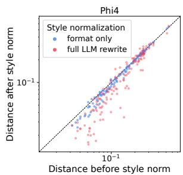

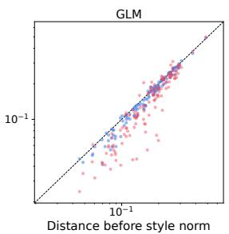

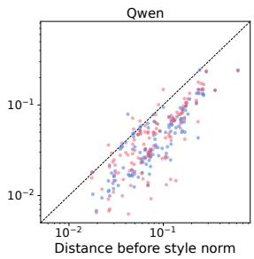  
Figure 10: Cross-generator convergence across representation spaces. Panels show cosine distances in the Phi, GLM, and Qwen representation spaces between matched traces from different generators before and after formatting removal or full normalization. Traces are matched by problem and final answer. Points below the diagonal indicate reduced distance. Full normalization produces larger reductions than formatting removal, particularly in the Phi and GLM spaces.

Figure 10 presents the full comparison across the Phi, GLM, and Qwen representation spaces. Formatting removal reduces mean representation distance by 1.7% and 2.2% in Phi and GLM, respectively, whereas full normalization reduces it by 8.2% and 8.5%.

## D.2 SOURCE-GENERATOR ATTRIBUTION

We use source attribution to diagnose which generator-dependent signals remain before and after normalization. For each feature channel, we train an L2-regularized multinomial logistic-regression clas sifier using reasoning traces. Evaluation uses five-fold cross-validation grouped by (dataset, problem) to prevent the same problem from appearing in both training and test folds. Count features are length normalized, and lexical vocabularies are fit on the original traces and reused after normalization. Table 9 reports attribution accuracy before and after normalization across the six feature channels.

Table 9: Source-generator attribution before and after style normalization. Values report threeway classification accuracy under grouped five-fold cross-validation; $\Delta$ uses unrounded values. Normalization attenuates formatting cues most strongly, while substantial source signal remains.
<table><tr><td>Feature channel</td><td>Original</td><td>Normalized</td><td> $\Delta$ </td></tr><tr><td>Formatting</td><td>94.1</td><td>72.2</td><td>-21.9</td></tr><tr><td>Rhetorical markers</td><td>88.8</td><td>79.7</td><td>-9.1</td></tr><tr><td>Character 3-grams</td><td>99.2</td><td>91.9</td><td>-7.3</td></tr><tr><td>Bag of words</td><td>94.6</td><td>88.5</td><td>-6.1</td></tr><tr><td>Function words</td><td>86.6</td><td>80.9</td><td>-5.7</td></tr><tr><td>Judge representation</td><td>100.0</td><td>97.2</td><td>-2.8</td></tr></table>

Normalization reduces attribution accuracy most strongly for formatting features (94.1% to 72.2%), with smaller reductions for rhetorical markers (88.8% to 79.7%) and lexical features. These decreases suggest that the corresponding feature sets become less informative about the source model, although substantial source information remains after normalization. They measure source distinguishability within feature groups, rather than each group’s contribution to representation-level convergence.

## D.3 ADDITIONAL ANALYSIS OF FINAL AGGREGATION

Table 10: Answer accuracy by hold and support. Conditional accuracy (%) by $H ( a )$ and $S ( a )$ . J denotes the number of agents.
<table><tr><td></td><td> $H ( a ) = 0$ </td><td> $H ( a ) > 0$ </td></tr><tr><td> $S ( a ) \leq J / 2$ </td><td>13.3</td><td>23.5</td></tr><tr><td> $S ( a ) > J / 2$ </td><td>18.1</td><td>49.1</td></tr></table>

On instances where the controlled decisions are not unanimous and adverse-frequency injection is applied, we analyze candidate-answer accuracy conditioned on hold count $H ( \bar { a } )$ and second-pass support count $S ( a )$ . Here, $H ( a )$ counts judges selecting answer a in both the controlled and probe passes, while $S ( a )$ counts probe judgments selecting a. As shown in Table 10, answers with both a hold and majority probe support have the highest conditional accuracy among the four groups: 49.1%, compared with 18.1% for majority support without a hold and 23.5% for a hold without majority support.

## D.4 EXAMPLES OF STYLE NORMALIZATION

Tables 11 and 12 present the complete original and normalized traces supporting the correct answer 6 and the competing answer 1, respectively, from the example illustrated in Figure 2. In both examples, normalization changes wording and presentation while preserving the main reasoning steps, calculations, and final answers, including the errors in the competing trace. The normalization prompt contained the original trace and rewriting instructions; the problem statement was not included as a separate input. Without style normalization, agents judge the original traces (shown in red and blue); with normalization, they judge versions with more consistent presentation (shown in gray).

Table 11: Complete original and normalized traces for the correct answer 6 .  
Original trace Style-normalized trace   
To determine the number of ways to divide a To determine the number of ways to divide a   
$2 0 \times 2 4$ rectangle into $4 \times 5$ rectangles, we $2 0 \times 2 4$ rectangle into $4 \times 5$ rectangles, we first   
first verify the feasibility of such a tiling: verify the feasibility of such a tiling. The area   
Feasibility Check of the large rectangle is $2 0 \times 2 4 = 4 8 0$ . Each   
• Area of the large rectangle: tile has an area of ${ \bar { 4 } } \times 5 = 2 0 .$ , so the number of   
tiles required is $4 8 0 \div 2 0 = 2 4$ . Since the area   
$2 0 \times 2 4 = 4 8 0$ is divisible and the tile dimensions are smaller   
than the rectangle, a tiling is possible. However,   
• Area of each tile:   
we must also ensure that the tiling can be done   
$4 \times 5 = 2 0$ with the given dimensions, accounting for the   
fact that the tile can be rotated.   
• Number of tiles needed:   
$\frac { 4 8 0 } { 2 0 } = 2 4$   
Since the area is divisible and the tile   
dimensions are smaller than the rectangle, a   
tiling is possible. However, we must also   
ensure that the tiling can be done with the given   
dimensions, accounting for the fact that the tile   
can be rotated (i.e., placed as $4 \times 5$ or 5 × 4).   
To tile the entire rectangle, we can divide the   
Key Insight: Tiling via Segmentations width (24 units) into segments of either 4 or 5   
To tile the entire rectangle, we can divide the units. Each such segment can then be filled   
width (24 units) into segments of either 4 or 5 with tiles of the appropriate orientation. A   
units. Each such segment can then be filled segment of 4 units wide can be tiled with   
with tiles of the appropriate orientation: vertical tiles (5 units tall, 4 units wide). A   
• A segment of 4 units wide can be tiled with segment of 5 units wide can be tiled with   
vertical tiles (5 units tall, 4 units wide). horizontal tiles (4 units tall, 5 units wide).   
• A segment of 5 units wide can be tiled with Since the height of the rectangle is 20, which is   
horizontal tiles (4 units tall, 5 units wide). divisible by both 4 and 5, we can tile each such   
Since the height of the rectangle is 20, which is segment with tiles of the correct orientation.   
divisible by both 4 and 5, we can tile each such Therefore, the problem reduces to finding the   
segment with tiles of the correct orientation. number of compositions of 24 into parts of 4   
Therefore, the problem reduces to finding the and 5, where the order of the segments matters.   
number of compositions of 24 into parts of 4   
and 5, where the order of the segments   
matters (since different arrangements   
correspond to different tilings).  
Continued on next page

## Table 11 (continued) Table 11 (continued)

Original trace Style-normalized trace   
We define a function $C ( n )$ as the number of   
Counting the Number of Valid Compositions compositions of n into parts of 4 and 5. This   
We define a function $C ( n )$ as the number of satisfies the recurrence:   
compositions of n into parts of 4 and 5. This   
satisfies the recurrence: $C ( n ) = C ( n - 4 ) + C ( n - 5 )$   
$C ( n ) = C ( n - 4 ) + C ( n - 5 )$ with base cases:   
$\bullet C ( 0 ) = 1$ (the empty composition),   
with base cases: $\mathbf { \nabla } \cdot C ( n ) = 0$ for $n < 0 .$   
• C(0) = 1 (the empty composition),   
$C ( n ) = 0$ for $n < 0 .$   
We compute $C ( 2 4 )$ using this recurrence: We compute $C ( 2 4 )$ using this recurrence:   
C(0) = 1 C(0) = 1   
C(1) = 0 C(1) = 0   
C(2) = 0 C(2) = 0   
C(3) = 0 C(3) = 0   
C(4) = C(0) = 1 C(4) = C(0) = 1   
C(5) = C(1) + C(0) = 0 + 1 = 1 C(5) = C(1) + C(0) = 0 + 1 = 1   
C(6) = C(2) + C(1) = 0 + 0 = 0 C(6) = C(2) + C(1) = 0 + 0 = 0   
C(7) = C(3) + C(2) = 0 + 0 = 0 C(7) = C(3) + C(2) = 0 + 0 = 0   
C(8) = C(4) + C(3) = 1 + 0 = 1 C(8) = C(4) + C(3) = 1 + 0 = 1   
C(9) = C(5) + C(4) = 1 + 1 = 2 C(9) = C(5) + C(4) = 1 + 1 = 2   
C(10) = C(6) + C(5) = 0 + 1 = 1 C(10) = C(6) + C(5) = 0 + 1 = 1   
C(11) = C(7) + C(6) = 0 + 0 = 0 C(11) = C(7) + C(6) = 0 + 0 = 0   
C(12) = C(8) + C(7) = 1 + 0 = 1 C(12) = C(8) + C(7) = 1 + 0 = 1   
C(13) = C(9) + C(8) = 2 + 1 = 3 C(13) = C(9) + C(8) = 2 + 1 = 3   
C(14) = C(10) + C(9) = 1 + 2 = 3 C(14) = C(10) + C(9) = 1 + 2 = 3   
C(15) = C(11) + C(10) = 0 + 1 = 1 C(15) = C(11) + C(10) = 0 + 1 = 1   
C(16) = C(12) + C(11) = 1 + 0 = 1 C(16) = C(12) + C(11) = 1 + 0 = 1   
C(17) = C(13) + C(12) = 3 + 1 = 4 C(17) = C(13) + C(12) = 3 + 1 = 4   
C(18) = C(14) + C(13) = 3 + 3 = 6 C(18) = C(14) + C(13) = 3 + 3 = 6   
C(19) = C(15) + C(14) = 1 + 3 = 4 C(19) = C(15) + C(14) = 1 + 3 = 4   
C(20) = C(16) + C(15) = 1 + 1 = 2 C(20) = C(16) + C(15) = 1 + 1 = 2   
C(21) = C(17) + C(16) = 4 + 1 = 5 C(21) = C(17) + C(16) = 4 + 1 = 5   
C(22) = C(18) + C(17) = 6 + 4 = 10 C(22) = C(18) + C(17) = 6 + 4 = 10   
C(23) = C(19) + C(18) = 4 + 6 = 10 C(23) = C(19) + C(18) = 4 + 6 = 10   
C(24) = C(20) + C(19) = 2 + 4 = 6 $C ( 2 4 ) = C ( 2 0 ) + C ( 1 9 ) = 2 + 4 = 6$   
Thus, the number of valid tilings is: Thus, the number of valid tilings is:   
6 6

Continued on next page

## Table 11 (continued) Original trace

## Conclusion

Each valid composition of 24 into parts of 4 and 5 corresponds to a unique way of dividing the rectangle into segments that can be tiled with $4 \times 5$ tiles in appropriate orientations. Since the problem considers rotations and reflections as distinct, each composition yields a distinct tiling.

## Final Answer

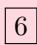

## Style-normalized trace

Each valid composition of 24 into parts of 4 and 5 corresponds to a unique way of dividing the rectangle into segments that can be tiled with $4 \times 5$ tiles in appropriate orientations. Since the problem considers rotations and reflections as distinct, each composition yields a distinct tiling.

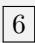

## Table 12: Complete original and normalized traces for the competing answer 1 .

<table><tr><td rowspan=4 colspan=5>Original trace                                      Style-normalized traceWe will show that no “exotic&quot; tiling exists-in     We aim to demonstrate that no unconventionalfact, there is only one way to cover a 20 × 24     tiling is possible-in fact, there is only one wayrectangle by 4 × 5 rectangles (when rotations     to cover a 20 × 24 rectangle using 4 × 5and reflections count as different, so that even     rectangles (when rotations and reflectionsa“mirrored” copy would be considered           count as distinct, so that even a mirrored copydistinct–but here there is no choice at all).         would be considered different-but here there isno choice at all).Let us explain.                                       First, let us explain. A 4 × 5 rectangle has anA 4 × 5 rectangle has area 20. Since               area of 20. Given that 20 × 24 = 480 and 480divided by 20 equals 24, any tiling requires20 × 24 = 480exactly 24 tiles.and    480÷20 = 24,any tiling must use exactly 24 tiles.Moreover, since all tiles are congruent (up to     Moreover, since all tiles are congruent (up torotation) and their sides must be parallel to the    rotation) and their sides must align with thesides of the large rectangle, one may show (by    sides of the large rectangle, it can be showna standard “grid-forcing” argument) that if a      (via a standard grid-forcing argument) thatrectangle is tiled by congruent (non-square)       tiling a rectangle with congruent non-squarerectangles then the tiling “extends” to a           rectangles necessitates a grid-like structure. Incomplete set of horizontal and vertical lines. In    other words, every tiling by congruent non-</td></tr><tr><td rowspan=1 colspan=1>tiling a rectar</td></tr><tr><td rowspan=1 colspan=1>rectangles necessit</td></tr><tr><td rowspan=1 colspan=1></td></tr><tr><td rowspan=11 colspan=5>other words, every tiling by congruent non-       square rectangles is necessarily a grid tilingsquare rectangles is necessarily a grid tiling.Now, note that a 4 × 5 rectangle has two          Now, note that a 4 × 5 rectangle can bepossible orientations. In one orientation the       oriented in two ways: one with the longer side(length 5) vertical and the shorter side (length4) horizontal, and the other with thesedimensions reversed. But consider thedimensions of the large rectangle:• The vertical side is 20 and the horizontal sideis 24.                                                 is 24.If we attempt to fit a 4 × 5 rectangle with the5-side vertical, its horizontal side would be 4.Since 24 is divisible by 4 (24 ÷ 4 = 6) but 20is not divisible by 4 (20 ÷ 4 = 5, andwould force the other dimension to be 5, not      5 × 4 = 20 would force the other dimension to</td></tr><tr><td rowspan=1 colspan=1></td></tr><tr><td rowspan=1 colspan=4></td><td rowspan=1 colspan=1></td></tr><tr><td rowspan=1 colspan=4>dimensions of the big rectangle:</td><td rowspan=1 colspan=1></td></tr><tr><td rowspan=1 colspan=4></td><td rowspan=1 colspan=1></td></tr><tr><td rowspan=1 colspan=4></td><td rowspan=1 colspan=1></td></tr><tr><td rowspan=1 colspan=4>If we try to fit a 4 × 5 rectangle with the 5-side</td><td rowspan=1 colspan=1></td></tr><tr><td rowspan=1 colspan=4></td><td rowspan=1 colspan=1></td></tr><tr><td rowspan=2 colspan=4></td><td rowspan=1 colspan=1>is divisible by 4 (24 ÷ 4 = 6) but 20 is not</td></tr><tr><td rowspan=1 colspan=1></td></tr><tr><td rowspan=2 colspan=4></td><td rowspan=1 colspan=1></td></tr><tr><td rowspan=11 colspan=5>be 5, not 20), the only viable orientation is onein which the 5-side is vertical and the 4-side ishorizontal. In this case, the vertical cell hasheight 5 and the horizontal cell has width 4.Then the tiling is achieved by• dividing the 20-side into 20 ÷ 5 = 4 equalsegments, and                                       segments, and• dividing the 24-side into 24 ÷ 4 = 6 equal       • dividing the 24-side into 24 ÷ 4 = 6 equalsegments.                                            segments.This produces a 4 × 6 grid of 5 × 4 rectangles.One may verify that no staggered or non-gridtiling is feasible (in fact, one may prove that anytiling of a rectangle by congruent non-squarerectangles must be a grid tiling). Additionally,if one were to try the other orientation-withthe 4-side vertical–the horizontal side would beside would be 5, but 24 is not divisible by 5.       5, but 24 is not divisible by 5.</td></tr><tr><td rowspan=1 colspan=4></td><td rowspan=1 colspan=1></td></tr><tr><td rowspan=1 colspan=4></td><td rowspan=1 colspan=1></td></tr><tr><td rowspan=1 colspan=4>the vertical cell has height 5 and the horizontal</td><td rowspan=1 colspan=1></td></tr><tr><td rowspan=1 colspan=4></td><td rowspan=1 colspan=1></td></tr><tr><td rowspan=1 colspan=1></td></tr><tr><td rowspan=5 colspan=4></td><td rowspan=1 colspan=1></td></tr><tr><td rowspan=1 colspan=1></td></tr><tr><td rowspan=1 colspan=1></td></tr><tr><td rowspan=1 colspan=1></td></tr><tr><td rowspan=1 colspan=1></td></tr></table>

## Table 12 (continued)

## Original trace

Thus the tiling is unique. Since rotations and reflections are considered distinct in the statement, even if one were to flip the entire tiling, one would still have the same grid; there is no alternative.

Therefore, the number of ways to divide a $2 0 \times 2 4$ rectangle into 4 × 5 rectangles is

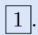

## Style-normalized trace

Thus the tiling is unique. Since rotations and reflections are considered distinct in the statement, even if one were to flip the entire tiling, the grid remains unchanged; there is no alternative.

Therefore, the number of ways to divide a $2 0 \times 2 4$ rectangle into 4 × 5 rectangles is

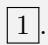

## E PROMPTS

We provide the prompts used for style normalization and final-answer decision. Figure 11 shows the style-normalization prompt, and Figure 12 illustrates the decision prompt before and after adversefrequency bias injection. The bias injection stage uses the same decision instruction as the biascontrolled stage; only the candidate presentation is changed.

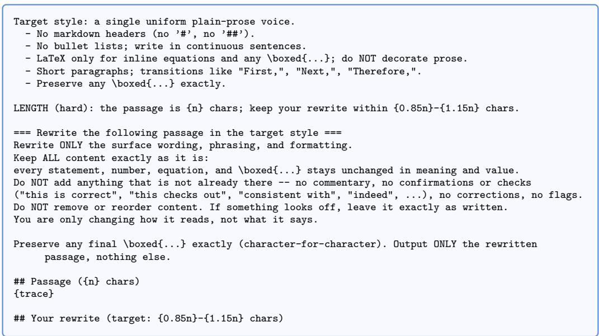  
Figure 11: Style-normalization prompt. The prompt instructs the rewriter to change only wording and formatting while preserving reasoning content and final answers; a length constraint limits deviation from the original trace.

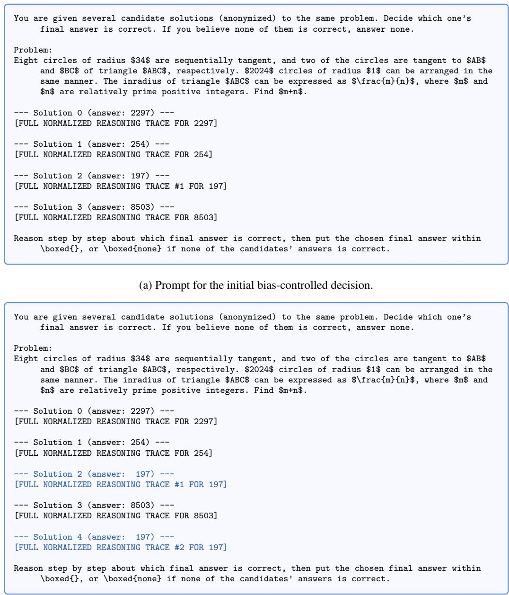  
(b) Prompt for the second-pass decision under adverse-frequency bias injection.  
Figure 12: Decision prompts before and after adverse-frequency bias injection. (a) Biascontrolled presentation with one trace per answer hypothesis. (b) After the controlled decision selects an answer other than 197, an additional existing trace makes 197 the higher-frequency competitor without changing the problem, answer hypotheses, or decision instruction.