# Behavioral Compositionality of Sparse Autoencoder Representations

Haotian Ma Ziye Mei Frederic Sala Department of Computer Sciences University of Wisconsin–Madison

## Abstract

Sparse autoencoders (SAEs) represent model activations with sparse, linearly decoded features, but the downstream effects of those features need not compose additively. We introduce SAE Additivity Residuals (SAR), which measure the behavioral variation left unexplained above a chosen interaction order. Under independent feature subset sampling, population SAR is exactly the normalized energy of interactions above that order and bounds coalition ordering error for the optimal low order approximation. To distinguish compositionality associated with the SAE representation from that induced by downstream computation, we compare learned SAE coordinates with sum preserving random rotations of the same selected subspace and find lower first order residuals for the learned coordinates across all 18 model and behavior settings. The coordinates are nevertheless not fully additive: pairwise terms improve held out coalition ordering in every setting and outperform parameter matched models using randomly selected third order terms. In a combined steering experiment, pairwise modeling raises rank fidelity from 0.5874 to 0.7790 and reduces ordering error from 0.1444 to 0.0606. Together, these results show that SAE coordinates support comparatively compositional behavioral descriptions while faithful joint explanations and interventions still require interactions beyond individual feature effects. Code is available at https://github.com/ OpenSAE/SAE-Behavioral-Compositionality.

## 1 Introduction

Sparse autoencoders (SAEs) decompose model activations into sparse, linearly decoded features. These coordinates are used to inspect computation, build multi-feature explanations, and manipulate behavior. This raises a basic question. If the effects of individual features are known, can their joint effect be predicted by summing them? A linear SAE decoder does not answer this because subsequent computation can make feature effects reinforce, suppress, or depend on one another.

This matters when SAE features are combined into circuits, joint explanations, or interventions (Marks et al., 2025; Ameisen et al., 2025; Ayonrinde et al., 2024). Existing SAE evaluations characterize reconstruction, sparsity, and interpretability (Karvonen et al., 2025; Engels et al., 2025b; Chanin et al., 2025; Engels et al., 2025a), but do not tell us when independently characterized features can be composed into faithful joint explanations or interventions.

To address this gap, we introduce a framework for measuring behavioral compositionality in SAE coordinates. For each prompt, we retain different subsets of selected decoded contributions while holding the remaining activation fixed, producing a downstream response over feature subsets. If individual feature effects compose faithfully, this response should be well described at first order. Departures from that approximation reveal interaction, and adding successively higher interaction orders shows how that missing structure is organized. This lets us compare learned SAE coordinates with matched rotations of the same selected activation subspace, testing whether compositionality under these interventions depends on coordinate choice beyond the subspace and downstream continuation and whether the remaining interaction matters for explanation and steering.

(a) Coalition interventions on decoded SAE contributions  
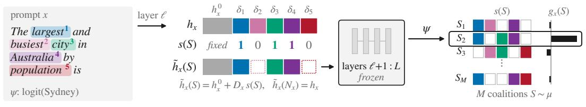

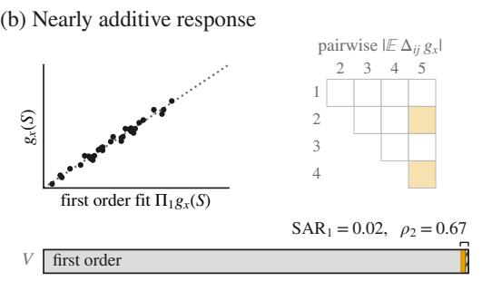

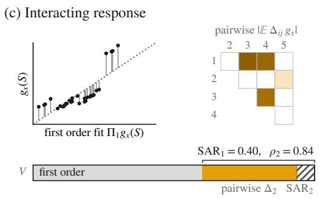  
Figure 1: Behavioral compositionality in SAE coordinates. (a) Selected decoded contributions are retained or removed while all other activation content is fixed, and the patched activation is propagated through the frozen upper layers to obtain $g _ { x } ( S )$ . (b, c) Nearly additive and interacting responses, showing the first order fit, pairwise interactions, and variance decomposition. $\mathrm { S A R _ { 1 } }$ is the residual beyond individual features and $\rho _ { 2 } = \Delta _ { 2 } / \mathrm { S A R _ { 1 } }$ its pairwise share.

We quantify this structure with SAE Additivity Residuals (SAR). At first order, $\operatorname { S A R } _ { 1 }$ is the behavioral variation not explained by individual feature effects. Adding pairs gives ${ \mathrm { S A R } } _ { 2 } ,$ so $\Delta _ { 2 } = \mathrm { S A R } _ { 1 } - \mathrm { S A R } _ { 2 }$ is the structure recovered by pairs and $\rho _ { 2 } = \Delta _ { 2 } / \mathsf { \bar { S } A R }$ its share of the first order residual. Under independent subset sampling, SAR has an exact interaction decomposition so that residual structure above a given order is exactly the normalized energy of higher order interactions. The same quantity also controls errors in preserving the ordering of feature coalitions. Figure 1 illustrates the intervention and contrasts nearly additive and interacting responses.

The main experiments span three model and SAE pipelines and six behavioral readouts, with additional analyses across seven pipelines and multiple representation depths. We evaluate matched coordinate rotations, first order and pairwise coalition models, combined SAE steering directions, and reconstruction quality. Our contributions are:

• We formulate behavioral compositionality for SAE representations and connect low order approximation error to explicit feature interactions and coalition ordering.

• Using sum preserving rotations of the same selected activation subspace, we show that compositionality under the subset intervention depends on coordinate choice, with learned SAE coordinates supporting a lower order behavioral description than the tested rotations.

• We show that pairwise terms improve held out coalition ordering in each of the 18 tested settings and outperform parameter matched random third order controls.

• We extend the analysis to a combined SAE steering experiment, where pairwise modeling raises rank fidelity from 0.5874 to 0.7790, and find that SAR and reconstruction quality differ in a matched six SAE comparison.

## 2 Related Work

SAE evaluation commonly measures reconstruction, sparsity, interpretability, and downstream utility (Karvonen et al., 2025). Reconstruction residuals retain structure, concepts can be absorbed across latents, and some model features require multidimensional descriptions (Engels et al., 2025b; Chanin et al., 2025; Engels et al., 2025a). Polynomial SAEs add explicit higher order decoder terms (Koromilas et al., 2026). These works characterize SAE representations and reconstruction, but not whether fixed SAE coordinates compose behaviorally after their decoded contributions pass through the remaining model.

Work on multi-feature explanations includes independent additivity (Ayonrinde et al., 2024), attribution graphs and feature circuits (Ameisen et al., 2025; Marks et al., 2025), and interventions on internal components (Wang et al., 2023; Conmy et al., 2023; Hanna et al., 2024; Kramár et al., 2024). Because circuits, joint explanations, and interventions combine multiple components, individual characterization does not establish that their effects admit a faithful low order joint description. This motivates measuring compositionality directly in the downstream response.

Interaction indices study joint effects among multiple players (Lundberg & Lee, 2017; Sundararajan et al., 2020; Tsai et al., 2023; Bordt & von Luxburg, 2023). SAEs provide a structured setting in which the players are learned sparse features intended to separate activation structure into interpretable coordinates. We study the interaction that remains when these coordinates are combined downstream and how it is distributed across orders. Appendix C gives the relation to interaction indices and coalition weighting.

## 3 Behavioral Compositionality of SAE Representations

We first define a controlled response over subsets of selected SAE contributions. We then measure the structure unexplained at a given interaction order, connect it to explicit interactions and coalition ordering, and estimate the resulting population quantities from sampled coalitions.

## 3.1 From SAE features to controlled subset responses

To study how SAE features combine, we vary selected decoded contributions while holding the rest of the activation fixed. Let F be a language model and $h _ { x } = h _ { \ell } ( x )$ the activation at a chosen layer and token position for input x. For an SAE trained at this site, let z (x) be feature i’s activation and $\mathbf { \hat { \boldsymbol { d } } } _ { i }$ its decoder direction. Let $N _ { x }$ contain the top K active SAE features for prompt $x ,$ with decoded contribution

$$
\delta _ { i } ( x ) = z _ { i } ( x ) d _ { i } , \qquad i \in N _ { x } .\tag{1}
$$

For $S \subseteq N _ { x }$ , we retain the contributions in S and remove the other selected contributions,

$$
\widetilde { h } _ { x } ( S ) = h _ { x } - \sum _ { i \in N _ { x } \backslash S } \delta _ { i } ( x ) = h _ { x } ^ { 0 } + \sum _ { i \in S } \delta _ { i } ( x ) ,\tag{2}
$$

where $\begin{array} { r } { h _ { x } ^ { 0 } = h _ { x } - \sum _ { i \in N _ { x } } \delta _ { i } ( x ) } \end{array}$ contains all fixed activation content, including the reconstruction residual, so $\widetilde { h } _ { x } ( N _ { x } ) = h _ { x }$ . The full coalition therefore recovers the original activation, while the reconstruction residual and all unselected content remain fixed, isolating behavioral changes due to the retained selected contributions.

Let $D _ { x }$ contain the selected contributions as columns and $s ( S ) \in \{ 0 , 1 \} ^ { K }$ indicate those retained, so

$$
\widetilde { h } _ { x } ( S ) = h _ { x } ^ { 0 } + D _ { x } s ( S ) .\tag{3}
$$

For a scalar behavior ψ, the downstream response is

$$
g _ { x } ( S ) = \psi \Bigl ( F _ { \ell  \widetilde { h } _ { x } ( S ) } ( x ) \Bigr ) , \qquad S \subseteq N _ { x } .\tag{4}
$$

This defines a controlled set-function response over selected SAE coordinates while the activation remainder and downstream model remain fixed. The object of analysis is downstream behavior rather than SAE reconstruction.

To compare learned coordinates with alternatives spanning the same selected subspace, let $Q \in \mathbb { R } ^ { \dot { K } \times K }$ be orthogonal with $Q \mathbf { 1 } = \mathbf { 1 }$ and define

$$
D _ { x } ^ { Q } = D _ { x } Q .\tag{5}
$$

Orthogonality preserves the selected subspace and $Q \mathbf { 1 } = \mathbf { 1 }$ its total contribution; the fixed remainder and downstream model are unchanged. This gives a sum preserving random coordinate baseline within the same selected subspace.

## 3.2 Measuring interaction beyond individual feature effects

We first ask whether individual feature effects suffice to describe $g _ { x } ,$ and if not, what interaction order is required. For fixed x, write $N = N _ { x }$ and $| N | = K$ . We approximate $g _ { \lambda }$ x using effects involving at most r selected features, with function class

$$
A _ { r } ( N ) = \left\{ a ( S ) = \sum _ { { \cal B } \subseteq { \cal N } \atop | { \cal B } | \leq r } \theta _ { \cal B } { \bf 1 } \{ B \subseteq S \} \right\} .\tag{6}
$$

Thus $r = 1$ contains individual feature effects, while $r = 2$ additionally includes feature pairs.

Let µ denote the distribution over feature subsets and $\Pi _ { r {  { g } } : }$ x the $L ^ { 2 } ( \mu )$ projection of $g _ { x }$ onto $\mathscr { A } _ { r } ( N )$ , which minimizes $\| g _ { x } - a \| _ { \mu } ^ { 2 }$ . Define

$$
V ( x ; \psi ) = \left\| g _ { x } - \mathbb E _ { S \sim \mu } g _ { x } ( S ) \right\| _ { \mu } ^ { 2 } .\tag{7}
$$

The SAE Additivity Residual is

$$
\mathrm { S A R } _ { r } ( x ; \psi ) = \left\{ \begin{array} { l l } { \displaystyle \frac { \| g _ { x } - \Pi _ { r } g _ { x } \| _ { \mu } ^ { 2 } } { V ( x ; \psi ) } , } & { V ( x ; \psi ) > 0 , } \\ { 0 , } & { V ( x ; \psi ) = 0 . } \end{array} \right.\tag{8}
$$

Thus $\operatorname { S A R } _ { r }$ is the fraction of behavioral variance unexplained by the best order r approximation; $\mathrm { S A R _ { 1 } }$ is the residual beyond individual feature effects.

$\operatorname { S A R }$ is an approximation residual, but under independent subset sampling an orthogonal product representation identifies this residual exactly with higher order interaction structure. Under independent feature inclusion with probability $p \in ( \breve { 0 } , 1 )$ , define

$$
u _ { i } ( S ) = { \frac { \mathbf { 1 } \{ i \in S \} - p } { \sqrt { p ( 1 - p ) } } } , \qquad u _ { B } ( S ) = \prod _ { i \in B } u _ { i } ( S ) ,\tag{9}
$$

$c _ { B } = \mathbb { E } [ g _ { x } ( S ) u _ { B } ( S ) ]$ , and for $S ^ { \prime } \subseteq N \setminus B ,$

$$
\Delta _ { B } g _ { x } ( S ^ { \prime } ) = \sum _ { C \subseteq B } ( - 1 ) ^ { | B | - | C | } g _ { x } ( S ^ { \prime } \cup C ) .\tag{10}
$$

For $B = \{ i , j \} , \Delta _ { i j } g _ { x } ( S ^ { \prime } )$ is the pairwise effect on background $S ^ { \prime } ; c _ { \{ i , j \} }$ averages its signed value over backgrounds.

Theorem 1 (Behavioral interaction decomposition). If coalition memberships are independent Bernoulli variables with probability $p \in ( 0 , 1 )$ , then

$$
c _ { B } = [ p ( 1 - p ) ] ^ { | B | / 2 } { \mathbb E } [ \Delta _ { B } g _ { x } ( S ^ { \prime } ) ] ,\tag{11}
$$

and, when $V ( x ; \psi ) > 0 .$

$$
\mathsf { S A R } _ { r } ( x ; \psi ) = \frac { \sum _ { | B | > r } [ p ( 1 - p ) ] ^ { | B | } \left( \mathbb { E } [ \Delta _ { B } g _ { x } ] \right) ^ { 2 } } { V ( x ; \psi ) } .\tag{12}
$$

Under independent subset sampling, SAR is exactly the fraction of behavioral variance in product measure interaction terms above order $r ; \dot { \operatorname { S A R } } _ { 1 }$ aggregates all such pairwise and higher order terms.

The main analysis uses the uniform distribution over all subsets, equivalent to $p = 1 / 2$ Then $\operatorname { S A R } _ { 1 }$ measures interaction beyond individual coordinates and

$$
\begin{array} { r l r } {  { \Delta _ { 2 } \bigl ( x ; \psi \bigr ) = \mathrm { S A R } _ { 1 } \bigl ( x ; \psi \bigr ) - \mathrm { S A R } _ { 2 } \bigl ( x ; \psi \bigr ) } } \\ & { } & { = \frac { 1 } { 1 6 V \bigl ( x ; \psi \bigr ) } \displaystyle \sum _ { i < j } ( \mathbb { E } \bigl [ \Delta _ { i j } g _ { x } \bigr ] ) ^ { 2 } , } \end{array}\tag{13}
$$

with pairwise share

$$
\rho _ { 2 } ( x ; \psi ) = \frac { \Delta _ { 2 } ( x ; \psi ) } { \mathrm { S A R } _ { 1 } ( x ; \psi ) } .\tag{14}
$$

for $\mathrm { S A R } _ { 1 } > 0 ,$ , and set $\rho _ { 2 } = 0$ when $\mathrm { S A R } _ { 1 } = 0$ . Here $\operatorname { S A R } _ { 1 }$ measures interaction beyond individual effects, $\Delta _ { 2 }$ the part recovered by pairs, and $\mathrm { S A R } _ { 2 }$ what remains beyond pairwise order. Thus $\rho _ { 2 }$ is the pairwise share in this product measure decomposition.

The projection definition also gives several basic calibration properties:

$$
{ \mathrm { S A R } } _ { r } = 0 \Longleftrightarrow g _ { x } \in { \mathcal { A } } _ { r } ( N _ { x } ) , \qquad 0 = { \mathrm { S A R } } _ { K } \leq \cdots \leq { \mathrm { S A R } } _ { 1 } \leq 1 ,\tag{15}
$$

and, for $a \in \mathcal { A } _ { r } ( N _ { x } )$

$$
{ \frac { \| g _ { x } - a \| _ { \mu } ^ { 2 } } { V ( x ; \psi ) } } \geq \mathrm { S A R } _ { r } ( x ; \psi ) .\tag{16}
$$

Thus SAR decreases with interaction order, vanishes exactly when order r is sufficient, and leaves explained variance $1 - \mathsf { S A R } _ { r }$ . Proofs are in Appendix $\mathrm { A }$

First order additivity is guaranteed when the downstream continuation is affine over the tested activation states.

Corollary 1 (Affine continuation). $I f b _ { x } ( h ) = \psi ( F _ { \ell  h } ( x ) ) = c + w ^ { \top } h$ for every tested $h =$ $\widetilde { h } _ { x } ( S )$ , then $\operatorname { S A R } _ { 1 } ( x ; \psi ) = 0$

Thus nonzero $\mathrm { S A R _ { 1 } }$ reflects departure from affine continuation on the tested SAE states.

## 3.3 Connecting low order approximation to coalition ordering

Joint explanations should also preserve comparisons between feature coalitions. Let $S , T$ be independent coalitions and write $\Delta g = g _ { x } ( \dot { S } ) - g _ { x } ( T )$ and $\Delta a = a ( S ) - a ( T )$ . Define

$$
\mathcal { E } ( a ) = \frac { \mathbb { E } [ ( \Delta g ) ^ { 2 } \mathbf { 1 } \{ \Delta g \Delta a \leq 0 \} ] } { 2 V ( x ; \psi ) } .\tag{17}
$$

The weighting emphasizes reversals between subsets with larger behavioral differences and downweights near ties.

Theorem 2 (Coalition ordering error). For anyfunction a on $2 ^ { N }$ and $V ( x ; \psi ) > 0 .$

$$
\mathcal { E } ( a ) \leq \frac { \operatorname { V a r } _ { \mu } ( g _ { x } - a ) } { V ( x ; \psi ) } \leq \frac { \| g _ { x } - a \| _ { \mu } ^ { 2 } } { V ( x ; \psi ) } .\tag{18}
$$

In particular,

$$
\mathcal { E } ( \Pi _ { r } g _ { x } ) \leq \mathrm { S A R } _ { r } ( x ; \psi ) .\tag{19}
$$

Thus small $\operatorname { S A R } _ { r }$ guarantees small behavior weighted ordering error for the optimal order r approximation, although the converse need not hold. We examine below its association with held out coalition ranking.

## 3.4 Estimating compositionality from sampled coalitions

Because exhaustive evaluation scales as $2 ^ { K }$ , we fit low order models on sampled coalitions and evaluate them on held out subsets. We sample from $\mu ,$ split into fitting and evaluation sets, and fit

$$
\widehat { a } _ { r } = \mathop { \mathrm { a r g } \operatorname* { m i n } } _ { a \in \mathcal { A } _ { r } ( N _ { x } ) } \frac { 1 } { M _ { \mathrm { f i t } } } \sum _ { m = 1 } ^ { M _ { \mathrm { f i t } } } \left( g _ { x } \bigl ( S _ { m } \bigr ) - a \bigl ( S _ { m } \bigr ) \right) ^ { 2 } .\tag{20}
$$

On the evaluation set, let $\widehat { L } _ { r }$ be the mean squared error and $\widehat { V }$ the empirical variance of $g _ { x }$ We report

$$
\widehat { \mathrm { S A R } } _ { r } = \frac { \widehat { L } _ { r } } { \widehat { V } + \epsilon } .\tag{21}
$$

The fitted residual and population quantity are related by

$$
\lVert g _ { x } - \widehat { a } _ { r } \rVert _ { \mu } ^ { 2 } = \lVert g _ { x } - \Pi _ { r } g _ { x } \rVert _ { \mu } ^ { 2 } + \lVert \widehat { a } _ { r } - \Pi _ { r } g _ { x } \rVert _ { \mu } ^ { 2 } .\tag{22}
$$

The two terms are structural residual and finite sample fitting error, so $\widehat { \mathrm { S A R } } _ { \mathfrak { r } }$ is a held out predictive residual rather than population SAR itself.

For the evaluation set $u ,$ we also report Spearman rank fidelity,

$$
\begin{array} { r } { \boldsymbol { F } _ { \mathrm { r a n k } } ^ { ( r ) } = \mathrm { S p e a r m a n } _ { S \in \mathcal { U } } \left( \widehat { a } _ { r } ( S ) , g _ { x } ( S ) \right) , } \end{array}\tag{23}
$$

and denote the held out analogue of Equation (17) by $\widehat { \mathcal { E } } _ { r } .$ . We additionally report sign error and selection regret. With $e ( \breve { S } ) = g _ { x } ( \dot { \bar { S } } ) - g _ { x } ( \dot { N } _ { x } )$ and $\widehat { e } _ { r } ( S ) = \widehat { a } _ { r } ( S ) - \widehat { \widehat { a } } _ { r } ( \grave { N } _ { x } )$ , sign error is the fraction of held out coalitions with $\overline { { e } } ( { \cal S } ) \widehat { e } _ { r } ( { \cal S } ) < 0$ . If $S ^ { \star } = \arg \operatorname* { m a x } _ { S \in \mathcal { U } } g _ { x } \bar { ( S ) }$ and $\widehat { S } _ { r } = \arg \operatorname* { m a x } _ { S \in \mathcal { U } } \widehat { a } _ { r } ( S )$ , selection regret is

$$
R ^ { ( r ) } = \frac { g _ { x } ( S ^ { \star } ) - g _ { x } ( \widehat { S } _ { r } ) } { \mathsf { m a x } _ { S \in \mathcal { U } } g _ { x } ( S ) - \mathsf { m i n } _ { S \in \mathcal { U } } g _ { x } ( S ) + \epsilon } .
$$

All predictive metrics use coalitions unseen during fitting. Appendix B reports conditioning, split and sampling stability, and fitting budget diagnostics.

## 4 Experiments

We first characterize compositionality across behaviors and representations, then compare learned coordinates with matched random rotations and test whether pairwise structure recovers failures of first order explanations. We finally examine depth, combined steering directions, and the relation to reconstruction quality. The main comparisons use Gemma-3 4B, Mistral-7B, and Llama-3.1 8B across simple copying, subject verb agreement, gendered pronoun preference, CounterFact (Meng et al., 2022), IOI (Wang et al., 2023), and greater than comparison. The fixed layer landscape, rotation, fidelity, and pairwise analyses use 1,000, 100, 800, and 150 prompts per model and behavior setting, respectively. For each prompt, we select the top $K =$ 16 active SAE contributions and sample 384 coalitions, using 256 for fitting and 128 for evaluation. Appendix D gives the full model, behavior, and sampling specifications.

## 4.1 Behavioral compositionality varies across behaviors and representations

We first ask whether first order additivity is a reasonable approximation across behaviors and representations. The prompt median $\widehat { \mathsf { S A R } } _ { 1 }$ is positive in all 57 model, layer, and behavior combinations while affine controls remain at numerical zero. Its magnitude also varies across settings. Simple copying and subject verb agreement have lower residuals than CounterFact in all three main pipelines, while the other behaviors change order across models. Thus first order additivity is not exact in these intervention games, and the estimated residual varies with both behavior and representation.

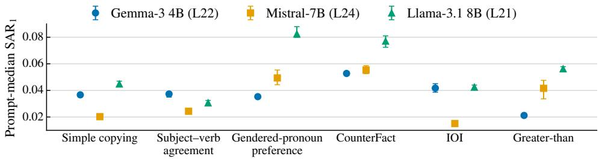  
Figure 2: Prompt median $\widehat { \mathsf { S A R } } _ { 1 }$ for six behaviors in Gemma-3 4B layer 22, Mistral-7B layer 24, and Llama-3.1 8B layer 21. Error bars show 95% prompt bootstrap intervals.

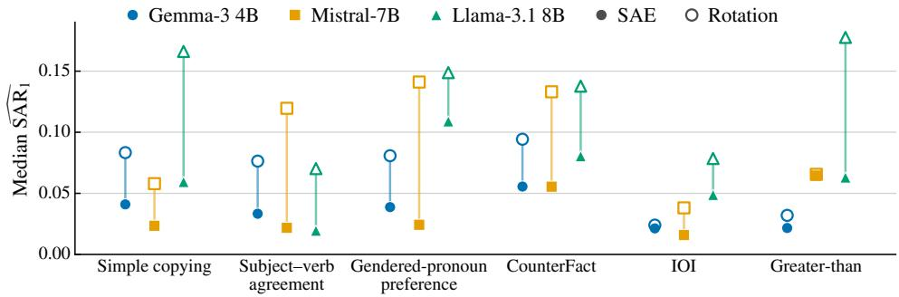  
Figure 3: Paired first order SAR for learned SAE coordinates and sum preserving random rotations of the same selected activation subspace.

## 4.2 Compositionality depends on coordinate choice under subset interventions

We compare each SAE basis with sum preserving rotations of the same selected subspace to test whether compositionality under the subset intervention depends on coordinate choice rather than only on the subspace and downstream continuation. Figure 3 shows the paired comparison for all 18 model and behavior combinations. Learned SAE coordinates have lower median $\bar { \mathsf { S } } \mathsf { A } \bar { \mathsf { R } } _ { 1 }$ in every comparison, although the size of the gap varies across settings. For example, the medians are 0.0218 and 0.1196 for Mistral subject verb agreement. The selected subspace, total contribution, and downstream continuation remain fixed as the intervention coordinates change. The systematic SAR gap therefore shows that, under this intervention, these shared factors alone do not determine compositionality; the learned SAE basis supports a lower order description than the tested rotations. Under milder interventions, pairwise rank improvement persists at $p = 0 . 7 5$ , while halving removed contributions lowers $\mathsf { \widehat { S A R } } _ { 1 }$ and improves first order rank fidelity in eight of nine settings. Appendix F gives the full controls.

## 4.3 Estimated SAR is associated with first order coalition fidelity

The ordering theorem bounds the population behavior weighted ordering error. As a descriptive calibration, we compare estimated SAR with rank fidelity and selection regret on the same held out coalitions. Figure 4 shows lower rank fidelity and higher selection regret from the lowest to the highest $\widehat { \mathsf { S A R } } _ { 1 }$ decile in all three models. Selection regret approximately doubles in Gemma and Llama and increases by about fivefold in Mistral. Across 18 model and behavior combinations, the prompt level correlation between $\mathsf { \widehat { S A R } } _ { 1 }$ and rank fidelity is negative in 17 and at most −0.6 in 14.

## 4.4 Feature pairs recover missing coalition structure

The previous results identify settings where individual feature effects are insufficient. We therefore ask how much of the missing structure can be recovered by the next interaction order, namely feature pairs. Figure 5 shows the paired comparison between first order and pairwise approximations across all 18 model and behavior combinations. Pairwise models improve rank fidelity in all 18 model and behavior combinations, raising the average from 0.9782 to 0.9959, and satisfy $\widehat { \mathcal { E } } _ { 2 } < \widehat { \mathcal { E } } _ { 1 }$ in all 18. Both improvements persist across all 20 repeated fitting and evaluation splits. Selection regret falls from 0.0272 to 0.0051 on average, and sign error also decreases in every combination. These results show that pairwise terms capture substantial predictive structure beyond individual feature effects. Full results are in Appendix H.

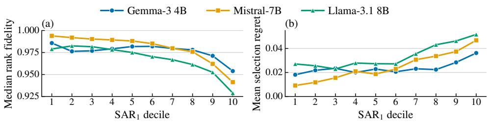  
Figure 4: First order explanation fidelity across $\widehat { \mathsf { S A R } } _ { 1 }$ deciles within each model.

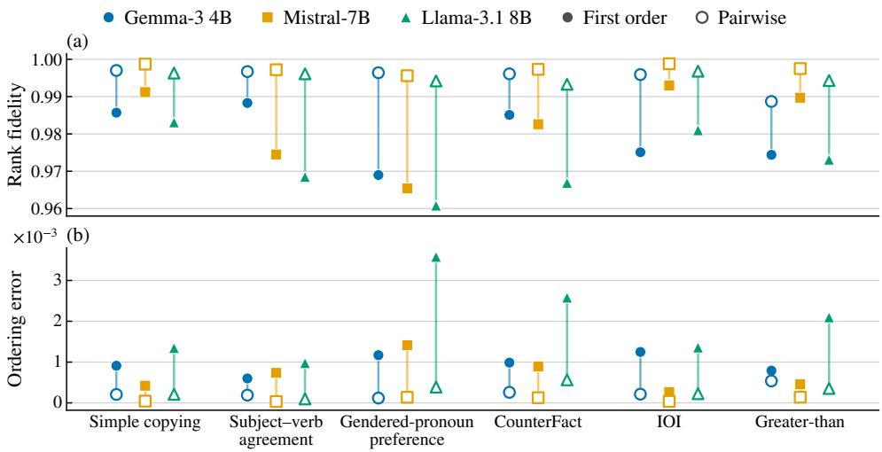  
Figure 5: Held out coalition ordering for first order and pairwise approximations.

A parameter matched control retains the first order terms and replaces the pairwise terms with the same number of randomly selected third order terms. Pairwise models have higher held out rank fidelity and lower behavior weighted ordering error than the median matched model in all 18 combinations. The full comparison is in Appendix H.4.

## 4.5 Estimated compositionality varies across depth

We next examine how the estimated compositionality measures change across representation depth. Figure 6 follows simple copying, CounterFact, and IOI. Across nine early to late comparisons, $\bar { \mathsf { S } } \mathsf { A } \bar { \mathsf { R } } _ { 1 }$ decreases in eight and $\widehat { \rho } _ { 2 }$ increases in all nine. Later representations therefore usually have lower estimated first order residuals, while $\widehat { \rho } _ { 2 }$ increases. This may reflect either the SAE coordinates or the shorter remaining downstream computation. Random rotations show the same first order decrease in eight of nine comparisons, indicating that part of the depth trend comes from the remaining downstream computation rather than the SAE basis. SAE coordinates nevertheless have lower $\bar { \mathsf { S } } \mathsf { A } \bar { \mathsf { R } } _ { 1 }$ than rotations in all 33 model, behavior, and layer comparisons. Thus part of the depth trend is shared across coordinate systems, while SAE coordinates remain lower residual than rotations at matched sites; $\widehat { \rho } _ { 2 }$ also increases. The Llama profiles are nonmonotonic near the final sampled layer.

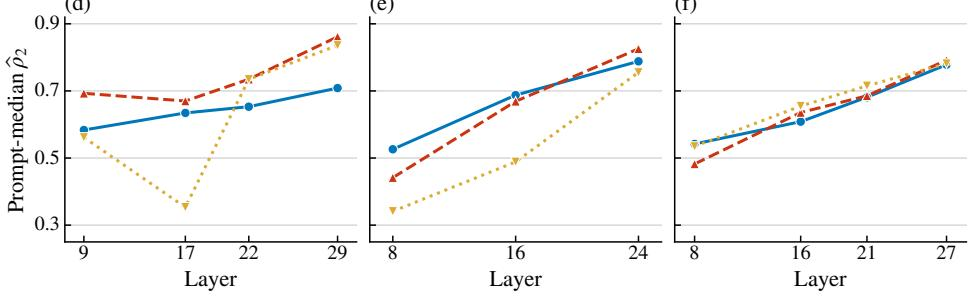

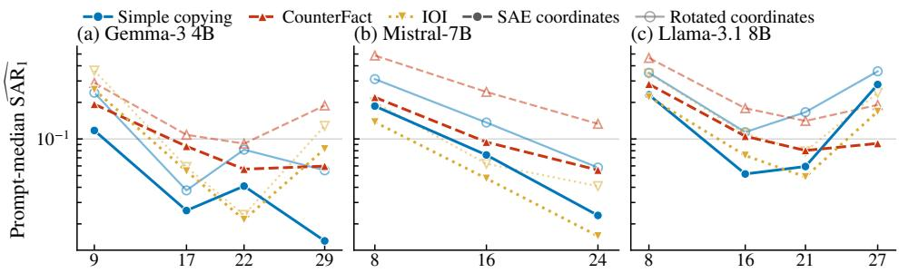  
(d)  
(e)  
(f)  
Figure 6: Depth profiles for simple copying, CounterFact, and IOI.

Across all seven pipelines, simple copying has lower $\widehat { \mathsf { S A R } } _ { 1 }$ at the latest sampled representation in six cases and higher ρb in all seven. The pattern therefore extends beyond the three main pipelines. Appendix Figure 7 and Table 13 give the full comparison.

## 4.6 Pairwise modeling better predicts the aggregate steering response

The preceding experiments study interactions among feature contributions already present in a model activation. SAE features are also used by adding directions to steer model behavior. If these effects compose poorly, effects measured for individual steering directions may not predict the outcome of combining them. We therefore apply the same analysis to fixed published steering directions. Using 16 published CorrSteer features (Cho et al., 2026) in Llama-3.1 8B, we evaluate 1,024 steering combinations with separate fitting and evaluation coalitions. On the overall 1,400 question MMLU-Pro response (Wang et al., 2024), rank fidelity rises from 0.5874 to 0.7790, behavior weighted ordering error falls from 0.1444 to 0.0606, and the held out residual estimate decreases from 0.6424 to 0.3891. Pairwise modeling therefore better predicts this aggregate steering response; domain level effects are heterogeneous and reported in Appendix H.

Table 1: Held out residual estimates and coalition ordering for MMLU-Pro steering response.
<table><tr><td>Approximation</td><td>Residual estimate</td><td>Rank fidelity</td><td>Ordering error</td></tr><tr><td>First order</td><td>0.6424</td><td>0.5874</td><td>0.1444</td></tr><tr><td>Pairwise</td><td>0.3891</td><td>0.7790</td><td>0.0606</td></tr></table>

## 4.7 Reconstruction quality and SAR differ in a matched SAE comparison

We next ask whether reconstruction quality tracks behavioral compositionality across matched SAEs at a fixed site. Pooling prompts across six SAEs at a fixed Gemma-3 1B site, SAR is positively related to sign error and selection regret in all three behaviors, while FVU is negative or near zero for sign error and near zero for selection regret. Thus reconstruction quality and SAR capture different variation in joint behavioral fidelity in this matched comparison. Appendix Figure 8 gives the SAE comparison; Appendix I reports sensitivity to K.

Table 2: Prompt level Spearman correlations pooled over six SAEs (n = 1,800 per behavior).
<table><tr><td></td><td colspan="2">Sign error</td><td colspan="2">Selection regret</td></tr><tr><td>Behavior</td><td> $\mathrm { F V U } _ { x }$ </td><td> $\widehat { \mathsf { S A R } } _ { 1 }$ </td><td> $\mathrm { F V U } _ { x }$ </td><td> $\widehat { \mathsf { S A R } } _ { 1 }$ </td></tr><tr><td>Simple copying</td><td>-0.080</td><td>0.269</td><td>0.011</td><td>0.220</td></tr><tr><td>Subject verb agreement</td><td>-0.114</td><td>0.430</td><td>0.005</td><td>0.235</td></tr><tr><td>IOI</td><td>-0.013</td><td>0.396</td><td>0.028</td><td>0.199</td></tr></table>

## 5 Discussion and Conclusion

Linear decoding makes SAE coordinates additive for activation reconstruction, not for downstream effects. Reconstruction quality, individual feature interpretability, and the interaction order needed for joint behavior are therefore distinct representation properties, with SAR measuring the last directly. This matters whenever SAE features are combined: meaningful individual coordinates need not have additive joint behavioral effects. Learned SAE coordinates nevertheless have lower first order residuals than the tested sum preserving random rotations of the same selected contribution subspaces. Individual effects remain insufficient in many cases, while pairwise terms improve coalition prediction. The SAE basis therefore supports a lower order description than these rotations without making feature effects independent, so residual interaction can matter for faithful joint explanations. The distinction also appears in steering and differs from reconstruction quality in the matched SAE comparison. These conclusions depend on the selected contributions, behavioral readout, and intervention distribution rather than a global property of an SAE dictionary. Behavioral compositionality is therefore a distinct property to consider when SAE features are combined for explanation or intervention.

## References

Emmanuel Ameisen, Jack Lindsey, Adam Pearce, Wes Gurnee, Nicholas L. Turner, Brian Chen, Craig Citro, et al. Circuit tracing: Revealing computational graphs in language models. Transformer Circuits Thread, 2025. URL https://transformer-circuits.pub/ 2025/attribution-graphs/methods.html.

Kola Ayonrinde, Michael T. Pearce, and Lee Sharkey. Interpretability as compression: Reconsidering SAE explanations of neural activations with MDL-SAEs. arXiv preprint arXiv:2410.11179, 2024.

Stella Biderman, Hailey Schoelkopf, Quentin Gregory Anthony, Herbie Bradley, Kyle O’Brien, Eric Hallahan, Mohammad Aflah Khan, Shivanshu Purohit, Usvsn Sai Prashanth, Edward Raff, Aviya Skowron, Lintang Sutawika, and Oskar van der Wal. Pythia: A suite for analyzing large language models across training and scaling. In Proceedings of the 40th International Conference on Machine Learning (ICML), volume 202 of Proceedings of Machine Learning Research, pp. 2397–2430, 2023. URL https://proceedings.mlr.press/v202/bid erman23a.html.

Joseph Bloom. Open source sparse autoencoders for all residual stream layers of GPT2- Small. AI Alignment Forum, 2024. URL https://www.alignmentforum.org/posts/f9Egf LSurAiqRJySD/open-source-sparse-autoencoders-for-all-residual-stream.

Joseph Bloom, Curt Tigges, Anthony Duong, and David Chanin. SAELens. https://github .com/decoderesearch/SAELens, 2024.

Sebastian Bordt and Ulrike von Luxburg. From Shapley values to generalized additive models and back. In Proceedings of The 26th International Conference on Artificial Intelligence and Statistics (AISTATS), volume 206 of Proceedings of Machine Learning Research, pp. 709– 745, 2023. URL https://arxiv.org/abs/2209.04012.

David Chanin, James Wilken-Smith, Tomáš Dulka, Hardik Bhatnagar, Satvik Golechha, and Joseph Bloom. A is for absorption: Studying feature splitting and absorption in

sparse autoencoders. In Advances in Neural Information Processing Systems, volume 38, pp. 82318–82355, 2025. URL https://arxiv.org/abs/2409.14507.

Seonglae Cho, Zekun Wu, and Adriano Koshiyama. CorrSteer: Generation-time LLM steering via correlated sparse autoencoder features. In Proceedings of the 43rd International Conference on Machine Learning (ICML), 2026. URL https://arxiv.org/abs/2508.12535.

Arthur Conmy, Augustine N. Mavor-Parker, Aengus Lynch, Stefan Heimersheim, and Adrià Garriga-Alonso. Towards automated circuit discovery for mechanistic interpretability. In Advances in Neural Information Processing Systems, volume 36, pp. 16318–16352, 2023.

Joshua Engels, Eric J. Michaud, Isaac Liao, Wes Gurnee, and Max Tegmark. Not all language model features are one-dimensionally linear. In The Thirteenth International Conference on Learning Representations (ICLR), 2025a. URL https://arxiv.org/abs/2405.14860.

Joshua Engels, Logan Riggs Smith, and Max Tegmark. Decomposing the dark matter of sparse autoencoders. Transactions on Machine Learning Research, 2025b. URL https: //arxiv.org/abs/2410.14670.

Gemma Team. Gemma 3 technical report. arXiv preprint arXiv:2503.19786, 2025. URL https://arxiv.org/abs/2503.19786.

Michel Grabisch and Marc Roubens. An axiomatic approach to the concept of interaction among players in cooperative games. International Journal of Game Theory, 28(4):547–565, 1999.

Aaron Grattafiori, Abhimanyu Dubey, Abhinav Jauhri, Abhinav Pandey, Abhishek Kadian, et al. The Llama 3 herd of models. arXiv preprint arXiv:2407.21783, 2024. URL https: //arxiv.org/abs/2407.21783.

Michael Hanna, Sandro Pezzelle, and Yonatan Belinkov. Have faith in faithfulness: Going beyond circuit overlap when finding model mechanisms. In First Conference on Language Modeling, 2024.

Zhengfu He, Wentao Shu, Xuyang Ge, Lingjie Chen, Junxuan Wang, Yunhua Zhou, Frances Liu, Qipeng Guo, Xuanjing Huang, Zuxuan Wu, Yu-Gang Jiang, and Xipeng Qiu. Llama Scope: Extracting millions of features from Llama-3.1-8B with sparse autoencoders. arXiv preprint arXiv:2410.20526, 2024. URL https://arxiv.org/abs/2410.20526.

Albert Q. Jiang, Alexandre Sablayrolles, Arthur Mensch, Chris Bamford, Devendra Singh Chaplot, et al. Mistral 7B. arXiv preprint arXiv:2310.06825, 2023. URL https://arxiv.or g/abs/2310.06825.

Adam Karvonen, Can Rager, Johnny Lin, Curt Tigges, Joseph Bloom, David Chanin, Yeu-Tong Lau, Eoin Farrell, Callum McDougall, Kola Ayonrinde, Demian Till, Matthew Wearden, Arthur Conmy, Samuel Marks, and Neel Nanda. SAEBench: A comprehensive benchmark for sparse autoencoders in language model interpretability. In Proceedings of the 42nd International Conference on Machine Learning (ICML), volume 267 of Proceedings of Machine Learning Research, pp. 29223–29264, 2025. URL https://proceedings.mlr.press/ v267/karvonen25a.html.

Panagiotis Koromilas, Andreas D. Demou, James Oldfield, Yannis Panagakis, and Mihalis A. Nicolaou. PolySAE: Modeling feature interactions in sparse autoencoders via polynomial decoding. In Proceedings ofthe 43rd International Conference on Machine Learning (ICML), volume 306 of Proceedings of Machine Learning Research, 2026. URL https://arxiv.org/ab s/2602.01322.

János Kramár, Tom Lieberum, Rohin Shah, and Neel Nanda. AtP\*: An efficient and scalable method for localizing LLM behaviour to components. arXiv preprint arXiv:2403.00745, 2024.

Scott M. Lundberg and Su-In Lee. A unified approach to interpreting model predictions. In Advances in Neural Information Processing Systems, volume 30, pp. 4765–4774, 2017.

Samuel Marks. Sparse autoencoders for Pythia-70M-deduped. Hugging Face model repository, 2024. URL https://huggingface.co/saprmarks/pythia-70m-deduped-saes.

Samuel Marks, Can Rager, Eric J. Michaud, Yonatan Belinkov, David Bau, and Aaron Mueller. Sparse feature circuits: Discovering and editing interpretable causal graphs in language models. In The Thirteenth International Conference on Learning Representations, 2025.

Callum McDougall, Arthur Conmy, János Kramár, Tom Lieberum, Senthooran Rajamanoharan, and Neel Nanda. Gemma Scope 2: Technical paper. Technical report, Google DeepMind, 2025. URL https://storage.googleapis.com/deepmind-media/DeepMind.co m/Blog/gemma-scope-2-helping-the-ai-safety-community-deepen-understanding-o f-complex-language-model-behavior/Gemma\_Scope\_2\_Technical\_Paper.pdf.

Kevin Meng, David Bau, Alex Andonian, and Yonatan Belinkov. Locating and editing factual associations in GPT. In Advances in Neural Information Processing Systems, volume 35, 2022. URL https://proceedings.neurips.cc/paper\_files/paper/2022/hash/6f1d43d5a82a3 7e89b0665b33bf3a182-Abstract-Conference.html.

Alec Radford, Jeffrey Wu, Rewon Child, David Luan, Dario Amodei, and Ilya Sutskever. Language models are unsupervised multitask learners. Technical report, OpenAI, 2019. URL https://cdn.openai.com/better-language-models/language\_models\_are\_unsupe rvised\_multitask\_learners.pdf.

Lloyd S. Shapley. A value for n-person games. In Harold W. Kuhn and Albert W. Tucker (eds.), Contributions to the Theory of Games, Volume II, pp. 307–317. Princeton University Press, 1953.

Mukund Sundararajan, Kedar Dhamdhere, and Ashish Agarwal. The Shapley Taylor interaction index. In Proceedings of the 37th International Conference on Machine Learning, volume 119 of Proceedings of Machine Learning Research, pp. 9259–9268, 2020.

Che-Ping Tsai, Chih-Kuan Yeh, and Pradeep Ravikumar. Faith-Shap: The faithful Shapley interaction index. Journal of Machine Learning Research, 24(94):1–42, 2023.

Kevin Ro Wang, Alexandre Variengien, Arthur Conmy, Buck Shlegeris, and Jacob Steinhardt. Interpretability in the wild: A circuit for indirect object identification in GPT-2 small. In The Eleventh International Conference on Learning Representations, 2023.

Yubo Wang, Xueguang Ma, Ge Zhang, Yuansheng Ni, Abhranil Chandra, Shiguang Guo, Weiming Ren, Aaran Arulraj, Xuan He, Ziyan Jiang, Tianle Li, Max Ku, Kai Wang, Alex Zhuang, Rongqi Fan, Xiang Yue, and Wenhu Chen. MMLU-Pro: A more robust and challenging multi-task language understanding benchmark. In Advances in Neural Information Processing Systems, volume 37, pp. 95266–95290, 2024. doi: 10.52202/079017-3 018. URL https://proceedings.neurips.cc/paper\_files/paper/2024/hash/ad236edc5 64f3e3156e1b2feafb99a24-Abstract.html.

## A Proofs and Mathematical Details

## A.1 Notation and equivalent bases

Table 3: Notation used throughout the paper.
<table><tr><td>Symbol</td><td>Meaning</td></tr><tr><td> $x$ </td><td>Input prompt.</td></tr><tr><td> $h _ { x }$ </td><td>Model activation at the selected layer and token position.</td></tr><tr><td> $z _ { i } ( x ) , d _ { i }$ </td><td>Activation and decoder direction of SAE feature i.</td></tr><tr><td> $\delta _ { i } ( x )$ </td><td>Decoded contribution  $z _ { i } ( x ) d _ { i } .$ </td></tr><tr><td> $N _ { x }$ </td><td>Set of top K active  $\operatorname { S A E }$  features for prompt x.</td></tr><tr><td> $S$ </td><td>Coalition of retained features,  $S \subseteq \dot { N } _ { x }$ </td></tr><tr><td> $g _ { x }$ </td><td>SAE feature intervention game.</td></tr><tr><td> $\mu$ </td><td>Coalition distribution.</td></tr><tr><td> $\dot { \mathcal { A } } _ { r } ( N _ { x } )$ </td><td>Set functions with interaction order at most r.</td></tr><tr><td> $V ( x ; \psi )$ </td><td>Behavioral variance across interventions.</td></tr><tr><td> $\mathsf { S A R } _ { r } \dot { ( } x ; \psi )$ </td><td>Population residual after the order r projection.</td></tr><tr><td> $\widehat { \mathrm { S A R } _ { r } }$ </td><td>Held out residual estimate from the fitted order r model.</td></tr><tr><td> $\Delta _ { B } g _ { x }$ </td><td>Finite difference associated with feature subset B.</td></tr><tr><td> $\Delta _ { 2 } , \rho _ { 2 }$ </td><td>Population pairwise component and its share of  $\operatorname { S A R } _ { 1 }$ </td></tr><tr><td> $\widehat { \Delta } _ { 2 } , \widehat { \rho } _ { 2 }$ </td><td>Corresponding held out estimates.</td></tr><tr><td> $\mathcal E ( a )$ </td><td>Population behavior weighted coalition ordering error.</td></tr><tr><td> $\widehat { \mathcal { E } } _ { r }$ </td><td>Ordering error on held out coalitions.</td></tr></table>

The indicator functions ${ \mathbf { 1 } } \{ B \subseteq S \}$ with $| B | \le r$ span $\mathscr { A } _ { r } ( N )$ . Under product Bernoulli sampling, the functions

$$
u _ { i } ( S ) = \frac { \mathbf { 1 } \{ i \in S \} - p } { \sqrt { p ( 1 - p ) } } , \qquad u _ { B } ( S ) = \prod _ { i \in B } u _ { i } ( S )\tag{24}
$$

form an orthonormal basis of $L ^ { 2 } ( 2 ^ { N } , \mu _ { p } )$ . The span of $\left\{ u _ { B } \ | \ | B | \leq r \right\}$ is the same space $\mathcal { A } _ { r } ( N ) . \mathrm { A t } p = 1 / 2$ , the two coordinate systems are related by the invertible transformation $\mathbf { 1 } \{ i \in S \} = \stackrel { \cdot } { ( } 1 + u _ { i } ( S ) ) / 2$ . This equivalence is used in the finite sample analysis, while the finite sample estimator is expressed in the indicator basis.

## A.2 Proof of the behavioral interaction decomposition

Fix $B \subseteq N$ and condition on the memberships of the features outside B. Let the resulting coalition be $S ^ { \prime } \subseteq N \setminus B$ . For each $i \in B ,$ , a present feature contributes

$$
p \frac { 1 - p } { \sqrt { p ( 1 - p ) } } = \sqrt { p ( 1 - p ) }\tag{25}
$$

to the conditional expectation of $u _ { i } ,$ while an absent feature contributes

$$
( 1 - p ) \frac { - p } { \sqrt { p ( 1 - p ) } } = - \sqrt { p ( 1 - p ) } .\tag{26}
$$

Expanding over the memberships inside B therefore gives

$$
\mathbb { E } \left[ g _ { x } ( S ) u _ { B } ( S ) \mid S ^ { \prime } \right]\tag{27}
$$

$$
= [ p ( 1 - p ) ] ^ { | B | / 2 } \sum _ { C \subseteq B } ( - 1 ) ^ { | B | - | C | } g _ { x } ( S ^ { \prime } \cup C )\tag{28}
$$

$$
= [ p ( 1 - p ) ] ^ { | B | / 2 } \Delta _ { B } g _ { x } ( S ^ { \prime } ) .\tag{29}
$$

Averaging over $S ^ { \prime }$ proves Equation (11).

Because the $u _ { B }$ form an orthonormal basis,

$$
g _ { x } ( S ) = \sum _ { B \subseteq N } c _ { B } u _ { B } ( S ) , \qquad \| g _ { x } - \Pi _ { r } g _ { x } \| _ { \mu _ { p } } ^ { 2 } = \sum _ { | B | > r } c _ { B } ^ { 2 } .\tag{30}
$$

The centered variance is

$$
V ( x ; \psi ) = \sum _ { | B | \geq 1 } c _ { B } ^ { 2 } .\tag{31}
$$

Substituting the finite difference expression for $c _ { B }$ proves Theorem 1 and Equation (13).

## A.3 Projection properties

$\operatorname { I f } g _ { x } \in { \mathcal { A } } _ { r } ,$ , then $\Pi _ { r } g _ { x } = g _ { x }$ and ${ \bf S } \mathrm { A R } _ { r } = 0$ . Conversely, if $S \mathbf { A } \mathbf { R } _ { r } = 0 .$ , full support makes $g _ { x }$ equal to its projection on every coalition. The nesting

$$
\mathcal { A } _ { 0 } \subseteq \mathcal { A } _ { 1 } \subseteq \cdots \subseteq \mathcal { A } _ { K }\tag{32}
$$

then gives the residual sequence in Equation (15).

For any $a \in { \mathcal { A } } _ { r }$ , projection orthogonality gives

$$
\| g _ { x } - a \| _ { \mu } ^ { 2 } = \| g _ { x } - \Pi _ { r } g _ { x } \| _ { \mu } ^ { 2 } + \| \Pi _ { r } g _ { x } - a \| _ { \mu } ^ { 2 } ,\tag{33}
$$

which proves Equation (16). Since constants belong to $\boldsymbol { A } _ { \boldsymbol { r } }$ , the projection residual has mean zero. Applying the same orthogonal decomposition after centering gives

$$
\frac { \mathsf { V a r } _ { \mu } \bigl ( \Pi _ { r } g _ { x } \bigr ) } { V \bigl ( x ; \psi \bigr ) } = 1 - \mathsf { S A R } _ { r } \bigl ( x ; \psi \bigr ) .\tag{34}
$$

If the continuation map is affine on the tested states,

$$
g _ { x } ( S ) = c + w ^ { \top } \left( h _ { x } ^ { 0 } + \sum _ { i \in S } \delta _ { i } ( x ) \right)\tag{35}
$$

$$
= c + w ^ { \top } h _ { x } ^ { 0 } + \sum _ { i \in S } w ^ { \top } \delta _ { i } ( x ) ,\tag{36}
$$

so $g _ { x } \in A _ { 1 }$ and Corollary 1 follows. SAR is also invariant to affine rescaling of $g _ { x }$ because both its numerator and denominator scale by the same squared factor.

## A.4 Proof of the coalition ordering theorem

Let

$$
e = g _ { x } - a , \quad \quad \Delta e = e ( S ) - e ( T ) = \Delta g - \Delta a .\tag{37}
$$

If ∆g $\Delta a \le 0$ and $\Delta g \neq 0 .$ , then $| \Delta e | \ge | \Delta g |$ . Hence

$$
( \Delta g ) ^ { 2 } { \bf 1 } \{ \Delta g \Delta a \leq 0 \} \leq ( \Delta e ) ^ { 2 } .\tag{38}
$$

For independent $S , T \sim \mu ,$

$$
\begin{array} { r } { { \mathbb { E } } [ ( \Delta e ) ^ { 2 } ] = 2 \operatorname { V a r } _ { \mu } ( e ) , \qquad { \mathbb { E } } [ ( \Delta g ) ^ { 2 } ] = 2 V ( x ; \psi ) . } \end{array}\tag{39}
$$

Dividing the first inequality by the second expectation gives the first bound in Equation (18). The second follows from $\dot { \mathrm { V a r } ( e ) } \le \mathbb { E } [ e ^ { 2 } ]$ . When $a = \Pi _ { r } g _ { x }$ , the residual has mean zero and its normalized squared norm is $\mathsf { S A R } _ { r } ,$ proving Equation (19).

## B Estimation and Finite Sample Analysis

## B.1 Projection estimator

For each prompt, we draw coalitions with independent feature memberships and evaluate $g _ { x } ( S _ { m } )$ . For order $r ,$ we use

$$
\phi _ { r } ( S ) = ( \mathbf { 1 } \{ B \subseteq S \} ) _ { B \subseteq N _ { x } , | B | \leq r }\tag{40}
$$

and fit ${ \widehat { a } } _ { r } ( S ) = { \widehat { \theta } } _ { r } ^ { \top } \phi _ { r } ( S )$ by unregularized least squares on the fitting coalitions. On the evaluation split we compute

$$
\widehat { L } _ { r } = \frac { 1 } { M _ { \mathrm { e v a l } } } \sum _ { m = 1 } ^ { M _ { \mathrm { e v a l } } } \left( g _ { x } \mathopen { } \mathclose \bgroup \left( S _ { m } \aftergroup \egroup \right) - \widehat { a } _ { r } \mathopen { } \mathclose \bgroup \left( S _ { m } \aftergroup \egroup \right) \right) ^ { 2 }\tag{41}
$$

and the held out variance $\widehat { V }$ . The reported estimator is

$$
\widehat { \mathrm { S A R } } _ { r } = \frac { \widehat { L } _ { r } } { \widehat { V } + \epsilon } .\tag{42}
$$

The three large model pipelines use $\epsilon = 1 0 ^ { - 8 }$ and float64 projection.

## B.2 Walsh coordinates and fitting error

$\operatorname { A t } p = 1 / 2 ,$ , let $\varphi _ { r } ( S )$ contain the Walsh basis terms $u _ { B } ( S )$ with $| B | \le r$ . Write

$$
a _ { r } ^ { * } ( S ) = \Pi _ { r } g _ { x } ( S ) = \theta _ { * } ^ { \top } \varphi _ { r } ( S ) , \qquad \varepsilon _ { r } ( S ) = g _ { x } ( S ) - a _ { r } ^ { * } ( S ) .\tag{43}
$$

The population Gram matrix is the identity and $\mathbb { E } [ \varphi _ { r } ( S ) \varepsilon _ { r } ( S ) ] = 0$ . For a fitting sample of size ${ \bf \dot { M } } ,$ define

$$
\widehat { G } _ { r } = \frac { 1 } { M } \sum _ { m = 1 } ^ { M } \varphi _ { r } ( S _ { m } ) \varphi _ { r } ( S _ { m } ) ^ { \top } .\tag{44}
$$

When $\widehat { G } _ { r }$ is invertible, the least squares normal equations give the exact identity

$$
\widehat { \theta } _ { r } - \theta _ { * } = \widehat { G } _ { r } ^ { - 1 } \frac { 1 } { M } \sum _ { m = 1 } ^ { M } \varphi _ { r } ( S _ { m } ) \varepsilon _ { r } ( S _ { m } ) .\tag{45}
$$

Because the population Walsh basis is orthonormal,

$$
\lVert \widehat { \boldsymbol { a } } _ { r } - \boldsymbol { a } _ { r } ^ { * } \rVert _ { \mu } ^ { 2 } = \lVert \widehat { \boldsymbol { \theta } } _ { r } - \boldsymbol { \theta } _ { * } \rVert _ { 2 } ^ { 2 } .\tag{46}
$$

Equations (45) and (46) show how finite sample fitting error depends on the empirical Gram matrix and the sampled projection residual. Combining these identities with Equation (22) gives a finite sample description of the unregularized least squares estimator used in the experiments.

The monomial and Walsh coordinates span the same function class, so a full rank fit gives the same predictions in either basis. The Walsh form is used here only to expose the population orthogonality and conditioning of the sampled problem.

## B.3 Finite sample diagnostics

We evaluated the fitting protocol on the 2,700 prompts used in the explanation fidelity experiments. The first and second order models use 17 and 137 coefficients. Every sampled design is full rank. The median condition number of the second order Walsh Gram matrix is 41.02 and its 95th percentile is 49.88. Predictions from the monomial and Walsh coordinates agree to numerical precision.

The fitting budget analysis shows that the pairwise conclusion becomes stable before the full fitting budget even though the precise second order residual continues to change. At 224 and 256 fitting coalitions, pairwise models improve both rank fidelity and behavior weighted ordering error in all 18 cells. The second order rank fidelity changes by 0.14% from 224 to 256 fitting coalitions, while the normalized second order residual changes by about 21%. We therefore use the repeated split analysis to support the stability of the comparative conclusions and do not interpret the fitted second order residual as a high precision estimate of its population value.

We also generated five independent sets of 384 coalitions for 50 fixed prompts in each of nine representative model and behavior combinations. All nine combinations preserve the original qualitative first order and pairwise conclusions across fresh coalition draws. The median within prompt coefficient of variation is 13.7% for $\widehat { \mathsf { S A R } } _ { 1 }$ and 18.2% for $\widehat { \mathrm { S A R } } _ { 2 }$ compared with 0.37% and 0.16% for first order and pairwise rank fidelity. The ordering conclusions are therefore considerably more stable to coalition sampling than the absolute residual magnitudes.

Table 4: Finite sample diagnostics for the 256 fitting and 128 evaluation coalition protocol. Split variation is the standard deviation across 20 random splits divided by the corresponding split mean. The final two rows compare a 256 coalition fit with a fit using all 384 sampled coalitions and normalize the mean squared prediction difference by behavioral variance.
<table><tr><td>Diagnostic</td><td>Result</td></tr><tr><td>Maximum monomial and Walsh prediction difference</td><td> $1 . 6 7 \times 1 0 ^ { - 1 2 }$ </td></tr><tr><td>Order 1 full rank prompts</td><td> $2 { , } 7 0 0 \ / \ 2 { , } 7 0 0$ </td></tr><tr><td>Order 2 full rank prompts Order 2 Gram condition number, median</td><td> $2 { , } 7 0 0 \ / \ 2 { , } 7 0 0$ </td></tr><tr><td>Order 2 Gram condition number, 95th percentile</td><td>41.02</td></tr><tr><td>Relative split variation of first order residual, median</td><td>49.88</td></tr><tr><td>Relative split variation of second order residual, median</td><td>2.29%</td></tr><tr><td></td><td>2.70%</td></tr><tr><td>Cells with pairwise rank improvement in all 20 splits</td><td>18 / 18</td></tr><tr><td>Cells with pairwise E reduction in all 20 splits</td><td> $1 8 ~ / ~ 1 8$ </td></tr><tr><td>Median difference from the 384 coalition fit, order 1</td><td> $6 . 9 1 \times 1 0 ^ { - 4 }$ </td></tr><tr><td>Median difference from the 384 coalition fit, order 2</td><td> $1 . 7 0 \times 1 0 ^ { - 3 }$ </td></tr></table>

Table 5: Fitting budget diagnostics with the original evaluation coalitions held fixed. The reported values aggregate the 18 model and behavior combinations.
<table><tr><td>Fit coalitions</td><td>Condition</td><td> $R _ { 2 } ^ { \mathrm { v a r } }$ </td><td> $F _ { \mathrm { r a n k } } ^ { ( 2 ) }$ </td><td> $\mathcal { E } _ { 2 }$ </td><td>Rank improved</td></tr><tr><td>160</td><td>580.3</td><td>0.03071</td><td>0.9783</td><td>0.001085</td><td>9 / 18</td></tr><tr><td>192</td><td>134.3</td><td>0.01516</td><td>0.9885</td><td>0.0003920</td><td>17 / 18</td></tr><tr><td>224</td><td>65.43</td><td>0.01104</td><td>0.9915</td><td>0.0002436</td><td>18 / 18</td></tr><tr><td>256</td><td>41.02</td><td>0.009152</td><td>0.9929</td><td>0.0001839</td><td>18 / 18</td></tr></table>

## B.4 Prompt aggregation and paired endpoints

We compute $\widehat { \mathrm { S A R } } _ { 1 } , \widehat { \mathrm { S A R } } _ { 2 } , \widehat { \Delta } _ { 2 }$ , and $\widehat { \rho } _ { 2 }$ separately for each prompt. Dataset summaries use prompt level medians unless otherwise stated. Rank fidelity, sign error, and selection regret in the primary pairwise comparison use prompt means. Confidence intervals resample prompts with replacement 1,000 times. Endpoint comparisons apply each bootstrap draw to the same prompt IDs at the early and late layers.

## C Interaction Indices and Alternative Constructions

## C.1 Interaction indices and low order fits

Interaction indices extend feature attribution from individual players to small coalitions. The Shapley value assigns each player a weighted average of its marginal contributions (Shapley, 1953), and its extensions assign values to pairs and larger subsets (Grabisch & Roubens, 1999; Sundararajan et al., 2020; Tsai et al., 2023). Several such quantities can be interpreted as coefficients of low order fits (Lundberg & Lee, 2017; Tsai et al., 2023; Bordt & von Luxburg, 2023). SAR instead aggregates the residual energy that remains above a chosen order.

Under product sampling with $p = 1 / 2 ,$ , the relation to pairwise interactions is explicit. Theorem 1 gives

$$
\begin{array} { r } { c _ { \{ i , j \} } = \frac { 1 } { 4 } \mathbb { E } _ { S ^ { \prime } \subseteq N \setminus \{ i , j \} } [ \Delta _ { i j } g ( S ^ { \prime } ) ] . } \end{array}\tag{47}
$$

Thus the pairwise Fourier coefficient is a scaled context averaged second finite difference. The quantity $\Delta _ { 2 }$ aggregates the squared pairwise coefficients rather than assigning an individual importance score to each pair.

Low order coefficients alone do not determine the residual above that order. Under the product measure, the basis terms with $| B | \le r$ and $| B | > r$ occupy orthogonal subspaces. Changing the latter leaves every fitted coefficient up to order r unchanged while changing $\operatorname { S A R } _ { r }$ . Estimating the residual therefore requires behavioral evaluations beyond the fitted coefficients themselves, which is why the estimator uses a separate evaluation split.

## C.2 Coalition weighting and variance shares

The weighting that makes a first order fit reproduce the Shapley value places weight proportional to $[ \binom { K } { | S | } | S | ( K - | S | ) ] ^ { - 1 }$ on nontrivial coalitions (Lundberg & Lee, 2017). This weighting correlates feature memberships, so the product basis used in Theorem 1 is no longer orthogonal. The differences in the SAR sequence therefore do not have the same variance share interpretation under that weighting. Product sampling gives independent memberships and the orthogonal decomposition used here. The two weightings answer different questions.

## C.3 Alternative intervention games

A natural alternative to Equation (2) reconstructs the activation from the retained subset alone, $\begin{array} { r } { h ( S ) = \sum _ { i \in S } \delta _ { i } ( x ) } \end{array}$ . This discards the reconstruction residual and the features outside the selected set. The full coalition then evaluates the behavior of the SAE reconstruction rather than the original model activation. The discarded component can also carry structure and behavioral effect (Engels et al., 2025b). Equation (2) keeps this component fixed, anchors the full coalition at $h _ { x } ,$ , and makes comparisons across SAE bases refer to the same original activation.

## C.4 Scope of the zero point

The tested states lie in $h _ { x } ^ { 0 } + s \mathrm { p a n } \{ \delta _ { i } ( x ) \mid i \in N _ { x } \}$ , whose dimension is at most K. A continuation can be nonlinear away from this subspace and still induce an additive response on the tested states. Behavioral compositionality therefore concerns the downstream computation expressed in the selected SAE coordinates. This is the coordinate space used when those contributions form a joint explanation or intervention.

## D Experimental Specifications

## D.1 Behavior Specifications

Table 6 lists the prompt sources and behavioral readouts used in the main experiments.

Table 6: Behavior definitions used in the main experiments.
<table><tr><td>Behavior</td><td>Prompt or source</td><td>Scalar behavior ψ</td></tr><tr><td>Affine control</td><td>Simple copying prompts</td><td>Linear readout of the intervened activa- tion</td></tr><tr><td>Simple copying</td><td>Repeated name prompts</td><td>Target name logit difference</td></tr><tr><td>ment</td><td>Subject verb agree- Agreement prompts ending Correct verb logit difference before the verb</td><td></td></tr><tr><td>preference</td><td>Gendered pronoun Biography prompts ending be- Pronoun logit difference fore the pronoun</td><td></td></tr><tr><td>CounterFact</td><td>Factual prompts from Counter- Target object token logit Fact (Meng et al., 2022)</td><td></td></tr><tr><td>IOI</td><td>Indirect object identification Indirect object logit difference prompts (Wang et al., 2023)</td><td></td></tr><tr><td>Greater than</td><td>Numerical prompts</td><td>comparison Correct answer label logit difference</td></tr></table>

Greater than uses answer labels that are compatible with each model tokenizer. Gemma-3 4B and Llama-3.1 8B use A and B labels. Mistral-7B uses True and False. The prompt templates and selected prompt identities are fixed across the corresponding comparisons.

## D.2 Steering Specifications

The steering experiment uses Llama-3.1 8B with the Llama Scope residual SAEs used by CorrSteer (Cho et al., 2026; He et al., 2024). We take the 16 MMLU-Pro features with the largest published positive correlations among the reported layerwise selections and keep their published steering coefficients fixed. Table 7 lists the resulting feature set.

Table 7: Fixed SAE features used in the MMLU-Pro steering experiment.
<table><tr><td>Index</td><td>Layer</td><td>Feature ID</td><td>Steering coefficient</td></tr><tr><td>1</td><td>26</td><td>22133</td><td>0.813</td></tr><tr><td>2</td><td>19</td><td>6432</td><td>0.966</td></tr><tr><td>3</td><td>22</td><td>11286</td><td>0.697</td></tr><tr><td>4</td><td>18</td><td>2624</td><td>0.478</td></tr><tr><td>5</td><td>20</td><td>28406</td><td>0.628</td></tr><tr><td>6</td><td>17</td><td>26604</td><td>0.469</td></tr><tr><td>7</td><td>24</td><td>7967</td><td>0.837</td></tr><tr><td>8</td><td>23</td><td>21146</td><td>0.853</td></tr><tr><td>9</td><td>25</td><td>16619</td><td>0.864</td></tr><tr><td>10</td><td>21</td><td>15538</td><td>0.391</td></tr><tr><td>11</td><td>15</td><td>9446</td><td>0.425</td></tr><tr><td>12</td><td>16</td><td>6219</td><td>0.342</td></tr><tr><td>13</td><td>14</td><td>28135</td><td>0.490</td></tr><tr><td>14</td><td>30</td><td>19427</td><td>0.374</td></tr><tr><td>15</td><td>12</td><td>28750</td><td>0.563</td></tr><tr><td>16</td><td>28</td><td>23202</td><td>1.120</td></tr></table>

A steering coalition S adds the selected direction at each corresponding layer with its fixed coefficient. We sample 1,024 distinct coalitions uniformly from the 216 possible combinations and fix an equal fitting and evaluation split. The same coalition masks and split are used for every MMLU-Pro domain. We sample 100 test questions from each of the 14 official MMLU-Pro domains (Wang et al., 2024) and define the value of a coalition as its accuracy within that domain. Overall MMLU-Pro accuracy is the average over the resulting 1,400 questions. The reported confidence intervals resample prompts with replacement and recompute the accuracy games and projections.

The finite sample pairwise fit is evaluated on coalitions that were not used for fitting. It can therefore have a larger held out residual than the first order fit in some domains. We report $\widehat { \rho } _ { 2 }$ without clipping. A negative value records a larger held out residual for the second order fit, while the population quantity $\rho _ { 2 }$ remains nonnegative.

## D.3 Model and SAE Pipeline Specifications

Table 8 summarizes the model, SAE family, and layers included in the analysis. The base models are GPT-2 (Radford et al., 2019), Pythia (Biderman et al., 2023), Gemma 3 (Gemma Team, 2025), Mistral 7B (Jiang et al., 2023), and Llama 3.1 (Grattafiori et al., 2024). The GPT-2 SAEs use Bloom’s original release (Bloom, 2024), and the Pythia SAEs use Marks’ original release (Marks, 2024; Marks et al., 2025); both are available through SAELens (Bloom et al., 2024). The Gemma-3 SAEs use Gemma Scope 2 (McDougall et al., 2025), the Mistral SAEs use the residual SAEs of Engels et al. (2025a), and the Llama SAEs use Llama Scope (He et al., 2024).

Table 8: Model and SAE pipeline coverage.
<table><tr><td>Model</td><td>SAE family</td><td>Layers analyzed</td></tr><tr><td>GPT-2 Small</td><td>Bloom GPT-2 SAE</td><td>4, 6, 8, 10</td></tr><tr><td>Pythia-70M</td><td>Marks Pythia SAE</td><td>1,3,5</td></tr><tr><td>Gemma-3 270M</td><td>Gemma Scope 2</td><td>5, 9, 12, 15</td></tr><tr><td>Gemma-3 1B</td><td>Gemma Scope 2</td><td>7, 13, 17, 22</td></tr><tr><td>Gemma-3 4B</td><td>Gemma Scope 2</td><td>9,17, 22, 29</td></tr><tr><td>Mistral-7B</td><td>Engels residual SAE</td><td>8,16, 24</td></tr><tr><td>Llama-3.1 8B</td><td>Llama Scope</td><td>8,16, 21, 27</td></tr></table>

For each prompt, $N _ { x }$ contains the top K active features by activation magnitude. The released decoding convention of each SAE is used when converting feature activations to decoder contributions. The three main pipelines use unquantized model evaluation. Prompt identities, selected feature identities, coalition assignments, and fitting and evaluation splits are fixed within each comparison.

## E Measurement Calibration

Table 9 reports synthetic checks of the residual estimator before the affine controls in the language models.

Table 9: Synthetic checks for the SAR estimator.
<table><tr><td>Game</td><td> $\widehat { \mathsf { S A R } } _ { 1 }$ </td><td> $\widehat { \mathrm { S A R } } _ { 2 }$ </td></tr><tr><td>Additive</td><td> $6 . 1 \times 1 0 ^ { - 1 2 }$ </td><td> $2 . 6 \times 1 0 ^ { - 1 0 }$ </td></tr><tr><td>Pairwise with target residual 0.1</td><td>0.100</td><td>≈0</td></tr><tr><td>Pairwise with target residual 0.3</td><td>0.300</td><td>≈0</td></tr><tr><td>Pairwise with target residual 0.5</td><td>0.500</td><td>≈0</td></tr><tr><td>Third order</td><td>0.180</td><td>0.066</td></tr></table>

Across the 11 affine controls in Gemma-3 4B, Mistral-7B, and Llama-3.1 8B, the largest prompt median $\widehat { \mathsf { S A R } } _ { 1 }$ is $1 . 5 5 \times 1 0 ^ { - 1 3 }$ with 1,000 prompts for each control.

## F Coordinate Comparisons

The same selected activation subspace can be written with different coordinate decompositions through Equation (5). For each prompt, we sample eight rotations independently by fixing the normalized all ones direction and QR orthogonalizing a Gaussian matrix on its $( K - 1 )$ dimensional orthogonal complement. Table 10 reports the main fixed layer comparison.

Table 10: Estimated first order SAR for learned SAE coordinates and random coordinate rotations within the same selected activation subspace. Each row uses 100 prompts and eight rotations per prompt. The final column gives the fraction of prompts whose SAE estimate lies below the median of its rotations.
<table><tr><td>Model</td><td>Behavior</td><td></td><td></td><td>SAE SAR1Rotation SAR1SAE below rotation median</td></tr><tr><td>Gemma-3 4B</td><td>Simple copying</td><td>0.04097</td><td>0.08333</td><td>0.98</td></tr><tr><td></td><td>Subject verb agreement</td><td>0.03332</td><td>0.07638</td><td>0.99</td></tr><tr><td></td><td>Gendered pronoun preference</td><td>0.03872</td><td>0.08080</td><td>1.00</td></tr><tr><td></td><td>CounterFact</td><td>0.05558</td><td>0.09428</td><td>0.92</td></tr><tr><td></td><td>IOI</td><td>0.02132</td><td>0.02402</td><td>0.66</td></tr><tr><td></td><td>Greater than</td><td>0.02165</td><td>0.03198</td><td>0.98</td></tr><tr><td>Mistral-7B</td><td>Simple copying</td><td>0.02348</td><td>0.05794</td><td>0.98</td></tr><tr><td></td><td>Subject verb agreement</td><td>0.02179</td><td>0.1196</td><td>1.00</td></tr><tr><td></td><td>Gendered proñoun preference</td><td>0.02428</td><td>0.1411</td><td>0.98</td></tr><tr><td></td><td>CounterFact</td><td>0.05545</td><td>0.1331</td><td>1.00</td></tr><tr><td></td><td>IOI</td><td>0.01589</td><td>0.03812</td><td>1.00</td></tr><tr><td></td><td>Greater than</td><td>0.06456</td><td>0.06556</td><td>0.54</td></tr><tr><td>Llama-3.1 8B Simple copying</td><td></td><td>0.05932</td><td>0.1661</td><td>0.99</td></tr><tr><td></td><td>Subject verb agreement</td><td>0.01944</td><td>0.07024</td><td>0.99</td></tr><tr><td></td><td>Gendered pronoun preference</td><td>0.1089</td><td>0.1488</td><td>0.87</td></tr><tr><td></td><td>CounterFact</td><td>0.08039</td><td>0.1377</td><td>0.90</td></tr><tr><td></td><td>IOI</td><td>0.04875</td><td>0.07851</td><td>0.95</td></tr><tr><td></td><td>Greater than</td><td>0.06296</td><td>0.1776</td><td>1.00</td></tr></table>

We also varied the intervention without changing the selected feature identities. Across nine representative model and behavior combinations, increasing feature inclusion from $p = 0 . 5$ to $p = 0 . 7 5$ preserves pairwise rank improvement in all nine combinations. Reducing each removed contribution to half of its observed magnitude lowers SARd in eight of nine combinations and increases first order rank fidelity in eight of nine. At smaller perturbation magnitude, the downstream response is therefore closer to a first order description.

## G Full Behavioral Compositionality Results

## G.1 Fixed Layer Behavior Comparisons

Table 11 gives the fixed layer estimates corresponding to the behavior comparison in the main text.

Table 11: Fixed layer behavior estimates with 1,000 prompts for each combination. Brackets give 95% confidence intervals from prompt bootstrap resampling.
<table><tr><td rowspan=1 colspan=6>Pipeline and layer Behavior                        n        Median $\widehat { \mathsf { S A R } } _ { 1 }$             Median $\widehat { \rho } _ { 2 }$ </td></tr><tr><td rowspan=5 colspan=6>Gemma-3 4B L22Simple copying                1000 0.03668 [0.03523, 0.03791] 0.6530 [0.6368, 0.6687]Subject verb agreement       10000.03732 [0.03496, 0.03877] 0.6274 [0.5978, 0.6518]Gendered pronoun preference 1000 0.03532 [0.03426, 0.03634] 0.8296 [0.8247, 0.8348]CounterFact                   10000.05275 [0.05128, 0.05423] 0.7348 [0.7190, 0.7447]IOI                            1000 0.04174[0.03867, 0.04507] 0.7346 [0.7229, 0.7412]Greater than                   1000 0.02121 [0.02090, 0.02162] 0.2814 [0.2653, 0.2949]</td></tr><tr><td rowspan=1 colspan=2>[0.03496, 0.03877]</td><td rowspan=1 colspan=1>0.6274</td><td rowspan=1 colspan=1>0.5978, 0.6518</td></tr><tr><td rowspan=1 colspan=2>[0.03426, 0.03634</td><td rowspan=1 colspan=1>0.8296</td><td rowspan=1 colspan=1>0.8247,0.8348</td></tr><tr><td rowspan=1 colspan=1>0.7348</td><td rowspan=1 colspan=1>0.7190, 0.7447</td></tr><tr><td rowspan=1 colspan=2></td></tr><tr><td rowspan=6 colspan=4>Mistral-7B L24    Simple copying                1000 0.02029 [0.01953, 0.02115]Subject verb agreement       1000 0.02435 [0.02304, 0.02538] 0.8718 [0.8503, 0.8842]Gendered pronoun preference 1000 0.04939 [0.04431, 0.05533] 0.8166 [0.8070, 0.8272]CounterFact                   1000 0.05535 [0.05259, 0.05862] 0.8255 [0.8193, 0.8328]IOI                            1000 0.01510 [0.01460, 0.01577] 0.7552 [0.7452, 0.7628]Greater than                   10000.04159 [0.03366, 0.04756] 0.7804 [0.7757, 0.7854]</td><td rowspan=1 colspan=2>0.7882 [0.7783, 0.7944]</td></tr><tr><td rowspan=1 colspan=1>10000.02435</td><td rowspan=1 colspan=1>[0.02304</td><td rowspan=1 colspan=1>0.02538</td><td rowspan=1 colspan=1>0.8718</td><td rowspan=1 colspan=1>0.8503, 0.8842</td></tr><tr><td rowspan=1 colspan=1>[0.04431</td><td rowspan=1 colspan=1>0.05533</td><td rowspan=1 colspan=1>0.8166</td><td rowspan=1 colspan=1>0.8070, 0.8272</td></tr><tr><td rowspan=1 colspan=1>0.05259</td><td rowspan=1 colspan=1>0.05862</td><td rowspan=1 colspan=1>0.8255</td><td rowspan=1 colspan=1>0.8193, 0.8328</td></tr><tr><td rowspan=1 colspan=2>[0.01460, 0.01577]</td><td rowspan=1 colspan=1>0.7552</td><td rowspan=1 colspan=1>0.7452, 0.7628</td></tr><tr><td rowspan=1 colspan=2>[0.03366, 0.04756]</td><td rowspan=1 colspan=1>0.7804</td><td rowspan=1 colspan=1>0.7757,0.7854</td></tr><tr><td rowspan=3 colspan=4>Llama-3.1 8B L21 Simple copying                1000 0.04486 [0.04313, 0.04698]10000.03070 [0.02853, 0.03253] 0.7837 [0.7716, 0.7937]</td><td rowspan=1 colspan=1>0.6813 [0</td><td rowspan=1 colspan=1>.6739, 0.6885]</td></tr><tr><td rowspan=5 colspan=2>CounterFact                   10000.07707 [0IOI                            10000.04245 [0Greater than                   10000.05625 [0</td><td rowspan=1 colspan=1>[0.02853</td><td rowspan=1 colspan=1>0.03253</td><td rowspan=1 colspan=1>0.7837</td><td rowspan=1 colspan=1>0.7716, 0.7937</td></tr><tr><td rowspan=1 colspan=1>[0.07991</td><td rowspan=1 colspan=1>0.08794</td><td rowspan=1 colspan=1>0.7778</td><td rowspan=1 colspan=1>0.7709,0.7864</td></tr><tr><td rowspan=1 colspan=1>.07241,</td><td rowspan=1 colspan=1>0.08102]</td><td rowspan=1 colspan=1>0.6855 [0</td><td rowspan=1 colspan=1>.6713, 0.6998]</td></tr><tr><td rowspan=1 colspan=1>.04046,</td><td rowspan=1 colspan=1>0.04401]</td><td rowspan=1 colspan=1>0.7152[0</td><td rowspan=1 colspan=1>.7078, 0.7204]</td></tr><tr><td rowspan=1 colspan=1>.05505,</td><td rowspan=1 colspan=1>0.05786]</td><td rowspan=1 colspan=1>0.7085 [0</td><td rowspan=1 colspan=1>.6931, 0.7231]</td></tr></table>

## G.2 Paired Early and Late Comparisons

Table 12 reports the paired endpoints used to summarize the depth profiles.

Table 12: Paired early to late estimates for the three detailed depth profiles. Brackets in the reduction column give 95% confidence intervals from paired prompt bootstrap resampling.
<table><tr><td>Pipeline</td><td>Behavior</td><td>Early → late  $\widehat { S \mathrm { A R } _ { 1 } }$ </td><td>Reduction</td><td>Early → late  $\widehat { \rho } _ { 2 }$ </td></tr><tr><td rowspan="3"></td><td>Gemma-3 4B Simple copying</td><td>0.1122 → 0.01155</td><td>9.711 [9.147, 10.29]</td><td>0.5835 → 0.7085</td></tr><tr><td>CounterFact</td><td>0.1723 → 0.07646 </td><td></td><td>2.254 [2.112, 2.483] 0.6929 → 0.8614</td></tr><tr><td>IOI</td><td>0.2255 → 0.07320</td><td></td><td>3.080 [2.948, 3.248] 0.5615 → 0.8358</td></tr><tr><td rowspan="3">Mistral-7B</td><td>Simple copying</td><td>0.1771 → 0.02029</td><td></td><td>8.728 [8.232, 9.242] 0.5261 → 0.7882</td></tr><tr><td>CounterFact</td><td>0.2658 → 0.05535</td><td></td><td>4.801 [4.432, 5.201] 0.4415 → 0.8255</td></tr><tr><td>IOI</td><td>0.1270 → 0.01510</td><td></td><td>8.412 [7.865, 8.934] 0.3411 → 0.7552</td></tr><tr><td rowspan="3"></td><td>Llama-3.1 8B Simple copying</td><td>0.2001 → 0.2562</td><td></td><td>0.781 [0.737, 0.831] 0.5419 → 0.7782</td></tr><tr><td>CounterFact</td><td>0.2817 → 0.09233</td><td></td><td>3.051 [2.872, 3.305] 0.4822 → 0.7916</td></tr><tr><td>IOI</td><td>0.2151 → 0.1769</td><td></td><td>1.216 [1.123, 1.303] 0.5345 → 0.7813</td></tr></table>

## G.3 Simple Copying Across Seven Pipelines

Figure 7 and Table 13 give the full comparison across seven pipelines referenced in the main text.

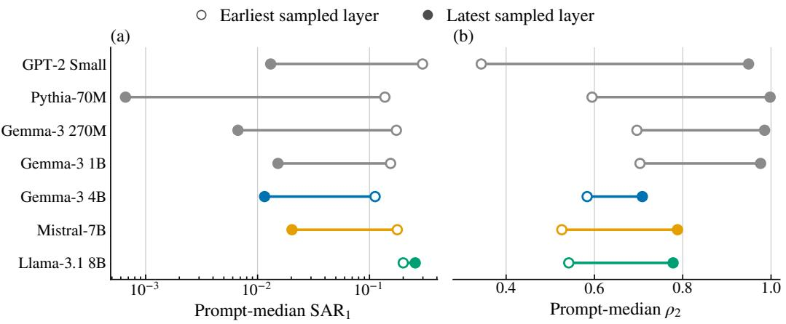  
Figure 7: Simple copying at the earliest and latest sampled layers across seven model and SAE pipelines. Open markers denote the earliest layer and filled markers denote the latest layer. The left panel reports prompt median $\widehat { \mathsf { S A R } } _ { 1 }$ and the right panel reports prompt median $\widehat { \rho } _ { 2 }$

Table 13: Estimated simple copying endpoints across seven model and SAE pipelines.
<table><tr><td>Pipeline</td><td>Early layer</td><td>Late layer</td><td> $\mathrm { E a r l y }  \mathrm { l a t e } \widehat { S _ { \mathrm { A R _ { 1 } } } }$ </td><td>Early → late  $\widehat { \rho } _ { 2 }$ </td></tr><tr><td>GPT-2 Small</td><td>4</td><td>10</td><td> $0 . 2 9 7 8  0 . 0 1 3 0 9$ </td><td>0.3437 → 0.9491</td></tr><tr><td>Pythia-70M</td><td>1</td><td>5</td><td> $0 . 1 3 7 3 \to 0 . 0 0 0 6 6 0 8$ </td><td>0.5946 → 0.9979</td></tr><tr><td>Gemma-3 270M</td><td>5</td><td>15</td><td> $0 . 1 7 3 8 \to 0 . 0 0 6 6 7 6$ </td><td>0.6962 → 0.9854</td></tr><tr><td>Gemma-3 1B</td><td>7</td><td>22</td><td> $0 . 1 5 4 3  0 . 0 1 5 2 1$ </td><td>0.7032 → 0.9763</td></tr><tr><td>Gemma-3 4B</td><td>9</td><td>29</td><td>0.1122 → 0.01155</td><td>0.5835 → 0.7085</td></tr><tr><td>Mistral-7B</td><td>8</td><td>24</td><td>0.1771 → 0.02029</td><td> $0 . 5 2 6 1  0 . 7 8 8 2$ </td></tr><tr><td>Llama-3.1 8B</td><td>8</td><td>27</td><td> $0 . 2 0 0 1  0 . 2 5 6 2$ </td><td> $0 . 5 4 1 9  0 . 7 7 8 2$ </td></tr></table>

## G.4 Greater Than Depth Profiles

Table 14 reports the complete greater than depth measurements available for Gemma and Llama.

Table 14: Estimated greater than depth profiles in the two pipelines with complete depth measurements.
<table><tr><td>Pipeline</td><td>Layer</td><td>Median  $\widehat { \mathsf { S A R } } _ { 1 }$ </td><td> $\operatorname { M e d i a n } \widehat { \operatorname { S A R } } _ { 2 }$ </td><td> $\operatorname { M e d i a n } \widehat { \rho } _ { 2 }$ </td></tr><tr><td>Gemma-3 4B</td><td>9</td><td>0.2045</td><td>0.07585</td><td>0.6223</td></tr><tr><td rowspan="7">Llama-3.1 8B</td><td>17</td><td>0.1436</td><td>0.09039</td><td>0.3809</td></tr><tr><td>22</td><td>0.02121</td><td>0.01495</td><td>0.2814</td></tr><tr><td>29</td><td>0.06386</td><td>0.009314</td><td>0.8551</td></tr><tr><td>8</td><td>0.3227</td><td>0.1005</td><td>0.6623</td></tr><tr><td>16</td><td>0.1302</td><td>0.03133</td><td>0.7385</td></tr><tr><td>21</td><td>0.05625</td><td>0.01509</td><td>0.7085</td></tr><tr><td>27</td><td>0.2147</td><td>0.04577</td><td>0.7822</td></tr></table>

## H Explanation Fidelity Results

For a held out coalition $S ,$ let

$$
e ( S ) = g _ { x } ( S ) - g _ { x } ( N _ { x } ) , \qquad { \widehat e } _ { r } ( S ) = { \widehat a } _ { r } ( S ) - { \widehat a } _ { r } ( N _ { x } ) .
$$

Sign error is the fraction of evaluated coalitions for which $e ( S )$ and $\widehat { e _ { r } } ( S )$ have opposite signs. For the same evaluation set $u ,$ let $S ^ { \star } = \arg \operatorname* { m a x } _ { S \in \mathcal { U } } g _ { x } ( S )$ and $\widehat { S } _ { r } = \arg \operatorname* { m a x } _ { S \in \mathcal { U } } \widehat { a } _ { r } ( S )$ Selection regret is

$$
R ^ { ( r ) } = \frac { g _ { x } ( S ^ { \star } ) - g _ { x } ( \widehat { S } _ { r } ) } { \mathsf { m a x } _ { S \in \mathcal { U } } g _ { x } ( S ) - \mathsf { m i n } _ { S \in \mathcal { U } } g _ { x } ( S ) + \epsilon } .\tag{48}
$$

These measures supplement rank fidelity and behavior weighted ordering error.

## H.1 Estimated SAR and First Order Fidelity

Table 15 gives the endpoint values for the $\widehat { \mathsf { S A R } } _ { 1 }$ decile comparison in Figure 4.

Table 15: First order explanation fidelity in the lowest and highest $\widehat { \mathsf { S A R } } _ { 1 }$ deciles within each model.
<table><tr><td></td><td colspan="2">Rank fidelity</td><td colspan="2">Selection regret</td></tr><tr><td>Model</td><td>Lowest decile</td><td>Highest decile</td><td>Lowest decile</td><td>Highest decile</td></tr><tr><td>Gemma-3 4B</td><td>0.9857</td><td>0.9539</td><td>0.01812</td><td>0.03623</td></tr><tr><td>Mistral-7B</td><td>0.9939</td><td>0.9413</td><td>0.009118</td><td>0.04684</td></tr><tr><td>Llama-3.1 8B</td><td>0.9790</td><td>0.9289</td><td>0.02711</td><td>0.05173</td></tr></table>

## H.2 Pairwise Approximation

Tables 16 and 17 report the complete first order and pairwise results for the 18 model and behavior combinations.

Table 16: First order and pairwise explanation errors for all 18 model and behavior combinations.
<table><tr><td rowspan="2"></td><td rowspan="2">Behavior</td><td colspan="2">Sign error</td><td colspan="2">Selection regret</td></tr><tr><td>First order</td><td>Pairwise</td><td>First order</td><td>Pairwise</td></tr><tr><td rowspan="7">Gemma-3 4B</td><td>Simple copying</td><td>0.0892</td><td>0.0420</td><td>0.0150</td><td>0.0044</td></tr><tr><td>Subject verb agreement</td><td>0.0784</td><td>0.0566</td><td>0.0175</td><td>0.0083</td></tr><tr><td>Gendered pronoun preference</td><td>0.1070</td><td>0.0415</td><td>0.0261</td><td>0.0050</td></tr><tr><td>CounterFact</td><td>0.0457</td><td>0.0418</td><td>0.0176</td><td>0.0034</td></tr><tr><td>IOI</td><td>0.1275</td><td>0.0514</td><td>0.0288</td><td>0.0041</td></tr><tr><td>Greater than</td><td>0.1288</td><td>0.1072</td><td>0.0269</td><td>0.0090</td></tr><tr><td>Simple copying</td><td>0.0451</td><td>0.0231</td><td>0.0185</td><td>0.0016</td></tr><tr><td rowspan="6">Mistral-7B</td><td>Subject verb agreement</td><td>0.1199</td><td>0.0482</td><td>0.0328</td><td>0.0032</td></tr><tr><td>Gendered proñoun preference</td><td>0.0864</td><td>0.0487</td><td>0.0301</td><td>0.0023</td></tr><tr><td>CounterFact</td><td>0.0960</td><td>0.0684</td><td>0.0251</td><td>0.0037</td></tr><tr><td>IOI</td><td>0.0474</td><td>0.0259</td><td>0.0101</td><td>0.0018</td></tr><tr><td>Greater than</td><td>0.1231</td><td>0.0608</td><td>0.0350</td><td>0.0044</td></tr><tr><td>Simple copying</td><td>0.0730</td><td>0.0433</td><td>0.0275</td><td>0.0052</td></tr><tr><td rowspan="6">Llama-3.1 8B</td><td>Subject verb agreement</td><td>0.0957</td><td>0.0500</td><td>0.0487</td><td>0.0077</td></tr><tr><td>Gendered proñoun preference</td><td>0.0997</td><td>0.0612</td><td>0.0370</td><td>0.0109</td></tr><tr><td>CounterFact</td><td>0.0861</td><td>0.0564</td><td>0.0378</td><td>0.0060</td></tr><tr><td>IOI</td><td>0.0748</td><td>0.0423</td><td>0.0195</td><td>0.0036</td></tr><tr><td>Greater than</td><td>0.0985</td><td>0.0484</td><td>0.0361</td><td></td></tr><tr><td></td><td></td><td></td><td></td><td>0.0065</td></tr></table>

Table 17 reports the corresponding rank fidelity values for the same model and behavior combinations.

Table 17: Mean prompt level rank fidelity of the first order and pairwise approximations for the 18 model and behavior combinations.
<table><tr><td>Model</td><td>Behavior</td><td> $F _ { \mathrm { r a n k } } ^ { ( 1 ) }$ </td><td> $F _ { \mathrm { r a n k } } ^ { ( 2 ) }$ </td></tr><tr><td rowspan="6">Gemma-3 4B</td><td>Simple copying</td><td>0.9857</td><td>0.9970</td></tr><tr><td>Subject verb agreement</td><td>0.9883</td><td>0.9967</td></tr><tr><td>Gendered proñoun preference</td><td>0.9690</td><td>0.9964</td></tr><tr><td>CounterFact</td><td>0.9851</td><td>0.9961</td></tr><tr><td>IOI</td><td>0.9751</td><td>0.9959</td></tr><tr><td>Greater than</td><td>0.9744</td><td>0.9887</td></tr><tr><td rowspan="6">Mistral-7B</td><td>Simple copying</td><td>0.9912</td><td>0.9987</td></tr><tr><td>Subject verb agreement</td><td>0.9745</td><td>0.9972</td></tr><tr><td>Gendered pronoun preference</td><td>0.9654</td><td>0.9956</td></tr><tr><td>CounterFact</td><td>0.9826</td><td>0.9973</td></tr><tr><td>IOI</td><td>0.9930</td><td>0.9988</td></tr><tr><td>Greater than</td><td>0.9897</td><td>0.9975</td></tr><tr><td rowspan="6">Llama-3.1 8B</td><td>Simple copying</td><td>0.9831</td><td>0.9963</td></tr><tr><td>Subject verb agreement</td><td>0.9685</td><td>0.9961</td></tr><tr><td>Gendered pronoun preference</td><td>0.9608</td><td>0.9942</td></tr><tr><td>CounterFact</td><td>0.9669</td><td>0.9933</td></tr><tr><td>IOI</td><td>0.9810</td><td>0.9968</td></tr><tr><td>Greater than</td><td>0.9731</td><td>0.9943</td></tr></table>

## H.3 Behavior Weighted Ordering Error

Table 18 reports the behavior weighted ordering errors used in the main text. Values use the original fitting and evaluation split.

Table 18: Held out behavior weighted ordering error for first order and pairwise approximations in the 18 model and behavior combinations used in the fidelity analysis.
<table><tr><td>Model</td><td>Behavior</td><td> $\widehat { \mathcal { E } } _ { 1 }$ </td><td> $\widehat { \mathcal { E } } _ { 2 }$ </td></tr><tr><td rowspan="6">Gemma-3 4B</td><td>Simple copying</td><td>0.0009103</td><td>0.0002062</td></tr><tr><td>Subject verb agreement</td><td>0.0005988</td><td>0.0001896</td></tr><tr><td>Gendered proñoun preference</td><td>0.001169</td><td>0.0001176</td></tr><tr><td>CounterFact</td><td>0.0009869</td><td>0.0002584</td></tr><tr><td>IOI</td><td>0.001248</td><td>0.0002133</td></tr><tr><td>Greater than</td><td>0.0007911</td><td>0.0005375</td></tr><tr><td rowspan="6">Mistral-7B</td><td>Simple copying</td><td>0.0004209</td><td>0.00004362</td></tr><tr><td>Subject verb agreement</td><td>0.0007353</td><td>0.00003234</td></tr><tr><td>Gendered pronoun preference</td><td>0.001413</td><td>0.0001367</td></tr><tr><td>CounterFact</td><td>0.0008927</td><td>0.0001262</td></tr><tr><td>IOI</td><td>0.0002645</td><td>0.00003632</td></tr><tr><td>Greater than</td><td>0.0004570</td><td>0.0001393</td></tr><tr><td rowspan="6">Llama-3.1 8B</td><td>Simple copying</td><td>0.001344</td><td>0.0002101</td></tr><tr><td>Subject verb agreement</td><td>0.0009746</td><td>0.00009669</td></tr><tr><td>Gendered pronoun preference</td><td>0.003579</td><td>0.0003866</td></tr><tr><td>CounterFact</td><td>0.002580</td><td>0.0005645</td></tr><tr><td>IOI</td><td>0.001357</td><td>0.0002247</td></tr><tr><td>Greater than</td><td>0.002097</td><td>0.0003523</td></tr></table>

## H.4 Pairwise Terms and Matched Higher Order Capacity

The pairwise model contains 137 coefficients. For the matched comparison, each control model keeps the intercept and 16 first order Walsh terms and replaces the 120 pairwise terms with 120 terms sampled uniformly without replacement from the 560 third order Walsh terms. Fifty control models are fitted for every prompt with the same fitting and evaluation coalitions as the pairwise model.

Table 19: Held out ordering for the pairwise model and parameter matched models that replace pairwise terms with randomly sampled third order Walsh terms. All columns report prompt medians; matched quantities first take the median over 50 random models for each prompt.
<table><tr><td>Model</td><td>Behavior</td><td>Pairwise rank Matched rank Pairwise</td><td></td><td></td><td>Matched ξ</td></tr><tr><td>Gemma-3 4B</td><td>Simple copying</td><td>0.9934</td><td>0.9802</td><td>0.0002062</td><td>0.001488</td></tr><tr><td></td><td>Subject verb agreement</td><td>0.9934</td><td>0.9845</td><td>0.0001896</td><td>0.0009812</td></tr><tr><td></td><td>Gendered pronoun preference</td><td>0.9925</td><td>0.9597</td><td>0.0001176</td><td>0.001838</td></tr><tr><td></td><td>CounterFact</td><td>0.9926</td><td>0.9772</td><td>0.0002584</td><td>0.001730</td></tr><tr><td></td><td>IOI</td><td>0.9925</td><td>0.9690</td><td>0.0002133</td><td>0.001799</td></tr><tr><td>Mistral-7B</td><td>Greater than</td><td>0.9800</td><td>0.9682</td><td>0.0005375</td><td>0.001151</td></tr><tr><td></td><td>Simple copying</td><td>0.9974</td><td>0.9885</td><td>0.00004362</td><td>0.0006113</td></tr><tr><td></td><td>Subject verb agreement</td><td>0.9943</td><td>0.9674</td><td>0.00003234</td><td>0.001186</td></tr><tr><td></td><td>Gendered pronoun preference</td><td>0.9912</td><td>0.9530</td><td>0.0001367</td><td>0.002338</td></tr><tr><td></td><td>CounterFact</td><td>0.9946</td><td>0.9760</td><td>0.0001262</td><td>0.001579</td></tr><tr><td></td><td>IOI</td><td>0.9976</td><td>0.9904</td><td>0.00003632</td><td>0.0004264</td></tr><tr><td></td><td>Greater than</td><td>0.9949</td><td>0.9847</td><td>0.0001393</td><td>0.0007631</td></tr><tr><td>Llama-3.1 8B</td><td>Simple copying</td><td>0.9933</td><td>0.9766</td><td>0.0002101</td><td>0.001939</td></tr><tr><td></td><td>Subject verb agreement</td><td>0.9924</td><td>0.9593</td><td>0.00009669</td><td>0.001486</td></tr><tr><td></td><td>Gendered proñoun preference</td><td>0.9899</td><td>0.9517</td><td>0.0003866</td><td>0.005213</td></tr><tr><td></td><td>CounterFact</td><td>0.9864</td><td>0.9578</td><td>0.0005645</td><td>0.003916</td></tr><tr><td></td><td>IOI</td><td>0.9937</td><td>0.9756</td><td>0.0002247</td><td>0.002034</td></tr><tr><td></td><td>Greater than</td><td>0.9898</td><td>0.9661</td><td>0.0003523</td><td>0.003020</td></tr></table>

## H.5 Steering Results Across MMLU-Pro Domains

Table 20 gives the steering results for each domain summarized in the main text.

Table 20: Held out residual estimates and rank fidelity for steering combinations on MMLU-Pro. The first order and pairwise models are fitted on one set of sampled coalitions and evaluated on a separate set. The final column reports $F _ { \mathrm { r a n k } } ^ { ( 2 ) } - F _ { \mathrm { r a n k } } ^ { ( 1 ) } .$
<table><tr><td>Domain</td><td> $\widehat { \mathsf { S A R } } _ { 1 }$   $F _ { \mathrm { r a n k } } ^ { ( 1 ) }$ </td><td> $\widehat { \mathrm { S A R } } _ { 2 }$ </td><td> $\widehat { \rho } _ { 2 }$ </td><td> $F _ { \mathrm { r a n k } } ^ { ( 2 ) }$ </td><td>Rank fidelity change</td></tr><tr><td>Biology</td><td>0.58150.64630.56000.03700.6684</td><td></td><td></td><td></td><td>+0.0221</td></tr><tr><td>Business</td><td>0.66660.54170.38780.41830.6784</td><td></td><td></td><td></td><td>+0.1367</td></tr><tr><td>Chemistry</td><td>0.91790.31700.56500.38440.7130</td><td></td><td></td><td></td><td>+0.3960</td></tr><tr><td>Computer Science 0.5420 0.6841 0.53560.01190.6962</td><td></td><td></td><td></td><td></td><td>+0.0121</td></tr><tr><td>Economics</td><td>0.57810.65580.6150-0.06390.6465</td><td></td><td></td><td></td><td>-0.0093</td></tr><tr><td>Engineering</td><td>0.2238 0.8731 0.1871 0.1637 0.8689</td><td></td><td></td><td></td><td>-0.0042</td></tr><tr><td>Health</td><td>0.8685 0.36980.68710.20890.5922</td><td></td><td></td><td></td><td>+0.2224</td></tr><tr><td>History</td><td>0.69500.57160.42610.38690.7635</td><td></td><td></td><td></td><td>+0.1919</td></tr><tr><td>Law</td><td>0.76850.5062 0.9275-0.20690.4155</td><td></td><td></td><td></td><td>-0.0907</td></tr><tr><td>Math</td><td>0.61510.62440.6543-0.06380.5988</td><td></td><td></td><td></td><td>-0.0256</td></tr><tr><td>Other</td><td>0.4958 0.6889 0.46720.05770.6976</td><td></td><td></td><td></td><td>+0.0087</td></tr><tr><td>Philosophy</td><td>0.45490.77500.36370.20050.8039</td><td></td><td></td><td></td><td>+0.0289</td></tr><tr><td>Physics</td><td>0.90710.31330.9421-0.03870.3669</td><td></td><td></td><td></td><td>+0.0536</td></tr><tr><td>Psychology</td><td>0.50550.69560.5085-0.00600.7314</td><td></td><td></td><td></td><td>+0.0358</td></tr><tr><td>Overall</td><td>0.64240.58740.38910.39420.7790</td><td></td><td></td><td></td><td>+0.1916</td></tr></table>

Table 21: Held out behavior weighted ordering error for the steering responses.
<table><tr><td>Domain</td><td> $\widehat { \mathcal { E } } _ { 1 }$ </td><td> $\widehat { \mathcal { E } } _ { 2 }$ </td></tr><tr><td>Biology</td><td>0.1187</td><td>0.1080</td></tr><tr><td>Business</td><td>0.1287</td><td>0.06926</td></tr><tr><td>Chemistry</td><td>0.3078</td><td>0.09323</td></tr><tr><td>Computer Science</td><td>0.1043</td><td>0.09596</td></tr><tr><td>Economics</td><td>0.1071</td><td>0.1073</td></tr><tr><td>Engineering Health</td><td>0.02049</td><td>0.02116</td></tr><tr><td>History</td><td>0.2634</td><td>0.1301 0.06088</td></tr><tr><td></td><td>0.1520</td><td></td></tr><tr><td>Law</td><td>0.1904</td><td>0.2429</td></tr><tr><td>Math</td><td>0.1243</td><td>0.1368</td></tr><tr><td>Other</td><td>0.07913</td><td>0.08483</td></tr><tr><td>Philosophy</td><td>0.06537</td><td>0.04759</td></tr><tr><td>Physics</td><td>0.2744</td><td>0.2465</td></tr><tr><td>Psychology</td><td>0.09043</td><td>0.07677</td></tr><tr><td></td><td></td><td></td></tr><tr><td>Overall</td><td>0.1444</td><td>0.06056</td></tr></table>

## H.6 Reconstruction and Behavioral Compositionality Across Six SAEs

Figure 8 shows the comparison across the six SAE bases referenced in the main text.

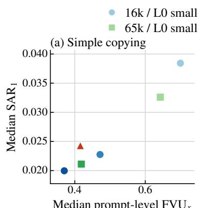

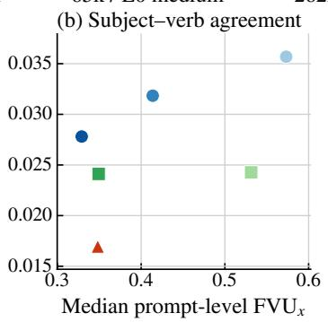

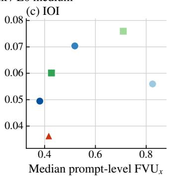  
Figure 8: Median prompt level $\mathrm { F V U } _ { x }$ and median $\widehat { \mathsf { S A R } } _ { 1 }$ for six SAEs at Gemma-3 1B layer 17. Panels show simple copying, subject verb agreement, and IOI.

## H.7 Examples

Figure 9 and Table 22 show the selected examples for individual prompts and their residual values.

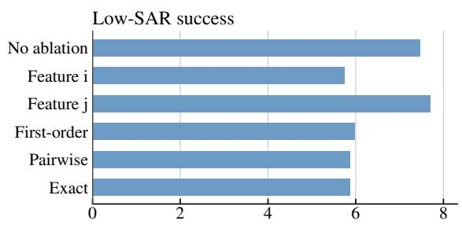

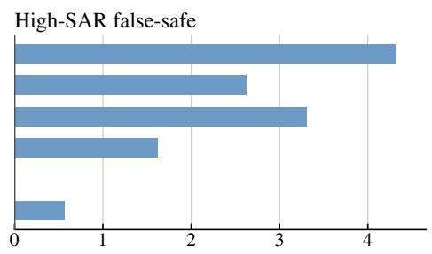

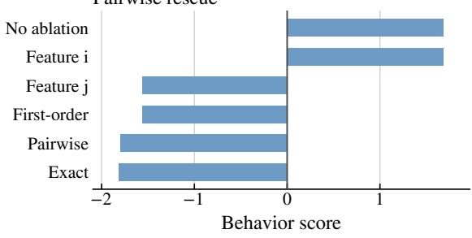

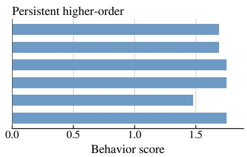  
Figure 9: Behavior scores for four examples under ablations of individual features and feature pairs, together with first order and pairwise predictions when available.

Table 22: Prompts used in Figure 9.
<table><tr><td>Panel Model</td><td>Behavior</td><td>Prompt ID</td><td> $\widehat { \mathsf { S A R } } _ { 1 }$ </td><td> $\widehat { \mathrm { S A R } } _ { 2 }$   $\widehat { \rho } _ { 2 }$ </td></tr><tr><td>(a)</td><td>Mistral-7B Simple copying</td><td>simple_copying/028190.00325 0.001590.509</td><td></td><td></td></tr><tr><td></td><td>erence</td><td>(b) Llama-3.1 8B Gendered pronoun pref- gendered_pronoun/00310 0.1677 0.0384 0.771</td><td></td><td></td></tr><tr><td></td><td></td><td>(c) Llama-3.1 8B Subject verb agreement subject_verb_agreement 0.00765 0.00103 0.865 /03544</td><td></td><td></td></tr><tr><td></td><td>(d) Llama-3.1 8B Gendered pronoun pref- gendered_pronoun/00072 0.1412 0.0417 0.705 erence</td><td></td><td></td><td></td></tr></table>

## I Robustness and Protocol Checks

## I.1 Sensitivity to the number of selected features

Changing K changes the candidate explanation by adding or removing SAE coordinates. The table therefore reports how behavioral compositionality changes with the explanation size rather than convergence of a fixed quantity.

Table 23: Sensitivity of $\widehat { \mathrm { S A R } } _ { 1 }$ to the number of selected SAE features. The active feature rows report prompt median $\mathsf { \widehat { S A R } } _ { 1 }$ at Gemma-3 1B layer 17. Affine control values are reported in units of $1 0 ^ { - 1 4 }$ . The steering row reports $\widehat { \mathsf { S A R } } _ { 1 }$ for the overall MMLU-Pro accuracy game. Feature sets are nested across $\underline { { K . } }$
<table><tr><td rowspan="2">Behavior or setting</td><td colspan="8">Number of selected features K</td></tr><tr><td>6</td><td>8</td><td>10</td><td>12</td><td>14</td><td>16</td><td>18</td><td>20</td></tr><tr><td>Affine control</td><td>6.87</td><td>6.40</td><td>5.70</td><td>5.16</td><td>5.03</td><td>5.43</td><td>5.07</td><td>4.84</td></tr><tr><td>Greater than</td><td>0.0460</td><td>0.0575</td><td>0.0634</td><td>0.0707</td><td>0.0763</td><td>0.0823</td><td>0.0868</td><td>0.0872</td></tr><tr><td>IOI</td><td>0.0554</td><td>0.0559</td><td>0.0597</td><td>0.0640</td><td>0.0652</td><td>0.0662</td><td>0.0664</td><td>0.0693</td></tr><tr><td>Simple copying</td><td>0.0213</td><td>0.0217</td><td>0.0234</td><td>0.0245</td><td>0.0270</td><td>0.0299</td><td>0.0307</td><td>0.0320</td></tr><tr><td>MMLU-Pro steering</td><td>0.2577</td><td>0.4951</td><td>0.6595</td><td>0.6350</td><td>0.5804</td><td>0.7768</td><td>0.8096</td><td>0.7861</td></tr></table>

Increasing the coalition inclusion probability from 0.5 to 0.65 preserves the decrease in $\widehat { \mathsf { S A R } } _ { 1 }$ from the earliest to the latest sampled layer for CounterFact, IOI, and simple copying. Mean and median aggregation give the same depth directions. Using 1,000 prompts also preserves the main summary results, including decreases in $\widehat { \mathsf { S A R } } _ { 1 }$ in eight of nine comparisons and increases in $\widehat { \rho } _ { 2 }$ in all nine.