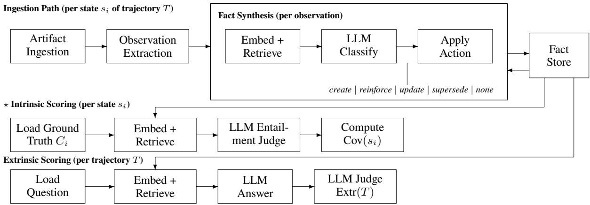

# Beyond Downstream QA: Rethinking How We Evaluate Agent Memory

Sebastian-Antonio Toma<sup>1,2∗</sup>, Jean de Kernier<sup>1</sup>, Mike Ply<sup>1</sup>, Oliviu Matei<sup>2</sup>

<sup>1</sup>A<sub>mazon</sub> W<sub>e</sub>b S<sub>erv</sub>i<sub>ces</sub>

<sup>2</sup>Technical University of Cluj-Napoca, Romania Sebastian.Toma@campus.utcluj.ro

## Abstract

A<sub>gen</sub>t <sub>memory</sub> b<sub>enc</sub>h<sub>mar</sub>k<sub>s eva</sub>l<sub>ua</sub>t<sub>e w</sub>h<sub>e</sub>th<sub>er an agen</sub>t’<sub>s re-</sub> <sub>sponses re</sub>fl<sub>ec</sub>t <sub>correc</sub>t k<sub>now</sub>l<sub>e</sub>d<sub>ge, measur</sub>i<sub>ng</sub> d<sub>owns</sub>t<sub>ream</sub> qu<sup>estion-ans</sup>w<sup>erin</sup>g <sup>acc</sup>u<sup>rac</sup>y <sup>as</sup> <sup>a</sup> p<sup>rox</sup>y <sup>for</sup> <sup>memor</sup>y qu<sup>alit</sup>y. W<sub>e s</sub>h<sub>ow</sub> thi<sub>s eva</sub>l<sub>ua</sub>ti<sub>on para</sub>di<sub>gm</sub> i<sub>s</sub> i<sub>ncomp</sub>l<sub>e</sub>t<sub>e:</sub> it <sub>con</sub>fl<sub>a</sub>t<sub>es</sub> <sub>memory</sub> <sub>correc</sub>t<sub>ness</sub> <sub>w</sub>ith <sub>re</sub>t<sub>r</sub>i<sub>eva</sub>l <sub>an</sub>d <sub>genera</sub>ti<sub>on</sub> <sub>qua</sub>lit<sub>y,</sub> <sub>pro-</sub> d<sub>uc</sub>i<sub>ng</sub> b<sub>o</sub>th f<sub>a</sub>l<sub>se pos</sub>iti<sub>ves w</sub>h<sub>ere correc</sub>t <sub>responses mas</sub>k b<sub>ro-</sub> k<sub>en</sub> <sub>memory</sub> <sub>an</sub>d f<sub>a</sub>l<sub>se</sub> <sub>nega</sub>ti<sub>ves</sub> <sub>w</sub>h<sub>ere</sub> i<sub>ncorrec</sub>t <sub>responses</sub> bl<sub>ame correc</sub>t <sub>memory</sub> f<sub>or re</sub>t<sub>r</sub>i<sub>eva</sub>l f<sub>a</sub>il<sub>ures.</sub> W<sub>e</sub> i<sub>n</sub>t<sub>ro</sub>d<sub>uce</sub> FEB-30, a benchmark of 30 fact-evolution trajectories span-<sub>n</sub>i<sub>ng</sub> 6 di<sub>agnos</sub>ti<sub>c ca</sub>t<sub>egor</sub>i<sub>es an</sub>d 3 difi<sub>cu</sub>lt<sub>y</sub> l<sub>eve</sub>l<sub>s, cons</sub>t<sub>ruc</sub>t<sub>e</sub>d <sub>v</sub>i<sub>a para</sub>di<sub>gm</sub> i<sub>nvers</sub>i<sub>on:</sub> d<sub>ocumen</sub>t<sub>s are genera</sub>t<sub>e</sub>d f<sub>rom</sub> k<sub>nown</sub> fact trajectories, yielding deterministic ground truth without human annotation. Each trajectory defines how a fact should evolve across multi-author artifacts (documents, emails, conversations), enablin<sub>g</sub> direct ins<sub>p</sub>ection of the memor<sub>y</sub> store <sub>a</sub>ft<sub>e</sub>r <sub>eac</sub>h in<sub>ges</sub>ti<sub>o</sub>n <sub>s</sub>t<sub>ep.</sub> A<sub>pp</sub>l<sub>y</sub>in<sub>g</sub> FEB<sub>-</sub>30 t<sub>o a</sub> r<sub>ep</sub>r<sub>ese</sub>nt<sub>a</sub>ti<sub>ve</sub> <sub>memory sys</sub>t<sub>em, we</sub> d<sub>emons</sub>t<sub>ra</sub>t<sub>e</sub> th<sub>a</sub>t i<sub>n</sub>t<sub>r</sub>i<sub>ns</sub>i<sub>c an</sub>d <sub>ex</sub>t<sub>r</sub>i<sub>ns</sub>i<sub>c</sub> <sub>eva</sub>l<sub>ua</sub>ti<sub>on</sub> di<sub>verge</sub> b<sub>y an average o</sub>f 16 <sub>percen</sub>t<sub>age po</sub>i<sub>n</sub>t<sub>s, w</sub>ith 44% of trajectories exceeding meaningful divergence thresh-<sub>o</sub>ld<sub>s.</sub> Di<sub>agnos</sub>ti<sub>c</sub> d<sub>ecompos</sub>iti<sub>on revea</sub>l<sub>s</sub> th<sub>a</sub>t th<sub>e sys</sub>t<sub>em cor-</sub> rectl<sub>y</sub> classifies memor<sub>y</sub> o<sub>p</sub>erations (create, u<sub>p</sub>date, reinforce, su<sub>p</sub>ersede) onl<sub>y</sub> 20% of the time, a failure entirel<sub>y</sub> invisible t<sub>o ex</sub>t<sub>r</sub>i<sub>ns</sub>i<sub>c eva</sub>l<sub>ua</sub>ti<sub>on, an</sub>d th<sub>a</sub>t f<sub>a</sub>il<sub>ure mo</sub>d<sub>es</sub> dif<sub>er sys</sub>t<sub>em-</sub> <sub>a</sub>ti<sub>ca</sub>ll<sub>y</sub> b<sub>y ca</sub>t<sub>egory an</sub>d difi<sub>cu</sub>lt<sub>y.</sub> W<sub>e re</sub>l<sub>ease</sub> th<sub>e</sub> b<sub>enc</sub>h<sub>mar</sub>k<sub>,</sub> d<sub>ocumen</sub>t <sub>genera</sub>ti<sub>on</sub> <sub>p</sub>i<sub>pe</sub>li<sub>ne,</sub> <sub>an</sub>d <sub>scor</sub>i<sub>ng</sub> f<sub>ramewor</sub>k t<sub>o</sub> <sub>sup-</sub> <sub>por</sub>t <sub>repro</sub>d<sub>uc</sub>ibl<sub>e eva</sub>l<sub>ua</sub>ti<sub>on o</sub>f <sub>agen</sub>t <sub>memory sys</sub>t<sub>ems.</sub><sup>1</sup>

## 1 Introduction

Lar<sub>g</sub>e lan<sub>g</sub>ua<sub>g</sub>e model (LLM) a<sub>g</sub>ents o<sub>p</sub>eratin<sub>g</sub> over ext<sub>en</sub>d<sub>e</sub>d ti<sub>me</sub> h<sub>or</sub>i<sub>zons</sub> <sub>requ</sub>i<sub>re</sub> <sub>pers</sub>i<sub>s</sub>t<sub>en</sub>t <sub>ex</sub>t<sub>erna</sub>l <sub>memory</sub> t<sub>o</sub> <sub>accumu</sub>l<sub>a</sub>t<sub>e</sub> k<sub>now</sub>l<sub>e</sub>d<sub>ge</sub> b<sub>eyon</sub>d th<sub>e ep</sub>h<sub>emera</sub>l <sub>con</sub>t<sub>ex</sub>t <sub>w</sub>i<sub>n-</sub> dow (Sumers et al. 2024; Jian<sub>g</sub> et al. 2026). As these s<sub>y</sub>stems <sub>grow more comp</sub>l<sub>ex, w</sub>ith <sub>over a</sub> d<sub>ozen</sub> di<sub>s</sub>ti<sub>nc</sub>t <sub>arc</sub>hit<sub>ec</sub>t<sub>ures</sub> <sub>p</sub>ublished since 2023 (Latimer et al. 2026; Packer et al. 2024; Rasmussen et al. 2025; Chhikara et al. 2025; Zhu et al. 2026), the question of how to evaluate them becomes pressing.

A <sub>survey o</sub>f <sub>curren</sub>t b<sub>enc</sub>h<sub>mar</sub>k<sub>s revea</sub>l<sub>s a sys</sub>t<sub>ema</sub>ti<sub>c</sub> li<sub>m-</sub> it<sub>a</sub>ti<sub>on:</sub> <sub>every</sub> <sub>ex</sub>i<sub>s</sub>ti<sub>ng</sub> <sub>eva</sub>l<sub>ua</sub>ti<sub>on</sub> <sub>measures</sub> <sub>memory</sub> <sub>qua</sub>lit<sub>y</sub> extrinsically, by posing questions to the agent and grading its res<sub>p</sub>onses (Maharana et al. 2024; Wu et al. 2026; Hu, Wan<sub>g</sub>, <sub>an</sub>d M<sub>c</sub>A<sub>u</sub>l<sub>ey</sub> 2026<sub>;</sub> Uddi<sub>n e</sub>t <sub>a</sub>l<sub>.</sub> 2026<sub>;</sub> Li<sub>u an</sub>d Y<sub>a</sub>d<sub>av</sub> 2026<sub>;</sub>

Jun<sub>g</sub> et al. 2026). This <sub>p</sub>roduces a sin<sub>g</sub>le com<sub>p</sub>osite score that <sub>con</sub>fl<sub>a</sub>t<sub>es</sub> <sub>memory,</sub> <sub>re</sub>t<sub>r</sub>i<sub>eva</sub>l<sub>,</sub> <sub>an</sub>d <sub>genera</sub>ti<sub>on</sub> <sub>qua</sub>lit<sub>y.</sub> Wh<sub>en</sub> th<sub>e</sub> <sub>sys</sub>t<sub>em</sub> f<sub>a</sub>il<sub>s,</sub> <sub>one</sub> <sub>canno</sub>t id<sub>en</sub>tif<sub>y</sub> <sub>w</sub>hi<sub>c</sub>h <sub>componen</sub>t i<sub>s</sub> <sub>respon-</sub> <sub>s</sub>ibl<sub>e; w</sub>h<sub>en</sub> it <sub>succee</sub>d<sub>s, one canno</sub>t <sub>con</sub>fi<sub>rm</sub> th<sub>e memory</sub> i<sub>s</sub> actuall<sub>y</sub> correct (Toma and Matei 2026).

W<sub>e</sub> id<sub>en</sub>tif<sub>y</sub> t<sub>wo concre</sub>t<sub>e</sub> f<sub>a</sub>il<sub>ure mo</sub>d<sub>es</sub> th<sub>a</sub>t <sub>ex</sub>t<sub>r</sub>i<sub>ns</sub>i<sub>c eva</sub>l<sub>-</sub> <sub>ua</sub>ti<sub>on canno</sub>t d<sub>e</sub>t<sub>ec</sub>t<sub>:</sub>

• False positives (LLM compensation): A stron<sub>g g</sub>ener-<sub>a</sub>ti<sub>on mo</sub>d<sub>e</sub>l <sub>can pro</sub>d<sub>uce correc</sub>t <sub>responses</sub> d<sub>esp</sub>it<sub>e</sub> i<sub>n-</sub> correct or <sup>i</sup>ncom<sub>p</sub><sup>l</sup>ete memor<sub>y</sub> state, <sup>b</sup><sub>y</sub> reason<sup>i</sup>n<sub>g</sub> over <sub>par</sub>ti<sub>a</sub>l <sub>re</sub>t<sub>r</sub>i<sub>eva</sub>l <sub>resu</sub>lt<sub>s a</sub>t i<sub>n</sub>f<sub>erence</sub> ti<sub>me.</sub> E<sub>x</sub>t<sub>r</sub>i<sub>ns</sub>i<sub>c eva</sub>l<sub>u-</sub> <sub>a</sub>ti<sub>on scores</sub> thi<sub>s as success.</sub>

• False negatives (retrieval bottleneck): A memor<sub>y</sub> s<sub>y</sub>st<sub>em may correc</sub>tl<sub>y s</sub>t<sub>ore an</sub>d <sub>up</sub>d<sub>a</sub>t<sub>e</sub> f<sub>ac</sub>t<sub>s, ye</sub>t f<sub>a</sub>il t<sub>o re-</sub> t<sub>r</sub>i<sub>eve</sub> th<sub>em</sub> f<sub>or a spec</sub>ifi<sub>c query</sub> d<sub>ue</sub> t<sub>o em</sub>b<sub>e</sub>ddi<sub>ng m</sub>i<sub>s-</sub> <sub>ma</sub>t<sub>c</sub>h <sub>or re</sub>t<sub>r</sub>i<sub>eva</sub>l <sub>cu</sub>t<sub>o</sub>f<sub>.</sub> E<sub>x</sub>t<sub>r</sub>i<sub>ns</sub>i<sub>c eva</sub>l<sub>ua</sub>ti<sub>on</sub> bl<sub>ames</sub> th<sub>e</sub> <sub>memory sys</sub>t<sub>em</sub> f<sub>or a re</sub>t<sub>r</sub>i<sub>eva</sub>l f<sub>a</sub>il<sub>ure.</sub>

We propose intrinsic evaluation, direct comparison of the <sub>memory s</sub>t<sub>ore con</sub>t<sub>en</sub>t<sub>s aga</sub>i<sub>ns</sub>t k<sub>nown groun</sub>d t<sub>ru</sub>th <sub>a</sub>t <sub>eac</sub>h <sub>s</sub>t<sub>age o</sub>f k<sub>now</sub>l<sub>e</sub>d<sub>ge evo</sub>l<sub>u</sub>ti<sub>on, as a comp</sub>l<sub>emen</sub>t<sub>ary eva</sub>l<sub>ua</sub>ti<sub>on</sub> <sub>para</sub>di<sub>gm.</sub> Th<sub>e re</sub>l<sub>a</sub>ti<sub>ons</sub>hi<sub>p m</sub>i<sub>rrors un</sub>it <sub>versus en</sub>d<sub>-</sub>t<sub>o-en</sub>d t<sub>es</sub>ti<sub>ng</sub> i<sub>n so</sub>ft<sub>ware eng</sub>i<sub>neer</sub>i<sub>ng:</sub> i<sub>n</sub>t<sub>r</sub>i<sub>ns</sub>i<sub>c eva</sub>l<sub>ua</sub>ti<sub>on c</sub>h<sub>ec</sub>k<sub>s</sub> th<sub>e memory componen</sub>t’<sub>s</sub> i<sub>n</sub>t<sub>erna</sub>l <sub>s</sub>t<sub>a</sub>t<sub>e</sub> di<sub>rec</sub>tl<sub>y, w</sub>hil<sub>e ex-</sub> t<sub>r</sub>i<sub>ns</sub>i<sub>c eva</sub>l<sub>ua</sub>ti<sub>on on</sub>l<sub>y o</sub>b<sub>serves en</sub>d<sub>-</sub>t<sub>o-en</sub>d b<sub>e</sub>h<sub>av</sub>i<sub>or, so a</sub> passing end-to-end test can mask a broken component just as <sub>a correc</sub>t <sub>componen</sub>t <sub>can</sub> f<sub>a</sub>il <sub>en</sub>d<sub>-</sub>t<sub>o-en</sub>d d<sub>ue</sub> t<sub>o an</sub> i<sub>n</sub>t<sub>egra</sub>ti<sub>on</sub> b<sub>o</sub>ttl<sub>enec</sub>k<sub>.</sub> A <sub>para</sub>ll<sub>e</sub>l f<sub>rom</sub> NLP hi<sub>s</sub>t<sub>ory mo</sub>ti<sub>va</sub>t<sub>es</sub> th<sub>e same</sub> <sub>s</sub>hift<sub>:</sub> i<sub>n</sub> th<sub>e</sub> 2010<sub>s, wor</sub>d <sub>em</sub>b<sub>e</sub>ddi<sub>ngs were eva</sub>l<sub>ua</sub>t<sub>e</sub>d <sub>on</sub>l<sub>y</sub> th<sub>roug</sub>h d<sub>owns</sub>t<sub>ream</sub> t<sub>as</sub>k <sub>per</sub>f<sub>ormance un</sub>til i<sub>n</sub>t<sub>r</sub>i<sub>ns</sub>i<sub>c eva</sub>l<sub>u-</sub> ation (analo<sub>gy</sub> tasks, similarit<sub>y</sub> correlations) enabled faster <sub>p</sub>ro<sub>g</sub>ress b<sub>y</sub> isolatin<sub>g</sub> re<sub>p</sub>resentation qualit<sub>y</sub> (Baroni, Dinu, and Kruszewski 2014; Schnabel et al. 2015). Our contributi<sub>ons are:</sub>

1. FEB-30, a benchmark of 30 fact-evolution trajectories <sub>w</sub>ith d<sub>e</sub>t<sub>erm</sub>i<sub>n</sub>i<sub>s</sub>ti<sub>c groun</sub>d t<sub>ru</sub>th<sub>, spann</sub>i<sub>ng</sub> 6 di<sub>agnos</sub>ti<sub>c</sub> <sub>ca</sub>t<sub>egor</sub>i<sub>es</sub> th<sub>a</sub>t i<sub>so</sub>l<sub>a</sub>t<sub>e</sub> di<sub>s</sub>ti<sub>nc</sub>t f<sub>a</sub>il<sub>ure mo</sub>d<sub>es</sub> i<sub>nv</sub>i<sub>s</sub>ibl<sub>e</sub> t<sub>o</sub> <sub>ex</sub>t<sub>r</sub>i<sub>ns</sub>i<sub>c eva</sub>l<sub>ua</sub>ti<sub>on.</sub> Th<sub>e</sub> b<sub>enc</sub>h<sub>mar</sub>k <sub>compr</sub>i<sub>ses:</sub>

• Fact-evolution trajectories with atomic claim <sub>g</sub>round t<sub>ru</sub>th <sub>a</sub>t <sub>eac</sub>h <sub>s</sub>t<sub>a</sub>t<sub>e.</sub>

• A <sub>p</sub>aradi<sub>g</sub>m-inversion document <sub>g</sub>eneration <sub>p</sub>i<sub>p</sub>eline using multi-model rotation and 3-judge verification.

• A scorin<sub>g</sub> framework measurin<sub>g</sub> both intrinsic (claim covera<sub>g</sub>e, u<sub>p</sub>date detection, false u<sub>p</sub>date rate) and extrinsic (QA accurac<sub>y</sub>) metrics.

2. Intrinsic evaluation methodology for agent memory: di<sub>rec</sub>t i<sub>nspec</sub>ti<sub>on o</sub>f <sub>memory s</sub>t<sub>a</sub>t<sub>e aga</sub>i<sub>ns</sub>t k<sub>nown groun</sub>d t<sub>ru</sub>th <sub>a</sub>t <sub>eac</sub>h <sub>s</sub>t<sub>age o</sub>f k<sub>now</sub>l<sub>e</sub>d<sub>ge evo</sub>l<sub>u</sub>ti<sub>on, ena</sub>bli<sub>ng</sub> di<sub>-</sub> <sub>agnos</sub>ti<sub>c</sub> d<sub>ecompos</sub>iti<sub>on</sub> <sub>o</sub>f f<sub>a</sub>il<sub>ures</sub> b<sub>y</sub> <sub>p</sub>i<sub>pe</sub>li<sub>ne</sub> <sub>s</sub>t<sub>age.</sub>

3<sub>.</sub> E<sub>mp</sub>i<sub>r</sub>i<sub>ca</sub>l <sub>ev</sub>id<sub>ence</sub> th<sub>a</sub>t i<sub>n</sub>t<sub>r</sub>i<sub>ns</sub>i<sub>c an</sub>d <sub>ex</sub>t<sub>r</sub>i<sub>ns</sub>i<sub>c eva</sub>l<sub>ua</sub>ti<sub>on</sub> diverge by 16 percentage points on average, with 44% of trajectories exceeding meaningful divergence and fail-<sub>ure</sub> <sub>mo</sub>d<sub>es</sub> dif<sub>er</sub>i<sub>ng</sub> <sub>sys</sub>t<sub>ema</sub>ti<sub>ca</sub>ll<sub>y</sub> b<sub>y</sub> <sub>ca</sub>t<sub>egory.</sub>

## 2 Related Work

Agent Memory Benchmarks. MemoryAgentBench (Hu, Wan<sub>g</sub>, and McAule<sub>y</sub> 2026) defines four memor<sub>y</sub> com-<sub>p</sub>etencies (retention, tem<sub>p</sub>oral reasonin<sub>g</sub>, knowled<sub>g</sub>e u<sub>p</sub>- dates, and information inte<sub>g</sub>ration) evaluated throu<sub>g</sub>h QA interactions. Memora (Uddin et al. 2026) introduces the FAMA <sub>me</sub>t<sub>r</sub>i<sub>c</sub> th<sub>a</sub>t <sub>pena</sub>li<sub>zes re</sub>li<sub>ance on</sub> i<sub>nva</sub>lid<sub>a</sub>t<sub>e</sub>d <sub>mem-</sub> <sub>or</sub>i<sub>es,</sub> d<sub>ecompos</sub>i<sub>ng per</sub>f<sub>ormance</sub> i<sub>n</sub>t<sub>o</sub> f<sub>res</sub>h<sub>ness-aware com-</sub> <sub>p</sub>onents. Lon<sub>g</sub>MemEval-V2 (Wu et al. 2026) tests lon<sub>g</sub>-term <sub>memory a</sub>l<sub>ong</sub> fi<sub>ve</sub> t<sub>empora</sub>l <sub>reason</sub>i<sub>ng capa</sub>biliti<sub>es.</sub> AMA<sub>-</sub> Bench (Zhao et al. 2026) evaluates lon<sub>g</sub>-horizon memor<sub>y</sub> for a<sub>g</sub>entic a<sub>pp</sub>lications. STATE-Bench (Liu and Yadav 2026) <sub>measures w</sub>h<sub>e</sub>th<sub>er agen</sub>t<sub>s</sub> i<sub>mprove a</sub>t t<sub>as</sub>k<sub>s</sub> th<sub>roug</sub>h <sub>accu-</sub> mulated ex<sub>p</sub>erience. MEME (Jun<sub>g</sub> et al. 2026) introduces controlled state trajectories with multi-entity evolution, the <sub>c</sub>l<sub>oses</sub>t <sub>me</sub>th<sub>o</sub>d<sub>o</sub>l<sub>ogy</sub> t<sub>o ours,</sub> th<sub>oug</sub>h <sub>s</sub>till <sub>eva</sub>l<sub>ua</sub>t<sub>e</sub>d th<sub>roug</sub>h t<sup>h</sup>e res<sub>p</sub>onse <sup>l</sup>a<sub>y</sub>er.

All th<sub>ese</sub> b<sub>enc</sub>h<sub>mar</sub>k<sub>s s</sub>h<sub>are a common s</sub>t<sub>ruc</sub>t<sub>ure: pose</sub> qu<sup>eries</sup> <sup>to</sup> <sup>the</sup> <sup>a</sup>g<sup>ent</sup>, g<sup>rade</sup> <sup>res</sup>p<sup>onses</sup> <sup>a</sup>g<sup>ainst</sup> <sup>ex</sup>p<sup>ected</sup> <sup>an-</sup> <sub>swers.</sub> N<sub>one</sub> di<sub>rec</sub>tl<sub>y</sub> i<sub>nspec</sub>t<sub>s</sub> th<sub>e memory s</sub>t<sub>ore.</sub>

Memory Architecture Surveys. Recent surveys (Jiang <sub>e</sub>t <sub>a</sub>l<sub>.</sub> 2026<sub>;</sub> D<sub>u</sub> 2026<sub>;</sub> L<sub>uo e</sub>t <sub>a</sub>l<sub>.</sub> 2026<sub>;</sub> H<sub>u e</sub>t <sub>a</sub>l<sub>.</sub> 2025<sub>;</sub> H<sub>uang</sub> et al. 2026) catalo<sub>g</sub> memor<sub>y</sub> architectures and o<sub>p</sub>erations. Du et al. (Du et al. 2025) define six core memor<sub>y</sub> o<sub>p</sub>erations (consolidation, u<sub>p</sub>datin<sub>g</sub>, indexin<sub>g</sub>, for<sub>g</sub>ettin<sub>g</sub>, retrieval, condensation), decisions that should be evaluated at the o<sub>p</sub>- <sub>era</sub>ti<sub>on</sub> l<sub>eve</sub>l<sub>, no</sub>t <sub>on</sub>l<sub>y</sub> th<sub>roug</sub>h d<sub>owns</sub>t<sub>ream responses.</sub> Th<sub>e</sub> Anatom<sub>y</sub> of A<sub>g</sub>entic Memor<sub>y</sub> surve<sub>y</sub> (Jian<sub>g</sub> et al. 2026) identifi<sub>es</sub> b<sub>enc</sub>h<sub>mar</sub>k <sub>sa</sub>t<sub>ura</sub>ti<sub>on as a</sub> k<sub>ey concern, ye</sub>t <sub>proposes</sub> <sub>more ex</sub>t<sub>r</sub>i<sub>ns</sub>i<sub>c</sub> b<sub>enc</sub>h<sub>mar</sub>k<sub>s as</sub> th<sub>e so</sub>l<sub>u</sub>ti<sub>on.</sub>

Conflict Detection Benchmarks. ConflictBank (Su et al. 2024) benchmarks LLM behavior under knowled<sub>g</sub>e conflicts b<sub>u</sub>t <sub>eva</sub>l<sub>ua</sub>t<sub>es</sub> <sub>a</sub>t <sub>query</sub> ti<sub>me,</sub> <sub>no</sub>t <sub>a</sub>t th<sub>e</sub> <sub>memory</sub> <sub>conso</sub>lid<sub>a</sub>ti<sub>on</sub> sta<sub>g</sub>e. MAGIC (Lee, Lee, and Kim 2025) tests multi-ho<sub>p</sub> <sub>con</sub>fli<sub>c</sub>t d<sub>e</sub>t<sub>ec</sub>ti<sub>on</sub> i<sub>n re</sub>t<sub>r</sub>i<sub>eva</sub>l<sub>-augmen</sub>t<sub>e</sub>d <sub>genera</sub>ti<sub>on.</sub> Th<sub>ese</sub> <sub>a</sub>dd<sub>ress a re</sub>l<sub>a</sub>t<sub>e</sub>d b<sub>u</sub>t di<sub>s</sub>ti<sub>nc</sub>t <sub>pro</sub>bl<sub>em:</sub> th<sub>ey</sub> t<sub>es</sub>t <sub>w</sub>h<sub>e</sub>th<sub>er a</sub> model can reason about conflicts in retrieved context, not whether a memory system correctly detects and resolves confli<sub>c</sub>t<sub>s</sub> d<sub>ur</sub>i<sub>ng</sub> i<sub>nges</sub>ti<sub>on.</sub>

Paradigm Inversion. RIKER (Roig 2025) introduced the <sub>concep</sub>t <sub>o</sub>f <sub>genera</sub>ti<sub>ng</sub> <sub>eva</sub>l<sub>ua</sub>ti<sub>on</sub> <sub>corpora</sub> f<sub>rom</sub> k<sub>nown</sub> <sub>groun</sub>d truth for RAG evaluation, avoiding the expense and subjecti<sub>v</sub>it<sub>y o</sub>f h<sub>uman anno</sub>t<sub>a</sub>ti<sub>on on rea</sub>l d<sub>ocumen</sub>t<sub>s.</sub> W<sub>e ex</sub>t<sub>en</sub>d thi<sub>s</sub> <sub>approac</sub>h t<sub>o</sub> t<sub>empora</sub>l f<sub>ac</sub>t <sub>evo</sub>l<sub>u</sub>ti<sub>on,</sub> <sub>genera</sub>ti<sub>ng</sub> <sub>mu</sub>lti<sub>-</sub> document sequences where ground truth is a trajectory of <sub>s</sub>t<sub>a</sub>t<sub>es ra</sub>th<sub>er</sub> th<sub>an a s</sub>t<sub>a</sub>ti<sub>c se</sub>t <sub>o</sub>f f<sub>ac</sub>t<sub>s.</sub>

<table><tr><td>Cat</td><td>Name</td><td>Design constraint</td></tr><tr><td>C1</td><td>LLM Compensa- tion</td><td>Memory wrong in a way QA still works</td></tr><tr><td>C2</td><td>Retrieval Bottle- neck</td><td>Memory correct but hard to re- trieve</td></tr><tr><td>C3</td><td>Classification</td><td>Focus on cre- ate/update/reinforce/conflict decision correctness</td></tr><tr><td>C4</td><td>Synthesis Quality</td><td>Multi-observation → correct fact formation</td></tr><tr><td>C5</td><td>Temporal Correct- ness</td><td>Fact must evolve correctly over time</td></tr><tr><td>C6</td><td>Multi-Author</td><td>Artifacts from different author roles</td></tr></table>

T<sub>a</sub>bl<sub>e</sub> 1<sub>:</sub> FEB<sub>-</sub>30 di<sub>agnos</sub>ti<sub>c ca</sub>t<sub>egor</sub>i<sub>es w</sub>ith d<sub>es</sub>i<sub>gn con-</sub> <sub>s</sub>t<sub>ra</sub>i<sub>n</sub>t<sub>s.</sub> C1 <sub>an</sub>d C2 <sub>are</sub> d<sub>es</sub>i<sub>gne</sub>d t<sub>o pro</sub>d<sub>uce</sub> i<sub>n</sub>t<sub>r</sub>i<sub>ns</sub>i<sub>c-ex</sub>t<sub>r</sub>i<sub>ns</sub>i<sub>c</sub> di<sub>vergence;</sub> C3<sub>–</sub>C6 t<sub>es</sub>t di<sub>mens</sub>i<sub>ons w</sub>h<sub>ere</sub> i<sub>n</sub>t<sub>r</sub>i<sub>ns</sub>i<sub>c eva</sub>l<sub>ua-</sub> ti<sub>on</sub> <sub>prov</sub>id<sub>es</sub> <sub>r</sub>i<sub>c</sub>h<sub>er</sub> <sub>s</sub>i<sub>gna</sub>l th<sub>an</sub> <sub>ex</sub>t<sub>r</sub>i<sub>ns</sub>i<sub>c.</sub>

Intrinsic vs. Extrinsic Evaluation. The distinction bet<sub>ween</sub> i<sub>n</sub>t<sub>r</sub>i<sub>ns</sub>i<sub>c an</sub>d <sub>ex</sub>t<sub>r</sub>i<sub>ns</sub>i<sub>c eva</sub>l<sub>ua</sub>ti<sub>on</sub> i<sub>s we</sub>ll<sub>-es</sub>t<sub>a</sub>bli<sub>s</sub>h<sub>e</sub>d i<sub>n</sub> NLP for embeddin<sub>g</sub>s (Baroni, Dinu, and Kruszewski 2014; Schnabel et al. 2015) and <sub>p</sub>arsin<sub>g</sub>. The Future AGI <sub>p</sub>ractitioner framework (Future AGI 2026) ex<sub>p</sub>licitl<sub>y</sub> ar<sub>g</sub>ues that di<sub>rec</sub>t <sub>memory s</sub>t<sub>ore</sub> i<sub>nspec</sub>ti<sub>on</sub> i<sub>s an an</sub>ti<sub>-pa</sub>tt<sub>ern.</sub> A <sub>con-</sub> current surve<sub>y</sub> (Toma and Matei 2026) documents this <sub>g</sub>a<sub>p</sub> <sub>sys</sub>t<sub>ema</sub>ti<sub>ca</sub>ll<sub>y across</sub> 15 b<sub>enc</sub>h<sub>mar</sub>k<sub>s, argu</sub>i<sub>ng</sub> f<sub>or comp</sub>l<sub>e-</sub> <sub>men</sub>t<sub>ary</sub> i<sub>n</sub>t<sub>r</sub>i<sub>ns</sub>i<sub>c eva</sub>l<sub>ua</sub>ti<sub>on.</sub> W<sub>e presen</sub>t th<sub>e</sub> fi<sub>rs</sub>t b<sub>enc</sub>h<sub>mar</sub>k <sub>an</sub>d <sub>emp</sub>i<sub>r</sub>i<sub>ca</sub>l <sub>resu</sub>lt<sub>s</sub> th<sub>a</sub>t <sub>va</sub>lid<sub>a</sub>t<sub>e</sub> thi<sub>s argumen</sub>t<sub>.</sub>

## 3 Benchmark Design: FEB-30

FEB-30 (Fact Evolution Benchmark, 30 trajectories) is or<sub>g</sub>anized alon<sub>g</sub> dia<sub>g</sub>nostic cate<sub>g</sub>ories and dificult<sub>y</sub> levels (Section 3.4). The name is a deliberate analo<sub>gy</sub>: Februar<sub>y</sub> 30 is a d<sub>a</sub>t<sub>e</sub> th<sub>a</sub>t d<sub>oes</sub> <sub>no</sub>t <sub>ex</sub>i<sub>s</sub>t<sub>,</sub> th<sub>e</sub> <sub>ca</sub>l<sub>en</sub>d<sub>ar</sub> <sub>approac</sub>h<sub>es</sub> it <sub>asymp</sub>t<sub>o</sub>ti<sub>-</sub> call<sub>y</sub> (Februar<sub>y</sub> 28, sometimes 29) but never reaches 30. Simil<sub>ar</sub>l<sub>y, recen</sub>t b<sub>enc</sub>h<sub>mar</sub>k<sub>s an</sub>d <sub>surveys</sub> h<sub>ave move</sub>d <sub>progres-</sub> <sub>s</sub>i<sub>ve</sub>l<sub>y c</sub>l<sub>oser</sub> t<sub>o</sub> i<sub>n</sub>t<sub>r</sub>i<sub>ns</sub>i<sub>c eva</sub>l<sub>ua</sub>ti<sub>on,</sub> i<sub>n</sub>t<sub>ro</sub>d<sub>uc</sub>i<sub>ng memory-</sub> s<sub>p</sub>ecific tasks (Hu, Wan<sub>g</sub>, and McAule<sub>y</sub> 2026), decom<sub>p</sub>osin<sub>g</sub> scores into memor<sub>y</sub>-aware com<sub>p</sub>onents (Uddin et al. 2026), and definin<sub>g</sub> controlled state trajectories (Jun<sub>g</sub> et al. 2026), <sub>ye</sub>t <sub>rema</sub>i<sub>n on</sub> th<sub>e ex</sub>t<sub>r</sub>i<sub>ns</sub>i<sub>c s</sub>id<sub>e o</sub>f th<sub>e</sub> th<sub>res</sub>h<sub>o</sub>ld<sub>, never</sub> di<sub>-</sub> rectl<sub>y</sub> ins<sub>p</sub>ectin<sub>g</sub> the memor<sub>y</sub> store, as illustrated b<sub>y</sub> (Toma and Matei 2026). FEB-30 crosses it.

## 3.1 Diagnostic Categories

E<sub>ac</sub>h <sub>ca</sub>t<sub>egory</sub> t<sub>arge</sub>t<sub>s a spec</sub>ifi<sub>c gap</sub> i<sub>n ex</sub>t<sub>r</sub>i<sub>ns</sub>i<sub>c-on</sub>l<sub>y eva</sub>l<sub>u-</sub> ation (Table 1):

C1 (LLM Compensation) constructs scenarios where memor<sub>y</sub> state is incorrect (e.<sub>g</sub>., outdated fact not u<sub>p</sub>dated, contradictions unresolved) but a stron<sub>g</sub> LLM still <sub>p</sub>roduces <sub>correc</sub>t <sub>answers</sub> b<sub>y reason</sub>i<sub>ng over re</sub>t<sub>r</sub>i<sub>eve</sub>d f<sub>ragmen</sub>t<sub>s, so a</sub> <sub>sys</sub>t<sub>em</sub> th<sub>a</sub>t <sub>never up</sub>d<sub>a</sub>t<sub>es</sub> it<sub>s</sub> f<sub>ac</sub>t<sub>s scores we</sub>ll <sub>ex</sub>t<sub>r</sub>i<sub>ns</sub>i<sub>ca</sub>ll<sub>y.</sub>

<table><tr><td>Level</td><td>Docs</td><td>States</td><td>Signal clarity</td></tr><tr><td>L1</td><td>1-2</td><td>2-3</td><td>Claims nearly explicit</td></tr><tr><td>L2</td><td>3-4</td><td>3-4</td><td>Claims embedded in context</td></tr><tr><td>L3</td><td>4-5</td><td>4-5</td><td>Requires inference</td></tr></table>

T<sub>a</sub>bl<sub>e</sub> 2<sub>:</sub> Difi<sub>cu</sub>lt<sub>y</sub> l<sub>eve</sub>l<sub>s</sub> i<sub>n</sub> FEB<sub>-</sub>30<sub>.</sub>

C2 (Retrieval Bottleneck) constructs scenarios where f<sub>ac</sub>t<sub>s</sub> <sub>are</sub> <sub>correc</sub>tl<sub>y</sub> <sub>s</sub>t<sub>ore</sub>d b<sub>u</sub>t <sub>quer</sub>i<sub>es</sub> <sub>are</sub> <sub>p</sub>h<sub>rase</sub>d t<sub>o</sub> <sub>pro</sub>d<sub>uce</sub> low embeddin<sub>g</sub> similarit<sub>y</sub> (vocabular<sub>y</sub> mismatch, diferent abstraction level). The memor<sub>y</sub> is correct, onl<sub>y</sub> retrieval fails.

C3 (Classification Accuracy) tests whether the system <sub>correc</sub>tl<sub>y c</sub>l<sub>ass</sub>ifi<sub>es eac</sub>h <sub>o</sub>b<sub>serva</sub>ti<sub>on as a crea</sub>t<sub>e, up</sub>d<sub>a</sub>t<sub>e, re-</sub> i<sub>n</sub>f<sub>orce, or con</sub>fli<sub>c</sub>t <sub>opera</sub>ti<sub>on,</sub> d<sub>ec</sub>i<sub>s</sub>i<sub>ons ex</sub>t<sub>r</sub>i<sub>ns</sub>i<sub>c eva</sub>l<sub>ua</sub>ti<sub>on</sub> <sub>canno</sub>t <sub>o</sub>b<sub>serve</sub> di<sub>rec</sub>tl<sub>y.</sub>

C4 (Synthesis Quality) tests whether multiple observati<sub>ons</sub> f<sub>rom</sub> dif<sub>eren</sub>t <sub>ar</sub>tif<sub>ac</sub>t<sub>s merge</sub> i<sub>n</sub>t<sub>o correc</sub>t<sub>, we</sub>ll<sub>-</sub>f<sub>orme</sub>d f<sub>ac</sub>t<sub>s,</sub> <sub>w</sub>ith <sub>groun</sub>d t<sub>ru</sub>th <sub>spec</sub>if<sub>y</sub>i<sub>ng</sub> <sub>w</sub>hi<sub>c</sub>h <sub>s</sub>h<sub>ou</sub>ld f<sub>orm</sub> <sub>a</sub> <sub>s</sub>i<sub>n-</sub> <sub>g</sub>l<sub>e</sub> f<sub>ac</sub>t <sub>versus separa</sub>t<sub>e</sub> f<sub>ac</sub>t<sub>s.</sub>

C5 (Temporal Correctness) tests whether the memory <sub>s</sub>t<sub>a</sub>t<sub>e correc</sub>tl<sub>y re</sub>fl<sub>ec</sub>t<sub>s</sub> t<sub>empora</sub>l <sub>evo</sub>l<sub>u</sub>ti<sub>on:</sub> li<sub>near progress</sub>i<sub>on</sub> (A→B→C), retraction, and <sub>g</sub>radual drift across artifacts.

C6 (Multi-Author Attribution) tests whether source id<sub>en</sub>tit<sub>y a</sub>f<sub>ec</sub>t<sub>s conso</sub>lid<sub>a</sub>ti<sub>on correc</sub>tl<sub>y: corro</sub>b<sub>ora</sub>ti<sub>on</sub> f<sub>rom</sub> dif<sub>eren</sub>t <sub>au</sub>th<sub>ors</sub> <sub>s</sub>h<sub>ou</sub>ld <sub>ra</sub>i<sub>se</sub> <sub>con</sub>fid<sub>ence</sub> dif<sub>eren</sub>tl<sub>y</sub> th<sub>an</sub> <sub>rep-</sub> <sub>e</sub>titi<sub>on</sub> f<sub>rom one, an</sub>d di<sub>sagreemen</sub>t <sub>s</sub>h<sub>ou</sub>ld t<sub>r</sub>i<sub>gger con</sub>fli<sub>c</sub>t d<sub>e</sub>t<sub>ec</sub>ti<sub>on.</sub>

## 3.2 Dificulty Levels

At L1 (Table 2), tar<sub>g</sub>et claims a<sub>pp</sub>ear almost verbatim in <sub>g</sub>en-<sub>era</sub>t<sub>e</sub>d d<sub>ocumen</sub>t<sub>s w</sub>ith <sub>m</sub>i<sub>n</sub>i<sub>ma</sub>l <sub>surroun</sub>di<sub>ng no</sub>i<sub>se.</sub> At L2<sub>,</sub> <sub>c</sub>l<sub>a</sub>i<sub>ms are em</sub>b<sub>e</sub>dd<sub>e</sub>d <sub>w</sub>ithi<sub>n rea</sub>li<sub>s</sub>ti<sub>c</sub> d<sub>ocumen</sub>t <sub>con</sub>t<sub>ex</sub>t <sub>an</sub>d <sub>requ</sub>i<sub>re ex</sub>t<sub>rac</sub>ti<sub>on</sub> f<sub>rom</sub> l<sub>onger passages.</sub> At L3<sub>, c</sub>l<sub>a</sub>i<sub>ms mus</sub>t b<sub>e</sub> i<sub>n</sub>f<sub>erre</sub>d f<sub>rom com</sub>bi<sub>na</sub>ti<sub>ons o</sub>f <sub>s</sub>t<sub>a</sub>t<sub>emen</sub>t<sub>s, an</sub>d d<sub>ocumen</sub>t<sub>s</sub> <sub>con</sub>t<sub>a</sub>i<sub>n su</sub>b<sub>s</sub>t<sub>an</sub>ti<sub>a</sub>l <sub>unre</sub>l<sub>a</sub>t<sub>e</sub>d <sub>con</sub>t<sub>en</sub>t th<sub>a</sub>t <sub>cou</sub>ld <sub>m</sub>i<sub>s</sub>l<sub>ea</sub>d <sub>ex-</sub> tract<sup>i</sup>on s<sub>y</sub>stems.

## 3.3 Trajectory Schema

Each trajectory is defined as a JSON structure specifying:

• A uni<sub>q</sub>ue trajector<sub>y</sub> ID<sub>,</sub> cate<sub>g</sub>or<sub>y,</sub> dificult<sub>y,</sub> and domain ass<sup>i</sup><sub>g</sub>nment.

• A type indicatin<sub>g</sub> the evolution <sub>p</sub>attern (linear-evolution<sub>,</sub> <sub>con</sub>t<sub>ra</sub>di<sub>c</sub>ti<sub>on,</sub> <sub>scope-expans</sub>i<sub>on,</sub> <sub>re</sub>t<sub>rac</sub>ti<sub>on,</sub> <sub>s</sub>t<sub>a</sub>bl<sub>e,</sub> <sub>or</sub> <sub>g</sub>radual-drift).

• A se<sub>q</sub>uence of states<sub>,</sub> each containin<sub>g</sub> a set of atomic claims representing the expected memory contents after <sub>p</sub>rocess<sup>i</sup>n<sub>g</sub> <sup>d</sup>ocuments u<sub>p</sub> to t<sup>h</sup>at state.

• Per-state docClaims<sub>,</sub> the subset of claims that the document for that state should contain (new information onl<sub>y</sub>, not cumulative re<sub>p</sub>etition).

• An ex<sub>p</sub>ected action <sub>p</sub>er state transition (create<sub>,</sub> u<sub>p</sub>date<sub>,</sub> reinforce, conflict, or su<sub>p</sub>ersede).

• Author role and document t<sub>yp</sub>e metadata for multi-author trajectories.

Claims are required to be atomic (one assertable proposition per claim) and self-contained (understandable without reference to other claims). This ensures scorin<sub>g</sub> is unambi<sub>g</sub>u-<sub>ous:</sub> <sub>eac</sub>h <sub>c</sub>l<sub>a</sub>i<sub>m</sub> <sub>e</sub>ith<sub>er</sub> i<sub>s</sub> <sub>or</sub> i<sub>s</sub> <sub>no</sub>t <sub>en</sub>t<sub>a</sub>il<sub>e</sub>d b<sub>y</sub> th<sub>e</sub> <sub>sys</sub>t<sub>em</sub>’<sub>s</sub> f<sub>ac</sub>t <sub>s</sub>t<sub>ore.</sub>

The key design choice is docClaims vs. claims: docu-<sub>men</sub>t<sub>s con</sub>t<sub>a</sub>i<sub>n on</sub>l<sub>y new</sub> i<sub>n</sub>f<sub>orma</sub>ti<sub>on per s</sub>t<sub>a</sub>t<sub>e.</sub> Th<sub>e sys</sub>t<sub>em</sub> <sub>mus</sub>t <sub>re</sub>t<sub>a</sub>i<sub>n pr</sub>i<sub>or</sub> k<sub>now</sub>l<sub>e</sub>d<sub>ge across</sub> d<sub>ocumen</sub>t i<sub>nges</sub>ti<sub>ons,</sub> t<sub>es</sub>ti<sub>ng ac</sub>t<sub>ua</sub>l <sub>memory pers</sub>i<sub>s</sub>t<sub>ence, no</sub>t <sub>s</sub>i<sub>ng</sub>l<sub>e-</sub>d<sub>ocumen</sub>t <sub>ex-</sub> t<sub>rac</sub>ti<sub>on.</sub>

## 3.4 Distribution

FEB-30 contains 30 trajectories across 6 categories, distributed across dificult<sub>y</sub> levels (10 at L1, 10 at L2, 10 at L3). Trajectories span 6 technical domains (infrastructure, secu-<sub>r</sub>it<sub>y,</sub> fi<sub>nanc</sub>i<sub>a</sub>l <sub>opera</sub>ti<sub>ons, mac</sub>hi<sub>ne</sub> l<sub>earn</sub>i<sub>ng,</sub> d<sub>a</sub>t<sub>a eng</sub>i<sub>neer</sub>i<sub>ng,</sub> and containers) to avoid domain-specific bias. These traject<sub>or</sub>i<sub>es</sub> i<sub>ns</sub>t<sub>an</sub>ti<sub>a</sub>t<sub>e</sub> th<sub>e</sub> b<sub>enc</sub>h<sub>mar</sub>k i<sub>n a</sub> t<sub>ec</sub>h<sub>n</sub>i<sub>ca</sub>l <sub>an</sub>d b<sub>us</sub>i<sub>ness-</sub> <sub>opera</sub>ti<sub>ons se</sub>tti<sub>ng,</sub> b<sub>u</sub>t th<sub>e me</sub>th<sub>o</sub>d<sub>o</sub>l<sub>ogy</sub> i<sub>s</sub> d<sub>oma</sub>i<sub>n-agnos</sub>ti<sub>c</sub> <sub>as</sub> th<sub>e same para</sub>di<sub>gm-</sub>i<sub>nvers</sub>i<sub>on cons</sub>t<sub>ruc</sub>ti<sub>on can pro</sub>d<sub>uce</sub> t<sub>ra-</sub> jectories for any domain in which facts evolve across multi-<sub>au</sub>th<sub>or</sub> <sub>ar</sub>tif<sub>ac</sub>t<sub>s,</sub> b<sub>y</sub> <sub>su</sub>b<sub>s</sub>tit<sub>u</sub>ti<sub>ng</sub> th<sub>e</sub> d<sub>oma</sub>i<sub>n</sub>’<sub>s</sub> <sub>own</sub> t<sub>op</sub>i<sub>cs</sub> <sub>an</sub>d <sub>o</sub>b<sub>serva</sub>ti<sub>on ca</sub>t<sub>egor</sub>i<sub>es.</sub> Th<sub>e</sub> t<sub>o</sub>t<sub>a</sub>l <sub>corpus compr</sub>i<sub>ses</sub> 147 <sub>gen-</sub> erated documents: 127 trajectory state documents and 20 noise documents (4 per C2 trajectory to test retrieval under distraction).

## 4 Document Generation Pipeline

We ado<sub>p</sub>t <sub>p</sub>aradi<sub>g</sub>m inversion (Roi<sub>g</sub> 2025): rather than annotating ground truth on real documents (expensive and subjective), we generate documents from known fact trajectories, making the trajectory itself the ground truth. Algorithm 1 f<sub>orma</sub>li<sub>zes</sub> th<sub>e</sub> <sub>p</sub>i<sub>pe</sub>li<sub>ne.</sub>

## 4.1 Multi-Model Rotation

D<sub>ocumen</sub>t<sub>s are genera</sub>t<sub>e</sub>d <sub>us</sub>i<sub>ng</sub> 6 <sub>mo</sub>d<sub>e</sub>l<sub>s across</sub> 5 <sub>prov</sub>id<sub>ers,</sub> rotated per state index within each trajectory to simulate diff<sub>eren</sub>t h<sub>uman au</sub>th<sub>ors w</sub>ith dif<sub>eren</sub>t <sub>wr</sub>iti<sub>ng s</sub>t<sub>y</sub>l<sub>es.</sub> N<sub>o s</sub>i<sub>ng</sub>l<sub>e</sub> <sub>mo</sub>d<sub>e</sub>l <sub>genera</sub>t<sub>es</sub> <sub>more</sub> th<sub>an</sub> 30% <sub>o</sub>f t<sub>o</sub>t<sub>a</sub>l d<sub>ocumen</sub>t<sub>s.</sub> F<sub>o</sub>l<sub>-</sub> l<sub>ow</sub>i<sub>ng</sub> <sub>ev</sub>id<sub>ence</sub> th<sub>a</sub>t <sub>mu</sub>lti<sub>-source</sub> <sub>syn</sub>th<sub>e</sub>ti<sub>c</sub> d<sub>a</sub>t<sub>a</sub> <sub>m</sub>iti<sub>ga</sub>t<sub>es</sub> distribution colla<sub>p</sub>se (Schafelder and Gatt 2026) and reduces sin<sub>g</sub>le-<sub>g</sub>enerator bias (van Elbur<sub>g</sub>, van der Putten, and Marx 2025), this additionall<sub>y</sub> simulates the natural st<sub>y</sub>listic <sub>var</sub>i<sub>a</sub>ti<sub>on</sub> <sub>o</sub>f <sub>mu</sub>lti<sub>-au</sub>th<sub>or</sub> <sub>corpora.</sub>

Th<sub>e</sub> <sub>genera</sub>ti<sub>on</sub> <sub>mo</sub>d<sub>e</sub>l<sub>s</sub> <sub>are</sub> <sub>a</sub>ll dif<sub>eren</sub>t f<sub>rom</sub> th<sub>e</sub> <sub>sys</sub>t<sub>em</sub>’<sub>s</sub> extraction model (which uses a diferent LLM famil<sub>y</sub>), avoidi<sub>ng</sub> th<sub>e s</sub>t<sub>y</sub>li<sub>s</sub>ti<sub>c</sub> bi<sub>as</sub> th<sub>a</sub>t i<sub>n</sub>fl<sub>a</sub>t<sub>es scores w</sub>h<sub>en</sub> th<sub>e same mo</sub>d<sub>e</sub>l <sub>g</sub>enerates and extracts (van Elbur<sub>g</sub>, van der Putten, and Marx 2025).

## 4.2 Style-Grounded Generation

D<sub>ocumen</sub>t<sub>s</sub> f<sub>o</sub>ll<sub>ow</sub> <sub>a</sub> <sub>rea</sub>li<sub>sm</sub> <sub>gra</sub>di<sub>en</sub>t <sub>across</sub> difi<sub>cu</sub>lt<sub>y</sub> l<sub>eve</sub>l<sub>s:</sub>

1. Style-grounded (L1/L2): An LLM generates a new document for the trajectory claims but mimics the tone, vo-<sub>ca</sub>b<sub>u</sub>l<sub>ary, an</sub>d <sub>s</sub>t<sub>ruc</sub>t<sub>ure o</sub>f <sub>a rea</sub>l <sub>re</sub>f<sub>erence</sub> d<sub>ocumen</sub>t<sub>.</sub>

2. Hybrid injection (L3): Claims are inserted into actual h<sub>uman-wr</sub>itt<sub>en</sub> d<sub>ocumen</sub>t<sub>s</sub> f<sub>rom</sub> <sub>unre</sub>l<sub>a</sub>t<sub>e</sub>d d<sub>oma</sub>i<sub>ns,</sub> <sub>pro-</sub> d<sub>uc</sub>i<sub>ng</sub> t<sub>ex</sub>t th<sub>a</sub>t i<sub>s approx</sub>i<sub>ma</sub>t<sub>e</sub>l<sub>y</sub> 90% <sub>au</sub>th<sub>en</sub>ti<sub>c.</sub>

Algorithm 1 Document Generation with Verification   
Input: Trajectory $T$ <sub>w</sub>ith <sub>s</sub>t<sub>a</sub>t<sub>es</sub> $\{ s _ { 0 } , \ldots , s _ { n } \}$   
E<sub>ac</sub>h <sub>s</sub>t<sub>a</sub>t<sub>e</sub> $s _ { i }$ h<sub>as c</sub>l<sub>a</sub>i<sub>ms</sub> $C _ { i }$ (ex<sub>p</sub>ected memor<sub>y</sub> state, used b<sub>y</sub>   
scorer) and docClaims $\hat { C } _ { i }$ (new info for this document)   
Input: Generator pool $\mathcal { M } = \{ m _ { 1 } , . . . , m _ { 6 } \}$ <sub>,</sub> J<sub>u</sub>d<sub>g</sub>e <sub>p</sub>ool   
$\bar { \mathcal { I } } = \{ j _ { 1 } , j _ { 2 } , j _ { 3 } \}$   
Input: Style references R<sub>AMI</sub>, R<sub>Enron</sub>   
Output: Verified document set $D _ { T }$   
1: for each state $s _ { i } \in T$ do   
2<sub>:</sub> m $ \mathcal { M } [ i$ mod $\lvert \mathcal { M } \rvert ]$ // rotate model   
3<sub>:</sub> $r \gets$ SelectStyle(type(s<sub>i</sub>), diff(T), R)   
4<sub>:</sub> for $k = 1$ to 3 do   
5<sub>:</sub> if diff $( T ) = \mathrm { L } 3$ then   
6<sub>:</sub> h ← SelectHost(domain(T), R)   
7<sub>:</sub> $d _ { k } \gets \mathrm { I N J E C T } ( m , \hat { C } _ { i } , h )$   
8<sub>:</sub> else   
9: $d _ { k } \gets \mathrm { G E N E R A T E } ( m , \hat { C } _ { i } , r , \mathrm { D I F F } ( T ) )$   
10<sub>:</sub> end if   
11<sub>:</sub> $V  \bigwedge _ { j \in { \mathcal { I } } }$ hEntail $( j , d _ { k } , \hat { C } _ { i } ) \wedge \neg \mathrm { H a L L U C } ( j , d _ { k } , T ) $   
12<sub>:</sub> if $V = t r u e$ then   
13<sub>:</sub> $D _ { T }  D _ { T } \cup \{ d _ { k } \}$ ; break   
14<sub>:</sub> else   
15<sub>:</sub> m $ \mathcal { M } [ ( i + k )$ mod $\lvert \mathcal { M } \rvert ]$   
16<sub>:</sub> end if   
17<sub>:</sub> end for   
18: end for   
19<sub>:</sub> $D _ { T }  D _ { T } |$ ∪GenerateNoise(M, cat(T), domain(T))   
20: Constraint: ∀m $\in \mathcal { M } \colon | \{ d \ \in \ \dot { D } _ { T } \ : \ \mathtt { G E N } ( d ) \ =$   
m $\mathrm { . } \mathrm { | } / \mathrm { | } D _ { T } \mathrm { | } \leq 0 . 3$   
21: return $D _ { T }$

F<sub>or</sub> <sub>s</sub>t<sub>y</sub>l<sub>e-groun</sub>d<sub>e</sub>d <sub>genera</sub>ti<sub>on,</sub> d<sub>ocumen</sub>t<sub>s</sub> <sub>are</sub> t<sub>ype</sub>d (meetin<sub>g</sub> notes, email, architecture review, status u<sub>p</sub>date, executive briefin<sub>g</sub>) and matched to st<sub>y</sub>le references from a curated set of 12 AMI meetin<sub>g</sub> summaries (Carletta et al. 2005) and 12 Enron emails (Klimt and Yan<sub>g</sub> 2004) selected f<sub>or</sub> di<sub>vers</sub>it<sub>y</sub> i<sub>n</sub> l<sub>eng</sub>th<sub>,</sub> f<sub>orma</sub>lit<sub>y, an</sub>d <sub>s</sub>t<sub>ruc</sub>t<sub>ure.</sub>

D<sub>ocumen</sub>t l<sub>eng</sub>th <sub>an</sub>d <sub>no</sub>i<sub>se</sub> <sub>sca</sub>l<sub>e</sub> <sub>w</sub>ith difi<sub>cu</sub>lt<sub>y:</sub>

• L1: 200–400 words<sub>,</sub> no noise claims<sub>,</sub> tar<sub>g</sub>et claims nearl<sub>y</sub> <sub>exp</sub>li<sub>c</sub>it<sub>.</sub>

• L2: 400–800 words<sub>,</sub> 2–3 unrelated noise claims<sub>,</sub> tar<sub>g</sub>et <sub>c</sub>l<sub>a</sub>i<sub>ms em</sub>b<sub>e</sub>dd<sub>e</sub>d i<sub>n con</sub>t<sub>ex</sub>t<sub>.</sub>

• L3: 600–1000 words<sub>,</sub> 4–5 noise claims<sub>,</sub> subtle and ambi<sub>guous</sub> <sub>s</sub>i<sub>gna</sub>l<sub>.</sub>

For L3 trajectories, host documents are selected from unrelated domains (e.<sub>g</sub>., <sub>p</sub>roduct desi<sub>g</sub>n meetin<sub>g</sub>s, ener<sub>gy</sub> <sub>p</sub>i<sub>p</sub>eline discussions) to ensure no semantic overlap with the traject<sub>ory</sub> t<sub>op</sub>i<sub>c, ma</sub>ki<sub>ng scor</sub>i<sub>ng unam</sub>bi<sub>guous: any re</sub>l<sub>evan</sub>t f<sub>ac</sub>t the system extracts must come from the injected section.

## 4.3 Verification Pipeline

The verification criterion (Al<sub>g</sub>orithm 1, line 6) requires unanimous agreement from 3 independentjudge models (diferent from the generators), following the multi-judge grounding methodolo<sub>gy</sub> of (Uddin et al. 2026) and (Roi<sub>g</sub> 2025). Each jud<sub>g</sub>e assesses: (1) all tar<sub>g</sub>et claims are inferable from the document, (2) no extra factual information be<sub>y</sub>ond the trajector<sub>y</sub> is introduced, and (3) the document reads naturall<sub>y</sub>.

Additi<sub>ona</sub>ll<sub>y,</sub> d<sub>ocumen</sub>t<sub>s un</sub>d<sub>erwen</sub>t h<sub>uman rev</sub>i<sub>ew, w</sub>ith 11% requirin<sub>g</sub> content corrections (forward leaka<sub>g</sub>e, narrati<sub>ve con</sub>t<sub>ra</sub>di<sub>c</sub>ti<sub>ons, cross-</sub>d<sub>ocumen</sub>t i<sub>ncons</sub>i<sub>s</sub>t<sub>enc</sub>i<sub>es, numer</sub>i<sub>c</sub> mismatches) and 28% requirin<sub>g</sub> scafoldin<sub>g</sub> removal (code f<sub>ences,</sub> LLM <sub>pream</sub>bl<sub>e suc</sub>h <sub>as</sub> “<sub>genera</sub>t<sub>e</sub>d <sub>ema</sub>il <sub>a</sub>b<sub>ou</sub>t<sub>...</sub>” <sub>or</sub> “injected claims into...”) that does not afect extraction.

## 5 Evaluation Framework

W<sub>e eva</sub>l<sub>ua</sub>t<sub>e eac</sub>h <sub>sys</sub>t<sub>em us</sub>i<sub>ng</sub> b<sub>o</sub>th i<sub>n</sub>t<sub>r</sub>i<sub>ns</sub>i<sub>c an</sub>d <sub>ex</sub>t<sub>r</sub>i<sub>ns</sub>i<sub>c</sub> metrics on the same trajectories, enabling direct measure-<sub>men</sub>t <sub>o</sub>f th<sub>e</sub>i<sub>r</sub> di<sub>vergence.</sub>

## 5.1 Intrinsic Metrics

After processing all artifacts for a trajectory $T ,$ w<sup>e</sup> <sup>com</sup>p<sup>are</sup> th<sub>e</sub> <sub>sys</sub>t<sub>em</sub>’<sub>s</sub> f<sub>ac</sub>t <sub>s</sub>t<sub>ore</sub> $F$ <sub>aga</sub>i<sub>ns</sub>t th<sub>e</sub> <sub>expec</sub>t<sub>e</sub>d <sub>c</sub>l<sub>a</sub>i<sub>ms</sub> $\hat { C } _ { i }$ at <sub>eac</sub>h <sub>s</sub>t<sub>a</sub>t<sub>e</sub> $s _ { i } .$ L<sub>e</sub>t E<sub>n</sub>t<sub>a</sub>il $f , c ) = 1$ if f<sub>ac</sub>t $f$ <sub>en</sub>t<sub>a</sub>il<sub>s</sub> <sub>c</sub>l<sub>a</sub>i<sub>m</sub> c (determined b<sub>y</sub> embedding similarit<sub>y</sub> $> 0 . 8$ f<sub>o</sub>ll<sub>owe</sub>d b<sub>y</sub> LLM judge verification).

Claim coverage at state $s _ { i } { : }$

$$
\operatorname { C o v } ( s _ { i } ) = { \frac { | \{ c \in C _ { i } : \exists f \in F , \operatorname { E n t a i l } ( f , c ) = 1 \} | } { | C _ { i } | } }\tag{1}
$$

Fact accuracy across the trajectory:

$$
\operatorname { A c c } ( T ) = { \frac { 1 } { | T | } } \sum _ { i = 0 } ^ { | T | - 1 } \operatorname { C o v } ( s _ { i } )\tag{2}
$$

Update detection recall, where $U ~ = ~ \{ s _ { i } ~ : ~ a _ { i } ~ \in \{$ {update, supersede}} is the set of states requiring a change:

$$
\operatorname { U D R } ( T ) = { \frac { \left| \left\{ s _ { i } \in U : { \mathrm { c h a n g e d } } ( F , s _ { i - 1 } , s _ { i } ) \right\} \right| } { | U | } }\tag{3}
$$

False update rate, where $R = \{ s _ { i } : a _ { i } = \operatorname { r e i n f o r c e } \}$

$$
\operatorname { F U R } ( T ) = { \frac { \left| \left\{ s _ { i } \in R : \operatorname { c h a n g e d } ( F , s _ { i - 1 } , s _ { i } ) \right\} \right| } { | R | } }\tag{4}
$$

Additionally, we report fact count (number of active facts per trajectory, detecting duplication or loss) and confidence MAE $\begin{array} { r } { ( \frac { 1 } { | T | } \dot { \sum _ { i } } | c _ { \mathrm { e x p e c t e d } } \mathbf { \bar { ( } } s _ { i } \dot { ) } - c _ { \mathrm { a c t u a l } } ( s _ { i } ) | ) } \end{array}$

## 5.2 Extrinsic Metrics

For each trajectory, we generate diagnostic questions whose <sub>answers</sub> d<sub>epen</sub>d <sub>on</sub> th<sub>e</sub> fi<sub>na</sub>l <sub>memory</sub> <sub>s</sub>t<sub>a</sub>t<sub>e.</sub> Th<sub>e</sub> <sub>sys</sub>t<sub>em</sub> <sub>re-</sub> t<sub>r</sub>i<sub>eves re</sub>l<sub>evan</sub>t f<sub>ac</sub>t<sub>s v</sub>i<sub>a</sub> it<sub>s s</sub>t<sub>an</sub>d<sub>ar</sub>d <sub>re</sub>t<sub>r</sub>i<sub>eva</sub>l <sub>mec</sub>h<sub>an</sub>i<sub>sm,</sub> then an LLM generates an answer. Ajudge model scores each answer as YES (1.0), PARTIAL (0.5), or NO (0.0) a<sub>g</sub>ainst th<sub>e expec</sub>t<sub>e</sub>d <sub>answer</sub> d<sub>er</sub>i<sub>ve</sub>d f<sub>rom groun</sub>d<sub>-</sub>t<sub>ru</sub>th <sub>c</sub>l<sub>a</sub>i<sub>ms.</sub>

## 5.3 Divergence Metric

The key metric is mean absolute divergence (MAD) bet<sub>ween</sub> i<sub>n</sub>t<sub>r</sub>i<sub>ns</sub>i<sub>c an</sub>d <sub>ex</sub>t<sub>r</sub>i<sub>ns</sub>i<sub>c scores:</sub>

$$
\mathrm { M A D } = { \frac { 1 } { N } } \sum _ { T } \left| \mathrm { A c c } ( T ) - \mathrm { E x t r } ( T ) \right|\tag{5}
$$

MAD <sub>quan</sub>tifi<sub>es</sub> h<sub>ow</sub> <sub>muc</sub>h i<sub>n</sub>f<sub>orma</sub>ti<sub>on</sub> i<sub>s</sub> l<sub>os</sub>t b<sub>y</sub> <sub>re</sub>l<sub>y</sub>i<sub>ng</sub> <sub>on</sub> <sub>ex</sub>t<sub>r</sub>i<sub>ns</sub>i<sub>c</sub> <sub>eva</sub>l<sub>ua</sub>ti<sub>on</sub> <sub>a</sub>l<sub>one,</sub> <sub>w</sub>ith<sub>ou</sub>t <sub>requ</sub>i<sub>r</sub>i<sub>ng</sub> <sub>an</sub> <sub>ar</sub>bit<sub>rary</sub> th<sub>res</sub>h<sub>o</sub>ld<sub>.</sub> A<sub>s a secon</sub>d<sub>ary</sub> i<sub>n</sub>t<sub>erpre</sub>t<sub>a</sub>bl<sub>e me</sub>t<sub>r</sub>i<sub>c, we repor</sub>t th<sub>e</sub> divergence rate: the percentage of trajectories where the two <sub>eva</sub>l<sub>ua</sub>ti<sub>ons</sub> di<sub>sagree</sub> b<sub>y more</sub> th<sub>an</sub> $\tau = 0 . 1 5 \mathrm { : }$

$$
{ \mathrm { D i v R a t e } } = { \frac { 1 } { N } } \sum _ { T } \mathcal { k } \left[ | \operatorname { A c c } ( T ) - \operatorname { E x t r } ( T ) | > \tau \right]\tag{6}
$$

## 6 Experiments

## 6.1 System Under Test

T<sub>o</sub> d<sub>emons</sub>t<sub>ra</sub>t<sub>e</sub> th<sub>e</sub> b<sub>enc</sub>h<sub>mar</sub>k’<sub>s</sub> di<sub>agnos</sub>ti<sub>c u</sub>tilit<sub>y, we eva</sub>l<sub>-</sub> uate a re<sub>p</sub>resentative a<sub>g</sub>ent memor<sub>y</sub> s<sub>y</sub>stem (Fi<sub>g</sub>ure 1). The <sub>sys</sub>t<sub>em</sub> f<sub>o</sub>ll<sub>ows</sub> th<sub>e</sub> d<sub>om</sub>i<sub>nan</sub>t <sub>arc</sub>hit<sub>ec</sub>t<sub>ura</sub>l <sub>pa</sub>tt<sub>ern s</sub>h<sub>are</sub>d b<sub>y</sub> virtuall<sub>y</sub> all contem<sub>p</sub>orar<sub>y</sub> memor<sub>y</sub> s<sub>y</sub>stems, Hindsi<sub>g</sub>ht (Latimer et al. 2026), Mem0 (Chhikara et al. 2025), Ariadne-Mem (Zhu et al. 2026), and commercial a<sub>g</sub>ent memor<sub>y</sub> services alike: (1) extract structured observations from artifacts (documents, emails, meetin<sub>g</sub> transcri<sub>p</sub>ts), (2) embed them, (3) retrieve related existin<sub>g</sub> facts via vector search, (4) classif<sub>y</sub> the relationshi<sub>p</sub> via LLM (create, u<sub>p</sub>date, reinforce, conflict, or ski<sub>p</sub>), and (5) s<sub>y</sub>nthesize into evolvin<sub>g</sub> facts with hi<sub>s</sub>t<sub>ory.</sub> Thi<sub>s ex</sub>t<sub>rac</sub>t<sub>-em</sub>b<sub>e</sub>d<sub>-c</sub>l<sub>ass</sub>if<sub>y-syn</sub>th<sub>es</sub>i<sub>ze p</sub>i<sub>pe</sub>li<sub>ne rep-</sub> <sub>resen</sub>t<sub>s</sub> th<sub>e curren</sub>t <sub>s</sub>t<sub>a</sub>t<sub>e o</sub>f th<sub>e ar</sub>t<sub>;</sub> d<sub>esp</sub>it<sub>e sur</sub>f<sub>ace</sub> dif<sub>erences</sub> in im<sub>p</sub>lementation details (confidence ste<sub>pp</sub>in<sub>g</sub> in Hindsi<sub>g</sub>ht, <sub>e</sub>ntr<sub>opy-awa</sub>r<sub>e ga</sub>tin<sub>g</sub> in Ari<sub>a</sub>dn<sub>e</sub>M<sub>e</sub>m<sub>,</sub> Add/U<sub>p</sub>d<sub>a</sub>t<sub>e</sub>/N<sub>o-op</sub> in Mem0), the core information flow is shared. The s<sub>p</sub>ecific <sub>sys</sub>t<sub>em</sub> i<sub>s no</sub>t th<sub>e con</sub>t<sub>r</sub>ib<sub>u</sub>ti<sub>on; any sys</sub>t<sub>em</sub> i<sub>mp</sub>l<sub>emen</sub>ti<sub>ng</sub> thi<sub>s</sub> <sub>pa</sub>tt<sub>ern</sub> <sub>cou</sub>ld b<sub>e</sub> <sub>su</sub>b<sub>s</sub>tit<sub>u</sub>t<sub>e</sub>d<sub>.</sub> O<sub>ur</sub> <sub>goa</sub>l i<sub>s</sub> t<sub>o</sub> d<sub>emons</sub>t<sub>ra</sub>t<sub>e</sub> <sub>w</sub>h<sub>a</sub>t th<sub>e</sub> b<sub>enc</sub>h<sub>mar</sub>k <sub>revea</sub>l<sub>s a</sub>b<sub>ou</sub>t thi<sub>s c</sub>l<sub>ass o</sub>f <sub>sys</sub>t<sub>ems, no</sub>t t<sub>o</sub> <sub>eva</sub>l<sub>ua</sub>t<sub>e a par</sub>ti<sub>cu</sub>l<sub>ar</sub> i<sub>mp</sub>l<sub>emen</sub>t<sub>a</sub>ti<sub>on.</sub>

We adopt a two-layer terminology: observations are static, <sub>a</sub>t<sub>om</sub>i<sub>c</sub> f<sub>ac</sub>t<sub>ua</sub>l <sub>s</sub>t<sub>a</sub>t<sub>emen</sub>t<sub>s ex</sub>t<sub>rac</sub>t<sub>e</sub>d f<sub>rom a s</sub>i<sub>ng</sub>l<sub>e ar</sub>tif<sub>ac</sub>t (t<sub>yp</sub>ed into cate<sub>g</sub>ories such as decisions, commitments, or milestones), whilefacts are the evolving, synthesized knowl-<sub>e</sub>d<sub>ge un</sub>it<sub>s</sub> th<sub>a</sub>t th<sub>e sys</sub>t<sub>em ma</sub>i<sub>n</sub>t<sub>a</sub>i<sub>ns over</sub> ti<sub>me.</sub> Ob<sub>serva-</sub> ti<sub>ons are</sub> i<sub>mmu</sub>t<sub>a</sub>bl<sub>e once ex</sub>t<sub>rac</sub>t<sub>e</sub>d<sub>;</sub> f<sub>ac</sub>t<sub>s are</sub> th<sub>e pers</sub>i<sub>s</sub>t<sub>en</sub>t <sub>memory</sub> th<sub>a</sub>t <sub>ge</sub>t<sub>s crea</sub>t<sub>e</sub>d<sub>, re</sub>i<sub>n</sub>f<sub>orce</sub>d<sub>, up</sub>d<sub>a</sub>t<sub>e</sub>d<sub>, or superse</sub>d<sub>e</sub>d <sub>as new o</sub>b<sub>serva</sub>ti<sub>ons arr</sub>i<sub>ve.</sub> N<sub>o</sub>t <sub>a</sub>ll <sub>o</sub>b<sub>serva</sub>ti<sub>ons aggrega</sub>t<sub>e</sub> into facts: some are too <sub>g</sub>ranular or transient (e.<sub>g</sub>., a onetime action item), and evaluatin<sub>g</sub> observations in isolation <sub>wou</sub>ld <sub>on</sub>l<sub>y measure ex</sub>t<sub>rac</sub>ti<sub>on comp</sub>l<sub>e</sub>t<sub>eness an</sub>d <sub>a</sub>t<sub>om</sub>i<sub>c</sub>it<sub>y,</sub> <sub>no</sub>t <sub>w</sub>h<sub>e</sub>th<sub>er</sub> th<sub>e sys</sub>t<sub>em</sub> f<sub>orms an</sub>d <sub>ma</sub>i<sub>n</sub>t<sub>a</sub>i<sub>ns correc</sub>t k<sub>now</sub>l<sub>-</sub> <sub>e</sub>d<sub>ge.</sub> Oth<sub>er sys</sub>t<sub>ems use</sub> dif<sub>eren</sub>t t<sub>erms</sub> f<sub>or s</sub>i<sub>m</sub>il<sub>ar concep</sub>t<sub>s</sub> (Hindsi<sub>g</sub>ht calls atomic extractions “facts” and s<sub>y</sub>nthesized <sub>summar</sub>i<sub>es</sub> “<sub>o</sub>b<sub>serva</sub>ti<sub>ons</sub>”<sub>;</sub> M<sub>em</sub>0 <sub>uses</sub> “<sub>memor</sub>i<sub>es</sub>” f<sub>or</sub> b<sub>o</sub>th la<sub>y</sub>ers without distinction), but the underl<sub>y</sub>in<sub>g</sub> two-la<sub>y</sub>er <sub>p</sub>att<sub>ern,</sub> <sub>ex</sub>t<sub>rac</sub>ti<sub>on</sub> f<sub>o</sub>ll<sub>owe</sub>d b<sub>y</sub> <sub>aggrega</sub>ti<sub>on,</sub> i<sub>s</sub> <sub>s</sub>h<sub>are</sub>d<sub>.</sub> I<sub>n</sub>t<sub>r</sub>i<sub>ns</sub>i<sub>c</sub> <sub>eva</sub>l<sub>ua</sub>ti<sub>on</sub> t<sub>arge</sub>t<sub>s</sub> th<sub>e</sub> f<sub>ac</sub>t l<sub>ayer,</sub> <sub>as</sub> thi<sub>s</sub> i<sub>s</sub> th<sub>e</sub> k<sub>now</sub>l<sub>e</sub>d<sub>ge</sub> <sub>s</sub>t<sub>a</sub>t<sub>e</sub> th<sub>a</sub>t d<sub>e</sub>t<sub>erm</sub>i<sub>nes sys</sub>t<sub>em</sub> b<sub>e</sub>h<sub>av</sub>i<sub>or.</sub>

Each fact maintains a numeric confidence score (0–1), <sub>s</sub>t<sub>reng</sub>th<sub>ene</sub>d b<sub>y</sub> +0<sub>.</sub>1 <sub>per</sub> <sub>re</sub>i<sub>n</sub>f<sub>orc</sub>i<sub>ng</sub> <sub>o</sub>b<sub>serva</sub>ti<sub>on</sub> <sub>an</sub>d <sub>a</sub>d<sub>-</sub> justable by the LLM on create, update, or supersede decisions. A temporal guard prevents stale observations from <sub>overwr</sub>iti<sub>ng newer</sub> k<sub>now</sub>l<sub>e</sub>d<sub>ge:</sub> if <sub>an o</sub>b<sub>serva</sub>ti<sub>on</sub> i<sub>s o</sub>ld<sub>er</sub> th<sub>an</sub> th<sub>e</sub> <sub>ma</sub>t<sub>c</sub>h<sub>e</sub>d f<sub>ac</sub>t’<sub>s</sub> l<sub>as</sub>t <sub>up</sub>d<sub>a</sub>t<sub>e,</sub> <sub>up</sub>d<sub>a</sub>t<sub>e</sub> <sub>an</sub>d <sub>superse</sub>d<sub>e</sub> d<sub>ec</sub>i<sub>-</sub> <sub>s</sub>i<sub>ons are au</sub>t<sub>oma</sub>ti<sub>ca</sub>ll<sub>y</sub> d<sub>owngra</sub>d<sub>e</sub>d t<sub>o re</sub>i<sub>n</sub>f<sub>orce.</sub> F<sub>ac</sub>t<sub>s</sub> t<sub>rac</sub>k a full chronolo<sub>g</sub>ical histor<sub>y</sub> (statement, confidence, chan<sub>g</sub>e t<sub>yp</sub>e, and tri<sub>gg</sub>er observation at each ste<sub>p</sub>), enablin<sub>g</sub> intrinsic <sub>eva</sub>l<sub>ua</sub>ti<sub>on</sub> t<sub>o</sub> i<sub>nspec</sub>t th<sub>e comp</sub>l<sub>e</sub>t<sub>e evo</sub>l<sub>u</sub>ti<sub>on pa</sub>th<sub>.</sub> Th<sub>e sys-</sub> t<sub>em a</sub>dditi<sub>ona</sub>ll<sub>y</sub> t<sub>rac</sub>k<sub>s</sub> th<sub>e num</sub>b<sub>er o</sub>f di<sub>s</sub>ti<sub>nc</sub>t <sub>con</sub>t<sub>r</sub>ib<sub>u</sub>ti<sub>ng</sub> <sub>au</sub>th<sub>ors</sub> <sub>per</sub> f<sub>ac</sub>t<sub>,</sub> <sub>coun</sub>ti<sub>ng</sub> <sub>un</sub>i<sub>que</sub> <sub>con</sub>t<sub>r</sub>ib<sub>u</sub>t<sub>ors</sub> <sub>across</sub> <sub>suppor</sub>t<sub>-</sub> in<sub>g</sub> observations, which enables C6 (multi-author) evaluation. Retrieval uses h<sub>y</sub>brid search combinin<sub>g</sub> BM25 (Robertson and Zara<sub>g</sub>oza 2009) ke<sub>y</sub>word matchin<sub>g</sub> (wei<sub>g</sub>ht 0.3) with k-NN vector similarit<sub>y</sub> (wei<sub>g</sub>ht 0.7) over 1024-dimensional <sub>em</sub>b<sub>e</sub>ddi<sub>ngs.</sub> All LLM <sub>c</sub>l<sub>ass</sub>ifi<sub>ca</sub>ti<sub>on an</sub>d <sub>syn</sub>th<sub>es</sub>i<sub>s ca</sub>ll<sub>s use</sub> t<sub>empera</sub>t<sub>ure</sub> 0 f<sub>or</sub> d<sub>e</sub>t<sub>erm</sub>i<sub>n</sub>i<sub>s</sub>ti<sub>c ou</sub>t<sub>pu</sub>t<sub>s; rema</sub>i<sub>n</sub>i<sub>ng var</sub>i<sub>ance</sub> <sub>across runs comes</sub> f<sub>rom</sub> th<sub>e em</sub>b<sub>e</sub>ddi<sub>ng re</sub>t<sub>r</sub>i<sub>eva</sub>l l<sub>ayer.</sub> Th<sub>e</sub> <sub>sys</sub>t<sub>em runs on c</sub>l<sub>ou</sub>d<sub>-</sub>h<sub>os</sub>t<sub>e</sub>d LLM API<sub>s</sub> f<sub>or</sub> b<sub>o</sub>th <sub>ex</sub>t<sub>rac</sub>ti<sub>on</sub> and s<sub>y</sub>nthesis (<sub>p</sub>rom<sub>p</sub>ts and models in A<sub>pp</sub>endices B, D).

Formally, for each new observation o with embedding $\mathit { e _ { o } } ,$ th<sub>e sys</sub>t<sub>em re</sub>t<sub>r</sub>i<sub>eves</sub> th<sub>e mos</sub>t <sub>s</sub>i<sub>m</sub>il<sub>ar ex</sub>i<sub>s</sub>ti<sub>ng</sub> f<sub>ac</sub>t $f =$ arg max $\cdot _ { f ^ { \prime } \in F } \sin ( e _ { o } , e _ { f ^ { \prime } } )$ <sub>an</sub>d <sub>c</sub>l<sub>ass</sub>ifi<sub>es</sub> th<sub>e ac</sub>ti<sub>on:</sub>

$$
a = \mathbf { C _ { L A S S I F Y \mathrm { L L M } } } ( o , f ) \in \{ \mathrm { c r e a t e , r e i n f o r c e , u p d a t e , \dots } \}\tag{7}
$$

A t<sub>empora</sub>l <sub>guar</sub>d <sub>en</sub>f<sub>orces recency:</sub> $a \gets$ <sub>re</sub>i<sub>n</sub>f<sub>orce</sub> if $a \in$ {update, supersede} $\Lambda \ t _ { o } \ < \ t _ { f } ^ { \mathrm { l a s t } }$ <sub>.</sub> R<sub>egar</sub>dl<sub>ess o</sub>f <sub>ac</sub>ti<sub>on,</sub> th<sub>e</sub> <sub>o</sub>b<sub>serva</sub>ti<sub>on</sub> i<sub>s</sub> li<sub>n</sub>k<sub>e</sub>d t<sub>o</sub> th<sub>e</sub> f<sub>ac</sub>t<sub>:</sub> $S _ { f } \  \ S _ { f } \cup \{ o \}$ <sub>, w</sub>h<sub>ere</sub> $S _ { f }$ is the set of supporting observations for f. Confidence <sub>evo</sub>l<sub>ves as:</sub>

$$
c _ { f } ^ { ( t + 1 ) } = \left\{ \begin{array} { l l } { c _ { \mathrm { L L M } } ( o ) } & { \mathrm { i f ~ } a = \mathrm { c r e a t e } } \\ { \operatorname* { m i n } ( c _ { f } ^ { ( t ) } + 0 . 1 , \ 1 ) } & { \mathrm { i f ~ } a = \mathrm { r e i n f o r c e } } \\ { c _ { \mathrm { L L M } } ( s _ { f } ^ { ( t + 1 ) } ) } & { \mathrm { i f ~ } a \in \{ \mathrm { u p d a t e , s u p e r s e d e } \} } \\ { c _ { f } ^ { ( t ) } } & { \mathrm { i f ~ } a = \mathrm { n o n e } } \end{array} \right.
$$

<sub>an</sub>d th<sub>e</sub> f<sub>ac</sub>t <sub>s</sub>t<sub>a</sub>t<sub>emen</sub>t <sub>as:</sub>

$$
s _ { f } ^ { ( t + 1 ) } = \left\{ \begin{array} { l l } { \mathrm { I N I T _ { L L M } } ( o ) } & { \mathrm { i f } a = \mathrm { c r e a t e } } \\ { s _ { f } ^ { ( t ) } } & { \mathrm { i f } a \in \{ \mathrm { r e i n f o r c e , n o n e } \} } \\ { \mathrm { A G G _ { L L M } } ( s _ { f } ^ { ( t ) } , o ) } & { \mathrm { i f } a \in \{ \mathrm { u p d a t e , s u p e r s e d e } \} } \end{array} \right.\tag{8}
$$

## 6.2 Results

(9)

Finding 1: Intrinsic-Extrinsic Divergence. Across all 30 trajectories (Table 3), the mean absolute diver<sub>g</sub>ence between i<sub>n</sub>t<sub>r</sub>i<sub>ns</sub>i<sub>c an</sub>d <sub>ex</sub>t<sub>r</sub>i<sub>ns</sub>i<sub>c eva</sub>l<sub>ua</sub>ti<sub>on</sub> i<sub>s</sub> $0 . 1 6 8 \pm \bar { 0 } . 0 2 5$ (over 16 percentage points), with 44% of trajectories exceeding the $\tau = 0 . 1 5$ th<sub>res</sub>h<sub>o</sub>ld $( N { = } 1 1$ runs). Usin<sub>g</sub> a stricter <sub>p</sub>ass/fail <sub>cr</sub>it<sub>er</sub>i<sub>on</sub> $( \ge 0 . 5 \mathrm { v s . } < 0 . 5 )$ <sub>,</sub> i<sub>n</sub> $2 1 \pm 4 \%$ of trajectories one eval-<sub>ua</sub>ti<sub>on me</sub>th<sub>o</sub>d <sub>passes w</sub>hil<sub>e</sub> th<sub>e o</sub>th<sub>er</sub> f<sub>a</sub>il<sub>s, mean</sub>i<sub>ng a prac</sub>ti<sub>-</sub> ti<sub>oner re</sub>l<sub>y</sub>i<sub>ng on ex</sub>t<sub>r</sub>i<sub>ns</sub>i<sub>c eva</sub>l<sub>ua</sub>ti<sub>on a</sub>l<sub>one wou</sub>ld <sub>reac</sub>h th<sub>e</sub> <sub>wrong conc</sub>l<sub>us</sub>i<sub>on a</sub>b<sub>ou</sub>t <sub>sys</sub>t<sub>em correc</sub>t<sub>ness</sub> i<sub>n roug</sub>hl<sub>y</sub> 1 <sub>ou</sub>t of 5 cases (Cohen’s $\kappa = 0 . 1 1 8$ , barel<sub>y</sub> above chance), confi<sub>rm</sub>i<sub>ng</sub> th<sub>e</sub> t<sub>wo</sub> <sub>eva</sub>l<sub>ua</sub>ti<sub>on</sub> <sub>me</sub>th<sub>o</sub>d<sub>s</sub> <sub>carry</sub> l<sub>arge</sub>l<sub>y</sub> i<sub>n</sub>d<sub>epen</sub>d<sub>en</sub>t <sub>s</sub>i<sub>gna</sub>l<sub>.</sub> A P<sub>earson corre</sub>l<sub>a</sub>ti<sub>on</sub> b<sub>e</sub>t<sub>ween</sub> i<sub>n</sub>t<sub>r</sub>i<sub>ns</sub>i<sub>c an</sub>d <sub>ex</sub>t<sub>r</sub>i<sub>n-</sub> <sub>s</sub>i<sub>c scores across a</sub>ll 330 <sub>pa</sub>i<sub>re</sub>d <sub>eva</sub>l<sub>ua</sub>ti<sub>ons</sub> i<sub>s</sub> $r ~ = ~ 0 . 4 2 3$ $( p < 1 0 ^ { - 1 5 } )$ , so $r ^ { 2 } \approx 0 . { \dot { 1 } } 8 ;$ <sub>on</sub>l<sub>y</sub> 18% <sub>o</sub>f th<sub>e var</sub>i<sub>ance</sub> i<sub>n</sub> <sub>one score</sub> i<sub>s exp</sub>l<sub>a</sub>i<sub>ne</sub>d b<sub>y</sub> th<sub>e o</sub>th<sub>er,</sub> 82% i<sub>n</sub>d<sub>epen</sub>d<sub>en</sub>t<sub>.</sub> Th<sub>e</sub> <sub>s</sub>i<sub>gne</sub>d <sub>mean</sub> di<sub>vergence</sub> i<sub>s</sub> $+ 0 . 1 1 8 \pm 0 . 0 2 9$ <sub>,</sub> i<sub>n</sub>di<sub>ca</sub>ti<sub>ng</sub> i<sub>n-</sub> t<sub>r</sub>i<sub>ns</sub>i<sub>c scores are sys</sub>t<sub>ema</sub>ti<sub>ca</sub>ll<sub>y</sub> hi<sub>g</sub>h<sub>er</sub> th<sub>an ex</sub>t<sub>r</sub>i<sub>ns</sub>i<sub>c:</sub> th<sub>e</sub> s<sub>y</sub>stem’s memor<sub>y</sub> is on avera<sub>g</sub>e better than what QA evaluati<sub>on revea</sub>l<sub>s.</sub> A Wil<sub>coxon s</sub>i<sub>gne</sub>d<sub>-ran</sub>k t<sub>es</sub>t <sub>over a</sub>ll 330 <sub>pa</sub>i<sub>re</sub>d trajectory evaluations $( W \ = \ 4 0 4 2 , \ p \ < \ 1 0 ^ { - 1 6 } )$ <sub>con</sub>fi<sub>rms</sub> thi<sub>s</sub> di<sub>vergence</sub> i<sub>s s</sub>t<sub>a</sub>ti<sub>s</sub>ti<sub>ca</sub>ll<sub>y s</sub>i<sub>gn</sub>ifi<sub>can</sub>t<sub>, es</sub>t<sub>a</sub>bli<sub>s</sub>hi<sub>ng</sub> th<sub>a</sub>t th<sub>e</sub> t<sub>wo eva</sub>l<sub>ua</sub>ti<sub>on me</sub>th<sub>o</sub>d<sub>s measure</sub> f<sub>un</sub>d<sub>amen</sub>t<sub>a</sub>ll<sub>y</sub> dif<sub>eren</sub>t <sub>p</sub>ro<sub>p</sub>erties of the s<sub>y</sub>stem. C1 (LLM Com<sub>p</sub>ensation) shows the highest MAD (0. $. 2 9 5 \pm 0 . 0 8 4 )$ <sub>:</sub> i<sub>n</sub>t<sub>r</sub>i<sub>ns</sub>i<sub>c scores</sub> 82<sub>.</sub>2% <sub>w</sub>hil<sub>e</sub> <sub>ex</sub>t<sub>r</sub>i<sub>ns</sub>i<sub>c</sub> <sub>scores</sub> <sub>on</sub>l<sub>y</sub> 54<sub>.</sub>5%<sub>,</sub> <sub>con</sub>fi<sub>rm</sub>i<sub>ng</sub> th<sub>a</sub>t <sub>memory</sub> <sub>qua</sub>lit<sub>y</sub> i<sub>s sys</sub>t<sub>ema</sub>ti<sub>ca</sub>ll<sub>y un</sub>d<sub>eres</sub>ti<sub>ma</sub>t<sub>e</sub>d b<sub>y response-</sub>b<sub>ase</sub>d <sub>eva</sub>l<sub>ua-</sub> tion. C5 (Tem<sub>p</sub>oral) and C6 (Multi-Author) show the lowest intrinsic scores (59.3% and 41.5%), identif<sub>y</sub>in<sub>g</sub> tem<sub>p</sub>oral <sub>evo</sub>l<sub>u</sub>ti<sub>on an</sub>d <sub>source a</sub>tt<sub>r</sub>ib<sub>u</sub>ti<sub>on as</sub> th<sub>e</sub> h<sub>ar</sub>d<sub>es</sub>t di<sub>mens</sub>i<sub>ons,</sub> <sub>ye</sub>t <sub>ex</sub>t<sub>r</sub>i<sub>ns</sub>i<sub>c eva</sub>l<sub>ua</sub>ti<sub>on repor</sub>t<sub>s near-un</sub>if<sub>orm scores across</sub> <sub>a</sub>ll <sub>ca</sub>t<sub>egor</sub>i<sub>es, mas</sub>ki<sub>ng</sub> th<sub>ese wea</sub>k<sub>nesses.</sub>

  
Fi<sub>g</sub>ure 1: S<sub>y</sub>stem architecture showin<sub>g</sub> the write <sub>p</sub>ath (in<sub>g</sub>estion and fact s<sub>y</sub>nthesis), intrinsic and extrinsic scorin<sub>g p</sub>i<sub>p</sub>elines. For each trajectory state $s _ { i } ,$ i<sub>n</sub>t<sub>r</sub>i<sub>ns</sub>i<sub>c eva</sub>l<sub>ua</sub>ti<sub>on compares groun</sub>d<sub>-</sub>t<sub>ru</sub>th <sub>c</sub>l<sub>a</sub>i<sub>ms</sub> $C _ { i }$ <sub>aga</sub>i<sub>ns</sub>t th<sub>e</sub> f<sub>ac</sub>t <sub>s</sub>t<sub>ore v</sub>i<sub>a em</sub>b<sub>e</sub>ddi<sub>ng re</sub>t<sub>r</sub>i<sub>eva</sub>l <sub>an</sub>d LLM entailment. Extrinsic evaluation queries the store and judges the response against expected answers. ⋆ = proposed here.

<table><tr><td>Category</td><td>Intr. (%)</td><td>Extr. (%)</td><td>MAD</td><td>DivRate (%)</td></tr><tr><td>C1: LLM Comp.</td><td> $8 2 . 2 { \pm } 2 . 9 $ </td><td> $5 4 . 5 { \pm } 1 0 . 8 $ </td><td> $. 2 9 5 { \pm } . 0 8 4$ </td><td>67.3</td></tr><tr><td>C2: Retrieval</td><td> $6 0 . 3 { \pm } 4 . 7 $ </td><td> $5 0 . 9 { \pm } 2 . 9$ </td><td> $. 1 3 5 { \pm } . 0 3 4$ </td><td>45.5</td></tr><tr><td>C3: Classif.</td><td> $7 0 . 8 { \pm } 8 . 2 $ </td><td> $4 8 . 9 2 1 6 . 4$ </td><td> $. 2 5 8 \pm . 1 1 7$ </td><td>54.5</td></tr><tr><td>C4: Synthesis</td><td> $5 2 . 8 { \pm } 3 . 1 $ </td><td> $4 9 . 2 { \pm } 2 . 4 $ </td><td> $. 1 0 4 \pm . 0 3 6$ </td><td>21.2</td></tr><tr><td>C5: Temporal</td><td> $5 9 . 3 { \pm } 5 . 2 $ </td><td> $4 7 . 3 { \pm } 4 . 5 $ </td><td> $. 1 4 4 \pm . 0 6 2$ </td><td>45.5</td></tr><tr><td>C6: Multi-Auth.</td><td> $4 1 . 5 { \pm } 4 . 8 $ </td><td> $4 1 . 8 { \pm } 5 . 7 $ </td><td> $. 1 0 6 \pm . 0 4 9$ </td><td>34.5</td></tr><tr><td>Overall</td><td> $6 0 . 6 { \pm } 1 . 6 $ </td><td> $4 8 . 8 { \pm } 2 . 9 $ </td><td> $. 1 6 8 \pm . 0 2 5$ </td><td>43.6</td></tr></table>

<table><tr><td>Diff.</td><td>Intr. (%)</td><td>Extr. (%)</td><td>MAD</td><td>DivRate (%)</td></tr><tr><td>L1</td><td> $6 8 . 0 { \pm } 3 . 2 $ </td><td> $5 0 . 9 { \pm } 4 . 2 $ </td><td> $. 1 7 8 \pm . 0 5 1$ </td><td>54.5</td></tr><tr><td>L2</td><td> $6 7 . 0 { \pm } 4 . 5 $ </td><td> $4 7 . 7 \pm 7 . 8$ </td><td> $. 2 2 4 \pm . 0 7 1$ </td><td>50.0</td></tr><tr><td>L3</td><td> $4 6 . 7 \pm 1 . 6$ </td><td> $4 7 . 7 \pm 3 . 3$ </td><td> $. 1 0 3 { \pm } . 0 4 5$ </td><td>26.4</td></tr><tr><td></td><td> $6 0 . 6 { \pm } 1 . 6 $ </td><td> $4 8 . 8 { \pm } 2 . 9$ </td><td> $. 1 6 8 \pm . 0 2 5$ </td><td>43.6</td></tr></table>

Table 3: Intrinsic (fact accurac<sub>y</sub> %) and extrinsic (QA accurac<sub>y</sub> %) scores b<sub>y</sub> cate<sub>g</sub>or<sub>y</sub> (left) and dificult<sub>y</sub> (ri<sub>g</sub>ht), avera<sub>g</sub>ed across $N { = } 1 1$ runs (± std). MAD = mean absolute divergence between intrinsic and extrinsic per trajector<sub>y</sub>. DivRate = percentage <sub>w</sub>ith di<sub>vergence</sub> $> \tau { = } 0 . 1 5 . \mathrm { C } 1$ shows hi<sub>g</sub>hest MAD (.295): memor<sub>y</sub> qualit<sub>y</sub> is s<sub>y</sub>stematicall<sub>y</sub> better than what QA evaluation reveals. Per-trajectory scores are in Appendix I.

Finding 2: Dificulty and Divergence. DivRate decreases with dificult<sub>y</sub> (L1: 55%, L2: 50%, L3: 26%). At L1, intrinsic substantially exceeds extrinsic (68.0 ± 3.2 vs. 50.9 ± 4.2), <sub>mean</sub>i<sub>ng</sub> th<sub>e sys</sub>t<sub>em s</sub>t<sub>ores correc</sub>t k<sub>now</sub>l<sub>e</sub>d<sub>ge</sub> th<sub>a</sub>t <sub>re</sub>t<sub>r</sub>i<sub>eva</sub>l fails to surface for QA. At L3, both scores conver<sub>g</sub>e near $4 7 \% ,$ but diverge on individual trajectories in opposite directions (some false <sub>p</sub>ositives, some false ne<sub>g</sub>atives). MAD varies across levels (.178, .224, .103), indicatin<sub>g</sub> disa<sub>g</sub>ree-<sub>men</sub>t <sub>pers</sub>i<sub>s</sub>t<sub>s a</sub>t <sub>a</sub>ll difi<sub>cu</sub>lt<sub>y</sub> l<sub>eve</sub>l<sub>s.</sub> Cl<sub>ass</sub>ifi<sub>ca</sub>ti<sub>on accuracy</sub> d<sub>egra</sub>d<sub>es</sub> <sub>s</sub>h<sub>arp</sub>l<sub>y</sub> <sub>w</sub>ith difi<sub>cu</sub>lt<sub>y</sub> $( 3 3 . 8  1 6 . 5  1 0 . 1 \% )$ <sub>con</sub>fi<sub>rm</sub>i<sub>ng</sub> th<sub>a</sub>t th<sub>e sys</sub>t<sub>em</sub>’<sub>s a</sub>bilit<sub>y</sub> t<sub>o correc</sub>tl<sub>y</sub> l<sub>a</sub>b<sub>e</sub>l <sub>ac</sub>ti<sub>ons</sub> d<sub>e</sub>t<sub>er</sub>i<sub>ora</sub>t<sub>es as s</sub>i<sub>gna</sub>l b<sub>ecomes more su</sub>btl<sub>e.</sub>

Finding 3: Category-Specific Failure Modes. Diagnostic d<sub>ecompos</sub>iti<sub>on</sub> <sub>revea</sub>l<sub>s</sub> di<sub>s</sub>ti<sub>nc</sub>t f<sub>a</sub>il<sub>ure</sub> <sub>pa</sub>tt<sub>erns.</sub> Th<sub>e</sub> <sub>overa</sub>ll f<sub>a</sub>l<sub>se up</sub>d<sub>a</sub>t<sub>e ra</sub>t<sub>e</sub> i<sub>s</sub> $2 2 . 2 \pm 1 . 2 \% \hphantom { 0 0 0 }$ th<sub>e sys</sub>t<sub>em mo</sub>difi<sub>es</sub> f<sub>ac</sub>t<sub>s</sub> <sub>w</sub>h<sub>en</sub> it <sub>s</sub>h<sub>ou</sub>ld <sub>on</sub>l<sub>y re</sub>i<sub>n</sub>f<sub>orce.</sub> U<sub>p</sub>d<sub>a</sub>t<sub>e</sub> d<sub>e</sub>t<sub>ec</sub>ti<sub>on reca</sub>ll i<sub>s</sub> 73.6±2.6%. Classification accuracy (whether the system correctl<sub>y</sub> labels the action as create/reinforce/u<sub>p</sub>date/su<sub>p</sub>ersede) i<sub>s</sub> <sub>on</sub>l<sub>y</sub> $2 0 . 1 \pm 2 . 7 \%$ , with C2 (4.5%) and C5 (0.4%) near zero. Confidence MAE is 0.106 ± 0.002 across all trajectories. C6 (Multi-Author) shows the lowest intrinsic accurac<sub>y</sub> (41.5%), identif<sub>y</sub>in<sub>g</sub> multi-author source attribution as the <sub>sys</sub>t<sub>em</sub>’<sub>s wea</sub>k<sub>es</sub>t di<sub>mens</sub>i<sub>on.</sub> Th<sub>ese</sub> i<sub>ns</sub>i<sub>g</sub>ht<sub>s are</sub> i<sub>nv</sub>i<sub>s</sub>ibl<sub>e</sub> t<sub>o</sub> <sub>ex</sub>t<sub>r</sub>i<sub>ns</sub>i<sub>c eva</sub>l<sub>ua</sub>ti<sub>on, w</sub>hi<sub>c</sub>h <sub>repor</sub>t<sub>s a near-un</sub>if<sub>orm</sub> 42<sub>–</sub>55% across most cate<sub>g</sub>ories (<sub>p</sub>er-cate<sub>g</sub>or<sub>y</sub>/dificult<sub>y</sub> breakdowns in A<sub>pp</sub>endix F).

Finding 4: Actionable Diagnostics. The intrinsic metrics directl<sub>y</sub> identif<sub>y</sub> which <sub>p</sub>i<sub>p</sub>eline sta<sub>g</sub>e to im<sub>p</sub>rove: (1) classifi-<sub>ca</sub>ti<sub>on</sub> <sub>accuracy</sub> i<sub>s</sub> 20<sub>.</sub>1% <sub>overa</sub>ll<sub>,</sub> <sub>mean</sub>i<sub>ng</sub> th<sub>e</sub> <sub>sys</sub>t<sub>em</sub> <sub>rare</sub>l<sub>y</sub> <sub>ass</sub>i<sub>gns</sub> th<sub>e correc</sub>t <sub>ac</sub>ti<sub>on</sub> l<sub>a</sub>b<sub>e</sub>l <sub>even w</sub>h<sub>en</sub> it<sub>s</sub> f<sub>ac</sub>t <sub>s</sub>t<sub>a</sub>t<sub>e en</sub>d<sub>s</sub> u<sub>p</sub> <sub>p</sub>artiall<sub>y</sub> correct; (2) multi-author source attribution (C6: 41.5%) does not adequatel<sub>y</sub> levera<sub>g</sub>e author identit<sub>y</sub>; (3) false u<sub>p</sub>dates (22.2%) indicate overl<sub>y</sub> a<sub>gg</sub>ressive modification on <sub>re</sub>i<sub>n</sub>f<sub>orcemen</sub>t <sub>s</sub>i<sub>gna</sub>l<sub>s.</sub> N<sub>one o</sub>f th<sub>ese are recovera</sub>bl<sub>e</sub> f<sub>rom</sub>

<sub>ex</sub>t<sub>r</sub>i<sub>ns</sub>i<sub>c scores.</sub>

Finding 5: Robustness Across Systems. To test whether th<sub>e</sub> i<sub>n</sub>t<sub>r</sub>i<sub>ns</sub>i<sub>c–ex</sub>t<sub>r</sub>i<sub>ns</sub>i<sub>c</sub> di<sub>vergence</sub> i<sub>s an ar</sub>tif<sub>ac</sub>t <sub>o</sub>f <sub>a par</sub>ti<sub>cu</sub>l<sub>ar</sub> <sub>sys</sub>t<sub>em</sub> i<sub>mp</sub>l<sub>emen</sub>t<sub>a</sub>ti<sub>on, corpus vers</sub>i<sub>on, or</sub> b<sub>ac</sub>kb<sub>one mo</sub>d<sub>e</sub>l<sub>,</sub> <sub>we eva</sub>l<sub>ua</sub>t<sub>e</sub> f<sub>our con</sub>fi<sub>gura</sub>ti<sub>ons spann</sub>i<sub>ng</sub> t<sub>wo</sub> f<sub>ac</sub>t<sub>ors: sys-</sub> tem confi<sub>g</sub>uration (sim<sub>p</sub>ler vs. main) and cor<sub>p</sub>us (<sub>p</sub>re-release vs. the <sub>p</sub>ublicl<sub>y</sub> released set), <sub>p</sub>lus the main confi<sub>g</sub>uration <sub>w</sub>ith <sub>an upgra</sub>d<sub>e</sub>d b<sub>ac</sub>kb<sub>one mo</sub>d<sub>e</sub>l<sub>.</sub> Th<sub>e s</sub>i<sub>mp</sub>l<sub>er sys</sub>t<sub>em on</sub> t<sup>h</sup>e <sub>p</sub>re-re<sup>l</sup>ease cor<sub>p</sub>us <sub>g</sub><sup>i</sup>ves $\mathrm { M A D } = 0 . 1 6 4 \pm 0 . 0 2 7 .$ <sub>,</sub> Di<sub>-</sub> $\mathrm { \ v R a t e = 4 3 . 3 \% }$ <sub>, s</sub>i<sub>gne</sub>d di<sub>vergence</sub> $+ 0 . 0 8 8 \pm 0 . 0 3 4$ <sub>, an</sub>d $\begin{array} { l } { \kappa \ = \ 0 . 1 0 4 } \end{array}$ . Holdin<sub>g</sub> the cor<sub>p</sub>us fixed (<sub>p</sub>re-release) but <sub>upgra</sub>di<sub>ng</sub> t<sub>o</sub> th<sub>e</sub> <sub>ma</sub>i<sub>n</sub> <sub>sys</sub>t<sub>em</sub> <sub>con</sub>fi<sub>gura</sub>ti<sub>on</sub> <sub>s</sub>hift<sub>s</sub> i<sub>n</sub>t<sub>r</sub>i<sub>n-</sub> <sub>s</sub>i<sub>c accuracy up mos</sub>t <sub>s</sub>h<sub>arp</sub>l<sub>y among a</sub>ll f<sub>our con</sub>fi<sub>gura-</sub> ti<sub>ons</sub> $( 5 7 . 6 \% \to 6 1 . 1 \% )$ <sub>an</sub>d <sub>ra</sub>i<sub>ses</sub> Di<sub>v</sub>R<sub>a</sub>t<sub>e</sub> t<sub>o</sub> it<sub>s</sub> hi<sub>g</sub>h<sub>es</sub>t <sub>va</sub>l<sub>ue</sub> $( 4 9 . 4 \% , \mathrm { M A D } = 0 . 1 8 1 \pm 0 . 0 2 2 ,$ <sub>,</sub> <sub>s</sub>i<sub>gne</sub>d di<sub>vergence</sub> $+ 0 . 1 2 6 \pm 0 . 0 2 5 )$ <sub>.</sub> S<sub>w</sub>it<sub>c</sub>hi<sub>ng</sub> t<sub>o</sub> th<sub>e</sub> <sub>pu</sub>bli<sub>c</sub>l<sub>y</sub> <sub>re</sub>l<sub>ease</sub>d <sub>corpus</sub> on to<sub>p</sub> of the main s<sub>y</sub>stem confi<sub>g</sub>uration (used for all other results in this paper) pulls DivRate back down to 43.6% $( \mathrm { M A D } = 0 . 1 6 8 \pm 0 . 0 2 5$ <sub>, s</sub>i<sub>gne</sub>d di<sub>vergence</sub> $+ 0 . 1 1 8 \pm 0 . 0 2 9$ $\kappa = 0 . 1 1 8 )$ <sub>,</sub> <sub>c</sub>l<sub>ose</sub> t<sub>o</sub> th<sub>e</sub> <sub>s</sub>i<sub>mp</sub>l<sub>er-sys</sub>t<sub>em</sub> <sub>s</sub>t<sub>ar</sub>ti<sub>ng</sub> <sub>po</sub>i<sub>n</sub>t<sub>;</sub> th<sub>e</sub> <sub>sys</sub>t<sub>em upgra</sub>d<sub>e an</sub>d th<sub>e corpus re</sub>l<sub>ease</sub> th<sub>us move</sub> Di<sub>v</sub>R<sub>a</sub>t<sub>e</sub> i<sub>n</sub> <sub>oppos</sub>it<sub>e</sub> di<sub>rec</sub>ti<sub>ons an</sub>d <sub>par</sub>ti<sub>a</sub>ll<sub>y cance</sub>l<sub>.</sub> Fi<sub>na</sub>ll<sub>y, re-scor</sub>i<sub>ng</sub> th<sub>e ma</sub>i<sub>n con</sub>fi<sub>gura</sub>ti<sub>on w</sub>ith <sub>an upgra</sub>d<sub>e</sub>d b<sub>ac</sub>kb<sub>one mo</sub>d<sub>e</sub>l <sub>g</sub><sup>i</sup>ves $\mathrm { M A D } = \mathrm { { 0 . 1 5 8 } \pm 0 . 0 3 5 }$ <sub>,</sub> D $\mathrm { \bar { i v } R a t e } = 3 9 . 7 \%$ <sub>,</sub> <sub>s</sub>i<sub>gne</sub>d di<sub>ver ence</sub> $+ 0 . 1 2 1 \pm 0 . 0 3 6$ <sub>, an</sub>d $\kappa ~ = ~ 0 . 0 3 5$ <sub>.</sub> A<sub>cross</sub> <sub>a</sub>ll f<sub>our con</sub>fi<sub>gura</sub>ti<sub>ons,</sub> i<sub>n</sub>t<sub>r</sub>i<sub>ns</sub>i<sub>c accuracy rema</sub>i<sub>ns</sub> i<sub>n a narrow</sub> 57.6–61.4% band, extrinsic accuracy is essentially flat (48.5– 49.2%), and signed divergence stays positive throughout; <sub>pass</sub>/f<sub>a</sub>il <sub>agreemen</sub>t <sub>s</sub>t<sub>ays near c</sub>h<sub>ance</sub> i<sub>n every con</sub>fi<sub>gura</sub>ti<sub>on,</sub> f<sub>a</sub>lli<sub>ng</sub> f<sub>ur</sub>th<sub>er un</sub>d<sub>er</sub> th<sub>e upgra</sub>d<sub>e</sub>d b<sub>ac</sub>kb<sub>one, cons</sub>i<sub>s</sub>t<sub>en</sub>t <sub>w</sub>ith <sub>wea</sub>k<sub>-</sub>t<sub>o-a</sub>b<sub>sen</sub>t <sub>agreemen</sub>t <sub>ra</sub>th<sub>er</sub> th<sub>an a s</sub>i<sub>ng</sub>l<sub>e s</sub>t<sub>a</sub>bl<sub>e va</sub>l<sub>ue.</sub> Th<sub>e con</sub>fi<sub>gura</sub>ti<sub>on use</sub>d f<sub>or</sub> th<sub>e ma</sub>i<sub>n resu</sub>lt<sub>s</sub> i<sub>n</sub> thi<sub>s paper</sub> <sub>a</sub>dd<sub>s re</sub>t<sub>r</sub>i<sub>eva</sub>l <sub>re</sub>l<sub>evance</sub> filt<sub>er</sub>i<sub>ng, concurren</sub>t f<sub>ac</sub>t<sub>-up</sub>d<sub>a</sub>t<sub>e</sub> h<sub>an-</sub> dli<sub>ng, an</sub>d i<sub>mprove</sub>d l<sub>arge-</sub>d<sub>ocumen</sub>t <sub>ex</sub>t<sub>rac</sub>ti<sub>on;</sub> th<sub>e s</sub>i<sub>mp</sub>l<sub>er-</sub> <sub>sys</sub>t<sub>em a</sub>bl<sub>a</sub>ti<sub>on</sub> l<sub>ac</sub>k<sub>s</sub> th<sub>ese re</sub>fi<sub>nemen</sub>t<sub>s, w</sub>hi<sub>c</sub>h <sub>accoun</sub>t<sub>s</sub> f<sub>or</sub> it<sub>s mo</sub>d<sub>es</sub>tl<sub>y</sub> l<sub>ower</sub> i<sub>n</sub>t<sub>r</sub>i<sub>ns</sub>i<sub>c accuracy.</sub> All <sub>con</sub>fi<sub>gura</sub>ti<sub>ons</sub> i<sub>m-</sub> <sub>p</sub>l<sub>emen</sub>t th<sub>e same ex</sub>t<sub>rac</sub>t<sub>-em</sub>b<sub>e</sub>d<sub>-c</sub>l<sub>ass</sub>if<sub>y-syn</sub>th<sub>es</sub>i<sub>ze pa</sub>tt<sub>ern</sub> (Fi<sub>g</sub>ure 1). The diver<sub>g</sub>ence therefore <sub>p</sub>ersists across all four, <sub>w</sub>ith f<sub>u</sub>ll <sub>s</sub>t<sub>a</sub>ti<sub>s</sub>ti<sub>cs</sub> i<sub>n</sub> A<sub>ppen</sub>di<sub>x</sub> H<sub>.</sub>

## 6.3 Diagnostic Decomposition

A key advantage of intrinsic evaluation is diagnostic decomposition: when a system fails, we can identify which pipeline <sub>s</sub>t<sub>age</sub> i<sub>s respons</sub>ibl<sub>e:</sub>

• Extraction failures: Claims <sub>p</sub>resent in artifacts but not <sub>cap</sub>t<sub>ure</sub>d b<sub>y</sub> th<sub>e sys</sub>t<sub>em</sub>’<sub>s o</sub>b<sub>serva</sub>ti<sub>on</sub> l<sub>ayer.</sub>

• Synthesis failures: Claims extracted but incorrectl<sub>y</sub> <sub>merge</sub>d<sub>,</sub> d<sub>up</sub>li<sub>ca</sub>t<sub>e</sub>d<sub>, or</sub> l<sub>os</sub>t d<sub>ur</sub>i<sub>ng</sub> f<sub>ac</sub>t <sub>aggrega</sub>ti<sub>on.</sub>

• Update failures: State transitions missed or false u<sub>p</sub>dates <sub>app</sub>li<sub>e</sub>d<sub>.</sub>

• Conflict failures: Contradictions not detected or resolved i<sub>ncorrec</sub>tl<sub>y.</sub>

T<sub>a</sub>bl<sub>e</sub> 4 <sub>revea</sub>l<sub>s</sub> th<sub>ree co-occurr</sub>i<sub>ng</sub> f<sub>a</sub>il<sub>ure pa</sub>tt<sub>erns</sub> th<sub>a</sub>t i<sub>n-</sub> t<sub>ens</sub>if<sub>y w</sub>ith difi<sub>cu</sub>lt<sub>y.</sub> Fi<sub>rs</sub>t<sub>,</sub> th<sub>e c</sub>l<sub>a</sub>i<sub>m m</sub>i<sub>ss ra</sub>t<sub>e r</sub>i<sub>ses</sub> f<sub>rom</sub> 58% <sub>a</sub>t L1 t<sub>o</sub> 88% <sub>a</sub>t L3<sub>,</sub> i<sub>n</sub>di<sub>ca</sub>ti<sub>ng</sub> th<sub>a</sub>t <sub>su</sub>btl<sub>e or em</sub>b<sub>e</sub>dd<sub>e</sub>d <sub>c</sub>l<sub>a</sub>i<sub>ms</sub> <sub>are</sub> i<sub>ncreas</sub>i<sub>ng</sub>l<sub>y</sub> l<sub>os</sub>t d<sub>ur</sub>i<sub>ng</sub> <sub>ex</sub>t<sub>rac</sub>ti<sub>on.</sub> S<sub>econ</sub>d<sub>,</sub> f<sub>ac</sub>t <sub>coun</sub>t i<sub>n</sub>fl<sub>a</sub>t<sub>es</sub> f<sub>rom</sub> 9<sub>.</sub>1 t<sub>o</sub> 20<sub>.</sub>7<sub>,</sub> <sub>s</sub>h<sub>ow</sub>i<sub>ng</sub> th<sub>e</sub> <sub>sys</sub>t<sub>em</sub> f<sub>ragmen</sub>t<sub>s</sub> k<sub>now</sub>l<sub>e</sub>d<sub>ge</sub> i<sub>n</sub>t<sub>o</sub> <sub>many</sub> <sub>sma</sub>ll<sub>,</sub> <sub>par</sub>ti<sub>a</sub>ll<sub>y</sub> <sub>re</sub>d<sub>un</sub>d<sub>an</sub>t f<sub>ac</sub>t<sub>s</sub> <sub>ra</sub>th<sub>er</sub> th<sub>an syn</sub>th<sub>es</sub>i<sub>z</sub>i<sub>ng</sub> th<sub>em</sub> i<sub>n</sub>t<sub>o co</sub>h<sub>eren</sub>t <sub>evo</sub>l<sub>v</sub>i<sub>ng</sub> b<sub>e</sub>li<sub>e</sub>f<sub>s.</sub> Thi<sub>r</sub>d<sub>,</sub> <sub>c</sub>l<sub>ass</sub>ifi<sub>ca</sub>ti<sub>on accuracy</sub> d<sub>egra</sub>d<sub>es</sub> f<sub>rom</sub> 37% t<sub>o</sub> 10%<sub>, mean-</sub> in<sub>g</sub> the s<sub>y</sub>stem rarel<sub>y</sub> identifies the correct action (create vs. u<sub>p</sub>date vs. reinforce) at hi<sub>g</sub>her dificult<sub>y</sub>. These three si<sub>g</sub>nals <sub>are mu</sub>t<sub>ua</sub>ll<sub>y re</sub>i<sub>n</sub>f<sub>orc</sub>i<sub>ng: poor c</sub>l<sub>ass</sub>ifi<sub>ca</sub>ti<sub>on</sub> l<sub>ea</sub>d<sub>s</sub> t<sub>o crea</sub>ti<sub>ng</sub> new facts instead of u<sub>p</sub>datin<sub>g</sub> existin<sub>g</sub> ones (inflatin<sub>g</sub> count), which in turn fra<sub>g</sub>ments claims across facts (increasin<sub>g</sub> miss rate on claim-level matchin<sub>g</sub>). None of these dia<sub>g</sub>nostics are available from the extrinsic QA score, which remains flat at ${ \sim } 5 0 \%$ <sub>regar</sub>dl<sub>ess o</sub>f th<sub>e un</sub>d<sub>er</sub>l<sub>y</sub>i<sub>ng</sub> f<sub>a</sub>il<sub>ure pa</sub>tt<sub>ern.</sub>

## 7 Discussion and Limitations

Complementary, Not Replacement. Intrinsic evaluation d<sub>oes no</sub>t <sub>rep</sub>l<sub>ace ex</sub>t<sub>r</sub>i<sub>ns</sub>i<sub>c eva</sub>l<sub>ua</sub>ti<sub>on,</sub> it <sub>comp</sub>l<sub>emen</sub>t<sub>s</sub> it<sub>.</sub> E<sub>x-</sub> t<sub>r</sub>i<sub>ns</sub>i<sub>c cap</sub>t<sub>ures en</sub>d<sub>-</sub>t<sub>o-en</sub>d <sub>u</sub>tilit<sub>y as</sub> i<sub>n</sub>t<sub>r</sub>i<sub>ns</sub>i<sub>c ena</sub>bl<sub>es</sub> di<sub>ag-</sub> <sub>nos</sub>i<sub>s.</sub> A <sub>sys</sub>t<sub>em scor</sub>i<sub>ng</sub> hi<sub>g</sub>h <sub>on</sub> b<sub>o</sub>th i<sub>s genu</sub>i<sub>ne</sub>l<sub>y e</sub>f<sub>ec</sub>ti<sub>ve;</sub> hi<sub>g</sub>h extrinsic but low intrinsic si<sub>g</sub>nals fra<sub>g</sub>ilit<sub>y</sub> (de<sub>p</sub>endent on LLM com<sub>p</sub>ensation); hi<sub>g</sub>h intrinsic but low extrinsic indi<sub>ca</sub>t<sub>es a re</sub>t<sub>r</sub>i<sub>eva</sub>l <sub>or genera</sub>ti<sub>on</sub> b<sub>o</sub>ttl<sub>enec</sub>k<sub>.</sub>

Synthetic Document Validity. Generated documents may <sub>no</sub>t <sub>cap</sub>t<sub>ure a</sub>ll <sub>proper</sub>ti<sub>es o</sub>f <sub>rea</sub>l <sub>mu</sub>lti<sub>-au</sub>th<sub>or</sub> t<sub>ex</sub>t<sub>.</sub> W<sub>e m</sub>iti<sub>-</sub> <sub>ga</sub>t<sub>e</sub> thi<sub>s</sub> th<sub>roug</sub>h <sub>s</sub>t<sub>y</sub>l<sub>e groun</sub>di<sub>ng, mu</sub>lti<sub>-mo</sub>d<sub>e</sub>l <sub>ro</sub>t<sub>a</sub>ti<sub>on, an</sub>d hybrid injection at L3. Future work should validate transfer <sub>v</sub>i<sub>a ran</sub>k <sub>corre</sub>l<sub>a</sub>ti<sub>on w</sub>ith h<sub>uman-anno</sub>t<sub>a</sub>t<sub>e</sub>d <sub>rea</sub>l d<sub>ocumen</sub>t <sup>se</sup>qu<sup>ences</sup>.

Scope and Limitations. FEB-30 targets factual evolution <sub>across</sub> <sub>mu</sub>lti<sub>-au</sub>th<sub>or</sub> <sub>ar</sub>tif<sub>ac</sub>t<sub>s.</sub> It d<sub>oes</sub> <sub>no</sub>t <sub>eva</sub>l<sub>ua</sub>t<sub>e</sub> <sub>ep</sub>i<sub>so</sub>di<sub>c</sub> <sub>memory, proce</sub>d<sub>ura</sub>l <sub>memory, or s</sub>i<sub>ng</sub>l<sub>e-</sub>t<sub>urn conversa</sub>ti<sub>ona</sub>l <sub>reca</sub>ll<sub>, capa</sub>biliti<sub>es a</sub>dd<sub>resse</sub>d b<sub>y ex</sub>i<sub>s</sub>ti<sub>ng</sub> b<sub>enc</sub>h<sub>mar</sub>k<sub>s.</sub> Th<sub>e</sub> benchmark contains 30 trajectories, suficient for diagnostic <sub>eva</sub>l<sub>ua</sub>ti<sub>on</sub> b<sub>u</sub>t <sub>no</sub>t f<sub>or</sub> fi<sub>ne-gra</sub>i<sub>ne</sub>d <sub>s</sub>t<sub>a</sub>ti<sub>s</sub>ti<sub>ca</sub>l <sub>compar</sub>i<sub>sons.</sub> S<sub>cor</sub>i<sub>ng re</sub>li<sub>es on em</sub>b<sub>e</sub>ddi<sub>ng s</sub>i<sub>m</sub>il<sub>ar</sub>it<sub>y</sub> th<sub>res</sub>h<sub>o</sub>ld<sub>s an</sub>d LLM judges, introducing potential measurement noise.

## 8 Conclusion

W<sub>e</sub> i<sub>n</sub>t<sub>ro</sub>d<sub>uce</sub>d FEB<sub>-</sub>30<sub>,</sub> th<sub>e</sub> fi<sub>rs</sub>t b<sub>enc</sub>h<sub>mar</sub>k d<sub>es</sub>i<sub>gne</sub>d f<sub>or</sub> i<sub>n-</sub> t<sub>r</sub>i<sub>ns</sub>i<sub>c eva</sub>l<sub>ua</sub>ti<sub>on o</sub>f <sub>agen</sub>t <sub>memory sys</sub>t<sub>ems.</sub> B<sub>y cons</sub>t<sub>ruc</sub>ti<sub>ng</sub> trajectories where the expected memory state is known at ev-<sub>ery</sub> <sub>s</sub>t<sub>ep,</sub> <sub>we</sub> d<sub>emons</sub>t<sub>ra</sub>t<sub>e</sub>d th<sub>a</sub>t i<sub>n</sub>t<sub>r</sub>i<sub>ns</sub>i<sub>c</sub> <sub>an</sub>d <sub>ex</sub>t<sub>r</sub>i<sub>ns</sub>i<sub>c</sub> <sub>eva</sub>l<sub>ua-</sub> ti<sub>on</sub> di<sub>verge</sub> b<sub>y an average o</sub>f 16 <sub>percen</sub>t<sub>age po</sub>i<sub>n</sub>t<sub>s, w</sub>ith 44% of trajectories showing meaningful disagreement, revealing f<sub>a</sub>l<sub>se</sub> <sub>pos</sub>iti<sub>ves</sub> <sub>an</sub>d f<sub>a</sub>l<sub>se</sub> <sub>nega</sub>ti<sub>ves</sub> i<sub>nv</sub>i<sub>s</sub>ibl<sub>e</sub> t<sub>o</sub> <sub>response-</sub>b<sub>ase</sub>d b<sub>enc</sub>h<sub>mar</sub>k<sub>s.</sub> Di<sub>agnos</sub>ti<sub>c</sub> d<sub>ecompos</sub>iti<sub>on</sub> <sub>s</sub>h<sub>owe</sub>d th<sub>e</sub> <sub>sys</sub>t<sub>em</sub> <sub>correc</sub>tl<sub>y</sub> <sub>c</sub>l<sub>ass</sub>ifi<sub>es</sub> <sub>memory</sub> <sub>opera</sub>ti<sub>ons</sub> <sub>on</sub>l<sub>y</sub> 20% <sub>o</sub>f th<sub>e</sub> ti<sub>me</sub> (de<sub>g</sub>radin<sub>g</sub> from 34% at L1 to 10% at L3), a dimension ext<sub>r</sub>i<sub>ns</sub>i<sub>c eva</sub>l<sub>ua</sub>ti<sub>on canno</sub>t <sub>measure.</sub>

W<sub>e argue</sub> th<sub>a</sub>t i<sub>n</sub>t<sub>r</sub>i<sub>ns</sub>i<sub>c eva</sub>l<sub>ua</sub>ti<sub>on s</sub>h<sub>ou</sub>ld b<sub>ecome s</sub>t<sub>an</sub>d<sub>ar</sub>d <sub>prac</sub>ti<sub>ce</sub> <sub>a</sub>l<sub>ongs</sub>id<sub>e</sub> <sub>ex</sub>t<sub>r</sub>i<sub>ns</sub>i<sub>c</sub> b<sub>enc</sub>h<sub>mar</sub>k<sub>s,</sub> <sub>ana</sub>l<sub>ogous</sub> t<sub>o</sub> h<sub>ow</sub> i<sub>n</sub>t<sub>r</sub>i<sub>ns</sub>i<sub>c</sub> <sub>eva</sub>l<sub>ua</sub>ti<sub>on</sub> <sub>o</sub>f <sub>em</sub>b<sub>e</sub>ddi<sub>ngs</sub> <sub>comp</sub>l<sub>emen</sub>t<sub>e</sub>d d<sub>own-</sub> <sub>s</sub>tr<sub>ea</sub>m t<sub>as</sub>k <sub>eva</sub>l<sub>ua</sub>ti<sub>o</sub>n in NLP<sub>.</sub> W<sub>e</sub> r<sub>e</sub>l<sub>ease</sub> FEB<sub>-</sub>30<sub>,</sub> th<sub>e ge</sub>n<sub>-</sub> <sub>era</sub>ti<sub>on p</sub>i<sub>pe</sub>li<sub>ne, an</sub>d th<sub>e scor</sub>i<sub>ng</sub> f<sub>ramewor</sub>k f<sub>or repro</sub>d<sub>uc</sub>ibl<sub>e</sub> <sub>eva</sub>l<sub>ua</sub>ti<sub>on o</sub>f <sub>agen</sub>t <sub>memory.</sub>

<table><tr><td>Category</td><td>Miss (%)</td><td>Fact Count</td><td>ClassAcc (%)</td></tr><tr><td>C1: LLM Comp.</td><td> $5 4 . 0 { \pm } 4 . 5 $ </td><td> $1 3 . 6 { \pm } 1 . 0 $ </td><td> $4 1 . 7 { \pm } 2 . 8 $ </td></tr><tr><td>C2: Retrieval</td><td> $7 4 . 5 { \pm } 4 . 2 $ </td><td> $2 0 . 8 { \pm } 1 . 3 $ </td><td> $4 . 5 { \pm } 5 . 7$ </td></tr><tr><td>C3: Classif.</td><td> $6 0 . 5 { \pm } 7 . 9$ </td><td> $1 4 . 8 { \pm } 1 . 4 $ </td><td> $3 0 . 7 \pm 1 2 . 3$ </td></tr><tr><td>C4: Synthesis</td><td> $7 2 . 2 { \pm } 2 . 6 $ </td><td> $1 4 . 9 { \pm } 1 . 0 $ </td><td> $1 7 . 4 { \pm } 2 . 4 $ </td></tr><tr><td>C5: Temporal</td><td> $6 8 . 0 { \pm } 5 . 3 $ </td><td> $2 1 . 0 { \pm } 1 . 0 $ </td><td> $0 . 4 \pm 1 . 1$ </td></tr><tr><td>C6: Multi-Auth.</td><td> $8 7 . 5 { \pm } 3 . 5 $ </td><td> $1 2 . 0 { \pm } 0 . 8 $ </td><td> $2 8 . 8 { \pm } 7 . 3 $ </td></tr><tr><td>Overall</td><td> $7 1 . 4 \pm 2 . 1$ </td><td> $1 6 . 6 { \pm } 0 . 4 $ </td><td> $2 0 . 1 \pm 2 . 7$ </td></tr></table>

<table><tr><td>Diff.</td><td>Miss (%)</td><td>Fact Count</td><td>ClassAcc (%)</td></tr><tr><td>L1</td><td> $5 4 . 4 { \pm } 5 . 1$ </td><td> $9 . 6 { \pm } 0 . 9$ </td><td> $3 3 . 8 { \pm } 6 . 8$ </td></tr><tr><td>L2</td><td> $6 1 . 1 \pm 3 . 2 $ </td><td> $1 4 . 7 { \pm } 0 . 7 $ </td><td> $1 6 . 5 { \pm 2 . 7 }$ </td></tr><tr><td>L3</td><td> $8 6 . 3 { \pm } 1 . 6 $ </td><td> $2 2 . 4 { \pm } 0 . 8 $ </td><td> $1 0 . 1 \pm 4 . 3$ </td></tr><tr><td>Overall</td><td> $7 1 . 4 { \pm } 2 . 1 $ </td><td> $1 6 . 6 { \pm } 0 . 4 $ </td><td> $2 0 . 1 \pm 2 . 7$ </td></tr></table>

Table 4: Dia<sub>g</sub>nostic decom<sub>p</sub>osition b<sub>y</sub> cate<sub>g</sub>or<sub>y</sub> (left) and dificult<sub>y</sub> (ri<sub>g</sub>ht), avera<sub>g</sub>ed across N=11 runs (± std). Miss Rate = percentage of expected claims not found in the fact store. Fact Count = average active facts per trajectory (lower indicates better s<sub>y</sub>nthesis). ClassAcc = action classification accurac<sub>y</sub>. C6 shows hi<sub>g</sub>hest miss rate (88%); fact count inflates from 9.6 at L1 to 22<sub>.</sub>4 <sub>a</sub>t L3<sub>.</sub>

## References

A<sub>mazon</sub> A<sub>r</sub>tifi<sub>c</sub>i<sub>a</sub>l G<sub>enera</sub>l I<sub>n</sub>t<sub>e</sub>lli<sub>gence.</sub> 2025<sub>.</sub> Th<sub>e</sub> A<sub>mazon</sub> N<sub>ova</sub> F<sub>am</sub>il<sub>y o</sub>f M<sub>o</sub>d<sub>e</sub>l<sub>s:</sub> T<sub>ec</sub>h<sub>n</sub>i<sub>ca</sub>l R<sub>epor</sub>t <sub>an</sub>d M<sub>o</sub>d<sub>e</sub>l C<sub>ar</sub>d<sub>.</sub> <sub>ar</sub>Xi<sub>v:</sub>2506<sub>.</sub>12103<sub>.</sub>

A<sub>mazon</sub> W<sub>e</sub>b S<sub>erv</sub>i<sub>ces.</sub> 2024<sub>.</sub> A<sub>mazon</sub> Tit<sub>an</sub> T<sub>ex</sub>t E<sub>m</sub>b<sub>e</sub>d<sub>-</sub> di<sub>ngs.</sub> AWS AI S<sub>erv</sub>i<sub>ce</sub> C<sub>ar</sub>d<sub>.</sub>

A<sub>n</sub>th<sub>rop</sub>i<sub>c.</sub> 2025<sub>.</sub> Cl<sub>au</sub>d<sub>e</sub> H<sub>a</sub>ik<sub>u</sub> 4<sub>.</sub>5 S<sub>ys</sub>t<sub>em</sub> C<sub>ar</sub>d<sub>.</sub> A<sub>n</sub>th<sub>rop</sub>i<sub>c</sub> <sub>mo</sub>d<sub>e</sub>l <sub>sys</sub>t<sub>em car</sub>d<sub>.</sub>

B<sub>aron</sub>i<sub>,</sub> M<sub>.;</sub> Di<sub>nu,</sub> G<sub>.; an</sub>d K<sub>ruszews</sub>ki<sub>,</sub> G<sub>.</sub> 2014<sub>.</sub> D<sub>on</sub>’t C<sub>oun</sub>t<sub>,</sub> P<sub>re</sub>di<sub>c</sub>t! A S<sub>ys</sub>t<sub>ema</sub>ti<sub>c</sub> C<sub>ompar</sub>i<sub>son</sub> <sub>o</sub>f C<sub>on</sub>t<sub>ex</sub>t<sub>-</sub>C<sub>oun</sub>ti<sub>ng</sub> <sub>vs.</sub> Context-Predicting Semantic Vectors. In Proceedings of the 52nd Annual Meeting of the Association for Computational Linguistics (Volume 1: Long Papers), 238–247. Association f<sub>or</sub> C<sub>ompu</sub>t<sub>a</sub>ti<sub>ona</sub>l Li<sub>ngu</sub>i<sub>s</sub>ti<sub>cs.</sub>

C<sub>a</sub>rl<sub>e</sub>tt<sub>a,</sub> J<sub>.;</sub> A<sub>s</sub>hb<sub>y,</sub> S<sub>.;</sub> B<sub>ou</sub>rb<sub>a</sub>n<sub>,</sub> S<sub>.;</sub> Fl<sub>y</sub>nn<sub>,</sub> M<sub>.;</sub> G<sub>u</sub>ill<sub>e</sub>m<sub>o</sub>t<sub>,</sub> M.; Hain, T.; Kadlec, J.; Karaiskos, V.; Kraaij, W.; Kronenth<sub>a</sub>l<sub>,</sub> M<sub>.;</sub> <sub>e</sub>t <sub>a</sub>l<sub>.</sub> 2005<sub>.</sub> Th<sub>e</sub> AMI M<sub>ee</sub>ti<sub>ng</sub> C<sub>orpus:</sub> A P<sub>re-</sub> Announcement. In Proc. MLMI Workshop.

Chhik<sub>a</sub>r<sub>a,</sub> P<sub>.;</sub> Kh<sub>a</sub>nt<sub>,</sub> D<sub>.;</sub> Ar<sub>ya</sub>n<sub>,</sub> S<sub>.;</sub> Sin<sub>g</sub>h<sub>,</sub> T<sub>.; a</sub>nd Y<sub>a</sub>d<sub>av,</sub> D<sub>.</sub> 2025<sub>.</sub> M<sub>em</sub>0<sub>:</sub> B<sub>u</sub>ildi<sub>ng</sub> P<sub>ro</sub>d<sub>uc</sub>ti<sub>on-</sub>R<sub>ea</sub>d<sub>y</sub> AI A<sub>gen</sub>t<sub>s w</sub>ith Scalable Long-Term Memory. arXiv preprint.

D<sub>u,</sub> P<sub>.</sub> 2026<sub>.</sub> M<sub>e</sub>m<sub>o</sub>r<sub>y</sub> f<sub>o</sub>r A<sub>u</sub>t<sub>o</sub>n<sub>o</sub>m<sub>ous</sub> LLM A<sub>ge</sub>nt<sub>s:</sub> M<sub>ec</sub>h<sub>-</sub> anisms, Evaluation, and Emerging Frontiers. arXiv preprint.

D<sub>u,</sub> Y<sub>.;</sub> H<sub>uang,</sub> W<sub>.;</sub> Zh<sub>eng,</sub> D<sub>.;</sub> W<sub>ang,</sub> Z<sub>.;</sub> M<sub>on</sub>t<sub>e</sub>ll<sub>a,</sub> S<sub>.;</sub> L<sub>a-</sub> <sub>pa</sub>t<sub>a,</sub> M<sub>.; e</sub>t <sub>a</sub>l<sub>.</sub> 2025<sub>.</sub> R<sub>e</sub>thi<sub>n</sub>ki<sub>ng</sub> M<sub>emory</sub> i<sub>n</sub> LLM b<sub>ase</sub>d A<sub>ge</sub>nt<sub>s:</sub> R<sub>ep</sub>r<sub>ese</sub>nt<sub>a</sub>ti<sub>o</sub>n<sub>s,</sub> O<sub>pe</sub>r<sub>a</sub>ti<sub>o</sub>n<sub>s,</sub> <sub>a</sub>nd Em<sub>e</sub>r<sub>g</sub>in<sub>g</sub> T<sub>op</sub>i<sub>cs.</sub> arXiv preprint.

F<sub>u</sub>t<sub>ure</sub> AGI<sub>.</sub> 2026<sub>.</sub> E<sub>va</sub>l<sub>ua</sub>ti<sub>ng</sub> A<sub>gen</sub>t M<sub>emory</sub> S<sub>ys</sub>t<sub>ems:</sub> A P<sub>rac</sub>titi<sub>oner</sub>’<sub>s</sub> 4<sub>-</sub>Di<sub>mens</sub>i<sub>on</sub> F<sub>ramewor</sub>k<sub>.</sub> I<sub>n</sub>d<sub>us</sub>t<sub>ry</sub> bl<sub>og</sub> <sub>pos</sub>t<sub>.</sub> P<sub>rac</sub>titi<sub>oner source, no</sub>t <sub>peer-rev</sub>i<sub>ewe</sub>d<sub>.</sub>

H<sub>u,</sub> Y<sub>.;</sub> Li<sub>u,</sub> S<sub>.;</sub> Y<sub>ue,</sub> Y<sub>.;</sub> Zh<sub>a</sub>n<sub>g,</sub> G<sub>.;</sub> Li<sub>u,</sub> B<sub>.; a</sub>nd Zh<sub>u,</sub> F<sub>.</sub> 2025<sub>.</sub> Memory in the Age of AI Agents. arXiv preprint.

H<sub>u,</sub> Y<sub>.;</sub> W<sub>a</sub>n<sub>g,</sub> Y<sub>.;</sub> <sub>a</sub>nd M<sub>c</sub>A<sub>u</sub>l<sub>ey,</sub> J<sub>.</sub> 2026<sub>.</sub> E<sub>va</sub>l<sub>ua</sub>tin<sub>g</sub> M<sub>e</sub>m<sub>o</sub>r<sub>y</sub> i<sub>n</sub> LLM A<sub>gen</sub>t<sub>s</sub> <sub>v</sub>i<sub>a</sub> I<sub>ncremen</sub>t<sub>a</sub>l M<sub>u</sub>lti<sub>-</sub>T<sub>urn</sub> I<sub>n</sub>t<sub>erac</sub>ti<sub>ons.</sub> I<sub>n</sub> ICLR.

H<sub>ua</sub>n<sub>g,</sub> W<sub>.-</sub>C<sub>.;</sub> Zh<sub>a</sub>n<sub>g,</sub> W<sub>.;</sub> Li<sub>a</sub>n<sub>g,</sub> Y<sub>.;</sub> B<sub>e</sub>i<sub>,</sub> Y<sub>.;</sub> Ch<sub>e</sub>n<sub>,</sub> Y<sub>.;</sub> F<sub>e</sub>n<sub>g,</sub> T<sub>.;</sub> <sub>e</sub>t <sub>a</sub>l<sub>.</sub> 2026<sub>.</sub> A S<sub>urvey</sub> <sub>o</sub>f A<sub>gen</sub>t M<sub>emory</sub> i<sub>n</sub> th<sub>e</sub> S<sub>ec-</sub> <sub>on</sub>d H<sub>a</sub>lf<sub>:</sub> T<sub>owar</sub>d<sub>s</sub> S<sub>e</sub>lf<sub>-</sub>E<sub>vo</sub>l<sub>v</sub>i<sub>ng</sub> <sub>an</sub>d L<sub>ong-</sub>H<sub>or</sub>i<sub>zon</sub> A<sub>gen</sub>t<sub>s.</sub> Transactions on Machine Learning Research. Survey Certifi<sub>ca</sub>ti<sub>on.</sub>

Ji<sub>a</sub>n<sub>g,</sub> D<sub>.;</sub> Li<sub>,</sub> Y<sub>.;</sub> W<sub>e</sub>i<sub>,</sub> S<sub>.;</sub> Y<sub>a</sub>n<sub>g,</sub> J<sub>.;</sub> Ki<sub>s</sub>h<sub>o</sub>r<sub>e,</sub> A<sub>.; a</sub>nd Zh<sub>ao,</sub> A<sub>.</sub> 2026<sub>.</sub> A<sub>na</sub>t<sub>omy o</sub>f A<sub>gen</sub>ti<sub>c</sub> M<sub>emory:</sub> T<sub>axonomy an</sub>d E<sub>mp</sub>i<sub>r-</sub> ical Analysis of Evaluation and System Limitations. arXiv preprint.

J<sub>u</sub>n<sub>g,</sub> S<sub>.;</sub> R<sub>u</sub>bin<sub>s</sub>t<sub>e</sub>in<sub>,</sub> A<sub>.;</sub> U<sub>se</sub>li<sub>s,</sub> A<sub>.;</sub> Y<sub>u</sub>n<sub>,</sub> S<sub>.; a</sub>nd Oh<sub>,</sub> S<sub>.</sub> J<sub>.</sub> 2026<sub>.</sub> MEME<sub>:</sub> M<sub>u</sub>lti<sub>-</sub>Entit<sub>y a</sub>nd E<sub>vo</sub>l<sub>v</sub>in<sub>g</sub> M<sub>e</sub>m<sub>o</sub>r<sub>y</sub> E<sub>va</sub>l<sub>ua-</sub> tion. In Advances in Neural Information Processing Systems (NeurIPS), Datasets and Benchmarks Track.

Kli<sub>m</sub>t<sub>,</sub> B<sub>.;</sub> <sub>an</sub>d Y<sub>ang,</sub> Y<sub>.</sub> 2004<sub>.</sub> Th<sub>e</sub> E<sub>nron</sub> C<sub>orpus:</sub> A N<sub>ew</sub> Dataset for Email Classification Research. In Proc. European Conference on Machine Learning (ECML).

L<sub>a</sub>tim<sub>e</sub>r<sub>,</sub> C<sub>.;</sub> B<sub>osc</sub>hi<sub>,</sub> N<sub>.;</sub> N<sub>eese</sub>r<sub>,</sub> A<sub>.;</sub> B<sub>a</sub>rth<sub>o</sub>l<sub>o</sub>m<sub>ew,</sub> C<sub>.;</sub> Sri<sub>-</sub> <sub>vas</sub>t<sub>ava,</sub> G<sub>.;</sub> W<sub>ang,</sub> X<sub>.;</sub> <sub>e</sub>t <sub>a</sub>l<sub>.</sub> 2026<sub>.</sub> Hi<sub>n</sub>d<sub>s</sub>i<sub>g</sub>ht<sub>:</sub> St<sub>ruc</sub>t<sub>ure</sub>d Agent Memory that Retains, Recalls, and Reflects. In Proceedings of the 64th Annual Meeting of the Association for Computational Linguistics (Volume 3: System Demonstrations), 275–285. Association for Computational Linguistics.

L<sub>ee,</sub> J<sub>.;</sub> L<sub>ee,</sub> K<sub>.;</sub> <sub>an</sub>d Ki<sub>m,</sub> T<sub>.</sub> 2025<sub>.</sub> MAGIC<sub>:</sub> A M<sub>u</sub>lti<sub>-</sub>H<sub>op</sub> <sub>an</sub>d G<sub>rap</sub>h<sub>-</sub>B<sub>ase</sub>d B<sub>enc</sub>h<sub>mar</sub>k f<sub>or</sub> I<sub>n</sub>t<sub>er-</sub>C<sub>on</sub>t<sub>ex</sub>t C<sub>on</sub>fli<sub>c</sub>t<sub>s</sub> i<sub>n</sub> Retrieval-Augmented Generation. arXiv preprint.

Li<sub>u,</sub> L<sub>.; an</sub>d Y<sub>a</sub>d<sub>av,</sub> N<sub>.</sub> 2026<sub>.</sub> I<sub>n</sub>t<sub>ro</sub>d<sub>uc</sub>i<sub>ng</sub> STATE<sub>-</sub>B<sub>enc</sub>h<sub>:</sub> A B<sub>enc</sub>h<sub>mar</sub>k f<sub>or</sub> AI A<sub>gen</sub>t M<sub>emory.</sub> Mi<sub>croso</sub>ft O<sub>pen</sub> S<sub>ource</sub> Bl<sub>og.</sub> Ind<sub>us</sub>tr<sub>y sou</sub>r<sub>ce.</sub>

L<sub>uo,</sub> J<sub>.;</sub> Ti<sub>a</sub>n<sub>,</sub> Y<sub>.;</sub> C<sub>ao,</sub> C<sub>.;</sub> L<sub>uo,</sub> Z<sub>.;</sub> Lin<sub>,</sub> H<sub>.; a</sub>nd Li<sub>,</sub> K<sub>.</sub> 2026<sub>.</sub> Fr<sub>o</sub>m St<sub>o</sub>r<sub>age</sub> t<sub>o</sub> E<sub>xpe</sub>ri<sub>e</sub>n<sub>ce:</sub> A S<sub>u</sub>r<sub>vey o</sub>n th<sub>e</sub> E<sub>vo</sub>l<sub>u</sub>ti<sub>o</sub>n <sub>o</sub>f LLM Agent Memory Mechanisms. arXiv preprint.

M<sub>a</sub>h<sub>arana,</sub> A<sub>.;</sub> L<sub>ee,</sub> D<sub>.-</sub>H<sub>.;</sub> T<sub>u</sub>l<sub>ya</sub>k<sub>ov,</sub> S<sub>.;</sub> B<sub>ansa</sub>l<sub>,</sub> M<sub>.;</sub> B<sub>ar-</sub> bi<sub>e</sub>ri<sub>,</sub> F<sub>.; a</sub>nd F<sub>a</sub>n<sub>g,</sub> Y<sub>.</sub> 2024<sub>.</sub> E<sub>va</sub>l<sub>ua</sub>tin<sub>g</sub> V<sub>e</sub>r<sub>y</sub> L<sub>o</sub>n<sub>g-</sub>T<sub>e</sub>rm Conversational Memory of LLM Agents. In Proceedings of the 62nd Annual Meeting of the Association for Computational Linguistics (Volume 1: Long Papers), 13851–13870. A<sub>ssoc</sub>i<sub>a</sub>ti<sub>on</sub> f<sub>or</sub> C<sub>ompu</sub>t<sub>a</sub>ti<sub>ona</sub>l Li<sub>ngu</sub>i<sub>s</sub>ti<sub>cs.</sub>

P<sub>ac</sub>k<sub>e</sub>r<sub>,</sub> C<sub>.;</sub> F<sub>a</sub>n<sub>g,</sub> V<sub>.;</sub> P<sub>a</sub>til<sub>,</sub> S<sub>.</sub> G<sub>.;</sub> Lin<sub>,</sub> K<sub>.;</sub> W<sub>oo</sub>d<sub>e</sub>r<sub>s,</sub> S<sub>.;</sub> <sub>a</sub>nd G<sub>o</sub>n<sub>za</sub>l<sub>ez,</sub> J<sub>.</sub> E<sub>.</sub> 2024<sub>.</sub> M<sub>e</sub>mGPT<sub>:</sub> T<sub>owa</sub>rd<sub>s</sub> LLM<sub>s</sub> <sub>as</sub> O<sub>pe</sub>r<sub>a</sub>t<sub>-</sub> ing Systems. In ICLR.

R<sub>asmussen,</sub> P<sub>.;</sub> P<sub>a</sub>li<sub>yc</sub>h<sub>u</sub>k<sub>,</sub> P<sub>.;</sub> B<sub>eauva</sub>i<sub>s,</sub> T<sub>.;</sub> R<sub>yan,</sub> J<sub>.; an</sub>d Ch<sub>a</sub>l<sub>e</sub>f<sub>,</sub> D<sub>.</sub> 2025<sub>.</sub> Z<sub>ep:</sub> A T<sub>empora</sub>l K<sub>now</sub>l<sub>e</sub>d<sub>ge</sub> G<sub>rap</sub>h A<sub>rc</sub>hi<sub>-</sub> tecture for Agent Memory. arXiv preprint.

R<sub>o</sub>b<sub>er</sub>t<sub>son,</sub> S<sub>.; an</sub>d Z<sub>aragoza,</sub> H<sub>.</sub> 2009<sub>.</sub> Th<sub>e</sub> P<sub>ro</sub>b<sub>a</sub>bili<sub>s</sub>ti<sub>c</sub> Relevance Framework: BM25 and Beyond. Foundations and Trends in Information Retrieval, 3(4): 333–389.

R<sub>o</sub>i<sub>g,</sub> J<sub>.</sub> 2025<sub>.</sub> S<sub>ca</sub>l<sub>a</sub>bl<sub>e an</sub>d R<sub>e</sub>li<sub>a</sub>bl<sub>e</sub> E<sub>va</sub>l<sub>ua</sub>ti<sub>on o</sub>f AI K<sub>now</sub>l<sub>-</sub> <sub>e</sub>d<sub>ge</sub> R<sub>e</sub>tri<sub>eva</sub>l S<sub>ys</sub>t<sub>e</sub>m<sub>s:</sub> RIKER <sub>a</sub>nd th<sub>e</sub> C<sub>o</sub>h<sub>e</sub>r<sub>e</sub>nt Sim<sub>u</sub>l<sub>a</sub>t<sub>e</sub>d Universe. arXiv preprint.

S<sub>c</sub>h<sub>a</sub>f<sub>e</sub>ld<sub>er,</sub> M<sub>.; an</sub>d G<sub>a</sub>tt<sub>,</sub> A<sub>.</sub> 2026<sub>.</sub> S<sub>yn</sub>th<sub>e</sub>ti<sub>c</sub> E<sub>ggs</sub> i<sub>n</sub> M<sub>any</sub> B<sub>as</sub>k<sub>e</sub>t<sub>s:</sub> Th<sub>e</sub> I<sub>mpac</sub>t <sub>o</sub>f S<sub>yn</sub>th<sub>e</sub>ti<sub>c</sub> D<sub>a</sub>t<sub>a</sub> Di<sub>vers</sub>it<sub>y on</sub> LLM Fine-Tuning. In Findings of the Association for Computational Linguistics: ACL 2026.

S<sub>c</sub>h<sub>na</sub>b<sub>e</sub>l<sub>,</sub> T<sub>.;</sub> L<sub>a</sub>b<sub>u</sub>t<sub>ov,</sub> I<sub>.;</sub> Mi<sub>mno,</sub> D<sub>.; an</sub>d J<sub>oac</sub>hi<sub>ms,</sub> T<sub>.</sub> 2015<sub>.</sub> E<sub>va</sub>l<sub>ua</sub>ti<sub>on</sub> M<sub>e</sub>th<sub>o</sub>d<sub>s</sub> f<sub>or</sub> U<sub>nsuperv</sub>i<sub>se</sub>d W<sub>or</sub>d E<sub>m</sub>b<sub>e</sub>ddi<sub>ngs.</sub> I<sub>n</sub> Proceedings of the 2015 Conference on Empirical Methods in Natural Language Processing, 298–307. Association for C<sub>ompu</sub>t<sub>a</sub>ti<sub>ona</sub>l Li<sub>ngu</sub>i<sub>s</sub>ti<sub>cs.</sub>

Su, Z.; Zhan<sub>g</sub>, J.; Qu, X.; Zhu, T.; Li, Y.; Sun, J.; Li, J.; Zh<sub>ang,</sub> M<sub>.; an</sub>d Ch<sub>eng,</sub> Y<sub>.</sub> 2024<sub>.</sub> C<sub>on</sub>fli<sub>c</sub>tB<sub>an</sub>k<sub>:</sub> A B<sub>enc</sub>h<sub>-</sub> <sub>mar</sub>k f<sub>or</sub> E<sub>va</sub>l<sub>ua</sub>ti<sub>ng</sub> th<sub>e</sub> I<sub>n</sub>fl<sub>uence o</sub>f K<sub>now</sub>l<sub>e</sub>d<sub>ge</sub> C<sub>on</sub>fli<sub>c</sub>t<sub>s</sub> in LLMs. In Advances in Neural Information Processing Systems (NeurIPS), Datasets and Benchmarks Track.

S<sub>u</sub>m<sub>e</sub>r<sub>s,</sub> T<sub>.;</sub> Y<sub>ao,</sub> S<sub>.;</sub> N<sub>a</sub>r<sub>as</sub>imh<sub>a</sub>n<sub>,</sub> K<sub>.</sub> R<sub>.; a</sub>nd Grifith<sub>s,</sub> T<sub>.</sub> L<sub>.</sub> 2024. Cognitive Architectures for Language Agents. Transactions on Machine Learning Research.

T<sub>oma,</sub> S<sub>.-</sub>A<sub>.;</sub> <sub>an</sub>d M<sub>a</sub>t<sub>e</sub>i<sub>,</sub> O<sub>.</sub> 2026<sub>.</sub> Wh<sub>a</sub>t A<sub>gen</sub>t M<sub>emory</sub> Benchmarks Miss: The Gap Between Response Qualit<sub>y</sub> and Knowledge State Correctness. In Proceedings of InnoComp 2026, Communications in Computer and Information Sci-<sup>ence</sup>. <sup>S</sup>p<sup>rin</sup>g<sup>er</sup>. <sup>To</sup> <sup>a</sup>pp<sup>ear</sup>.

Uddin<sub>,</sub> M<sub>.</sub> N<sub>.;</sub> Sh<sub>u</sub>bh<sub>a</sub>m<sub>,</sub> K<sub>.;</sub> Bl<sub>a</sub>n<sub>co,</sub> E<sub>.;</sub> B<sub>a</sub>r<sub>a</sub>l<sub>,</sub> C<sub>.; a</sub>nd W<sub>a</sub>n<sub>g,</sub> G<sub>.</sub> 2026<sub>.</sub> Fr<sub>o</sub>m R<sub>eca</sub>ll t<sub>o</sub> F<sub>o</sub>r<sub>ge</sub>ttin<sub>g:</sub> B<sub>e</sub>n<sub>c</sub>hm<sub>a</sub>rkin<sub>g</sub> L<sub>o</sub>n<sub>g-</sub> Term Memory for Personalized Agents. In Findings of the Association for Computational Linguistics: ACL 2026.

<sub>van</sub> Elb<sub>urg,</sub> J<sub>.; van</sub> d<sub>er</sub> P<sub>u</sub>tt<sub>en,</sub> P<sub>.; an</sub>d M<sub>arx,</sub> M<sub>.</sub> 2025<sub>.</sub> C<sub>an</sub> We Evaluate RAGs with Synthetic Data? arXiv preprint.

W<sub>u,</sub> D<sub>.;</sub> Ji<sub>,</sub> Z<sub>.;</sub> K<sub>awa</sub>tk<sub>a</sub>r<sub>,</sub> A<sub>.;</sub> K<sub>wa</sub>n<sub>,</sub> B<sub>.;</sub> G<sub>u,</sub> J<sub>.-</sub>C<sub>.;</sub> <sub>a</sub>nd P<sub>e</sub>n<sub>g,</sub> N<sub>.</sub> 2026<sub>.</sub> L<sub>o</sub>n<sub>g</sub>M<sub>e</sub>mE<sub>va</sub>l<sub>-</sub>V2<sub>:</sub> E<sub>va</sub>l<sub>ua</sub>tin<sub>g</sub> L<sub>o</sub>n<sub>g-</sub>T<sub>e</sub>rm A<sub>ge</sub>nt Memory Toward Experienced Colleagues. arXiv preprint.

Zh<sub>ao,</sub> Y<sub>.;</sub> Y<sub>uan,</sub> B<sub>.;</sub> H<sub>uang,</sub> J<sub>.;</sub> Y<sub>uan,</sub> H<sub>.;</sub> Y<sub>u,</sub> Z<sub>.;</sub> X<sub>u,</sub> H<sub>.;</sub> H<sub>u,</sub> L<sub>.;</sub> Sh<sub>a</sub>nk<sub>a</sub>r<sub>a</sub>m<sub>pe</sub>t<sub>a,</sub> A<sub>.;</sub> H<sub>ua</sub>n<sub>g,</sub> Z<sub>.;</sub> Ni<sub>,</sub> W<sub>.;</sub> Ti<sub>a</sub>n<sub>,</sub> $\mathrm { Y . ; }$ <sub>an</sub>d Zh<sub>ao,</sub> J<sub>.</sub> 2026<sub>.</sub> AMA<sub>-</sub>B<sub>enc</sub>h<sub>:</sub> E<sub>va</sub>l<sub>ua</sub>ti<sub>ng</sub> L<sub>ong-</sub>H<sub>or</sub>i<sub>zon</sub> Memory for Agentic Applications. In Proceedings of the 43rd International Conference on Machine Learning, vol-<sub>ume</sub> 306<sub>,</sub> 162781<sub>–</sub>162809<sub>.</sub> PMLR<sub>.</sub>

Zh<sub>u,</sub> W<sub>.;</sub> Ch<sub>e</sub>n<sub>,</sub> X<sub>.;</sub> W<sub>a</sub>n<sub>g,</sub> Z<sub>.;</sub> W<sub>a</sub>n<sub>g,</sub> J<sub>.;</sub> D<sub>o</sub>n<sub>g,</sub> X<sub>.;</sub> <sub>a</sub>nd H<sub>ua</sub>n<sub>g,</sub> M<sub>.</sub> 2026<sub>.</sub> A<sub>r</sub>i<sub>a</sub>d<sub>ne</sub>M<sub>em:</sub> Th<sub>rea</sub>di<sub>ng</sub> th<sub>e</sub> M<sub>aze</sub> <sub>o</sub>f Lif<sub>e</sub>l<sub>ong</sub> Memory for LLM Agents. arXiv preprint.

## Appendix

## A Trajectory Examples A.1 c5-linear: Linear Temporal Evolution

"id": "c5-linear",   
"topic": "Database migration from PostgreSQL to Aurora",   
"category": "C5",   
"difficulty": "L1",   
"trajectoryType": "linear-evolution",   
"customer": "Meridian Corp",   
"extrinsicQA": ["Describe Meridian Corp’s

```csv
database migration: source, target, timeline,
status?"],
"states": [
{
"index": 0,
"timestamp": "2025-01-15",
"claims": [
"Customer runs PostgreSQL 14 on-premise",
"Production database holds approx 3 TB"
],
"action": "create",
"confidence": 0.9
},
{
"index": 1,
"timestamp": "2025-03-20",
"claims": [
"Customer runs PostgreSQL 14 on-premise",
"Production database holds approx 3 TB",
"Evaluating Aurora and AlloyDB"
],
"docClaims": [
"Evaluating Aurora and AlloyDB",
"PoC planned for Q2"
],
"action": "update",
"confidence": 0.8,
"changeReason": "Architecture review"
}
]
}
$s _ { i }$ A<sub>c</sub>ti<sub>on</sub> E<sub>xpec</sub>t<sub>e</sub>d <sub>c</sub>l<sub>a</sub>i<sub>ms</sub> $C _ { i }$ (cumulative)
0 create “Post<sub>g</sub>reSQL 14 on-premise in Frank
f<sub>ur</sub>t” $\ ' ; \dot { \cdots } 3$ TB d<sub>a</sub>t<sub>a</sub>b<sub>ase</sub>”
1 u<sub>p</sub><sup>d</sup>ate +“E<sub>va</sub>l<sub>ua</sub>ti<sub>ng</sub> A<sub>urora</sub> <sub>an</sub>d All<sub>oy</sub>DB”
2 u<sub>p</sub><sup>d</sup>ate +“Chose Aurora”; “Cutover Q3 2025”
3 u<sub>p</sub><sup>d</sup>ate +“DMS <sub>rep</sub>li<sub>ca</sub>ti<sub>on runn</sub>i<sub>ng</sub>”<sub>;</sub> “95%
<sub>s</sub>t<sub>ore</sub>d <sub>proce</sub>d<sub>ures va</sub>lid<sub>a</sub>t<sub>e</sub>d”
```  
T<sub>a</sub>bl<sub>e</sub> 5<sub>:</sub> St<sub>a</sub>t<sub>e evo</sub>l<sub>u</sub>ti<sub>on</sub> f<sub>or c</sub>5<sub>-</sub>li<sub>near.</sub>

Each state’s document contains only docClaims (new information): the $s _ { 2 }$ d<sub>ocumen</sub>t <sub>men</sub>ti<sub>ons</sub> th<sub>e</sub> A<sub>urora</sub> d<sub>ec</sub>i<sub>s</sub>i<sub>on</sub> and Q3 timeline but does not repeat that the database is 3 TB. Th<sub>e sys</sub>t<sub>em mus</sub>t <sub>re</sub>t<sub>a</sub>i<sub>n</sub> $s _ { 0 }$ <sub>c</sub>l<sub>a</sub>i<sub>ms</sub> f<sub>rom memory.</sub>

Intrinsic scoring inspects the fact store after each artifact i<sub>s</sub> i<sub>nges</sub>t<sub>e</sub>d<sub>.</sub> At <sub>eac</sub>h <sub>s</sub>t<sub>a</sub>t<sub>e</sub> $s _ { i } ,$ th<sub>e sys</sub>t<sub>em s</sub>h<sub>ou</sub>ld h<sub>ave a</sub> f<sub>ac</sub>t <sub>con</sub>t<sub>a</sub>i<sub>n</sub>i<sub>ng a</sub>ll <sub>c</sub>l<sub>a</sub>i<sub>ms</sub> f<sub>rom</sub> $C _ { i } ,$ <sub>, w</sub>ith hi<sub>s</sub>t<sub>ory s</sub>h<sub>ow</sub>i<sub>ng</sub> th<sub>e cor-</sub> <sub>rec</sub>t t<sub>rans</sub>iti<sub>ons.</sub> If th<sub>e sys</sub>t<sub>em crea</sub>t<sub>es separa</sub>t<sub>e</sub> f<sub>ac</sub>t<sub>s</sub> f<sub>or eac</sub>h state (fra<sub>g</sub>mentation) or dro<sub>p</sub>s $s _ { 0 }$ claims (retention failure), i<sub>n</sub>t<sub>r</sub>i<sub>ns</sub>i<sub>c scor</sub>i<sub>ng</sub> d<sub>e</sub>t<sub>ec</sub>t<sub>s</sub> it <sub>a</sub>t th<sub>e s</sub>t<sub>a</sub>t<sub>e w</sub>h<sub>ere</sub> it <sub>occurs.</sub>

Extrinsic scoring poses the question to an agent that ret<sub>r</sub>i<sub>eves</sub> f<sub>rom</sub> th<sub>e</sub> <sub>memory</sub> <sub>sys</sub>t<sub>em</sub>’<sub>s</sub> f<sub>ac</sub>t <sub>s</sub>t<sub>ore</sub> <sub>an</sub>d <sub>genera</sub>t<sub>es</sub> <sub>an answer:</sub> “D<sub>escr</sub>ib<sub>e</sub> th<sub>e</sub> d<sub>a</sub>t<sub>a</sub>b<sub>ase m</sub>i<sub>gra</sub>ti<sub>on: source,</sub> t<sub>arge</sub>t<sub>,</sub> ti<sub>me</sub>li<sub>ne,</sub> <sub>an</sub>d <sub>s</sub>t<sub>a</sub>t<sub>us.</sub>” A <sub>s</sub>t<sub>rong</sub> LLM <sub>can</sub> <sub>answer</sub> thi<sub>s</sub> <sub>cor-</sub> <sub>rec</sub>tl<sub>y even</sub> if th<sub>e</sub> f<sub>ac</sub>t <sub>s</sub>t<sub>ore</sub> i<sub>s</sub> f<sub>ragmen</sub>t<sub>e</sub>d <sub>across</sub> 4 <sub>separa</sub>t<sub>e</sub> f<sub>ac</sub>t<sub>s,</sub> <sub>as</sub> l<sub>ong</sub> <sub>as</sub> <sub>re</sub>t<sub>r</sub>i<sub>eva</sub>l <sub>sur</sub>f<sub>aces</sub> <sub>a</sub>ll f<sub>ragmen</sub>t<sub>s.</sub>

Actual result (N=11 runs): Intrinsic = 40–67%, Extrin-<sub>s</sub>i<sub>c</sub> <sub>=</sub> 50%<sub>.</sub> Th<sub>e</sub> <sub>sys</sub>t<sub>em</sub> <sub>par</sub>ti<sub>a</sub>ll<sub>y</sub> f<sub>ragmen</sub>t<sub>s</sub> th<sub>e</sub> f<sub>ac</sub>t<sub>,</sub> <sub>w</sub>hi<sub>c</sub>h i<sub>n</sub>t<sub>r</sub>i<sub>ns</sub>i<sub>c</sub> d<sub>e</sub>t<sub>ec</sub>t<sub>s</sub> b<sub>u</sub>t <sub>ex</sub>t<sub>r</sub>i<sub>ns</sub>i<sub>c mas</sub>k<sub>s.</sub>

## A.2 c4-out-of-order: Out-of-Order Ingestion

This trajectory tests temporal robustness: a newer document (the decision) arrives first, then an older document (the evaluation) arrives second. The s<sub>y</sub>stem must enrich the existin<sub>g</sub> f<sub>ac</sub>t <sub>w</sub>ith <sub>con</sub>t<sub>ex</sub>t f<sub>rom</sub> th<sub>e ear</sub>li<sub>er</sub> d<sub>ocumen</sub>t <sub>w</sub>ith<sub>ou</sub>t <sub>over-</sub> <sub>wr</sub>iti<sub>ng</sub> th<sub>e con</sub>fi<sub>rme</sub>d d<sub>ec</sub>i<sub>s</sub>i<sub>on.</sub>

"id": "c4-out-of-order",   
"topic": "Compute platform decision",   
"category": "C4",   
"difficulty": "L2",   
"trajectoryType": "linear-evolution",   
"customer": "Vertex AI Labs",   
"extrinsicQA": ["What compute platform did   
Vertex AI Labs choose, what alternatives   
were considered, and why?"],   
"states": [   
{   
"index": 0,   
"timestamp": "2025-03-10",   
"claims": [   
"Customer chose ECS Fargate",   
"Decision driven b sub-100ms res onse"   
],   
"action": "create",   
"confidence": 0.9   
},   
{   
"index": 1,   
"timestamp": "2025-01-20",   
"claims": [   
"Customer chose ECS Fargate",   
"Decision driven by sub-100ms response",   
"Lambda rejected due to cold starts",   
"EKS rejected as over-complex"   
],   
"docClaims": [   
"Evaluating Lambda, ECS Fargate, and EKS",   
"Lambda cold starts concern given p99 SLA",   
"EKS too complex for team of 4"   
],   
"action": "update",   
"confidence": 0.9,   
"changeReason": "Earlier evaluation doc   
enriches fact without overwriting"   
},   
{   
"index": 2,   
"timestamp": "2025-05-15",   
"claims": [   
"Customer chose ECS Fargate",   
"Decision driven by sub-100ms response",   
"Lambda rejected due to cold starts",   
"EKS rejected as over-complex",   
"Running 12 Fargate services at 50K rps"   
],   
"docClaims": [   
"12 Fargate services at 50K rps peak",   
"34ms avg response, within target"   
],   
"action": "update",   
"confidence": 0.95,   
"changeReason": "Operational review confirms"   
}

<table><tr><td> $s _ { i }$ </td><td>Timestamp</td><td>Action</td><td>Expected claims  $C _ { i }$  (cumulative)</td></tr><tr><td>0</td><td>2025-03-10</td><td>create</td><td>“Chose ECS Fargate&quot;; “Sub-100ms response&quot;</td></tr><tr><td>1</td><td>2025-01-20</td><td>update</td><td>+“Lambda rejected (cold starts)&quot;; “EKS rejected (complexity)&quot;</td></tr><tr><td>2</td><td>2025-05-15</td><td>update</td><td>+“12 Fargate services at 50K rps&quot;</td></tr></table>

T<sub>a</sub>bl<sub>e</sub> 6<sub>:</sub> St<sub>a</sub>t<sub>e evo</sub>l<sub>u</sub>ti<sub>on</sub> f<sub>or c</sub>4<sub>-ou</sub>t<sub>-o</sub>f<sub>-or</sub>d<sub>er.</sub> N<sub>o</sub>t<sub>e</sub> $s _ { 1 }$ ti<sub>mes-</sub> t<sub>amp</sub> i<sub>s</sub> <sub>o</sub>ld<sub>er</sub> th<sub>an</sub> $s _ { 0 } .$

Key challenge: State 1 has timestamp 2025-01-20, which is older than state 0’s 2025-03-10. The system i<sub>nges</sub>t<sub>s</sub> th<sub>e</sub> d<sub>ec</sub>i<sub>s</sub>i<sub>on</sub> d<sub>ocumen</sub>t fi<sub>rs</sub>t<sub>,</sub> th<sub>en rece</sub>i<sub>ves an ear</sub>li<sub>er</sub> <sub>eva</sub>l<sub>ua</sub>ti<sub>on</sub> d<sub>ocumen</sub>t<sub>.</sub> Th<sub>e</sub> t<sub>empora</sub>l <sub>guar</sub>d <sub>s</sub>h<sub>ou</sub>ld <sub>preven</sub>t th<sub>e</sub> <sub>o</sub>ld<sub>er</sub> d<sub>ocumen</sub>t f<sub>rom overwr</sub>iti<sub>ng</sub> th<sub>e</sub> d<sub>ec</sub>i<sub>s</sub>i<sub>on;</sub> i<sub>ns</sub>t<sub>ea</sub>d<sub>,</sub> th<sub>e</sub> system should enrich the fact with the evaluation context (wh<sub>y</sub> Lambda and EKS were rejected).

What intrinsic reveals: If the system overwrites “chose ECS F<sub>a</sub>r<sub>ga</sub>t<sub>e</sub>” <sub>w</sub>ith “<sub>eva</sub>l<sub>ua</sub>tin<sub>g</sub> L<sub>a</sub>mbd<sub>a,</sub> ECS F<sub>a</sub>r<sub>ga</sub>t<sub>e, a</sub>nd EKS” (a re<sub>g</sub>ression), intrinsic scorin<sub>g</sub> detects the loss of the d<sub>ec</sub>i<sub>s</sub>i<sub>on c</sub>l<sub>a</sub>i<sub>m.</sub> If it <sub>correc</sub>tl<sub>y enr</sub>i<sub>c</sub>h<sub>es, a</sub>ll 4 <sub>c</sub>l<sub>a</sub>i<sub>ms</sub> f<sub>rom</sub> $C _ { 1 }$ are present. Extrinsic QA ma<sub>y</sub> still pass either wa<sub>y</sub> if the LLM r<sub>easo</sub>n<sub>s</sub> <sub>ove</sub>r b<sub>o</sub>th fr<sub>ag</sub>m<sub>e</sub>nt<sub>s.</sub>

## B System Prompts

## B.1 Observation Extraction

Th<sub>e promp</sub>t<sub>s</sub> b<sub>e</sub>l<sub>ow are genera</sub>li<sub>ze</sub>d f<sub>or repro</sub>d<sub>uc</sub>ibilit<sub>y.</sub> U<sub>n-</sub> lik<sub>e</sub> th<sub>e o</sub>th<sub>er promp</sub>t<sub>s</sub> i<sub>n</sub> thi<sub>s sec</sub>ti<sub>on, w</sub>hi<sub>c</sub>h <sub>are</sub> d<sub>oma</sub>i<sub>n-</sub> <sub>agnos</sub>ti<sub>c,</sub> thi<sub>s promp</sub>t i<sub>s groun</sub>d<sub>e</sub>d i<sub>n</sub> th<sub>e</sub> b<sub>enc</sub>h<sub>mar</sub>k’<sub>s</sub> b<sub>us</sub>i<sub>ness</sub>/<sub>cus</sub>t<sub>omer-re</sub>l<sub>a</sub>ti<sub>ons</sub>hi<sub>p</sub> d<sub>oma</sub>i<sub>n, s</sub>i<sub>nce</sub> th<sub>e ex</sub>t<sub>rac-</sub> ti<sub>on ca</sub>t<sub>egor</sub>i<sub>es</sub> d<sub>e</sub>fi<sub>ne w</sub>h<sub>a</sub>t th<sub>e sys</sub>t<sub>em</sub> t<sub>rea</sub>t<sub>s as a</sub> f<sub>ac</sub>t<sub>-</sub> worth<sub>y</sub> observation. The {categories} <sub>p</sub>laceholder bel<sub>ow</sub> <sub>s</sub>t<sub>an</sub>d<sub>s</sub> f<sub>or</sub> th<sub>e</sub> d<sub>oma</sub>i<sub>n-spec</sub>ifi<sub>c</sub> <sub>o</sub>b<sub>serva</sub>ti<sub>on</sub> <sub>ca</sub>t<sub>egor</sub>i<sub>es</sub> actuall<sub>y</sub> used (e.<sub>g</sub>. a decision, a commitment, an action item). Each extracted observation is further structured into who/what/when/why/where fields; the statement referred to below is the what field.

You are analyzing text from a multi-author artifact.   
Extract observations and entities from the text.   
Observation guidelines:   
- Extract every distinct piece of domain-relevant   
information.   
- Each observation must contain exactly ONE factual   
claim.   
- Every observation must be directly supported by   
the source text.   
- Each observation’s statement must be self-contained   
and understandable without the source document.   
- Resolve all pronouns and references.   
- Include temporal grounding when dates are available.   
- Categories: {categories}   
- Confidence: "High" = explicitly stated;   
"Medium" = discussed but not finalized;   
"Low" = inferred.

Input:   
New observation: {observation.what}   
Existing facts for this topic: {existing\_facts}

Entity guidelines:   
- Extract all people mentioned by name, using the   
most complete form of each name.   
- Extract other domain-relevant entities: {entity\_types}

## B.2 Fact Synthesis

You are synthesizing knowledge from observations   
into evolving facts.

Decide how the new observation relates to existing   
facts:   
- "create": New knowledge not covered by any fact.   
- "update": Adds new details to an existing fact.   
MERGE new information with existing.   
- "reinforce": Confirms without adding new info.   
- "supersede": Contradicts an existing fact.   
- "none": Purely procedural, no lasting value.

## C Evaluation Prompts

## C.1 Claim Entailment Judge

Gi<sub>ven</sub> th<sub>e sys</sub>t<sub>em</sub>’<sub>s ac</sub>ti<sub>ve</sub> f<sub>ac</sub>t<sub>s an</sub>d <sub>an expec</sub>t<sub>e</sub>d <sub>c</sub>l<sub>a</sub>i<sub>m,</sub> d<sub>e</sub>t<sub>er-</sub> <sub>m</sub>i<sub>nes w</sub>h<sub>e</sub>th<sub>er</sub> th<sub>e c</sub>l<sub>a</sub>i<sub>m</sub> i<sub>s en</sub>t<sub>a</sub>il<sub>e</sub>d<sub>.</sub>

Given these facts from a knowledge base:   
1. {fact\_1}   
2. {fact\_2}   
Claim to verify: "{expected\_claim}"   
Which fact (if any) best matches or contains the   
information in this claim?   
Reply in this exact format:   
FACT\_NUMBER: <number or 0 if no fact matches>   
SCORE: <YES if clearly states the claim,   
PARTIAL if related but incomplete,   
NO if no fact matches>   
S<sub>cor</sub>i<sub>ng:</sub> YES <sub>=</sub> 1<sub>.</sub>0<sub>,</sub> PARTIAL <sub>=</sub> 0<sub>.</sub>5<sub>,</sub> NO <sub>=</sub> 0<sub>.</sub>0

## C.2 Answer Generation (Extrinsic)

A<sub>s</sub>k<sub>s an agen</sub>t <sub>us</sub>i<sub>ng</sub> th<sub>e memory sys</sub>t<sub>em, g</sub>i<sub>ven re</sub>t<sub>r</sub>i<sub>eve</sub>d f<sub>ac</sub>t<sub>s</sub> <sub>an</sub>d <sub>a</sub> di<sub>agnos</sub>ti<sub>c</sub> <sub>ques</sub>ti<sub>on,</sub> t<sub>o</sub> <sub>genera</sub>t<sub>e</sub> <sub>an</sub> <sub>answer.</sub>

Answer the following question based ONLY on the   
facts provided. If the facts don’t contain enough   
information, say "I don’t have that information."   
Facts:   
1. {retrieved\_fact\_1}

2. {retrieved\_fact\_2}   
Question: {extrinsicQA\_question}   
Answer concisely.   
C.3 Answer Judge (Extrinsic)   
C<sub>ompares</sub> th<sub>e genera</sub>t<sub>e</sub>d <sub>answer aga</sub>i<sub>ns</sub>t th<sub>e expec</sub>t<sub>e</sub>d <sub>answer.</sub>   
Does the generated answer contain the same   
information as the expected answer?   
Generated answer: "{generated\_answer}"   
Expected answer: "{expected\_answer}"   
Answer YES if the generated answer conveys the   
same key information.   
Answer PARTIAL if it contains some but not all   
key information.   
Answer NO if it contradicts or misses the expected   
information entirely.   
Answer with exactly one word: YES, PARTIAL, or NO.   
S<sub>cor</sub>i<sub>n :</sub> YES <sub>=</sub> 1<sub>.</sub>0<sub>,</sub> PARTIAL <sub>=</sub> 0<sub>.</sub>5<sub>,</sub> NO <sub>=</sub> 0<sub>.</sub>0

## D Models Used

T<sub>a</sub>bl<sub>e</sub> 7 li<sub>s</sub>t<sub>s a</sub>ll <sub>mo</sub>d<sub>e</sub>l<sub>s use</sub>d i<sub>n</sub> th<sub>e sys</sub>t<sub>em un</sub>d<sub>er</sub> t<sub>es</sub>t <sub>an</sub>d th<sub>e eva</sub>l<sub>ua</sub>ti<sub>on scorer.</sub> Th<sub>e s s</sub>t<sub>em uses a s</sub>i<sub>n</sub> l<sub>e</sub> f<sub>ron</sub>ti<sub>er</sub> LLM for both observation extraction (convertin<sub>g</sub> artifact text into atomic observations) and fact s<sub>y</sub>nthesis (classif<sub>y</sub>in<sub>g</sub> the rel<sub>a</sub>ti<sub>ons</sub>hi<sub>p</sub> b<sub>e</sub>t<sub>ween new o</sub>b<sub>serva</sub>ti<sub>ons an</sub>d <sub>ex</sub>i<sub>s</sub>ti<sub>ng</sub> f<sub>ac</sub>t<sub>s,</sub> th<sub>en</sub> rewritin<sub>g</sub> the fact statement). Titan Embeddin<sub>g</sub>s V2 (Amazon Web Services 2024) <sub>g</sub>enerates 1024-dimensional vectors for semantic search. Retrieval combines BM25 (Robertson and Zara<sub>g</sub>oza 2009) ke<sub>y</sub>word matchin<sub>g</sub> (wei<sub>g</sub>ht 0.3) with k-NN vector similarit<sub>y</sub> (wei<sub>g</sub>ht 0.7). The evaluation scorer uses Claude Haiku 4.5 (Anthro<sub>p</sub>ic 2025) for jud<sub>g</sub>in<sub>g</sub> and Amazon Nova Pro (Amazon Artificial General Intelli<sub>g</sub>ence 2025) for <sub>answer genera</sub>ti<sub>on.</sub> All LLM <sub>ca</sub>ll<sub>s use</sub> t<sub>empera</sub>t<sub>ure</sub> 0 f<sub>or</sub> d<sub>e-</sub> t<sub>erm</sub>i<sub>n</sub>i<sub>s</sub>ti<sub>c ou</sub>t<sub>pu</sub>t<sub>s.</sub> All <sub>mo</sub>d<sub>e</sub>l<sub>s are accesse</sub>d <sub>v</sub>i<sub>a c</sub>l<sub>ou</sub>d<sub>-</sub>h<sub>os</sub>t<sub>e</sub>d API<sub>s.</sub>

<table><tr><td>Component</td><td>Model</td><td>Temp.</td></tr><tr><td>System under test</td><td></td><td></td></tr><tr><td>Observation extraction</td><td>Frontier LLM</td><td>0</td></tr><tr><td>Fact synthesis</td><td>Frontier LLM</td><td>0</td></tr><tr><td>Embedding</td><td>Titan Embeddings V2 (1024-dim)</td><td></td></tr><tr><td>Retrieval</td><td>BM25 (0.3) + k-NN (0.7)</td><td></td></tr><tr><td>Evaluation scorer</td><td></td><td></td></tr><tr><td>Claim entailment judge</td><td>Claude Haiku 4.5</td><td>0</td></tr><tr><td>Answer generation</td><td>Amazon Nova Pro</td><td>0</td></tr><tr><td>Answer judge</td><td>Claude Haiku 4.5</td><td>0</td></tr><tr><td>Embedding (claim matching)</td><td>Titan Embeddings V2 (1024-dim)</td><td>一</td></tr></table>

T<sub>a</sub>bl<sub>e</sub> 7<sub>:</sub> All <sub>mo</sub>d<sub>e</sub>l<sub>s</sub> <sub>use</sub>d i<sub>n</sub> th<sub>e</sub> <sub>sys</sub>t<sub>em</sub> <sub>an</sub>d <sub>eva</sub>l<sub>ua</sub>ti<sub>on</sub> <sub>p</sub>i<sub>pe</sub>li<sub>ne.</sub>

## E Per-State Coverage Degradation

T<sub>a</sub>bl<sub>e</sub> 8 <sub>s</sub>h<sub>ows</sub> h<sub>ow c</sub>l<sub>a</sub>i<sub>m coverage</sub> d<sub>egra</sub>d<sub>es as more</sub> d<sub>oc-</sub> uments are ingested within a trajectory. Later states require th<sub>e sys</sub>t<sub>em</sub> t<sub>o re</sub>t<sub>a</sub>i<sub>n ear</sub>li<sub>er c</sub>l<sub>a</sub>i<sub>ms w</sub>hil<sub>e</sub> i<sub>ncorpora</sub>ti<sub>ng new</sub> i<sub>n</sub>f<sub>orma</sub>ti<sub>on,</sub> t<sub>es</sub>ti<sub>ng memory pers</sub>i<sub>s</sub>t<sub>ence.</sub>
<table><tr><td>State</td><td> $\mathbf { A l l } \left( \mathcal { \mathbf { I } } \mathbf { c } \right)$ </td><td> $\bf L 1 ( \% )$ </td><td> $\mathbf { L } 2 ( \% )$ </td><td>L3 (%)</td></tr><tr><td> $s _ { 0 } ~ ( \mathrm { n } { = } 3 3 0 )$ </td><td> $6 4 . 7 { \pm } 2 8 . 8 $ </td><td> $6 7 . 5 { \pm } 2 4 . 4 $ </td><td> $7 6 . 4 \pm 2 2 . 1$ </td><td> $5 0 . 2 \pm 3 2 . 4$ </td></tr><tr><td> $s _ { 1 } ~ ( \mathbf { n } { = } 3 3 0 )$ </td><td> $6 5 . 3 { \pm } 2 2 . 1 $ </td><td> $7 2 . 7 { \pm } 2 3 . 6 $ </td><td> $7 0 . 3 { \pm } 2 0 . 3 $ </td><td> $5 2 . 9 { \pm } 1 6 . 0 $ </td></tr><tr><td> $s _ { 2 } ~ ( \mathbf { n } { = } 3 1 9 )$ </td><td> $5 8 . 2 { \pm } 2 0 . 8 $ </td><td> $6 8 . 2 \pm 2 3 . 0 $ </td><td> $6 0 . 6 \pm 1 7 . 9$ </td><td> $4 6 . 1 \pm 1 3 . 4$ </td></tr><tr><td> $s _ { 3 } ~ ( \mathrm { n } { = } 2 4 2 )$ </td><td> $5 7 . 8 { \pm } 1 8 . 8 $ </td><td> $6 2 . 3 { \pm } 2 7 . 1 $ </td><td> $6 8 . 4 \pm 1 4 . 8 $ </td><td> $4 8 . 2 \pm 8 . 6 $ </td></tr><tr><td> $s _ { 4 } ~ ( \mathrm { n } { = } 1 1 0 )$ </td><td> $4 9 . 7 { \pm } 1 1 . 4 $ </td><td>1</td><td> $5 7 . 3 { \pm } 1 0 . 9 \ $ </td><td> $4 7 . 8 { \pm } 1 0 . 7 \ $ </td></tr><tr><td> $s _ { 5 } ~ ( \mathrm { n } { = } 4 4 )$ </td><td> $5 0 . 8 { \pm } 1 0 . 8 $ </td><td>一</td><td>一</td><td> $5 0 . 8 { \pm } 1 0 . 8 $ </td></tr><tr><td> $s _ { 6 } ~ ( \mathrm { n } { = } 2 2 )$ </td><td> $5 2 . 3 { \pm } 1 0 . 4 $ </td><td>一</td><td>一</td><td> $5 2 . 3 { \pm } 1 0 . 4 $ </td></tr></table>

Table 8: Claim covera<sub>g</sub>e (%) b<sub>y</sub> state index, avera<sub>g</sub>ed across all trajectories and $N { = } 1 1$ runs. n = number oftrajectory×run pairs that reach this state (not all trajectories have the same number of states). Covera<sub>g</sub>e decreases at later states as the <sub>sys</sub>t<sub>em mus</sub>t <sub>re</sub>t<sub>a</sub>i<sub>n ear</sub>li<sub>er c</sub>l<sub>a</sub>i<sub>ms w</sub>hil<sub>e</sub> i<sub>n</sub>t<sub>egra</sub>ti<sub>ng new</sub> i<sub>n-</sub> formation. L3 trajectories start lower and degrade further.

C<sub>ove</sub>r<sub>age</sub> dr<sub>ops</sub> fr<sub>o</sub>m $6 5 \%$ at $s _ { 0 }$ to $5 0 \%$ at $s _ { 4 } .$ <sub>, con</sub>fi<sub>rm-</sub> ing that memory retention degrades as trajectories progress. At L2<sub>,</sub> th<sub>e</sub> d<sub>rop</sub> i<sub>s s</sub>t<sub>eepes</sub>t b<sub>e</sub>t<sub>ween</sub> $s _ { 1 } ~ ( 7 0 \% )$ <sub>an</sub>d $s _ { 2 } ~ ( 6 1 \% )$ <sub>sugges</sub>ti<sub>ng</sub> th<sub>e sys</sub>t<sub>em s</sub>t<sub>rugg</sub>l<sub>es</sub> t<sub>o re</sub>t<sub>a</sub>i<sub>n c</sub>l<sub>a</sub>i<sub>ms once</sub> 3+ d<sub>oc-</sub> uments have been <sub>p</sub>rocessed. L3 starts lowest (50% at $s _ { 0 } )$ d<sub>ue</sub> to the extraction challenge of hybrid-injection documents.

Note that fact coverage (whether the system creates any fact related to the trajectory topic) is 98.8% overall , the system almost always creates a fact. The low claim coverage <sub>repor</sub>t<sub>e</sub>d h<sub>ere</sub> <sub>re</sub>fl<sub>ec</sub>t<sub>s</sub> th<sub>a</sub>t th<sub>e</sub> <sub>crea</sub>t<sub>e</sub>d f<sub>ac</sub>t<sub>s</sub> <sub>are</sub> i<sub>ncomp</sub>l<sub>e</sub>t<sub>e</sub> <sub>or</sub> f<sub>ragmen</sub>t<sub>e</sub>d<sub>, no</sub>t th<sub>a</sub>t th<sub>ey are en</sub>ti<sub>re</sub>l<sub>y a</sub>b<sub>sen</sub>t<sub>.</sub>

Trajector<sub>y</sub> len<sub>g</sub>th (number of states) is moderatel<sub>y</sub> correlated with lower intrinsic accurac<sub>y</sub> (S<sub>p</sub>earman $\rho = - 0 . 4 5 .$ $p < 0 . 0 2 )$ : trajectories with 2–3 states average ${ \sim } 7 1 \%$ accu-<sub>racy</sub> <sub>w</sub>hil<sub>e</sub> th<sub>ose</sub> <sub>w</sub>ith 5<sub>–</sub>7 <sub>s</sub>t<sub>a</sub>t<sub>es</sub> <sub>average</sub> ${ \sim } 4 9 \%$ <sub>.</sub> Thi<sub>s con-</sub> fi<sub>rms</sub> th<sub>a</sub>t l<sub>onger</sub> f<sub>ac</sub>t <sub>evo</sub>l<sub>u</sub>ti<sub>on</sub> <sub>sequences</sub> <sub>are</sub> h<sub>ar</sub>d<sub>er</sub> t<sub>o</sub> t<sub>rac</sub>k<sub>,</sub> i<sub>n</sub>d<sub>epen</sub>d<sub>en</sub>tl<sub>y</sub> <sub>o</sub>f th<sub>e</sub> difi<sub>cu</sub>lt<sub>y</sub> l<sub>eve</sub>l <sub>ass</sub>i<sub>gnmen</sub>t<sub>.</sub>

## F Update Detection, False Updates, and Confidence Calibration

Table 9 shows u<sub>p</sub>date detection recall (UDR), false u<sub>p</sub>date rate (FUR), and confidence MAE <sub>p</sub>er cate<sub>g</sub>or<sub>y</sub> and dificult<sub>y</sub>, <sub>a</sub>ll <sub>average</sub>d <sub>across</sub> $N { = } 1 1$ runs.

C1 and C6 show both low UDR (∼51%) and hi<sub>g</sub>h FUR $( \sim 3 9 \% )$ <sub>:</sub> th<sub>e sys</sub>t<sub>em m</sub>i<sub>sses</sub> t<sub>rue up</sub>d<sub>a</sub>t<sub>es w</sub>hil<sub>e s</sub>i<sub>mu</sub>lt<sub>ane-</sub> <sub>ous</sub>l<sub>y</sub> <sub>ma</sub>ki<sub>ng</sub> f<sub>a</sub>l<sub>se</sub> <sub>up</sub>d<sub>a</sub>t<sub>es,</sub> <sub>a</sub> d<sub>ou</sub>bl<sub>e</sub> f<sub>a</sub>il<sub>ure</sub> th<sub>a</sub>t i<sub>n</sub>t<sub>r</sub>i<sub>ns</sub>i<sub>c</sub> <sub>eva</sub>l<sub>ua</sub>ti<sub>on</sub> <sub>exposes</sub> b<sub>u</sub>t <sub>ex</sub>t<sub>r</sub>i<sub>ns</sub>i<sub>c</sub> <sub>canno</sub>t di<sub>s</sub>ti<sub>ngu</sub>i<sub>s</sub>h f<sub>rom</sub> <sub>s</sub>i<sub>m-</sub> <sub>p</sub>l<sub>e</sub> l<sub>ow accuracy.</sub> C2 <sub>an</sub>d C5 <sub>ac</sub>hi<sub>eve near-per</sub>f<sub>ec</sub>t UDR <sub>w</sub>ith <sub>zero</sub> f<sub>a</sub>l<sub>se up</sub>d<sub>a</sub>t<sub>es,</sub> i<sub>n</sub>di<sub>ca</sub>ti<sub>ng</sub> th<sub>e c</sub>l<sub>ass</sub>ifi<sub>ca</sub>ti<sub>on c</sub>h<sub>a</sub>ll<sub>enge</sub> i<sub>s</sub> <sub>ca</sub>t<sub>egory-spec</sub>ifi<sub>c ra</sub>th<sub>er</sub> th<sub>an a genera</sub>l <sub>sys</sub>t<sub>em wea</sub>k<sub>ness.</sub>

C<sub>on</sub>fid<sub>ence</sub> <sub>ca</sub>lib<sub>ra</sub>ti<sub>on</sub> i<sub>s</sub> <sub>re</sub>l<sub>a</sub>ti<sub>ve</sub>l<sub>y</sub> <sub>un</sub>if<sub>orm</sub> <sub>across</sub> <sub>ca</sub>t<sub>-</sub> e<sub>g</sub>ories (ran<sub>g</sub>e 0.092–0.124), with an overall MAE of 0<sub>.</sub>106 i<sub>n</sub>di<sub>ca</sub>ti<sub>ng</sub> <sub>sys</sub>t<sub>ema</sub>ti<sub>c</sub> <sub>m</sub>i<sub>sca</sub>lib<sub>ra</sub>ti<sub>on</sub> <sub>o</sub>f <sub>approx</sub>i<sub>ma</sub>t<sub>e</sub>l<sub>y</sub> 10 <sub>p</sub>oints. C6 (Multi-Author) shows the worst calibration (0.124), likel<sub>y</sub> because the s<sub>y</sub>stem does not adequatel<sub>y</sub> adjust <sub>con</sub>fid<sub>ence</sub> b<sub>ase</sub>d <sub>on au</sub>th<sub>or</sub> di<sub>vers</sub>it<sub>y.</sub> C<sub>a</sub>lib<sub>ra</sub>ti<sub>on</sub> d<sub>egra</sub>d<sub>es</sub> sli<sub>g</sub>htl<sub>y</sub> with dificult<sub>y</sub> (0.089 at L1 to 0.118 at L3), consistent with the system being less certain about harder trajectories.

<table><tr><td>Category</td><td> $\mathbf { U D R } \left( \mathcal { I } _ { 0 } \right)$ </td><td> $\mathbf { F U R } \left( \% \right)$ </td><td>Conf. MAE</td></tr><tr><td>C1: LLM Comp.</td><td> $5 1 . 4 { \pm } 6 . 0 $ </td><td> $3 9 . 4 \pm 1 . 9$ </td><td> $0 . 1 0 5 { \scriptstyle \pm 0 . 0 0 5 }$ </td></tr><tr><td>C2: Retrieval</td><td> $9 4 . 8 { \pm } 4 . 3 $ </td><td> $0 . 0 { \pm } 0 . 0 \ $ </td><td> $0 . 0 9 2 { \scriptstyle \pm 0 . 0 0 9 }$ </td></tr><tr><td>C3: Classif.</td><td> $7 0 . 5 { \pm } 9 . 6 $ </td><td> $4 5 . 5 { \pm } 6 . 0 $ </td><td> $0 . 1 1 7 { \scriptstyle \pm 0 . 0 0 7 }$ </td></tr><tr><td>C4: Synthesis</td><td> $8 1 . 4 \pm 3 . 3$ </td><td> $1 5 . 7 { \pm } 2 . 1 $ </td><td> $0 . 0 9 7 { \scriptstyle \pm 0 . 0 0 6 }$ </td></tr><tr><td>C5: Temporal</td><td> $9 0 . 6 { \pm } 2 . 2 $ </td><td> $0 . 0 { \pm } 0 . 0 \ $ </td><td> $0 . 1 0 8 { \scriptstyle \pm 0 . 0 0 7 }$ </td></tr><tr><td>C6: Multi-Auth.</td><td> $5 0 . 8 \pm 7 . 4$ </td><td> $3 8 . 6 \pm 3 . 1$ </td><td> $0 . 1 2 4 { \pm } 0 . 0 0 5$ </td></tr><tr><td colspan="4">Difficulty</td></tr><tr><td>L1</td><td> $5 5 . 2 \pm 3 . 9$ </td><td> $3 7 . 4 \pm 2 . 4$ </td><td> $0 . 0 8 9 { \scriptstyle \pm 0 . 0 0 3 }$ </td></tr><tr><td>L2</td><td> $8 1 . 6 \pm 5 . 3$ </td><td> $1 9 . 4 \pm 1 . 3$ </td><td> $0 . 1 1 2 { \scriptstyle \pm 0 . 0 0 3 }$ </td></tr><tr><td>L3</td><td> $8 4 . 1 { \pm } 2 . 1 $ </td><td> $9 . 8 \pm 0 . 7$ </td><td> $0 . 1 1 8 { \pm } 0 . 0 0 4$ </td></tr><tr><td>Overall</td><td> $7 3 . 6 { \pm } 2 . 6 $ </td><td> $2 2 . 2 \pm 1 . 2$ </td><td> $0 . 1 0 6 { \scriptstyle \pm 0 . 0 0 2 }$ </td></tr></table>

Table 9: U<sub>p</sub>date detection recall (UDR), false u<sub>p</sub>date rate (FUR), and confidence MAE <sub>p</sub>er cate<sub>g</sub>or<sub>y</sub> and dificult<sub>y</sub>, averaged across N=11 runs (± std across runs). C2 and C5 <sub>never</sub> <sub>pro</sub>d<sub>uce</sub> f<sub>a</sub>l<sub>se</sub> <sub>up</sub>d<sub>a</sub>t<sub>es</sub> b<sub>u</sub>t C1 <sub>an</sub>d C6 f<sub>requen</sub>tl<sub>y</sub> <sub>m</sub>i<sub>s-</sub> <sub>c</sub>l<sub>ass</sub>if<sub>y re</sub>i<sub>n</sub>f<sub>orcemen</sub>t<sub>s as up</sub>d<sub>a</sub>t<sub>es.</sub> C<sub>on</sub>fid<sub>ence ca</sub>lib<sub>ra</sub>ti<sub>on</sub> i<sub>s</sub> worst for C6 (multi-author) and best for C4 (s<sub>y</sub>nthesis). FUR d<sub>ecreases</sub> <sub>w</sub>ith difi<sub>cu</sub>lt<sub>y</sub> b<sub>ecause</sub> <sub>a</sub>t L3 th<sub>e</sub> <sub>sys</sub>t<sub>em</sub> <sub>rare</sub>l<sub>y</sub> <sub>mo</sub>difi<sub>es</sub> f<sub>ac</sub>t<sub>s.</sub>

## G Metric Correlations

T<sub>o</sub> <sub>va</sub>lid<sub>a</sub>t<sub>e</sub> th<sub>a</sub>t <sub>our</sub> i<sub>n</sub>t<sub>r</sub>i<sub>ns</sub>i<sub>c</sub> <sub>me</sub>t<sub>r</sub>i<sub>cs</sub> <sub>cap</sub>t<sub>ure</sub> <sub>mean</sub>i<sub>ng</sub>f<sub>u</sub>l <sub>s</sub>i<sub>g-</sub> <sub>na</sub>l<sub>, we compu</sub>t<sub>e corre</sub>l<sub>a</sub>ti<sub>ons</sub> b<sub>e</sub>t<sub>ween c</sub>l<sub>a</sub>i<sub>m m</sub>i<sub>ss ra</sub>t<sub>e,</sub> i<sub>n</sub>t<sub>r</sub>i<sub>n-</sub> sic accuracy, and extrinsic accuracy across all 30 trajectories (using per-trajectory means across N=11 runs).
<table><tr><td>Comparison</td><td>Pearson r</td><td>p-value</td></tr><tr><td>Miss rate vs. Intrinsic accuracy</td><td> $- 0 . 8 4 1$ </td><td> $5 . 9 \times 1 0 ^ { - 9 }$ </td></tr><tr><td>Miss rate vs. Extrinsic accuracy</td><td> $- 0 . 3 9 1$ </td><td> $3 . 2 \times 1 0 ^ { - 2 }$ </td></tr><tr><td>Intrinsic vs. Extrinsic accuracy</td><td> $+ 0 . 5 5 2$ </td><td> $1 . 6 \times 1 0 ^ { - 3 }$ </td></tr></table>

Table 10: Pearson correlations across 30 trajectories. Miss <sub>ra</sub>t<sub>e</sub> <sub>s</sub>t<sub>rong</sub>l<sub>y</sub> <sub>pre</sub>di<sub>c</sub>t<sub>s</sub> i<sub>n</sub>t<sub>r</sub>i<sub>ns</sub>i<sub>c</sub> <sub>accuracy</sub> $( r = - 0 . 8 4 )$ b<sub>u</sub>t <sub>wea</sub>kl<sub>y pre</sub>di<sub>c</sub>t<sub>s ex</sub>t<sub>r</sub>i<sub>ns</sub>i<sub>c accuracy</sub> $( r = - 0 . 3 9 )$ <sub>, con</sub>fi<sub>rm-</sub> i<sub>ng</sub> th<sub>a</sub>t i<sub>n</sub>t<sub>r</sub>i<sub>ns</sub>i<sub>c me</sub>t<sub>r</sub>i<sub>cs cap</sub>t<sub>ure s</sub>i<sub>gna</sub>l th<sub>a</sub>t <sub>ex</sub>t<sub>r</sub>i<sub>ns</sub>i<sub>c eva</sub>l<sub>-</sub> <sub>ua</sub>ti<sub>on m</sub>i<sub>sses.</sub> Th<sub>e mo</sub>d<sub>era</sub>t<sub>e</sub> i<sub>n</sub>t<sub>r</sub>i<sub>ns</sub>i<sub>c-ex</sub>t<sub>r</sub>i<sub>ns</sub>i<sub>c corre</sub>l<sub>a</sub>ti<sub>on</sub> $( r = 0 . 5 5 )$ i<sub>n</sub>di<sub>ca</sub>t<sub>es</sub> th<sub>e</sub> t<sub>wo me</sub>th<sub>o</sub>d<sub>s s</sub>h<sub>are some s</sub>i<sub>gna</sub>l b<sub>u</sub>t <sub>measure</sub> <sub>su</sub>b<sub>s</sub>t<sub>an</sub>ti<sub>a</sub>ll<sub>y</sub> dif<sub>eren</sub>t <sub>proper</sub>ti<sub>es.</sub>

Th<sub>e s</sub>t<sub>rong nega</sub>ti<sub>ve corre</sub>l<sub>a</sub>ti<sub>on</sub> b<sub>e</sub>t<sub>ween m</sub>i<sub>ss ra</sub>t<sub>e an</sub>d i<sub>n</sub>t<sub>r</sub>i<sub>ns</sub>i<sub>c accuracy</sub> $( r = - 0 . 8 4 , p < 1 0 ^ { - 8 } )$ <sub>va</sub>lid<sub>a</sub>t<sub>es</sub> th<sub>a</sub>t <sub>c</sub>l<sub>a</sub>i<sub>m coverage</sub> i<sub>s</sub> th<sub>e pr</sub>i<sub>mary</sub> d<sub>r</sub>i<sub>ver o</sub>f i<sub>n</sub>t<sub>r</sub>i<sub>ns</sub>i<sub>c scores.</sub> Th<sub>e wea</sub>k<sub>er corre</sub>l<sub>a</sub>ti<sub>on</sub> b<sub>e</sub>t<sub>ween m</sub>i<sub>ss ra</sub>t<sub>e an</sub>d <sub>ex</sub>t<sub>r</sub>i<sub>ns</sub>i<sub>c ac-</sub> <sup>curac</sup>y $( r ~ = ~ - 0 . 3 9 )$ <sub>con</sub>fi<sub>rms</sub> th<sub>a</sub>t <sub>ex</sub>t<sub>r</sub>i<sub>ns</sub>i<sub>c</sub> <sub>eva</sub>l<sub>ua</sub>ti<sub>on</sub> i<sub>s</sub> l<sub>ess sens</sub>iti<sub>ve</sub> t<sub>o ex</sub>t<sub>rac</sub>ti<sub>on</sub> f<sub>a</sub>il<sub>ures , cons</sub>i<sub>s</sub>t<sub>en</sub>t <sub>w</sub>ith LLM <sub>compensa</sub>ti<sub>on</sub> <sub>mas</sub>ki<sub>ng</sub> <sub>m</sub>i<sub>ss</sub>i<sub>ng</sub> <sub>c</sub>l<sub>a</sub>i<sub>ms</sub> <sub>a</sub>t <sub>query</sub> ti<sub>me.</sub> Th<sub>e</sub> <sub>mo</sub>d<sub>era</sub>t<sub>e pos</sub>iti<sub>ve corre</sub>l<sub>a</sub>ti<sub>on</sub> b<sub>e</sub>t<sub>ween</sub> i<sub>n</sub>t<sub>r</sub>i<sub>ns</sub>i<sub>c an</sub>d <sub>ex</sub>t<sub>r</sub>i<sub>ns</sub>i<sub>c</sub> $( r = 0 . 5 5 )$ <sub>s</sub>h<sub>ows</sub> th<sub>ey are re</sub>l<sub>a</sub>t<sub>e</sub>d b<sub>u</sub>t f<sub>ar</sub> f<sub>rom equ</sub>i<sub>va</sub>l<sub>en</sub>t<sub>,</sub> <sub>re</sub>i<sub>n</sub>f<sub>orc</sub>i<sub>ng</sub> th<sub>e paper</sub>’<sub>s argumen</sub>t th<sub>a</sub>t b<sub>o</sub>th <sub>are nee</sub>d<sub>e</sub>d<sub>.</sub>

Table 11 shows the si<sub>g</sub>ned diver<sub>g</sub>ence (intrinsic − extrinsic) <sub>p</sub>er cate<sub>g</sub>or<sub>y</sub>. Positive values indicate intrinsic scores

hi<sub>g</sub>her than extrinsic (memor<sub>y</sub> underestimated b<sub>y</sub> QA).
<table><tr><td>Category</td><td>Signed Div.</td><td>Interpretation</td></tr><tr><td>C1: LLM Comp.</td><td> $+ 0 . 2 7 6 \pm 0 . 2 6 0$ </td><td>Memory much better than QA reveals</td></tr><tr><td>C2: Retrieval</td><td> $+ 0 . 0 9 4 \pm 0 . 1 3 7$ </td><td>Memory slightly better</td></tr><tr><td>C3: Classif.</td><td> $+ 0 . 2 2 0 \pm 0 . 2 7 6$ </td><td>Memory much better than QA reveals</td></tr><tr><td>C4: Synthesis</td><td> $+ 0 . 0 3 6 \pm 0 . 1 7 3$ </td><td>Nearly neutral</td></tr><tr><td>C5: Temporal</td><td> $+ 0 . 1 2 0 \pm 0 . 1 6 0$ </td><td>Memory moderately better</td></tr><tr><td>C6: Multi-Auth.</td><td> $- 0 . 0 0 3 \pm 0 . 1 5 8$ </td><td>No directional bias</td></tr></table>

Table 11: Si<sub>g</sub>ned diver<sub>g</sub>ence (intrinsic − extrinsic) <sub>p</sub>er cat-<sub>egory.</sub> C1 <sub>s</sub>h<sub>ows</sub> <sub>s</sub>t<sub>rong</sub> <sub>pos</sub>iti<sub>ve</sub> bi<sub>as</sub> b<sub>y</sub> d<sub>es</sub>i<sub>gn:</sub> <sub>memory</sub> i<sub>s</sub> correct but QA underestimates. C6 shows no directional bias: b<sub>o</sub>th <sub>me</sub>t<sub>r</sub>i<sub>cs are equa</sub>ll<sub>y poor a</sub>t <sub>cap</sub>t<sub>ur</sub>i<sub>ng mu</sub>lti<sub>-au</sub>th<sub>or a</sub>tt<sub>r</sub>i<sub>-</sub> b<sub>u</sub>ti<sub>on.</sub>

## H Robustness Across Systems: Configuration Comparison

T<sub>a</sub>bl<sub>e</sub> 12 <sub>repor</sub>t<sub>s</sub> h<sub>ea</sub>dli<sub>ne s</sub>t<sub>a</sub>ti<sub>s</sub>ti<sub>cs</sub> f<sub>or</sub> th<sub>e</sub> f<sub>our con</sub>fi<sub>gura</sub>ti<sub>ons</sub> di<sub>scusse</sub>d i<sub>n</sub> Fi<sub>n</sub>di<sub>ng</sub> 5 <sub>o</sub>f th<sub>e</sub> <sub>ma</sub>i<sub>n</sub> <sub>paper.</sub> All <sub>va</sub>l<sub>ues</sub> <sub>are</sub> avera<sub>g</sub>e<sup>d</sup> across $N { = } 1 1$ <sub>runs.</sub> Th<sub>e</sub> f<sub>our con</sub>fi<sub>gura</sub>ti<sub>ons are:</sub>

• Simpler sys.: a sim<sub>p</sub>ler confi<sub>g</sub>uration of the memor<sub>y</sub> s<sub>y</sub>stem, on t<sup>h</sup>e <sub>p</sub>re-re<sup>l</sup>ease cor<sub>p</sub>us.

• Main sys.: the main s<sub>y</sub>stem confi<sub>g</sub>uration<sub>,</sub> on the same <sub>p</sub>re-release cor<sub>p</sub>us (difers from Sim<sub>p</sub>ler s<sub>y</sub>s. onl<sub>y</sub> in the s<sub>y</sub>stem).

• Main (released): the main s<sub>y</sub>stem confi<sub>g</sub>uration<sub>,</sub> on the <sub>pu</sub>bli<sub>c</sub>l<sub>y</sub> <sub>re</sub>l<sub>ease</sub>d <sub>corpus</sub> <sub>use</sub>d f<sub>or</sub> <sub>a</sub>ll <sub>o</sub>th<sub>er</sub> <sub>resu</sub>lt<sub>s</sub> i<sub>n</sub> thi<sub>s</sub> <sub>p</sub>a<sub>p</sub>er (difers from Main s<sub>y</sub>s. onl<sub>y</sub> in the cor<sub>p</sub>us).

• Upgraded backbone: the main s<sub>y</sub>stem confi<sub>g</sub>uration with <sub>a newer-genera</sub>ti<sub>on</sub> f<sub>ron</sub>ti<sub>er mo</sub>d<sub>e</sub>l <sub>as</sub> th<sub>e</sub> b<sub>ac</sub>kb<sub>one, re-</sub> <sub>p</sub>l<sub>ac</sub>i<sub>ng</sub> th<sub>e one use</sub>d i<sub>n a</sub>ll <sub>o</sub>th<sub>er con</sub>fi<sub>gura</sub>ti<sub>ons, on</sub> th<sub>e</sub> <sub>pu</sub>bli<sub>c</sub>l<sub>y</sub> <sub>re</sub>l<sub>ease</sub>d <sub>corpus.</sub>

Th<sub>e</sub> i<sub>n</sub>t<sub>r</sub>i<sub>ns</sub>i<sub>c–ex</sub>t<sub>r</sub>i<sub>ns</sub>i<sub>c</sub> di<sub>vergence</sub> h<sub>o</sub>ld<sub>s across a</sub>ll f<sub>our: pos</sub>i<sub>-</sub> ti<sub>ve</sub> <sub>s</sub>i<sub>gne</sub>d di<sub>vergence,</sub> <sub>near-c</sub>h<sub>ance</sub> <sub>pass</sub>/f<sub>a</sub>il <sub>agreemen</sub>t<sub>,</sub> <sub>an</sub>d MAD <sub>an</sub>d Di<sub>v</sub>R<sub>a</sub>t<sub>e</sub> i<sub>n</sub> <sub>a</sub> <sub>narrow</sub> <sub>range,</sub> i<sub>n</sub>di<sub>ca</sub>ti<sub>ng</sub> th<sub>e</sub> fi<sub>n</sub>di<sub>ng</sub> i<sub>s no</sub>t <sub>an ar</sub>tif<sub>ac</sub>t <sub>o</sub>f <sub>a s</sub>i<sub>ng</sub>l<sub>e sys</sub>t<sub>em</sub> i<sub>mp</sub>l<sub>emen</sub>t<sub>a</sub>ti<sub>on, corpus</sub> <sub>vers</sub>i<sub>on, or</sub> b<sub>ac</sub>kb<sub>one mo</sub>d<sub>e</sub>l<sub>.</sub>

<sup>Be</sup>y<sup>ond these a</sup>gg<sup>re</sup>g<sup>ate statistics</sup>, <sup>the</sup> p<sup>a</sup>p<sup>er’s cate</sup>g<sup>or</sup>y<sup>-</sup> l<sub>eve</sub>l fi<sub>n</sub>di<sub>ngs are a</sub>l<sub>so preserve</sub>d <sub>un</sub>d<sub>er</sub> th<sub>e upgra</sub>d<sub>e</sub>d b<sub>ac</sub>k<sub>-</sub> b<sub>one.</sub> C<sub>ompar</sub>i<sub>ng per-ca</sub>t<sub>egory me</sub>t<sub>r</sub>i<sub>cs</sub> b<sub>e</sub>t<sub>ween</sub> th<sub>e ma</sub>i<sub>n</sub> <sub>con</sub>fi<sub>gura</sub>ti<sub>on an</sub>d th<sub>e upgra</sub>d<sub>e</sub>d b<sub>ac</sub>kb<sub>one,</sub> th<sub>e ca</sub>t<sub>egory ran</sub>k<sub>-</sub> i<sub>ngs</sub> <sub>are</sub> hi<sub>g</sub>hl<sub>y</sub> <sub>s</sub>t<sub>a</sub>bl<sub>e:</sub> S<sub>pearman</sub> <sub>ran</sub>k <sub>corre</sub>l<sub>a</sub>ti<sub>on</sub> <sub>across</sub> th<sub>e</sub> <sub>s</sub>i<sub>x</sub> <sub>ca</sub>t<sub>egor</sub>i<sub>es</sub> i<sub>s</sub> $\rho = 0 . 9 4$ f<sub>or</sub> $\mathbf { M A D } , \rho = 0 . 8 9$ f<sub>or</sub> i<sub>n</sub>t<sub>r</sub>i<sub>n-</sub> <sub>s</sub>i<sub>c accuracy, an</sub>d $\rho = 0 . 9 4$ f<sub>or c</sub>l<sub>ass</sub>ifi<sub>ca</sub>ti<sub>on accuracy.</sub> Th<sub>e</sub> named extremes the <sub>p</sub>a<sub>p</sub>er relies on are unchan<sub>g</sub>ed: C1 (LLM Com<sub>p</sub>ensation) has the hi<sub>g</sub>hest MAD and the hi<sub>g</sub>hest classification accurac<sub>y</sub>, C6 (Multi-Author) has the lowest intrinsic accurac<sub>y</sub>, and C5 (Tem<sub>p</sub>oral) has the lowest classification accuracy, in both configurations. The only diferences are adja-<sub>cen</sub>t <sub>swaps among a</sub>l<sub>rea</sub>d<sub>y-c</sub>l<sub>ose va</sub>l<sub>ues, never a reor</sub>d<sub>er</sub>i<sub>ng o</sub>f th<sub>ese</sub> <sub>ex</sub>t<sub>remes,</sub> i<sub>n</sub>di<sub>ca</sub>ti<sub>ng</sub> th<sub>e</sub> di<sub>agnos</sub>ti<sub>c</sub> <sub>ca</sub>t<sub>egory</sub> <sub>s</sub>t<sub>ruc</sub>t<sub>ure</sub> i<sub>s no</sub>t <sub>an ar</sub>tif<sub>ac</sub>t <sub>o</sub>f <sub>a par</sub>ti<sub>cu</sub>l<sub>ar</sub> b<sub>ac</sub>kb<sub>one mo</sub>d<sub>e</sub>l<sub>.</sub>

## I Per-Trajectory Results

Table 13 shows individual trajectory scores averaged across N=11 runs. Intr. = fact accuracy (Eq. 2 in the main paper): mean claim coverage across all states of the trajectory. Across <sub>runs,</sub> i<sub>n</sub>t<sub>r</sub>i<sub>ns</sub>i<sub>c accuracy ranges</sub> f<sub>rom</sub> $5 6 . 9 \%$ to 63.3% (std = 1.6%) and extrinsic from 45.0% to 55.0% (std = 2.9%), confi<sub>rm</sub>i<sub>ng</sub> hi<sub>g</sub>h <sub>repro</sub>d<sub>uc</sub>ibilit<sub>y</sub> d<sub>esp</sub>it<sub>e</sub> LLM <sub>non-</sub>d<sub>e</sub>t<sub>erm</sub>i<sub>n</sub>i<sub>sm.</sub> I<sub>n</sub>t<sub>r</sub>i<sub>ns</sub>i<sub>c scor</sub>i<sub>ng</sub> i<sub>s more s</sub>t<sub>a</sub>bl<sub>e</sub> th<sub>an ex</sub>t<sub>r</sub>i<sub>ns</sub>i<sub>c</sub> b<sub>ecause</sub> it <sub>eva</sub>l<sub>-</sub> <sub>ua</sub>t<sub>es</sub> th<sub>e pers</sub>i<sub>s</sub>t<sub>en</sub>t <sub>s</sub>t<sub>ore</sub> di<sub>rec</sub>tl<sub>y ra</sub>th<sub>er</sub> th<sub>an</sub> d<sub>epen</sub>di<sub>ng on</sub> <sub>re</sub>t<sub>r</sub>i<sub>eva</sub>l + <sub>genera</sub>ti<sub>on.</sub>

<table><tr><td>Metric</td><td> $\mathbf { S i m p l e r s y s . }$ </td><td> $\mathbf { M a i n s y s . }$ </td><td>Main (released)</td><td>Upgraded backbone</td></tr><tr><td>Intrinsic (%)</td><td> $5 7 . 6 \pm 1 . 8$ </td><td> $6 1 . 1 \pm 1 . 6$ </td><td> $6 0 . 6 \pm 1 . 6$ </td><td> $6 1 . 4 \pm 1 . 3$ </td></tr><tr><td>Extrinsic (%)</td><td> $4 8 . 8 \pm 2 . 7$ </td><td> $4 8 . 5 \pm 2 . 1$ </td><td> $4 8 . 8 \pm 2 . 9$ </td><td> $4 9 . 2 \pm 3 . 4$ </td></tr><tr><td>MAD</td><td> $0 . 1 6 4 \pm 0 . 0 2 7$ </td><td> $0 . 1 8 1 \pm 0 . 0 2 2$ </td><td> $0 . 1 6 8 \pm 0 . 0 2 5$ </td><td> $0 . 1 5 8 \pm 0 . 0 3 5$ </td></tr><tr><td>DivRate (%)</td><td> $4 3 . 3 \pm 6 . 0$ </td><td> $4 9 . 4 \pm 7 . 2$ </td><td> $4 3 . 6 \pm 6 . 1$ </td><td> $3 9 . 7 \pm 6 . 1$ </td></tr><tr><td>Signed divergence</td><td> $+ 0 . 0 8 8 \pm 0 . 0 3 4$ </td><td> $+ 0 . 1 2 6 \pm 0 . 0 2 5$ </td><td> $+ 0 . 1 1 8 \pm 0 . 0 2 9$ </td><td> $+ 0 . 1 2 1 \pm 0 . 0 3 6$ </td></tr><tr><td>Cohen&#x27;s κ</td><td>0.104</td><td>0.082</td><td>0.118</td><td>0.035</td></tr></table>

Table 12: Headline statistics across the four confi urations of Findin 5, each avera ed over N=11 runs. Main (released) is the configuration used for all other results in this paper. Positive signed divergence and near-chance κ persist in every configuration.

<table><tr><td>Trajectory</td><td>Cat</td><td>Diff</td><td>Intr. (%)</td><td>Extr. (%)</td><td>MAD</td><td>Miss (%)</td><td>FC</td><td>CA (%)</td><td>Dir</td></tr><tr><td>c1-confidence-001</td><td>C1</td><td>L1</td><td> $1 0 0 . 0 { \pm } 0 . 0 \ \qquad $ </td><td> $9 5 . 5 { \pm } 1 4 . 4 $ </td><td>.045</td><td> $1 1 \pm 2 1$ </td><td> $6 . 4 \pm 4 . 8$ </td><td>100±0</td><td>二</td></tr><tr><td>c1-duplicate-facts-001</td><td>C1</td><td>L1</td><td> $1 0 0 . 0 { \pm } 0 . 0 \ \qquad $ </td><td> $5 0 . 0 { \pm } 0 . 0 $ </td><td>.500</td><td> $1 7 \pm 5$ </td><td> $8 . 0 \pm 3 . 7$ </td><td>100±0</td><td></td></tr><tr><td>c1-stale-state-001</td><td>C1</td><td>L2</td><td> $8 3 . 3 { \pm } 1 2 . 3 $ </td><td> $4 5 . 5 { \pm } 3 3 . 4 $ </td><td>.470</td><td> $6 9 \pm 9$ </td><td> $1 4 . 5 { \pm } 8 . 2 $ </td><td>0±0</td><td>↑↑</td></tr><tr><td>c1-wrong-provenance-001</td><td>C1</td><td>L2</td><td> $7 9 . 1 { \pm } 5 . 1 $ </td><td> $4 5 . 5 { \pm } 1 4 . 4 $ </td><td>.336</td><td> $3 4 \pm 1 4$ </td><td> $2 1 . 3 { \pm } 5 . 0 $ </td><td>6±13</td><td>↑</td></tr><tr><td>c1-unresolved-conflict-001</td><td>C1</td><td>L3</td><td> $4 8 . 5 { \pm } 4 . 8 $ </td><td> $3 6 . 4 \pm 2 2 . 3$ </td><td>.121</td><td> $9 9 \pm 4$ </td><td> $1 5 . 8 { \pm } 5 . 0 $ </td><td>2±7</td><td>↑</td></tr><tr><td>c2-phrasing-mismatch-001</td><td>C2</td><td>L1</td><td> $7 6 . 1 \pm 3 . 6 $ </td><td> $5 0 . 0 { \pm } 0 . 0 $ </td><td>.261</td><td> $3 1 \pm 3$ </td><td> $1 0 . 6 { \pm } 5 . 0 $ </td><td>0±0</td><td></td></tr><tr><td>c2-temporal-mismatch-001</td><td>C2</td><td>L1</td><td> $5 9 . 1 { \pm } 1 3 . 0 $ </td><td> $5 0 . 0 { \pm } 0 . 0 $ </td><td>.121</td><td> $6 0 \pm 1 5$ </td><td> $1 0 . 8 { \pm } 4 . 5 $ </td><td>3±10</td><td>↑↑</td></tr><tr><td>c2-buried-fact-001</td><td>C2</td><td>L2</td><td> $6 1 . 8 { \pm } 3 . 9 $ </td><td> $5 4 . 5 { \pm } 1 4 . 4 $ </td><td>.127</td><td> $6 7 \pm 7$ </td><td> $1 3 . 6 { \pm } 7 . 7 $ </td><td>0±0</td><td>↑</td></tr><tr><td>c2-compound-narrow-001</td><td>C2</td><td>L3</td><td> $4 5 . 5 { \pm } 9 . 0 $ </td><td> $5 0 . 0 { \pm } 0 . 0 $ </td><td>.076</td><td> ${ 8 9 \pm 7 }$ </td><td> $2 4 . 0 { \pm } 9 . 8 $ </td><td> $2 0 \pm 2 3$ </td><td>二</td></tr><tr><td>c2-multi-fact-scatter-001</td><td>C2</td><td>L3</td><td> $5 9 . 1 { \pm } 6 . 6 $ </td><td> $5 0 . 0 { \pm } 0 . 0 $ </td><td>.091</td><td> $_ { 8 4 \pm 6 }$ </td><td> $3 1 . 9 { \pm } 1 7 . 0$ </td><td>0±0</td><td>↑</td></tr><tr><td>c3-reinforce-001</td><td>C3</td><td>L1</td><td> $8 4 . 1 { \pm } 1 2 . 0 $ </td><td> $5 9 . 1 { \pm } 1 9 . 3 $ </td><td>.250</td><td> $3 2 \pm 1 5$ </td><td> $1 0 . 8 { \pm } 4 . 4 $ </td><td>68±44</td><td>↑</td></tr><tr><td>c3-entity-split-001</td><td>C3</td><td>L2</td><td> $9 0 . 9 { \pm } 1 9 . 3 $ </td><td> $6 3 . 6 { \pm } 2 2 . 3$ </td><td>.273</td><td> $3 0 \pm 2 4$ </td><td> $1 0 . 3 { \pm } 5 . 6 $ </td><td> $_ { 0 \pm 0 }$ </td><td>←</td></tr><tr><td>c3-subtle-update-001</td><td>C3</td><td>L2</td><td> $5 9 . 1 { \pm } 2 8 . 7 $ </td><td> $2 7 . 3 { \pm } 4 4 . 5 $ </td><td>.409</td><td> $2 4 \pm 2 2$ </td><td> $1 0 . 9 { \pm } 7 . 8 $ </td><td> $5 5 \pm 1 4$ </td><td>↑</td></tr><tr><td>c3-contradiction-001</td><td>C3</td><td>L3</td><td> $4 9 . 2 { \pm } 6 . 6 $ </td><td> $4 5 . 5 { \pm } 1 4 . 4 $ </td><td>.098</td><td> $^ { 8 7 \pm 8 }$ </td><td> $2 2 . 9 { \pm } 1 3 . 5 $ </td><td>0±0</td><td>二</td></tr><tr><td>c4-simple-merge-001</td><td>C4</td><td>L1</td><td> $5 0 . 0 { \pm } 7 . 1 $ </td><td> $5 0 . 0 { \pm } 0 . 0 $ </td><td>.030</td><td> $9 5 \pm 1 5$ </td><td> $7 . 2 \pm 5 . 7$ </td><td>0±0</td><td></td></tr><tr><td>c4-dedup-001</td><td>C4</td><td>L2</td><td> $5 4 . 5 { \pm } 1 4 . 4 $ </td><td> $5 0 . 0 { \pm } 0 . 0 $ </td><td>.045</td><td> $9 8 { \pm } 0$ </td><td> $1 4 . 8 { \pm } 9 . 4 $ </td><td> $1 0 0 { \pm } 0$ </td><td></td></tr><tr><td>c4-out-of-order-001</td><td>C4</td><td>L2</td><td> $4 8 . 2 \pm 5 . 7$ </td><td> $5 0 . 0 { \pm } 0 . 0 $ </td><td>.036</td><td> $6 0 \pm 7$ </td><td> $6 . 1 \pm 3 . 4$ </td><td> $5 { \pm } 1 4$ </td><td></td></tr><tr><td>c4-scope-expansion-001</td><td>C4</td><td>L2</td><td> $7 8 . 4 \pm 7 . 7$ </td><td> $4 5 . 5 { \pm } 1 4 . 4 $ </td><td>.330</td><td> $3 4 \pm 1 5$ </td><td> $1 9 . 1 { \pm } 7 . 5 $ </td><td>0±0</td><td>个</td></tr><tr><td>c4-compound-001 c4-noise-filter-001</td><td>C4</td><td>L3</td><td> $3 7 . 5 { \pm } 0 . 0 $ </td><td> $5 0 . 0 { \pm } 0 . 0 $ </td><td>.125</td><td> $1 0 0 { \pm } 0$ </td><td> $1 9 . 1 { \pm } 6 . 8 $ </td><td>0±0</td><td></td></tr><tr><td></td><td>C4</td><td>L3</td><td> $4 8 . 2 { \pm } 8 . 3 $ </td><td> $5 0 . 0 { \pm } 0 . 0 $ </td><td>.055</td><td> $7 2 \pm 3$ </td><td> $1 8 . 3 { \pm } 7 . 4 $ </td><td>0±0</td><td>二</td></tr><tr><td>c5-delayed-update-001</td><td>C5</td><td>L1</td><td> $6 2 . 1 { \pm } 7 . 4 $ </td><td> $4 0 . 9 { \pm } 1 9 . 3 $ </td><td>.212</td><td> $6 0 { \pm } 6$ </td><td> $1 2 . 6 { \pm } 6 . 7 $ </td><td>0±0</td><td>←</td></tr><tr><td>c5-linear-001</td><td>C5</td><td>L1</td><td> $6 4 . 5 { \pm } 1 5 . 6 $ </td><td> $5 0 . 0 { \pm } 0 . 0 $ </td><td>.164</td><td> $5 5 \pm 1 9$ </td><td> $1 2 . 4 \pm 5 . 5$ </td><td>0±0</td><td>↑</td></tr><tr><td>c5-retraction-001</td><td>C5</td><td>L2</td><td> $6 4 . 5 { \pm } 1 1 . 6 $ </td><td> $5 0 . 0 { \pm } 0 . 0 $ </td><td>.164</td><td> $6 0 { \pm } 6$ </td><td> $1 6 . 0 { \pm } 7 . 8 $ </td><td>0±0</td><td>↑</td></tr><tr><td>c5-gradual-drift-001</td><td>C5</td><td>L3</td><td> $5 3 . 0 { \pm } 1 3 . 9 $ </td><td> $5 0 . 0 { \pm } 0 . 0 $ </td><td>.091</td><td> $_ { 8 1 \pm 8 }$ </td><td> $2 4 . 4 { \pm } 1 4 . 8$ </td><td>2±6</td><td>二</td></tr><tr><td>c5-scope-narrowing-001</td><td>C5</td><td>L3</td><td> $5 2 . 3 { \pm } 8 . 9 $ </td><td> $4 5 . 5 { \pm } 1 4 . 4 $ </td><td>.091</td><td> $8 5 \pm 1 1$ </td><td> $3 3 . 1 \pm 1 4 . 5$ </td><td> $_ { 0 \pm 0 }$ </td><td>↑</td></tr><tr><td>c6-authority-override-001</td><td>C6</td><td>L1</td><td> $2 5 . 8 { \pm } 2 0 . 6 $ </td><td> $1 3 . 6 { \pm } 2 2 . 3$ </td><td>.121</td><td> $9 7 \pm 7$ </td><td> $6 . 4 \pm 3 . 4$ </td><td> $3 { \pm } 1 0 $ </td><td>↑</td></tr><tr><td>c6-corroboration-001</td><td>C6</td><td>L1</td><td> $5 8 . 0 { \pm } 6 . 0 $ </td><td> $5 0 . 0 { \pm } 0 . 0 $ </td><td>.080</td><td> $7 3 \pm 1 4$ </td><td> $9 . 9 { \pm } 4 . 8 $ </td><td> $6 4 \pm 3 7$ </td><td>↑</td></tr><tr><td>c6-disagreement-001</td><td>C6</td><td>L2</td><td> $5 0 . 0 { \pm } 0 . 0 $ </td><td> $4 5 . 5 { \pm } 1 4 . 4 $ </td><td>.045</td><td> $9 7 \pm 0$ </td><td> $1 4 . 7 { \pm } 4 . 1$ </td><td>0±0</td><td></td></tr><tr><td>c6-cross-role-synthesis-001</td><td>C6</td><td>L3</td><td> $3 7 . 5 { \pm } 1 1 . 9 $ </td><td> $5 0 . 0 { \pm } 0 . 0 $ </td><td>.148</td><td> ${ 8 4 \pm 7 }$ </td><td> $1 5 . 7 { \pm } 1 2 . 6 $ </td><td>0±0</td><td>↓</td></tr><tr><td>c6-repetition-001</td><td>C6</td><td>L3</td><td> $3 6 . 4 { \pm } 6 . 4 $ </td><td> $5 0 . 0 { \pm } 0 . 0 $ </td><td>.136</td><td> $8 5 \pm 9$ </td><td> $1 1 . 3 { \pm } 5 . 4 $ </td><td>77±27</td><td>↓</td></tr></table>

Table 13: Per-trajectory results averaged across N=11 runs (± std). MAD = mean absolute divergence between intrinsic and extrinsic for that trajectory. Miss = claim miss rate (%, complement of claim coverage Eq. 1 in the main paper, computed across all claims in all states). FC = avera<sub>g</sub>e fact count. CA = classification accurac<sub>y</sub> (%). Dir = direction of diver<sub>g</sub>ence: ↑ = intrinsic > extrinsic (memor<sub>y</sub> underestimated), ↓ = extrinsic > intrinsic (LLM com<sub>p</sub>ensates), $= = \tt g a p < 5$ <sub>p</sub>o<sup>i</sup>nts.