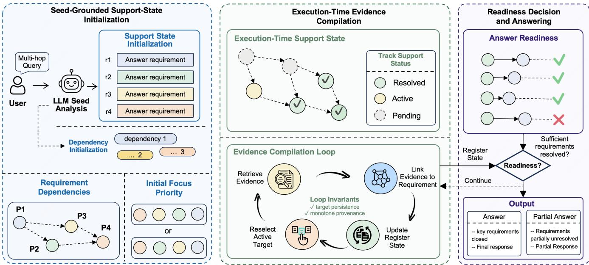
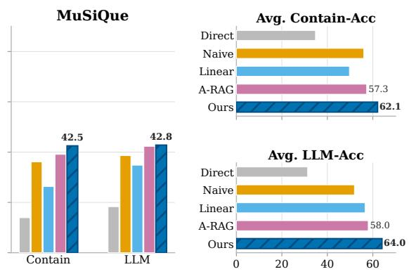
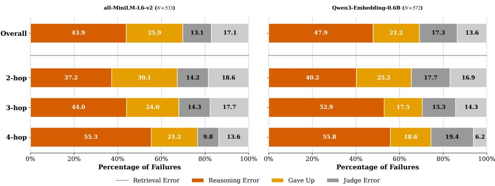
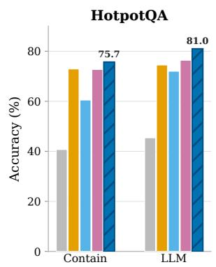
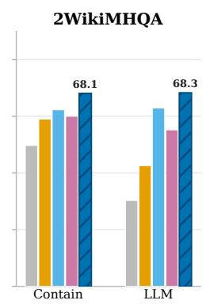
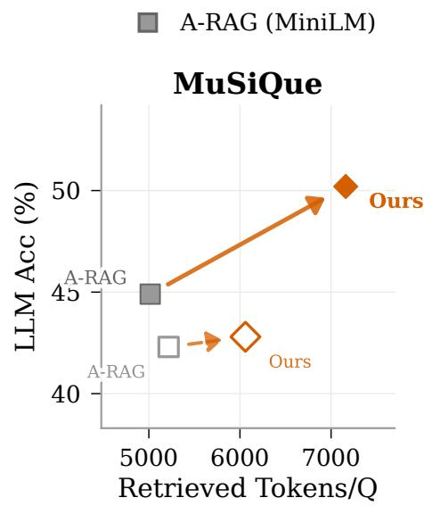
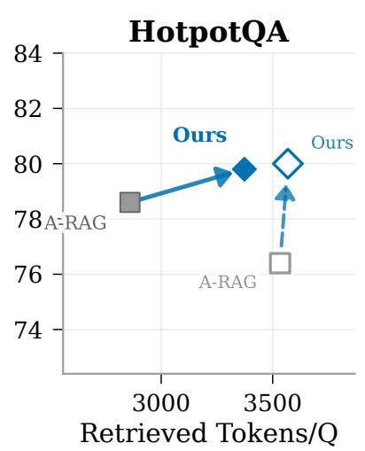
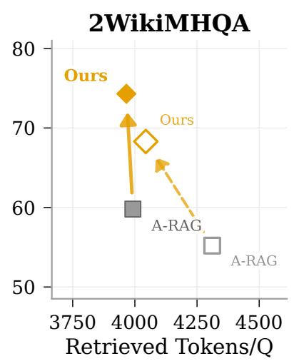
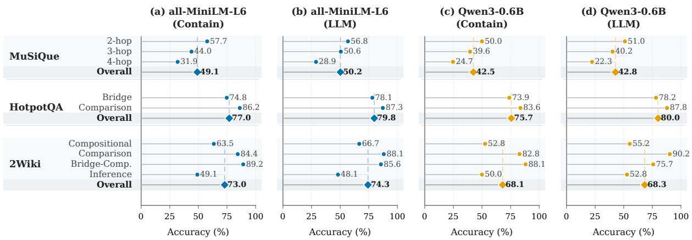
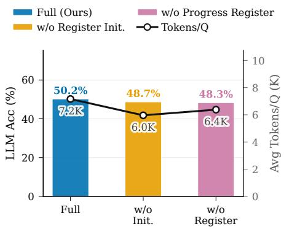

# Beyond Retrieval Failure: Understanding Why LLMs Miss Evidence in Multi-Hop RAG

Jiaqi Wei∗   
Zhejiang University   
Hangzhou, China   
Shanghai AI Laboratory   
Shanghai, China   
jiaqi.wei@zju.edu.cn   
Wenxuan Huang∗   
Fudan University   
Shanghai, China   
winshion0819@gmail.com   
Chengdong Xu   
Sun Yat-sen University   
Guangzhou, China   
codepoet2077@gmail.com

Xiang Zhang University of British Columbia Vancouver, Canada xzhang23@ualberta.ca

## Abstract

Multi-hop retrieval-augmented generation (RAG) requires an agent to retrieve evidence for a sequence of dependent sub-questions. When a wrong answer lacks a required passage, the passage may be inaccessible to the retriever, or the agent may have failed to issue a query that would retrieve it. Standard retrieval evaluations conflate these two causes. We study how much apparent retrieval failure is instead caused by search drift: the search no longer tracks an unanswered sub-question. Holding the retriever, corpus, and generation model fixed, we introduce ExecutionRAG, a training- free requirement register that records open sub-questions and their supporting evidence. The register changes search guidance but not evidence access, so each gold passage it recovers certifies that the passage was reachable by the original retriever. On 1,000 MuSiQue questions, the number of wrong answers with unretrieved required evidence falls from 382 to 234 with all-MiniLM-L6-v2 and from 383 to 274 with Qwen3-Embedding-0.6B. These counts correspond to 69% to 44% and 66% to 48% of each system’s wrong answers, respec- tively. Crucially, evidence recovery does not produce a proportional reduction in total error: premature resolutions and abstentions in crease as missing-evidence failures decrease. The central finding is therefore a shift in the remaining bottleneck, from guiding search toward required evidence to verifying that the retrieved evidence is suficient.

## CCS Concepts

• Information systems → Retrieval models and ranking; Question answering; • Computing methodologies → Natural language processing.

## Keywords

Retrieval-augmented generation, multi-hop question answering, agentic retrieval, search drift, failure analysis

ACM Reference Format: Jiaqi Wei, Wenxuan Huang, Chengdong Xu, Xiang Zhang, and Wanli Ouyang. 2026. Beyond Retrieval Failure: Understanding Why LLMs Miss

Wanli Ouyang The Chinese University of Hong Kong Hong Kong SAR, China wlouyang@ie.cuhk.edu.hk

Evidence in Multi-Hop RAG. In The Eighth International Conference on Distributed Artificial Intelligence (DAI ’26), November 29–December 2, 2026, Hong Kong, China. ACM, New York, NY, USA, 17 pages.

## 1 Introduction

Retrieval-augmented generation (RAG) [7, 20] grounds languagemodel answers in retrieved evidence. This is especially important for multi-hop questions, whose answers depend on several doc- uments. Consider the question “Who married the publisher of the abolitionist newspaper The North Star?” Answering it requires two linked facts: Frederick Douglass published The North Star, and Helen Pitts Douglass was his wife. A retrieval-augmented agent may search for “The North Star, publisher, married,” anchor on William Cooper Nell, who wrote for rather than published the paper, and spend the remaining budget on Nell’s marriage. Both required facts remain in the corpus. The failure is not evidence access; it is the loss of the intermediate entity that should guide the next query.

Most work on complex RAG focuses on evidence access. Methods organize a corpus into graphs or hierarchies to make passages easier to retrieve [6, 8, 31], while agentic methods determine what to retrieve next. These approaches do not address the example above when the retriever can already return the needed passage but the search no longer represents the intermediate target. On MuSiQue, maintaining the unresolved sub-questions across steps, without changing the retriever or corpus, reduces the share of wrong answers that lack a required passage from 382 to 234 cases under one retriever and from 383 to 274 under another. This result motivates a diferent question: how much apparent retrieval failure can be reduced by improving search guidance without changing retriever coverage?

We call this failure search drift. During a multi-hop search, the agent may discard an unanswered sub-question, anchor on the wrong intermediate entity, or keep querying for facts it has already found [18, 19, 30]. Search drift appears as a retrieval symptom because a required passage is absent from the trace, even though it is present in the corpus. It is also the dominant failure category for a strong agentic baseline on MuSiQue: 66–69% of wrong answers omit at least one required passage, and this share increases from 62% at two hops to 81% at four hops.

ExecutionRAG implements this measurement with an explicit requirement register. The register is a list of the question’s unre-solved sub-questions, initialized from the question and seed evi- dence rather than from the question alone. Each entry records its state and the passages that support it. Open entries guide subse-quent search; an entry is retired only when later evidence contra- dicts it; and the agent answers only after no entry remains open. The language model still decides whether evidence resolves an en try. Two deterministic rules preserve the record by preventing open entries from silently disappearing and by retaining all previously recorded evidence.

The main result is not simply that the register improves accuracy, but that it reveals what happens after more evidence is recovered. Missing-evidence failures decrease because the agent continues to search for unresolved entries, yet premature resolutions and abstentions increase, so total error falls by a much smaller amount. Because each resolution is explicit, we can compare it with gold supporting evidence and identify cases in which the agent answers before the evidence is suficient. The register therefore exposes a transition from a search guidance problem to an evidence verifica- tion problem.

## In summary, this paper makes the following contributions:

• We distinguish two causes of missing required evidence: evidence that the fixed retriever cannot reach and evidence that the search never requests. This distinction turns evidence recovery under fixed retrieval into a diagnostic of search drift.

• We show a substantial controlled reduction in missing-evidence failures. On MuSiQue, the count decreases from 382 to 234 with all-MiniLM-L6-v2 and from 383 to 274 with Qwen3-Embedding-0.6B. However, premature resolutions and abstentions increase, making evidence verification the principal remaining bottleneck.

• We introduce ExecutionRAG, a training-free requirement register that provides the controlled intervention. It tracks unresolved sub-questions and their supporting passages while leaving the retriever, corpus, and generation-model parameters unchanged.

## 2 Problem Setup: What “Retrieval Failure” Hides

Given a query � and a corpus K, conventional RAG retrieves context C and generates an answer in one shot, $C = R ( q ; { \mathcal { K } } )$ and $a \ =$ �(�, C), treating the retrieved passages as a single context. For a multi-hop question, the challenge is not only whether the right passages are retrieved, but also whether the agent retains which sub-questions are resolved and which remain open as the search proceeds.

## 2.1 Two Causes Inside One Symptom

Multi-hop benchmarks let us say precisely what went wrong. For a question �, let $P ^ { \star } ( q )$ be its gold supporting passages: the minimal evidence a correct answer needs. We call a wrong answer an apparent retrieval failure when some $p \in P ^ { \star } ( q )$ was never retrieved. Read literally, the name blames the retriever. But with � and K held fixed, the event splits into two disjoint causes: unreachable, no query the agent could have issued would have made � return $\mathbf { \nabla } \phi ;$ and unasked, some query would have returned ${ \boldsymbol { p } } ,$ but the agent never issued it. Only the first is a retrieval problem; the second is search drift, where the evidence was within reach the whole time and the search stopped asking for it. The two are indistinguishable in a trace, because both end with the same observable, namely a missing passage. The category is therefore routinely attributed to the retriever.

## 2.2 What a Fixed Retriever Identifies

The unasked share is not directly observable: deciding that no query would have worked means quantifying over a query space we cannot enumerate. One direction, however, is decidable. If an intervention leaves � and K untouched and the needed passage is nonetheless retrieved, then a query returning it existed, so that fail- ure was unasked. Recovering evidence certifies reachability; failing to recover it proves nothing. Holding the retriever fixed is therefore necessary for the inference.

This argument identifies reachability at the level of an individual recovered passage. At the aggregate level, however, a reduction in the frequency of missing-evidence failures does not by itself identify which baseline failures were converted, because the two systems can fail on diferent questions. We therefore use the con- trolled reduction as evidence of a recoverable component of appar- ent retrieval failure, not as a numerical lower bound on the total prevalence of search drift. The minimal intervention keeps this interpretation specific to search guidance without claiming that every remaining missing passage is unreachable.

## 2.3 The Probe: An Explicit Requirement Register

We therefore need an intervention that keeps the open sub- questions in view while changing nothing about retrieval: an explicit requirement register, in efect a checklist the agent must clear before it answers. For a query �, let $\mathcal { D } ( q ) = \{ d _ { 1 } , \hdots , d _ { m } \}$ be the question’s answer requirements, namely the sub-questions the answer must satisfy (e.g., “who is the publisher” and “who did that person marry”). At step � the register records, for each item, its status $z _ { i } ^ { ( t ) }$ , a short evidence note $e _ { i } ^ { ( t ) }$ , and the passages $P _ { i } ^ { ( t ) }$ that support it:

$$
S _ { t } = \{ ( d _ { i } , z _ { i } ^ { ( t ) } , e _ { i } ^ { ( t ) } , P _ { i } ^ { ( t ) } ) \} _ { i = 1 } ^ { m } .\tag{1}
$$

It says, at a glance, what is answered and what is still open, and it tells the agent what to search for next: an item that is still open, rather than repeatedly searching from � alone. Because $P _ { i } ^ { ( t ) }$ names the passage the agent believed settled $d _ { i } ,$ it can be checked against $P ^ { \star } ( q )$ afterwards, which is what turns the register from a control structure into an instrument (Section 4.3).

## 3 Method

ExecutionRAG is deliberately the smallest intervention that satis- fies Section 2.2: it changes what the agent searches for, and nothing about how retrieval works. The retriever, the corpus, the tool inter- face, and the generator are untouched, so any evidence it recovers was evidence the same retriever could already reach.

## 3.1 What the Register Records

ExecutionRAG maintains one entry per item, holding its status, a short evidence note, and the passages that support it. Each item’s

  
Figure 1: Overview of ExecutionRAG. The agent keeps a requirement register of the question’s open sub-questions and works through it in three stages: (1) build the register from the question and an initial (seed) retrieval, so its items are grounded in evidence the corpus can actually return; (2) at each step, select an open item, retrieve evidence, and update the register. The agent marks an item answered when a passage supports it and records that passage, or drops the item if later evidence contradicts $\mathbf { i t } ;$ and (3) answer only once no item is still open, or return a bounded partial answer when the search budget runs out.

status takes one of four values:

$$
z _ { i } ^ { ( t ) } \in \{ \mathsf { p e n d i n g } , \mathsf { a c t i v e } , \mathsf { r e s o l v e d } , \mathsf { r e t i r e d } \} .\tag{2}
$$

pending means the item has been identified but is not the current search target; active is the item currently guiding the search; resolved means enough evidence has been found to answer it; and retired means it has been dropped, and only with an explicit reason.

We keep the status set deliberately small. Partial progress lives in the evidence note $e _ { i } ^ { ( t ) }$ and the supporting passages $\hat { P } _ { i } ^ { ( t ) }$ , not in extra labels, so an item stays open until its evidence is actually enough. The status says whether an item is answered; the note and passages say how. The four values are also what make the agent’s judgment legible: the step from active to resolved is the moment it declares an item settled. Recording this decision as an event, rather than leaving it implicit in free-form reasoning, allows us to compare it with gold evidence and determine whether it was premature.

## 3.2 Building the Register from Seed Evidence

The register should not be written from the question alone. Splitting a question in the abstract tends to produce items that are vague, redundant, or ask for things the corpus cannot answer. So Execu- tionRAG first runs one seed retrieval and builds the register from what comes back:

$$
C ^ { ( 0 ) } = R _ { \mathrm { s e e d } } ( q ; \mathcal { K } ) .\tag{3}
$$

The model reads $( q , C ^ { ( 0 ) } )$ and writes the initial register ${ \cal { S } } _ { 0 } ,$ so its items are shaped by the question but grounded in evidence the

corpus can actually return. One item is set active as the first search target and the rest start pending, with empty notes:

$$
\begin{array} { c c c } { { z _ { b _ { 0 } } ^ { ( 0 ) } = \mathsf { a c t i v e } , } } & { { z _ { i } ^ { ( 0 ) } = \mathsf { p e n d i n g } ( i \neq b _ { 0 } ) , } } \\ { { \displaystyle e _ { i } ^ { ( 0 ) } = \emptyset , } } & { { P _ { i } ^ { ( 0 ) } = \emptyset . } } \end{array}\tag{4}
$$

This gives the agent one concrete thing to search for while keeping the other sub-questions on the list for later.

## 3.3 Updating the Register and Steering the Search

Starting from ${ \cal { S } } _ { 0 } ,$ ExecutionRAG repeats a simple loop: pick an open item, search for it, and update that item.

Searching for one open item. At step �, ExecutionRAG picks an open item $b _ { t }$ from $S _ { t - 1 }$ and builds a query for it:

$$
u _ { t } = \mathrm { C o M P O S E } ( q , d _ { b _ { t } } , e _ { b _ { t } } ^ { ( t - 1 ) } ) .\tag{5}
$$

The original question � keeps the overall goal in view, $d _ { b _ { t } }$ says which item is being chased, and the note $e _ { b _ { t } } ^ { ( t - 1 ) }$ points the search at what is still missing for that item. The retriever returns new evidence $\Delta C _ { t } ;$ repeated identical queries are cached so the agent does not loop.

Updating only the items it touches. Given $\Delta C _ { t }$ , the register is updated as

$$
S _ { t } = U ( S _ { t - 1 } , \Delta C _ { t } ) .\tag{6}
$$

The update rewrites the notes for the items the new evidence bears on, adds the supporting passages, and moves an item to resolved only when there is enough support, or to retired only with an explicit reason. Items the new evidence does not touch are left unchanged. In efect, each retrieval is turned into progress on one open item, rather than piling up more unsorted context.

## 3.4 When to Answer, and Two Bookkeeping Rules

Answering only when the register is clear. After each update, Exe-cutionRAG checks whether any item is still open. If none is, it writes the final answer from the register and its supporting passages; otherwise it keeps searching for the items that remain open. If the search budget runs out first, it returns a bounded partial answer that says plainly which items are still unsupported.

Showing only what changed. To keep the context short, ExecutionRAG does not replay the whole register after every step. It shows the agent only a progress delta: the items whose status or note changed from $S _ { t - 1 }$ to $S _ { t }$ . This keeps the signal the agent needs for its next move without re-reading the full list each time.

Two rules that run outside the model. Because the register is updated by multiple LLM calls, ExecutionRAG enforces two deterministic rules to preserve its state. First, an open item can leave the list only through an explicit transition to retired:

$$
\mathrm { R e q } ( S _ { t } ) \supseteq \mathrm { R e q } ( S _ { t - 1 } ) \setminus \{ d _ { k } \ | \ z _ { k } ^ { ( t ) } = \mathsf { r e t i r e d } \} .\tag{7}
$$

Second, supporting evidence is appended rather than overwritten:

$$
P _ { i } ^ { ( t ) } = P _ { i } ^ { ( t - 1 ) } \cup \Delta P _ { i } ^ { ( t ) } .\tag{8}
$$

A later update may revise an item’s note, but it cannot erase the record of passages that previously supported it. These rules preserve the requirements and their evidence trail; they do not guarantee that the language model resolves an item correctly. Keeping this decision explicit allows us to evaluate it against gold evidence (Section 4.3).

## 4 Experiments

## 4.1 Experimental Questions

Section 2.2 defines the controlled comparison: holding the retriever and corpus fixed, we measure how much the frequency of missing- evidence failures changes when only search guidance is modified. The experiments first quantify this reduction and then examine whether recovering evidence reduces total error or reveals a difer- ent bottleneck. The framing also makes predictions that could fail. If the recovered evidence were an artifact of the register writing longer answers that favor the judge, it would not improve recall of gold evidence or the objective substring metric. If the register keeps search on target without making the generator a better verifier, the failures left behind should move from “never retrieved the evidence” toward answering too early or abstaining. And if the efect were really about reading more text, it should vanish where the register reads no more than the baseline.

Accordingly, we ask:

• RQ1: Under a fixed retriever, how much does search guidance reduce failures caused by missing evidence?

• RQ2: How does the failure distribution change after more re-quired evidence is recovered?

• RQ3: Does the reduction persist with a diferent embedding model?

• RQ4: Does the recovered evidence improve answer accuracy, particularly when sub-questions must be combined across doc- uments?

• RQ5: Is the gain explained by retrieving more context?

• RQ6: Do seed grounding and iterative updates both contribute to the result?

## 4.2 Experimental Setup

Datasets. We evaluate on three standard multi-hop QA benchmarks: HotpotQA [47], MuSiQue [34], and 2WikiMultiHopQA (2Wiki) [14]. Following HippoRAG, we use the same retrieval corpora and sample 1,000 questions from each validation set as test queries.

Baselines. We compare against three groups of baselines: (1) Direct inference: GPT-4o-mini without retrieval; (2) Vanilla RAG: top-� retrieval with � ∈ {3, 5, 10}, CoT-augmented retrieval, and IR-CoT [35]; (3) Structured and agentic RAG: KGP [36], G-Retriever [13], RAPTOR [32], LightRAG [9], HippoRAG and HippoRAG 2 [10, 11], GFM-RAG [27], LinearRAG [54], LAG [43], and A-RAG [5]. This comparison spans direct answering, flat retrieval, corpus structuring, and iterative retrieval control.

Metrics. Following LinearRAG [54], we report Contain-Match Accuracy, which checks whether the gold answer appears as a substring of the prediction, and LLM-Evaluation Accuracy, which uses an LLM judge to assess semantic equivalence.

Implementation details. Unless otherwise specified, all methods use GPT-4o-mini as the generation model. For the main comparison, we use all-MiniLM-L6-v2 with top-� = 5 retrieval, and additionally evaluate Qwen3-Embedding-0.6B as an alternative embedding backbone. All main results use the full 1,000-question evaluation sets. The ablation study is conducted on the full 1,000-question MuSiQue evaluation set. Additional implementation details are provided in Appendix B.

## 4.3 RQ1: Reduction in Failures Caused by Missing Evidence

We measure the controlled reduction described in Section 2.2 by assigning each wrong answer on MuSiQue a single cause using the gold supporting paragraphs. The full counts and percentages for both retrievers appear in Appendix E.

How we label a failure. Each wrong answer receives exactly one cause, assigned by a fixed priority order so the categories cannot overlap: judge error (the substring metric counts the answer as right but the judge does not), gave up (the answer explicitly abstains), reasoning error (every supporting passage was retrieved and the answer is still wrong, or, for ExecutionRAG, an item was resolved while supporting evidence was still missing), and missing evidence (a supporting passage was never retrieved and no premature resolution occurred). What makes this labelling possible at all is that

MuSiQue ships, for each question, the supporting paragraphs a correct answer minimally needs: we match each supporting para-graph to its corpus chunk by a 40-character fingerprint (87.9% of paragraphs match) and ask whether the search ever retrieved it. Because the two methods fail on diferent numbers of questions, every share below is a percentage of that method’s own failures.

The largest change is a reduction in failures caused by missing evidence: wrong answers for which a required passage was never retrieved. With all-MiniLM-L6-v2, the count decreases from 382 for A-RAG to 234 for ExecutionRAG; these values represent 69.3% of 551 baseline failures and 43.9% of 533 ExecutionRAG failures. With Qwen3-Embedding-0.6B, the count decreases from 383 to 274, or from 66.4% of 577 failures to 47.9% of 572 failures. The same retriever is used within each comparison, so the reductions show that search guidance can recover a substantial portion of evidence that the baseline search did not retrieve. They do not imply that every residual missing passage is unreachable (Figure 2).

Recovering this evidence does not reduce total error proportionally. Reasoning errors after retrieval increase from 9% to 26% with MiniLM and from 8% to 21% with Qwen; these errors include cases in which the register is resolved before its evidence is suficient. Abstentions also increase, from 7% to 13% and from 12% to 17%, respectively. Against A-RAG, LLM-Evaluation Accuracy on MuSi-Que rises from 44.9 to 50.2, a smaller change than the reduction in missing-evidence failures. This redistribution is the central result: once search guidance recovers more required evidence, evidence verification and answer commitment become the dominant sources of the remaining error.

## 4.4 RQ2: Evidence Recovery Shifts the Remaining Failures

Why reasoning errors become more visible. Part of this increase reflects observability rather than a change in the model’s reasoning alone. A premature resolution is an explicit register event and can therefore be assigned to reasoning error. A-RAG has no analogous event; when it answers from incomplete evidence, the error is gen erally assigned to the missing passage instead. The comparison may thus undercount premature answers by the baseline. The register exposes this decision for evaluation; it does not establish that the generation model reasons worse.

The register guides search but does not provide a reliable evi- dence verifier: the language model still decides whether a require- ment has been resolved, and this decision can be incorrect. It also cannot make genuinely dificult passages retrievable. Residual fail- ures caused by missing evidence for ExecutionRAG remain highest on four-hop questions, which contain longer and more weakly con- nected evidence chains. In this setting, the remaining bottlenecks are verifying retrieved evidence and retrieving evidence for long chains.

## 4.5 RQ3: The Reduction Persists Across Embedding Models

Figure 3 tests whether the performance pattern depends on the embedding model. After replacing all-MiniLM-L6-v2 with Qwen3- Embedding-0.6B, ExecutionRAG outperforms A-RAG on all three benchmarks: 80.0, 68.3, and 42.8 LLM-Evaluation Accuracy on HotpotQA, 2Wiki, and MuSiQue, respectively, compared with 76.4, 55.2, and 42.3 for A-RAG. The largest gain remains on 2Wiki (+13.1), while MuSiQue shows a smaller positive gain (+0.5). The positive diference across all three benchmarks shows that the efect is not specific to one embedding model. The larger gain on 2Wiki is also consistent with the proposed mechanism because its questions re-quire dependent sub-questions to be maintained across multiple retrieval steps.

## 4.6 RQ4: Answer Accuracy

Table 1 reports the main comparison. We first consider Contain-Match Accuracy because it does not rely on an LLM judge. On MuSiQue, ExecutionRAG reaches 49.1, a 6.3-point improvement over LAG (42.8). On 2Wiki, it reaches 73.0, a 1.1-point improvement over LAG (71.9). On HotpotQA, it reaches 77.0, which is essentially tied with A-RAG (77.3). LLM-Evaluation Accuracy follows the same pattern and is highest for ExecutionRAG on all three benchmarks: 79.8, 74.3, and 50.2 on HotpotQA, 2Wiki, and MuSiQue, respectively.

The diferences are consistent with the proposed mechanism. The register has little efect on HotpotQA, whose questions are mostly two-hop and are often answerable from a single comparison. It improves performance on 2Wiki and MuSiQue, where the agent must maintain several dependent sub-questions across documents.

A-RAG is the matched baseline for the failure analysis. It uses the same generation model, retrieval tools, and corpora as Execu- tionRAG; the requirement register is the added component. The diference between A-RAG and ExecutionRAG in Sections 4.3–4.5 therefore cannot be attributed to a diferent retriever or generation backbone. The register adds bookkeeping calls, but these calls alone do not explain the gain: on 2Wiki, the largest improvement occurs with comparable or fewer retrieved tokens (Section 4.7).

Where the gains concentrate. Figure 5 in Appendix C reports category-level results. Under both embedding models, questions with longer or less direct evidence chains remain more dificult. The register helps most when required evidence is retrievable but must be tracked across several steps. On MuSiQue, accuracy decreases with hop count. On HotpotQA, Comparison questions are easier than Bridge questions; on 2Wiki, Inference questions are hardest and Comparison questions are easiest. The register improves overall accuracy but does not remove the dificulty of long evidence chains.

## 4.7 RQ5: Retrieved Context and Accuracy

Figure 4 and Table 2 test whether the gains can be explained by retrieving more context. On MuSiQue and HotpotQA, Execution-RAG reads more tokens than A-RAG because it builds and updates the register. On 2Wiki, however, it uses comparable or fewer retrieved tokens while obtaining its largest accuracy improvement. Within ExecutionRAG, removing register components reduces both token use and accuracy. The result is consistent with the register improving the targeting of retrieval rather than simply increasing the amount of retrieved context.

What the register costs. The register increases the cost of some searches. On MuSiQue, it reads 7,161 retrieved tokens per question, compared with 5,015 for A-RAG; on HotpotQA, it reads 3,373 com-pared with 2,860. On 2Wiki, token use is comparable at 3,966 and 3,992, respectively. The corresponding API costs are \$0.0064 versus \$0.0034 on MuSiQue and \$0.0039 versus \$0.0027 on 2Wiki. Search is limited to fifteen retrieval loops and a cumulative context of 128,000 tokens. The agent answers when no requirement remains open, so the register shortens some trajectories and lengthens others; the case studies in Appendix F complete in two and six loops, whereas A-RAG uses five and thirteen. Appendix D provides the complete breakdown.

  
Figure 2: Failure distribution on MuSiQue, by failure type and hop count. The share of failures that never retrieve a required passage decreases after adding the register, while reasoning errors after retrieval and abstentions increase. For ExecutionRAG, failures caused by missing evidence remain most common at four hops.  
Direct Answer Naive RAG LinearRAG A-RAG Ours

  
Figure 3: Performance under Qwen3-Embedding-0.6B. Left: per-benchmark Contain-Match and LLM-Evaluation Accuracy. Right: average accuracy across benchmarks.

## 4.8 RQ6: Efects of Seed Grounding and Iterative Updates

Table 2 isolates the contributions of the register’s components. Building the register from the question alone rather than from seed evidence lowers LLM-Acc from 50.2 to 48.7, indicating that grounding requirements in retrievable evidence is beneficial. Removing iterative updates and constructing the register only once lowers LLM-Acc further to 48.3. Both seed grounding and iterative updates contribute to the observed gain.

## 5 Related Work

Corpus structure for RAG. A major line of work improves multihop QA by structuring corpus knowledge to improve evidence access. GraphRAG [6] builds entity-relation graphs with community summaries; RAPTOR [31] organizes documents into hierarchical retrieval trees; LightRAG [8] combines graph-augmented indexing with eficient retrieval; HippoRAG and HippoRAG 2 [12, 17] use graph-based retrieval with Personalized PageRank; and LinearRAG [54], GFM-RAG [27], and StructRAG [26] further explore graph construction, graph foundation models, and hybrid struc- turization. These methods improve how dispersed evidence is rep- resented and retrieved before answering. ExecutionRAG is com-plementary: it does not restructure the corpus, but maintains an explicit register of unresolved sub-questions during search.

Table 1: Main results on three multi-hop QA benchmarks. Bold marks the best Contain-Match result per benchmark; the grey columns report LLM-Evaluation Accuracy for comparability with prior work. These answer-level metrics complement the primary failure analysis by showing whether recovered evidence improves the final prediction. The lower block is the matched comparison our attribution rests on: A-RAG shares ExecutionRAG’s generator, tools, and corpora, so it is ExecutionRAG without the register. Gains concentrate where sub-questions must be combined across documents; HotpotQA is a tie.
<table><tr><td rowspan="2">Method</td><td colspan="3">Contain-Match</td><td colspan="3">LLM-Evaluation</td></tr><tr><td>Hotpot</td><td>2Wiki</td><td>MuSiQue</td><td>Hotpot</td><td>2Wiki</td><td>MuSiQue</td></tr><tr><td colspan="7">Direct Zero-shot LLM Inference</td></tr><tr><td>GPT-40-mini [28]</td><td>30.4</td><td>29.0</td><td>7.8</td><td>34.2</td><td>28.6</td><td>10.1</td></tr><tr><td colspan="7">Vanilla Retrieval-Augmented Generation</td></tr><tr><td>Retrieval (Top-3)</td><td>52.1</td><td>45.1</td><td>23.4</td><td>55.1</td><td>43.1</td><td>27.1</td></tr><tr><td>Retrieval (Top-5)</td><td>54.6</td><td>46.6</td><td>25.6</td><td>56.8</td><td>45.3</td><td>29.0</td></tr><tr><td>Retrieval (Top-10)</td><td>56.0</td><td>48.7</td><td>26.7</td><td>58.6</td><td>45.8</td><td>31.2</td></tr><tr><td>CoT (Top-5) [38]</td><td>55.1</td><td>48.7</td><td>27.1</td><td>57.1</td><td>45.9</td><td>30.7</td></tr><tr><td>IRCoT (Top-5) [35]</td><td>58.4</td><td>53.0</td><td>22.6</td><td>59.6</td><td>36.8</td><td>26.1</td></tr><tr><td colspan="7">Graph and Agentic Retrieval-Augmented Generation</td></tr><tr><td>KGP [36]</td><td>56.2</td><td>52.2</td><td>30.5</td><td>57.1</td><td>33.9</td><td>27.3</td></tr><tr><td>G-retriever [13]</td><td>41.3</td><td>47.8</td><td>14.1</td><td>40.9</td><td>25.7</td><td>15.6</td></tr><tr><td>RAPTOR [32]</td><td>58.1</td><td>60.6</td><td>32.2</td><td>55.3</td><td>43.9</td><td>29.7</td></tr><tr><td>LightRAG [9]</td><td>61.5</td><td>54.4</td><td>27.7</td><td>60.5</td><td>38.0</td><td>28.3</td></tr><tr><td>HippoRAG (single-step) [10]</td><td>55.2</td><td>63.7</td><td>31.4</td><td>57.9</td><td>57.5</td><td>30.1</td></tr><tr><td>HippoRAG (multi-step) [10]</td><td>61.1</td><td>66.4</td><td>34.0</td><td>63.6</td><td>62.4</td><td>31.8</td></tr><tr><td>GFM-RAG (single-step) [27]</td><td>61.4</td><td>66.2</td><td>29.3</td><td>64.8</td><td>61.1</td><td>32.6</td></tr><tr><td>GFM-RAG (multi-step) [27]</td><td>63.4</td><td>69.5</td><td>31.5</td><td>65.5</td><td>63.2</td><td>35.5</td></tr><tr><td>HippoRAG 2 [11]</td><td>61.2</td><td>62.0</td><td>34.5</td><td>64.3</td><td>58.8</td><td>35.6</td></tr><tr><td>LinearRAG [54]</td><td>64.2</td><td>69.5</td><td>32.8</td><td>64.9</td><td>62.6</td><td>36.9</td></tr><tr><td>LAG [43]</td><td>68.5</td><td>71.9</td><td>42.8</td><td>69.7</td><td>64.0</td><td>44.3</td></tr><tr><td colspan="7">Matched condition: same generator, retrieval tools, and corpora</td></tr><tr><td>A-RAG [5] (= ours w/o register)</td><td>77.3</td><td>66.7</td><td>42.0</td><td>78.6</td><td>59.8</td><td>44.9</td></tr><tr><td>ExecutionRAG (Ours)</td><td>77.0</td><td>73.0</td><td>49.1</td><td>79.8</td><td>74.3</td><td>50.2</td></tr><tr><td>∆ vs. matched</td><td>-0.3</td><td>+6.3</td><td>+7.1</td><td>+1.2</td><td>+14.5</td><td>+5.3</td></tr></table>

Table 2: Ablation study on MuSiQue. LLM-Evaluation and Contain-Match Accuracy, under the default setup.
<table><tr><td>Method</td><td>LLM-Acc</td><td>Contain-Acc</td></tr><tr><td>ExecutionRAG</td><td>50.2</td><td>49.1</td></tr><tr><td>w/o Register Init.</td><td>48.7</td><td>46.2</td></tr><tr><td>w/o Progress Register</td><td>48.3</td><td>48.5</td></tr></table>

Iterative and agentic RAG. A related line of work improves retrieval control during inference. IRCoT [35] and FLARE [15] interleave reasoning with retrieval; Self-RAG [1] uses reflection tokens to critique retrieved passages; and recent agentic methods expose richer retrieval policies through tool use, query reformulation, and multi-step search. A-RAG [5] replaces fixed pipelines with model-driven hierarchical retrieval interfaces, while LAG [43] and LogicRAG [4] decompose questions into subproblems, infer dependencies, and sequence retrieval accordingly. This view is also related to work that formulates language-model inference as search [40], analyzes how chain-of-thought prompting interacts with the answer space [51], learns when a model should disclose its reasoning [37], learns execution-time workflows for multi-agent systems [44], or scales multi-agent processing over many documents at test time [3]. These methods mainly optimize retrieval control: what to retrieve next and in what order. ExecutionRAG does not introduce a new retrieval policy. Instead, it maintains an explicit register of unresolved sub-questions that guides subsequent search and determines when the agent can answer. Even with adap- tive retrieval, an agent can discard an unresolved sub-question, overwrite earlier progress, or answer from partial evidence. The register preserves these requirements throughout the search. It is also narrower than agent-memory work that retrieves over a per- sistent episodic record of an agent’s past decisions [45]: the register tracks the open requirements of the current question only, and is discarded once the answer is given.

Long executions outside question answering. The same pressure to keep intermediate state explicit appears in domains where an agent must execute a long chain before it can commit to an answer. Multiagent drafting protocols compress intermediate reasoning [22], and retrieval-augmented multi-agent pipelines are built for tasks whose verdict depends on evidence gathered in several steps [23]. Software-engineering agents are trained against execution feedback and process-level reward precisely because their trajectories are too long to supervise end to end [24, 25, 33]. There too the dificulty is less the first attempt than checking what the agent has actually done. The register is the minimal instance of that bookkeeping for retrieval: it records the requirements a trajectory still owes, and nothing else.

  
Figure 4: Accuracy–eficiency trade-of. Pareto frontiers of LLM-Evaluation Accuracy vs. retrieved tokens per question for ExecutionRAG and A-RAG under two embedding backbones. Bottom row: ablation variants; bars show LLM-Acc and the line shows average retrieved tokens per question.

Suficiency signals, reading notes, and failure analysis. Several methods track information gaps or judge evidence suficiency during RAG. Self-RAG [1] critiques passages with reflection tokens [50]. Related work adds corrective retrieval (CRAG [46]), sequential read ing notes (Chain-of-Note [49]), and structured missing-information items with suficiency checks (S2G-RAG [21], SURE-RAG [29]). Test-time critique and optimization provide another mechanism for improving retrieved evidence and generated answers [41]. Other methods diagnose or repair agent trajectories after the fact, such as Doctor-RAG [16]. The requirement register is an explicit list of sub-questions with states and evidence provenance. Our contribution is empirical: by holding the retriever and generator fixed, we measure how such a register changes the multi-hop failure distri- bution. It reduces failures caused by missing evidence under a fixed retriever and shifts residual errors toward reasoning after retrieval, a distinction that prior end-to-end evaluations do not isolate.

Naming the two causes behind one symptom. Skill-RAG [42] makes the closest claim to Section 2.1 we know of: retrieval fail- ures “stem not from the absence of relevant evidence but from an alignment gap between the query and the evidence space,” with an exit route for cases it calls truly irreducible. This distinguishes unreachable and unasked causes conceptually and routes learned repair skills accordingly. It does not define the failure event using gold evidence or quantify either share. We instead treat the distinction as the measurement target. Outside retrieval, Binding Drift [2] separates drift from error propagation using disjoint evaluation sets. We apply the same separation to a missing passage by asking whether the search could have retrieved it.

Implications. The results distinguish two directions for future work. Because the recovered evidence was reachable by the same retriever, increasing index coverage, improving embeddings, or ex-panding queries does not address the observed failures associated with inadequate search guidance. Those failures require a mech-anism that preserves unresolved sub-questions. Conversely, the increase in premature resolution identifies evidence verification as a separate target. The register makes the resolution decision explicit, which enables a verifier to be trained or evaluated against it. Residual failures caused by missing evidence concentrate on long, weakly connected chains, where improving retrieval coverage remains necessary. These predictions are testable: a verifier should improve answer accuracy without changing retrieved evidence, whereas an intervention that improves only coverage should not eliminate failures caused by unasked queries.

## 6 Conclusion

We study how much apparent retrieval failure in multi-hop RAG can be reduced by search guidance while the retriever remains fixed. On MuSiQue, the requirement register reduces wrong answers with unretrieved required evidence from 382 to 234 cases under one retriever and from 383 to 274 under another. This recovery does not translate proportionally into answer accuracy: premature resolutions and abstentions increase as missing-evidence failures decrease. The result separates two bottlenecks that aggregate ac- curacy obscures. Maintaining unresolved requirements helps the agent retrieve reachable evidence, but converting that evidence into correct answers requires more reliable verification after retrieval.

## Acknowledgments

Supported by Shanghai Artificial Intelligence Laboratory.

## References

[1] Akari Asai, Zeqiu Wu, Yizhong Wang, Avirup Sil, and Hannaneh Hajishirzi. 2023. Self-RAG: Learning to Retrieve, Generate, and Critique through Self-Reflection. arXiv:2310.11511 [cs.CL] https://arxiv.org/abs/2310.11511

[2] Rahul Suresh Babu and Shashank Indukuri. 2026. Binding Drift in Multi-Step Tool Augmented Agents. arXiv:2607.18316 [cs.CL] https://arxiv.org/abs/2607.18316

[3] Juntai Cao, Xiang Zhang, Raymond Li, Jiaqi Wei, Chuyuan Li, Shafiq Joty, and Giuseppe Carenini. 2025. Multi2: Multi-agent test-time scalable framework for multi-document processing. In Proceedings ofThe 5th New Frontiers in Summarization Workshop. 135–156.

[4] Shengyuan Chen, Chuang Zhou, Zheng Yuan, Qinggang Zhang, Zeyang Cui, Hao Chen, Yilin Xiao, Jiannong Cao, and Xiao Huang. 2026. You don’t need pre-built graphs for rag: Retrieval augmented generation with adaptive reasoning structures. In Proceedings ofthe AAAI Conference on Artificial Intelligence, Vol. 40. 30270–30278.

[5] Mingxuan Du, Benfeng Xu, Chiwei Zhu, Shaohan Wang, Pengyu Wang, Xiaorui Wang, and Zhendong Mao. 2026. A-RAG: Scaling Agentic Retrieval-Augmented Generation via Hierarchical Retrieval Interfaces. arXiv preprint arXiv:2602.03442 (2026).

[6] Darren Edge, Ha Trinh, Newman Cheng, Joshua Bradley, Alex Chao, Apurva Mody, Steven Truitt, and Jonathan Larson. 2024. From local to global: A graph rag approach to query-focused summarization. arXiv preprint arXiv:2404.16130 (2024).

[7] Yunfan Gao, Yun Xiong, Xinyu Gao, Kangxiang Jia, Jinliu Pan, Yuxi Bi, Yi Dai, Jiawei Sun, and Haofen Wang. 2023. Retrieval-augmented generation for large language models: A survey. arXiv preprint arXiv:2312.10997 (2023).

[8] Zirui Guo, Lianghao Xia, Yanhua Yu, Tu Ao, and Chao Huang. 2024. LightRAG: Simple and Fast Retrieval-Augmented Generation. arXiv preprint arXiv:2410.05779 (2024).

[9] Zirui Guo, Lianghao Xia, Yanhua Yu, Tu Ao, and Chao Huang. 2025. LightRAG: Simple and Fast Retrieval-Augmented Generation. arXiv:2410.05779 [cs.IR] https: //arxiv.org/abs/2410.05779

[10] Bernal Jiménez Gutiérrez, Yiheng Shu, Yu Gu, Michihiro Yasunaga, and Yu Su. 2024. Hipporag: Neurobiologically inspired long-term memory for large language models. In The Thirty-eighth Annual Conference on Neural Information Processing Systems.

[11] Bernal Jiménez Gutiérrez, Yiheng Shu, Weijian Qi, Sizhe Zhou, and Yu Su. 2025. From RAG to Memory: Non-Parametric Continual Learning for Large Language Models. In Forty-second International Conference on Machine Learning. https: //openreview.net/forum?id=LWH8yn4HS2

[12] Bernal Jiménez Gutiérrez, Yiheng Shu, Weijian Qi, Sizhe Zhou, and Yu Su. 2025. From RAG to Memory: Non-Parametric Continual Learning for Large Language Models. In Forty-second International Conference on Machine Learning. https: //openreview.net/forum?id=LWH8yn4HS2

[13] Xiaoxin He, Yijun Tian, Yifei Sun, Nitesh Chawla, Thomas Laurent, Yann LeCun, Xavier Bresson, and Bryan Hooi. 2024. G-retriever: Retrieval-augmented gen eration for textual graph understanding and question answering. Advances in Neural Information Processing Systems 37 (2024), 132876–132907.

[14] Xanh Ho, Anh-Khoa Duong Nguyen, Saku Sugawara, and Akiko Aizawa. 2020. Constructing A Multi-hop QA Dataset for Comprehensive Evaluation of Reason in Ste s. In Proceedings ofthe 28th International Conference on Computational Linguistics, Donia Scott, Nuria Bel, and Chengqing Zong (Eds.). International Committee on Computational Linguistics, Barcelona, Spain (Online), 6609–6625. doi:10.18653/v1/2020.coling-main.580

[15] Zhengbao Jiang, Frank F Xu, Luyu Gao, Zhiqing Sun, Qian Liu, Jane Dwivedi-Yu, Yiming Yang, Jamie Callan, and Graham Neubig. 2023. Active retrieval augmented generation. In Proceedings of the 2023 Conference on Empirical Methods in Natural Language Processing.

[16] Shuguang Jiao, Chengkai Huang, Shuhan Qi, Xuan Wang, Yifan Li, Quanchi Weng, Lingchuan Liu, Xunliang Cai, and Lina Yao. 2026. Doctor-RAG: A Failure-Aware Repair Framework for Agentic Retrieval-Augmented Generation. arXiv:2604.00865 [cs.IR] https://arxiv.org/abs/2604.00865

[17] Bernal Jimenez Gutierrez, Yiheng Shu, Yu Gu, Michihiro Yasunaga, and Yu Su. 2024. Hipporag: Neurobiologically inspired long-term memory for large language models. Advances in Neural Information Processing Systems 37 (2024), 59532– 59569.

[18] Hailey Joren, Jianyi Zhang, Chun-Sung Ferng, Da-Cheng Juan, Ankur Taly, and Cyrus Rashtchian. 2024. Suficient context: A new lens on retrieval augmented generation systems. arXiv preprint arXiv:2411.06037 (2024).

[19] Evgenii Kortukov, Alexander Rubinstein, Elisa Nguyen, and Seong Joon Oh. 2024. Studying large language model behaviors under context-memory conflicts with real documents. arXiv preprint arXiv:2404.16032 (2024).

[20] Patrick Lewis, Ethan Perez, Aleksandra Piktus, Fabio Petroni, Vladimir Karpukhin, Naman Go al Heinrich Küttler Mike Lewis Wen-tau Yih Tim Rocktäschel Sebastian Riedel, and Douwe Kiela. 2020. Retrieval-augmented generation for knowledge-intensive NLP tasks. In Proceedings ofthe 34th International Conference on Neural Information Processing Systems (Vancouver, BC, Canada) (NIPS ’20). Curran Associates Inc., Red Hook, NY, USA, Article 793, 16 pages.

[21] Minghan Li, Junjie Zou, Xinxuan Lv, Chao Zhang, and Guodong Zhou. 2026. S2G-RAG: Structured Suficiency and Gap Judging for Iterative Retrieval-Augmented QA. In Proceedings ofthe 64th Annual Meeting ofthe Association for Computational Linguistics (Volume 1: Long Papers), Maria Liakata, Viviane P. Moreira, Jiajun Zhang, and David Jurgens (Eds.). Association for Computational Linguistics, San Diego, California, United States, 25846–25862. doi:10.18653/v1/2026.acl-long.1185

[22] Yuanhao Li, Mingshan Liu, Hongbo Wang, Yiding Zhang, Yifei Ma, and Wei Tan. 2026. DRAFT-RL: Multi-Agent Chain-of-Draft Reasoning for Reinforcement Learning-Enhanced LLMs. Proceedings of the AAAI Conference on Artificial Intelligence 40, 35 (2026), 29530–29537. doi:10.1609/aaai.v40i35.40195

[23] Yuanhao Li, Hongbo Wang, Xuhong Chen, and Yiming Cao. 2026. Retrieval-Augmented Multi-Agent Multimodal Framework for Fake News Detection. In ICASSP 2026. https://cmsworkshops.com/ICASSP2026/view\_paper.php? PaperNum=9709

[24] Yuanhao Li, Hongbo Wang, Xuhong Chen, Yiming Cao, and Xunzhu Tang. 2026. Counterfactual Rollout Replay: Forkable Environments as Free Process Rewards for Software Engineering Agents. arXiv:2609.33875 [cs.SE] https://arxiv.org/abs/ 2609.33875 Acce ted at NeurIPS 2026.

[25] Yuanhao Li, Hongbo Wang, Xiaotang Shang, Xunzhu Tang, Yiming Cao, and Xuhong Chen. 2026. BoostAPR: Boosting Automated Program Repair via Execution-Grounded Reinforcement Learning with Dual Reward Models. arXiv:2605.09134 [cs.AI] https://arxiv.org/abs/2605.09134 Accepted at ICML 2026.

[26] Zhuoqun Li, Xuanang Chen, Haiyang Yu, Hongyu Lin, Yaojie Lu, Qiaoyu Tang, Fei Huang, Xianpei Han, Le Sun, and Yongbin Li. 2025. StructRAG: Boosting Knowledge Intensive Reasoning of LLMs via Inference-time Hybrid Information Structurization. In The Thirteenth International Conference on Learning Representations. https://openreview.net/forum?id=GhexuBLxbO

[27] Linhao Luo, Zicheng Zhao, Gholamreza Hafari, Dinh Phung, Chen Gong, and Shirui Pan. 2025. GFM-RAG: Graph Foundation Model for Retrieval Augmented Generation. arXiv preprint arXiv:2502.01113 (2025).

[28] OpenAI. 2024. GPT-4o System Card. arXiv:2410.21276 [cs.CL] https://arxiv.org abs/2410.21276

[29] Jingxi Qiu, Zeyu Han, and Cheng Huang. 2026. SURE-RAG: Suficiency and Uncertainty-Aware Evidence Verification for Selective Retrieval-Augmented Gen eration. arXiv:2605.03534 [cs.CL] https://arxiv.org/abs/2605.03534

[30] Dongyu Ru, Lin Qiu, Xiangkun Hu, Tianhang Zhang, Peng Shi, Shuaichen Chang, Cheng Jiayang, Cunxiang Wang, Shichao Sun, Huanyu Li, et al. 2024. Ragchecker: A fine-grained framework for diagnosing retrieval-augmented generation. Advances in Neural Information Processing Systems 37 (2024), 21999–22027.

[31] Parth Sarthi, Salman Abdullah, Aditi Tuli, Shubh Khanna, Anna Goldie, and Christopher D. Manning. 2024. RAPTOR: Recursive Abstractive Processing for Tree-Organized Retrieval. In International Conference on Learning Representations (ICLR).

[32] Parth Sarthi, Salman Abdullah, Aditi Tuli, Shubh Khanna, Anna Goldie, and Christo her D Mannin . 2024. Ra tor: Recursive abstractive rocessin for tree-organized retrieval. In The Twelfth International Conference on Learning Representations.

[33] Wei Tan, Yuanhao Li, and Wenkai Liang. 2026. Evo-CuRL: Curriculum-Aware Reinforcement Learning over Code Lineage Graphs for Software Engineering Reasonin . In ICMR 2026. 1327–1335. doi:10.1145/3805622.3810701

[34] Harsh Trivedi, Niranjan Balasubramanian, Tushar Khot, and Ashish Sabharwal. 2022. MuSiQue: Multihop Questions via Single-hop Question Composition. Trans. Assoc. Comput. Linguistics 10 (2022), 539–554. doi:10.1162/TACL\_A\_00475

[35] Harsh Trivedi, Niranjan Balasubramanian, Tushar Khot, and Ashish Sabharwal. 2023. Interleaving Retrieval with Chain-of-Thought Reasoning for Knowledge Intensive Multi-Step Questions. In The 61st Annual Meeting OfThe Association For Computational Linguistics.

[36] Yu Wang, Nedim Lipka, Ryan A Rossi, Alexa Siu, Ruiyi Zhang, and Tyler Derr. 2024. Knowledge graph prompting for multi-document question answering. In Proceedings ofthe AAAIConference on Artificial Intelligence, Vol. 38. 19206–19214.

[37] Jiaqi Wei, Xuehang Guo, Pengfei Yu, Xiang Zhang, Wanli Ouyang, Siqi Sun, Qingyun Wang, and Chenyu You. 2026. When to Think, When to Speak: Learning Disclosure Policies for LLM Reasoning. arXiv preprint arXiv:2605.03314 (2026).

[38] Jason Wei, Xuezhi Wang, Dale Schuurmans, Maarten Bosma, brian ichter, Fei Xia, Ed Chi, Quoc V Le, and Denny Zhou. 2022. Chain-of-Thought Prompting Elicits Reasoning in Large Language Models. In Advances in Neural Information Processing Systems, S. Koyejo, S. Mohamed, A. Agarwal, D. Belgrave, K. Cho, and A. Oh (Eds.), Vol. 35. Curran Associates, Inc., 24824–24837. https://proceedings.neurips.cc/paper\_files/paper/2022/file/ 9d5609613524ecf4f15af0f7b31abca4-Paper-Conference.pdf

[39] Jiaqi Wei, Yuejin Yang, Xiang Zhang, Yuhan Chen, Xiang Zhuang, Zhangyang Gao, Dongzhan Zhou, Guangshuai Wang, Zhiqiang Gao, Juntai Cao, et al. 2025. From ai for science to agentic science: A survey on autonomous scientific discovery. arXiv preprint arXiv:2508.14111 (2025).

[40] Jiaqi Wei, Xiang Zhang, Yuejin Yang, Wenxuan Huang, Juntai Cao, Sheng Xu, Xiang Zhuang, Zhangyang Gao, Muhammad Abdul-Mageed, Laks VS Lakshmanan, et al. 2026. When LLM Meets Tree Search: A Systematic View of Inference as Search in Large Language Models. arXiv preprint arXiv:2608.30395 (2026)

[41] Jiaqi Wei, Hao Zhou, Xiang Zhang, Di Zhang, Zijie Qiu, Noah Wei,Jinzhe Li, Wanli Ouyang, and Siqi Sun. 2025. Retrieval is Not Enough: Enhancing RAG through Test-Time Critique and Optimization. In The Thirty-ninth Annual Conference on Neural Information Processing Systems.

[42] Kai Wei, Raymond Li, Xi Zhu, Zhaoqian Xue, Jiaojiao Han, Jingcheng Niu, and Fan Yang. 2026. Skill-RAG: Failure-State-Aware Retrieval Augmentation via Hidden-State Probing and Skill Routing. arXiv:2604.15771 [cs.CL] https://arxiv. org/abs/2604.15771

[43] Yilin Xiao, Chuang Zhou, Yujing Zhang, Qinggang Zhang, Su Dong, Shengyuan Chen, Chang Yang, and Xiao Huang. 2025. Lag: Logic-augmented generation from a cartesian perspective. arXiv preprint arXiv:2508.05509 (2025).

[44] Chengdong Xu, Kaiqiang Ke, Ziheng Liu, Jiaqi Wei, Zibo Shao, Weile Guo, and Chao Yu. 2026. EvoMAS: Learning Execution-Time Workflows for Multi-Agent S stems. arXiv preprint arXiv:2605.08769 (2026).

[45] Nuoyue Xu, Jiang Liu, Wenxuan Huang, Xiang Zhang, Juntai Cao, and Jiaqi Wei. 2026. Agent Memory with Episodic Retrieval for Financial Decision-Making. arXiv preprint arXiv:2609.28771 (2026).

[46] Shi-Qi Yan, Jia-Chen Gu, Yun Zhu, and Zhen-Hua Ling. 2024. Corrective Retrieval Augmented Generation. https://openreview.net/forum?id=JnWJbrnaUE

[47] Zhilin Yang, Peng Qi, Saizheng Zhang, Yoshua Bengio, William Cohen, Ruslan Salakhutdinov, and Christopher D. Manning. 2018. HotpotQA: A Dataset for Diverse, Explainable Multi-hop Question Answering. In Proceedings of the 2018 Conference on Empirical Methods in Natural Language Processing, Ellen Rilof, David Chiang, Julia Hockenmaier, and Jun’ichi Tsujii (Eds.). Association for Computational Linguistics, Brussels, Belgium, 2369–2380. doi:10.18653/v1/D18- 1259

[48] Zhihan Yang, Jiaqi Wei, Xiang Zhang, Haoyu Dong, Yiwen Wang, Xiaoke Guo, Pengkun Zhang, Yiwei Xu, and Chenyu You. 2026. FORESTLLM: Large Language Models Make Random Forest Great on Few-shot Tabular Learning. arXiv preprint arXiv:2601.11311 (2026).

[49] Wenhao Yu, Hongming Zhang, Xiaoman Pan, Peixin Cao, Kaixin Ma, Jian Li, Hongwei Wang, and Dong Yu. 2024. Chain-of-Note: Enhancing Robustness in Retrieval-Augmented Language Models. In Proceedings ofthe 2024 Conference on Empirical Methods in Natural Language Processing, Yaser Al-Onaizan, Mohit Bansal, and Yun-Nung Chen (Eds.). Association for Computational Linguistics, Miami, Florida, USA, 14672–14685. doi:10.18653/v1/2024.emnlp-main.813

[50] Xiang Zhang, Juntai Cao, Jiaqi Wei, Yiwei Xu, and Chenyu You. 2025. Tokenization constraints in llms: A study of symbolic and arithmetic reasoning limits. arXiv preprint arXiv:2505.14178 (2025).

[51] Xiang Zhang, Juntai Cao, Jiaqi Wei, Chenyu You, and Dujian Ding. 2025. Why does your cot prompt (not) work? theoretical analysis ofprompt space complexity, its interaction with answer space during cot reasoning with llms: A recurrent perspective. arXiv preprint arXiv:2503.10084 (2025).

[52] Zhilin Zhang, Xiang Zhang, Jiaqi Wei, Yiwei Xu, and Chenyu You. 2025. Postergen: Aesthetic-aware paper-to-poster generation via multi-agent llms. arXiv e-prints (2025), arXiv–2508.

[53] Yuhao Zhou, Yiheng Wang, Xuming He, Ao Shen, Ruoyao Xiao, Zhiwei Li, Qiantai Feng, Zijie Guo, Yuejin Yang, Hao Wu, et al. 2025. Scientists’ First Exam: Probing Cognitive Abilities of MLLM via Perception, Understanding, and Reasoning. arXiv preprint arXiv:2506.10521 (2025).

[54] Luyao Zhuang, Shengyuan Chen, Yilin Xiao, Huachi Zhou, Yujing Zhang, Hao Chen, Qinggang Zhang, and Xiao Huang. 2025. LinearRAG: Linear Graph Retrieval Augmented Generation on Large-scale Corpora. arXiv:2510.10114 [cs.CL] https://arxiv.org/abs/2510.10114

## Appendix Overview

This appendix is organized as follows:

• Appendix A: Algorithm. Full inference procedure of Exe-cutionRAG, including register construction, register updates, progress-delta injection, and budget-aware control.

• Appendix B: Extended Implementation Details. Additional details on model configuration, retrieval tools, budgets, dedupli cation, progress-delta injection, and other engineering choices.

• Appendix C: Per-Category Breakdown. Category-level results for HotpotQA, 2WikiMultiHopQA, and MuSiQue under both embedding backbones.

• Appendix D: Retrieval Eficiency Analysis. Retrieved tokens and API cost across methods, ablations, and embedding backbones.

• Appendix E: Failure Case Analysis. Error breakdown by type, hop count, and embedding model.

• Appendix F: Case Study: How the Register Guides the Search. Qualitative examples showing how the register keeps the search on target and supports self-correction.

• Appendix G: Prompt Templates. Key prompts used in Exe-cutionRAG, including initialization, update, budget warning, and force-answer prompts.

• Appendix H: Broader Impacts. Discussion of potential ap plications, transparency benefits, and responsible usage considerations.

## A Algorithm

## B Extended Implementation Details

Language model. All experiments use GPT-4o-mini as the default LLM. Structured JSON calls for seed analysis and register updates use temperature = 0.0 to reduce output variance, while the tool-using agent loop uses the model’s default sampling settings. The maximum output length for each LLM call is 16,384 tokens.

Retrieval tools. The agent has access to three tools followed by A-RAG [5]: semantic\_search for dense cosine retrieval with the active embedding model (default top-� = 5), keyword\_search for BM25-style lexical retrieval (default top-� = 5), and read\_chunk for direct chunk lookup by identifier. Seed retrieval uses semantic\_search with top-� = 5. Retrieved chunks are deduplicated within each loop, and previously read chunks are not re-exposed to the register update prompt.

Embedding models. The primary embedding model is all-MiniLM-L6-v2, a 384-dimensional bi-encoder optimized for semantic similarity. The alternative backbone is Qwen3-Embedding-0.6B, a 1024-dimensional embedding model. Embeddings are pre-computed and stored as flat similarity indices; no re-indexing is performed between runs.

Evaluation corpus. We follow the HippoRAG evaluation protocol, using the same retrieval corpora and the same 1,000-question splits sampled from the oficial validation sets of HotpotQA, 2WikiMultiHopQA, and MuSiQue. All baselines are evaluated on identical question sets.

Algorithm 1 ExecutionRAG Inference   
Require: Query �, corpus $\mathcal { K } ,$ retrieval budget �   
Ensure: Final answer �   
1: $C ^ { ( 0 ) }  R _ { s e e d } ( q ; \mathcal { K } )$   
2: $S _ { 0 } \gets$ InitializeState $( q , C ^ { ( 0 ) } )$   
3: Inject the initial register summary of $S _ { 0 }$ into the agent context   
4: for $t = 1$ to � do   
5: if ReadyToAnswer $( q , S _ { t - 1 } )$ then   
6: return $G ( q , S _ { t - 1 } )$   
7: end if   
8: $b _ { t } \gets :$ SelectActiveReqirement $( S _ { t - 1 } )$   
9: $u _ { t } \gets \cdot$ Compose $( q , d _ { b _ { t } } , e _ { b _ { t } } ^ { ( t - 1 ) } )$   
10: $\Delta C _ { t } \gets R ( u _ { t } ; \mathcal { K } )$   
11: if $\Delta C _ { t } = \emptyset$ then   
12: $S _ { t } \gets S _ { t - 1 }$   
13: else   
14: $\tilde { S } _ { t } \gets U ( S _ { t - 1 } , \Delta C _ { t } )$   
15: $S _ { t } \gets \mathrm { A }$ pplyInvariants $( \tilde { S } _ { t } , S _ { t - 1 } )$   
16: end if   
17: if HasProgressDelta $( S _ { t - 1 } , S _ { t } )$ then   
18: Inject progress delta into the agent context   
19: end if   
20: i $\textbf { f } t \geq 0 . 8 B$ then   
21: Inject budget-aware nudge   
22: end if   
23: end for   
24: return $G ( q , S _ { B } )$

Retrieval budget. The agent is allowed at most 15 retrieval loops per question. We also enforce a cumulative context bud- get of 128,000 tokens. If this budget is exceeded, a force-answer prompt is injected and further tool calls are disabled, yielding a budget-exhausted answer, categorized as “Gave Up” in the error analysis.

Search deduplication. Each retrieval action is cached by a normalized key: sorted keywords for keyword\_search and the lowercased query string for semantic\_search. If the agent issues an identical query, the system returns a deduplication notice with the previously retrieved chunk IDs, prompting the agent to read existing chunks or reformulate the query. This reduces cyclic search and unnecessary token usage.

Progress delta injection. Rather than replaying the full register after every step, the system injects a compact [Progress] delta only when at least one item changes materially. The delta records the changed items with abbreviated evidence notes and a one- line summary of the items still open. On 4-hop questions, this reduces register-injection overhead by approximately 40% relative to replaying the full list.

Budget-aware nudge. When the agent reaches 80% of its loop budget, a soft warning is injected to encourage synthesis if the current evidence is suficient, or to make the remaining retrieval steps more targeted. This reduces redundant last-mile searches near budget exhaustion.

## C Per-Category Breakdown

Tables 3–8 report per-category Contain-Match Accuracy and LLM-Evaluation Accuracy (%) for ExecutionRAG with GPT-4o-mini on the full 1,000-question evaluation sets, under two embedding back- bones: all-MiniLM-L6-v2 and Qwen3-Embedding-0.6B.

Table 3: Per-category accuracy on MuSiQue by hop count (GPT-4o-mini + all-MiniLM-L6-v2, �=1,000).
<table><tr><td>Category</td><td>N</td><td>Contain Acc (%)</td><td>LLM Acc (%)</td></tr><tr><td>2-hop</td><td>518</td><td>57.7</td><td>56.8</td></tr><tr><td>3-hop</td><td>316</td><td>44.0</td><td>50.6</td></tr><tr><td>4-hop</td><td>166</td><td>31.9</td><td>28.9</td></tr><tr><td>Överall</td><td>1,000</td><td>49.1</td><td>50.2</td></tr></table>

Table 4: Per-category accuracy on HotpotQA by question type (GPT-4o-mini + all-MiniLM-L6-v2, �=1,000).
<table><tr><td>Category</td><td>N</td><td>Contain Acc (%)</td><td>LLM Acc (%)</td></tr><tr><td>Bridge</td><td>811</td><td>74.8</td><td>78.1</td></tr><tr><td>Comparison</td><td>189</td><td>86.2</td><td>87.3</td></tr><tr><td>Överall</td><td>1,000</td><td>77.0</td><td>79.8</td></tr></table>

Table 5: Per-category accuracy on 2WikiMultiHopQA by question type (GPT-4o-mini + all-MiniLM-L6-v2, �=1,000).
<table><tr><td>Category</td><td>N</td><td>Contain Acc (%)</td><td>LLM Acc (%)</td></tr><tr><td>Compositional</td><td>413</td><td>63.5</td><td>66.7</td></tr><tr><td>Comparison</td><td>244</td><td>84.4</td><td>88.1</td></tr><tr><td>Bridge-Comparison</td><td>235</td><td>89.2</td><td>85.6</td></tr><tr><td>Inference</td><td>108</td><td>49.1</td><td>48.1</td></tr><tr><td>Överall</td><td>1,000</td><td>73.0</td><td>74.3</td></tr></table>

Table 6: Per-category accuracy on MuSiQue by hop count (GPT-4o-mini + Qwen3-Embedding-0.6B, �=1,000).
<table><tr><td>Category</td><td>N</td><td>Contain Acc (%)</td><td>LLM Acc (%)</td></tr><tr><td>2-hop</td><td>518</td><td>50.0</td><td>51.0</td></tr><tr><td>3-hop</td><td>316</td><td>39.6</td><td>40.2</td></tr><tr><td>4-hop</td><td>166</td><td>24.7</td><td>22.3</td></tr><tr><td>Överall</td><td>1,000</td><td>42.5</td><td>42.8</td></tr></table>

## D Retrieval Eficiency Analysis

We analyze the retrieval eficiency of ExecutionRAG relative to the strongest agentic baseline A-RAG and to our ablation variants. Unless otherwise specified, all main comparisons use GPT-4o-mini with all-MiniLM-L6-v2 on the full 1,000-question evaluation sets.

Table 7: Per-category accuracy on HotpotQA by question type (GPT-4o-mini + Qwen3-Embedding-0.6B, �=1,000).
<table><tr><td>Category</td><td>N</td><td>Contain Acc (%)</td><td>LLM Acc (%)</td></tr><tr><td>Bridge</td><td>811</td><td>73.9</td><td>78.2</td></tr><tr><td>Comparison</td><td>189</td><td>83.6</td><td>87.8</td></tr><tr><td>Överall</td><td>1,000</td><td>75.7</td><td>80.0</td></tr></table>

Table 8: Per-category accuracy on 2WikiMultiHopQA by question type (GPT-4o-mini + Qwen3-Embedding-0.6B, �=1,000).
<table><tr><td>Category</td><td>N</td><td>Contain Acc (%)</td><td>LLM Acc (%)</td></tr><tr><td>Compositional</td><td>413</td><td>52.8</td><td>55.2</td></tr><tr><td>Comparison</td><td>244</td><td>82.8</td><td>90.2</td></tr><tr><td>Bridge-Comparison</td><td>235</td><td>88.1</td><td>75.7</td></tr><tr><td>Inference</td><td>108</td><td>50.0</td><td>52.8</td></tr><tr><td>Överall</td><td>1,000</td><td>68.1</td><td>68.3</td></tr></table>

Table 9: Retrieval eficiency comparison on three benchmarks (�=1,000, GPT-4o-mini + all-MiniLM-L6-v2). Tokens: average retrieved tokens per question; Cost: average API cost per question (USD).
<table><tr><td>Dataset</td><td>Method</td><td>LLM Acc</td><td>Cont Acc</td><td>Tokens/Q</td><td>Cost/Q</td></tr><tr><td rowspan="2">MuSiQue</td><td>A-RAG</td><td>44.9</td><td>42.0</td><td>5,015</td><td>$0.0034</td></tr><tr><td>Ours</td><td>50.2</td><td>49.1</td><td>7,161</td><td>$0.0064</td></tr><tr><td rowspan="2">HotpotQA</td><td>A-RAG</td><td>78.6</td><td>77.3</td><td>2,860</td><td>$0.0016</td></tr><tr><td>Ours</td><td>79.8</td><td>77.0</td><td>3,373</td><td>$0.0033</td></tr><tr><td rowspan="2">2Wiki</td><td>A-RAG</td><td>59.8</td><td>66.7</td><td>3,992</td><td>$0.0027</td></tr><tr><td>Ours</td><td>74.3</td><td>73.0</td><td>3,966</td><td>$0.0039</td></tr></table>

Table 10: Retrieval eficiency under ablation on MuSiQue (�=1,000, GPT-4o-mini + all-MiniLM-L6-v2). We report token consumption and cost alongside the accuracy numbers from Table 2.
<table><tr><td>Dataset</td><td>Variant</td><td></td><td></td><td>LLM Cont Tokens/Q Cost/Q</td><td></td></tr><tr><td rowspan="3"></td><td>Full</td><td>50.2</td><td>49.1</td><td>7,161</td><td>$0.0064</td></tr><tr><td>MuSiQue w/o Bootstrap</td><td>48.7</td><td>46.2</td><td>5,962</td><td>$0.0047</td></tr><tr><td>w/o Progress Register</td><td>48.3</td><td>48.5</td><td>6,378</td><td>$0.0042</td></tr></table>

## E Failure Case Analysis

To better understand the remaining failure modes of ExecutionRAG, we conduct a systematic error analysis on MuSiQue (�=1,000) and compare against the strongest agentic baseline, A-RAG. We report results under both embedding backbones to assess whether the observed patterns are robust to retriever choice.

Annotation method. We leverage MuSiQue’s ground-truth annotations, which provide for each question a set of supporting paragraphs corresponding to the minimal evidence needed for a correct

  
Figure 5: Per-category performance of ExecutionRAG under both embedding backbones. We report Contain-Match Accuracy and LLM-Evaluation Accuracy on MuSiQue (by hop count), HotpotQA (by question type), and 2WikiMultiHopQA (by question type).

Table 11: Eficiency comparison across embedding models (�=1,000, GPT-4o-mini). ExecutionRAG maintains its accuracy advantage with both embedding backbones, with comparable or fewer retrieved tokens on 2WikiMultiHopQA.

<table><tr><td colspan="2"></td><td colspan="3">all-MiniLM-L6-v2</td><td colspan="3">Qwen3-Embed-0.6B</td></tr><tr><td>Dataset</td><td>Method</td><td>1LLM</td><td>Tok/Q</td><td>Cost/Q</td><td>LLM</td><td>Tok/Q</td><td>Cost/Q</td></tr><tr><td rowspan="2">MuSiQue</td><td>A-RAG</td><td>44.9</td><td>5,015</td><td>.0034</td><td>42.3</td><td>5,217</td><td>.0040</td></tr><tr><td>Ours</td><td>50.2</td><td>7,161</td><td>.0064</td><td>42.8</td><td>6,060</td><td>.0083</td></tr><tr><td rowspan="2">HotpotQA</td><td>A-RAG</td><td>78.6</td><td>2,860</td><td>.0016</td><td>76.4</td><td>3,533</td><td>.0026</td></tr><tr><td>Ours</td><td>79.8</td><td>3,373</td><td>.0033</td><td>80.0</td><td>3,568</td><td>.0052</td></tr><tr><td rowspan="2">2Wiki</td><td>A-RAG</td><td>59.8</td><td>3,992</td><td>.0027</td><td>55.2</td><td>4,311</td><td>.0034</td></tr><tr><td>Ours</td><td>74.3</td><td>3,966</td><td>.0039</td><td>68.3</td><td>4,044</td><td>.0051</td></tr></table>

  
Figure 6: Accuracy–eficiency trade-of across ablation vari ants on MuSiQue, the same variants as Table 2. Removing a register component lowers retrieved tokens and accuracy together.

answer. We map each supporting paragraph to its corresponding corpus chunk using 40-character fingerprint matching (paragraphlevel recall: 87.9%), and compute hop-level evidence recall as the fraction of supporting paragraphs for which at least one matching chunk was retrieved. Each failure (LLM-Acc=0) is assigned to exactly one category using the following priority order:

(1) Judge Error. Contain-Acc=1 but LLM-Acc=0, indicating an evaluation mismatch.

(2) Gave Up. The predicted answer contains explicit abstention phrases (e.g., “unable to find”, “not found”).

(3) Reasoning Error. Either (a) all supporting chunks were retrieved but the answer is still wrong, or (b) [ExecutionRAG only] the register marks the question suficiently answered despite remaining evidence gaps (false resolution).

(4) Missing Evidence. Some supporting evidence was never retrieved and no false resolution occurred. This observable cate- gory includes both unreachable and unasked evidence.

Reading the counts. All comparisons below are reported as within-method percentages of each method’s own total failures. The totals themselves come from this failure-analysis pass, and for ExecutionRAG under all-MiniLM-L6-v2 the total is slightly larger than the failure count implied by that method’s main-table accuracy, so the reduction reported for that pairing is if anything conservative.

Results (all-MiniLM-L6-v2).

Results (Qwen3-Embedding-0.6B).

Key findings. First, Missing Evidence is reduced under both embedding backbones. With all-MiniLM-L6-v2, ExecutionRAG reduces Missing Evidence from 382 to 234 cases (69.3%→43.9% of each method’s failures). With Qwen3-Embedding-0.6B, it reduces the count from 383 to 274 (66.4%→47.9%). This suggests that keep- ing the open sub-questions on an explicit register improves evidence acquisition robustly across retrievers.

Second, evidence recovery exposes a diferent remaining bottleneck. As Missing Evidence decreases, Reasoning Error becomes more prominent for ExecutionRAG (MiniLM: 9.4%→25.9%;

Table 12: Failure case analysis on MuSiQue (�=1,000, GPT-4omini + all-MiniLM-L6-v2). Percentages are relative to total failures for each method.
<table><tr><td rowspan="2">Category</td><td colspan="2">A-RAG</td><td colspan="2">ExecutionRAG</td></tr><tr><td>Count</td><td>%</td><td>Count</td><td>%</td></tr><tr><td>Total failures</td><td>551</td><td>100.0</td><td>533</td><td>100.0</td></tr><tr><td>Judge Error</td><td>81</td><td>14.7</td><td>91</td><td>17.1</td></tr><tr><td>Gave Up</td><td>36</td><td>6.5</td><td>70</td><td>13.1</td></tr><tr><td>Reasoning Error</td><td>52</td><td>9.4</td><td>138</td><td>25.9</td></tr><tr><td>Missing Evidence</td><td>382</td><td>69.3</td><td>234</td><td>43.9</td></tr></table>

Table 13: Failure distribution by hop count (%, MiniLM). ExecutionRAG reduces Missing Evidence at every hop level (−25.4pp overall).
<table><tr><td>Hop</td><td>Method</td><td>Judge</td><td>Gave Up</td><td>Reasoning</td><td>Missing</td></tr><tr><td rowspan="2">2-hop</td><td>A-RAG</td><td>15.7</td><td>7.5</td><td>15.0</td><td>61.8</td></tr><tr><td>ExecutionRAG</td><td>18.6</td><td>14.2</td><td>30.1</td><td>37.2</td></tr><tr><td rowspan="2">3-hop</td><td>A-RAG</td><td>15.8</td><td>4.8</td><td>6.1</td><td>73.3</td></tr><tr><td>ExecutionRAG</td><td>17.7</td><td>14.3</td><td>24.0</td><td>44.0</td></tr><tr><td rowspan="2">4-hop</td><td>A-RAG</td><td>10.9</td><td>6.7</td><td>1.7</td><td>80.7</td></tr><tr><td>ExecutionRAG</td><td>13.6</td><td>9.8</td><td>21.2</td><td>55.3</td></tr></table>

Table 14: Failure case analysis on MuSiQue (�=1,000, GPT-4omini + Qwen3-Embedding-0.6B). Percentages are relative to total failures for each method.
<table><tr><td rowspan="2">Category</td><td colspan="2">A-RAG</td><td colspan="2">ExecutionRAG</td></tr><tr><td>Count</td><td>%</td><td>Count</td><td>%</td></tr><tr><td>Total failures</td><td>577</td><td>100.0</td><td>572</td><td>100.0</td></tr><tr><td>Judge Error</td><td>80</td><td>13.9</td><td>78</td><td>13.6</td></tr><tr><td>Gave Up</td><td>69</td><td>12.0</td><td>99</td><td>17.3</td></tr><tr><td>Reasoning Error</td><td>45</td><td>7.8</td><td>121</td><td>21.2</td></tr><tr><td>Missing Evidence</td><td>383</td><td>66.4</td><td>274</td><td>47.9</td></tr></table>

Qwen: 7.8%→21.2%). These cases include false resolution, where the register marks an item answered too optimistically, as well as cases where retrieved evidence is present but incorrectly synthesized.

Third, abstention increases as the register makes control more explicit. The Gave Up rate rises from 6.5% to 13.1% under MiniLM and from 12.0% to 17.3% under Qwen, indicating that ExecutionRAG is more willing to stop when the tracked evidence remains insuficient, rather than forcing a weakly supported answer.

Finally, long-hop retrieval remains the dominant bottleneck. For ExecutionRAG, Missing Evidence still increases with hop count, reaching 55.3% on 4-hop MuSiQue under MiniLM. This sug gests that although the register substantially improves the search, acquiring long and weakly connected evidence chains remains the main frontier for further progress.

Table 15: Failure distribution by hop count (%, Qwen). ExecutionRAG reduces Missing Evidence at every hop level (−18.5pp overall).
<table><tr><td>Hop</td><td>Method</td><td></td><td>Judge Gave Up</td><td>Reasoning</td><td>Missing</td></tr><tr><td rowspan="2">2-hop</td><td>A-RAG</td><td>16.1</td><td>13.9</td><td>12.5</td><td>57.5</td></tr><tr><td>ExecutionRAG</td><td>16.9</td><td>17.7</td><td>25.2</td><td>40.2</td></tr><tr><td rowspan="2">3-hop</td><td>A-RAG</td><td>11.4</td><td>9.1</td><td>5.7</td><td>73.9</td></tr><tr><td>ExecutionRAG</td><td>14.3</td><td>15.3</td><td>17.5</td><td>52.9</td></tr><tr><td rowspan="2">4-hop</td><td>A-RAG</td><td>12.5</td><td>11.7</td><td>0.8</td><td>75.0</td></tr><tr><td>ExecutionRAG</td><td>6.2</td><td>19.4</td><td>18.6</td><td>55.8</td></tr></table>

## F Case Study: How the Register Guides the Search

To give qualitative intuition for how the register keeps the search on target and heads of common failures, we show three represen- tative examples from MuSiQue (GPT-4o-mini + all-MiniLM-L6-v2). The [Progress] annotations in the ExecutionRAG column are the delta messages the agent actually sees: only register changes that materially afect the search are surfaced. The three cases illustrate three efects: anchoring on the right entity (Case 1), completing a long chain via progress deltas (Case 2), and self-correction by dropping a wrong item (Case 3).

## Case 1: Preventing Entity Confusion (2-hop, Success)

Question: Who married the publisher of abolitionist newspaper The North Star?

## Gold answer: Helen Pitts Douglass

Analysis. This example illustrates the value of anchoring on the right entity at the start. The seed-grounded register records Frederick Douglass as the entity the answer chain must stay attached to, so the later search stays on the correct branch. A-RAG has no explicit record of which entity the question has already grounded; once it latches onto Nell, later retrieval follows that mistaken branch and never recovers.

## Case 2: Completing a Long Dependency Chain (4-hop, Success)

Question: What day is the feast held, in the city that holds the headquarters ofthe only music company that is larger than the record label ofVilaiyaadu Mankatha?

Gold answer: May 4

Analysis. This case shows how register updates turn a long multihop problem into a sequence of targeted retrieval steps. The key advantage is not decomposition alone, but the fact that newly an- swered items are surfaced as progress deltas, which immediately sharpen the next search. Once “Santa Monica” is recorded on the register, the next retrieval step directly targets the remaining gap. Without such a register, A-RAG repeatedly searches in a much flatter space and accumulates substantial irrelevant context before the decisive entity is stabilized.

Beyond Retrieval Failure: Understanding Why LLMs Miss Evidence in Multi-Hop RAG
<table><tr><td>ExecutionRAG (2 loops, 1 chunk)</td><td>A-RAG (5 loops, 2 chunks)</td></tr><tr><td>publisher. The question is decomposed into two requirements:</td><td>Warm-up: Initial evidence correctly identifies Frederick Douglass as the Loop 1: keyword_search for “The North Star, publisher, married.&quot; A top result mentions William Cooper Nell, who wrote for The North Star but was not its publisher.</td></tr><tr><td>req_0: &quot;identify the relevant marriage relation of Frederick Douglass” → active req_1: “identify Frederick Douglass&#x27;s wife&quot;→ pending</td><td>Loop 2: read_chunk(126) — William Cooper Nell biography; no answer found.</td></tr><tr><td>Loop 1: Retrieved chunk 127 containing Douglass biography and spouse information.</td><td>Loop 3: keyword_search for &quot;William Cooper Nell, married, wife.&quot; The search trajectory is now anchored on the wrong entity.</td></tr><tr><td>State update: req_0: remains active req_1: pending →resolved</td><td>Loop 4: Reads another irrelevant marriage-related chunk.</td></tr><tr><td>Evidence: “Helen Pitts Douglass, his second wife” Answer: √Helen Pitts Douglass</td><td></td></tr><tr><td></td><td>Loop 5: Generates an answer based on the incorrect Nell branch. Answer: X William Cooper Nell / Sarah Jane Emery</td></tr></table>

Table 16: Case 1: ExecutionRAG’s seed-grounded register anchors the correct entity, Frederick Douglass, before iterative retrieval begins. A-RAG instead latches onto William Cooper Nell, a contributor rather than the publisher, and continues retrieval along the wrong branch.

<table><tr><td rowspan=1 colspan=2>ExecutionRAG (6 loops, 3 chunks)                                   A-RAG (13 loops, 19 chunks)</td></tr><tr><td rowspan=1 colspan=1>Warm-up: The question is decomposed into a dependency chain:req_2: &quot;identify the company larger than Sony Music&quot; → pendingreq_1: &quot;identify the headquarters city of that company&quot;→ pendingreq_0: &quot;identify the feast day associated with that city&quot;→active</td><td rowspan=1 colspan=1>Loop 1: Parallel searches for &quot;Vilaiyaadu Mankatha + music company+ headquarters&quot; and &quot;feast + city + day.&quot; The latter is issued before therelevant city has been identified.Loops 2-3: Reads multiple generic &quot;feast/city” chunks, none linked to themusic-company chain.</td></tr><tr><td rowspan=1 colspan=1>Loops 1-2: keyword_search(“Vilaiyaadu Mankatha, record label&quot;);read_chunk(18, 17). Chunk 18 resolves two links at once: Sony Music →Universal Music Group → Santa Monica.</td><td rowspan=1 colspan=1>Loops 4-6: Repeated searches for &quot;largest music company, Sony Music,headquarters,&quot; with re-reading of overlapping evidence and no explicitrecord of intermediate progress.</td></tr><tr><td rowspan=1 colspan=1>State update (delta):req_2: pending →resolved“Universal Music Group&quot;req_1: pending →resolved &quot;Santa Monica, California”</td><td rowspan=1 colspan=1>Loop 7: Eventually reads the key chunk, but only after substantial contexthas already been consumed by unrelated evidence.</td></tr><tr><td rowspan=1 colspan=1>Loops 3-5: Conditioned on the updated state, the agent issues a tar-geted follow-up: keyword_search(“feast, Santa Monica, California”) andsemantic_search(“feast Santa Monica California&quot;). Reads chunk 19</td><td rowspan=1 colspan=1>Loops 8-12: Additional weakly constrained searches for &quot;feast day city&quot;continue without converging on the now-identified city.</td></tr><tr><td rowspan=1 colspan=1>Loop 6 (closure): req_0 resolves with Saint Monica&#x27;s feast day.Answer: √May 4</td><td rowspan=1 colspan=1>Loop 13: Near budget exhaustion, the agent states that the feast is notexplicitly mentioned and falls back to an incorrect alternative.Answer: X“Not explicitly mentioned”</td></tr></table>

Table 17: Case 2: ExecutionRAG resolves a long dependency chain by turning register updates into targeted follow-up retrieval. Once the register records “Universal Music Group” and “Santa Monica,” the next search becomes sharply focused. A-RAG lacks an explicit record of this intermediate progress and keeps issuing weakly constrained searches.

## Case 3: Self-Correction via Requirement Retirement (4-hop, Success)

Question: When did the birthplace ofAh Via Musicom’s performer become the capital ofthe state Knowles is from? Gold answer: 1839

Analysis. This example highlights self-correction by dropping a wrong item. Both systems initially move toward the wrong city, but ExecutionRAG can explicitly retire the invalid item once later evidence contradicts it. Dropping it is recorded as an explicit event rather than silently overwritten, which forces the search to reopen the chain with a corrected target. A-RAG has no explicit way to invalidate an earlier intermediate commitment, so its trajectory closes on a plausible but unsupported date.

<table><tr><td>Default QA Agent System Prompt</td></tr><tr><td>You are a question-answering assistant with access to a document corpus through available tools. Your goal is to answer questions accurately by finding and analyzing relevant information from the provided documents.</td></tr><tr><td>Available Tools • keyword_search: Find chunks by exact keyword matching • semantic_search: Find chunks by semantic similarity • read_chunk: Read the full content of a specific chunk Strategy</td></tr><tr><td>Work iteratively: search → read → evaluate → update progress → . . . → answer. For multi-hop questions, use the requirement state to keep track of what has already been established, what remains unre- solved, and what should be searched next. When Answering</td></tr><tr><td>Ground your response in the retrieved documents. Cite the specific chunks that support your answer. Provide a clear, direct answer sup- ported by evidence. If the evidence is still insufficient, state the remaining uncertainty rather than speculating beyond the documents.</td></tr></table>

DAI ’26, November 29–December 2, 2026, Hong Kong, China

<table><tr><td>ExecutionRAG (6 loops, 3 chunks)</td><td>A-RAG (3 loops, 3 chunks)</td></tr><tr><td>Texas, but incorrectly assumes that Houston is also the birthplace of the performer of Ah Via Musicom. The initial requirement is therefore:</td><td>Warm-up: Initial evidence identifies Beyoncé Knowles as being from Loop 1: Parallel searches for “Ah Via Musicom, performer, birthplace&quot; and &quot;capital, state, Knowles.&quot; Both retrieve relevant but not yet integrated evidence.</td></tr><tr><td>req_0: &quot;determine when Houston became the capital of Texas&quot; → active</td><td>Loop 2: Reads the relevant chunks identifying Eric Johnson and Texas, but does not revisit whether Houston is actually the correct city.</td></tr><tr><td>Loops 1-2: keyword_search(“Ah Via Musicom, performer, birthplace&quot;) and keyword_search(“capital, state, Knowles”). read_chunk(630, 123).</td><td>Loop 3 (closure): Produces a final answer based on an incorrect chain, conflating related Texas dates.</td></tr><tr><td>State update (loop 2): The retrieved evidence contradicts the current requirement premise: Houston is not the capital of Texas, whereas Austin is. req_0: active → retired</td><td></td></tr><tr><td>Evidence: &quot;Houston is not the capital of Texas; Austin is the capital. Austin became the capital of the Republic of Texas in 1839.&quot;</td><td></td></tr><tr><td>Loops 3-5: After retiring the invalid requirement, ExecutionRAG is- sues targeted follow-ups: keyword_search(“Eric Johnson, birthplace&quot;) and keyword_search(“Eric Johnson, Austin, Texas&quot;). read_chunk(629) con- firms Eric Johnson was born in Austin</td><td></td></tr><tr><td>Loop 6 (closure): The corrected chain is completed: Eric Johnson → Austin → Texas → 1839. Answer:√1839</td><td>Answer: X 1836</td></tr></table>

Table 18: Case 3: ExecutionRAG uses the retired transition to explicitly discard an invalid requirement when later evidence contradicts its premise. A-RAG reads overlapping evidence but lacks an explicit mechanism for requirement revision, and therefore closes on a plausible but incorrect year.

Summary. These three cases highlight the main qualitative effects of the register:

• Anchoring on the right entity (Case 1): building the register from seed evidence keeps retrieval on the correct entity and prevents early drift onto a wrong branch.

• Delta-guided chain completion (Case 2): answered items are surfaced as progress deltas, enabling sharply targeted follow-up retrieval instead of repeated weakly constrained search.

• Self-correction by dropping a wrong item (Case 3): contradictory evidence can explicitly invalidate an earlier item, letting the agent revise the chain instead of closing on a stale assumption.

## G Prompt Templates

This section lists the key prompts used in ExecutionRAG. All prompts are invoked with GPT-4o-mini unless otherwise stated.

## A.1 Default QA Agent System Prompt

Used to initialize the tool-using retrieval agent. The agent iteratively calls keyword\_search, semantic\_search, and read\_chunk while using the register as guidance.

## A.2 Seed-Grounded Requirement Initialization Prompt

Run once before iterative retrieval begins. Given the question and seed evidence, this prompt builds the initial register (stored as the requirement\_register).

Beyond Retrieval Failure: Understanding Why LLMs Miss Evidence in Multi-Hop RAG

Seed-Grounded Requirement Initialization Prompt   
Question: {query}   
Available seed evidence:   
{info\_summary}   
Analyze the question and seed evidence, then output a JSON object with   
the followin fields:   
• "evidence\_summary": concise summary of what is already known   
from the seed evidence. Preserve specific facts, names, dates, and num   
bers.   
• "requirement\_register": a dictionary mapping req\_id to {"text":   
str, "status": "pending"|"active", "evidence\_notes": str}.   
Each item should represent a concrete information requirement needed   
to answer the question. Exactly one requirement should be marked   
"active"; the others should be "pending".   
• "reasoning\_note": one short sentence explaining why the active   
requirement is the best current target.   
Requirements should be concrete, searchable, and grounded in the seed   
evidence rather than s eculative.   
Output ONLY the JSON object.

## A.3 Requirement-State Injection

Appended to the agent context after warm-up. It exposes the current register as guidance without overriding the agent’s autonomy.

Requirement-State Injection   
## Current Requirement State   
The following answer requirements have been identified:   
{requirement\_register}   
Use this state to decide what to search for next. Focus on unresolved   
requirements, preserve the evidence already gathered, and avoid repeat-   
ing searches that do not advance the state. You may receive [Progress]   
messages describing requirement-state changes after new evidence is   
read.

## A.4 Requirement Register Update Prompt

Called after each retrieval loop to update the register. The LLM decides whether new evidence advances, resolves, or invalidates each tracked item.

## A.5 Force Final Answer Prompt

Appended when the agent reaches the maximum loop or token budget. It disables further tool calls and forces the agent to answer from the current evidence state.

## H Broader Impacts

Our work improves multi-hop QA by keeping an explicit register of open sub-questions during multi-step retrieval. Related language-model and agent systems have been studied for autonomous scien- tific discovery [39], few-shot tabular learning [48], paper-to-poster

DAI ’26, November 29–December 2, 2026, Hong Kong, China

Requirement Register Update Prompt   
Question: {query}   
Current requirement register:   
{requirement\_register}   
Newly retrieved information:   
{new\_evidence}   
Update the requirement register based on the new information. Output   
a JSON object with the followin field:   
• "requirement\_register": dictionar ma in req\_id to {"text":   
str, "status": "pending"|"active"|"resolved"|"retired",   
"evidence\_notes": str}   
U date each re uirement as follows:   
• Set "resolved" onl if the currentl available evidence is suficient   
to support that requirement.   
• Set "active" for the requirement that should currently guide the next   
retrieval step.   
• Set "retired" only if the requirement is no longer valid or is contra  
dicted by the new evidence.   
• Otherwise keep it "pending".   
Keep ALL existing requirements; do not drop any. Update   
evidence\_notes with a concise summary of the supporting or   
contradicting facts currently available.   
Output ONLY the JSON object.   
Force Final Answer Prompt   
You have reached the budget limit. You MUST now provide a final   
answer based on the information gathered so far. Do NOT call any more   
tools. If the evidence is suficient, answer directly. If the evidence is still   
incomplete, provide the best bounded answer you can and clearly state   
the remaining uncertainty.

generation [52], and benchmarks that probe the cognitive abilities such systems require [53]. These settings illustrate applications in which an agent must maintain intermediate requirements while integrating information from multiple sources. By making evidence support and provenance explicit, ExecutionRAG can improve trans-parency and auditability in such workflows.

However, the method still depends on the underlying retriever and LLM, so biases or errors in source documents may propagate. The framework could be misused in automated decision-making systems without human oversight, producing overconfident an- swers based on incomplete evidence. We recommend deployment in settings where accountability and verification are feasible.