# Can LLMs Tell Stories Out of Order? A Corpus and Benchmark for Nonlinear Narrative Generation

Syed Rifat Raiyan1∗, Md. Tariquzzaman1∗, Md Farhan Ishmam2†, Tenghao Huang3

1Islamic University of Technology, Bangladesh

2University of Utah, USA 3University of Southern California, USA

{rifatraiyan, tariquzzaman}@iut-dhaka.edu, farhan.ishmam@utah.edu, tenghaoh@usc.edu

§ Starscream-11813/LLM-nonlinear-storytelling ‚ nonlinear-narrative.github.io

## Abstract

Every story has two orders: the order in which its events happen and the order in which they are told. A story is nonlinear when the two differ. We introduce a benchmark of 83 published works that measures whether language models can tell nonlinear stories. For each work, we annotate one list of events in both orders, together with a story graph of causal dependencies, character knowledge, and the questions the telling raises and resolves. Given events in chronological order, all 19 models tell them, on average, more chronologically than the published works do; asked for a specific structure, they land within the human range about half the time. We then compare a model’s stories of the same events under different conditions, using both an automated judge and 71 human readers. Both prefer the chronological story a model writes by default to the nonlinear one it writes on request, which readers find harder to follow in 81% of decisive judgments. Readers also prefer stories written from the story graph to stories constrained to the published telling order (72% of decisive judgments), a difference the judge does not detect. Our results suggest that following an instruction to reorder a story is not yet the same as telling it well out of order.

## 1 Introduction

A story doesn’t need to start at the inception of its chronology. The sequence in which a teller presents events may depart from the order in which they actually happened, producing a nonlinear narrative (Genette, 1980). Memento interleaves a backward strand with a forward one; Citizen Kane opens at the end of its protagonist’s life and reconstructs that life through flashbacks (Singer, 2016). In both, much of the effect lies in the order in which we are allowed to learn the events: the telling decides what a reader knows at each point and how each new scene is read. We call the structural pattern of a telling order its narrative shape.

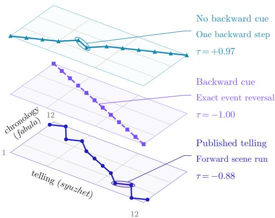  
Figure 1: Without a cue, the model stays near chronology; a backward cue yields exact reversal, while the published telling preserves forward scene runs. Kendall’s τ measures agreement with chronology: +1 denotes chronological order and 1 exact reversal.

Story generation research has built systems that plan stories, revise long drafts and build suspense (Fan et al., 2018; Yao et al., 2019; Yang et al., 2022; Xie and Riedl, 2024), and some add flashbacks or rewrite a chronological draft into a planned telling order (Han et al., 2022; Yu et al., 2025). Yet the telling order is handled tacitly, planned or prompted for but seldom recorded, and model-written stories remain less structurally diverse than human ones (Tian et al., 2024). Without that record, the two properties that make a story nonlinear cannot even be stated: a revelation counts as one only if the explanation is narrated after the event it explains, and a question withholds something only if its answer arrives after it is asked. We therefore record both orders for 83 published works, with story graphs whose typed edges encode these relations and whose nodes record world state and what characters and readers know.

We ask five questions:

RQ1 Controllability. Can a model set the order in which it narrates a fixed set of events, unprompted and when instructed? (§5.1)

RQ2 Task validity. Can it recover chronology and name the shape, and how much of that score survives deleting the telling? (§5.2)

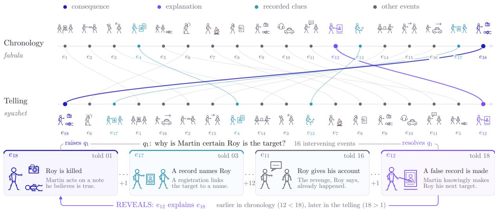  
Figure 2: The same events, two orders: the explanation precedes the consequence in chronology but arrives last in the telling. Opening with Roy’s death and withholding why he became the target across 16 intervening events turns a known outcome into an unresolved question.

RQ3 Representation. Does a story graph beat a bare event list or a supplied order? (§5.3)

RQ4 Cost of control. What does a structural instruction cost in quality and in the placement of withheld information? (§5.4)

RQ5 Evaluation validity. Do a judge’s verdicts comport with readers’, and do our metrics track reading experience? (§5.5)

Given a shape stipulated as a rule on events, models return its formulaic solution, which no published telling in our corpus uses (Figure 1). Readers prefer a model’s default chronological telling to its instructed one; they also prefer graph-guided stories to stories written to a supplied order, a preference the judge misses. Our contributions are threefold:

1. We annotate 83 published works across seven narrative shapes, 73 nonlinear and ten predominantly chronological, each with chronological and telling orders over one event list and a hand-written story graph (§3).

2. We build a five-task benchmark for producing and reading telling orders, with model-free baselines and a no-story floor for reconstruction, and evaluate 19 models on it (§4).

3. We test an automated judge and our own structural metrics against 3,528 blind judgments from 71 readers (§5.5).

## 2 Related work

Story generation with LLMs often separates planning from prose realization: hierarchical generation and Plan-and-Write plan before writing (Fan et al., 2018; Yao et al., 2019), and Re3 adds recursive prompting and revision for longer stories (Yang et al., 2022). Telling order has computational precedents: Montfort (2007) generates alternative tellings from a shared event model using seven ordering categories. For neural generation, Han et al. (2022) show that temporal prompts produce more interesting flashback stories while maintaining temporal coherence; Yu et al. (2025) separate chronological character simulation from rewriting into a planned telling order. Our benchmark examines this control across seven structural categories drawn from published narratives while holding the events fixed.

Temporal resources such as TimeBank and TempEval support annotation and evaluation of temporal relations in text (Pustejovsky et al., 2003; Uz-Zaman et al., 2013), while DramaBank represents agency, intentions, and plans (Elson, 2012). Story Curves directly aligns chronological and telling orders across ten nonlinear films and identifies recurring narrative patterns (Kim et al., 2018). Our corpus extends this paired-order setting with shared event descriptions and story graphs, making telling order a target for controlled generation.

Assessing reading experience also requires human evaluation. The Psychological Depth Scale measures empathy, engagement, emotional provocation, and related dimensions (Harel-Canada et al., 2024). Prior work compares model story ratings with English teachers’ ratings (Chiang and Lee, 2023); Chhun et al. (2024) find stronger agreement with human ratings when ranking generation systems than when evaluating individual stories. LLM judges exhibit position, verbosity, and self-enhancement biases (Zheng et al., 2023), motivating length-controlled evaluation (Dubois et al., 2024).

These lines leave open how reliably models control the shapes of published narratives, whether reconstruction draws on the telling at all, and whether structural and automated measures track readers. §C discusses each line in detail.

## 3 Methodology

Each dataset item represents one narrative work with 12–20 key story events. We write one selfcontained sentence per event so that the same sentences can be read in chronological order or in the work’s telling order. Each entry records both orders, a structural label and a story graph.

For events $E = ( e _ { 1 } , \ldots , e _ { n } )$ in chronological order (thefabula), the telling (the syuzhet) is a permutation $\sigma \in S _ { n }$ presenting $T _ { \sigma } = ( e _ { \sigma ( 1 ) } , \dots , e _ { \sigma ( n ) } )$ (Genette, 1980). Thus $\sigma ( i )$ gives the chronological rank of the event at told position i. Strict chronological order is the identity, and a telling is nonlinear when $\sigma \neq \mathrm { i d }$ . Each work has an annotated reference (gold) telling $\sigma ^ { \star }$ and category $c ^ { \star }$ . A scene is an annotated group of events that remains contiguous in both orders. Structural labels describe scene order, while σ records event order. A permutation narrates every selected event exactly once, so the representation isolates the placement of plot events: repeated narration, staged disclosure and omission fall outside it, and prose is projected onto the event list at first mention (§4.2).

We selected 83 works by structural shape, beginning with films and adding novels, plays, musicals and a short story until every category had at least ten examples. This sampling provides coverage of the seven shapes rather than estimates of their prevalence. Table 1 reports the corpus counts.

The seven structural labels describe scene order: CHRONICLE (predominantly chronological); RETROGRADE (scenes in reverse chronology, with events within each scene proceeding forward); ANALEPSIS (a dominant timeline interrupted by flashbacks, followed by returns); PROLEPSIS (a dominant timeline interrupted by flash-forwards, followed by returns); ZIGZAG (regular alternation between related scenes from two periods, each progressing in a consistent temporal direction); SYLLEPSIS (no dominant timeline, with scenes grouped by place, character, theme or object); and ACHRONY (no consistent ordering rule). §A gives full definitions and illustrations, and §L gives the rules presented to models. We include only works with a recoverable chronology, which provides the reference order for evaluation. Our ACHRONY label therefore denotes no consistent telling-order rule despite a recoverable chronology.

<table><tr><td colspan="2">Corpus</td></tr><tr><td>works, each annotated in both orders gold narrative graphs event nodes scenes characters mean τ of the told order</td><td>83 83 1,433 1,221 857 0.456</td></tr><tr><td>Typed edges CAUSES SHARES FORESHADOWS REVEALS</td><td>3,478 1,330 1,397 444 307</td></tr><tr><td>reader-question threads pre-/post-conditions character/reader knowledge claims</td><td>657 1,459 / 1,688 2,504</td></tr></table>

Table 1: The corpus. Counts are recomputed from the annotation and independently re-derived by a separate check.

The story graph records causal dependencies, world-state constraints, character knowledge, and reader questions that an event order alone does not express. In our annotation, a reveal is an event that occurs before the event it explains in chronology but appears after it in the telling. A reader question is an uncertainty raised by one narrated event and resolved by a later one. A REVEALS edge points from the explanation to the event it explains and is associated with a matching reader question. Figure 2 illustrates a reveal and its reader question.

Node ei is event i, which links the graph to the event list. Graphs supplied to models omit each event’s chronological and told positions, although REVEALS edges still constrain the telling order. The graph supplies constraints rather than a generation algorithm: causes support consequences, world states stay consistent, characters act on what they have learned, and questions the telling opens get answers. §H specifies every field, and Figure 3 draws one annotated work with its four reveals and the reader questions they answer.

The authors annotated each work once, writing its event sentences, its label with a rationale, and its graph. Machine checks reject any work that violates a constraint; they catch inconsistency rather than misreading, so every label carries its stated rationale. Models are evaluated on anonymized versions that replace identifying details but preserve event counts and permutations, and validation rejects source proper nouns and verbatim source sentences (§H).

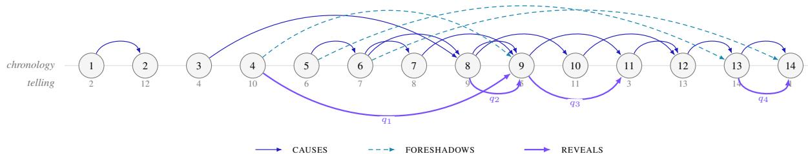  
Figure 3: Story graph of work S60, a musical labeled ZIGZAG, with events in chronological order and told positions beneath. CAUSES and FORESHADOWS arcs run above the line; each REVEALS arc below points from a later-told explanation to the earlier-told event it explains, answering the reader question $q _ { i }$ it carries (SHARES edges omitted). Events: 1 a novelist meets an actress; 2 she tells him of the man she nearly settled for; 3 his first book is accepted; 4 a casting panel ignores her; 5 he promises never to leave; 6 they marry; 7 she takes a provincial engagement; 8 his book succeeds; 9 she confronts his absence; 10 a guest propositions him; 11 she resents his success; 12 he is unfaithful; 13 he leaves a letter; 14 she finds the flat empty. Questions: $q _ { 1 }$ what professional hurt lies beneath her accusation; $q _ { 2 }$ how his success became distance; q3 why she can no longer be glad for him; q4 why the flat is empty.

## 4 Experimental Setup

## 4.1 Experimental Design

Tasks. Given events in chronological order, $\mathrm { T _ { 1 } }$ asks for a telling order that realizes a named shape and $\mathrm { T _ { 2 } }$ for one without a shape instruction. Given the same events in their gold telling order, $\mathrm { T _ { 3 } }$ asks for the underlying chronology and $\mathrm { T _ { 4 } }$ for one of the seven structural labels. $\mathrm { T _ { 5 } ^ { a } }$ and $\mathrm { T _ { 5 } ^ { b } }$ ask for a 550–750-word story from the chronological event list, with a named shape in $\mathrm { T _ { 5 } ^ { a } }$ and no shape instruction in $\mathrm { T _ { 5 } ^ { b } }$ . Tables also label the cued and free conditions instructed and $l e f t$ alone, respectively. The prose and graph studies use 14 works, two per shape (models in Table 15).

Inputs and decoding. Base prompts list one selfcontained event sentence per line and mark neither scene boundaries nor simultaneous events. Ordering uses temperature 0 and low reasoning effort; prose uses 0.7. §L has the verbatim prompts; $\ S \mathrm { I }$ has the decoding and scoring conventions.

Reconstruction controls. $\mathrm { T _ { 3 } }$ receives the gold telling order. To test how much of its score comes from that order rather than from the event descriptions, three strong models also reconstruct chronology from the same events in random order; we call their score the no-storyfloor. We then repeat both runs after a model rewrites the events to remove explicit time cues such as dates and “years earlier” (Table 8; §B). In both reconstruction conditions, indices identify event lines rather than gold chronological ranks (§I).

Graph conditions. All graph conditions retain the $\mathrm { T _ { 5 } ^ { a } }$ target-shape cue and its definition; only the added input differs. $\mathrm { G } _ { 0 }$ adds nothing. $\mathrm { G _ { 1 } }$ adds the full graph without its chronological and telling position fields. $\mathrm { G _ { 2 } }$ adds no graph but supplies the gold telling order and requires the story to follow it. The graph still constrains order: its REVEALS edges place each explanation after the event it explains, fixing 5.5% of telling-order pairs. Five ablations each remove one annotation group from $\mathrm { G _ { 1 } }$ and its prompt description, such as character knowledge or world-state conditions (Table 3; §B).

## 4.2 Evaluation

Order metrics. For $\mathrm { T _ { 1 } }$ and $\mathrm { T _ { 2 } } .$ , forwardness is Kendall’s τ between telling and chronology (Kendall, 1938), from +1 for chronological order to 1 for exact reversal. A telling is effectively chronological at $\tau \geq 0 . 9 5 ;$ gold tellings average $\tau = 0 . 4 5 6$ . The normalized longest increasing subsequence, LIS, is the largest fraction of events told in chronological order, allowing gaps. For permutations and for aligned prose, a band hit means that both τ and LIS fall within the minimum–maximum range of the gold tellings for the target shape: the requested shape for cued outputs (T1, Ta5 and $\mathrm { G _ { 0 ^ { - } } }$ $\mathrm { G _ { 2 } ) }$ , and the source work’s gold category for free outputs $( \mathrm { T _ { 2 } }$ and $\mathrm { T } _ { 5 } ^ { \mathrm { b } } ,$ ). Band hit measures resemblance to corpus examples, not the shape itself: different patterns can share both coordinates, so the band sees displacement from chronology but not alternation or grouping (§B). Agreement with a work’s gold telling is Kendall’s τ between the two orders. $\mathrm { T _ { 3 } }$ is scored by $\tau _ { \mathrm { r e c } }$ against gold chronology and by exact match, and $\mathrm { T _ { 4 } }$ by accuracy $( \mathsf { A p - }$ pendices D and I).

Aligning prose. Gemini 3.1 Pro aligns each generated story back to the event list by first mention, so the structural scores above apply to prose as well as permutations. An aligner from another model family agrees on 93 shared stories at $r = 0 . 8 9 5$ (mean $| \Delta \tau | = 0 . 0 4 4 )$ , and when given $\mathrm { G _ { 2 } }$ , the primary aligner recovers the gold order at $\tau = 0 . 9 9 8$ These checks validate alignment, not preference.

Automated story judgments. Gemini 3.1 Pro also serves as the primary preference judge. It compares two stories generated by the same model for the same work under different conditions and answers the question used in the reader study: “Which is the better story overall: more engaging, better told, more satisfying to read?” Each pair is judged twice with positions swapped, and disagreement is recorded as a tie. The judge also rates each story on the five 1–5 scales of the Psychological Depth Scale (PDS; Harel-Canada et al., 2024), which readers use in close readings. §L gives all judge prompts.

Reader protocol and inference. 71 readers gave 3,528 responses over 294 sittings. Each sitting contains four blind comparisons and one close reading. A comparison shows the same kind of pair the judge sees, with sides randomized and conditions hidden. Readers answer the judge’s overall question plus “Which was harder to follow?” and “Whose ending tied things together better?” (Story A, Story B or about the same). One of the four repeats an earlier pair with sides swapped, without telling the reader (§M). Preference rates exclude ties. We report exact binomial tests with reader-clustered bootstrap intervals, rates adjusted for word-count difference with generalized estimating equations, and rates on length-matched pairs within 40 words (§B).

## 5 Results

## 5.1 RQ1. Producing a telling

## 5.1.1 Left alone, they tell it straight

Given the events and no structural instruction $( \mathrm { T _ { 2 } } .$ every model in Table 2), the pooled told order sits at $\tau ~ = ~ 0 . 6 3 8$ and $\mathrm { L I S } ~ = ~ 0 . 7 9 6$ , against a human corpus mean of 0.456. Models vary widely (0.480–0.808), yet all 19 are more chronological than the human telling of the same works. Even the least chronological (Llama 4 Maverick, 0.480) sits above the corpus mean (two-sided sign test, $p = 3 . 8 \times 1 0 ^ { - 6 } )$ . Prose is more chronological still $( \tau = 0 . 9 8 9 )$ , and 3 of 8 models write every story in chronological order. With no shape requested, 1.8% land in the band of the source work’s own label, which measures resemblance, not compliance. Nonlinearity has to be requested, with two caveats: the reference works were chosen for their nonlinearity, and both free tasks list the events chronologically, so a preference for chronology cannot be told apart from a preference for the input order.

## 5.1.2 Asked for a shape, they comply literally

Asked for a named shape $( \mathrm { T } _ { 1 } )$ , models land in the human band 47.9% of the time (28.9–60.2% by model, led by Gemini 3.1 Pro), against 8.4% for a random permutation (§I). Format is not the bottleneck (99.5% valid permutations, 97.6% scene contiguity). What fails is structural choice, unevenly across shapes (Table 6, §E).

Two shapes miss the band almost entirely (Figure 8, §E). RETROGRADE scores 1.1% and CHRON-ICLE 5.3%, because 93.6% of RETROGRADE outputs are the exact reversal $( \tau = - 1 )$ and 88.9% of CHRONICLE outputs the exact identity. The ten published works of each shape stop short of those ends $( \tau \in [ - 0 . 9 2 , - 0 . 4 3 ]$ and [0.62, 0.97]). Chronicles contain simultaneous events, and reverse chronology still plays forward inside each scene: published RETROGRADE tellings reverse 94.0% of the event pairs that span two scenes and 0.0% of the pairs within one, where cued models reverse 98.8% and 98.0% (§E.1). The prompts mark neither scenes nor simultaneity and state both shapes as rules over event ranks (§L), each with a unique solution for a given event set (Prop. 2). We call the result overcompliance and read it as a specification effect. Models return the literal solution of the rule they were given, and whether they find the scene-level shape when scenes are marked is untested. Without the two shapes, pooled band hit is 62.1%. Two baselines that use no model support this reading. Reversing the scenes and playing each forward, the practice the band encodes, hits the RETROGRADE band for 6 of ten works against the models’ 1.1%, while the identity, which the CHRONICLE prompt explicitly accepts, hits the CHRONICLE band in 0 of ten (§I). On these two shapes, band hit measures the gap between the rule as stated and the practice recorded.

Judgment-dependent shapes (i.e., ZIGZAG, PRO-LEPSIS, and ANALEPSIS) reach the human band 68– 83% of the time. Because the rectangle is blind to alternation, ZIGZAG yields the highest band hits but the lowest gold-telling agreement (0.396, §I). By contrast, ACHRONY fails through excessive scrambling $( \tau = 0 . 1 7 1 \nu$ s. human 0.363).

<table><tr><td></td><td colspan="2"> $\mathbf { T _ { 1 } } \mathrm { c u e d }$ </td><td colspan="2"> $\mathrm { { T _ { 3 } } r e c o n s t r u c t }$ </td><td> $\mathbf { T _ { 4 } }$ </td><td> $\mathbf { T _ { 2 } }$ </td><td></td><td></td><td colspan="2"> $\mathbf { T _ { 1 } } \mathsf { c u e d }$ </td><td colspan="2"> $\mathrm { { T _ { 3 } } r e c o n s t r u c t }$ </td><td></td><td> $\mathbf { T _ { 2 } }$ </td></tr><tr><td>Model</td><td>band hit</td><td>T</td><td> $\tau _ { \mathrm { r e c } }$ </td><td>exact</td><td>acc.</td><td></td><td>τ free</td><td>Model</td><td>band hit</td><td>T</td><td> $\tau _ { \mathrm { r e c } }$ </td><td>exact</td><td>acc.</td><td>τ free</td></tr><tr><td>一 Gemini 3.1 Pro</td><td>0.602</td><td>0.409</td><td>0.882</td><td>0.253</td><td>0.747</td><td>0.785</td><td>Q</td><td>DeepSeek V4 Pro</td><td>0.470</td><td>0.442</td><td>0.519</td><td>0.060</td><td>0.470</td><td>0.678</td></tr><tr><td>Gemini 3.6 Flash</td><td>0.578</td><td>0.456</td><td>0.880</td><td>0.217</td><td>0.795</td><td>0.808</td><td>5</td><td>GPT-5.6 Terra</td><td>0.438</td><td>0.410</td><td>0.882</td><td>0.171</td><td>0.648</td><td>0.531</td></tr><tr><td>米 Claude Opus 5</td><td>0.566</td><td>0.416</td><td>0.886</td><td>0.193</td><td>0.614</td><td>0.615</td><td>米</td><td>Claude Haiku 4.5</td><td>0.434</td><td>0.376</td><td>0.799</td><td>0.108</td><td>0.470</td><td>0.681</td></tr><tr><td>Ω Grok 4.5</td><td>0.566</td><td>0.398</td><td>0.877</td><td>0.205</td><td>0.699</td><td>0.485</td><td>S</td><td>gpt-oss-120b</td><td>0.434</td><td>0.218</td><td>0.675</td><td>0.024</td><td>0.277</td><td>0.568</td></tr><tr><td>S GPT-5.6 Luna</td><td>0.550</td><td>0.413</td><td>0.815</td><td>0.129</td><td>0.486</td><td>0.664</td><td>京</td><td>Qwen3-235B-A22B</td><td>0.410</td><td>0.314</td><td>0.683</td><td>0.012</td><td>0.410</td><td>0.532</td></tr><tr><td>米 Claude Sonnet 5</td><td>0.542</td><td>0.458</td><td>0.807</td><td>0.072</td><td>0.422</td><td>0.793</td><td>H</td><td>Mistral Small 3.2</td><td>0.398</td><td>0.311</td><td>0.598</td><td>0.024</td><td>0.313</td><td>0.610</td></tr><tr><td>常 GLM-5.2</td><td>0.542</td><td>0.472</td><td>0.868</td><td>0.193</td><td>0.602</td><td>0.708</td><td>Q</td><td>DeepSeek V4 Flash</td><td>0.386</td><td>0.447</td><td>0.684</td><td>0.108</td><td>0.410</td><td>0.604</td></tr><tr><td>8 Llama 4 Maverick</td><td>0.530</td><td>0.408 0.383</td><td>0.590</td><td>0.000</td><td>0.301</td><td>0.480</td><td>K</td><td>Kimi K2 0905</td><td>0.361</td><td>0.421</td><td>0.761</td><td>0.060</td><td>0.422</td><td>0.760</td></tr><tr><td>S GPT-5.6 Sol @ Nemotron 3 Ultra</td><td>0.506 0.494</td><td>0.484</td><td>0.892 0.409</td><td>0.243 0.060</td><td>0.671 0.506</td><td>0.626 0.562</td><td></td><td>∞Llama 3.3 70B</td><td>0.289</td><td>0.108</td><td>0.672</td><td>0.012</td><td>0.313</td><td>0.614</td></tr><tr><td></td><td></td><td></td><td></td><td></td><td></td><td></td><td></td><td></td><td></td><td></td><td></td><td></td><td></td><td></td></tr><tr><td>pooled</td><td>0.479</td><td>0.386</td><td>0.743</td><td>0.111</td><td>0.502</td><td>0.638</td><td></td><td></td><td></td><td></td><td></td><td></td><td></td><td></td></tr><tr><td>[reference] human</td><td>1.000†</td><td>0.456</td><td></td><td></td><td></td><td>0.456</td><td></td><td></td><td></td><td></td><td></td><td></td><td></td><td></td></tr><tr><td>[baseline] random</td><td>0.084</td><td>0.015</td><td></td><td></td><td>0.143</td><td>0.015</td><td></td><td></td><td></td><td></td><td></td><td></td><td></td><td></td></tr></table>

Table 2: Benchmark grid, sorted by $\mathrm { T _ { 1 } }$ band hit (left block, then right). $\operatorname { T } _ { 1 } \colon$ structural compliance. $\operatorname { T } _ { 2 } \colon$ spontaneous ordering. $\operatorname { T } _ { 3 } \colon$ reconstruction. $\mathrm { T } _ { 4 } \colon$ classification. Italic: open-weights. Bold: best per column (in the τ columns, closest to the human 0.456, descriptive only). Human band hit ( ) is 1 by definition. Band-hit intervals are about 0.11, so adjacent ranks are not distinguishable (§I). Read $\mathrm { T } _ { 3 } \tau _ { \mathrm { r e c } }$ against the no-story floor (§5.2.1).

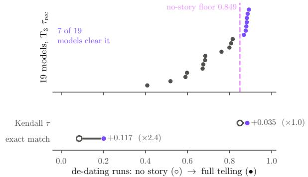  
Figure 4: The no-story floor. Top: $\mathrm { T } _ { 3 } ~ \tau _ { \mathrm { r e c } }$ for each model, against a solver given the events with the telling deleted (dashed). The two come from separate runs, so the panel calibrates the scores and does not rank the models. Bottom: the same solvers with and without the telling, from the de-dating runs.

## 5.2 RQ2. Reading a telling

## 5.2.1 Reconstruction without the story

$\mathrm { T _ { 3 } }$ yields a pooled $\tau _ { \mathrm { r e c } } = 0 . 7 4 3$ , with per-model scores ranging from 0.409 to 0.892. The reconstruction controls (§4.1) show how much of this score persists without the telling.

Deleting the story. Without the telling, three strong solvers reach $\tau = 0 . 8 4 9$ , against 0.884 with the full telling (Figure 4), so the telling is worth +0.035 τ. Only 7 of 19 models clear this strongsolver floor (we ran no per-model floor), and per work the two conditions correlate at $r = 0 . 8 3 7$

Removing every date. The rewrite cut anchors such as “Years earlier” from 6.3% of events to 0.7% but moved the floor by only -0.005 τ (Table 8), so the floor does not come from dates. Events can imply their own order $( e . g .$ , a man is shot before he bleeds to death), but these works are also recognizable, and de-dating leaves prior knowledge intact, so entailment and memory are not yet separated. After reading a generated story in full, readers ordered its events at only $\tau = 0 . 5 3 7$ , where the floor on the same 14 works is 0.833 (§F.2); the inputs differ, but entailment that a careful reader could also use does not explain that gap.

The floor accounts for 96.1% of the τ score but only 42.1% of exact reconstructions. In pairwise accuracy it orders 92.5% of pairs correctly against 94.2% with the telling, ${ \bf S 0 } ~ \tau _ { \mathrm { r e c } }$ should not be read alone. Exact match is more revealing: the telling lifts it from 8.5% to 20.2%, although a single misplaced event counts as total failure. No model reconstructs a CHRONICLE exactly (0%), because near-chronological tellings deviate mostly through simultaneous events, which a total order scores as error.

## 5.2.2 Naming the shape

Classification $\mathrm { ( T _ { 4 } ) }$ reaches pooled accuracy 50.2% and best 79.5% (Gemini 3.6 Flash), against a sevenway random baseline of 14.3% and a majority-class baseline of 26.5%. Accuracy, band hit and $\tau$ do not share a difficulty scale, so we do not rank the tasks. The errors are systematic. Of the six other classes, 5 send 29–46% of their items to ANALEPSIS, so “a dominant timeline with flashbacks” is the models’ fallback. ACHRONY is recognized 7.1% of the time, partly because the definition the models saw describes unrecoverable chronology, which the corpus excludes (§K and §L). Across models, naming a shape predicts both other abilities $( \rho = 0 . 7 1 7$ with $\mathrm { T _ { 1 } }$ band hit, $\rho = 0 . 7 4 7$ with $\mathrm { T } _ { 3 } ~ \tau _ { \mathrm { r e c } } )$ while those abilities barely correlate $( \rho = 0 . 0 8 8 ) \colon$ writing and reading are separate skills.

§I qualifies the grid. A small effort ablation cannot rule out an effect of reasoning effort, and the three GPT-5.6 models refuse 12.7–13.0% of attempts at the dark-literary end of the corpus.

<table><tr><td>Condition</td><td>T</td><td>band hit</td><td>agree PDS</td></tr><tr><td> $\mathrm { G } _ { 0 }$  no graph</td><td>0.362</td><td>0.411</td><td>0.554 3.85</td></tr><tr><td> $\mathrm { G } _ { 1 }$  full graph</td><td>0.415</td><td>0.518</td><td>0.554 4.10</td></tr><tr><td> $\mathrm { G _ { 2 } }$  told order (oracle)</td><td>0.333</td><td>0.982</td><td>0.998 3.94</td></tr><tr><td>— CAUSES/FORESHADOWS</td><td>0.417</td><td>0.429</td><td>0.557 4.18</td></tr><tr><td>- pre/post</td><td>0.440</td><td>0.464</td><td>0.557 4.14</td></tr><tr><td>-learns</td><td>0.399</td><td>0.464</td><td>0.561 4.05</td></tr><tr><td>— questions/REVEALS</td><td>0.383</td><td>0.464</td><td>0.502 3.99</td></tr><tr><td>— participants/location</td><td>0.409</td><td>0.500</td><td>0.526 4.04</td></tr></table>

Table 3: The scaffolding study. Ablations below the rule each remove one graph layer from $_ \mathrm { G _ { 1 } ; }$ agreement with the gold telling confirms that $\mathrm { G _ { 2 } }$ follows the order it is given. Rows use the 2 models that ran every condition, the only ones that allow a paired comparison; pooling all 4 models over the three conditions they share gives the same ordering at smaller margins.

## 5.3 RQ3. Does a story graph help?

The graph beats no graph, under the judge. $\mathrm { G _ { 1 } }$ beats $\mathrm { G _ { 0 } 3 1 - 1 4 }$ with 11 ties $( p = 0 . 0 1 6 $ , Figure 9 in §E), PDS rises on 5 of 5 components (3.850 to 4.096), and band hit rises from 41.1% to 51.8% (Table 3). The structural gain is thin. It comes almost entirely from one model (below), and agreement with the gold telling does not move (0.554 to 0.554), so models do not use the order the REVEALS edges fix. The preference gain disappears after length adjustment (§5.5.1). $\mathrm { G _ { 1 } }$ texts are longer; readers pick the longer text 61% of the time, and the judge saw the same unequal texts.

Against the told order, the judge sees no difference and readers do. The judge splits $\mathrm { G } _ { 1 } \nu s . \mathrm { G } _ { 2 }$ at 23–22, although $\mathrm { G _ { 2 } } .$ , handed the answer, leads on structure (98.2% band hit, McNemar $p < 0 . 0 0 1 )$ , while readers prefer $\mathrm { G _ { 1 } }$ in 72% of decisive verdicts (§5.5.1). The split is not a matter of sample size: at the reader rate, an outcome this even across 45 judgments has probability 0.0022 (0.019 at the floor of the readers’ interval), taking that rate as known; a formal test would pair item-level decisions. The prompts differ beyond the graph (§5.5.1), but here the judge does not track readers.

No single layer, and almost entirely one model. Under the judge, all five leave-one-layer-out ablations match the full graph on preference $( p$ from 0.50 to 0.83), and band hit falls for every removal without approaching significance (smallest paired McNemar $p = 0 . 2 1 9 , n = 2 8 )$ . Readers prefer every ablation to the full graph (§5.5.2). A graph that loses to each of its one-layer reductions yet ties no graph at equal length is consistent with excess prompt length or distraction, but these comparisons do not isolate either explanation. Claude Sonnet 5 supplies almost all of the structural gain (+0.250 band hit, Gemini 3.6 Flash -0.035, the other 2 none) and most of the readers’ ablation preference. We claim only that the graph raises structural compliance for one generator of four.

## 5.4 RQ4. The cost of control

Cued tellings lose to the model’s own free telling. In the paired cued-versus-free comparison (§4.2), free tellings win 68 to 19 with 24 ties $( n = 1 1 1$ $p \approx 1 . 2 \times 1 0 ^ { - 7 } )$ , all 8 models lose, and PDS agrees more mildly (3.74 vs. 3.60). The judge (Gemini 3.1 Pro) shares a family with one generator, a documented source of bias (Zheng et al., 2023), but readers confirm the result at a closely matched rate (Figure 5; §5.5.1). The cost is not only nonlinearity. The cued story also loses when the requested shape is CHRONICLE (0.32, $n = 3 7$ , uncorrected $p = 0 . 0 4 7 )$ , which asks for little reordering, and draws level on RETROGRADE (0.48), the most nonlinear request (Table 7), so part of the penalty is the instruction itself.

The evidence for premature disclosure is suggestive. For each work we take the REVEALS edge whose explanation the gold telling places latest, and call its disclosure early if fewer than three events precede the explanation’s first mention in a story. Two works inflate the early counts: one designates no reveal yet was scored early, and a chronicle’s selected explanation is its third chronological event. Without them, disclosure is early in 8.3% of stories without a graph, 8.5% with one and none when the model is handed the told order $( p = 0 . 1 2 5 )$ . That repair is partly by construction, since the reveal is defined by the order $\mathrm { G _ { 2 } }$ is handed; what remains is that $\mathrm { G _ { 1 } }$ , which marks what is withheld, does no better than $\mathrm { G _ { 0 } ( \ S J ) }$ .

## 5.5 RQ5. What readers say

The reader study tests the automated preference verdicts with the protocol of §4.2 (Table 4), and Figure 5 sets the unadjusted reader rates beside the judge’s. All three analyses agree on the headline results, and every better story claim below clears the Bonferroni threshold of 0.0042. Readers agree with each other on that question but not on the other two (Krippendorff’s $\alpha = 0 . 4 1 5$ against 0.112 and 0.073), and on the unannounced repeats they reproduce their own decisive verdict 93% of the time (76% over all repeats, §F).

<table><tr><td>Comparison</td><td colspan="3">better story</td><td colspan="3">harder to follow</td><td colspan="3">better ending</td><td>adj.</td></tr><tr><td></td><td>split</td><td>rate</td><td>p</td><td>split</td><td>rate</td><td>p</td><td>split</td><td>rate</td><td>p</td><td>rate</td></tr><tr><td>instructed vs. left alone</td><td>64-200-30</td><td>0.242</td><td>&lt; 0.0001</td><td>197-47-50</td><td>0.807</td><td>&lt; 0.0001</td><td>114-134-46</td><td>0.460</td><td>0.23</td><td>0.246</td></tr><tr><td>full graph vs. told order</td><td>181-70-43</td><td>0.721</td><td>&lt; 0.0001</td><td>115-108-71</td><td>0.516</td><td>0.69</td><td>141-106-47</td><td>0.571</td><td>0.0303</td><td>0.707</td></tr><tr><td>full graph vs. event list</td><td>154-105-35</td><td>0.595</td><td>0.0028</td><td>123-102-69</td><td>0.547</td><td>0.18</td><td>133-103-58</td><td>0.564</td><td>0.0588</td><td>0.518</td></tr><tr><td>full graph vs. one layer removed</td><td>79-180-35</td><td>0.305</td><td>&lt; 0.0001</td><td>140-86-68</td><td>0.619</td><td>0.0004</td><td>110-119-65</td><td>0.480</td><td>0.60</td><td>0.304</td></tr></table>

Table 4: Reader verdicts. Each pair is one model writing one story twice. split: wins–losses–ties for the first-named condition. rate: share of decisive judgments. adj.: rate net of word count (Dubois et al., 2024). violet headline, cyan survives every check, magenta against hypothesis, lavender fails length adjustment.

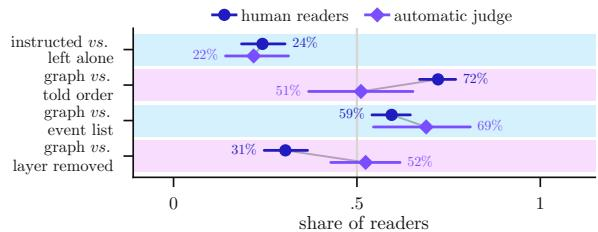  
Figure 5: Unadjusted preference rates. Readers favor graph-guided stories over those given a telling order or an event list, and the judge’s ties on two comparisons miss clear reader preferences. “Layer removed” pools the five one-layer ablations.

## 5.5.1 The three preference results

Instructed tellings lose, and length does not explain it. Against the same model’s free telling of the same events, readers chose the free version 76% of the time (64–200, 30 ties, reader-clustered [0.185, 0.304]), called the instructed version harder to follow 81% of the time, and split evenly on endings. 49 of 68 readers and all 8 generators favor the free telling. Length favors the instructed texts, which are longer (747 against 711 words), and the longer text won 57% of the time here. Among length-matched pairs, the instructed telling wins 30%. Of 186 written comments, 50 name order or difficulty following.

The graph beats a supplied told order, which the judge missed. This is the largest gap between readers and the judge. Readers chose the full graph’s story over the told order’s 72% of the time $( 1 8 1 - 7 0 , p < 0 . 0 0 0 1$ , reader-clustered [0.671, 0.771]), with no cost in how hard it was to follow $( p = 0 . 6 9 )$ and a smaller advantage on endings (0.571). 53 of 68 readers, 12 of 14 stories and 3 of 4 generators agree (the fourth is even), the lengthadjusted rate is 71%, and every reader subset reproduces it (Table 11). But the two conditions differ in more than the graph, above all in ordering freedom. $\mathrm { G _ { 1 } }$ fixes 5.5% of told-order pairs and $\mathrm { G _ { 2 } }$ all of them, so they realize different orders (agreement with the gold telling 0.554 against 0.998). Instruction, content and prompt length differ too, and the graph also wins on CHRONICLE $( 0 . 6 5 , n = 3 1 )$ where both are nearly chronological. We read this as a preference for graph-scaffolded over orderconstrained writing, not as readers rewarding the graph’s reasons for an order.

The graph over a bare event list does not survive length. Primafacie the graph wins here too $( 5 9 \% , p = 0 . 0 0 2 8 )$ , but this is the one comparison where length and condition are tangled. The graph’s texts average 649 words vs. 603, readers chose the longer text 61% of the time, and the wordcount coefficient is the largest in the study (+0.67 per hundred words, $p = 0 . 0 0 0 3 )$ . Adjusted for length, the rate is $5 2 \% ( p = 0 . 6 1 )$ , and the lengthmatched subset agrees (54%). It is the only row that moves (Figure 10, §E). Since the graph itself lengthens the texts, length here is an outcome, not a prior covariate. The raw 59% records observed preference and the adjusted 52% estimates preference at equal word count; they answer different questions, and the second does not correct the first. The graph makes models write more and readers prefer more, and a run that did not hold length fixed cannot say whether it also makes them write better. The close-reading PDS gap (3.90 vs. 3.57, $d = 0 . 5 1 )$ carries the same caveat.

## 5.5.2 Readers prefer the graph, bar a layer

No single layer stands out under either instrument, but pooled over layers, readers preferred the reduced graph’s story 69% of the time $( p < 0 . 0 0 0 1 )$ and called the full graph’s story harder to follow 62% of the time $( p = 0 . 0 0 0 4 )$ . Length does not explain this, since the conditions differ by a handful of words and the full graph still wins only 31% when length is matched. Every layer points the same way, the full graph winning between 0.271 and 0.333 of decisive judgments against each reduction (Table 9). The main caveat is that this is almost entirely one generator. Claude Sonnet 5’s full graph wins 26 of 147 decisive judgments against its own reduced-graph output (18%, $p < 0 . 0 0 0 1 )$ , losing about four in five, while Gemini 3.6 Flash is at chance (47%). The per-layer tests are also underpowered, so no layer is singled out and none is shown to be inert.

## 5.5.3 Does the judge agree with readers?

Pooled over the four comparisons, the judge and the readers’ majority agree on 0.662 of items where both are decisive, $\kappa = + 0 . 3 0 6 \ ( [ + 0 . 1 7 , + 0 . 4 3 ] )$ , and the judge agrees with individual readers on 0.679 of 779 judgments. Comparison by comparison (Figure 5; Table 13), the judge’s rate lands within 2 points of the readers’ on instructed versus free, though item-level agreement there is weak $( \kappa ~ = ~ + 0 . 2 7 8 )$ . Item-level agreement is highest on graph versus event list $( \kappa = + 0 . 6 2 5$ $[ + 0 . 2 8 , + 0 . 9 1 ] \rangle$ ), the comparison with the smallest reader effect, where both instruments may be answering the same length gap (649 vs. 603 words). On graph versus told order the judge sits at 0.511 and readers at 0.721 $( \kappa = + 0 . 2 4 2 )$ , and on the layer removals agreement is indistinguishable from none, $\kappa = - 0 . 0 3 0 \ ( [ - 0 . 2 3 , + 0 . 1 8 ] )$ ). Item-level agreement therefore does not track effect size, and four comparisons cannot separate effect size from comparison type. What holds is narrower: the judge matched readers on the one large effect, and readers overturned both of its ties, so its ties are not evidence of no difference. This is one judge and one cohort, and the second-model check of §4.2 tests alignment, not preference. The two sides also abstain differently: a reader tie means “about the same”, a judge tie that its two passes disagreed.

The depth scale fares better. Judge and reader PDS on the same 193 texts correlate at $r = 0 . 4 3$ but the judge rates uniformly high (+0.28 above readers, §F.4), so PDS differences can be reported but a PDS level from one judge cannot.

## 5.5.4 Our metrics against readers

τ predicts what readers find hard. Across 918 decisive judgments, the text a reader called harder to follow is the less chronological of the pair by $\Delta \tau ~ = ~ - 0 . 1 7 1 ~ ( p ~ < ~ 0 . 0 0 0 1$ , item-level $r =$ $- 0 . 3 4 )$ , so τ tracks a palpable reading cost readers report, though agreement on that question is low $( \alpha = 0 . 1 1 2 )$ and the association runs partly through condition (below).

Band hit does not predict what readers prefer. In the 381 decisive judgments where exactly one text falls inside the human band, readers chose that text 34% of the time $( p < 0 . 0 0 0 1 )$ . The association stays negative in a model that includes conditionpair fixed effects and the word-count and τ differences (band hit $\beta = - 0 . 5 8 , p < 0 . 0 0 0 1$ , while τ enters positively at $\beta = + 0 . 7 0 )$ , and the close readings agree (§F.4). Both associations partly restate the condition effect, since the in-band text is almost always the instructed one. What band hit rewards is a simulacrum of published practice: the coordinates of a real telling without whatever made a reader want it. Depth and nonlinearity are in any case unrelated across these outputs (§F.4).

## 6 Discussion

Compliance with an ordering rule, resemblance to published tellings and reader preference are distinct desiderata, and our results pull them apart: over-compliance satisfies the rule and misses the band, band hit tracks resemblance yet runs against preference, and readers prefer the telling that leaves chronology alone. An evaluation that reports only one of the three can certify a failure as a success. Part of the gap lies in the specification: published reverse chronology is a rule applied to scenes, our prompts stated it on events, and whether models find the scene-level shape once scenes are marked is the most germane open question. A scaffold that encodes discourse relations likewise encodes part of the answer, so its value can be read only against a condition that supplies the order directly, at matched output length. §G distills these lessons into six practices for a more stringent protocol, none of which needs new annotation.

## 7 Conclusion

Narrative order is a variable that story-generation research has largely left unmeasured. Recording it for 83 published works turns nonlinearity into a permutation that can be specified and scored (Table 5, §E). Left to choose, all 19 models narrate more chronologically than published tellings chosen for their nonlinearity. Given a shape stated as a rule on events, they apply it literally and miss the band, whereas a scene-level reversal computed from the corpus alone lands inside it.

Our own instruments needed as much scrutiny as the models. A task that resembles reading comprehension keeps 96.1% of its score with the telling removed, resemblance to published tellings does not predict what readers prefer, and the judge we tested called a tie where readers split 72 to 28; a few hundred reader judgments on the same items are the cheapest litmus test of such a tie. Until our models apprehend the subtler art by which human tellers make time serve meaning, they may remain meticulous accountants of chronology, yet strangers to the spirit of story.

## Limitations

One judge still does all the extraction. The human study replaces the judge for preference, not for measurement. Every structural score on generated prose, and the premature-disclosure rate, still depends on one model (Gemini 3.1 Pro) aligning prose back to the event list. The gates in §4.2 bound that alignment error, and the reader data do not touch it. The judge also still shares a model family with one generator in each prose comparison, which we flag rather than eliminate, since no single judge can be cross-family to every model on the roster. Ordering, reconstruction and classification are scored deterministically from model outputs and need no judge at all.

The reader study cannot reach past fourteen stories. Every preference and close-reading result comes from the 14 works for which generated prose exists, because every prose-generating run used that subset to control cost. The shapecomprehension items reach all 83 works, but they involve no generated text. Widening the preference evidence means a new generation run, not more readers, and the same ceiling is what forces a reader to meet the same story again in a later sitting (§F.3 shows that this does not move the results, but it is a constraint of the design rather than a feature of it). The generation side is narrower still: 4 generators for the scaffolding study, and 2 generators with one replicate for the ablations.

The length confound is diagnosed, not removed. We can say that the graph-versus-event-list preference does not survive adjusting for word count, and we cannot say what that comparison would look like with length held fixed at generation time. A regression adjustment answers a counterfactual question about the texts we have (Dubois et al., 2024); a length-matched generation run would answer the question directly, and it is the single cheapest experiment left in this paper. The same caveat attaches to the close-reading PDS gap, since the graph’s texts were also read for longer. Our own Recommendation 5 asks for length matching, and here we only adjusted for length.

The reader cohort is not a probability sample. 71 readers were recruited from university and secondary-school settings plus a group of general readers, so the cohort is more literate and more interested in fiction than a general population. 43 finish at least a book a month and 30 plus 10 have some writing training. Table 11 shows the results hold within every subset we can cut, including the least practiced readers, but a cohort drawn differently could differ, and we make no claim about readers in general. Agreement on better ending is low enough $( \alpha = 0 . 0 7 3 )$ that the endings rows should be read as suggestive.

Input order is a confound for the free tasks. $\mathrm { T _ { 2 } }$ and $\mathrm { T _ { 5 } ^ { b } }$ present the events in chronological order, and say so, so a model that merely keeps its input order scores as chronological. The ordering outputs show the default is not pure copying, since the pooled $\tau = 0$ .638 sits well short of the identity. In prose the two readings coincide, and separating a preference for chronology from a preference for the given order needs a shuffled-input control we have not run. The reference is also a selected sample. Of the 83 works, 73 were chosen because they are widely recognized as nonlinear, while most published narrative is chronological (§A), so against this corpus “more chronological than the published telling” is close to guaranteed. The informative comparison is a human storyteller given the same event list and prompt.

Band hit measures resemblance, and resemblance is not quality. It asks whether a telling looks like real works of its class. §5.5.4 measures it against reader preference and finds the association negative, so the metric should be read as a structural diagnostic and never as a quality proxy. That association also partly restates the condition effect, since the in-band text in an instructed-against-free pair is almost always the instructed one. And because the rectangle sees position in the (τ, LIS) plane rather than alternation or grouping, a telling can land in it without having the shape (§I). What we cannot separate is how much of that negative sign is about band hit and how much is about these particular outputs. Readers prefer chronology in model-written prose, and hitting the band requires leaving it; a corpus of generated tellings that actually earned their disorder might reverse the sign. Testing that needs generators better at this task than the ones we have.

The layer-removal result rests on two generators that disagree. The ablations run on 28 paired band-hit observations, 2 models and one replicate, and the reader study adds only 259 decisive judgments across five layers. At 51 judgments per layer, 80% power reaches only rate $0 . 5 | \geq 0 . 1 9$ , and the two generators that ran them go opposite ways $( \chi ^ { 2 } = 2 5 . 0 , p < 0 . 0 0 0 1 )$ . Readers and the judge both fail to find a per-layer effect, which is now two instruments agreeing on a no-difference verdict rather than one. Neither amounts to an equivalence test, which would need a margin fixed in advance and enough precision to rule out everything beyond it. With 51 judgments per layer, the smallest detectable departure is already 0.19. That verdict, from a set of runs this size and this onemodel-dominated, is not evidence the layers are inert. The prompt-length confound is also unresolved: $\mathrm { G _ { 1 } }$ is the longest prompt, the ablations are shorter, readers find $\mathrm { G _ { 1 } } \mathrm { \ ' } \mathrm { s }$ output the harder one to follow, and the length-matched prompt control that would separate “the layer was useless” from “the prompt was diluted” has not been run. We also lack an equal-compute agentic baseline. $\mathrm { G } _ { 0 }$ is a single call, so part of the $\mathrm { G _ { 1 } }$ structural gain may be “more structure in the prompt” rather than “this structure.” Taken together, the reader data do not show that the graph helps. Its edge over no graph is a length effect, and its edge over the told order is confounded (§5.5.1). It also loses to every one of its one-layer reductions while tying no graph at equal length, and a prompt that is too long or distracting explains that non-monotone pattern more simply than any account of what the layers do.

Scale and coverage. The ordering and classification tasks run on all 83 works. The prose and scaffolding studies run on 14, two per structural category. All decoding used low reasoning effort, checked only by a small ablation (4 models on the same 14 works, $\mathrm { T _ { 1 } }$ and $\mathrm { T _ { 3 } ) }$ that cannot rule out an effect of test-time compute (§I).

Contamination is reduced, not eliminated. Anonymization removes names, places and quotations but cannot hide a premise, and the works added to fill the thin structural classes are the leakier ones, precisely because a class was often thin for want of works whose structure does not by itself identify them. The works are recognizable, and the example in Figure 2 is a well-known film even after anonymization. This matters most for the no-story floor of §5.2.1, which we read as entailment but which prior knowledge of a work would also produce, since de-dating removes explicit time anchors but not memory. Readers who had read the story reached only $\tau = 0 . 5 3 7$ on stories where the model floor is 0.833 (§F.2), which a pure entailment account does not predict.

English only. Every event sentence, every authored graph string and the anonymized twin are written in English. The works themselves are not all Anglophone, and the corpus includes works first told in Korean, Japanese, Russian, German, French and Spanish. Each is annotated from an English-language telling or translation, however, and whether the taxonomy, the bands or the results transfer to other languages’ narrative traditions is untested.

No commissioned human writing. Our human reference is the annotation of a published work, which is the right ceiling for the ordering, reconstruction and classification tasks but is not a human writer given the same brief as the models. We therefore make no human-level claim, and the paper measures model capability against a corpus reference. The reader study inherits this limit in its sharpest form: every text a reader judged was model-generated, so nothing in §5.5 speaks to the gap between these tellings and published fiction. When readers prefer a model’s chronological telling to its instructed nonlinear one, that is a statement about two model outputs and not about nonlinearity.

Annotation is interpretive, and unreplicated. No work was annotated independently by a second person, so we report no inter-annotator agreement and treat measuring it as required future work. The band construction makes this worse. Each band is the rectangle spanned by the extreme τ and LIS of 10–22 single-annotator tellings, so a single segmentation decision can move a band edge. Leaving each work out of its own band moves pooled band hit between 0.423 and 0.479 (7 works move it by more than 0.01), and a held-out work falls inside its peers’ band 77% of the time (§I). Some labels are also a stretch. Our ten chronicles span τ from 0.62 to 0.97, and no work in the corpus is told exactly in order. Three of the seven structural labels turn on what scenes are about, and works with genuinely ambiguous chronology are annotated with the most defensible reading and the ambiguity recorded, so reasonable annotators would differ on some labels. We release the reasons alongside the labels so disagreements are locatable, and the machine checks of §H catch inconsistency but not misreading.

Over-compliance may be a property of the prompt. $\mathrm { T _ { 1 } }$ lists events one per line, marks no scene boundaries or simultaneous sets, and defines RETROGRADE and CHRONICLE as rules on event ranks, so the exact reversal and the identity are the literal solutions (Prop. 2). The model never receives the scene-level practice that defines the human band. The ACHRONY definition has a related problem. It describes unrecoverable chronology, which the corpus excludes, and reads as an annotation procedure rather than a description of a shape (§L). Until the scene-marked rerun, these results measure the specification as much as the model.

A permutation is not a discourse. Our object is a bijection between a fixed event list and a told order, so every telling narrates every event exactly once. Published narrative does not always do this. It returns to an event, releases it in pieces, drops it, or tells it twice in versions that cannot both be true. None of these has a distinct place in a permutation, and the twelve to twenty beats we record summarize a work’s discourse rather than reproduce it. Generated prose reaches the object through an aligner that must emit one position per event (§L), so omissions and repetitions are projected onto a first mention, and the resulting error is unmeasured. What we study, and what the benchmark scores, is control over the order of selected plot beats.

Simultaneity is scored as error. The gold chronology is a total order, so ties between simultaneous events are broken arbitrarily. This affects the CHRONICLE gold tellings, $\mathrm { T _ { 3 } }$ exact match (0% on CHRONICLE) and the τ of the chronicles themselves. We have not yet encoded the chronology as a weak order and scored it with Kendall’s $\tau _ { b }$ or equivalence-class exact match, as our own Recommendation 2 advises. The same choice affects the targets. The CHRONICLE prompt accepts simultaneous events in either order, so exact recovery is scored against one arbitrary linearization of a partial order, which is why 0% should not be read as a model result.

The cost of control is not isolated. Instructed tellings lose to free ones even when the requested shape is CHRONICLE (Table 7), so the reader result mixes the cost of nonlinearity with the cost of the instruction itself (the definition, the added constraint, a longer prompt). A chronology-instructed control on all 14 works would separate the two, but we have not run it.

The reader statistics do not model the crossed design. Headline p-values are exact binomials over judgments, and the bootstrap intervals cluster on one factor at a time. The design is crossed (readers by items, nested in stories and generators), and with 14 stories and 4 generators the story- and generator-level variance matters most. We have not yet fit a mixed-effects model with crossed random intercepts. Three further problems follow. The 294 hidden repeats are included in the rates we report, so 882 of the 1,176 presentations are first presentations and some reader–item pairs are counted twice. The first-presentation analysis should be the primary one. The Bonferroni threshold corrects for twelve tests but not for correlated observations, which is the larger of the two problems. Finally, a $\mathrm { G _ { 1 } }$ text appears in more than one contrast, so the comparisons are not independent of each other either.

Premature disclosure rests on few stories. Once the work with no designated reveal is set aside, the contrast in §5.4 rests on 52 stories per condition, and half of its early disclosures come from one chronicle. The scorer also counted the missing reveal as early. We therefore report the result as suggestive (§J).

## Ethics statement

The corpus is derived from published narrative works. We release hand-authored event summaries, structural annotations and graphs rather than source text, and the anonymized twin that models are evaluated on replaces all identifying surface detail. Anonymization addresses contamination, not rights: what we release is our own writing about published works, and nothing in it reconstitutes a copyrighted work or substitutes for reading one. The full release, comprising both corpora, the story graphs, all prompts, the stored model replies, the reader responses and the analysis code, is distributed under the MIT License.

The refusal asymmetry in §5.2.2 deserves note as a fairness observation rather than a criticism of any safety policy. The three GPT-5.6 models, all from one lab, declined a consistent set of works at the dark-literary end of the corpus, including on tasks as innocuous as sorting events into chronological order. Those are disproportionately the works whose structure is most interesting, so a literary benchmark built on a single vendor will quietly under-sample them. We report the affected subset and repeat every comparison on the works all models answered.

Annotation was carried out by the authors. The reader study of §5.5 involved 71 adult participants recruited from university and secondary-school settings and from a group of general readers. Each sitting opened with a consent step stating what the study measured, how long it would take and that participation could be stopped at any point; no sitting proceeded without it. Only two background items were collected, reading habit and writing experience, both as coarse categories and both kept solely as covariates. No name, contact detail, demographic attribute or free-text identifier is stored. Participants are identified in the study data by an integer, and the free-text comments were read for content about the stories only. The material readers were shown is model-generated prose built from anonymized event summaries, and the works at the dark-literary end of the corpus carry the same content as their published sources; the consent step said so.

## References

Ron Artstein and Massimo Poesio. 2008. Inter-coder agreement for computational linguistics. Computational Linguistics, 34(4):555–596.

Byung-Chull Bae and R. Michael Young. 2008. A use of flashback and foreshadowing for surprise arousal in narrative using a plan-based approach. In Interactive Storytelling: First Joint International Conference on Interactive Digital Storytelling (ICIDS 2008), volume 5334 of Lecture Notes in Computer Science, pages 156–167. Springer.

Tuhin Chakrabarty, Philippe Laban, Divyansh Agarwal, Smaranda Muresan, and Chien-Sheng Wu. 2024. Art or artifice? Large language models and the false promise of creativity. In Proceedings of the 2024 CHI Conference on Human Factors in Computing Systems. Association for Computing Machinery.

Nathanael Chambers and Dan Jurafsky. 2008. Unsupervised learning of narrative event chains. In Proceedings of ACL-08: HLT, pages 789–797, Columbus, Ohio, USA. Association for Computational Linguistics.

Yun-Gyung Cheong and R. Michael Young. 2008. Narrative generation for suspense: Modeling and evaluation. In Interactive Storytelling: First Joint International Conference on Interactive Digital Storytelling (ICIDS 2008), volume 5334 of Lecture Notes in Computer Science, pages 144–155. Springer.

Cyril Chhun, Pierre Colombo, Fabian M. Suchanek, and Chloé Clavel. 2022. Of human criteria and automatic metrics: A benchmark of the evaluation of story generation. In Proceedings of the 29th International Conference on Computational Linguistics, pages 5794–5836, Gyeongju, Republic of Korea. International Committee on Computational Linguistics.

Cyril Chhun, Fabian M. Suchanek, and Chloé Clavel. 2024. Do language models enjoy their own stories? Prompting large language models for automatic story evaluation. Transactions ofthe Associationfor Computational Linguistics, 12:1122–1142.

Cheng-Han Chiang and Hung-yi Lee. 2023. Can large language models be an alternative to human evaluations? In Proceedings ofthe 61st Annual Meeting of the Associationfor Computational Linguistics (Volume 1: Long Papers), pages 15607–15631, Toronto, Canada. Association for Computational Linguistics.

Ted Chiang. 1998. Story of your life. In Patrick Nielsen Hayden, editor, Starlight 2, pages 257–314. Tor Books, New York.

Elizabeth Clark, Tal August, Sofia Serrano, Nikita Haduong, Suchin Gururangan, and Noah A. Smith. 2021. All that’s ‘human’ is not gold: Evaluating human evaluation of generated text. In Proceedings of the 59th Annual Meeting of the Association for Computational Linguistics and the 11th International Joint Conference on Natural Language Processing (Volume 1: Long Papers), pages 7282–7296.

Rotem Dror, Gili Baumer, Segev Shlomov, and Roi Reichart. 2018. The hitchhiker’s guide to testing statistical significance in natural language processing. In Proceedings of the 56th Annual Meeting of the Association for Computational Linguistics (Volume 1: Long Papers), pages 1383–1392.

Yann Dubois, Balázs Galambosi, Percy Liang, and Tatsunori B. Hashimoto. 2024. Length-controlled AlpacaEval: A simple way to debias automatic evaluators. In Proceedings of the First Conference on Language Modeling (COLM).

David K. Elson. 2012. DramaBank: Annotating agency in narrative discourse. In Proceedings of the Eighth International Conference on Language Resources and Evaluation (LREC’12), pages 2813–2819, Istanbul, Turkey. European Language Resources Association (ELRA).

Angela Fan, Mike Lewis, and Yann Dauphin. 2018. Hierarchical neural story generation. In Proceedings of the 56th Annual Meeting of the Association for Computational Linguistics (Volume 1: Long Papers), pages 889–898, Melbourne, Australia. Association for Computational Linguistics.

Gérard Genette. 1980. Narrative Discourse: An Essay in Method. Cornell University Press, Ithaca, NY. Translated by Jane E. Lewin.

Rujun Han, Hong Chen, Yufei Tian, and Nanyun Peng. 2022. Go back in time: Generating flashbacks in stories with event temporal prompts. In Proceedings of the 2022 Conference of the North American Chapter of the Association for Computational Linguistics: Human Language Technologies, pages 1450–1470, Seattle, United States. Association for Computational Linguistics.

Fabrice Y Harel-Canada, Hanyu Zhou, Sreya Muppalla, Zeynep Senahan Yildiz, Miryung Kim, Amit Sahai, and Nanyun Peng. 2024. Measuring psychological depth in language models. In Proceedings of the 2024 Conference on Empirical Methods in Natural Language Processing, pages 17162–17196, Miami, Florida, USA. Association for Computational Linguistics.

Carl Gustav Jung. 1969. Archetypes of the collective unconscious. In The Archetypes and the Collective Unconscious, second edition, volume 9, Part 1 of The Collected Works ofC. G. Jung, pages 3–41. Princeton University Press, Princeton, NJ. Bollingen Series XX. Translated by R. F. C. Hull.

Marzena Karpinska, Nader Akoury, and Mohit Iyyer. 2021. The perils of using Mechanical Turk to evaluate open-ended text generation. In Proceedings of the 2021 Conference on Empirical Methods in Natural Language Processing, pages 1265–1285.

Maurice G. Kendall. 1938. A new measure of rank correlation. Biometrika, 30(1/2):81–93.

Nam Wook Kim, Benjamin Bach, Hyejin Im, Sasha Schriber, Markus Gross, and Hanspeter Pfister. 2018. Visualizing nonlinear narratives with story curves. IEEE Transactions on Visualization and Computer Graphics, 24(1):595–604.

Klaus Krippendorff. 2018. Content Analysis: An Introduction to Its Methodology, fourth edition. Sage.

Jiaming Li, Yukun Chen, Ziqiang Liu, Minghuan Tan, Lei Zhang, Yunshui Li, Run Luo, Longze Chen, Jing Luo, Ahmadreza Argha, Hamid Alinejad-Rokny, Wei Zhou, and Min Yang. 2025. STORYTELLER: An enhanced plot-planning framework for coherent and cohesive story generation. In Findings of the Association for Computational Linguistics: ACL 2025, pages 20818–20846. Association for Computational Linguistics.

Inderjeet Mani. 2012. Computational Modeling of Narrative. Number 18 in Synthesis Lectures on Human Language Technologies. Morgan & Claypool.

Nick Montfort. 2007. Ordering events in interactive fiction narratives. In Intelligent Narrative Technologies: Papers from the 2007 AAAI Fall Symposium (Technical Report FS-07-05). AAAI Press.

Nasrin Mostafazadeh, Nathanael Chambers, Xiaodong He, Devi Parikh, Dhruv Batra, Lucy Vanderwende, Pushmeet Kohli, and James Allen. 2016. A corpus and cloze evaluation for deeper understanding of commonsense stories. In Proceedings of the 2016 Conference of the North American Chapter of the Associationfor Computational Linguistics: Human Language Technologies, pages 839–849, San Diego, California. Association for Computational Linguistics.

Qiang Ning, Hao Wu, and Dan Roth. 2018. A multiaxis annotation scheme for event temporal relations.

In Proceedings of the 56th Annual Meeting of the Association for Computational Linguistics (Volume 1: Long Papers), pages 1318–1328, Melbourne, Australia. Association for Computational Linguistics.

Andrew Piper and Sunyam Bagga. 2024. Using large language models for understanding narrative discourse. In Proceedings ofthe 6th Workshop on Narrative Understanding, pages 37–46. Association for Computational Linguistics.

James Pustejovsky, Patrick Hanks, Roser Saurí, Andrew See, Robert Gaizauskas, Andrea Setzer, Dragomir Radev, Beth Sundheim, David Day, Lisa Ferro, and Marcia Lazo. 2003. The TIMEBANK corpus. In Proceedings ofCorpus Linguistics, pages 647–656.

Alain Robbe-Grillet. 1959. Jealousy. Grove Press, New York. Translated from the French by Richard Howard.

Leigh Singer. 2016. 20 inspired visual moments in Citizen Kane. British Film Institute.

Thucydides. 2009. The Peloponnesian War. Oxford World’s Classics. Oxford University Press, Oxford. Translated by Martin Hammond; introduction and notes by P. J. Rhodes.

Yufei Tian, Tenghao Huang, Miri Liu, Derek Jiang, Alexander Spangher, Muhao Chen, Jonathan May, and Nanyun Peng. 2024. Are large language models capable of generating human-level narratives? In Proceedings of the 2024 Conference on Empirical Methods in Natural Language Processing, pages 17659–17681, Miami, Florida, USA. Association for Computational Linguistics.

Naushad UzZaman, Hector Llorens, Leon Derczynski, James Allen, Marc Verhagen, and James Pustejovsky. 2013. SemEval-2013 task 1: TempEval-3: Evaluating time expressions, events, and temporal relations. In Second Joint Conference on Lexical and Computational Semantics (\*SEM), Volume 2: Proceedings of the Seventh International Workshop on Semantic Evaluation (SemEval 2013), pages 1–9, Atlanta, Georgia, USA. Association for Computational Linguistics.

Christopher Vogler. 2007. The Writer’s Journey: Mythic Structure for Writers, 3rd edition. Michael Wiese Productions, Studio City, CA.

Eitan Wagner, Renana Keydar, and Omri Abend. 2025. The challenge and reward of fair play in narrative: A computational approach. Computing Research Repository, arXiv:2507.13841.

Kaige Xie and Mark Riedl. 2024. Creating suspenseful stories: Iterative planning with large language models. In Proceedings of the 18th Conference of the European Chapter ofthe Associationfor Computational Linguistics (Volume 1: Long Papers), pages 2391–2407, St. Julian’s, Malta. Association for Computational Linguistics.

Kevin Yang, Yuandong Tian, Nanyun Peng, and Dan Klein. 2022. Re3: Generating longer stories with recursive reprompting and revision. In Proceedings ofthe 2022 Conference on Empirical Methods in Natural Language Processing, pages 4393–4479, Abu Dhabi, United Arab Emirates. Association for Computational Linguistics.

Lili Yao, Nanyun Peng, Ralph Weischedel, Kevin Knight, Dongyan Zhao, and Rui Yan. 2019. Planand-write: Towards better automatic storytelling. In Proceedings of the AAAI Conference on Artificial Intelligence, volume 33, pages 7378–7385. AAAI Press.

Tian Yu, Ken Shi, Zixin Zhao, and Gerald Penn. 2025. Multi-agent based character simulation for story writing. In Proceedings of the Fourth Workshop on Intelligent and Interactive Writing Assistants (In2Writing 2025), pages 87–108. Association for Computational Linguistics.

Lianmin Zheng, Wei-Lin Chiang, Ying Sheng, Siyuan Zhuang, Zhanghao Wu, Yonghao Zhuang, Zi Lin, Zhuohan Li, Dacheng Li, Eric P. Xing, Hao Zhang, Joseph E. Gonzalez, and Ion Stoica. 2023. Judging LLM-as-a-judge with MT-Bench and Chatbot Arena. In Advances in Neural Information Processing Systems 36: Annual Conference on Neural Information Processing Systems 2023, Datasets and Benchmarks Track.

## Contents of the appendix

A Preliminaries: the seven shapes p. 15   
B Experimental setup in detail p. 16   
C Related work, in detail p. 17   
D Formal analysis, with proofs p. 18   
E Supporting tables and figures p. 21   
F The reader study in full p. 23   
G Reporting recommendations p. 26   
H What the corpus build checks p. 27   
I Notes on the benchmark grid p. 28   
J Retrospective coherence gain p. 29   
K Structural classification p. 30   
L Task and judge prompts p. 30   
M The reader instrument p. 33   
N Reproduction p. 34   
O Proofs p. 35

## A Preliminaries: the seven shapes

This section restates §3 for readers new to the vocabulary, with a picture of each shape.

A narrative has two orders. Thefabula is the order in which things happened, and the syuzhet is the order in which the telling presents them (Genette, 1980). Number the events 1, . . . , n by when they happened, then read the telling from its first moment to its last and write down the number of whatever is narrated at each step. That list of numbers is the whole object this paper studies: it is a permutation, it can be compared to another permutation by arithmetic, and it is what the corpus records alongside the events themselves.

Figure 6 draws that permutation for one work of each shape, told position running across and chronological position running up. A story told in the order things happened would trace the dotted diagonal exactly. Everything interesting in this paper is a departure from that diagonal: Kendall’s τ measures how much of the diagonal’s forward direction survives, and the normalized longest increasing subsequence measures the largest share of events that are already in chronological order, whether or not they are adjacent in the telling. Together they distinguish a telling that moves one block out of place from one that interleaves two timelines throughout, although the two can have the same τ.

The seven shapes shown in Figure 6 describe the corpus labels at the scene level. A scene may contain several events, so its position in the telling must be distinguished from the order of events within it. §L reproduces the definitions used in the experiments and identifies their differences from these corpus definitions.

CHRONICLE. The telling follows chronology. The line sits on the diagonal, broken at most where two things happen at once and the telling has to pick an order for them. For example, Montfort identifies chronological stretches of Thucydides The Peloponnesian War as chronicles (Thucydides, 2009). The corpus includes this shape as the case in which the correct ordering leaves chronology intact.

ANALEPSIS. One timeline dominates , and the telling interrupts it with material from earlier, then returns to the dominant timeline. This is the flashback, and it is by a wide margin the most common nonlinear shape in the corpus. In Lost, for example, flashbacks revisit the characters’ lives before they were stranded on the island (Kim et al., 2018). In the curve, a flashback appears as a backward excursion from the surrounding chronological progression, followed by a return.

PROLEPSIS. A mirror of ANALEPSIS where one timeline dominates and the telling interrupts it with material from later, then returns to the dominant timeline. The interruption must be a real scene the reader can place afterwards, not a vague foreboding, which is what separates a flash-forward from atmosphere. Arrival, for example, presents episodes from a character’s future (Chiang, 1998). In the curve, these anticipations appear as forward excursions followed by a return to the dominant timeline.

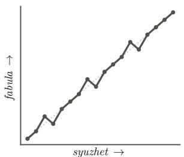  
(a) CHRONICLE, τ = +0.96

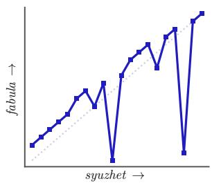  
(b) ANALEPSIS, τ = +0.68

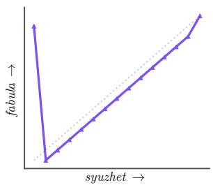  
(c) PROLEPSIS, τ = +0.75

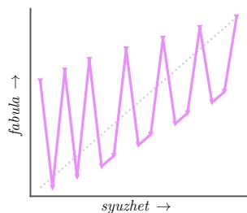  
(d) ZIGZAG, τ = +0.43

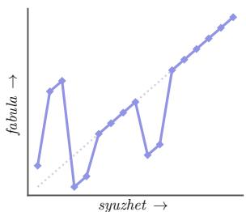  
(e) SYLLEPSIS, τ = +0.62

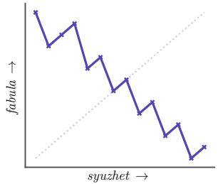  
(f) RETROGRADE, τ = −0.82

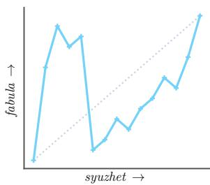  
(g) ACHRONY, τ = +0.26  
Figure 6: The seven shapes, each drawn from the corpus work nearest its category’s median in (τ, LIS). Told position runs across and chronological position up, so chronological order is the dotted diagonal. Published RETROGRADE descends in steps with short forward runs, not in the straight corner-to-corner line models return (§5.1.2). Colors match Figure 8.

ZIGZAG. Two periods alternate on a regular beat, each progressing in a consistent direction, with paired scenes related by echo, explanation or contrast. The line makes a regular sawtooth. In Memento, the black-and-white scenes move forward while the color scenes move backward; their interleaving illustrates how a zigzag can combine strands with different temporal directions (Kim et al., 2018).

SYLLEPSIS. No timeline dominates; the scenes are grouped by something other than time, such as place, character, theme or object. The test the corpus applies is whether the grouping principle can be stated in a sentence. The line is blocky, orderly inside each block and unordered between them. For instance, the multiple plotlines of Pulp Fiction and Love Actually can be used to illustrate this grouping principle (Kim et al., 2018).

RETROGRADE. The telling runs backwards. The panel shows what published reverse chronology actually looks like and why it matters to this paper: a descending staircase, not a descending line. Scenes are told in reverse order while each scene plays forward inside itself, so the line falls step by step with a short forward run on every step. The color strand of Memento offers a familiar example: successive scenes lead back to earlier events (Kim et al., 2018). The pure reversal, a single line from top left to bottom right, is the shape no work in the corpus has and the one models produce when instructed (§5.1.2).

ACHRONY. In the broader narratological sense, achrony describes a telling whose temporal relations cannot readily be established, $e . g .$ , Robbe-Grillet (1959)’s La Jalousie. The corpus uses a narrower operational label: the chronology must remain reconstructable, while the telling follows no statable ordering pattern and is not merely awaiting a late reveal (§3). The line wanders. The definition the models saw (§L) describes a telling whose chronological ranks cannot be assigned, which is the case the corpus excludes. This partly explains the low ACHRONY recall reported in §5.2.2.

## B Experimental setup in detail

This appendix gives the setup details that $\ S 4$ summarizes.

What the models see. Each base prompt for $\mathrm { T } _ { 1 } -$ $\mathrm { T _ { 4 } }$ and $\mathrm { T _ { 5 } ^ { a } / T _ { 5 } ^ { b } }$ lists one self-contained event sentence per line. $\mathrm { T _ { 1 } , \mathrm { ~ T _ { 2 } , \mathrm { ~ T _ { 5 } ^ { a } ~ } } }$ and $\mathrm { T } _ { 5 } ^ { \mathrm { b } }$ receive the events in chronological order; $\mathrm { T _ { 3 } }$ and $\mathrm { T _ { 4 } }$ receive them in the gold telling order. A model never sees the story id, either order column, scene annotations, metrics, annotator notes, graphs, or the deanonymization key. §L gives the verbatim prompts and §I the decoding and scoring conventions.

Reconstruction controls. $\mathrm { T _ { 3 } }$ normally receives the gold telling order. To test how much of its score comes from that order rather than from the event descriptions, three selected models also reconstruct chronology from a shuffled event list. We call this shuffled-input score the reconstruction baseline or no-storyfloor; it is measured for these three models rather than for every evaluated model. The full-telling and shuffled-input conditions are also rerun on descriptions rewritten by a model to remove explicit time cues, such as dates and “years earlier” (Table 8). In both reconstruction conditions, indices identify event lines rather than gold chronological ranks (§I).

Graph conditions. $\mathrm { G } _ { 0 } , \mathrm { G } _ { 1 }$ and $\mathrm { G _ { 2 } }$ all retain the Ta5 target-shape cue; only the graph or order input differs, and none uses $\mathrm { T _ { 5 } ^ { b } }$ . Each ablation removes one annotation group from $\mathrm { G _ { 1 } }$ together with its description in the prompt. The main graph conditions use 4 models; the ablations use the 2 generators that ran all conditions, with one replicate. The graph study comprises 476 stories and 252 blindly judged pairs (Table 3).

Band hit and pooled scores. A band hit measures resemblance to corpus examples; it does not fully test a narrative shape, because different structures can share both scores and a telling outside the band may still follow the shape. Pooled scores average valid rows of the 19 evaluated models; higher-effort runs, permutation baselines and the human reference are reported separately.

Psychological depth. The judge rates authenticity, empathy, engagement, emotion provocation and narrative complexity from 1 to 5 using the Psychological Depth Scale (Harel-Canada et al., 2024); readers use the same scales during close readings.

Premature disclosure. For each work with a designated reveal, we take the REVEALS edge whose explanation appears latest in the gold telling. Disclosure is early if fewer than three events precede that explanation’s aligned first mention (§J).

Reader statistics. Reader preference rates exclude ties. We report exact binomial tests and 95% cluster-bootstrap intervals, resampling separately over readers and stories (Dror et al., 2018); the Bonferroni threshold is 0.0042 for twelve tests. Lengthadjusted rates use generalized estimating equations with word-count difference and reader clusters; length-matched subsets contain pairs whose lengths differ by at most 40 words (§N).

## C Related work, in detail

§2 states where this work sits. This section discusses each line of work it draws on.

Narratology. Thefabula / syuzhet distinction and the vocabulary our taxonomy uses, from analepsis and prolepsis to syllepsis and achrony, come from Genette (1980). The seven structural shapes of §3 partition that vocabulary into labels a scene permutation can be read against, which is the step that turns a critical vocabulary into something an experiment can score.

Story generation with language models. Hierarchical generation separates a premise from its realization (Fan et al., 2018), Plan-and-Write constructs a storyline before prose (Yao et al., 2019), and Re3 combines planning, repeated prompting and revision for longer stories (Yang et al., 2022). Tian et al. (2024) show that model-written narratives are structurally homogeneous relative to human ones; §5.1.1 reproduces that result on a controlled corpus and sharpens it, because holding the events fixed removes the possibility that the difference is in what happens rather than in how it is told. Xie and Riedl (2024) plan iteratively for suspense and Li et al. (2025) for plot coherence. Suspense planning is a close case for us, since withholding is a discourse decision and therefore a statement about the told order.

Controlling the order of telling. Two lines target the variable we study. Yu et al. (2025) simulate characters with multiple agents and then rewrite the chronological simulation into narrative order, which makes the two orders explicit inside a system rather than inside a corpus. Han et al. (2022) guide flashback generation through temporal prompts between neighboring events, which is local control of the same variable. Our benchmark complements both by representing the telling order as a permutation that can be specified, scored and compared against published practice across seven structural categories while the events stay fixed, which is what makes the over-compliance of §5.1.2 visible at all. A check on direction alone would score it as compliance.

Discourse order before language models. Separating the order of telling from chronology has computational precedent. Montfort (2007) formalizes Genette’s categories of order in an interactivefiction system that narrates one simulated event model in different, non-chronological orders. Planbased generators place flashback and foreshadowing to arouse surprise (Bae and Young, 2008) and select and order story content to evoke suspense (Cheong and Young, 2008). Story Intention Graphs annotate a text against a timeline layer (Elson, 2012), and Mani (2012) surveys how narrative time has been modeled computationally. Story Curves aligns the two scene orders for a set of films (Kim et al., 2018). What we add is scale across seven shapes and 83 works, a typed graph over the same events, and a benchmark that scores language models against published practice.

Temporal ordering. Recovering chronology from text is a long-standing task in its own right, from TimeBank (Pustejovsky et al., 2003) and TempEval (UzZaman et al., 2013) to the multi-axis scheme of Ning et al. (2018). Chambers and Jurafsky (2008) is the closest ancestor of our framing, because it treats event order as narrative structure rather than as pairwise relation labeling. Those resources annotate relations inside a text as given; we annotate the permutation between two orders of the same events, which makes the telling order a target one can specify rather than only a label one can recover. Our $\mathrm { T _ { 3 } }$ is a document-level instance of their task, and §5.2.1 is why the connection matters: any ordering evaluation over self-contained event sentences is exposed to the entailment floor we measure there. Sentence-ordering benchmarks built on ROCStories (Mostafazadeh et al., 2016) are the nearest analogue of $\mathrm { T _ { 3 } }$ . They also ask for the order of self-contained sentences, so the same floor applies to them.

Evaluation instruments. We adopt the Psychological Depth Scale of Harel-Canada et al. (2024) unchanged for reader-experience ratings, and follow Piper and Bagga (2024) in treating narrative discourse properties as things a language model can be probed for. Closest to our retrospectivecoherence measure is Wagner et al. (2025), who pair surprise with coherence without a reference by simulating readers who guess a culprit in detective fiction. Because our corpus carries a gold chronology and gold reveal annotations, we score against a known answer rather than a proxy, and across all seven structural categories rather than whodunits alone.

Judges and readers. Automated pairwise preference is standard and its biases are catalogued: position, verbosity and self-enhancement (Zheng et al., 2023), with the verbosity effect large enough to warrant the regression adjustment of Dubois et al. (2024) that removes one of our own results (§5.5.1). Readers are themselves barely above chance at spotting machine text (Clark et al., 2021) and such studies rarely report enough to interpret (Karpinska et al., 2021), so we hold the texts, the question and the items fixed and ask where a judge and a reader cohort part company. Agreement is reported with chance-corrected coefficients throughout (Artstein and Poesio, 2008; Krippendorff, 2018) and every test is stated against the dependence structure the design has (Dror et al., 2018). The closest work to our RQ5 is Chiang and Lee (2023), who compare model ratings of stories with those of English teachers. HANNA and its successor test automatic story evaluation against human criteria (Chhun et al., 2022, 2024), and Chakrabarty et al. (2024) find model judges misaligned with expert assessments of creative writing. Zheng et al. (2023) report that judge–human agreement rises with the performance gap between the systems compared. Our four comparisons show no such ordering at the item level, and our judge returned ties on two comparisons that readers split about 70 to 30. We therefore state the lesson as “a judge’s tie is not evidence of no difference” and not as a threshold on effect size.

Visualization. Story Curves already aligns narrative and chronological scene orders in nonlinear films (Kim et al., 2018). Figure 7 adapts its story curve; our corpus adds shared event descriptions, typed narrative graphs and model tasks to that paired-order setting. Color encodes jump direction rather than focal character, because our stories reach 23 characters, and direction is encoded twice, by hue and by slope, which addresses the axis confusion the original study reports in its own participants.

## D Formal analysis

This appendix collects the formal statements §3 and §4.2 summarize, and the three short results §5.1 points at. Nothing here is assumed by the experiments; it says what the scores can and cannot see. $\ S O$ proves everything stated.

## D.1 Definitions used throughout

Let $E = \left( e _ { 1 } , \ldots , e _ { n } \right)$ be the events of a work in chronological order and $S _ { n }$ the permutations of $\{ 1 , \ldots , n \}$ . A telling is

$$
T _ { \sigma } = ( e _ { \sigma ( 1 ) } , \ldots , e _ { \sigma ( n ) } ) , \qquad \sigma \in \mathcal { S } _ { n } ,\tag{1}
$$

$\sigma ( i )$ is the chronological rank at told position $i ,$ chronology is the identity, and the telling is nonlinear when $\sigma \ne$ id. Each work supplies a gold telling $\sigma ^ { \star }$ and a category $c ^ { \star } \in { \mathcal { C } }$ with $| { \mathcal { C } } | = 7$

Writing $D ( \sigma )$ for the number of told position pairs $\textit { i } < \textit { j }$ with $\sigma ( i ) > \sigma ( j )$ , forwardness is Kendall’s τ (Kendall, 1938),

$$
\tau ( \sigma ) = 1 - { \frac { 2 D ( \sigma ) } { \binom { n } { 2 } } } ,\tag{2}
$$

and $\mathrm { L I S } ( \sigma ) = \ell ( \sigma ) / n$ is the normalized longest increasing subsequence, whose $\ell ( \sigma )$ events need not be adjacent in the telling. For category c, let $\tau _ { c } ^ { - } , \tau _ { c } ^ { + }$ and $L _ { c } ^ { - } , L _ { c } ^ { + }$ be the minima and maxima of τ and LIS over the gold tellings of that category. Band hit is

$$
\begin{array} { c } { B _ { c } = [ \tau _ { c } ^ { - } , \tau _ { c } ^ { + } ] \times [ L _ { c } ^ { - } , L _ { c } ^ { + } ] , } \\ { \mathrm { h i t } ( \sigma , c ) = \mathbf { 1 } \{ ( \tau ( \sigma ) , \mathrm { L I S } ( \sigma ) ) \in B _ { c } \} . } \end{array}\tag{3}
$$

Agreement with the gold telling of a model order $\hat { \sigma } \overset { \cdot } { \mathrm { i s } } \tau ( ( \sigma ^ { \star } ) ^ { - 1 } \circ \hat { \sigma } )$

What the pair (τ, LIS) cannot separate. Band hit reads two coordinates, and distinct structures share them. With $ { n _ { \mathrm { ~ \scriptsize ~ = ~ 6 ~ } } }$ , the tellings $( 1 , 2 , 5 , 6 , 3 , 4 )$ and $( 1 , 3 , 5 , 2 , 6 , 4 )$ both have $\tau =$ $7 / 1 5$ and $\mathrm { L I S } = 4 / 6$ , so no band can tell them apart, yet the first has two hops and the second five. Enumerating every telling at $n = 9$ gives 136 distinct $( \tau , \mathrm { L I S } )$ cells, 112 of which hold more than one hop count and 69 more than one label under the operational tests of §L, up to three of the seven in a single cell. Two summary statistics therefore cannot identify seven semantically defined shapes, which is why band hit is reported as resemblance to published practice and never as a shape test, and why Tables 6 and 3 print agreement with the gold telling beside it.

The five tasks of §4.1 map as

$$
\begin{array} { r l } & { \mathrm { T } _ { 1 } : \quad ( E , c ^ { \star } ) \longmapsto \hat { \sigma } \in { \mathcal S } _ { n } , } \\ & { \mathrm { T } _ { 2 } : \quad E \longmapsto \hat { \sigma } \in { \mathcal S } _ { n } , } \\ & { \mathrm { T } _ { 3 } : \quad T _ { \sigma ^ { \star } } \longmapsto \hat { \pi } \in { \mathcal S } _ { n } , } \\ & { \mathrm { T } _ { 4 } : \quad T _ { \sigma ^ { \star } } \longmapsto \hat { c } \in { \mathcal C } , } \\ & { \mathrm { T } _ { 5 } ^ { \mathrm { a } } / \mathrm { T } _ { 5 } ^ { \mathrm { b } } : \quad ( E , c ^ { \star } ) \mathrm { o r } E \longmapsto Y , } \end{array}\tag{4}
$$

with $Y$ story prose. $\mathrm { T _ { 3 } }$ returns indices into the presented telling arranged chronologically, so its target is $\pi ^ { \star } = ( \sigma ^ { \star } ) ^ { - 1 }$ and its two scores are

$$
\tau _ { \mathrm { r e c } } = \tau ( \sigma ^ { \star } \circ \hat { \pi } ) , \qquad \mathrm { e x a c t } = { \bf 1 } \{ \hat { \pi } = \pi ^ { \star } \} .\tag{5}
$$

## D.2 Hops

The rest of this appendix states three results and what each one predicts. Write a telling of n events as a permutation σ, where $\sigma ( i )$ is the chronological rank of the event told at position i, so that chronology is the identity.

Definition 1 (Hop, run). Position $i < n$ is a hop of σ if $\sigma ( i + 1 ) \neq \sigma ( i ) + 1$ , that is, if the telling does not simply continue with the next thing that happened. $h ( \sigma )$ is the number of hops. The maximal hop-free stretches of σ are its runs, with lengths $b _ { 1 } , \ldots , b _ { h + 1 }$ summing to n.

A hop is the unit of nonlinearity, and a nonlinear telling is a multi-hop plan. At every hop the writer must decide where in chronology to go next, and the reader must work out where they have landed. A hop also has a price in the scores of $\ S 3$ , because both are arithmetic on the permutation.

Proposition 1 (What hops cost). For every telling σ ofn events with runs $b _ { 1 } , \ldots , b _ { h + 1 }$

(i) $h ( \sigma ) = 0$ if and only if σ is chronology;

(ii) $\begin{array} { r } { \mathrm { L I S } ( \sigma ) \geq \operatorname* { m a x } _ { j } b _ { j } / n \geq 1 / ( h + 1 ) ; } \end{array}$

(iii) $\begin{array} { r } { \tau ( \sigma ) \geq - 1 + 2 \sum _ { j } { \binom { b _ { j } } { 2 } } / { \binom { n } { 2 } } } \end{array}$ , with equality exactly when the runs are told in decreasing chronological order, in which case $\operatorname { L I S } ( \sigma ) =$ maxj $b _ { j } / n ;$

(iv) at most $( h + 1 ) ( n - 1 ) ^ { h }$ tellings have exactly h hops.

Takeaway. Nonlinearity is paid for hop by hop. A telling with few hops must keep a long forward run, but it need not have a positive τ. With $n = 6 ,$ the telling $( 4 , 5 , 6 , 1 , 2 , 3 )$ has one hop and $\tau = - 0 . 2$ the value (iii) gives for two runs of three, so (ii) and (iii) constrain run length and still allow a negative τ . The number of tellings to choose among grows at most like $n ^ { h } { } _ { : }$ , and the only telling that costs no hop is chronology.

Remark. On $\mathrm { T _ { 2 } }$ the human tellings hop at 0.502 of their positions and the pooled model output at 0.298, and 18 of the 19 models hop less often than the human telling of the same works. When the model writes prose, where every hop must also be written, hops all but vanish $( \tau = 0 . 9 8 9 )$ . The proposition does not say why a generator spends hops sparingly, only that sparing hops and telling it straight are the same thing, which is RQ1.

Proposition 2 (The rule and the practice). Let the n events be partitioned into k scenes of sizes $s _ { 1 } , \ldots , s _ { k } ,$ , each contiguous in chronology.

(i) The reversal $n , \ldots , 1$ is the only telling with $\tau = - 1$ . It has $n - 1$ hops and $\mathrm { L I S } = 1 / n$

(ii) The scene-level retrograde, which tells the scenes in reverse chronological order and the events ofeach sceneforward, has $k - 1$ hops, $\mathrm { L I S } = \operatorname* { m a x } _ { j } s _ { j } / n ,$ , and

$$
\tau = - 1 + 2 \sum _ { j = 1 } ^ { k } { \binom { s _ { j } } { 2 } } { \Big / } { \binom { n } { 2 } } ,
$$

which exceeds 1 as soon as one scene holds two events.

(iii) Symmetrically, the identity is the only telling with $\tau = + 1$ , so a chronicle that reorders even one pair of simultaneous events leaves it.

Takeaway. The RETROGRADE rule of §L is stated on events, and on events it has exactly one solution, the mechanical extreme. The human practice is the same rule applied one level up, on scenes, and reaching it takes a step the rule never states, deciding where the scenes are.

Remark. 93.6% of RETROGRADE outputs are the reversal of (i), the point $( - 1 , 1 / n )$ where the violet stack sits in Figure 8. No human work is there. Every retrograde work in the corpus keeps a forward run of at least 2 events, and 5 of the ten are exactly the scene-level retrograde of (ii), whose formula returns their τ to three decimals. The rest sit above that value, never below it. The proposition says the missing step is a segmentation, not that it is hard. Our prompts never mark the scenes (§4.1), so the rule the models were given is the event-level one, and the small effort ablation of §I cannot say whether more test-time compute would supply the step.

## D.3 Pinned pairs

The second half of the paper turns on scores that give partial credit, and one piece of arithmetic covers the no-story floor, the RCG ceiling and the scaffold leak.

Definition 2 (Pinned pair). Fix a target order on n events and a solver that returns an order. A pair of events is pinned if the solver places it as the target does with probability one. Write λ for the share of the $\binom { n } { 2 }$ pairs that are pinned and α for the solver’s mean accuracy on the rest.

Lemma 3 (Partial credit). The solver’s expected Kendall τ against the target is

$$
\mathbb { E } [ \tau ] \ : = \ : \lambda + ( 1 - \lambda ) ( 2 \alpha - 1 ) .
$$

If the solver is exchangeable over some set of w events, no two of which are pinned to each other, then Pr[exact match] $\leq 1 / w !$

Takeaway. A partial-credit score starts at the pinned share, which is λ for a solver that knows nothing else $\begin{array} { r } { ( \alpha = \frac { 1 } { 2 } ) , } \end{array}$ , and every further point has to be earned on the unpinned pairs. An all-ornothing score is at most 1/w! however many pairs are pinned.

Corollary 4 (The floor, the ceiling and the leak). Let $\lambda _ { E }$ be the share of event pairs whose order the event sentences themselves entail, and $\lambda _ { G }$ the share of told-order pairs fixed by the transitive closure of the graph’s REVEALS edges and question pairs. Assume throughout that the solver obeys every entailed pair, so that entailment and pinning coincide. Entailment alone does not make a pair pinned in the sense of Definition 2.

(a) A solver that reads no telling and is otherwise uninformed has $\mathbb { E } [ \tau _ { \mathrm { r e c } } ] = \lambda _ { E } ,$ and no telling can add more than $1 - \lambda _ { E }$ to it.

(b) For any solver that keeps the entailed pairs and is no worse than chance on the rest, $\mathbb { E } [ \mathrm { R C G } ] \leq 1 - \lambda _ { E }$ with $\lambda _ { E }$ read off the prefix, and so is any difference of two reconstruction scores.

(c) A generator with pair accuracy α against the gold telling gains exactly $2 \lambda _ { G } ( 1 - \alpha ) \leq$ $2 \lambda _ { G }$ in expected agreement when the graph’s pinned pairs are handed to it and nothing else changes. Supplying the told order directly sets $\lambda = 1$

Remark. (a) reads the floor of §5.2.1 as the entailed share. Here $\lambda _ { E }$ covers anything that pins a pair without the telling, whether entailment between the sentences or, for a recognizable work, prior knowledge of it, and the corollary cannot tell the two apart. A no-story solver reaches 0.849, so the telling can add at most 0.151, and it adds +0.035. Removing every date moved the floor by -0.005 (Table 8), so dates carry almost no pins, and the exactmatch floor of 8.5% is the $1 / w !$ term. A solver above chance on the unpinned pairs makes the entailed share smaller than the floor and the headroom larger, so the floor bounds $\lambda _ { E }$ from above. (b) is why §5.4 declines to interpret RCG, whose ceiling of 0.12 is computed exactly as $1 - \tau _ { \mathrm { r e c } } ( T _ { < m } )$ . (c) with $\lambda _ { G } = 5 . 5 \%$ caps the graph’s free agreement with the gold telling at 0.111 τ. That cap is on τ alone. The pinned pairs are the ones a reveal turns on, so their weight in a reader’s preference need not be their weight in τ, which is why §5.3 controls with a condition that supplies the order rather than with the share. Two limits apply when reading the corollary empirically. First, as noted above, a measured no-telling score bounds $\lambda _ { E }$ from above but does not identify it, because a solver above chance on the unpinned pairs reaches the same score with a smaller entailed share. Second, (c) holds only while accuracy on the unpinned pairs is unchanged, so a graph that also changes how a model orders everything else can move agreement by more or less than $2 \lambda _ { G } ( 1 - \alpha )$

<table><tr><td>What we found</td><td></td><td>What to be careful about</td></tr><tr><td>RQ1</td><td>Every model tells a story more chronologically than its published telling; cued for a shape, band hit is 47.9%, and the two misses are the literal solutions of rules stated on events.</td><td>The reference works were chosen for nonlinearity, both free tasks list events chronologically, and no prompt marks scenes. Band hit is negatively associated with reader preference, partly through condition (§5.5.4).</td></tr><tr><td>RQ2</td><td>Reconstruction reaches  $\tau _ { \mathrm { r e c } } = 0 . 7 4 3 ;$  naming the shape reaches 50.2%, with  $\mathrm { \bf A N A L E P S I S }$  a sink.</td><td>96.1% of that τ is reachable with the story deleted (by entailment or prior knowledge of the work), and readers reach only 0.537: report the floor, prefer exact match.</td></tr><tr><td>RQ3</td><td>The graph raises compliance from 41.1% to 51.8%, almost all in one model, and readers prefer it to a supplied told order 72% of the time.</td><td>The judge saw no effect, and the two prompts differ in more than the graph. The edge over an event list is a length effect, and readers prefer every one-layer ablation to the full graph.</td></tr><tr><td>RQ4</td><td>Cued tellings lose to a model&#x27;s own free telling under the judge (68–19) and readers (76%), even for CHRONICLE. As scored, the reveal comes after fewer than three events in 21.4% of stories.</td><td>Two scoring cases inflate the early rate (8.3% without them). Retrospective coherence gain is capped near 0.12 by the same floor.</td></tr><tr><td>RQ5</td><td>The judge matches 71 readers on the one large effect, and readers overturn both of its ties (κ = —0.030 on layer removal).</td><td>Item-level agreement does not track effect size; fourteen stories, two generators in the layer-removal study, no comparison against human-written prose.</td></tr></table>

Table 5: The paper at a glance. The reader study revised the shaded rows.

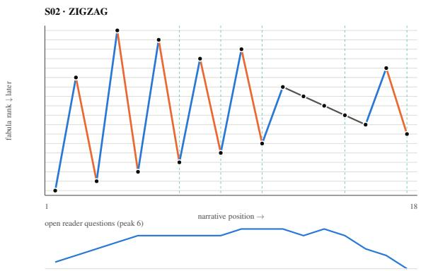  
Figure 7: Story curve of one annotated work. Top: told position across, chronological rank up. Color and slope both encode jump direction, and dashed rules mark where a withheld explanation lands. Bottom: reader questions left open after each told position. This work opens six and closes all of them.

## E Supporting tables and figures

## E.1 Where a reversal happens

§5.1.2 says that published reverse chronology runs backwards between scenes while playing forwards inside them, and that a model told to run backwards reverses everything. That is a claim about pairs of events, so it can be counted. For every pair in a work we ask whether the telling presents the two in reverse chronological order, and we split the pairs by whether they sit inside one annotated scene or across two.

The two populations separate on the withinscene axis alone (Figure 11). Across the 10 RET-ROGRADE works, published tellings reverse 94.0% of between-scene pairs and 0.0% of within-scene pairs: the scene is the unit that gets reversed, and nothing inside it is disturbed. The 196 cued model outputs for the same works reverse 98.8% of between-scene pairs, which matches the human rate, and 98.0% of within-scene pairs, which does not. 93.9% of them reverse every pair in the work.

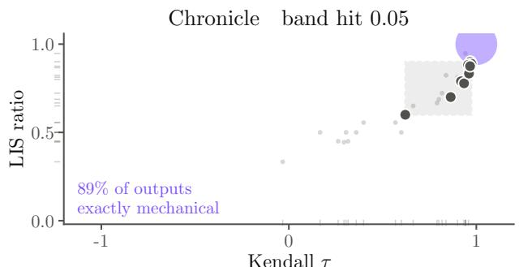

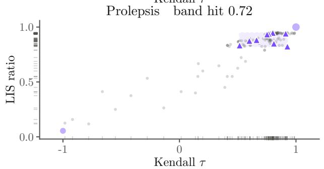

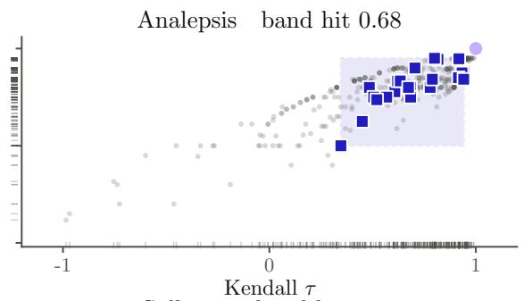

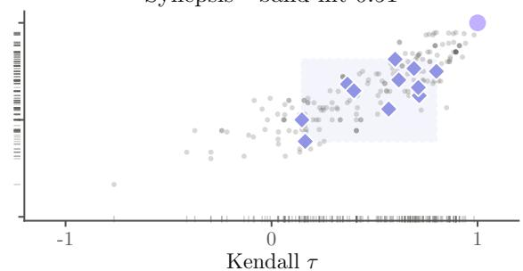

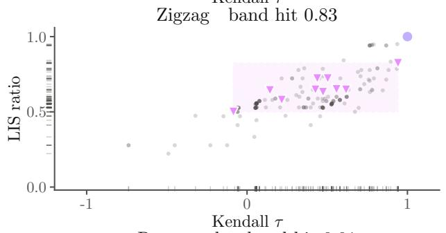

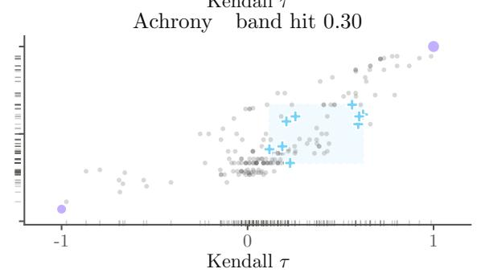

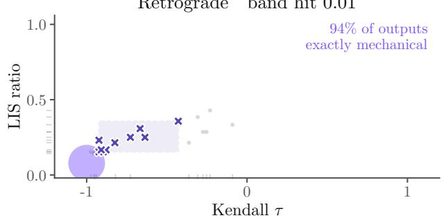  
published work model telling identity or reversal human band  
Figure 8: The structural plane, one panel per requested structure: the (τ, LIS) region the gold annotations occupy (dashed box), those works (large marks), and every valid cued telling (small dots). Outputs that are the exact identity or reversal stack on one coordinate and are drawn once, in violet, with area proportional to their share. The two failing categories are dense stacks at the ends of the scale, not near-misses. Ticks along the two axes give the marginal distribution of the valid tellings, which the overlapping cloud inside the panel obscures.

This is the mechanism behind the band-hit figure rather than a second result. A model asked for reverse chronology does the between-scene half correctly and then keeps going, and the extra work it does is precisely the work a published author declines to do. The distinction is invisible to τ , which counts all pairs alike, and it is why §5.1.2 reports the exact-permutation rate beside the band.

Table 7 breaks the four reader comparisons down by requested structure. Two patterns stand out, and both match §5.1.2. The instructed telling loses most heavily on ACHRONY and ZIGZAG and not at all on RETROGRADE: where the instruction reduces to a mechanical rule, a model that applies it literally still produces something readers find no worse than its own chronological telling, because a clean reversal is at least navigable. And the graph’s advantage over a supplied told order is largest on ZIGZAG and SYLLEPSIS, the two shapes whose definition turns on something other than a position in time. Those are exactly the shapes where a permutation alone underspecifies the telling and the graph’s typed content has something left to say. Per-category counts are small, so we read the ordering and not the individual rates. Two rows qualify §5.4 and §5.5.1. The instructed telling also loses on CHRONICLE (0.32, $n = 3 7$ , exact binomial $p = 0 . 0 4 7$ before correction for the 28 cells). There the instruction asks for chronological order, so the cued story should differ little in order from the free one, and part of the cost comes from the instruction rather than from nonlinearity. The graph also still beats the told order on CHRONICLE $( 0 . 6 5 , n = 3 1 )$ , where both conditions are essentially chronological and there is no order to justify. This points to the graph’s content rather than to a reason for the order.

<table><tr><td>Requested structure</td><td>band hit</td><td>model T</td><td>human T</td><td>agree exact</td><td>gold form.</td></tr><tr><td>Zigzag</td><td>0.826</td><td>0.407</td><td>0.423</td><td>0.396</td><td></td></tr><tr><td>Prolepsis</td><td>0.721</td><td>0.671</td><td>0.755</td><td>0.635</td><td></td></tr><tr><td>Analepsis</td><td>0.684</td><td>0.637</td><td>0.696</td><td>0.552</td><td></td></tr><tr><td>Syllepsis</td><td>0.507</td><td>0.516</td><td>0.526</td><td>0.355</td><td></td></tr><tr><td>Achrony</td><td>0.300</td><td>0.171</td><td>0.363</td><td>0.220</td><td></td></tr><tr><td>Chronicle Retrograde</td><td>0.053 0.011</td><td>0.957 -0.973</td><td>0.912 -0.781</td><td>0.878 0.764</td><td>0.889 0.936</td></tr></table>

Table 6: $\mathrm { T _ { 1 } }$ by requested shape, pooled over models (§5.1.2). The last column is the share of exact identities (CHRONICLE) or reversals (RETROGRADE), which make up the two near-zero band-hit rows.

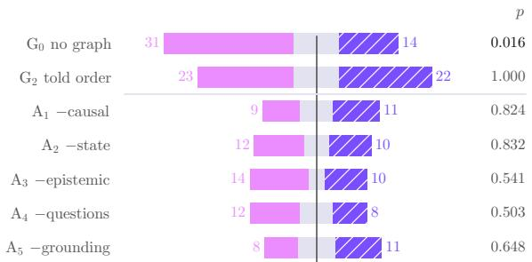  
$\mathrm { G _ { 1 } }$ preferred  ties  the other condition preferred  
Figure 9: Judge verdicts for every scaffolding comparison: blind judgment counts with ties centered, and two-sided exact binomial $p$ over decisive pairs. $\mathrm { G _ { 1 } }$ beats $\mathrm { G } _ { 0 }$ and no other difference is detected. Readers revise two of these rows (§5.5).

## F The reader study in full

§5.5 reports the four preference comparisons and the two instrument checks the paper’s conclusions turn on. This appendix holds the rest of the reader study: how far readers agree with each other and with themselves, how their chronology reconstruction compares with the models’, three checks on the design, and what the single close readings add. Every number here is computed from the recorded responses.

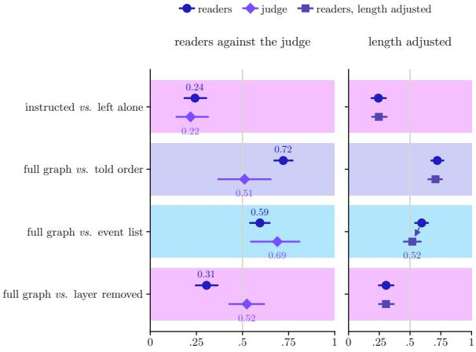  
share of decisive verdicts favoring the first condition  
Figure 10: Share of decisive verdicts favoring the firstnamed condition, from 71 readers and from the judge, with 95% intervals (reader-clustered bootstrap for readers, exact binomial for the judge). The right panel repeats the reader rates after length adjustment. The judge’s rate matches the readers’ on instructed versus free and on graph versus event list. On the other two comparisons, graph versus told order and graph versus one layer removed, the judge returns ties, and these are where readers found the clearest differences.

## F.1 Do readers agree with each other?

Which is the better story is a question readers answer consistently enough to build on. Which has the better ending is not.

Between readers. On better story, $\alpha = 0 . 4 1 5$ ([0.359, 0.471] over 311 items), rising to 0.595 once ties are set aside. On harder to follow it is 0.112 and on better ending 0.073 (Table 10). These are low numbers by the standards of a labeling task and ordinary ones for aesthetic judgment; what matters is the ordering, which is stable across all eight comparison kinds (0.21–0.55 on better story).

Within a reader. Once per sitting a comparison the reader had already judged came back with the sides swapped and no announcement. Someone answering by position rather than by reading scores near zero here. Readers reproduced their own earlier verdict 76% of the time on better story $( \kappa = 0 . 6 0 1 )$ , 62% on harder tofollow and 57% on better ending, against 39%, 38% and 36% expected from answering each question at the same mix at random (Table 10). Restricted to repeats where both answers were decisive, agreement on better story is 93%.

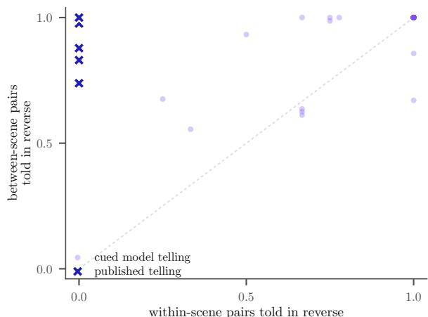  
Figure 11: Where a reversal happens, for the 10 RET-ROGRADE works. Each point is one telling: the share of its within-scene event pairs told in reverse against the share of its between-scene pairs. Published tellings sit on the left wall, reversing scenes and leaving their contents alone. Cued model outputs pile into the top right corner, reversing both. The two populations differ on the horizontal axis only.

<table><tr><td></td><td colspan="2">instructed vs. free</td><td colspan="2">graph vs. told order</td><td colspan="2">graph vs. event list</td><td colspan="2">graph vs. layer removed</td></tr><tr><td>Requested structure</td><td>rate</td><td>n</td><td>rate</td><td></td><td>n rate</td><td></td><td>n rate</td><td>n</td></tr><tr><td>ZIGZAG</td><td>0.12</td><td>33</td><td>0.96</td><td></td><td>230.65</td><td></td><td>170.43</td><td>37</td></tr><tr><td>ACHRONY</td><td>0.05</td><td></td><td>400.73</td><td></td><td>37 0.49</td><td></td><td>39 0.28</td><td>36</td></tr><tr><td>PROLEPSIS</td><td>0.15</td><td></td><td>41 0.63</td><td></td><td>35 0.72</td><td></td><td>29 0.26</td><td>39</td></tr><tr><td>SYLLEPSIS</td><td>0.21</td><td>33</td><td>0.88</td><td></td><td>34 0.90</td><td></td><td>400.26</td><td>38</td></tr><tr><td>ANALEPSIS</td><td>0.34</td><td></td><td>380.74</td><td></td><td>47 0.48</td><td></td><td>42 0.16</td><td>32</td></tr><tr><td>CHRONICLE</td><td>0.32</td><td></td><td>37 0.65</td><td></td><td>31 0.54</td><td></td><td>410.32</td><td>31</td></tr><tr><td>RETROGRADE</td><td>0.48</td><td></td><td>420.57</td><td></td><td>44 0.49</td><td></td><td>51 0.39</td><td>46</td></tr></table>

Table 7: Reader preference by requested structure. rate is the share of decisive judgments favoring the firstnamed condition. The instructed telling loses most on ZIGZAG, ACHRONY and PROLEPSIS, loses on CHRONI-CLE too, and draws level on RETROGRADE. The graph’s advantage over the told order is largest where the shape is least mechanical, and holds on CHRONICLE.

Two more instrument checks. Side choice leans very slightly right (1,400 left, 1,511 right, 617 ties of $3 , 5 2 8 ; p = 0 . 0 4 1 5 )$ , which is small and, because sides are randomized per reader, favors no condition. On the shape-comprehension items readers scored 81.1% (1,430 of 1,764) against a chance baseline of 42%: 86% on whether the telling opens at the earliest event, 88% on whether it ends at the latest, and 69% on how many times it jumps backwards. That last figure is a useful calibration point. Counting backward jumps is the shape judgment to trust least, in a reader and, we would guess, in a model.

<table><tr><td colspan="2">Event list Telling</td><td>T</td><td>exact</td></tr><tr><td>as written</td><td>shuffled, none</td><td>0.849</td><td>0.085</td></tr><tr><td>as written</td><td>gold told order</td><td>0.884</td><td>0.202</td></tr><tr><td>de-dated</td><td>shuffled, none</td><td>0.844</td><td>0.096</td></tr><tr><td>de-dated</td><td>gold told order</td><td>0.878</td><td>0.181</td></tr></table>

Table 8: The de-dating 2 2 (§5.2.1), pooled over three strong models. Removing every absolute time anchor moves the no-story floor by only -0.005 τ, so the floor does not come from explicit dates. Prior knowledge of the works is not ruled out.

<table><tr><td></td><td>full graph pref.</td><td>of</td><td>rate</td><td></td></tr><tr><td>by layer removed</td><td></td><td></td><td></td><td></td></tr><tr><td>— CAUSES/FORESHADOWS</td><td>15</td><td>54</td><td>0.278</td><td>0.0015</td></tr><tr><td>- pre/post</td><td>16</td><td>49</td><td>0.327</td><td>0.0213</td></tr><tr><td>-learns</td><td>13</td><td>48</td><td>0.271</td><td>0.0021</td></tr><tr><td>— questions/REVEALS</td><td>17</td><td>51</td><td>0.333</td><td>0.0241</td></tr><tr><td>— participants/location</td><td>18</td><td>57</td><td>0.316</td><td>0.0075</td></tr><tr><td colspan="5">by generator, pooled over the five layers</td></tr><tr><td>Claude Sonnet 5</td><td></td><td>26 147</td><td>0.177</td><td>&lt; 0.0001</td></tr><tr><td>Gemini 3.6 Flash</td><td>53</td><td>112</td><td>0.473</td><td>0.64</td></tr><tr><td>pooled</td><td>79</td><td>259</td><td>0.305</td><td>&lt; 0.0001</td></tr></table>

Table 9: Reader verdicts on removing one graph layer. pref. counts decisive judgments for the full graph, so a rate below 0.5 favors the reduced graph. Every layer points the same way. The split by generator ( magenta large effect, lavender none) limits the result.

What reliability buys. Within-reader consistency is a reference point, and it is not a ceiling for a judge scored against a majority. It is 76% over all repeats and 93% where both answers were decisive, and §5.5.3 reports the judge’s agreement on decisive items next to the latter figure. The right yardstick for agreement with a majority is how often one reader agrees with the majority of the others on the same items. We have not yet computed this leave-one-reader-out baseline (§4.2).

## F.2 Reconstruction, done by a person

§5.2.1 showed that $\mathrm { T _ { 3 } }$ keeps 96.1% of its score with the story deleted, and concluded that events imply their own order. The close readings let us put a human number beside it. After reading one story properly, readers dragged its shuffled events into the order they believed things happened, scored against the same gold chronology the models are scored on.

They reach τ = 0.537 ([0.497, 0.562] clustered on readers, [0.488, 0.582] on stories) and recover the chronology exactly 2.7% of the time, over 294 readings. The same 14 stories give the models $\tau _ { \mathrm { r e c } } = 0 . 6 9 9$ , and 16 of 19 models sit above the reader mean. The no-story floor on those stories is 0.833, which is to say that a strong solver handed the events with the telling deleted beats a person who read the telling.

<table><tr><td></td><td>better story</td><td>harder to follow</td><td>better ending</td></tr><tr><td colspan="4">Between readers: Krippendorff&#x27;s α, 311 items</td></tr><tr><td>all three levels</td><td>0.415</td><td>0.112</td><td>0.073</td></tr><tr><td>95% CI</td><td>[0.359, 0.471]</td><td>[0.065, 0.157]</td><td>[0.031, 0.113]</td></tr><tr><td>decisive only</td><td>0.595</td><td>0.213</td><td>0.131</td></tr><tr><td colspan="4">Within a reader: hidden repeat, n = 294 each</td></tr><tr><td>agrees with own answer</td><td>0.759</td><td>0.619</td><td>0.571</td></tr><tr><td>chance at that mix</td><td>0.395</td><td>0.376</td><td>0.361</td></tr><tr><td>Cohen&#x27;s κ</td><td>0.601</td><td>0.390</td><td>0.331</td></tr><tr><td>tie rate</td><td>0.12</td><td>0.22</td><td>0.18</td></tr></table>

Table 10: Rater reliability. Between readers: nominal Krippendorff’s α with unequal coders per unit (Krippendorff, 2018), on a {favored side, other side, tie} recoding. Within a reader: agreement on a hidden repeat with sides swapped. Low agreement on the two right-hand questions is why the paper leads with better story.

This does not show that models read nonlinear narrative better than people. Readers worked from prose and event cards and models from the segmented telling, so the inputs are not comparable, and for the same reason it does not license a human ceiling. It does sharpen the reading of §5.2.1. Readers had strictly more information than the no-story solver, since they also had the telling, yet ordered the same events less well $( \tau = 0 . 5 3 7$ against a floor of 0.833). Either the drag-and-drop task is noisy (12–20 items, 2.7% exact), or the model floor draws on knowledge readers lack, such as familiarity with a recognizable work. Entailment alone, which careful readers could also use, does not explain the gap.

One further asymmetry is worth naming. What is hard for readers is not what is hard for models. Readers do worst on Zigzag and Achrony, the two shapes whose ordering rule is hardest to infer from the telling, one because it alternates and one because it has no rule, where they reach $\tau = 0 . 4 2 4$ and below, and best on Chronicle at 0.707. Across the seven categories the reader and model difficulty profiles show no rank correlation $( \rho = 0 . 1 8$ $p = 0 . 7 0 )$ . With seven points that is weak evidence, but it is the right shape of check to run before treating a model’s category-level difficulty as a proxy for anybody’s.

<table><tr><td></td><td>cued</td><td></td><td colspan="3">full graph against</td></tr><tr><td>Reader subset</td><td>n</td><td>vs. free</td><td>order</td><td>list</td><td>ablation</td></tr><tr><td>all readers</td><td>71</td><td>0.242</td><td>0.721</td><td>0.595</td><td>0.305</td></tr><tr><td>shape score  $\geq 6 0 \%$ </td><td>68</td><td>0.242</td><td>0.722</td><td>0.602</td><td>0.307</td></tr><tr><td>shape score  $\geq 7 5 \%$ </td><td>54</td><td>0.268</td><td>0.725</td><td>0.611</td><td>0.304</td></tr><tr><td>median reading  $\mathrm { t i m e } \geq 1 2 0 \mathrm { s }$ </td><td>70</td><td>0.245</td><td>0.722</td><td>0.590</td><td>0.304</td></tr><tr><td>reads ≥ 1 book/month</td><td>43</td><td>0.299</td><td>0.731</td><td>0.628</td><td>0.255</td></tr><tr><td>has writing training</td><td>40</td><td>0.309</td><td>0.728</td><td>0.642</td><td>0.274</td></tr></table>

Table 11: Headline rates under stricter reader subsets. order, list and ablation compare the full graph against the told order, the event list and the graph with one layer removed. Cells are the share of decisive judgments favoring the first-named condition, and n counts readers. Nothing moves by more than about 7 points, including the comparison that length adjustment removes.

## F.3 Three checks on the design itself

Did familiarity with a story help? Because only 14 works have prose, a reader doing several sittings met the same underlying story again under different conditions, up to 6 times, and 442 of 828 reader– story combinations occur more than once. Items were never repeated, so no single judgment is contaminated, but familiarity could plausibly make a later telling easier to follow. It does not. Regressing the verdict on exposure count, with readers as clusters, gives $\beta = + 0 . 0 4 0 \ ( p = 0 . 3 6 )$ on better story and $\beta = - 0 . 0 2 5 ( p = 0 . 7 0 )$ on harder to follow. The “harder to follow” rows are the ones this would have threatened, and they are flat.

Was confidence informative? Mean confidence was 4.21 of 5 (sd 0.85), high throughout, including on items where the cohort split near evenly. It is not pure noise: across items, distance from an even split tracks mean confidence at $r = + 0 . 2 6$ $( p < 0 . 0 0 0 1$ , 227 items). So confidence carries information about how hard an item was, and none we can detect about how good a reader is. Individual confidence should not be read as evidence that a difference is real.

Does any reader subset change the picture? No. Table 11 re-runs all four comparisons on readers who scored at least 60% and at least 75% on the shape items, readers whose median reading time was at least two minutes, readers who finish at least a book a month, and readers with writing training. The largest movement is about 7 points, on cued against free among readers with writing training. Median reading time was 199 s per close-read text (interquartile 154–246 s), and no reader had a median under 99 s, so nobody was clicking through.

<table><tr><td></td><td> $\bf { G _ { 0 } }$  events + shape</td><td> $\mathbf { G _ { 1 } }$  full graph</td><td>instructed prose (Ta)</td></tr><tr><td>close readings (n)</td><td>69</td><td>77</td><td>148</td></tr><tr><td colspan="4">Psychological Depth Scale, 1–5</td></tr><tr><td>authenticity</td><td>3.61</td><td>3.99</td><td>3.22</td></tr><tr><td>empathy</td><td>3.33</td><td>3.74</td><td>3.11</td></tr><tr><td>engagement</td><td>3.68</td><td>3.91</td><td>3.42</td></tr><tr><td>emotional effect</td><td>3.38</td><td>3.74</td><td>3.16</td></tr><tr><td>narrative complexity</td><td>3.87</td><td>4.13</td><td>3.66</td></tr><tr><td>composite</td><td>3.57</td><td>3.90</td><td>3.31</td></tr><tr><td colspan="4">Chronology recovered from the prose</td></tr><tr><td>mean τ against gold</td><td>0.572</td><td>0.519</td><td>0.531</td></tr><tr><td>exact (%)</td><td>1.4</td><td>1.3</td><td>4.1</td></tr><tr><td colspan="4">What readers reported</td></tr><tr><td>gold questions answered (%)</td><td>72</td><td>76</td><td>77</td></tr><tr><td>left open (%)</td><td>14</td><td>10</td><td>12</td></tr><tr><td>consistency flags per reader</td><td>0.70</td><td>0.73</td><td>0.99</td></tr><tr><td>guessed machine-written (%)</td><td>38</td><td>36</td><td>55</td></tr><tr><td>median reading time (s)</td><td>179</td><td>188</td><td>217</td></tr></table>

Table 12: The 294 close readings (instrument in §M). $\mathrm { G } _ { 0 }$ and instructed prose share one prompt (Ta) and differ in generators: the 4 graph-study models against the 8 prose models, with only GLM-5.2 in both. Instructed prose is rated lowest, draws the most consistency complaints, takes longest to read, and is most often guessed machine-written.

## F.4 What the close readings add

§5.5.4 makes two claims that rest on these readings. The first is that band hit does not predict rated depth: regressed on condition and length together, it contributes $\beta = + 0 . 1 2 \left( p = 0 . 1 3 \right)$ , which is nothing. The second is that reader-rated depth and nonlinearity are unrelated across these outputs, composite PDS correlating with τ at $r = - 0 . 0 6$ and 19 of the twenty highest-rated readings not being effectively chronological. A reader who rates a text deeply does not thereby rate it linear, which is why §5.5.1 reads as a verdict on instructed nonlinearity rather than on nonlinearity.

The pairwise blocks say which of two texts a reader preferred. The close readings say what reading one was like (Table 12), and they converge on the same ordering: full graph 3.90, events and shape 3.57, instructed prose 3.31 on composite PDS (3.90 vs. 3.31 at $p < 0 . 0 0 0 1 , d = 0 . 8 7 )$ though the last two share a prompt and differ in generators. The judge’s PDS on the same texts runs above readers by +0.28 overall, +0.81 on narrative complexity and +0.52 on engagement.

The instructed texts separate on three measures that have nothing to do with preference. Readers flagged 0.99 consistency problems per reading against 0.70 and 0.73 elsewhere $( p = 0 . 0 4 1 8$ vs. $\mathrm { G } _ { 0 } )$ , guessed them machine-written 55% of the time against 38% and 36% $( p = 0 . 0 0 3 3 )$ , and spent

217 s on them against 179 and 188 s. Because $\mathrm { G } _ { 0 }$ uses the same prompt as the instructed prose, these gaps cannot be credited to the instruction. They separate the 8 prose models from the 4 graph-study models, or two samples from one prompt. They are consistent with the preference split of §5.5.1 but do not explain it.

One measure does not separate the conditions. The checklist item for a prematurely disclosed reveal sits between 17% and 20% across the three conditions with no detectable difference, where §5.4 found a suggestive automated gap. The two are not in conflict: the close readings cover ${ \mathrm { G } } _ { 0 } ,$ $\mathrm { G _ { 1 } }$ and the instructed condition, and the automated measure finds no difference between $\mathrm { G } _ { 0 }$ and $\mathrm { G _ { 1 } }$ either. The contrast it does find is against the supplied told order, which no reader close-read. Readers neither confirm nor contradict §5.4.

## G Reporting recommendations

Three of our own headline metrics needed a caveat attached once we had checked them. The six practices below are what we would have wanted to know before running this study; none costs new annotation. We follow them only in part ourselves. Our floor beside Table 2 comes from three strong solvers rather than from each solver we score (1), simultaneous events are not yet an equivalence class (2), and we adjusted for length rather than matching on it (5). Limitations discusses each.

1. Publish the no-story floor beside any reconstruction score, at one extra call per item. Run the solver once on the shuffled event list with the text deleted and print that number next to the one with the text: 96.1% of ours is reachable with no story at all (§5.2.1). Print a human number where one exists; ours is $\tau = 0 . 5 3 7$ , below the floor.

2. Make exact match the primary reconstruction score. Ranking by τ can invert the order: our weakest model gains the most τ from the telling and almost no exact recovery. Treat simultaneous events as an equivalence class, or no model will ever score on a CHRONICLE.

3. Add a condition that supplies the target order directly. A scaffold encoding discourse relations leaks the ordering it is meant to help produce, and ours fixes 5.5% of told-order pairs, so a gain over a bare baseline cannot be separated from the model having been handed part of the answer. That condition is also where our judge and our readers disagreed most, so run it even when it looks flat (§5.5.3). Pair it with a condition that adds the scaffold to the supplied order, so that ordering information is held fixed (§5.5.1).

<table><tr><td></td><td colspan="2">judge</td><td colspan="2">readers</td><td></td><td colspan="3">item-level concordance</td><td></td></tr><tr><td>Comparison</td><td>split</td><td>rate</td><td>split</td><td>rate</td><td>∆</td><td>n</td><td>κ</td><td>95% CI</td><td>verdict</td></tr><tr><td>instructed vs. left alone</td><td>19-68</td><td>0.218</td><td>64-200</td><td>0.242</td><td>+0.024</td><td>67</td><td>+0.278</td><td> $[ + 0 . 0 1 , + 0 . 5 4 ]$ </td><td>weak</td></tr><tr><td>full graph vs. told order</td><td>23-22</td><td>0.511</td><td>181-70</td><td>0.721</td><td>+0.210</td><td>35</td><td>+0.242</td><td> $[ - 0 . 1 1 , + 0 . 5 6 ]$ </td><td>weak</td></tr><tr><td>full graph vs. event list</td><td>31-14</td><td>0.689</td><td>154-105</td><td>0.595</td><td>-0.094</td><td>31</td><td>+0.625</td><td> $[ + 0 . 2 8 , + 0 . 9 1 ]$ </td><td>agrees</td></tr><tr><td>full graph vs. one layer removed</td><td>55-50</td><td>0.524</td><td>79-180</td><td>0.305</td><td>-0.219</td><td>77</td><td>-0.030</td><td> $[ - 0 . 2 3 , + 0 . 1 8 ]$ </td><td>unrelated</td></tr></table>

Table 13: The judge against 71 readers on the same texts and question. split and rate count decisive verdicts for the first-named condition, and ∆ is readers minus judge. κ compares the judge with the readers’ majority on items where both were decisive, and the last column grades it: cyan for graph against event list (the smallest reader effect), lavender for instructed against free (aggregate rates within 2 points) and for graph against told order, and magenta for one layer removed. Item-level agreement does not follow the size of the reader effect.

4. Score structural compliance for magnitude, not direction, and print agreement with a reference telling beside any resemblance metric. Two of our seven shapes miss the band almost entirely because the outputs are the literal solution of the rule as stated (§5.1.2), and a check on direction alone scores them as successes. State a shape at the level where practice applies it (scenes, simultaneous events) before scoring its magnitude. Do not treat resemblance to published practice as a quality proxy, since on our texts it is negatively associated with reader preference (§5.5.4). Before reporting either, run the scripted tellings that each shape names (the identity, the reversal and the scene-level reversal) through the same scorer. Ours show that the step models miss on RETROGRADE needs no model, and that the answer the CHRONICLE prompt asks for scores zero (§I). A structural metric that no script can satisfy measures the specification rather than the model.

5. Adjust any preference comparison for length, or match on it. Conditions that differ in what the model is given also differ in how much it writes. One regression with the wordcount difference as a covariate (Dubois et al., 2024) removed one of our three reader results and left the other two untouched (§5.5.1). Report the rate at which the longer text was chosen whichever way the adjustment comes out.

6. Do not read “no difference” from a judge as no difference. Ours matched readers within 2 points on the one comparison readers split three to one, and returned ties on two comparisons that readers split about 70 to 30 $( \kappa = - 0 . 0 3 0$ on one of them). Nothing in its output marked the difference, and item-level agreement did not follow the size of the reader effect. A few hundred reader judgments on the same items is the cheapest way to check a judge’s tie.

## H What the corpus build checks

As delineated in §3, the annotation is machinecheckable and that any work failing a check is refused rather than emitted. Each node carries a subject–verb–object core, elaborating content, participants and location, world-state pre- and postconditions, what the event teaches each character and the reader, the questions it raises or resolves, and for characters an archetype role from Vogler’s eight (2007), inspired by Jungian archetypes (Jung, 1969). These are the checks.

The anonymized twin must match its source in event count and in permutation exactly. It must contain no proper noun from the source anywhere, including inside every authored string in the graph, which is where most of the authored prose sits, and it must share no event sentence verbatim with the source. Replaying the post-conditions in chronological order must satisfy every precondition, so an event that would be impossible at its own story time fails the build. Scenes must stay contiguous in both orders. Each edge type carries its own constraint: CAUSES and FORESHADOWS must run forward in chronology, REVEALS must run forward in chronology and backward in the telling and be backed by a matching question pair, and SHARES must name what its endpoints share. Every reader question must be raised exactly once and resolved exactly once. Finally, a separate script re-derives the permutations, the metrics and the graph anchors from the prose columns alone, so a transcription error in a stored metric cannot survive.

What none of this reaches is misreading. The checks cannot say whether a second annotator would have segmented a work into the same events or assigned the same structural label, and the three labels that turn on what scenes are about, SYLLEP-SIS, ACHRONY and the boundary between ANALEP-SIS and PROLEPSIS, are the most open to disagreement.

## I Notes on the benchmark grid

The notes below answer no research question but qualify every number in Table 2.

The effort ablation is too small to rule out an effect. Re-running 4 frontier models at high effort on the 14 prose works $( \mathrm { T } _ { 1 }$ and $\mathrm { T _ { 3 } }$ only) moves band hit by at most 0.143 and $\tau _ { \mathrm { r e c } }$ by at most 0.025, inconsistently in sign. A shift of 0.143 is larger than the gap between the first and the eleventh model of Table 2, and on 14 works per model we can put no useful interval on it, so the ablation rules out neither a gain nor a loss from test-time compute. Every headline figure is reported at low effort, for cost and comparability.

Adjacent ranks are not separable. Resampling the 83 works (4,000 draws) gives 95% intervals of about 0.11 on each model’s band hit. Every pair of adjacent ranks in Table 2 overlaps, and 17 of the 19 intervals overlap the top model’s, so the table ranks tiers at most. Bolding the model whose mean τ is closest to the human mean is descriptive only, since a mixture of reversals and identities can match a mean without any telling resembling the human one.

How much one work moves a band. Each band is spanned by the extreme gold tellings of its category, so we recomputed every band with each work left out of its own category. Pooled band hit then ranges from 0.423 to 0.479, and 7 works move it by more than 0.01. The largest mover is S02, whose τ sets the lower edge of the ZIGZAG band. A heldout published work falls inside the band spanned by its peers 64 of 83 times (77%), which is the cross-validated counterpart of the human band hit of 1 that holds by definition.

What band hit sees. The (τ, LIS) rectangle cannot see alternation on a beat or grouping by a nontemporal principle. ZIGZAG has the highest band hit and, of the three shapes that need judgment, the lowest agreement with the gold telling (0.396), and its band spans the widest range of $\tau ,$ so a high hit there says as much about the band as about zigzags. Bands also depend on $n ,$ since $\mathrm { L I S } \geq 1 / n$ with 12– 20 events, and on category size. Agreement with the gold telling is highest for the two rule-shaped categories (0.764 and 0.878), because a perfect reversal of a mostly reversed telling agrees with it closely, so the exact-permutation rate carries the over-compliance claim of §5.1.2.

Structural baselines, with no model. We score four tellings that any script can produce exactly as we score a model’s. The identity hits 0 of the ten CHRONICLE bands and the exact reversal 0 of the ten RETROGRADE bands, because those bands stop at $\tau = 0 . 9 7 4$ and $\tau = - 0 . 9 2 3$ , although the two prompts explicitly accept chronological and fully reversed order (§L). Both answers are therefore legal responses that band hit scores as misses. The scene reversal of Prop. 2(ii), applied to each work’s own gold scene partition, hits the RETROGRADE band 6 times in ten (7.2% over all 83 works, since it fits no other shape’s band), against 1.1% for the 19 models. The step the models miss on this shape is therefore available without a language model, given the scene boundaries that no prompt supplies. Shuffling the same scenes at random, which aims at no shape, hits 9.6% pooled. That is a caution about pooled band hit rather than a result about scripts.

How the random baseline was drawn. The published 8.4% is one uniform permutation per work at a fixed seed, so it counts 7 of 83 works and carries the sampling noise of a single draw. Repeating the draw 5,000 times per work gives 5.6%, and most of that comes from two shapes, 0.269 for ACHRONY and 0.125 for SYLLEPSIS, against 0.000 for CHRONICLE and PROLEPSIS. A single pooled chance figure hides a range that wide, so per-shape band hit should be read against the pershape chance rate rather than against 8.4%.

Exact outputs by shape. Of the 1,569 valid cued tellings, 181 are exact reversals and 223 exact identities: 176 of 188 RETROGRADE requests and 169 of 190 CHRONICLE requests, against 5 reversals and 54 identities across the 1,191 requests for the other five shapes. Without the two rule-shaped categories, pooled band hit is 62.1%.

The floor is a strong-solver floor. The no-story floor of §5.2.1 comes from three strong solvers. Recommendation 1 asks for the floor of the solver being scored, which we have not run for all 19 models, so “only 7 of 19 clear the floor” compares weaker models with a strong-model floor.

What the indices carry, and what de-dating rules out. Neither reconstruction condition numbers its events by chronological rank. $\mathrm { T _ { 3 } }$ numbers them $1 \ldots n$ by told position, and the no-story condition shuffles them and numbers them by presentation position, so in both the index a model is asked to order is independent of the answer. De-dating removes explicit time anchors and moves the floor by -0.005 τ. Each rewrite is checked for an unchanged event count, nonempty and distinct descriptions, and retention of detected recurring names. It leaves untouched causal phrasing, the choice of which beats became events, stereotyped event wording and prior knowledge of a recognizable work. The floor is therefore not explained by dates, which is a weaker claim than saying it is free of annotation artifacts.

Refusals are real and asymmetric. The three GPT-5.6 models (Sol, Terra and Luna) refuse 12.7– 13.0% of attempts, while the other 16, OpenAI’s open-weights gpt-oss-120b among them, refuse nothing, and 17 of the 83 works are refused by all three even when the task is sorting events into chronological order. Those are the dark-literary end of the corpus, so this is a benchmark-design problem rather than a capability result. It makes the affected means non-comparable unless a common subset is used; repeating every comparison on the works all models answered leaves the ordering of Table 2 essentially unchanged. Any literary benchmark relying on one vendor will under-sample exactly the works whose structure is most interesting. Open-weight models trail on all three axes, but roster coverage, missingness and scale all differ, so we draw no conclusion from that.

## J Retrospective coherence gain

Retrospective coherence gain, which is defined as follows:

$$
\mathrm { R C G } = \tau _ { \mathrm { r e c } } ( T ) - \tau _ { \mathrm { r e c } } ( T _ { < m } )
$$

for a telling and its prefix ending just before the designated reveal $m .$ asks whether later material makes earlier material more recoverable. The floor of §5.2.1 caps it near 0.12 by construction, as it caps any difference of reconstruction scores (Corollary 4(b)).

Figure 12: Premature disclosure (§5.4) as the scorer counts it. Left: where each story narrates the reveal, with a tick at the condition mean. Right: share of stories with fewer than three events before the reveal. The bars include a work whose graph designates no reveal, which is scored early in every condition, and a chronicle whose explanation any chronological telling narrates third. §J gives the rates without these two works.  
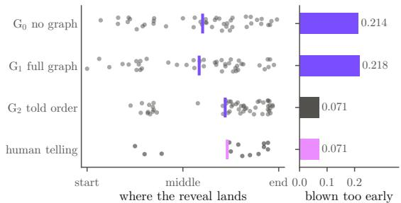

<table><tr><td>Condition</td><td>n</td><td> $\tau _ { \mathrm { p r e } }$ </td><td> $\tau _ { \mathrm { p o s t } }$ </td><td>RCG</td><td>guess</td><td>early</td></tr><tr><td> $\mathrm { G } _ { 0 }$  no graph</td><td></td><td>44 0.903</td><td>0.967</td><td>0.064</td><td>0.773</td><td>0.214</td></tr><tr><td> $\mathrm { G _ { 1 } }$  full graph</td><td>43</td><td>0.884</td><td>0.918</td><td>0.034</td><td>0.674</td><td>0.218</td></tr><tr><td> $\mathrm { G _ { 2 } }$  told order</td><td>52 </td><td>0.861</td><td>0.886</td><td>0.025</td><td>0.865</td><td>0.071</td></tr><tr><td>H human telling</td><td>13</td><td>30.832</td><td>0.887</td><td>0.054 0.846 0.071</td><td></td><td></td></tr></table>

Table 14: Retrospective coherence gain, its paired guess task, and premature disclosure as scored (early: share of stories with fewer than three events before the reveal). n counts the stories RCG could be scored on, while early uses every story (56, 55, 56 and 14), since a story that discloses early cannot be scored for RCG. RCG does not separate the conditions, and the text qualifies the early rates.

Table 14 gives every condition. The reconstruction solver throughout is Grok 4.5, held out from every family that generated stories here, and prefix segmentation uses the aligner validated in §4.2. The two terms are not scored on the same events. $\tau _ { \mathrm { r e c } } ( T _ { < m } )$ ranges over the events the prefix narrates and $\tau _ { \mathrm { r e c } } ( T )$ over all n, so a positive RCG mixes two things, a better ordering of the events already seen and the arrival of events the prefix did not contain. Restricting both terms to the prefix’s events would separate them. We have not done so, which gives a second reason, besides the ceiling, to read Table 14 as exploratory. RCG is paired with a five-option guess task at the cut point, with distractors drawn only from events the prefix has not yet narrated, so none can be eliminated by memory. Neither number means anything alone. Only the pair separates a deliberate, successful withholding from a merely confusing one.

The definition is sound where it has room to move. RETROGRADE, which inverts rather than withholds, has RCG = 0.003 exactly as theory predicts while placing its reveal latest of any category (0.84 of the way through the telling). It is the ceiling, not the definition, that makes the measure inert on the other six.

Two secondary observations survive the flat result in §5.4. The graph is the only condition that makes the withheld cause harder to anticipate (guess accuracy 77.3% to 67.4%) without converting that concealment into payoff. And supplying the told order gives the most predictable condition of all (86.5%). A model handed the human told order narrates to that order rather than withholding along it.

Our planned fix for the ceiling, de-dating the solver’s event list, was canceled by §5.2.1, since the ceiling comes from semantic entailment rather than from dating. The replacement is to score only the event pairs a no-story solver gets wrong across replicates. That is an entailment-free pair set, identifiable automatically from runs we already have and needing no new annotation.

Premature disclosure, checked. Paired by generator, story and replicate, $\mathrm { G } _ { 0 }$ and $\mathrm { G _ { 2 } }$ disagree on 8 stories, all early under $\mathrm { G } _ { 0 }$ (exact McNemar $p = 0 . 0 0 7 8 )$ $\mathrm { G _ { 1 } }$ against $\mathrm { G _ { 2 } }$ gives the same result, and $\mathrm { G } _ { 0 }$ against $\mathrm { G _ { 1 } }$ splits 4 to 4. Two cases inflate the rates. S45, a chronicle, has no designated reveal, and the scorer records it as early in all four conditions (13 records, including all of $_ \mathrm { G _ { 2 } } ,$ s early stories and the human reference’s one). In S27, the other chronicle, the designated explanation is the third event in chronology, so any chronological telling, which is what the CHRONICLE instruction asks for, places it after two events. Every $\mathrm { G } _ { 0 }$ and $\mathrm { G _ { 1 } }$ story of S27 is therefore scored early, and neither $\mathrm { G _ { 2 } }$ nor the human telling is. Without the two works the rates are 4 of 48 $\mathrm { ( G _ { 0 } ) }$ , 4 of 47 $\mathrm { ( G _ { 1 } ) }$ , 0 of 48 $\mathrm { ( G _ { 2 } ) }$ and 0 of 12 (human), and the paired test gives $p = 0 . 1 2 5$ . On the stories with a designated reveal, the gap between $\mathrm { G } _ { 0 }$ and $\mathrm { G _ { 2 } }$ holds at every threshold from two to six events before the reveal $( \mathrm { G } _ { 0 }$ from 3.8% to 34.6%, $\mathrm { G _ { 2 } }$ at most 7.7%), and the remaining early disclosures spread over five shapes, too few for a per-shape reading. The $\mathrm { G _ { 2 } }$ repair is partly by construction, since the designated reveal is the one the human telling places latest and $\mathrm { G _ { 2 } }$ is handed that telling.

## K Structural classification

The classification errors reported in §5.2.2 are given in full in Figure 13. Across models, naming a shape correlates with $\mathrm { T _ { 1 } }$ band hit at $\rho = 0 . 7 1 7$ and with T3 $\tau _ { \mathrm { r e c } }$ at $\rho = 0 . 7 4 7$ , and $\mathrm { T _ { 1 } }$ band hit and $\mathrm { T } _ { 3 } ~ \tau _ { \mathrm { r e c } }$ correlate at $\rho = 0 . 5 5 7$ , so the tasks rank models alike. Because $\tau _ { \mathrm { r e c } }$ is dominated by the floor (§5.2.1), however, it is a weak stand-in for reading a telling. ACHRONY is recognized 7.1% of the time, but the definition the models saw describes unrecoverable chronology (§L), which the corpus excludes. A model that follows that definition should rarely answer ACHRONY on these event lists, and part of the ANALEPSIS sink may have the same cause. Two of the seven labels are recovered at better than 0.6. They are ANALEPSIS, which is also the sink, and CHRONICLE, which is the one class identifiable without reading for structure at all.

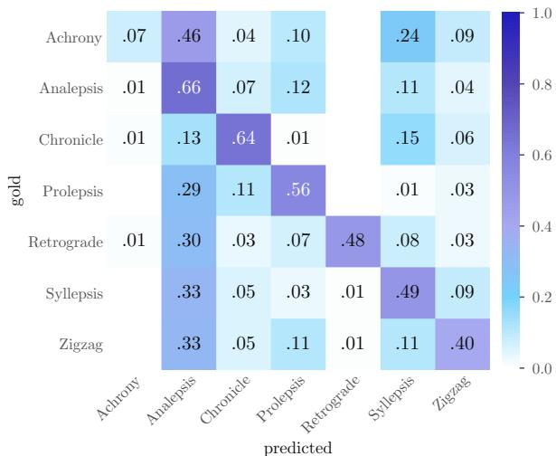  
Figure 13: $\mathrm { T _ { 4 } }$ confusion, row-normalized and pooled over 19 models. 5 of the six other classes send $2 9 -$ 46% of their mass to ANALEPSIS, and ACHRONY is recognized 7.1% of the time.

## L Task and judge prompts

This appendix presents the task templates and operational category definitions used by the evaluation harness. Line breaks and typography are adjusted for presentation. An editorial expansion of the PRO-LEPSIS definition is identified below.

The per-work substitutions are the numbered event list, the category name and, where noted, the graph or order payload. In the templates, <events> stands for the work’s events, numbered 1 . . . N in chronological order, one per line; $\mathrm { T _ { 3 } }$ and $\mathrm { T _ { 4 } }$ instead receive these events in telling order. N denotes the event count.

Where a template shows 1 2 ... N, the harness writes the whole index list out, so the model is shown 1 through N in full. Ordering tasks decode at temperature 0 and low reasoning effort under an

8,000-token cap. Prose tasks decode at temperature   
0.7 under a 4,000-token cap.

The seven structural definitions. The definitions below reproduce the experimental wording, except for the expanded opening of PROLEPSIS. $\mathrm { T _ { 1 } }$ and $\mathrm { T _ { 5 } ^ { a } }$ receive only the requested category’s definition, whereas $\mathrm { T _ { 4 } }$ receives all seven. In the completed runs, the PROLEPSIS definition began with a cross-reference to ANALEPSIS, leaving that reference unresolved in $\mathrm { T _ { 1 } }$ and $\mathrm { T _ { 5 } ^ { a } }$ . We expand it here to make the intended definition self-contained. This expansion was not supplied in the completed runs; the experimental code retains the original wording.

CHRONICLE “The chronological ranks run 1, 2, 3 . . . n in told order. Simultaneous events appearing in either order still qualify.”

ANALEPSIS “One timeline dominates (it holds more than about three quarters of the scenes) and the remaining scenes are insertions from earlier than that timeline.”

PROLEPSIS With the opening cross-reference expanded: “One timeline dominates (it holds more than about three quarters of the scenes) and the remaining scenes are insertions from later than the dominant timeline. The inserted scene must be a real scene the reader can later place, not a vague premonition.”

ZIGZAG “The scenes split into two time periods that alternate on a regular beat; each period progresses in its own consistent direction; and the paired scenes are semantically related (echo, explanation, or contrast). One of the two strands may run backward.”

SYLLEPSIS “There is no dominant timeline, but the scenes form blocks grouped by a nameable non-temporal principle: place, character, theme, or object. You must be able to state the principle.”

RETROGRADE “The ranks run n . . . 3, 2, 1 throughout, and there is no present-day scene the narrative keeps returning to.”

ACHRONY “You cannot confidently assign chronological ranks because the text gives no dates, no ageing, no causal signposts, and no other ordering cues. Stop here only if the order is genuinely unrecoverable, not merely withheld until a late reveal.”

## System prompts.

$\mathrm { T _ { 1 } }$ “You are a narrative-ordering engine. Reorder the supplied numbered events so their told order realizes the requested nonlinear category. Use every event index exactly once. Return only one line of space-separated integers. Do not return prose, JSON, labels, punctuation, analysis, markdown, or an explanation.”

$\mathrm { T _ { 2 } }$ “You are a storyteller planning how to tell a story. You choose the order in which the events will be narrated. Use every event index exactly once. Return only one line of spaceseparated integers. Do not return prose, JSON, labels, punctuation, analysis, markdown, or an explanation.”

$\mathrm { T _ { 3 } }$ “You are a narrative analyst. You reconstruct the true chronological order of a story’s events from a telling that may present them out of order. Use every event index exactly once. Return only one line of space-separated integers. Do not return prose, JSON, labels, punctuation, analysis, markdown, or an explanation.”

$\mathrm { T _ { 4 } }$ “You are a narratologist. You name the way a telling departs from chronology. Answer with exactly one label from the supplied list and nothing else.”

prose “You are an expert fiction writer. Use only the supplied events. Return story prose only: no title, analysis, category name, bullets, or markdown.” (All prose conditions, the graph conditions $\mathrm { G _ { 0 } { - } G _ { 2 } }$ and ablations $\mathrm { A _ { 1 } { - } A _ { 5 } }$ included.)

$\mathrm { T _ { 1 } }$ , cued transposition.   
TARGET NONLINEAR CATEGORY   
<category>   
CATEGORY DESCRIPTION   
<its definition above>   
FABULA EVENTS IN CHRONOLOGICAL ORDER   
<events>   
Choose the told order. Output exactly N   
space-separated   
indices: a permutation of   
1 2 ... N   
No index may be missing or repeated. Output   
the indices   
only.

$\mathrm { T _ { 2 } } ,$ free transposition. STORY EVENTS IN CHRONOLOGICAL ORDER <events>

You are going to tell this story. Decide the   
order in   
which you would narrate these events to a   
reader. Output   
exactly N space-separated indices: a   
permutation of   
1 2 ... N   
No index may be missing or repeated. Output   
the indices   
only.

T , reconstruction.   
SCENES IN THE ORDER THE STORY TELLS THEM   
<events>   
These scenes may be told out of chronological   
order.   
Work out the order in which the events   
actually happened   
in the story world, earliest first.   
Output exactly N space-separated indices: a   
permutation   
of   
1 2 ... N   
Each index refers to a scene above. No index   
may be   
missing or repeated.   
Output the indices only.

T4, classification.   
SCENES IN THE ORDER THE STORY TELLS THEM   
<events>   
CATEGORY DEFINITIONS   
<the seven definitions, "LABEL: text", one per   
line>   
Which single category best describes how this   
telling   
departs from chronology?   
Answer with exactly one of: ACHRONY,   
CHRONICLE,   
RETROGRADE, ZIGZAG, ANALEPSIS, PROLEPSIS,   
SYLLEPSIS   
Output the label only.

Ta5, cued prose $\begin{array} { r } { ( = \mathrm { G } _ { 0 } ) . } \end{array}$   
TARGET NONLINEAR CATEGORY   
<category>   
CATEGORY DESCRIPTION   
<its definition above>   
STORY EVENTS IN CHRONOLOGICAL ORDER   
<events>   
Write this as a short story of 550-750 words   
whose told   
order realizes the target category. Cover   
every event   
above. Do not number the scenes and do not   
mention the   
category. Output the story prose only.

$\mathrm { G } _ { 0 }$ is this prompt verbatim. Ta5 and $\mathrm { T _ { 5 } ^ { b } }$ ran on the 8 prose models and $\mathrm { G } _ { 0 }$ on the 4 graph-study models, which share only GLM-5.2, so $\mathrm { T _ { 5 } ^ { a } }$ and $\mathrm { G } _ { 0 }$ outputs differ by generator, not by prompt.

Condition names. Free $( \mathrm { T } _ { 2 } , \mathrm { T } _ { 5 } ^ { \mathrm { b } } )$ also appears as left alone in the tables, and cued $( \mathrm { T } _ { 1 } , \mathrm { T } _ { 5 } ^ { \mathrm { a } } )$ as instructed. $\mathrm { G } _ { 0 } .$ , the $\mathrm { T _ { 5 } ^ { a } }$ prompt, appears as no graph or events + shape, never as events only.

Tb, free prose.   
STORY EVENTS IN CHRONOLOGICAL ORDER   
<events>   
Write this as a short story of 550-750 words.   
Cover   
every event above.   
Do not number the scenes. Output the story   
prose only.

G1, full graph. The $\mathrm { T _ { 5 } ^ { a } }$ prompt with one block inserted between the events and the brief, and the brief extended by “Use the graph to keep the world state and the characters’ knowledge consistent, and to decide what to withhold and when to pay it off” and “do not quote the graph”. The payload is the gold graph with both position fields, chronological and told, withheld.

NARRATIVE GRAPH   
The graph below annotates the same events.   
\`core\`/\`content\` describe each event,   
\`participants\`/\`location\` ground it,   
\`pre\`/\`post\` are   
world-state facts that must stay consistent,   
\`learns\`   
records what each character and the reader   
comes to   
know, \`questions\`/\`raises\`/\`resolves\` mark   
what the   
telling withholds and where it pays off, and   
the typed   
edges give causes, plants, withheld   
explanations and   
shared material.   
<graph JSON: characters, events, edges>

Each ablation deletes one layer from this JSON and the clause that describes it from the gloss paragraph, so an ablated prompt never describes a layer it does not carry. In the order of Table 3 and Figure 9, $\mathrm { A } _ { 1 }$ drops the CAUSES and FORESHADOWS edges, $\mathrm { A _ { 2 } }$ the pre/post world state, $\mathrm { A _ { 3 } }$ the learns layer, $\mathrm { A } _ { 4 }$ the questions/raises/resolves fields with the REVEALS edges, and $\mathrm { A } _ { 5 }$ participants and location. $\mathrm { A } _ { 1 }$ is the one case that rewrites rather than deletes: the typed-edge list survives with CAUSES and FORESHADOWS removed, so its clause becomes “the typed edges give withheld explanations and shared material” instead of disappearing.

G2, told order supplied. The Ta prompt with this block inserted instead, and a brief asking for a story “that narrates the events in the told order given above”.

TOLD ORDER   
Narrate the events in exactly this order:   
<permutation>

The judge-side aligner. The extractor whose gates are reported in §4.2, applied to every generated story. The instruction “include each number exactly once” makes every alignment a permutation, so a story that omits an event, returns to one, or discloses it in stages still yields one position per event, taken at first mention. The two checks in §4.2 bound disagreement between extractors and recovery of a supplied order. Neither bounds the error this projection introduces, and no output has been aligned by hand.

STORY EVENTS (chronological, numbered) <events>

STORY

<the generated story>

The story narrates these events in some order, possibly

not the chronological one.

List the event numbers in the order the STORY NARRATES

them. Include each number exactly once; if the story

handles an event only in passing, still place it where

it is first narrated.

Output exactly N space-separated indices and nothing   
else.

The judge, preference. Every automated pairwise verdict in §5.3, §5.4 and Table 13 comes from this prompt. Each pair is judged twice with the positions swapped, and disagreement between the two passes is recorded as a tie, so a win has to survive being shown in the other order. System prompt: “You compare two stories built from the same events. Reply with a single JSON object and nothing else: {"winner":"A"|"B"|"tie"}.”

Which is the better story overall -- more engaging,

better told, more satisfying to read?

STORY A

<the first story>

STORY B

<the second story>

The reader instrument asks the same question in the same words, so the human and judge rates in Table 13 answer one question rather than two. Readers are additionally asked which was harder to follow and whose ending tied things together; the judge is not, and those two rows have no automated counterpart.

The judge, Psychological Depth Scale. System prompt: “You rate stories on the Psychological Depth Scale. Reply with a single JSON object and nothing else: {"authenticity":n,"empathy":n, "engagement":n,"emotion\_provocation":n, "narrative\_complexity":n} with each n an integer 1–5.” The user message is STORY: followed by the story. Readers rated the same five components on the same 1–5 scale with the item wording of Harel-Canada et al. (2024), which is what makes the correlation in §5.5.3 a like-for-like comparison. Judge calls decode at temperature 0 and low reasoning effort, under a 1,200-token cap for the depth scale and an 800-token cap for a pairwise verdict.

## M The reader instrument

One sitting. Consent; two background items (reading habit, writing experience); a tutorial on reading a story curve; two blocks of three shapecomprehension items; four blind comparisons, of which one is an unannounced repeat of an earlier pair with the sides swapped; one close reading. About 45 minutes, of which roughly 24 are spent reading, at about 6,000 words. Reported rates include both presentations of the repeated pair.

The three pairwise questions, as asked.

better “Which is the better story overall: more engaging, better told, more satisfying to read?” Answer: Story A / Story B / about the same.

confusing “Which was harder to follow?” Same three options.

ending “Whose ending tied things together better?” Same three options.

Each pair also takes a confidence rating (1–5) and an optional free-text reason. The two story curves are revealed only after all three verdicts are locked, so a reader cannot read the shape off a figure and then judge the prose.

The close reading. One story, read in full, then: the five-item Psychological Depth Scale; a chronology reconstruction, in which the reader drags the story’s shuffled event sentences into the order they believe things happened, scored against the corpus chronology; for each reader question the gold graph raises, whether it was never raised, raised and answered, or raised and left open; a six-item consistency checklist (unanchored scene, prematurely disclosed reveal, unmotivated jump, impossible knowledge, world-state error, uncaused event); and an authorship guess (human / machine / unsure).

The shape-comprehension items. Three questions answerable from the drawn permutation alone, adapted from the readability study of Kim et al. (2018): whether the telling opens at or near the earliest event (two options), how many times it jumps backwards (four options), and whether the last scene shown is also the last thing to happen (two options). They are scored separately from every preference statistic, so a reader’s skill at reading a figure is never confused with their judgment of a story.

Blinding and assignment. The browser receives a pair as a left text and a right text with the condition stripped; the mapping is held server-side and rejoined only at export. A participant receives about 120 KB of a 9.8 MB pool, so the payload itself carries no information about the design. Assignment is recorded before any answer arrives, so a reader who drops out leaves a visible hole rather than silently rebalancing the design, and reopening the page resumes the same block. No reader saw the same item twice apart from the deliberate repeat.

What never reached a reader. A pair was dropped at build time if either text was under 250 words or did not end in terminal punctuation. This removed 39 pairs in the three main comparisons and 14 in the layer-removal set. Two of those were the reply “I’m sorry, but I cannot assist with that request.” Showing a refusal or a truncation beside a complete story would measure which side was broken and would give the condition away. The refusal rate is a finding in its own right and is reported from the model side in §5.2.2 rather than from here.

## N Reproduction

Table 15 lists every evaluated model with the identifier it was queried under. Hosted models change under a fixed name, so the query window matters. Every reply log was written between 6 and 10 August 2026, with the ordering grid on 6–7 August and the prose and scaffolding runs on 6–8 August. The stored replies record latency, token counts and cost per row but not a wall-clock timestamp, so those dates come from the run files themselves and bound the window rather than dating a single call.

Every table, figure and inline number in this paper is generated from the stored results rather than typed. The model-side tables and numbers, the reader-side tables and numbers, and all seven data figures are each written by a script that reads the recorded replies and responses directly, and every quantity in the prose is a macro expanded at compile time from the same source, so a table, a figure and the sentence beside them cannot disagree. The exceptions are the handful of fixed quantities that are definitions rather than measurements, such as chance baselines, the word-count brief and the event-count range, and a set of macros added in revision, recomputed offline from the same stored replies and defined in the preamble with the source of each noted beside it.

The reader-side statistics need one further note, because two of them are not closed-form. The cluster bootstrap intervals and the bootstrap intervals on Krippendorff’s α resample with a fixed seed, so a rebuild reproduces the published intervals exactly; a different seed moves the third decimal place and nothing that any claim in §5.5 turns on. Preference p-values are exact binomials and do not depend on the seed. The generalized estimating equation fits behind the length-adjusted rates use an exchangeable working correlation with readers as clusters, and refitting with stories as clusters changes no conclusion; both intervals are recorded alongside the rate they adjust. A mixed-effects model with crossed random intercepts for readers and stories is not yet fit.

All generation ran through a single OpenRouter harness with the fixed decoding of §4.1. Providers were not pinned and the serving provider was not logged, so the quantization behind the open-weights models is not controlled, and gemini-3.1-pro-preview is a preview endpoint. An output that fails the strict permutation parse is a failed row, never repaired, and refusals are recorded separately from parse failures rather than pooled with them. The 19-model ordering grid cost \$33 of tracked API spend and about five hours of wall-clock at six-way concurrency, so the benchmark is cheap to re-run. Everything downstream of the stored replies, from scoring and tables to figures and this PDF, rebuilds offline and deterministically. Verbatim task prompts are in §L. The project repository is https://github.com/Starscream-11813/

<table><tr><td>Model</td><td>Lab</td><td>OpenRouter identifier</td><td>Access</td><td>Tier</td></tr><tr><td>米 Claude Opus 5</td><td>Anthropic</td><td>anthropic/claude-opus-5</td><td>closed</td><td>frontier</td></tr><tr><td>米 Claude Sonnet 5</td><td>Anthropic</td><td> $\mathsf { a n t h r o p i c / c l a u d e { - } s o n n e t { - } } 5$ </td><td>closed</td><td>mid</td></tr><tr><td>米 Claude Haiku 4.5</td><td>Anthropic</td><td> $\mathsf { a n t h r o p i c / c l a u d e { - } h a i k u { - } } 4 . 5$ </td><td>closed</td><td>small</td></tr><tr><td>S GPT-5.6 Sol</td><td>OpenAI</td><td> $\mathsf { o p e n a i } / \mathsf { g p t } { - } 5 . 6 { - } \mathsf { s o l }$ </td><td>closed</td><td>frontier</td></tr><tr><td>S GPT-5.6 Terra</td><td>OpenAI</td><td>openai/gpt-5.6-terra</td><td>closed</td><td>mid</td></tr><tr><td>S GPT-5.6 Luna</td><td>OpenAI</td><td>openai/gpt-5.6-luna</td><td>closed</td><td>small</td></tr><tr><td>Gemini 3.1 Pro</td><td>Google</td><td>google/gemini-3.1-pro-preview</td><td>closed</td><td>frontier</td></tr><tr><td>1 Gemini 3.6 Flash</td><td>Google</td><td>google/gemini-3.6-flash</td><td>closed</td><td>mid</td></tr><tr><td>S Grok 4.5</td><td>xAI</td><td> $\times { - a \mathrm { i } / \mathrm { g } r \mathrm { o k } { - 4 . 5 } }$ </td><td>closed</td><td>frontier</td></tr><tr><td>Q DeepSeek V4 Pro</td><td>DeepSeek</td><td>deepseek/deepseek-v4-pro</td><td>open-weights</td><td>frontier</td></tr><tr><td>Q DeepSeek V4 Flash</td><td>DeepSeek</td><td>deepseek/deepseek-v4-flash</td><td>open-weights</td><td>small</td></tr><tr><td>中 GLM-5.2</td><td>Z.ai</td><td> $z ^ { - } \mathsf { a i } / \mathsf { g l m } ^ { - } 5 . 2$ </td><td>open-weights</td><td>frontier</td></tr><tr><td>@ Nemotron 3 Ultra</td><td>NVIDIA</td><td> $\mathsf { n v i d i a } / \mathsf { n e m o t r o n } - 3 \ – \mathsf { u l t r a } - 5 5 0 \mathsf { b } - \mathsf { a } 5 5 \mathsf { b }$ </td><td>open-weights</td><td>frontier</td></tr><tr><td>K Kimi K2 0905</td><td>Moonshot</td><td>moonshotai/kimi-k2-0905</td><td>open-weights</td><td>mid</td></tr><tr><td>女 Qwen3-235B-A22B</td><td>Alibaba</td><td> $\mathsf { q w e n / q w e n 3 - 2 3 5 b - a 2 2 b - 2 5 0 7 }$ </td><td>open-weights</td><td>mid</td></tr><tr><td>S gpt-oss-120b</td><td>OpenAI</td><td> $\mathsf { o p e n a i } / \mathsf { g p t } - \mathsf { o s s } - 1 2 \mathsf { 0 b }$ </td><td>open-weights</td><td>mid</td></tr><tr><td>8 Llama 4 Maverick</td><td>Meta</td><td> $\mathtt { m e t a - l 1 a m a / l 1 a m a - 4 - m a v e r i c k }$ </td><td>open-weights</td><td>mid</td></tr><tr><td>8 Llama 3.3 70B</td><td>Meta</td><td>me  $\mathtt { t a } \mathrm { - } 1 1 \mathtt { a m a } / 1 1 \mathtt { a m a } \mathrm { - } 3 . 3 \mathrm { - } 7 \theta \mathrm { b } \mathrm { - } \mathrm { i n s t r u c t }$ </td><td>open-weights</td><td>small</td></tr><tr><td>HMistral Small 3.2</td><td>Mistral</td><td> $\mathsf { m i s t r a l a i / m i s t r a l - s m a l l - 3 . 2 \mathrm { - } 2 4 b \mathrm { - } i n s t r u c t }$ </td><td>open-weights</td><td>small</td></tr></table>

Table 15: The 19 evaluated models with the exact identifier each was queried under. Access and tier are the roster’s own labels, and the grouping is by lab. All generation ran between 6 and 10 August 2026, and the reader study between 8 and 17 September 2026.

LLM-nonlinear-storytelling, and the project page is https://nonlinear-narrative. github.io/. The release, distributed under the MIT License, includes event lists and scene mappings, labels and their rationales, the graph schema and a worked example, anonymized twins, selection criteria and the archetype distribution, stored model replies with prompts and run metadata, token counts and per-model costs, the reasoning-effort ablation, common-subset comparisons, reader responses, and the scripts that produce every table, figure and macro in this paper.

## O Proofs of §D

Throughout, $\sigma$ is a permutation of $\{ 1 , \ldots , n \}$ , a pair $i < j$ of told positions is concordant if $\sigma ( i ) <$ $\sigma ( j )$ and discordant otherwise, and $\tau = ( C -$ $D ) / { \binom { n } { 2 } }$ with C and D the numbers of concordant and discordant pairs. A permutation has no ties, so $\begin{array} { r } { C + D = { \binom { n } { 2 } } } \end{array}$ and $\tau = 1 - 2 D / { \binom { n } { 2 } }$

Proof of Proposition 1. (i) If $h ( \sigma ) = 0$ then $\sigma ( i +$ $1 ) = \sigma ( i ) + 1$ for every i, so $\sigma ( i ) = \sigma ( 1 ) + i - 1$ and $\sigma ( n ) \leq n$ forces $\sigma ( 1 ) = 1$ . The converse is immediate.

(ii) A run is a set of consecutive told positions carrying consecutive chronological ranks, hence an increasing subsequence, so $\mathrm { L I S } \ge \operatorname* { m a x } _ { j } b _ { j } / n$ The h + 1 runs partition n positions, so the longest holds at least $n / ( h + 1 )$ of them.

(iii) A pair inside one run is concordant, so $\begin{array} { r } { D \le \binom { n } { 2 } ^ { - } - \sum _ { j } \binom { b _ { j } } { 2 } } \end{array}$ , and substituting into $\tau =$

$1 - 2 D / { \binom { n } { 2 } }$ gives the bound. Equality holds if and only if every pair drawn from two different runs is discordant. Each run occupies an interval of chronological ranks, so this says that a run told earlier lies entirely later in chronology than any run told after it, which is the decreasing order in the statement. In that case an increasing subsequence cannot leave the run it starts in, so $\mathrm { L I S } = \operatorname* { m a x } _ { j } b _ { j } / n$

(iv) A telling with exactly h hops is determined by its runs, which are $h + 1$ chronological intervals partitioning $\{ 1 , \ldots , n \}$ , together with the order in which they are told. There are $\binom { n - 1 } { h }$ ways to cut $\{ 1 , \ldots , n \}$ into $h { + 1 }$ intervals and $( h + 1 ) !$ orders to tell them in, and $\binom { n - 1 } { h } ( h + 1 ) ! \leq ( n - 1 ) ^ { h } ( h + 1 )$ The map from tellings to such pairs is injective, and not every pair yields exactly h hops, since two intervals told consecutively in chronological order merge into one run. The count is therefore an upper bound. □

Proof of Proposition 2. (i) $\tau = - 1$ means $D =$ sal. Its runs all have length one, so $h = n - 1$ , and its longest increasing subsequence has one element.

(ii) The scene-level retrograde tells the scenes in decreasing chronological order with each scene forward, so its runs are the scenes and they meet the equality condition of Proposition 1(iii). Substituting $b _ { j } ~ = ~ s _ { j }$ gives the formula and LIS = maxj $s _ { j } / n$ , and there are $k - 1$ hops because hops occur only at scene boundaries. The sum $\textstyle \sum _ { j } { \binom { s _ { j } } { 2 } }$ is positive as soon as some $s _ { i } \geq 2$

(iii) $\tau = + 1$ means $D = 0 ,$ which is the identity. Swapping the events at chronological ranks $a < b$ makes $2 ( b - a ) - 1$ pairs discordant, at least one for any swap, so every other telling has $\tau < 1$ □

ProofofLemma 3. For a pair p let $X _ { p } = + 1$ if the solver places it as the target does and $X _ { p } = - 1$ otherwise, so that $\begin{array} { r } { \tau = \binom { n } { 2 } ^ { - 1 } \sum _ { p } X _ { p } } \end{array}$ and $\mathbb { E } [ X _ { p } ] =$ $2 \mathrm { P r } [ p \mathrm { c o r r e c t } ] - 1$ . Each pinned pair contributes $+ 1$ . Averaging $\mathbb { E } [ X _ { p } ]$ over the unpinned pairs gives $2 \alpha - 1$ by the definition of $\alpha$ . Summing, $\mathbb { E } [ \tau ] =$ $\lambda + ( 1 - \lambda ) ( 2 \alpha - 1 )$

For the second claim let A be the set of w events. Exact match requires the solver’s order restricted to $A$ to be the target’s. If the solver’s output is exchangeable over $A ,$ each of the w! orders of A has the same probability, so the correct one has probability $1 / w !$ □

Proof of Corollary 4. (a) Take the target to be chronology and the pinned pairs to be those the event sentences entail, so $\lambda = \lambda _ { E }$ . Uninformed on the rest means $\alpha = { \frac { 1 } { 2 } }$ , and the lemma gives $\mathbb { E } [ \tau _ { \mathrm { r e c } } ] = \lambda _ { E }$ . Every solver has $\tau _ { \mathrm { r e c } } \leq 1$ , so reading a telling adds at most $1 - \lambda _ { E }$

(b) $\begin{array} { r } { \mathrm { R C G } ~ = ~ \tau _ { \mathrm { r e c } } ( T ) ~ - ~ \tau _ { \mathrm { r e c } } ( T _ { < m } ) ~ \leq ~ 1 ~ - } \end{array}$ $\tau _ { \mathrm { r e c } } ( T _ { < m } )$ Write $\lambda _ { E } ^ { < m }$ for the entailed share among the pairs the prefix is scored on, which is the quantity the lemma applies to here. A prefix solver that keeps those pairs and has $\alpha \geq { \frac { 1 } { 2 } }$ on the rest has $\mathbb { E } [ \tau _ { \mathrm { r e c } } ( T _ { < m } ) ] \geq \lambda _ { E } ^ { < m }$ , so $\mathbb { E } [ \mathrm { R C G } ] \leq 1 - \lambda _ { E } ^ { < m }$ the statement reads $\lambda _ { E } ^ { < m }$ off the prefix rather than the whole work, and the two coincide only when entailment is spread evenly through the events. The same two lines apply to any difference of two reconstruction scores whose subtracted term keeps the entailed pairs.

(c) Take the target to be the gold telling. Before the graph is supplied the generator has $\lambda = 0$ and accuracy α on every pair, so $\mathbb { E } [ \tau ] = 2 \alpha - 1$ Afterwards the graph’s pairs are pinned, $\lambda \ =$ $\lambda _ { G }$ , and the accuracy on the rest is still $\alpha , ~ \mathbf { s } \mathbf { O }$ $\mathbb { E } [ \tau ] = \lambda _ { G } + ( 1 - \lambda _ { G } ) ( 2 \alpha - 1 )$ . The difference is $\lambda _ { G } - \lambda _ { G } ( 2 \alpha - 1 ) = 2 \lambda _ { G } ( 1 - \alpha ) \leq 2 \lambda _ { G }$ . Supplying the order supplies every pair, so $\lambda = 1$ and $\mathbb { E } [ \tau ] = 1$ □