# Change the Number, Change the Answer: Assessing Rating Scale Sensitivity in LLM-Based Text Scoring

Wonjeong Jo   
UC Davis   
wjo@ucdavis.edu

Gyuwan Kim UC Santa Barbara gyuwankim@ucsb.edu

Ming Shan Hee MBZUAI mingshan.hee@gmail.com

## Abstract

Large language models (LLMs) are increasingly used in computational social science to assign scalar scores to social and psychological constructs. However, studies use different rating scales, and whether their scores remain comparable across scale designs is understudied. To address this gap, we define and systematically investigate scale sensitivity, the variation in LLM-generated scores caused by rating scale design. We distinguish numerical sensitivity, changes in normalized scores, from semantic sensitivity, changes in score interpretation. To assess both, our experimental design crosses 2 formats (continuous vs. ordinal), 4 ranges (3, 5, 11, and 21 points), and 2 signs (signed vs. unsigned) across 3 tasks (political leaning, sentiment, and toxicity), 2 prompting strategies (zero-shot and rubric-based), and 5 LLMs. We find that changing one design element shifts normalized scores by about 0.10 on average and changes the category of roughly 20% of texts. Sensitivity is greatest for toxicity, the only unipolar construct examined. Also, rubric-based prompting does not reduce sensitivity compared with zero-shot prompting. We provide practical guidance for designing more reliable LLM-based text scoring and highlight the need for robustness checks across alternative scales.

## 1 Introduction

Large language models (LLMs) are increasingly used for text analysis at scale. Compared to human raters or traditional supervised models, LLMs provide strong cross-domain versatility with reduced costs and time. In computational social science, scholars use LLMs for various tasks, including political leaning identification (Gilardi et al., 2023; Heseltine and Clemm von Hohenberg, 2024; Törnberg, 2023), hateful or toxic context detection (Hee and Lee, 2025; Jo et al., 2024), sentiment analysis (Rathje et al., 2024; Ornstein et al., 2025), and topic or framing analysis (Wang et al., 2023; Kuang et al., 2025).

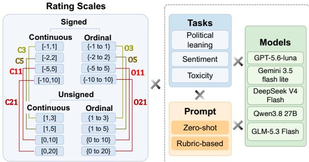  
Figure 1: Experimental design for evaluating scale sensitivity.

Many constructs in the social sciences are better understood when measured along a continuum rather than as discrete categories (Licht et al., 2025). For example, concepts such as ideological extremity, toxicity severity, and moral emotions vary in degree rather than kind. To incorporate these nuances and gradations, a growing number of researchers prompt LLMs to generate scalar scores on numerical scales, treating model outputs as continuous or ordinal measures of underlying latent constructs (Le Mens and Gallego, 2025; Koh et al., 2024; Li et al., 2024).

Yet, how consistent their outputs are across different rating scales or how sensitive those outputs are to changes in scale design has received limited academic attention. Existing studies have relied on different prompts and rating scale designs that vary in both scale format and range, even when measuring the same underlying construct. For example, some studies evaluate toxicity using a continuous scale between 0 and 1 (Li et al., 2024; Koh et al., 2024), whereas other studies adopt Likert-type ordinal scales ranging from 1 to 5 (Movva et al., 2024). A systematic examination of how rating scale design influences LLM-generated scores is therefore essential to establish the reliability, validity, and comparability of LLM-based measurement.

To address this gap, we define scale sensitivity as the degree to which LLM-generated scalar outputs vary in response to changes in rating scale design. We systematically examine three design elements of the rating scale: format (continuous vs. ordinal), range (e.g., 3-, 5-, 11-, and 21-point scales), and sign (signed scales centered at 0 vs. unsigned scales containing only non-negative values). We assess scale sensitivity across tasks with different conceptual foundations (political leaning, toxicity, and sentiment), prompt designs (zero-shot vs. rubric-based), and models.

We further distinguish between two forms of scale sensitivity: numerical sensitivity and semantic sensitivity. Numerical sensitivity captures whether a model assigns different normalized scores to the same item when the rating scale changes, whereas semantic sensitivity captures whether those changes switch the substantive interpretation of the output.

Using the experimental design shown in Figure 1, we find systematic evidence of both numerical and semantic scale sensitivity. Specifically, changing one rating scale design element shifts normalized scores by about 0.10 and changes the category of roughly one in five texts. The toxicity scoring task shows the greatest sensitivity, particularly to scale sign. Compared with zero-shot prompting, rubricbased prompting does not reduce sensitivity.

Our paper makes three key contributions.

• We conceptualize and empirically characterize scale sensitivity as an underexamined source of variation in LLM-based measurement.

• We demonstrate that scale sensitivity has direct implications for the comparability, replicability, and validity of LLM-scored measurements.

• We provide practical guidance for more reliable LLM-based text scoring. We recommend robustness checks across alternative rating scales, choosing scales that match the structure of the construct, and assessing agreement with suitable human labels, when available, as evidence of validity.

## 2 Related Work

## 2.1 Rating Scale Design in Measurement

Survey and psychometric research demonstrates that a rating scale design affects how humans rate the same construct. We review this evidence for the three design elements we manipulate, namely format, sign, and range.

Format. Social scientists measure scalar constructs with two broad families of rating scales. For one, attitudes, emotions, and perceptions have traditionally been measured with ordinal Likerttype scales (e.g., 1–5 or 1–7) (Likert, 2017; Anastasiadou, 2011),1. For another, computational tools increasingly assign continuous scores, including VADER sentiment scores ranging from −1 to 1 (Hutto and Gilbert, 2014) and Perspective API toxicity scores ranging from 0 to 1 (Jigsaw, n.d.). Compared with ordinal scales, continuous scales preserve more information and allow finer-grained judgments (Treiblmaier and Filzmoser, 2011). However, studies comparing the two formats have not found that either one consistently yields higher reliability or validity (Treiblmaier and Filzmoser, 2011; Svensson, 2000). Regardless of which format is preferable, the two formats produce different ratings of the same stimuli (Lawless and Malone, 1986).

Range. Rating scales differ in range, that is, the number of points they offer (e.g., 3, 5, 11, or 21 points). Changing the number of points changes the measurement properties of a scale, but findings are inconclusive on whether more points are better. Some studies suggest that adding points can improve distributional properties and internal consistency (Leung, 2011; Xu and Leung, 2018; Chang, 1994), which may in turn improve validity and reliability (Kusmaryono et al., 2022). Others find that overly fine-grained scales may reduce consistency and reliability in certain contexts (Cai et al., 2016; Chang, 1994).

Sign. A rating scale with the same number of points can be signed or unsigned. A signed scale includes negative values and is centered on 0 (e.g., −1 to 1), whereas an unsigned scale uses only nonnegative values (e.g., 1 to 3). The sign of the scale changes how respondents interpret its endpoints. For example in an empirical study, when the same verbal endpoints were labeled −5 to +5 instead of 0 to 10, human respondents selected the lower half of the scale less often. Negative numbers led them to interpret the low endpoint as the presence of an opposite attribute rather than the absence of the attribute (Schwarz et al., 1991). Similarly, labeling a 7-point scale −3 to +3 instead of 1 to 7 shifted responses toward the positive end (Tourangeau et al., 2007). In short, scale sign can influence both the distribution of ratings and the meaning respondents attach to scale points.

Rating scale design in LLM prompts. It remains unclear whether rating scale design influences LLM-generated scores as it does human ratings. Thus, this paper systematically investigates how consistent LLM-generated scores are across rating scale designs. Because LLM outputs are sensitive to changes in prompt formatting, ordering, and instructions (Sclar et al., 2024; He et al., 2024; Guan et al., 2025; Zhuo et al., 2024), we hold the prompt fixed within each prompting strategy and change only the rating scale it specifies so that differences in scores across rating scale conditions can be attributed to scale design. We quantify these differences as numerical and semantic sensitivity. In this context, we ask: (RQ1) To what extent do changes in rating scale format, sign, and range produce (a) numerical and (b) semantic scale sensitivity in LLM-generated outputs?

## 2.2 Variances across Task, Prompting Strategy, and Model

We further examine whether three factors moderate scale sensitivity, namely the task, the prompting strategy, and the model.

Task. We measure political leaning, sentiment, and toxicity, three constructs widely explored in computational social science (Le Mens and Gallego, 2025; Robertson et al., 2023; Rathje et al., 2021; Yu et al., 2024). Political leaning, such as positioning actors or texts along a left-right spectrum, is a social construct, grounded in political parties, agendas, elites, and symbolic meanings that are socially agreed upon (Bergan, 2012; Boudreau and MacKenzie, 2014). Sentiment is a psychological construct that reflects individuals’ affective states such as positivity or negativity (Evans, 2002). Toxicity is a socio-psychological construct whose judgment depends on both social norms and expressions of anger or hostility (Sheth et al., 2022; Pandita et al., 2024). We note that political leaning and sentiment are bipolar constructs that range between two opposing poles (left vs. right and negative vs. positive), whereas toxicity is a unipolar construct that ranges from the absence of toxicity to its strong presence. Given these conceptual differences across tasks, we ask: (RQ2) To what extent does the task moderate (a) numerical and (b) semantic scale sensitivity?

Prompting strategy. The prompting strategy may also affect how stable LLM-generated scores are across rating scales. We compare two strategies that do not introduce additional confounding factors and differ in how much guidance they provide: zero-shot and rubric-based prompting strategies. Zero-shot prompting is commonly used in LLMbased text scoring (Gilardi et al., 2023; Törnberg, 2023; Le Mens and Gallego, 2025) and requests a direct rating without explicit evaluation criteria. Rubric-based prompting, modeled on educational assessment, provides detailed coding guidelines for predefined dimensions of a construct. It asks the model to score each dimension and use these assessments to determine a final rating. Rubrics have been shown to improve consistency in LLMbased scoring (Hashemi et al., 2024; Eltanbouly et al., 2025; Sharma et al., 2025; Li et al., 2026), but whether they also stabilize scores across rating scales is unknown. If scale sensitivity stems from underspecified evaluation criteria, explicit rubrics should reduce it. If it stems from how models map judgments onto numerical scales, it should persist regardless of prompting strategy. We thus ask: (RQ3) To what extent does the prompting strategy (zero-shot vs. rubric-based) moderate (a) numerical and (b) semantic scale sensitivity?

Model. Model selection has become a consequential methodological choice in computational social science. Models differ in training data, optimization objectives, and alignment procedures, and most offer limited transparency into how they represent semantic judgments internally (Kristensen-McLachlan et al., 2025). Considering these differences, we ask: (RQ4) To what extent does the choice of LLM moderate (a) numerical and (b) semantic scale sensitivity?

Additionally, we test which measurement design choices most strongly affect the sensitivity of LLMgenerated scores by asking: (RQ5) How much of the variation in (a) numerical and (b) semantic scale sensitivity is explained by scale design, task, prompting strategy, and model?

## 3 Experimental Design

## 3.1 Dataset

We use three human-labeled datasets, one for each task (i.e., political leaning, sentiment, and toxicity; See Table 1). See Appendix A for details.

<table><tr><td>Construct</td><td>Data Source</td><td>Sampled N</td></tr><tr><td>Political leaning</td><td>MBIC (Media Bias An- notation Dataset) (Spinde et al., 2021)</td><td>1,700</td></tr><tr><td>Sentiment</td><td>VADER movie reviews (Hutto and Gilbert, 2014)</td><td>5,000</td></tr><tr><td>Toxicity</td><td>Jigsaw Unintended Bias in Toxicity Classification (cjadams et al., 2019)</td><td>5,000</td></tr></table>

Table 1: Data sources and sample sizes used in the study. Sample size refers to the number of items extracted from each original dataset and analyzed in our study.

## 3.2 Rating Scale Conditions

We vary three rating scale design elements. Response format is continuous (any real number within the range) or ordinal (integers only). Scale range is 3, 5, 11, or 21 points. Scale sign is signed (centered on 0) or unsigned (non-negative values only). Each unique combination of these elements defines a rating scale condition, yielding 16 conditions in total (Table 2).

<table><tr><td>Format Continuous</td><td>Sign</td><td>Scale bounds</td><td>Range</td></tr><tr><td rowspan="3"></td><td>Signed</td><td>[−1, +1] [−2, +2]</td><td>3 5</td></tr><tr><td></td><td>[−5,+5] [−10,+10]</td><td>11 21</td></tr><tr><td>Unsigned</td><td>[1, 3] [1, 5]</td><td>3 5</td></tr><tr><td rowspan="5">Ordinal</td><td rowspan="5">Signed</td><td>[0, 10] [0, 20]</td><td>11 21</td></tr><tr><td>-1 to +1</td><td>3</td></tr><tr><td>−2 to +2</td><td></td></tr><tr><td>−5 to +5</td><td>5</td></tr><tr><td>-10 to +10</td><td>11</td></tr><tr><td></td><td>Unsigned</td><td></td><td>21 3</td></tr><tr><td rowspan="2"></td><td rowspan="2"></td><td>1 to 3</td><td></td></tr><tr><td>1 to 5</td><td>5</td></tr><tr><td></td><td></td><td>0 to 10</td><td>11</td></tr><tr><td></td><td></td><td>0 to 20</td><td>21</td></tr></table>

Table 2: The 16 rating scale conditions tested in the study.

## 3.3 Models

We compare scoring performance on these rating scale conditions across GPT 5.6 Luna (OpenAI, 2026), Gemini 3.5 Flash Lite (Google, 2026), DeepSeek V4 Flash (DeepSeek-AI, 2026), Qwen3.8 27B (Qwen Team, 2026) and GLM 5.3 Flash (Z.ai and Zhipu AI Team, 2026).

The three open models (DeepSeek V4 Flash, Qwen3.8 27B, and GLM 5.3 Flash) were selfhosted on a single fixed endpoint with the sampling settings recommended on their Hugging Face pages. The two proprietary models (GPT 5.6 Luna and Gemini 3.5 Flash Lite) were accessed through each provider’s own API with the default sampling settings. We ran every model at its lowest reasoning level, low for the open models and GPT 5.6 Luna and minimal for Gemini 3.5 Flash Lite. Appendix C provides details about the model parameters.

## 3.4 Prompts

We compared zero-shot and rubric-based prompting. The two prompts share the task description, scale instruction, core scoring instructions, and input text. The rubric-based prompt adds the rubric, instructions for scoring each dimension, and an output field for each dimension. Details about the prompts are presented in Appendix B.

## 3.4.1 Zero-Shot Prompt

The zero-shot prompt asks the model to evaluate the target construct in the text and to return a JSON object containing a single final score on the requested scale.

## 3.4.2 Rubric-Based Prompt

The rubric-based prompt additionally includes a task-specific rubric that decomposes each construct (i.e., political leaning, sentiment, and toxicity) into conceptually relevant dimensions (Table 3). The rubrics were tailored to each task and to each dataset’s unit of analysis, and grounded in the relevant literature. The model is asked to score every dimension on the requested scale and then to assign a single final score as a holistic judgment of the text as a whole. This design is intended to make the scoring process more structured.

Under both prompting strategies, we analyze only the final score, so that the two prompts are compared on the same output.

## 3.5 Evaluation Framework

We measure scale sensitivity by comparing the scores that the same model gives to the same text under two rating scale conditions that differ in exactly one design element. This section describes how we calculate numerical and semantic sensitivity.

## 3.5.1 Normalization

Because raw scores are marked on different scales, we first normalize all scores to a common [0, 1] range. Let $r _ { i , s }$ denote the raw score assigned to item i on scale s, and let $a _ { s }$ and $b _ { s }$ denote the scale’s specified minimum and maximum values. The normalized score is

$$
z _ { i , s } = \frac { r _ { i , s } - a _ { s } } { b _ { s } - a _ { s } } \in [ 0 , 1 ] .\tag{1}
$$

## 3.5.2 Minimal Scale Pairs

The 16 rating scale conditions cross response format (continuous, ordinal), scale range (3, 5, 11, or 21 points) and scale sign (signed, unsigned).2 To isolate sensitivity to each design element, we compare only minimal pairs, defined as two rating scale conditions that differ in one design element while the other two remain fixed. For example, comparing a continuous signed 5-point scale with an ordinal signed 5-point scale isolates sensitivity to response format because both scales have the same sign and range. This procedure leads to 40 minimal pairs. Eight pairs differ only in format, 24 differ only in range, and eight differ only in sign. We assess sensitivity to each design element using the pairs that differ in that element.

## 3.5.3 Numerical Scale Sensitivity

Numerical scale sensitivity measures how far a text’s score moves when only the scale changes. For a minimal pair $( s , t )$ and the N items with a valid score on both scales, it is the mean absolute difference between the normalized scores:

$$
S S _ { \mathrm { M A E } } ( s , t ) = \frac { 1 } { N } \sum _ { i = 1 } ^ { N } \left| z _ { i , s } - z _ { i , t } \right| .\tag{2}
$$

$S S _ { \mathrm { M A E } }$ ranges from 0 to 1. A value of 0.10, for example, means that scores move by one tenth of the full scale on average.

## 3.5.4 Semantic Scale Sensitivity

Semantic scale sensitivity measures whether a change in scale alters how the output is interpreted. To capture interpretation, we place each normalized score into one of three categories of equal width.

$$
g ( z ) = \left\{ { \begin{array} { l l } { { \mathrm { l o w } , } } & { { z < 1 / 3 , } } \\ { { \mathrm { m i d d l e } , } } & { { 1 / 3 \leq z \leq 2 / 3 , } } \\ { { \mathrm { h i g h } , } } & { { z > 2 / 3 . } } \end{array} } \right.\tag{3}
$$

These categories correspond to negative, neutral, and positive sentiment, to left, center, and right political leaning, and to content that is not toxic, moderately toxic, and extremely toxic. Semantic sensitivity is the share of items that fall into a different category on the two scales.

$$
S S _ { \mathrm { s w i t c h } } ( s , t ) = \frac { 1 } { N } \sum _ { i = 1 } ^ { N } \mathbf { 1 } [ g ( z _ { i , s } ) \neq g ( z _ { i , t } ) ]\tag{4}
$$

$S S _ { \mathrm { s w i t c h } }$ ranges from 0 to 1. As a result, for example, a value of 0.20 means that 20% of texts change category when only one design element of the scale changes.

We use three categories because this is the finest distinction that all 16 rating scale conditions can express. The shortest scales offer only three values, low, neutral, and high, and every prompt defines the low end, the middle, and the high end of the scale, even when ordinal scales also label intermediate levels such as slightly or strongly. Splitting the normalized range into equal thirds places the three values of a scale with 3 points in three different categories and applies the same boundaries to every scale.

## 3.5.5 Analytical Framework

We compute $S S _ { \mathrm { M A E } }$ and $S S _ { \mathrm { s w i t c h } }$ for each minimal pair within every combination of task, prompting strategy, and model. This yields 1,200 estimates per metric across 3 tasks, 2 prompting strategies, 5 models, and 40 minimal pairs.

To answer RQ1, we average the estimates from the minimal pairs that change each design element, separately for format, range, and sign. We report these averages for numerical sensitivity, $S S _ { \mathrm { M A E } }$ (RQ1a), and for semantic sensitivity, SSswitch (RQ1b). Each task, prompting strategy, model, and pair receives equal weight. We additionally analyze whether sensitivity to one design element depends on the values of the other two elements. For example, we calculate range sensitivity separately on ordinal and on continuous scales (i.e., format), and format sensitivity separately on scales with 3, 5, 11, and 21 points (i.e., range).

To test RQ2 to RQ4, we fit a weighted least squares (WLS) regression of the 1,200 estimates on the design element changed (format, range, or sign), task, prompting strategy, and model. We include interactions between the design element changed and each of the other three factors. We fit the model separately for numerical sensitivity $( S S _ { \mathrm { M A E } } )$ and semantic sensitivity $( S S _ { \mathrm { s w i t c h } } )$

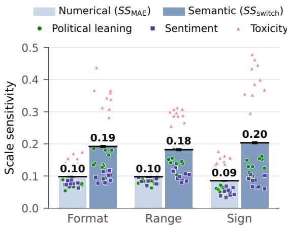  
Figure 2: Scale sensitivity by rating scale design element. Dots show the estimate for each combination of task, prompting strategy, and model, colored by task. Black lines are 95% item bootstrap intervals.

We estimate uncertainty using an item bootstrap with 2,000 resamples. In each resample, we sample texts with replacement within each task and use the same sampled texts across all models, prompting strategies, and scale pairs. We then recompute every statistic and obtain 95% confidence intervals from the 2.5th and 97.5th percentiles of the bootstrap estimates. Because every 95% confidence interval lies within 0.01 of its estimate, we report point estimates in section 4 and give intervals in the figures and tables.

Lastly, we explore how much of the variation in sensitivity each factor explains to answer RQ5. We extend the regression to all interactions between pairs of design variables and decompose the variance of the 1,200 estimates into the share attributable to each factor, $\eta ^ { 2 }$

## 4 Results

## 4.1 Effects of Rating Scale Design

RQ1 asks the extent to which changes in rating scale format (continuous vs. ordinal), range (3, 5, 11, or 21 points), and sign (signed vs. unsigned) produce numerical and semantic sensitivity in LLM-generated outputs.

Changing the format while holding sign and range fixed produces an average absolute difference of 0.098 in normalized scores (95% CI [0.097, 0.099]) and changes the category assigned to 19.2% of texts (95% CI [18.9%, 19.5%]). Changing the range while holding format and sign fixed produces an average absolute difference of 0.098 in normalized scores (95% CI [0.097, 0.099]) and changes the category assigned to 18.2% of texts (95% CI [17.9%, 18.5%]). Changing the sign while holding format and range fixed produces an average absolute difference of 0.085 in normalized scores (95% CI [0.085, 0.086]) and changes the category assigned to 20.3% of texts (95% CI [20.1%, 20.6%]).

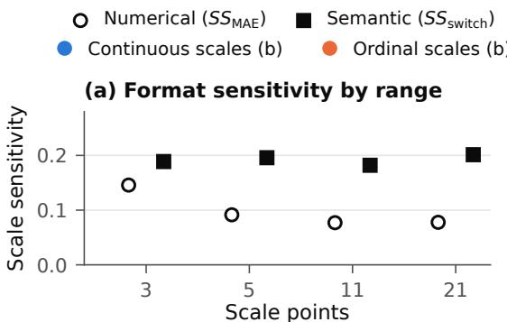

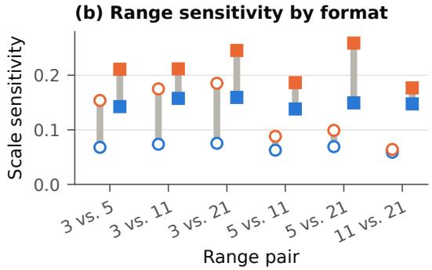  
Figure 3: (a) Format sensitivity on scales with different rating ranges. (b) Range sensitivity for each pair of ranges. Bars are 95% item bootstrap intervals.

Across all three design elements, numerical sensitivity amounts to approximately one tenth of the normalized scale, and semantic sensitivity indicates that one in five texts receives a different category when the scale design changes. The magnitudes of sensitivity are broadly similar across design elements. Specifically, changing the sign shows the smallest numerical sensitivity but the largest semantic sensitivity, which means a small move in a score can change its category when the score lies near a category boundary.

We additionally report whether sensitivity to one design element depends on the values of the other two elements, for example whether switching from a continuous to an ordinal format matters more on a 3-point scale than on a 21-point scale (see Figure 3). We found three notable patterns. First, finer scales reduce numerical but not semantic sensitivity to format. Switching formats moves scores by 0.146 (95% CI [0.144, 0.147]) on 3-point scales but by

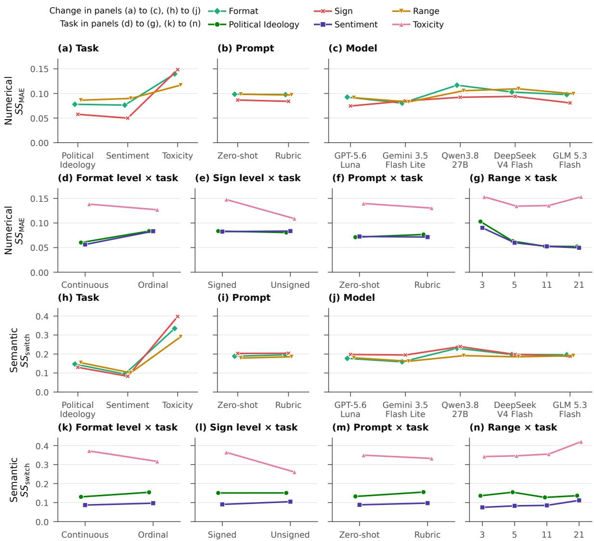  
Figure 4: Scale sensitivity across tasks, prompting strategies, and models (RQ2–RQ4), averaged across the remaining tasks, prompting strategies, models, and minimal pairs. The top row shows numerical sensitivity, $S S _ { \mathrm { M A E } }$ , and the bottom row shows semantic sensitivity, $S S _ { \mathrm { s w i t c h } }$ . Error bars indicate 95% item bootstrap confidence intervals.

0.078 ([0.077, 0.078]) on 21-point scales, whereas the share of texts that change category stays between 18.2% and 20.1% at every scale length. Second, ordinal scales amplify range changes, shifting scores by 0.128 ([0.126, 0.129]) compared with 0.068 ([0.067, 0.069]) on continuous scales and changing the category of 21.5% compared with 14.9% of texts. Third, continuous scales amplify sign changes, which alter the category of 24.4% ([24.1%, 24.7%]) of texts on continuous scales but 16.3% ([16.1%, 16.6%]) on ordinal scales.

## 4.2 Moderation by Task, Prompting Strategy, and Model

Concerning RQ2, scale sensitivity depends strongly on the task. Toxicity is the most sensitive, with 29 to 40 % of texts changing category depending on the design element, compared with 13 to 15 % for political leaning and 8 to 10 % for sentiment. Numerical sensitivity follows the same order. The task also changes which design element produces the greatest sensitivity. For political leaning and sentiment, changes in the three design elements have similar effects, whereas for toxicity, changing the sign is the most sensitive. Relative to format changes, sign changes move 8.0 % points more toxicity texts across categories than political leaning texts (Table 6). Toxicity is the only unipolar construct in our design, ranging from absence to strong presence rather than between two opposing poles. This may explain why it reacts so strongly to signed scales, which place negative numbers at the low end of the scale, although with a single unipolar task we cannot rule out other differences between the tasks.

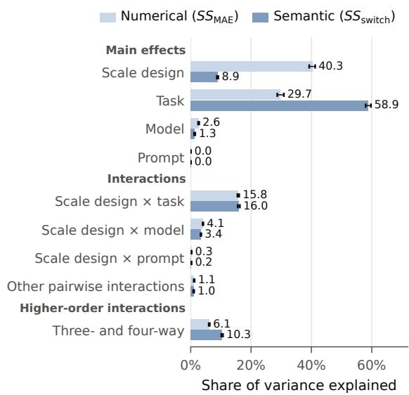  
Figure 5: Share of the variation in scale sensitivity explained by each factor. Black lines are 95% item bootstrap intervals. The full decomposition is reported in Table 7 in Appendix F.

In contrast, the prompting strategy has almost no effect (RQ3). For every design element, sensitivity under rubric prompting is within 0.007 of sensitivity under zero-shot prompting, and all interaction terms are 0.006 or smaller (Table 6). The small differences that appear run in opposite directions across tasks. Rubrics slightly increase semantic sensitivity for political leaning and sentiment and slightly decrease it for toxicity. That is, adding explicit evaluation criteria does not make scores more stable to the rating scale.

For RQ4, model choice affects scale sensitivity more than prompting strategy but much less than task. All five models are sensitive to changes in all three design elements in the same way (see Figure 4). Qwen3.8 27B is the most sensitive model and Gemini 3.5 Flash Lite the least sensitive. Within each model, sensitivity to the three design elements differs by at most five percentage points.

## 4.3 Relative Importance of Each Design Choice

Regarding RQ5, the variance decomposition places all factors on a common scale (Figure 5) and shows that scale design and the task explain different aspects of sensitivity. Scale design explains the largest share of numerical sensitivity (40.3%) but only 8.9% of semantic sensitivity. The task explains 29.7% of numerical sensitivity and 58.9% of semantic sensitivity.

The model and the prompting strategy explain little of either. The model accounts for 2.6% of numerical and 1.3% of semantic variation, and the prompting strategy for less than 0.1%. Their interactions with scale design add 3.4 to 4.1% for the model and 0.2 to 0.3% for the prompting strategy. The second largest source of semantic variation is instead the interaction between scale design and task (16.0%), which captures combinations such as signed scales for toxicity.

## 4.4 Additional Analyses

Moreover, we conduct two supplemental analyses. First, we repeat all rating scale conditions using the three open models, each at three reasoning levels (Appendix E.1). Notably, we find that higher reasoning effort is associated with small reductions in scale sensitivity. Second, we assess agreement between LLM-generated scores and the human labels provided in each dataset (Appendix E.2). Further details are provided in Appendix E.

## 5 Conclusion

This study investigates the extent to which LLMgenerated scores remain consistent when only the rating scale design changes. Using an experimental design with 3 tasks, 2 prompting strategies, and 5 models, we find that changing scale format, range, or sign shifts normalized scores by about 0.10 on average and changes the category of roughly 20% of texts. Toxicity, the only unipolar construct examined, is most sensitive, particularly to scale sign. Rubric-based prompting does not reduce sensitivity relative to zero-shot prompting, and model choice has a modest effect.

Our findings indicate that rating scale design is a measurement decision that affects LLM-generated scores. We provide practical suggestions for future researchers.

First, we encourage researchers to test whether their main findings hold under at least one alternative rating scale. These robustness checks are essential for supporting the replicability and reliability of LLM-based measurement.

Next, the numbers on the scale should match what the construct measures. For example, a unipolar construct such as toxicity ranges from absence to high intensity, so negative values on the rating scale may be difficult to interpret. In our experiments, models appeared to treat 0 as “not toxic” on signed scales, assigning substantially more texts to the high-toxicity category than on unsigned scales. Therefore, We recommend unsigned scales for unipolar constructs, with the lowest endpoint representing the absence of the attribute.

Also, researchers should consider evidence of validity when choosing a rating scale. When suitable human labels are available, they can compare scores across alternative scales with these labels to inform their choice. Ideally, the labels should come from trained annotators following coding guidelines aligned with the study’s goals. Agreement with these labels shows evidence of validity. When suitable reference labels are unavailable, as may often be the case for many social constructs, robustness checks across alternative scales become especially important for assessing the stability of the findings. In short, careful scale design, robustness checks, and validation are needed to support more reliable use of LLM-generated scores. Our findings highlight the importance of these practices when using LLMs to complement human annotation in future studies.

## Limitations

We acknowledge the following limitations. First, the generalizability of our findings is limited by the tasks and datasets examined. Future research is welcome to test whether the findings extend to broader cultural contexts, languages other than English, and additional tasks.

Also, we compared only two prompting approaches: zero-shot and rubric-based. We did not include few-shot, chain-of-thought (CoT), or chainof-verification (CoVe) prompting because these strategies introduce additional factors, such as the selection and ordering of demonstrations or intermediate reasoning steps, that could confound the comparison. Moreover, CoT has shown limited gains on subjective tasks (Chochlakis et al., 2024), while CoVe is designed to verify factual claims (Dhuliawala et al., 2024), making its applicability less clear for constructs that lack verifiable ground truth. We leave the evaluation of these strategies to future work.

## Statement on the Use of AI Assistants

We disclose that we used generative AI for proofreading and grammar checking with the prompt:

“Edit grammar errors. Avoid being verbose or lengthy, and do not paraphrase much from the original sentences.” We also used GitHub Copilot in Visual Studio Code, with GPT-5-mini where available, for coding assistance. The human authors reviewed the AI-generated suggestions and made the final edits.

## References

Sofia D Anastasiadou. 2011. Reliability and validity testing of a new scale for measuring attitudes toward learning statistics with technology. Acta Didactica Napocensia, 4(1):1–10.

Daniel E Bergan. 2012. Partisan stereotypes and policy attitudes. Journal of Communication, 62(6):1102– 1120.

Cheryl Boudreau and Scott A MacKenzie. 2014. Informing the electorate? how party cues and policy information affect public opinion about initiatives. American Journal ofPolitical Science, 58(1):48–62.

MY Cai, Y Lin, and Wen-Jun Zhang. 2016. Study of the optimal number of rating bars in the Likert scale. In Proceedings ofthe 18th International Conference on Information Integration and Web-Based Applications and Services, pages 193–198.

Lei Chang. 1994. A psychometric evaluation of 4-point and 6-point Likert-type scales in relation to reliability and validity. Applied Psychological Measurement, 18(3):205–215.

Georgios Chochlakis, Niyantha Maruthu Pandiyan, Kristina Lerman, and Shrikanth Narayanan. 2024. Larger language models don’t care how you think: Why chain-of-thought prompting fails in subjective tasks. arXiv preprint arXiv:2409.06173.

cjadams, Daniel Borkan, inversion, Jeffrey Sorensen, Lucas Dixon, Lucy Vasserman, and nithum. 2019. Jigsaw Unintended Bias in Toxicity Classification. Kaggle.

DeepSeek-AI. 2026. DeepSeek-V4: Towards highly efficient million-token context intelligence. Preprint, arXiv:2606.19348.

Shehzaad Dhuliawala, Mojtaba Komeili, Jing Xu, Roberta Raileanu, Xian Li, Asli Celikyilmaz, and Jason Weston. 2024. Chain-of-verification reduces hallucination in large language models. In Findings of the Association for Computational Linguistics: ACL 2024, pages 3563–3578, Bangkok, Thailand. Association for Computational Linguistics.

Sohaila Eltanbouly, Salam Albatarni, and Tamer Elsayed. 2025. TRATES: Trait-specific rubric-assisted cross-prompt essay scoring. In Findings of the Associationfor Computational Linguistics: ACL 2025, pages 20528–20543.

Dylan Evans. 2002. Emotion: The science ofsentiment. Oxford University Press, USA.

Stanley Feldman and Christopher Johnston. 2014. Understanding the determinants of political ideology: Implications of structural complexity. Political Psychology, 35(3):337–358.

Fabrizio Gilardi, Meysam Alizadeh, and Maël Kubli. 2023. ChatGPT outperforms crowd workers for text-annotation tasks. Proceedings of the National Academy ofSciences, 120(30):e2305016120.

Google. 2026. Gemini 3.5 Flash-Lite. Official Gemini API documentation. Accessed October 12, 2026.

Bryan Guan, Tanya Roosta, Peyman Passban, and Mehdi Rezagholizadeh. 2025. The order effect: investigating prompt sensitivity to input order in LLMs. arXiv preprint arXiv:2502.04134.

Helia Hashemi, Jason Eisner, Corby Rosset, Benjamin Van Durme, and Chris Kedzie. 2024. LLM-Rubric: A multidimensional, calibrated approach to automated evaluation of natural language texts. In Proceedings of the 62nd Annual Meeting of the Association for Computational Linguistics (Volume 1: Long Papers), pages 13806–13834.

Jia He, Mukund Rungta, David Koleczek, Arshdeep Sekhon, Franklin X Wang, and Sadid Hasan. 2024. Does prompt formatting have any impact on LLM performance? arXiv preprint arXiv:2411.10541.

Ming Shan Hee and Roy Ka-Wei Lee. 2025. Demystifying hateful content: Leveraging large multimodal models for hateful meme detection with explainable decisions. In Proceedings ofthe International AAAI Conference on Web and Social Media, volume 19, pages 774–785.

Michael Heseltine and Bernhard Clemm von Hohenberg. 2024. Large language models as a substitute for human experts in annotating political text. Research & Politics, 11(1):20531680241236239.

Clayton Hutto and Eric Gilbert. 2014. VADER: A parsimonious rule-based model for sentiment analysis of social media text. In Proceedings ofthe International AAAI Conference on Web and Social Media (ICWSM), volume 8, pages 216–225.

Jigsaw. n.d. Perspective API: Attributes and languages. Official developer documentation. Accessed 12 October 2026.

Claire Wonjeong Jo, Miki Wesołowska, and Magdalena Wojcieszak. 2024. Harmful YouTube video detection: A taxonomy of online harm and MLLMs as alternative annotators. arXiv preprint arXiv:2411.05854.

Hyukhun Koh, Dohyung Kim, Minwoo Lee, and Kyomin Jung. 2024. Can LLMs recognize toxicity? a structured investigation framework and toxicity metric. arXiv preprint arXiv:2402.06900.

Ross Deans Kristensen-McLachlan, Miceal Canavan, Marton Kárdos, Mia Jacobsen, and Lene Aarøe. 2025. Are chatbots reliable text annotators? Sometimes. PNAS Nexus, 4(4):pgaf069.

Xianwen Kuang, Jun Liu, Haiyang Zhang, and Simon Schweighofer. 2025. Towards algorithmic framing analysis: expanding the scope by using LLMs. Journal ofBig Data, 12(1):66.

Imam Kusmaryono, Dyana Wijayanti, and Hevy Risqi Maharani. 2022. Number of response options, reliability, validity, and potential bias in the use of the Likert scale education and social science research: A literature review. International Journal of Educational Methodology, 8(4):625–637.

Harry T Lawless and Gilbert J Malone. 1986. Comparison of rating scales: sensitivity, replicates and relative measurement. Journal of Sensory Studies, 1(2):155–174.

Gaël Le Mens and Aina Gallego. 2025. Positioning political texts with large language models by asking and averaging. Political Analysis, 33(3):274–282.

Shing-On Leung. 2011. A comparison of psychometric properties and normality in 4-, 5-, 6-, and 11-point Likert scales. Journal of Social Service Research, 37(4):412–421.

Gaotang Li, Bhavana Dalvi Mishra, Zifeng Wang, Jun Yan, Yanfei Chen, Chun-Liang Li, Long T Le, Rujun Han, George Lee, Hanghang Tong, et al. 2026. RubricEM: Meta-rl with rubric-guided policy decomposition beyond verifiable rewards. arXiv preprint arXiv:2605.10899.

Lingyao Li, Lizhou Fan, Shubham Atreja, and Libby Hemphill. 2024. “hot” ChatGPT: The promise of ChatGPT in detecting and discriminating hateful, offensive, and toxic comments on social media. ACM Transactions on the Web, 18(2):1–36.

Hauke Licht, Rupak Sarkar, Patrick Y Wu, Pranav Goel, Niklas Stoehr, Elliott Ash, and Alexander Miserlis Hoyle. 2025. Measuring scalar constructs in social science with LLMs. In Proceedings ofthe 2025 Conference on Empirical Methods in Natural Language Processing, pages 32132–32159.

Rensis Likert. 2017. The method of constructing an attitude scale. In Scaling, pages 233–242. Routledge.

Rajiv Movva, Pang Wei Koh, and Emma Pierson. 2024. Annotation alignment: Comparing LLM and human annotations of conversational safety. arXiv preprint arXiv:2406.06369.

OpenAI. 2026. GPT-5.6 Luna model. Official API documentation. Accessed October 12, 2026.

Joseph T Ornstein, Elise N Blasingame, and Jake S Truscott. 2025. How to train your stochastic parrot: Large language models for political texts. Political Science Research and Methods, 13(2):264–281.

Swati Pandita, Ketika Garg, Jiajin Zhang, and Dean Mobbs. 2024. Three roots of online toxicity: Disembodiment, accountability, and disinhibition. Trends in Cognitive Sciences, 28(9):814–828.

Bo Pang and Lillian Lee. 2008. Opinion mining and sentiment analysis. Foundations and Trends in Information Retrieval, 2(1–2):1–135.

Qwen Team. 2026. Qwen3.8-27B. Official model card. Accessed October 12, 2026.

Steve Rathje, Dan-Mircea Mirea, Ilia Sucholutsky, Raja Marjieh, Claire E Robertson, and Jay J Van Bavel. 2024. GPT is an effective tool for multilingual psychological text analysis. Proceedings ofthe National Academy ofSciences, 121(34):e2308950121.

Steve Rathje, Jay J Van Bavel, and Sander Van Der Linden. 2021. Out-group animosity drives engagement on social media. Proceedings ofthe National Academy ofSciences, 118(26):e2024292118.

Claire E Robertson, Nicolas Pröllochs, Kaoru Schwarzenegger, Philip Pärnamets, Jay J Van Bavel, and Stefan Feuerriegel. 2023. Negativity drives online news consumption. Nature Human Behaviour, 7(5):812–822.

Norbert Schwarz, Bärbel Knäuper, Hans-J. Hippler, Elisabeth Noelle-Neumann, and Leslie Clark. 1991. Rating scales: Numeric values may change the meaning of scale labels. Public Opinion Quarterly, 55(4):570– 582.

Melanie Sclar, Yejin Choi, Yulia Tsvetkov, and Alane Suhr. 2024. Quantifying language models’ sensitivity to spurious features in prompt design or: How I learned to start worrying about prompt formatting. In The Twelfth International Conference on Learning Representations.

Manasi Sharma, Chen Bo Calvin Zhang, Chaithanya Bandi, Clinton Wang, Ankit Aich, Huy Nghiem, Tahseen Rabbani, Ye Htet, Brian Jang, Sumana Basu, et al. 2025. ResearchRubrics: A benchmark of prompts and rubrics for evaluating deep research agents. arXiv preprint arXiv:2511.07685.

Amit Sheth, Valerie L Shalin, and Ugur Kursuncu. 2022. Defining and detecting toxicity on social media: context and knowledge are key. Neurocomputing, 490:312–318.

Timo Spinde, Lada Rudnitckaia, Kanishka Sinha, Felix Hamborg, Bela Gipp, and Karsten Donnay. 2021. MBIC – a media bias annotation dataset including annotator characteristics. In Proceedings ofthe iConference 2021.

Elisabeth Svensson. 2000. Comparison of the quality of assessments using continuous and discrete ordinal rating scales. Biometrical Journal: Journal ofMathematical Methods in Biosciences, 42(4):417–434.

Petter Törnberg. 2023. ChatGPT-4 outperforms experts and crowd workers in annotating political Twitter messages with zero-shot learning. arXiv preprint arXiv:2304.06588.

Roger Tourangeau, Mick P. Couper, and Frederick Conrad. 2007. Color, labels, and interpretive heuristics for response scales. Public Opinion Quarterly, 71(1):91–112.

Horst Treiblmaier and Peter Filzmoser. 2011. Benefits from using continuous rating scales in online survey research. In Proceedings of the International Conference on Information Systems (ICIS), pages 1–13. Association for Information Systems.

Shawn Treier and D. Sunshine Hillygus. 2009. The nature of political ideology in the contemporary electorate. Public Opinion Quarterly, 73(4):679–703.

Andrea Volkens, Tobias Burst, Werner Krause, Pola Lehmann, Theres Matthieß, Sven Regel, Bernhard Weßels, and Lisa Zehnter. 2021. The Manifesto Project Dataset—Codebook, version 2021a edition. Wissenschaftszentrum Berlin für Sozialforschung (WZB), Berlin.

Han Wang, Nirmalendu Prakash, Nguyen Khoi Hoang, Ming Shan Hee, Usman Naseem, and Roy Ka-Wei Lee. 2023. Prompting large language models for topic modeling. In 2023 IEEE International Conference on Big Data (BigData), pages 1236–1241. IEEE.

Hoi Yan Wu and Sing Oi Leung. 2017. Can Likert scales be treated as interval scales? — a simulation study. Journal ofSocial Service Research, 43(4):527–532.

Meng Lin Xu and Shing On Leung. 2018. Effects of varying numbers of Likert scale points on factor structure of the Rosenberg self-esteem scale. Asian Journal ofSocial Psychology, 21(3):119–128.

Xudong Yu, Magdalena Wojcieszak, and Andreu Casas. 2024. Partisanship on social media: In-party love among American politicians, greater engagement with out-party hate among ordinary users. Political Behavior, 46(2):799–824.

Z.ai and Zhipu AI Team. 2026. GLM-5.3-Flash: Natively multimodal open-weight frontier model.

Jingming Zhuo, Songyang Zhang, Xinyu Fang, Haodong Duan, Dahua Lin, and Kai Chen. 2024. ProSA: Assessing and understanding the prompt sensitivity of LLMs. In Findings of the Association for Computational Linguistics: EMNLP 2024, pages 1950–1976.

## A Dataset Details

We used publicly available datasets consistently with their intended use.

## A.1 Political Leaning

For political leaning, we used the MBIC (Media Bias Annotation Dataset)3 (Spinde et al., 2021). MBIC contains 1,700 sentences sampled from approximately 1,000 U.S. news articles. Ten crowdworkers annotated each sentence for media bias and opinion. The left, center, and right labels indicate the political leaning of the outlet that published the article, based on AllSides and Ad Fontes Media ratings. We used all 1,700 sentences in our analysis.

## A.2 Sentiment

For sentiment, we used the publicly available annotated dataset published by VADER (Valence Aware Dictionary and sEntiment Reasoner) 4, a lexiconand rule-based sentiment analysis tool (Hutto and Gilbert, 2014). Specifically, we used the movie review subset, which includes 10,605 Rotten Tomatoes reviews labeled by 20 independent human raters on a continuous scale from −4 (negative) to 4 (positive). From this dataset, we sampled 5,000 reviews for the test set.

## A.3 Toxicity

For toxicity, we used the dataset from the Jigsaw Unintended Bias in Toxicity Classification competition5 (cjadams et al., 2019). The training set of this dataset contains 1,804,874 comments from the Civil Comments platform, with aggregated human toxicity scores ranging from 0 to 1. Because the dataset was designed to measure toxicity in text, it may contain offensive language. Each toxicity score reflects ratings from multiple human annotators. From this dataset, we sampled 5,000 comments for the test set.

## B Prompts

This section outlines the prompts used for the scoring tasks, using political leaning as an example. The full prompts for all tasks and rating scale conditions are available at https://anonymous.4open. science/r/Scale-Sensitivity-C418/.

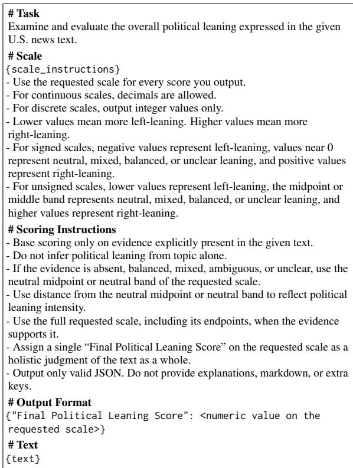  
Figure 6: Zero-shot prompt for political leaning.

## B.1 Zero-Shot Prompt

Figure 6 shows the zero-shot prompt for political leaning. The sentiment and toxicity prompts follow the same structure but use task-specific descriptions, text types (movie reviews for sentiment and online text for toxicity), and scale interpretation guidance under # Scale. The toxicity prompt adjusts the scoring instructions to reflect its unipolar nature, assigning the lowest score when a text shows no toxicity and a middle score when toxicity is present but unclear. Greater distance from the lowest score indicates greater toxicity.

## B.2 Rubric-Based Prompt

The rubric-based prompt extends the zero-shot prompt with the additions shown in Figure 7. These include a # Marking Rubric section after the scale section, three additional instructions under # Scoring Instructions, and a separate output key for each rubric dimension. Table 3 presents a condensed version of the rubric for each task.

For each task, we first defined the construct and its endpoints, then identified relevant dimensions in established research, codebooks, and annotation frameworks.

Political leaning. We drew on multidimensional accounts of ideology that distinguish economic and social attitudes (Treier and Hillygus, 2009; Feldman and Johnston, 2014). The Manifesto Project codebook (Volkens et al., 2021) provides policy categories covering economic intervention, welfare, traditional morality, civil liberties, law and order, and social groups. We adapted these categories to U.S. news text and organized them into economic policy, social and cultural values, government authority, and group-based equality. We also included explicit support for or criticism of political actors as partisan cues, yielding the five dimensions in Table 3.

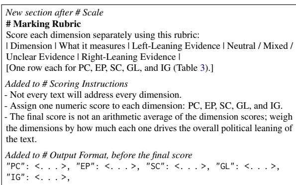  
Figure 7: Lines that the rubric-based prompt adds to the zero-shot prompt in Figure 6.

Sentiment. We referred to distinctions between sentiment polarity, subjectivity, and degrees of evaluation (Pang and Lee, 2008), along with VADER’s treatment of sentiment intensity (Hutto and Gilbert, 2014). We adapted these ideas to movie reviews through content evaluation, emotional tone, language intensity, and recommendation signals. The latter captures whether the reviewer encourages or discourages watching the film, complementing the review’s evaluative language.

Toxicity. We adapted the attribute definitions in Jigsaw’s Perspective API documentation (Jigsaw, n.d.). Hate and harassment combines criteria from toxicity and severe toxicity, while identity attack, insult, profanity, and threat correspond to the API’s named attributes. We translated these definitions into evidence of increasing toxicity, with absence of the attribute at the low end.

## B.3 Scale Instructions

{scale\_instructions} is replaced by one sentence that states the format, range, and labels of the scale. For example, the unsigned 5-point ordinal scale for political leaning reads “Rate the given text on a discrete ordinal scale from 1 to 5, where

1 indicates ‘far left’, 2 indicates ‘left’, 3 indicates ‘neutral’, 4 indicates ‘right’, and 5 indicates ‘far right’.” Table 4 lists the labels for every task and number of points.

## C LLM Parameter Settings

This section details generation settings of the five models.

As shown in Table 5, for the three open models, we followed the sampling settings recommended on each model’s Hugging Face page. The Qwen3.8 27B card recommends temperature 1.0, top-p 0.95, top-k 20, min-p 0, presence penalty 0, and repetition penalty 1.0 for its thinking mode.6 The DeepSeek V4 Flash card recommends temperature 1.0 and top-p 1.0 for tasks other than agentic use.7 The GLM 5.3 Flash card gives no general recommendation, so we used temperature 1.0 and top-p 0.95, the values the card reports for its own evaluations, and set clear\_thinking to true as the card advises for chat use.8 Parameters that a card does not mention were left at the endpoint default. The main analyses use low, the lowest level of each open model, and Appendix E.1 reports the higher levels.

For the two proprietary models, we ran GPT 5.6 Luna through the OpenAI Responses API and Gemini 3.5 Flash Lite through the Gemini API, using each provider’s batch service. For both models we chose the lowest reasoning level that keeps reasoning enabled. For GPT 5.6 Luna this is low, since none turns reasoning off and the default is medium.9 For Gemini 3.5 Flash Lite this is minimal, which is the model’s default and which Google recommends for classification and extraction tasks.10 We did not set temperature, top-p, or top-k for either model. Google states that custom values for these parameters are not supported for Gemini 3.5 Flash Lite and are ignored, and OpenAI instructs users to omit temperature and top-p when reasoning is enabled.11

<table><tr><td>Task</td><td>Dimension and scope</td><td>Low-end evidence</td><td>High-end evidence</td></tr><tr><td rowspan="6">ing</td><td>Political lean- PC Party, candidate, movement, or political Supports Democrats, liberals, or progressives, or Supports Republicans, conservatives, MAGA, leaning. Political actors and groups.</td><td>criticizes conservatives from the left.</td><td>libertarians, or nationalists, or criticizes liber- als from the right.</td></tr><tr><td>EP Economic policy and redistribution. Econ- Supports redistribution, welfare, labor rights, pro- Supports lower taxes, deregulation, free mar- vention.</td><td>omy, labor, taxation, markets, government inter- gressive taxes, universal healthcare, or corporate kets, privatization, welfare cuts, limited gov- regulation.</td><td>ernment, or individual responsibility.</td></tr><tr><td>SC Social and cultural values. Religion, immi- Supports reproductive or LGBTQ+ rights, immi- Supports traditional or religious values, abor- versity, secular governance.</td><td>gration, reproductive and LGBTQ+ rights, di- grant inclusion, multiculturalism, diversity, secu- tion restrictions, stricter immigration, assimi- larism, or progressive change.</td><td>lation, or opposition to progressive policies.</td></tr><tr><td>GL Government authority, law, order, and secu- Supports police accountability, justice reform, Supports strong policing, punishment, enforce-</td><td>rity. State power, policing, justice, civil liberties. protest rights, civil liberties, rehabilitation, or lim- ment, border control, military strength, surveil- its on coercion.</td><td>lance, or public order.</td></tr><tr><td>inequality, DEI.</td><td>IG Identity, inclusion, and group-based equal- Supports anti-discrimination, affirmative action, Opposes affirmative action or DEI, or empha- ity. Discrimination, minority rights, systemic minority rights, systemic inequality claims, DEI, sizes meritocracy, colorblindness, or skepti- or marginalized groups.</td><td>cism about systemic inequality.</td></tr><tr><td>film.</td><td>Content Evaluation. Overall evaluation of the Film portrayed as poor, frustrating, disappointing, Film portrayed as enjoyable, successful, valu- weak, or not worth watching.</td><td>able, exceptional, or highly satisfying.</td></tr><tr><td rowspan="4"></td><td>tude.</td><td>Emotional Tone. Reviewer&#x27;s emotional atti- Angry, harsh, dismissive, sarcastic, hostile, disap- Warm, appreciative, satisfied, enthusiastic, ad- pointed, or strongly critical.</td><td>miring, or emotionally positive.</td></tr><tr><td>evaluative language.</td><td>Language Intensity. Strength and direction of Negative evaluation, from mild criticism to strong Positive evaluation, from mild praise to strong condemnation.</td><td>enthusiasm.</td></tr><tr><td>discouragement to watch.</td><td>Recommendation Signal. Encouragement or Discourages others from watching the film.</td><td>Recommends the film, possibly with strong encouragement.</td></tr><tr><td>disrespectful, or harassing language.</td><td>HH Hate and harassment. Hostile, degrading, No highly hateful, aggressive, or extremely disre- Very hateful, aggressive, degrading, or disre- spectful language.</td><td>spectful language likely to discourage partici-</td></tr><tr><td rowspan="5"></td><td></td><td></td><td>pation. IA Identity attack. Negative targeting based on No negative targeting of an identity group or char- Clearly hateful, demeaning, dehumanizing, or</td></tr><tr><td>identity. IN Insult. Insults, mockery, or demeaning at- No insult or demeaning language.</td><td>acteristic.</td><td>exclusionary targeting based on identity. Clear insults, mockery, humiliation, or attacks</td></tr><tr><td>tacks. PR Profanity. Swearing or obscene language, No profanity or obscene language.</td><td></td><td>on a person or group. Strong, repeated, or abusive profanity, espe-</td></tr><tr><td>especially when abusive.</td><td></td><td>cially directed at others. TH Threat. Intent, encouragement, or implica- No suggestion of harm, violence, or intimidation. Clear threats, or encouragement, celebration,</td></tr><tr><td>tion of harm or violence.</td><td></td><td>or implication of violence or harm.</td></tr></table>

Table 3: Condensed marking rubrics. Each rubric in the original prompt also has a middle column for neutral, mixed, or unclear evidence (ambiguous or moderate evidence for toxicity), which we omit here. The full prompts are presented at https://anonymous.4open.science/r/Scale-Sensitivity-C418/

## D LLM Scoring: Output Description

In this section, we describe the distributions of LLM-generated scores. Figure 8 shows the cumulative distributions of normalized scores, with the human labels provided in each dataset shown as reference distributions. Yet, we do not treat these labels as ground truth for the following reasons. First, the coding instructions followed by human annotators are not fully documented and may differ from our scoring criteria. Second, the political leaning labels are categorical, which limits direct comparison with our scalar scores. Third, this study focuses on the consistency of LLM-generated scores across rating scales rather than agreement between LLMs and human annotators. We include the human labels only to provide context for the observed score distributions.

Figure 9 shows the proportion of texts categorized into low, middle, and high groups used to

compute SSswitch.

We observe distinct score distributions across tasks. Political leaning scores concentrate heavily in the middle category (44%–67% of texts, yet depending on the scale). Sentiment scores show a polarized distribution, with most texts falling into either the low (39%–48%) or high (32%–44%) category, and only 8%–27% in the middle. Toxicity scores vary highly depending on rating scales. On continuous signed scales, 47%–52% of texts fall in the high category, compared to only 12%–22% on continuous unsigned scales. This shift suggests that when a scale is centered on zero, models tend to treat 0—rather than the lowest endpoint—as the threshold for not toxic.

When comparing with human labels, sentiment scores are closest to the human labels, although models use the middle category somewhat less often. Political leaning scores depart most clearly, as models place 44% to 67% of texts in the middle category compared with 19% for the human labels. Toxicity categories vary most across scales, with the share of texts in the high category ranging from 8% to 52% compared with 43% for the human labels. Model scores also concentrate on particular values such as the scale midpoint and whole numbers, which appears as vertical steps in Figure 8.

<table><tr><td>Points</td><td>Political leaning</td><td>Sentiment</td><td>Toxicity</td></tr><tr><td>3</td><td>left, neutral, right</td><td>negative, neutral, positive</td><td>not, moderately, extremely toxic</td></tr><tr><td>5</td><td>far left, left, neutral, right, far right</td><td>tive</td><td>very negative, negative, neutral, positive, very posi- not, slightly, moderately, strongly, extremely toxic</td></tr><tr><td>11</td><td>erate / far right</td><td>far / moderate / slight left, neutral, slight / mod- extremely / moderately / slightly negative, neutral, not, slightly, somewhat, moderately, considerably, slightly 7 moderately / extremely positive</td><td>strongly, extremely toxic</td></tr><tr><td>21</td><td>/ moderate / strong / far right</td><td>positive</td><td>far / strong / moderate / slight left, neutral, slight extremely / strongly / moderately / slightly negative, not, minimally, slightly, somewhat, moderately, neutral, slightly / moderately / strongly / extremely considerably, strongly, severely, extremely toxic</td></tr></table>

Table 4: Labels in ordinal scale instructions, ordered from lowest to highest score.

<table><tr><td>Model</td><td>Reasoning</td><td>Temp.</td><td>Top-p</td><td>Top-k</td></tr><tr><td>GPT 5.6 Luna</td><td>low</td><td>default</td><td>default</td><td>default</td></tr><tr><td>Gemini 3.5 Flash Lite</td><td>minimal</td><td>default</td><td>default</td><td>default</td></tr><tr><td>Qwen3.8 27B</td><td>low</td><td>1.0</td><td>0.95</td><td>20</td></tr><tr><td>DeepSeek V4 Flash</td><td>low</td><td>1.0</td><td>1.0</td><td>default</td></tr><tr><td>GLM 5.3 Flash</td><td>low</td><td>1.0</td><td>0.95</td><td>default</td></tr></table>

Table 5: Generation settings for LLM scoring inference.

## E Additional Analyses

## E.1 Reasoning Effort

The main analyses run every model at its lowest reasoning level. To test whether more reasoning reduces scale sensitivity, we repeat all 16 rating scale conditions with the three open models at three reasoning levels each, namely low, medium, and xhigh for Qwen3.8 27B, and low, high, and max for DeepSeek V4 Flash and GLM 5.3 Flash. Because the models name their levels differently, we compare them by their rank within each model (lowest, middle, highest). Sensitivity is calculated as in the main analyses.

Figure 10 shows the results. Interestingly, more reasoning lowers numerical sensitivity for changes in all three design elements, but only slightly. From the lowest to the highest level, $S S _ { \mathrm { M A E } }$ falls by 0.009 for format, 0.006 for range, and 0.016 for sign, averaged over the three models. Semantic sensitivity falls by 1.1 percentage points for format and 2.6 points for sign, and does not change for range (the 95% interval includes zero). The models also differ in direction. For Qwen3.8 27B, the share of texts that change category under a range change rises from 19.1% to 22.0%. Even at the highest level, sensitivity remains close to the values in Section 4, so more reasoning does not remove scale sensitivity.

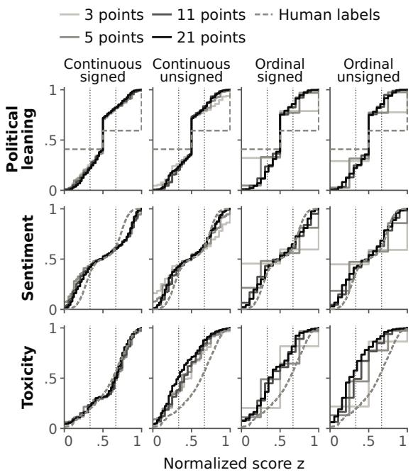  
Figure 8: Cumulative distribution of normalized scores for each scale. Solid lines show the number of scale points, from light (3 points) to dark (21 points). The gray dashed line repeats the distribution of the human labels for that task in every panel. Dotted vertical lines mark the category boundaries at 1/3 and 2/3.

## E.2 Agreement with Human Labels

Our main analyses compare scores across rating scale conditions rather than against human labels. We additionally report how well the scores agree with the human labels of each dataset under every combination of model, prompting strategy, and rating scale condition (see Figure 11).

We select the agreement metric based on the type of human label. The sentiment labels in the VADER dataset (Hutto and Gilbert, 2014) and the toxicity labels in the Jigsaw Unintended Bias in Toxicity Classification dataset (cjadams et al., 2019) are continuous. They represent the mean rating across annotators for sentiment and the proportion of annotators who marked a text as toxic for toxicity. For these tasks, we report Spearman’s rank correlation between LLM-generated scores and human labels, which is unaffected by normalization to a common scale range. In contrast, the political leaning labels in MBIC (Spinde et al., 2021) are categorical. They indicate whether the outlet that published each sentence is left, center, or right, based on media ratings rather than a judgment of the sentence itself. We map each LLM-generated score to the three categories used for $S S _ { \mathrm { s w i t c h } }$ and report macro-F1 against the human labels.

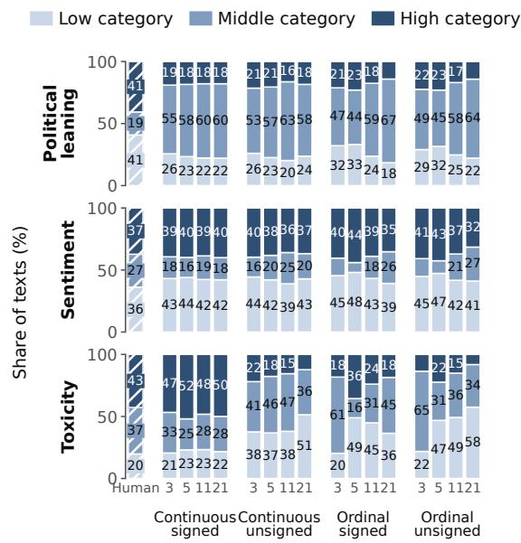  
Figure 9: Share of texts in the low, middle, and high categories for each scale. Each row represents a task. Percentages are displayed for segments exceeding 8%.

Agreement with human labels varies substantially across tasks. Spearman’s correlation ranges from 0.87 to 0.95 for sentiment and from 0.24 to 0.38 for toxicity, while macro-F1 ranges from 0.34 to 0.65 for political leaning. The lower correlations for toxicity may reflect what the human labels measure, namely the proportion of annotators who considered a text toxic rather than the intensity of its toxicity. Similarly, the lower agreement for political leaning may reflect that its labels describe the outlet rather than the sentence. MBIC also includes sentences on non-political topics, and a sentence from a left- or right-leaning outlet may express no leaning of its own.

Agreement also varies with rating scale design.

For sentiment, 3-point ordinal scales yield the lowest correlations (0.87–0.90). For political leaning, average macro-F1 on ordinal scales decreases from 0.58 with 3 points to 0.48 with 21 points. Within each combination of model and prompting strategy, the difference between the highest and lowest macro-F1 across the 16 scales ranges from 0.09 to 0.23. Rubric-based prompting yields lower macro-F1 for political leaning than zero-shot prompting for every model and scale, averaging 0.51 compared with 0.56. For sentiment and toxicity, the average change in correlation between prompting strategies is less than 0.01.

## F Results Details

This section provides additional statistical details for the results presented in Section 4. All analyses were conducted in Python 3.9.6 with NumPy 2.0.2 and pandas 2.3.3. We fit the weighted least squares regressions with NumPy linear algebra routines and computed Spearman correlations with SciPy 1.13.1. Figures were created with Matplotlib 3.9.4.

First, Table 6 reports the interaction coefficients from the weighted least squares (WLS) regression. Each sensitivity estimate is weighted by the inverse of the number of minimal pairs that vary the same design element, giving format, range, and sign equal total weight. Format is the reference level of the design element changed. Each interaction coefficient indicates how the difference in sensitivity between sign or range and format changes at a given moderator level compared with the moderator’s reference level.

Next, Table 7 gives the full variance decomposition illustrated in Figure 5. In the variance decomposition, scale design distinguishes all 40 minimal pairs, so it covers which design element changes, the values compared for that element, and the values of the other two elements held fixed. Because every combination of minimal pair, task, prompting strategy, and model occurs exactly once, the shares do not overlap and add up to 100%.

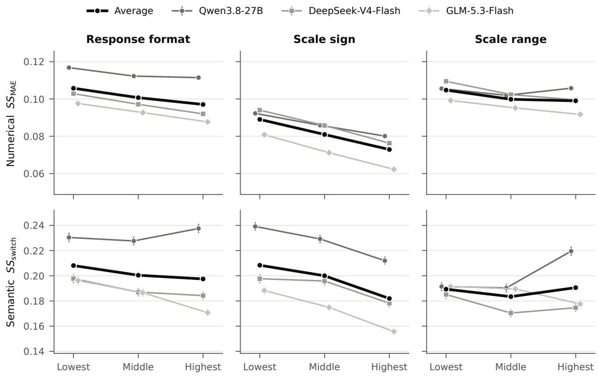  
Figure 10: Scale sensitivity at three reasoning levels for the three open models. The black line is the average over the three models. Bars are 95% item bootstrap intervals from 2,000 resamples.

<table><tr><td rowspan="2">Moderator</td><td rowspan="2">Design element</td><td colspan="2"> $S S _ { \mathrm { M A E } }$ </td><td colspan="2"> $S S _ { \mathrm { s w i t c h } }$ </td></tr><tr><td>b</td><td>95% CI</td><td>b</td><td>95% CI</td></tr><tr><td colspan="6">Task</td></tr><tr><td rowspan="3">Sentiment</td><td>Sign</td><td>-0.006</td><td>[-0.007, -0.005]</td><td>+0.006</td><td>[0.003, 0.008]</td></tr><tr><td>Range</td><td>+0.005</td><td>[0.005, 0.006]</td><td>-0.001</td><td>[-0.003,0.001]</td></tr><tr><td>Sign</td><td>+0.029</td><td>[0.028, 0.030]</td><td>+0.080</td><td>[0.078, 0.084]</td></tr><tr><td rowspan="2"></td><td>Range</td><td>-0.031</td><td>[-0.032, -0.030]</td><td>-0.051</td><td>[-0.053, -0.049]</td></tr><tr><td></td><td></td><td></td><td></td><td></td></tr><tr><td colspan="6">Rubric based</td></tr><tr><td></td><td>Sign</td><td>-0.002</td><td>[-0.002, -0.001]</td><td>-0.006</td><td>[-0.008, -0.005]</td></tr><tr><td></td><td>Range</td><td>-0.001</td><td>[-0.001, 0.000]</td><td>0.000</td><td>[-0.002, 0.001]</td></tr><tr><td colspan="6">Model</td></tr><tr><td rowspan="2">Gemini 3.5 Flash Lite</td><td>Sign</td><td>+0.023</td><td>[0.022, 0.024]</td><td>+0.015</td><td>[0.013, 0.018]</td></tr><tr><td>Range</td><td>+0.004</td><td>[0.003, 0.005]</td><td>0.000</td><td>[-0.002, 0.002]</td></tr><tr><td rowspan="2">Qwen3.8 27B</td><td>Sign</td><td>-0.006</td><td>[-0.007, -0.006]</td><td>-0.012</td><td>[-0.015, -0.009]</td></tr><tr><td>Range</td><td>-0.010</td><td>[-0.011, -0.009]</td><td>-0.042</td><td>[-0.045, -0.040]</td></tr><tr><td rowspan="2">DeepSeek V4 Flash</td><td>Sign</td><td>+0.009</td><td>[0.008, 0.010]</td><td>-0.021</td><td>[-0.023, -0.018]</td></tr><tr><td>Range</td><td>+0.008</td><td>[0.007, 0.009]</td><td>-0.016</td><td>[-0.018, -0.013]</td></tr><tr><td rowspan="2">GLM 5.3 Flash</td><td>Sign</td><td>+0.001</td><td>[0.000, 0.002]</td><td>-0.028</td><td>[-0.031, -0.025]</td></tr><tr><td>Range</td><td>+0.003</td><td>[0.002, 0.003]</td><td>-0.008</td><td>[-0.010, -0.006]</td></tr><tr><td colspan="6">Weighted  $R ^ { 2 }$ </td></tr></table>

Table 6: Moderation of scale sensitivity by task, prompting strategy, and model. Entries are interaction coefficients b from weighted least squares regressions of the 1,200 minimal pair estimates, fitted separately for each metric. Brackets are 95% item bootstrap intervals. Intervals that include zero indicate no detectable moderation.

<table><tr><td rowspan=16 colspan=3>GPT-5.6-LunaGemini-3.5-FLQwen3.8-27BDeepSeek-V4-FlashGLM-5.3-FlashGPT-5.6-LunaGemini-3.5-FL</td><td rowspan=1 colspan=2></td><td rowspan=1 colspan=18>(a) Political leaning, macro-F1</td></tr><tr><td rowspan=1 colspan=1></td><td rowspan=1 colspan=1>Zero-shot</td><td rowspan=1 colspan=1>.60</td><td rowspan=1 colspan=1>.59</td><td rowspan=1 colspan=1>.58</td><td rowspan=1 colspan=1>.56</td><td rowspan=1 colspan=1></td><td rowspan=1 colspan=1>.60</td><td rowspan=1 colspan=1>.60</td><td rowspan=1 colspan=1>.58</td><td rowspan=1 colspan=1>.59</td><td rowspan=1 colspan=1></td><td rowspan=1 colspan=1>.61</td><td rowspan=1 colspan=1>.61</td><td rowspan=1 colspan=1>.56</td><td rowspan=1 colspan=1>.50</td><td rowspan=1 colspan=1></td><td rowspan=1 colspan=1>.60</td><td rowspan=1 colspan=1>.60</td><td rowspan=1 colspan=1>.56</td><td rowspan=1 colspan=1>.56</td></tr><tr><td rowspan=1 colspan=1>Rubric</td><td rowspan=1 colspan=1>.53</td><td rowspan=1 colspan=1>.49</td><td rowspan=1 colspan=1>.48</td><td rowspan=1 colspan=1>.47</td><td rowspan=1 colspan=1></td><td rowspan=1 colspan=1>.54</td><td rowspan=1 colspan=1>.51</td><td rowspan=1 colspan=1>.45</td><td rowspan=1 colspan=1>.52</td><td rowspan=1 colspan=1></td><td rowspan=1 colspan=1>.58</td><td rowspan=1 colspan=1>.61</td><td rowspan=1 colspan=1>.48</td><td rowspan=1 colspan=1>.40</td><td rowspan=1 colspan=1></td><td rowspan=1 colspan=1>.58</td><td rowspan=1 colspan=1>.59</td><td rowspan=1 colspan=1>.48</td><td rowspan=1 colspan=1>.46</td></tr><tr><td rowspan=1 colspan=1>Zero-shot</td><td rowspan=1 colspan=1>.55</td><td rowspan=1 colspan=1>.48</td><td rowspan=1 colspan=1>.52</td><td rowspan=1 colspan=1>.57</td><td rowspan=1 colspan=1></td><td rowspan=1 colspan=1>.60</td><td rowspan=1 colspan=1>.55</td><td rowspan=1 colspan=1>.44</td><td rowspan=1 colspan=1>.56</td><td rowspan=1 colspan=1></td><td rowspan=1 colspan=1>.55</td><td rowspan=1 colspan=1>.57</td><td rowspan=1 colspan=1>.52</td><td rowspan=1 colspan=1>.51</td><td rowspan=1 colspan=1></td><td rowspan=1 colspan=1>.62</td><td rowspan=1 colspan=1>.57</td><td rowspan=1 colspan=1>.53</td><td rowspan=1 colspan=1>.53</td></tr><tr><td rowspan=1 colspan=1>Rubric</td><td rowspan=1 colspan=1>.47</td><td rowspan=1 colspan=1>.44</td><td rowspan=1 colspan=1>.44</td><td rowspan=1 colspan=1>.46</td><td rowspan=1 colspan=1></td><td rowspan=1 colspan=1>.47</td><td rowspan=1 colspan=1>.50</td><td rowspan=1 colspan=1>.41</td><td rowspan=1 colspan=1>.43</td><td rowspan=1 colspan=1></td><td rowspan=1 colspan=1>.49</td><td rowspan=1 colspan=1>.51</td><td rowspan=1 colspan=1>.48</td><td rowspan=1 colspan=1>.38</td><td rowspan=1 colspan=1></td><td rowspan=1 colspan=1>.53</td><td rowspan=1 colspan=1>.56</td><td rowspan=1 colspan=1>.50</td><td rowspan=1 colspan=1>.46</td></tr><tr><td rowspan=1 colspan=1>Zero-shot</td><td rowspan=1 colspan=1>.62</td><td rowspan=1 colspan=1>.59</td><td rowspan=1 colspan=1>.59</td><td rowspan=1 colspan=1>.61</td><td rowspan=1 colspan=1></td><td rowspan=1 colspan=1>.63</td><td rowspan=1 colspan=1>.61</td><td rowspan=1 colspan=1>.58</td><td rowspan=1 colspan=1>.59</td><td rowspan=1 colspan=1></td><td rowspan=1 colspan=1>.65</td><td rowspan=1 colspan=1>.65</td><td rowspan=1 colspan=1>.61</td><td rowspan=1 colspan=1>.56</td><td rowspan=1 colspan=1></td><td rowspan=1 colspan=1>.63</td><td rowspan=1 colspan=1>.64</td><td rowspan=1 colspan=1>.59</td><td rowspan=1 colspan=1>.54</td></tr><tr><td rowspan=1 colspan=1>Rubric</td><td rowspan=1 colspan=1>.56</td><td rowspan=1 colspan=1>.58</td><td rowspan=1 colspan=1>.56</td><td rowspan=1 colspan=1>.56</td><td rowspan=1 colspan=1></td><td rowspan=1 colspan=1>.59</td><td rowspan=1 colspan=1>.57</td><td rowspan=1 colspan=1>.52</td><td rowspan=1 colspan=1>.53</td><td rowspan=1 colspan=1></td><td rowspan=1 colspan=1>.63</td><td rowspan=1 colspan=1>.63</td><td rowspan=1 colspan=1>.57</td><td rowspan=1 colspan=1>.54</td><td rowspan=1 colspan=1></td><td rowspan=1 colspan=1>.61</td><td rowspan=1 colspan=1>.61</td><td rowspan=1 colspan=1>.56</td><td rowspan=1 colspan=1>.50</td></tr><tr><td rowspan=1 colspan=1>Zero-shot</td><td rowspan=1 colspan=1>.58</td><td rowspan=1 colspan=1>.57</td><td rowspan=1 colspan=1>.57</td><td rowspan=1 colspan=1>.55</td><td rowspan=1 colspan=1></td><td rowspan=1 colspan=1>.59</td><td rowspan=1 colspan=1>.58</td><td rowspan=1 colspan=1>.55</td><td rowspan=1 colspan=1>.57</td><td rowspan=1 colspan=1></td><td rowspan=1 colspan=1>.59</td><td rowspan=1 colspan=1>.59</td><td rowspan=1 colspan=1>.53</td><td rowspan=1 colspan=1>.54</td><td rowspan=1 colspan=1></td><td rowspan=1 colspan=1>.60</td><td rowspan=1 colspan=1>.58</td><td rowspan=1 colspan=1>.55</td><td rowspan=1 colspan=1>.51</td></tr><tr><td rowspan=1 colspan=1>Rubric</td><td rowspan=1 colspan=1>.55</td><td rowspan=1 colspan=1>.56</td><td rowspan=1 colspan=1>.54</td><td rowspan=1 colspan=1>.50</td><td rowspan=1 colspan=1></td><td rowspan=1 colspan=1>.57</td><td rowspan=1 colspan=1>.54</td><td rowspan=1 colspan=1>.51</td><td rowspan=1 colspan=1>.53</td><td rowspan=1 colspan=1></td><td rowspan=1 colspan=1>.56</td><td rowspan=1 colspan=1>.57</td><td rowspan=1 colspan=1>.52</td><td rowspan=1 colspan=1>.45</td><td rowspan=1 colspan=1></td><td rowspan=1 colspan=1>.55</td><td rowspan=1 colspan=1>.56</td><td rowspan=1 colspan=1>.50</td><td rowspan=1 colspan=1>.48</td></tr><tr><td rowspan=1 colspan=1>Zero-shot</td><td rowspan=1 colspan=1>.52</td><td rowspan=1 colspan=1>.51</td><td rowspan=1 colspan=1>.48</td><td rowspan=1 colspan=1>.47</td><td rowspan=1 colspan=1></td><td rowspan=1 colspan=1>.56</td><td rowspan=1 colspan=1>.51</td><td rowspan=1 colspan=1>.49</td><td rowspan=1 colspan=1>.53</td><td rowspan=1 colspan=1></td><td rowspan=1 colspan=1>.58</td><td rowspan=1 colspan=1>.60</td><td rowspan=1 colspan=1>.50</td><td rowspan=1 colspan=1>.40</td><td rowspan=1 colspan=1></td><td rowspan=1 colspan=1>.58</td><td rowspan=1 colspan=1>.59</td><td rowspan=1 colspan=1>.51</td><td rowspan=1 colspan=1>.43</td></tr><tr><td rowspan=1 colspan=1>Rubric</td><td rowspan=1 colspan=1>.47</td><td rowspan=1 colspan=1>.46</td><td rowspan=1 colspan=1>.43</td><td rowspan=1 colspan=1>.39</td><td rowspan=1 colspan=1></td><td rowspan=1 colspan=1>.51</td><td rowspan=1 colspan=1>.47</td><td rowspan=1 colspan=1>.41</td><td rowspan=1 colspan=1>.45</td><td rowspan=1 colspan=1></td><td rowspan=1 colspan=1>.54</td><td rowspan=1 colspan=1>.56</td><td rowspan=1 colspan=1>.46</td><td rowspan=1 colspan=1>.34</td><td rowspan=1 colspan=1></td><td rowspan=1 colspan=1>.55</td><td rowspan=1 colspan=1>.57</td><td rowspan=1 colspan=1>.47</td><td rowspan=1 colspan=1>.41</td></tr><tr><td rowspan=1 colspan=1>(</td><td rowspan=1 colspan=19>b) Sentiment,Spearman correlation</td></tr><tr><td rowspan=1 colspan=1>Zero-shot</td><td rowspan=1 colspan=1>.94</td><td rowspan=1 colspan=1>.94</td><td rowspan=1 colspan=1>.94</td><td rowspan=1 colspan=1>.94</td><td rowspan=1 colspan=1></td><td rowspan=1 colspan=1>.94</td><td rowspan=1 colspan=1>.95</td><td rowspan=1 colspan=1>.94</td><td rowspan=1 colspan=1>.94</td><td rowspan=1 colspan=1></td><td rowspan=1 colspan=1>.88</td><td rowspan=1 colspan=1>.92</td><td rowspan=1 colspan=1>.94</td><td rowspan=1 colspan=1>.94</td><td rowspan=1 colspan=1></td><td rowspan=1 colspan=1>.89</td><td rowspan=1 colspan=1>.93</td><td rowspan=1 colspan=1>.94</td><td rowspan=1 colspan=1>.94</td></tr><tr><td rowspan=1 colspan=1>Rubric</td><td rowspan=1 colspan=1>.94</td><td rowspan=1 colspan=1>.94</td><td rowspan=1 colspan=1>.94</td><td rowspan=1 colspan=1>.94</td><td rowspan=1 colspan=1></td><td rowspan=1 colspan=1>.94</td><td rowspan=1 colspan=1>.94</td><td rowspan=1 colspan=1>.94</td><td rowspan=1 colspan=1>.94</td><td rowspan=1 colspan=1></td><td rowspan=1 colspan=1>.88</td><td rowspan=1 colspan=1>.92</td><td rowspan=1 colspan=1>.94</td><td rowspan=1 colspan=1>.94</td><td rowspan=1 colspan=1></td><td rowspan=1 colspan=1>.88</td><td rowspan=1 colspan=1>.92</td><td rowspan=1 colspan=1>.94</td><td rowspan=1 colspan=1>.94</td></tr><tr><td rowspan=1 colspan=1>Zero-shot</td><td rowspan=1 colspan=1>.94</td><td rowspan=1 colspan=1>.94</td><td rowspan=1 colspan=1>.95</td><td rowspan=1 colspan=1>.95</td><td rowspan=1 colspan=1></td><td rowspan=1 colspan=1>.93</td><td rowspan=1 colspan=1>.94</td><td rowspan=1 colspan=1>.94</td><td rowspan=1 colspan=1>.95</td><td rowspan=1 colspan=1></td><td rowspan=1 colspan=1>.90</td><td rowspan=1 colspan=1>.93</td><td rowspan=1 colspan=1>.94</td><td rowspan=1 colspan=1>.94</td><td rowspan=1 colspan=1></td><td rowspan=1 colspan=1>.89</td><td rowspan=1 colspan=1>.93</td><td rowspan=1 colspan=1>.94</td><td rowspan=1 colspan=1>.94</td></tr><tr><td rowspan=1 colspan=1>Rubric</td><td rowspan=1 colspan=1>.94</td><td rowspan=1 colspan=1>.94</td><td rowspan=1 colspan=1>.94</td><td rowspan=1 colspan=1>.95</td><td rowspan=1 colspan=1></td><td rowspan=1 colspan=1>.93</td><td rowspan=1 colspan=1>.94</td><td rowspan=1 colspan=1>.94</td><td rowspan=1 colspan=1>.94</td><td rowspan=1 colspan=1></td><td rowspan=1 colspan=1>.90</td><td rowspan=1 colspan=1>.93</td><td rowspan=1 colspan=1>.94</td><td rowspan=1 colspan=1>.94</td><td rowspan=1 colspan=1></td><td rowspan=1 colspan=1>.90</td><td rowspan=1 colspan=1>.93</td><td rowspan=1 colspan=1>.94</td><td rowspan=1 colspan=1>.94</td></tr><tr><td rowspan=11 colspan=3>Qwen3.8-27BDeepSeek-V4-FlashGLM-5.3-FlashGPT-5.6-LunaGemini-3.5-FL</td><td rowspan=1 colspan=1>Zero-shot</td><td rowspan=1 colspan=1>.94</td><td rowspan=1 colspan=1>.93</td><td rowspan=1 colspan=1>.93</td><td rowspan=1 colspan=1>.93</td><td rowspan=1 colspan=1></td><td rowspan=1 colspan=1>.92</td><td rowspan=1 colspan=1>.93</td><td rowspan=1 colspan=1>.93</td><td rowspan=1 colspan=1>.93</td><td rowspan=1 colspan=1></td><td rowspan=1 colspan=1>.88</td><td rowspan=1 colspan=1>.90</td><td rowspan=1 colspan=1>.92</td><td rowspan=1 colspan=1>.93</td><td rowspan=1 colspan=1></td><td rowspan=1 colspan=1>.88</td><td rowspan=1 colspan=1>.90</td><td rowspan=1 colspan=1>.92</td><td rowspan=1 colspan=1>.93</td></tr><tr><td rowspan=1 colspan=1>Rubric</td><td rowspan=1 colspan=1>.93</td><td rowspan=1 colspan=1>.93</td><td rowspan=1 colspan=1>.93</td><td rowspan=1 colspan=1>.93</td><td rowspan=1 colspan=1></td><td rowspan=1 colspan=1>.92</td><td rowspan=1 colspan=1>.93</td><td rowspan=1 colspan=1>.93</td><td rowspan=1 colspan=1>.92</td><td rowspan=1 colspan=1></td><td rowspan=1 colspan=1>.88</td><td rowspan=1 colspan=1>.90</td><td rowspan=1 colspan=1>.92</td><td rowspan=1 colspan=1>.92</td><td rowspan=1 colspan=1></td><td rowspan=1 colspan=1>.88</td><td rowspan=1 colspan=1>.90</td><td rowspan=1 colspan=1>.92</td><td rowspan=1 colspan=1>.92</td></tr><tr><td rowspan=1 colspan=1>Zero-shot</td><td rowspan=1 colspan=1>.93</td><td rowspan=1 colspan=1>.92</td><td rowspan=1 colspan=1>.92</td><td rowspan=1 colspan=1>.93</td><td rowspan=1 colspan=1></td><td rowspan=1 colspan=1>.90</td><td rowspan=1 colspan=1>.92</td><td rowspan=1 colspan=1>.93</td><td rowspan=1 colspan=1>.93</td><td rowspan=1 colspan=1></td><td rowspan=1 colspan=1>.87</td><td rowspan=1 colspan=1>.90</td><td rowspan=1 colspan=1>.92</td><td rowspan=1 colspan=1>.92</td><td rowspan=1 colspan=1></td><td rowspan=1 colspan=1>.87</td><td rowspan=1 colspan=1>.91</td><td rowspan=1 colspan=1>.92</td><td rowspan=1 colspan=1>.92</td></tr><tr><td rowspan=1 colspan=1>Rubric</td><td rowspan=1 colspan=1>.93</td><td rowspan=1 colspan=1>.93</td><td rowspan=1 colspan=1>.93</td><td rowspan=1 colspan=1>.93</td><td rowspan=1 colspan=1></td><td rowspan=1 colspan=1>.92</td><td rowspan=1 colspan=1>.93</td><td rowspan=1 colspan=1>.93</td><td rowspan=1 colspan=1>.93</td><td rowspan=1 colspan=1></td><td rowspan=1 colspan=1>.88</td><td rowspan=1 colspan=1>.91</td><td rowspan=1 colspan=1>.93</td><td rowspan=1 colspan=1>.93</td><td rowspan=1 colspan=1></td><td rowspan=1 colspan=1>.88</td><td rowspan=1 colspan=1>.91</td><td rowspan=1 colspan=1>.93</td><td rowspan=1 colspan=1>.93</td></tr><tr><td rowspan=1 colspan=1>Zero-shot</td><td rowspan=1 colspan=1>.94</td><td rowspan=1 colspan=1>.94</td><td rowspan=1 colspan=1>.94</td><td rowspan=1 colspan=1>.94</td><td rowspan=1 colspan=1></td><td rowspan=1 colspan=1>.92</td><td rowspan=1 colspan=1>.94</td><td rowspan=1 colspan=1>.94</td><td rowspan=1 colspan=1>.94</td><td rowspan=1 colspan=1></td><td rowspan=1 colspan=1>.89</td><td rowspan=1 colspan=1>.92</td><td rowspan=1 colspan=1>.94</td><td rowspan=1 colspan=1>.94</td><td rowspan=1 colspan=1></td><td rowspan=1 colspan=1>.89</td><td rowspan=1 colspan=1>.92</td><td rowspan=1 colspan=1>.94</td><td rowspan=1 colspan=1>.93</td></tr><tr><td rowspan=1 colspan=1>Rubric</td><td rowspan=1 colspan=1>.94</td><td rowspan=1 colspan=1>.94</td><td rowspan=1 colspan=1>.94</td><td rowspan=1 colspan=1>.94</td><td rowspan=1 colspan=1></td><td rowspan=1 colspan=1>.94</td><td rowspan=1 colspan=1>.94</td><td rowspan=1 colspan=1>.94</td><td rowspan=1 colspan=1>.94</td><td rowspan=1 colspan=1></td><td rowspan=1 colspan=1>.88</td><td rowspan=1 colspan=1>.92</td><td rowspan=1 colspan=1>.93</td><td rowspan=1 colspan=1>.94</td><td rowspan=1 colspan=1></td><td rowspan=1 colspan=1>.89</td><td rowspan=1 colspan=1>.92</td><td rowspan=1 colspan=1>.93</td><td rowspan=1 colspan=1>.94</td></tr><tr><td rowspan=1 colspan=1></td><td rowspan=1 colspan=19>(c) Toxicity, Spearman correlation</td></tr><tr><td rowspan=1 colspan=1>Zero-shot</td><td rowspan=1 colspan=1>.33</td><td rowspan=1 colspan=1>.32</td><td rowspan=1 colspan=1>.30</td><td rowspan=1 colspan=1>.30</td><td rowspan=1 colspan=1></td><td rowspan=1 colspan=1>.32</td><td rowspan=1 colspan=1>.31</td><td rowspan=1 colspan=1>.31</td><td rowspan=1 colspan=1>.28</td><td rowspan=1 colspan=1></td><td rowspan=1 colspan=1>.28</td><td rowspan=1 colspan=1>.26</td><td rowspan=1 colspan=1>.26</td><td rowspan=1 colspan=1>.25</td><td rowspan=1 colspan=1></td><td rowspan=1 colspan=1>.31</td><td rowspan=1 colspan=1>.28</td><td rowspan=1 colspan=1>.28</td><td rowspan=1 colspan=1>.24</td></tr><tr><td rowspan=1 colspan=1>Rubric</td><td rowspan=1 colspan=1>.33</td><td rowspan=1 colspan=1>.33</td><td rowspan=1 colspan=1>.33</td><td rowspan=1 colspan=1>.32</td><td rowspan=1 colspan=1></td><td rowspan=1 colspan=1>.32</td><td rowspan=1 colspan=1>.31</td><td rowspan=1 colspan=1>.31</td><td rowspan=1 colspan=1>.31</td><td rowspan=1 colspan=1></td><td rowspan=1 colspan=1>.29</td><td rowspan=1 colspan=1>.29</td><td rowspan=1 colspan=1>.31</td><td rowspan=1 colspan=1>.32</td><td rowspan=1 colspan=1></td><td rowspan=1 colspan=1>.29</td><td rowspan=1 colspan=1>.29</td><td rowspan=1 colspan=1>.30</td><td rowspan=1 colspan=1>.29</td></tr><tr><td rowspan=1 colspan=1>Zero-shot</td><td rowspan=1 colspan=1>.36</td><td rowspan=1 colspan=1>.33</td><td rowspan=1 colspan=1>.33</td><td rowspan=1 colspan=1>.33</td><td rowspan=1 colspan=1></td><td rowspan=1 colspan=1>.35</td><td rowspan=1 colspan=1>.34</td><td rowspan=1 colspan=1>.32</td><td rowspan=1 colspan=1>.31</td><td rowspan=1 colspan=1></td><td rowspan=1 colspan=1>.35</td><td rowspan=1 colspan=1>.35</td><td rowspan=1 colspan=1>.32</td><td rowspan=1 colspan=1>.28</td><td rowspan=1 colspan=1></td><td rowspan=1 colspan=1>.34</td><td rowspan=1 colspan=1>.33</td><td rowspan=1 colspan=1>.33</td><td rowspan=1 colspan=1>.33</td></tr><tr><td rowspan=1 colspan=1>Rubric</td><td rowspan=1 colspan=1>.37</td><td rowspan=1 colspan=1>.38</td><td rowspan=1 colspan=1>.38</td><td rowspan=1 colspan=1>.36</td><td rowspan=1 colspan=1></td><td rowspan=1 colspan=1>.35</td><td rowspan=1 colspan=1>.38</td><td rowspan=1 colspan=1>.37</td><td rowspan=1 colspan=1>.36</td><td rowspan=1 colspan=1></td><td rowspan=1 colspan=1>.35</td><td rowspan=1 colspan=1>.32</td><td rowspan=1 colspan=1>.34</td><td rowspan=1 colspan=1>.35</td><td rowspan=1 colspan=1></td><td rowspan=1 colspan=1>.32</td><td rowspan=1 colspan=1>.33</td><td rowspan=1 colspan=1>.36</td><td rowspan=1 colspan=1>.35</td></tr><tr><td rowspan=4 colspan=3>Qwen3.8-27BDeepSeek-V4-Flash</td><td rowspan=1 colspan=1>Zero-shot</td><td rowspan=1 colspan=1>.32</td><td rowspan=1 colspan=1>.29</td><td rowspan=1 colspan=1>.30</td><td rowspan=1 colspan=1>.29</td><td rowspan=1 colspan=1></td><td rowspan=1 colspan=1>.30</td><td rowspan=1 colspan=1>.29</td><td rowspan=1 colspan=1>.31</td><td rowspan=1 colspan=1>.28</td><td rowspan=1 colspan=1></td><td rowspan=1 colspan=1>.28</td><td rowspan=1 colspan=1>.30</td><td rowspan=1 colspan=1>.28</td><td rowspan=1 colspan=1>.27</td><td rowspan=1 colspan=1></td><td rowspan=1 colspan=1>.27</td><td rowspan=1 colspan=1>.28</td><td rowspan=1 colspan=1>.27</td><td rowspan=1 colspan=1>.24</td></tr><tr><td rowspan=1 colspan=1>Rubric</td><td rowspan=1 colspan=1>.30</td><td rowspan=1 colspan=1>.28</td><td rowspan=1 colspan=1>.27</td><td rowspan=1 colspan=1>.28</td><td rowspan=1 colspan=1></td><td rowspan=1 colspan=1>.29</td><td rowspan=1 colspan=1>.28</td><td rowspan=1 colspan=1>.28</td><td rowspan=1 colspan=1>.28</td><td rowspan=1 colspan=1></td><td rowspan=1 colspan=1>.25</td><td rowspan=1 colspan=1>.27</td><td rowspan=1 colspan=1>.27</td><td rowspan=1 colspan=1>.26</td><td rowspan=1 colspan=1></td><td rowspan=1 colspan=1>.25</td><td rowspan=1 colspan=1>.26</td><td rowspan=1 colspan=1>.27</td><td rowspan=1 colspan=1>.27</td></tr><tr><td rowspan=1 colspan=1>Zero-shot</td><td rowspan=1 colspan=1>.33</td><td rowspan=1 colspan=1>.31</td><td rowspan=1 colspan=1>.32</td><td rowspan=1 colspan=1>.31</td><td rowspan=1 colspan=1></td><td rowspan=1 colspan=1>.30</td><td rowspan=1 colspan=1>.31</td><td rowspan=1 colspan=1>.31</td><td rowspan=1 colspan=1>.31</td><td rowspan=1 colspan=1></td><td rowspan=1 colspan=1>.28</td><td rowspan=1 colspan=1>.29</td><td rowspan=1 colspan=1>.29</td><td rowspan=1 colspan=1>.28</td><td rowspan=1 colspan=1></td><td rowspan=1 colspan=1>.29</td><td rowspan=1 colspan=1>.29</td><td rowspan=1 colspan=1>.28</td><td rowspan=1 colspan=1>.29</td></tr><tr><td rowspan=1 colspan=1>Rubric</td><td rowspan=1 colspan=1>.32</td><td rowspan=1 colspan=1>.31</td><td rowspan=1 colspan=1>.32</td><td rowspan=1 colspan=1>.33</td><td rowspan=1 colspan=1></td><td rowspan=1 colspan=1>.31</td><td rowspan=1 colspan=1>.31</td><td rowspan=1 colspan=1>.31</td><td rowspan=1 colspan=1>.32</td><td rowspan=1 colspan=1></td><td rowspan=1 colspan=1>.28</td><td rowspan=1 colspan=1>.29</td><td rowspan=1 colspan=1>.30</td><td rowspan=1 colspan=1>.29</td><td rowspan=1 colspan=1></td><td rowspan=1 colspan=1>.27</td><td rowspan=1 colspan=1>.28</td><td rowspan=1 colspan=1>.30</td><td rowspan=1 colspan=1>.29</td></tr><tr><td rowspan=2 colspan=3>GLM-5.3-Flash</td><td rowspan=1 colspan=1>Zero-shot</td><td rowspan=1 colspan=1>.35</td><td rowspan=1 colspan=1>.37</td><td rowspan=1 colspan=1>.37</td><td rowspan=1 colspan=1>.35</td><td rowspan=1 colspan=1></td><td rowspan=1 colspan=1>.35</td><td rowspan=1 colspan=1>.35</td><td rowspan=1 colspan=1>.36</td><td rowspan=1 colspan=1>.35</td><td rowspan=1 colspan=1></td><td rowspan=1 colspan=1>.27</td><td rowspan=1 colspan=1>.35</td><td rowspan=1 colspan=1>.36</td><td rowspan=1 colspan=1>.34</td><td rowspan=1 colspan=1></td><td rowspan=1 colspan=1>.34</td><td rowspan=1 colspan=1>.35</td><td rowspan=1 colspan=1>.33</td><td rowspan=1 colspan=1>.33</td></tr><tr><td rowspan=1 colspan=1>Rubric</td><td rowspan=1 colspan=1>.34</td><td rowspan=1 colspan=1>.36</td><td rowspan=1 colspan=1>.36</td><td rowspan=1 colspan=1>.36</td><td rowspan=1 colspan=1></td><td rowspan=1 colspan=1>.35</td><td rowspan=1 colspan=1>.35</td><td rowspan=1 colspan=1>.35</td><td rowspan=1 colspan=1>.36</td><td rowspan=1 colspan=1></td><td rowspan=1 colspan=1>.28</td><td rowspan=1 colspan=1>.34</td><td rowspan=1 colspan=1>.35</td><td rowspan=1 colspan=1>.37</td><td rowspan=1 colspan=1></td><td rowspan=1 colspan=1>.30</td><td rowspan=1 colspan=1>.35</td><td rowspan=1 colspan=1>.34</td><td rowspan=1 colspan=1>.34</td></tr><tr><td rowspan=1 colspan=4>points</td><td rowspan=1 colspan=1>3</td><td rowspan=1 colspan=1>5</td><td rowspan=1 colspan=1>11</td><td rowspan=1 colspan=2>21</td><td rowspan=1 colspan=1>3</td><td rowspan=1 colspan=1>5</td><td rowspan=1 colspan=1>11</td><td rowspan=1 colspan=2>21</td><td rowspan=1 colspan=1>3</td><td rowspan=1 colspan=1>5</td><td rowspan=1 colspan=3>11 21</td><td rowspan=1 colspan=1>3</td><td rowspan=1 colspan=1>5</td><td rowspan=1 colspan=1>11</td><td rowspan=1 colspan=1>21</td></tr><tr><td rowspan=1 colspan=4></td><td rowspan=1 colspan=8>Continuous, signed Continuous, unsi</td><td rowspan=1 colspan=4>gned    Ordinal,</td><td rowspan=1 colspan=3>signed</td><td rowspan=1 colspan=1>Ordi</td><td rowspan=1 colspan=1>nal, u</td><td rowspan=1 colspan=1>nsig</td><td rowspan=1 colspan=1>ned</td></tr></table>

Figure 11: Agreement between LLM scores and human labels for every model, prompting strategy, and rating scale condition.

<table><tr><td></td><td colspan="3"> $\eta ^ { 2 } \ : ( \% )$ </td></tr><tr><td>Component</td><td>df</td><td> $S S _ { \mathrm { M A E } }$ </td><td>SSswitch</td></tr><tr><td>Scale design</td><td>39</td><td>40.3</td><td>8.9</td></tr><tr><td>Design element changed</td><td>2</td><td>1.2</td><td>0.4</td></tr><tr><td>Format of compared scales</td><td>2</td><td>13.6</td><td>4.6</td></tr><tr><td>Sign of compared scales</td><td>2</td><td>3.2</td><td>1.6</td></tr><tr><td>Points or range pair</td><td>11</td><td>17.0</td><td>1.6</td></tr><tr><td>Combinations of these settings</td><td>22</td><td>5.4</td><td>0.7</td></tr><tr><td>Task</td><td>2</td><td>29.7</td><td>58.9</td></tr><tr><td>Model</td><td>4</td><td>2.6</td><td>1.3</td></tr><tr><td>Prompting strategy</td><td>1</td><td>0.0</td><td>0.0</td></tr><tr><td>Scale design × task</td><td>78</td><td>15.8</td><td>16.0</td></tr><tr><td>Design element changed × task</td><td>4</td><td>5.7</td><td>3.2</td></tr><tr><td>Scale settings × task</td><td>74</td><td>10.1</td><td>12.8</td></tr><tr><td>Scale design × model</td><td>156</td><td>4.1</td><td>3.4</td></tr><tr><td>Design element changed × model</td><td>8</td><td>0.7</td><td>0.5</td></tr><tr><td>Scale settings × model</td><td>148</td><td>3.3</td><td>2.9</td></tr><tr><td>Scale design × prompting strategy</td><td>39</td><td>0.3</td><td>0.2</td></tr><tr><td>Design element changed × prompting strategy</td><td>2</td><td>0.0</td><td>0.0</td></tr><tr><td>Scale settings × prompting strategy</td><td>37</td><td>0.3</td><td>0.2</td></tr><tr><td>Other pairwise interactions</td><td>14</td><td>1.1</td><td>1.0</td></tr><tr><td>Task × model</td><td>8</td><td>0.6</td><td>0.5</td></tr><tr><td>Task × prompting strategy</td><td>2</td><td>0.3</td><td>0.4</td></tr><tr><td>Model × prompting strategy</td><td>4</td><td>0.2</td><td>0.1</td></tr><tr><td>Three- and four-way interactions</td><td>866</td><td>6.1</td><td>10.3</td></tr></table>

Table 7: Full variance decomposition of the 1,200 minimal pair estimates (Figure 5). Shares come from the weighted least squares regression with all interactions between two factors and sum to 100% for each metric. Subcomponents may not add exactly to their total because of rounding. All 95% item bootstrap intervals lie within 1.2 percentage points of the estimates.