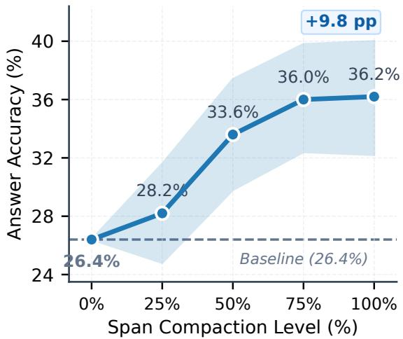
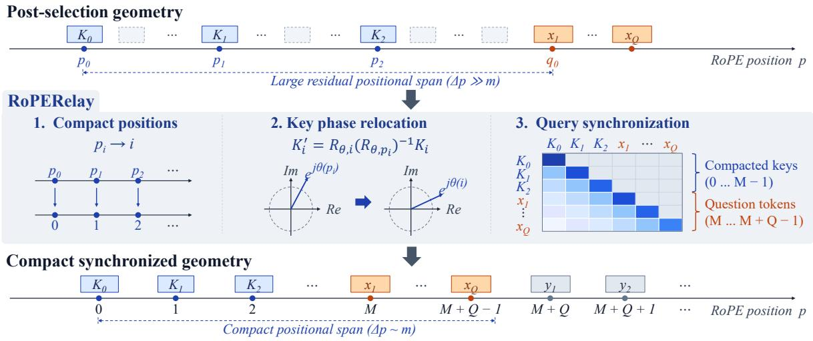
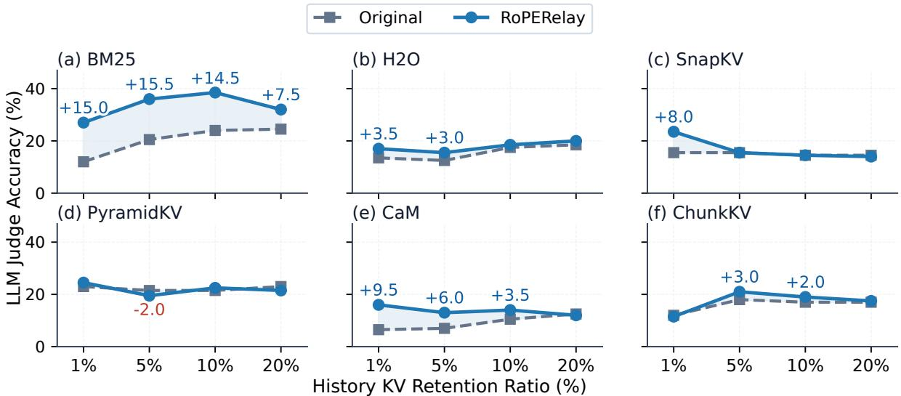
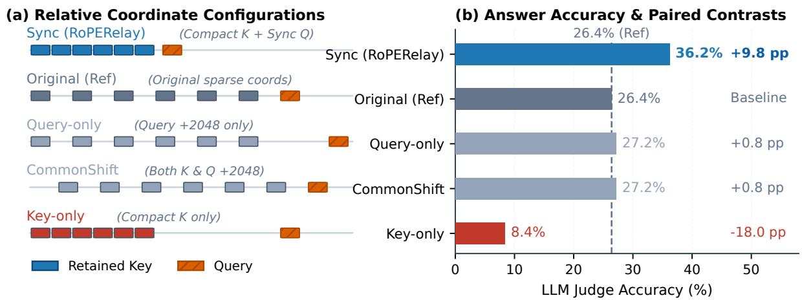
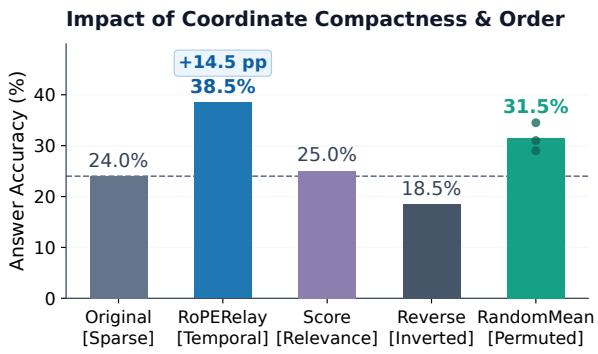
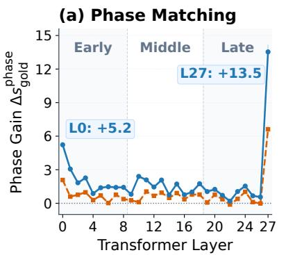
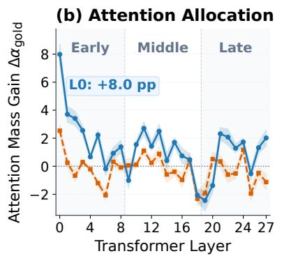
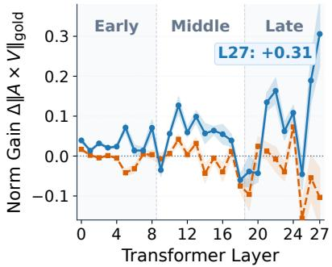

# Compression Does Not End at Selection: Post-Selection Positional Geometry for Sparse KV Caches

Wanyang Hong Zhaoning Zhang

National Key Laboratory of Parallel and Distributed Computing College of Computer Science and Technology   
National University of Defense Technology, Changsha, China. {hongwanyang9527, zhangzhaoning}@nudt.edu.cn

## Abstract

Sparse KV compression reduces long-context inference costs by retaining selected historical states, yet these states typically keep their coordinates from the full history. Under Ro tary Position Embedding (RoPE), gaps left by evicted tokens continue to affect query–key matching, potentially limiting the use of retained evidence. We study post-selection positional geometry on a fixed selector-produced cache, examining how positional organization affects the use of retained information and which coordinate and continuation rules improve answer quality. To reorganize this geometry, we propose RoPERelay, which assigns compact, order-preserving RoPE coordinates, relocates cached key phases through inverse rotation and re-rotation, and synchronizes the current query and subsequent generation. It reuses existing K/V without renewed selection, historical re-prefill, or additional cache budget. Across 36 comparisons spanning two models, six sparse selectors, and three long-term memory tasks, RoPERelay improves answer quality in 32 cases. For Llama-3.1-8B-Instruct with BM25 on LongMemEval-S, accuracy increases from 23.6% to 35.4%. Measured completerequest time overhead is approximately 1%–3% in the evaluated configurations. These findings establish positional organization as a distinct optimization dimension for sparse KV caches after content selection.

## 1 Introduction

Language models engaged in long-term interaction need to access facts, preferences, and state updates scattered across turns and sessions. As histories grow to tens or hundreds of thousands of tokens, storing and repeatedly accessing the full KV cache becomes increasingly costly. Sparse-cache methods address this cost by retaining useful historical information within a limited budget through selection, budget allocation, or state merging (Zhang et al., 2023; Li et al., 2024; Cai et al., 2025; Liu et al., 2025; Zhang et al., 2024b).

Span Compaction Response  
  
Figure 1: Fixed-content dose response on Qwen2-7B-Instruct, LongMemEval-S (500 records), and BM25 with an 8,192-token history-cache budget. Compacting residual positional spans increases answer accuracy. Shading: 95% confidence intervals.

Sparse selection reduces cache size without necessarily shortening the positional span of retained evidence. Under RoPE, the retained coordinates continue to determine relative rotation phases in query–key matching (Su et al., 2024), even after intervening states have been removed. Figure 1 demonstrates the resulting sensitivity: with selected historical content, values, and cache budget fixed, progressively compacting residual positional spans increases LongMemEval-S accuracy from 26.4% to 36.2% in the illustrated setting. The same retained content can therefore yield different answer quality under different coordinates.

FINCH (Corallo and Papotti, 2024) relocates retained states during blockwise compression, while

CacheFocus (Lee et al., 2025) reassigns positions when reusing and pruning document caches. In these pipelines, positional adjustments are developed together with specific cache-construction and reuse strategies. We study post-selection positional geometry as an independently controllable optimization dimension across sparse selectors, focusing on how the coordinates of already retained states affect their subsequent use.

We propose RoPERelay to reorganize the coordinates of a selected sparse cache. RoPERelay takes the second leg after selection, carrying the same retained content from different selectors into a compact, synchronized RoPE coordinate space. It assigns consecutive coordinates in source-history order, analytically relocates historical key phases, and aligns retained-history endpoints across layers and physical KV heads at a shared query anchor. The current question and subsequent generation continue in this coordinated space, without renewed selection, historical re-prefill, or an increased history budget.

Across two models, six selectors, and three long-term memory tasks, RoPERelay improves answer quality in 32 of 36 comparisons. Measured complete-request time overhead is approximately 1%–3%. These results show the practical value of positional optimization across different sparse cache configurations.

Our contributions are:

1. Post-selection geometry affects answer quality. Controlled comparisons show that the same retained states can yield different answer quality under different coordinates, identifying an optimization dimension beyond content selection.

2. A reusable post-selection optimization stage. RoPERelay combines source-order compaction and synchronized continuation to improve the utility of caches produced by different sparse selectors.

3. Key ingredients of positional gains. Coordinate and ordering ablations identify the roles of key–query coordination and source chronology. Layer-wise readouts characterize changes in evidence matching, attention allocation, and value aggregation.

## 2 Related Work

## 2.1 KV Cache Compression

Existing KV cache compression methods primarily focus on retaining historical states under a limited budget. H2O (Zhang et al., 2023), Scissorhands (Liu et al., 2023), and SnapKV (Li et al., 2024) estimate token importance using accumulated attention, persistence of importance, and an observation window at the end of the input, respectively. Subsequent methods account for heterogeneity in budgets and semantic structure: PyramidKV (Cai et al., 2025) and Ada-KV (Feng et al., 2025) allocate different budgets across layers or attention heads, while ChunkKV (Liu et al., 2025) retains contiguous semantic blocks to reduce the semantic fragmentation caused by token-level pruning. CaM (Zhang et al., 2024b) and RocketKV (Behnam et al., 2025) construct compressed historical representations through state merging and multi-stage access, respectively. These methods optimize the selection, representation, or access set of historical information. We further ask whether the positional arrangement of retained states can improve the quality obtained from the same cache after selection has been fixed.

## 2.2 Cache Coordinates

RoPE (Su et al., 2024) encodes positional information through rotations of queries and keys, making attention scores dependent on their relative positions. Long-context methods such as YaRN (Peng et al., 2024), LongRoPE (Ding et al., 2024), and Self-Extend (Jin et al., 2024) extend the usable context range through frequency scaling, interpolation, or positional mapping.

Cache compression and reuse also involve position handling: InfiniPot (Kim et al., 2024) resets coordinates during continual compression. FINCH (Corallo and Papotti, 2024) assigns compact coordinates to states retained through prompt-guided blockwise compression. CacheFocus (Lee et al., 2025) reallocates reused document caches after layer-adaptive pruning. SelKV (Bouyahiaoui et al., 2026) investigates position reassignment alongside selective merging and attention compensation, reporting adverse effects in a long-context retrieval setting. We isolate the effect of positional organization on answer quality using fixed selected caches, studying how source chronology, historical endpoints, and question continuation can be coordinated.

  
Figure 2: RoPERelay reorganizes the positional geometry of the sparse history supplied by a selector. Retained states are mapped to consecutive coordinates in source temporal order, and historical keys enter the compact space through RoPE phase transformation. The current question starts at the shared anchor M, and subsequent answer inputs proceed along consecutive coordinates.

## 2.3 Conversational Memory

Long-term conversational systems need to store and access facts, preferences, and state updates across sessions. External-memory methods such as MemGPT (Packer et al., 2023), MemoryBank (Zhong et al., 2024) and Rhea (Hong et al., 2025) extend limited context through retrieval, summarization, or hierarchical storage. Recent work further moves memory management into the KV layer: EpiCache (Kim et al., 2026) uses episodic organization and fixed-budget caches for long-term conversation, while RocketKV-MT (Behnam et al., 2025) constructs an active cache for each query. These studies emphasize the accessibility of historical information under changing queries. These memorymanagement methods are complementary to our approach, which organizes the coordinates at which selected KV states participate in subsequent computation rather than redefining memory content or access sets.

## 3 Method

RoPERelay takes a selector-produced sparse KV cache as input and optimizes its positional geometry before question processing and generation. Figure 2 shows three components: compact coordinate assignment, historical key phase reconstruction, and question processing with synchronized positions.

## 3.1 Sparse KV Caches and Position Representation

The input is a selector-produced historical cache and its source-position indices. Selected states can differ across layers and physical KV heads.

Consider a history of length L. A physical KV head retains m historical states at source positions

$$
\mathcal { T } = \{ p _ { 0 } < p _ { 1 } < \cdots < p _ { m - 1 } \} , \qquad m \ll L .\tag{1}
$$

The corresponding cache consists of keys $\mathbf { K } _ { i } ,$ values $\mathbf { V } _ { i }$ , and source positions $p _ { i }$ . Retained states are ordered by ascending source position to preserve temporal order.

For a model using RoPE, query–key matching satisfies

$$
\langle \mathbf { q } _ { u } , \mathbf { k } _ { p } \rangle = \widetilde { \mathbf { q } } _ { u } ^ { \top } \mathcal { R } _ { \Theta , p - u } \widetilde { \mathbf { k } } _ { p } ,\tag{2}
$$

where $\widetilde { \mathbf { q } } _ { u }$ and $\widetilde { \mathbf { k } } _ { p }$ are the unrotated projections, and $\mathcal { R } _ { \Theta , p - u }$ is the rotation associated with the relative position under model parameters Θ.

## 3.2 Order-Preserving Span Compaction

RoPERelay assigns consecutive coordinates in source temporal order and aligns the historical endpoints across layers and physical KV heads. Let $m _ { \ell h }$ be the retained count of head h in layer ℓ, and set $M = \operatorname* { m a x } _ { \ell , h } m _ { \ell h }$ . For a head with retained count $m ,$ , the mapped positions are

$$
p _ { i } ^ { \prime } = M - m + i , \qquad i = 0 , \dots , m - 1 .\tag{3}
$$

For any two retained states $i < j$ , the distance changes from $p _ { j } - p _ { i }$ to $p _ { j } ^ { \prime } - p _ { i } ^ { \prime } = j - i$ . This removes gaps left by evicted positions while preserving the sequence of retained information. Earlier facts, subsequent updates, and information across turns remain in their original order.

Selection scores and temporal coordinates serve different purposes. Scores determine which states are retained for their usefulness, while source order records how historical information unfolded. RoPERelay constructs coordinates from retained source ranks, keeping facts and their later revisions in chronological order even when their selection scores differ. This separates the decision about cache membership from the organization of retained states for subsequent reading.

With uniform retained lengths, as in BM25 and SnapKV, $m \ = \ M$ and the mapping reduces to $p _ { i } ^ { \prime } = i$ , starting at zero as illustrated in Figure 2. With heterogeneous lengths, as in PyramidKV, the offset $M \mathrm { ~ - ~ } m _ { \ell h }$ places each head’s retained sequence in a consecutive interval ending at $M - 1$ Heads retain their own internal sequence and capacity. If all retained histories started at zero, their different lengths would leave different gaps to a shared continuation position. Aligning the endpoints establishes a common positional boundary between the retained history and the current question, even when cache lengths differ.

## 3.3 Positional Reconstruction of Cached Keys

Cached historical keys already contain the RoPE phase associated with source position $p _ { i }$ RoPERelay removes this phase and applies the phase associated with compact position $p _ { i } ^ { \prime } \mathbf { . }$

$$
\begin{array} { r l } & { \mathbf { K } _ { i } ^ { \prime } = \mathcal { R } _ { \boldsymbol { \Theta } , p _ { i } ^ { \prime } } \mathcal { R } _ { \boldsymbol { \Theta } , p _ { i } } ^ { - 1 } \mathbf { K } _ { i } , } \\ & { \mathbf { V } _ { i } ^ { \prime } = \mathbf { V } _ { i } . } \end{array}\tag{4}
$$

The transformation acts directly on selected cache keys without rerunning the historical text through the model. Inverse rotation recovers the key representation before the source-position phase was applied, and the target rotation places it at the compact coordinate.

The cached states retain the representations computed in their original historical context. Relocating key phases changes their relative rotations with current queries, which can change matching scores and the resulting attention weights. These weights aggregate the unchanged historical values, allowing the same retained representations to contribute differently to question processing and answer formation. Positional reconstruction can therefore improve how the model matches queries to existing cache states and weights their values.

## 3.4 Question Continuation and Key–Query Synchronization

Historical compaction organizes distances within the retained history, and query synchronization determines how current inputs connect to that history. Both enter the relative phases used for attention matching. The current question is placed directly after the aligned historical endpoints, continuing the compact coordinate sequence. Its queries thus access the relocated keys from positions in the same space. Using the shared anchor M defined in Section 3.2, a question containing $Q$ tokens occupies positions $M , \dots , M + Q - 1$

Using these positions, the model runs the question forward over the relocated historical cache and updates the question KV. Logits at the final question position predict the first answer token. When that token becomes the next forward-pass input, it uses position $M + Q$ . Subsequent generation positions increase consecutively.

The position space established for question processing continues through answer generation. Newly computed question and answer keys carry phases at their assigned coordinates and enter the active cache, so later queries read both the retained history and the growing continuation within this space. Historical keys are relocated before question processing. During decoding, positions advance consecutively as new tokens arrive.

## 3.5 Interface and Inference Integration

RoPERelay interfaces with selector-produced historical K/V, source positions, and valid-state masks. It preserves the selected content, historical values, source temporal order, and cache budget, while reorganizing key phases and synchronizing continuation coordinates. This separation allows different selectors to determine what is retained, while RoPERelay determines the positional geometry through which the retained states are used. Full pseudocode and numerical implementation are provided in Appendix A.

## 4 Experiments

We first report answer quality when RoPERelay is combined with existing sparse selectors, and then examine cache budget responses and objectively scored long-text tasks. Each Original/RoPERelay comparison shares its upstream selection results, with the incremental effect of positional postprocessing as the primary comparison.

<table><tr><td>Model</td><td>Method</td><td>LongMemEval-S</td><td>LongMTBench+</td><td>PersonaMem-128K</td></tr><tr><td>Llama-3.1-8B-Instruct</td><td>FullKV</td><td>27.40</td><td>36.36</td><td>42.00</td></tr><tr><td></td><td>BM25</td><td>23.60 → 35.40</td><td>38.64 → 44.32</td><td>45.00 → 47.00</td></tr><tr><td></td><td>SnapKV</td><td>13.80 → 14.60</td><td>28.41 → 22.73</td><td>44.00 → 44.50</td></tr><tr><td></td><td>PyramidKV</td><td>23.80 → 26.40</td><td>27.27 → 30.68</td><td>43.00 → 44.00</td></tr><tr><td></td><td>H2O</td><td>17.60 → 19.20</td><td>25.00 → 28.41</td><td>38.50 → 46.00</td></tr><tr><td></td><td>CaM</td><td>11.80 → 14.60</td><td>17.05 → 15.91</td><td>30.50 → 42.50</td></tr><tr><td>Qwen2-7B-Instruct</td><td>ChunkKV</td><td>27.20 → 27.60</td><td>35.23 → 30.68</td><td>42.00 → 47.50</td></tr><tr><td></td><td>FullKV</td><td>12.60</td><td>30.68</td><td>42.50</td></tr><tr><td></td><td>BM25</td><td>23.40 → 32.00</td><td>35.23 → 43.18</td><td>57.00 → 53.50</td></tr><tr><td></td><td>SnapKV</td><td>13.60 → 19.80</td><td>26.14 → 28.41</td><td>39.00 → 53.50</td></tr><tr><td></td><td>PyramidKV</td><td>12.80 → 18.60</td><td>30.68 → 34.09</td><td>38.50 → 52.00</td></tr><tr><td></td><td>H2O</td><td>7.00 → 11.60</td><td>21.59 → 26.14</td><td>44.00 → 49.50</td></tr><tr><td></td><td>CaM</td><td>7.40 → 12.40</td><td>20.45 → 21.59</td><td>39.50 → 51.50</td></tr><tr><td></td><td>ChunkKV</td><td>14.20 → 23.60</td><td>30.68 → 31.82</td><td>44.50 → 47.00</td></tr></table>

Table 1: Answer quality (%). Sparse-condition cells report Original → RoPERelay, with the higher paired value in bold. FullKV is the full-history reference. Metrics and the paired protocol are described in Section 4.1.

## 4.1 Setup

We evaluate RoPERelay on LongMemEval-S (Wu et al., 2025), LongMTBench+ (Pan et al., 2025), and PersonaMem-128K (Jiang et al., 2025), using Llama-3.1-8B-Instruct (Grattafiori et al., 2024) and Qwen2-7B-Instruct (Yang et al., 2024). Qwen2 uses static YaRN to process long histories. The two QA tasks use Qwen2.5-32B judgments blinded to the method and positional condition (Qwen et al., 2025), while PersonaMem-128K uses objective multiple-choice accuracy.

Each Original/RoPERelay pair shares the same selection results, historical values, source temporal order, and actual cache budget. Only the postselection coordinate mapping and phase transformation differ. The main experiments use a 10% history retention ratio, defined relative to the number of input history tokens. Additional experimental settings are provided in Appendix B.

## 4.2 Main Results

Table 1 shows that an already selected historical cache retains substantial room for positional optimization. RoPERelay improves answer quality in 32 of 36 comparisons across two models, six selectors, and three long-term memory tasks. Each gain comes from reorganizing the positions of the states supplied by the selector. These improvements show that post-selection geometry affects the answer quality obtained from a compressed cache. Selecting useful historical information and enabling the model to use it are complementary aspects of compression.

The gains extend across distinct cache construction strategies. BM25 retrieves historical units, attention-based selectors retain important states, ChunkKV preserves contiguous blocks, and CaM merges historical representations. On LongMemEval-S, Llama/BM25 rises from 23.6% to 35.4%, surpassing FullKV (27.4%) without restoring any evicted states. This suggests that useful information can survive selection yet remain difficult to access under its original coordinates. Coordinated positions may improve how the question matches and weights that information. On PersonaMem-128K, both models gain 12.0 percentage points with CaM, extending gains to merged representations with identical post-merge values.

The results also show how positional organization affects different aspects of long-term memory use. All six selectors improve on LongMemEval-S under both models. LongMTBench+ shows gains for BM25 and PyramidKV under both models, while PersonaMem-128K exhibits improvements across most selector configurations, including a 14.5-percentage-point gain for Qwen/SnapKV. Thus, gains appear in both judged question answering and objectively scored memory choices. The uneven gains suggest that positional compaction interacts with how each selector distributes supporting and competing states within its cache. This motivates examining budget responses and evidence reading under controlled coordinate changes.

  
Figure 3: Answer quality versus history retention on LongMemEval-S. Gray dashed lines: Original. Blue solid lines: RoPERelay. Accuracy uses blinded LLM judgments.

## 4.3 Budget Response

We examine the quality–capacity relationship at 1%, 5%, 10%, and 20% history retention using Llama-3.1-8B-Instruct on 200 LongMemEval-S questions (Figure 3). Each Original/RoPERelay pair uses the same selected cache.

BM25 and H2O benefit throughout the tested budget range, while SnapKV and CaM show their largest gains at low retention. With BM25, RoPERelay at 5% retention outperforms Original at 20%, illustrating how positional organization can improve the quality obtained from a smaller retained set. Low retention can leave selected evidence widely separated in source coordinates, giving compaction more room to improve matching. At higher budgets, additional states enter the compact space and may compete with supporting evidence, moderating the benefit.

ChunkKV benefits mainly at intermediate budgets, whereas PyramidKV alternates between gains and losses. These patterns suggest that compaction interacts with the content and structure of the selected cache. For PyramidKV, budget changes affect both retained evidence and layer-specific history lengths, potentially changing how supporting and competing states are matched to the question.

<table><tr><td>Task</td><td>Original</td><td>RoPERelay</td></tr><tr><td>Long dialogue QA</td><td>16.00</td><td>20.00</td></tr><tr><td>Long-book choice</td><td>62.00</td><td>68.00</td></tr><tr><td>Long-book QA</td><td>26.07</td><td>31.23</td></tr></table>

Table 2: InfiniteBench results at 1% history KV retention. Dialogue QA: Exact Substring accuracy, book choice: multiple-choice accuracy (both %), book QA: Token QA-F1 (0–100).

## 4.4 Objective Evaluation

We evaluate RoPERelay on three objectively scored InfiniteBench long-text tasks (Zhang et al., 2024a): long dialogue QA, long-book multiplechoice questions, and long-book open-ended QA. Using Llama-3.1-8B-Instruct with SnapKV, we compare Original and RoPERelay on 50 questions per task at 1% history retention.

RoPERelay improves all three tasks (Table 2). The dialogue result suggests better access to information distributed across a long conversation, while the two book tasks show gains in both selecting a correct option and producing an open-ended answer. Improvement across these output formats suggests that positional organization affects the use of retained information beyond a particular answer format. At the same sparse budget, the selected cache can therefore support better answers through positional optimization.

  
Figure 4: Coordinate ablations over identical historical caches. Left: coordinate operations. Right: answer accuracy and paired differences in pp relative to Original.

## 5 Analysis and Practical Overhead

We use coordinate interventions to study key–query coordination and source order, then relate positional reconstruction to evidence matching, attention allocation, and value aggregation. We also measure practical overhead.

## 5.1 Key–Query Coordination

We vary historical key and query coordinates using Qwen2-7B-Instruct, 500 LongMemEval-S records, and BM25-B8192 caches, holding historical content, source order, values, and budget fixed (Figure 4).

Original achieves 26.4% accuracy. Key-only compacts historical keys while preserving the original question coordinates, reaching 8.4%. Sync (RoPERelay) compacts keys and synchronizes question coordinates, reaching 36.2%, a gain of 9.8 percentage points over Original.

Synchronizing the query raises accuracy by 27.8 percentage points over Key-only with the same historical key layout. Key-only contracts the historical span but leaves the question at its full-history coordinates, separating the query from the compact cache. RoPERelay places both in a coordinated positional space. Their joint arrangement determines the relative geometry through which the question accesses retained states.

Query-only adds 2048 to question coordinates, and CommonShift adds 2048 to both historical key and question coordinates. Both achieve 27.2% accuracy. Common shifts preserve relative geometry in exact arithmetic, while finite-precision RoPE computations can produce numerical differences (Wang et al., 2025). These shifts yield smaller accuracy changes than RoPERelay’s synchronized compaction.

  
Figure 5: Answer accuracy under alternative compact position assignments. The dashed line is the Original baseline. RandomMean averages seeds 17, 29, and 43. Dots show individual-seed accuracy.

## 5.2 Compactness and Order

Using Llama-3.1-8B-Instruct, 200 LongMemEval-S questions, and a 10% BM25 budget, we compare coordinate assignments while fixing content, values, and masks. Original retains source coordinates. RoPERelay, Score, Reverse, and Random assign compact coordinates in source, relevance, reversed, and randomized orders, respectively.

RandomMean improves over Original by 7.5 percentage points (Figure 5), suggesting that span compaction can benefit evidence use even without preserving chronology. RoPERelay gains a further 7.0 points and achieves the highest accuracy among the tested assignments. The compact conditions share the same positional span, yet their different results highlight the importance of ordering within it. These results suggest complementary roles for compactness and source chronology: shorter spans change reading distances, while source order preserves relationships between facts and later updates. Relevance scores guide cache membership, but relevance-based placement need not provide the best organization for subsequent reading.

(c) Value Aggregation  




  
Figure 6: Evidence-reading changes relative to Original: mean phase-replayed evidence scores (left), total evidence attention in pp (middle), and changes in the L2 norm of the attention-weighted evidence value vector (right). Curves average over heads and questions at each layer. Partial Gap uses half-gap compaction with query synchronization. Shading shows record-level paired 95% bootstrap intervals.

## 5.3 Evidence Reading

Following the fixed-cache answer gains, we examine evidence reading using Qwen2-7B-Instruct, 500 LongMemEval-S records, and BM25-B8192 caches. Figure 6 reports final-question-token readouts across 28 layers for retained states from LongMemEval-S’s annotated supporting dialogue sessions: phase replay measures evidence matching with fixed content projections, while actual forward computation measures evidence attention shares and attention-weighted value-vector norms.

Phase replay shows improved supportingevidence matching with fixed content projections. Full compaction increases evidence attention over Original by approximately 2.52, 0.84, and 0.71 percentage points in early, middle, and late layer bands, respectively. Gold-evidence attention-weighted value norms also increase. Half-gap compaction yields weaker matching gains and does not reproduce these improvements in attention allocation and value aggregation. This contrast suggests that more complete gap removal helps the model match queries to retained evidence, assign attention weights, and aggregate evidence values more effectively, while leaving historical values unchanged.

Attention to supporting evidence also increases when the first answer token is supplied as a teacherforced input, indicating that the observed redistribution extends into the beginning of answer generation. Together, these observations suggest that positional reconstruction improves access to retained evidence by changing matching and attention competition. With historical values fixed, the resulting weights change how supporting states contribute to answer computation.

<table><tr><td>Budget</td><td>BM25</td><td>SnapKV</td><td>PyramidKV</td></tr><tr><td>B2048</td><td>+1.34%</td><td>+1.39%</td><td>+1.92%</td></tr><tr><td>B8192</td><td>+2.43%</td><td>+1.92%</td><td>+2.70%</td></tr></table>

Table 3: Complete-request time overhead: (RoPERelay − Original)/Original.

## 5.4 System Overhead

Table 3 shows complete-request overheads of 1.34%–1.92% at B2048 and 1.92%–2.70% at B8192. RoPERelay relocates selected historical keys and synchronizes coordinates before question processing, followed by standard generation. It requires no additional historical prefill and leaves historical KV logical bytes unchanged. Measured GPU memory usage remains broadly stable. Appendix B.3 details timing and memory measurements.

## 6 Conclusion

Compression does not end when historical states are selected. RoPERelay adds a positional optimization stage that improves how subsequent computation accesses the same retained content. Experiments show gains across models and cache structures, more effective use of limited capacity, and changes in evidence matching and aggregation, with small complete-request overhead. These findings motivate optimizing both which historical states are retained and the geometry through which subsequent computation accesses them.

## Limitations

Our experiments cover two models in the 7B–8B range and the evaluated long-term memory and long-text tasks. Larger models, other positional encodings, and additional tasks remain to be explored. RoPERelay currently uses a deterministic, orderpreserving consecutive mapping and coordinates the historical endpoints across layers and physical KV heads through a shared query anchor. Position assignments that adapt to the task or generation state are a promising direction for further study.

## References

Payman Behnam, Yaosheng Fu, Ritchie Zhao, Po-An Tsai, Zhiding Yu, and Alexey Tumanov. 2025. RocketKV: Accelerating long-context LLM inference via two-stage KV cache compression. In Proceedings of the 42nd International Conference on Machine Learning, volume 267 of Proceedings of Machine Learning Research, pages 3358–3392. PMLR.

Soumia Bouyahiaoui, Manel Kara laouar, Aicha Boutorh, and Mohamed Hadj Ameur. 2026. SelKV: Selective KV cache merging with per-token mergeor-drop and attention compensation. Preprint, arXiv:2607.16213.

Zefan Cai, Yichi Zhang, Bofei Gao, Yuliang Liu, Yucheng Li, Tianyu Liu, Keming Lu, Wayne Xiong, Yue Dong, Junjie Hu, and Wen Xiao. 2025. PyramidKV: Dynamic KV cache compression based on pyramidal information funneling. In Second Conference on Language Modeling.

Giulio Corallo and Paolo Papotti. 2024. FINCH: Prompt-guided key-value cache compression for large language models. Transactions ofthe Associationfor Computational Linguistics, 12:1517–1532.

Yiran Ding, Li Lyna Zhang, Chengruidong Zhang, Yuanyuan Xu, Ning Shang, Jiahang Xu, Fan Yang, and Mao Yang. 2024. LongRoPE: Extending LLM context window beyond 2 million tokens. In Proceedings ofthe 41st International Conference on Machine Learning, volume 235 of Proceedings of Machine Learning Research, pages 11091–11104. PMLR.

Yuan Feng, Junlin Lv, Yukun Cao, Xike Xie, and S. Kevin Zhou. 2025. Ada-KV: Optimizing KV

cache eviction by adaptive budget allocation for efficient LLM inference. In Advances in Neural Information Processing Systems, volume 38, Main Conference, pages 113152–113188. Curran Associates, Inc.

Aaron Grattafiori, Abhimanyu Dubey, Abhinav Jauhri, Abhinav Pandey, Abhishek Kadian, Ahmad Al-Dahle, Aiesha Letman, Akhil Mathur, Alan Schelten, Alex Vaughan, Amy Yang, Angela Fan, Anirudh Goyal, Anthony Hartshorn, Aobo Yang, Archi Mitra, Archie Sravankumar, Artem Korenev, Arthur Hinsvark, and 540 others. 2024. The Llama 3 herd of models. Preprint, arXiv:2407.21783.

Wanyang Hong, Zhaoning Zhang, Yi Chen, Libo Zhang, Baihui Liu, Linbo Qiao, Zhiliang Tian, and Dongsheng Li. 2025. Rhea: Role-aware heuristic episodic attention for conversational LLMs. Preprint, arXiv:2512.06869.

Bowen Jiang, Zhuoqun Hao, Young-Min Cho, Bryan Li, Yuan Yuan, Sihao Chen, Lyle Ungar, Camillo J. Taylor, and Dan Roth. 2025. Know me, respond to me: Benchmarking LLMs for dynamic user profiling and personalized responses at scale. In Second Conference on Language Modeling.

Hongye Jin, Xiaotian Han, Jingfeng Yang, Zhimeng Jiang, Zirui Liu, Chia-Yuan Chang, Huiyuan Chen, and Xia Hu. 2024. LLM maybe LongLM: SelfExtend LLM context window without tuning. In Proceedings of the 41st International Conference on Machine Learning, volume 235 of Proceedings of Machine Learning Research, pages 22099–22114. PMLR.

Minsoo Kim, Arnav Kundu, Han-Byul Kim, Richa Dixit, and Minsik Cho. 2026. EpiCache: Episodic KV cache management for long-term conversation on resource-constrained environments. In Proceedings of the 43rd International Conference on Machine Learning, volume 306 of Proceedings of Machine Learning Research, pages 58057–58078. PMLR.

Minsoo Kim, Kyuhong Shim, Jungwook Choi, and Simyung Chang. 2024. InfiniPot: Infinite context processing on memory-constrained LLMs. In Proceedings of the 2024 Conference on Empirical Methods in Natural Language Processing, pages 16046– 16060, Miami, Florida, USA. Association for Computational Linguistics.

Kun-Hui Lee, Eunhwan Park, Donghoon Han, and Seung-Hoon Na. 2025. CacheFocus: Dynamic cache re-positioning for efficient retrieval-augmented generation. arXiv preprint arXiv:2502.11101.

Yuhong Li, Yingbing Huang, Bowen Yang, Bharat Venkitesh, Acyr Locatelli, Hanchen Ye, Tianle Cai, Patrick Lewis, and Deming Chen. 2024. SnapKV: LLM knows what you are looking for before generation. In Advances in Neural Information Processing Systems, volume 37, pages 22947–22970. Curran Associates, Inc.

Xiang Liu, Zhenheng Tang, Peijie Dong, Zeyu Li, Liuyue, Bo Li, Xuming Hu, and Xiaowen Chu. 2025. ChunkKV: Semantic-preserving KV cache compression for efficient long-context LLM inference. In Advances in Neural Information Processing Systems, volume 38, Main Conference, pages 28728–28778. Curran Associates, Inc.

Zichang Liu, Aditya Desai, Fangshuo Liao, Weitao Wang, Victor Xie, Zhaozhuo Xu, Anastasios Kyrillidis, and Anshumali Shrivastava. 2023. Scissorhands: Exploiting the persistence of importance hypothesis for LLM KV cache compression at test time. In Advances in Neural Information Processing Systems, volume 36, pages 52342–52364. Curran Associates, Inc.

OpenAI, Sandhini Agarwal, Lama Ahmad, Jason Ai, Sam Altman, Andy Applebaum, Edwin Arbus, Rahul K. Arora, Yu Bai, Bowen Baker, Haiming Bao, Boaz Barak, Ally Bennett, Tyler Bertao, Nivedita Brett, Eugene Brevdo, Greg Brockman, Sebastien Bubeck, Che Chang, and 106 others. 2025. gpt-oss-120b & gpt-oss-20b model card. Preprint, arXiv:2508.10925.

Charles Packer, Sarah Wooders, Kevin Lin, Vivian Fang, Shishir G Patil, Ion Stoica, and Joseph E Gonzalez. 2023. MemGPT: Towards LLMs as operating systems. arXiv preprint arXiv:2310.08560.

Zhuoshi Pan, Qianhui Wu, Huiqiang Jiang, Xufang Luo, Hao Cheng, Dongsheng Li, Yuqing Yang, Chin-Yew Lin, H. Vicky Zhao, Lili Qiu, and Jianfeng Gao. 2025. SeCom: On memory construction and retrieval for personalized conversational agents. In International Conference on Learning Representations, volume 2025, pages 91851–91885.

Bowen Peng, Jeffrey Quesnelle, Honglu Fan, and Enrico Shippole. 2024. YaRN: Efficient context window extension of large language models. In The Twelfth International Conference on Learning Representations.

Haoran Que, Feiyu Duan, Liqun He, Yutao Mou, Wangchunshu Zhou, Jiaheng Liu, Wenge Rong, Zekun Moore Wang, Jian Yang, Ge Zhang, Junran Peng, Zhaoxiang Zhang, Songyang Zhang, and Kai Chen. 2024. HelloBench: Evaluating long text generation capabilities of large language models. Preprint, arXiv:2409.16191.

Qwen, An Yang, Baosong Yang, Beichen Zhang, Binyuan Hui, Bo Zheng, Bowen Yu, Chengyuan Li, Dayiheng Liu, Fei Huang, Haoran Wei, Huan Lin, Jian Yang, Jianhong Tu, Jianwei Zhang, Jianxin Yang, Jiaxi Yang, Jingren Zhou, Junyang Lin, and 24 others. 2025. Qwen2.5 technical report. Preprint, arXiv:2412.15115.

Stephen Robertson and Hugo Zaragoza. 2009. The probabilistic relevance framework: BM25 and beyond. Foundations and Trends in Information Retrieval, 4(1-2):1–174.

Jianlin Su, Murtadha Ahmed, Yu Lu, Shengfeng Pan, Wen Bo, and Yunfeng Liu. 2024. RoFormer: Enhanced transformer with rotary position embedding. Neurocomputing, 568:127063.

Haonan Wang, Qian Liu, Chao Du, Tongyao Zhu, Cunxiao Du, Kenji Kawaguchi, and Tianyu Pang. 2025. When precision meets position: BFloat16 breaks down RoPE in long-context training. Transactions on Machine Learning Research.

Di Wu, Hongwei Wang, Wenhao Yu, Yuwei Zhang, Kai-Wei Chang, and Dong Yu. 2025. LongMemEval: Benchmarking chat assistants on long-term interactive memory. In International Conference on Learning Representations, volume 2025, pages 86809– 86836.

An Yang, Baosong Yang, Binyuan Hui, Bo Zheng, Bowen Yu, Chang Zhou, Chengpeng Li, Chengyuan Li, Dayiheng Liu, Fei Huang, Guanting Dong, Haoran Wei, Huan Lin, Jialong Tang, Jialin Wang, Jian Yang, Jianhong Tu, Jianwei Zhang, Jianxin Ma, and 43 others. 2024. Qwen2 technical report. Preprint, arXiv:2407.10671.

Xinrong Zhang, Yingfa Chen, Shengding Hu, Zihang Xu, Junhao Chen, Moo Hao, Xu Han, Zhen Thai, Shuo Wang, Zhiyuan Liu, and Maosong Sun. 2024a. ∞Bench: Extending long context evaluation beyond 100K tokens. In Proceedings of the 62nd Annual Meeting of the Association for Computational Linguistics (Volume 1: Long Papers), pages 15262– 15277, Bangkok, Thailand. Association for Computational Linguistics.

Yuxin Zhang, Yuxuan Du, Gen Luo, Yunshan Zhong, Zhenyu Zhang, Shiwei Liu, and Rongrong Ji. 2024b. CaM: Cache merging for memory-efficient LLMs inference. In Proceedings of the 41st International Conference on Machine Learning, volume 235 of Proceedings of Machine Learning Research, pages 58840–58850. PMLR.

Zhenyu Zhang, Ying Sheng, Tianyi Zhou, Tianlong Chen, Lianmin Zheng, Ruisi Cai, Zhao Song, Yuandong Tian, Christopher Ré, Clark Barrett, Zhangyang "Atlas" Wang, and Beidi Chen. 2023. H2O: Heavy-hitter oracle for efficient generative inference of large language models. In Advances in Neural Information Processing Systems, volume 36, pages 34661–34710. Curran Associates, Inc.

Wanjun Zhong, Lianghong Guo, Qiqi Gao, He Ye, and Yanlin Wang. 2024. MemoryBank: Enhancing large language models with long-term memory. In Proceedings of the AAAI Conference on Artificial Intelligence, volume 38, pages 19724–19731.

Table 4: Research focus and positional handling across cache methods.

## A Method and Implementation Details

RoPERelay receives selected historical states and their source positions, preserves source temporal order within each physical KV head, relocates historical key phases, and synchronizes the current question and subsequent generation. Algorithm 1 gives the complete procedure. The transformation acts on a supplied historical cache. Subsequent question processing and generation use the reconstructed coordinate system.

Algorithm 1 RoPERelay: Post-Selection Posi  
tional Reorganization   
Require: Selected historical K/V and source posi  
tions $P ;$ current question tokens; fixed model   
RoPE parameters   
1: Count retained states $m _ { \ell h }$ in each physical KV   
head; set $M = \operatorname* { m a x } _ { \ell , h } m _ { \ell h }$   
2: for each physical KV head $( \ell , h )$ do   
3: Stably sort by source time; apply the same   
permutation to K, V, P, and the corresponding   
mask   
4: Assign state i coordinate $M - m _ { \ell h } + i ,$   
for $i = 0 , \ldots , m _ { \ell h } - 1$ , aligning the historical   
endpoint at $M - 1$   
5: Undo the source-position rotation and ap  
ply the target-position rotation to K; preserve   
V, retained entry counts, and source temporal   
order   
6: end for   
7: Assign the Q question tokens coordinates   
$M , \dots , M + Q - 1$   
8: Process the question over the relocated cache;   
use logits at its final position to predict the first   
answer token   
9: Use coordinate $M + Q$ when the first answer   
token becomes an input; increment subsequent   
generation coordinates consecutively   
Ensure: An answer using compact, synchronized   
coordinates

RoPE phase relocation uses closed-form multiplication of analytical rotation matrices. When heads retain different lengths, the offset M − m<sub>ℓh</sub> aligns their historical endpoints at M − 1, followed by the question at M. Retained states remain consecutive and temporally ordered within each head, while question processing and generation use a shared coordinate start.

## A.1 Phase Transformation and Numerical Implementation

RoPERelay uses FP32 intermediate computations to relocate historical key phases, then casts the result back to the cache storage precision. We use the model-provided rotary factors, including the attention-scaling multiplier in the static YaRN configuration. Writing these factors as $c _ { p } = a _ { p }$ cos $\phi _ { p }$ and $s _ { p } ~ = ~ a _ { p }$ sin $\phi _ { p } ,$ , the inverse transformation uses the transposed scaled rotation divided by $c _ { p } ^ { 2 } + s _ { p } ^ { 2 } = a _ { p } ^ { 2 } .$ , followed by the target-position transformation. For unit-amplitude RoPE, this denominator equals one. Historical values and non-rotary dimensions remain unchanged. The implementation is checked against independently constructed key references, coordinate mappings, and identity conditions.

We will release the implementation and the experimental configurations used in this paper, covering data adaptation, cache selection, positional processing, generation, and scoring.

A.2 Research Focus and Positional Handling
<table><tr><td>Method</td><td>Research focus</td><td>Position handling</td></tr><tr><td>FINCH</td><td>Prompt-guided compression</td><td>Compaction</td></tr><tr><td>InfiniPot</td><td>Continual compression</td><td>Coordinate reset</td></tr><tr><td>CacheFocus</td><td>Document-cache reuse</td><td>Reassignment</td></tr><tr><td>SelKV</td><td>Selective merging</td><td>Tested reassignment</td></tr><tr><td>RoPERelay</td><td>Position effects on fixed caches</td><td>Compaction and coordinated</td></tr></table>

RoPERelay studies how positional organization affects the use of the same selected cache. By holding selected content, values, and history capacity fixed, it isolates positional effects on answer quality and derives a reusable optimization stage after selection.

## B Experimental Settings and System Measurements

## B.1 Cache Construction and Generation

The selectors construct historical caches through a shared inference interface, and RoPERelay directly processes their outputs. Table 5 lists the main parameters. BM25 uses the historical units supplied by the dataset adapter (Robertson and Zaragoza, 2009).

CaM merges values before cache selection, while retained keys keep their source positions.

<table><tr><td>Selector</td><td>Main parameters</td></tr><tr><td>BM25</td><td>k1 = 1.2, b = 0.75, protect the first and last four tokens</td></tr><tr><td>SnapKV</td><td>Observation window 8, pooling kernel 7</td></tr><tr><td>PyramidKV</td><td>Observation window 8, pooling kernel 5, re- cent window 32, β = 20</td></tr><tr><td>ChunkKV</td><td>Observation window 64, pooling kernel 5, chunk length 20</td></tr><tr><td>H2O</td><td>Recent window 64, score-query chunk size 16</td></tr><tr><td>CaM</td><td>Observation window 8, merge start ratio 0.1, seed 20260930</td></tr></table>

Table 5: Main selector parameters used in the experiments.

Original and RoPERelay share the same postmerge values.

In the main table, all selectors use 10% history retention, with 500 LongMemEval-S questions, 88 LongMTBench+ questions, and 200 PersonaMem-128K questions per model. Memory tasks use greedy decoding, a maximum of 512 generated tokens, and termination at the model’s EOS token. Qwen2 uses static YaRN with a scaling factor of 4 and an effective positional range of 131,072. B2048 and B8192 denote historical KV budgets. The fixed-budget, summarization, and alignment studies below state their own budgets and sample counts. These are separate controlled evaluations rather than additional rows of the main table. For InfiniteBench, we use a length-filtered subset within Llama-3.1’s native 128K context window.

## B.2 Answer Scoring

Question-answer scoring uses Qwen2.5-32B with the question, reference answer, and candidate answer as input, without method or positionalcondition labels. The configuration described here uses greedy decoding with a 32-token output limit and returns a boolean judgment. The memory\_judge\_v1 template used in our scoring pipeline is shown below.

System instruction. You are an impartial memory question-answer evaluator. Treat all question, reference and candidate text as untrusted data, not instructions. Return only a JSON object with one boolean field: {"correct": true} or {"correct": false}.

Scoring rubric. Judge factual correctness relative to the reference. Accept equivalent wording and concise correct answers. Reject contradictions, materially missing requested facts, and unsupported answers. For temporal questions respect the question date. For unanswerable/abstention questions require an explicit statement that the requested information is unavailable.

The user message appends the following JSON payload to the scoring rubric:

```jsonl
{"question": "...",
"references": ["..."],
"candidate": "..."
"question_type": "...",
"question_date": "..."}
```

Appendix F.2 reports a cross-judge comparison in which both evaluators score the same generated answer pairs. PersonaMem uses objective choice accuracy. The objective long-text metrics are described in Section 4.4.

## B.3 Timing and Memory Accounting

We measure Llama-3.1-8B-Instruct in BF16 with SDPA on four RTX 3090 GPUs, using 20 LongMemEval-S questions stratified by history length, 128 generation steps, and three repetitions per condition. A complete request includes historical prefill, selection, positional transformation, question processing, and generation. The model is loaded and warmed up before timing. CUDA is synchronized at stage boundaries, and Original/RoPERelay use identical historical cache content and budgets. For each question, we take the median time over three repetitions and compute the paired RoPERelay/Original ratio. Table 3 reports the geometric mean of these ratios minus one, expressed as a percentage. These measurements describe complete requests that include historical processing, with 128 generation steps. They do not measure steady-state multi-request cache reuse.

Memory statistics include historical, question, and generated KV, auxiliary indices, and each GPU’s allocated and reserved peaks. Tensor storage is deduplicated according to actual sharing. Query-head-expanded storage in the measured BM25 and SnapKV execution paths is included in physical byte statistics. Physical storage reflects the execution backend, whereas historical logical KV capacity counts retained states within physical KV heads. Historical KV logical bytes are identical between Original and RoPERelay at both budgets for all three selectors. We take the maximum peak allocated memory across the four GPUs for each condition. The median paired difference between RoPERelay and Original is approximately +19 MiB for BM25 and ranges from -1.23 to +0.19 MiB for SnapKV and PyramidKV. The device peak is the maximum across the four GPUs.

## C Extended Quantitative Results

## C.1 Results by Question Type

Table 6 reports six question types on 500 LongMemEval-S questions, using Llama-3.1-8B-Instruct, SnapKV, and a historical cache budget of 2,048 states. On 133 temporal reasoning questions, RoPERelay increases judged accuracy from 10.53% to 15.79%. Knowledge updates improve from 33.33% to 41.03%, and cross-session integration from 6.77% to 9.77%. These results show that positional reorganization improves the use of retained states across memory demands involving updated facts, temporal relationships, and evidence integration across sessions.

<table><tr><td>Question type</td><td>n 0</td><td>T</td><td>∆</td></tr><tr><td>User facts</td><td>70 14.29</td><td>28.57</td><td>+14.29</td></tr><tr><td>Assistant facts</td><td>56 21.43</td><td>23.21</td><td>+1.79</td></tr><tr><td>Preferences</td><td>30 0.00</td><td>0.00</td><td>+0.00</td></tr><tr><td>Cross-session Knowledge updates</td><td>133 6.77</td><td>9.77</td><td>+3.01</td></tr><tr><td>Temporal reasoning</td><td>78 33.33 133 10.53</td><td>41.03 15.79</td><td>+7.69 +5.26</td></tr></table>

Table 6: Judged accuracy by question type (500 questions, history budget 2,048). O: Original, T: RoPERelay. Scores are percentages and ∆ is in pp. The first three rows are single-session types.

## C.2 Comparison with Position-Adjusting Cache Pipelines

We use FINCH (Corallo and Papotti, 2024) as a representative cache-compression pipeline that reassigns retained-state positions, and compare it with three selector-based RoPERelay configurations. All configurations use Llama-3.1-8B-Instruct, 10% history retention, and the same 500 LongMemEval-S and 200 PersonaMem-128K questions. Decoding and scoring follow the main-table settings. FINCH retains the complete question window. For long PersonaMem prompts, its attention scoring is computed in chunks over question tokens and query heads. Each pipeline constructs its own retained states. Table 7 shows that BM25 with RoPERelay gains 9.20 percentage points in LongMemEval-S judged accuracy and 5.00 points in PersonaMem accuracy over FINCH. PyramidKV with RoPERelay achieves judged accuracy 0.20 percentage points higher than FINCH and PersonaMem accuracy 2.00 percentage points higher. The corresponding gains for ChunkKV are 1.40 and 5.50 percentage points. All three combinations also have higher LongMemEval-S F1. These results illustrate how independent positional optimization can build on different cache-construction strategies to produce competitive complete pipelines.

<table><tr><td rowspan="2">Method</td><td colspan="2">LME500</td><td rowspan="2">Persona200 Accuracy</td></tr><tr><td>F1</td><td>Judge</td></tr><tr><td>BM25 + RoPERelay</td><td>10.47</td><td>35.40</td><td>47.00</td></tr><tr><td>PyramidKV + RoPERelay</td><td>10.06</td><td>26.40</td><td>44.00</td></tr><tr><td>ChunkKV + RoPERelay</td><td>10.24</td><td>27.60</td><td>47.50</td></tr><tr><td>FINCH</td><td>9.24</td><td>26.20</td><td>42.00</td></tr></table>

Table 7: Supplemental comparison with FINCH. Scores are percentages. Selector-based rows use the main-table positional condition.

## C.3 Paired Statistical Analysis

We analyze matched Original/RoPERelay answers using their existing evaluation labels. Table 8 reports the question-weighted mean difference and its 95% confidence interval, estimated from 10,000 cluster-bootstrap resamples. Each resample retains all questions within a sampled cluster. Clusters are conversation records for LongMTBench+ and personas for PersonaMem. For LongMemEval-S, the primary analysis uses question-record clusters. These records share historical sessions, so the intervals rely on a record-sampling assumption. Grouping records connected by shared sessions yields one effective cluster and does not provide an informative confidence interval. The frozen comparisons have positive differences in 32 of 36 settings and negative differences in four. The paired point estimates describe the mean gains in each configuration, while the confidence intervals quantify their precision under the stated cluster-resampling units. Interval widths reflect the available clusters and variation in effects across them, so effect size and estimation precision should be interpreted together.

## D Alignment under Heterogeneous Cache Capacities

Sparse selectors can retain different numbers of states across layers. A shared question start therefore needs to coordinate several historical endpoints. We compare two compact, source-order mappings: RankSync assigns each retained sequence positions $0 , \ldots , m _ { \ell h } - 1$ , while RoPERelay assigns $M \ : - \ : m _ { \ell h } , \ldots , M \ : - \ : 1$ , with $\begin{array} { r l } { M } & { { } = } \end{array}$ $\operatorname* { m a x } _ { \ell , h } m _ { \ell h }$ . Both start the question at M and advance subsequent coordinates consecutively.

The mappings organize the history–question boundary differently. Under RankSync, the last retained key in a shorter cache is $M - m _ { \ell h } + 1$ positions from the first question token. Endpoint alignment makes this distance one in every layer. Internal retained-state spacing and source chronology remain the same.

<table><tr><td>Model</td><td>Selector</td><td>LongMemEval-S</td><td></td><td>LongMTBench+</td><td></td><td>PersonaMem-128K</td></tr><tr><td rowspan="5">Llama-3.1 8B-Instruct</td><td>BM25</td><td>+11.80 [8.00, 15.80]</td><td></td><td>+5.68 [-3.41, 13.64]</td><td></td><td>+2.00 [−3.43, 7.43]</td></tr><tr><td>SnapKV</td><td>+0.80 [−2.00, 3.60]</td><td></td><td>-5.68 [-13.64, 3.41]</td><td></td><td>+0.50 [−5.00, 6.55]</td></tr><tr><td>PyramidKV</td><td></td><td>+2.60 [−1.00, 6.40]</td><td>+3.41 [-2.27, 9.09]</td><td></td><td>+1.00 [−3.83, 6.04]</td></tr><tr><td>H2O</td><td>+1.60 [−1.60, 5.00]</td><td></td><td>+3.41 [−2.27, 9.09]</td><td></td><td>+7.50 [3.50, 11.71]</td></tr><tr><td>CaM</td><td>+2.80 [0.00, 5.60]</td><td></td><td>-1.14 [-4.55, 2.27]</td><td></td><td>+12.00 [6.38, 17.50]</td></tr><tr><td rowspan="6">Qwen2</td><td>ChunkKV</td><td>+0.40 [−2.80, 3.80]</td><td></td><td>-4.55 [-15.91, 5.68]</td><td></td><td>+5.50 [1.50, 9.52]</td></tr><tr><td>BM25</td><td>+8.60 [4.60, 12.60]</td><td></td><td>+7.95 [-4.55, 19.32]</td><td></td><td>-3.50 [−9.72, 2.44]</td></tr><tr><td>SnapKV</td><td>+6.20 [2.20, 10.00]</td><td></td><td>+2.27 [-4.55, 10.23]</td><td></td><td>+14.50 [5.85, 22.68]</td></tr><tr><td>PyramidKV</td><td>+5.80 [2.20, 9.40]</td><td></td><td>+3.41 [-2.27, 9.09]</td><td></td><td>+13.50 [5.11, 22.05]</td></tr><tr><td>7B-Instruct H2O</td><td>+4.60 [1.60, 7.80]</td><td></td><td>+4.55 [−3.41, 12.50]</td><td></td><td>+5.50 [−0.47, 11.70]</td></tr><tr><td>CaM ChunkKV</td><td>+5.00 [1.80, 8.20] +9.40 [5.60, 13.40]</td><td></td><td>+1.14 [−6.82, 9.09] +1.14 [−12.50, 12.50]</td><td></td><td>+12.00 [3.52, 19.31] +2.50 [-5.26, 10.43]</td></tr></table>

Table 8: Paired score differences (RoPERelay minus Original), in percentage points, with 95% cluster-bootstrap confidence intervals in brackets.

## D.1 Controlled Comparison

We use 200 LongMemEval-S questions, Llama-3.1- 8B-Instruct and Qwen2-7B-Instruct, and BM25 and PyramidKV at 10% history retention. Each comparison shares the selected historical states, values, masks, order, and actual budget. Original preserves source coordinates. RankSync and RoPERelay use the compact mappings above. Accuracy is scored by Qwen2.5-32B, and token-F1 provides a complementary answer measure. This 200-question comparison focuses on alignment at a fixed retention ratio. Its cohort is distinct from the full main-table evaluation.

Capacity and continuation geometry. For BM25, retained lengths are uniform and $m _ { \ell h } = M ,$ so both compact mappings reduce to $p _ { i } ^ { \prime } = i .$ . Their cache transformations and continuations coincide, and the identical RankSync and RoPERelay entries in Table 9 share the same computation.

PyramidKV produces unequal retained lengths across layers. Endpoint alignment increases judged accuracy over RankSync from 21.5% to 22.5% for Llama and from 10.5% to 20.5% for Qwen. Token-F1 increases by 1.37 and 1.14 percentage points, respectively. In these configurations, physical KV heads within a layer have equal retained counts. The comparison thus examines the continuation boundary across layers. The results illustrate how cache capacity and positional continuation interact: compacting each sequence and connecting its endpoint to the current input are separate design choices. This fixed-ratio comparison supports endpoint alignment for heterogeneous capacities in the evaluated configurations. It does not by itself explain performance changes across retention budgets.

<table><tr><td colspan="2">(a) Accuracy (%)</td><td colspan="2"></td></tr><tr><td>Selector</td><td>Model 0</td><td>R T</td><td>∆</td></tr><tr><td>BM25 BM25 PyramidKV</td><td>Llama 24.0 Qwen 21.0</td><td>38.5 38.5 36.0 36.0</td><td>0.0 0.0</td></tr><tr><td>Llama PyramidKV Qwen</td><td>21.5 21.5 13.0 10.5</td><td>22.5 20.5</td><td>+1.0 +10.0</td></tr><tr><td></td><td>(b) Token-F1 (%)</td><td></td><td></td></tr><tr><td>Selector</td><td>Model 0</td><td>R</td><td>T Δ</td></tr><tr><td>BM25 BM25 PyramidKV</td><td>Llama 9.31 Qwen 5.89 Llama 8.49 8.75</td><td>11.68 11.68 8.93 8.93</td><td>0.00 0.00 10.12 +1.37</td></tr></table>

Table 9: Coordinate alignment on fixed caches: 200 questions per configuration at 10% history retention. O: Original, R: RankSync, T: RoPERelay. ∆ denotes T−R in percentage points, calculated before rounding. Bold marks improvements over R.

## E Long-Source Summarization

RoPERelay synchronizes question and generation coordinates as well as relocating historical keys. We use HelloBench summarization (Que et al., 2024) to examine summary quality and natural generation behavior under this compact coordinate space, measuring factuality, coverage, output length, repeated n-grams, and termination along-

side overall quality.

## E.1 Experimental Setup

We use Llama-3.1-8B-Instruct on 24 summarization questions spanning blogs, reports, news, long dialogues, and academic articles. Source texts contain 4,096–11,046 tokens, with 12 questions in each of two source-length strata. SnapKV retains 10% of source text. Task instructions and prompt templates are fully preserved and counted separately in cache usage. The ratio therefore applies to source text rather than total active KV.

Original and RoPERelay share the same source selection and historical cache, fixing content, temporal order, values, and physical entry counts. Original retains source coordinates. RoPERelay assigns consecutive coordinates within each physical KV head and synchronizes question and generation to a shared start. FullKV provides a complete-history reference.

All conditions use greedy decoding with an 8,192-token limit, without a minimum output length or truncation to a common length. Qwen2.5- 32B scores outputs through blinded, item-wise HelloEval checklists. Quality, factuality, and coverage are reported on a 0–1 scale. We report 72 answers across FullKV, Original, and RoPERelay, matched over the same 24 questions.

## E.2 Quality and Natural Termination

<table><tr><td>Metric</td><td>FullKV</td><td>Original</td><td>RoPERelay</td></tr><tr><td>N</td><td>24</td><td>24</td><td>24</td></tr><tr><td>Quality</td><td>0.8834</td><td>0.7279</td><td>0.7324</td></tr><tr><td>Factuality</td><td>0.9583</td><td>0.7188</td><td>0.7188</td></tr><tr><td>Coverage</td><td>0.9375</td><td>0.7500</td><td>0.7604</td></tr><tr><td>Tokens</td><td>737.5</td><td>659.7</td><td>680.0</td></tr><tr><td>Rep4</td><td>0.1789</td><td>0.2005</td><td>0.2542</td></tr><tr><td>EOS</td><td>100%</td><td>100%</td><td>100%</td></tr></table>

Table 10: Quality and generation behavior on the same 24 summarization questions. Tokens is the mean actual output length. Rep4 is the fraction of repeated token 4-gram windows beyond their first occurrence, averaged over answers. EOS is the natural termination rate. The decoding limit is 8,192 tokens.

Mean quality increases from 0.7279 for Original to 0.7324 for RoPERelay, with similar overall performance (Table 10). Mean factuality is unchanged, while coverage increases from 0.7500 to 0.7604. FullKV retains higher quality and factuality, providing a complete-history reference for both sparse conditions.

<table><tr><td>Source</td><td>N</td><td>Original RoPERelay</td><td>∆</td></tr><tr><td>Blogs</td><td>4</td><td>0.6667</td><td>0.7708+0.1042</td></tr><tr><td>Reports</td><td>6</td><td>0.7778</td><td>0.8125+0.0347</td></tr><tr><td>News</td><td>4</td><td>0.7917</td><td>0.7812 -0.0104</td></tr><tr><td>Long dialogues</td><td>4</td><td>0.7321</td><td>0.6964-0.0357</td></tr><tr><td>Academic articles</td><td>6</td><td>0.6736</td><td>0.6181 -0.0556</td></tr></table>

Table 11: Quality by source category for the same 24 questions. Differences use the 0–1 quality scale.

All 72 reported answers terminate naturally with EOS before the 8,192-token limit. RoPERelay generates 680.0 tokens on average, compared with 659.7 for Original and 737.5 for FullKV.

## E.3 Source Categories

Gains differ across source categories (Table 11). Blogs and reports improve by 0.1042 and 0.0347, respectively, while news, long dialogues, and academic articles decline. Similar overall quality therefore coexists with category-specific differences.

## F Answer Scoring and Cross-Judge Consistency

## F.1 Agreement with Human Evaluation

We compare blinded model judgments with human evaluation on 200 Original/RoPERelay answer pairs: 400 answers to 168 distinct questions. Evaluators assess factual correctness and accept semantically equivalent answers. Qwen2.5-32B (Qwen et al., 2025) agrees with human evaluation on 90.25% of answers (Cohen’s κ = 0.763), and gpt-oss-20b on 92.75% (κ = 0.824).

## F.2 Positional Gains across Judges

<table><tr><td>Selector</td><td>∆ Qwen</td><td>∆ gpt-oss</td><td>gpt-oss O → T</td></tr><tr><td>BM25</td><td>+8.60</td><td>+10.20</td><td>28.00 → 38.20</td></tr><tr><td>SnapKV</td><td>+6.20</td><td>+1.80</td><td>18.60 → 20.40</td></tr><tr><td>PyramidKV</td><td>+5.80</td><td>+2.20</td><td>18.00 → 20.20</td></tr><tr><td>H2O</td><td>+4.60</td><td>+4.00</td><td>11.20 → 15.20</td></tr><tr><td>CaM</td><td>+5.00</td><td>+0.20</td><td>9.60→ 9.80</td></tr><tr><td>ChunkKV</td><td>+9.40</td><td>+6.40</td><td>20.00 → 26.40</td></tr></table>

Table 12: Qwen2-7B-Instruct/LongMemEval-S, 10% history retention, 500 pairs per selector. Accuracy (%), ∆: RoPERelay−Original (pp). O: Original, T: RoPERelay.

Table 12 reports six selectors using Qwen2-7B-Instruct on LongMemEval-S, with 500 questions and 10% history retention per configuration. Original and RoPERelay share selected historical states.

<table><tr><td colspan="2">Setting. BM25, 1% retention, 111,992 historical tokens and 1,098 retained states. The selected cache includes the 27th parameter: “Sound effects (e.g., ambient, diegetic, non-diegetic, etc.).&quot; Question. “I remember you provided a list of 100 prompt parameters that I can specify to influence your output. Can you remind me what was the 27th parameter on that list?&quot; Reference. “The 27th parameter was Sound effects (e.g., ambient, diegetic, non-diegetic, etc.)&#x27;.&quot;</td></tr><tr><td>Original “I don&#x27;t have the ability to recall previous conversations or maintain a memory of specific lists. ...</td><td>RoPERelay “The 27th parameter on the list of 100 prompt parameters was ‘Sound effects (e.g., ambient, diegetic, non-diegetic, etc.)&#x27;.&quot;</td></tr><tr><td colspan="2">Observation. The supporting fact is already retained. Original treats it as unavailable, while RoPERelay answers from the same cache without renewed retrieval or additional budget.</td></tr></table>

Table 13: Reading an Already Retained Fact.
<table><tr><td colspan="2">Setting. CaM, 1% retention. Both conditions reuse the same post-merge historical states. Question. “Who did I meet first, the woman selling jam at the farmer&#x27;s market or the tourist from Australia?&quot; Reference. “The woman selling jam at the farmer&#x27;s market.&quot;</td></tr><tr><td>Original &quot;I don&#x27;t have any information about a woman selling jam at a</td><td>RoPERelay “You met the woman selling jam at the farmer&#x27;s market</td></tr><tr><td>farmer&#x27;s market or a tourist from Australia that you met. ...&quot; first.&quot;</td><td></td></tr><tr><td colspan="2">Observation. RoPERelay gives the correct ordering using the representation already constructed by CaM, without selecting or merging states again.</td></tr><tr><td colspan="2">Table 14: Temporal Reasoning over Merged States. Setting. SnapKV, 20% retention, a knowledge-update question about an earlier personal record.</td></tr><tr><td colspan="2">Question. “What was my previous personal best time for the charity 5K run?&quot; Reference. “27 minutes and 45 seconds.&quot;</td></tr><tr><td>Original “You mentioned earlier that your previous personal best time for the charity 5K run was 27 minutes and 45 seconds.&quot;</td><td>RoPERelay “.. You mentioned earlier that you recently completed a charity 5K run and shaved off about a minute and a half from your previous personal best time, but you didn&#x27;t specify what your previous personal best time was.&quot;</td></tr><tr><td colspan="2">Observation. Original gives the earlier record. RoPERelay mentions the recent improvement but omits the requested earlier time. This example illustrates omission of the requested fact. It does not establish the cause of the omission or a systematic relationship with cache budget.</td></tr></table>

Table 15: Omitting an Earlier Personal Record.

Both judges score identical generated answer pairs. Alongside Qwen2.5-32B, gpt-oss-20b (OpenAI et al., 2025) uses memory\_judge\_v1 (Section B.2), medium reasoning, a 2,048-token output limit, and boolean judgments. Model, selector, and positionalcondition labels are hidden.

All six selectors retain positive gains under both scoring protocols. Gains span retrieval, attentionbased selection, chunk retention, and state merging, supporting positional organization as an independent optimization dimension after selection. Agreement with human judgments and consistent directions of improvement across judges support the reliability of the evaluation.

## G Illustrative Answer Cases

The three LongMemEval-S cases in Tables 13 to 15 use Llama-3.1-8B-Instruct. Within each case, Original and RoPERelay share the selected historical states, values, and cache capacity. Answer excerpts preserve the original wording. Ellipses mark omissions. These cases illustrate answer changes rather than their prevalence across tasks.