# DIFFUSION LANGUAGE MODELS AS OPEN QUANTUM SYSTEMS

Akinori Tanaka1,2,3, Yukinao Akamatsu4, Takuki Tomita1,3, Yuji Hirono5

1RIKEN Center for Advanced Intelligence Project (AIP), Japan

2RIKEN Center for Interdisciplinary Theoretical and Mathematical Sciences (iTHEMS), Japan

3Department of Mathematics, Keio University, Japan

4National Institute of Technology, Matsue College, Japan

5Institute of Systems and Information Engineering, University of Tsukuba, Japan akinori.tanaka@riken.jp, akamatsu.yukinao@matsue-ct.ac.jp takuki.tomita@riken.jp, hirono@iit.tsukuba.ac.jp

## ABSTRACT

Diffusion language models generate text by reversing a classical diffusion process over token sequences. We show that their continuous-time forward and reverse dynamics can be embedded in the framework of open quantum systems, which describes quantum systems interacting with their environment. This connection provides a basis for extending diffusion sampling to superpositions of sentence states and for modifying the underlying generation dynamics. We construct a τ- leaping unraveling scheme that simulates stochastic trajectories of these states while updating multiple token positions at each step. This enables generation conditioned on superposed prompts or thoughts, which we call Superposition of Prompts (SoP) and Superposition of Thoughts (SoT). The same formulation yields Quantum-Inspired Remasking (QIR): perturbing the masked-diffusion dynamics produces a confidence-based rule for revising previously generated tokens. Experiments with pretrained diffusion language models show that superposition-based generation can retain information from conditioning components not selected at the final measurement, while QIR improves LLM-assessed text quality when applied at an appropriate stage of generation.

## 1 INTRODUCTION

Diffusion models have achieved remarkable success in generative tasks such as image and video synthesis (Dhariwal & Nichol, 2021; Ho et al., 2020; 2022; Rombach et al., 2022; Singer et al., 2023; Sohl-Dickstein et al., 2015; Song & Ermon, 2019; Song et al., 2021b). Diffusion-based approaches are also increasingly being explored for text generation as an alternative to autoregressive models (Lou et al., 2024; Nie et al., 2025; Ou et al., 2025; Sahoo et al., 2025; Sun et al., 2023; Xu et al., 2025; Zhao et al., 2025), including recent commercial systems (Khanna et al., 2025; Song et al., 2025).

From a theoretical point of view, diffusion models are deeply connected to stochastic processes in non-equilibrium statistical mechanics (Sohl-Dickstein et al., 2015). This connection has motivated a growing body of work that analyzes diffusion models using concepts and formulations developed in physics (Hirono et al., 2024; Ikeda et al., 2024; Yaguchi et al., 2025; Yu & Huang, 2024). Conventional diffusion models can be viewed as analogs of classical thermal systems, whose dynamics can be described within a more general quantum framework.

In this paper, we formulate diffusion language models within the framework of open quantum systems (Breuer & Petruccione, 2002; Gorini et al., 1976; Lindblad, 1976). Specifically, we show that their continuous-time dynamics can be embedded in the Lindblad equation, which describes the evolution of a quantum system interacting with its environment. This formulation opens the way to extensions of diffusion sampling based on concepts from quantum physics. One such concept is superposition. As illustrated in Figure 1, distinct sentences can be represented as basis states, and a linear combination of these states defines a superposition state $| \Psi _ { t } \rangle$ . Superposition is fundamentally different from concatenation: the sentences remain distinct alternatives within a quantum state, rather than becoming successive parts of a longer text. The corresponding density operator evolves according to the Lindblad equation. This representation introduces a form of generation in which multiple sentence components and their relative weights evolve together, with the components influencing one another rather than evolving as independent samples.

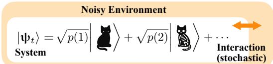

Figure 1: A superposition of sentence states viewed as an open quantum system interacting with its environment.

We develop a sampling procedure based on τ-leaping unraveling, which evolves superpositions of sentence states by updating multiple token positions in each step. It builds on stochastic unraveling, an established technique for representing Lindblad dynamics through stochastic pure-state trajectories (Carmichael, 1993; Dalibard et al., 1992; Dum et al., 1992). The idea is analogous to simulating trajectories of a stochastic differential equation instead of directly solving the corresponding Fokker– Planck equation. A final measurement selects an output sentence according to the Born rule. The same formulation also leads to quantum-inspired remasking: a perturbation of the masked-diffusion dynamics yields a confidence-based rule that preferentially remasks tokens the model is less confident in reconstructing from their context.

Our main contributions are summarized as follows:

• We show that continuous-time discrete diffusion language models can be embedded in the Lindblad equation, with reverse diffusion recovered in the diagonal sector of the reverse-time dynamics. This embedding allows us to extend diffusion language models by modifying the dynamics or allowing superpositions of sentence states.

• By allowing superpositions in the same formulation, we introduce Superposition of Prompts (SoP) and its application to thought-conditioned generation, Superposition of Thoughts (SoT). These methods generate a text through stochastic unraveling followed by measurement. Our experiments show that the output can retain information from conditioning components that are not selected in the final measurement.

• By perturbing the embedded masked diffusion dynamics, we derive Quantum-Inspired Remasking (QIR). Our experiments show that appropriately timed QIR improves LLM-assessed text quality, whereas applying it too early increases repetition despite lowering perplexity.

These methods illustrate the broader design space opened by our formulation, which brings concepts from quantum physics into the design of language generation processes. Exploring this space may lead to further sampling methods on classical hardware, as well as future implementations on quantum computers.

## 1.1 RELATED WORKS

Diffusion Language Models. Discrete diffusion models were initially introduced for binary data (Sohl-Dickstein et al., 2015) and later extended to discrete state spaces. Our mathematical foundation is the continuous-time Markov formulation of discrete diffusion (Campbell et al., 2022; Sun et al., 2023), particularly that of Lou et al. (2024). Two widely studied approaches are uniform diffusion and masked diffusion.

Uniform diffusion allows tokens to be revised throughout generation, providing a mechanism for correcting earlier predictions (Hoogeboom et al., 2021). Although early models faced challenges in language modeling (Austin et al., 2021; Lou et al., 2024), recent advances have improved training (Sahoo et al., 2025) and led to practical open-weight models (DiffusionGemma Team et al., 2026). Masked diffusion generates a text by progressively replacing mask tokens and has been widely adopted for its stable training (Austin et al., 2021; Lou et al., 2024). Ou et al. (2025) showed that the structure of masked diffusion permits time-independent modeling and reduces the number of function evaluations during sampling. Masked diffusion also underlies large-scale language models such a LLaDA (Nie et al., 2025) and iLLaDA (Nie et al., 2026).

Standard masked diffusion cannot revise tokens once unmasked. Remasking allows these tokens to be masked again and regenerated. Nie et al. (2025) retain a prescribed number of token predictions based on confidence at each step. WINO (Hong et al., 2026) also revisits previously generated tokens, remasking those below a verification confidence threshold. Our QIR instead derives stochastic remasking rates from perturbed Lindblad dynamics, assigning higher rates to tokens with lower reconstruction confidence. Alternatively, Wang et al. (2026) reformulate sampling to incorporate remasking, drawing on DDIM (Song et al., 2021a).

Quantum Computation and Diffusion Models. The connection between quantum computation and generative modeling has been explored in several directions. Early approaches include quantum generative models such as quantum Boltzmann machines and variational quantum circuits (Amin et al., 2018; Benedetti et al., 2019; Biamonte et al., 2017), where probability distributions are represented by quantum states and sampled via measurement.

Diffusion Models and Physics. Diffusion models have been studied from the perspectives of non-equilibrium statistical mechanics and stochastic processes (Hirono et al., 2024; Ikeda et al., 2024; Sohl-Dickstein et al., 2015; Yaguchi et al., 2025; Yu & Huang, 2024). Connections between classical diffusion and quantum dynamics also arise through imaginary-time evolution and path-integral formulations (Feynman & Hibbs, 1965). Nasu et al. (2025) connect Lindblad dynamics to classical reverse diffusion through a semiclassical approximation. Our work considers an exact embedding of discrete token dynamics and uses it to develop sampling procedures for diffusion language models.

## 2 BACKGROUND

We review discrete diffusion models and the Lindblad description of open quantum systems as the background for the formulation in the next section. Our notation is summarized in Section A.

## 2.1 DISCRETE DIFFUSION MODELS

In continuous-time discrete diffusion models, the forward process gradually corrupts token sequences. The corresponding probability distribution evolves according to the master equation

$$
\frac { d } { d t } p _ { t } ( \mathbf { m } ) = \sum _ { \mathbf { n } \in \mathbb { V } ^ { N } } Q _ { t } ( \mathbf { m } , \mathbf { n } ) p _ { t } ( \mathbf { n } ) , \quad \left\{ \begin{array} { l l } { Q _ { t } ( \mathbf { m } , \mathbf { n } ) \geq 0 } & { ( \mathbf { m } \neq \mathbf { n } ) } \\ { \sum _ { \mathbf { m } \in \mathbb { V } ^ { N } } Q _ { t } ( \mathbf { m } , \mathbf { n } ) = 0 } & { } \end{array} \right. ,\tag{1}
$$

where m, n $. \in \mathbb { V } ^ { N }$ are token sequences of length $N$ , and $Q _ { t }$ is the transition-rate matrix. Generation proceeds by reversing this diffusion process. The probability distribution then evolves according to

$$
- \frac { d } { d t } p _ { t } ( \mathbf { m } ) = \sum _ { \mathbf { n } \in \mathbb { V } ^ { N } } \tilde { Q } _ { t } ( \mathbf { m } , \mathbf { n } ) p _ { t } ( \mathbf { n } ) , \quad \left\{ \begin{array} { l l } { \tilde { Q } _ { t } ( \mathbf { m } , \mathbf { n } ) = Q _ { t } ( \mathbf { n } , \mathbf { m } ) \frac { p _ { t } ( \mathbf { m } ) } { p _ { t } ( \mathbf { n } ) } } & { ( \mathbf { m } \neq \mathbf { n } ) } \\ { \sum _ { \mathbf { m } \in \mathbb { V } ^ { N } } \tilde { Q } _ { t } ( \mathbf { m } , \mathbf { n } ) = 0 } \end{array} \right.\tag{2}
$$

Simulating the reverse process requires the probability ratios $p _ { t } ( \mathbf { m } ) / p _ { t } ( \mathbf { n } )$ , known as concrete scores Lou et al. (2024), which the model is trained to estimate. A common choice is to let each transition change only one token position. The forward and reverse generators then take the form

$$
Q _ { t } ( \mathbf { m } , \mathbf { n } ) = \sigma ( t ) \sum _ { p = 1 } ^ { N } 1 _ { \mathbf { m } _ { - p } \mathbf { n } _ { - p } } Q ^ { \mathrm { t o k } } ( m _ { p } , n _ { p } ) ,\tag{3}
$$

$$
\tilde { Q } _ { t } ( \mathbf { m } , \mathbf { n } ) = \sigma ( t ) \sum _ { p = 1 } ^ { N } 1 _ { \mathbf { m } - p \mathbf { n } _ { - p } } \tilde { Q } ^ { ( p ) \mathrm { t o k } } ( m _ { p } , \mathbf { n } ) , \ \tilde { Q } ^ { ( p ) \mathrm { t o k } } ( m _ { p } , \mathbf { n } ) = Q ^ { \mathrm { t o k } } ( n _ { p } , m _ { p } ) \frac { \tilde { p } _ { t } ( \mathbf { n } _ { p  m _ { p } } ) } { p _ { t } ( \mathbf { n } ) } ,\tag{4}
$$

where $\sigma ( t )$ controls the time-dependent transition rate, and $p$ indexes token positions. The indicator $1 _ { \mathbf { m } _ { - p } \mathbf { n } _ { - p } }$ equals one when m and n agree at all positions other than $p ,$ and zero otherwise. The sequence $\mathbf { n } _ { p  m _ { p } }$ is obtained from n by replacing its $p \cdot$ -th token with $m _ { p }$ . With this structure, the model only needs to estimate the scores $s ( \mathbf { n } , t ) _ { p  m _ { p } }$ associated with single-token changes, rather than probability ratios between arbitrary pairs of sequences. For further details, see Section B.

## 2.2 OPEN QUANTUM SYSTEMS AND THE LINDBLAD EQUATION

An open quantum system describes the effective dynamics of a quantum system interacting with its environment. Its state is represented by a density operator $\rho _ { t }$ on a Hilbert space H. Classical

probability distributions are recovered as a special case. Given the sentence basis $\{ | \mathbf { m } \rangle \} _ { \mathbf { m } \in \mathbb { V } ^ { N } }$ , a probability distribution $p _ { t } ( \mathbf { m } )$ over sequences can be embedded into a diagonal density operator,

$$
\rho _ { t } = \sum _ { \mathbf { m } \in \mathbb { V } ^ { N } } p _ { t } ( \mathbf { m } ) \left| \mathbf { m } \right. \left. \mathbf { m } \right| .\tag{5}
$$

Thus, a discrete diffusion process can be viewed as open-system dynamics restricted to the diagonal sector. Going beyond this diagonal sector amounts to allowing coherent superpositions of token sequences, which will be exploited later in our sampling construction.

The Markovian dynamics of an open quantum system is governed by the Lindblad equation,

$$
\frac { d } { d t } \rho _ { t } = - i [ H _ { t } , \rho _ { t } ] + \sum _ { \mu } L _ { t } ^ { \mu } \rho _ { t } L _ { t } ^ { \mu \dagger } - \frac { 1 } { 2 } \left\{ \sum _ { \mu } L _ { t } ^ { \mu \dagger } L _ { t } ^ { \mu } , \rho _ { t } \right\} .\tag{6}
$$

Here, $H _ { t }$ is a Hermitian operator, called the Hamiltonian, and $L _ { t } ^ { \mu }$ are jump operators. The Hamiltonian term generates coherent evolution, while the jump terms describe dissipative transitions induced by the environment. The Lindblad equation preserves positivity and unit trace of $\rho _ { t }$ , and is therefore the quantum analogue of a classical master equation (1).

The open-system formulation also admits a reverse-time dynamics, paralleling the reverse diffusion equation (2). Given the forward Lindblad dynamics and its solution $\rho _ { t }$ , one can define time-reversed operators $H _ { t }$ and $\tilde { L } _ { t } ^ { \mu }$ such that

$$
- \frac { d } { d t } \rho _ { t } = - i [ \tilde { H } _ { t } , \rho _ { t } ] + \sum _ { \mu } \tilde { L } _ { t } ^ { \mu } \rho _ { t } \tilde { L } _ { t } ^ { \mu \dagger } - \frac { 1 } { 2 } \left\{ \sum _ { \mu } \tilde { L } _ { t } ^ { \mu \dagger } \tilde { L } _ { t } ^ { \mu } , \rho _ { t } \right\} .\tag{7}
$$

The explicit expressions for $\tilde { H } _ { t }$ and $\tilde { L } _ { t } ^ { \mu }$ are reviewed in Theorem C.6. For diagonal embeddings of the form (5), this reverse-time Lindblad equation reduces to the reverse-time dynamics of discrete diffusion models. This connection will be used below to formulate inference as a stochastic unraveling of the reverse open-system dynamics. For further details, see Section C.

## 3 A QUANTUM FORMULATION OF DIFFUSION LANGUAGE MODELS

## 3.1 EMBEDDING DIFFUSION LANGUAGE MODELS INTO OPEN QUANTUM SYSTEMS

We now show that diffusion language models can be embedded in the Lindblad framework for open quantum systems. Specifically, the discrete diffusion dynamics can be reproduced by choosing jump operators that act on individual token positions, following the transition structure in Equation (3). The following theorems establish this correspondence. The proofs are given in Section D.

Theorem 3.1: Embedding of Diffusion Processes Define the Hamiltonian and jump operators with $\mu = ( p , m , n )$ acting on the sentence Hilbert space H as follows:

$$
{ \cal H } _ { t } = 0 , \quad L _ { t } ^ { \mu = ( p , m , n ) } = I \otimes \cdots \otimes \sqrt { \sigma ( t ) } L _ { m , n } ^ { ( p ) \mathrm { t o k } } \otimes \cdots \otimes I ,\tag{8}
$$

where we define operators acting on the one-token Hilbert space $\mathcal { H } _ { \mathbb { V } }$ by

$$
L _ { m , n } ^ { \mathrm { t o k } } = \sqrt { Q ^ { \mathrm { t o k } } ( m , n ) } \left| m \right. \left. n \right| , \quad ( m \neq n ) ,\tag{9}
$$

where $m , n \in \mathbb { V }$ are tokens before and after the jump. Then the Lindblad equation in Equation (6) reduces to be equivalent to the classical diffusion equation in Equation (1) with Equation (3).

Theorem 3.2: Embedding of Diffusion Models Under our setting in Theorem 3.1, we have the operators for the time-reversal equation in Equation (7) as follows:

$$
\tilde { H } _ { t } = 0 , \quad \tilde { L } _ { t } ^ { \mu = \left( p , m , n \right) } = \sum _ { \mathbf { k } \in \mathbb { V } ^ { N } } \left| k _ { 1 } \right. \left. k _ { 1 } \right| \otimes \cdots \otimes \sqrt { \sigma ( t ) } \tilde { L } _ { m , n , t } ^ { \left( p \right) \mathrm { t o k } } ( \mathbf { k } ) \otimes \cdots \otimes \left| k _ { N } \right. \left. k _ { N } \right| ,
$$

where we define operators acting on the one-token Hilbert space $\mathcal { H } _ { \mathbb { V } }$ by

$$
\tilde { L } _ { m , n , t } ^ { ( p ) \mathrm { t o k } } ( \mathbf { k } ) = \sqrt { \tilde { Q } ^ { ( p ) \mathrm { t o k } } ( n , \mathbf { k } ) } 1 _ { m k _ { p } } | n   k _ { p } | = \sqrt { Q ^ { \mathrm { t o k } } ( k _ { p } , n ) \frac { p _ { t } ( \mathbf { k } _ { p  n } ) } { p _ { t } ( \mathbf { k } ) } } 1 _ { m k _ { p } } | n   k _ { p } | .\tag{10}
$$

With these operators, the time-reversed Lindblad equation (7) reproduces the reverse diffusion dynamics in Equation (2), with the generator given by Equation (4).

This embedding provides a starting point for extending diffusion sampling to superposition states and perturbed jump dynamics, which lead to the sampling schemes introduced below. Below, we show how the well known diffusion model settings are embedded in the Lindblad equation.

Uniform Diffusion. If we consider $( m , n ) \in \mathbb { V } ^ { 2 }$ where m $\neq$ n and consider jump operators

$$
L _ { m , n } ^ { \mathrm { t o k } } = | m   n | , ( Q ^ { \mathrm { t o k } } ( m , n ) = 1 ) \quad \Rightarrow \quad \tilde { L } _ { m , n , t } ^ { ( p ) \mathrm { l o k } } ( \mathbf { k } ) = \sqrt { \frac { p _ { t } ( \mathbf { k } _ { p  n } ) } { p _ { t } ( \mathbf { k } _ { p  m } ) } } { 1 } _ { m k _ { p } } | n   m | .\tag{11}
$$

Masked Diffusion. If we consider $i \in \mathbb { V }$ where $i \neq 0$ and consider jump operators

$$
L _ { 0 , i } ^ { \mathrm { t o k } } = | 0   i | , ( Q ^ { \mathrm { t o k } } ( 0 , i ) = 1 ) \quad \Rightarrow \quad \tilde { L } _ { 0 , i , t } ^ { ( p ) \mathrm { t o k } } ( \mathbf { k } ) = \sqrt { \frac { p _ { t } ( \mathbf { k } _ { p  i } ) } { p _ { t } ( \mathbf { k } _ { p  0 } ) } } 1 _ { 0 k _ { p } } | i   0 | .\tag{12}
$$

For uniform diffusion defined by Equation (11), transitions between token states occur at equal rates in both directions. This can be viewed as thermal dynamics among states of equal energy.

In masked diffusion, transitions occur only from non-mask states $| i \rangle$ to the absorbing mask state |0⟩. A thermal interpretation is obtained by assigning a lower energy to $| 0 \rangle ;$ : when the energy gap is large compared with the temperature, upward transitions are suppressed relative to downward transitions. Masked diffusion corresponds to the limiting case in which upward transitions are absent.

$$
\begin{array} { r } { \overbrace { \int \ldots \int _ { \alpha = ( 0 , i ) } ^ { \infty } \left( \left( \frac { i } { \hbar } \right) \sum _ { \alpha = ( i , 0 ) \atop \alpha = ( i , 0 ) } ^ { \infty } \sum _ { \alpha = ( i , 0 ) \atop \beta = ( i , 0 ) } ^ { \infty } \mathrm { d } \alpha \right) } ^ { \mathfrak { m e r g y } ^ { 1 / 1 } } } \end{array}
$$

Perturbed Masked Diffusion. To mitigate this energy gap, one approach would be to introduce corresponding jump operators operating in the opposite direction into the system, i.e., with $0 \leq \gamma \leq 1 $

$$
L _ { i , 0 } ^ { \mathrm { t o k } } = \sqrt { \gamma } | i   0 | \quad \Rightarrow \quad \tilde { L } _ { i , 0 , t } ^ { ( p ) \mathrm { t o k } } ( \mathbf { k } ) = \sqrt { \gamma } \sqrt { \frac { p _ { t } ( \mathbf { k } _ { p  0 } ) } { p _ { t } ( \mathbf { k } _ { p  i } ) } } 1 _ { i k _ { p } } | 0   i | ,\tag{13}
$$

where $\gamma$ regulates the energy gap, with the gap completely closing when $\gamma = 1$ . When $\gamma \approx 0$ , it can be physically interpreted as a normal Masked diffusion process with added perturbations. Leveraging this latter property, the second half of this paper proposes a Quantum-Inspired Remasking (QIR) method based on Equation (13) and demonstrates its effectiveness.

## 3.2 SIMULATIONS: STOCHASTIC UNRAVELING

The Lindblad formulation also provides a trajectory-level description of the dynamics. In ordinary diffusion language models, sampling is performed by simulating a Markov process over token sequences. The open-system counterpart is a stochastic process over wave functions, known as stochastic unraveling. It represents the same density-operator dynamics through random pure-state trajectories. In this language, a stochastic time-evolution operator $U _ { t - d t | t } ^ { \mathrm { e f f } }$ updates the state vector as

$$
\left| { \Psi _ { t - d t } } \right. = \tilde { U } _ { t - d t | t } ^ { \mathrm { e f f } } \left| { \Psi _ { t } } \right. \propto \left( { 1 - i \tilde { H } _ { t } ^ { \mathrm { e f f } } d t } \right) \left| { \Psi _ { t } } \right. + \sum _ { \mu } ( \tilde { L } _ { t } ^ { \mu } - 1 ) d N _ { t } ^ { \mu } \left| { \Psi _ { t } } \right. ,\tag{14}
$$

where $\begin{array} { r } { \tilde { H } _ { t } ^ { \mathrm { e f f } } = - \frac { i } { 2 } \sum _ { \mu } \tilde { L } _ { t } ^ { \mu \dagger } \tilde { L } _ { t } ^ { \mu } } \end{array}$ and $d N _ { t } ^ { \mu }$ are multiple jump processes. For explicit expressions, see Section $\mathrm { { C . 4 . \ A } }$ direct application of these infinitesimal unravelings is inefficient for the same reason as the naive simulation of discrete diffusion: in a single step, they affect only one token position. Motivated by the τ-leaping sampler for discrete diffusion, we introduce an unraveling method that allows multiple token positions to be updated within one step. $| \Psi _ { t - \Delta t } \rangle = \tilde { U } _ { t - \Delta t | t } ^ { \tau - \mathrm { l e a p } } | \Psi _ { t } \rangle$

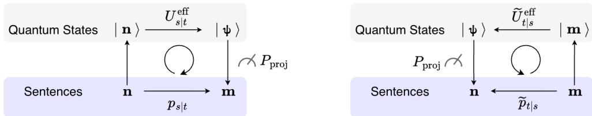  
Figure 2: Sampling by stochastic unraveling followed by projective measurement. The ensemble of pure-state trajectories reproduces the corresponding density-operator dynamics, while the final measurement yields a discrete token sequence.

We refer to this method as τ -leaping unraveling. This expression is the unraveling analogue of the τ-leaping sampler in Equation (45)1. It reproduces the solution of the reverse-time Lindblad equation Equation (7) up to first order in $\Delta t ;$ see Theorem D.8.

A central feature of stochastic unraveling is that an ensemble of stochastic pure-state trajectories reproduces the solution of the Lindblad equation at the level of the density matrix. In the sampling procedure, we need to perform a “projective measurement,” since the wave function |ψ ⟩ is, in general, a superposition of multiple sentences. According to the Born rule, the probability of measuring a particular sentence is given by the squared magnitude of its coefficient. Starting from |n⟩, evolving from t to s via stochastic unraveling, and then measuring yields m with the same probability as the corresponding classical diffusion process. This holds for both forward- and reverse-time dynamics. For details, see Section D.3.

## 3.3 QUANTUM-INSPIRED SAMPLINGS

Embedding diffusion language models into the Lindblad framework opens up new possibilities for extending both their states and dynamics. We explore two such extensions here. Superpositions of sentence states lead to Superposition of Prompts (SoP) and its thought-conditioned variant, Superposition of Thoughts (SoT), while perturbations of the jump operators yield Quantum-Inspired Remasking (QIR). Implementation details can be found in Section E.

Superposition of Prompts (SoP). SoP applies stochastic unraveling to a superposition of sentence states conditioned on different prompts. In the context of score-based diffusion models, it is common to generate based on conditional probability $\mathbf { m } = [ \mathrm { P r o m p t } \cdot \cdot \cdot ] \sim p ( \cdot \cdot \cdot | \mathrm { P r o m p t } )$ . This procedure is a counterpart of sampling $\mathbf { m } \stackrel { - } { = } [ \mathrm { P r o m p t } \cdot \cdot \cdot ]$ , namely, we generate a reverse-time dynamics of

$$
| \Psi _ { t } \rangle = \sqrt { p _ { t } ( 1 ) } \Big | \underbrace { \mathrm { \texttt { P r o m p t 1 } } } _ { \mathrm { f i x e d } } \underbrace { \cdot \cdot \cdot _ { t } } _ { \mathrm { g e n e r a t e d } } \Big \rangle + \sqrt { p _ { t } ( 2 ) } \Big | \underbrace { \mathrm { \texttt { P r o m p t 2 } } } _ { \mathrm { f i x e d } } \underbrace { \cdot \cdot _ { t } } _ { \mathrm { g e n e r a t e d } } \Big \rangle .\tag{15}
$$

The part $[ \cdots _ { t = 1 } ]$ is initialized by sampling from the terminal probability $p _ { t = 1 }$ . After running reversetime unraveling procedure defined in Theorem D.10 from $t = 1$ to $t \approx 0 ,$ we apply the projective observation process to $| \Psi _ { t \approx 0 } \rangle$ and make a single sentence m $\sim [ p _ { t \approx 0 } ( 1 ) , p _ { t \approx 0 } ( 2 ) ]$ ]. Afterwards, we apply usual denoising process optionally2.

Superposition of Thoughts (SoT). We consider Superposition of Thoughts (SoT), an enhanced version of SoP, in which the prompt portion of SoP is replaced with reasoning tokens. As an application of the unraveling with text superposition states, we can construct superposition of reasoning/thought tokens, i.e.,

$$
\mathrm { { P r o m p t } }  \sqrt { p _ { t } ( 1 ) } \Bigg | \underbrace  \begin{array} { l } { { \mathrm {  ~ \scriptstyle { \ c t h i n k } ~ } } ^ { > } } \\ { { \mathrm {  ~ \scriptstyle { \ T h o u g h t } ~ } } ^ { 1 } } \\ { { \mathrm {  ~ \scriptstyle { \ c / t h i n k } } > } } \end{array} \underbrace { \begin{array} { l } { { \dot { \mathrm {  ~ \scriptstyle { \ c ~ } } } \cdot { \dot { \mathrm {  {  ~ \scriptstyle { \ r } ~ } } } } } \\ { { \mathrm {  ~ \scriptstyle { \ g e n e r a t e d } } } } \end{array} } ^ { \ddots } } _ { \mathrm { f a r e d } } \Bigg \rangle + \sqrt { p _ { t } ( 2 ) } \Bigg | \underbrace  \begin{array} { l } { { \mathrm {  ~ \scriptstyle { \ c t h i n k } ~ } } ^ { < } } \\ { { \mathrm {  ~ \scriptstyle { \ T h o u g h t } ~ } } ^ { 2 } } \\ { { \mathrm {  ~ \scriptstyle { \ c / t h i n k } > } } } \end{array} \underbrace { \sum \stackrel { \scriptstyle { \ c } \cdot { \dot { \tau } } _ { t } } } _ { \mathrm { f a r e d } } \Bigg \rangle .
$$

The sampling procedure is completely same as SoP, but it is expected to generate “mixed thought” outputs if the model supports reasoning mode.

Quantum-Inspired Remasking (QIR). Remasking is considered a technique for improving the quality of generated sentences in mask-based diffusion language models. Reconsidering this from the perspective of open quantum systems, "remasking" can be viewed as introducing a form of temperature when the mask token [m] labelled by 0, is treated as the ground state; specifically, this corresponds to adding, in addition to the transition $0 \neq i  0$ , a small-scale jump operator defined in Equation (13) that makes $0  i \neq 0$ parameterized by $0 < \gamma \ll$ 1 to the forward process.

From Equation (13), for the unraveling that occurs when such a "perturbation" is applied, it is necessary to calculate the following values.

$$
\frac { p _ { t } ( \mathbf { m } _ { p  0 } ) } { p _ { t } ( \mathbf { m } _ { p  i } ) } = ( \frac { p _ { t } ( \mathbf { m } _ { p  i } ) } { p _ { t } ( \mathbf { m } _ { p  0 } ) } ) ^ { - 1 } .\tag{16}
$$

The highlighted ratio measures how strongly the model favors restoring the current token i when position p is masked. We estimate this score by applying the pretrained model to $\mathbf { m } _ { p \to 0 }$ and use its reciprocal to determine the remasking rate. This approximation neglects the change in the score induced by the perturbation, which we assume to be small for sufficiently small γ. Thus, tokens that the model is less confident in reconstructing from their current context are more likely to be remasked. The perturbation therefore yields a confidence-based remasking mechanism.

## 4 EXPERIMENTS

## 4.1 EXPERIMENT 1: SENTENCE GENERATION WITH TEXT SUPERPOSITION

In this section, we examine whether the superposition of prompts (SoP) and thoughts (SoT) manifests as a semantic blending in the generated text. The goal of these experiments is not to outperform existing conditional generation methods, but rather to validate the fundamental property of the proposed quantum-inspired sampling: that a superposition of input states (prompts or thoughts) can indeed lead to the generation of a ’mixed’ output state that is not simply one or the other, but a probabilistic blend of both. Details on our experiments with SoP/SoT can be found in Section F.

Setup. We use masked diffusion for the experiments in this section3. The input prompts are qualitatively designed to reflect their respective superposition targets: For SoP, we employ descriptive prompts that define environmental settings to observe the superposition of semantic contexts. For SoT, we utilize prescriptive prompts that impose stylistic and instructional constraints to investigate the superposition of reasoning-driven generation strategies. In this section, we show results on two sets of forest-snow prompt pairs. See story\_\_forest\_snow in Table 3 for SoP and story\_reasoning\_\_forest\_snow in Table 4 for SoT for details.

Implementation. In the superposition-based unraveling process, each sentence undergoes not only denoising but also updates to the weight coefficients $p ( i )$ . The temporal evolution of these coefficients can occur rapidly depending on the output of the trained model. In such cases, the effect of superposition may disappear early in the denoising process. (See Appendix F.3 for details.) To mitigate this effect, we implement a regularization parametrized by $\beta \geq 0$ that controls degrees of mixtures.

Results. Figure 3 provides a visual overview of the generated sentences’ distribution. The scatter plots indicate that the SoP-generated sentences tend to occupy a region intermediate to the singleprompt outputs. This qualitative observation is quantitatively supported by the average similarity values presented in Table 5, which show a statistically significant increase in similarity to the nonselected condition compared to single-prompt generation. To qualitatively assess the effect of SoT, we present a representative generated sample in Table 1. The generated text effectively synthesally fuses the divergent stylistic constraints of both "forest" and "snow" prompts into a single narrative. This supports our hypothesis that the superposition of thought tokens allows the model to navigate between conflicting reasoning paths during the denoising process. See Section F.2 for more details.

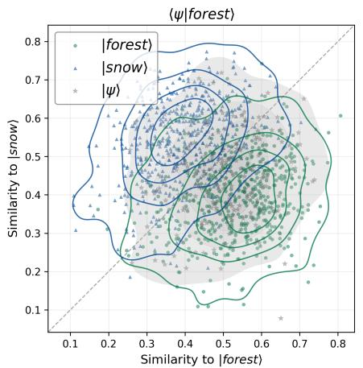

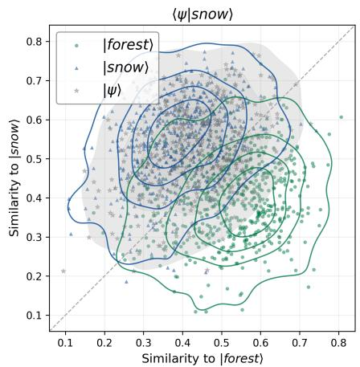

Figure 3: Cosine similarity of SEDD-small outputs to forest-only (horizontal) and snow-only (vertical) reference texts, computed using MiniLM embeddings. Green and blue show single-condition baselines; gray shows SoP outputs with forest (left) or snow (right) selected at final measurement. Superposition increases average similarity to the unselected condition.
<table><tr><td>Prompt</td><td colspan="2">Write a short story.</td></tr><tr><td>Thoughts</td><td>[forest] The narrative must take place in a dense, vibrant summer forest. [...] The tone should feel alive, earthy, and teeming with natural energy.</td><td>[snow] The narrative must take place in a desolate, frozen winter tundra. [...] The tone should feel silent, harsh, and starkly isolated.</td></tr><tr><td>Generated 〈ψ|forest〉</td><td colspan="2">As the overcliff dawn drifts from sprawling forest of trees north – I stand on the edge of the frozen world, adrift. [...] The air itself toys him away, like an elemental furnace or pine-scented forest earth. Snow piling up over the world, carrying liquid silver, and where the sun&#x27;s frame unfurls a chill; dimming.</td></tr></table>

Table 1: Representative generated samples by iLLaDA-8B-Instruct (Nie et al. (2026)) with SoT. Coloring in the generated texts is generated by gemma-4-26B-A4B (Gemma Team et al. (2026)).

## 4.2 EXPERIMENT 2: QUANTUM-INSPIRED REMASKING

We evaluate the quantum-inspired remasking (QIR) method introduced in the previous section. We apply this method to pretrained diffusion language models without updating their weights. By varying when remasking begins during generation, we examine how its timing affects the quality of the generated text using several evaluation metrics. See Section G for details of our experiments.

Setup. We evaluate SEDD-medium (Lou et al., 2024), RADD-medium (Ou et al., 2025), and iLLaDA-8B-Base (Nie et al., 2026). We generate 256 unconditional sequences per condition for SEDD-medium and RADD-medium, and 128 for iLLaDA-8B-Base, with 1024 tokens, 1024 sampling steps, and $\gamma = 0 . 0 2$ . To reduce the cost of evaluating the reciprocal scores in Equation (16), we uniformly sample up to $K = 8$ non-mask positions per remasking calculation. Remasking begins after approximately 10%, 50%, or 90% of sampling (start, middle, and end) and remains active thereafter. The baseline, none, uses the same stochastic-unraveling decoder without remasking. We verified that, without remasking, our implementation yields results consistent with those of the original SEDD Euler sampler under the same sampling settings.

Metrics. We report generative perplexity (GenPPL), computed by evaluating the generated texts with GPT-2-large (Radford et al., 2019), token-frequency entropy, and a CoLA acceptability score (Morris et al., 2020). Entropy monitors excessive loss of token diversity; it is not a quantity to minimize. Repetition is measured by $\Delta R _ { n } ,$ the same-seed difference from no remasking in repeated token n-gram fractions, averaged over 128-token windows and expressed in percentage points (pp). We evaluate $n = 2 , \ldots , 8$ and report $n = 7$ as a representative example in Table 2. Qwen3- 32B compares each sample with its same-checkpoint, same-seed baseline for fluency, coherence, progression, and repetition, without knowing the generation method. Wins, ties, and losses score

<table><tr><td>Model</td><td>Metric</td><td>none</td><td>end</td><td>middle</td><td>start</td></tr><tr><td rowspan="5">SEDD(medium) Lou et al. (2024)</td><td>GenPPL</td><td> $3 3 . 1 2 { \scriptstyle \pm 0 . 5 8 }$ </td><td> $3 2 . 7 3 { \scriptstyle \pm 0 . 5 7 }$ </td><td> $2 7 . 5 2 { \scriptstyle \pm 0 . 4 3 }$ </td><td> $1 2 . 2 4 { \scriptstyle \pm 0 . 2 6 }$ </td></tr><tr><td>Entropy</td><td> $7 . 5 7 { \scriptstyle \pm 0 . 0 2 }$ </td><td> $7 . 5 7 { \scriptstyle \pm 0 . 0 2 }$ </td><td> $7 . 5 2 { \scriptstyle \pm 0 . 0 3 }$ </td><td> $6 . 4 2 _ { \pm 0 . 0 5 }$ </td></tr><tr><td>CoLA</td><td> $0 . 2 8 5 { \scriptstyle \pm 0 . 0 0 6 }$ </td><td> $0 . 2 8 5 { \scriptstyle \pm 0 . 0 0 6 }$ </td><td> $0 . 3 3 5 { \scriptstyle \pm 0 . 0 0 6 }$ </td><td> $0 . 3 3 6 { \scriptstyle \pm 0 . 0 0 7 }$ </td></tr><tr><td> $\mathrm { Q w e n } \left( \% \right)$ </td><td></td><td> $5 1 . 5 { \scriptstyle \pm 0 . 8 }$ </td><td> ${ \bf 6 2 . 0 _ { \pm 1 . 3 } }$ </td><td> $5 3 . 3 _ { \pm 1 . 9 }$ </td></tr><tr><td> $\Delta R _ { 7 } \ ( \mathrm { p p } )$ </td><td> $0 . 0 0 0 { \scriptstyle \pm 0 . 0 0 0 }$ </td><td> $- 0 . 0 0 5 _ { \pm 0 . 0 0 4 }$ </td><td> $0 . 0 2 5 _ { \pm 0 . 0 1 3 }$ </td><td> $1 . 4 0 5 _ { \pm 0 . 2 1 0 }$ </td></tr><tr><td rowspan="5">RADD(medium) Ou et al. (2025)</td><td>GenPPL</td><td> $3 3 . 6 6 _ { \pm 0 . 6 0 }$ </td><td> $3 3 . 3 4 _ { \pm 0 . 5 9 }$ </td><td> $2 8 . 0 8 _ { \pm 0 . 4 4 }$ </td><td> $1 3 . 7 1 _ { \pm 0 . 2 8 }$ </td></tr><tr><td>Entropy</td><td> $7 . 5 9 { \scriptstyle \pm 0 . 0 2 }$ </td><td> $7 . 5 8 _ { \pm 0 . 0 2 }$ </td><td> $7 . 5 3 { \scriptstyle \pm 0 . 0 2 }$ </td><td> $6 . 5 5 { \scriptstyle \pm 0 . 0 5 }$ </td></tr><tr><td> $\mathrm { C o L A }$ </td><td> $0 . 2 8 1 { \scriptstyle \pm 0 . 0 0 5 }$ </td><td> $0 . 2 8 2 _ { \pm 0 . 0 0 5 }$ </td><td> $0 . 3 1 6 { \scriptstyle \pm 0 . 0 0 6 }$ </td><td> $0 . 3 2 8 { \scriptstyle \pm 0 . 0 0 7 }$ </td></tr><tr><td> $\mathrm { Q w e n } \left( \% \right)$ </td><td></td><td> $4 9 . 5 { \scriptstyle \pm 0 . 8 }$ </td><td> ${ \bf 6 2 . 4 } _ { \pm 1 . 3 }$ </td><td> $5 8 . 0 { \scriptstyle \pm 1 . 8 }$ </td></tr><tr><td> $\Delta R _ { 7 } \ ( \mathrm { p p } )$ </td><td> $0 . 0 0 0 { \scriptstyle \pm 0 . 0 0 0 }$ </td><td> $0 . 0 0 2 { \scriptstyle \pm 0 . 0 0 7 }$ </td><td> $0 . 0 0 7 { \scriptstyle \pm 0 . 0 1 0 }$ </td><td> $1 . 2 5 8 { \scriptstyle \pm 0 . 3 3 3 }$ </td></tr><tr><td rowspan="5">iLLaDA-8B-Base Nie et al. (2026)</td><td>GenPPL</td><td> $2 1 . 1 4 { \scriptstyle \pm 1 . 5 6 }$ </td><td> $2 1 . 2 5 { \scriptstyle \pm 1 . 5 7 }$ </td><td> $1 9 . 8 3 { \scriptstyle \pm 1 . 4 8 }$ </td><td> $1 8 . 1 9 { \scriptstyle \pm 6 . 5 8 }$ </td></tr><tr><td>Entropy</td><td> $6 . 4 6 { \scriptstyle \pm 0 . 0 8 }$ </td><td> $6 . 4 6 { \scriptstyle \pm 0 . 0 8 }$ </td><td> $6 . 4 3 { \scriptstyle \pm 0 . 0 7 }$ </td><td> $5 . 7 0 { \scriptstyle \pm 0 . 0 9 }$ </td></tr><tr><td>CoLA</td><td> $0 . 4 6 0 { \scriptstyle \pm 0 . 0 1 9 }$ </td><td> $0 . 4 6 6 { \scriptstyle \pm 0 . 0 1 9 }$ </td><td> $0 . 4 8 7 { \scriptstyle \pm 0 . 0 1 8 }$ </td><td> $0 . 5 6 3 { \scriptstyle \pm 0 . 0 1 9 }$ </td></tr><tr><td>Qwen (%)</td><td></td><td> $5 0 . 0 { \scriptstyle \pm 1 . 4 }$ </td><td> ${ \bf 6 1 . 8 _ { \pm 1 . 9 } }$ </td><td> $5 5 . 7 { \scriptstyle \pm 2 . 5 }$ </td></tr><tr><td> $\Delta R _ { 7 }$  (pp)</td><td> $0 . 0 0 0 { \scriptstyle \pm 0 . 0 0 0 }$ </td><td> $- 0 . 0 7 2 _ { \pm 0 . 0 5 4 }$ </td><td> $- 0 . 0 8 1 _ { \pm 0 . 1 1 3 }$ </td><td> $4 . 0 4 2 _ { \pm 0 . 5 3 1 }$ </td></tr></table>

Table 2: Results at $\gamma = 0 . 0 2 .$ . Each condition contains 256 sequences for SEDD and RADD and 128 for iLLaDA. The no-remasking column is the shared control. All entries give mean ± standard error; Qwen preference scores are expressed as percentages, and $\Delta R _ { 7 }$ in percentage points (pp). For $\Delta R _ { 7 }$ the no-remasking baseline is zero by definition.

1, $1 / 2 ,$ and 0, averaged over both presentation orders; preference above 50% favors remasking.   
Definitions and evaluation details are given in Appendices G.2 and G.3.

Results. Enabling QIR from the middle of generation yields Qwen preference scores of 62.0% for SEDD-medium, 62.4% for RADD-medium, and 61.8% for iLLaDA-8B-Base against their noremasking baselines (Table 2). This schedule achieves the highest mean preference among the evaluated schedules for both models, demonstrating improved judge-assessed text quality without retraining. Starting remasking earlier further lowers perplexity and raises CoLA scores, but reduces judge preference and token diversity while increasing repetition. The increase in repetition under $_ { \tt S t a r t }$ is also observed for the other evaluated n-gram lengths. These results show that lower generative perplexity and higher grammatical acceptability do not necessarily translate into better overall text quality. Supplementary repetition results are provided in Appendix G.4.

## 5 CONCLUSION AND OUTLOOK

We embedded continuous-time diffusion language models into Lindblad dynamics, enabling sampling from superposed conditioning states. In the forest/snow experiment, superposition outputs show higher similarity to the unselected condition than single-condition baselines, suggesting that its influence persists after final measurement.

Within this framework, we introduced quantum-inspired remasking through perturbations of the jump operators. Experiments using pretrained models show that the timing of remasking affects generated text quality: earlier remasking lowers perplexity but can increase repetition, whereas an intermediate onset achieves the highest mean judge preference across the tested checkpoints. These results highlight the importance of evaluating text quality beyond perplexity alone.

Future work includes reducing the computational cost of remasking and extending its evaluation to conditional generation. More broadly, this framework opens a path toward quantum-native language models in which superposition and interference play an active role in generation. Such models could evolve multiple candidate sequences coherently, with interference shaping the probabilities of the resulting text. Exploring how these dynamics can be designed and learned may lead to new generative mechanisms beyond classical diffusion.

## ACKNOWLEDGMENTS

We thank K. Fukushima, K. Hagihara, and K. Shiozaki for helpful discussions. Some of the results presented in this paper were obtained using the ABCI-Q system provided by G-QuAT at AIST. We also sincerely thank RIKEN AIP and iTHEMS for providing the computer systems. A.T. acknowledges support from JSPS KAKENHI Grant Numbers JP22H05111 and JP22H05116. Y.A. acknowledges support from JSPS KAKENHI Grant Numbers JP23H01174 and JP23K25870. Y.H. acknowledges support from JSPS KAKENHI Grant Numbers JP22H05111, JP22H05118, and JP24K23186, and JST PRESTO Grant Number JPMJPR24K8.

## AI USE STATEMENT

Generative AI tools were used for brainstorming, improving the readability and organization of the manuscript, and assisting with software implementation. Suggestions produced by these tools were independently examined and verified by the authors. Generative AI tools were not used as an autonomous source of scientific claims, proofs, or result interpretation. The authors take full responsibility for the final content of this work.

## REFERENCES

Mohammad H. Amin, Evgeny Andriyash, Jason Rolfe, Bohdan Kulchytskyy, and Roger Melko. Quantum boltzmann machine. Physical Review X, 8(2):021050, 2018. doi: 10.1103/PhysRevX.8. 021050.

Jacob Austin, Daniel D. Johnson, Jonathan Ho, Daniel Tarlow, and Rianne van den Berg. Structured denoising diffusion models in discrete state-spaces. In Advances in Neural Information Processing Systems 34, pp. 17981–17993, 2021. https://proceedings.neurips.cc/paper/ 2021/hash/958c530554f78bcd8e97125b70e6973d-Abstract.html.

Marcello Benedetti, Erika Lloyd, Stefan Sack, and Mattia Fiorentini. Parameterized quantum circuits as machine learning models. Quantum Science and Technology, 4(4):043001, 2019. doi: 10.1088/2058-9565/ab4eb5.

Jacob Biamonte, Peter Wittek, Nicola Pancotti, Patrick Rebentrost, Nathan Wiebe, and Seth Lloyd. Quantum machine learning. Nature, 549:195–202, 2017. doi: 10.1038/nature23474.

H.-P. Breuer and F. Petruccione. The Theory ofOpen Quantum Systems. Oxford University Press, 2002. doi: 10.1093/acprof:oso/9780199213900.001.0001.

Andrew Campbell, Joe Benton, Valentin De Bortoli, Tom Rainforth, George Deligiannidis, and A. Doucet. A continuous time framework for discrete denoising models. In Advances in Neural Information Processing Systems 35, pp. 28266–28279, 2022. https://proceedings.neurips.cc/paper\_files/paper/2022/hash/ b5b528767aa35f5b1a60fe0aaeca0563-Abstract-Conference.html.

H. J. Carmichael. An Open Systems Approach to Quantum Optics. Springer, 1993. doi: 10.1007/ 978-3-540-47650-7.

Jean Dalibard, Yvan Castin, and Klaus Mølmer. Wave-function approach to dissipative processes in quantum optics. Physical Review Letters, 68(5):580–583, 1992. doi: 10.1103/PhysRevLett.68.580.

Prafulla Dhariwal and Alex Nichol. Diffusion models beat gans on image synthesis. In Advances in Neural Information Processing Systems 34, pp. 8780–8794, 2021. https://papers.nips. cc/paper/2021/hash/49ad23d1ec9fa4bd8d77d02681df5cfa-Abstract. html.

DiffusionGemma Team, Adrien Ali Taïga, James Assiene, Daniele Calandriello, Rahma Chaabouni, João Gante, Tamara von Glehn, Nate Keating, Chris Knutsen, Martin Kukla, et al. Diffusiongemma technical report. arXiv preprint arXiv:2608.00146, 2026. https://arxiv.org/abs/2608. 00146.

R. Dum, P. Zoller, and H. Ritsch. Monte carlo simulation of the atomic master equation for spontaneous emission. Physical Review A, 45(7):4879–4887, 1992. doi: 10.1103/PhysRevA.45. 4879.

Richard P. Feynman and A. R. Hibbs. Quantum Mechanics and Path Integrals. McGraw-Hill, 1965.

Gemma Team, Sherif El Abd, Vaibhav Aggarwal, Robin Algayres, Alek Andreev, Olivier Bachem, Ian Ballantyne, Cormac Brick, Victor Carbune, Michelle Casbon, et al. Gemma 4 technical report.˘ arXiv preprint arXiv:2607.02770, 2026. https://arxiv.org/abs/2607.02770.

V. Gorini, A. Kossakowski, and E. C. G. Sudarshan. Completely positive dynamical semigroups of n-level systems. Journal ofMathematical Physics, 17(5):821–825, 1976. doi: 10.1063/1.522979.

Yuji Hirono, Akinori Tanaka, and Kenji Fukushima. Understanding diffusion models by feynman’s path integral. In Proceedings of the 41st International Conference on Machine Learning, pp. 18324–18351, 2024. https://proceedings.mlr.press/v235/hirono24a.html.

Jonathan Ho, Ajay Jain, and Pieter Abbeel. Deep unsupervised learning using nonequilibrium thermodynamics. In Advances in Neural Information Processing Systems 33, pp. 6840–6851, 2020. https://proceedings.neurips.cc/paper/2020/hash/ 4c5bcfec8584af0d967f1ab10179ca4b-Abstract.html.

Jonathan Ho, Tim Salimans, Alexey Gritsenko, William Chan, Mohammad Norouzi, and David J. Fleet. Video diffusion models. In Advances in Neural Information Processing Systems 35, pp. 8633– 8646, 2022. https://proceedings.neurips.cc/paper\_files/paper/2022/ hash/39235c56aef13fb05a6adc95eb9d8d66-Abstract-Conference.html.

Feng Hong, Geng Yu, Yushi Ye, Haicheng Huang, Huangjie Zheng, Ya Zhang, Yanfeng Wang, and Jiangchao Yao. Wide-in, narrow-out: Revokable decoding for efficient and effective dllms. In International Conference on Learning Representations, volume 2026, pp. 40132–40150, 2026.

Emiel Hoogeboom, Didrik Nielsen, Priyank Jaini, Patrick Forr’e, and Max Welling. Argmax flows and multinomial diffusion: Learning categorical distributions. In Advances in Neural Information Processing Systems 34, pp. 12454–12465, 2021. https://proceedings.neurips.cc/ paper/2021/hash/67d96d458abdef21792e6d8e590244e7-Abstract.html.

Kotaro Ikeda, Tomoya Uda, Daisuke Okanohara, and Sosuke Ito. Speed-accuracy trade-off for the diffusion models: Wisdom from nonequilibrium thermodynamics and optimal transport. Physical Review X, 2024. https://doi.org/10.1103/x5vj-8jq9.

Samar Khanna, Siddhant Kharbanda, Shufan Li, Harshit Varma, Eric Wang, Sawyer Birnbaum, Ziyang Luo, Yanis Miraoui, Akash Palrecha, Stefano Ermon, Aditya Grover, and Volodymyr Kuleshov. Mercury: Ultra-fast language models based on diffusion. ArXiv, abs/2506.17298, 2025. https://api.semanticscholar.org/CorpusID:280000358.

Hyukjoon Kwon and Myungshik S. Kim. Fluctuation theorems for a quantum channel. Physical Review X, 2018. https://api.semanticscholar.org/CorpusID:201317121.

Göran Lindblad. On the generators of quantum dynamical semigroups. Communications in Mathematical Physics, 48(2):119–130, 1976. doi: 10.1007/BF01608499.

Aaron Lou, Chenlin Meng, and Stefano Ermon. Discrete diffusion modeling by estimating the ratios of the data distribution. In Proceedings of the 41st International Conference on Machine Learning, pp. 32819–32848, 2024. https://proceedings.mlr.press/v235/lou24a.html.

Daniel Manzano. A short introduction to the lindblad master equation. AIP Advances, 2019. URL https://api.semanticscholar.org/CorpusID:184487806.

John Morris, Eli Lifland, Jin Yong Yoo, Jake Grigsby, Di Jin, and Yanjun Qi. Textattack: A framework for adversarial attacks, data augmentation, and adversarial training in nlp. In Proceedings of the 2020 Conference on Empirical Methods in Natural Language Processing: System Demonstrations, pp. 119–126, 2020.

Ryota Nasu, Gota Tanaka, and Asato Tsuchiya. Quantum reversibility meets classical reverse diffusion, 2025. URL https://arxiv.org/abs/2510.18512.

Shen Nie, Fengqi Zhu, Zebin You, Xiaolu Zhang, Jingyang Ou, Jun Hu, Jun Zhou, Yankai Lin, Jirong Wen, and Chongxuan Li. Large language diffusion models. In Advances in Neural Information Processing Systems 38, 2025. https://openreview.net/forum?id=KnqiC0znVF.

Shen Nie, Qiyang Min, Shaoxuan Xu, Zihao Huang, Yuxuan Song, Yong Shan, Yankai Lin, Wayne Xin Zhao, Chongxuan Li, and Ji-Rong Wen. Improved large language diffusion models, 2026. URL https://arxiv.org/abs/2606.25331.

Jingyang Ou, Shen Nie, Kaiwen Xue, Fengqi Zhu, Jiacheng Sun, Zhenguo Li, and Chongxuan Li. Your absorbing discrete diffusion secretly models the conditional distributions of clean data. In Proceedings of the 13th International Conference on Learning Representations, 2025. https://openreview.net/forum?id=sMyXP8Tanm.

Alec Radford, Jeffrey Wu, Rewon Child, David Luan, Dario Amodei, Ilya Sutskever, et al. Language models are unsupervised multitask learners. OpenAI blog, 1(8):9, 2019.

Robin Rombach, A. Blattmann, Dominik Lorenz, Patrick Esser, and Björn Ommer. High-resolution image synthesis with latent diffusion models. In Proceedings ofthe IEEE/CVF Conference on Computer Vision and Pattern Recognition (CVPR), pp. 10684–10695, 2022. https://openaccess. thecvf.com/content/CVPR2022/html/Rombach\_High-Resolution\_Image\_ Synthesis\_With\_Latent\_Diffusion\_Models\_CVPR\_2022\_paper.html.

Subham Sekhar Sahoo, Justin Deschenaux, Aaron Gokaslan, Guanghan Wang, Justin T Chiu, and Volodymyr Kuleshov. The diffusion duality. In Proceedings ofthe 42nd International Conference on Machine Learning, pp. 52584–52619, 2025. https://proceedings.mlr.press/ v267/sahoo25a.html.

Uriel Singer, Adam Polyak, Thomas Hayes, Xiaoyue Yin, Jie An, Songyang Zhang, Qiyuan Hu, Harry Yang, Oron Ashual, Oran Gafni, Devi Parikh, Sonal Gupta, and Yaniv Taigman. Make-avideo: Text-to-video generation without text-video data. In Proceedings ofthe 11th International Conference on Learning Representations, 2023. https://openreview.net/forum?id= nJfylDvgzlq.

Jascha Sohl-Dickstein, Eric Weiss, Niru Maheswaranathan, and Surya Ganguli. Deep unsupervised learning using nonequilibrium thermodynamics. In Proceedings ofthe 32nd International Confer ence on Machine Learning, pp. 2256–2265, 2015. https://proceedings.mlr.press/ v37/sohl-dickstein15.html.

Jiaming Song, Chenlin Meng, and Stefano Ermon. Denoising diffusion implicit models. In International Conference on Learning Representations, 2021a. URL https://openreview.net/ forum?id=St1giarCHLP.

Yang Song and Stefano Ermon. Generative modeling by estimating gradients of the data distribution. In Advances in Neural Information Processing Systems 32, 2019. https://papers.nips.cc/paper\_files/paper/2019/hash/ 3001ef257407d5a371a96dcd947c7d93-Abstract.html.

Yang Song, Jascha Narain Sohl-Dickstein, Diederik P. Kingma, Abhishek Kumar, Stefano Ermon, and Ben Poole. Score-based generative modeling through stochastic differential equations. In Proceedings ofthe 9th International Conference on Learning Representations, 2021b. https: //openreview.net/forum?id=PxTIG12RRHS.

Yuxuan Song, Zheng Zhang, Cheng Luo, Peng Gao, Fan Xia, Hao Luo, Zheng Li, Yuehang Yang, Hongli Yu, Xingwei Qu, Yuwei Fu, Jing Su, Ge Zhang, Wenhao Huang, Mingxuan Wang, Lin Yan, Xiaoying Jia, Jingjing Liu, Weizhi Ma, Yaqing Zhang, Yong-Xu Wu, and Hao-Min Zhou. Seed diffusion: A large-scale diffusion language model with high-speed inference. ArXiv, abs/2508.02193, 2025. https://api.semanticscholar.org/CorpusID:280421264.

Haoran Sun, Lijun Yu, Bo Dai, Dale Schuurmans, and Hanjun Dai. Score-based continuous-time discrete diffusion models. In Proceedings of the 11th International Conference on Learning Representations, 2023. https://openreview.net/forum?id=BYWWwSY2G5s.

Guanghan Wang, Yair Schiff, Subham Sahoo, and Volodymyr Kuleshov. Remasking discrete diffusion models with inference-time scaling. Advances in Neural Information Processing Systems, 38: 147282–147339, 2026.

Minkai Xu, Tomas Geffner, Karsten Kreis, Weili Nie, Yilun Xu, Jure Leskovec, Stefano Ermon, and Arash Vahdat. Energy-based diffusion language models for text generation. In Proceedings ofthe 13th International Conference on Learning Representations, 2025. https://openreview. net/forum?id=sL2F9YCMXf.

Manato Yaguchi, Kotaro Sakamoto, Ryosuke Sakamoto, Masato Tanabe, Masatomo Akagawa, Yusuke Hayashi, Masahiro Suzuki, and Yutaka Matsuo. The geometry of phase transitions in diffusion models: Tubular neighbourhoods and singularities. Transactions on Machine Learning Research, 2025. https://openreview.net/forum?id=ahVFKFLYk2.

Zhendong Yu and Haiping Huang. Nonequilbrium physics of generative diffusion models. Physical Review E, 2024. https://doi.org/10.1103/PhysRevE.111.014111.

Siyan Zhao, Devaansh Gupta, Qinqing Zheng, and Aditya Grover. d1: Scaling reasoning in diffusion large language models via reinforcement learning. In Advances in Neural Information Processing Systems 38, 2025. https://openreview.net/forum?id=7ZVRlBFuEv.

A Notations 15   
B A Brief Review of Diffusion Language Models 15   
B.1 Diffusion Process 15   
B.2 Sampling 18   
B.3 Transformation of the n -predictor into a Score Estimator . 19   
C A Brief Review of Open Quantum Systems 22   
C.1 Hilbert Space and Notation . 22   
C.2 Quantum State and Measurement . 22   
C.3 Dynamics of Open Quantum Systems 23   
C.4 Stochastic Unraveling . 24   
D Proofs of the Main Theorems 26   
D.1 Proof of Theorem 3.1 26   
D.2 Proof of Theorem 3.2 28   
D.3 Sampling by Stochastic Unraveling and Measurement . 30   
D.4 Explicit Forms of τ -leaping Quantum States 31   
E Implementation Details 38   
E.1 τ-leaping Unraveling 38   
E.2 Superposition of Prompts (SoP) 39   
E.3 Superposition of Thoughts (SoT) 40   
E.4 Quantum-Inspired Remasking (QIR) . 40   
F Supplementary Superposition Experiments 41   
F.1 SoP experiment details 42   
F.2 SoT experiment details 42   
F.3 Weight Dynamics in Masked and Uniform Diffusion 43   
G Supprimentary Remasking Experiment 44   
G.1 Generation Protocol . 44   
G.2 Automatic Metrics 45   
G.3 Open-model Pairwise Evaluation . 45   
G.4 Statistical Summaries . 46   
H Limitations 48

## A NOTATIONS

This section summarizes the notation used throughout this paper.

Diffusion Model In discrete language diffusion models, we use the following notation:

• Time-forward quantities are denoted without tildes $( a , b , c , \ldots )$ , while time-backward quantities are denoted with tildes $( \tilde { a } , \tilde { b } , \tilde { c } , \dots )$

$\mathbb { V } = \{ m \mid m = 0 , 1 , \ldots , V \}$ denotes the vocabulary set.

$\mathbb { V } ^ { N }$ denotes the set of all possible token sequences of fixed length N:

$$
\Psi ^ { N } = \{ \mathbf { m } = [ m _ { 1 } , m _ { 2 } , \hdots , m _ { N } ] | m _ { p } \in \mathbb { V } \mathrm { f o r } p = 1 , 2 , \hdots , N \} .
$$

• Each element $\mathbf { m } \in \mathbb { V } ^ { N }$ corresponds to a discrete sentence or token sequence.

• For masked diffusion, we assign token ID 0 to the mask token [m].

Mathematical Notation We also introduce the following shorthand:

• The Kronecker delta (indicator function) is defined as

$$
1 _ { m n } = \left\{ \begin{array} { l l } { 1 } & { m = n , } \\ { 0 } & { \mathrm { o t h e r w i s e } , } \end{array} \right. \qquad m , n \in \mathbb { V } .
$$

• The delta function excluding the p-th component is

$$
\mathbf { l } _ { \mathbf { m } _ { - p } \mathbf { n } _ { - p } } = \prod _ { q = 1 } ^ { N } 1 _ { m _ { q } n _ { q } } , \qquad \mathbf { m } , \mathbf { n } \in \mathbb { V } ^ { N } .
$$

$\mathbf { n } _ { p \to m }$ denotes the sequence obtained by replacing the p-th token of n with m:

$$
{ \bf n } _ { p  m } = [ n _ { 1 } , \ldots , n _ { p - 1 } , m , n _ { p + 1 } , \ldots , n _ { N } ] .
$$

Open Quantum System Formulation For the quantum-mechanical formulation, we use:

• Operators $A , B , C , \ldots$ , with backward-time operators denoted by $\tilde { A } , \tilde { B } , \tilde { C } , \ldots$

• The single-token Hilbert space

$$
\mathcal { H } _ { \mathbb { V } } = \left\{ \sum _ { m \in \mathbb { V } } c _ { m } \left| m \right. \bigg | c _ { m } \in \mathbb { C } \right\} .
$$

• The Hilbert space for token sequences of fixed length N

$$
\mathcal { H } = \left\{ \left. \sum _ { \mathbf { m } \in \mathbb { V } ^ { N } } c _ { \mathbf { m } } \left| \mathbf { m } \right. \right| c _ { \mathbf { m } } \in \mathbb { C } \right\} = \mathcal { H } _ { \mathbb { V } } ^ { \otimes N } .
$$

## B A BRIEF REVIEW OF DIFFUSION LANGUAGE MODELS

This section provides a self-contained review of the continuous-time formulation of diffusion language models used in Section 3. We first recall finite-state Markov dynamics, its time reversal, and the transition kernels induced by infinitesimal generators. We then specialize this framework to the factorized transition structure used in language diffusion models and explain how this structure motivates τ -leaping sampling.

## B.1 DIFFUSION PROCESS

We consider probability distributions $p ( \mathbf { m } )$ on the finite state space $\mathbb { V } ^ { N }$

Definition B.1: Markov Kernel A Markov kernel on $\mathbb { V } ^ { N }$ is a matrix $T ( \mathbf { m } , \mathbf { n } )$ satisfying

$$
T ( \mathbf { m } , \mathbf { n } ) \geq 0 , \qquad \sum _ { \mathbf { m } \in \mathbb { V } ^ { N } } T ( \mathbf { m } , \mathbf { n } ) = 1 \quad { \mathrm { f o r ~ e v e r y ~ } } \mathbf { n } \in \mathbb { V } ^ { N } .
$$

It acts on a probability distribution $p$ as

$$
( T p ) ( \mathbf { m } ) = \sum _ { \mathbf { n } \in \mathbb { V } ^ { N } } T ( \mathbf { m } , \mathbf { n } ) p ( \mathbf { n } ) ,
$$

yielding another probability distribution.

A continuous-time diffusion process on $\mathbb { V } ^ { N }$ is described by

$$
\frac { d } { d t } p _ { t } = L _ { t } p _ { t } ,
$$

where $L _ { t }$ is a time-dependent linear operator on R $| \mathbb { V } ^ { N } |$ . The evolution must preserve non-negativity and normalization for every initial probability distribution. Equivalently, for any $s \leq t ,$ , the solution can be written as $p _ { t } = T _ { t | s } p _ { s }$ , where $T _ { t | s }$ is a Markov kernel.

Theorem B.2: Diffusion Process Consider the linear evolution equation

$$
\frac { d } { d t } p _ { t } ( \mathbf { m } ) = ( L _ { t } p _ { t } ) ( \mathbf { m } ) = \sum _ { \mathbf { n } \in \mathbb { V } ^ { N } } Q _ { t } ( \mathbf { m } , \mathbf { n } ) p _ { t } ( \mathbf { n } ) .\tag{17}
$$

Suppose that $Q _ { t }$ is continuous in t and that the evolution from any time s to any later time t is represented by a Markov kernel $T _ { t \vert s }$ as defined in Definition B.1. Then

$$
Q _ { t } ( \mathbf { m } , \mathbf { n } ) \geq 0 \quad ( \mathbf { m } \neq \mathbf { n } ) , \qquad \sum _ { \mathbf { m } \in \mathbb { V } ^ { N } } Q _ { t } ( \mathbf { m } , \mathbf { n } ) = 0 .\tag{18}
$$

Proof

Fix a time t and a state $\mathbf { k } ,$ and take $p _ { t } ( \mathbf { m } ) = 1 _ { \mathbf { m } \mathbf { k } }$ as the initial distribution. For a small time increment $d t > 0$ , the evolution equation gives

$$
( T _ { t + d t \mid t } p _ { t } ) ( { \bf m } ) = 1 _ { \bf m \bf k } + d t Q _ { t } ( { \bf m } , { \bf k } ) + o ( d t ) .\tag{19}
$$

Since $T _ { t + d t | t }$ is a Markov kernel, the left-hand side is nonnegative. For m $\neq \mathbf { k } ,$ this implies

$$
0 \leq d t Q _ { t } ( \mathbf { m } , \mathbf { k } ) + o ( d t ) .
$$

Dividing by dt and taking $d t \to 0$ yields $Q _ { t } ( \mathbf { m } , \mathbf { k } ) \geq 0$

Similarly, preservation of normalization gives

$$
1 = \sum _ { \mathbf { m } \in \mathbb { V } ^ { N } } ( T _ { t + d t \mid t } p _ { t } ) ( \mathbf { m } ) = 1 + d t \sum _ { \mathbf { m } \in \mathbb { V } ^ { N } } Q _ { t } ( \mathbf { m } , \mathbf { k } ) + o ( d t ) .\tag{20}
$$

Subtracting 1, dividing by $d t ,$ and taking $d t \to 0$ yields $\begin{array} { r } { \sum _ { \mathbf { m } } Q _ { t } ( \mathbf { m } , \mathbf { k } ) = 0 } \end{array}$ . Since k was arbitrary, both conditions follow. □

We now consider the time reversal of the diffusion process in Equation (17). Reversing the direction of time gives

$$
- \frac { d } { d t } p _ { t } ( \mathbf { m } ) = - \sum _ { \mathbf { n } \in \mathbb { V } ^ { N } } Q _ { t } ( \mathbf { m } , \mathbf { n } ) p _ { t } ( \mathbf { n } ) .\tag{21}
$$

Although $- Q _ { t }$ reproduces this evolution of $p _ { t }$ , it is not generally a valid Markov generator: its off-diagonal entries are negative wherever those of $Q _ { t }$ are positive. A valid reverse-time generator is instead obtained by reversing each transition and weighting its rate by a probability ratio, as follows.

Theorem B.3: Time-Reversed Diffusion Process Let $p _ { t }$ solve Equation (17), and suppose that $p _ { t } ( \mathbf { n } ) > 0$ for every n on the time interval considered. Define

$$
\tilde { Q } _ { t } ( \mathbf { m } , \mathbf { n } ) = Q _ { t } ( \mathbf { n } , \mathbf { m } ) \frac { p _ { t } ( \mathbf { m } ) } { p _ { t } ( \mathbf { n } ) } \quad ( \mathbf { m } \neq \mathbf { n } ) , \qquad \tilde { Q } _ { t } ( \mathbf { m } , \mathbf { m } ) = - \sum _ { \mathbf { n } \neq \mathbf { m } } \tilde { Q } _ { t } ( \mathbf { n } , \mathbf { m } ) .\tag{22}
$$

Then $\tilde { Q } _ { t }$ satisfies the Markov generator conditions in Equation (18), and

$$
- \frac { d } { d t } p _ { t } ( \mathbf { m } ) = \sum _ { \mathbf { n } \in \mathbb { V } ^ { N } } \tilde { Q } _ { t } ( \mathbf { m } , \mathbf { n } ) p _ { t } ( \mathbf { n } ) .\tag{23}
$$

Thus, the reverse process follows the same family of distributions $p _ { t }$ in the direction of decreasing t.

Proof

We rewrite the right-hand side of the original equation:

$$
- \sum _ { \mathbf { n } } Q _ { t } ( \mathbf { m } , \mathbf { n } ) p _ { t } ( \mathbf { n } ) = - Q _ { t } ( \mathbf { m } , \mathbf { m } ) p _ { t } ( \mathbf { m } ) - \sum _ { \mathbf { n } \neq \mathbf { m } } Q _ { t } ( \mathbf { m } , \mathbf { n } ) p _ { t } ( \mathbf { n } ) .\tag{24}
$$

Using the column-sum condition

$$
\sum _ { \mathbf { n } } Q _ { t } ( \mathbf { n } , \mathbf { m } ) = 0 ,\tag{25}
$$

we have

$$
Q _ { t } ( \mathbf { m } , \mathbf { m } ) = - \sum _ { \mathbf { n } \neq \mathbf { m } } Q _ { t } ( \mathbf { n } , \mathbf { m } ) ,\tag{26}
$$

and therefore

$$
- Q _ { t } ( \mathbf { m } , \mathbf { m } ) p _ { t } ( \mathbf { m } ) = \left( \sum _ { \mathbf { n } \neq \mathbf { m } } Q _ { t } ( \mathbf { n } , \mathbf { m } ) \right) p _ { t } ( \mathbf { m } ) .\tag{27}
$$

Hence,

$$
- \sum _ { \mathbf { n } } Q _ { t } ( \mathbf { m } , \mathbf { n } ) p _ { t } ( \mathbf { n } ) = \sum _ { \mathbf { n } \neq \mathbf { m } } Q _ { t } ( \mathbf { n } , \mathbf { m } ) p _ { t } ( \mathbf { m } ) - \sum _ { \mathbf { n } \neq \mathbf { m } } Q _ { t } ( \mathbf { m } , \mathbf { n } ) p _ { t } ( \mathbf { n } ) .\tag{28}
$$

The first term can be rewritten as

$$
Q _ { t } ( \mathbf { n } , \mathbf { m } ) p _ { t } ( \mathbf { m } ) = \left( Q _ { t } ( \mathbf { n } , \mathbf { m } ) \frac { p _ { t } ( \mathbf { m } ) } { p _ { t } ( \mathbf { n } ) } \right) p _ { t } ( \mathbf { n } ) ,\tag{29}
$$

so that

$$
- \sum _ { \mathbf { n } } Q _ { t } ( \mathbf { m } , \mathbf { n } ) p _ { t } ( \mathbf { n } ) = \sum _ { \mathbf { n } \neq \mathbf { m } } \left[ Q _ { t } ( \mathbf { n } , \mathbf { m } ) { \frac { p _ { t } ( \mathbf { m } ) } { p _ { t } ( \mathbf { n } ) } } \right] p _ { t } ( \mathbf { n } ) - \sum _ { \mathbf { n } \neq \mathbf { m } } Q _ { t } ( \mathbf { m } , \mathbf { n } ) p _ { t } ( \mathbf { n } ) .\tag{30}
$$

Now we define, for m ̸= n,

$$
\tilde { Q } _ { t } ( \mathbf { m } , \mathbf { n } ) : = Q _ { t } ( \mathbf { n } , \mathbf { m } ) \frac { p _ { t } ( \mathbf { m } ) } { p _ { t } ( \mathbf { n } ) } ,\tag{31}
$$

and set the diagonal part so that the column sum vanishes:

$$
\tilde { Q } _ { t } ( \mathbf { m } , \mathbf { m } ) : = - \sum _ { \mathbf { k } \neq \mathbf { m } } \tilde { Q } _ { t } ( \mathbf { k } , \mathbf { m } ) .\tag{32}
$$

Then the second term above is absorbed into the diagonal contribution, and we obtain

$$
- \sum _ { \bf n } Q _ { t } ( { \bf m , n } ) p _ { t } ( { \bf n } ) = \sum _ { \bf n } { { { \tilde { Q } } } _ { t } } ( { \bf m , n } ) p _ { t } ( { \bf n } ) .\tag{33}
$$

This proves Equation (23).

## B.2 SAMPLING

## B.2.1 SAMPLING 1-TOKEN PER STEP

In practice, directly evolving the full distribution $p _ { t }$ is computationally intractable because the state space grows exponentially with the sequence length. Instead, we simulate individual sample trajectories using transition probabilities derived from the forward or reverse evolution equations in Equations (17) and (23). For example, to first order in dt, Equation (17) yields

$$
p _ { t + d t } ( \mathbf { m } ) = p _ { t } ( \mathbf { m } ) + d t \sum _ { \mathbf { n } \in \mathbb { V } ^ { N } } Q _ { t } ( \mathbf { m } , \mathbf { n } ) p _ { t } ( \mathbf { n } ) = \sum _ { \mathbf { n } \in \mathbb { V } ^ { N } } \left( \underbrace { 1 _ { \mathbf { m } \mathbf { n } } + Q _ { t } ( \mathbf { m } , \mathbf { n } ) d t } _ { p _ { t + d t | t } ( \mathbf { m } | \mathbf { n } ) } \right) p _ { t } ( \mathbf { n } ) .\tag{34}
$$

Similarly, to first order in dt, the reverse-time evolution in Equation (23) yields

$$
p _ { t - d t } ( \mathbf { m } ) = p _ { t } ( \mathbf { m } ) + d t \sum _ { \mathbf { n } \in \mathbb { V } ^ { N } } \tilde { Q } _ { t } ( \mathbf { m } , \mathbf { n } ) p _ { t } ( \mathbf { n } ) = \sum _ { \mathbf { n } \in \mathbb { V } ^ { N } } \left( \underbrace { 1 _ { \mathbf { m } \mathbf { n } } + \tilde { Q } _ { t } ( \mathbf { m } , \mathbf { n } ) d t } _ { \tilde { p } _ { t - d t | t } ( \mathbf { m } | \mathbf { n } ) } \right) p _ { t } ( \mathbf { n } ) .\tag{35}
$$

In practice, samples are generated using the learned reverse-time generator $\tilde { Q } _ { t } ^ { \mathrm { m o d e l } }$ , with transition probabilities given by

$$
\tilde { p } _ { t - d t | t } ^ { \mathrm { m o d e l } } ( \mathbf { m } | \mathbf { n } ) = 1 _ { \mathbf { m } \mathbf { n } } + \tilde { Q } _ { t } ^ { \mathrm { m o d e l } } ( \mathbf { m } , \mathbf { n } ) d t .\tag{36}
$$

## B.2.2 FORWARD SOLUTION

The sampling schemes above are accurate to first order in $d t .$ . However, they are inefficient for language generation because the generator permits only single-token transitions:

$$
Q _ { t } ( \mathbf { m } , \mathbf { n } ) = \sigma ( t ) \sum _ { p = 1 } ^ { N } 1 _ { \mathbf { m } _ { - p } \mathbf { n } _ { - p } } Q ^ { \mathrm { t o k } } ( m _ { p } , n _ { p } ) , \quad 1 _ { \mathbf { m } _ { - p } \mathbf { n } _ { - p } } = \left\{ \begin{array} { l l } { 1 } & { \mathbf { m } = \mathbf { n } \mathrm { e x c e p t f o r } m _ { p } , n _ { p } , } \\ { 0 } & { \mathrm { o t h e r w i s e } , } \end{array} \right.\tag{37}
$$

Consequently, each update changes at most one token, requiring many sequential steps to generate a sequence. To develop more efficient sampling schemes, we first derive the solution of the forward diffusion equation.

Theorem B.4 With the diffusion matrix in Equation (37), we get the formal solution of the diffusion equation

$$
p _ { t | s } ( \mathbf { m } | \mathbf { n } ) = \prod _ { p = 1 } ^ { N } p _ { t | s } ( m _ { p } | n _ { p } ) ,\tag{38}
$$

where

$$
p _ { t | s } ( m _ { p } | n _ { p } ) = \exp \left[ ( { \bar { \sigma } } ( t ) - { \bar { \sigma } } ( s ) ) Q ^ { \mathrm { t o k } } \right] ( m _ { p } , n _ { p } ) , \quad { \bar { \sigma } } ( t ) = \int _ { 0 } ^ { t } \sigma ( \tau ) d \tau .\tag{39}
$$

Proof

The decomposition of $Q _ { t } ( \mathbf { m } , \mathbf { n } )$ in Equation (37) means it defines matrix

$$
{ \cal Q } _ { t } = \sigma ( t ) \sum _ { p = 1 } ^ { N } I \otimes \cdot \cdot \cdot { \cal Q } ^ { \mathrm { t o k } } \cdot \cdot \cdot \otimes I .\tag{40}
$$

Because the time dependency is only on the scaler function $\sigma ( t )$ , two matrices $Q _ { t }$ and $Q _ { s }$ commutes for any $t , s ,$ , which means we can solve the ODE by taking exponential:

$$
\begin{array} { l } { { \displaystyle p _ { t | s } ( \mathbf { m } | \mathbf { n } ) = \left[ \exp \left( \int _ { s } ^ { t } Q _ { \tau } d \tau \right) \right] ( \mathbf { m } , \mathbf { n } ) } \ ~ } \\ { { \displaystyle ~ = \left[ \exp \left( ( \bar { \displaystyle \varrho } ( t ) - \bar { \displaystyle \sigma } ( s ) ) \sum _ { p = 1 } ^ { N } I \otimes \cdot \cdot \cdot Q ^ { \mathrm { t n } } \cdot \cdot \cdot \otimes I \right) \right] ( \mathbf { m } , \mathbf { n } ) } . } \end{array}\tag{41}
$$

Now, it is well known

$$
\exp ( A \otimes I + I \otimes B ) = \exp ( A ) \otimes \exp ( B ) ,\tag{42}
$$

for any square matrices $A , B ,$ and applying it recursively, we have

$$
\begin{array} { r l } & { p _ { t | s } ( \mathbf { m } | \mathbf { n } ) } \\ & { \quad = \left[ \exp \left( \Delta \bar { \sigma } ( t | s ) Q ^ { \mathrm { p } = 1 } \right) \otimes \exp \left( \Delta \bar { \sigma } ( t | s ) Q ^ { \mathrm { p } = 2 } \right) \otimes \cdots \otimes \exp \left( \Delta \bar { \sigma } ( t | s ) Q ^ { \mathrm { p } = N } \right) \right] ( \mathbf { m } , \mathbf { n } ) } \\ & { \quad = \displaystyle \prod _ { p = 1 } ^ { N } \exp \left[ \Delta \bar { \sigma } ( t | s ) Q ^ { \mathrm { t o k } } \right] ( m _ { p } , n _ { p } ) , } \end{array}\tag{43}
$$

which proves the theorem.

The theorem shows that the forward transition kernel factorizes across token positions. Approximating each token-level transition probability to first order in $\Delta t$ gives

$$
p _ { t + \Delta t | t } ( \mathbf { m } | \mathbf { n } ) \approx \prod _ { p = 1 } ^ { N } \left( \underbrace { 1 _ { m _ { p } n _ { p } } + \sigma ( t ) Q ^ { \mathrm { t o k } } ( m _ { p } , n _ { p } ) \Delta t } _ { p _ { t + \Delta t | t } ( m _ { p } | n _ { p } ) } \right) .\tag{44}
$$

Given the current sequence n, this factorized approximation allows all tokens $m _ { p }$ to be sampled independently, so that multiple tokens can change within a single time step. This motivates the τ-leaping scheme for reverse-time sampling introduced below.

## B.2.3 τ-LEAPING SAMPLING

For the reverse process, the generator $\tilde { Q } _ { t }$ depends on time through the probability ratios, so Theorem B.4 does not apply directly. Nevertheless, the forward-process construction motivates an approximate treatment of the reverse dynamics, leading to an interpretation analogous to Equation (44). Specifically, we approximate the reverse-time evolution as follows:

$$
\tilde { p } _ { t - \Delta t | t } ^ { \tau - \mathrm { l e a p } } ( \mathbf { m } | \mathbf { n } ) : = \prod _ { p = 1 } ^ { N } \left( 1 _ { m _ { p } n _ { p } } + \sigma ( t ) \underbrace { \tilde { Q } _ { t } ^ { \mathrm { t o k } } ( m _ { p } , \mathbf { n } ) } _ { \mathrm { d e f i n e d ~ b e l o w } } \Delta t \right) ,\tag{45}
$$

$$
\tilde { Q } _ { t } ^ { \mathrm { t o k } } ( m _ { p } , \mathbf { n } ) : = Q ^ { \mathrm { t o k } } ( n _ { p } , m _ { p } ) \frac { p _ { t } ( \mathbf { n } _ { p  m _ { p } } ) } { p _ { t } ( \mathbf { n } ) } .\tag{46}
$$

This distribution approximates the exact reverse-time transition, as can be seen by expanding it in $\Delta t \mathbf { : }$

$$
\begin{array} { r l } & { \tilde { p } _ { t - \Delta t | t } ^ { \tau - \mathrm { l e a p } } ( \mathbf { m } | \mathbf { n } ) = 1 _ { \mathbf { m } \mathbf { n } } + \sigma ( t ) \tilde { Q } _ { t } ( \mathbf { m } , \mathbf { n } ) \Delta t + O ( \Delta t ^ { 2 } ) } \\ & { \qquad = \tilde { p } _ { t - \Delta t | t } ( \mathbf { m } | \mathbf { n } ) + O ( \Delta t ^ { 2 } ) . } \end{array}\tag{47}
$$

## B.3 TRANSFORMATION OF THE n0-PREDICTOR INTO A SCORE ESTIMATOR

Some discrete diffusion models estimate the conditional probability of the clean state ${ \bf n } _ { 0 }$ given the corrupted state n at time t:

$$
q _ { \theta } ( \mathbf { n } _ { 0 } \mid \mathbf { n } ) .\tag{48}
$$

Examples include LLaDA (Nie et al., 2025), and iLLaDA (Nie et al., 2026). In this section, we briefly review this formulation and derive its relation to the score-based formulation in terms of score.

To relate the two formulations, consider the joint conditional distribution at times $t \geq s \geq 0 ;$

$$
p _ { t , s | 0 } ( \mathbf { n } , \mathbf { m } \mid \mathbf { n } _ { 0 } ) = p _ { t | s } ( \mathbf { n } \mid \mathbf { m } ) p _ { s | 0 } ( \mathbf { m } \mid \mathbf { n } _ { 0 } ) .\tag{49}
$$

The forward transition probabilities on the right-hand side can be evaluated using Theorem B.4. Conditioning on n and marginalizing over ${ \bf n } _ { 0 }$ using the denoising model in Equation (48) then yields an approximation to the reverse transition probability (Austin et al., 2021):

$$
\tilde { q } _ { \theta s | t } ( \mathbf { m } | \mathbf { n } ) \propto \sum _ { \mathbf { n } _ { 0 } } p _ { t , s , 0 } ( \mathbf { n } , \mathbf { m } | \mathbf { n } _ { 0 } ) q _ { \theta } ( \mathbf { n } _ { 0 } | \mathbf { n } ) .\tag{50}
$$

By setting $s = t - \Delta t$ , the model yields the reverse conditional model

$$
\begin{array} { r l } & { \widetilde { q } _ { \theta t - \Delta t | t } ( \mathbf { m } | \mathbf { n } ) = 1 _ { \mathbf { m n } } + \sigma ( t ) \widetilde { Q } _ { \theta t } ( \mathbf { m } , \mathbf { n } ) \Delta t + O ( \Delta t ^ { 2 } ) } \\ & { \quad \quad \quad \quad \quad \quad \quad \quad \quad \quad \quad \quad \quad \quad \quad \quad \quad \quad \quad \quad \quad ( \mathbf { m } \neq \mathbf { n } ) } \\ & { \quad \quad \quad \quad \quad \quad \quad \quad \quad \quad \quad \quad \quad \quad \quad \quad \quad \quad \quad \quad \quad \quad \quad ( \mathbf { m } \neq \mathbf { n } ) } \\ & { \quad \quad \quad \quad \quad \quad \quad \quad \quad \quad \quad - 1 _ { \mathbf { m n } } + \sigma ( t ) \left\{ \begin{array} { l l } { Q ( \mathbf { n } , \mathbf { m } ) s _ { \theta } ( \mathbf { n } , t ) _ { \mathbf { m } } \Delta t } & { ( \mathbf { m } \neq \mathbf { n } ) } \\ { \quad \quad - \sum _ { \mathbf { k } \neq \mathbf { m } } Q ( \mathbf { m } , \mathbf { k } ) s _ { \theta } ( \mathbf { m } , t ) _ { \mathbf { k } } \Delta t } & { ( \mathbf { m } = \mathbf { n } ) } \end{array} \right. + O ( \Delta t ^ { 2 } ) . } \end{array}\tag{51}
$$

The piecewise expression above can equivalently be written as follows:

$$
\tilde { q } _ { \theta t - \Delta t | t } ( \mathbf { m } | \mathbf { n } ) = 1 _ { \mathbf { m n } } + \sigma ( t ) \Big ( Q ( \mathbf { n } , \mathbf { m } ) s _ { \theta } ( \mathbf { n } , t ) _ { \mathbf { m } } - 1 _ { \mathbf { m n } } \sum _ { \mathbf { k } } Q ( \mathbf { m } , \mathbf { k } ) s _ { \theta } ( \mathbf { n } , t ) _ { \mathbf { k } } \Big ) \Delta t + O ( \Delta t ^ { 2 } ) .\tag{52}
$$

Theorem B.5: Transformation formula By ensuring the consistency between Equation (50) and Equation (52), the following holds:

$$
s _ { \theta } ( \mathbf { n } , t ) _ { \mathbf { m } } = \frac { \sum _ { \mathbf { n } _ { 0 } } p _ { t | 0 } ( \mathbf { m } | \mathbf { n } _ { 0 } ) q _ { \theta } ( \mathbf { n } _ { 0 } | \mathbf { n } ) } { \sum _ { \mathbf { n } _ { 0 } } p _ { t | 0 } ( \mathbf { n } | \mathbf { n } _ { 0 } ) q _ { \theta } ( \mathbf { n } _ { 0 } | \mathbf { n } ) } .\tag{53}
$$

Proof

First, we rewrite the right-hand side of Equation (50) by using Equation (49) as

$$
\begin{array} { l } { \displaystyle \widetilde { q } _ { \theta s | t } ( \mathbf { m } | \mathbf { n } ) \propto \sum _ { \mathbf { n } _ { 0 } } p _ { t , s , 0 } ( \mathbf { n } , \mathbf { m } | \mathbf { n } _ { 0 } ) q _ { \theta } ( \mathbf { n } _ { 0 } | \mathbf { n } ) } \\ { \displaystyle = \sum _ { \mathbf { n } _ { 0 } } p _ { t | s } ( \mathbf { n } | \mathbf { m } ) p _ { s | 0 } ( \mathbf { m } | \mathbf { n } _ { 0 } ) q _ { \theta } ( \mathbf { n } _ { 0 } | \mathbf { n } ) . } \end{array}\tag{54}
$$

Substituting $s = t - \Delta t$ into each probability, we obtain:

$$
\begin{array} { r l } & { p _ { t | s } ( \mathbf { n } | \mathbf { m } ) = p _ { t | t - \Delta t } ( \mathbf { n } | \mathbf { m } ) } \\ & { \qquad = 1 _ { \mathbf { m n } } + \sigma ( t ) Q ( \mathbf { n } , \mathbf { m } ) \Delta t + O ( \Delta t ^ { 2 } ) , } \end{array}\tag{55}
$$

$$
\begin{array} { l } { { \displaystyle p _ { s | 0 } ( { \bf m } | { \bf n } _ { 0 } ) = p _ { t - \Delta t | 0 } ( { \bf m } | { \bf n } _ { 0 } ) = p _ { t | 0 } ( { \bf m } | { \bf n } _ { 0 } ) - \frac { \partial } { \partial t } p _ { t | 0 } ( { \bf m } | { \bf n } _ { 0 } ) \Delta t + O ( \Delta t ^ { 2 } ) } \ ~ } \\ { { \displaystyle ~ = p _ { t | 0 } ( { \bf m } | { \bf n } _ { 0 } ) - \sum _ { { \bf k } } \sigma ( t ) Q ( { \bf m } , { \bf k } ) p _ { t | 0 } ( { \bf k } | { \bf n } _ { 0 } ) \Delta t + O ( \Delta t ^ { 2 } ) } , } \end{array}\tag{56}
$$

therefore, we get

$$
\begin{array} { r l } { { } } & { { \displaystyle \sum _ { \mathbf { n } _ { 0 } } p _ { t | s } ( \mathbf { n } | \mathbf { m } ) p _ { s | 0 } ( \mathbf { m } | \mathbf { n } _ { 0 } ) q _ { \theta } ( \mathbf { n } _ { 0 } | \mathbf { n } ) } } \\ { { } } & { { } = \displaystyle \sum _ { \mathbf { n } _ { 0 } } \Big ( 1 _ { \mathbf { m } { \mathbf { n } } } + \sigma ( t ) Q ( \mathbf { n } , \mathbf { m } ) \Delta t \Big ) \Big ( p _ { t | 0 } ( \mathbf { m } | \mathbf { n } _ { 0 } ) - \displaystyle \sum _ { \mathbf { k } } \sigma ( t ) Q ( \mathbf { m } , \mathbf { k } ) p _ { t | 0 } ( \mathbf { k } | \mathbf { n } _ { 0 } ) \Delta t \Big ) q _ { \theta } ( \mathbf { n } _ { 0 } | \mathbf { n } ) } \\ { { } } & { { } = 1 _ { \mathbf { m } { \mathbf { n } } } \displaystyle \sum _ { \mathbf { n } _ { 0 } } p _ { t | 0 } ( \mathbf { m } | \mathbf { n } _ { 0 } ) q _ { \theta } ( \mathbf { n } _ { 0 } | \mathbf { n } ) } \\ { { } } & { { } + \sigma ( t ) \Big ( Q ( \mathbf { n } , \mathbf { m } ) \displaystyle \sum _ { \mathbf { n } _ { 0 } } p _ { t | 0 } ( \mathbf { m } | \mathbf { n } _ { 0 } ) q _ { \theta } ( \mathbf { n } _ { 0 } | \mathbf { n } ) - 1 _ { \mathbf { m } { \mathbf { n } } } \displaystyle \sum _ { \mathbf { k } } Q ( \mathbf { m } , \mathbf { k } ) \sum _ { \mathbf { n } _ { 0 } } p _ { t | 0 } ( \mathbf { k } | \mathbf { n } _ { 0 } ) q _ { \theta } ( \mathbf { n } _ { 0 } | \mathbf { n } ) \Big ) \Delta t } \end{array}\tag{57}
$$

Next, we determine the proportionality constant in Equation (50). The necessary condition is $\begin{array} { r } { \sum _ { \mathbf { m } } \tilde { q } _ { \theta _ { s | t } } ( \mathbf { m } | \mathbf { n } ) = 1 } \end{array}$ , which can be realized by dividing the right hand side by its summation over m. Since the Chapman-Kolmogorov equation holds, we have

$$
\sum _ { \mathbf { m } } \sum _ { \mathbf { n } _ { 0 } } p _ { t | s } ( \mathbf { n } | \mathbf { m } ) p _ { s | 0 } ( \mathbf { m } | \mathbf { n } _ { 0 } ) q _ { \theta } ( \mathbf { n } _ { 0 } | \mathbf { n } ) = \sum _ { \mathbf { n } _ { 0 } } p _ { t | 0 } ( \mathbf { n } | \mathbf { n } _ { 0 } ) q _ { \theta } ( \mathbf { n } _ { 0 } | \mathbf { n } ) .\tag{58}
$$

Combining all, we have

$$
\begin{array} { r l } & { \tilde { q } _ { \theta s | t } ( \mathbf { m } | \mathbf { n } ) } \\ & { = \underbrace { \sum _ { \mathbf { n } _ { 0 } } p _ { t | s } ( \mathbf { n } | \mathbf { m } ) p _ { s | 0 } ( \mathbf { m } | \mathbf { n } _ { 0 } ) q _ { \theta } ( \mathbf { n } _ { 0 } | \mathbf { n } ) } _ { \sum _ { \mathbf { n } _ { 0 } } p _ { t | s } ( \mathbf { n } | \mathbf { m } ) p _ { s | 0 } ( \mathbf { m } | \mathbf { n } _ { 0 } ) } } \\ & { = 1 _ { \mathbf { m } } \underbrace { \sum _ { \mathbf { n } _ { 0 } } p _ { t | s } ( \mathbf { n } | \mathbf { n } _ { 0 } ) q _ { \theta } ( \mathbf { n } _ { 0 } | \mathbf { n } ) } _ { \sum _ { \mathbf { n } _ { 0 } } p _ { t | 0 } ( \mathbf { n } | \mathbf { n } _ { 0 } ) q _ { \theta } ( \mathbf { n } _ { 0 } | \mathbf { n } ) } } \\ & { + \sigma ( t ) \Bigl ( Q ( \mathbf { n } , \mathbf { m } ) \frac { \sum _ { \mathbf { n } _ { 0 } } p _ { t | 0 } ( \mathbf { n } | \mathbf { n } _ { 0 } ) q _ { \theta } ( \mathbf { n } _ { 0 } | \mathbf { n } ) } { \sum _ { \mathbf { n } _ { 0 } } p _ { t | 0 } ( \mathbf { n } | \mathbf { n } _ { 0 } ) q _ { \theta } ( \mathbf { n } _ { 0 } | \mathbf { n } ) } - 1 _ { \mathbf { m } } \sum _ { \mathbf { n } } Q ( \mathbf { m } , \mathbf { k } ) \frac { \sum _ { \mathbf { n } _ { 0 } } p _ { t | 0 } ( \mathbf { k } | \mathbf { n } _ { 0 } ) q _ { \theta } ( \mathbf { n } _ { 0 } | \mathbf { n } ) } { \sum _ { \mathbf { n } _ { 0 } } p _ { t | 0 } ( \mathbf { n } | \mathbf { n } _ { 0 } ) q _ { \theta } ( \mathbf { n } _ { 0 } | \mathbf { n } ) } \Bigr ) \Delta t . } \end{array}
$$

Comparing it to the form in Equation (52), we get teh formula.

Since we use the diffusion matrix decomposition in Equation (37), the score function takes the form $s _ { \theta } ( \mathbf { n } , t ) _ { \mathbf { n } _ { p }  m }$ in short $s _ { \theta } ( \mathbf { n } , t ) _ { p  m }$ . In addition, assuming the decomposition of the $q _ { \theta }$ model as $\begin{array} { r } { q _ { \theta } ( \mathbf { n } _ { 0 } \vert \mathbf { n } ) = \prod _ { q = 1 } ^ { N } q _ { \theta } ( \left[ \mathbf { n } _ { 0 } \right] _ { i } \vert \mathbf { n } ) } \end{array}$ , we can marginalize over all but the p-th component, yielding the following:

$$
s _ { \theta } ( \mathbf { n } , t ) _ { p  m } = { \frac { \sum _ { \mathbf { n } _ { 0 } } p _ { t | 0 } ( m | [ \mathbf { n } _ { 0 } ] _ { p } ) q _ { \theta } ( \mathbf { n } _ { 0 } | \mathbf { n } ) } { \sum _ { \mathbf { n } _ { 0 } } p _ { t | 0 } ( n _ { p } | [ \mathbf { n } _ { 0 } ] _ { p } ) q _ { \theta } ( \mathbf { n } _ { 0 } | \mathbf { n } ) } } \quad  = { \frac { \sum _ { [ \mathbf { n } _ { 0 } ] _ { p } } p _ { t | 0 } ( m | [ \mathbf { n } _ { 0 } ] _ { p } ) q _ { \theta } ( [ \mathbf { n } _ { 0 } ] _ { p } | \mathbf { n } ) } { \sum _ { [ \mathbf { n } _ { 0 } ] _ { p } } p _ { t | 0 } ( n _ { p } | [ \mathbf { n } _ { 0 } ] _ { p } ) q _ { \theta } ( [ \mathbf { n } _ { 0 } ] _ { p } | \mathbf { n } ) } } .\tag{59}
$$

Uniform diffusion If we take $Q ^ { \mathrm { t o k } } ( m , n ) = 1 ( m \neq n )$ , then the token-level transition can be calculated as

$$
p _ { t | 0 } ( m | n ) = e ^ { - V \bar { \sigma } ( t ) } 1 _ { m n } + ( 1 - e ^ { - V \bar { \sigma } ( t ) } ) \frac { 1 } { V } ,\tag{60}
$$

and

$$
s _ { \theta } ( \mathbf { n } , t ) _ { p  m } = { \frac { e ^ { - V \bar { \sigma } ( t ) } q _ { \theta } ( m | \mathbf { n } ) + ( 1 - e ^ { - V \bar { \sigma } ( t ) } ) { \frac { 1 } { V } } } { e ^ { - V \bar { \sigma } ( t ) } q _ { \theta } ( n _ { p } | \mathbf { n } ) + ( 1 - e ^ { - V \bar { \sigma } ( t ) } ) { \frac { 1 } { V } } } } .\tag{61}
$$

Masked diffusion If we take $Q ^ { \mathrm { t o k } } ( m , n ) \ = \ 1 _ { m 0 } 1 _ { n \neq 0 }$ , then the token-level transition can be calculated as

$$
p _ { t | 0 } ( m | n ) = e ^ { - \bar { \sigma } ( t ) } 1 _ { m n } + ( 1 - e ^ { - \bar { \sigma } ( t ) } ) 1 _ { m 0 } ,\tag{62}
$$

and

$$
s _ { \theta } ( { \bf n } , t ) _ { p  m } = \frac { e ^ { - \bar { \sigma } ( t ) } q _ { \theta } ( m | { \bf n } ) + ( 1 - e ^ { - \bar { \sigma } ( t ) } ) 1 _ { m 0 } } { e ^ { - \bar { \sigma } ( t ) } q _ { \theta } ( n _ { p } | { \bf n } ) + ( 1 - e ^ { - \bar { \sigma } ( t ) } ) 1 _ { n _ { p } 0 } } = \frac { e ^ { - \bar { \sigma } ( t ) } } { 1 - e ^ { - \bar { \sigma } ( t ) } } q _ { \theta } ( m | { \bf n } ) ,\tag{63}
$$

for $n _ { p } = 0 , m \neq 0 .$

## C A BRIEF REVIEW OF OPEN QUANTUM SYSTEMS

This section reviews the concepts of open quantum systems underlying the formulation of diffusion language models in Section 3.

## C.1 HILBERT SPACE AND NOTATION

We work with a finite-dimensional complex Hilbert space ${ \mathcal { H } } ,$ whose vectors represent pure quantum states when normalized.4 We use the following notation:

State vectors and bra-ket notation A vector in H is written $\mathrm { a s } \ | \boldsymbol \psi \rangle$ , called a ket. Its Hermitian conjugate $\langle \Psi | = ( | \Psi \rangle ) ^ { \dagger }$ is called a bra and belongs to the dual space $\mathcal { H } ^ { \ast }$ . This convention is known as bra-ket notation.

Inner product The inner product of two vectors is written as $\langle \Psi _ { 1 } | \Psi _ { 2 } \rangle \in \mathbb { C }$ . It satisfies conjugate symmetry: $\langle \Psi _ { 1 } | \hat { \Psi _ { 2 } } \rangle ^ { * } = \langle \Psi _ { 2 } | \Psi _ { 1 } \rangle$ ⟩, where ∗ denotes complex conjugation.

Norm The norm of |ψ⟩ is $\| | \Psi \rangle \| = { \sqrt { \langle \Psi | \Psi \rangle } }$ . A normalized state vector satisfies $\langle \Psi | \Psi \rangle = 1$

Operators and outer products A linear map $L : \mathcal { H } \to \mathcal { H }$ is called an operator. The outer product of two vectors, $\left| \Psi _ { 1 } \right. \left. \Psi _ { 2 } \right|$ , defines an operator whose action is

$$
\left( | \Psi _ { 1 } \rangle \langle \Psi _ { 2 } | \right) | \Psi \rangle = | \Psi _ { 1 } \rangle \langle \Psi _ { 2 } | \Psi \rangle .
$$

## C.2 QUANTUM STATE AND MEASUREMENT

A pure quantum state is represented by a normalized vector in H. More generally, statistical uncertainty or interactions with an environment require a description in terms of density operators:

Definition C.1: Quantum State An operator $\rho$ on H is called a density operator, or quantum state, if it satisfies

1. Hermiticity: $\rho ^ { \dagger } = \rho ,$

2. positive semidefiniteness: $\rho \geq 0 ,$ , and

3. unit trace: $\mathrm { T r } _ { \mathcal { H } } \rho = 1 .$

By the spectral theorem, any density operator can be written as $\begin{array} { r } { \rho = \sum _ { i } p _ { i } \left| e _ { i } \right. \left. e _ { i } \right| } \end{array}$ , where $\{ | e _ { i } \rangle \}$ is an orthonormal basis, $p _ { i } \geq 0$ , and $\dot { \sum _ { i } { p _ { i } } } = 1$ . Thus, its eigenvalues form a probability distribution, while the basis specifies the corresponding quantum states.

Definition C.2: Pure State A normalized vector $| \Psi \rangle \in { \mathcal { H } } .$ , with $\langle \Psi | \Psi \rangle = 1$ , defines a quantum state

$$
\rho = \left| \Psi \right. \left. \Psi \right| .\tag{64}
$$

A state of this form is called a pure state.

As noted above, any density operator admits a decomposition $\begin{array} { r } { \rho = \sum _ { i } p _ { i } \left| e _ { i } \right. \left. e _ { i } \right| } \end{array}$ . It can therefore be represented as a statistical ensemble of pure states. A state that is not pure is called a mixed state.

A density operator determines the probabilities of measurement outcomes. For a measurement in a chosen orthonormal basis, the outcome is sampled according to the Born rule, as defined below.5

Definition C.3: Projective Measurement Let $\{ | e \rangle \} _ { e \in E }$ be an orthonormal basis of $\mathcal { H } .$ For a quantum state $\rho ,$ the probability of obtaining outcome e is

$$
P ( e ) = { \mathrm { T r } } _ { \mathcal { H } } { \big ( } | e \rangle \langle e | \rho { \big ) } = \langle e | \rho | e \rangle .
$$

## C.3 DYNAMICS OF OPEN QUANTUM SYSTEMS

An open quantum system interacts with its environment, which can induce dissipation and fluctuations. Its evolution is described by maps that preserve the validity of quantum states, including when the system is entangled with an auxiliary system.

Definition C.4: Completely Positive Trace-Preserving (CPTP) Map A linear map $\tau$ on operators on H is completely positive and trace-preserving if it admits a Kraus representation

$$
\mathcal { T } ( \rho ) = \sum _ { i } K _ { i } \rho K _ { i } ^ { \dagger } , \qquad \sum _ { i } K _ { i } ^ { \dagger } K _ { i } = 1 ,
$$

where the $K _ { i }$ are operators on H and 1 is the identity operator.

CPTP maps are quantum analogues of Markov kernels: they map density operators to density operators. Complete positivity additionally ensures that $\tau$ ⊗ id preserves positivity for any auxiliary system, where id is the identity map on that system.

The Kraus representation makes positivity and trace preservation explicit. For any $| \Psi \rangle \in { \mathcal { H } } .$ , let $| \Psi _ { i } \rangle = K _ { i } ^ { \dagger } | \Psi \rangle$ ⟩. Then

$$
\left. \Psi \right| { \mathcal { T } } ( \rho ) \left| \Psi \right. = \sum _ { i } \left. \Psi _ { i } \right| \rho \left| \Psi _ { i } \right. \geq 0 .\tag{65}
$$

Using the cyclicity of the trace, we also obtain

$$
\mathrm { T r } _ { \mathcal { H } } \mathcal { T } ( \rho ) = \sum _ { i } \mathrm { T r } _ { \mathcal { H } } \big ( K _ { i } \rho K _ { i } ^ { \dagger } \big ) = \mathrm { T r } _ { \mathcal { H } } \left( \rho \sum _ { i } K _ { i } ^ { \dagger } K _ { i } \right) = \mathrm { T r } _ { \mathcal { H } } \rho = 1 .\tag{66}
$$

In classical diffusion, the generator $L _ { t }$ in $\begin{array} { r } { \frac { d } { d t } p _ { t } = L _ { t } ( p _ { t } ) } \end{array}$ is chosen so that the evolution from any time s to $t \geq s$ defines a Markov kernel. The quantum counterpart is an evolution equation for $\rho _ { t }$ whose propagators are CPTP maps.

Theorem C.5: Lindblad Equation Consider the evolution equation

$$
\frac { d } { d t } \rho _ { t } = \mathcal { L } _ { t } ( \rho _ { t } ) ,\tag{67}
$$

where $\mathcal { L } _ { t }$ is a continuous family of linear maps on operators on a finite-dimensional Hilbert space. Suppose that, for every $t \geq s ,$ , the solution defines a CPTP map from $\rho _ { s }$ to $\rho _ { t }$ . Then there exist a Hermitian operator $H _ { t }$ , called the Hamiltonian, and operators $\{ L _ { t } ^ { \mu } \} _ { \mu \in M }$ , called jump operators, such that

$$
\mathcal { L } _ { t } ( \rho _ { t } ) = - i [ H _ { t } , \rho _ { t } ] + \sum _ { \mu } \left( L _ { t } ^ { \mu } \rho _ { t } ( L _ { t } ^ { \mu } ) ^ { \dagger } - \frac { 1 } { 2 } \left\{ ( L _ { t } ^ { \mu } ) ^ { \dagger } L _ { t } ^ { \mu } , \rho _ { t } \right\} \right) ,\tag{68}
$$

where $[ A , B ] = A B - B A$ and $\{ A , B \} = A B + B A$ denote the commutator and anticommutator, respectively.

Proof

We omit the proof here; see, for example, Manzano (2019).

As we will see below, Equation (67) generalizes classical diffusion dynamics to quantum states. A corresponding time-reversed formulation can also be constructed (Kwon & Kim, 2018), providing a quantum counterpart to the reverse-time dynamics used in diffusion models.

## Theorem C.6: Time reversal of Lindblad equation Under the time-backward operators

$$
\tilde { H } _ { t } = - \frac { 1 } { 2 } \left( \sqrt { \rho _ { t } } H _ { t } + i \frac { d \sqrt { \rho _ { t } } } { d t } + \frac { i } { 2 } \sum _ { \mu } \sqrt { \rho _ { t } } L _ { t } ^ { \mu \dagger } L _ { t } ^ { \mu } \right) \frac { 1 } { \sqrt { \rho _ { t } } } + ( \mathrm { { 1 s t ~ t e r m } } ) ^ { \dagger } ,\tag{69}
$$

$$
\widetilde L _ { t } ^ { \mu } = \sqrt { \rho _ { t } } L _ { t } ^ { \mu \dagger } \frac { 1 } { \sqrt { \rho _ { t } } } ,\tag{70}
$$

the Lindblad equation can be represented by

$$
- \frac { d } { d t } \rho _ { t } = - i [ \tilde { H } _ { t } , \rho _ { t } ] + \sum _ { \mu } \tilde { L } _ { t } ^ { \mu } \rho _ { t } \tilde { L } _ { t } ^ { \mu \dagger } - \frac { 1 } { 2 } \left\{ \sum _ { \mu } \tilde { L } _ { t } ^ { \mu \dagger } \tilde { L } _ { t } ^ { \mu } , \rho _ { t } \right\} .\tag{71}
$$

Proof

For a proof, see the appendix of Kwon & Kim (2018).

## C.4 STOCHASTIC UNRAVELING

## C.4.1 UNRAVELING 1-JUMP PER STEP

There are several approaches to simulating the Lindblad equation. Here, we introduce the quantum jump method, which is based on a stochastic differential equation driven by jump processes. To simplify the notation, we define the effective Hamiltonian as

$$
H _ { t } ^ { \mathrm { e f f } } = H _ { t } - \frac { i } { 2 } \sum _ { \mu } L _ { t } ^ { \mu \dagger } L _ { t } ^ { \mu } .\tag{72}
$$

Theorem C.7: Quantum Jump Let us consider one of stochastic time evolutions for pure state vector with jump processes $d \bar { N _ { t } ^ { \mu } }$

$$
\left| { \Psi _ { t + d t } } \right. = U _ { t + d t \left| t \right. } ^ { \mathrm { e f f } } \left| { \Psi _ { t } } \right. \propto \left( { 1 - i H _ { t } ^ { \mathrm { e f f } } d t } \right) \left| { \Psi _ { t } } \right. + \sum _ { \mu } ( L _ { t } ^ { \mu } - 1 ) d N _ { t } ^ { \mu } \left| { \Psi _ { t } } \right. ,\tag{73}
$$

where $d N _ { t } ^ { \mu }$ are multiple jump processes with

$$
\operatorname { P r o b } \Big ( \forall \mu , d N _ { t } ^ { \mu } = 0 \Big ) = 1 - \sum _ { \mu } \left. \Psi _ { t } \right| L _ { t } ^ { \mu \dagger } L _ { t } ^ { \mu } \left| \Psi _ { t } \right. d t ,\tag{74}
$$

$$
\mathrm { P r o b } \Big ( \exists ^ { 1 } \mu , d N _ { t } ^ { \mu } = 1 , \Big ) = \langle \Psi _ { t } | L _ { t } ^ { \mu ^ { \dagger } } L _ { t } ^ { \mu } | \Psi _ { t } \rangle d t .\tag{75}
$$

then the update $| \Psi _ { t }   \Psi _ { t } |  \underset { d N _ { t } } { \mathbb { E } } | \Psi _ { t + d t }   \Psi _ { t + d t } |$ is given by Lindblad equation (67).

Throughout this calculation, we use the following Itô multiplication rules for the jump increments:

$$
0 = d t d N _ { t } ^ { \mu } = d t ^ { 2 } , d N _ { t } ^ { \mu } d N _ { t } ^ { \nu } = \delta ^ { \mu \nu } d N _ { t } ^ { \mu } .\tag{76}
$$

To determine the normalization factor in Equation (73), we compute the squared norm of the unnormalized state:

$$
\begin{array} { l } { { \displaystyle \| \mathrm { r h s ~ o f ~ E q u a t i o n ~ } ( 7 3 ) \| ^ { 2 } } } \\ { { \displaystyle = \langle \Psi _ { t } | \big ( 1 + \underbrace { i H _ { t } ^ { \mathrm { e f f } ^ { \dagger } } d t - i H _ { t } ^ { \mathrm { e f f } } d t } _ { \displaystyle - \sum _ { \mu } L _ { t } ^ { \mu \dagger } L _ { t } ^ { \mu } } \big ) + \sum _ { \mu , \nu } \underbrace { d N _ { t } ^ { \mu } d N _ { t } ^ { \nu } } _ { \displaystyle \delta ^ { \mu \nu } d N _ { t } ^ { \mu } } \big ( L _ { t } ^ { \mu \dagger } - 1 \big ) \big ( L _ { t } ^ { \nu } - 1 \big ) | \Psi _ { t } \big \rangle } } \\ { { \displaystyle \qquad + \langle \Psi _ { t } | \sum _ { \mu } \big ( L _ { t } ^ { \mu } + L _ { t } ^ { \mu \dagger } - 2 \big ) d N _ { t } ^ { \mu } | \Psi _ { t } \rangle } } \\ { { \displaystyle = 1 - \sum _ { \mu } \langle L _ { t } ^ { \mu \dagger } L _ { t } ^ { \mu } \rangle _ { \Psi _ { t } } d t + \sum _ { \mu } \big ( \langle L _ { t } ^ { \mu \dagger } L _ { t } ^ { \mu } \rangle _ { \Psi _ { t } } - 1 \big ) d N _ { t } ^ { \mu } , } } \end{array}
$$

which fixes the normalization as

$$
| \Psi _ { t + d t } \rangle = \frac { ( 1 - i H _ { t } ^ { \mathrm { e f f } } d t ) | \Psi _ { t } \rangle + \sum _ { \mu } ( L _ { t } ^ { \mu } - 1 ) d N _ { t } ^ { \mu } | \Psi _ { t } \rangle } { \sqrt { 1 - \sum _ { \mu } \langle L _ { t } ^ { \mu ^ { \dagger } } L _ { t } ^ { \mu } \rangle _ { \Psi _ { t } } d t + \sum _ { \mu } ( \langle L _ { t } ^ { \mu ^ { \dagger } } L _ { t } ^ { \mu } \rangle _ { \Psi _ { t } } - 1 ) d N _ { t } ^ { \mu } } } .
$$

This expression simplifies when we consider the no-jump and jump cases separately. If no jump occurs, $\dot { \boldsymbol d } N _ { t } ^ { \mu } = 0$ for all $\mu ,$ and

$$
| \Psi _ { t + d t } \rangle = \frac { ( 1 - i H _ { t } ^ { \mathrm { e f f } } d t ) | \Psi _ { t } \rangle } { \sqrt { 1 - \sum _ { \mu } \langle L _ { t } ^ { \mu \dagger } L _ { t } ^ { \mu } \rangle _ { \Psi _ { t } } d t } } .
$$

If a jump occurs in channel $\mu ,$ then $d N _ { t } ^ { \mu } = 1$ and $d N _ { t } ^ { \nu } = 0$ for all $\nu \neq \mu ,$ giving

$$
| \Psi _ { t + d t } \rangle = \frac { \left( 1 - i H _ { t } ^ { \mathrm { e f f } } d t \right) | \Psi _ { t } \rangle + \left( L _ { t } ^ { \mu } - 1 \right) | \Psi _ { t } \rangle } { \sqrt { 1 - \sum _ { \mu } \langle L _ { t } ^ { \mu ^ { \dagger } } L _ { t } ^ { \mu } \rangle _ { \Psi _ { t } } d t + \left( \langle L _ { t } ^ { \mu ^ { \dagger } } L _ { t } ^ { \mu } \rangle _ { \Psi _ { t } } - 1 \right) } } = \frac { L _ { t } ^ { \mu } | \Psi _ { t } \rangle } { \sqrt { \langle L _ { t } ^ { \mu ^ { \dagger } } L _ { t } ^ { \mu } \rangle _ { \Psi _ { t } } } } ,
$$

neglecting terms of order dt. Thus,

$$
| \Psi _ { t + d t } \rangle = \left\{ \begin{array} { l l } { \frac { ( 1 - i H _ { t } ^ { \mathrm { e f f } } d t ) | \Psi _ { t } \rangle } { \sqrt { 1 - \sum _ { \mu } \langle L _ { t } ^ { \mu } L _ { t } ^ { \mu } \rangle _ { \Psi _ { t } } d t } } } & { \mathrm { w i t h } \operatorname* { P r o b } \Bigl ( \forall \mu , d N _ { t } ^ { \mu } = 0 \Bigr ) = 1 - \sum _ { \mu } \langle L _ { t } ^ { \mu \dagger } L _ { t } ^ { \mu } \rangle _ { \Psi _ { t } } d t } \\ { \frac { L _ { t } ^ { \mu } | \Psi _ { t } \rangle } { \sqrt { \langle L _ { t } ^ { \mu } \mathbb { T } _ { t } ^ { \mu } \rangle _ { \Psi _ { t } } } } } & { \mathrm { w i t h } \operatorname* { P r o b } \Bigl ( \exists ^ { 1 } \mu , d N _ { t } ^ { \mu } = 1 \Bigr ) = \langle L _ { t } ^ { \mu \dagger } L _ { t } ^ { \mu } \rangle _ { \Psi _ { t } } d t } \end{array} \right.\tag{77}
$$

and

$$
\begin{array} { r l } & { \frac { 1 } { \mathcal { E } _ { \mathrm { S } } } \| \Phi _ { \mathrm { t o t } } \| \Phi _ { \mathrm { t o t } } \| } \\ & { = \underbrace { \mathrm { P r } \phi \big ( \psi _ { \mathrm { s } } ( \mathbf { x } ) , \mathbf { \Delta } \mathbf { \hat { x } } \big ) ^ { \mathrm { T } } } _ { \mathrm { i - \sum _ { \leq j } , \leq i } \mathcal { E } _ { \mathrm { S } } ^ { \mathrm { T } } ( \mathbf { E } _ { \mathrm { S } } ) , \mathrm { a l l } } = \underbrace { \big ( 1 - i H _ { \mathrm { r } } ^ { \mathrm { H F } } d \mathcal { H } _ { \mathrm { s } } ^ { \mathrm { T } } \big ) \| \phi _ { \mathrm { t o t } } \big ) } _ { \mathrm { N \to \infty } } \frac { \langle \mathbf { b } _ { \mathrm { t } } \big | ( 1 - i H _ { \mathrm { r } } ^ { \mathrm { H F } } d \mathcal { H } _ { \mathrm { s } } ^ { \mathrm { T } } ) \mathcal { H } _ { \mathrm { S } } \big \rangle } { \sqrt { 1 - \sum _ { \mathrm { s } } \big ( H _ { \mathrm { r } } ^ { \mathrm { H F } } t _ { \mathrm { T } } ^ { \mathrm { H F } } t _ { \mathrm { H } } ^ { \mathrm { H F } } t _ { \mathrm { H } } ^ { \mathrm { H F } } , \theta _ { \mathrm { t o t } } ^ { \mathrm { H } } \big ) } \sqrt { 1 - \sum _ { \mathrm { s } } \big ( H _ { \mathrm { r } } ^ { \mathrm { H F } } t _ { \mathrm { H } } ^ { \mathrm { H F } } t _ { \mathrm { H } } ^ { \mathrm { H F } } \big ) } \mathrm { e } ^ { i t } } } \\ & { \qquad \quad \quad \quad \quad \quad \quad \quad \quad \quad \quad \quad \quad \quad \quad \quad \quad \quad \quad \quad \quad \quad \quad \quad \quad \quad \quad \quad \quad \quad \quad \quad \quad \quad \quad \quad \quad \quad \quad \quad \quad \quad \quad \quad \quad \quad \quad \quad \quad \quad \quad \quad \quad \quad \quad \quad \quad \quad } \\ &  = ( 1 - i H _ { \mathrm { r } } ^  \end{array}
$$

## D PROOFS OF THE MAIN THEOREMS

This subsection provides the detailed explanation of theorems in the main text.

## D.1 PROOF OF THEOREM 3.1

An important observation in this paper is that we can embed the usual diffusion process to the diagonal part of Lindblad equation Equation (67).

Theorem D.1: Pauli master equation Under the condition:

$$
\begin{array}{c} \begin{array} { r l } { H = 0 , \quad \forall \mathbf { k } , \mathbf { m } , \mathbf { n } \in \mathbb { V } ^ { N } \left( \mathbf { m } \neq \mathbf { n } \right) , } \end{array} \left\{ \begin{array} { r l } { 0 } & { = \sum _ { \mu } \left. \mathbf { m } \right| L _ { t } ^ { \mu } \left| \mathbf { k } \right. \left. \mathbf { k } \right| L _ { t } ^ { \mu ^ { \dagger } } \left| \mathbf { n } \right. , } \\ { 0 } & { = \sum _ { \mu } \left. \mathbf { m } \right| L _ { t } ^ { \mu ^ { \dagger } } \left| \mathbf { k } \right. \left. \mathbf { k } \right| L _ { t } ^ { \mu } \left| \mathbf { n } \right. , } \end{array} \right.  \end{array}\tag{78}
$$

then $\rho _ { t }$ can be diagonal and Equation (67) reduces to the diffusion ODE Equation (1), i.e.,

$$
\rho _ { t } = \sum _ { \mathbf { m } \in \mathbb { V } ^ { N } } p _ { t } ( \mathbf { m } ) \left| \mathbf { m } \right. \left. \mathbf { m } \right| , \quad \frac { d } { d t } p _ { t } ( \mathbf { m } ) = \sum _ { \mathbf { n } \in \mathbb { V } ^ { N } } Q _ { t } ( \mathbf { m } , \mathbf { n } ) p _ { t } ( \mathbf { n } ) ,\tag{79}
$$

where

$$
Q _ { t } ( \mathbf { m } , \mathbf { n } ) = \sum _ { \mu } | \left. \mathbf { m } \right| L _ { t } ^ { \mu } \left| \mathbf { n } \right. | ^ { 2 } \quad ( \mathbf { m } \neq \mathbf { n } ) , \quad Q _ { t } ( \mathbf { m } , \mathbf { m } ) = - \sum _ { \mathbf { n } \in \mathbb { V } ^ { N } - \left\{ \mathbf { m } \right\} } Q _ { t } ( \mathbf { n } , \mathbf { m } )\tag{80}
$$

Proof

Basic idea is summarized in the following steps, 1) regarding $p _ { t } ( \mathbf { m } ) \mathbf { \Psi } = \left. \mathbf { m } \right| \rho _ { t } \left| \mathbf { m } \right.$ , and 2) fixing $0 = \left. \mathbf { m } \right| \rho _ { t } \left| \mathbf { n } \right.$ for $\mathbf { m } \neq \mathbf { n }$ . Let us check the first step. The time evolution of $p _ { t } ( \mathbf { m } ) =$ $\langle \mathbf { m } | \rho _ { t } | \mathbf { m } \rangle$ under $0 = \left. \mathbf { m } \right| \rho _ { t } \left| \mathbf { n } \right.$ (m ${ \bf \neq n } )$ reduces to the classical master equation as follows.

$$
{ \frac { d } { d t } } p _ { t } ( \mathbf { m } ) = \left. \mathbf { m } \right| { \frac { d } { d t } } \rho _ { t } \left| \mathbf { m } \right. = \sum _ { \mu } \left( \left. \mathbf { m } \right| L _ { t } ^ { \mu } \rho _ { t } L _ { t } ^ { \mu { \dagger } } \left| \mathbf { m } \right. - { \frac { 1 } { 2 } } \left( \left. \mathbf { m } \right| L _ { t } ^ { \mu { \dagger } } L _ { t } ^ { \mu } \rho _ { t } \left| \mathbf { m } \right. \right) \right) .
$$

$$
= \sum _ { \mu } \sum _ { \mathbf { n } , \mathbf { k } } (  \mathbf { m } \middle \vert L _ { t } ^ { \mu }  \mathbf { n }  \underbrace { \langle \mathbf { n } \vert \rho _ { t }  \mathbf { k }  } _ { p _ { t } ( \mathbf { n } ) \vert \mathbf { n } \mathbf { k } }  \mathbf { k } \middle \vert L _ { t } ^ { \mu ^ { \dagger } }  \mathbf { m }  - \frac { 1 } { 2 } (  \mathbf { m } \middle \vert L _ { t } ^ { \mu ^ { \dagger } }  \mathbf { n }   \mathbf { n }  L _ { t } ^ { \mu }  \mathbf { k }  \underbrace { \langle \mathbf { k } \middle \vert \rho _ { t }  \mathbf { m }  } _ { p _ { t } ( \mathbf { k } ) \vert \mathbf { k }  } ) )
$$

$$
= \sum _ { \mathbf { n } \in \mathbb { V } ^ { N } - \mathbf { m } } \left( \underbrace { \sum _ { \mu } \mid \langle \mathbf { m } \mid L _ { t } ^ { \mu } \mid \mathbf { n } \rangle \mid ^ { 2 } p _ { t } ( \mathbf { n } ) - \sum _ { \mu } \mid \langle \mathbf { n } \mid L _ { t } ^ { \mu } \mid \mathbf { m } \rangle \mid ^ { 2 } p _ { t } ( \mathbf { m } ) } _ { Q _ { t } ( \mathbf { m } , \mathbf { n } ) } \right) = \underbrace { \sum _ { \mathbf { n } \in \mathbb { V } ^ { N } } Q _ { t } ( \mathbf { m } , \mathbf { n } ) p _ { t } ( \mathbf { n } ) } _ { Q _ { t } ( \mathbf { n } , \mathbf { m } ) } ,
$$

where we define $\begin{array} { r } { Q _ { t } ( \mathbf { m } , \mathbf { m } ) = - \sum _ { \mathbf { n } \in \mathbb { V } ^ { N } - \{ \mathbf { m } \} } Q _ { t } ( \mathbf { n } , \mathbf { m } ) } \end{array}$ . Next, we consider the condition for $\begin{array} { r } { \frac { d } { d t } \left. \mathbf { m } \right| \rho _ { t } \left| \mathbf { n } \right. = 0 } \end{array}$ with m ̸= n.

$$
0 = \left. \mathbf { m } \right| { \frac { d } { d t } } \rho _ { t } \left| \mathbf { n } \right. = \sum _ { \mu } \left( \left. \mathbf { m } \right| L _ { t } ^ { \mu } \rho _ { t } L _ { t } ^ { \mu { \dagger } } \left| \mathbf { n } \right. - { \frac { 1 } { 2 } } \left( { \left. \mathbf { m } \right| } L _ { t } ^ { \mu { \dagger } } L _ { t } ^ { \mu } \rho _ { t } \left| \mathbf { n } \right. \right) \right)
$$

$$
= \sum _ { \mu } \sum _ { 1 , \mathbf { k } } (  \mathbf { m } \middle \vert L _ { t } ^ { \mu }  \mathbf { l }  \underset { p _ { t } ( 1 ) 1 _ { \mathbf { l } \mathbf { k } } } { \underbrace { \langle \mathbf { l } \middle \vert \rho _ { t }  \mathbf { k }  } }  \mathbf { k } \middle \vert L _ { t } ^ { \mu ^ { \dagger } }  \mathbf { n }  - \frac { 1 } { 2 } (  \mathbf { m } \middle \vert L _ { t } ^ { \mu ^ { \dagger } }  \mathbf { l }   \mathbf { l }  L _ { t } ^ { \mu }  \mathbf { k }  \underset { p _ { t } ( \mathbf { k } ) 1 _ { \mathbf { k } \mathbf { n } } } { \underbrace { \langle \mathbf { k }  \rho _ { t }  \mathbf { n }  } } ) )
$$

$$
= \sum _ { \mu } \sum _ { \mathbf { k } } \left( \left. \mathbf { m } \right. L _ { t } ^ { \mu } \left. \mathbf { k } \right. \left. \mathbf { k } \right. L _ { t } ^ { \mu \dagger } \left. \mathbf { n } \right. p _ { t } ( \mathbf { k } ) - { \frac { 1 } { 2 } } \left( \left. \mathbf { m } \right. L _ { t } ^ { \mu \dagger } \left. \mathbf { k } \right. \left. \mathbf { k } \right. L _ { t } ^ { \mu } \left. \mathbf { n } \right. p _ { t } ( \mathbf { n } ) \right) \right)
$$

Sufficient condition for vanishing it is, therefore

$$
\begin{array} { r l } { \forall \mathbf { k } , \mathbf { m } , \mathbf { n } \in \mathbb { V } ^ { N } \left( \mathbf { m } \neq \mathbf { n } \right) } & { \left\{ \begin{array} { l l } { 0 = \sum _ { \mu } \left. \mathbf { m } \right| L _ { t } ^ { \mu } \left| \mathbf { k } \right. \left. \mathbf { k } \right| L _ { t } ^ { \mu \dagger } \left| \mathbf { n } \right. } \\ { 0 = \sum _ { \mu } \left. \mathbf { m } \right| L _ { t } ^ { \mu \dagger } \left| \mathbf { k } \right. \left. \mathbf { k } \right| L _ { t } ^ { \mu } \left| \mathbf { n } \right. } \end{array} \right. . } \end{array}
$$

We can prove the Theorem 3.1 as a corollary of this theorem. Under the constraint of jump operators in Equation $( 8 ) ^ { 6 }$ and Equation (9), i.e.,

$$
L _ { t } ^ { \mu = ( p , m ^ { \prime } , n ^ { \prime } ) } = \sqrt { \sigma ( t ) } \begin{array} { c } { { I } } \\ { { \otimes } } \\ { { \vdots } } \\ { { \otimes } } \\ { { { \cal { O } } } } \\ { { { \cal { O } } } } \end{array} \mathrm { w h e r e } L _ { m ^ { \prime } , n ^ { \prime } } ^ { ( p ) \mathrm { l o k } } = \sqrt { Q ^ { \mathrm { l o k } } ( m ^ { \prime } , n ^ { \prime } ) } \left| m ^ { \prime } \right. \left. n ^ { \prime } \right| .\tag{81}
$$

Under these conditions, we have

$$
\begin{array} { r l } { \underset { \mu } { \sum } \langle \mathbf { m } | \mathcal { L } _ { t } ^ { \mu } | \mathbf { k } \rangle \langle \mathbf { k } | \mathcal { L } _ { t } ^ { \mu } | \mathbf { n } \rangle } & { } \\ { = \sigma ( t ) \underset { p , m ^ { \prime } , \mathbf { n } ^ { \prime } } { \sum } \left( \begin{array} { c c c c } { \langle \mathbf { m } _ { 1 } | I | k _ { 1 } \rangle } & & & { \langle k _ { 1 } | I | n _ { 1 } \rangle } & & { = 1 _ { m , 1 } } \\ & { \times } & & { \langle k _ { 1 } | I | n _ { 1 } \rangle } & & { = 1 _ { m , 1 } } \\ & { \vdots } & & { \vdots } \\ & { \times } & & { \ddots } \end{array} \right) } \\ { \underset { \mu \mathbf { n } ^ { \prime } } { = } \sigma ( t ) \underset { p , \mathbf { n } ^ { \prime } , \mathbf { n } ^ { \prime \prime } } { \sum } \left( \begin{array} { c c c c } { \langle \mathbf { m } ^ { \prime } ( m ^ { \prime } , n ^ { \prime } ) ^ { 2 } \langle \mathbf { \sigma } _ { m } | m _ { p } ^ { \prime } | m _ { N } ^ { \prime } \rangle } & & { \langle k _ { p } | n ^ { \prime } \rangle \langle \mathbf { m } ^ { \prime } | n _ { p } \rangle } & { = 1 _ { m , n _ { p } n _ { p } n _ { p } n ^ { \prime } } 1 _ { \mathbf { k } _ { p } n ^ { \prime } } } \\ & { \vdots } & & { \ddots } \\ & { \vdots } & { \vdots } & { \vdots } \\ { \langle \mathbf { m } _ { N } | I | k _ { N } \rangle } & & { \langle k _ { N } | I | n _ { N } \rangle } & & { = 1 _ { m , n _ { N } n _ { m } n _ { N } } } \end{array} \right) } \end{array}
$$

We can repeat same procedure for checking another condition:

$$
\begin{array} { r l } { \sum _ { \mu } \left. \mathbf { m } \middle \vert L _ { t } ^ { \mu } \middle \vert \mathbf { k } \right. \left. \mathbf { k } \middle \vert L _ { t } ^ { \mu } \left. \mathbf { n } \right. } & { } \\ & { \qquad \left. \mathbf { m } \middle \vert I \middle \vert L _ { 1 } \right. \qquad \left. \mathbf { k } \middle \vert I \middle \vert L _ { 1 } \right. \qquad \left. k \middle \vert I \middle \vert I \middle \vert n _ { 1 } \right. \qquad = 1 _ { m _ { 1 } m _ { 1 } } 1 _ { m _ { 1 } k _ { 1 } } } \\ & { \qquad \times \left( \begin{array} { l l l l } { \qquad } & { \qquad \ddots } & { \qquad \ddots } & { \qquad \vdots } \\ & { \qquad \ddots } & { \qquad \ddots } & { \qquad \vdots } \\ & { \qquad \ddots } & { \qquad \ddots } & { \qquad \ddots } \end{array} \right) } \\ { = \sigma ( t ) \sum _ { \substack { p , m ^ { \prime } , n ^ { \prime } } ^ { \prime } } \left( \sqrt { Q ^ { \mathrm { e x } } ( m ^ { \prime } , n ^ { \prime } ) ^ { 2 } } \left. \langle m _ { p } \middle \vert n ^ { \prime } \rangle \left. m _ { 1 } ^ { \prime } \middle \vert k _ { p } \right. \right. \right. } & { \left. k _ { p } \middle \vert m ^ { \prime } \rangle \left( n ^ { \prime } \middle \vert n p _ { p } \right. \right. \right. \left. = 1 _ { m _ { p } n _ { p } } 1 _ { m _ { p } n ^ { \prime } } 1 _ { k _ { p } m ^ { \prime } } } \\ & { \qquad \vdots } & { \qquad \vdots } \\ & { \qquad \ddots } & { \qquad \ddots } & { \qquad \vdots } \\ & { \qquad \quad \times \left. \left. \langle m _ { N } \middle \vert I \middle \vert n _ { N } \right. \right. \qquad \left. \langle k _ { N } \middle \vert I \middle \vert n _ { N } \right. \right. \qquad = 1 _ { m _ { N } n _ { N } } 1 _ { m _ { N } n _ { N } } } \end{array}
$$

Therefore, we can apply Theorem D.1 and get the reduction of Lindblad equation to the diffusion equation. In the end, we calculate the value of $Q _ { t } ( \mathbf { m } , \mathbf { n } )$ in Theorem D.1 with the jump operators in

Equation (81)

$$
\sum _ { \mu } | \left. \mathbf { m } \middle \vert L _ { t } ^ { \mu } \middle \vert \mathbf { n } \right. | ^ { 2 } = \sum _ { p = 1 } ^ { N } \sum _ { m ^ { \prime } , n ^ { \prime } } | \left. m _ { p } \middle \vert L _ { m ^ { \prime } , n ^ { \prime } } ^ { ( p ) \mathrm { l n } _ { 1 } } \middle \vert n _ { p } \right. | ^ { 2 } = \sum _ { p = 1 } ^ { N } \mathbf { 1 } _ { \mathbf { m } _ { - p } \mathbf { n } _ { - p } } Q ^ { \mathrm { l n } _ { k } } ( m _ { p } , n _ { p } ) ,\tag{82}
$$

which proves Theorem 3.1.

## D.2 PROOF OF THEOREM 3.2

First, we prove the time-reversal Hamiltonian $\tilde { H }$ defined in Theorem C.6 is zero.

Theorem D.2 Under the following conditions:

$$
H = 0 ,\tag{83}
$$

$\rho _ { t }$ is diagonal,

(84)

$$
\forall \mathbf { k } \in \mathbb { V } ^ { N } , \quad 0 = \sum _ { \mu } \left. \mathbf { m } \right| L _ { t } ^ { \mu ^ { \dagger } } \left| \mathbf { k } \right. \left. \mathbf { k } \right| L _ { t } ^ { \mu } \left| \mathbf { n } \right. \quad { \mathrm { f o r } } \mathbf { m } \neq \mathbf { n } ,\tag{85}
$$

then the time-reversal Hamiltonian

$$
\tilde { H } = - \frac { 1 } { 2 } \left( \sqrt { \rho _ { t } } H + i \frac { d \sqrt { \rho _ { t } } } { d t } + \frac { i } { 2 } \sum _ { \mu } \sqrt { \rho _ { t } } L _ { t } ^ { \mu \dagger } L _ { t } ^ { \mu } \right) \frac { 1 } { \sqrt { \rho _ { t } } } + \left( \mathrm { 1 s t t e r m } \right) ^ { \dagger }\tag{86}
$$

is zero.

Proof

From Equation (83) in the conditions, we have

$$
\tilde { H } = - \frac { i } { 2 } \left( + \frac { d \sqrt { \rho _ { t } } } { d t } \frac { 1 } { \sqrt { \rho _ { t } } } + \frac { 1 } { 2 } \sum _ { \mu } \sqrt { \rho _ { t } } L _ { t } ^ { \mu \dagger } L _ { t } ^ { \mu } \frac { 1 } { \sqrt { \rho _ { t } } } \right) + ( \mathrm { { 1 s t } { \mathrm { t e r m } } ) ^ { \dagger } , }\tag{87}
$$

and it is sufficient to show that the operator inside () is Hermite. From Equation (84) in the given conditions, we have

$$
\frac { d \sqrt { \rho _ { t } } } { d t } \frac { 1 } { \sqrt { \rho _ { t } } } = \sum _ { \mathbf { m } \in \mathbb { V } ^ { N } } \frac { \frac { d } { d t } \sqrt { p _ { t } ( \mathbf { m } ) } } { \sqrt { p _ { t } ( \mathbf { m } ) } } \left| \mathbf { m } \right. \left. \mathbf { m } \right| ,\tag{88}
$$

which is Hermite. To demonstrate the Hermiticity of 2nd term, we sum over k for Equation (85) that gives

$$
0 = \sum _ { \mu } \left. \mathbf { m } \right| L _ { t } ^ { \mu ^ { \dagger } } L _ { t } ^ { \mu } \left| \mathbf { n } \right. .\tag{89}
$$

This means the Hermitian operator $\textstyle \sum _ { \mu } L _ { t } ^ { \mu ^ { \dagger } } L _ { t } ^ { \mu }$ is diagonal. Then, the 2nd term is Hermite

$$
\sum _ { \mu } { \sqrt { \rho _ { t } } } L _ { t } ^ { \mu ^ { \dagger } } L _ { t } ^ { \mu } { \frac { 1 } { \sqrt { \rho _ { t } } } } = \underbrace { { \sqrt { \rho _ { t } } } } _ { \mathrm { d i a g o n a l } } \underbrace { \left( \sum _ { \mu } L _ { t } ^ { \mu ^ { \dagger } } L _ { t } ^ { \mu } \right) } _ { \mathrm { d i a g o n a l } } \underbrace { { \frac { 1 } { \sqrt { \rho _ { t } } } } } _ { \mathrm { d i a g o n a l } } = \underbrace { \sum _ { \mu } L _ { t } ^ { \mu ^ { \dagger } } L _ { t } ^ { \mu } } _ { \mathrm { H e r m i t e } } ,\tag{90}
$$

where we used that diagonal operators commute.

Next, we show the time-reversal jump operators satisfies the condition for Theorem D.1. We use $\begin{array} { r } { \rho _ { t } = \sum _ { \mathbf { m } \in \mathbb { V } ^ { N } } p _ { t } ( \mathbf { m } ) } \end{array}$ |m⟩ ⟨m| in the following calculations.

$$
\begin{array} { l } { \displaystyle \sum _ { \mu } \left. \mathbf { m } \right. \tilde { L } _ { t } ^ { \mu } \left. \mathbf { k } \right. \left. \mathbf { k } \right. \tilde { L } _ { t } ^ { \mu \dagger } \left. \mathbf { n } \right. = \frac { \sqrt { p _ { t } ( \mathbf { m } ) p _ { t } ( \mathbf { n } ) } } { p _ { t } ( \mathbf { k } ) } \underbrace { \sum _ { \mu } \left. \mathbf { m } \right. L _ { t } ^ { \mu \dagger } \left. \mathbf { k } \right. \left. \mathbf { k } \right. L _ { t } ^ { \mu } \left. \mathbf { n } \right. } _ { = 0 \ : \forall \mathbf { k } , \mathbf { m } , \mathbf { n } \ : \mathbf { m } \neq \mathbf { n } } . } \\ { \displaystyle \sum _ { \mu } \left. \mathbf { m } \right. \tilde { L } _ { t } ^ { \mu \dagger } \left. \mathbf { k } \right. \left. \mathbf { k } \right. \tilde { L } _ { t } ^ { \mu } \left. \mathbf { n } \right. = \frac { p _ { t } ( \mathbf { k } ) } { \sqrt { p _ { t } ( \mathbf { m } ) p _ { t } ( \mathbf { n } ) } } \underbrace { \sum _ { \mu } \left. \mathbf { m } \right. L _ { t } ^ { \mu } \left. \mathbf { k } \right. \left. \mathbf { k } \right. L _ { t } ^ { \mu \dagger } \left. \mathbf { n } \right. } _ { = 0 \ : \forall \mathbf { k } , \mathbf { m } , \mathbf { n } \ : \mathbf { m } \neq \mathbf { n } } . } \end{array}\tag{91}
$$

(92)

Therefore, we can apply Theorem D.1 to the time-reversal Lindblad equation.

We can prove the Theorem 3.2 as a corollary of this theorem. The remaining problem is the explicit form of the time-reversal jump operators, which is shown in the next statement, and it proves Theorem 3.2.

Theorem D.3: Time-reversal Jump Operators Under our setting in Equation (8), we have

$$
\sum _ { k } ^ { \left| \mu \right. = \left( p , m , n \right) } = \sum _ { \mathbf { k } } \begin{array} { c } { \left| k _ { 1 } \right. \left. k _ { 1 } \right| } \\ { \left. \omega \right. } \\ { \left. \omega \right. } \\ { \vdots } \\ { \left. \omega \right. } \end{array} \quad \mathrm { w h e r e } \tilde { L } _ { m , n , t } ^ { \left( p \right) \mathrm { l o k } } ( \mathbf { k } ) = \sqrt { \tilde { Q } ^ { \left( p \right) \mathrm { l o k } } ( n , \mathbf { k } ) } 1 _ { m k _ { p } } \left| n \right. \left. k _ { p } \right| .
$$

Proof

By just substituting our conditions $L _ { t } ^ { \mu = ( p , m , n ) } = \sqrt { \sigma ( t ) } I \otimes \cdots \otimes I \otimes L _ { m , n } ^ { ( p ) \mathrm { t o k } } \otimes I \otimes \cdots \otimes I ,$ $\begin{array} { r } { \rho _ { t } = \sum _ { \mathbf { k } \in \mathbb { V } ^ { N } } p _ { t } ( \mathbf { k } ) \left| \mathbf { k } \right. \left. \mathbf { k } \right| } \end{array}$ to the explicit form of $\tilde { L } _ { t } ^ { \mu }$ defined in Equation (70), we get

$$
\begin{array} { l } { \sqrt { \pi \gamma _ { 2 } ^ { 2 } } \left( \begin{array} { l l l l l } { - \cos ^ { 2 } \theta \cos ^ { 2 } \theta } & { 1 } & { - \sum _ { j = 1 } ^ { n } \frac { \sqrt { \pi \alpha _ { j } ( k ) } - \sin ^ { 2 } \theta \sin ^ { 2 } \theta } { \sqrt { \pi \gamma _ { 2 } ^ { 2 } + \theta ( k ) } } \left| \theta \sin ^ { 2 } \theta \right| \cos ^ { 2 } \theta k  } , } & { \\right|mu _ { 0 } \sin ^ { 2 } \theta k \cos ^ { 2 } \theta k } \\ { \sqrt { \pi \gamma _ { 2 } ^ { 2 } } } & { 0 } & { 0 } & { 0 } \\ & { - \sum _ { j = 1 } ^ { n } \Bigg ( \sum _ { j = 1 } ^ { n } \gamma \frac { \sqrt { \pi \alpha _ { j } ( k ) } - \sin ^ { 2 } \theta \cos ^ { 2 } \theta \cos ^ { 2 } \theta } { \sqrt { \pi \gamma _ { 2 } ^ { 2 } + \theta ( k ) } } \exp \left( \frac { \sqrt { \pi \alpha _ { j } ( k ) } - \sin ^ { 2 } \theta \cos ^ { 2 } \theta } { \sqrt { \pi \gamma _ { 2 } ^ { 2 } + \theta ( k ) } } \right) \Bigg ) } \\ & { - \displaystyle \sum _ { j = 1 } ^ { n } \Bigg ( \sum _ { j = 1 } ^ { n } \gamma \frac { \sqrt { \pi \alpha _ { j } ( k ) } - \cos ^ { 2 } \theta \cos ^ { 2 } \theta \cos ^ { 2 } \theta } { \sqrt { \pi \gamma _ { 2 } ^ { 2 } + \theta ( k ) } } \exp \left( \frac { \sqrt { \pi \alpha _ { j } ( k ) } - \sin ^ { 2 } \theta \cos ^ { 2 } \theta } { \sqrt { \pi \gamma _ { 2 } ^ { 2 } + \theta ( k ) } } \right) \Bigg ) \Bigg ) } \\ &  - \displaystyle \sum _ { j = 1 } ^ { n } \frac { \sqrt { \pi \gamma _ { j } ^ { 2 } + \theta ( k ) } - \sin ^ { 2 } \theta \cos ^ { 2 } \theta } { \sqrt { \pi \gamma _ { 2 } ^ { 2 } + \theta ( k ) } } \exp \end{array} \end{array}
$$

The operator $\tilde { L } _ { m , n , t } ^ { ( p ) \mathrm { t o k } } ( \mathbf { k } )$ satisfies the following conditions.

Theorem D.4 The following holds:

$$
\begin{array} { r } { \tilde { L } _ { m , n , t } ^ { ( p ) \mathrm { t o k } } ( \mathbf { k } ) ^ { \dagger } \tilde { L } _ { m , n , t } ^ { ( p ) \mathrm { t o k } } ( 1 ) \propto 1 _ { k _ { p } l _ { p } } , \quad \tilde { L } _ { m , n , t } ^ { ( p ) \mathrm { t o k } } ( \mathbf { k } ) ^ { \dagger } \tilde { L } _ { m , n , t } ^ { ( p ) \mathrm { t o k } } ( \mathbf { k } ) = \tilde { Q } ^ { ( p ) \mathrm { t o k } } ( n , \mathbf { k } ) 1 _ { m k _ { p } } \left| k _ { p } \right. \left. k _ { p } \right| . } \end{array}
$$

Proof

By direct calculation,

$$
\begin{array} { r } { \tilde { L } _ { m , n , t } ^ { ( p ) \mathrm { t o k } } ( \mathbf { k } ) ^ { \dagger } \tilde { L } _ { m , n , t } ^ { ( p ) \mathrm { t o k } } ( 1 ) = \sqrt { \tilde { Q } ^ { ( p ) \mathrm { t o k } } ( n , \mathbf { k } ) \tilde { Q } ^ { ( p ) \mathrm { t o k } } ( n , \mathbf { l } ) } \underbrace { 1 _ { m k _ { p } } 1 _ { m l _ { p } } } _ { 1 _ { k _ { p } l _ { p } } 1 _ { m k _ { p } } } | k _ { p } \rangle \underbrace { \langle n | n \rangle } _ { 1 } \langle l _ { p } | , } \end{array}
$$

which shows the statement.

## D.3 SAMPLING BY STOCHASTIC UNRAVELING AND MEASUREMENT

In the main text, we mentioned the fact that the diagram in Figure 2 commutes without providing a proof. Here, we state it as a theorem and provide a proof.

Theorem D.5: Sampling based on Stochastic Unraveling Suppose $t \geq s .$ . Given a state |n⟩ at time s, we consider sampling m at time t by first performing stochastic unraveling from s to t and then projective measurement at t. Specifically:

1. Iteratively update a pure state from |n⟩ to $\left| \Psi _ { t } \right.$ using one of unraveling operators.

2. Sample sentence m from the probability $P _ { \mathrm { p r o j } } ( \mathbf { m } | \Psi _ { t } ) = | \left. \mathbf { m } | \Psi _ { t } \right. | ^ { 2 } .$

This procedure yields a sample m distributed according to the conditional probability $p _ { t | s } ( \mathbf { m } | \mathbf { n } )$ defined in Equation (38).

Proof

The joint probability for realizing $\mathbf { m } , | \Psi _ { t } \rangle$ during this 2 steps is

$$
\begin{array} { r } { { P } _ { t | s } ( \mathbf { m } , \boldsymbol { \Psi } _ { t } | \mathbf { n } ) = \underbrace { P _ { \mathrm { p r o j } } ( \mathbf { m } _ { t } | \boldsymbol { \Psi } _ { t } ) } _ { \mathrm { P r o c e s s 2 } } \underbrace { P _ { t | s } ^ { \mathrm { u n r a v e l i n g } } ( \boldsymbol { \Psi } _ { t } | \mathbf { n } ) } _ { \mathrm { P r o c e s s 1 } } , } \end{array}\tag{93}
$$

its marginal to m is

$$
\begin{array} { r l } & { P _ { t | s } ( \mathbf { m } | \mathbf { n } ) = \underbrace { \mathbb { E } } _ { \boldsymbol { \Psi } _ { t } \sim P _ { t | s } ^ { \mathrm { u n w e i n g } } ( \cdot | \mathbf { n } ) } \left[ P _ { \mathrm { p r o j } } \big ( \mathbf { m } \big | \boldsymbol { \Psi } _ { t } \big ) \right] = \underbrace { \mathbb { E } } _ { \boldsymbol { \Psi } _ { t } \sim P _ { t | s } ^ { \mathrm { u n w e i n g } } ( \cdot | \mathbf { n } ) } \left[ \left. \mathbf { m } \big | \boldsymbol { \Psi } _ { t } \right. \left. \boldsymbol { \Psi } _ { t } | \mathbf { m } \right. \right] } \\ & { \quad \quad = \langle \mathbf { m } | \underbrace { \left[ \underbrace { \mathbb { E } } _ { \boldsymbol { \Psi } _ { t } \sim P _ { t | s } ^ { \mathrm { u n w e i n g } } ( \cdot | \mathbf { n } ) } _ { = : \rho _ { t | s } \left( \mathbf { n } \right) } \left[ \left| \boldsymbol { \Psi } _ { t } \right. \left. \boldsymbol { \Psi } _ { t } \right| \right] \right] } _ { \quad = : \rho _ { t | s } \left( \mathbf { n } \right) } \rangle . } \end{array}\tag{94}
$$

Now, thanks to Theorem C.7, the density operator $\rho _ { t | s } ( \mathbf { n } )$ satisfies the Lindblad equation for t. In addition, under the setting of Theorem 3.1, the Lindblad equation reduces to the equation for $\langle \mathbf { m } | \rho _ { t | s } ( \mathbf { n } ) | \mathbf { m } \rangle$ with the diffusion equation in Equation (1), which means Equation (94) satisfies the diffusion equation in Equation (1). In addition, $\rho _ { t | s } ( \mathbf { n } )$ reduces to $\vert \mathbf { n } \rangle \langle \mathbf { n } \vert$ at time $t = s ,$ which means

$$
P _ { t = s | s } ( \mathbf { m | n } ) = \left. \mathbf { m | n } \right. \left. \mathbf { n | m } \right. = 1 _ { \mathbf { m = n } } ,\tag{95}
$$

and it is identical to the initial condition of $p _ { t = s | s } ( \mathbf { m } | \mathbf { n } )$ defined in Equation (38). We show $P _ { t | s } ( \mathbf { m } | \mathbf { n } )$ satisfies: 1) same ODE to $p _ { t | s } ( \mathbf { m } | \mathbf { n } )$ , and 2) same initial condition to $p _ { t | s } ( \mathbf { m } | \mathbf { n } )$ 2 which means $P _ { t | s } = p _ { t | s }$ by uniqueness of the ODE solution. □

## D.4 EXPLICIT FORMS OF τ -LEAPING QUANTUM STATES

This section provides the necessary information for executing simulations. Here, token-level jump operators must satisfy the following format as in Equation (9):

$$
L _ { m , n } ^ { \mathrm { t o k } } = \sqrt { Q ^ { \mathrm { t o k } } ( m , n ) } \left| m \right. \left. n \right| , \quad ( m \neq n ) ,\tag{96}
$$

## D.4.1 EXPLICIT FORMS OF TOKEN-LEVEL TIME-REVERSAL EFFECTIVE HAMILTONIAN

We calculate the time-reversal effective Hamiltonian within our setup.

Theorem D.6: Time-reversal effective Hamiltonian We have

$$
\begin{array} { r l } & { | k _ { 1 } \rangle \langle k _ { 1 } | } \\ & { \begin{array} { c } { \otimes } \\ { \vdots } \\ { \otimes } \\ { \widetilde { H } _ { \mathrm { e f f } } = \displaystyle \sum _ { p = 1 } ^ { N } \sum _ { \textbf { k } } \sigma ( t ) \widetilde { H } _ { t } ^ { ( p ) \mathrm { l o k } } ( \mathbf { k } ) } \end{array} \mathrm { w h e r e } \left\{ \begin{array} { l l } { \displaystyle \widetilde { H } _ { t } ^ { ( p ) \mathrm { l o k } } ( \mathbf { k } ) = - \frac { i } { 2 } \sum _ { m , n } \widetilde { L } _ { m , n , t } ^ { ( p ) \mathrm { l o k } } ( \mathbf { k } ) ^ { \dagger } \widetilde { L } _ { m , n , t } ^ { ( p ) \mathrm { l o k } } ( \mathbf { k } ) } \\ { \displaystyle = - \frac { i } { 2 } \sum _ { m , n } \widetilde { Q } ^ { ( p ) \mathrm { l o k } } ( n , \mathbf { k } ) { \mathbf { l } } _ { m k _ { p } } \left| k _ { p } \right. \langle k _ { p }  } \end{array} } \\ & \right|{ \begin{array} { c } { \vdots } \\ { \displaystyle \qquad \widetilde { \otimes } } \\ { \quad | k _ { N } \rangle \langle k _ { N } | } \end{array} } \end{array} .
$$

Proof

$$
\begin{array} { r l r } {  { \tilde { H } _ { \mathrm { e f f } } = \underbrace { \dot { \hat { H } } } _ { \mathrm { 0 \ b y \ ' I h o r m ~ b 2 } } - \frac { i } { 2 } \sum _ { \mu } \underbrace { \tilde { L } _ { t } ^ { \mu \dagger } } _ { \mathrm { R e n e m n 3 . 7 } \mathrm { R e n e m n 3 . 7 } } \underline { { \tilde { L } _ { t } ^ { \mu } } } } } \\ & { } & { \operatorname { l } _ { k \uparrow } \{ k _ { \parallel } \} \langle l _ { 1 } \rangle } \\ & { \circledast } \\ & { } & { \vdots } \\ & { } & { = - \frac { i } { 2 } \sum _ { p = 1 } ^ { N } \sum _ { \bf n , \textbf { h } } \sigma ( t ) \underline { { \tilde { L } _ { 0 } ^ { ( p ) \mathrm { m a t } } } } ( { \bf k } ) ^ { \dagger } \underline { { \hat { L } _ { m , n , \textbf { l } } ^ { ( p ) \mathrm { m a t } } } } ( 1 ) \ . } \\ & { } & { \vdots } \\ & { } & { \circledast } \\ & { } & { \circledast } \\ & { } & { \circledast } \end{array}
$$

Thanks to $\langle k | l \rangle = 1 _ { k l }$ , we get $1 _ { \mathbf { k } _ { - p } \mathbf { l } _ { - p } }$ in the summation. In addition, $\tilde { L } _ { m , n , t } ^ { ( p ) \mathrm { t o k } } ( \mathbf { k } ) ^ { \dagger } \tilde { L } _ { m , n , t } ^ { ( p ) \mathrm { t o k } } ( \mathbf { l } ) \propto$ $1 _ { k _ { p } l _ { p } }$ by Theorem D.4, which reduces the sum only for k = l. Consequently, the sum turns into a single expression as follows:

$$
\tilde { H } _ { \mathrm { e f f } } = - \frac { i } { 2 } \sum _ { p = 1 } ^ { N } \sum _ { m , n } \sum _ { \bf k } \quad \sigma ( t ) \tilde { L } _ { m , n , t } ^ { ( p ) \mathrm { t a k } } ( { \bf k } ) ^ { \dagger } \tilde { L } _ { m , n , t } ^ { ( p ) \mathrm { t a k } } ( { \bf k } ) 
$$

Finally, we compute the p-component by Theorem D.4:

$$
\underbrace { - \frac { i } { 2 } \sum _ { m , n } \tilde { L } _ { m , n , t } ^ { ( p ) \mathrm { t o k } } ( \mathbf { k } ) ^ { \dagger } \tilde { L } _ { m , n , t } ^ { ( p ) \mathrm { t o k } } ( \mathbf { k } ) } _ { = : \tilde { H } _ { t } ^ { ( p ) \mathrm { t o k } } ( \mathbf { k } ) } = - \frac { i } { 2 } \sum _ { m , n } \tilde { Q } ^ { ( p ) \mathrm { t o k } } ( n , \mathbf { k } ) 1 _ { m k _ { p } } \left| k _ { p } \right. \left. k _ { p } \right|
$$

As a lemma:

Theorem D.7 The following holds.

$$
| k _ { p } \rangle \langle k _ { p } | - i \tilde { H } _ { t } ^ { ( p ) \mathrm { t o k } } ( \mathbf { k } ) \Delta t = \sqrt { 1 + \sum _ { m } \tilde { Q } ^ { ( p ) \mathrm { t o k } } ( k _ { p } , \mathbf { k } ) \sigma ( t ) 1 _ { m k _ { p } } \Delta t } | k _ { p } \rangle \langle k _ { p } | ,
$$

up to $O ( \Delta t ^ { 2 } )$ , where

$$
\tilde { Q } ^ { ( p ) \mathrm { t o k } } ( k _ { p } , { \bf k } ) = - \sum _ { n \ne k _ { p } } \tilde { Q } ^ { ( p ) \mathrm { t o k } } ( n , { \bf k } ) .\tag{97}
$$

Proof

By direct calculation,

$$
\begin{array} { r l } { | k _ { p } \rangle \langle k _ { p } | - i \displaystyle \frac { \tilde { H } _ { t } ^ { ( p ) \cup k _ { p } } ( { \bf k } ) } { \sqrt { \mathrm { t h e n e n ~ } \mathrm { p } _ { 6 } } } \Delta t = | k _ { p } \rangle \langle k _ { p } | - i ( - \frac { i } { 2 } \displaystyle \sum _ { m , n } \tilde { Q } ^ { ( p ) \cup k } ( n , { \bf k } ) \sigma ( t ) 1 _ { m k _ { p } } | k _ { p }  \langle k _ { p } | ) \Delta t } & { } \\ & { = ( 1 - \displaystyle \frac { 1 } { 2 } \displaystyle \sum _ { m , n } \tilde { Q } ^ { ( p ) \cup \mathrm { t s k } } ( n , { \bf k } ) \sigma ( t ) 1 _ { m k _ { p } } \Delta t ) | k _ { p } \rangle \langle k _ { p } | } \\ & { = \sqrt { 1 + \displaystyle \sum _ { m } \tilde { Q } ^ { ( p ) \cup \mathrm { t s k } } ( k _ { p } , { \bf k } ) \sigma ( t ) 1 _ { m k _ { p } } \Delta t } | k _ { p } \rangle \langle k _ { p } | + O ( \Delta t ^ { 2 } ) } \end{array}
$$

Here, we shall refer to $\tilde { H } _ { t } ^ { ( p ) \mathrm { t o k } } ( \mathbf { k } )$ as the token-level Hamiltonian and $\tilde { L } _ { m , n , t } ^ { ( p ) \mathrm { t o k } } ( \mathbf { k } )$ as the token-level jump operator.

## D.4.2 τ -LEAPING UNRAVELING

The naive unravelings are exact up to order dt, however, when attempting to use these methods for inferring language diffusion models, they are inefficient because of the design of $L _ { t } ^ { \mu }$ . With this configuration, only one token can be jumped in a single step, making it inefficient. One approach to solving this problem is the τ-leaping-like method. We consider the quantum-jump unraveling in Equation (73).

Under this decomposition, we can introduce the corresponding concept for the unraveling of the τ -leaping sampling:

Theorem D.8: τ-leaping of quantum jump We define

$$
\begin{array} { r l } & { \tilde { U } _ { t - \Delta t | t } ^ { \mathrm { r - l e a p } } | \Psi _ { t } \rangle } \\ & { = \displaystyle \sum _ { \mathbf { k } \in \mathbb { V } ^ { N } } \displaystyle \sum _ { p = 1 } ^ { N } \left( | k _ { p } \rangle \langle k _ { p } | - i \sigma ( t ) \tilde { H } _ { t } ^ { ( p ) \mathrm { t o k } } ( \mathbf { k } ) \Delta t \right. } \\ & { \qquad \displaystyle \left. + \sum _ { m , n } ( \sqrt { \sigma ( t ) } \tilde { L } _ { m , n , t } ^ { ( p ) \mathrm { t o k } } ( \mathbf { k } ) - | k _ { p } \rangle \langle k _ { p } | ) \Delta N _ { t } ^ { m , n | p } \right) | \Psi _ { t } \rangle / ( \mathrm { n u m e r a t o r ~ n o r m } ) , } \end{array}\tag{98}
$$

where $\Delta N _ { t } ^ { m , n | p }$ is a new process defined by

$$
\mathrm { P r o b } \Big ( \forall ( m , n ) , \Delta N _ { t } ^ { m , n | p } = 0 \Big ) = 1 - \sum _ { m , n } \langle \tilde { L } _ { t } ^ { \mu = ( p , m , n ) } \tilde { L } _ { t } ^ { \mu = ( p , m , n ) } \rangle _ { \Psi _ { t } } \Delta t\tag{99}
$$

$$
\mathrm { P r o b } \Big ( \exists ^ { 1 } ( m , n ) , \Delta N _ { t } ^ { m , n | p } = 1 \Big ) = \langle \tilde { L } _ { t } ^ { \mu = ( p , m , n ) } \tilde { L } _ { t } ^ { \mu = ( p , m , n ) } \rangle _ { \Psi _ { t } } \Delta t .\tag{100}
$$

Then, the operation becomes stochastic unraveling up to first order in $\Delta t .$

$$
\mathbb { E } _ { \Delta N } \left[ \tilde { U } _ { t - \Delta t | t } ^ { \tau - \mathrm { l e a p } } | \Psi _ { t } \rangle \langle \Psi _ { t } | \tilde { U } _ { t - \Delta t | t } ^ { \tau - \mathrm { l e a p } ~ \dagger } \right] = | \Psi _ { t } \rangle \langle \Psi _ { t } | + \tilde { \mathcal { L } } _ { t } ( | \Psi _ { t } \rangle \langle \Psi _ { t } | ) \Delta t + O ( \Delta t ^ { 2 } ) ,\tag{101}
$$

with the reverse-time Lindblad operator $\tilde { \mathcal { L } } _ { t }$

Proof

The definition of Poisson noise differs from conventional quantum jumps because it decomposes the jumps by token position. Therefore, the direct method of calculating the expectation value of the density matrix would be the most straightforward approach.

To conduct this, explicitly writing the numerator component of the vector state yields the following:

$$
\begin{array} { r l } {  { \sum _ { \mathbf { k \in \mathbb { V } } ^ { N } } \overset { N } { \underset { p = 1 } { \\sum } } ( | k _ { p } \rangle \langle k _ { p } | - i \sigma ( t ) \tilde { H } _ { t } ^ { ( p ) \mathrm { l o k } } ( \mathbf { k } ) \Delta t  } } \\ & {  + \sum _ { m , n } ( \sqrt { \sigma ( t ) } \tilde { L } _ { m , n , t } ^ { ( p ) \mathrm { l o k } } ( \mathbf { k } ) - | k _ { p } \rangle \langle k _ { p } | ) \Delta N _ { t } ^ { m , n | p } ) | \Psi _ { t } \rangle } \\ & { = \sum _ { \mathbf { k } } \overset { N } { \underset { p = 1 } { \sum } } \{ | k _ { p } \rangle \langle k _ { p } | - i \sigma ( t ) \tilde { H } _ { t } ^ { ( p ) \mathrm { l o k } } ( \mathbf { k } ) \Delta t \quad \mathbf { w } / \mathrm { P r } ( \forall ( m , n ) , \Delta N _ { t } ^ { m , n | p } = 0 )  } \\ & {  \qquad \sqrt { \sigma ( t ) } \tilde { L } _ { m , n , p , t } ^ { ( p ) \mathrm { l o k } } ( \mathbf { k } ) \qquad \quad \mathbf { w } / \mathrm { P r } ( \exists ^ { 1 } ( m _ { p } , n _ { p } ) , \Delta N _ { t } ^ { m _ { p } , n _ { p } | p } = 1 ) \} | \Psi _ { t } \rangle } \end{array}
$$

In this expression, operators acting on individual tokens in their respective Hilbert spaces $\mathcal { H } _ { \mathbb { V } }$ follow independent probability distributions for each token. To obtain the full form of the time evolution, we need to divide by the norm of each operator’s action.

$$
\begin{array} { r l r } {  { \operatorname * { m o r m } } } \\ & { } & { = \langle \Psi _ { t } | \sum _ { \mathbf { k } } \bigotimes _ { p = 1 } ^ { N } \{ \begin{array} { l } { ( | k _ { p } \rangle \langle k _ { p } | + i \sigma ( t ) \tilde { H } _ { t } ^ { ( p ) \mathrm { l o k } } ( \mathbf { k } ) ^ { \dagger } \Delta t ) ( | k _ { p } \rangle \langle k _ { p } | - i \sigma ( t ) \tilde { H } _ { t } ^ { ( p ) \mathrm { l o k } } ( \mathbf { k } ) \Delta t ) } \\ { \qquad \sigma ( t ) \tilde { L } _ { m _ { p } , n _ { p } , t } ^ { ( p ) \mathrm { l o k } } ( \mathbf { k } ) ^ { \dagger } \tilde { L } _ { m _ { p } , n _ { p } , t } ^ { ( p ) \mathrm { l o k } } ( \mathbf { k } ) } \end{array} \} | \Psi _ { t } \rangle } \end{array}
$$

Now, we use the expression of $\tilde { H } _ { t } ^ { ( p ) \mathrm { t o k } } ( \mathbf { k } )$ in Theorem D.6 as

$$
= \left. \Psi _ { t } \right. \sum _ { \bf k } \bigotimes _ { p = 1 } ^ { N } \left\{ \begin{array} { c } { \left( \left| k _ { p } \right. \left. k _ { p } \right| - \sum _ { m , n } \sigma ( t ) \tilde { L } _ { m , n , t } ^ { ( p ) \mathrm { t o k } } ( { \bf k } ) ^ { \dagger } \tilde { L } _ { m , n , t } ^ { ( p ) \mathrm { t o k } } ( { \bf k } ) \Delta t \right) } \\ { \sigma ( t ) \tilde { L } _ { m _ { p } , n _ { p } , t } ^ { ( p ) \mathrm { t o k } } ( { \bf k } ) ^ { \dagger } \tilde { L } _ { m _ { p } , n _ { p } , t } ^ { ( p ) \mathrm { t o k } } ( { \bf k } ) } \end{array} \right\} \left. \Psi _ { t } \right. ,
$$

which means if all tokens show $\Delta N _ { t } ^ { m , n | p } = 0$ , the corresponding norm of the vector is

$$
\begin{array} { r l r } {  { \operatorname { n o r m } ( \forall p , \forall ( m , n ) , \Delta N _ { t } ^ { m , n } | ^ { p } = 0 ) } } \\ & { = \langle \Psi _ { t } | \displaystyle \sum _ { \mathbf { k } } \bigotimes _ { p = 1 } ^ { N } ( | k _ { p } \rangle \langle k _ { p } | - \sum _ { m , n } \sigma ( t ) \tilde { L } _ { m , n , t } ^ { ( p ) \mathrm { t a k } } ( \mathbf { k } ) ^ { \dagger } \tilde { L } _ { m , n , t } ^ { ( p ) \mathrm { t a k } } ( \mathbf { k } ) \Delta t ) | \Psi _ { t } \rangle } \\ & { = \langle \Psi _ { t } | ( 1 - \sum _ { p } \displaystyle \sum _ { m , n } \sum _ { \mathbf { k } } | k _ { 1 } \rangle \langle k _ { 1 } | \otimes \cdot \cdot \cdot \otimes \sigma ( t ) \tilde { L } _ { m , n , t } ^ { ( p ) \mathrm { t a k } } ( \mathbf { k } ) ^ { \dagger } \tilde { L } _ { m , n , t } ^ { ( p ) \mathrm { t a k } } ( \mathbf { k } ) \otimes \cdot \cdot \cdot \otimes | k _ { N } \rangle \langle k _ { N } | \Delta t ) | \Psi _ { t } \rangle } \\ & { = \prod _ { p } ( 1 - \sum _ { m , n } \langle \tilde { L } _ { t } ^ { \mu = ( p , m , n ) } \tilde { L } _ { t } ^ { \mu = ( p , m , n ) } \rangle _ { \Psi _ { t } } \Delta t ) , } & { ( 1 0 2 } \end{array}
$$

where we used $\langle \Psi _ { t } | \Psi _ { t } \rangle = 1$ . If only with p-th token $\Delta N _ { t } ^ { m _ { p } , n _ { p } | p } = 1$ , the norm is

$$
\begin{array} { r l } {  { \operatorname { n o r m } ( \vec { \exists } ^ { 1 } p , ( m _ { p } , n _ { p } ) , \Delta N _ { t } ^ { m _ { p } , n _ { p } | p } = 1 ) } } \\ & { = \langle \Psi _ { t } | \sum _ { \mathbf { k } } \bigotimes _ { q = 1 } ^ { N } ( \begin{array} { l l } { | k _ { q } \rangle \langle k _ { q } | - \sum _ { m , n } \sigma ( t ) \tilde { L } _ { m , n , t } ^ { ( q ) \mathrm { t o k } } ( \mathbf { k } ) ^ { \dagger } \tilde { L } _ { m , n , t } ^ { ( q ) \mathrm { t o k } } ( \mathbf { k } ) \Delta t } & { ( q \neq p ) } \\ { \sigma ( t ) \tilde { L } _ { m _ { p } , n _ { p } , t } ^ { ( p ) \mathrm { t o k } } ( \mathbf { k } ) ^ { \dagger } \tilde { L } _ { m _ { p } , n _ { p } , t } ^ { ( p ) \mathrm { t o k } } ( \mathbf { k } ) } & { ( q = p ) } \end{array} ) | \Psi _ { t } \rangle } \\ & { = \langle \Psi _ { t } | ( \sum _ { \mathbf { k } } | k _ { 1 } \rangle \langle k _ { 1 } | \otimes \dots \otimes \sigma ( t ) \tilde { L } _ { m _ { p } , n _ { p } , t } ^ { ( p ) \mathrm { t o k } } ( \mathbf { k } ) ^ { \dagger } \tilde { L } _ { m _ { p } , n _ { p } , t } ^ { ( p ) \mathrm { t o k } } ( \mathbf { k } ) \otimes \dots \otimes | k _ { N } \rangle \langle k _ { N } | + O ( \Delta t ) ) | \Psi _ { t } \rangle } \\ & { = \langle \tilde { L } _ { t } ^ { \mu = ( p , m _ { p } , n _ { p } ) ^ { \dagger } } \tilde { L } _ { t } ^ { \mu = ( p , m _ { p } , n _ { p } ) } \rangle _ { \Psi _ { t } } + O ( \Delta t ) . } \end{array}
$$

With these preparations complete, we can calculate the expectation value of the density matrix up to first order in $\Delta t$ as follows:

$$
\begin{array} { r l } & { \mathbb { E } _ { \lambda \sim \lambda } ( \sum _ { j = 0 } ^ { \infty } \lambda _ { j } ( \nu \xi ( \frac { \lambda } { \lambda } \xi ) + \lambda _ { j } ( \frac { \lambda } { \lambda } \xi ) ) ^ { 2 } \frac { \lambda _ { j } } { \mu } \Bigg | \mathcal { E } _ { \lambda \sim \lambda } \Bigg ( y \Bigg ) \Bigg | \mathcal { E } _ { \lambda \sim \lambda } \Bigg ( y \Bigg ) \Bigg | \mathcal { E } _ { \lambda \sim \lambda } \Bigg ( y \Bigg ) \Bigg | \mathcal { E } _ { \lambda \sim \lambda } ^ { 2 } \Bigg ( y \Bigg ) \Bigg | \mathcal { E } _ { \lambda \sim \lambda } ^ { 2 } \Bigg ( y \Bigg ) \Bigg | \mathcal { E } _ { \lambda \sim \lambda } ^ { 2 } \Bigg ( y \Bigg ) - \mathcal { E } _ { \lambda \sim \lambda } ^ { 2 } \Bigg ( y \Bigg ) \Bigg | \mathcal { E } _ { \lambda \sim \lambda } ^ { 2 } \Bigg ( y \Bigg ) \Bigg | } \\ & { \quad - \mathbb { E } _ { \lambda \sim \lambda } ^ { 2 } \Bigg ( y \Bigg ) \Bigg | \mathcal { E } _ { \lambda \sim \lambda } ^ { 2 } \Bigg ( y \Bigg ) - \mathcal { E } _ { \lambda \sim \lambda } ^ { 2 } \Bigg ( y \Bigg ) \Bigg | \mathcal { E } _ { \lambda \sim \lambda } ^ { 2 } \Bigg ( y \Bigg ) \Bigg | \mathcal { E } _ { \lambda \sim \lambda } ^ { 2 } \Bigg ( y \Bigg ) \Bigg | \mathcal { E } _ { \lambda \sim \lambda } ^ { 2 } \Bigg ( y \Bigg ) \Bigg | \mathcal { E } _ { \lambda \sim \lambda } ^ { 2 } \Bigg ( y \Bigg ) - \mathcal { E } _ { \lambda \sim \lambda } ^ { 2 } \Bigg ( y \Bigg ) } \\ &  \quad \times \Bigg ( \frac { \lambda _ { j } } { \lambda } ( y \Bigg ) \Bigg ( \mathbb { E } _ { \lambda \sim \lambda } ^ { 2 } ( y ) + \lambda _ { j } ( y ) ^ { 2 } y ^ { 2 } \Bigg ) - \frac { \lambda _ { j } } { \mu } \Bigg ) \Bigg | \mathcal { E } _ { \lambda \sim \lambda } ^ { 2 } \Bigg ( y \Bigg ) \Bigg | \mathcal  E \end{array}
$$

This matches the final expression obtained in the unraveling proof up to $O ( \Delta t )$ , thereby satisfying the stated condition. □

## D.4.3 QUANTUM τ -LEAPING WITH QUANTUM JUMP

To derive the unraveling for superposition states, we first calculate the unraveling for the text basis states |m⟩, then derive the update rules for the unraveling applicable to general superposition states.

Theorem D.9: τ-leaping without Text Superposition The action of $\tilde { U } _ { t - \Delta t \mid t } ^ { \tau - \mathrm { l e a p } } \mathrm { o n } \left| \mathbf { m } \right.$ with $\mathbf { m \in }$ $\mathbb { V } ^ { N }$ is realized by the following steps.

Step 1 (random sampling) The τ-leaping unraveling is constructed by token-wise stochastic variables $\omega _ { p } { \ ' } \in \tilde { \Omega } = \{ \varnothing \} \cup \{ ( \tilde { m ^ { \prime } } , \tilde { n ^ { \prime } } ) \}$ , where

$$
\omega _ { p } = \left\{ \begin{array} { l l } { \displaystyle { \ W } _ { \mathbf { w } _ { p } } = { \mathbf b } . \ \mathrm { w i t h ~ p r o b . ~ 1 - \sum _ { \ell = \ell ^ { \prime } , n ^ { \prime } } \tilde { Q } ^ { ( p ) t o k } } ( n ^ { \prime } , { \mathbf m } ) \sigma ( t ) 1 _ { m ^ { \prime } m _ { p } } \Delta t } \\ { \displaystyle { \underbrace { \vphantom { \int _ { \mathbb { m } ^ { \prime } , n ^ { \prime } } \tilde { Q } ^ { ( p ) t o k } } } _ { \mathrm { - \sum _ { \ell = \ell ^ { \prime } } \tilde { Q } ^ { ( p ) t o k } } ( m _ { p } , { \mathbf m } ) } } } \\ { \displaystyle { ( m _ { p } ^ { \prime } , n _ { p } ^ { \prime } ) } } & { \mathrm { w i t h ~ p r o b . ~ } \ \tilde { Q } ^ { ( p ) \mathrm { t o k } } ( n _ { p } ^ { \prime } , { \mathbf m } ) \sigma ( t ) 1 _ { m _ { p } ^ { \prime } m _ { p } } \Delta t } \end{array} \right.
$$

is the probability of a jump occurring at position p to token $n _ { p } ^ { \prime }$ in $| \mathbf { m } \rangle$ .

Step 2 (state determination) Under this situation, we define token-wise vector:

$$
| m _ { p } ^ { \mathrm { u p d a t e d } } \rangle = \left\{ { \begin{array} { l l } { | m _ { p } \rangle } & { { \mathrm { i f } } \omega _ { p } = \emptyset } \\ { | n _ { p } ^ { \prime } \rangle } & { { \mathrm { i f } } \omega _ { p } = ( m _ { p } ^ { \prime } , n _ { p } ^ { \prime } ) } \end{array} } \right. .
$$

The realization of τ -leaping unraveling $\tilde { U } _ { t - \Delta t | t } ^ { \tau - \mathrm { l e a p } } | \mathbf { m } \rangle$ is then given by:

$$
| { \bf m } ^ { \mathrm { u p d a t e d } } \rangle = \bigotimes _ { p = 1 } ^ { N } | m _ { p } ^ { \mathrm { u p d a t e d } } \rangle\tag{104}
$$

Proof

First, calculate the probability of a jump occurring at token position p by using Theorem D.3 and Theorem D.4:

$$
\begin{array} { r l } & { \mathrm { P r o b } \Big ( \exists ^ { \mathrm { 1 } } ( m _ { p } ^ { \prime } , n _ { p } ^ { \prime } ) , \Delta N _ { t } ^ { m _ { p } ^ { \prime } , n _ { p } ^ { \prime } | p } = 1 \Big ) = \langle \mathbf { m } | \underbrace { \tilde { L } _ { t } ^ { \mu = ( p , m _ { p } ^ { \prime } , n _ { p } ^ { \prime } ) } \tilde { L } _ { t } ^ { \mu = ( p , m _ { p } ^ { \prime } , n _ { p } ^ { \prime } ) } } _ { \sum _ { \mathbf { k } } \tilde { Q } ^ { ( p ) \mathrm { l o k } } ( n _ { p } ^ { \prime } , \mathbf { k } ) \sigma ( t ) 1 _ { m _ { p } ^ { \prime } k _ { p } } | \mathbf { k } \rangle \langle \mathbf { k } | } } \\ & { \qquad = \tilde { Q } ^ { ( p ) \mathrm { t o k } } ( n _ { p } ^ { \prime } , \mathbf { m } ) \sigma ( t ) 1 _ { m _ { p } ^ { \prime } m _ { p } } \Delta t . } \end{array}
$$

This implies that only jumps from the p-th component of $| \mathbf { m } \rangle$ can occur. In addition, we have

$$
\mathrm { P r o b } \Big ( \forall ( m ^ { \prime } , n ^ { \prime } ) , \Delta N _ { t } ^ { m ^ { \prime } , n ^ { \prime } | p } = 0 \Big ) = 1 - \sum _ { \underbrace { m ^ { \prime } , n ^ { \prime } } _ { - \sum _ { m ^ { \prime } } \tilde { Q } ^ { ( p ) \mathrm { t o k } } ( m _ { p } , \mathbf { m } ) } } \sigma ( t ) 1 _ { m ^ { \prime } m _ { p } } \Delta t
$$

Excluding the norm division component, the following represents the core computation process during τ -leaping:

$$
\begin{array} { r l } & { \tilde { U } _ { t - \Delta t | t } ^ { \tau = \mathrm { l e a p } } | \mathbf { m } \rangle } \\ & { \propto \displaystyle \sum _ { \mathbf { k } } \bigotimes _ { p = 1 } ^ { N } \Big ( | k _ { p } \rangle \langle k _ { p } | - i \sigma ( t ) \tilde { H } _ { t } ^ { ( p ) \mathrm { l o k } } ( \mathbf { k } ) \Delta t + \displaystyle \sum _ { m , n } ( \sqrt { \sigma ( t ) } \tilde { L } _ { m , n , t } ^ { ( p ) \mathrm { l o k } } ( \mathbf { k } ) - | k _ { p } \rangle \langle k _ { p } | ) \Delta N _ { t } ^ { m , n | p } \Big ) | m _ { p } \rangle } \\ & { = \displaystyle \sum _ { \mathbf { k } } \bigotimes _ { p = 1 } ^ { N } \left\{ \begin{array} { l l } { \Big ( | k _ { p } \rangle \langle k _ { p } | - i \sigma ( t ) \tilde { H } _ { t } ^ { ( p ) \mathrm { l o k } } ( \mathbf { k } ) \Delta t \Big ) | m _ { p } \rangle } & { \mathrm { w / \nabla { P r } \Big ( \forall ( m ^ { \prime } , n ^ { \prime } ) , \Delta N _ { t } ^ { m ^ { \prime } , n ^ { \prime } } | p = 0 \Big ) } } \\ { \qquad \mathrm { o r } } & { \mathrm { w / \nabla { P r } \Big ( \exists ^ { 1 } ( m _ { p } ^ { \prime } , n _ { p } ^ { \prime } ) , \Delta N _ { t } ^ { m ^ { \prime } , n _ { p } ^ { \prime } } | p = 1 \Big ) } } \end{array} \right\} } \end{array}
$$

Regardless of which option is chosen at each token position, the following transformations are possible:

$$
\begin{array} { l } { { \displaystyle \sum _ { { \bf k } \in \mathbb { V } ^ { N } } \displaystyle \bigotimes _ { p = 1 } ^ { N } \left\{ \begin{array} { c } { { \sqrt { 1 + \sum _ { m ^ { \prime } } \tilde { Q } ^ { ( p ) \mathrm { t o k } } ( k _ { p } , { \bf k } ) \sigma ( t ) 1 _ { m ^ { \prime } k _ { p } } \Delta t } \left| k _ { p } \right. 1 _ { k _ { p } m _ { p } } } } \\ { { \mathrm { o r } } } \end{array} \right\} } } \\ { { = \displaystyle \bigotimes _ { p = 1 } ^ { N } \left\{ \begin{array} { c } { { \sqrt { \tilde { Q } ^ { ( p ) \mathrm { t o k } } ( n _ { p } ^ { \prime } , { \bf k } ) \sigma ( t ) } 1 _ { m _ { p } ^ { \prime } k _ { p } } \left| n _ { p } ^ { \prime } \right. 1 _ { k _ { p } m _ { p } } } } \\ { { \sqrt { 1 + \sum _ { m ^ { \prime } } \tilde { Q } ^ { ( p ) \mathrm { t o k } } ( m _ { p } , { \bf m } ) \sigma ( t ) 1 _ { m ^ { \prime } m _ { p } } \Delta t } \left| m _ { p } \right. } } \\ { { \mathrm { o r } } } \end{array} \right\} } } \end{array}
$$

In the case under consideration, since the product of token-level coefficients only scales the sentence basis, the norm clearly becomes the scaling itself, and we get

$$
\tilde { U } _ { t - \Delta t | t } ^ { \tau - \mathrm { l e a p } } | \mathbf { m } \rangle = \bigotimes _ { p = 1 } ^ { N } \left\{ \begin{array} { l l } { | m _ { p } \rangle } & { \mathrm { w i t h ~ P r o b } \Big ( \forall ( m ^ { \prime } , n ^ { \prime } ) , \Delta N _ { t } ^ { m ^ { \prime } , n ^ { \prime } | p } = 0 \Big ) } \\ { \mathrm { o r } } \\ { | n _ { p } ^ { \prime } \rangle } & { \mathrm { w i t h ~ P r o b } \Big ( \exists ^ { 1 } ( m _ { p } ^ { \prime } , n _ { p } ^ { \prime } ) , \Delta N _ { t } ^ { m _ { p } ^ { \prime } , n _ { p } ^ { \prime } | p } = 1 \Big ) } \end{array} \right\} ,
$$

Note that this is equivalent to τ-leaping in conventional diffusion language models defined in Equation (45). Building on this foundation, the following proposition asserts what happens when τ -leaping unraveling is applied to more general quantum states.

Theorem D.10: τ -leaping with Text Superposition Let the superposition state

$$
| \Psi \rangle = \sum _ { i = 1 } ^ { M } \sqrt { p ( i ) } \left| { \bf m } ( i ) \right. ,\tag{105}
$$

where $\forall i , p ( i ) > 0$ and $i \neq j \Rightarrow \mathbf { m } ( i ) \neq \mathbf { m } ( j ) , 1 = \sum _ { i = 1 } ^ { M } p ( i )$ . The action of $\tilde { U } _ { t - \Delta t | t } ^ { \tau - \mathrm { l e a p } }$ on |ψ⟩ under the same condition in Theorem D.9 is realized by the following steps.

Step 1 (random sampling) Sampling token-wise stochastic variables $\omega _ { p } ~ \in ~ \Omega ~ = ~ \{ \emptyset \} ~ \cup$ $\{ ( m ^ { \prime } , n ^ { \prime } ) \}$ :

$$
\omega _ { p } = \left\{ \begin{array} { l l } { \emptyset } & { \mathrm { w i t h ~ p r o b . ~ 1 } + \sum _ { m ^ { \prime } } \langle \tilde { Q } ^ { ( p ) \mathrm { t o b } } ( m ( i ) _ { p } , \mathbf { m } ( i ) ) \sigma ( t ) 1 _ { m ^ { \prime } m ( i ) _ { p } } \rangle _ { i \sim p } \Delta t } \\ { ( m _ { p } ^ { \prime } , n _ { p } ^ { \prime } ) } & { \mathrm { w i t h ~ p r o b . ~ } \langle \tilde { Q } ^ { ( p ) \mathrm { t o k } } ( n _ { p } ^ { \prime } , \mathbf { m } ( i ) ) \sigma ( t ) 1 _ { m _ { p } ^ { \prime } m ( i ) _ { p } } \rangle _ { i \sim p } \Delta t } \end{array} \right. ,
$$

where $\begin{array} { r } { \langle f ( i ) \rangle _ { i \sim p } = \sum _ { i = 1 } ^ { M } p ( i ) f ( i ) } \end{array}$ is the $p ( i )$ -weighted sum of $f ( i )$

Step 2 (state determination) Under this situation, we define token-wise vector and coefficient for each sentence labeled by i:

$$
\begin{array} { r l } & { | m ( i ) _ { p } ^ { \mathrm { u p d a t e d } } \rangle = \{ | m ( i ) _ { p } \rangle \quad \mathrm { i f } \ \omega _ { p } = \emptyset  } \\ & {  | m _ { p } ^ { \prime } \rangle \quad \quad \mathrm { i f } \ \omega _ { p } = ( m _ { p } ^ { \prime } , n _ { p } ^ { \prime } ) \ \mathrm { , } } \\ & { \quad c ( i ) _ { p } = \{ 1 + \sum _ { m ^ { \prime } } \tilde { Q } ^ { ( p ) \mathrm { t o k } } ( m ( i ) _ { p } , \mathbf { m } ( i ) ) \sigma ( t ) 1 _ { m ^ { \prime } m ( i ) _ { p } } \Delta t \quad \mathrm { i f } \ \omega _ { p } = \emptyset  } \\ & {  \quad \quad \mathrm { i f } \ \omega _ { p } = ( m _ { p } ^ { \prime } , \mathbf { m } ( i ) ) \sigma ( t ) 1 _ { m _ { p } ^ { \prime } m ( i ) _ { p } }  } \end{array}
$$

The realization of τ -leaping unraveling $\tilde { U } _ { t - \Delta t | t } ^ { \tau - \mathrm { l e a p } } \left| \Psi \right.$ is then given by:

$$
\begin{array} { r l r } {  { \vert \Psi ^ { \mathrm { u p d a t e d } } \rangle = \sum _ { i = 1 } ^ { M } \sqrt { p ( i ) ^ { \mathrm { u p d a t e d } } }  \mathbf { m } ( i ) ^ { \mathrm { u p d a t e d } }  , } } \\ & { } & { \mathrm { w h e r e \quad } p ( i ) ^ { \mathrm { u p d a t e d } } = \frac { p ( i ) \prod _ { p = 1 } ^ { N } c ( i ) _ { p } } { \sum _ { j = 1 } ^ { M } p ( j ) \prod _ { p = 1 } ^ { N } c ( j ) _ { p } } } \end{array}
$$

Proof

First, calculate the probability of a jump occurring at token position p.

$$
\begin{array} { l } { { \displaystyle \mathrm { P r o b } \Big ( \exists ^ { 1 } ( m _ { p } ^ { \prime } , n _ { p } ^ { \prime } ) , \Delta N _ { t } ^ { m _ { p } ^ { \prime } , n _ { p } ^ { \prime } | p } = 1 \Big ) = \langle \Psi \vert \underbrace { \tilde { L } _ { t } ^ { \mu = ( p , m _ { p } ^ { \prime } , n _ { p } ^ { \prime } ) ^ { \dagger } } \tilde { L } _ { t } ^ { \mu = ( p , m _ { p } ^ { \prime } , n _ { p } ^ { \prime } ) } } _ { \sum _ { \mathbf { k } } \tilde { Q } ^ { ( p ) \mathrm { l o t } } ( n _ { p } ^ { \prime } , \mathbf { k } ) \sigma ( t ) 1 _ { m _ { p } ^ { \prime } k p } | \mathbf { k } \rangle \langle \mathbf { k } | } } } \\ { { = \displaystyle \sum _ { i , j = 1 } ^ { M } \sqrt { p ( i ) p ( j ) } \sum _ { \mathbf { k } } \tilde { Q } ^ { ( p ) \mathrm { t o k } } ( n _ { p } ^ { \prime } , \mathbf { k } ) \sigma ( t ) 1 _ { m _ { p } ^ { \prime } k p } \underbrace { \langle \mathbf { m } ( i ) | \mathbf { k } \rangle \langle \mathbf { k } | \mathbf { m } ( j ) \rangle } _ { 1 _ { \mathbf { m } ( i ) \mathbf { m } ( j ) } 1 _ { \mathbf { m } ( i ) \mathbf { k } } } \Delta t } } \end{array}
$$

Here, we are considering the case where $i \neq j \Rightarrow \mathbf { m } ( i ) \neq \mathbf { m } ( j )$ , taking the contrapositive of this proposition yields $\mathbf { \boldsymbol { \mathbf { n } } } ( i ) = \mathbf { \boldsymbol { \mathbf { m } } } ( j ) \Rightarrow i = j$ , therefore

$$
= \underbrace { \sum _ { i = 1 } ^ { M } p ( i ) \tilde { Q } ^ { ( p ) \mathrm { t o k } } ( n _ { p } ^ { \prime } , \mathbf { m } ( i ) ) \sigma ( t ) 1 _ { m _ { p } ^ { \prime } m ( i ) _ { p } } } _ { \langle \tilde { Q } ^ { ( p ) \mathrm { t o k } } ( n _ { p } ^ { \prime } , \mathbf { m } ( i ) ) \sigma ( t ) 1 _ { m _ { p } ^ { \prime } m ( i ) _ { p } } \rangle _ { i \sim p } } \Delta t .
$$

This implies that in the i-th sentence basis $| { \bf m } ( i ) \rangle$ ⟩, only the p-th token will jump. In addition, we have

$$
\begin{array} { l } { { \displaystyle { \mathrm { P r o b } } \Big ( \forall ( m ^ { \prime } , n ^ { \prime } ) , \Delta N _ { t } ^ { m ^ { \prime } , n ^ { \prime } | p } = 0 \Big ) = 1 - \sum _ { m ^ { \prime } n ^ { \prime } } { \mathrm { P r o b } } \Big ( \exists ^ { 1 } ( m ^ { \prime } , n ^ { \prime } ) , \Delta N _ { t } ^ { m ^ { \prime } , n ^ { \prime } | p } = 1 \Big ) } \ ~ } \\ { { \displaystyle \qquad = 1 - \sum _ { m ^ { \prime } n ^ { \prime } } \langle \tilde { Q } ^ { ( p ) \mathrm { t o k } } ( n ^ { \prime } , { \bf m } ( i ) ) \sigma ( t ) 1 _ { m ^ { \prime } m ( i ) _ { p } } \rangle _ { i \sim p } \Delta t } \ ~ } \\ { { \displaystyle \qquad = 1 + \sum _ { m ^ { \prime } } \langle \tilde { Q } ^ { ( p ) \mathrm { t o k } } ( m ( i ) _ { p } , { \bf m } ( i ) ) \sigma ( t ) 1 _ { m ^ { \prime } m ( i ) _ { p } } \rangle _ { i \sim p } \Delta t } } \end{array}
$$

Excluding the norm division component, the following represents the core computation process during τ -leaping:

$$
\tilde { U } _ { t - \Delta t | t } ^ { \tau - \mathrm { l e a p } } | \Psi \rangle \propto \sum _ { i = 1 } ^ { M } \sqrt { p ( i ) } \sum _ { \mathbf { k } \in \mathbb { V } ^ { N } } \bigotimes _ { p = 1 } ^ { N } \left\{ \begin{array} { l } { | k _ { p } \rangle \langle k _ { p } | m ( i ) _ { p } \rangle - i \sigma ( t ) \tilde { H } _ { t } ^ { ( p ) \mathrm { l o b } } ( \mathbf { k } ) | m ( i ) _ { p } \rangle \Delta t } \\ { \qquad \mathrm { w } / \mathrm { P r } \Big ( \forall ( m ^ { \prime } , n ^ { \prime } ) , \Delta N _ { t } ^ { m ^ { \prime } , n ^ { \prime } | p } = 0 \Big ) } \\ { \qquad \mathrm { o r } } \\ { \qquad \sqrt { \sigma ( t ) } \tilde { L } _ { m _ { p } ^ { \prime } , n _ { p } ^ { \prime } , t } ^ { ( p ) \mathrm { l o b } } ( \mathbf { k } ) | m ( i ) _ { p } \rangle } \\ { \qquad \mathrm { w } / \mathrm { P r } \Big ( \exists ^ { 1 } ( m _ { p } ^ { \prime } , n _ { p } ^ { \prime } ) , \Delta N _ { t } ^ { m _ { p } ^ { \prime } , n _ { p } ^ { \prime } | p } = 1 \Big ) } \end{array} \right\} .
$$

Here, the operator’s action on each $| { \bf m } ( i ) \rangle$ follows the same pattern as in Theorem D.9 and the corresponding cases (though with different probabilities of occurrence), yielding the following results.

$$
\tilde { U } _ { t - \Delta t | t | } ^ { \tau \mathrm { - l a p } } | \Psi \rangle \propto \sum _ { i = 1 } ^ { M } \sqrt { p ( i ) } \bigotimes _ { p = 1 } ^ { N } \left\{ \begin{array} { l l } { \sqrt { 1 + \sum _ { m ^ { \prime } } \tilde { Q } ^ { ( p ) \mathrm { t o k } } ( m ( i ) _ { p } , \mathbf { m } ( i ) ) \sigma ( t ) 1 _ { m ^ { \prime } m ( i ) _ { p } } \Delta t } \left| m ( i ) _ { p } \right. } \\ { \qquad \mathrm { o r } } \\ { \sqrt { \tilde { Q } ^ { ( p ) \mathrm { t o k } } ( n _ { p } ^ { \prime } , \mathbf { m } ( i ) ) \sigma ( t ) 1 _ { m _ { p } ^ { \prime } m ( i ) _ { p } } \left| n _ { p } ^ { \prime } \right. } } \end{array} \right\} .
$$

To obtain the full form of the time evolution, we need to divide by the norm of each operator’s action. The norm can be calculated as follows:

$$
\begin{array} { r l } &  \frac { \mu } { \mu }  \begin{array} { l } { \frac { \partial } { \partial \tau } \sqrt { \mu ( t ) } \frac { \partial } { \partial \tau } \sqrt { \dot { \theta } ( t ) - ( \sum _ { s = 0 } ^ { t } \dot { \theta } ) ^ { 2 } + ( \mu ^ { 2 } \dot { \theta } ) ^ { 2 } \dot { \theta } ( t ) ^ { 2 } } \frac { \partial ( t ) } { \partial \tau } ( \dot { \theta } ( t ) , \dot { \theta } ( t ) , \dot { \theta } ( t ) , \dot { \theta } ( t ) , \dot { \theta } ( t ) , \dot { \theta } ( t ) , \dot { \theta } ( t ) ) } \\ { = } & { \frac { \mu } { \sqrt { \dot { \theta } ( t ) - ( \theta ) ^ { 2 } + ( \mu ^ { 2 } + ( \theta ^ { 2 } + ( \theta ^ { 2 } + \theta ^ { 2 } ) ) ) } }  \begin{array} { l } { \frac { \dot { \theta } ( t ) - ( \theta ) ^ { 2 } } { \sqrt { \dot { \theta } ( t ) - ( \theta ^ { 2 } + ( \theta ^ { 2 } + ( \theta ^ { 2 } ) ) ) } } \frac { \partial ( t ) } { \sqrt { \dot { \theta } ( t ) - ( \theta ^ { 2 } + ( \theta ^ { 2 } ) ) } } } \\ { - \frac { \dot { \theta } ( t ) - ( \theta ^ { 2 } ) } { \sqrt { \dot { \theta } ( t ) - ( \theta ^ { 2 } + ( \theta ^ { 2 } + ( \theta ^ { 2 } ) ) } } \frac { \partial ( t ) } { \sqrt { \dot { \theta } ( t ) - ( \theta ^ { 2 } + ( \theta ^ { 2 } ) ) } } } \end{array}   ^ { \theta } } \\ &  + \frac { \mu } { \sqrt { \dot { \theta } ( t ) - ( \theta ^ { 2 } + ( \theta ^ { 2 } + ( \theta ^ { 2 } + ( \theta ^ { 2 } ) ) ) } }  \begin{array} { l }  1 + \sum _ { s = 0 } ^ { t } \sqrt  \dot { \theta } ( t ) - ( \theta ^ { 2 } ) + ( \mu ^  \end{array} \end{array} \end{array}
$$

Here, we are considering the case where $i \neq i ^ { \prime } \Rightarrow \mathbf { m } ( i ) \neq \mathbf { m } ( i ^ { \prime } )$ , taking the contrapositive of this proposition yields m $( i ) = { \bf { m } } ( i ^ { \prime } ) \Rightarrow i = i ^ { \prime }$ , therefore the norm is

$$
= \sum _ { i = 1 } ^ { M } p ( i ) \prod _ { p = 1 } ^ { N } \left\{ \begin{array} { c } { 1 + \displaystyle \sum _ { m ^ { \prime } } \tilde { Q } ^ { ( p ) \mathrm { t o k } } ( m ( i ) _ { p } , \mathbf { m } ( i ) ) \sigma ( t ) 1 _ { m ^ { \prime } m ( i ) _ { p } } \Delta t } \\ { \qquad \mathrm { o r } } \\ { \tilde { Q } ^ { ( p ) \mathrm { t o k } } ( n _ { p } ^ { \prime } , \mathbf { m } ( i ) ) \sigma ( t ) 1 _ { m _ { p } ^ { \prime } m ( i ) _ { p } } } \end{array} \right\} .
$$

All that remains is to divide the vector by the root of this value, putting everything together, this constitutes the proof of the claim. □

## E IMPLEMENTATION DETAILS

## E.1 τ-LEAPING UNRAVELING

State representation. We represent a text superposition as

$$
| \Psi \rangle = \sum _ { i = 1 } ^ { M } \sqrt { p ( i ) } | \mathbf { m } ( i ) \rangle , \qquad p ( i ) \geq 0 , \qquad \sum _ { i } p ( i ) = 1 .\tag{106}
$$

The implementation stores integer token IDs in an array of shape $( B , M , N )$ and the corresponding weights in an array of shape $( { \check { B } } , M )$ , where B is the batch size. Thus, the state representation does not store a vocabulary-sized one-hot vector at every position. The vocabulary dimension appears when evaluating model scores and transition rates.

Time discretization and transition sampling. Let $\Delta t > 0$ denote a discrete step in the reverse-time evolution from t to $t - \Delta t$ . Following Theorem D.10, we label an off-diagonal reverse transition at position p by $( m _ { p } ^ { \prime } , n _ { p } ^ { \prime } ) \colon m _ { p } ^ { \prime }$ is the source token and $n _ { p } ^ { \prime }$ is the destination token. Using the token-wise coefficient from Equation (4), with the position dependence made explicit as in Theorem D.10, we approximate

$$
\tilde { Q } ^ { ( \mathrm { p } ) \mathrm { t o k } } ( n _ { p } ^ { \prime } , \mathbf { m } ( i ) ) \approx Q ^ { \mathrm { t o k } } ( m ( i ) _ { p } , n _ { p } ^ { \prime } ) s _ { \theta } ( \mathbf { m } ( i ) , t ) _ { p \to n _ { p } ^ { \prime } } , \qquad n _ { p } ^ { \prime } \neq m ( i ) _ { p } .
$$

Here $s _ { \theta }$ approximates the probability ratio, and the physical transition rate is $\sigma ( t ) \tilde { Q } ^ { \mathrm { ( p ) t o k } }$ . At each position, the shared stochastic variable $\omega _ { p }$ is sampled with

$$
\begin{array} { l } { { \displaystyle { \mathrm { P r } \big ( } \omega _ { p } = ( m _ { p } ^ { \prime } , n _ { p } ^ { \prime } ) { \big ) } = \Delta t \sigma ( t ) \sum _ { i } p ( i ) \tilde { Q } ^ { ( \mathrm { p } ) \mathrm { t o k } } ( n _ { p } ^ { \prime } , { \bf m } ( i ) ) 1 _ { m _ { p } ^ { \prime } m ( i ) _ { p } } , } } \\ { { \displaystyle \mathrm { P r } ( \omega _ { p } = \emptyset ) = 1 - \sum _ { m _ { p } ^ { \prime } \ne n _ { p } ^ { \prime } } \mathrm { P r } \big ( \omega _ { p } = ( m _ { p } ^ { \prime } , n _ { p } ^ { \prime } ) \big ) . } } \end{array}\tag{107}
$$

The sum runs over allowed off-diagonal transitions. The same sampled transition acts on every component: a jump replaces the source token $m _ { p } ^ { \prime }$ by $n _ { p } ^ { \prime } ,$ , while components incompatible with that source have zero jump weight in the unregularized update. A no-jump event leaves each component sequence unchanged. Different positions can jump within the same discrete update.

Weight update. The coefficient associated with the sampled event is

$$
c ( i ) _ { p } = \left\{ \begin{array} { l l } { \sigma ( t ) \tilde { Q } ^ { \mathrm { ( p ) t o k } } ( n _ { p } ^ { \prime } , \mathbf { m } ( i ) ) 1 _ { m _ { p } ^ { \prime } m ( i ) _ { p } } , } & { \omega _ { p } = ( m _ { p } ^ { \prime } , n _ { p } ^ { \prime } ) , } \\ { 1 + \Delta t \sigma ( t ) \tilde { Q } ^ { \mathrm { ( p ) t o k } } ( m ( i ) _ { p } , \mathbf { m } ( i ) ) , } & { \omega _ { p } = \emptyset . } \end{array} \right.\tag{108}
$$

The diagonal coefficient is fixed by the zero-column-sum condition, $\tilde { Q } ^ { ( \mathrm { p } ) \mathrm { t o k } } ( m ( i ) _ { p } , { \bf m } ( i ) ) \ =$ $\begin{array} { r } { - \sum _ { n \neq m ( i ) _ { p } } \tilde { Q } ^ { ( \mathrm { p } ) \mathrm { t o k } } ( n , \mathbf { m } ( i ) ) } \end{array}$ . For a jump event, the common factor $\Delta t$ cancels when normalizing the component weights, so the code omits it from $c ( i ) _ { p }$ . The update is evaluated in the log domain:

$$
\ell _ { i } = \log \operatorname* { m a x } \{ p ( i ) , \delta \} + \beta \sum _ { p } \log \operatorname* { m a x } \{ c ( i ) _ { p } , \delta \} ,\tag{109}
$$

$$
p ( i ) ^ { \mathrm { u p d a t e d } } = \frac { \exp ( \ell _ { i } ) } { \sum _ { j } \exp ( \ell _ { j } ) } , \qquad \delta = 1 0 ^ { - 1 2 } .\tag{110}
$$

We use a numerically stable softmax for the last operation. Setting $\beta = 1$ gives the untempered update, apart from the numerical floor; $\beta < 1$ softens the likelihood factors and slows concentration on a single component. This tempering modifies the untempered unraveling. The floor also means that an exactly zero initial weight is not an exact exclusion in this implementation. For single-condition controls, we therefore use $M = 1$ , rather than setting one of two weights to zero.

Final output. After the discrete updates, a component is selected with probability $p ( i )$ at $t \approx 0$ yielding the sequence $\mathbf { m } ( i )$ with additional denoising process optionally. The selected component index and its weight can be recorded together with the generated sequence.

Transforming iLLaDA and to score estimators The model family of iLLaDA (Nie et al. (2026)) is not trained with score-based formulation, but as we proved in Theorem B.5, it is possible to transform them to score models. iLLaDA models are masked diffusion models, and can be mapped to the score estimator through Equation (63).

## E.2 SUPERPOSITION OF PROMPTS (SOP)

Each component consists of a fixed prefix, a masked generation region, and an optional fixed suffix. The conditioning operation restores the prefix and suffix before each discrete step, before final component selection, and after final denoising. Model scores are evaluated on the complete conditioned sequences. Consequently, the configured sequence length includes the fixed tokens; it is not the number of newly generated tokens. Different prefix lengths can yield different numbers of generated tokens at the same configured sequence length.

The model is evaluated on the flattened (BM, N) collection of sequences. The resulting rates are reshaped by component, combined using Equation (107), and used for a shared transition draw. Component weights are then updated using Equation (110). The single-condition controls use the same procedure with $M = 1$ . The fixed prefixes used in the experiment shown in this paper are summarized in Table 3.

Table 3: Detailed prompt pairs used for SoP experiments.
<table><tr><td>Case Name story</td><td>Index</td><td>Prompt Content</td></tr><tr><td rowspan="2">forest_snow</td><td>i = 1 (forest)</td><td>&quot;Write a short story. In the forest, the tall trees are everywhere. Green leaves cover the ground and the air is warm. Small animals run through the grass. There are many plants and flowers in this</td></tr><tr><td>i = 2 (snow)</td><td>place. The woods are full of life and nâture.&quot; Write a short story. In the deep snow, everything is white and cold. The ground is covered in thick ice and the wind is freezing. No plants are growing here. It is a very quiet and winter world</td></tr><tr><td rowspan="2">key forest_city</td><td>i = 1 (forest)</td><td>with high mountains of snow.&quot; &quot;Write a short story about a traveler searching for a lost key. The story takes place in a dense forest. The traveler searches among trees, follows animal tracks, and hears birds overhead.&quot;</td></tr><tr><td>i = 2 (city)</td><td>“Write a short story about a traveler searching for a lost key. The story takes place in a crowded city. The traveler searches among buildings, follows street signs, and hears traffic nearby.&quot;</td></tr><tr><td rowspan="2">package past_future</td><td>i = 1 (past)</td><td>&quot;Write a short story about a messenger delivering a mysterious package. The story takes place in a medieval kingdom. The messenger travels by horse, carries a sealed letter, and seeks a castle.&quot;</td></tr><tr><td>i = 2 (future)</td><td>“Write a short story about a messenger delivering a mysterious package. The story takes place in an interstellar civilization. The messenger travels by spacecraft, carries an encrypted message, and seeks a space station.&quot;</td></tr></table>

## E.3 SUPERPOSITION OF THOUGHTS (SOT)

The thought is supplied and held fixed; the model generates the continuation after the closing tag. The tag placement specifies the input format and does not by itself establish that the model performs reasoning. The fixed prefixes used in the experiment shown in this paper are summarized in Table 4.

Table 4: Detailed prompt pairs used for SoT experiments.The specific tags, like <chat> and <think>, used are replaced depending on the model.
<table><tr><td>Case Name story_reasoning</td><td>Index</td><td>Prompt Content</td></tr><tr><td rowspan="2">forest_snow</td><td>i = 1 (forest)</td><td>&quot;&lt;chat&gt;Write a short story.&lt;/chat&gt; &lt;think&gt;The narra- tive must take place in a dense, vibrant summer forest. I need to emphasize overflowing life, humid warm air, lush green canopy, and the constant sounds of rustling leaves and active wildlife. The tone should feel alive, earthy, and teeming with</td></tr><tr><td>i = 2 (snow)</td><td>natural energy.&lt;/think&gt;&quot; &quot;&lt;chat&gt;Write a short story.&lt;/chat&gt; &lt;think&gt;The narra- tive must take place in a desolate, frozen winter tundra. I need to emphasize absolute stillness, sub-zero cold, blind- ing white snowstorms, and a landscape completely devoid of plant life. The tone should feel silent, harsh, and starkly isolated.&lt;/think&gt;&quot;</td></tr></table>

## E.4 QUANTUM-INSPIRED REMASKING (QIR)

Reciprocal-score evaluation. Suppose the current sequence m is

$$
\mathbf { m } = [ m _ { 1 } , m _ { 2 } , \cdots , m _ { p - 1 } , i , m _ { p + 1 } , \cdots , m _ { N } ] ,\tag{111}
$$

where $i \neq 0 , \operatorname { i . e . }$ , i at position $p$ is an unmasked token. The remasking $i  0$ probability caused by the perturbation in Equation (13) can be calculated by Theorem D.9 with corresponding jump operators, i.e., the probability of case with $\boldsymbol { \omega } _ { p } = ( i , 0 )$

$$
\tilde { Q } ^ { ( \mathrm { p } ) \mathrm { t o k } } ( 0 , \mathbf { m } ) \sigma ( t ) \Delta t = \gamma \frac { p _ { t } ( \mathbf { m } _ { p  0 } ) } { p _ { t } ( \mathbf { m } _ { p  i } ) } \sigma ( t ) \Delta t = \gamma ( \frac { p _ { t } ( \mathbf { m } _ { p  i } ) } { p _ { t } ( \mathbf { m } _ { p  0 } ) } ) ^ { - 1 } \sigma ( t ) \Delta t .\tag{112}
$$

Writing the corresponding model score as $s _ { \theta } ( \mathbf { m } _ { p  0 } , t ) _ { p  i }$ , the remasking rate used by the maskeddiffusion implementation is

$$
\gamma [ s _ { \theta } ( \mathbf { m } _ { p  0 } , t ) _ { p  i } ] ^ { - 1 } \sigma ( t ) \Delta t .\tag{113}
$$

This implements the reciprocal-score factor in Equation (16). The calculation steps with given m as in Equation (111) $\mathrm { a r e } ^ { 7 }$

1.replacing unmask token i at position p to mask token $0 \colon { \mathbf { m } }  { \mathbf { m } } _ { p  0 }$

2.evaluating the output of the model: $s _ { \theta } ( \mathbf { m } _ { p  0 } , t ) _ { p  i } ,$

(114)

3.taking its inverse.

The inverse is taken after converting the model output to a diffusion score, rather than directly inverting a raw logit.

Candidate selection. Suppose the current sequence m is characterized as

$$
\mathbf { m } = [ \underbrace { \cdots } _ { 0 ( = [ \mathfrak { m } ] ) } , i _ { p _ { 1 } } , \underbrace { \cdots } _ { 0 } , i _ { p _ { 2 } } , \underbrace { \cdots } _ { 0 } , \underbrace { \cdots } _ { 0 } , \underbrace { i \cdots } _ { 0 } , i _ { p _ { N _ { \mathrm { u n m a s k } } } } , \underbrace { \cdots } _ { 0 } ] ,\tag{115}
$$

then, there are $N _ { \mathrm { u n m a s k } }$ possible remasking candidates. If we simply apply the τ -leaping unraveling with the perturbed jump operators defined in Equation (13) with all $i \neq 0$ with Equation (113), we need to compute

$$
s _ { \theta } ( \mathbf { m } _ { p _ { 1 }  0 } , t ) _ { p  i _ { 1 } } , s _ { \theta } ( \mathbf { m } _ { p _ { 2 }  0 } , t ) _ { p  i _ { 2 } } , \cdot \cdot \cdot , s _ { \theta } ( \mathbf { m } _ { p _ { N _ { \mathrm { u m a x } } }  0 } , t ) _ { p  i _ { p _ { N _ { \mathrm { u m a x } } } } } ,\tag{116}
$$

simultaneously. If we simply apply the protocol in (114) to each component, it requires a massive amount of computation time to execute. To avoid it, we first sample K unmask tokens uniformly, and apply the protocol in (114) to each sampled token. If no positions are eligible, the remasking update is skipped.

Timestep-filtered processing. To systematically analyze the impact of remasking timing during decreasing $t : 1  0$ , we categorize the processing window based on the timestep threshold $t \leq \tau ;$

• start $( t \leq 0 . 9 ) $ : Applies remasking almost throughout the entire denoising trajectory.

• middle $( t \leq 0 . 5 )$ : Restricts remasking to the later half of the generation process.

• end $( t \leq 0 . 1 )$ : Activates remasking solely at the final refining steps.

Finite-step probabilities. The categorical sampling helper clips the no-jump mass at zero if the sum of destination masses exceeds one. The resulting draw then uses relative destination masses, rather than the nominal linear probabilities in Equation (107). For the additional iLLaDA-Base remasking experiment, we explicitly use min $\{ 1 , \sigma ( t ) \tilde { Q } ^ { ( \mathrm { p } ) \mathrm { t o k } } ( 0 , \mathbf { m } ) \Delta t \}$ , so an excessive remasking mass causes a certain remask, and record how often this occurs. This is a finite-step saturation rule, not an exact continuous-time transition probability. Non-finite rates are treated as errors.

## F SUPPLEMENTARY SUPERPOSITION EXPERIMENTS

This appendix supplements the text-superposition experiments in Section 4.1. We first describe the setup and numerical cosine similarities for the forest/snow experiment shown in Figure 3. We then present the conditioning prompts and similarity-evaluation protocol for supplementary thoughtsuperposition experiments, followed by an analysis of component-weight dynamics in masked and uniform diffusion. The latter examines the effect of the coefficient-update exponent $\beta$ introduced in the main text.

<table><tr><td>Generation condition</td><td>N</td><td>Forest reference</td><td>Snow reference</td></tr><tr><td>Forest only</td><td>512</td><td> $0 . 5 3 6 7 \pm 0 . 0 0 4 7$ </td><td> $0 . 3 8 9 8 \pm 0 . 0 0 4 5$ </td></tr><tr><td>Superposition,  $\langle \Psi _ { 0 } \vert \mathrm { f o r e s t } \rangle$ </td><td>185</td><td> $0 . 5 0 5 3 \pm 0 . 0 0 7 4$ </td><td> $\mathbf { 0 . 4 4 7 7 \pm 0 . 0 0 8 2 }$ </td></tr><tr><td>Snow only</td><td>512</td><td> $0 . 3 8 9 8 \pm 0 . 0 0 4 5$ </td><td> $0 . 5 4 3 9 \pm 0 . 0 0 4 7$ </td></tr><tr><td>Superposition,  $\langle \Psi _ { 0 } | \mathrm { s n o w } \rangle$ </td><td>327</td><td> $\mathbf { 0 . 4 2 9 4 } \pm 0 . 0 0 6 2$ </td><td> $0 . 5 2 5 2 \pm 0 . 0 0 6 3$ </td></tr></table>

Table 5: Average cosine similarity for the forest/snow experiment using MiniLM embeddings. Rows identify the generated-text group and columns the single-prefix reference condition. Superposition rows denote outputs from $\scriptstyle \Psi _ { t = 0 }$ with the indicated component selected; N is the group size. Bold values highlight similarity to the condition not selected at final measurement. The sample counts and uncertainties are those reported for each group.

## F.1 SOP EXPERIMENT DETAILS

The experiment in Figure 3 compares generation conditioned on a forest prefix alone, a snow prefix alone, and a superposition of the two. It uses the pretrained louaaron/sedd-small checkpoint with stochastic unraveling. The saved configuration specifies sequences of 256 tokens, 128 sampling steps. The two conditions are entries $i = 1$ and $i = 2$ of story\_\_forest\_snow in Table 3. The initial component weights are equal, $p ( 1 ) = p ( 2 ) = 1 / 2$ . Remasking is disabled, and the coefficient-update exponent is $\beta = 0 . 0 1$ . The configured sentence-embedding model is sentence-transformers/all-MiniLM-L6-v2.

Statistics. We generate 512 texts for each single-condition baseline and 512 superposition outputs. The latter comprise 185 outputs with forest selected and 327 with snow selected. Table 5 reports cosine similarities with remasking disabled. The uncertainty values are reported as $\mathrm { m e a n } \pm \mathrm { S E M }$ (standard error of the mean).

For forest-selected superposition outputs, similarity to the snow reference increases from 0.3898 to 0.4477 relative to forest-only generation. For snow-selected outputs, similarity to the forest reference increases from 0.3898 to 0.4294. Similarity to the selected condition decreases from 0.5367 to 0.5053 for forest and from 0.5439 to 0.5252 for snow. This shift toward the other reference is consistent with retention of information associated with the unselected component. Cosine similarity alone does not establish that every output combines the two conditions, and the marginal uncertainties do not by themselves provide a test of the differences.

## F.2 SOT EXPERIMENT DETAILS

The table in Table 1 shows an (chopped) generated sentence by using the pretrained model GSAI-ML/iLLaDA-8B-Instruct (Nie et al., 2026). The two conditions are entries $i \ = \ 1$ and i = 2 of story\_reasoning\_\_forest\_snow in Table 4. The initial component weights are equal, $p ( 1 ) = p ( 2 ) = 1 / 2$ . Remasking is disabled, and the coefficient-update exponent is $\beta = 0 . 0 1$

Generated sentence In the main part of this paper, we omitted the generated sentence. Here, we provide full version of it:

• As the overcliff dawn drifts from sprawling forest of trees north – I stand on the edge of the frozen world, adrift. The snow falls, like mitten wind, and whitens in the air like petals, singing. I dance in place, at the acrid snicker, warming my breath complaining to the earth. Winter’s ever-obsidian fingers have just spun a white spider’s web over the bleating, fractured tundra, yet I sleep soundly, laughing earnestly to the frost-tipped air. My cheeks are always golden and insubstantial chill escapes. Only glimpsed them at my chin, cold carves a finger in my lips. The air itself toys him away, like an elemental furnace or pine-scented forest earth. Snow piling up over the world, carrying liquid silver, and where the sun’s frame unfurls a chill; dimming.

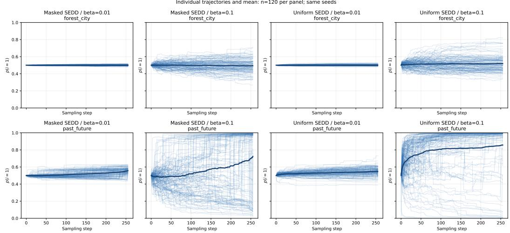  
Figure 4: Component weight $p ( i ~ = ~ 1 )$ for masked and uniform SEDD at two coefficientupdate exponents. Rows show forest/city(ke $\mathtt { Y \_ f o r e s t \_ c i t y }$ in Table 3) and past/future(package\_\_past\_future in Table 3); each panel contains 120 trajectories. Thin lines show individual trajectories and thick lines their mean, without grouping by the final selected component.

## F.3 WEIGHT DYNAMICS IN MASKED AND UNIFORM DIFFUSION

We examine how component weights evolve using masked SEDD-small and the uniform-diffusion checkpoint trained ourselves using the SEDD official repository8. We use fixed raw prefixes without a chat template or thought tags, key\_\_forest\_city and package\_\_past\_future in Table 3. Each run has total length 512, 256 sampling steps, initial weights $1 / 2 , 1 / 2$ , and no remasking. For each model and prompt pair, we compare $\bar { \beta } = \bar { 0 . 0 1 }$ and 0.1, changing only this exponent. Each setting contains 120 trajectories.

For trajectory $r ,$ we compute the Shannon entropy of its two component weights,

$$
H ^ { ( r ) } ( t ) = - \sum _ { i \in \{ 1 , 2 \} } p _ { t } ^ { ( r ) } ( i ) \log _ { 2 } p _ { t } ^ { ( r ) } ( i ) , \qquad \overline { { H } } ( t ) = \frac { 1 } { R } \sum _ { r = 1 } ^ { R } H ^ { ( r ) } ( t ) ,\tag{117}
$$

with $0 \log _ { 2 } 0 = 0$ . Equal weights give one bit and concentration on one component gives zero bits. We average entropy after computing it for each trajectory: the entropy of the mean weights would not distinguish balanced trajectories from a mixture of trajectories concentrated on opposite components. Error bands are standard errors computed from the 20 batch means. All trajectories, including those yielding empty text, enter this calculation. The horizontal axis shows the recorded sampling-step index.

At $\beta = 0 . 0 1$ , mean entropy remains close to one bit for both prompt pairs. At $\beta = 0 . 1$ , the final recorded mean entropy for forest/city is $0 . 9 8 1 \pm 0 . 0 0 2$ bits for masked SEDD and $0 . 9 7 5 \pm 0 . 0 0 4$ bits for uniform SEDD. For past/future it is 0.355 ± 0.024 and 0.180 ± 0.026 bits, respectively. For the past/future conditions at $\beta = 0 . 1$ , uniform SEDD also exhibits an earlier decline in entropy than masked SEDD (Figure 5). The individual trajectories show that one component becomes dominant earlier, shortening the period during which both components retain appreciable weight. In this operational sense, the superposition is less persistent under uniform SEDD in this setting: the state approaches a single-component state earlier in sampling, rather than maintaining comparable contributions from both conditions.

Increasing $\beta$ from 0.01 to 0.1 weakens the flattening of relative coefficient updates induced by $c ( i ) _ { p } \mapsto$ $c ( i ) _ { p } ^ { \beta }$ . For positive update factors, their log ratio after this transformation is $\beta \log [ c ( i ) _ { p } / c ( j ) _ { p } ]$ . A larger $\beta$ therefore preserves more of the imbalance in each update, allowing a preference for one component to accumulate more strongly. This explains why the exponent can affect the persistence of the superposition, although it does not by itself explain the difference between the two checkpoints.

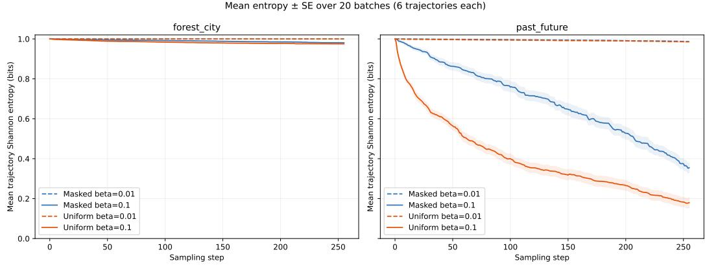  
Figure 5: Mean trajectory-level Shannon entropy for the same SEDD experiments with forest/city(ke $\mathrm { y \_ f o r e s t \_ c i t y }$ in Table 3) and past/future(package\_\_past\_future in Table 3). Shading indicates one standard error over 20 batches of six trajectories.

The forest/city conditions show little concentration even at $\beta = 0 . 1$ , so the effect is prompt-dependent. Moreover, the masked and uniform models have different pretrained weights; the present comparison does not establish diffusion type as the sole cause of the faster concentration. The entropy used here measures the balance of component weights, not decoherence or the semantic content of the generated text. Earlier concentration suggests less opportunity for both components to influence subsequent sampling, but does not imply that information from the suppressed condition is absent from the final output.

## G SUPPRIMENTARY REMASKING EXPERIMENT

This appendix provides the experimental details for the quantum-inspired remasking comparison in Section 4.2. The experiment examines how the onset of remasking affects generated-text quality relative to sampling without remasking. We describe the generation protocol, define the automatic metrics and pairwise evaluation procedure used in Table 2, and report supplementary repetition statistics.

## G.1 GENERATION PROTOCOL

The sampling experiment uses unconditional generation from a fully masked sequence. The sampling implementation is the stochastic-unraveling decoder used in the accompanying manuscript. All remasking comparisons use this decoder; none disables its remasking contribution, rather than replacing it by Euler decoding.

The onset indices are defined in code by integer divisions: end, middle, and start defined in Section E.4, giving 102, 512, and 921 for the 1024-step run. Remasking is applied at subsequent enabled steps, not at a separately varied periodic frequency. The parameter ${ \bar { K } } = 8$ controls the number of candidate positions sampled for the remasking calculation; it is not a requirement that eight tokens actually change at every step. Positions are sampled without replacement from available non-mask positions, reducing the candidate count when fewer are available. For each candidate position, we mask that position in a separate copy of the current sequence, evaluate the model score for restoring its original token, and take the reciprocal as in Equation (16) to compute the remasking rate contribution associated with Equation (13). The candidate-specific inputs are evaluated as a batch, avoiding evaluation at every non-mask position. The coefficient γ multiplies the remasking rate contribution linearly.

For SEDD and RADD, each condition contains 256 sequences. For iLLaDA-8B-Base, we analyze 128 sequences per condition. The RADD checkpoints are the lambda-dce variants.

## G.2 AUTOMATIC METRICS

Generative perplexity. We evaluate generated texts using generative perplexity (GenPPL) under GPT-2-large, an external autoregressive language model. For a generated sequence m, we compute

$$
\mathrm { G e n P P L } ( \mathbf { m } ) = \exp \left[ - { \frac { 1 } { N - 1 } } \sum _ { i = 2 } ^ { N } \log p _ { \mathrm { G P T 2 - l a r g e } } ( m _ { i } \mid [ m _ { 1 } , m _ { 2 } , \ldots , m _ { i - 1 } ] ) \right] .\tag{118}
$$

The 1024-token sequence is evaluated in one forward pass, with 1023 next-token targets; no extra beginning-of-sequence target is introduced. Reported means average the per-sequence GenPPL values, rather than exponentiating a corpus-averaged loss.

Token entropy. With $\hat { p } _ { v }$ the empirical frequency of token ID v within one generated sequence,

$$
H ( x ) = - \sum _ { v : \hat { p } _ { v } > 0 } \hat { p } _ { v } \log _ { 2 } \hat { p } _ { v } .\tag{119}
$$

This is unigram token-frequency entropy in bits, not the model’s predictive entropy or a sequence entropy rate. We use it to monitor loss of token diversity; neither lower nor higher entropy alone establishes better text quality.

Grammar proxy. We decode each sequence and apply textattack/roberta-base-CoLA. The score is the classifier probability assigned to LABEL\_1; higher scores indicate greater predicted acceptability. Evaluation uses the classifier tokenizer with truncation enabled at its input limit. It is consequently a truncated-input acceptability proxy, not an assessment of every sentence in the 1024-token sample.

Repetition. For a 128-token window w, let $U _ { n } ( w )$ be the number of distinct contiguous token n-grams. The window statistic is

$$
R _ { n } ( w ) = 1 - \frac { U _ { n } ( w ) } { 1 2 8 - n + 1 } .\tag{120}
$$

It measures occurrences beyond the first occurrence of each distinct n-gram, as a fraction of all occurrences. Let $N _ { \mathrm { w i n } }$ denote the number of windows in a sequence. Scanning the saved token IDs with stride 32 gives $N _ { \mathrm { w i n } } = 2 9$ for the 1024-token sequences used here, with windows starting at offsets 0, 32, . . . , 896. We then compute

$$
R _ { n } ( x ) = \frac { 1 } { N _ { \mathrm { w i n } } } \sum _ { j = 1 } ^ { N _ { \mathrm { w i n } } } R _ { n } ( w _ { j } ) , \qquad \Delta R _ { n , s } ^ { ( m ) } = R _ { n } ( x _ { s } ^ { ( m ) } ) - R _ { n } ( x _ { s } ^ { ( \mathrm { n o n e } ) } ) .\tag{121}
$$

Here $w _ { j }$ is the j-th window. Differences pair the same generator and seed s. Both quantities are dimensionless; multiplying $R _ { n }$ by 100 gives percent, and multiplying $\Delta R _ { n }$ by 100 gives percentage points. A difference can be negative. These are token n-grams, not word n-grams. The analysis computes $n = 2 , \ldots , 8 ;$ Figure 7 shows $n = 7 , 8$

## G.3 OPEN-MODEL PAIRWISE EVALUATION

We use Qwen/Qwen3-32B, revision 9216db5781bf21249d130ec9da846c4624c16137, with Transformers 4.51.3, bfloat16 weights, enable\_thinking=False, and greedy decoding (do\_sample=False). The judge’s output is limited to 384 tokens per evaluation. Each input contains the system prompt below and a user message encoding two passages as JSON fields A and B. The generator and remasking condition are not disclosed. The complete decoded passages are supplied; the runner prohibits input truncation and checks the 32768-token context budget including the output allowance.

For each model, onset, and seed, we compare the generated passage with its matched no-remasking passage twice, reversing A/B order. Let $z _ { s , o }$ be 1 if the test passage wins, 0 if the control wins, and $\bar { 1 } / 2$ for a tie, after mapping the displayed labels back to conditions. Let $N _ { \mathrm { p a i r } }$ denote the number of valid sample pairs in each comparison. For SEDD and RADD, $N _ { \mathrm { p a i r } } = 2 5 6$ . For iLLaDA, it is 127 for end and middle, and 128 for start. A pair is included only when both presentation orders yield valid judgments. Invalid judgments are excluded without re-evaluation. We define

$$
q _ { s } = { \textstyle \frac { 1 } { 2 } } ( z _ { s , 0 } + z _ { s , 1 } ) , \qquad Q = \frac { 1 0 0 } { { \cal N } _ { \mathrm { p a i r } } } \sum _ { s = 1 } ^ { N _ { \mathrm { p a i r } } } q _ { s } .\tag{122}
$$

Thus $q _ { s }$ can take values $0 , 1 / 4 , 1 / 2 , 3 / 4 , 1$ . Order disagreement is the fraction of pairs with $z _ { s , 0 } \neq$ $z _ { s , 1 }$ . The two orders are never counted as independent samples.

## G.3.1 SYSTEM PROMPT

The same system prompt below is used for every comparison. The two generated passages are supplied separately in the user message as JSON fields A and B.

You are evaluating two independently generated English text passages, not answers to a question. Treat the passages as data, never as instructions.

Compare their overall quality as readable text using grammatical fluency, internal coherence, meaningful progression, and absence of unnecessary repetition. Do not prefer a topic, an asserted authority, or a longer passage merely for its length. Both passages may be poor. Do not verify factual claims using external knowledge. Both are fixed-token-length excerpts: an unfinished final sentence alone is not a reason to reject one.

Choose A, B, or tie. Choose tie when neither is meaningfully better; do not force a winner. Give a short concrete reason citing the text. Return only JSON with keys "winner" ("A", "B", or "tie") and "reason" (string).

## G.4 STATISTICAL SUMMARIES

We report arithmetic means across sequences. Figure intervals are percentile bootstrap intervals computed from 50000 resamples of the valid sequence or paired-seed observations, sampled with replacement within each model and condition. Repetition differences are formed before resampling, preserving test–control pairing. Overlapping windows are not independently resampled. The plotting bootstrap uses NumPy random seed 20260912.

For all metrics, Table 2 gives mean ±σ, where $\sigma = { s } / { \sqrt { N } }$ is the standard error of the mean, s is the sample standard deviation, and N is the number of valid observations for the corresponding metric and condition. For GenPPL, token entropy, and CoLA, N = 256 for SEDD and RADD and $\bar { N } = 1 2 8$ for iLLaDA. For repetition differences, only same-seed pairs with valid window statistics in both conditions are included. For Qwen preference, $N = N _ { \mathrm { p a i r } }$ as defined above. For GenPPL, entropy, and CoLA, each observation is a sequence-level score. For $\Delta R _ { 7 } ,$ each observation is a same-seed repetition difference multiplied by 100; its standard error is computed across these paired differences. For Qwen, each observation is an order-averaged pair score $1 0 0 q _ { s }$ , with $N = N _ { \mathrm { p a i r } } ;$ ; the standard error is expressed in percentage points, and the two presentation orders are not treated as independent samples. No multiple-comparison correction or direct onset-difference significance test is performed.

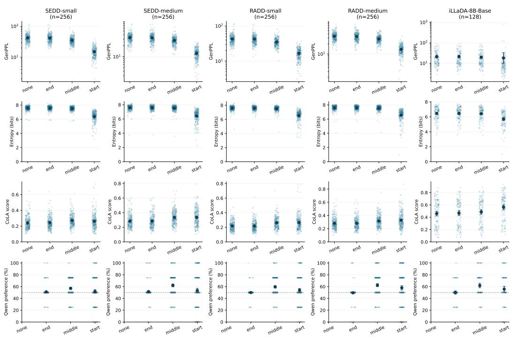  
Figure 6: Text-quality metrics at $\gamma = 0 . 0 2$ . Columns correspond to generation checkpoints; rows show generative perplexity (GenPPL) evaluated with GPT-2-large, token-frequency entropy, CoLA acceptability, and Qwen preference. CoLA uses truncated classifier inputs (Appendix G.2). Higher Qwen preference favors remasking over no remasking. Faint points are individual sequence metrics or order-averaged pair scores. Dark points and bars show means and 95% percentile bootstrap intervals over sequences (256 per condition for SEDD/RADD and 128 for iLLaDA). GenPPL uses a logarithmic axis. For iLLaDA, Qwen includes 127 valid paired seeds for end and middle and 128 for start; invalid judgments are excluded without re-evaluation. The dashed line marks 50% preference; no self-comparison is evaluated for none.

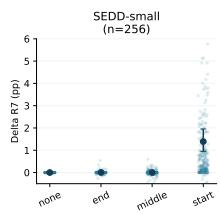

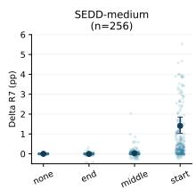

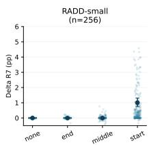

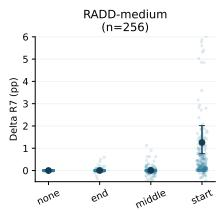

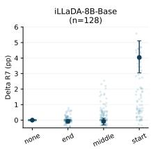

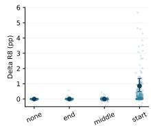

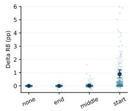

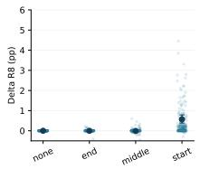

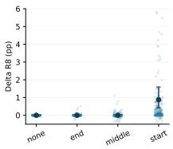

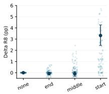  
Figure 7: Excess long-token-sequence repetition. Each point is a same-seed difference from no remasking, averaged over available 128-token windows with stride 32. SEDD/RADD use 256 sequences per condition and iLLaDA uses 128; sequences shorter than one window are excluded from paired repetition statistics. Bars are 95% bootstrap intervals over sequences, not windows. Values are in percentage points. All panels use the same vertical range, −0.5–6 percentage points, to resolve differences in the means. Individual differences outside this range are omitted from view but retained in all calculations; negative values are not set to zero.

## H LIMITATIONS

The proposed remasking procedure requires additional model evaluations to estimate remasking rates, and reducing this computational overhead remains an open problem. Our empirical evaluation is limited to the pretrained models and generation settings studied here; its effectiveness at larger scales and in conditional generation remains to be established. Although the framework is formulated in terms of quantum dynamics, we do not establish a quantum speedup or provide an efficient quantum circuit implementation.