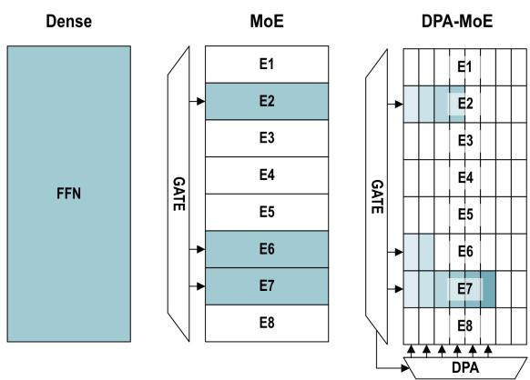
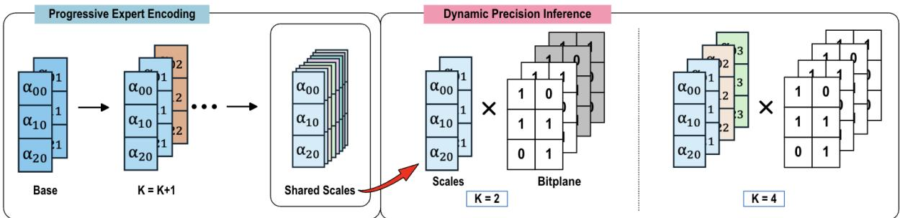
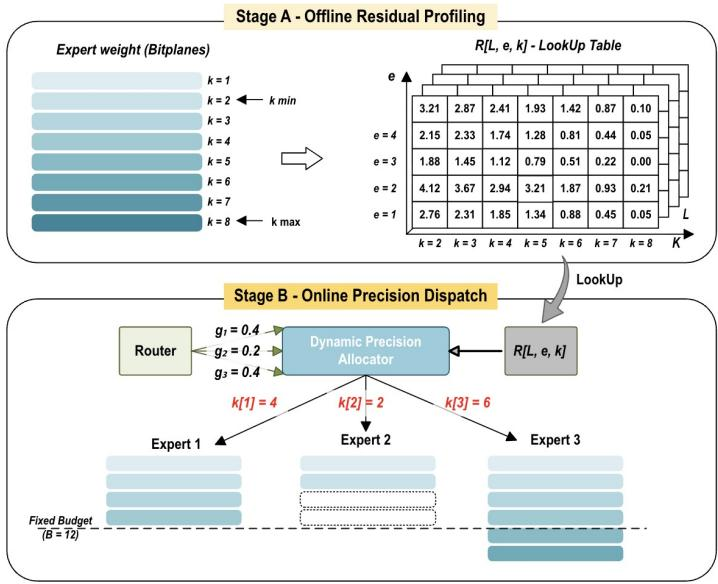
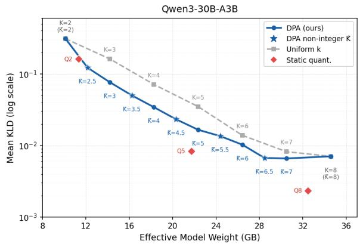
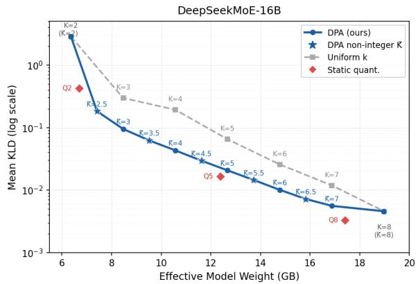
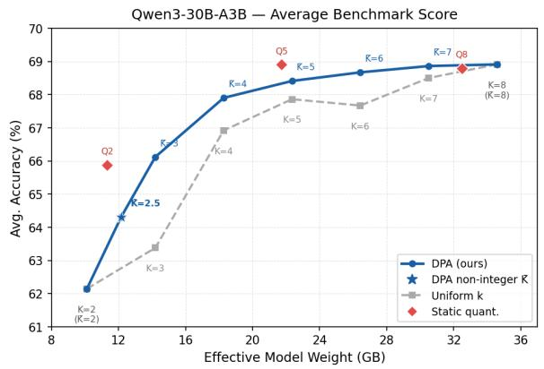
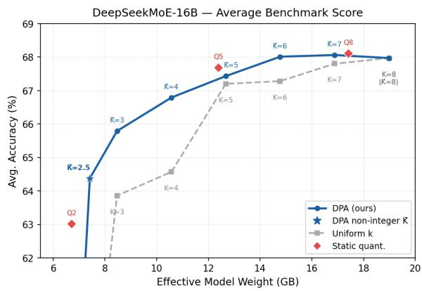
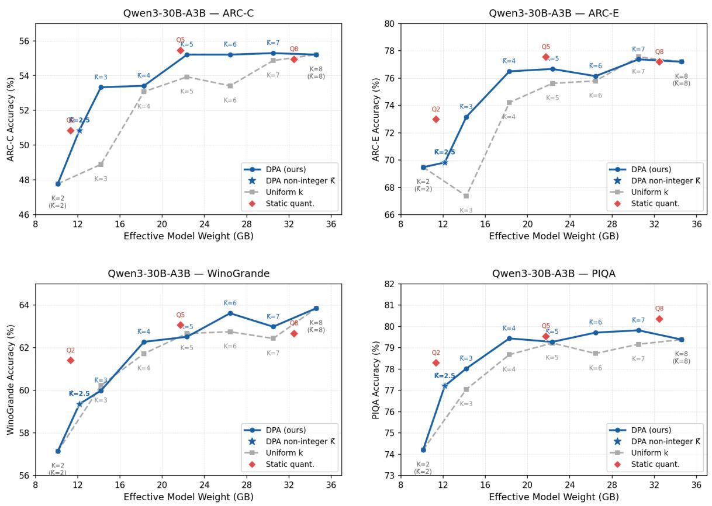
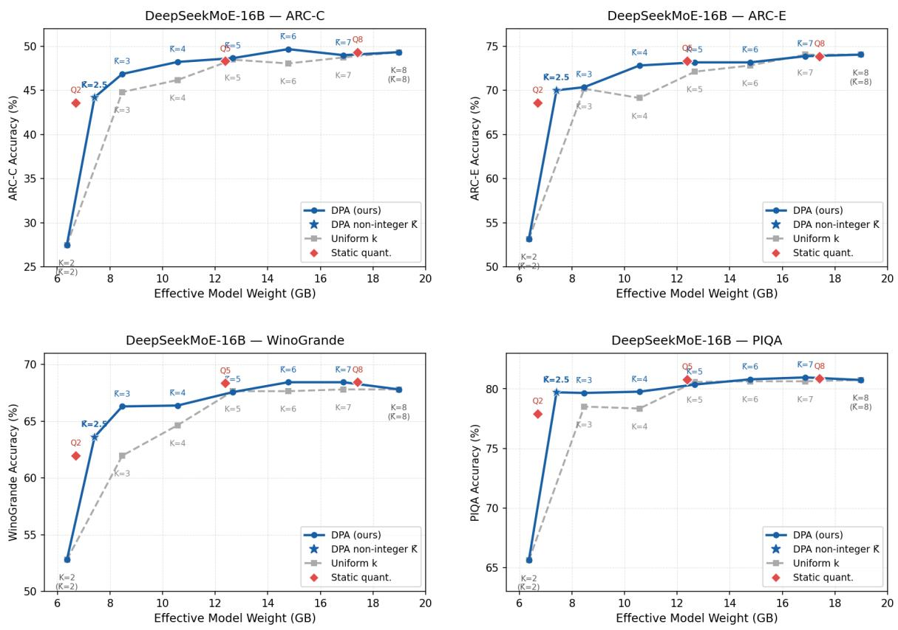

# DPA-MoE: A Runtime Precision Control Framework for MoE Inference

Jaeyun Kim1\*, Hoonki Lee1\*, Susie Shin2,

Hyunmin Kim2, Dahyun Lee2, Sangyeob Kim2†

1Agency for Defense Development 2Yonsei University

{kimjy.greg, hoonki2002}@gmail.com

{susie3529, ryan3504, dahyunlee17, sangyeob.kim}@yonsei.ac.kr

## Abstract

Mixture-of-Experts (MoE) models reduce computation by routing each token to a small set of experts, but each selected expert is still used at a fixed precision. We present DPA-MoE, a runtime precision control framework that makes routed experts any-precision. DPA-MoE encodes expert feed-forward weights as prefixdecodable chunks using SharedScale AnyBCQ, profiles per-expert reconstruction residuals offline, and allocates chunks at inference time using live router gate scores. This post-routing allocation lets a single encoded MoE checkpoint operate at multiple effective weight-memory budgets without retraining or re-encoding. Experiments on four MoE models spanning different scales, routing widths, and shared-expert configurations show that DPA-MoE consistently improves reconstruction fidelity over uniform chunk allocation and yields a better overall weight-size–quality frontier, with modest steady-state throughput overhead in our prototype.

## 1 Introduction

Large language models are used across increasingly diverse workloads, including interactive assistants, coding tools, document summarization, and retrieval-augmented question answering. These workloads vary in their latency, throughput, memory, and quality requirements, creating a need for multiple operating points from the same model. However, a conventional fixed-precision checkpoint exposes only one point on this resource– quality curve. Releasing or storing a separate quantized checkpoint for each operating point increases storage and deployment complexity. An attractive alternative is an any-precision model: a single encoded artifact whose effective weight size can be adjusted at inference time (Yu et al., 2021; Park et al., 2024; Wang et al., 2025b; Park et al., 2026).

  
Figure 1: DPA-MoE adds post-routing precision allocation to MoE: routing chooses which experts run, while DPA-MoE chooses how much of each selected expert is used.

The need is sharpest for local inference, where the binding constraints change while the model is resident: memory shifts as other applications come and go and a user may want speed now and accuracy next. Adapting a fixed-precision checkpoint means swapping in a separately quantized artifact, which requires re-encoding or fetching another multi-gigabyte file; an any-precision artifact instead moves along the size–quality curve in place.

Mixture-of-Experts (MoE) models route each token to a small subset of experts rather than applying the full feed-forward parameter set (Shazeer et al., 2017; Lepikhin et al., 2021; Fedus et al., 2022; Du et al., 2022; Jiang et al., 2024; Dai et al., 2024; Muennighoff et al., 2025). This increases total capacity while keeping per-token computation small. However, MoE only controls which experts are activated: once selected, an expert is still evaluated at a fixed precision. Since expert FFN weights dominate modern MoE parameter counts (about

95% in Qwen3-30B-A3B (Qwen Team, 2025)), the number of weight bits read inside each selected expert remains an important control point.

This paper makes selected experts any-precision. As shown in Figure 1, MoE chooses which experts are activated, while DPA-MoE chooses how much of each selected expert is used by assigning a variable number of precision chunks (Section 3.1) per routed activation. Throughout, precision means this chunk count k rather than a numeric bit-width: an expert at precision k is one reconstructed from its first k chunks. Smaller chunk budgets give lighter but less accurate reconstructions; larger budgets recover higher fidelity. This lets a single MoE checkpoint trace a fine-grained weight-size–quality frontier without retraining or maintaining multiple quantized variants.

A uniform any-precision MoE assigns the same chunk count to every activated expert, ignoring router-provided structure. Existing methods address memory and quality through post-training quantization (Frantar and Alistarh, 2024; Duanmu et al., 2025) or runtime adaptation using cache state, device constraints, or long-horizon activation statistics (Tang et al., 2024; Wang et al., 2025a; Chu et al., 2025). DPA-MoE instead combines offline quantization residuals with live gate scores, since experts differ both in current-token importance and reconstruction sensitivity.

We present DPA-MoE, a dynamic precision allocation framework for any-precision MoE models. DPA-MoE encodes expert FFN weights with SharedScale AnyBCQ, a prefix-decodable representation built on AnyBCQ (Park et al., 2026), profiles reconstruction residuals for each expert and chunk count, and combines those residuals with live router gate scores at inference time. The pretrained router and expert identities remain unchanged; DPA-MoE only controls how much precision each selected expert receives. It is not an end-to-end serving system, but a precision-allocation primitive complementary to systems such as DeepSpeed-MoE, HOBBIT, and D2MoE (Rajbhandari et al., 2022; Tang et al., 2024; Wang et al., 2025a).

On Qwen3-30B-A3B, DeepSeekMoE-16B-Chat, OLMoE-1B-7B-0125, and Qwen1.5-MoE-A2.7B (Qwen Team, 2025; Dai et al., 2024; Muennighoff et al., 2025; Qwen Team, 2024), DPA-MoE consistently reduces KL divergence relative to uniform chunk allocation and yields a better overall weight-size–quality frontier, with modest steadystate throughput overhead in our prototype. Sparse routing chooses the experts; DPA-MoE chooses how much of each selected expert to use.

Our contributions are:

• We formulate any-precision MoE, where sparse routing selects experts and a separate precision controller adjusts how many weight bits are read from each selected expert.

• We introduce SharedScale AnyBCQ, a prefixdecodable expert encoding built on Any-BCQ (Park et al., 2026) that lets a single MoE checkpoint expose multiple effective weight-memory budgets without retraining or re-encoding.

• We propose a two-stage allocation framework that combines offline residual profiling with live router gate scores to allocate precision chunks across routed expert activations.

• We show that DPA-MoE improves the weightsize–quality frontier over uniform chunk allocation, while incurring modest steady-state throughput overhead in a lightweight prototype.

## 2 Related Work

Static Quantization. Post-training quantization reduces LLM memory footprint by compressing weights offline. General LLM post-training quantization methods include LLM.int8 (Dettmers et al., 2022), ZeroQuant (Yao et al., 2022), SmoothQuant (Xiao et al., 2023), GPTQ (Frantar et al., 2023), and AWQ (Lin et al., 2024). MoEspecific methods extend this to expert weights, either uniformly (Frantar and Alistarh, 2024) or with mixed precision assigned per expert based on sensitivity and activation frequency (Duanmu et al., 2025). While mixed-precision methods acknowledge that experts differ in importance, the allocation is fixed before deployment and remains constant regardless of the current input.

Input-Adaptive Precision Methods. Recent work has begun to adapt expert precision beyond static assignment. Tang et al. (2024) serve cachemiss experts at lower precision, but the decision is binary and driven by cache state rather than tokenlevel routing confidence. Chu et al. (2025) maintain a high-precision resident set based on longhorizon router traces, but rely on aggregate statistics that cannot reflect the importance of the current token to each expert. Wang et al. (2025a) insert a per-expert bit-width gate downstream of the unmodified router, but require training an additional adapter and bind precision to a learned policy rather than exposing it as a separable runtime variable.

Progressive and Multi-Precision Encodings. A complementary line of work encodes weights such that multiple precisions are accessible without reencoding. Yu et al. (2021) introduce neural networks whose precision can be changed at runtime, Park et al. (2024) show that a single quantized model can support multiple bit-widths, Wang et al. (2025b) provide fine-grained model size control through stacked residual quantization, and Park et al. (2026) advance this through progressive bitplanes with negligible switching overhead. These encodings provide the representational substrate for runtime precision control, but do not specify how that control should be exercised across experts.

Positioning. Appendix D compares these methods on five axes: training-free, router left unchanged, token-aware, fine-grained budgets reachable, and no re-fetch on a precision upgrade. The closest is $\mathbf { D } ^ { 2 } \mathbf { M o E }$ , whose nested Matryoshka quantization reuses already-loaded bits as our prefixdecodable encoding does, but it exposes only discrete tiers and needs a trained per-expert network to choose bit-widths. DPA-MoE is, to our knowledge, the only method that is simultaneously trainingfree, token-aware, and fine-grained in k while leaving the router untouched.

## 3 Background and Problem Formulation

## 3.1 Precision Chunks

DPA-MoE stores each expert weight tensor as an ordered sequence of chunks. A chunk is a single binary bitplane together with its per-group scale; a per-group offset is shared across chunks. Using the first k chunks appends bitplanes to a prefix that is already valid, so raising k never invalidates what has been read; $k _ { \mathrm { m i n } }$ and $k _ { \mathrm { m a x } }$ denote the smallest and largest supported chunk counts. Section 4.1 gives the reconstruction (Equation 1) and the encoding procedure. A chunk is thus the granularity at which expert precision can be spent.

## 3.2 MoE Routing

For token state x, an MoE layer selects experts $\mathcal { E } ( x )$ and outputs $\begin{array} { r } { y = \sum _ { e \in { \mathcal E } ( x ) } g _ { e } ( x ) E _ { e } ( x ) } \end{array}$ . We assume each expert can support prefix reconstruction with

chunk count k, where larger $k$ uses more of the encoded expert weight and generally gives a more faithful reconstruction.

## 3.3 Problem Statement

Uniform precision is structurally mismatched with MoE routing. For a given token, the router does not activate experts equally: it assigns different gate scores to different selected experts, indicating that their contributions to the layer output are not symmetric. Across layers and experts, the reconstruction error introduced by using a shorter precision prefix also varies. Nevertheless, a uniform precision policy reads the same number of weight bits from every selected expert.

This wastes budget in two ways. First, lowcontribution experts can receive the same precision as high-contribution experts. Second, experts that are already easy to reconstruct can receive the same precision as experts whose output is more sensitive to missing chunks. As a result, uniform precision can spend memory and bandwidth on expert activations with small marginal value while underserving the activations where additional precision matters most.

The problem addressed in this paper is therefore not to change the MoE router, retrain the model, or design a new serving scheduler. It is to remove this uniform-precision assumption inside the experts selected by the existing router, so that a single encoded MoE checkpoint can expose multiple weightsize–quality operating points more efficiently.

## 4 Method

## 4.1 Progressive Expert Encoding

DPA-MoE encodes each expert feed-forward weight tensor as an ordered sequence of precision chunks, where loading a longer prefix generally improves reconstruction fidelity. Following Any-BCQ (Park et al., 2026), each grouped weight tensor at precision k is approximated as

$$
W ^ { ( k ) } \approx \beta + \sum _ { p = 1 } ^ { k } \alpha _ { p } B _ { p } ,\tag{1}
$$

where $B _ { p } \in \{ - 1 , + 1 \} ^ { d }$ is a binary bitplane, $\alpha _ { p }$ is a per-group scale, and β is an optional per-group offset, with group size G=128. The default precision range spans $k _ { \mathrm { m i n } } { = } 2$ to K=8 chunks.

Standard AnyBCQ re-optimizes $\alpha _ { p }$ independently at each precision tier, producing per-tier scale snapshots. Supporting the full 2–8 bit range therefore requires storing one scale set per tier, resulting in substantially larger per-expert storage overhead compared to a shared parameterization (Appendix A).

  
Figure 2: SharedScale AnyBCQ encoding and dynamic precision inference. Left (Progressive Expert Encoding): chunks are added sequentially, with all active α planes jointly re-optimized at each step to produce a single shared scale table. Right (Dynamic Precision Inference): at inference time, selecting k chunks loads the first k bitplanes and scale columns from the shared table — no additional scale fetches are required when switching precision.

We therefore introduce SharedScale AnyBCQ, which fixes a single shared α and β table across all precision tiers during encoding. At inference time, moving from k to $k { + 1 }$ chunks requires loading only the new bitplane $B _ { k + 1 }$ and its scale αk+1; previously loaded scales remain valid and unchanged. To compensate for the reduced per-tier flexibility, the encoding optimization objective is:

$$
\mathcal { L } = \mathcal { L } _ { \mathrm { b l o c k } } + \lambda \cdot \mathcal { L } _ { \mathrm { p r e s e r v e } } ,\tag{2}
$$

where

$$
\begin{array} { r l } & { \qquad \mathcal { L } _ { \mathrm { b l o c k } } = \mathrm { M S E } \big ( F _ { q } ( x _ { \mathrm { f p } } ) , F _ { \mathrm { f p } } ( x _ { \mathrm { f p } } ) \big ) , } \\ & { \qquad \mathcal { L } _ { \mathrm { p r e s e r v e } } = \mathbb { E } _ { k \in [ k _ { \mathrm { m i n } } , K - 1 ] } \left[ \mathrm { M S E } \Big ( W ^ { ( k ) } , ~ W _ { \mathrm { f p } } \Big ) \right] , } \end{array}\tag{3}
$$

where λ is a weighting hyperparameter that balances reconstruction fidelity at full precision against quality preservation at intermediate precisions. Here $F _ { \mathrm { f p } }$ denotes layer L evaluated with full-precision expert weights, and $F _ { q }$ denotes the same layer with expert weights quantized at precision K, both evaluated on the same full-precision cached activation $x _ { \mathrm { f p } }$ . This isolates the reconstruction error attributable to the current layer under calibration. ${ \mathcal { L } } _ { \mathrm { b l o c k } }$ minimizes the layer-level output error at full chunk count K, while $\mathcal { L } _ { \mathrm { p r e s e r v e } }$ explicitly protects reconstruction quality at all intermediate precisions $k \in [ k _ { \mathrm { m i n } } , K { - } 1 ]$ . Hyperparameters and calibration details are provided in Table 10.

Figure 2 illustrates this process. During encoding, chunks are added one at a time; at each step, all active α scales are jointly re-optimized via L with signs B fixed, gradually refining the shared scale table to account for all intermediate precisions simultaneously. At inference time, selecting precision k loads the first k chunks, enabling precision switching without re-fetching previously loaded scales.

## 4.2 Two-Stage Framework

The encoding described in Section 4.1 converts expert precision into a runtime-controllable variable. The central question then becomes: given a fixed per-dispatch budget, how should chunks be allocated across active experts to best preserve output quality? A uniform allocation—assigning the same chunk count to every expert—ignores two sources of heterogeneity: the intrinsic quantization error of each expert, which varies across experts independently of routing, and the router’s gate scores, which reflect each expert’s relevance to the current token. We propose a two-stage framework that keeps these two sources strictly separate.

Stage A: Offline Residual Profiling. Prior to inference, we measure the reconstruction error incurred by each expert e in layer L at every precision level k. With $\mathcal { D } _ { L }$ the input distribution to experts in layer L, we define

$$
R [ L , e , k ] = \mathbb { E } _ { x \sim \mathcal { D } _ { L } } \left[ \left. \Delta E _ { e } ^ { ( k ) } ( x ) \right. ^ { 2 } \right] ,\tag{4}
$$

where $\Delta E _ { e } ^ { ( k ) } ( x ) = E _ { e } ( x ) - E _ { e } ^ { ( k ) } ( x )$ is the difference between the full-precision and k-chunk reconstruction of expert e. In practice this expectation is approximated on a calibration set. Profiling is gate-free: it captures only each expert’s intrinsic compression error. The result is a Residual LUT $\mathcal { R } = \{ R [ L , e , k ] \}$ , computed once and stored alongside the model.

  
Figure 3: Two-Stage Precision Allocation. Offline profiling builds a residual table $\mathcal { R } [ L , e , k ]$ . At inference time, DPA combines this table with live gate scores and allocates a fixed chunk budget across routed experts.

Stage B: Online Precision Allocation. At inference time, for each MoE dispatch, the router provides live gate scores $\{ g _ { e } \}$ for the n active experts. Together with the Residual LUT R, these give the Dynamic Precision Allocator (DPA) everything it needs to choose $k _ { e }$ per expert.

Objective Derivation. The two stages combine through the layer-level output error. For a token x, let $\begin{array} { r } { \begin{array} { l l l } { \Delta Y } & { = } & { \sum _ { e \in \mathcal { E } ( x ) } g _ { e } ( x ) \Delta E _ { e } ^ { ( k _ { e } ) } ( x ) } \end{array} } \end{array}$ denote the reconstruction error of the MoE layer output. Expanding $\| \Delta Y \| ^ { 2 }$ gives diagonal terms $\begin{array} { r l } { \sum _ { e } g _ { e } ( x ) ^ { 2 } \| \Delta E _ { e } ^ { ( k _ { e } ) } ( x ) \| ^ { 2 } } \end{array}$ and cross terms $\begin{array} { r } { \sum _ { e \neq e ^ { \prime } } g _ { e } ( x ) g _ { e ^ { \prime } } ( x ) \langle \Delta E _ { e } ^ { ( k _ { e } ) } ( x ) , \Delta E _ { e ^ { \prime } } ^ { ( k _ { e ^ { \prime } } ) } ( x ) \rangle } \end{array}$ Dropping the cross terms gives

$$
\| \Delta Y \| ^ { 2 } \approx \sum _ { e } g _ { e } ( x ) ^ { 2 } \big \| \Delta E _ { e } ^ { ( k _ { e } ) } ( x ) \big \| ^ { 2 } .\tag{5}
$$

Although this approximation changes the absolute magnitude of the objective, it preserves allocation rankings: the exact and approximated objectives have Spearman correlation at least 0.999 across all precision levels (Appendix B).

Taking the expectation over the calibration distribution yields $g _ { e } ( x ) ^ { 2 } R [ L , e , k _ { e } ]$ as the per-expert cost: a live per-dispatch coefficient times the offline LUT. Before allocation, we apply a monotone projection along k to remove calibration noise, yielding $\widetilde { R }$ with $\widetilde { R } [ L , e , k + 1 ] \leq \widetilde { R } [ L , e , k ]$

For batched prefill, we aggregate gate coefficients over the microbatch X:

$$
G _ { e } = \sum _ { x \in \mathcal { X } : e \in \mathcal { E } ( x ) } g _ { e } ( x ) ^ { 2 } .\tag{6}
$$

The same objective then applies with $g _ { e } ( x ) ^ { 2 }$ replaced by $G _ { e }$

## 4.3 Dynamic Precision Allocator (DPA)

The DPA solves the following budgeted allocation problem at every MoE dispatch:

$$
\operatorname* { m i n } _ { \{ k _ { e } \} } \sum _ { e \in \mathcal { A } } w _ { e } \cdot \widetilde { R } [ L , e , k _ { e } ] \quad \mathrm { s . t . } \quad \sum _ { e \in \mathcal { A } } k _ { e } = B ,\tag{7}
$$

where A is the active expert set, $w _ { e } = g _ { e } ( x ) ^ { 2 }$ for single-token decoding and $w _ { e } = G _ { e }$ for batched prefill. The budget is $B = \operatorname { r o u n d } ( | \boldsymbol { \mathcal { A } } | \cdot \bar { k } )$ , and $k _ { e } \in$ $\{ k _ { \operatorname* { m i n } } , \dots , k _ { \operatorname* { m a x } } \}$ . For decoding, $\mathcal { A } = \mathcal { E } ( \boldsymbol { x } )$ ; for batched prefill, A is the union of experts activated by tokens in the microbatch.

Multi-Choice Knapsack DPA. Equation 7 is a multi-choice knapsack problem (Kellerer et al., 2004). Let $A = \{ e _ { 1 } , \ldots , e _ { n } \}$ and define $c _ { i } ( k ) =$ $w _ { e _ { i } } \hat { R } [ L , e _ { i } , k ]$ . Let $f ( i , b )$ be the minimum cost for the first i experts under partial budget b:

$$
\begin{array} { c } { f ( i , b ) = \displaystyle \operatorname* { m i n } _ { k } \left[ f ( i - 1 , b - k ) + c _ { i } ( k ) \right] , } \\ { k \in \{ k _ { \operatorname* { m i n } } , \ldots , k _ { \operatorname* { m a x } } \} . } \end{array}\tag{8}
$$

with $f ( 0 , 0 ) = 0$ and $f ( 0 , b ) = \infty$ for $b > 0$ . The optimum is $f ( n , B )$ , and the selected chunk counts are recovered by backtracking. Since the DP enumerates all feasible chunk assignments under the budget, it returns the global optimum of Equation 7 with respect to the projected residual table ${ \widetilde { R } } .$

Computational Cost. The DPA runs in $O ( n$ $B \cdot k _ { \mathrm { r a n g e } } )$ time, where $n = | \mathcal { A } | , B = \mathrm { r o u n d } ( n \bar { k } )$ and $k _ { \mathrm { r a n g e } } = k _ { \mathrm { m a x } } - k _ { \mathrm { m i n } } + 1$ . Equivalently, the cost is $O ( n ^ { 2 } \bar { k } k _ { \mathrm { r a n g e } } )$ . For single-token decoding, n is the top-k routing count; for Qwen3-30B-A3B, $n = 8 , B \leq 6 4$ , and $k _ { \mathrm { r a n g e } } = 7 .$ , giving at most 8 · 64 · 7 = 3,584 candidate transitions per dispatch.

For batched prefill, n can grow because A is the union of experts selected by all tokens, but it remains bounded by the number of experts in the layer rather than by the number of token– expert pairs. In the worst case with $n ~ \leq ~ 1 2 8$ $\bar { k } \leq 8 ,$ and $k _ { \mathrm { r a n g e } } = 7$ , the DP evaluates at most $1 2 8 \cdot ( 1 2 8 \cdot 8 ) \cdot 7 = 9 1 7 . 5 0 4$ transitions per MoE layer dispatch. This cost is amortized over the microbatch: for m tokens, the per-token cost scales as $O ( n ^ { 2 } \bar { k } k _ { \mathrm { r a n g e } } / m )$ with $n \mathop { \leq } \mathrm { m i n } ( N _ { \mathrm { e x p e r t s } } , m k _ { \mathrm { t o p } } )$ Thus, small batches have very small active sets, while large batches may activate more experts but divide the allocator cost across more tokens.

## 5 Experimental Setup

## 5.1 Models

We evaluate on four open-weight MoE language models, chosen to vary in scale, routing width, and shared-expert configuration: Qwen3-30B-A3B (Qwen Team, 2025), 8 of 128 experts, no shared experts; DeepSeekMoE-16B-Chat (Dai et al., 2024), 6 of 64 routed experts plus 2 shared; OLMoE-1B-7B-0125 (Muennighoff et al., 2025), 8 of 64, no shared experts; and Qwen1.5-MoE-A2.7B (Qwen Team, 2024), 4 of 60 routed experts plus 4 shared. The first two carry the full evaluation suite including inference speed; the latter two are evaluated on KL divergence and downstream accuracy.

## 5.2 Baselines

We compare DPA against two baselines. As static quantization references, we include Q2\_K, Q5\_K\_M, and Q8\_0 GGUF quantizations of all four models, representing fixed operating points at approximately 2-, 5-, and 8-bit compression. For Qwen3-30B-A3B and DeepSeekMoE-16B-Chat we use published GGUF artifacts (Unsloth

AI, 2025; Mradermacher, 2024); the OLMoE-1B-7B-0125 and Qwen1.5-MoE-A2.7B artifacts are converted locally from the base checkpoints with llama.cpp. As a dynamic baseline, Uniform k serves all experts at a fixed chunk count $k \in$ $\{ 2 , \ldots , 8 \}$ , using the same encoding as DPA but without gate-aware allocation.

## 5.3 Evaluation

We evaluate reconstruction quality via mean KL divergence (KLD) between the quantized and full-precision output distributions, measured on 10 sequences of 4,096 tokens sampled from the WikiText-2 test set (Merity et al., 2017) with a fixed random seed. For downstream task performance, we report accuracy on four benchmarks: ARC-Challenge (Clark et al., 2018), ARC-Easy (Clark et al., 2018), WinoGrande (Sakaguchi et al., 2021), and PIQA (Bisk et al., 2020). We additionally report the macro-average across all four tasks as a single summary metric.

## 5.4 Inference Evaluation Setup

We evaluate inference throughput and latency under a controlled execution setting designed to compare the cost of materializing and computing different amounts of expert weight. All methods use the same model, implementation, and execution path; the only difference is the chunk allocation assigned to activated experts. In the Full-Memory setting used for the speed measurements, all encoded expert chunks are resident in GPU memory, so the measurement isolates precision allocation and variable-chunk execution rather than SSD, hostcache, or expert-offloading effects.

We compare DPA against Uniform-k at matched average chunk budgets $\bar { k } \in \mathrm { ~  ~ { ~ \left\{ ~ 3 , 4 , 5 , 6 , 7 \right\} ~ } ~ }$ Uniform-k materializes the same number of chunks for every activated expert, while DPA redistributes the same total chunk budget according to gateweighted residual costs. Thus, the comparison isolates the runtime and quality effect of non-uniform expert precision allocation under the same effective weight-memory budget.

We report generation throughput (TPS) and timeto-first-token (TTFT) averaged over 100 sequences from each of WikiText-2 (Merity et al., 2017), C4- en (Raffel et al., 2020), and the Korean split of mC4 (Xue et al., 2021).

Figure 4: Mean KL divergence vs. effective model weight (GB) for DPA (ours), Uniform-k allocation, and static quantization baselines on Qwen3-30B-A3B (left) and DeepSeekMoE-16B-Chat (right).  

  
Figure 5: Macro-average benchmark accuracy (%) vs. effective model weight (GB) for DPA (ours), Uniform-k allocation, and static quantization baselines on Qwen3-30B-A3B (left) and DeepSeekMoE-16B-Chat (right).

## 6 Results

## 6.1 Reconstruction Quality

We adopt mean KL divergence (KLD) between the quantized and full-precision output distributions as our primary reconstruction metric. Unlike perplexity, KLD directly quantifies how much quantization distorts the model’s predicted distribution at every token, providing a sensitive and task-agnostic measure of fidelity that captures both mode shifts and tail deformations in the output.

Figure 4 plots mean KLD against effective model weight for DPA and all baselines. On both models, the DPA curve lies consistently below the Uniform k curve across the full compression range, confirming that gate-aware allocation reduces output distortion at every matched memory budget. The gain is most pronounced in the midcompression regime, where DPA reduces KLD by up to 4.5× relative to Uniform k at matched size (DeepSeekMoE-16B-Chat, ¯k=4), and recovers equivalent fidelity at 2–4 GB less memory across both models. Non-integer operating points (e.g., ¯k=2.5) smoothly interpolate between integer anchors, enabling fine-grained memory–fidelity trade-offs that static quantization cannot provide.

## 6.2 Downstream Task Performance

Figure 5 reports macro-average accuracy across ARC-Challenge, ARC-Easy, WinoGrande, and PIQA as a function of effective model weight; pertask breakdowns are provided in Appendix C.

DPA consistently outperforms Uniform k at matched memory budgets on both models, with the largest gains at aggressive compression where uniform allocation is most wasteful. The accuracy improvements mirror the KLD reductions reported in Section 6.1, confirming that reduced output distortion translates to measurable downstream gains.

## 6.3 Generality across MoE Architectures

We repeat the same protocol on OLMoE-1B-7B-0125 and Qwen1.5-MoE-A2.7B, which bracket the shared-expert axis — OLMoE has none, Qwen1.5-

<table><tr><td></td><td colspan="6">Qwen3-30B-A3B</td><td colspan="6">DeepSeekMoE-16B-Chat</td></tr><tr><td></td><td colspan="2">Avg Acc (%)</td><td colspan="2">TPS</td><td colspan="2">TTFT (s)</td><td colspan="2">Avg Acc (%)</td><td colspan="2">TPS</td><td colspan="2">TTFT (s)</td></tr><tr><td>k</td><td>Uni</td><td>DPA</td><td>Uni</td><td>DPA</td><td>Uni</td><td>DPA</td><td>Uni</td><td>DPA</td><td>Uni</td><td>DPA</td><td>Uni</td><td>DPA</td></tr><tr><td>3</td><td>63.38</td><td>66.12</td><td>58.70</td><td>55.29</td><td>1.001</td><td>1.311</td><td>63.86</td><td>65.79</td><td>116.54</td><td>106.96</td><td>0.519</td><td>0.691</td></tr><tr><td>4</td><td>66.92</td><td>67.90</td><td>51.53</td><td>48.72</td><td>1.150</td><td>1.560</td><td>64.57</td><td>66.79</td><td>105.68</td><td>97.06</td><td>0.597</td><td>0.842</td></tr><tr><td>5</td><td>67.86</td><td>68.41</td><td>46.29</td><td>44.23</td><td>1.277</td><td>1.773</td><td>67.20</td><td>67.43</td><td>95.17</td><td>89.64</td><td>0.679</td><td>0.978</td></tr><tr><td>6</td><td>67.67</td><td>68.67</td><td>41.00</td><td>38.79</td><td>1.427</td><td>1.898</td><td>67.28</td><td>68.01</td><td>88.68</td><td>82.18</td><td>0.758</td><td>1.101</td></tr><tr><td>7</td><td>68.50</td><td>68.86</td><td>35.97</td><td>34.53</td><td>1.603</td><td>2.084</td><td>67.80</td><td>68.06</td><td>82.05</td><td>76.68</td><td>0.801</td><td>1.203</td></tr></table>

Table 1: Macro-average benchmark accuracy, generation throughput (TPS), and time-to-first-token (TTFT) on Qwen3-30B-A3B and DeepSeekMoE-16B-Chat under the Full-Memory setting.

MoE has four — and differ in routing width (8-of-64 versus 4-of-60); full sweeps are in Appendix E. On both, DPA reduces KL divergence relative to Uniform k by 26–69% wherever the allocation is not forced, and improves accuracy at most matched budgets: the macro-average rises from 60.60% to 62.40% at ¯k=3 on OLMoE, and from 62.04% to 63.45% at ¯k=4 on Qwen1.5-MoE. The methods coincide at ¯k=2 and ¯k=8, where $B = | { \mathcal { A } } | { \bar { k } }$ admits one feasible assignment. Across all four models, the benefit of post-routing allocation is not confined to a particular routing design.

## 6.4 Inference Speed

Table 1 reports macro-average accuracy, generation throughput (TPS), and time-to-first-token (TTFT) for Uniform k and DPA at matched ¯k values under the Full-Memory setting.

At the same ¯k, DPA incurs a generation throughput overhead of 4–6% on Qwen3-30B-A3B and 6–8% on DeepSeekMoE-16B-Chat relative to Uniform k, along with a TTFT increase of approximately 30–50%, both attributable to the perdispatch knapsack allocation.

Because DPA consistently achieves higher accuracy at every ¯k, the more informative comparison is at matched quality. On Qwen3-30B-A3B, DPA at ¯k=4 achieves 67.90% accuracy at 48.72 TPS, nearly matching Uniform k=5 in accuracy (67.86%) while delivering approximately 5% higher throughput than that Uniform setting (46.29 TPS). On DeepSeekMoE-16B-Chat, DPA at ¯k=4 (66.79%, 97.06 TPS) similarly exceeds Uniform k=5 (67.20%, 95.17 TPS) in throughput while trailing by only 0.41 accuracy points. Across both models, DPA recovers the throughput cost of dynamic allocation by operating at a lower ¯k than its uniform counterpart at comparable quality.

## 6.5 Which Signal Drives the Gain?

Beating Uniform-k shows that non-uniform allocation helps, but not that our objective is the right one. We therefore isolate the two signals Equation 7 combines: Gate-only replaces the per-expert residual with a layer-wise average, $g _ { e } ^ { 2 } \cdot \bar { R } [ L , k ]$ and Residual-only fixes the gate coefficient to a constant, $1 \cdot R [ L , e , k ]$ . We report KLD, the metric tied most directly to the allocator’s objective. This stands in for a head-to-head comparison against published methods, which we could not reproduce faithfully: the closest, D2MoE, has no public implementation.

<table><tr><td>k</td><td>Uniform Residual -k</td><td>Gate -only -only</td><td>DPA (ours)</td></tr><tr><td>3 4</td><td>0.558387</td></tr><tr><td>0.514394</td><td>0.321453 0.306188 0.1456860.137787</td></tr><tr><td>0.261631 5</td><td>0.249736</td></tr><tr><td>0.118282 0.113541</td><td>0.0678660.064224</td></tr><tr><td></td><td></td></tr><tr><td>6 0.041207</td><td>0.041108 0.0303440.028952</td></tr></table>

Table 2: Mean KL divergence on OLMoE-1B-7B-0125 with each allocation signal isolated. Lower is better.

Table 2 shows that DPA attains the lowest KLD at every budget. Gate-only accounts for most of the gain over Uniform-k (26.4–44.3%), while Residual-only contributes little (0.2–7.9%): a static sensitivity profile is a weak signal on its own. Combining the two still improves on Gate-only by 4.6– 5.4% everywhere, so the offline residual is complementary rather than redundant — as the objective’s structure implies, the gate coefficient scales the residual rather than replacing it.

## 7 Discussion

What does DPA-MoE show? DPA-MoE shows that, after the router selects the active experts, there is still a meaningful precision-allocation problem. Uniform-k assigns the same chunk count to every routed expert, but routed experts differ in two ways: their gate scores indicate different importance for the current token, and their residual profiles indicate different quantization sensitivity at each chunk count. DPA combines these two signals into a gate-weighted residual objective, allowing the same chunk budget to be used more effectively without modifying the pretrained router or training an additional policy. The consistent improvements over Uniform-k suggest that expert precision should be treated as a runtime allocation variable rather than a fixed property of the encoded checkpoint.

How should the runtime results be interpreted? DPA-MoE improves the weight-size–quality frontier, but it is not a free speedup at a fixed budget: at matched ¯k, per-dispatch allocation and nonuniform chunk materialization lower steady-state TPS and raise TTFT in our prototype. The benefit is clearer at matched quality, since DPA often reaches a larger Uniform-k budget’s quality with fewer chunks, recovering part of that overhead at a smaller effective weight size. Its value is thus a better set of weight-size–quality operating points from one encoded model, not higher throughput at every fixed budget.

Where is DPA-MoE the right tool? For batched prefill A is the union of all tokens’ selected experts, so the $O ( n ^ { 2 } \bar { k } k _ { \mathrm { r a n g e } } )$ allocator cost of Section 4.3 grows with batch size while its benefit shrinks: inference turns compute-bound and each expert is reused across more tokens. DPA-MoE therefore suits memory-constrained, small-to-moderate batches — single-stream decoding, local serving — and a deployment should fall back to Uniform-k past the batch size where allocation stops paying for itself, a threshold set by the target device rather than by the method.

Scope and extensions. SharedScale AnyBCQ is one prefix-stable encoding substrate for this framework, not the only possible choice. The allocation method can be applied to other progressive encodings as long as their precision units can be treated as allocatable chunks with measurable residual profiles. Likewise, DPA-MoE exposes a runtime precision interface that could be used by higher-level policies such as phase-aware decoding, adaptive quality control, or speculative decoding. This paper focuses on the core allocation problem; optimized runtime integration and downstream system composition are left as directions for future work.

## 8 Conclusion

We presented DPA-MoE, a runtime precision control framework for any-precision MoE inference. Standard MoE routing determines which experts are activated for each token, but leaves the selected experts at a fixed precision. DPA-MoE adds a postrouting precision allocation step: given the experts selected by the pretrained router and a fixed chunk budget, it decides how many precision chunks each routed expert activation should receive.

To support this formulation, we introduced SharedScale AnyBCQ, a prefix-stable expert encoding that lets a single MoE checkpoint expose multiple effective weight-memory budgets without retraining or re-encoding. We then combined offline residual profiling with live router gate scores to allocate chunks according to gate-weighted reconstruction costs.

Experiments on four MoE models show that this allocation consistently improves reconstruction fidelity over uniform chunk allocation and yields a better overall weight-size–quality frontier. Runtime measurements further show that these gains come with modest steady-state throughput overhead in our current prototype.

Overall, DPA-MoE suggests that expert precision can be treated as a runtime allocation variable rather than a fixed property of a deployed checkpoint. By allowing a single encoded MoE checkpoint to trace a fine-grained weight-size–quality frontier at runtime, DPA-MoE establishes expert precision as a first-class inference-time variable— one that downstream systems, adaptive controllers, and deployment pipelines can optimize directly without maintaining separate model variants.

## 9 Limitations

DPA-MoE optimizes the weight-size–quality frontier of a single encoded MoE checkpoint, but effective weight size is a proxy, not a complete latency model. Actual serving performance also depends on kernel fusion, batching, dispatch overhead, and hardware-specific scheduling, none of which are modeled here.

Our runtime is a lightweight prototype built on top of llama.cpp (Gerganov et al., 2023). The allocator and variable chunk materialization are not fully fused with expert dispatch kernels, and no custom scheduler is used. The observed TTFT overhead and modest TPS reduction should therefore be interpreted as prototype costs rather than intrinsic costs of the method.

The allocation objective is a surrogate for downstream quality. DPA uses live router gate scores as a lightweight proxy for expert importance and offline residuals to estimate quality loss, but gate scores are imperfect and the objective ignores crossexpert residual interactions. Residual estimates are computed from finite calibration data and can contain small precision inversions, which we address via monotone projection. The dynamic program is therefore optimal for the projected surrogate, not necessarily for the true downstream loss.

Finally, our empirical scope covers four openweight MoE models and a focused set of benchmarks, chosen to isolate the effect of non-uniform chunk allocation against a uniform baseline. They differ in scale, routing width, and shared-expert configuration, but we do not claim exhaustive generality across all MoE architectures, routing designs, hardware backends, or task domains. DPA-MoE also requires access to router gate scores, which may not be available in closed-weight deployments.

## Ethical considerations

All experiments use public model and dataset artifacts: Qwen3-30B-A3B, DeepSeekMoE-16B-Chat, OLMoE-1B-7B-0125, Qwen1.5-MoE-A2.7B, WikiText-2, C4/mC4, ARC, WinoGrande, and PIQA. We did not collect new human-subject data, recruit annotators, or redistribute model weights or dataset contents. Web-derived text used for calibration and speed prompts may contain offensive content or personally identifying strings inherited from the source corpora; we use it only for aggregate evaluation and report only summary metrics.

AI assistants were used for coding support, documentation assistance, and editorial checks. The authors reviewed the resulting code, experiments, and manuscript text and are responsible for the correctness and originality of the submission.

## Acknowledgments

This work was supported by Institute of Information & Communications Technology Planning & Evaluation (IITP) grants funded by the Korea government (MSIT) under Grant Nos. RS-2025-02218704 (Development of Chiplet-based DNN-SNN Hybrid Computing Processor for Large-Language-Models) and RS-2025-02218322 (Development of Semiconductor for Processing-In-Memory (PIM) Acceleration Using Multi-Hybrid Systems), each contributing 50%.

## References

Yonatan Bisk, Rowan Zellers, Ronan Le Bras, Jianfeng Gao, and Yejin Choi. 2020. PIQA: reasoning about physical commonsense in natural language. In AAAI Conference on Artificial Intelligence, pages 7432– 7439.

Kexin Chu, Dawei Xiang, Zixu Shen, Yiwei Yang, Zecheng Liu, and Wei Zhang. 2025. Dynamic expert quantization for scalable mixture-of-experts inference. CoRR, abs/2511.15015.

Peter Clark, Isaac Cowhey, Oren Etzioni, Tushar Khot, Ashish Sabharwal, Carissa Schoenick, and Oyvind Tafjord. 2018. Think you have solved question answering? try arc, the AI2 reasoning challenge. CoRR, abs/1803.05457.

Damai Dai, Chengqi Deng, Chenggang Zhao, R. X. Xu, Huazuo Gao, Deli Chen, Jiashi Li, Wangding Zeng, Xingkai Yu, Y. Wu, Zhenda Xie, Y. K. Li, Panpan Huang, Fuli Luo, Chong Ruan, Zhifang Sui, and Wenfeng Liang. 2024. Deepseekmoe: Towards ultimate expert specialization in mixture-of-experts language models. In Proceedings of the 62nd Annual Meeting of the Association for Computational Linguistics (Volume 1: Long Papers), pages 1280–1297.

Tim Dettmers, Mike Lewis, Younes Belkada, and Luke Zettlemoyer. 2022. LLM.int8(): 8-bit matrix multiplication for transformers at scale. In Advances in Neural Information Processing Systems, volume 35, pages 30318–30332.

Nan Du, Yanping Huang, Andrew M. Dai, Simon Tong, Dmitry Lepikhin, Yuanzhong Xu, Maxim Krikun, Yanqi Zhou, Adams Wei Yu, Orhan Firat, Barret Zoph, Liam Fedus, Maarten P. Bosma, Zongwei Zhou, Tao Wang, Yu Emma Wang, Kellie Webster, Marie Pellat, Kevin Robinson, et al. 2022. Glam: Efficient scaling of language models with mixtureof-experts. In International Conference on Machine Learning (ICML), volume 162 of Proceedings of Machine Learning Research, pages 5547–5569.

Haojie Duanmu, Xiuhong Li, Zhihang Yuan, Size Zheng, Jiangfei Duan, Xingcheng Zhang, and Dahua Lin. 2025. Mxmoe: Mixed-precision quantization for moe with accuracy and performance co-design. In International Conference on Machine Learning (ICML).

William Fedus, Barret Zoph, and Noam Shazeer. 2022. Switch transformers: Scaling to trillion parameter models with simple and efficient sparsity. Journal of Machine Learning Research, 23:120:1–120:39.

Elias Frantar and Dan Alistarh. 2024. QMoE: Sub-1-bit compression of trillion parameter models. In

Proceedings ofMachine Learning and Systems, volume 6, pages 439–451.

Elias Frantar, Saleh Ashkboos, Torsten Hoefler, and Dan Alistarh. 2023. OPTQ: Accurate quantization for generative pre-trained transformers. In International Conference on Learning Representations (ICLR).

Georgi Gerganov et al. 2023. llama.cpp.

Ari Holtzman, Jan Buys, Li Du, Maxwell Forbes, and Yejin Choi. 2020. The curious case of neural text degeneration. In International Conference on Learning Representations (ICLR).

Quzhe Huang, Zhenwei An, Nan Zhuang, Mingxu Tao, Chen Zhang, Yang Jin, Kun Xu, Liwei Chen, Songfang Huang, and Yansong Feng. 2024. Harder task needs more experts: Dynamic routing in moe models. In Proceedings of the 62nd Annual Meeting of the Associationfor Computational Linguistics (Volume 1: Long Papers), pages 12883–12895.

Albert Q. Jiang, Alexandre Sablayrolles, Antoine Roux, Arthur Mensch, Blanche Savary, Chris Bamford, Devendra Singh Chaplot, Diego de Las Casas, Emma Bou Hanna, Florian Bressand, Gianna Lengyel, Guillaume Bour, Guillaume Lample, Lélio Renard Lavaud, Lucile Saulnier, Marie-Anne Lachaux, Pierre Stock, Sandeep Subramanian, Sophia Yang, et al. 2024. Mixtral of experts. CoRR, abs/2401.04088.

Hans Kellerer, Ulrich Pferschy, and David Pisinger. 2004. Knapsack problems. Springer.

Dmitry Lepikhin, HyoukJoong Lee, Yuanzhong Xu, Dehao Chen, Orhan Firat, Yanping Huang, Maxim Krikun, Noam Shazeer, and Zhifeng Chen. 2021. Gshard: Scaling giant models with conditional computation and automatic sharding. In International Conference on Learning Representations (ICLR).

Ji Lin, Jiaming Tang, Haotian Tang, Shang Yang, Wei-Ming Chen, Wei-Chen Wang, Guangxuan Xiao, Xingyu Dang, Chuang Gan, and Song Han. 2024. AWQ: activation-aware weight quantization for ondevice LLM compression and acceleration. In Conference on Machine Learning and Systems (MLSys).

Stephen Merity, Caiming Xiong, James Bradbury, and Richard Socher. 2017. Pointer sentinel mixture models. In International Conference on Learning Representations (ICLR).

Mradermacher. 2024. deepseek-moe-16b-chat-GGUF.

Niklas Muennighoff, Luca Soldaini, Dirk Groeneveld, Kyle Lo, Jacob Morrison, Sewon Min, Weijia Shi, Evan Pete Walsh, Oyvind Tafjord, Nathan Lambert, Yuling Gu, Shane Arora, Akshita Bhagia, Dustin Schwenk, David Wadden, Alexander Wettig, Binyuan Hui, Tim Dettmers, Douwe Kiela, et al. 2025. Olmoe: Open mixture-of-experts language models. In International Conference on Learning Representations (ICLR).

Gunho Park, Jeongin Bae, Beomseok Kwon, Byeongwook Kim, Se Jung Kwon, and Dongsoo Lee. 2026. AnyBCQ: Hardware efficient flexible binary-coded quantization for multi-precision LLMs. In International Conference on Learning Representations (ICLR).

Yeonhong Park, Jake Hyun, SangLyul Cho, Bonggeun Sim, and Jae W. Lee. 2024. Any-precision LLM: low-cost deployment of multiple, different-sized llms. In International Conference on Machine Learning (ICML), volume 235 of Proceedings of Machine Learning Research, pages 39682–39701.

Qwen Team. 2024. Qwen1.5-MoE: Matching 7B model performance with 1/3 activated parameters.

Qwen Team. 2025. Qwen3 technical report. CoRR, abs/2505.09388.

Colin Raffel, Noam Shazeer, Adam Roberts, Katherine Lee, Sharan Narang, Michael Matena, Yanqi Zhou, Wei Li, and Peter J. Liu. 2020. Exploring the limits of transfer learning with a unified text-to-text transformer. Journal ofMachine Learning Research, 21:140:1–140:67.

Samyam Rajbhandari, Conglong Li, Zhewei Yao, Minjia Zhang, Reza Yazdani Aminabadi, Ammar Ahmad Awan, Jeff Rasley, and Yuxiong He. 2022. Deepspeed-moe: Advancing mixture-of-experts inference and training to power next-generation AI scale. In International Conference on Machine Learning (ICML), volume 162 of Proceedings ofMachine Learning Research, pages 18332–18346.

Keisuke Sakaguchi, Ronan Le Bras, Chandra Bhagavatula, and Yejin Choi. 2021. Winogrande: an adversarial winograd schema challenge at scale. Communications ofthe ACM, 64(9):99–106.

Noam Shazeer, Azalia Mirhoseini, Krzysztof Maziarz, Andy Davis, Quoc V. Le, Geoffrey E. Hinton, and Jeff Dean. 2017. Outrageously large neural networks: The sparsely-gated mixture-of-experts layer. In International Conference on Learning Representations (ICLR).

Peng Tang, Jiacheng Liu, Xiaofeng Hou, Yifei Pu, Jing Wang, Pheng-Ann Heng, Chao Li, and Minyi Guo. 2024. HOBBIT: A mixed precision expert offloading system for fast moe inference. CoRR, abs/2411.01433.

Unsloth AI. 2025. Qwen3-30B-A3B-GGUF.

Haodong Wang, Qihua Zhou, Zicong Hong, and Song Guo. 2025a. D2moe: Dual routing and dynamic scheduling for efficient on-device moe-based LLM serving. In Annual International Conference on Mobile Computing and Networking (MobiCom), pages 574–588.

Xinghao Wang, Pengyu Wang, Bo Wang, Dong Zhang, Yunhua Zhou, and Xipeng Qiu. 2025b. Bitstack: Any-size compression of large language models in

variable memory environments. In International Conference on Learning Representations (ICLR).

Guangxuan Xiao, Ji Lin, Mickaël Seznec, Hao Wu, Julien Demouth, and Song Han. 2023. Smoothquant: Accurate and efficient post-training quantization for large language models. In International Conference on Machine Learning (ICML), volume 202 of Proceedings ofMachine Learning Research, pages 38087–38099.

Linting Xue, Noah Constant, Adam Roberts, Mihir Kale, Rami Al-Rfou, Aditya Siddhant, Aditya Barua, and Colin Raffel. 2021. mt5: A massively multilingual pre-trained text-to-text transformer. In Proceedings ofthe 2021 Conference ofthe North American Chapter of the Association for Computational Linguistics: Human Language Technologies, pages 483–498.

Zhewei Yao, Reza Yazdani Aminabadi, Minjia Zhang, Xiaoxia Wu, Conglong Li, and Yuxiong He. 2022. Zeroquant: Efficient and affordable post-training quantization for large-scale transformers. In Advances in Neural Information Processing Systems (NeurIPS).

Haichao Yu, Haoxiang Li, Humphrey Shi, Thomas S. Huang, and Gang Hua. 2021. Any-precision deep neural networks. In AAAI Conference on Artificial Intelligence, volume 35, pages 10763–10771.

## A Storage Overhead: AnyBCQ vs. SharedScale AnyBCQ

To support any-precision inference across the full 2–8 bit range at runtime, both AnyBCQ and Shared-Scale AnyBCQ must store all bitplanes and their associated scale parameters simultaneously. Although the two encodings require the same eight bitplanes, they differ substantially in how many scale sets must be retained.

In AnyBCQ, scales are jointly re-optimized at every precision tier, so each tier maintains its own independent scale set. Supporting the full 2–8 bit range therefore requires storing 2+3+· · ·+8 = 35 scale sets in total. In SharedScale AnyBCQ, a single scale set is fixed per bitplane and shared across all tiers, so only 8 scale sets are needed regardless of the supported precision range.

<table><tr><td>Enc.</td><td>Bits</td><td>Scale</td><td>Total</td><td>%</td></tr><tr><td>AnyBCQ</td><td>4,608</td><td>2,520</td><td>7,128</td><td>35.4</td></tr><tr><td>SS-AnyBCQ</td><td>4,608</td><td>576</td><td>5,184</td><td>11.1</td></tr></table>

Table 3: Per-expert storage breakdown in KB for full 2–8 bit support on Qwen3-30B-A3B.

Table 3 quantifies this difference for a single expert in Qwen3-30B-A3B (hidden=2048, intermediate=768, group size=128, Up+Gate+Down matrices). Each bitplane occupies 576 KB and each scale set occupies 72 KB under this architecture.

The scale overhead in AnyBCQ is 4.4× larger than in SharedScale AnyBCQ, increasing total perexpert storage by 37.5%. More critically, this asymmetry compounds at runtime. In DPA-MoE, expert precision is reallocated on every token where routing confidence changes. Each upward precision transition in AnyBCQ requires materializing all accumulated scale sets for the target tier, since they are not shared across tiers. In SharedScale Any-BCQ, only a single new bitplane and its associated scale set must be materialized per transition, regardless of the current precision level. The storage savings in Table 3 therefore translate directly into reduced materialization overhead per transition, which accumulates across the full generation sequence.

## B Cross-Term Analysis

To validate the diagonal approximation used in Section 4.2, we measure the relationship between the exact squared reconstruction error and its diagonal approximation at each precision level k. For each MoE dispatch, we compute:

$$
\begin{array} { r l r } & { } & { \mathrm { e x a c t } _ { k } = \left\| \displaystyle \sum _ { e } g _ { e } \cdot \Delta E _ { e } ^ { ( k ) } \right\| ^ { 2 } , } \\ & { } & { \mathrm { d i a g } _ { k } = \displaystyle \sum _ { e } g _ { e } ^ { 2 } \cdot \left\| \Delta E _ { e } ^ { ( k ) } \right\| ^ { 2 } , } \end{array}\tag{9}
$$

and report their ratio, the relative cross-term contribution, and rank correlations across dispatches, averaged over 10 sequences of $^ { 4 , }$ 096 tokens from the WikiText-2 test set on Qwen3-30B-A3B (Table 4).

<table><tr><td>k</td><td>diag/ex.</td><td>cross/ex.</td><td>Pearson</td><td>Spearman</td></tr><tr><td>2</td><td>0.402</td><td>0.598</td><td>0.987</td><td>0.999</td></tr><tr><td>3</td><td>0.881</td><td>0.119</td><td>0.972</td><td>1.000</td></tr><tr><td>4</td><td>0.916</td><td>0.084</td><td>0.980</td><td>1.000</td></tr><tr><td>5</td><td>0.733</td><td>0.268</td><td>0.972</td><td>1.000</td></tr><tr><td>6</td><td>0.831</td><td>0.169</td><td>0.955</td><td>1.000</td></tr><tr><td>7</td><td>0.871</td><td>0.129</td><td>0.979</td><td>1.000</td></tr><tr><td>8</td><td>1.000</td><td>0.000</td><td>0.999</td><td>1.000</td></tr></table>

Table 4: Cross-term analysis per precision level k.

At k=2, cross terms contribute substantially (59.8%), but this precision level represents the minimum chunk count to which every expert defaults, so no allocation decision is made in this regime.

For k≥3, cross terms contribute at most 27% of the true error. Critically, the Spearman rank correlation between the exact and diagonal objectives exceeds 0.999 across all precision levels and Pearson exceeds 0.95. Since the knapsack allocator optimizes relative costs across experts rather than absolute magnitudes, the near-perfect rank preservation confirms that the diagonal approximation reliably guides allocation toward near-optimal chunk assignments in practice. Separability also makes the allocation a knapsack problem at all: with cross terms, one expert’s cost would depend on every other expert’s assignment.

## C Per-Task Benchmark Results

Figures 6 and 7 report per-task accuracy across ARC-Challenge, ARC-Easy, WinoGrande, and PIQA for Qwen3-30B-A3B and DeepSeekMoE-16B-Chat respectively. DPA consistently outperforms Uniform k at matched memory budgets across all four tasks on both models, with the largest gains at aggressive compression.

## D Comparison with Dynamic Expert-Precision Methods

Table 5 expands the positioning discussion in the Related Work section into a per-axis comparison.

MxMoE assigns mixed precision per expert, but the allocation is fixed before deployment, is independent of the current input, and does not support runtime switching. HOBBIT selects a substitute precision for cache-miss experts only; the mechanism is gated by cache state rather than by the gate score, and it does not apply to cache-hit experts. DynaExq promotes and demotes experts between high- and low-precision resident sets using longhorizon expert hotness estimated from router traces, so it relies on aggregate statistics rather than each expert’s importance to the current token. D2MoE uses a nested Matryoshka quantization in which higher bit-widths encapsulate lower ones, so upgrading precision reuses already-loaded bits — a property it shares with our prefix-decodable design. It nonetheless supports only discrete tiers, offers no non-integer interpolation, and requires training a separate per-expert plug-in network to decide bit-width. DPA-MoE is, to our knowledge, the only method that is simultaneously training-free, token-aware, and fine-grained in k while leaving the router untouched.

We do not report a head-to-head empirical comparison against these methods. D2MoE is the closest in capability, but we are not aware of a public implementation, and its per-expert plug-in networks would have to be trained before any comparison could be run. The main comparison in the paper is therefore against Uniform-k, and the signal ablation of Section 6.5 isolates the contribution of each allocation signal in place of a cross-method baseline.

## E Additional MoE Architectures

Table 6 gives the full budget sweep behind Section 6.3 for OLMoE-1B-7B-0125 and Qwen1.5- MoE-A2.7B, using the same protocol as the two models in the main text. DPA and Uniform-k necessarily coincide at $\bar { k } { = } k _ { \mathrm { m i n } } { = } 2$ and $\bar { k } { = } k _ { \operatorname* { m a x } } { = } 8 .$ where the budget admits only one feasible allocation. The static quantization rows are reference points at the nearest bit-width, not matched-budget comparisons.

The reduction in KL divergence is consistent across the interior of the sweep on both models. On OLMoE the mean KLD falls from 0.564 to 0.328 at ¯k=3, from 0.260 to 0.148 at ¯k=4, and from 0.119 to 0.069 at ¯k=5; on Qwen1.5-MoE it falls from 0.107 to 0.042, from 0.052 to 0.016, and from 0.020 to 0.007 at the same three budgets. Downstream accuracy improves at most matched budgets, the largest gains being +1.80 points at ¯k=3 on OL-MoE and +1.41 points at ¯k=4 on Qwen1.5-MoE. The one budget where Uniform-k is ahead is ¯k=6 on OLMoE, by 0.31 points, even though DPA attains the lower KLD there.

The two models were chosen to differ from the main-text pair on the axes most likely to interact with post-routing allocation: the presence of always-on shared experts, of which OLMoE has none and Qwen1.5-MoE has four, and routing scale, 8-of-64 against 4-of-60 plus four shared. Together with Qwen3-30B-A3B and DeepSeekMoE-16B-Chat, the four models cover both settings on each axis, which is the basis for the generality claim in Section 6.3.

  
Figure 6: Per-task benchmark results for Qwen3-30B-A3B.

  
Figure 7: Per-task benchmark results for DeepSeekMoE-16B-Chat.

<table><tr><td>Method</td><td>Training-free</td><td>Router intact</td><td>Token-aware</td><td>Fine-grained k</td><td>No re-fetch on upgrade</td></tr><tr><td>MxMoE (Duanmu et al., 2025)</td><td>√</td><td>√</td><td>x</td><td>x</td><td>x</td></tr><tr><td>HOBBIT (Tang et al., 2024)</td><td>√</td><td>√</td><td>△</td><td>x</td><td>x</td></tr><tr><td>DynaExq (Chu et al., 2025)</td><td>√</td><td>√</td><td>x</td><td>x</td><td>x</td></tr><tr><td>D²MoE (Wang et al., 2025a)</td><td>x</td><td>√</td><td>√</td><td>x</td><td>√</td></tr><tr><td>DPA-MoE (ours)</td><td>√</td><td>√</td><td>√</td><td>√</td><td>√</td></tr></table>

Table 5: Comparison with existing dynamic and mixed expert-precision methods. △: HOBBIT switches precision only for cache-miss experts, so the decision is gated by cache state rather than by the gate score itself.
<table><tr><td></td><td colspan="5">OLMoE-1B-7B-0125</td><td colspan="6">Qwen1.5-MoE-A2.7B</td></tr><tr><td></td><td></td><td colspan="2">Mean KLD</td><td colspan="2">Avg Acc (%)</td><td></td><td></td><td colspan="2">Mean KLD</td><td colspan="2">Avg Acc (%)</td></tr><tr><td>Config</td><td>GB</td><td>Uni</td><td>DPA</td><td>Uni</td><td>DPA</td><td>Config</td><td>GB</td><td>Uni</td><td>DPA</td><td>Uni</td><td>DPA</td></tr><tr><td>k=2</td><td>2.42</td><td>1.06908</td><td>1.06908</td><td>54.63</td><td>54.63</td><td>k=2</td><td>6.30</td><td>0.25540</td><td>0.25540</td><td>60.98</td><td>60.98</td></tr><tr><td>k=3</td><td>3.33</td><td>0.56371</td><td>0.32776</td><td>60.60</td><td>62.40</td><td>k=3</td><td>7.93</td><td>0.10721</td><td>0.04213</td><td>62.60</td><td>62.78</td></tr><tr><td>k=4</td><td>4.23</td><td>0.26034</td><td>0.14780</td><td>63.34</td><td>64.17</td><td>k=4</td><td>9.56</td><td>0.05210</td><td>0.01630</td><td>62.04</td><td>63.45</td></tr><tr><td>k=5</td><td>5.14</td><td>0.11913</td><td>0.06908</td><td>64.52</td><td>64.67</td><td>k=5</td><td>11.19</td><td>0.01953</td><td>0.00694</td><td>62.63</td><td>63.52</td></tr><tr><td>k=6</td><td>6.05</td><td>0.04293</td><td>0.03166</td><td>64.88</td><td>64.57</td><td>k=6</td><td>12.83</td><td>0.00611</td><td>0.00323</td><td>63.66</td><td>64.17</td></tr><tr><td>k=7</td><td>6.95</td><td>0.02145</td><td>0.01498</td><td>64.62</td><td>65.07</td><td>k=7</td><td>14.46</td><td>0.00323</td><td>0.00187</td><td>63.70</td><td>64.30</td></tr><tr><td>k=8</td><td>7.86</td><td>0.01048</td><td>0.01048</td><td>65.39</td><td>65.39</td><td>k=8</td><td>16.09</td><td>0.00148</td><td>0.00148</td><td>64.46</td><td>64.46</td></tr><tr><td>Q2_K</td><td>2.58</td><td>0.600</td><td></td><td></td><td>61.66</td><td>Q2_K</td><td>5.49</td><td>0.288</td><td></td><td>58.97</td><td></td></tr><tr><td>Q5_K_M</td><td>4.93</td><td colspan="2">0.026</td><td colspan="2">64.58</td><td>Q5_K_M</td><td>10.09</td><td colspan="2">0.008</td><td colspan="2">63.88</td></tr><tr><td>Q8_0</td><td>7.36</td><td colspan="2">0.006</td><td colspan="2">64.52</td><td>Q8_0</td><td>14.18</td><td colspan="2">0.001</td><td colspan="2">64.31</td></tr></table>

Table 6: Mean KL divergence and macro-average benchmark accuracy versus effective weight-memory budget on the two additional MoE architectures.

## F Composing with Dynamic Top-k Routing

The experiments in the main text assume a fixed top-k active expert count. The budget $B \_ =$ round $( | { \mathcal { A } } | \cdot { \bar { k } } )$ of Section 4.3 is however already defined with respect to whatever |A| the router produces at each dispatch, so nothing in the formulation requires |A| to be constant. We verify this directly. Following Huang et al. (2024), we emulate dynamic-k routing by applying a nucleus (Holtzman et al., 2020) cutoff to the alreadycomputed expert distribution of OLMoE-1B-7B-0125-Instruct at inference time. The router itself is untouched and no retraining is performed; the cumulative-probability threshold is applied post hoc. $\mathrm { A t } \ p { = } 0 . 2 5$ the router activates 4.0 experts per token on average.

DPA composes with dynamic routing. Table 7 compares DPA against Uniform-k on the same routing trajectory and chunk budget. DPA improves PIQA accuracy by +0.37 percentage points on average across the budget sweep, without any retraining or routing-specific loss design. The gain is not uniform — it is largest at ¯k=6 and $\bar { k } { = } 7$ and slightly negative at $\bar { k } { = } \bar { 5 } -$ but the method transfers without modification.

<table><tr><td>k</td><td colspan="2">DPA (%) Uniform-k (%) ∆</td></tr><tr><td>3</td><td>72.48</td><td>72.22 +0.26</td></tr><tr><td>4</td><td>73.10</td><td>73.08 +0.02</td></tr><tr><td>5</td><td>73.44</td><td>73.54 -0.10</td></tr><tr><td>6</td><td>74.45</td><td>73.78 +0.67</td></tr><tr><td>7</td><td>74.23</td><td>73.25 +0.98</td></tr><tr><td>Avg</td><td>73.54</td><td>73.17 +0.37</td></tr></table>

Table 7: PIQA accuracy under dynamic top-p routing (p=0.25, average 4.0 active experts per token) on OLMoE-1B-7B-0125-Instruct, averaged over 5 runs.
<table><tr><td>Series</td><td>Point</td><td>MB/token PIQA (%)</td><td></td></tr><tr><td rowspan="2"> $\mathrm { \ t o p - } p + \mathrm { Q 8 \_ 0 }$ </td><td> $\scriptstyle { p = 0 . 1 3 }$  p=0.25</td><td>213.9</td><td>61.92</td></tr><tr><td>p=0.35</td><td>427.8 631.1</td><td>74.27 76.44</td></tr><tr><td rowspan="2">top-8 + DPA</td><td>k=2</td><td>239.1</td><td>70.99</td></tr><tr><td>k=4 k=6</td><td>465.6 692.1</td><td>77.49 78.30</td></tr></table>

Table 8: Accuracy at matched memory read per token on OLMoE-1B-7B-0125-Instruct. The top-p rows activate on average 2.0, 4.0, and 6.0 experts respectively. Reducing the number of routed experts and reducing per-expert precision are two ways to spend the same byte budget.

Precision and expert count are not interchangeable. Dynamic top-k routing and DPA both reduce the bytes read per token, so comparing them at matched memory read is a fair contrast. Table 8 sweeps both knobs. At the two closest points — top-p activating 4.0 experts at 8-bit (427.8 MB/token) and static top-8 routing with DPA at ¯k=4 (465.6 MB/token) — DPA reads 8.8% more and scores 3.22 points higher. The ordering holds across the compression range we swept: at matched memory read, shortening every selected expert loses less than dropping experts wholesale.

The two axes compose. Under fixed top-8 routing, DPA already traverses the size–quality curve from $k _ { \mathrm { m i n } } { = } 2$ to $K { = } 8$ from a single encoding. Adding dynamic routing turns the previously fixed active expert count into a second adjustable axis, giving a two-dimensional operating range over $( | \mathcal { A } | , \bar { k } )$ — from a minimal-compute point $( | \mathcal { A } | _ { \operatorname* { m i n } } , k _ { \operatorname* { m i n } } )$ to the full-fidelity point $( | \mathcal { A } | _ { \operatorname* { m a x } } , K )$ — still from one artifact.

## G Detailed Experiment Configuration

Tables 9–12 summarize the reproducibility-critical settings used in the paper. Table 9 lists which checkpoints were encoded and on what hardware, Table 10 how they were encoded and profiled, and Tables 11 and 12 how the resulting artifacts were measured for quality and for speed. We identify models by public Hugging Face repository IDs and source revision hashes, and report only the budgets and runtime knobs that affect the reported quality and speed numbers; all random seeds are fixed to 0 unless stated otherwise. The operating-point rows list the full sweeps that were run, not only the points quoted in the main text.

## H Artifact, License, and Reproducibility Notes

Tables 13 and 14 summarize the external artifacts used in the experiments, their public source identifiers, and how they are used in this work. Model weights, datasets, and generated outputs are not redistributed with the supplementary package; the package contains source code, scripts, and configuration files. Users who reproduce the experiments should obtain external artifacts from their original sources and follow the corresponding model-card or dataset-card terms.

The reported experiments use only public model and dataset artifacts. For web-derived text sources such as C4 and mC4, we use the corpora only as prompts or calibration text and report aggregate metrics. We do not publish raw sampled prompts, generated answers, or any newly collected humansubject data.

What each artifact is needed for. Reproducing the encoded weights needs only the base checkpoints of Table 13 and the encoder settings of Table 10. The static GGUF rows serve the fixedprecision baselines, and the Instruct checkpoint only the dynamic top-k study of Appendix F.

<table><tr><td>Scope</td><td>Field</td><td>Value</td></tr><tr><td rowspan="3">Models</td><td>Qwen3-30B-A3B DeepSeekMoE-16B-</td><td>48 layers; top-8 routing over 128 experts. 28 layers; top-6 routing over 64 routed experts plus 2 shared experts.</td></tr><tr><td>Chat OLMoE-1B-7B-0125</td><td></td></tr><tr><td>Qwen1.5-MoE-A2.7B</td><td>16 layers; top-8 routing over 64 experts; no shared experts. 24 layers; top-4 routing over 60 routed experts plus 4 shared experts.</td></tr><tr><td rowspan="6">Artifacts</td><td>Base HF checkpoints</td><td>Qwen/Qwen3-30B-A3B@ad44e77; deepseek-ai/deepseek-moe-16b-chat@eefd8ac;</td></tr><tr><td></td><td>allenai/OLMoE-1B-7B-0125@9b0c1aa; Qwen/Qwen1.5-MoE-A2.7B@1a758c5.</td></tr><tr><td>Instruct checkpoint</td><td>allenai/OLMoE-1B-7B-0125-Instruct@b89a7c4; used only for the dynamic top-k study of Appendix F.</td></tr><tr><td>Static GGUF artifacts</td><td>unsloth/Qwen3-30B-A3B-GGUF@d5b1d57; mradermacher/deepseek-moe-16b-chat-GGUF@fe95dea;the</td></tr><tr><td>DPA encoded weights</td><td>OLMoE-1B-7B-0125 and Qwen1.5-MoE-A2.7B artifacts are converted locally from the base checkpoints with llama.cpp. Generated from the base HF checkpoints above; no separate pretrained</td></tr><tr><td></td><td>checkpoint is used.</td></tr><tr><td rowspan="2">Compute</td><td>Hardware</td><td>NVIDIA RTX PRO 6000 Blackwell Server Edition GPUs; 96 GiB VRAM per</td></tr><tr><td>Budget</td><td>GPU; 1228 GiB host memory. Below 1,000 GPU-hours across encoding, profiling, KLD, benchmark, and</td></tr></table>

Table 9: Models, source artifacts, and compute.
<table><tr><td>Scope</td><td>Field</td><td>Value</td></tr><tr><td rowspan="6">Encoding</td><td>Target tensors</td><td>Expert FFN weights only; non-expert tensors use RTN Q8_0.</td></tr><tr><td>Encoding</td><td>SharedScale AnyBCQ with prefix-decodable chunks.</td></tr><tr><td>Chunk rānge</td><td>kmin=2, K=8.</td></tr><tr><td>Quantization shape</td><td>Group size 128; asymmetric reconstruction; learned β; no any-precision α.</td></tr><tr><td>Optimization</td><td>FP32 reconstruction; Adam learning rates  $1 0 ^ { - 4 } / 1 0 ^ { - 4 } / 1 0 ^ { - 4 } ;$  20 optimization iterations.</td></tr><tr><td>Initialization Calibration</td><td>20 rounds of alternating refinement per BCQ sign bitplane. 512 samples; batch size 2; sequence length 2048; WikiText-2 training text plus</td></tr><tr><td rowspan="5">Profiling</td><td>Target</td><td>held-out calibration text.</td></tr><tr><td>Data</td><td>Per-layer, per-expert, per-chunk residual lookup table.</td></tr><tr><td>Length</td><td>WikiText-2 training text. Sequence length 2048.</td></tr><tr><td>Limits</td><td></td></tr><tr><td>Postprocess</td><td>Maximum 16,384 profiled tokens; maximum 256 samples per expert. Monotone-projected LUT for reported Qwen3 KLD, benchmark, and speed</td></tr></table>

Table 10: Encoding and residual-profiling configuration.
<table><tr><td>Scope</td><td>Field</td><td>Value</td></tr><tr><td rowspan="6"></td><td>Metric</td><td>Mean KL divergence against the BF16 reference.</td></tr><tr><td>Dataset</td><td>WikiText-2 raw test text.</td></tr><tr><td>Input</td><td>10 sequences; 4096 tokens per sequence.</td></tr><tr><td>Runtime</td><td>Context 4096; batch 1; microbatch 1.</td></tr><tr><td>Operating points</td><td>Static Q2_K/Q5_K_M/Q8_0; Uniform  $k \in \{ 2 , 3 , 4 , 5 , 6 , 7 , 8 \}$  ; DPA k ∈ {2.5, 3, 3.5, 4, 4.5, 5, 5.5, 6, 6.5, 7}.</td></tr><tr><td>Execution</td><td>Full pinned expert chunks; CUDA capture where available; VRAM caps: 40 GB for Qwen3, 30 GB for DeepSeekMoE.</td></tr><tr><td rowspan="5"></td><td>Metric</td><td>Multiple-choice accuracy.</td></tr><tr><td>Tasks</td><td>ARC-Challenge, ARC-Easy, PIQA, and WinoGrande.</td></tr><tr><td>Runtime</td><td>llama.cpp multiple-choice perplexity path; context 4096; batch 2048; microbatch 512.</td></tr><tr><td>Decoding controls</td><td>One parallel request; temperature 0; reasoning budget 0.</td></tr><tr><td>Operating points</td><td>Static Q2_K/Q5_K_M/Q8_0; Uniform  $k \in \{ 2 , 3 , \check { 4 } , 5 , 6 , 7 , 8 \}$  ; DPA k ∈ {2.5, 3, 4, 5, 6, 6.5, 7}.</td></tr><tr><td></td><td>Execution</td><td>Full pinned expert chunks; CUDA capture where available; VRAM caps match KLD.</td></tr><tr><td rowspan="5">Workload</td><td>Metrics</td><td>Generation TPS and time-to-first-token.</td></tr><tr><td>Datasets</td><td>WikiText-2, C4-en, and C4-ko.</td></tr><tr><td>Samples</td><td>100 sampled prompts per dataset.</td></tr><tr><td>Input/output</td><td>1024-token prompts; 256 generated tokens.</td></tr><tr><td>Repetitions</td><td>6 warm-up runs and 1 measured run per sample.</td></tr><tr><td rowspan="5"></td><td>Batching</td><td>Context 4096; batch 2048; microbatch 256.</td></tr><tr><td>Decoding controls</td><td>Greedy decoding; EOS ignored; prompt cache disabled.</td></tr><tr><td>Operating points</td><td>Uniform k ∈ {3, 4, 5, 6, 7} and DPA k ∈ {3, 4, 5, 6, 7}.</td></tr><tr><td>Execution</td><td>Pinned expert chunks; 40 GB VRAM cap; no host cache; CUDA capture disabled.</td></tr><tr><td>Kernels</td><td>Optimized mixed-mode kernels with GPU planner enabled.</td></tr></table>

Table 11: Reconstruction-fidelity and downstream benchmark configuration.

Table 12: Inference-speed measurement configuration.

<table><tr><td>Artifact</td><td>Source / Version</td><td>Terms</td><td>Use in this paper</td></tr><tr><td>Qwen3-30B-A3B</td><td>Qwen/Qwen3-30B-A3B@ ad44e77</td><td>Model-card terms; Apache-2.0 at access.</td><td>Base MoE checkpoint used for encoding and evaluation; weights are not redistributed.</td></tr><tr><td>Qwen3 GGUF</td><td>unsloth/Qwen3-30B-A3B- GGUF@d5b1d57</td><td>Inherited model-card terms.</td><td>Static Q2_K/Q5_K_M/Q8_0 comparison; artifacts are downloaded separately.</td></tr><tr><td>DeepSeekMoE-16B</td><td>deepseek-ai/deepseek-moe- 16b-chat@eefd8ac</td><td>DeepSeek model-card terms.</td><td>Base MoE checkpoint used for encoding and evaluation; weights are not redistributed.</td></tr><tr><td>DeepSeekMoE GGUF</td><td>mradermacher/ deepseek-moe- 16b-chat-GGUF@fe95dea</td><td>Inherited model-card terms.</td><td>Static Q2_K/Q5_K_M/Q8_0 comparison; artifacts are downloaded separately.</td></tr><tr><td>OLMoE-1B-7B</td><td>allenai/OLMoE-1B-7B-0125@ 9b0c1aa</td><td>Model-card terms at access.</td><td>Base MoE checkpoint for the additional-architecture sweep; weights are not redistributed.</td></tr><tr><td>OLMoE-1B-7B Instruct</td><td>allenai/OLMoE-1B-7B-0125- Instruct@b89a7c4</td><td>Model-card terms at access.</td><td>Router trajectory for the dynamic top-k study; weights are not redistributed.</td></tr><tr><td>Qwen1.5-MoE-A2.7B</td><td>Qwen/Qwen1.5-MoE-A2.7B@ 1a758c5</td><td>Model-card terms at access.</td><td>Base MoE checkpoint for the additional-architecture sweep; weights are not redistributed.</td></tr><tr><td>OLMoE / Qwen1.5-MoE GGUF</td><td>Converted locally from the base checkpoints with llama.cpp</td><td>Inherited model-card terms.</td><td>Static Q2_K/Q5_K_M/Q8_0 comparison; produced from the base checkpoints listed above, not redistributed.</td></tr></table>

Table 13: Model artifacts, versions, terms, and intended use.

<table><tr><td>Artifact</td><td>Source / Version</td><td>Terms</td><td>Use in this paper</td></tr><tr><td>WikiText-2</td><td>Raw train/test splits (Merity et al., 2017)</td><td>Dataset/source terms.</td><td>Calibration, profiling, KLD, and speed prompts.</td></tr><tr><td>C4/mC4</td><td>C4-en (Raffel et al., 2020); Korean mC4 (Xue et al., 2021)</td><td>Web-derived dataset/source terms.</td><td>Speed prompts only; possible inherited web-text risks are discussed in Ethical considerations.</td></tr><tr><td>ARC, PIQA, WinoGrande</td><td>Standard evaluation splits (Clark et al., 2018; Bisk et al..</td><td>Dataset/source terms.</td><td>Multiple-choice downstream evaluation; no new labels or</td></tr><tr><td>llama.cpp</td><td>2020; Sakaguchi et al., 2021) ggml-org/llama.cpp (Gerganov</td><td>MIT.</td><td>human-subject collection. Prototype runtime substrate; upstream</td></tr><tr><td>AnyBCQ</td><td>et al., 2023) Reference code (Park et al.,</td><td>Apache-2.0.</td><td>notices are retained in the supplementary package. Encoding substrate and kernel</td></tr><tr><td></td><td>2026)</td><td></td><td>reference; upstream notices are retained in the supplementary package.</td></tr></table>

Table 14: Dataset and software artifacts, terms, and intended use.