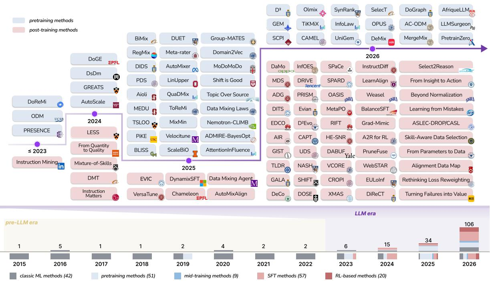
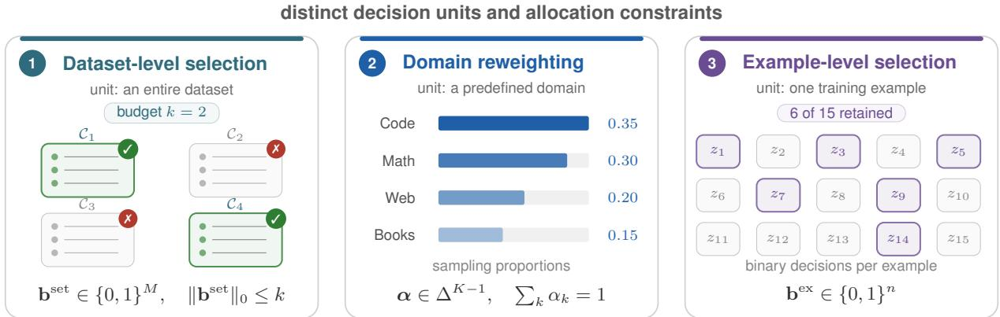
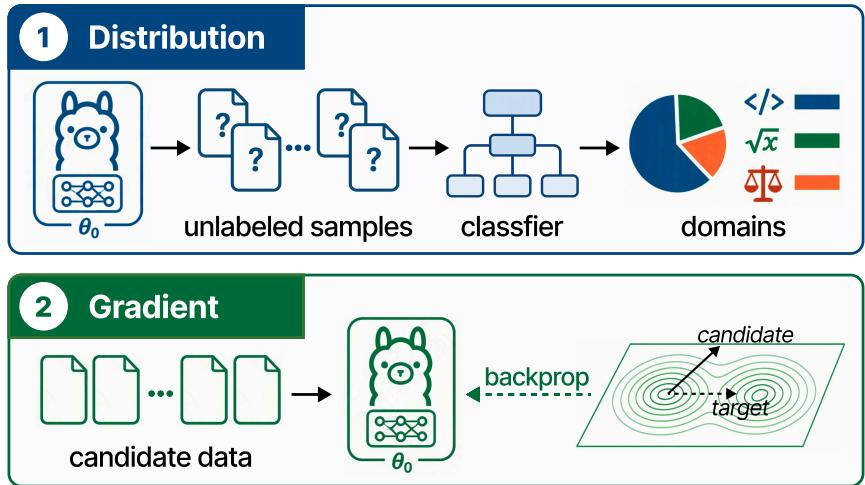
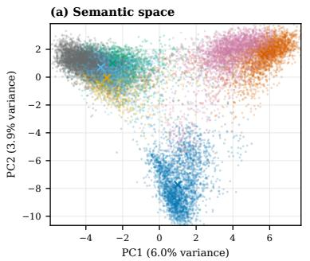
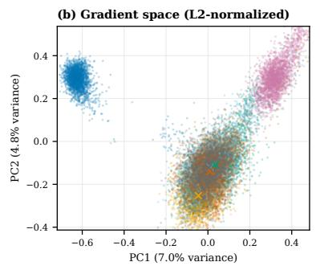
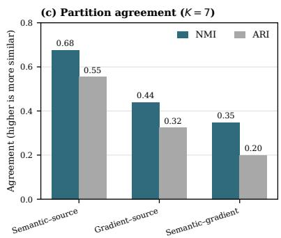
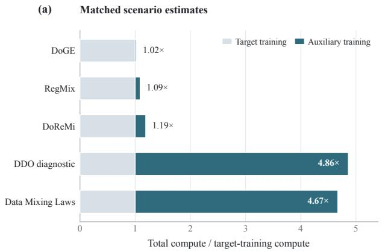
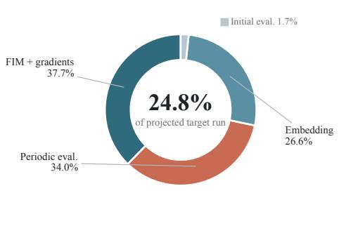

# Data Strategies for Large Language Models: A Unified Perspective on the Training Lifecycle

Yuanjian Xu1, Jianing Hao1, Tianze Sun2, Yongyao Duan3, Sam Chen3 Jinyi Han4, Wanbo Zhang5, Yuxuan Sun6, Guang Zhang1,#, Zhong Li7,#

1The Hong Kong University of Science and Technology (Guangzhou) 2Harbin Institute of Technology

3OpenCSG 4East China Normal University 5Fudan University

6University College London 7Microsoft Research Asia # Corresponding authors

## Abstract

Data strategy plays a central role in training large language models (LLMs). It governs the selection, weighting, and scheduling of training data, thereby determining the capabilities a model can acquire from a fixed data budget. We treat high-quality data as having high training-dependent utility, which depends on the target objective, the model, and its training state rather than on the text alone. Research in this area now spans pretraining and post-training, but related ideas use inconsistent terminology and evaluation protocols. This work reviews data strategies across the training lifecycle and formulates them as policies that allocate a training budget over candidate examples. We organise methods by their decision granularity, model dependence, and temporal adaptivity, then compare their computational requirements and empirical support. Fine-grained or state-dependent policies offer more control but incur additional scoring, search, or rollout costs. Evidence for transfer across model scales and comparable end-to-end cost remains limited. A continuously updated list of papers, along with their public implementations, is available at https://github.com/xuyj233/data\_strategy\_survey.

  
Figure 1: Landscape of LLM data strategies. Methods are organised by pretraining and post-training stage.

## 1 Introduction

Training data is a major determinant of large language model (LLM) performance (Penedo et al., 2023, 2024; Li et al., 2024a). Scaling laws quantify the effects of model size, compute, and token budget, whereas data strategy determines which examples fill that budget (Kaplan et al., 2020; Hoffmann et al., 2022). Data quality and composition affect both downstream accuracy and training efficiency (Xie et al., 2023; Liu et al., 2025b; Ye et al., 2025). Figure 1 traces the expansion from pretraining mixtures to supervised fine-tuning (SFT), reinforcement learning (RL), and mid-training.

Across the LLM training lifecycle, data strategies1 are shaped by the distinct constraints of each phase. Pretraining comprises stable training and annealing, with most work focusing on data strategies during stable training. Owing to the scale of pretraining corpora, methods in this phase typically optimise mixtures at the domain level, commonly referred to as data mixing or domain reweighting, by assigning one weight to each source or cluster (Xie et al., 2023; Fan et al., 2024; Diao et al., 2025). Domain-level optimisation trades sample-level flexibility for tractability, assuming the corpus admits a useful partition. During annealing, empirical approaches typically advocate selecting high-quality data (Dubey et al., 2024; Feng et al., 2024). From a theoretical perspective, Xu et al. (2026b) characterise annealing with a river-valley model and argue that controlling updates along specific directions guides the model towards a local minimum.

Post-training data strategy is a multi-granularity control problem spanning task-level mixing, data selection, and curriculum design. During supervised fine-tuning, mixture-level methods balance transfer against interference and forgetting across capabilities, while finer-grained methods select or order instructions according to their relevance, influence, difficulty, or learning progress (Li et al., 2025a; Wu et al., 2024; Xia et al., 2024; Li et al., 2024b; Liang et al., 2025a). During preference optimisation, Corrado et al. (2025) prioritise tasks on which a generalist model lags behind task-specific specialists. Related work on reinforcement learning with verifiable rewards learns data mixtures that improve generalisation across heterogeneous capabilities (Liang et al., 2025b).

Across these stages, the utility of training data depends on the target capability, the base model, and its current training state. We therefore use high-quality in this training-dependent sense: an example is of high quality for a training run when allocating budget to it improves the target objective from the current model state. Rule-based filters and external scorers approximate this utility with fixed, model-independent proxies, whereas model-aware methods estimate it from losses, gradients, or curvature. Section 2 makes this utility the objective of a data policy.

Data strategy is studied under separate names, including selection, pruning, reweighting, mixture optimisation, and curricula, which obscures their shared structure and complicates compute comparisons. Existing surveys cover different parts of this landscape. Wang et al. (2023) study data management broadly across pretraining and supervised fine-tuning, while Albalak et al. (2024) organise language-model data selection around utility functions and selection mechanisms, with an emphasis on pretraining. Other surveys focus specifically on instruction tuning, categorising methods by selector type (Zhang et al., 2025a) or by quality, diversity, and importance (Qin et al., 2025a); Appendix Table 6 compares their stage coverage. Our contributions are:

• We cast selection, reweighting, mixing, and curricula as policy optimisation over the training trajectory.

• We review methods from pretraining to post-training, comparing their assumptions, computational costs, and empirical evidence.

• We compare partitions induced by three signals and reconstruct auxiliary-training compute for representative data-mixture strategies.

## 2 Data Strategy Formulation

We formulate data strategies as policies that allocate a training budget over available examples, then distinguish how selection, reweighting, curricula, and optimisers constrain those policies.

  
Figure 2: Decision granularity in LLM data strategies. Dataset-level selection retains whole corpora, domain reweighting assigns continuous weights to predefined groups, and example-level selection retains individual examples. Their feasible sets need not be nested.

## 2.1 Data Strategies as Policy Optimisation

Let $\mathcal { D } _ { t } = \{ z _ { t , i } \} _ { i = 1 } ^ { n _ { t } }$ be the candidate pool available at step t. In offline settings, $\mathcal { D } _ { t } \equiv \mathcal { D } ;$ ; in online settings, it may evolve with the model, as with newly generated rollouts. Let $s _ { t } = ( \theta _ { t } , \xi _ { t } , t ) \in \mathcal { S }$ be the training state, comprising model parameters ${ \boldsymbol { \theta } } _ { t } \in \Theta \subseteq \mathbb { R } ^ { d }$ , auxiliary variables $\xi _ { t } ,$ and the step index. A data strategy chooses a distribution over the current pool. With per-example loss ℓ and token-count function tok, we express the resulting optimisation problem as

$$
\begin{array} { r l } { \underset { \phi \in \Phi } { \operatorname* { m i n } } } & { \mathbb { E } [ \underbrace { \mathcal { I } ( \theta _ { T } ) } _ { \mathrm { t a r g e t o b j e c t i v e } } ] } \\ { \mathrm { s . t . } \quad \mathbf { q } _ { t } = \underbrace { \pi _ { \phi } ( s _ { t } , \mathcal { D } _ { t } ) } _ { \mathrm { d a t a \ p o i c y } } \in \mathcal { Q } _ { t } , \qquad s _ { t + 1 } = \underbrace { \mathcal { U } ( s _ { t } , \widehat { \mathbf { g } } _ { t } ) } _ { \mathrm { s t a t e u p d a t e } } , \sum _ { t } \mathrm { t o k } ( \mathcal { B } _ { t } ) \leq B . } \end{array}\tag{1}
$$

for $t = 0 , \ldots , T - 1$ from a given initial state $s _ { 0 }$ , where Φ is the admissible policy class and $\mathcal { Q } _ { t } \subseteq \Delta ^ { n _ { t } - 1 }$ encodes its pointwise constraints. At each step, a batch $B _ { t } \sim \mathbf { q } _ { t }$ is sampled from the current pool, and $\begin{array} { r } { \widehat { \mathbf g } _ { t } = | \mathcal B _ { t } | ^ { - 1 } \sum _ { z \in \mathcal B _ { t } } \nabla _ { \theta } \ell ( z ; \theta _ { t } ) } \end{array}$ is its mean gradient; B denotes the total token budget. The expectation is over batch sampling and any online generation of $\mathcal { D } _ { t }$ . Problem (1) involves three functions:

• Objective function $\mathcal { I } : \Theta \to \mathbb { R }$ evaluates the final model, typically by its held-out loss ${ \mathcal { I } } ( \theta ) =$ $\mathbb { E } _ { z \sim \mathcal { D } _ { \mathrm { t g t } } } [ \ell ( z ; \theta ) ]$ on a target distribution ${ \mathcal { D } } _ { \mathrm { t g t } }$ ; robust variants are discussed in Section 4.1.

• Data policy function $\pi _ { \phi }$ maps the current state and candidate pool to a feasible allocation qt. Zero probabilities encode selection, tied probabilities encode group-level mixing, and temporal changes encode scheduling. Here ϕ collects learnable parameters or design choices.

• State-update function $\mathcal { U } : \mathcal { S } \times \mathbb { R } ^ { d } \to \mathcal { S }$ takes one optimiser step along a stochastic gradient. For Adam, $\xi _ { t }$ contains the moment estimates; it may also carry history used by a stateful data policy.

The token constraint makes the data budget explicit. Deterministic loss reweighting is recovered by replacing gbt with its conditional expectation $\textstyle \sum _ { i } q _ { t , i } \nabla _ { \theta } \ell ( z _ { t , i } ; \theta _ { t } )$ . For a fixed pool, a state-independent policy yields $\mathbf { q } _ { t } \equiv \mathbf { q } .$ . In the idealised convergence limit, this recovers the familiar bilevel problem $\mathrm { m i n } _ { \mathbf { q } \in \mathcal { Q } } \mathcal { I } ( \theta ^ { \star } ( \mathbf { q } ) )$ subject to $\theta ^ { \star } ( \mathbf { q } ) \in$ arg minθ $\textstyle \sum _ { i } q _ { i } \ell ( z _ { i } ; \theta )$

## 2.2 Disambiguating Related Concepts

The formulation separates the roles of optimisers, selection, reweighting, and curricula. We relate their decision spaces and compare their use across training stages. Figure 2 visualises the corresponding granularities.

⃝? How do optimisers, selection, reweighting, and curricula differ?

Optimisers and data policies. Both modify gradient contributions, but along different axes. A data policy assigns scalar probabilities to examples available at the current state, whereas Adam applies coordinate-wise coefficients to historical batch gradients. They differ in the scope of their decisions: a data policy changes the current training distribution, whereas Adam transforms accumulated gradients inside U. More explicitly, a data policy assigns scalar probabilities to current examples, whereas Adam applies coordinate-wise coefficients to historical batch gradients:

$$
\left\{ \begin{array} { l l } { \displaystyle \mathbf { g } _ { t } ^ { \mathrm { d a t a } } = \sum _ { j = 1 } ^ { n _ { t } } \underbrace { \left[ \pi _ { \phi } ( s _ { t } , \mathcal { D } _ { t } ) \right] _ { j } } _ { q _ { t , j } ^ { \mathrm { d a t a } } } \mathbf { g } _ { t , j } , } \\ { \displaystyle \mathbf { g } _ { t } ^ { \mathrm { A d a m } } = \sum _ { j = 1 } ^ { t } \frac { a _ { t , j } } { \sqrt { \sum _ { k = 1 } ^ { t } b _ { t , k } \mathbf { h } _ { k } ^ { \odot 2 } } + \epsilon } \odot \mathbf { h } _ { j } . } \end{array} \right.
$$

Here $\mathbf { g } _ { t , j } = \nabla _ { \theta } \ell ( z _ { t , j } ; \theta _ { t } )$ is a current example gradient, while $\mathbf { h } _ { j } = \nabla _ { \boldsymbol { \theta } } \ell ( B _ { j } ; \theta _ { j - 1 } )$ is the gradient of a previously observed batch. Moreover, $a _ { t , j } = ( 1 - \beta _ { 1 } ) \beta _ { 1 } ^ { t - j } / ( 1 - \beta _ { 1 } ^ { t } )$ and $b _ { t , k } = ( 1 - \beta _ { 2 } ) \beta _ { 2 } ^ { t - k } / ( 1 - \beta _ { 2 } ^ { t } )$

Selection versus reweighting. Data reweighting permits any allocation in the simplex. Data selection is the special case that assigns equal probability to retained examples and zero to the rest; a fixed cardinality budget further imposes $| S | = k$ . Domain reweighting constrains all examples in a domain to share one per-example probability. This reduces the decision from n probabilities to K mixture proportions, making it tractable at pretraining scale while preventing the policy from isolating one example within a multi-example domain. Section 3.1.2 reviews how prior work defines domains.

Proposition 1 (Decision-space constraints). Assume $n \geq 2 .$ Partition D into non-empty domains $\mathcal { D } _ { 1 } , \ldots , \mathcal { D } _ { K }$ and let $A \in \mathbb { R } ^ { \bar { n } \times K }$ with $A _ { i k } = 1 / | \mathcal Ḋ D Ḍ _ { k } | \mathrm { i f } \ z _ { i } \in \mathcal Ḋ D Ḍ _ { k }$ and $A _ { i k } = 0$ otherwise. The feasible sets of data reweighting, data selection, and domain reweighting are $\mathcal { Q } _ { \mathrm { r w } } = \Delta ^ { n - 1 } , \mathcal { Q } _ { \mathrm { d s } } = \{ \mathbf { 1 } _ { S } / \vert S \vert$ $\emptyset \neq S \subseteq [ n ] \}$ , and $\mathcal { Q } _ { \mathrm { d r } } = \{ A \alpha : \alpha \in \Delta ^ { K - 1 } \}$ . Then $\mathcal { Q } _ { \mathrm { d s } } \subsetneq \mathcal { Q } _ { \mathrm { r w } }$ and $\mathcal { Q } _ { \mathrm { d r } } \subseteq \mathcal { Q } _ { \mathrm { r w } }$ , with equality in the latter if and only if $K = n . { \mathrm { ~ I f ~ } } K \geq 2$ and some domain contains at least two examples, neither $\mathcal { Q } _ { \mathrm { d s } } \mathrm { n o r } \mathcal { Q } _ { \mathrm { d r } }$ contains the other.

The inclusions follow directly from the simplex definitions, and $\mathcal { Q } _ { \mathrm { d r } } = \mathcal { Q } _ { \mathrm { r w } }$ only when every domain is a singleton. For incomparability, selecting one member of a multi-example domain violates the domain constraint, while unequal positive per-example probabilities across two domains violate the uniformsupport constraint of selection. Data selection is therefore not, in general, a discretisation of domain reweighting.

Curricula versus selection and reweighting. A curriculum is a structured data policy whose allocation factors through an explicit curriculum signal and a scheduling rule. It constrains the trajectory $\left( \mathbf { q } _ { 0 } , \ldots , \mathbf { q } _ { T - 1 } \right)$ rather than only the feasible set at each step, and can be combined with selection, example reweighting, or domain reweighting. A static curriculum fixes its signal and schedule before training; an adaptive curriculum updates either component from the current state. Section 2.3 formalises this policy class and compares the signals and scheduling rules used in prior work.

⃝? How do data strategies differ between pretraining and post-training?

Both stages instantiate Equation (1), while differing in scale, supervision, pool dynamics, and model state. Standard pretraining optimises next-token prediction over massive, largely static corpora, favouring coarse domain-level decisions or infrequent rescoring. Annealing and mid-training begin from an existing checkpoint but retain many of the same scale constraints. Post-training uses instruction, preference, or reward feedback. Its pool may be fixed for supervised fine-tuning and offline preference optimisation, or evolve through model-generated rollouts in online reinforcement learning. Smaller pools and richer feedback often make fine-grained, model-conditioned policies more practical.

## 2.3 Curricula as Structured Policies

We represent a curriculum by a scalar signal $r _ { \psi } ( z _ { t , i } , s _ { t } )$ and a scheduling rule $h _ { \omega } ( r , c _ { t } ) \ge 0$ , where $c _ { t }$ is a progression variable. The signal and rule belong to prespecified hypothesis classes Ψ and Ω. The resulting allocation is

$$
\begin{array} { l } { \displaystyle \widetilde { q } _ { t , i } = h _ { \omega } \big ( r _ { \psi } \big ( z _ { t , i } , s _ { t } \big ) , c _ { t } \big ) , } \\ { \displaystyle q _ { t , i } = \widetilde { q } _ { t , i } \bigg / \sum _ { j = 1 } ^ { n _ { t } } \widetilde { q } _ { t , j } , \qquad i = 1 , \dots , n _ { t } , } \end{array}\tag{2}
$$

where $\psi \in \Psi , \omega \in \Omega$ , and $\textstyle \sum _ { j } { \widetilde { q } } _ { t , j } > 0$ . If Ψ and Ω exclude example- and time-indexed lookup tables, this factorisation defines a structured subclass of data policies. In the offline setting, a static curriculum fixes $r _ { \psi } ( z _ { i } , s _ { 0 } )$ and $( c _ { 0 } , \ldots , c _ { T - 1 } )$ before training. An adaptive curriculum instead updates the signal or progression variable from the current state, for example $c _ { t } = g ( s _ { t } )$

Criteria and scheduling. Equation (2) separates the scheduled unit, the signal used to value it, and the rule that changes its exposure. Recent methods schedule examples, clusters, data categories, prompts, or replayed prompt–output pairs (Kim and Lee, 2024; Liang et al., 2025a; Pang et al., 2026; Do et al., 2026; Kim et al., 2026). SPARD additionally adapts reward-objective weights, a decision outside the allocation qt (Zhi et al., 2026).

Static and adaptive curricula. Strategic Ordering uses a random first epoch, then fixes an easy-to-hard order from prompt length, attention, or loss for later epochs (Kim and Lee, 2024). EDCO periodically ranks examples with the authors’ prefix negative-log-likelihood score, termed inference entropy, and selects the top-N examples for the next phase (Pang et al., 2026). It combines data selection with an adaptive curriculum under Equation (2).

Beyond easy-to-hard ordering. Recent methods increasingly replace fixed difficulty proxies with state-dependent estimates of learning value, including gradient interaction, inference entropy, solve rate, reward progress, and online accuracy (Liang et al., 2025a; Pang et al., 2026; Do et al., 2026; Zhi et al., 2026; Kim et al., 2026). Their schedules need not be easy-to-hard. EDCO prioritises high uncertainty, PACED-RL targets intermediate difficulty, and SPARD favours dimensions with the largest reliable recent gains (Pang et al., 2026; Kim et al., 2026; Zhi et al., 2026). Thus, “curriculum” identifies temporal control of exposure, not a particular notion of difficulty or a mandatory easy-to-hard direction.

## 3 Data Strategies for Pretraining

## 3.1 A Taxonomy of Methods

Pretraining data strategies differ mainly in the granularity they act on: data selection decides which documents are retained for training, whereas domain reweighting decides how much of each domain to sample.

## 3.1.1 Data Selection

## ⃝? How is the value of an individual document judged?

Data selection judges each individual document and decides whether to retain it for training. By the source of this judgement, existing methods fall into two families, rule-based filtering and model-based selection. The latter further divides into scoring with an external model and signals read from the target model itself.

<table><tr><td>Rule type</td><td>Example rule</td><td>Source</td></tr><tr><td colspan="3">Metadata only</td></tr><tr><td>URL / domain</td><td>Domain not on a blocklist</td><td>RefinedWeb</td></tr><tr><td colspan="3">Single document: statistic + threshold</td></tr><tr><td>Size</td><td>50-100K words</td><td>Gopher</td></tr><tr><td>A Composition</td><td>Mean word length 3–10</td><td>Gopher</td></tr><tr><td>三 Line structure</td><td>Punctuated lines &gt;12%</td><td>FineWeb</td></tr><tr><td>C Repetition</td><td>≤30% duplicated lines</td><td>Gopher</td></tr><tr><td colspan="3">Single document: pattern matching</td></tr><tr><td>AB Lexicon</td><td>No listed bad words</td><td>C4</td></tr><tr><td colspan="3">Across documents</td></tr><tr><td>Deduplication</td><td>No near-duplicates</td><td>FineWeb</td></tr><tr><td>Corpus prior</td><td>Mean token prior in range</td><td>Prior-based</td></tr></table>

Table 1: Rule-based filters. Filters are grouped by the information each rule requires. Thresholds follow the cited source. FineWeb2 re-derives them for each language.

Rule-based filtering. Rule-based methods apply hand-crafted heuristics that require no learned model. Table 1 groups them by the information a rule needs: metadata such as the URL, statistics or patterns within a single document, or comparisons across the corpus. Most open corpora, such as RefinedWeb (Penedo et al., 2023) and Dolma (Soldaini et al., 2024), combine the rules of C4 (Raffel et al., 2020) and Gopher (Rae et al., 2021) with exact or MinHash deduplication. FineWeb ablates these rules one by one and replaces C4’s terminal-punctuation rule, which removes about 30% of tokens, with milder custom filters (Penedo et al., 2024). Recent work makes the rules more adaptive: FineWeb2 derives thresholds for each language from that language’s metric distributions (Penedo et al., 2025), and priorbased filtering replaces model perplexity with corpus-level token frequencies, cutting filtering time by more than 1000× (Seo et al., 2026). Such rules are cheap and transparent, but they capture only surface properties of a document rather than its value for training, and their thresholds must be re-tuned for each corpus or language.

External-model scoring. Model-based selection replaces hand-crafted rules with a learned judgement. One branch uses a separate model to score each document and retains those with high scores (Table 2). Quality can be defined by a reference signal: DataComp-LM (DCLM) trains a classifier to separate curated data from generic web text (Li et al., 2024a), and PreSelect favours documents whose losses across a set of models best predict those models’ downstream ability (Shum et al., 2025). It can also be defined by an LLM, either through rated properties, such as educational value in FineWeb-Edu (Penedo et al., 2024), writing style and expertise in QuRating (Wettig et al., 2024), and professionalism, readability, reasoning, and cleanliness (PRRC) in Meta-rater (Zhuang et al., 2025), or through a direct judgement of whether a document is useful for pretraining, as in AskLLM (Sachdeva et al., 2026). Classifiers also flag content that is undesirable regardless of quality, such as toxic text in Dolma (Soldaini et al., 2024) or sensitive personal information (Minamoto et al., 2026). QuaDMix combines several such scores with domain labels to balance quality and diversity (Liu et al., 2025a).

The main limitation is that these scorers are independent of the model being trained, so the quality they encode may not match what the target model needs. The rated dimensions also differ in value. In QuRating, selecting by writing style gives the lowest perplexity but little downstream gain over uniform selection (Wettig et al., 2024), and Meta-rater assigns its largest learned weight to educational value (Zhuang et al., 2025). Scorers are also sensitive to surface style. Rephrasing documents in Wikipedia style reverses the FineWeb-Edu classifier’s decision for about 7% of them (Klimaszewski and Andruszkiewicz, 2026). Classifier-based filtering can improve downstream accuracy without lowering the loss on the high-quality set it is trained to imitate, because the selected data resemble a filtered subset of that set, not the set as a whole (Saada et al., 2025). Each new dimension also requires fresh annotations, usually from an LLM, before a scorer can be trained.

<table><tr><td>Dimension</td><td>Scorer</td><td>Source</td></tr><tr><td colspan="3">Quality from a reference signal</td></tr><tr><td>© Similarity</td><td>Curated vs. web</td><td>DCLM</td></tr><tr><td>Predictiveness</td><td>Loss-benchmark fit</td><td>PreSelect</td></tr><tr><td colspan="3">Quality defined by an LLM</td></tr><tr><td>Education</td><td>Distilled LLM labels</td><td>FineWeb-Edu</td></tr><tr><td>Style / expertise</td><td>Pairwise LLM ratings</td><td>QuRating</td></tr><tr><td> PRRC</td><td>Learned combination</td><td>Meta-rater</td></tr><tr><td>Usefulness</td><td>Prompted LLM</td><td>AskLLM</td></tr><tr><td colspan="3">Undesirable content</td></tr><tr><td> Toxicity</td><td>Bigram classifier</td><td>Dolma</td></tr><tr><td>Privacy</td><td>SCPI classifier</td><td>Minamoto et al.</td></tr></table>

Table 2: External-model scorers. Scorers are grouped by how the target property is defined. PRRC denotes professionalism, readability, reasoning, and cleanliness; SCPI denotes sensitive personal information.

Target-model signals. The other branch reads selection signals from the target model, a smaller proxy of it, or an off-the-shelf LLM. We group these methods by the order of information they extract from the training loss.

Zeroth-order methods score data from forward-pass quantities, such as losses or activations, without per-sample gradients. AttentionInfluence ranks documents by the loss increase caused by masking retrieval attention heads (Hua et al., 2025). This mechanistic score needs neither a trained scorer nor a loss gradient and transfers from a 1.3B selector to a 7B target. Ranking based on neuron-activated graphs (NAG) instead compares the sparse sets of high-impact neurons that candidate and target examples activate (Wang et al., 2026b). At a finer, span-level granularity, PretrainZero regards a span as valuable when it is informative and not yet mastered by the current model, but remains recoverable from context; an on-policy mask generator turns such spans into self-verifiable reinforcement learning targets (Xing et al., 2025).

First-order methods score a document by its per-sample gradient, typically through its alignment with a target direction. DsDm models target performance as a function of the training subset with datamodels (Engstrom et al., 2024). GREATS greedily selects, at every iteration, the batch that most reduces a validation loss under a Taylor approximation (Wang et al., 2024). OPUS projects each candidate’s optimiser-shaped update, rather than its raw gradient, onto a target direction (Wang et al., 2026a). Grad-Mimic measures how well a sample’s gradient aligns with a direction induced by a pretrained reference model (Huang et al., 2025).

Second-order methods further account for curvature through the Hessian. Pontryagin maximum principle-based data selection (PDS) casts selection as an optimal-control problem whose costate update involves the Hessian, and distils the resulting scores into a scorer (Gu et al., 2025). BLISS learns influence scores through bilevel optimisation with Hessian-vector products (Hao et al., 2025). DiReCT constrains per-sample gradients along the eigen-directions of the Hessian during annealing (Xu et al., 2026b). Dynamic directional graph-constrained data scheduling $\mathrm { ( D ^ { 3 } ) }$ uses a second-order expansion to model asymmetric influence between training units, then schedules data over the resulting directed graph (Xu et al., 2026a). Higher-order signals capture interactions that lower-order ones miss, but are more expensive to compute.

## 3.1.2 Domain Reweighting

We organise domain-reweighting methods around two aspects: the domain definitions adopted in prior work and the approaches used to solve the resulting mixture-optimisation problem.

⃝? How do existing studies define a domain for LLM training?

A domain is not an intrinsic attribute of a data point. Operationally, it is one cell in a partition P = $\{ \mathcal { D } _ { k } \} _ { k = 1 } ^ { K }$ of the pretraining corpus D and therefore the unit to which a mixture weight $w _ { k }$ is assigned. Existing work constructs this partition using three types of signal.

<table><tr><td>Method</td><td>Class</td><td>Surrogate  $\widehat { \mathcal { I } } ( w )$ </td><td>Solver</td></tr><tr><td>RegMix</td><td>Linear</td><td> $b _ { 0 } + b ^ { \top } w$ </td><td>Random search</td></tr><tr><td>MoDoMoDo</td><td>Quadratic</td><td> $a + b ^ { \top } w + w ^ { \top } C w$ </td><td>Grid search</td></tr><tr><td>Data Mixing Laws</td><td>Log-linear</td><td> $c _ { i } + k _ { i } \exp ( t _ { i } ^ { \top } w )$ </td><td>Grid search</td></tr><tr><td>DUET</td><td>Gaussian process</td><td> $\sim \mathcal { G P } ( \mu , \kappa )$ </td><td>Bayesian opt.</td></tr><tr><td>Data Mixing Agent</td><td>Neural policy</td><td> $\mathbf { w } _ { t } = \pi _ { \phi } ( s _ { t } )$ </td><td>Offline RL</td></tr></table>

Table 3: Performance modelling for domain reweighting. Surrogate class and solver are separate design choices. The first four methods fit $\hat { \mathcal { I } }$ over static mixtures, whereas Data Mixing Agent learns a state-dependent policy. MoDoMoDo is included for its surrogate class.

Human-defined domains. Some studies partition a pretraining corpus using human-specified attributes, most commonly data source (Xie et al., 2023; Fan et al., 2024; Liu et al., 2025b; Li et al., 2025b; Kang et al., 2025) or topic (Peng et al., 2025; Zhu et al., 2025). These domains are easy to interpret and inspect, but they have two limitations. First, a human-defined taxonomy may not align with the distinctions that matter to the model. Corpora considered similar by humans may induce different learning dynamics, whereas nominally different domains may provide redundant training signals (Peng et al., 2025; Xu et al., 2026c). Second, some corpora resist meaningful assignment to a single domain. Web-derived corpora such as Pile-CC, for example, contain heterogeneous topics, genres, and quality levels despite being treated as one corpus-level domain. Topic-modelling methods can reduce reliance on manually specified labels (Peng et al., 2025; Zhu et al., 2025), but the resulting partitions still depend on modelling assumptions and assignment errors.

Semantic-space partitions. Other studies regard semantically close data as a domain and typically rely on encoder models to embed the corpus (Diao et al., 2025; Zhang et al., 2025b; Peng et al., 2025). For example, Domain2Vec clusters document embeddings into distinct meta-domains and represents each source corpus as their distribution (Zhang et al., 2025b). A single source-defined domain can therefore span multiple semantic domains. Nevertheless, Domain2Vec still optimises mixture weights over the original source corpora.

Gradient-space partitions. The preceding two definitions are independent of the language model being trained, since their partitions come from human labels or an external encoder (Xu et al., 2026c). In contrast, gradient-space methods construct domains from the target model or an architecturally similar proxy, grouping samples whose gradients induce similar parameter-update directions (Shi et al., 2025; Xu et al., 2026c). This construction requires computing and storing per-sample gradients. Domain impact-aware data sampling (DIDS) empirically shows that gradient-based partitions can transfer across model scales, but provides no rigorous theoretical guarantee that the underlying gradient signals are scale invariant (Shi et al., 2025).

Existing comparisons do not establish a generally preferable domain definition. Appendix B.2 compares source-, semantic-, and gradient-based partitions of the same documents.

The partition and the mixture optimiser are separate design choices. Fixing P before optimising w assumes that examples within each domain can share one weight. A better optimiser cannot recover distinctions erased by that partition, yet most studies optimise weights over a fixed taxonomy rather than revising the partition and mixture jointly.

## ⃝? How is the mixture-optimisation problem solved?

Directly optimising Problem (1) would require many full pretraining runs. Methods either learn a surrogate of the map from mixture weights to the objective function J, or reformulate the objective so that it can be optimised without full training runs. Table 3 compares representative surrogate classes and solvers.

Performance modelling. These methods restrict the data policy function $\pi _ { \phi }$ to an offline mixture $w \in \Delta ^ { K - 1 }$ and treat the rest of Problem (1), namely running the state-update function U for $T$ steps and scoring the result with $\mathcal { T } ,$ , as a black box $w \mapsto \mathcal { T } ( \theta _ { T } ( w ) )$ . Because evaluating this map at full scale for many mixtures is prohibitively expensive, they evaluate a set of candidate mixtures, usually with small proxy models, and fit a surrogate $\widehat { \mathcal { I } } ( w )$ to the observed objective values. The model class fixes the form of $\hat { \mathcal { I } }$ . RegMix uses linear models or gradient-boosted trees (Liu et al., 2025b), MoDoMoDo uses a quadratic form (Liang et al., 2025b), Data Mixing Laws uses a log-linear form (Ye et al., 2025), and DUET uses a Gaussian process (Chen et al., 2026). A solver, such as random search, grid search, or Bayesian optimisation, then finds $\begin{array} { r } { w ^ { \star } \in \arg \operatorname* { m i n } _ { w \in \Delta ^ { K - 1 } } \widehat { \mathcal { I } } ( w ) } \end{array}$ , and the selected mixture is used for full-scale training. Data Mixing Agent departs from this pattern by learning a state-dependent $\pi _ { \phi }$ directly with offline reinforcement learning (Yang et al., 2026).

The fitted optimum must transfer twice: from observed to unobserved mixtures, and from proxy runs to the target scale. RegMix reports stable mixture rankings across the scales it tests (Liu et al., 2025b), whereas AutoScale models how the optimum changes with token budget (Kang et al., 2025). Neither approach guarantees transfer beyond its sampled model and data regimes.

Optimisation reformulation. A second class of methods replaces the objective with one that is cheaper to evaluate or optimise. DoReMi replaces the terminal objective $\mathcal { I } ( \theta _ { T } )$ with the worst domain-wise excess loss of a small proxy model relative to a reference model. Because this surrogate can be evaluated at every step, $\pi _ { \phi }$ becomes an online policy whose domain weights are updated alternately with the proxy parameters; DoReMi averages these weights over training and uses them as a static mixture for the full-scale model (Xie et al., 2023). MixMin instead replaces Problem (1) with a convex objective over domain mixtures that can be solved directly (Thudi et al., 2025). Aioli makes the objective local in time. Within each round of the target run, it estimates a linear mixing law from short interleaved training intervals and moves the mixture to reduce the next-round validation loss (Chen et al., 2025).

## 3.2 Summary and Discussion

Trend. More data selection methods now estimate the value of data relative to a model and a target objective, using losses, gradients, or curvature (Engstrom et al., 2024; Wang et al., 2024; Gu et al., 2025). Rules and external scorers, which treat quality as a property of the text itself, are still the standard way to build large open corpora because they are cheaper to apply at corpus scale (Penedo et al., 2024; Li et al., 2024a). Domain reweighting has developed along similar lines. Source partitions are being supplemented by semantic and gradient-based ones (Diao et al., 2025; Shi et al., 2025), and surrogates fitted on proxy runs, reformulated objectives, and state-dependent policies now stand in for full-scale mixture evaluation (Liu et al., 2025b; Xie et al., 2023; Chen et al., 2025). At both granularities, the value of data is increasingly treated as dependent on the model being trained.

Open questions. Three questions remain around transfer, decision granularity, and cost reporting. For transfer across models, when do cheaper judgements carry over to the target model? External scorers can be swayed by surface style (Klimaszewski and Andruszkiewicz, 2026), and evidence that proxy models or gradient-based partitions transfer across scales is so far only empirical (Hua et al., 2025; Shi et al., 2025). For decision granularity, what should the unit of decision be? No domain definition is known to be generally preferable, and although Proposition 1 shows that the decision spaces of selection and domain reweighting are not nested, the two are usually applied in sequence, with QuaDMix (Liu et al., 2025a) as an early attempt to couple them. Finally, for cost reporting, studies use different model scales, token budgets, and hardware. Which accounting protocol can compare them while separating amortisable setup from computation repeated for every target run?

## 4 Data Strategies for Post-training

Post-training adapts a pretrained LLM through SFT, preference optimisation, and RL. The data used at this stage strongly affect the final model, and a small, well-chosen subset can match or exceed training on the full set (Dong et al., 2024; Li et al., 2024b). Most methods surveyed here target SFT; preference optimisation and RL are covered less, and Section 4.2 returns to the resulting open questions.

## 4.1 A Comparison of Methods

Table 4 compares post-training methods along three axes exposed by the common formulation: the model-derived signal, the outer objective or proxy, and the state queried by $\pi _ { \phi } .$ . The discussion below focuses on the first two axes.

<table><tr><td>Category</td><td>Signal or criterion</td><td>Example</td></tr><tr><td colspan="3">Model-derived signal</td></tr><tr><td>Distribution-based</td><td>Generated domain profile</td><td>VersaTune</td></tr><tr><td>Gradient-based</td><td>Gradient direction or magnitude</td><td>LESS, OASIS</td></tr><tr><td colspan="3">Outer objective or proxy</td></tr><tr><td>Average</td><td>Fixed-mixture target risk</td><td>LESS</td></tr><tr><td>Worst-group</td><td>Maximum group risk</td><td>AutoMixAlign</td></tr><tr><td>Base-preserving</td><td>Target risk with drift control</td><td>VersaTune</td></tr><tr><td>Coverage proxy</td><td>Domain coverage</td><td>Chameleon</td></tr><tr><td colspan="3">State queried by  $\pi _ { \phi }$ </td></tr><tr><td>Data-only</td><td>No query of  $s _ { t }$ </td><td>Chameleon</td></tr><tr><td>Frozen-state</td><td>Fixed checkpoint  $\theta _ { 0 }$ </td><td>ADG</td></tr><tr><td>Evolving-state</td><td>Current st and policy history</td><td>OASIS</td></tr></table>

Table 4: Classification axes for post-training data strategies. Categories within each group are alternatives along one design axis. Representative examples are shown, with citations in Table 5. ADG denotes answer-divergence guided selection.

## ⃝? What model-derived signal does the data policy use?

In Problem (1), $\pi _ { \phi }$ may read the full training state $\boldsymbol { s } _ { t } = ( \theta _ { t } , \xi _ { t } , t )$ . Most model-conditioned post-training methods extract their value signal from the model component $\theta _ { t }$ , while some stateful methods also use running statistics stored in $\xi _ { t }$ . The signal matters because examples from a domain may provide less marginal benefit to a checkpoint that is already strong in that domain than to one with weaker coverage. Two recurring model-derived signals are distributional profiles and gradients.

  
Figure 3: Extracting model-derived signals. Post-training policies query a model checkpoint to estimate data value from generated domain distributions or local gradient information.

• Distribution-based characterisation infers the pretraining domain or knowledge distribution encoded by the model, typically by classifying samples generated from it. VersaTune generates free-form samples from the base model, classifies them into predefined domains, and averages the domain probabilities to estimate the model’s knowledge profile. This profile initialises the SFT sampling proportions, which are subsequently adjusted according to learning potential and forgetting (Lu et al., 2025).

• Gradient-based characterisation extracts the model’s local update geometry. LESS scores candidate gradients by cosine similarity to target-task gradients (Xia et al., 2024), while EVIC extends this signal to evolving inter-example interactions (Liang et al., 2025a). OASIS (Lee et al., 2026) uses the squared norm of each sample’s last-layer gradient as an approximate Fisher informativeness score, then standardises that score against its exponential moving mean and variance. These running moments belong to the auxiliary state $\xi _ { t }$

The two signals fail differently. Distributional profiles depend on a predefined taxonomy and can miss variation within a domain. Gradient scores are local to a checkpoint and target set, so their ranking can change during training. Recomputing them tracks that change but adds recurring cost. Neither signal directly estimates marginal utility after full training. A coverage gap identifies where a model is weak but not whether the available examples will close that gap. Gradient alignment is more local and can assign high scores to examples whose update directions are already represented. Cached rankings therefore require validation after the checkpoint or target distribution changes.

## ⃝? How is the outer objective instantiated or proxied?

Methods differ in the criterion through which $\pi _ { \phi }$ is judged. Most instantiate the outer objective $\mathcal { I }$ on the final model, whereas methods without an explicit θ-dependent objective use a proxy target to construct $\pi _ { \phi }$ Table 4 summarises four recurring choices, and Table 5 lists representative methods for each.

Let $\mathcal { E } _ { 1 } , \ldots , \mathcal { E } _ { G }$ be evaluation groups with risks $L _ { g } ( \theta ) = \mathbb { E } _ { z \sim \mathcal { E } _ { g } } [ \ell ( z ; \theta ) ]$ . Average- and worst-group risk belong to the robust family $\begin{array} { r } { \mathcal { I } _ { \mathcal { R } } ( \theta ) = \operatorname* { s u p } _ { \rho \in \mathcal { R } } \breve { \sum } _ { g } \rho _ { g } L _ { g } ( \theta ) , \breve { \mathrm { w h e r e } } \mathcal { R } \subseteq \Delta ^ { G - 1 } } \end{array}$ . A singleton R gives a fixed target mixture; the full simplex gives $\operatorname* { m a x } _ { g } L _ { g } ( \theta )$ . AutoMixAlign applies the latter to excess losses relative to task specialists. VersaTune instead augments target risk with a penalty for forgetting non-target domains. Coverage and instruction-following difficulty construct $\pi _ { \phi }$ without evaluating $\theta _ { T }$ , so they are proxies rather than instances of $\mathcal { T }$ . These objectives can rank the same candidate pool differently. Improving average risk need not reduce the worst-group excess loss, while aggressive target gains can increase forgetting. Evidence under one outer objective therefore does not establish that a selector remains effective under another. The proxy–objective distinction also limits what a reported gain supports. A proxy-based result evaluates the proxy, policy, and training procedure together; it does not show that the proxy is calibrated to $\mathcal { T } .$ Objective-based rankings can likewise depend on the composition of a small target set. Cross-method comparisons should therefore hold the candidate pool, training budget, and evaluation mixture fixed.

<table><tr><td>Method</td><td>Average</td><td>Worst-group</td><td>Base preservation</td><td>Proxy</td></tr><tr><td>LESS (Xia et al., 2024)</td><td></td><td></td><td></td><td></td></tr><tr><td>DynamixSFT (Shin et al., 2025)</td><td></td><td></td><td></td><td></td></tr><tr><td>OASIS (Lee et al., 2026)</td><td></td><td></td><td></td><td></td></tr><tr><td>EVIC (Liang et al., 2025a)</td><td>√</td><td></td><td></td><td></td></tr><tr><td>AutoMixAlign (Corrado et al., 2025)</td><td></td><td>J</td><td></td><td></td></tr><tr><td>VersaTune (Lu et al., 2025)</td><td></td><td></td><td></td><td></td></tr><tr><td>IFD (Li et al., 2024b)</td><td></td><td></td><td></td><td></td></tr><tr><td>ADG (Li et al., 2026)</td><td></td><td></td><td></td><td></td></tr><tr><td>Chameleon (Xie et al., 2025)</td><td></td><td></td><td></td><td></td></tr></table>

Table 5: Objectives and proxies for post-training data value. Average, worst-group, and base preservation denote their corresponding training objectives; Proxy denotes a criterion that constructs the data policy without evaluating the final model. IFD denotes instruction-following difficulty.

## 4.2 Summary and Discussion

Trend. Post-training policies range from data-only Chameleon and checkpoint-based LESS and ADG to stateful OASIS, EVIC, and DynamixSFT (Xie et al., 2025; Xia et al., 2024; Li et al., 2026; Lee et al., 2026; Liang et al., 2025a; Shin et al., 2025). Stateful policies can control inclusion, sampling frequency, and order; EDCO spans all three (Pang et al., 2026). Outer objectives now include worst-group loss and preservation of base-model capabilities (Corrado et al., 2025; Lu et al., 2025). Greater adaptivity makes scores more specific to the current model, but also shortens how long they remain valid. Comparisons that ignore rescoring frequency can conflate a better signal with additional model queries.

Open questions. Fixed-pool supervised fine-tuning leaves three further questions. For environment and task selection, where should an agent interact during RL? Unlike fixed-pool SFT, environments differ in rollout cost, reward reliability, and skill coverage. WebRL filters tasks generated from prior failures by feasibility and critic-estimated difficulty, but only within WebArena. How to allocate a rollout budget across heterogeneous environments remains largely unexplored (Qi et al., 2025). For selection efficiency, how can selection remain cheaper than the rollouts it avoids? Curriculum RL with Off-Policy Influence Guidance (CROPI) reuses initial-policy trajectories and compressed gradients, yet recomputes features over a large candidate pool at each phase (Zhu et al., 2026). Partial pools, learned proxies, and reusable rollout buffers reduce this work but may become stale as the policy changes. Finally, for granularity and credit assignment, what should be selected in a long-horizon task? Selecting demonstration steps and pruning state context improves offline web-agent training (Zadeh et al., 2026). Online RL jointly chooses environments, tasks, trajectories, and transitions. Selection must preserve trajectory coherence while attributing delayed terminal rewards to intermediate decisions.

## 5 Conclusion

We cast selection, domain reweighting, and curricula as policies that allocate a training budget over examples. Coarse decisions require a useful partition; model awareness and adaptivity add scoring, proxy-training, or rollout cost. Our analyses show that partitions depend on the construction signal and that auxiliary floating-point operations (FLOPs) depend on model size, tokens per run, and run count. Future evaluations should report utility and end-to-end cost together, including for agentic RL policies.

## Limitations

This work focuses on text-only LLM data strategies. Selection, reweighting, and curricula remain less studied for multimodal LLMs, where utility depends on modality quality and cross-modal alignment. Analyses cover only text and FLOPs.

## References

Alon Albalak, Yanai Elazar, Sang Michael Xie, Shayne Longpre, Nathan Lambert, Xinyi Wang, Niklas Muennighoff, Bairu Hou, Liangming Pan, Haewon Jeong, Colin Raffel, Shiyu Chang, Tatsunori Hashimoto, and William Yang Wang. 2024. A survey on data selection for language models. Transactions on Machine Learning Research, 2024.

Tianyi Bai, Hao Liang, Binwang Wan, Yanran Xu, Xi Li, Shiyu Li, Ling Yang, Bozhou Li, Yifan Wang, Bin Cui, Ping Huang, Jiulong Shan, Conghui He, Binhang Yuan, and Wentao Zhang. 2024. A survey of multimodal large language model from a data-centric perspective. Preprint, arXiv:2405.16640.

Mayee F. Chen, Michael Y. Hu, Nicholas Lourie, Kyunghyun Cho, and Christopher Ré. 2025. Aioli: A unified optimization framework for language model data mixing. In The Thirteenth International Conference on Learning Representations, ICLR 2025, Singapore, April 24-28, 2025. OpenReview.net.

Zhiliang Chen, Gregory Kang Ruey Lau, Chuan-Sheng Foo, and Bryan Kian Hsiang Low. 2026. DUET: optimizing LLM training data mixtures via noisy feedback from unseen, downstream evaluation tasks. In The Fourteenth International Conference on Learning Representations, ICLR 2026.

Nicholas E. Corrado, Julian Katz-Samuels, Adithya M. Devraj, Hyokun Yun, Chao Zhang, Yi Xu, Yi Pan, Bing Yin, and Trishul Chilimbi. 2025. Automixalign: Adaptive data mixing for multi-task preference optimization in llms. In Proceedings ofthe 63rd Annual Meeting ofthe Associationfor Computational Linguistics (Volume 1: Long Papers), ACL 2025, Vienna, Austria, July 27 - August 1, 2025, pages 20234–20258. Association for Computational Linguistics.

Shizhe Diao, Yu Yang, Yonggan Fu, Xin Dong, Dan Su, Markus Kliegl, Zijia Chen, Peter Belcak, Yoshi Suhara, Hongxu Yin, Mostofa Patwary, Yingyan Celine Lin, Jan Kautz, and Pavlo Molchanov. 2025. Nemotron-climb: Clustering-based iterative data mixture bootstrapping for language model pre-training. In The Thirty-ninth Annual Conference on Neural Information Processing Systems Datasets and Benchmarks Track.

Van Dai Do, Manh Nguyen, Svetha Venkatesh, and Hung Le. 2026. SPaCe: Unlocking sample-efficient large language models training with self-pace curriculum learning. In Findings ofthe Associationfor Computational Linguistics: ACL 2026, pages 3480–3507. Association for Computational Linguistics.

Guanting Dong, Hongyi Yuan, Keming Lu, Chengpeng Li, Mingfeng Xue, Dayiheng Liu, Wei Wang, Zheng Yuan, Chang Zhou, and Jingren Zhou. 2024. How abilities in large language models are affected by supervised fine-tuning data composition. In Proceedings ofthe 62nd Annual Meeting ofthe Associationfor Computational Linguistics (Volume 1: Long Papers), ACL 2024, Bangkok, Thailand, August 11-16, 2024, pages 177–198. Association for Computational Linguistics.

Abhimanyu Dubey et al. 2024. The llama 3 herd of models. CoRR, abs/2407.21783.

Logan Engstrom, Axel Feldmann, and Aleksander Madry. 2024. Dsdm: Model-aware dataset selection with datamodels. In Forty-first International Conference on Machine Learning, ICML 2024, Vienna, Austria, July 21-27, 2024, Proceedings of Machine Learning Research, pages 12491–12526. PMLR / OpenReview.net.

Simin Fan, Matteo Pagliardini, and Martin Jaggi. 2024. Doge: Domain reweighting with generalization estimation. In Forty-first International Conference on Machine Learning, ICML 2024, Vienna, Austria, July 21-27, 2024, Proceedings of Machine Learning Research, pages 12895–12915. PMLR / OpenReview.net.

Steven Feng, Shrimai Prabhumoye, Kezhi Kong, Dan Su, Mostofa Patwary, Mohammad Shoeybi, and Bryan Catanzaro. 2024. Maximize your data’s potential: Enhancing LLM accuracy with two-phase pretraining. CoRR, abs/2412.15285.

Yuxian Gu, Li Dong, Hongning Wang, Yaru Hao, Qingxiu Dong, Furu Wei, and Minlie Huang. 2025. Data selection via optimal control for language models. In The Thirteenth International Conference on Learning Representations, ICLR 2025, Singapore, April 24-28, 2025. OpenReview.net.

Jie Hao, Rui Yu, Wei Zhang, Huixia Wang, Jie Xu, and Mingrui Liu. 2025. Bliss: A lightweight bilevel influence scoring method for data selection in language model pretraining. CoRR, abs/2510.06048.

Jordan Hoffmann, Sebastian Borgeaud, Arthur Mensch, Elena Buchatskaya, Trevor Cai, Eliza Rutherford, Diego de Las Casas, Lisa Anne Hendricks, Johannes Welbl, Aidan Clark, Tom Hennigan, Eric Noland, Katie Millican, George van den Driessche, Bogdan Damoc, Aurelia Guy, Simon Osindero, Karen Simonyan, Erich Elsen, and 3 others. 2022. Training compute-optimal large language models. In Advances in Neural Information Processing Systems 35.

Kai Hua, Steven Wu, Ge Zhang, and Ke Shen. 2025. Attentioninfluence: Adopting attention head influence for weak-to-strong pretraining data selection. CoRR, abs/2505.07293.

Tzu-Heng Huang, Manjot Bilkhu, John Cooper, Frederic Sala, and Javier Movellan. 2025. Evaluating sample utility for efficient data selection by mimicking model weights. Preprint, arXiv:2501.06708.

Feiyang Kang, Yifan Sun, Bingbing Wen, Si Chen, Dawn Song, Rafid Mahmood, and Ruoxi Jia. 2025. Autoscale: Scale-aware data mixing for pre-training llms. In Second Conference on Language Modeling.

Jared Kaplan, Sam McCandlish, Tom Henighan, Tom B. Brown, Benjamin Chess, Rewon Child, Scott Gray, Alec Radford, Jeffrey Wu, and Dario Amodei. 2020. Scaling laws for neural language models. CoRR, abs/2001.08361.

Dohyung Kim, Minbeom Kim, Jeonghye Kim, Sangmook Lee, Sojeong Rhee, and Kyomin Jung. 2026. Beyond normalization: Rethinking the partition function as a difficulty scheduler for RLVR. In Proceedings ofthe 43rd International Conference on Machine Learning, volume 306 of Proceedings ofMachine Learning Research.

Jisu Kim and Juhwan Lee. 2024. Strategic data ordering: Enhancing large language model performance through curriculum learning. CoRR, abs/2405.07490.

Mateusz Klimaszewski and Piotr Andruszkiewicz. 2026. Is a document educational or just Wikipedia-style? – pitfalls of classifier-based quality filtering. In Proceedings of the 64th Annual Meeting of the Association for Computational Linguistics (Volume 2: Short Papers), ACL 2026, pages 99–108. Association for Computational Linguistics.

Minjae Lee, Minhyuk Seo, Tingyu Qu, Tinne Tuytelaars, and Jonghyun Choi. 2026. OASIS: Online sample selection for continual instruction tuning. In Proceedings of the 64th Annual Meeting of the Association for Computational Linguistics (Volume 1: Long Papers), pages 3491–3515, San Diego, California, United States. Association for Computational Linguistics.

Bo Li, Mingda Wang, Shikun Zhang, and Wei Ye. 2026. Instruction data selection via answer divergence. In Proceedings of the 64th Annual Meeting of the Association for Computational Linguistics (Volume 1: Long Papers), pages 4684–4702, San Diego, California, United States. Association for Computational Linguistics.

Jeffrey Li, Alex Fang, Georgios Smyrnis, Maor Ivgi, Matt Jordan, et al. 2024a. DataComp-LM: In search of the next generation of training sets for language models. In Advances in Neural Information Processing Systems 37 (NeurIPS 2024), Datasets and Benchmarks Track.

Ming Li, Yong Zhang, Zhitao Li, Jiuhai Chen, Lichang Chen, Ning Cheng, Jianzong Wang, Tianyi Zhou, and Jing Xiao. 2024b. From quantity to quality: Boosting llm performance with self-guided data selection for instruction tuning. In Proceedings of the 2024 Conference of the North American Chapter of the Association for Computational Linguistics: Human Language Technologies (Volume 1: Long Papers), NAACL 2024, Mexico City, Mexico, June 16-21, 2024, pages 7602–7635. Association for Computational Linguistics.

Yuan Li, Zhengzhong Liu, and Eric P. Xing. 2025a. Data mixing optimization for supervised fine-tuning of large language models. In Forty-second International Conference on Machine Learning, ICML 2025, Vancouver, BC, Canada, July 13-19, 2025, Proceedings of Machine Learning Research. PMLR / OpenReview.net.

Zeman Li, Yuan Deng, Peilin Zhong, Meisam Razaviyayn, and Vahab Mirrokni. 2025b. Pike: Adaptive data mixing for large-scale multi-task learning under low gradient conflicts. In The Thirty-ninth Annual Conference on Neural Information Processing Systems, NeurIPS 2025.

Xize Liang, Lin Yang, Jie Wang, Yiyang Lu, Runyu Wu, Hanzhu Chen, and Jianye Hao. 2025a. Boosting multi-domain fine-tuning of large language models through evolving interactions between samples. In Fortysecond International Conference on Machine Learning, ICML 2025, Vancouver, BC, Canada, July 13-19, 2025, Proceedings of Machine Learning Research. PMLR / OpenReview.net.

Yiqing Liang, Jielin Qiu, Wenhao Ding, Zuxin Liu, James Tompkin, Mengdi Xu, Mengzhou Xia, Zhengzhong Tu, Laixi Shi, and Jiacheng Zhu. 2025b. Modomodo: Multi-domain data mixtures for multimodal llm reinforcement learning. CoRR, abs/2505.24871.

Fengze Liu, Weidong Zhou, Binbin Li, Zhimiao Yu, Yifan Zhang, Haobin Lin, Yifeng Yu, Bingni Zhang, Xiaohuan Zhou, Taifeng Wang, and Yong Cao. 2025a. Quadmix: Quality-diversity balanced data selection for efficient llm pretraining. CoRR, abs/2504.16511.

Qian Liu, Xiaosen Zheng, Niklas Muennighoff, Guangtao Zeng, Longxu Dou, Tianyu Pang, Jing Jiang, and Min Lin. 2025b. Regmix: Data mixture as regression for language model pre-training. In The Thirteenth International Conference on Learning Representations, ICLR 2025, Singapore, April 24-28, 2025. OpenReview.net.

Keer Lu, Keshi Zhao, Zhuoran Zhang, Zheng Liang, Bin Cui, Tengjiao Wang, and Wentao Zhang. 2025. Versatune: An efficient data composition framework for training multi-capability llms. In Proceedings ofthe 2025 Conference on Empirical Methods in Natural Language Processing, EMNLP 2025, Suzhou, China, November 4-9, 2025, pages 6634–6658. Association for Computational Linguistics.

Rei Minamoto, Yusuke Oda, and Daisuke Kawahara. 2026. Detecting sensitive personal information in Japanese pre-training corpora for large language models. In Findings ofthe Associationfor Computational Linguistics: ACL 2026, pages 13341–13354, San Diego, California, United States. Association for Computational Linguistics.

Jing-Cheng Pang, Liu Sun, Chang Zhou, Xian Tang, Haichuan Ma, Kun Jiang, Jianlong Wang, Kai Zhang, Sijie Wu, Haoran Cai, Chenwei Wu, Xubin Li, and Xin Chen. 2026. EDCO: Dynamic curriculum orchestration for domain-specific large language model fine-tuning. In Proceedings of the 43rd International Conference on Machine Learning, volume 306 of Proceedings ofMachine Learning Research.

Sung Min Park, Kristian Georgiev, Andrew Ilyas, Guillaume Leclerc, and Aleksander Madry. 2023. TRAK: Attributing model behavior at scale. In Proceedings of the 40th International Conference on Machine Learning, volume 202 of Proceedings ofMachine Learning Research, pages 27074–27113. PMLR.

Guilherme Penedo, Hynek Kydlícek, Loubna Ben Allal, Anton Lozhkov, Margaret Mitchell, Colin Raffel, Leandroˇ von Werra, and Thomas Wolf. 2024. The FineWeb datasets: Decanting the web for the finest text data at scale. In Advances in Neural Information Processing Systems 37 (NeurIPS 2024), Datasets and Benchmarks Track.

Guilherme Penedo, Hynek Kydlícek, Vinko Sabolˇ cec, Bettina Messmer, Negar Foroutan, Amir Hossein Kargaran,ˇ Colin Raffel, Martin Jaggi, Leandro von Werra, and Thomas Wolf. 2025. FineWeb2: One pipeline to scale them all – adapting pre-training data processing to every language. CoRR, abs/2506.20920.

Guilherme Penedo, Quentin Malartic, Daniel Hesslow, Ruxandra Cojocaru, Hamza Alobeidli, Alessandro Cappelli, Baptiste Pannier, Ebtesam Almazrouei, and Julien Launay. 2023. The RefinedWeb dataset for Falcon LLM: Outperforming curated corpora with web data only. In Advances in Neural Information Processing Systems 36 (NeurIPS 2023), Datasets and Benchmarks Track.

Jiahui Peng, Xinlin Zhuang, Jiantao Qiu, Ren Ma, Jing Yu, He Zhu, and Conghui He. 2025. Topic over source: The key to effective data mixing for language models pre-training. Preprint, arXiv:2502.16802.

Zehan Qi, Xiao Liu, Iat Long Iong, Hanyu Lai, Xueqiao Sun, Wenyi Zhao, Yu Yang, Xinyue Yang, Jiadai Sun, Shuntian Yao, Tianjie Zhang, Wei Xu, Jie Tang, and Yuxiao Dong. 2025. WebRL: Training LLM web agents via self-evolving online curriculum reinforcement learning. In The Thirteenth International Conference on Learning Representations, ICLR 2025.

Yulei Qin, Yuncheng Yang, Pengcheng Guo, Gang Li, Hang Shao, Yuchen Shi, Zihan Xu, Yun Gu, Ke Li, and Xing Sun. 2025a. Unleashing the power of data tsunami: A comprehensive survey on data assessment and selection for instruction tuning of language models. Transactions on Machine Learning Research, 2025.

Zhen Qin, Daoyuan Chen, Wenhao Zhang, Liuyi Yao, Yilun Huang, Bolin Ding, Yaliang Li, and Shuiguang Deng. 2025b. The synergy between data and multi-modal large language models: A survey from co-development perspective. IEEE Transactions on Pattern Analysis and Machine Intelligence, 47(10):8415–8434.

Jack W. Rae, Sebastian Borgeaud, Trevor Cai, Katie Millican, Jordan Hoffmann, et al. 2021. Scaling language models: Methods, analysis & insights from training gopher. CoRR, abs/2112.11446.

Colin Raffel, Noam Shazeer, Adam Roberts, Katherine Lee, Sharan Narang, Michael Matena, Yanqi Zhou, Wei Li, and Peter J. Liu. 2020. Exploring the limits of transfer learning with a unified text-to-text transformer. Journal of Machine Learning Research, 21(140):1–67.

Thiziri Nait Saada, Louis Béthune, Michal Klein, David Grangier, Marco Cuturi, and Pierre Ablin. 2025. Removing noise, not finding gold: Quality filtering for large-scale pretraining. Preprint, arXiv:2510.00866.

Noveen Sachdeva, Benjamin Coleman, Wang-Cheng Kang, Jianmo Ni, Lichan Hong, Ed H. Chi, James Caverlee, Julian McAuley, and Derek Zhiyuan Cheng. 2026. How to train data-efficient LLMs. In The Fourteenth International Conference on Learning Representations, ICLR 2026.

Yeongbin Seo, Gayoung Kim, Jaehyung Kim, and Jinyoung Yeo. 2026. Prior-based noisy text data filtering: Fast and strong alternative for perplexity. In The Fourteenth International Conference on Learning Representations, ICLR 2026.

Weijie Shi, Jipeng Zhang, Yaguang Wu, Jingzhi Fang, Shibo Zhang, Yao Zhao, Hao Chen, Ruiyuan Zhang, Yue Cui, Jia Zhu, Sirui Han, Jiajie Xu, and Xiaofang Zhou. 2025. Dids: Domain impact-aware data sampling for large language model training. In Proceedings of the 2025 Conference on Empirical Methods in Natural Language Processing, EMNLP 2025, Suzhou, China, November 4-9, 2025, pages 4330–4350. Association for Computational Linguistics.

Haebin Shin, Lei Ji, Xiao Liu, Zhiwei Yu, Qi Chen, and Yeyun Gong. 2025. Dynamixsft: Dynamic mixture optimization of instruction tuning collections. CoRR, abs/2508.12116.

Kashun Shum, Yuzhen Huang, Hongjian Zou, Qi Ding, Yixuan Liao, Xiaoxin Chen, Qian Liu, and Junxian He. 2025. Predictive data selection: The data that predicts is the data that teaches. In Proceedings ofthe 42nd International Conference on Machine Learning, ICML 2025, volume 267 of Proceedings ofMachine Learning Research.

Daria Soboleva, Faisal Al-Khateeb, Robert Myers, Jacob R. Steeves, Joel Hestness, and Nolan Dey. 2023. SlimPajama: A 627B Token Cleaned and Deduplicated Version of RedPajama.

Luca Soldaini, Rodney Kinney, Akshita Bhagia, Dustin Schwenk, David Atkinson, et al. 2024. Dolma: an open corpus of three trillion tokens for language model pretraining research. In Proceedings of the 62nd Annual Meeting ofthe Associationfor Computational Linguistics (Volume 1: Long Papers), ACL 2024, pages 15725–15788. Association for Computational Linguistics.

Anvith Thudi, Evianne Rovers, Yangjun Ruan, Tristan Thrush, and Chris J. Maddison. 2025. Mixmin: Finding data mixtures via convex minimization. In Forty-second International Conference on Machine Learning, ICML 2025, Vancouver, BC, Canada, July 13-19, 2025, Proceedings of Machine Learning Research. PMLR / OpenReview.net.

Jiachen T. Wang, Tong Wu, Dawn Song, Prateek Mittal, and Ruoxi Jia. 2024. Greats: Online selection of highquality data for llm training in every iteration. In Advances in Neural Information Processing Systems 37: Annual Conference on Neural Information Processing Systems 2024, NeurIPS 2024, Vancouver, BC, Canada, December 10 - 15, 2024.

Shaobo Wang, Xuan Ouyang, Tianyi Xu, Yuzheng Hu, Jialin Liu, Guo Chen, Tianyu Zhang, Junhao Zheng, Kexin Yang, Xingzhang Ren, Dayiheng Liu, and Linfeng Zhang. 2026a. Opus: Towards efficient and principled data selection in large language model pre-training in every iteration. Preprint, arXiv:2602.05400.

Zige Wang, Wanjun Zhong, Yufei Wang, Qi Zhu, Fei Mi, Baojun Wang, Lifeng Shang, Xin Jiang, and Qun Liu. 2023. Data management for training large language models: A survey. CoRR, abs/2312.01700.

Zijun Wang, Haoqin Tu, Weidong Zhou, Yiyang Zhou, Xiaohuan Zhou, Bingni Zhang, Weiguo Feng, Taifeng Wang, Cihang Xie, and Fengze Liu. 2026b. Target-oriented pretraining data selection via neuron-activated graph. Preprint, arXiv:2604.15706.

Alexander Wettig, Aatmik Gupta, Saumya Malik, and Danqi Chen. 2024. QuRating: Selecting high-quality data for training language models. In Proceedings ofthe 41st International Conference on Machine Learning, ICML 2024, volume 235 of Proceedings ofMachine Learning Research, pages 52915–52971.

Minghao Wu, Thuy-Trang Vu, Lizhen Qu, and Gholamreza Haffari. 2024. Mixture-of-skills: Learning to optimize data usage for fine-tuning large language models. In Proceedings ofthe 2024 Conference on Empirical Methods in Natural Language Processing, EMNLP 2024, Miami, FL, USA, November 12-16, 2024, pages 14226–14240. Association for Computational Linguistics.

Mengzhou Xia, Sadhika Malladi, Suchin Gururangan, Sanjeev Arora, and Danqi Chen. 2024. Less: Selecting influential data for targeted instruction tuning. In Forty-first International Conference on Machine Learning, ICML 2024, Vienna, Austria, July 21-27, 2024, Proceedings of Machine Learning Research, pages 54104–54132. PMLR / OpenReview.net.

Sang Michael Xie, Hieu Pham, Xuanyi Dong, Nan Du, Hanxiao Liu, Yifeng Lu, Percy Liang, Quoc V. Le, Tengyu Ma, and Adams Wei Yu. 2023. Doremi: Optimizing data mixtures speeds up language model pretraining. In Advances in Neural Information Processing Systems 36: Annual Conference on Neural Information Processing Systems 2023, NeurIPS 2023, New Orleans, LA, USA, December 10 - 16, 2023.

Wanyun Xie, Francesco Tonin, and Volkan Cevher. 2025. Chameleon: A flexible data-mixing framework for language model pretraining and finetuning. In Forty-second International Conference on Machine Learning, ICML 2025, Vancouver, BC, Canada, July 13-19, 2025, Proceedings of Machine Learning Research. PMLR / OpenReview.net.

Xingrun Xing, Zhiyuan Fan, Jie Lou, Guoqi Li, Jiajun Zhang, and Debing Zhang. 2025. PretrainZero: Reinforcement active pretraining. Preprint, arXiv:2512.03442.

Yuanjian Xu, Jianing Hao, Guang Zhang, and Zhong Li. 2026a. D3: Dynamic directional graph-constrained data scheduling for llm training. Preprint, arXiv:2605.31164.

Yuanjian Xu, Jianing Hao, Wanbo Zhang, Zhong Li, and Guang Zhang. 2026b. Towards efficient LLM annealing with principled sample selection. CoRR, abs/2605.31175.

Yuanjian Xu, Tianze Sun, Changwei Xu, XinLong Zhao, Jianing Hao, Ran Chen, Yang Liu, Ruijie Xu, Stephen Chen, and Guang Zhang. 2026c. Rethinking data mixing from the perspective of large language models. In Proceedings of the 64th Annual Meeting of the Association for Computational Linguistics (Volume 2: Short Papers), pages 337–349, San Diego, California, United States. Association for Computational Linguistics.

Kailai Yang, Xiao Liu, Lei Ji, Hao Li, Xiao Liang, Zhiwei Liu, Yeyun Gong, Peng Cheng, and Mao Yang. 2026. Data mixing agent: Learning to re-weight domains for continual pre-training. In Proceedings ofthe 64th Annual Meeting of the Association for Computational Linguistics (Volume 1: Long Papers), ACL 2026, pages 9447–9473. Association for Computational Linguistics.

Jiasheng Ye, Peiju Liu, Tianxiang Sun, Jun Zhan, Yunhua Zhou, and Xipeng Qiu. 2025. Data mixing laws: Optimizing data mixtures by predicting language modeling performance. In The Thirteenth International Conference on Learning Representations, ICLR 2025, Singapore, April 24-28, 2025. OpenReview.net.

Fatemeh Pesaran Zadeh, Seyeon Choi, Xing Han Lù, Siva Reddy, and Gunhee Kim. 2026. WEASEL: Out-of-domain generalization for web agents via importance-diversity data selection. In Proceedings ofthe 43rd International Conference on Machine Learning, ICML 2026, volume 306 of Proceedings of Machine Learning Research.

Bolin Zhang, Jiahao Wang, Qianlong Du, Jiajun Zhang, Zhiying Tu, and Dianhui Chu. 2025a. A survey on data selection for LLM instruction tuning. Journal of Artificial Intelligence Research, 83:1145–1187.

Mozhi Zhang, Howe Tissue, Lu Wang, and Xipeng Qiu. 2025b. Domain2vec: Vectorizing datasets to find the optimal data mixture without training. In Forty-second International Conference on Machine Learning, ICML 2025, Vancouver, BC, Canada, July 13-19, 2025, Proceedings of Machine Learning Research. PMLR / OpenReview.net.

Xuyang Zhi, Peilun Zhou, Chengqiang Lu, Hang Lv, Yiwei Liang, Rongyang Zhang, Yan Gao, Yi Wu, Yao Hu, Hongchao Gu, Defu Lian, Hao Wang, and Enhong Chen. 2026. SPARD: Self-paced curriculum for RL alignment via integrating reward dynamics and data utility. In Proceedings ofthe 64th Annual Meeting ofthe Association for Computational Linguistics (Volume 1: Long Papers), pages 47402–47422. Association for Computational Linguistics.

Erle Zhu, Dazhi Jiang, Yuan Wang, Xujun Li, Jiale Cheng, Yuxian Gu, Yilin Niu, Aohan Zeng, Jie Tang, Minlie Huang, and Hongning Wang. 2026. Data-efficient RLVR via off-policy influence guidance. In Proceedings of the 64th Annual Meeting ofthe Associationfor Computational Linguistics (Volume 1: Long Papers), ACL 2026, pages 46167–46192. Association for Computational Linguistics.

Xiaoxuan Zhu, Zhouhong Gu, Baiqian Wu, Suhang Zheng, Tao Wang, Tianyu Li, Hongwei Feng, and Yanghua Xiao. 2025. Toremi: Topic-aware data reweighting for dynamic pre-training data selection. CoRR, abs/2504.00695.

Xinlin Zhuang, Jiahui Peng, Ren Ma, Yinfan Wang, Tianyi Bai, Xingjian Wei, Jiantao Qiu, Chi Zhang, Ying Qian, and Conghui He. 2025. Meta-rater: A multi-dimensional data selection method for pre-training language models. In Proceedings of the 63rd Annual Meeting of the Association for Computational Linguistics (Volume 1: Long Papers), ACL 2025, Vienna, Austria, July 27 - August 1, 2025, pages 10856–10896. Association for Computational Linguistics.

A Related Surveys . . . . . . . . . . . . . . . . . . . . . . . . . . . . . . . . . . . . . . . . . . . . . . . . . . . . . . . . . . . . . . . . . . . . . . . . . . . . . . . . . . . . . . . . . . . . . 18   
B Empirical Study . . . . . . . . . . . . . . . . . . . . . . . . . . . . . . . . . . . . . . . . . . . . . . . . . . . . . . . . . . . . . . . . . . . . . . . . . . . . . . . . . . . . . . . . . . . . 18   
B.1 Experimental Setup . . . . . . . . . . . . . . . . . . . . . . . . . . . . . . . . . . . . . . . . . . . . . . . . . . . . . . . . . . . . . . . . . . . . . . . . . . . . 18   
B.2 RQ1: How Do Different Partition Signals Define Domains? . . . . . . . . . . . . . . . . . . . . . . . . . . . . . . . . . . . . . . . . . . . . . . . . . . 18   
B.3 RQ2: What Is the Auxiliary Training Cost? . . . . . . . . . . . . . . . . . . . . . . . . . . . . . . . . . . . . . . . . . . . . . . . . . . . . . . . . . . . . . . . . . 20   
C Notation . . . . . . . . .

## A Related Surveys

General data selection. Prior surveys establish broad taxonomies for selecting training data. Albalak et al. (2024) organise language-model data selection around a utility function and the mechanism that converts utility into inclusion or sampling decisions, covering pretraining, instruction tuning, alignment, in-context learning, and task-specific adaptation. Wang et al. (2023) take a wider data-management view encompassing quantity, quality, and domain/task composition, whereas Zhang et al. (2025a) focus specifically on quality-oriented subset construction for instruction tuning. We treat selection, domain reweighting, and curricula as restrictions on a common time-varying weighting policy. This framing supports comparisons across training stage, decision granularity, state dependence, and selection compute (Table 6).

<table><tr><td>Survey</td><td colspan="4">Training stages covered</td></tr><tr><td></td><td>PT</td><td>AN</td><td>SFT</td><td>PO</td></tr><tr><td>Wang et al. (2023)</td><td>√</td><td>X</td><td>√</td><td>X</td></tr><tr><td>Albalak et al. (2024)</td><td>√</td><td>x</td><td>√</td><td>√</td></tr><tr><td>Qin et al. (2025a)</td><td>X</td><td>x</td><td>√</td><td>X</td></tr><tr><td>Zhang et al. (2025a)</td><td>x</td><td>x</td><td>√</td><td>x</td></tr><tr><td>Ours</td><td>√</td><td>¬</td><td>√</td><td>L</td></tr></table>

Table 6: Training-stage coverage of related surveys. PT, AN, SFT, and PO denote stable pretraining, annealing, supervised fine-tuning, and preference optimisation, respectively.

Multimodal data selection. Data-centric MLLM surveys broaden the candidate unit beyond text to aligned image–text pairs, audio, video, and 3D data. Bai et al. (2024) follow the full multimodal data pipeline, including collection, filtering and deduplication, pretraining selection and modality mixing, adap tation, and dataset evaluation. Qin et al. (2025b) instead study data–model co-development: multimodal data improve models, while models act as generators, annotators, and evaluators of data. These surveys expose modality-specific criteria such as cross-modal alignment and modality balance, but cover data construction more broadly. We focus on the narrower optimisation question of which existing training units to expose, at what weight, and at which training state; under this formulation, multimodal methods change the utility signal and group structure but share the same data policy abstraction.

## B Empirical Study

## B.1 Experimental Setup

We conduct two pretraining-focused analyses. The first compares source-, semantic-, and gradient-based partitions of the same documents. The second reconstructs auxiliary accelerator compute for representative domain-reweighting methods under a shared target configuration.

## B.2 RQ1: How Do Different Partition Signals Define Domains?

A domain is meaningful only relative to the signal used to construct it. We therefore ask whether source metadata, semantic similarity, and model gradients induce compatible partitions of the same documents.

ArXiv Book C4 CommonCrawl GitHub StackExchange Wikipedia  
  
Figure 4: Different signals induce different domain structures on the same SlimPajama sample. (a–b) Principal component analysis (PCA) views of semantic and L2-normalised gradient representations, coloured by source. Crosses mark source medians. A stratified subset is shown for legibility, while clustering and agreement metrics use the full sample. (c) Agreement among source labels and the two induced partitions. Semantic clusters follow source boundaries more closely than gradient clusters, while semantic and gradient partitions have the lowest agreement.

(b) DIDS-inspired adaptation  
  
Figure 5: Estimated auxiliary compute. (a) Auxiliary-training FLOPs relative to a shared target run. (b) Logged component shares for a DIDS-inspired adaptation, using a projected target run as the denominator.

Setup. We sample 115,839 SlimPajama documents, with at most 20,000 from each of its seven source categories (Soboleva et al., 2023). The source labels provide the human-defined partition. For semanticspace domains, we encode documents with $\mathsf { s t e l 1 a \_ e n \_ 4 0 0 M \_ v 5 , } ^ { 2 }$ the encoder used by Nemotron-CLIMB (Diao et al., 2025). Gradient-space domains instead use projected, L2-normalised gradients from Qwen2.5-0.5B-Instruct, following the TRAK construction (Park et al., 2023). We cluster the first 50 principal components with KMeans using ten initialisations and seed 42. The main comparison uses K = 7, matching the number of source categories, and reports normalised mutual information (NMI) and adjusted Rand index (ARI).

Partition signals disagree. Semantic geometry preserves source-specific structure more strongly than gradient geometry (Figure 4). The two induced partitions agree with each other even less than either agrees with the source labels. The same ordering holds at K = 25 and K = 100, so it is not specific to matching the number of source categories.

Finding. Source, semantic, and gradient signals induce substantially different partitions of the same documents. A “domain” is therefore a method-dependent modelling choice rather than a corpus-intrinsic attribute.

Table 7: Auxiliary compute under a shared target configuration. FLOPs use non-embedding parameter counts; method-specific tokens/run and overhead are measured against the shared target.
<table><tr><td>Method</td><td>Proxy size</td><td>Runs</td><td>Tokens/run</td><td>Auxiliary FLOPs</td><td>Overhead</td></tr><tr><td>DoGE (Fan et al., 2024)</td><td>42.5M</td><td>1</td><td>2.911B</td><td> $7 . 4 2 3 \times 1 0 ^ { 1 7 }$ </td><td>2.05%</td></tr><tr><td>RegMix (Liu et al., 2025b)</td><td>1M</td><td>512</td><td>1.050B</td><td> $3 . 2 2 6 \times 1 0 ^ { 1 8 }$ </td><td>8.92%</td></tr><tr><td>DoReMi (Xie et al., 2023)</td><td>84.9M</td><td>2</td><td>5.822B</td><td> $6 . 9 2 0 \times 1 0 ^ { 1 8 }$ </td><td>19.1%</td></tr><tr><td>DDO diagnostic (Kang et al., 2025)</td><td>1.035B</td><td>30</td><td>0.3B / 1.2B</td><td> $1 . 3 9 7 \times 1 0 ^ { 2 0 }$ </td><td>386%</td></tr><tr><td>Data Mixing Laws (Ye et al., 2025)</td><td>18.9–302.3M</td><td>103</td><td>1.747B</td><td>1.326×1020</td><td>367%</td></tr></table>

## B.3 RQ2: What Is the Auxiliary Training Cost?

Setup. The common target has 1.035B non-embedding parameters and trains on 5.822B SlimPajama tokens. Following Kaplan et al. (2020), a training pass costs 6ND and a frozen forward pass costs 2ND, where N excludes token embeddings. Adaptation is method-specific. DoGE and Data Mixing Laws preserve their source proxy-to-target token ratios, DoReMi is matched to the target budget, and RegMix retains its reported absolute budget. The DDO row retains the 0.3B/1.2B scale-dependence diagnostic from AutoScale and is not a cost estimate of its full extrapolation pipeline. Public run counts are retained. The DoReMi estimate includes reference-model inference during proxy training. CPU, I/O, and validation passes with unreported token counts are excluded, so the table gives approximate lower bounds for a counterfactual common target.

Search structure determines auxiliary compute. Figure 5(a) shows that run count alone does not determine cost. RegMix trains hundreds of ultra-small proxies, whereas the DDO diagnostic uses fewer full-size runs. Data Mixing Laws combines many runs with several proxy sizes. Model size, tokens per run, and run count must therefore be reported together. This analysis does not measure mixture fidelity or downstream utility, so it does not establish a quality–cost frontier.

Reuse changes amortised cost. Table 7 reports auxiliary compute against one target run. If the same proxy runs or fitted surrogate support R target runs, their amortised overhead becomes $C _ { \mathrm { a u x } } / ( R C _ { \mathrm { t a r g e t } } )$ Checkpoint- or target-dependent scores may instead require fresh computation. Cost reports should therefore state which artefacts are reusable and over how many target runs. A change in the target distribution, corpus partition, or scoring checkpoint can invalidate cached artefacts, so reuse should not be assumed across settings.

Finding. Under a shared target denominator, estimated auxiliary compute depends jointly on non-embedding model size, tokens per run, and run count.

A DIDS-inspired component profile. Figure 5(b) profiles a local adaptation based on Qwen2.5-0.5B hidden-state embeddings and selection stages from reproduction logs. Costs are normalised to a projected 80M-token target run. Published DIDS instead clusters per-example gradients, so these component shares characterise only the adaptation. Influence estimation and periodic evaluation account for the largest shares, followed by embedding extraction.

Finding. For this adaptation, evaluation frequency and reuse of gradients or embeddings are the main efficiency variables to ablate.

## C Notation

Table 8: Notation. Symbols used in the common formulation and its special cases.
<table><tr><td>Symbol Type</td><td></td><td>Meaning</td><td>Symbol</td><td>Type</td><td>Meaning</td></tr><tr><td colspan="6">Data and training</td></tr><tr><td> $t$ </td><td>Index</td><td>Current training step</td><td> $T$ </td><td>Scalar</td><td>Total number of update steps</td></tr><tr><td> $\mathcal { D } _ { t }$ </td><td>Set</td><td>Candidate pool at step t</td><td> $z _ { t , i }$ </td><td>Element</td><td>Example i in  $\mathcal { D } _ { t }$ </td></tr><tr><td> $n _ { t }$ </td><td>Scalar</td><td>Candidate-pool size</td><td> $B _ { t }$ </td><td>Multiset</td><td>Sampled minibatch</td></tr><tr><td> $B$ </td><td>Scalar</td><td>Total token budget</td><td></td><td></td><td></td></tr><tr><td colspan="6">State and optimisation</td></tr><tr><td> $s _ { t }$ </td><td>Tuple</td><td>Complete training state</td><td> $\theta _ { t }$ </td><td>Vector</td><td>Model parameters</td></tr><tr><td> $\xi _ { t }$ </td><td>Variable</td><td>Auxiliary optimiser or policy</td><td> $\ell ( z ; \theta )$ </td><td>Function</td><td>Per-example loss</td></tr><tr><td> $\widehat { \mathbf { g } } _ { t }$ </td><td>Vector</td><td>state Mean minibatch gradient</td><td> $\mathcal { U }$ </td><td>Function</td><td>State-update map</td></tr><tr><td colspan="6">Data policy</td></tr><tr><td> $\pi _ { \phi }$ </td><td>Function</td><td>Data policy</td><td> $\phi$ </td><td>Parameter</td><td>Policy specification</td></tr><tr><td> $\Phi$ </td><td>Set</td><td>Admissible policy class</td><td> $\psi , \omega$ </td><td>Parameters</td><td>Curriculum parameters</td></tr><tr><td> $\Psi , \Omega$ </td><td>Sets</td><td>Curriculum hypothesis classes</td><td></td><td></td><td></td></tr><tr><td colspan="6">Allocation and objective</td></tr><tr><td> $\mathbf { q } _ { t }$ </td><td>Distribution</td><td>Allocation over the current pool</td><td> $\mathcal { Q } _ { t }$ </td><td>Set</td><td>Feasible allocations at step t</td></tr><tr><td> $\mathcal { I }$ </td><td>Function</td><td>Terminal target objective</td><td> $\hat { \mathcal { I } }$ </td><td>Function</td><td>Fitted surrogate for  $\mathcal { I }$ </td></tr><tr><td> $\mathcal { D } _ { \mathrm { t g t } }$ </td><td>Distribution</td><td>Target evaluation distribution</td><td> $\Delta ^ { m - 1 }$ </td><td>Set</td><td>Probability simplex over m units</td></tr><tr><td colspan="6">Structured decisions</td></tr><tr><td> $\mathcal { P }$ </td><td>Partition</td><td>Corpus partition</td><td> $\mathcal { D } _ { k }$ </td><td>Set</td><td>Domain k in P</td></tr><tr><td> $K$ </td><td>Scalar</td><td>Number of domains</td><td> $A$ </td><td>Matrix</td><td>Domain-to-example allocation</td></tr><tr><td> $\alpha$ </td><td>Distribution</td><td>Domain mixture</td><td> $w$ </td><td>Vector</td><td>Generic mixture vector</td></tr><tr><td> $S$ </td><td>Set</td><td>Selected example indices</td><td> $k$ </td><td>Scalar</td><td>Cardinality budget</td></tr><tr><td> $\mathcal { Q } _ { \mathrm { r w } }$ </td><td>Set</td><td>Feasible example reweightings</td><td> ${ \mathcal { Q } } _ { \mathrm { d s } }$ </td><td>Set</td><td>Feasible data selections</td></tr><tr><td> ${ \mathcal { Q } } _ { \mathrm { d r } }$ </td><td>Set</td><td>Feasible domain reweightings</td><td> $r _ { \psi }$ </td><td>Function</td><td>Curriculum signal</td></tr><tr><td> $h _ { \omega }$ </td><td>Function</td><td>Scheduling rule</td><td> $c _ { t }$ </td><td>Scalar</td><td>Curriculum progression variable</td></tr></table>