# DeciCAD: Harness-Grounded Learning of Action Policies for CAD Agents

Yufeng Peng<sup>1</sup>, Yixin Zhang<sup>1</sup>, Ziyi Liu<sup>1</sup>, Zhikun Xu<sup>1</sup>, Jiarong Yang<sup>1</sup>, Sijie Wang<sup>2</sup>, Wenjie Feng<sup>1</sup>, Qiyu Kang<sup>1†</sup>

<sup>1</sup>U<sub>n</sub>i<sub>vers</sub>it<sub>y o</sub>f S<sub>c</sub>i<sub>ence an</sub>d T<sub>ec</sub>h<sub>no</sub>l<sub>ogy o</sub>f Chi<sub>na</sub> <sup>2</sup>N<sub>a</sub>n<sub>ya</sub>n<sub>g</sub> T<sub>ec</sub>hn<sub>o</sub>l<sub>og</sub>i<sub>ca</sub>l Uni<sub>ve</sub>r<sub>s</sub>it<sub>y</sub> § <sub>g</sub>ithub.com/Ph<sub>y</sub>sAGI/Ph<sub>y</sub>sCAD

## Abstract

L<sub>a</sub>r<sub>ge</sub> L<sub>a</sub>n<sub>guage</sub> M<sub>o</sub>d<sub>e</sub>l <sub>age</sub>nt<sub>s ope</sub>r<sub>a</sub>t<sub>e</sub> thr<sub>oug</sub>h <sub>c</sub>l<sub>ose</sub>d<sub>-</sub>l<sub>oop ac-</sub> ti<sub>on po</sub>li<sub>c</sub>i<sub>es w</sub>h<sub>ose</sub> d<sub>ec</sub>i<sub>s</sub>i<sub>on space</sub> i<sub>s</sub> d<sub>e</sub>fi<sub>ne</sub>d b<sub>y an agen</sub>t h<sub>ar-</sub> <sub>ness.</sub> W<sub>e</sub> i<sub>nves</sub>ti<sub>ga</sub>t<sub>e</sub> h<sub>ow</sub> thi<sub>s</sub> <sub>opera</sub>ti<sub>ng</sub> <sub>space</sub> <sub>s</sub>h<sub>apes</sub> <sub>agen</sub>t b<sub>e-</sub> havior and <sub>p</sub>olic<sub>y</sub> learnin<sub>g</sub> in com<sub>p</sub>uter-aided desi<sub>g</sub>n (CAD), a <sub>pro</sub>f<sub>ess</sub>i<sub>ona</sub>l d<sub>oma</sub>i<sub>n</sub> <sub>c</sub>h<sub>arac</sub>t<sub>er</sub>i<sub>ze</sub>d b<sub>y</sub> <sub>pers</sub>i<sub>s</sub>t<sub>en</sub>t <sub>s</sub>t<sub>a</sub>t<sub>e,</sub> <sub>geome</sub>t<sub>-</sub> <sub>r</sub>i<sub>c</sub> <sub>cons</sub>t<sub>ra</sub>i<sub>n</sub>t<sub>s,</sub> <sub>an</sub>d l<sub>ong-</sub>h<sub>or</sub>i<sub>zon</sub> <sub>proce</sub>d<sub>ures.</sub> W<sub>e</sub> i<sub>ns</sub>t<sub>an</sub>ti<sub>a</sub>t<sub>e</sub> thi<sub>s perspec</sub>ti<sub>ve</sub> i<sub>n</sub> D<sub>eci</sub>CAD<sub>, a</sub> d<sub>oma</sub>i<sub>n-na</sub>ti<sub>ve</sub> h<sub>arness</sub> th<sub>a</sub>t <sub>ex-</sub> <sub>poses</sub> <sub>seman</sub>ti<sub>c</sub> CAD <sub>ac</sub>ti<sub>ons,</sub> d<sub>ec</sub>i<sub>s</sub>i<sub>on-or</sub>i<sub>en</sub>t<sub>e</sub>d <sub>o</sub>b<sub>serva</sub>ti<sub>ons,</sub> <sub>env</sub>i<sub>ronmen</sub>t f<sub>ee</sub>db<sub>ac</sub>k<sub>, an</sub>d <sub>pers</sub>i<sub>s</sub>t<sub>en</sub>t <sub>s</sub>t<sub>a</sub>t<sub>e</sub> t<sub>rans</sub>iti<sub>ons.</sub> B<sub>u</sub>ild<sub>-</sub> i<sub>ng</sub> <sub>on</sub> thi<sub>s</sub> h<sub>arness,</sub> <sub>we</sub> d<sub>eve</sub>l<sub>op</sub> <sub>a</sub> l<sub>earn</sub>i<sub>ng</sub> <sub>p</sub>i<sub>pe</sub>li<sub>ne</sub> th<sub>a</sub>t <sub>ex-</sub> tracts causal decision supervision from interaction trajectories and im<sub>p</sub>roves the <sub>p</sub>olic<sub>y</sub> throu<sub>g</sub>h su<sub>p</sub>ervised fine-tunin<sub>g</sub> (SFT) and <sub>g</sub>eometr<sub>y</sub>-<sub>g</sub>rounded online reinforcement learnin<sub>g</sub> (RL). A<sub>cross</sub> f<sub>our</sub> CAD b<sub>enc</sub>h<sub>mar</sub>k<sub>s,</sub> D<sub>eci</sub>CAD <sub>ac</sub>hi<sub>eves</sub> th<sub>e</sub> b<sub>es</sub>t F1 and intersection over union (IoU) while reducin<sub>g</sub> model-<sub>ou</sub>t<sub>pu</sub>t t<sub>o</sub>k<sub>ens</sub> b<sub>y</sub> 45<sub>–</sub>88% <sub>re</sub>l<sub>a</sub>ti<sub>ve</sub> t<sub>o a genera</sub>l<sub>-purpose co</sub>di<sub>ng</sub> h<sub>arness.</sub> U<sub>n</sub>d<sub>er ma</sub>t<sub>c</sub>h<sub>e</sub>d <sub>superv</sub>i<sub>s</sub>i<sub>on,</sub> it<sub>s</sub> SFT <sub>po</sub>li<sub>cy</sub> i<sub>mproves</sub> F1 fr<sub>o</sub>m 0<sub>.</sub>6883 t<sub>o</sub> 0<sub>.</sub>7437 <sub>a</sub>nd <sub>ou</sub>t<sub>pe</sub>rf<sub>o</sub>rm<sub>s</sub> th<sub>e co</sub>din<sub>g po</sub>l<sub>-</sub> i<sub>cy; su</sub>b<sub>sequen</sub>t <sub>on</sub>li<sub>ne</sub> RL f<sub>ur</sub>th<sub>er ra</sub>i<sub>ses geome</sub>t<sub>ry ava</sub>il<sub>a</sub>bilit<sub>y</sub> fr<sub>o</sub>m 66<sub>.</sub>5% t<sub>o</sub> 73<sub>.</sub>5% <sub>a</sub>nd F1 t<sub>o</sub> 0<sub>.</sub>7880<sub>.</sub> Th<sub>ese</sub> r<sub>esu</sub>lt<sub>s</sub> d<sub>e</sub>m<sub>o</sub>n<sub>-</sub> <sub>s</sub>t<sub>ra</sub>t<sub>e</sub> th<sub>a</sub>t th<sub>e</sub> d<sub>ec</sub>i<sub>s</sub>i<sub>on space</sub> i<sub>n</sub>d<sub>uce</sub>d b<sub>y a</sub> h<sub>arness ma</sub>t<sub>er</sub>i<sub>a</sub>ll<sub>y</sub> <sub>a</sub>f<sub>ec</sub>t<sub>s</sub> b<sub>o</sub>th <sub>agen</sub>t <sub>execu</sub>ti<sub>on an</sub>d <sub>po</sub>li<sub>cy</sub> l<sub>earn</sub>i<sub>ng</sub> i<sub>n</sub> CAD<sub>.</sub>

## 1 Introduction

Lar<sub>g</sub>e Lan<sub>g</sub>ua<sub>g</sub>e Models (LLMs) are increasin<sub>g</sub>l<sub>y</sub> bein<sub>g</sub> used <sub>as a en</sub>t<sub>s</sub> t<sub>o o era</sub>t<sub>e ro</sub>f<sub>ess</sub>i<sub>ona</sub>l <sub>so</sub>ft<sub>ware an</sub>d <sub>com</sub> l<sub>e</sub>t<sub>e</sub> l<sub>on -</sub> horizon tasks (Achiam et al. 2023; Naveed et al. 2025; Guo et al. 2024). Com<sub>p</sub>uter-aided desi<sub>g</sub>n (CAD) is a <sub>p</sub>articularl<sub>y</sub> demandin<sub>g</sub> settin<sub>g</sub> for such a<sub>g</sub>ents (Willis et al. 2020; Wu, Xiao, and Zhen<sub>g</sub> 2021). Unlike one-shot content <sub>g</sub>eneration, CAD <sub>mo</sub>d<sub>e</sub>li<sub>ng requ</sub>i<sub>res a sequence o</sub>f <sub>s</sub>t<sub>a</sub>t<sub>e-</sub>d<sub>epen</sub>d<sub>en</sub>t <sub>op-</sub> <sub>era</sub>ti<sub>ons over a pers</sub>i<sub>s</sub>t<sub>en</sub>t d<sub>es</sub>i<sub>gn</sub> d<sub>ocumen</sub>t<sub>.</sub> A<sub>n agen</sub>t <sub>mus</sub>t <sub>crea</sub>t<sub>e an</sub>d <sub>mo</sub>dif<sub>y s</sub>k<sub>e</sub>t<sub>c</sub>h<sub>es, cons</sub>t<sub>ra</sub>i<sub>n</sub>t<sub>s,</sub> f<sub>ea</sub>t<sub>ures, an</sub>d <sub>ge-</sub> ometric objects; inspect intermediate results; recover from <sub>execu</sub>ti<sub>on</sub> f<sub>a</sub>il<sub>ures; an</sub>d <sub>ma</sub>i<sub>n</sub>t<sub>a</sub>i<sub>n re</sub>f<sub>erences across</sub> l<sub>ong</sub> i<sub>n-</sub> teraction trajectories. In this process, the model outputs are i<sub>n</sub>t<sub>erpre</sub>t<sub>e</sub>d <sub>as ac</sub>ti<sub>ons: eac</sub>h <sub>ac</sub>ti<sub>on c</sub>h<sub>anges</sub> th<sub>e curren</sub>t CAD <sub>s</sub>t<sub>a</sub>t<sub>e, pro</sub>d<sub>uces execu</sub>ti<sub>on</sub> f<sub>ee</sub>db<sub>ac</sub>k<sub>, an</sub>d <sub>con</sub>diti<sub>ons</sub> th<sub>e nex</sub>t decision (Yao et al. 2023; Schick et al. 2023). The efecti<sub>veness o</sub>f <sub>a</sub> CAD <sub>agen</sub>t th<sub>ere</sub>f<sub>ore</sub> d<sub>epen</sub>d<sub>s no</sub>t <sub>on</sub>l<sub>y on</sub> th<sub>e</sub> <sub>un</sub>d<sub>er</sub>l<sub>y</sub>i<sub>ng</sub> <sub>mo</sub>d<sub>e</sub>l <sub>an</sub>d it<sub>s</sub> <sub>reason</sub>i<sub>ng</sub> <sub>s</sub>t<sub>ra</sub>t<sub>egy,</sub> b<sub>u</sub>t <sub>a</sub>l<sub>so</sub> <sub>on</sub> h<sub>ow</sub>

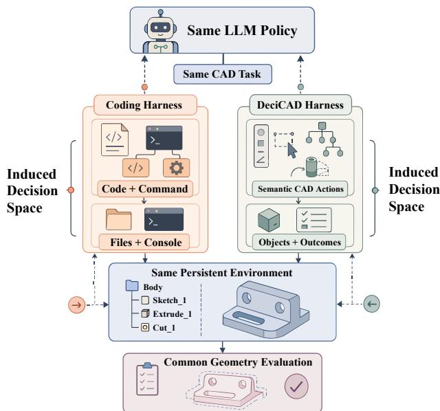  
Fi<sub>gure</sub> 1<sub>:</sub> H<sub>arness-</sub>i<sub>n</sub>d<sub>uce</sub>d CAD d<sub>ec</sub>i<sub>s</sub>i<sub>on spaces un</sub>d<sub>er con-</sub> t<sub>ro</sub>ll<sub>e</sub>d <sub>mo</sub>d<sub>e</sub>l <sub>an</sub>d <sub>env</sub>i<sub>ronmen</sub>t <sub>con</sub>diti<sub>ons.</sub> Gi<sub>ven</sub> th<sub>e same</sub> LLM <sub>po</sub>li<sub>cy,</sub> CAD t<sub>as</sub>k<sub>,</sub> <sub>pe</sub>r<sub>s</sub>i<sub>s</sub>t<sub>e</sub>nt d<sub>es</sub>i<sub>g</sub>n <sub>s</sub>t<sub>a</sub>t<sub>e,</sub> <sub>a</sub>nd <sub>geo</sub>m<sub>e-</sub> t<sub>ry eva</sub>l<sub>ua</sub>t<sub>or,</sub> th<sub>e co</sub>di<sub>ng</sub> h<sub>arness represen</sub>t<sub>s</sub> d<sub>ec</sub>i<sub>s</sub>i<sub>ons</sub> th<sub>roug</sub>h <sub>co</sub>d<sub>e an</sub>d <sub>s</sub>h<sub>e</sub>ll <sub>comman</sub>d<sub>s an</sub>d <sub>re</sub>t<sub>urns</sub> fil<sub>es an</sub>d <sub>conso</sub>l<sub>e ou</sub>t<sub>-</sub> <sub>pu</sub>t<sub>.</sub> D<sub>eci</sub>CAD i<sub>ns</sub>t<sub>ea</sub>d <sub>exposes</sub> <sub>seman</sub>ti<sub>c</sub> CAD <sub>ac</sub>ti<sub>ons</sub> <sub>an</sub>d returns object-level state and execution outcomes. The two i<sub>n</sub>t<sub>er</sub>f<sub>aces</sub> th<sub>ere</sub>f<sub>ore</sub> i<sub>n</sub>d<sub>uce</sub> dif<sub>eren</sub>t <sub>ac</sub>ti<sub>on–o</sub>b<sub>serva</sub>ti<sub>on</sub> hi<sub>s-</sub> t<sub>or</sub>i<sub>es</sub> <sub>over</sub> th<sub>e</sub> <sub>same</sub> <sub>un</sub>d<sub>er</sub>l<sub>y</sub>i<sub>ng</sub> <sub>mo</sub>d<sub>e</sub>li<sub>ng</sub> <sub>process.</sub>

CAD <sub>ac</sub>ti<sub>ons,</sub> <sub>s</sub>t<sub>a</sub>t<sub>es,</sub> <sub>an</sub>d <sub>execu</sub>ti<sub>on</sub> <sub>ou</sub>t<sub>comes</sub> <sub>are</sub> <sub>represen</sub>t<sub>e</sub>d t<sub>o</sub> th<sub>e mo</sub>d<sub>e</sub>l<sub>.</sub>

S<sub>uc</sub>h <sub>a</sub> <sub>mo</sub>d<sub>e</sub>l<sub>–env</sub>i<sub>ronmen</sub>t b<sub>oun</sub>d<sub>ary</sub> i<sub>s</sub> d<sub>e</sub>fi<sub>ne</sub>d b<sub>y</sub> <sub>an</sub> agent harness (Yang et al. 2024). In CAD, a harness deter-<sub>m</sub>i<sub>nes w</sub>hi<sub>c</sub>h d<sub>es</sub>i<sub>gn opera</sub>ti<sub>ons</sub> th<sub>e mo</sub>d<sub>e</sub>l <sub>can express, w</sub>hi<sub>c</sub>h <sub>par</sub>t<sub>s</sub> <sub>o</sub>f th<sub>e</sub> <sub>evo</sub>l<sub>v</sub>i<sub>ng</sub> d<sub>es</sub>i<sub>gn</sub> <sub>s</sub>t<sub>a</sub>t<sub>e</sub> it <sub>can</sub> i<sub>nspec</sub>t<sub>,</sub> <sub>an</sub>d h<sub>ow</sub> <sub>ex-</sub> <sub>ecu</sub>ti<sub>on ou</sub>t<sub>comes are re</sub>t<sub>urne</sub>d f<sub>or su</sub>b<sub>sequen</sub>t d<sub>ec</sub>i<sub>s</sub>i<sub>ons.</sub> A <sub>ge</sub>n<sub>e</sub>r<sub>a</sub>l<sub>-pu</sub>r<sub>pose</sub> <sub>co</sub>din<sub>g</sub> h<sub>a</sub>rn<sub>ess</sub> m<sub>ay</sub> <sub>expose</sub> th<sub>e</sub> CAD <sub>sys</sub>t<sub>e</sub>m th<sub>roug</sub>h <sub>programs,</sub> lib<sub>rar</sub>i<sub>es,</sub> <sub>an</sub>d <sub>run</sub>ti<sub>me</sub> f<sub>ee</sub>db<sub>ac</sub>k<sub>,</sub> <sub>w</sub>h<sub>ereas</sub> <sub>a</sub> d<sub>oma</sub>i<sub>n-na</sub>ti<sub>ve</sub> h<sub>arness</sub> <sub>may</sub> <sub>expose</sub> <sub>s</sub>t<sub>ruc</sub>t<sub>ure</sub>d CAD <sub>ac</sub>ti<sub>ons</sub> and object-level observations. Consequently, even when the <sub>mo</sub>d<sub>e</sub>l<sub>,</sub> t<sub>as</sub>k<sub>, an</sub>d CAD b<sub>ac</sub>k<sub>en</sub>d <sub>rema</sub>i<sub>n</sub> fi<sub>xe</sub>d<sub>,</sub> dif<sub>eren</sub>t h<sub>ar-</sub> <sub>nesses can presen</sub>t th<sub>e mo</sub>d<sub>e</sub>l <sub>w</sub>ith <sub>su</sub>b<sub>s</sub>t<sub>an</sub>ti<sub>a</sub>ll<sub>y</sub> dif<sub>eren</sub>t d<sub>e-</sub> <sub>c</sub>i<sub>s</sub>i<sub>on spaces, as</sub> ill<sub>us</sub>t<sub>ra</sub>t<sub>e</sub>d i<sub>n</sub> Fi<sub>gure</sub> 1<sub>.</sub> E<sub>x</sub>i<sub>s</sub>ti<sub>ng wor</sub>k h<sub>as</sub> <sub>s</sub>t<sub>u</sub>di<sub>e</sub>d CAD <sub>co</sub>d<sub>e</sub> <sub>genera</sub>ti<sub>on,</sub> t<sub>oo</sub>l<sub>-us</sub>i<sub>ng</sub> <sub>agen</sub>t<sub>s,</sub> <sub>execu</sub>ti<sub>on</sub> re<sub>p</sub>air, and interactive modelin<sub>g</sub> (Mallis et al. 2024; Guan <sub>e</sub>t <sub>a</sub>l<sub>.</sub> 2025<sub>;</sub> D<sub>or</sub>i<sub>s e</sub>t <sub>a</sub>l<sub>.</sub> 2025<sub>;</sub> W<sub>ang e</sub>t <sub>a</sub>l<sub>.</sub> 2025<sub>;</sub> B<sub>ar</sub>kl<sub>ey,</sub> Lo<sub>g</sub>hmani, and Barati Farimani 2026; Gon<sub>g</sub> et al. 2026), but th<sub>e</sub> h<sub>arness</sub> it<sub>se</sub>lf i<sub>s</sub> t<sub>yp</sub>i<sub>ca</sub>ll<sub>y</sub> t<sub>rea</sub>t<sub>e</sub>d <sub>as</sub> i<sub>mp</sub>l<sub>emen</sub>t<sub>a</sub>ti<sub>on</sub> i<sub>n-</sub> f<sub>ras</sub>t<sub>ruc</sub>t<sub>ure ra</sub>th<sub>er</sub> th<sub>an as a var</sub>i<sub>a</sub>bl<sub>e</sub> th<sub>a</sub>t <sub>s</sub>h<sub>apes</sub> b<sub>o</sub>th <sub>agen</sub>t <sub>execu</sub>ti<sub>on an</sub>d <sub>po</sub>li<sub>cy</sub> l<sub>earn</sub>i<sub>ng.</sub> Thi<sub>s ra</sub>i<sub>ses a cen</sub>t<sub>ra</sub>l <sub>ques</sub>ti<sub>on:</sub> How should a CAD agent harness represent actions and states so that it preserves the decisions required for complex modeling while avoiding representation burden that is irrelevant to the task?

Thi<sub>s</sub> t<sub>ra</sub>d<sub>e-o</sub>f i<sub>s</sub> i<sub>mpor</sub>t<sub>an</sub>t i<sub>n</sub> CAD<sub>.</sub> A fi<sub>ne-gra</sub>i<sub>ne</sub>d <sub>co</sub>di<sub>ng</sub> i<sub>n</sub>t<sub>er</sub>f<sub>ace g</sub>i<sub>ves</sub> th<sub>e mo</sub>d<sub>e</sub>l b<sub>roa</sub>d <sub>con</sub>t<sub>ro</sub>l <sub>over</sub> th<sub>e un</sub>d<sub>er</sub>l<sub>y-</sub> i<sub>ng so</sub>ft<sub>ware,</sub> b<sub>u</sub>t th<sub>e same</sub> CAD <sub>opera</sub>ti<sub>on can o</sub>ft<sub>en</sub> b<sub>e ex-</sub> p<sup>ressed thro</sup>ug<sup>h man</sup>y p<sup>ro</sup>g<sup>rams</sup>, <sup>command se</sup>qu<sup>ences</sup>, v<sup>ari-</sup> able names, temporary objects, and API combinations. These i<sub>mp</sub>l<sub>emen</sub>t<sub>a</sub>ti<sub>ons may pro</sub>d<sub>uce</sub> th<sub>e same geome</sub>t<sub>r</sub>i<sub>c s</sub>t<sub>a</sub>t<sub>e</sub> t<sub>ran-</sub> <sub>s</sub>iti<sub>on,</sub> b<sub>u</sub>t th<sub>ey appear as</sub> dif<sub>eren</sub>t <sub>genera</sub>ti<sub>on an</sub>d <sub>superv</sub>i<sub>s</sub>i<sub>on</sub> t<sub>arge</sub>t<sub>s.</sub> Th<sub>e mo</sub>d<sub>e</sub>l <sub>mus</sub>t th<sub>en spen</sub>d <sub>capac</sub>it<sub>y on</sub> i<sub>mp</sub>l<sub>emen</sub>t<sub>a-</sub> ti<sub>on c</sub>h<sub>o</sub>i<sub>ces</sub> th<sub>a</sub>t d<sub>o no</sub>t <sub>a</sub>f<sub>ec</sub>t th<sub>e</sub> i<sub>n</sub>t<sub>en</sub>d<sub>e</sub>d <sub>s</sub>t<sub>a</sub>t<sub>e</sub> t<sub>rans</sub>iti<sub>on.</sub> A <sub>seman</sub>ti<sub>c</sub> i<sub>n</sub>t<sub>er</sub>f<sub>ace</sub> <sub>can</sub> <sub>remove</sub> <sub>many</sub> <sub>o</sub>f th<sub>ese</sub> <sub>c</sub>h<sub>o</sub>i<sub>ces</sub> b<sub>y</sub> <sub>rep-</sub> <sub>resen</sub>ti<sub>ng</sub> th<sub>e</sub> i<sub>n</sub>t<sub>en</sub>d<sub>e</sub>d <sub>opera</sub>ti<sub>on</sub> di<sub>rec</sub>tl<sub>y.</sub> H<sub>owever, excess</sub>i<sub>ve</sub> <sub>compress</sub>i<sub>on can</sub> hid<sub>e s</sub>t<sub>a</sub>t<sub>e</sub> dif<sub>erences</sub> th<sub>a</sub>t <sub>requ</sub>i<sub>re</sub> dif<sub>eren</sub>t <sub>ac</sub>ti<sub>ons or remove opera</sub>ti<sub>ons nee</sub>d<sub>e</sub>d f<sub>or correc</sub>t <sub>mo</sub>d<sub>e</sub>li<sub>ng</sub> <sub>an</sub>d <sub>error recovery.</sub> A <sub>use</sub>f<sub>u</sub>l h<sub>arness mus</sub>t th<sub>ere</sub>f<sub>ore re</sub>d<sub>uce</sub> i<sub>rre</sub>l<sub>evan</sub>t <sub>represen</sub>t<sub>a</sub>ti<sub>on c</sub>h<sub>o</sub>i<sub>ces w</sub>hil<sub>e preserv</sub>i<sub>ng</sub> th<sub>e ac</sub>ti<sub>ons</sub> <sub>an</sub>d <sub>o</sub>b<sub>serva</sub>ti<sub>ons nee</sub>d<sub>e</sub>d f<sub>or correc</sub>t d<sub>ec</sub>i<sub>s</sub>i<sub>ons.</sub>

T<sub>o ma</sub>k<sub>e</sub> thi<sub>s</sub> t<sub>ra</sub>d<sub>e-o</sub>f <sub>ex</sub> li<sub>c</sub>it<sub>, we</sub> f<sub>orma</sub>li<sub>ze</sub> th<sub>e mo</sub>d<sub>e</sub>l<sub>-</sub> facing interface as a Harness-Induced CAD Decision Space: <sub>a</sub> h<sub>arness</sub> <sub>maps</sub> <sub>mo</sub>d<sub>e</sub>l <sub>ou</sub>t<sub>pu</sub>t<sub>s</sub> t<sub>o</sub> <sub>execu</sub>t<sub>a</sub>bl<sub>e</sub> <sub>opera</sub>ti<sub>ons,</sub> <sub>maps</sub> i<sub>n</sub>t<sub>erna</sub>l CAD <sub>s</sub>t<sub>a</sub>t<sub>es</sub> t<sub>o mo</sub>d<sub>e</sub>l<sub>-v</sub>i<sub>s</sub>ibl<sub>e o</sub>b<sub>serva</sub>ti<sub>ons, an</sub>d <sub>re</sub>t<sub>urns execu</sub>ti<sub>on resu</sub>lt<sub>s as</sub> f<sub>ee</sub>db<sub>ac</sub>k<sub>,</sub> th<sub>ere</sub>b<sub>y</sub> d<sub>e</sub>t<sub>erm</sub>i<sub>n</sub>i<sub>ng</sub> <sub>w</sub>hi<sub>c</sub>h <sub>opera</sub>ti<sub>ons</sub> th<sub>e agen</sub>t <sub>can per</sub>f<sub>orm, w</sub>hi<sub>c</sub>h <sub>s</sub>t<sub>a</sub>t<sub>e</sub> dif<sub>er-</sub> <sub>ences an</sub>d f<sub>a</sub>il<sub>ures</sub> it <sub>can</sub> id<sub>en</sub>tif<sub>y, an</sub>d <sub>w</sub>hi<sub>c</sub>h <sub>po</sub>li<sub>c</sub>i<sub>es</sub> it <sub>can</sub> execute and learn. We then introduce the Semantic Decision Bottleneck as a design principle for this space: it compresses b<sub>e</sub>h<sub>av</sub>i<sub>ora</sub>ll<sub>y equ</sub>i<sub>va</sub>l<sub>en</sub>t i<sub>mp</sub>l<sub>emen</sub>t<sub>a</sub>ti<sub>ons an</sub>d <sub>removes s</sub>t<sub>a</sub>t<sub>e</sub> i<sub>n</sub>f<sub>orma</sub>ti<sub>on</sub> th<sub>a</sub>t d<sub>oes no</sub>t <sub>a</sub>f<sub>ec</sub>t th<sub>e nex</sub>t d<sub>ec</sub>i<sub>s</sub>i<sub>on, w</sub>hil<sub>e pre-</sub> <sub>serv</sub>i<sub>ng</sub> th<sub>e ac</sub>ti<sub>ons an</sub>d <sub>o</sub>b<sub>serva</sub>ti<sub>ons nee</sub>d<sub>e</sub>d t<sub>o reac</sub>h th<sub>e</sub> <sup>tar</sup>g<sup>et</sup> g<sup>eometr</sup>y <sup>and reco</sup>v<sup>er from errors</sup>.

F<sub>o</sub>ll<sub>ow</sub>i<sub>ng</sub> thi<sub>s pr</sub>i<sub>nc</sub>i<sub>p</sub>l<sub>e, we</sub> d<sub>eve</sub>l<sub>op</sub> D<sub>eci</sub>CAD<sub>, a</sub> d<sub>oma</sub>i<sub>n-</sub> <sub>na</sub>ti<sub>ve</sub> h<sub>arness</sub> f<sub>or c</sub>l<sub>ose</sub>d<sub>-</sub>l<sub>oop</sub> CAD <sub>agen</sub>t<sub>s.</sub> D<sub>eci</sub>CAD <sub>rep-</sub> <sub>resen</sub>t<sub>s</sub> t<sub>as</sub>k<sub>-re</sub>l<sub>evan</sub>t d<sub>es</sub>i<sub>gn</sub> t<sub>rans</sub>iti<sub>ons as seman</sub>ti<sub>c</sub> CAD <sub>ac</sub>ti<sub>ons, groun</sub>d<sub>s</sub> th<sub>ese ac</sub>ti<sub>ons</sub> i<sub>n a pers</sub>i<sub>s</sub>t<sub>en</sub>t CAD d<sub>ocu-</sub> <sub>men</sub>t<sub>, an</sub>d <sub>re</sub>t<sub>urns s</sub>t<sub>ruc</sub>t<sub>ure</sub>d <sub>execu</sub>ti<sub>on</sub> f<sub>ee</sub>db<sub>ac</sub>k t<sub>oge</sub>th<sub>er</sub> <sub>w</sub>ith d<sub>ec</sub>i<sub>s</sub>i<sub>on-or</sub>i<sub>en</sub>t<sub>e</sub>d <sub>o</sub>b<sub>serva</sub>ti<sub>ons.</sub> W<sub>e</sub> f<sub>ur</sub>th<sub>er</sub> d<sub>eve</sub>l<sub>op</sub> <sub>a</sub> h<sub>arness-groun</sub>d<sub>e</sub>d l<sub>earn</sub>i<sub>ng p</sub>i<sub>pe</sub>li<sub>ne</sub> th<sub>a</sub>t <sub>recons</sub>t<sub>ruc</sub>t<sub>s</sub> <sub>causa</sub>ll<sub>y con</sub>diti<sub>one</sub>d <sub>ac</sub>ti<sub>on superv</sub>i<sub>s</sub>i<sub>on</sub> f<sub>rom success</sub>f<sub>u</sub>l <sub>an</sub>d recovered interaction trajectories, initializes CAD action <sub>p</sub>olicies throu<sub>g</sub>h su<sub>p</sub>ervised fine-tunin<sub>g</sub> (SFT), and su<sub>pp</sub>orts online reinforcement learnin<sub>g</sub> (RL) usin<sub>g p</sub>olic<sub>y</sub>-<sub>g</sub>enerated trajectories and geometry-grounded rewards. Figure 2 sum-<sub>mar</sub>i<sub>zes</sub> thi<sub>s execu</sub>ti<sub>on an</sub>d l<sub>earn</sub>i<sub>ng</sub> l<sub>oop.</sub>

A<sub>cross</sub> f<sub>our</sub> CAD b<sub>enc</sub>h<sub>mar</sub>k<sub>s,</sub> D<sub>eci</sub>CAD <sub>cons</sub>i<sub>s</sub>t<sub>en</sub>tl<sub>y pro-</sub> d<sub>uces more accura</sub>t<sub>e</sub> fi<sub>na</sub>l <sub>geome</sub>t<sub>ry</sub> th<sub>an compe</sub>titi<sub>ve</sub> CAD <sub>agen</sub>t<sub>s</sub> <sub>an</sub>d <sub>a</sub> <sub>genera</sub>l<sub>-purpose</sub> <sub>co</sub>di<sub>ng</sub> h<sub>arness,</sub> <sub>w</sub>hil<sub>e</sub> <sub>re</sub>d<sub>uc-</sub> i<sub>ng</sub> <sub>mo</sub>d<sub>e</sub>l<sub>-ou</sub>t<sub>pu</sub>t t<sub>o</sub>k<sub>ens</sub> b<sub>y</sub> 45<sub>–</sub>88% <sub>re</sub>l<sub>a</sub>ti<sub>ve</sub> t<sub>o</sub> th<sub>e</sub> <sub>co</sub>di<sub>ng</sub> h<sub>arness on</sub> t<sub>ex</sub>t<sub>-</sub>t<sub>o-</sub>CAD t<sub>as</sub>k<sub>s.</sub> Ob<sub>serva</sub>ti<sub>on a</sub>bl<sub>a</sub>ti<sub>ons s</sub>h<sub>ow</sub> th<sub>a</sub>t <sub>s</sub>h<sub>ow</sub>i<sub>ng more</sub> CAD <sub>s</sub>t<sub>a</sub>t<sub>e</sub> d<sub>oes no</sub>t <sub>a</sub>l<sub>ways</sub> h<sub>e</sub>l<sub>p: un</sub>fil<sub>-</sub> t<sub>ere</sub>d <sub>s</sub>t<sub>a</sub>t<sub>e</sub> i<sub>n</sub>fl<sub>a</sub>t<sub>es</sub> th<sub>e</sub> i<sub>npu</sub>t <sub>con</sub>t<sub>ex</sub>t<sub>,</sub> <sub>an</sub>d <sub>coarse</sub> f<sub>ee</sub>db<sub>ac</sub>k <sub>s</sub>t<sub>r</sub>i<sub>ps ou</sub>t <sub>w</sub>h<sub>a</sub>t th<sub>e agen</sub>t <sub>nee</sub>d<sub>s</sub> i<sub>n or</sub>d<sub>er</sub> t<sub>o recover.</sub> With <sub>ma</sub>t<sub>c</sub>h<sub>e</sub>d t<sub>ra</sub>i<sub>n</sub>i<sub>ng se</sub>tti<sub>ngs, open-we</sub>i<sub>g</sub>ht <sub>mo</sub>d<sub>e</sub>l<sub>s</sub> t<sub>ra</sub>i<sub>ne</sub>d i<sub>n</sub> th<sub>e</sub> D<sub>eci</sub>CAD d<sub>ec</sub>i<sub>s</sub>i<sub>on space</sub> l<sub>earn s</sub>t<sub>ronger</sub> l<sub>ong-</sub>h<sub>or</sub>i<sub>zon</sub> CAD <sub>ac</sub>ti<sub>on po</sub>li<sub>c</sub>i<sub>es</sub> th<sub>an</sub> th<sub>e same mo</sub>d<sub>e</sub>l<sub>s</sub> t<sub>ra</sub>i<sub>ne</sub>d th<sub>roug</sub>h <sub>co</sub>d<sub>e-</sub> l<sub>eve</sub>l i<sub>n</sub>t<sub>erac</sub>ti<sub>on.</sub>

O<sub>ur con</sub>t<sub>r</sub>ib<sub>u</sub>ti<sub>ons are summar</sub>i<sub>ze</sub>d <sub>as</sub> f<sub>o</sub>ll<sub>ows:</sub>

• We define the Harness-Induced CAD Decision Space and introduce the Semantic Decision Bottleneck as a design <sub>pr</sub>i<sub>nc</sub>i<sub>p</sub>l<sub>e</sub> f<sub>or</sub> CAD <sub>agen</sub>t i<sub>n</sub>t<sub>er</sub>f<sub>aces.</sub> W<sub>e</sub> d<sub>es</sub>i<sub>gn</sub> D<sub>eci</sub>CAD<sub>,</sub> <sub>w</sub>hi<sub>c</sub>h <sub>com</sub>bi<sub>nes</sub> <sub>seman</sub>ti<sub>c</sub> CAD <sub>ac</sub>ti<sub>ons,</sub> <sub>compac</sub>t <sub>o</sub>b<sub>ser-</sub> vations, structured feedback, and persistent object state.

• We develo<sub>p</sub> a harness-<sub>g</sub>rounded <sub>p</sub>olic<sub>y</sub>-learnin<sub>g</sub> <sub>p</sub>i<sub>p</sub>eline th<sub>a</sub>t <sub>recons</sub>t<sub>ruc</sub>t<sub>s</sub> <sub>causa</sub>ll<sub>y</sub> <sub>con</sub>diti<sub>one</sub>d <sub>superv</sub>i<sub>s</sub>i<sub>on</sub> f<sub>rom</sub> interaction trajectories, initializes policies through SFT, <sub>a</sub>nd <sub>suppo</sub>rt<sub>s geo</sub>m<sub>e</sub>tr<sub>y-g</sub>r<sub>ou</sub>nd<sub>e</sub>d <sub>o</sub>nlin<sub>e</sub> RL<sub>.</sub>

• Ex<sub>p</sub>eriments across four benchmarks verif<sub>y</sub> DeciCAD i<sub>mproves</sub> <sub>geome</sub>t<sub>r</sub>i<sub>c</sub> <sub>accuracy,</sub> t<sub>o</sub>k<sub>en</sub> <sub>e</sub>fi<sub>c</sub>i<sub>ency,</sub> <sub>error</sub> <sub>re-</sub> <sub>covery,</sub> <sub>an</sub>d l<sub>ong-</sub>h<sub>or</sub>i<sub>zon</sub> <sub>po</sub>li<sub>cy</sub> l<sub>earna</sub>bilit<sub>y</sub> <sub>s</sub>i<sub>gn</sub>ifi<sub>can</sub>tl<sub>y.</sub>

## 2 Related Work

O<sub>ur wor</sub>k <sub>connec</sub>t<sub>s agen</sub>t i<sub>n</sub>t<sub>erac</sub>ti<sub>on</sub> i<sub>n</sub>t<sub>er</sub>f<sub>aces,</sub> d<sub>ec</sub>i<sub>s</sub>i<sub>on-</sub> <sub>preserv</sub>i<sub>ng a</sub>b<sub>s</sub>t<sub>rac</sub>ti<sub>on, an</sub>d <sub>po</sub>li<sub>cy</sub> l<sub>earn</sub>i<sub>ng</sub> i<sub>n</sub> i<sub>n</sub>t<sub>erac</sub>ti<sub>ve</sub> CAD <sub>env</sub>i<sub>ronmen</sub>t<sub>s.</sub> W<sub>e rev</sub>i<sub>ew</sub> th<sub>ese</sub> di<sub>rec</sub>ti<sub>ons</sub> th<sub>roug</sub>h th<sub>e</sub> <sub>common</sub> <sub>ques</sub>ti<sub>on</sub> <sub>o</sub>f h<sub>ow</sub> <sub>an</sub> <sub>agen</sub>t’<sub>s</sub> <sub>opera</sub>ti<sub>ng</sub> <sub>represen</sub>t<sub>a</sub>ti<sub>on</sub> <sub>a</sub>f<sub>ec</sub>t<sub>s execu</sub>ti<sub>on an</sub>d l<sub>earn</sub>i<sub>ng.</sub>

## 2.1 Agent Interfaces and Decision Abstraction

T<sub>oo</sub>l<sub>-augmen</sub>t<sub>e</sub>d l<sub>anguage mo</sub>d<sub>e</sub>l<sub>s connec</sub>t <sub>genera</sub>ti<sub>on</sub> t<sub>o ex-</sub> ecutable o<sub>p</sub>erations (Parisi, Zhao, and Fiedel 2022; Kar<sub>p</sub>as et al. 2022; Schick et al. 2023), while API-Bank, Gorilla, <sub>an</sub>d T<sub>oo</sub>lLLM <sub>ex</sub>t<sub>en</sub>d t<sub>oo</sub>l l<sub>earn</sub>i<sub>ng</sub> t<sub>o execu</sub>t<sub>a</sub>bl<sub>e</sub> di<sub>a</sub>l<sub>ogues</sub> and lar<sub>g</sub>e API ecos<sub>y</sub>stems (Li et al. 2023; Patil et al. 2023; Qin et al. 2024). ReAct interleaves reasonin<sub>g</sub>, actions, and observations (Yao et al. 2023); SWE-a<sub>g</sub>ent, WebArena, and OSW<sub>or</sub>ld f<sub>ur</sub>th<sub>er</sub> <sub>s</sub>h<sub>ow</sub> th<sub>a</sub>t i<sub>n</sub>t<sub>erac</sub>ti<sub>on</sub> d<sub>es</sub>i<sub>gn</sub> <sub>a</sub>f<sub>ec</sub>t<sub>s</sub> b<sub>e</sub>h<sub>av-</sub> ior in stateful codin<sub>g</sub>, web, and com<sub>p</sub>uter environments (Yan<sub>g</sub> et al. 2024; Zhou et al. 2024; Xie et al. 2024). The<sub>y</sub> establish th<sub>e</sub> <sub>emp</sub>i<sub>r</sub>i<sub>ca</sub>l i<sub>mpor</sub>t<sub>ance</sub> <sub>o</sub>f i<sub>n</sub>t<sub>er</sub>f<sub>aces,</sub> b<sub>u</sub>t <sub>genera</sub>ll<sub>y</sub> t<sub>rea</sub>t th<sub>em as</sub> t<sub>oo</sub>l <sub>prov</sub>i<sub>s</sub>i<sub>on or run</sub>ti<sub>me</sub> i<sub>n</sub>f<sub>ras</sub>t<sub>ruc</sub>t<sub>ure.</sub> W<sub>e</sub> i<sub>ns</sub>t<sub>ea</sub>d study the harness as the joint action–state representation that d<sub>e</sub>fi<sub>nes</sub> th<sub>e po</sub>li<sub>cy space presen</sub>t<sub>e</sub>d t<sub>o</sub> th<sub>e mo</sub>d<sub>e</sub>l<sub>.</sub>

Thi<sub>s v</sub>i<sub>ew</sub> i<sub>s re</sub>l<sub>a</sub>t<sub>e</sub>d t<sub>o a</sub>b<sub>s</sub>t<sub>rac</sub>ti<sub>on</sub> i<sub>n sequen</sub>ti<sub>a</sub>l d<sub>ec</sub>i<sub>s</sub>i<sub>on-</sub> <sub>ma</sub>ki<sub>ng.</sub> MDP h<sub>omomorp</sub>hi<sub>sms an</sub>d <sub>s</sub>t<sub>a</sub>t<sub>e-a</sub>b<sub>s</sub>t<sub>rac</sub>ti<sub>on</sub> th<sub>e-</sub> <sub>ory c</sub>h<sub>arac</sub>t<sub>er</sub>i<sub>ze w</sub>h<sub>en compresse</sub>d <sub>represen</sub>t<sub>a</sub>ti<sub>ons preserve</sub> transition, reward, value, or <sub>p</sub>olic<sub>y</sub> structure (Ravindran <sub>an</sub>d B<sub>ar</sub>t<sub>o</sub> 2003<sub>;</sub> Li<sub>,</sub> W<sub>a</sub>l<sub>s</sub>h<sub>, an</sub>d Litt<sub>man</sub> 2006<sub>;</sub> Ab<sub>e</sub>l<sub>,</sub> H<sub>er-</sub> shkowitz, and Littman 2016; Abel et al. 2020); the Infor-<sub>ma</sub>ti<sub>on</sub> B<sub>o</sub>ttl<sub>enec</sub>k <sub>s</sub>i<sub>m</sub>il<sub>ar</sub>l<sub>y re</sub>t<sub>a</sub>i<sub>ns</sub> t<sub>arge</sub>t<sub>-re</sub>l<sub>evan</sub>t i<sub>n</sub>f<sub>orma-</sub> tion while su<sub>pp</sub>ressin<sub>g</sub> irrelevant in<sub>p</sub>ut de<sub>p</sub>endence (Tishb<sub>y</sub>, Pereira, and Bialek 2000). Classical abstractions o<sub>p</sub>erate <sub>w</sub>ithi<sub>n an a</sub>l<sub>rea</sub>d<sub>y spec</sub>ifi<sub>e</sub>d d<sub>ec</sub>i<sub>s</sub>i<sub>on process.</sub> A<sub>n</sub> LLM h<sub>ar-</sub> ness instead jointly defines model actions, visible obser-<sub>va</sub>ti<sub>ons, execu</sub>ti<sub>on</sub> bi<sub>n</sub>di<sub>ngs, an</sub>d f<sub>ee</sub>db<sub>ac</sub>k <sub>seman</sub>ti<sub>cs.</sub> O<sub>ur</sub> H<sub>arness-</sub>I<sub>n</sub>d<sub>uce</sub>d D<sub>ec</sub>i<sub>s</sub>i<sub>on</sub> S<sub>pace</sub> d<sub>escr</sub>ib<sub>es</sub> thi<sub>s</sub> t<sub>rans</sub>f<sub>orma-</sub> ti<sub>on, an</sub>d th<sub>e</sub> S<sub>eman</sub>ti<sub>c</sub> D<sub>ec</sub>i<sub>s</sub>i<sub>on</sub> B<sub>o</sub>ttl<sub>enec</sub>k <sub>cons</sub>t<sub>ra</sub>i<sub>ns</sub> it<sub>s</sub> <sub>compress</sub>i<sub>on</sub> b<sub>y</sub> d<sub>ec</sub>i<sub>s</sub>i<sub>on preserva</sub>ti<sub>on.</sub>

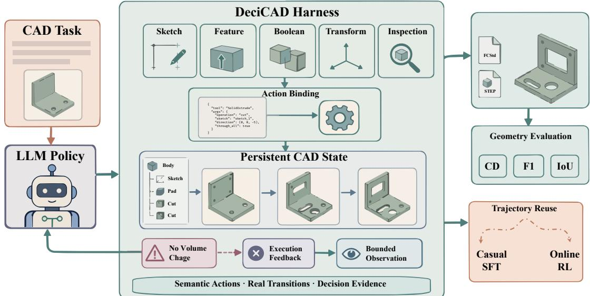  
Fi<sub>gure</sub> 2<sub>:</sub> O<sub>verv</sub>i<sub>ew o</sub>f D<sub>eci</sub>CAD<sub>.</sub> S<sub>eman</sub>ti<sub>c</sub> CAD <sub>ac</sub>ti<sub>ons are</sub> b<sub>oun</sub>d t<sub>o rea</sub>l t<sub>rans</sub>iti<sub>ons</sub> i<sub>n pers</sub>i<sub>s</sub>t<sub>en</sub>t CAD <sub>s</sub>t<sub>a</sub>t<sub>e, w</sub>ith b<sub>oun</sub>d<sub>e</sub>d observations and execution feedback; the resulting trajectories support causal SFT and geometry-grounded online RL.

## 2.2 CAD Generation and Interactive Agents

CAD <sub>genera</sub>ti<sub>on</sub> h<sub>as</sub> b<sub>een s</sub>t<sub>u</sub>di<sub>e</sub>d th<sub>roug</sub>h <sub>cons</sub>t<sub>ruc</sub>ti<sub>on se-</sub> <sub>quences, execu</sub>t<sub>a</sub>bl<sub>e programs, an</sub>d i<sub>n</sub>t<sub>erac</sub>ti<sub>ve ac</sub>ti<sub>ons.</sub> D<sub>eep-</sub> CAD <sub>an</sub>d F<sub>us</sub>i<sub>on</sub> 360 G<sub>a</sub>ll<sub>ery</sub> <sub>represen</sub>t <sub>s</sub>t<sub>ruc</sub>t<sub>ure</sub>d <sub>mo</sub>d<sub>e</sub>li<sub>ng</sub> histories (Wu, Xiao, and Zhen<sub>g</sub> 2021; Willis et al. 2020), <sub>w</sub>hil<sub>e</sub> T<sub>ex</sub>t2CAD <sub>an</sub>d CAD<sub>m</sub>i<sub>um</sub> l<sub>earn parame</sub>t<sub>r</sub>i<sub>c comman</sub>d sequences from language (Khan et al. 2024; Govindarajan et al. 2026). CAD-Coder s<sub>y</sub>stems <sub>g</sub>enerate executable CAD code (Guan et al. 2025; Doris et al. 2025), and CADFu-<sub>s</sub>i<sub>on,</sub> CADS<sub>m</sub>ith<sub>, an</sub>d CADD<sub>es</sub>i<sub>gner</sub> i<sub>ncorpora</sub>t<sub>e ren</sub>d<sub>er</sub>i<sub>ng,</sub> execution re<sub>p</sub>air, or multi-a<sub>g</sub>ent feedback (Wan<sub>g</sub> et al. 2025; B<sub>ar</sub>kl<sub>ey,</sub> L<sub>og</sub>h<sub>man</sub>i<sub>, an</sub>d B<sub>ara</sub>ti F<sub>ar</sub>i<sub>man</sub>i 2026<sub>;</sub> F<sub>an e</sub>t <sub>a</sub>l<sub>.</sub> 2025). Code is ex<sub>p</sub>ressive, but also makes <sub>p</sub>ro<sub>g</sub>ram or<sub>g</sub>ani-<sub>za</sub>ti<sub>on an</sub>d API <sub>rea</sub>li<sub>za</sub>ti<sub>on par</sub>t <sub>o</sub>f th<sub>e mo</sub>d<sub>e</sub>l <sub>ou</sub>t<sub>pu</sub>t<sub>.</sub>

I<sub>n</sub>t<sub>erac</sub>ti<sub>ve sys</sub>t<sub>ems</sub> i<sub>ns</sub>t<sub>ea</sub>d <sub>p</sub>l<sub>ace</sub> d<sub>ec</sub>i<sub>s</sub>i<sub>ons</sub> i<sub>n evo</sub>l<sub>v</sub>i<sub>ng</sub> d<sub>e-</sub> <sub>s</sub>i<sub>gn s</sub>t<sub>a</sub>t<sub>e.</sub> CAD<sub>-</sub>A<sub>ss</sub>i<sub>s</sub>t<sub>an</sub>t <sub>com</sub>bi<sub>nes a</sub> P<sub>y</sub>th<sub>on</sub> i<sub>n</sub>t<sub>erpre</sub>t<sub>er w</sub>ith FreeCAD o<sub>p</sub>erations (Mallis et al. 2024); ToolCAD trains t<sub>oo</sub>l<sub>-us</sub>i<sub>ng</sub> CAD <sub>agen</sub>t<sub>s</sub> f<sub>rom</sub> d<sub>emons</sub>t<sub>ra</sub>ti<sub>ons an</sub>d <sub>on</sub>li<sub>ne cur-</sub> riculum learnin<sub>g</sub> (Gon<sub>g</sub> et al. 2026); CADMate learns se-<sub>quen</sub>ti<sub>a</sub>l <sub>assem</sub>bl<sub>y ac</sub>ti<sub>ons us</sub>i<sub>ng geome</sub>t<sub>r</sub>i<sub>c an</sub>d <sub>p</sub>h<sub>ys</sub>i<sub>ca</sub>l <sub>re-</sub> wards (Chen et al. 2026). Our contribution is com<sub>p</sub>lement<sub>ary: un</sub>d<sub>er</sub> fi<sub>xe</sub>d <sub>mo</sub>d<sub>e</sub>l<sub>s,</sub> t<sub>as</sub>k<sub>s, an</sub>d t<sub>erm</sub>i<sub>na</sub>l <sub>geome</sub>t<sub>ry, we</sub> <sub>compare</sub> th<sub>e</sub> d<sub>ec</sub>i<sub>s</sub>i<sub>on spaces</sub> i<sub>n</sub>d<sub>uce</sub>d b<sub>y</sub> d<sub>oma</sub>i<sub>n-seman</sub>ti<sub>c</sub> <sub>ac</sub>ti<sub>ons an</sub>d <sub>a genera</sub>l<sub>-purpose co</sub>di<sub>ng</sub> h<sub>arness.</sub>

## 2.3 Policy Learning from Interaction

T<sub>oo</sub>l <sub>po</sub>li<sub>c</sub>i<sub>es common</sub>l<sub>y acqu</sub>i<sub>re</sub> i<sub>n</sub>iti<sub>a</sub>l <sub>capa</sub>bilit<sub>y</sub> f<sub>rom gen-</sub> erated or curated demonstrations (Schick et al. 2023; Li et al. 2023; Qin et al. 2024). In a stateful environment, however, action validity depends on the preceding trajectory and feedb<sub>ac</sub>k<sub>;</sub> i<sub>m</sub>it<sub>a</sub>ti<sub>on</sub> th<sub>ere</sub>f<sub>ore encoun</sub>t<sub>ers</sub> di<sub>s</sub>t<sub>r</sub>ib<sub>u</sub>ti<sub>on s</sub>hift <sub>w</sub>h<sub>en</sub> student-induced states depart from teacher trajectories (Ross, Gordon, and Ba<sub>g</sub>nell 2011). Online methods address this <sub>g</sub>a<sub>p</sub> <sub>us</sub>i<sub>ng execu</sub>ti<sub>on ou</sub>t<sub>comes on s</sub>t<sub>a</sub>t<sub>es v</sub>i<sub>s</sub>it<sub>e</sub>d b<sub>y</sub> th<sub>e</sub> l<sub>earne</sub>d <sub>po</sub>l<sub>-</sub> ic<sub>y</sub> (Fen<sub>g</sub> et al. 2025; Qian et al. 2025), includin<sub>g</sub> curriculum reinforcement learnin<sub>g</sub> in CAD (Gon<sub>g</sub> et al. 2026). We ali<sub>g</sub>n <sub>causa</sub>l <sub>superv</sub>i<sub>s</sub>i<sub>on, s</sub>t<sub>u</sub>d<sub>en</sub>t <sub>ro</sub>ll<sub>ou</sub>t<sub>s, an</sub>d <sub>env</sub>i<sub>ronmen</sub>t f<sub>ee</sub>d<sub>-</sub> b<sub>ac</sub>k <sub>w</sub>ithi<sub>n</sub> th<sub>e same</sub> H<sub>arness-</sub>I<sub>n</sub>d<sub>uce</sub>d D<sub>ec</sub>i<sub>s</sub>i<sub>on</sub> S<sub>pace, en-</sub> <sub>a</sub>bli<sub>ng a con</sub>t<sub>ro</sub>ll<sub>e</sub>d <sub>s</sub>t<sub>u</sub>d<sub>y o</sub>f h<sub>ow represen</sub>t<sub>a</sub>ti<sub>on a</sub>f<sub>ec</sub>t<sub>s</sub> b<sub>o</sub>th i<sub>m</sub>it<sub>a</sub>ti<sub>on an</sub>d <sub>on</sub>li<sub>ne</sub> l<sub>earn</sub>i<sub>ng.</sub>

## 3 Method

Th<sub>e</sub> h<sub>arness</sub> d<sub>e</sub>t<sub>erm</sub>i<sub>nes</sub> h<sub>ow</sub> th<sub>e</sub> <sub>c</sub>l<sub>ose</sub>d CAD l<sub>oop</sub> i<sub>s</sub> <sub>pre-</sub> <sub>sen</sub>t<sub>e</sub>d t<sub>o</sub> th<sub>e</sub> l<sub>anguage mo</sub>d<sub>e</sub>l<sub>: w</sub>h<sub>e</sub>th<sub>er</sub> th<sub>e mo</sub>d<sub>e</sub>l <sub>wr</sub>it<sub>es</sub> <sub>genera</sub>l<sub>-purpose</sub> <sub>co</sub>d<sub>e</sub> <sub>or</sub> <sub>se</sub>l<sub>ec</sub>t<sub>s</sub> <sub>a</sub> <sub>seman</sub>ti<sub>c</sub> CAD <sub>ac</sub>ti<sub>on,</sub> <sub>w</sub>hi<sub>c</sub>h <sub>par</sub>t <sub>o</sub>f th<sub>e curren</sub>t d<sub>es</sub>i<sub>gn</sub> i<sub>s s</sub>h<sub>own, an</sub>d h<sub>ow exe-</sub> <sub>cu</sub>ti<sub>on</sub> f<sub>a</sub>il<sub>ures</sub> <sub>are</sub> <sub>repor</sub>t<sub>e</sub>d<sub>.</sub> W<sub>e</sub> f<sub>orma</sub>li<sub>ze</sub> thi<sub>s</sub> i<sub>n</sub>t<sub>erac</sub>ti<sub>on,</sub> f<sub>ormu</sub>l<sub>a</sub>t<sub>e</sub> th<sub>e</sub> S<sub>eman</sub>ti<sub>c</sub> D<sub>ec</sub>i<sub>s</sub>i<sub>on</sub> B<sub>o</sub>ttl<sub>enec</sub>k<sub>,</sub> i<sub>ns</sub>t<sub>an</sub>ti<sub>a</sub>t<sub>e</sub> it i<sub>n</sub> D<sub>eci</sub>CAD<sub>, an</sub>d <sub>use</sub> th<sub>e same represen</sub>t<sub>a</sub>ti<sub>on</sub> f<sub>or</sub> SFT <sub>an</sub>d <sub>on</sub>li<sub>ne</sub> RL<sub>.</sub>

## 3.1 From a CAD Backend to a Model-Facing Decision Process

CAD tasks and backend state. We use g to denote one <sub>concre</sub>t<sub>e</sub> CAD t<sub>as</sub>k<sub>, w</sub>hi<sub>c</sub>h <sub>may con</sub>t<sub>a</sub>i<sub>n a na</sub>t<sub>ura</sub>l l<sub>anguage</sub> i<sub>ns</sub>t<sub>ruc</sub>ti<sub>on,</sub> <sub>op</sub>ti<sub>ona</sub>l i<sub>n</sub>iti<sub>a</sub>l <sub>s</sub>t<sub>a</sub>t<sub>e</sub> <sub>or</sub> <sub>re</sub>f<sub>erence</sub> i<sub>mage,</sub> <sub>an</sub>d <sub>a</sub> final design criterion. At step t, its internal state $s _ { t } ~ \in ~ S$ i<sub>nc</sub>l<sub>u</sub>d<sub>es</sub> th<sub>e</sub> <sub>curren</sub>t d<sub>ocumen</sub>t<sub>,</sub> f<sub>ea</sub>t<sub>ure</sub> <sub>s</sub>t<sub>ruc</sub>t<sub>ure,</sub> <sub>geome</sub>t<sub>ry,</sub> <sub>parame</sub>t<sub>ers, an</sub>d d<sub>epen</sub>d<sub>enc</sub>i<sub>es; no</sub>t<sub>e</sub> th<sub>a</sub>t thi<sub>s</sub> i<sub>s</sub> th<sub>e</sub> CAD <sub>sys</sub>t<sub>em</sub>’<sub>s</sub> i<sub>n</sub>t<sub>erna</sub>l <sub>con</sub>fi<sub>gura</sub>ti<sub>on, ra</sub>th<sub>er</sub> th<sub>an</sub> t<sub>ex</sub>t <sub>s</sub>h<sub>own</sub> t<sub>o</sub> th<sub>e</sub> LLM<sub>.</sub> A<sub>n e</sub>l<sub>emen</sub>t $u _ { t } \in \mathcal { U }$ i<sub>s</sub> <sub>a</sub> b<sub>ac</sub>k<sub>en</sub>d <sub>opera</sub>ti<sub>on,</sub> <sub>an</sub>d $s _ { t + 1 } \sim P ( \cdot \mid s _ { t } , u _ { t } )$ d<sub>escr</sub>ib<sub>es</sub> h<sub>ow</sub> th<sub>e</sub> d<sub>ocumen</sub>t <sub>c</sub>h<sub>anges a</sub>f<sub>-</sub> ter its execution. Task g specifies an initial-state distribution $\mu _ { g } .$ , a maximum number of interaction steps H, and reward $r _ { g } ( s _ { t } , u _ { t } , s _ { t + 1 } )$ <sub>.</sub> Thi<sub>s</sub> <sub>process</sub> d<sub>escr</sub>ib<sub>es</sub> <sub>w</sub>h<sub>a</sub>t th<sub>e</sub> CAD <sub>sys-</sub> t<sub>em</sub> <sub>can</sub> <sub>execu</sub>t<sub>e.</sub> It d<sub>oes</sub> <sub>no</sub>t <sub>ye</sub>t d<sub>escr</sub>ib<sub>e</sub> <sub>w</sub>h<sub>a</sub>t th<sub>e</sub> l<sub>anguage</sub> <sub>mo</sub>d<sub>e</sub>l i<sub>s a</sub>ll<sub>owe</sub>d t<sub>o say or see.</sub>

What the harness changes. A language model does not di<sub>rec</sub>tl<sub>y</sub> i<sub>ssue</sub> <sub>an</sub> i<sub>n</sub>t<sub>erna</sub>l b<sub>ac</sub>k<sub>en</sub>d <sub>opera</sub>ti<sub>on</sub> $u _ { t } .$ <sub>,</sub> <sub>nor</sub> d<sub>oes</sub> it <sub>rece</sub>i<sub>ve</sub> th<sub>e</sub> f<sub>u</sub>ll b<sub>ac</sub>k<sub>en</sub>d <sub>s</sub>t<sub>a</sub>t<sub>e</sub> $s _ { t } , \mathbf { A }$ h<sub>arness prov</sub>id<sub>es</sub> th<sub>e</sub> <sub>mo</sub>d<sub>e</sub>l<sub>-</sub>f<sub>ac</sub>i<sub>ng</sub> i<sub>n</sub>t<sub>er</sub>f<sub>ace</sub> b<sub>e</sub>t<sub>ween</sub> th<sub>e</sub> t<sub>wo.</sub> W<sub>e represen</sub>t it <sub>as</sub>

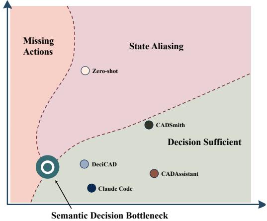  
Fi<sub>gu</sub>r<sub>e</sub> 3<sub>:</sub> S<sub>e</sub>m<sub>a</sub>nti<sub>c</sub> CAD D<sub>ec</sub>i<sub>s</sub>i<sub>o</sub>n B<sub>o</sub>ttl<sub>e</sub>n<sub>ec</sub>k<sub>.</sub> Mi<sub>ss</sub>in<sub>g ac-</sub> ti<sub>ons an</sub>d <sub>s</sub>t<sub>a</sub>t<sub>e a</sub>li<sub>as</sub>i<sub>ng v</sub>i<sub>o</sub>l<sub>a</sub>t<sub>e ac</sub>ti<sub>on an</sub>d <sub>o</sub>b<sub>serva</sub>ti<sub>on su</sub>fi<sub>-</sub> <sub>c</sub>i<sub>ency, respec</sub>ti<sub>ve</sub>l<sub>y;</sub> D<sub>eci</sub>CAD i<sub>s</sub> d<sub>es</sub>i<sub>gne</sub>d t<sub>o approac</sub>h th<sub>e</sub> d<sub>ec</sub>i<sub>s</sub>i<sub>on-su</sub>fi<sub>c</sub>i<sub>en</sub>t b<sub>oun</sub>d<sub>ary.</sub> M<sub>e</sub>th<sub>o</sub>d l<sub>oca</sub>ti<sub>ons</sub> <sub>are</sub> <sub>concep-</sub> t<sub>ua</sub>l <sub>an</sub>d <sub>no</sub>t t<sub>o sca</sub>l<sub>e.</sub>

$$
\mathcal { H } = ( A _ { \mathcal { H } } , \beta _ { \mathcal { H } } , O _ { \mathcal { H } } ) ,\tag{1}
$$

<sub>w</sub>h<sub>ose componen</sub>t<sub>s</sub> h<sub>ave</sub> di<sub>rec</sub>t <sub>opera</sub>ti<sub>ona</sub>l <sub>mean</sub>i<sub>ngs:</sub>

$\boldsymbol { A } _ { \mathcal { H } }$ i<sub>s</sub> th<sub>e se</sub>t <sub>o</sub>f <sub>a</sub>d<sub>m</sub>i<sub>ss</sub>ibl<sub>e mo</sub>d<sub>e</sub>l<sub>-</sub>l<sub>eve</sub>l <sub>ac</sub>ti<sub>ons ex-</sub> <sub>pose</sub>d b<sub>y</sub> th<sub>e</sub> h<sub>arness.</sub> I<sub>n</sub> <sub>a</sub> <sub>co</sub>di<sub>ng</sub> h<sub>arness,</sub> <sub>an</sub> <sub>ac-</sub> ti<sub>o</sub>n m<sub>ay</sub> b<sub>e</sub> <sub>a</sub> P<sub>y</sub>th<sub>o</sub>n <sub>p</sub>r<sub>og</sub>r<sub>a</sub>m<sub>.</sub> In D<sub>eci</sub>CAD<sub>,</sub> it i<sub>s</sub> a t<sub>yp</sub>ed o<sub>p</sub>eration, such as Extrude(sketch=S3, distance=10mm).

$\beta _ { \mathcal { H } }$ i<sub>n</sub>t<sub>erpre</sub>t<sub>s</sub> th<sub>e mo</sub>d<sub>e</sub>l <sub>ou</sub>t<sub>pu</sub>t i<sub>n</sub> th<sub>e curren</sub>t CAD d<sub>oc-</sub> <sub>umen</sub>t <sub>an</sub>d bi<sub>n</sub>d<sub>s</sub> it t<sub>o an execu</sub>t<sub>a</sub>bl<sub>e</sub> b<sub>ac</sub>k<sub>en</sub>d <sub>opera</sub>ti<sub>on.</sub>

$O _ { \mathcal { H } }$ d<sub>e</sub>t<sub>erm</sub>i<sub>nes w</sub>h<sub>a</sub>t th<sub>e mo</sub>d<sub>e</sub>l <sub>rece</sub>i<sub>ves a</sub>ft<sub>er execu</sub>ti<sub>on,</sub> i<sub>nc</sub>l<sub>u</sub>di<sub>ng</sub> <sub>compac</sub>t d<sub>escr</sub>i<sub>p</sub>ti<sub>ons</sub> <sub>o</sub>f <sub>success,</sub> f<sub>a</sub>il<sub>ure,</sub> <sub>an</sub>d afected design objects.

Th<sub>e</sub> h<sub>arness</sub> th<sub>us</sub> t<sub>rans</sub>l<sub>a</sub>t<sub>es</sub> b<sub>e</sub>t<sub>ween mo</sub>d<sub>e</sub>l <sub>ou</sub>t<sub>pu</sub>t<sub>s,</sub> b<sub>ac</sub>k<sub>en</sub>d <sub>opera</sub>ti<sub>ons, an</sub>d <sub>mo</sub>d<sub>e</sub>l<sub>-v</sub>i<sub>s</sub>ibl<sub>e execu</sub>ti<sub>on ev</sub>id<sub>ence w</sub>ith<sub>ou</sub>t <sub>rep</sub>l<sub>ac</sub>i<sub>ng</sub> th<sub>e</sub> CAD k<sub>erne</sub>l<sub>.</sub>

One closed-loop interaction step. One interaction step is

$$
\begin{array} { r l } & { a _ { t } \sim \pi _ { \theta } ( \cdot \mid h _ { t } ; \mathcal { H } ) , } \\ & { ~ u _ { t } = \beta _ { \mathcal { H } } ( a _ { t } , s _ { t } ) , } \\ & { s _ { t + 1 } \sim P ( \cdot \mid s _ { t } , u _ { t } ) , } \\ & { y _ { t + 1 } \sim O _ { \mathcal { H } } ( \cdot \mid s _ { t } , a _ { t } , s _ { t + 1 } ) , } \end{array}\tag{2}
$$

H<sub>ere,</sub> $a _ { t }$ i<sub>s w</sub>h<sub>a</sub>t th<sub>e mo</sub>d<sub>e</sub>l <sub>em</sub>it<sub>s,</sub> $u _ { t }$ i<sub>s w</sub>h<sub>a</sub>t th<sub>e</sub> CAD b<sub>ac</sub>k<sub>en</sub>d <sub>execu</sub>t<sub>es, an</sub>d $y _ { t + 1 }$ i<sub>s w</sub>h<sub>a</sub>t th<sub>e mo</sub>d<sub>e</sub>l <sub>sees a</sub>ft<sub>erwar</sub>d<sub>.</sub> Th<sub>e</sub> <sub>mo</sub>d<sub>e</sub>l <sub>c</sub>h<sub>ooses</sub> it<sub>s nex</sub>t <sub>ac</sub>ti<sub>on</sub> f<sub>rom</sub> th<sub>e v</sub>i<sub>s</sub>ibl<sub>e</sub> hi<sub>s</sub>t<sub>ory</sub>

$$
h _ { t } = ( g , y _ { 0 } , a _ { 0 } , y _ { 1 } , . . . , a _ { t - 1 } , y _ { t } ) .
$$

Thi<sub>s con</sub>t<sub>a</sub>i<sub>ns</sub> th<sub>e</sub> t<sub>as</sub>k <sub>spec</sub>ifi<sub>ca</sub>ti<sub>on an</sub>d <sub>prev</sub>i<sub>ous mo</sub>d<sub>e</sub>l <sub>ac-</sub> ti<sub>ons an</sub>d h<sub>arness responses,</sub> b<sub>u</sub>t <sub>no</sub>t th<sub>e</sub> hidd<sub>en</sub> b<sub>ac</sub>k<sub>en</sub>d <sub>s</sub>t<sub>a</sub>t<sub>e</sub> $s _ { t }$ <sub>.</sub> R<sub>ea</sub>d<sub>-on</sub>l<sub>y</sub> i<sub>nspec</sub>ti<sub>on</sub> i<sub>s</sub> <sub>a</sub>l<sub>so</sub> <sub>represen</sub>t<sub>e</sub>d <sub>as</sub> <sub>an</sub> <sub>ac</sub>ti<sub>on,</sub> k<sub>eep</sub>i<sub>ng</sub> i<sub>n</sub>f<sub>orma</sub>ti<sub>on</sub> <sub>ga</sub>th<sub>er</sub>i<sub>ng</sub> <sub>an</sub>d <sub>geome</sub>t<sub>ry-c</sub>h<sub>ang</sub>i<sub>ng</sub> <sub>oper-</sub> <sub>a</sub>ti<sub>ons</sub> i<sub>n</sub> th<sub>e same c</sub>l<sub>ose</sub>d l<sub>oop.</sub>

C<sub>om</sub>bi<sub>n</sub>i<sub>ng</sub> b<sub>ac</sub>k<sub>en</sub>d <sub>execu</sub>ti<sub>on</sub> <sub>an</sub>d h<sub>arness</sub> <sub>response</sub> <sub>g</sub>i<sub>ves</sub> th<sub>e</sub> i<sub>n</sub>d<sub>uce</sub>d t<sub>rans</sub>iti<sub>on</sub> k<sub>erne</sub>l

$$
T _ { \mathcal { H } } ( s ^ { \prime } , y \mid s , a ) = P ( s ^ { \prime } \mid s , \beta _ { \mathcal { H } } ( a , s ) ) O _ { \mathcal { H } } ( y \mid s , a , s ^ { \prime } ) .\tag{3}
$$

We call the model-facin<sub>g</sub> interaction defined b<sub>y</sub> Eqs. (2)–(3) the Harness-Induced CAD Decision Space, comprising the <sub>ac</sub>ti<sub>ons,</sub> <sub>responses,</sub> <sub>an</sub>d i<sub>n</sub>t<sub>erac</sub>ti<sub>on</sub> hi<sub>s</sub>t<sub>or</sub>i<sub>es</sub> <sub>expose</sub>d b<sub>y</sub> th<sub>e</sub> h<sub>arness.</sub>

Th<sub>e</sub> di<sub>s</sub>ti<sub>nc</sub>ti<sub>on</sub> i<sub>s</sub> i<sub>mpor</sub>t<sub>an</sub>t<sub>.</sub> A <sub>co</sub>di<sub>ng</sub> h<sub>arness</sub> <sub>an</sub>d D<sub>e-</sub> <sub>ci</sub>CAD <sub>ma ca</sub>ll th<sub>e same</sub> CAD k<sub>erne</sub>l <sub>e</sub>t i<sub>n</sub>d<sub>uce</sub> dif<sub>eren</sub>t <sub>sequen</sub>ti<sub>a</sub>l <sub>pre</sub>di<sub>c</sub>ti<sub>on pro</sub>bl<sub>ems.</sub> Th<sub>e</sub> f<sub>ormer requ</sub>i<sub>res c</sub>h<sub>o</sub>i<sub>ces</sub> <sub>a</sub>b<sub>ou</sub>t <sub>program s</sub>t<sub>ruc</sub>t<sub>ure,</sub> API <sub>ca</sub>ll<sub>s, an</sub>d <sub>error</sub> h<sub>an</sub>dli<sub>ng;</sub> th<sub>e</sub> l<sub>a</sub>tt<sub>er requ</sub>i<sub>res c</sub>h<sub>o</sub>i<sub>ces a</sub>b<sub>ou</sub>t CAD <sub>opera</sub>ti<sub>ons an</sub>d th<sub>e</sub>i<sub>r geo-</sub> <sub>me</sub>t<sub>r</sub>i<sub>c parame</sub>t<sub>ers, w</sub>ith dif<sub>eren</sub>t <sub>ev</sub>id<sub>ence a</sub>ft<sub>er eac</sub>h <sub>s</sub>t<sub>ep.</sub>

## 3.2 Semantic Decision Bottleneck

Th<sub>e prece</sub>di<sub>ng</sub> f<sub>ormu</sub>l<sub>a</sub>ti<sub>on exposes</sub> t<sub>wo sources o</sub>f <sub>unneces-</sub> <sub>sary</sub> difi<sub>cu</sub>lt<sub>y.</sub> O<sub>n</sub> th<sub>e</sub> <sub>ou</sub>t<sub>pu</sub>t <sub>s</sub>id<sub>e,</sub> <sub>many</sub> <sub>syn</sub>t<sub>ac</sub>ti<sub>ca</sub>ll<sub>y</sub> dif<sub>-</sub> f<sub>eren</sub>t <sub>programs can rea</sub>li<sub>ze</sub> th<sub>e same</sub> CAD <sub>c</sub>h<sub>ange.</sub> O<sub>n</sub> th<sub>e</sub> i<sub>npu</sub>t <sub>s</sub>id<sub>e,</sub> th<sub>e</sub> CAD b<sub>ac</sub>k<sub>en</sub>d <sub>con</sub>t<sub>a</sub>i<sub>ns</sub> <sub>muc</sub>h <sub>more</sub> i<sub>n</sub>f<sub>orma-</sub> ti<sub>on</sub> th<sub>an</sub> <sub>eac</sub>h d<sub>ec</sub>i<sub>s</sub>i<sub>on</sub> <sub>requ</sub>i<sub>res.</sub> A <sub>use</sub>f<sub>u</sub>l h<sub>arness</sub> <sub>s</sub>h<sub>ou</sub>ld <sub>compress</sub> b<sub>o</sub>th di<sub>rec</sub>ti<sub>ons</sub> <sub>w</sub>ith<sub>ou</sub>t <sub>remov</sub>i<sub>ng</sub> <sub>a</sub> <sub>necessary</sub> <sub>op-</sub> <sub>era</sub>ti<sub>on or</sub> hidi<sub>ng a</sub> di<sub>s</sub>ti<sub>nc</sub>ti<sub>on</sub> th<sub>a</sub>t <sub>c</sub>h<sub>anges</sub> th<sub>e correc</sub>t <sub>nex</sub>t <sub>ac</sub>ti<sub>on.</sub> Fi<sub>gure</sub> 3 ill<sub>us</sub>t<sub>ra</sub>t<sub>es</sub> thi<sub>s</sub> t<sub>ra</sub>d<sub>e-o</sub>f<sub>.</sub>

Preserving necessary actions. Let $V _ { g , t } ^ { * } ( s )$ b<sub>e</sub> th<sub>e</sub> b<sub>es</sub>t return achievable from backend state s at step $t ,$ <sub>an</sub>d l<sub>e</sub>t $Q _ { g , t } ^ { * } ( s , u )$ b<sub>e</sub> th<sub>e re</sub>t<sub>urn o</sub>bt<sub>a</sub>i<sub>ne</sub>d b<sub>y</sub> fi<sub>rs</sub>t <sub>execu</sub>ti<sub>ng</sub> b<sub>ac</sub>k<sub>en</sub>d operation u and then acting optimally. A harness is actionsuficient if

$$
\operatorname* { m a x } _ { a \in \mathcal { A } _ { \mathcal { H } } } Q _ { g , t } ^ { * } ( s , \beta _ { \mathcal { H } } ( a , s ) ) = V _ { g , t } ^ { * } ( s )\tag{4}
$$

f<sub>or every</sub> t<sub>as</sub>k<sub>-reac</sub>h<sub>a</sub>bl<sub>e s</sub>t<sub>a</sub>t<sub>e.</sub> Th<sub>e</sub> h<sub>arness nee</sub>d <sub>no</sub>t <sub>expose</sub> ever<sub>y</sub> low-level CAD command under Eq. (4), onl<sub>y</sub> an action <sub>rea</sub>li<sub>z</sub>i<sub>ng an op</sub>ti<sub>ma</sub>l <sub>nex</sub>t <sub>opera</sub>ti<sub>on w</sub>h<sub>en nee</sub>d<sub>e</sub>d<sub>.</sub>

Preserving necessary state distinctions. A harness re-<sub>sponse nee</sub>d <sub>no</sub>t <sub>revea</sub>l th<sub>e</sub> b<sub>ac</sub>k<sub>en</sub>d <sub>s</sub>t<sub>a</sub>t<sub>e, so one v</sub>i<sub>s</sub>ibl<sub>e</sub> hi<sub>s-</sub> t<sub>ory</sub> <sub>may</sub> b<sub>e</sub> <sub>cons</sub>i<sub>s</sub>t<sub>en</sub>t <sub>w</sub>ith <sub>severa</sub>l b<sub>ac</sub>k<sub>en</sub>d <sub>s</sub>t<sub>a</sub>t<sub>es,</sub> <sub>as</sub> i<sub>n</sub> <sub>a</sub> <sub>p</sub>artiall<sub>y</sub> observable decision <sub>p</sub>rocess (Kaelblin<sub>g</sub>, Littman, and Cassandra 1998). Define

$$
\mathcal { B } _ { \mathcal { H } } ( h _ { t } ) : = \{ s \in \mathcal { S } : \operatorname* { P r } ( s _ { t } = s \mid h _ { t } ; \mathcal { H } ) > 0 \}\tag{5}
$$

<sub>as</sub> th<sub>e</sub> b<sub>ac</sub>k<sub>en</sub>d <sub>s</sub>t<sub>a</sub>t<sub>es cons</sub>i<sub>s</sub>t<sub>en</sub>t <sub>w</sub>ith $h _ { t }$ <sub>.</sub> W<sub>e ca</sub>ll $h _ { t }$ reachable when this set is nonempty. For a backend state s, let

$$
\boldsymbol { \mathcal { A } } _ { \mathcal { H } , g , t } ^ { * } ( s ) : = \arg \operatorname* { m a x } _ { a \in \boldsymbol { A } _ { \mathcal { H } } } \boldsymbol { Q } _ { g , t } ^ { * } ( s , \beta _ { \mathcal { H } } ( a , s ) ) .\tag{6}
$$

These are the model actions optimal at s. The harness is observation-suficient if the states in Eq. (5) share an action from the sets in Eq. (6):

$$
\bigcap _ { s \in \mathcal { B } _ { \mathcal { H } } ( h _ { t } ) } \mathcal { A } _ { \mathcal { H } , g , t } ^ { * } ( s ) \neq \mathcal { O } , \quad \forall \mathrm { r e a c h a b l e } \ h _ { t } , \ t < H .\tag{7}
$$

Th<sub>e</sub> h<sub>arness may map</sub> t<sub>wo</sub> b<sub>ac</sub>k<sub>en</sub>d <sub>s</sub>t<sub>a</sub>t<sub>es</sub> t<sub>o</sub> th<sub>e same v</sub>i<sub>s</sub>ibl<sub>e</sub> hi<sub>s</sub>t<sub>ory w</sub>h<sub>en</sub> th<sub>e same nex</sub>t <sub>ac</sub>ti<sub>on</sub> i<sub>s op</sub>ti<sub>ma</sub>l i<sub>n</sub> b<sub>o</sub>th<sub>;</sub> it <sub>mus</sub>t di<sub>s</sub>ti<sub>ngu</sub>i<sub>s</sub>h th<sub>em w</sub>h<sub>en</sub> th<sub>ey requ</sub>i<sub>re</sub> i<sub>ncompa</sub>tibl<sub>e nex</sub>t <sub>ac</sub>ti<sub>ons.</sub> A <sub>gener</sub>i<sub>c</sub> “<sub>opera</sub>ti<sub>on</sub> f<sub>a</sub>il<sub>e</sub>d” <sub>message</sub> i<sub>s</sub> th<sub>ere</sub>f<sub>ore</sub> i<sub>nsu</sub>fi<sub>c</sub>i<sub>en</sub>t if dif<sub>eren</sub>t f<sub>a</sub>il<sub>ures</sub> <sub>requ</sub>i<sub>re</sub> dif<sub>eren</sub>t <sub>repa</sub>i<sub>rs.</sub>

A h<sub>arness</sub> th<sub>a</sub>t i<sub>s</sub> b<sub>o</sub>th <sub>ac</sub>ti<sub>on-su</sub>fi<sub>c</sub>i<sub>en</sub>t <sub>an</sub>d <sub>o</sub>b<sub>serva</sub>ti<sub>on-</sub> suficient is decision-suficient. Any selection from the intersection in Eq. (7) de<sub>p</sub>ends onl<sub>y</sub> on $h _ { t }$ <sub>an</sub>d<sub>,</sub> b<sub>y ac</sub>ti<sub>on su</sub>f<sub>-</sub> fi<sub>c</sub>i<sub>ency,</sub> i<sub>s op</sub>ti<sub>ma</sub>l <sub>a</sub>t th<sub>e</sub> t<sub>rue s</sub>t<sub>a</sub>t<sub>e;</sub> b<sub>ac</sub>k<sub>war</sub>d i<sub>n</sub>d<sub>uc</sub>ti<sub>on</sub> <sub>g</sub><sup>i</sup>ves $\dot { \mathbb { E } } _ { s _ { 0 } \sim \mu _ { g } } \big [ V _ { g , 0 } ^ { * } ( s _ { 0 } ) \big ]$ f<sub>or</sub> th<sub>e resu</sub>lti<sub>ng</sub> hi<sub>s</sub>t<sub>ory-</sub>d<sub>epen</sub>d<sub>en</sub>t <sub>po</sub>li<sub>cy.</sub> A<sub>n</sub> i<sub>nexpress</sub>ibl<sub>e opera</sub>ti<sub>on</sub> th<sub>ere</sub>f<sub>ore v</sub>i<sub>o</sub>l<sub>a</sub>t<sub>es ac</sub>ti<sub>on</sub> <sub>su</sub>fi<sub>c</sub>i<sub>ency, w</sub>h<sub>ereas a response merg</sub>i<sub>ng s</sub>t<sub>a</sub>t<sub>es</sub> th<sub>a</sub>t <sub>requ</sub>i<sub>re</sub> i<sub>ncompa</sub>tibl<sub>e repa</sub>i<sub>rs v</sub>i<sub>o</sub>l<sub>a</sub>t<sub>es o</sub>b<sub>serva</sub>ti<sub>on su</sub>fi<sub>c</sub>i<sub>ency.</sub>

Compressing implementation and context. Action and <sub>o</sub>b<sub>serva</sub>ti<sub>on su</sub>fi<sub>c</sub>i<sub>ency spec</sub>if<sub>y w</sub>h<sub>a</sub>t <sub>a</sub> h<sub>arness mus</sub>t <sub>preserve,</sub> b<sub>u</sub>t d<sub>o</sub> <sub>no</sub>t <sub>un</sub>i<sub>que</sub>l<sub>y</sub> d<sub>e</sub>t<sub>erm</sub>i<sub>ne</sub> it<sub>s</sub> <sub>mo</sub>d<sub>e</sub>l<sub>-</sub>f<sub>ac</sub>i<sub>ng</sub> <sub>represen</sub>t<sub>a-</sub> ti<sub>on.</sub> A<sub>mong</sub> d<sub>ec</sub>i<sub>s</sub>i<sub>on-su</sub>fi<sub>c</sub>i<sub>en</sub>t i<sub>n</sub>t<sub>er</sub>f<sub>aces,</sub> <sub>we</sub> <sub>pre</sub>f<sub>er</sub> th<sub>ose</sub> th<sub>a</sub>t <sub>re</sub>d<sub>uce unnecessary</sub> b<sub>ur</sub>d<sub>en on</sub> b<sub>o</sub>th <sub>mo</sub>d<sub>e</sub>l <sub>ou</sub>t<sub>pu</sub>t <sub>an</sub>d input. We refer to this principle as the Semantic Decision Bottleneck: compressing action representations and visible <sub>con</sub>t<sub>ex</sub>t <sub>w</sub>hil<sub>e re</sub>t<sub>a</sub>i<sub>n</sub>i<sub>ng</sub> th<sub>e</sub> di<sub>s</sub>ti<sub>nc</sub>ti<sub>ons requ</sub>i<sub>re</sub>d f<sub>or correc</sub>t <sub>ac</sub>ti<sub>on se</sub>l<sub>ec</sub>ti<sub>on an</sub>d <sub>error recover .</sub> D<sub>eci</sub>CAD i<sub>ns</sub>t<sub>an</sub>ti<sub>a</sub>t<sub>es</sub> thi<sub>s pr</sub>i<sub>nc</sub>i<sub>p</sub>l<sub>e</sub> th<sub>roug</sub>h d<sub>oma</sub>i<sub>n-spec</sub>ifi<sub>c ac</sub>ti<sub>on sc</sub>h<sub>emas, con-</sub> <sub>c</sub>i<sub>se</sub> <sub>execu</sub>ti<sub>on</sub> f<sub>ee</sub>db<sub>ac</sub>k<sub>,</sub> <sub>an</sub>d t<sub>arge</sub>t<sub>e</sub>d i<sub>nspec</sub>ti<sub>on</sub> <sub>opera</sub>ti<sub>ons</sub> th<sub>a</sub>t <sub>re</sub>t<sub>r</sub>i<sub>eve a</sub>dditi<sub>ona</sub>l <sub>s</sub>t<sub>a</sub>t<sub>e on</sub>l<sub>y w</sub>h<sub>en nee</sub>d<sub>e</sub>d<sub>.</sub> A f<sub>orma</sub>l <sub>pre</sub>f<sub>erence re</sub>l<sub>a</sub>ti<sub>on over</sub> d<sub>ec</sub>i<sub>s</sub>i<sub>on-su</sub>fi<sub>c</sub>i<sub>en</sub>t h<sub>arnesses</sub> i<sub>s pro-</sub> <sub>v</sub>id<sub>e</sub>d i<sub>n</sub> th<sub>e appen</sub>di<sub>x.</sub>

## 3.3 DeciCAD: A Domain-Native CAD Harness

D<sub>eci</sub>CAD i<sub>mp</sub>l<sub>emen</sub>t<sub>s</sub> th<sub>e</sub> <sub>prece</sub>di<sub>ng</sub> d<sub>es</sub>i<sub>gn</sub> <sub>pr</sub>i<sub>nc</sub>i<sub>p</sub>l<sub>e</sub> th<sub>roug</sub>h <sub>seman</sub>ti<sub>c ac</sub>ti<sub>ons, s</sub>t<sub>a</sub>t<sub>e-groun</sub>d<sub>e</sub>d <sub>execu</sub>ti<sub>on, an</sub>d d<sub>ec</sub>i<sub>s</sub>i<sub>on-or</sub>i<sub>en</sub>t<sub>e</sub>d <sub>responses.</sub> Th<sub>ese</sub> th<sub>ree</sub> <sub>componen</sub>t<sub>s</sub> <sub>cor-</sub> <sub>respon</sub>d di<sub>rec</sub>tl<sub>y</sub> t<sub>o</sub> $A _ { \mathcal { H } } , \beta _ { \mathcal { H } }$ <sub>,</sub> <sub>an</sub>d $O _ { \mathcal { H } }$ in Eq. (1).

Semantic CAD Actions DeciCAD represents each model <sub>ac</sub>ti<sub>on as</sub>

$$
a _ { t } = ( \omega _ { t } , \mathbf { x } _ { t } ) ,
$$

<sub>w</sub>h<sub>ere</sub> $\omega _ { t }$ id<sub>en</sub>tifi<sub>es a</sub> t<sub>ype</sub>d CAD <sub>opera</sub>ti<sub>on an</sub>d $\mathbf { x } _ { t }$ <sub>con</sub>t<sub>a</sub>i<sub>ns</sub> it<sub>s s</sub>t<sub>ruc</sub>t<sub>ure</sub>d <sub>argumen</sub>t<sub>s.</sub> Th<sub>ese ac</sub>ti<sub>ons express</sub> d<sub>es</sub>i<sub>gn</sub> i<sub>n</sub>t<sub>en</sub>t <sub>suc</sub>h <sub>as s</sub>k<sub>e</sub>t<sub>c</sub>h <sub>an</sub>d <sub>cons</sub>t<sub>ra</sub>i<sub>n</sub>t <sub>e</sub>diti<sub>ng, parame</sub>t<sub>r</sub>i<sub>c</sub> f<sub>ea</sub>t<sub>ures,</sub> B<sub>oo</sub>l<sub>ean opera</sub>ti<sub>ons,</sub> t<sub>rans</sub>f<sub>orma</sub>ti<sub>ons,</sub> i<sub>nspec</sub>ti<sub>on, an</sub>d <sub>ar</sub>tif<sub>ac</sub>t <sub>p</sub>ersistence (Willis et al. 2020; Wu, Xiao, and Zhen<sub>g</sub> 2021; Mallis et al. 2024). Usin<sub>g</sub> these transitions as the <sub>p</sub>olic<sub>y</sub>- <sub>ac</sub>ti<sub>on un</sub>it <sub>removes</sub> di<sub>s</sub>ti<sub>nc</sub>ti<sub>ons cause</sub>d <sub>so</sub>l<sub>e</sub>l<sub>y</sub> b<sub>y program</sub> <sub>organ</sub>i<sub>za</sub>ti<sub>on,</sub> <sub>var</sub>i<sub>a</sub>bl<sub>e</sub> <sub>nam</sub>i<sub>ng,</sub> <sub>or</sub> API <sub>expans</sub>i<sub>on,</sub> <sub>w</sub>hil<sub>e</sub> t<sub>ype</sub>d <sub>parame</sub>t<sub>ers an</sub>d <sub>s</sub>t<sub>a</sub>t<sub>e precon</sub>diti<sub>ons re</sub>t<sub>a</sub>i<sub>n</sub> th<sub>e</sub> i<sub>n</sub>f<sub>orma</sub>ti<sub>on</sub> <sub>nee</sub>d<sub>e</sub>d f<sub>or execu</sub>ti<sub>on.</sub>

State-Grounded Execution The binding map $\beta _ { \mathcal { H } }$ <sub>reso</sub>l<sub>ves</sub> <sub>eac</sub>h d<sub>oma</sub>i<sub>n ac</sub>ti<sub>on aga</sub>i<sub>ns</sub>t th<sub>e</sub> CAD d<sub>ocumen</sub>t th<sub>a</sub>t <sub>ex</sub>i<sub>s</sub>t<sub>s a</sub>t th<sub>a</sub>t <sub>momen</sub>t <sub>an</sub>d i<sub>nvo</sub>k<sub>es</sub> th<sub>e correspon</sub>di<sub>ng</sub> b<sub>ac</sub>k<sub>en</sub>d t<sub>rans</sub>i<sub>-</sub> ti<sub>on.</sub> All <sub>accep</sub>t<sub>e</sub>d <sub>ac</sub>ti<sub>ons mo</sub>dif<sub>y</sub> th<sub>e same pers</sub>i<sub>s</sub>t<sub>en</sub>t d<sub>oc-</sub> <sub>umen</sub>t<sub>, an</sub>d <sub>s</sub>t<sub>a</sub>bl<sub>e mo</sub>d<sub>e</sub>l<sub>-v</sub>i<sub>s</sub>ibl<sub>e</sub> id<sub>en</sub>tifi<sub>ers</sub> l<sub>e</sub>t l<sub>a</sub>t<sub>er ac</sub>ti<sub>ons</sub> <sub>re</sub>f<sub>er</sub> t<sub>o</sub> <sub>prev</sub>i<sub>ous</sub>l<sub>y</sub> <sub>crea</sub>t<sub>e</sub>d <sub>en</sub>titi<sub>es.</sub> If <sub>pars</sub>i<sub>ng,</sub> <sub>re</sub>f<sub>erence</sub> <sub>res-</sub> <sub>o</sub>l<sub>u</sub>ti<sub>on, precon</sub>diti<sub>on c</sub>h<sub>ec</sub>ki<sub>ng, or</sub> b<sub>ac</sub>k<sub>en</sub>d <sub>execu</sub>ti<sub>on</sub> f<sub>a</sub>il<sub>s,</sub> th<sub>e</sub> h<sub>arness</sub> k<sub>eeps</sub> th<sub>e</sub> d<sub>ocumen</sub>t <sub>recovera</sub>bl<sub>e an</sub>d <sub>repor</sub>t<sub>s</sub> th<sub>e</sub> f<sub>a</sub>il<sub>ure.</sub> A<sub>c</sub>ti<sub>on seman</sub>ti<sub>cs are</sub> th<sub>us groun</sub>d<sub>e</sub>d i<sub>n ac</sub>t<sub>ua</sub>l CAD t<sub>rans</sub>iti<sub>ons ra</sub>th<sub>er</sub> th<sub>an</sub> t<sub>ex</sub>t<sub>ua</sub>l <sub>we</sub>ll<sub>-</sub>f<sub>orme</sub>d<sub>ness a</sub>l<sub>one.</sub>

Decision-Oriented Responses After executing $a _ { t } .$ <sub>,</sub> D<sub>eci-</sub> CAD <sub>re</sub>t<sub>urns</sub> $\boldsymbol y _ { t + 1 } = ( e _ { t } , o _ { t + 1 } )$ , where $e _ { t }$ <sub>summar</sub>i<sub>zes</sub> th<sub>e</sub> <sub>execu</sub>ti<sub>on consequence an</sub>d $o _ { t + 1 }$ <sub>con</sub>t<sub>a</sub>i<sub>ns a</sub>dditi<sub>ona</sub>l <sub>s</sub>t<sub>a</sub>t<sub>e</sub> i<sub>n</sub>f<sub>orma</sub>ti<sub>on</sub> <sub>nee</sub>d<sub>e</sub>d f<sub>or</sub> <sub>su</sub>b<sub>sequen</sub>t d<sub>ec</sub>i<sub>s</sub>i<sub>ons.</sub> Th<sub>e</sub> <sub>response</sub> indicates whether the action executed, which objects were <sub>mo</sub>difi<sub>e</sub>d<sub>, w</sub>hi<sub>c</sub>h <sub>pos</sub>t<sub>con</sub>diti<sub>ons</sub> h<sub>o</sub>ld<sub>, an</sub>d <sub>w</sub>h<sub>ere a</sub> f<sub>a</sub>il<sub>ure oc-</sub> <sub>curre</sub>d<sub>.</sub> Wh<sub>en more</sub> i<sub>n</sub>f<sub>orma</sub>ti<sub>on</sub> i<sub>s nee</sub>d<sub>e</sub>d<sub>,</sub> i<sub>nspec</sub>ti<sub>on ac</sub>ti<sub>ons</sub> retrieve object hierarchy, constraints, parameters, dependen-<sub>c</sub>i<sub>es,</sub> l<sub>oca</sub>l <sub>measuremen</sub>t<sub>s, or</sub> t<sub>erm</sub>i<sub>na</sub>l <sub>ar</sub>tif<sub>ac</sub>t<sub>s.</sub>

A complete state dump repeatedly injects irrelevant cont<sub>ex</sub>t<sub>;</sub> <sub>over</sub>l<sub>y</sub> <sub>gener</sub>i<sub>c</sub> f<sub>ee</sub>db<sub>ac</sub>k <sub>can</sub> i<sub>ns</sub>t<sub>ea</sub>d <sub>map</sub> <sub>s</sub>t<sub>a</sub>t<sub>es</sub> <sub>requ</sub>i<sub>r</sub>i<sub>ng</sub> dif<sub>eren</sub>t <sub>recovery ac</sub>ti<sub>ons</sub> t<sub>o</sub> th<sub>e same o</sub>b<sub>serva</sub>ti<sub>on.</sub> D<sub>eci</sub>CAD <sub>uses compac</sub>t <sub>consequence-re</sub>l<sub>a</sub>t<sub>e</sub>d <sub>ev</sub>id<sub>ence</sub> b<sub>y</sub> d<sub>e</sub>f<sub>au</sub>lt <sub>an</sub>d <sub>exposes</sub> t<sub>arge</sub>t<sub>e</sub>d i<sub>nspec</sub>ti<sub>on ac</sub>ti<sub>ons so</sub> th<sub>a</sub>t th<sub>e po</sub>li<sub>cy ac-</sub> <sub>qu</sub>i<sub>res</sub> <sub>a</sub>dditi<sub>ona</sub>l <sub>ev</sub>id<sub>ence</sub> <sub>on</sub>l<sub>y</sub> <sub>w</sub>h<sub>en</sub> th<sub>e</sub> <sub>nex</sub>t d<sub>ec</sub>i<sub>s</sub>i<sub>on</sub> <sub>re-</sub> <sub>qu</sub>i<sub>res</sub> it<sub>.</sub> D<sub>e</sub>t<sub>a</sub>il<sub>e</sub>d <sub>ac</sub>ti<sub>on</sub> <sub>sc</sub>h<sub>emas,</sub> <sub>re</sub>f<sub>erence</sub> <sub>mec</sub>h<sub>an</sub>i<sub>sms,</sub> b<sub>ac</sub>k<sub>en</sub>d <sub>a</sub>d<sub>ap</sub>t<sub>a</sub>ti<sub>on, an</sub>d <sub>run</sub>ti<sub>me</sub> i<sub>so</sub>l<sub>a</sub>ti<sub>on are prov</sub>id<sub>e</sub>d i<sub>n</sub> th<sub>e</sub> <sub>appen</sub>di<sub>x.</sub>

Th<sub>e</sub> <sub>resu</sub>lti<sub>ng</sub> D<sub>eci</sub>CAD i<sub>n</sub>t<sub>erac</sub>ti<sub>on</sub> l<sub>oop</sub> i<sub>s</sub>

$$
\begin{array} { r } { h _ { t } \xrightarrow { \pi _ { \theta } } a _ { t } \xrightarrow { \beta _ { \mathcal { H } } , P } s _ { t + 1 } \xrightarrow { O _ { \mathcal { H } } } y _ { t + 1 } , } \end{array}
$$

which concretel<sub>y</sub> instantiates Eq. (2).

## 3.4 Harness-Grounded Policy Learning

E<sub>xecu</sub>ti<sub>on an</sub>d l<sub>earn</sub>i<sub>ng use</sub> th<sub>e same</sub> CAD d<sub>ec</sub>i<sub>s</sub>i<sub>on space.</sub> T<sub>eac</sub>h<sub>er superv</sub>i<sub>s</sub>i<sub>on, s</sub>t<sub>u</sub>d<sub>en</sub>t <sub>ro</sub>ll<sub>ou</sub>t<sub>s, an</sub>d <sub>env</sub>i<sub>ronmen</sub>t <sub>op-</sub> ti<sub>m</sub>i<sub>za</sub>ti<sub>on</sub> <sub>re</sub>t<sub>a</sub>i<sub>n</sub> th<sub>e</sub> <sub>same</sub> <sub>ac</sub>ti<sub>on</sub> <sub>seman</sub>ti<sub>cs,</sub> <sub>pers</sub>i<sub>s</sub>t<sub>en</sub>t <sub>re</sub>f<sub>-</sub> <sub>erences,</sub> <sub>an</sub>d f<sub>ee</sub>db<sub>ac</sub>k <sub>pro</sub>t<sub>oco</sub>l<sub>.</sub> F<sub>or</sub> <sub>eac</sub>h <sub>accep</sub>t<sub>e</sub>d t<sub>eac</sub>h<sub>er</sub> trajectory under harness H, we reconstruct the causal history $h _ { n , t }$ <sub>v</sub>i<sub>s</sub>ibl<sub>e</sub> i<sub>mme</sub>di<sub>a</sub>t<sub>e</sub>l<sub>y</sub> b<sub>e</sub>f<sub>ore ac</sub>ti<sub>on</sub> $\boldsymbol { a } _ { n , t }$ <sub>.</sub> Th<sub>e resu</sub>lti<sub>ng</sub> <sub>pa</sub>i<sub>rs</sub> f<sub>orm</sub> $\mathcal { D } _ { \mathrm { S F T } } ^ { \mathcal { H } } = \{ ( h _ { n , t } , a _ { n , t } ) \} _ { n , t }$ <sub>, an</sub>d <sub>we op</sub>ti<sub>m</sub>i<sub>ze</sub>

$$
\begin{array} { r } { \mathcal { L } _ { \mathrm { S F T } } ( \theta ) = - \mathbb { E } _ { ( h , a ) \sim \mathcal { D } _ { \mathrm { S F T } } ^ { \mathcal { H } } } [ \log \pi _ { \theta } ( a \mid h ; \mathcal { H } ) ] . } \end{array}
$$

L<sub>a</sub>t<sub>er</sub> f<sub>ee</sub>db<sub>ac</sub>k<sub>, ac</sub>ti<sub>ons, an</sub>d t<sub>erm</sub>i<sub>na</sub>l <sub>eva</sub>l<sub>ua</sub>ti<sub>on never en</sub>t<sub>er</sub> th<sub>e</sub> i<sub>npu</sub>t<sub>, preserv</sub>i<sub>ng causa</sub>l <sub>con</sub>diti<sub>on</sub>i<sub>ng</sub> i<sub>n sequen</sub>ti<sub>a</sub>l i<sub>m-</sub> itation (Ross, Gordon, and Ba<sub>g</sub>nell 2011; Qin et al. 2024). R<sub>ecovere</sub>d f<sub>a</sub>il<sub>ures are re</sub>t<sub>a</sub>i<sub>ne</sub>d b<sub>ecause</sub> th<sub>e</sub>i<sub>r error s</sub>t<sub>a</sub>t<sub>e,</sub> f<sub>ee</sub>d<sub>-</sub> b<sub>ac</sub>k<sub>, an</sub>d <sub>correc</sub>ti<sub>ve ac</sub>ti<sub>on prov</sub>id<sub>e genu</sub>i<sub>ne</sub> CAD <sub>recovery</sub> <sub>superv</sub>i<sub>s</sub>i<sub>on.</sub>

U<sub>n</sub>if<sub>orm</sub> d<sub>ec</sub>i<sub>s</sub>i<sub>on</sub> <sub>samp</sub>li<sub>ng</sub> <sub>wou</sub>ld <sub>overwe</sub>i<sub>g</sub>ht l<sub>ong</sub> t<sub>ra-</sub> jectories, repeated inspection, and frequent operations. We th<sub>ere</sub>f<sub>ore</sub> <sub>s</sub>t<sub>ra</sub>tif<sub>y</sub> <sub>causa</sub>l d<sub>ec</sub>i<sub>s</sub>i<sub>ons</sub> b<sub>y</sub> t<sub>as</sub>k difi<sub>cu</sub>lt<sub>y,</sub> d<sub>es</sub>i<sub>gn</sub> <sup>sta</sup>g<sup>e</sup>, p<sup>recedin</sup>g <sup>exec</sup>u<sup>tion o</sup>u<sup>tcome</sup>, <sup>and tar</sup>g<sup>et action t</sup>yp<sup>e</sup>, <sub>preserv</sub>i<sub>ng mo</sub>d<sub>e</sub>li<sub>ng,</sub> i<sub>nspec</sub>ti<sub>on, an</sub>d <sub>recovery</sub> d<sub>ec</sub>i<sub>s</sub>i<sub>ons un-</sub> d<sub>er</sub> th<sub>e</sub>i<sub>r or</sub>i<sub>g</sub>i<sub>na</sub>l hi<sub>s</sub>t<sub>or</sub>i<sub>es.</sub>

SFT <sub>covers</sub> t<sub>eac</sub>h<sub>er-v</sub>i<sub>s</sub>it<sub>e</sub>d CAD <sub>s</sub>t<sub>a</sub>t<sub>es, w</sub>h<sub>ereas c</sub>l<sub>ose</sub>d<sub>-</sub> l<sub>oop execu</sub>ti<sub>on reac</sub>h<sub>es s</sub>t<sub>a</sub>t<sub>es</sub> i<sub>n</sub>d<sub>uce</sub>d b<sub>y s</sub>t<sub>u</sub>d<sub>en</sub>t <sub>ac</sub>ti<sub>ons.</sub> W<sub>e</sub> th<sub>ere</sub>f<sub>ore samp</sub>l<sub>e curren</sub>t<sub>-po</sub>li<sub>cy ro</sub>ll<sub>ou</sub>t<sub>s</sub> b<sub>y</sub> th<sub>e same</sub> h<sub>arness</sub> <sub>an</sub>d <sub>op</sub>ti<sub>m</sub>i<sub>ze groups con</sub>t<sub>a</sub>i<sub>n</sub>i<sub>ng eva</sub>l<sub>ua</sub>bl<sub>e</sub> t<sub>erm</sub>i<sub>na</sub>l <sub>geome</sub>t<sub>ry.</sub> <sup>G</sup>eometr<sub>y</sub> <sub>q</sub>ua<sup>li</sup>t<sub>y</sub> su<sub>pp</sub><sup>li</sup>es t<sup>h</sup>e <sub>p</sub>r<sup>i</sup>mar<sub>y</sub> <sub>g</sub>rou<sub>p</sub>-re<sup>l</sup>at<sup>i</sup>ve s<sup>i</sup><sub>g</sub>- nal; execution and protocol evidence describe the trajectory b<sub>u</sub>t <sub>canno</sub>t <sub>ma</sub>k<sub>e an a</sub>ll<sub>-</sub>f<sub>a</sub>il<sub>ure group</sub> t<sub>ra</sub>i<sub>na</sub>bl<sub>e.</sub> R<sub>e</sub>f<sub>erence-</sub> re<sub>g</sub>ularized Grou<sub>p</sub> Relative Polic<sub>y</sub> O<sub>p</sub>timization (GRPO) with curriculum sam<sub>p</sub>lin<sub>g</sub> instantiates this u<sub>p</sub>date (Ben<sub>g</sub>io et al. 2009; Shao et al. 2024; Qian et al. 2025; Gon<sub>g</sub> et al. 2026); reward coeficients, sam<sub>p</sub>lin<sub>g</sub> schedules, and o<sub>p</sub>ti-<sub>m</sub>i<sub>zer se</sub>tti<sub>ngs are</sub> d<sub>e</sub>f<sub>erre</sub>d t<sub>o</sub> th<sub>e appen</sub>di<sub>x.</sub>

## 4 Experiments

O<sub>ur</sub> <sub>eva</sub>l<sub>ua</sub>ti<sub>on</sub> f<sub>o</sub>ll<sub>ows</sub> th<sub>e</sub> <sub>me</sub>th<sub>o</sub>d<sub>o</sub>l<sub>og</sub>i<sub>ca</sub>l <sub>c</sub>h<sub>a</sub>i<sub>n</sub> d<sub>eve</sub>l<sub>-</sub> <sub>ope</sub>d <sub>a</sub>b<sub>ove.</sub> W<sub>e as</sub>k <sub>w</sub>h<sub>e</sub>th<sub>er a seman</sub>ti<sub>c</sub> CAD d<sub>ec</sub>i<sub>s</sub>i<sub>on</sub> <sub>space</sub> <sub>preserves</sub> th<sub>e</sub> <sub>capa</sub>biliti<sub>es</sub> <sub>requ</sub>i<sub>re</sub>d f<sub>or</sub> <sub>comp</sub>l<sub>ex</sub> <sub>mo</sub>d<sub>-</sub> <sub>e</sub>li<sub>ng,</sub> <sub>w</sub>h<sub>e</sub>th<sub>er</sub> it<sub>s</sub> b<sub>ene</sub>fit<sub>s</sub> <sub>are</sub> <sub>assoc</sub>i<sub>a</sub>t<sub>e</sub>d <sub>w</sub>ith l<sub>ower</sub> t<sub>as</sub>k<sub>-</sub> i<sub>rre</sub>l<sub>evan</sub>t <sub>represen</sub>t<sub>a</sub>ti<sub>on</sub> b<sub>ur</sub>d<sub>en, an</sub>d <sub>w</sub>h<sub>e</sub>th<sub>er</sub> dif<sub>eren</sub>t h<sub>arness-</sub>i<sub>n</sub>d<sub>uce</sub>d <sub>po</sub>li<sub>cy</sub> <sub>spaces</sub> <sub>ex</sub>hibit dif<sub>eren</sub>t fi<sub>n</sub>it<sub>e-</sub>d<sub>a</sub>t<sub>a</sub> l<sub>earna</sub>bilit<sub>y</sub> <sub>an</sub>d <sub>on</sub>li<sub>ne</sub> i<sub>mprovemen</sub>t<sub>.</sub>

<table><tr><td></td><td colspan="4">CADPrompt</td><td colspan="4">P3D-Text-to-3D</td><td colspan="4">CADInstruct</td><td colspan="4">P3D-Assembly-3D</td></tr><tr><td>Method</td><td>CD↓</td><td>F1↑</td><td>IoU↑</td><td>Avail.↑</td><td>CD↓</td><td>F1↑</td><td>IoU↑</td><td>Avail.↑</td><td>CD↓</td><td>F1↑</td><td>IoU↑</td><td>Avail.↑</td><td>CD↓</td><td>F1↑</td><td>IoU↑</td><td>Avail.↑</td></tr><tr><td>Zero-shot</td><td>0.32</td><td>61.84</td><td>74.10</td><td>93.50</td><td>0.35</td><td>37.11</td><td>48.15</td><td>90.00</td><td>0.93</td><td>19.28</td><td>23.24</td><td>100.00</td><td>0.52</td><td>25.40</td><td>22.35</td><td>71.92</td></tr><tr><td>CADSmith</td><td>0.26</td><td>63.70</td><td>72.08</td><td>100.00</td><td>0.33</td><td>40.74</td><td>52.73</td><td>100.00</td><td>0.85</td><td>20.11</td><td>23.14</td><td>100.00</td><td>0.64</td><td>26.27</td><td>21.19</td><td>96.06</td></tr><tr><td>CAD-Assistant</td><td>0.41</td><td>56.15</td><td>65.77</td><td>100.00</td><td>0.45</td><td>35.83</td><td>53.04</td><td>100.00</td><td>0.98</td><td>18.07</td><td>14.17</td><td>100.00</td><td>0.64</td><td>25.43</td><td>21.12</td><td>99.51</td></tr><tr><td>Claude Code</td><td>0.29</td><td>65.44</td><td>73.86</td><td>100.00</td><td>0.34</td><td>40.44</td><td>51.20</td><td>100.00</td><td>0.92</td><td>20.10</td><td>22.62</td><td>100.00</td><td>0.32</td><td>31.95</td><td>23.22</td><td>100.00</td></tr><tr><td>DECICAD</td><td>0.28</td><td>65.83</td><td>75.12</td><td>100.00</td><td>0.25</td><td>43.63</td><td>54.22</td><td>100.00</td><td>0.84</td><td>23.49</td><td>23.35</td><td>100.00</td><td>0.49</td><td>32.11</td><td>27.07</td><td>100.00</td></tr><tr><td colspan="9">Tokens per task (thousands, input / output)</td><td></td><td colspan="4"></td><td colspan="4"></td></tr><tr><td>Zero-shot</td><td colspan="4">0.36/ 0.22</td><td colspan="4">0.90 / 1.08</td><td colspan="4">0.82 / 0.80</td><td colspan="4">0.76 / 1.66</td></tr><tr><td>CADSmith</td><td colspan="4">8.15 / 1.40</td><td colspan="4">30.15 / 6.91</td><td colspan="4">22.73 / 5.81</td><td colspan="4">59.23 / 19.06</td></tr><tr><td>CAD-Assistant</td><td colspan="4">26.39 / 2.54</td><td colspan="4">36.20 / 5.47</td><td colspan="4">42.40 / 6.41</td><td colspan="4">51.95 / 8.37</td></tr><tr><td>Claude Code</td><td colspan="4">509.66 / 9.37</td><td colspan="4">704.34 / 85.57</td><td colspan="4">702.14 / 110.64</td><td colspan="4">1399.69 / 23.02</td></tr><tr><td>DECICAD</td><td colspan="4">293.61 / 4.27</td><td colspan="4">390.54 / 10.54</td><td colspan="4">351.13 / 61.38</td><td colspan="4">655.06 / 10.31</td></tr></table>

T<sub>a</sub>bl<sub>e</sub> 1<sub>:</sub> O<sub>vera</sub>ll <sub>per</sub>f<sub>ormance across</sub> f<sub>our</sub> b<sub>enc</sub>h<sub>mar</sub>k<sub>s, or</sub>d<sub>ere</sub>d b<sub>y</sub> i<sub>ncreas</sub>i<sub>ng ca</sub>lib<sub>ra</sub>t<sub>e</sub>d difi<sub>cu</sub>lt<sub>y.</sub> CD<sub>,</sub> F1<sub>, an</sub>d I<sub>o</sub>U <sub>are sca</sub>l<sub>e</sub>d b 100; Avail. is the percentage of tasks producing evaluable geometr . Best results are in bold and second-best results are <sub>un</sub>d<sub>er</sub>li<sub>ne</sub>d<sub>.</sub> T<sub>o</sub>k<sub>en coun</sub>t<sub>s</sub> i<sub>n</sub> th<sub>e</sub> l<sub>ower</sub> bl<sub>oc</sub>k <sub>are average</sub>d <sub>per</sub> t<sub>as</sub>k<sub>, are</sub> d<sub>escr</sub>i<sub>p</sub>ti<sub>ve, an</sub>d <sub>are no</sub>t <sub>ran</sub>k<sub>e</sub>d<sub>.</sub>

## 4.1 Experimental Setup

Benchmark. We evaluate harness-level capability, in increasin<sub>g</sub> calibrated dificult<sub>y</sub>, on CADProm<sub>p</sub>t (Alrashed<sub>y</sub> et al. 2025), a hard subset of CADInstruct (Lv and Bao 2025), <sub>a</sub>nd t<sub>wo</sub> P3D<sub>-</sub>d<sub>e</sub>ri<sub>ve</sub>d b<sub>e</sub>n<sub>c</sub>hm<sub>a</sub>rk<sub>s:</sub> P3D<sub>-</sub>T<sub>ex</sub>t<sub>-</sub>t<sub>o-</sub>3D fr<sub>o</sub>m T<sub>ex</sub>t2CAD <sub>an</sub>d th<sub>e mu</sub>lti<sub>mo</sub>d<sub>a</sub>l P3D<sub>-</sub>A<sub>ssem</sub>bl<sub>y-</sub>3D f<sub>rom</sub> th<sub>e</sub> Fusion 360 Galler<sub>y</sub> (Khan et al. 2024; Willis et al. 2020).

Dificulty. We assign each task a calibrated dificulty that <sub>com</sub>bi<sub>nes seman</sub>ti<sub>c comp</sub>l<sub>ex</sub>it<sub>y, re</sub>f<sub>erence-mes</sub>h <sub>comp</sub>l<sub>ex</sub>it<sub>y,</sub> <sub>an</sub>d d<sub>escr</sub>i<sub>p</sub>ti<sub>on am</sub>bi<sub>gu</sub>it<sub>y, an</sub>d di<sub>v</sub>id<sub>e eac</sub>h b<sub>enc</sub>h<sub>mar</sub>k i<sub>n</sub>t<sub>o</sub> seven equal-frequency quantiles Q1–Q7. Quantiles therefore <sub>express re</sub>l<sub>a</sub>ti<sub>ve</sub> difi<sub>cu</sub>lt<sub>y w</sub>ithi<sub>n a</sub> b<sub>enc</sub>h<sub>mar</sub>k <sub>ra</sub>th<sub>er</sub> th<sub>an</sub> th<sub>e same a</sub>b<sub>so</sub>l<sub>u</sub>t<sub>e comp</sub>l<sub>ex</sub>it<sub>y across</sub> b<sub>enc</sub>h<sub>mar</sub>k<sub>s.</sub> Th<sub>e</sub> f<sub>u</sub>ll d<sub>e</sub>fi<sub>n</sub>iti<sub>on an</sub>d th<sub>e</sub> di<sub>s</sub>t<sub>r</sub>ib<sub>u</sub>ti<sub>on o</sub>f <sub>eac</sub>h b<sub>enc</sub>h<sub>mar</sub>k <sub>are g</sub>i<sub>ven</sub> i<sub>n</sub> A<sub>ppen</sub>di<sub>x</sub> D<sub>.</sub>1 <sub>an</sub>d Fi<sub>gure</sub> 10<sub>.</sub>

Baseline. Using identical task inputs and Claude Opus 4.7 (Anthro<sub>p</sub>ic 2026b), DeciCAD is com<sub>p</sub>ared with zeroshot CadQuer<sub>y g</sub>eneration, CADSmith, CAD-Assistant, and Claude Code (Anthro<sub>p</sub>ic 2026a). We stud<sub>y p</sub>olic<sub>y</sub> learnin<sub>g</sub> on the standard train–test s<sub>p</sub>lit of Text2CAD/Dee<sub>p</sub>CAD (Khan et al. 2024; Wu, Xiao, and Zhen<sub>g</sub> 2021), fixin<sub>g</sub> Qwen3.5-9B (Qwen Team 2026) as the student and Claude Sonnet 4.6 (Anthro<sub>p</sub>ic 2026c) as the teacher in both the Codin<sub>g</sub> and De-<sub>ci</sub>CAD d<sub>ec</sub>i<sub>s</sub>i<sub>on spaces.</sub> G<sub>enera</sub>t<sub>e</sub>d <sub>an</sub>d <sub>re</sub>f<sub>erence mes</sub>h<sub>es are</sub> <sub>norma</sub>li<sub>ze</sub>d<sub>,</sub> <sub>cen</sub>t<sub>er-a</sub>li<sub>gne</sub>d<sub>,</sub> <sub>an</sub>d <sub>r</sub>i<sub>g</sub>idl<sub>y</sub> <sub>reg</sub>i<sub>s</sub>t<sub>ere</sub>d<sub>.</sub>

Metric. We report Chamfer Distance (CD), surface F1, volumetric Intersection over Union (IoU), and Geometr<sub>y</sub> Avail-<sub>a</sub>bilit<sub>y.</sub> F1<sub>,</sub> I<sub>o</sub>U<sub>,</sub> <sub>an</sub>d CD <sub>are</sub> <sub>compu</sub>t<sub>e</sub>d <sub>over</sub> <sub>va</sub>lid <sub>asse</sub>t<sub>s;</sub> G<sub>e-</sub> <sub>ome</sub>t<sub>ry</sub> A<sub>va</sub>il<sub>a</sub>bilit<sub>y measures</sub> th<sub>e percen</sub>t<sub>age o</sub>f t<sub>as</sub>k<sub>s en</sub>t<sub>er-</sub> i<sub>ng</sub> <sub>geome</sub>t<sub>r</sub>i<sub>c</sub> <sub>eva</sub>l<sub>ua</sub>ti<sub>on.</sub> H<sub>arness-</sub>l<sub>eve</sub>l <sub>an</sub>d <sub>a</sub>bl<sub>a</sub>ti<sub>on</sub> t<sub>a</sub>bl<sub>es</sub> <sub>sca</sub>l<sub>e</sub> CD<sub>,</sub> F1<sub>, an</sub>d I<sub>o</sub>U b<sub>y</sub> 100<sub>, w</sub>h<sub>ereas po</sub>li<sub>cy-</sub>l<sub>earn</sub>i<sub>ng</sub> t<sub>a</sub>bl<sub>es</sub> <sub>repor</sub>t th<sub>e</sub>i<sub>r</sub> <sub>or</sub>i<sub>g</sub>i<sub>na</sub>l <sub>va</sub>l<sub>ues.</sub> Th<sub>ese</sub> <sub>po</sub>i<sub>n</sub>t<sub>-se</sub>t <sub>an</sub>d <sub>occupancy-</sub> b<sub>ase</sub>d <sub>measures</sub> f<sub>o</sub>ll<sub>ow es</sub>t<sub>a</sub>bli<sub>s</sub>h<sub>e</sub>d 3D <sub>recons</sub>t<sub>ruc</sub>ti<sub>on eva</sub>l<sub>u-</sub> ation <sub>p</sub>ractice (Fan, Su, and Guibas 2017; Mescheder et al. 2019). To measure re<sub>p</sub>resentation cost, we re<sub>p</sub>ort model-<sub>v</sub>i<sub>s</sub>ibl<sub>e</sub> i<sub>npu</sub>t <sub>an</sub>d <sub>genera</sub>t<sub>e</sub>d <sub>ou</sub>t<sub>pu</sub>t t<sub>o</sub>k<sub>ens</sub> <sub>average</sub>d <sub>per</sub> t<sub>as</sub>k<sub>;</sub> <sub>prov</sub>id<sub>er-spec</sub>ifi<sub>c</sub> <sub>cac</sub>h<sub>e</sub> <sub>s</sub>t<sub>a</sub>ti<sub>s</sub>ti<sub>cs</sub> <sub>are</sub> <sub>exc</sub>l<sub>u</sub>d<sub>e</sub>d<sub>.</sub> A<sub>cross</sub> t<sub>a</sub>bl<sub>es,</sub> b<sub>es</sub>t <sub>resu</sub>lt<sub>s are</sub> b<sub>o</sub>ld <sub>an</sub>d <sub>secon</sub>d b<sub>es</sub>t <sub>are un</sub>d<sub>er</sub>li<sub>ne</sub>d<sub>.</sub> P<sub>o</sub>li<sub>cy</sub> l<sub>earn</sub>i<sub>ng</sub> f<sub>or</sub> b<sub>o</sub>th D<sub>eci</sub>CAD <sub>an</sub>d th<sub>e co</sub>di<sub>ng</sub> h<sub>arness use</sub>d <sub>e</sub>i<sub>g</sub>ht NVIDIA H800 GPU<sub>s; co</sub>m<sub>p</sub>l<sub>e</sub>t<sub>e co</sub>nfi<sub>gu</sub>r<sub>a</sub>ti<sub>o</sub>n<sub>s a</sub>r<sub>e p</sub>r<sub>ov</sub>id<sub>e</sub>d i<sub>n</sub> th<sub>e</sub> <sub>appen</sub>di<sub>x.</sub>

## 4.2 Decision Suficiency and CAD Capability

T<sub>a</sub>bl<sub>e</sub> 1 <sub>compares</sub> th<sub>e same</sub> f<sub>ron</sub>ti<sub>er mo</sub>d<sub>e</sub>l <sub>un</sub>d<sub>er</sub> dif<sub>eren</sub>t CAD <sub>represen</sub>t<sub>a</sub>ti<sub>ons an</sub>d i<sub>n</sub>t<sub>erac</sub>ti<sub>on mec</sub>h<sub>an</sub>i<sub>sms.</sub> D<sub>eci</sub>CAD <sub>ma</sub>t<sub>c</sub>h<sub>es or excee</sub>d<sub>s</sub> th<sub>e s</sub>t<sub>ronges</sub>t <sub>co</sub>di<sub>ng</sub> h<sub>arness</sub> i<sub>n geome</sub>t<sub>-</sub> <sub>r</sub>i<sub>c</sub> fid<sub>e</sub>lit<sub>y w</sub>hil<sub>e pro</sub>d<sub>uc</sub>i<sub>ng eva</sub>l<sub>ua</sub>bl<sub>e asse</sub>t<sub>s across a</sub>ll f<sub>our</sub> b<sub>enc</sub>h<sub>mar</sub>k<sub>s.</sub>

T<sub>o c</sub>h<sub>ec</sub>k th<sub>a</sub>t thi<sub>s a</sub>d<sub>van</sub>t<sub>age</sub> i<sub>s no</sub>t d<sub>r</sub>i<sub>ven on</sub>l<sub>y</sub> b<sub>y easy</sub> t<sub>as</sub>k<sub>s, we</sub> di<sub>v</sub>id<sub>e eac</sub>h b<sub>enc</sub>h<sub>mar</sub>k i<sub>n</sub>t<sub>o seven ca</sub>lib<sub>ra</sub>t<sub>e</sub>d dif<sub>-</sub> fi<sub>cu</sub>lt<sub>y quan</sub>til<sub>es an</sub>d <sub>repor</sub>t <sub>en</sub>d<sub>-</sub>t<sub>o-en</sub>d F1<sub>, w</sub>hi<sub>c</sub>h <sub>ass</sub>i<sub>gns</sub> zero to missin<sub>g</sub> or invalid out<sub>p</sub>uts (Fi<sub>g</sub>ure 4). DeciCAD and Cl<sub>au</sub>d<sub>e</sub> C<sub>o</sub>d<sub>e</sub> h<sub>ave s</sub>i<sub>m</sub>il<sub>ar s</sub>l<sub>opes on</sub> CADP<sub>romp</sub>t <sub>an</sub>d b<sub>o</sub>th d<sub>ec</sub>li<sub>ne s</sub>l<sub>ow</sub>l<sub>y on</sub> P3D<sub>-</sub>A<sub>ssem</sub>bl<sub>y-</sub>3D<sub>;</sub> D<sub>eci</sub>CAD i<sub>s</sub> fl<sub>a</sub>tt<sub>er</sub> <sub>o</sub>n P3D<sub>-</sub>T<sub>ex</sub>t<sub>-</sub>t<sub>o-</sub>3D<sub>,</sub> indi<sub>ca</sub>tin<sub>g a</sub> m<sub>o</sub>r<sub>e s</sub>t<sub>a</sub>bl<sub>e a</sub>d<sub>va</sub>nt<sub>age u</sub>n<sub>-</sub> d<sub>er comp</sub>l<sub>ex</sub> t<sub>ex</sub>t<sub>ua</sub>l <sub>cons</sub>t<sub>ra</sub>i<sub>n</sub>t<sub>s.</sub> A<sub>cross</sub> th<sub>e</sub> i<sub>n</sub>di<sub>v</sub>id<sub>ua</sub>l <sub>ce</sub>ll<sub>s,</sub> D<sub>eci</sub>CAD l<sub>ea</sub>d<sub>s</sub> 14 <sub>o</sub>f th<sub>e</sub> 28 d<sub>a</sub>t<sub>ase</sub>t<sub>–quan</sub>til<sub>e com</sub>bi<sub>na</sub>ti<sub>ons</sub> <sub>an</sub>d <sub>excee</sub>d<sub>s</sub> Cl<sub>au</sub>d<sub>e</sub> C<sub>o</sub>d<sub>e a</sub>t th<sub>e</sub> h<sub>ar</sub>d<sub>es</sub>t <sub>quan</sub>til<sub>e o</sub>f <sub>every</sub> b<sub>enc</sub>h<sub>mar</sub>k<sub>, w</sub>h<sub>ere m</sub>i<sub>ss</sub>i<sub>ng opera</sub>ti<sub>ons an</sub>d <sub>unreso</sub>l<sub>ve</sub>d <sub>s</sub>t<sub>a</sub>t<sub>e</sub> <sub>am</sub>bi<sub>gu</sub>it<sub>y wou</sub>ld b<sub>e mos</sub>t <sub>v</sub>i<sub>s</sub>ibl<sub>e.</sub> S<sub>eman</sub>ti<sub>c</sub> CAD <sub>ac</sub>ti<sub>ons</sub> th<sub>ere</sub>f<sub>ore preserve</sub> th<sub>e</sub> t<sub>rans</sub>iti<sub>ons nee</sub>d<sub>e</sub>d f<sub>or comp</sub>l<sub>ex mo</sub>d<sub>-</sub> <sub>e</sub>li<sub>ng</sub> <sub>w</sub>hil<sub>e</sub> <sub>suppor</sub>ti<sub>ng</sub> <sub>more</sub> <sub>re</sub>li<sub>a</sub>bl<sub>e</sub> fi<sub>na</sub>l <sub>geome</sub>t<sub>ry.</sub> Th<sub>e</sub> f<sub>u</sub>ll <sub>quan</sub>til<sub>e</sub> h<sub>ea</sub>t<sub>maps</sub> <sub>an</sub>d difi<sub>cu</sub>lt<sub>y</sub> di<sub>s</sub>t<sub>r</sub>ib<sub>u</sub>ti<sub>ons</sub> <sub>are</sub> <sub>prov</sub>id<sub>e</sub>d i<sub>n</sub> th<sub>e</sub> <sub>appen</sub>di<sub>x.</sub>

## 4.3 Validating the Semantic Decision Bottleneck

W<sub>e</sub> t<sub>es</sub>t b<sub>o</sub>th <sub>s</sub>id<sub>es o</sub>f th<sub>e</sub> S<sub>eman</sub>ti<sub>c</sub> D<sub>ec</sub>i<sub>s</sub>i<sub>on</sub> B<sub>o</sub>ttl<sub>enec</sub>k<sub>:</sub> <sub>ou</sub>t<sub>pu</sub>t <sub>sca</sub>li<sub>ng c</sub>h<sub>arac</sub>t<sub>er</sub>i<sub>zes ac</sub>ti<sub>on represen</sub>t<sub>a</sub>ti<sub>on, w</sub>hil<sub>e</sub> <sub>o</sub>b<sub>serva</sub>ti<sub>on</sub> <sub>a</sub>bl<sub>a</sub>ti<sub>ons</sub> t<sub>es</sub>t <sub>w</sub>h<sub>e</sub>th<sub>er</sub> <sub>compress</sub>i<sub>on</sub> <sub>preserves</sub> d<sub>ec</sub>i<sub>s</sub>i<sub>on-re</sub>l<sub>evan</sub>t <sub>s</sub>t<sub>a</sub>t<sub>e.</sub>

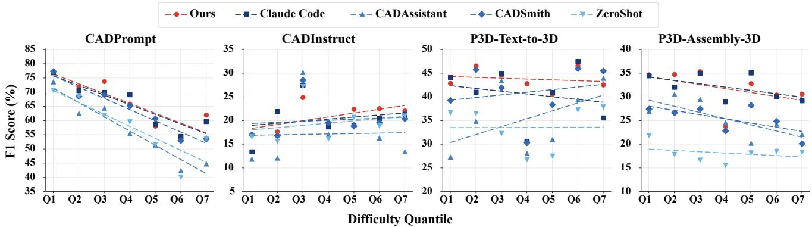

Fi<sub>gure</sub> 4<sub>:</sub> Li<sub>near</sub> <sub>summar</sub>i<sub>es</sub> <sub>o</sub>f <sub>en</sub>d<sub>-</sub>t<sub>o-en</sub>d F1 <sub>across</sub> difi<sub>cu</sub>lt<sub>y</sub> <sub>quan</sub>til<sub>es.</sub> D<sub>as</sub>h<sub>e</sub>d li<sub>nes</sub> <sub>are</sub> l<sub>eas</sub>t<sub>-squares</sub> fit<sub>s</sub> <sub>over</sub> th<sub>e</sub> <sub>seven</sub> <sub>quan</sub>til<sub>es.</sub>  
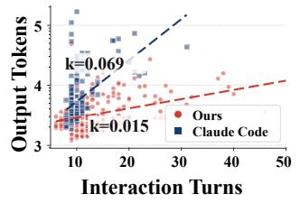  
(a) CADProm<sub>p</sub>t

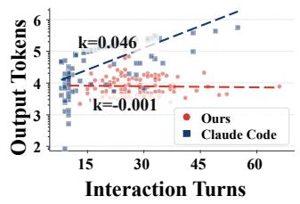  
(b) P3D-Text-to-3D

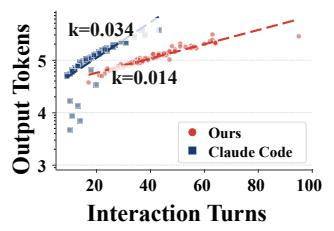  
(c) CADInstruct

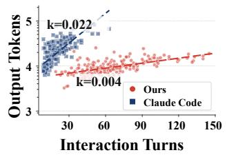  
(d) P3D-Assembl<sub>y</sub>-3D  
Figure 5: Interaction length versus cumulative output tokens. Each point is a complete task trajectory; dashed lines are log-linear fit<sub>s.</sub>

Action-side representation. Token totals in Table 1 depend on trajectory length, feedback history, and caching, and th<sub>ere</sub>f<sub>ore</sub> d<sub>o</sub> <sub>no</sub>t b<sub>y</sub> th<sub>emse</sub>l<sub>ves</sub> id<sub>en</sub>tif<sub>y</sub> th<sub>e</sub> <sub>source</sub> <sub>o</sub>f th<sub>e</sub> <sub>ou</sub>t<sub>pu</sub>t <sub>re</sub>d<sub>uc</sub>ti<sub>on.</sub> Fi<sub>gure</sub> 5 <sub>compares</sub> i<sub>n</sub>t<sub>erac</sub>ti<sub>on</sub> t<sub>urns w</sub>ith <sub>cumu</sub>l<sub>a</sub>ti<sub>ve ou</sub>t<sub>pu</sub>t <sub>a</sub>t th<sub>e</sub> t<sub>as</sub>k l<sub>eve</sub>l<sub>.</sub> Cl<sub>au</sub>d<sub>e</sub> C<sub>o</sub>d<sub>e ex</sub>hibit<sub>s con-</sub> sistently positive log-linear slopes of approximately 0.022– 0.069, whereas DeciCAD’s slopes range from approximately −0.001 to 0.015: its output remains comparatively stable as trajectories lengthen. The reduction does not arise from early termination. DeciCAD trajectories may still be long, but each <sub>pre</sub>di<sub>c</sub>ti<sub>on con</sub>t<sub>a</sub>i<sub>ns an ac</sub>ti<sub>on an</sub>d it<sub>s argumen</sub>t<sub>s ra</sub>th<sub>er</sub> th<sub>an</sub> <sub>an</sub> <sub>expan</sub>d<sub>e</sub>d i<sub>mp</sub>l<sub>emen</sub>t<sub>a</sub>ti<sub>on,</sub> <sub>w</sub>hi<sub>c</sub>h id<sub>en</sub>tifi<sub>es</sub> <sub>ac</sub>ti<sub>on</sub> <sub>repre-</sub> <sub>sen</sub>t<sub>a</sub>ti<sub>on, ra</sub>th<sub>er</sub> th<sub>an s</sub>h<sub>or</sub>t<sub>ene</sub>d <sub>reason</sub>i<sub>ng, as</sub> th<sub>e source o</sub>f th<sub>e</sub> <sub>e</sub>fi<sub>c</sub>i<sub>ency</sub> <sub>ga</sub>i<sub>n.</sub>

Observation-side representation. Table 2 isolates obser-<sub>va</sub>ti<sub>o</sub>n <sub>su</sub>fi<sub>c</sub>i<sub>e</sub>n<sub>cy o</sub>n P3D<sub>-</sub>T<sub>ex</sub>t<sub>-</sub>t<sub>o-</sub>3D<sub>.</sub> M<sub>o</sub>r<sub>e</sub> r<sub>aw s</sub>t<sub>a</sub>t<sub>e</sub> d<sub>e-</sub> <sub>gra</sub>d<sub>es</sub> <sub>geome</sub>t<sub>ry</sub> d<sub>esp</sub>it<sub>e</sub> i<sub>ncreas</sub>i<sub>ng</sub> <sub>con</sub>t<sub>ex</sub>t<sub>,</sub> <sub>w</sub>h<sub>ereas</sub> <sub>re-</sub> <sub>mov</sub>i<sub>ng ac</sub>ti<sub>ve</sub> i<sub>nspec</sub>ti<sub>on or coarsen</sub>i<sub>ng</sub> f<sub>a</sub>il<sub>ure seman</sub>ti<sub>cs</sub> hid<sub>es</sub> di<sub>s</sub>ti<sub>nc</sub>ti<sub>ons nee</sub>d<sub>e</sub>d b<sub>y su</sub>b<sub>sequen</sub>t <sub>ac</sub>ti<sub>ons.</sub> Ef<sub>ec</sub>ti<sub>ve</sub> <sub>compress</sub>i<sub>on</sub> th<sub>ere</sub>f<sub>ore re</sub>t<sub>a</sub>i<sub>ns</sub> d<sub>ec</sub>i<sub>s</sub>i<sub>on-</sub>id<sub>en</sub>tif<sub>y</sub>i<sub>ng ev</sub>id<sub>ence</sub> <sub>ra</sub>th<sub>er</sub> th<sub>an s</sub>i<sub>mp</sub>l<sub>y m</sub>i<sub>n</sub>i<sub>m</sub>i<sub>z</sub>i<sub>ng or max</sub>i<sub>m</sub>i<sub>z</sub>i<sub>ng o</sub>b<sub>serva</sub>ti<sub>on</sub> <sub>vo</sub>l<sub>ume.</sub> T<sub>oge</sub>th<sub>er,</sub> b<sub>o</sub>th <sub>s</sub>id<sub>es suppor</sub>t <sub>a</sub> d<sub>ec</sub>i<sub>s</sub>i<sub>on-su</sub>fi<sub>c</sub>i<sub>en</sub>t <sub>space w</sub>ith l<sub>ower represen</sub>t<sub>a</sub>ti<sub>on</sub> b<sub>ur</sub>d<sub>en.</sub>

## 4.4 Harness-Grounded CAD Policy Learning

F<sub>ron</sub>ti<sub>er mo</sub>d<sub>e</sub>l<sub>s can opera</sub>t<sub>e</sub> b<sub>o</sub>th h<sub>arnesses,</sub> b<sub>u</sub>t th<sub>e corre-</sub> <sub>spon</sub>di<sub>ng po</sub>li<sub>c</sub>i<sub>es nee</sub>d <sub>no</sub>t b<sub>e equa</sub>ll<sub>y</sub> l<sub>earna</sub>bl<sub>e</sub> b<sub>y a sma</sub>ll<sub>er</sub> <sub>s</sub>t<sub>u</sub>d<sub>en</sub>t<sub>.</sub> W<sub>e recons</sub>t<sub>ruc</sub>t <sub>causa</sub>l d<sub>ec</sub>i<sub>s</sub>i<sub>on superv</sub>i<sub>s</sub>i<sub>on</sub> f<sub>rom</sub> harness-matched teacher trajectories and compare Qwen3.5- 9B <sub>po</sub>li<sub>c</sub>i<sub>es on</sub> th<sub>e comp</sub>l<sub>e</sub>t<sub>e</sub> T<sub>ex</sub>t2CAD t<sub>es</sub>t <sub>se</sub>t<sub>.</sub>

<table><tr><td>Metric</td><td>SDO</td><td>SDO-CFF</td><td>RSO</td><td>EFO</td></tr><tr><td>Avail. (%)↑</td><td>100.00</td><td>95.00</td><td>55.00</td><td>87.00</td></tr><tr><td>CD↓</td><td>0.25</td><td>0.44</td><td>0.99</td><td>0.61</td></tr><tr><td>F1↑</td><td>43.63</td><td>32.26</td><td>21.62</td><td>31.75</td></tr><tr><td>IoU↑</td><td>54.22</td><td>43.78</td><td>33.06</td><td>40.71</td></tr><tr><td>Input tokens↓</td><td>390.54</td><td>3,050.00</td><td>3,450.00</td><td>3,200.00</td></tr></table>

T<sub>a</sub>bl<sub>e</sub> 2<sub>:</sub> Abl<sub>a</sub>ti<sub>on</sub> <sub>o</sub>f <sub>o</sub>b<sub>serva</sub>ti<sub>on</sub> <sub>an</sub>d f<sub>ee</sub>db<sub>ac</sub>k d<sub>es</sub>i<sub>gn</sub> <sub>on</sub> P3D<sub>-</sub>T<sub>ex</sub>t<sub>-</sub>t<sub>o-</sub>3D<sub>.</sub> V<sub>a</sub>ri<sub>a</sub>nt<sub>s a</sub>r<sub>e</sub> Str<sub>uc</sub>t<sub>u</sub>r<sub>e</sub>d D<sub>ec</sub>i<sub>s</sub>i<sub>o</sub>n<sub>-</sub>Ori<sub>e</sub>nt<sub>e</sub>d Observation (SDO; full), SDO with Coarse Failure Feedback (SDO-CFF), Raw State Observation (RSO), and Execution-Feedback-Onl<sub>y</sub> Observation (EFO). CD, F1, and IoU are <sub>sca</sub>l<sub>e</sub>d b<sub>y</sub> 100<sub>;</sub> i<sub>npu</sub>t t<sub>o</sub>k<sub>ens are</sub> i<sub>n</sub> th<sub>ousan</sub>d<sub>s per</sub> t<sub>as</sub>k<sub>.</sub>

Policy acquisition from interaction trajectories. Table 3 <sub>compares</sub> B<sub>ase an</sub>d SFT <sub>po</sub>li<sub>c</sub>i<sub>es w</sub>ithi<sub>n eac</sub>h i<sub>n</sub>d<sub>uce</sub>d d<sub>ec</sub>i<sub>-</sub> s<sup>i</sup>on s<sub>p</sub>ace.

SFT <sub>su</sub>b<sub>s</sub>t<sub>an</sub>ti<sub>a</sub>ll<sub>y</sub> i<sub>mproves</sub> th<sub>e</sub> <sub>co</sub>di<sub>ng</sub> <sub>po</sub>li<sub>cy,</sub> <sub>s</sub>h<sub>ow</sub>i<sub>ng</sub> th<sub>a</sub>t th<sub>e s</sub>t<sub>u</sub>d<sub>en</sub>t <sub>can acqu</sub>i<sub>re program cons</sub>t<sub>ruc</sub>ti<sub>on, execu</sub>ti<sub>on, an</sub>d <sub>repa</sub>i<sub>r</sub> b<sub>e</sub>h<sub>av</sub>i<sub>or.</sub> U<sub>n</sub>d<sub>er</sub> <sub>ma</sub>t<sub>c</sub>h<sub>e</sub>d <sub>superv</sub>i<sub>s</sub>i<sub>on,</sub> h<sub>owever,</sub> th<sub>e</sub> D<sub>eci</sub>CAD <sub>po</sub>li<sub>cy pro</sub>d<sub>uces more eva</sub>l<sub>ua</sub>bl<sub>e asse</sub>t<sub>s an</sub>d b<sub>e</sub>t<sub>-</sub> t<sub>er</sub> <sub>geome</sub>t<sub>ry</sub> <sub>across</sub> <sub>a</sub>ll <sub>repor</sub>t<sub>e</sub>d <sub>me</sub>t<sub>r</sub>i<sub>cs.</sub> C<sub>o</sub>di<sub>ng</sub> <sub>superv</sub>i<sub>s</sub>i<sub>on</sub> <sub>mus</sub>t <sub>reso</sub>l<sub>ve geome</sub>t<sub>r</sub>i<sub>c</sub> i<sub>n</sub>t<sub>en</sub>t t<sub>oge</sub>th<sub>er w</sub>ith <sub>program s</sub>t<sub>ruc-</sub> t<sub>ure,</sub> API <sub>c</sub>h<sub>o</sub>i<sub>ce, an</sub>d i<sub>mp</sub>l<sub>emen</sub>t<sub>a</sub>ti<sub>on</sub> f<sub>orm, w</sub>h<sub>ereas</sub> D<sub>eci-</sub> CAD bi<sub>n</sub>d<sub>s</sub> <sub>superv</sub>i<sub>s</sub>i<sub>on</sub> di<sub>rec</sub>tl<sub>y</sub> t<sub>o</sub> <sub>s</sub>t<sub>a</sub>t<sub>e-con</sub>diti<sub>one</sub>d d<sub>oma</sub>i<sub>n</sub> <sub>ac</sub>ti<sub>ons.</sub> Th<sub>e</sub> <sub>resu</sub>lt <sub>suppor</sub>t<sub>s</sub> h<sub>arness-</sub>d<sub>epen</sub>d<sub>en</sub>t l<sub>earna</sub>bilit<sub>y</sub> <sub>un</sub>d<sub>er</sub> fi<sub>n</sub>it<sub>e superv</sub>i<sub>s</sub>i<sub>on.</sub>

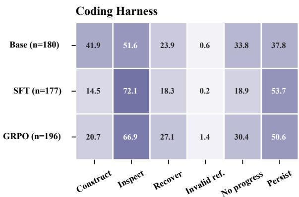

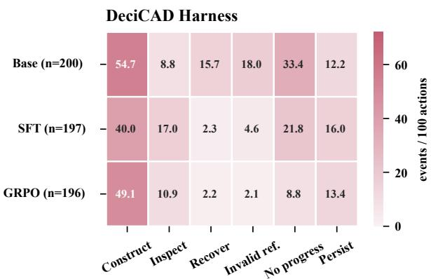  
Fi<sub>gure</sub> 6<sub>:</sub> Ob<sub>serva</sub>bl<sub>e po</sub>li<sub>cy</sub> b<sub>e</sub>h<sub>av</sub>i<sub>or across</sub> B<sub>ase,</sub> SFT<sub>, an</sub>d GRPO<sub>.</sub> Th<sub>e</sub> l<sub>e</sub>ft <sub>an</sub>d <sub>r</sub>i<sub>g</sub>ht <sub>pane</sub>l<sub>s s</sub>h<sub>ow</sub> th<sub>e</sub> C<sub>o</sub>di<sub>ng an</sub>d D<sub>eci</sub>CAD harnesses. Columns report events per 100 decisions under a shared behavioral mapping; n is the number of trajectories containing <sub>parsea</sub>bl<sub>e ac</sub>ti<sub>on recor</sub>d<sub>s.</sub>

<table><tr><td>Harness</td><td>Policy</td><td>Avail. (%)</td><td>F1</td><td>IoU</td><td>CD</td></tr><tr><td rowspan="2">Coding</td><td>Base</td><td>12.5</td><td>0.5902</td><td>0.5871</td><td>0.00972</td></tr><tr><td>SFT</td><td>60.5</td><td>0.6460</td><td>0.6286</td><td>0.01130</td></tr><tr><td rowspan="2">DECICAD</td><td>Base</td><td>61.5</td><td>0.6883</td><td>0.6487</td><td>0.01023</td></tr><tr><td>SFT</td><td>66.5</td><td>0.7437</td><td>0.6631</td><td>0.00782</td></tr></table>

T<sub>a</sub>bl<sub>e</sub> 3<sub>:</sub> Cl<sub>ose</sub>d<sub>-</sub>l<sub>oop</sub> <sub>po</sub>li<sub>cy</sub> <sub>acqu</sub>i<sub>s</sub>iti<sub>on</sub> <sub>on</sub> th<sub>e</sub> T<sub>ex</sub>t2CAD/ D<sub>eep</sub>CAD t<sub>es</sub>t <sub>se</sub>t<sub>.</sub> A<sub>va</sub>il<sub>a</sub>bilit<sub>y</sub> i<sub>s compu</sub>t<sub>e</sub>d <sub>over a</sub>ll t<sub>as</sub>k<sub>s;</sub> F1<sub>,</sub> I<sub>o</sub>U<sub>,</sub> <sub>an</sub>d CD <sub>are</sub> <sub>compu</sub>t<sub>e</sub>d <sub>over</sub> <sub>va</sub>lid <sub>asse</sub>t<sub>s.</sub>

Online improvement from environment feedback. Starti<sub>ng</sub> f<sub>rom eac</sub>h SFT <sub>po</sub>li<sub>cy, we samp</sub>l<sub>e s</sub>t<sub>u</sub>d<sub>en</sub>t <sub>ro</sub>ll<sub>ou</sub>t<sub>s</sub> i<sub>n</sub> it<sub>s</sub> <sub>own</sub> i<sub>n</sub>d<sub>uce</sub>d d<sub>ec</sub>i<sub>s</sub>i<sub>on</sub> <sub>space,</sub> <sub>an</sub>d <sub>app</sub>l<sub>y</sub> <sub>re</sub>f<sub>erence-regu</sub>l<sub>ar</sub>i<sub>ze</sub>d GRPO <sub>w</sub>ith <sub>geome</sub>t<sub>ry-groun</sub>d<sub>e</sub>d <sub>rewar</sub>d<sub>s.</sub> Th<sub>e s</sub>t<sub>u</sub>d<sub>en</sub>t <sub>mo</sub>d<sub>e</sub>l<sub>,</sub> t<sub>as</sub>k <sub>exposure,</sub> <sub>samp</sub>l<sub>es</sub> <sub>per</sub> t<sub>as</sub>k<sub>,</sub> <sub>an</sub>d <sub>eva</sub>l<sub>ua</sub>t<sub>or</sub> <sub>are</sub> <sub>ma</sub>t<sub>c</sub>h<sub>e</sub>d<sub>.</sub> Improvement is judged by the frozen unseen-task evaluation rather than training reward, trajectory length, or token consum<sub>p</sub>t<sup>i</sup>on.

<table><tr><td>Harness</td><td>Policy</td><td>Avail. (%)</td><td>F1</td><td>IoU</td><td>CD</td></tr><tr><td rowspan="2">Coding</td><td>SFT</td><td>60.5</td><td>0.6460</td><td>0.6286</td><td>0.01130</td></tr><tr><td>SFT+GRPO</td><td>65.5</td><td>0.6253</td><td>0.5987</td><td>0.02253</td></tr><tr><td rowspan="2">DECICAD</td><td>SFT</td><td>66.5</td><td>0.7437</td><td>0.6631</td><td>0.00782</td></tr><tr><td>SFT+GRPO</td><td>73.5</td><td>0.7880</td><td>0.7036</td><td>0.00570</td></tr></table>

T<sub>a</sub>bl<sub>e</sub> 4<sub>:</sub> O<sub>n</sub>li<sub>ne po</sub>li<sub>cy</sub> i<sub>mprovemen</sub>t <sub>un</sub>d<sub>er ma</sub>t<sub>c</sub>h<sub>e</sub>d t<sub>ra</sub>i<sub>n</sub>i<sub>ng</sub> <sub>an</sub>d <sub>eva</sub>l<sub>ua</sub>ti<sub>on.</sub> F1<sub>,</sub> I<sub>o</sub>U<sub>,</sub> <sub>an</sub>d CD <sub>are</sub> <sub>compu</sub>t<sub>e</sub>d <sub>over</sub> <sub>va</sub>lid assets.

T<sub>a</sub>bl<sub>e</sub> 4 <sub>s</sub>h<sub>ows</sub> th<sub>a</sub>t <sub>on</sub>li<sub>ne</sub> f<sub>ee</sub>db<sub>ac</sub>k i<sub>mproves</sub> D<sub>eci</sub>CAD <sub>across</sub> <sub>ava</sub>il<sub>a</sub>bilit<sub>y</sub> <sub>an</sub>d <sub>a</sub>ll th<sub>ree</sub> <sub>geome</sub>t<sub>r</sub>i<sub>c</sub> <sub>me</sub>t<sub>r</sub>i<sub>cs,</sub> <sub>w</sub>h<sub>ereas</sub> th<sub>e co</sub>di<sub>ng po</sub>li<sub>cy</sub> d<sub>oes no</sub>t <sub>rea</sub>li<sub>ze</sub> th<sub>e same ga</sub>i<sub>ns un</sub>d<sub>er</sub> th<sub>e</sub> <sub>ma</sub>t<sub>c</sub>h<sub>e</sub>d i<sub>n</sub>f<sub>erence</sub> b<sub>u</sub>d<sub>ge</sub>t<sub>,</sub> <sub>suppor</sub>ti<sub>ng</sub> h<sub>arness-</sub>d<sub>epen</sub>d<sub>en</sub>t <sub>on-</sub> li<sub>ne</sub> l<sub>earna</sub>bilit<sub>y.</sub>

What the policies learn. To compare the learning paths, <sub>we map</sub> th<sub>e ex</sub>t<sub>erna</sub>l <sub>e</sub>f<sub>ec</sub>t<sub>s o</sub>f b<sub>o</sub>th h<sub>arnesses</sub> i<sub>n</sub>t<sub>o s</sub>i<sub>x s</sub>h<sub>are</sub>d <sub>ca</sub>t<sub>ego</sub>ri<sub>es:</sub> C<sub>o</sub>n<sub>s</sub>tr<sub>uc</sub>t<sub>,</sub> In<sub>spec</sub>t<sub>,</sub> R<sub>ecove</sub>r<sub>,</sub> In<sub>va</sub>lid R<sub>e</sub>f<sub>e</sub>r<sub>e</sub>n<sub>ce,</sub> N<sub>o</sub> Pr<sub>og</sub>r<sub>ess, a</sub>nd P<sub>e</sub>r<sub>s</sub>i<sub>s</sub>t<sub>, a</sub>nd r<sub>epo</sub>rt <sub>eve</sub>nt<sub>s pe</sub>r 100 d<sub>ec</sub>i<sub>-</sub> sions (Fi<sub>g</sub>ure 6). Codin<sub>g</sub> SFT increases Ins<sub>p</sub>ect from 51.6 to 72<sub>.</sub>1 <sub>even</sub>t<sub>s per</sub> 100 d<sub>ec</sub>i<sub>s</sub>i<sub>ons, w</sub>hil<sub>e</sub> C<sub>ons</sub>t<sub>ruc</sub>t <sub>an</sub>d R<sub>ecover</sub> b<sub>o</sub>th d<sub>ec</sub>li<sub>ne.</sub> GRPO <sub>res</sub>t<sub>ores par</sub>t <sub>o</sub>f th<sub>e cons</sub>t<sub>ruc</sub>ti<sub>on an</sub>d <sub>recovery</sub> b<sub>e</sub>h<sub>av</sub>i<sub>or,</sub> b<sub>u</sub>t N<sub>o</sub> P<sub>rogress r</sub>i<sub>ses</sub> f<sub>rom</sub> 18<sub>.</sub>9 t<sub>o</sub> 30<sub>.</sub>4<sub>,</sub> <sub>s</sub>h<sub>ow</sub>i<sub>ng</sub> th<sub>a</sub>t <sub>more repa</sub>i<sub>r a</sub>tt<sub>emp</sub>t<sub>s</sub> d<sub>o no</sub>t <sub>cons</sub>i<sub>s</sub>t<sub>en</sub>tl<sub>y pro-</sub> d<sub>uce geo</sub>m<sub>e</sub>tri<sub>c p</sub>r<sub>og</sub>r<sub>ess.</sub> In D<sub>eci</sub>CAD<sub>,</sub> SFT r<sub>e</sub>d<sub>uces</sub> In<sub>va</sub>lid R<sub>e</sub>f<sub>erence an</sub>d N<sub>o</sub> P<sub>rogress</sub> f<sub>rom</sub> 18<sub>.</sub>0 <sub>an</sub>d 33<sub>.</sub>4 t<sub>o</sub> 4<sub>.</sub>6 <sub>an</sub>d 21<sub>.</sub>8<sub>, an</sub>d GRPO f<sub>ur</sub>th<sub>er re</sub>d<sub>uces</sub> th<sub>em</sub> t<sub>o</sub> 2<sub>.</sub>1 <sub>an</sub>d 8<sub>.</sub>8 <sub>w</sub>hil<sub>e</sub> <sub>re</sub>t<sub>a</sub>i<sub>n</sub>i<sub>ng</sub> d<sub>ense</sub> <sub>cons</sub>t<sub>ruc</sub>ti<sub>on</sub> b<sub>e</sub>h<sub>av</sub>i<sub>or.</sub> C<sub>o</sub>di<sub>ng</sub> <sub>superv</sub>i<sub>s</sub>i<sub>on</sub> th<sub>ere</sub>f<sub>ore</sub> <sub>ma</sub>i<sub>n</sub>l<sub>y</sub> <sub>c</sub>h<sub>anges</sub> <sub>execu</sub>ti<sub>on,</sub> i<sub>nspec</sub>ti<sub>on,</sub> <sub>an</sub>d <sub>repa</sub>i<sub>r</sub> b<sub>e</sub>h<sub>av</sub>i<sub>or,</sub> <sub>w</sub>h<sub>ereas</sub> D<sub>eci</sub>CAD l<sub>earn</sub>i<sub>ng</sub> <sub>more</sub> di<sub>rec</sub>tl<sub>y</sub> <sub>c</sub>h<sub>anges</sub> CAD <sub>s</sub>t<sub>a</sub>t<sub>e</sub> t<sub>rans</sub>iti<sub>ons an</sub>d <sub>suppresses</sub> i<sub>n</sub>t<sub>erac</sub>ti<sub>ons</sub> th<sub>a</sub>t f<sub>a</sub>il t<sub>o</sub> <sub>a</sub>d<sub>vance</sub> th<sub>e mo</sub>d<sub>e</sub>l<sub>.</sub>

## 5 Conclusion

W<sub>e</sub> f<sub>orma</sub>li<sub>ze</sub>d H<sub>arness-</sub>I<sub>n</sub>d<sub>uce</sub>d CAD D<sub>ec</sub>i<sub>s</sub>i<sub>on</sub> S <sub>aces an</sub>d i<sub>ns</sub>t<sub>an</sub>ti<sub>a</sub>t<sub>e</sub>d th<sub>e</sub> S<sub>eman</sub>ti<sub>c</sub> D<sub>ec</sub>i<sub>s</sub>i<sub>on</sub> B<sub>o</sub>ttl<sub>enec</sub>k i<sub>n</sub> D<sub>eci</sub>CAD th<sub>roug</sub>h <sub>seman</sub>ti<sub>c ac</sub>ti<sub>ons, pers</sub>i<sub>s</sub>t<sub>en</sub>t <sub>s</sub>t<sub>a</sub>t<sub>e, an</sub>d d<sub>ec</sub>i<sub>s</sub>i<sub>on-</sub> <sub>or</sub>i<sub>en</sub>t<sub>e</sub>d f<sub>ee</sub>db<sub>ac</sub>k<sub>.</sub> A<sub>cross execu</sub>ti<sub>on,</sub> SFT<sub>, an</sub>d <sub>on</sub>li<sub>ne</sub> RL<sub>,</sub> D<sub>eci</sub>CAD <sub>preserves comp</sub>l<sub>ex mo</sub>d<sub>e</sub>li<sub>ng capa</sub>bilit<sub>y w</sub>hil<sub>e re-</sub> d<sub>uc</sub>i<sub>ng</sub> i<sub>rre</sub>l<sub>evan</sub>t b<sub>ur</sub>d<sub>en an</sub>d <sub>ena</sub>bli<sub>ng more</sub> l<sub>earna</sub>bl<sub>e an</sub>d <sub>op</sub>ti<sub>m</sub>i<sub>za</sub>bl<sub>e po</sub>li<sub>c</sub>i<sub>es.</sub> T<sub>oge</sub>th<sub>er,</sub> th<sub>ese</sub> fi<sub>n</sub>di<sub>ngs s</sub>h<sub>ow</sub> th<sub>a</sub>t <sub>a</sub> h<sub>arness</sub> d<sub>e</sub>t<sub>erm</sub>i<sub>nes</sub> b<sub>o</sub>th th<sub>e</sub> CAD <sub>opera</sub>ti<sub>ons</sub> <sub>a</sub> <sub>mo</sub>d<sub>e</sub>l <sub>can</sub> <sub>execu</sub>t<sub>e an</sub>d th<sub>e</sub> di<sub>s</sub>ti<sub>nc</sub>ti<sub>ons</sub> it<sub>s po</sub>li<sub>cy mus</sub>t l<sub>earn, w</sub>hil<sub>e en-</sub> <sub>v</sub>i<sub>ronmen</sub>t f<sub>ee</sub>db<sub>ac</sub>k i<sub>mproves</sub> th<sub>a</sub>t <sub>po</sub>li<sub>cy w</sub>ithi<sub>n</sub> th<sub>e same</sub> d<sub>ec</sub>i<sub>s</sub>i<sub>on</sub> <sub>represen</sub>t<sub>a</sub>ti<sub>on.</sub> Thi<sub>s</sub> <sub>es</sub>t<sub>a</sub>bli<sub>s</sub>h<sub>es</sub> h<sub>arness</sub> d<sub>es</sub>i<sub>gn</sub> <sub>as</sub> <sub>cen</sub>t<sub>ra</sub>l t<sub>o</sub> CAD <sub>agen</sub>t<sub>s.</sub> O<sub>ur s</sub>t<sub>u</sub>d<sub>y</sub> h<sub>as</sub> li<sub>m</sub>it<sub>a</sub>ti<sub>ons.</sub> Th<sub>e</sub> h<sub>arness</sub> <sub>compar</sub>i<sub>son uses one</sub> CAD b<sub>ac</sub>k<sub>en</sub>d <sub>an</sub>d <sub>one</sub> f<sub>ron</sub>ti<sub>er mo</sub>d<sub>e</sub>l<sub>,</sub> <sub>po</sub>li<sub>cy</sub> l<sub>earn</sub>i<sub>ng uses one s</sub>t<sub>u</sub>d<sub>en</sub>t <sub>mo</sub>d<sub>e</sub>l <sub>on one</sub> d<sub>a</sub>t<sub>ase</sub>t<sub>, an</sub>d <sub>mes</sub>h<sub>-</sub>b<sub>ase</sub>d <sub>me</sub>t<sub>r</sub>i<sub>cs</sub> d<sub>o</sub> <sub>no</sub>t <sub>cap</sub>t<sub>ure</sub> <sub>e</sub>dit<sub>a</sub>bilit<sub>y,</sub> <sub>cons</sub>t<sub>ra</sub>i<sub>n</sub>t <sub>sa</sub>t<sub>-</sub> i<sub>s</sub>f<sub>ac</sub>ti<sub>on, or</sub> f<sub>ea</sub>t<sub>ure-</sub>t<sub>ree va</sub>lidit<sub>y.</sub> E<sub>x</sub>t<sub>en</sub>di<sub>ng</sub> th<sub>e compar</sub>i<sub>son</sub> t<sub>o</sub> f<sub>ur</sub>th<sub>er</sub> b<sub>ac</sub>k<sub>en</sub>d<sub>s, mo</sub>d<sub>e</sub>l<sub>s, an</sub>d CAD<sub>-na</sub>ti<sub>ve correc</sub>t<sub>ness</sub> <sub>measures</sub> i<sub>s</sub> l<sub>e</sub>ft t<sub>o</sub> f<sub>u</sub>t<sub>ure wor</sub>k<sub>.</sub>

## References

Ab<sub>e</sub>l<sub>,</sub> D<sub>.;</sub> H<sub>ers</sub>hk<sub>ow</sub>it<sub>z,</sub> D<sub>.</sub> E<sub>.; an</sub>d Litt<sub>man,</sub> M<sub>.</sub> L<sub>.</sub> 2016<sub>.</sub> N<sub>ear</sub> O<sub>p</sub>ti<sub>ma</sub>l B<sub>e</sub>h<sub>av</sub>i<sub>or v</sub>i<sub>a</sub> A<sub>pprox</sub>i<sub>ma</sub>t<sub>e</sub> St<sub>a</sub>t<sub>e</sub> Ab<sub>s</sub>t<sub>rac</sub>ti<sub>on.</sub> In Proceedings of the 33rd International Conference on Machine Learning, volume 48 of Proceedings of Machine Learning Research, 2915–2923. PMLR.

Ab<sub>e</sub>l<sub>,</sub> D<sub>.;</sub> U<sub>m</sub>b<sub>an</sub>h<sub>owar,</sub> N<sub>.;</sub> Kh<sub>e</sub>t<sub>arpa</sub>l<sub>,</sub> K<sub>.;</sub> A<sub>rumugam,</sub> D<sub>.;</sub> Pr<sub>ecup,</sub> D<sub>.; a</sub>nd Littm<sub>a</sub>n<sub>,</sub> M<sub>.</sub> L<sub>.</sub> 2020<sub>.</sub> V<sub>a</sub>l<sub>ue</sub> Pr<sub>ese</sub>r<sub>v</sub>in<sub>g</sub> State-Action Abstractions. In Proceedings ofthe 23rd International Conference on Artificial Intelligence and Statistics, volume 108 of Proceedings ofMachine Learning Research, 1639<sub>–</sub>1650<sub>.</sub> PMLR<sub>.</sub>

A<sub>c</sub>hi<sub>am,</sub> J<sub>.;</sub> Adl<sub>er,</sub> S<sub>.;</sub> A<sub>garwa</sub>l<sub>,</sub> S<sub>.;</sub> Ah<sub>ma</sub>d<sub>,</sub> L<sub>.;</sub> Akk<sub>aya,</sub> I<sub>.;</sub> Al<sub>eman,</sub> F<sub>.</sub> L<sub>.;</sub> Al<sub>me</sub>id<sub>a,</sub> D<sub>.;</sub> Alt<sub>ensc</sub>h<sub>m</sub>idt<sub>,</sub> J<sub>.;</sub> Alt<sub>man,</sub> S<sub>.;</sub> A<sub>na</sub>dk<sub>a</sub>t<sub>,</sub> S<sub>.; e</sub>t <sub>a</sub>l<sub>.</sub> 2023<sub>.</sub> GPT<sub>-</sub>4 T<sub>ec</sub>h<sub>n</sub>i<sub>ca</sub>l R<sub>epor</sub>t<sub>.</sub> <sub>a</sub>rXi<sub>v:</sub>2303<sub>.</sub>08774<sub>.</sub>

Al<sub>ras</sub>h<sub>e</sub>d<sub>y,</sub> K<sub>.;</sub> T<sub>am</sub>b<sub>we</sub>k<sub>ar,</sub> P<sub>.;</sub> Z<sub>a</sub>idi<sub>,</sub> Z<sub>.</sub> H<sub>.;</sub> L<sub>angwasser,</sub> M<sub>.;</sub> X<sub>u,</sub> W<sub>.;</sub> <sub>a</sub>nd G<sub>o</sub>mb<sub>o</sub>l<sub>ay,</sub> M<sub>.</sub> C<sub>.</sub> 2025<sub>.</sub> G<sub>e</sub>n<sub>e</sub>r<sub>a</sub>tin<sub>g</sub> CAD C<sub>o</sub>d<sub>e w</sub>ith Vi<sub>s</sub>i<sub>o</sub>n<sub>-</sub>L<sub>a</sub>n<sub>guage</sub> M<sub>o</sub>d<sub>e</sub>l<sub>s</sub> f<sub>o</sub>r 3D D<sub>es</sub>i<sub>g</sub>n<sub>s.</sub> In International Conference on Learning Representations.

A<sub>n</sub>th<sub>rop</sub>i<sub>c.</sub> 2026<sub>a.</sub> Cl<sub>au</sub>d<sub>e</sub> C<sub>o</sub>d<sub>e:</sub> A<sub>n</sub> A<sub>gen</sub>ti<sub>c</sub> C<sub>o</sub>di<sub>ng</sub> S<sub>ys</sub>t<sub>em.</sub> A<sub>ccesse</sub>d J<sub>u</sub>l<sub>y</sub> 29<sub>,</sub> 2026<sub>.</sub>

A<sub>n</sub>th<sub>rop</sub>i<sub>c.</sub> 2026b<sub>.</sub> I<sub>n</sub>t<sub>ro</sub>d<sub>uc</sub>i<sub>ng</sub> Cl<sub>au</sub>d<sub>e</sub> O<sub>pus</sub> 4<sub>.</sub>7<sub>.</sub> A<sub>ccesse</sub>d J<sub>u</sub>l<sub>y</sub> 29<sub>,</sub> 2026<sub>.</sub>

A<sub>n</sub>th<sub>rop</sub>i<sub>c.</sub> 2026<sub>c.</sub> I<sub>n</sub>t<sub>ro</sub>d<sub>uc</sub>i<sub>ng</sub> Cl<sub>au</sub>d<sub>e</sub> S<sub>onne</sub>t 4<sub>.</sub>6<sub>.</sub> A<sub>ccesse</sub>d J<sub>u</sub>l<sub>y</sub> 29<sub>,</sub> 2026<sub>.</sub>

B<sub>ar</sub>kl<sub>ey,</sub> J<sub>.;</sub> L<sub>og</sub>h<sub>man</sub>i<sub>,</sub> R<sub>.; an</sub>d B<sub>ara</sub>ti F<sub>ar</sub>i<sub>man</sub>i<sub>,</sub> A<sub>.</sub> 2026<sub>.</sub> CADS<sub>m</sub>ith<sub>:</sub> M<sub>u</sub>lti<sub>-</sub>A<sub>gen</sub>t CAD G<sub>enera</sub>ti<sub>on w</sub>ith P<sub>rogram-</sub> <sub>ma</sub>ti<sub>c</sub> G<sub>eome</sub>t<sub>r</sub>i<sub>c</sub> V<sub>a</sub>lid<sub>a</sub>ti<sub>on. ar</sub>Xi<sub>v:</sub>2603<sub>.</sub>26512<sub>.</sub>

B<sub>e</sub>n<sub>g</sub>i<sub>o,</sub> Y<sub>.;</sub> L<sub>ou</sub>r<sub>a</sub>d<sub>ou</sub>r<sub>,</sub> J<sub>.;</sub> C<sub>o</sub>ll<sub>o</sub>b<sub>e</sub>rt<sub>,</sub> R<sub>.; a</sub>nd W<sub>es</sub>t<sub>o</sub>n<sub>,</sub> J<sub>.</sub> 2009<sub>.</sub> Curriculum Learning. In Proceedings ofthe 26th Annual International Conference on Machine Learning, 41–48. ACM.

Ch<sub>en,</sub> J<sub>.;</sub> F<sub>u,</sub> D<sub>.;</sub> H<sub>e</sub>i<sub>,</sub> X<sub>.;</sub> Li<sub>u,</sub> Y<sub>.;</sub> Ch<sub>en,</sub> Y<sub>.;</sub> Xi<sub>e,</sub> J<sub>.;</sub> F<sub>an,</sub> W<sub>.;</sub> <sub>an</sub>d C<sub>a</sub>i<sub>,</sub> Y<sub>.</sub> 2026<sub>.</sub> CADM<sub>a</sub>t<sub>e:</sub> G<sub>enera</sub>ti<sub>ng</sub> CAD A<sub>ssem</sub>bl<sub>y</sub> Pl<sub>an w</sub>ith G<sub>eome</sub>t<sub>r</sub>i<sub>c</sub> Ch<sub>a</sub>i<sub>n-o</sub>f<sub>-</sub>Th<sub>oug</sub>ht <sub>an</sub>d S<sub>pa</sub>ti<sub>a</sub>l Ph<sub>ys</sub>i<sub>ca</sub>l Rewards. In Proceedings ofthe 64th Annual Meeting ofthe Association for Computational Linguistics (Volume 1: Long Papers), 18324–18348. San Diego, California, United States: A<sub>ssoc</sub>i<sub>a</sub>ti<sub>on</sub> f<sub>or</sub> C<sub>ompu</sub>t<sub>a</sub>ti<sub>ona</sub>l Li<sub>ngu</sub>i<sub>s</sub>ti<sub>cs.</sub>

D<sub>or</sub>i<sub>s,</sub> A<sub>.</sub> C<sub>.;</sub> Al<sub>am,</sub> M<sub>.</sub> F<sub>.;</sub> N<sub>o</sub>b<sub>ar</sub>i<sub>,</sub> A<sub>.</sub> H<sub>.; an</sub>d Ah<sub>me</sub>d<sub>,</sub> F<sub>.</sub> 2025<sub>.</sub> CAD<sub>-</sub>C<sub>o</sub>d<sub>e</sub>r<sub>:</sub> An O<sub>pe</sub>n<sub>-</sub>S<sub>ou</sub>r<sub>ce</sub> Vi<sub>s</sub>i<sub>o</sub>n<sub>-</sub>L<sub>a</sub>n<sub>guage</sub> M<sub>o</sub>d<sub>e</sub>l f<sub>or</sub> C<sub>ompu</sub>t<sub>er-</sub>Aid<sub>e</sub>d D<sub>es</sub>i<sub>gn</sub> C<sub>o</sub>d<sub>e</sub> G<sub>enera</sub>ti<sub>on.</sub> <sub>ar</sub>Xi<sub>v:</sub>2505<sub>.</sub>14646<sub>.</sub>

Fan, F.; Ni, J.; Yin, X.; Wan<sub>g</sub>, S.; Lu, X.; Zou, Q.; Ton<sub>g</sub>, R<sub>.;</sub> T<sub>a</sub>n<sub>g,</sub> M<sub>.;</sub> <sub>a</sub>nd D<sub>u,</sub> P<sub>.</sub> 2025<sub>.</sub> CADD<sub>es</sub>i<sub>g</sub>n<sub>e</sub>r<sub>:</sub> C<sub>o</sub>n<sub>cep-</sub> t<sub>ua</sub>l CAD M<sub>o</sub>d<sub>e</sub>l G<sub>enera</sub>ti<sub>on</sub> <sub>w</sub>ith <sub>a</sub> G<sub>enera</sub>l<sub>-</sub>P<sub>urpose</sub> A<sub>gen</sub>t<sub>.</sub> <sub>a</sub>rXi<sub>v:</sub>2508<sub>.</sub>01031<sub>.</sub>

F<sub>an,</sub> H<sub>.;</sub> S<sub>u,</sub> H<sub>.; an</sub>d G<sub>u</sub>ib<sub>as,</sub> L<sub>.</sub> J<sub>.</sub> 2017<sub>.</sub> A P<sub>o</sub>i<sub>n</sub>t S<sub>e</sub>t G<sub>ener-</sub> ation Network for 3D Object Reconstruction from a Sin le Image. In Proceedings of the IEEE Conference on Computer Vision and Pattern Recognition, 2463–2471.

Fen<sub>g</sub>, J.; Huan<sub>g</sub>, S.; Qu, X.; Zhan<sub>g</sub>, G.; Qin, Y.; Zhon<sub>g</sub>, B<sub>.;</sub> Ji<sub>a</sub>n<sub>g,</sub> C<sub>.;</sub> Chi<sub>,</sub> J<sub>.;</sub> <sub>a</sub>nd Zh<sub>o</sub>n<sub>g,</sub> W<sub>.</sub> 2025<sub>.</sub> R<sub>e</sub>T<sub>oo</sub>l<sub>:</sub> R<sub>e</sub>inf<sub>o</sub>r<sub>ce</sub>m<sub>e</sub>nt L<sub>ea</sub>rnin<sub>g</sub> f<sub>o</sub>r Str<sub>a</sub>t<sub>eg</sub>i<sub>c</sub> T<sub>oo</sub>l U<sub>se</sub> in LLM<sub>s.</sub> <sub>ar</sub>Xi<sub>v:</sub>2504<sub>.</sub>11536<sub>.</sub>

G<sub>o</sub>n<sub>g,</sub> Y<sub>.;</sub> W<sub>u,</sub> X<sub>.;</sub> Li<sub>u,</sub> W<sub>.; a</sub>nd T<sub>u,</sub> K<sub>.</sub> 2026<sub>.</sub> TOOL<sub>-</sub> CAD<sub>:</sub> E<sub>xp</sub>l<sub>o</sub>rin<sub>g</sub> T<sub>oo</sub>l<sub>-</sub>U<sub>s</sub>in<sub>g</sub> L<sub>a</sub>r<sub>ge</sub> L<sub>a</sub>n<sub>guage</sub> M<sub>o</sub>d<sub>e</sub>l<sub>s</sub> in T<sub>ex</sub>t<sub>-</sub>t<sub>o-</sub>CAD G<sub>enera</sub>ti<sub>on</sub> <sub>w</sub>ith R<sub>e</sub>i<sub>n</sub>f<sub>orcemen</sub>t L<sub>earn</sub>i<sub>ng.</sub> <sub>a</sub>rXi<sub>v:</sub>2604<sub>.</sub>07960<sub>.</sub>

Govindarajan, P.; Baldelli, D.; Pathak, J.; Fournier, Q.; and Ch<sub>a</sub>nd<sub>a</sub>r<sub>,</sub> S<sub>.</sub> 2026<sub>.</sub> CADmi<sub>u</sub>m<sub>:</sub> Fin<sub>e-</sub>T<sub>u</sub>nin<sub>g</sub> C<sub>o</sub>d<sub>e</sub> L<sub>a</sub>n<sub>guage</sub> Models for Text-Driven Sequential CAD Design. Transactions on Machine Learning Research.

Guan, Y.; Wan<sub>g</sub>, X.; Min<sub>g</sub>, X.; Zhan<sub>g</sub>, J.; Xu, D.; and Yu, Q. 2025<sub>.</sub> CAD<sub>-</sub>C<sub>o</sub>d<sub>er:</sub> T<sub>ex</sub>t<sub>-</sub>t<sub>o-</sub>CAD G<sub>enera</sub>ti<sub>on w</sub>ith Ch<sub>a</sub>i<sub>n-o</sub>f<sub>-</sub> Th<sub>oug</sub>ht <sub>an</sub>d G<sub>eome</sub>t<sub>r</sub>i<sub>c</sub> R<sub>ewar</sub>d<sub>. ar</sub>Xi<sub>v:</sub>2505<sub>.</sub>19713<sub>.</sub>

G<sub>uo,</sub> T<sub>.;</sub> Ch<sub>e</sub>n<sub>,</sub> X<sub>.;</sub> W<sub>a</sub>n<sub>g,</sub> Y<sub>.;</sub> Ch<sub>a</sub>n<sub>g,</sub> R<sub>.;</sub> P<sub>e</sub>i<sub>,</sub> S<sub>.;</sub> Ch<sub>aw</sub>l<sub>a,</sub> N<sub>.</sub> V<sub>.;</sub> Wi<sub>es</sub>t<sub>,</sub> O<sub>.;</sub> <sub>a</sub>nd Zh<sub>a</sub>n<sub>g,</sub> X<sub>.</sub> 2024<sub>.</sub> L<sub>a</sub>r<sub>ge</sub> L<sub>a</sub>n<sub>guage</sub> M<sub>o</sub>d<sub>e</sub>l B<sub>ase</sub>d M<sub>u</sub>lti<sub>-</sub>A<sub>gen</sub>t<sub>s:</sub> A S<sub>urvey o</sub>f P<sub>rogress an</sub>d Ch<sub>a</sub>l<sub>-</sub> lenges. In Proceedings ofthe Thirty-Third International Joint Conference on Artificial Intelligence, 8048–8057.

K<sub>ae</sub>lblin<sub>g,</sub> L<sub>.</sub> P<sub>.;</sub> Littm<sub>a</sub>n<sub>,</sub> M<sub>.</sub> L<sub>.; a</sub>nd C<sub>assa</sub>ndr<sub>a,</sub> A<sub>.</sub> R<sub>.</sub> 1998<sub>.</sub> Pl<sub>ann</sub>i<sub>ng an</sub>d A<sub>c</sub>ti<sub>ng</sub> i<sub>n</sub> P<sub>ar</sub>ti<sub>a</sub>ll<sub>y</sub> Ob<sub>serva</sub>bl<sub>e</sub> St<sub>oc</sub>h<sub>as</sub>ti<sub>c</sub> D<sub>o-</sub> mains. Artificial Intelligence, 101(1–2): 99–134.

K<sub>a</sub>r<sub>pas,</sub> E<sub>.;</sub> Ab<sub>e</sub>nd<sub>,</sub> O<sub>.;</sub> B<sub>e</sub>link<sub>ov,</sub> Y<sub>.;</sub> L<sub>e</sub>n<sub>z,</sub> B<sub>.;</sub> Li<sub>e</sub>b<sub>e</sub>r<sub>,</sub> O<sub>.;</sub> R<sub>a</sub>t<sub>ner,</sub> N<sub>.;</sub> Sh<sub>o</sub>h<sub>am,</sub> Y<sub>.;</sub> B<sub>a</sub>t<sub>a,</sub> H<sub>.;</sub> L<sub>ev</sub>i<sub>ne,</sub> Y<sub>.;</sub> L<sub>ey</sub>t<sub>on-</sub>B<sub>rown,</sub> K<sub>.;</sub> M<sub>u</sub>hl<sub>gay,</sub> D<sub>.;</sub> R<sub>oze</sub>n<sub>,</sub> N<sub>.;</sub> S<sub>c</sub>h<sub>wa</sub>rt<sub>z,</sub> E<sub>.;</sub> Sh<sub>ac</sub>h<sub>a</sub>f<sub>,</sub> G<sub>.;</sub> Sh<sub>a</sub>l<sub>ev-</sub>Sh<sub>war</sub>t<sub>z,</sub> S<sub>.;</sub> Sh<sub>as</sub>h<sub>ua,</sub> A<sub>.; an</sub>d T<sub>ennen</sub>h<sub>o</sub>lt<sub>z,</sub> M<sub>.</sub> 2022<sub>.</sub> MRKL S<sub>ys</sub>t<sub>ems:</sub> A M<sub>o</sub>d<sub>u</sub>l<sub>ar,</sub> N<sub>euro-</sub>S<sub>ym</sub>b<sub>o</sub>li<sub>c</sub> A<sub>rc</sub>hit<sub>ec</sub>t<sub>ure</sub> Th<sub>a</sub>t C<sub>o</sub>mbin<sub>es</sub> L<sub>a</sub>r<sub>ge</sub> L<sub>a</sub>n<sub>guage</sub> M<sub>o</sub>d<sub>e</sub>l<sub>s,</sub> E<sub>x</sub>t<sub>e</sub>rn<sub>a</sub>l Kn<sub>ow</sub>l<sub>-</sub> <sub>e</sub>d<sub>ge</sub> S<sub>ources an</sub>d Di<sub>scre</sub>t<sub>e</sub> R<sub>eason</sub>i<sub>ng. ar</sub>Xi<sub>v:</sub>2205<sub>.</sub>00445<sub>.</sub>

Kh<sub>an,</sub> M<sub>.</sub> S<sub>.;</sub> Si<sub>n</sub>h<sub>a,</sub> S<sub>.;</sub> Sh<sub>e</sub>ikh<sub>,</sub> T<sub>.</sub> U<sub>.;</sub> St<sub>r</sub>i<sub>c</sub>k<sub>er,</sub> D<sub>.;</sub> Ali<sub>,</sub> S<sub>.</sub> A<sub>.;</sub> <sub>an</sub>d Af<sub>za</sub>l<sub>,</sub> M<sub>.</sub> Z<sub>.</sub> 2024<sub>.</sub> T<sub>ex</sub>t2CAD<sub>:</sub> G<sub>enera</sub>ti<sub>ng</sub> S<sub>equen</sub>ti<sub>a</sub>l CAD D<sub>es</sub>i<sub>g</sub>n<sub>s</sub> fr<sub>o</sub>m B<sub>eg</sub>inn<sub>e</sub>r<sub>-</sub>t<sub>o-</sub>E<sub>xpe</sub>rt L<sub>eve</sub>l T<sub>ex</sub>t Pr<sub>o</sub>m<sub>p</sub>t<sub>s.</sub> In Advances in Neural Information Processing Systems, vol-<sub>u</sub>m<sub>e</sub> 37<sub>.</sub>

Li<sub>,</sub> L<sub>.;</sub> W<sub>a</sub>l<sub>s</sub>h<sub>,</sub> T<sub>.</sub> J<sub>.; an</sub>d Litt<sub>man,</sub> M<sub>.</sub> L<sub>.</sub> 2006<sub>.</sub> T<sub>owar</sub>d<sub>s a</sub> U<sub>n</sub>i<sub>-</sub> fied Theory of State Abstraction for MDPs. In Proceedings of the 9th International Symposium on Artificial Intelligence and Mathematics.

Li<sub>,</sub> M<sub>.;</sub> Zh<sub>ao,</sub> Y<sub>.;</sub> Y<sub>u,</sub> B<sub>.;</sub> S<sub>ong,</sub> F<sub>.;</sub> Li<sub>,</sub> H<sub>.;</sub> Y<sub>u,</sub> H<sub>.;</sub> Li<sub>,</sub> Z<sub>.;</sub> H<sub>uang,</sub> F<sub>.; an</sub>d Li<sub>,</sub> Y<sub>.</sub> 2023<sub>.</sub> API<sub>-</sub>B<sub>an</sub>k<sub>:</sub> A C<sub>ompre</sub>h<sub>ens</sub>i<sub>ve</sub> B<sub>enc</sub>h<sub>mar</sub>k f<sub>or</sub> T<sub>oo</sub>l<sub>-</sub>A<sub>ugmen</sub>t<sub>e</sub>d LLM<sub>s.</sub> <sub>ar</sub>Xi<sub>v:</sub>2304<sub>.</sub>08244<sub>.</sub>

L<sub>v,</sub> C<sub>.; an</sub>d B<sub>ao,</sub> J<sub>.</sub> 2025<sub>.</sub> CADI<sub>ns</sub>t<sub>ruc</sub>t<sub>:</sub> A M<sub>u</sub>lti<sub>mo</sub>d<sub>a</sub>l D<sub>a</sub>t<sub>ase</sub>t f<sub>o</sub>r N<sub>a</sub>t<sub>u</sub>r<sub>a</sub>l L<sub>a</sub>n<sub>guage-</sub>G<sub>u</sub>id<sub>e</sub>d CAD Pr<sub>og</sub>r<sub>a</sub>m S<sub>y</sub>n<sub>-</sub> thesis. Computer-Aided Design, 188: 103926.

M<sub>a</sub>lli<sub>s,</sub> D<sub>.;</sub> K<sub>ara</sub>d<sub>en</sub>i<sub>z,</sub> A<sub>.</sub> S<sub>.;</sub> C<sub>ava</sub>d<sub>a,</sub> S<sub>.;</sub> R<sub>u</sub>kh<sub>ov</sub>i<sub>c</sub>h<sub>,</sub> D<sub>.;</sub> F<sub>o</sub>t<sub>e</sub>i<sub>nopou</sub>l<sub>ou,</sub> N<sub>.;</sub> Ch<sub>eren</sub>k<sub>ova,</sub> K<sub>.;</sub> K<sub>acem,</sub> A<sub>.;</sub> <sub>an</sub>d A<sub>oua</sub>d<sub>a,</sub> D<sub>.</sub> 2024<sub>.</sub> CAD<sub>-</sub>A<sub>ss</sub>i<sub>s</sub>t<sub>an</sub>t<sub>:</sub> T<sub>oo</sub>l<sub>-</sub>A<sub>ugmen</sub>t<sub>e</sub>d VLLM<sub>s as</sub> G<sub>ener</sub>i<sub>c</sub> CAD T<sub>as</sub>k S<sub>o</sub>l<sub>vers</sub>? <sub>ar</sub>Xi<sub>v:</sub>2412<sub>.</sub>13810<sub>.</sub>

M<sub>esc</sub>h<sub>e</sub>d<sub>e</sub>r<sub>,</sub> L<sub>.;</sub> O<sub>ec</sub>h<sub>s</sub>l<sub>e,</sub> M<sub>.;</sub> Ni<sub>e</sub>m<sub>eye</sub>r<sub>,</sub> M<sub>.;</sub> N<sub>owoz</sub>in<sub>,</sub> S<sub>.; a</sub>nd G<sub>e</sub>i<sub>ge</sub>r<sub>,</sub> A<sub>.</sub> 2019<sub>.</sub> O<sub>ccupa</sub>n<sub>cy</sub> N<sub>e</sub>t<sub>wo</sub>rk<sub>s:</sub> L<sub>ea</sub>rnin<sub>g</sub> 3D R<sub>eco</sub>n<sub>-</sub> struction in Function Space. In Proceedings ofthe IEEE/CVF Conference on Computer Vision and Pattern Recognition, 4460<sub>–</sub>4470<sub>.</sub>

Naveed, H.; Khan, A. U.; Qiu, S.; Saqib, M.; Anwar, S.; U<sub>sman,</sub> M<sub>.;</sub> Akht<sub>ar,</sub> N<sub>.;</sub> B<sub>arnes,</sub> N<sub>.; an</sub>d Mi<sub>an,</sub> A<sub>.</sub> 2025<sub>.</sub> A Comprehensive Overview of Large Language Models. ACM Transactions on Intelligent Systems and Technology, 16(5): 106<sub>:</sub>1<sub>–</sub>106<sub>:</sub>72<sub>.</sub>

P<sub>ar</sub>i<sub>s</sub>i<sub>,</sub> A<sub>.;</sub> Zh<sub>ao,</sub> Y<sub>.; an</sub>d Fi<sub>e</sub>d<sub>e</sub>l<sub>,</sub> N<sub>.</sub> 2022<sub>.</sub> TALM<sub>:</sub> T<sub>oo</sub>l A<sub>ugmen</sub>t<sub>e</sub>d L<sub>anguage</sub> M<sub>o</sub>d<sub>e</sub>l<sub>s. ar</sub>Xi<sub>v:</sub>2205<sub>.</sub>12255<sub>.</sub>

P<sub>a</sub>til<sub>,</sub> S<sub>.</sub> G<sub>.;</sub> Zh<sub>a</sub>n<sub>g,</sub> T<sub>.;</sub> W<sub>a</sub>n<sub>g,</sub> X<sub>.; a</sub>nd G<sub>o</sub>n<sub>za</sub>l<sub>ez,</sub> J<sub>.</sub> E<sub>.</sub> 2023<sub>.</sub> G<sub>or</sub>ill<sub>a:</sub> L<sub>arge</sub> L<sub>anguage</sub> M<sub>o</sub>d<sub>e</sub>l C<sub>onnec</sub>t<sub>e</sub>d <sub>w</sub>ith M<sub>ass</sub>i<sub>ve</sub> API<sub>s. ar</sub>Xi<sub>v:</sub>2305<sub>.</sub>15334<sub>.</sub>

Qian, C.; Acik<sub>g</sub>oz, E. C.; He, Q.; Wan<sub>g</sub>, H.; Chen, X.; H<sub>a</sub>kk<sub>a</sub>ni<sub>-</sub>Tür<sub>,</sub> D<sub>.;</sub> T<sub>u</sub>r<sub>,</sub> G<sub>.; a</sub>nd Ji<sub>,</sub> H<sub>.</sub> 2025<sub>.</sub> T<sub>oo</sub>lRL<sub>:</sub> R<sub>e-</sub> ward is All Tool Learning Needs. In Advances in Neural Information Processing Systems, volume 38.

Qin, Y.; Lian<sub>g</sub>, S.; Ye, Y.; Zhu, K.; Yan, L.; Lu, Y.; Lin,Y.; Con<sub>g</sub>, X.; Tan<sub>g</sub>, X.; Qian, B.; Zhao, S.; Hon<sub>g</sub>, L.; Tian,R<sub>.;</sub> Xi<sub>e,</sub> R<sub>.;</sub> Zh<sub>ou,</sub> J<sub>.;</sub> G<sub>ers</sub>t<sub>e</sub>i<sub>n,</sub> M<sub>.;</sub> Li<sub>,</sub> D<sub>.;</sub> Li<sub>u,</sub> Z<sub>.; an</sub>d S<sub>un,</sub>M<sub>.</sub> 2024<sub>.</sub> T<sub>oo</sub>lLLM<sub>:</sub> F<sub>ac</sub>ilit<sub>a</sub>tin<sub>g</sub> L<sub>a</sub>r<sub>ge</sub> L<sub>a</sub>n<sub>guage</sub> M<sub>o</sub>d<sub>e</sub>l<sub>s</sub> t<sub>o</sub>Master 16000+ Real-World APIs. In International Confer-ence on Learning Representations.

Qwen Team. 2026. Qwen3.5-9B Model Card. Hu<sub>gg</sub>in<sub>g</sub> Face. A<sub>ccesse</sub>d J<sub>u</sub>l<sub>y</sub> 29<sub>,</sub> 2026<sub>.</sub>

R<sub>av</sub>i<sub>n</sub>d<sub>ran,</sub> B<sub>.; an</sub>d B<sub>ar</sub>t<sub>o,</sub> A<sub>.</sub> G<sub>.</sub> 2003<sub>.</sub> SMDP H<sub>omomor-</sub> <sub>p</sub>hi<sub>sms:</sub> A<sub>n</sub> Al<sub>ge</sub>b<sub>ra</sub>i<sub>c</sub> A<sub>pproac</sub>h t<sub>o</sub> Ab<sub>s</sub>t<sub>rac</sub>ti<sub>on</sub> i<sub>n</sub> S<sub>em</sub>i<sub>-</sub> Markov Decision Processes. In Proceedings of the 18th International Joint Conference on Artificial Intelligence, 1011– 1018<sub>.</sub> M<sub>organ</sub> K<sub>au</sub>f<sub>mann.</sub>

R<sub>oss,</sub> S<sub>.;</sub> G<sub>or</sub>d<sub>on,</sub> G<sub>.</sub> J<sub>.; an</sub>d B<sub>agne</sub>ll<sub>,</sub> J<sub>.</sub> A<sub>.</sub> 2011<sub>.</sub> A R<sub>e</sub>d<sub>uc</sub>ti<sub>on</sub> <sub>o</sub>fI<sub>m</sub>it<sub>a</sub>ti<sub>on</sub> L<sub>earn</sub>i<sub>ng an</sub>d St<sub>ruc</sub>t<sub>ure</sub>d P<sub>re</sub>di<sub>c</sub>ti<sub>on</sub> t<sub>o</sub> N<sub>o-</sub>R<sub>egre</sub>t Online Learning. In Proceedings ofthe Fourteenth International Conference on Artificial Intelligence and Statistics, volume 15 of Proceedings of Machine Learning Research, 627<sub>–</sub>635<sub>.</sub> PMLR<sub>.</sub>

S<sub>c</sub>hi<sub>c</sub>k<sub>,</sub> T<sub>.;</sub> D<sub>w</sub>i<sub>ve</sub>di<sub>-</sub>Y<sub>u,</sub> J<sub>.;</sub> D<sub>ess</sub>ì<sub>,</sub> R<sub>.;</sub> R<sub>a</sub>il<sub>eanu,</sub> R<sub>.;</sub> L<sub>ome</sub>li<sub>,</sub> M<sub>.;</sub> Z<sub>e</sub>ttl<sub>e</sub>m<sub>oye</sub>r<sub>,</sub> L<sub>.;</sub> C<sub>a</sub>n<sub>ce</sub>dd<sub>a,</sub> N<sub>.; a</sub>nd S<sub>c</sub>i<sub>a</sub>l<sub>o</sub>m<sub>,</sub> T<sub>.</sub> 2023<sub>.</sub> T<sub>oo</sub>lf<sub>o</sub>rm<sub>e</sub>r<sub>:</sub> L<sub>a</sub>n<sub>guage</sub> M<sub>o</sub>d<sub>e</sub>l<sub>s</sub> C<sub>a</sub>n T<sub>eac</sub>h Th<sub>e</sub>m<sub>se</sub>l<sub>ves</sub> t<sub>o</sub> U<sub>se</sub> Tools. In Advances in Neural Information Processing Systems, volume 36.

Shao, Z.; Wan<sub>g</sub>, P.; Zhu, Q.; Xu, R.; Son<sub>g</sub>, J.; Bi, X.; Zh<sub>a</sub>n<sub>g,</sub> H<sub>.;</sub> Zh<sub>a</sub>n<sub>g,</sub> M<sub>.;</sub> Li<sub>,</sub> Y<sub>.</sub> K<sub>.;</sub> W<sub>u,</sub> Y<sub>.; a</sub>nd G<sub>uo,</sub> D<sub>.</sub> 2024<sub>.</sub> D<sub>eep</sub>S<sub>ee</sub>kM<sub>a</sub>th<sub>:</sub> P<sub>us</sub>hi<sub>ng</sub> th<sub>e</sub> Li<sub>m</sub>it<sub>s o</sub>f M<sub>a</sub>th<sub>ema</sub>ti<sub>ca</sub>l R<sub>ea-</sub> <sub>so</sub>nin<sub>g</sub> in O<sub>pe</sub>n L<sub>a</sub>n<sub>guage</sub> M<sub>o</sub>d<sub>e</sub>l<sub>s. a</sub>rXi<sub>v:</sub>2402<sub>.</sub>03300<sub>.</sub>

Sutton, R. S.; and Barto, A. G. 2018. Reinforcement Learning: An Introduction. Cambridge, MA: MIT Press, 2 edition.

Ti<sub>s</sub>hb<sub>y,</sub> N<sub>.;</sub> P<sub>e</sub>r<sub>e</sub>ir<sub>a,</sub> F<sub>.</sub> C<sub>.; a</sub>nd Bi<sub>a</sub>l<sub>e</sub>k<sub>,</sub> W<sub>.</sub> 2000<sub>.</sub> Th<sub>e</sub> Inf<sub>o</sub>r<sub>-</sub> m<sub>a</sub>ti<sub>o</sub>n B<sub>o</sub>ttl<sub>e</sub>n<sub>ec</sub>k M<sub>e</sub>th<sub>o</sub>d<sub>. a</sub>rXi<sub>v:p</sub>h<sub>ys</sub>i<sub>cs</sub>/0004057<sub>.</sub>

W<sub>a</sub>n<sub>g,</sub> R<sub>.;</sub> Y<sub>ua</sub>n<sub>,</sub> Y<sub>.;</sub> S<sub>u</sub>n<sub>,</sub> S<sub>.; a</sub>nd Bi<sub>a</sub>n<sub>,</sub> J<sub>.</sub> 2025<sub>.</sub> T<sub>ex</sub>t<sub>-</sub>t<sub>o-</sub> CAD G<sub>enera</sub>ti<sub>on</sub> Th<sub>roug</sub>h I<sub>n</sub>f<sub>us</sub>i<sub>ng</sub> Vi<sub>sua</sub>l F<sub>ee</sub>db<sub>ac</sub>k i<sub>n</sub> L<sub>arge</sub> Language Models. In Proceedings ofthe 42nd International Conference on Machine Learning.

Willi<sub>s,</sub> K<sub>.</sub> D<sub>.</sub> D<sub>.;</sub> P<sub>u,</sub> Y<sub>.;</sub> L<sub>uo,</sub> J<sub>.;</sub> Ch<sub>u,</sub> H<sub>.;</sub> D<sub>u,</sub> T<sub>.;</sub> L<sub>am-</sub> b<sub>ou</sub>rn<sub>e,</sub> J<sub>.</sub> G<sub>.;</sub> S<sub>o</sub>l<sub>a</sub>r<sub>-</sub>L<sub>eza</sub>m<sub>a,</sub> A<sub>.; a</sub>nd M<sub>a</sub>t<sub>us</sub>ik<sub>,</sub> W<sub>.</sub> 2020<sub>.</sub> F<sub>u-</sub> <sub>s</sub>i<sub>on</sub> 360 G<sub>a</sub>ll<sub>ery:</sub> A D<sub>a</sub>t<sub>ase</sub>t <sub>an</sub>d E<sub>nv</sub>i<sub>ronmen</sub>t f<sub>or</sub> P<sub>rogram-</sub> m<sub>a</sub>ti<sub>c</sub> CAD C<sub>o</sub>n<sub>s</sub>tr<sub>uc</sub>ti<sub>o</sub>n fr<sub>o</sub>m H<sub>u</sub>m<sub>a</sub>n D<sub>es</sub>i<sub>g</sub>n S<sub>eque</sub>n<sub>ces.</sub> <sub>a</sub>rXi<sub>v:</sub>2010<sub>.</sub>02392<sub>.</sub>

W<sub>u,</sub> R<sub>.;</sub> Xi<sub>ao,</sub> C<sub>.;</sub> <sub>an</sub>d Zh<sub>eng,</sub> C<sub>.</sub> 2021<sub>.</sub> D<sub>eep</sub>CAD<sub>:</sub> A D<sub>eep</sub> G<sub>enera</sub>ti<sub>ve</sub> N<sub>e</sub>t<sub>wor</sub>k f<sub>or</sub> C<sub>ompu</sub>t<sub>er-</sub>Aid<sub>e</sub>d D<sub>es</sub>i<sub>gn</sub> M<sub>o</sub>d<sub>e</sub>l<sub>s.</sub> I<sub>n</sub> Proceedings of the IEEE/CVF International Conference on Computer Vision, 6772–6782.

Xi<sub>e,</sub> T<sub>.;</sub> Zh<sub>a</sub>n<sub>g,</sub> D<sub>.;</sub> Ch<sub>e</sub>n<sub>,</sub> J<sub>.;</sub> Li<sub>,</sub> X<sub>.;</sub> Zh<sub>ao,</sub> S<sub>.;</sub> C<sub>ao,</sub> R<sub>.;</sub> H<sub>ua,</sub> T<sub>.</sub> J<sub>.;</sub> Ch<sub>e</sub>n<sub>g,</sub> Z<sub>.;</sub> Shin<sub>,</sub> D<sub>.;</sub> L<sub>e</sub>i<sub>,</sub> F<sub>.;</sub> Li<sub>u,</sub> Y<sub>.;</sub> X<sub>u,</sub> Y<sub>.;</sub> Zh<sub>ou,</sub> S<sub>.;</sub> S<sub>ava</sub>r<sub>ese,</sub> S<sub>.;</sub> Xi<sub>o</sub>n<sub>g,</sub> C<sub>.;</sub> Zh<sub>o</sub>n<sub>g,</sub> V<sub>.; a</sub>nd Y<sub>u,</sub> T<sub>.</sub> 2024<sub>.</sub> OS<sub>-</sub> W<sub>or</sub>ld<sub>:</sub> B<sub>enc</sub>h<sub>mar</sub>ki<sub>ng</sub> M<sub>u</sub>lti<sub>mo</sub>d<sub>a</sub>l A<sub>gen</sub>t<sub>s</sub> f<sub>or</sub> O<sub>pen-</sub>E<sub>n</sub>d<sub>e</sub>d

Tasks in Real Computer Environments. In Advances in Neural Information Processing Systems, volume 37.

Y<sub>a</sub>n<sub>g,</sub> J<sub>.;</sub> Jim<sub>e</sub>n<sub>ez,</sub> C<sub>.</sub> E<sub>.;</sub> W<sub>e</sub>tti<sub>g,</sub> A<sub>.;</sub> Li<sub>e</sub>r<sub>e</sub>t<sub>,</sub> K<sub>.;</sub> Y<sub>ao,</sub> S<sub>.;</sub> N<sub>aras</sub>i<sub>m</sub>h<sub>an,</sub> K<sub>.; an</sub>d P<sub>ress,</sub> O<sub>.</sub> 2024<sub>.</sub> SWE<sub>-agen</sub>t<sub>:</sub> A<sub>gen</sub>t<sub>-</sub> C<sub>ompu</sub>t<sub>er</sub> I<sub>n</sub>t<sub>er</sub>f<sub>aces</sub> E<sub>na</sub>bl<sub>e</sub> A<sub>u</sub>t<sub>oma</sub>t<sub>e</sub>d S<sub>o</sub>ft<sub>ware</sub> E<sub>ng</sub>i<sub>neer-</sub> ing. In Advances in Neural Information Processing Systems, <sub>vo</sub>l<sub>u</sub>m<sub>e</sub> 37<sub>.</sub>

Y<sub>ao,</sub> S<sub>.;</sub> Zh<sub>ao,</sub> J<sub>.;</sub> Y<sub>u,</sub> D<sub>.;</sub> D<sub>u,</sub> N<sub>.;</sub> Sh<sub>a</sub>fr<sub>a</sub>n<sub>,</sub> I<sub>.;</sub> N<sub>a</sub>r<sub>as</sub>imh<sub>a</sub>n<sub>,</sub> K<sub>.; a</sub>nd C<sub>ao,</sub> Y<sub>.</sub> 2023<sub>.</sub> R<sub>e</sub>A<sub>c</sub>t<sub>:</sub> S<sub>y</sub>n<sub>e</sub>r<sub>g</sub>i<sub>z</sub>in<sub>g</sub> R<sub>easo</sub>nin<sub>g a</sub>nd Acting in Language Models. In International Conference on Learning Representations.

Zh<sub>ou,</sub> S<sub>.;</sub> X<sub>u,</sub> F<sub>.</sub> F<sub>.;</sub> Zh<sub>u,</sub> H<sub>.;</sub> Zh<sub>ou,</sub> X<sub>.;</sub> L<sub>o,</sub> R<sub>.;</sub> S<sub>r</sub>idh<sub>ar,</sub> A<sub>.;</sub> Ch<sub>e</sub>n<sub>g,</sub> X<sub>.;</sub> O<sub>u,</sub> T<sub>.;</sub> Bi<sub>s</sub>k<sub>,</sub> Y<sub>.;</sub> Fri<sub>e</sub>d<sub>,</sub> D<sub>.;</sub> Al<sub>o</sub>n<sub>,</sub> U<sub>.;</sub> <sub>a</sub>nd N<sub>eu-</sub> bi<sub>g,</sub> G<sub>.</sub> 2024<sub>.</sub> W<sub>e</sub>bA<sub>rena:</sub> A R<sub>ea</sub>li<sub>s</sub>ti<sub>c</sub> W<sub>e</sub>b E<sub>nv</sub>i<sub>ronmen</sub>t f<sub>or</sub> Building Autonomous Agents. In International Conference on Learning Representations.

## A Overview of the Appendix

Thi<sub>s appen</sub>di<sub>x comp</sub>l<sub>emen</sub>t<sub>s</sub> th<sub>e ma</sub>i<sub>n</sub> t<sub>ex</sub>t <sub>w</sub>ith th<sub>e</sub> th<sub>eore</sub>ti<sub>-</sub> <sub>ca</sub>l<sub>,</sub> i<sub>mp</sub>l<sub>emen</sub>t<sub>a</sub>ti<sub>on, exper</sub>i<sub>men</sub>t<sub>a</sub>l<sub>, an</sub>d <sub>sys</sub>t<sub>em</sub> d<sub>e</sub>t<sub>a</sub>il<sub>s nee</sub>d<sub>e</sub>d t<sub>o</sub> <sub>connec</sub>t th<sub>e</sub> H<sub>arness-</sub>I<sub>n</sub>d<sub>uce</sub>d CAD D<sub>ec</sub>i<sub>s</sub>i<sub>on</sub> S<sub>pace</sub> t<sub>o</sub> it<sub>s</sub> <sub>rea</sub>li<sub>za</sub>ti<sub>on</sub> i<sub>n</sub> D<sub>eci</sub>CAD<sub>.</sub> Th<sub>e rema</sub>i<sub>n</sub>d<sub>er o</sub>f thi<sub>s</sub> d<sub>ocumen</sub>t i<sub>s</sub> <sub>organ</sub>i<sub>ze</sub>d <sub>as</sub> f<sub>o</sub>ll<sub>ows:</sub>

1<sub>.</sub> A<sub>ppen</sub>di<sub>x</sub> B <sub>comp</sub>l<sub>e</sub>t<sub>es</sub> th<sub>e</sub> th<sub>eore</sub>ti<sub>ca</sub>l <sub>ana</sub>l<sub>ys</sub>i<sub>s</sub> <sub>o</sub>f d<sub>ec</sub>i<sub>-</sub> <sub>s</sub>i<sub>on su</sub>fi<sub>c</sub>i<sub>ency an</sub>d th<sub>e</sub> S<sub>eman</sub>ti<sub>c</sub> D<sub>ec</sub>i<sub>s</sub>i<sub>on</sub> B<sub>o</sub>ttl<sub>enec</sub>k<sub>,</sub> i<sub>nc</sub>l<sub>u</sub>di<sub>ng</sub> th<sub>e con</sub>diti<sub>ons un</sub>d<sub>er w</sub>hi<sub>c</sub>h <sub>ac</sub>ti<sub>on an</sub>d <sub>o</sub>b<sub>serva-</sub> ti<sub>on compress</sub>i<sub>on preserve op</sub>ti<sub>ma</sub>l CAD d<sub>ec</sub>i<sub>s</sub>i<sub>ons.</sub>

2<sub>.</sub> A<sub>ppen</sub>di<sub>x</sub> C <sub>exp</sub>l<sub>a</sub>i<sub>ns</sub> h<sub>ow</sub> D<sub>eci</sub>CAD i<sub>ns</sub>t<sub>an</sub>ti<sub>a</sub>t<sub>es</sub> th<sub>ese</sub> <sub>con</sub>diti<sub>ons</sub> th<sub>roug</sub>h <sub>seman</sub>ti<sub>c</sub> CAD <sub>ac</sub>ti<sub>ons, s</sub>t<sub>a</sub>t<sub>e groun</sub>d<sub>-</sub> i<sub>ng, compac</sub>t <sub>execu</sub>ti<sub>on</sub> f<sub>ee</sub>db<sub>ac</sub>k<sub>, an</sub>d <sub>ac</sub>ti<sub>ve</sub> hi<sub>erarc</sub>hi<sub>ca</sub>l i<sub>nspec</sub>ti<sub>on.</sub>

3<sub>.</sub> A<sub>ppen</sub>di<sub>x</sub> D <sub>prov</sub>id<sub>es</sub> th<sub>e comp</sub>l<sub>e</sub>t<sub>e eva</sub>l<sub>ua</sub>ti<sub>on pro</sub>t<sub>oco</sub>l <sub>an</sub>d <sub>a</sub>dditi<sub>ona</sub>l <sub>ev</sub>id<sub>ence</sub> f<sub>or</sub> h<sub>arness</sub> <sub>compar</sub>i<sub>son,</sub> <sub>causa</sub>l SFT<sub>, a</sub>nd <sub>geo</sub>m<sub>e</sub>tr<sub>y-g</sub>r<sub>ou</sub>nd<sub>e</sub>d <sub>o</sub>nlin<sub>e</sub> RL<sub>.</sub>

4<sub>.</sub> A<sub>ppen</sub>di<sub>x</sub> E <sub>presen</sub>t<sub>s</sub> D<sub>eci</sub>CAD <sub>as</sub> <sub>an</sub> i<sub>n</sub>t<sub>erac</sub>ti<sub>ve</sub> A<sub>gen-</sub> ti<sub>c</sub> CAD <sub>sys</sub>t<sub>em,</sub> <sub>cover</sub>i<sub>ng</sub> it<sub>s</sub> <sub>user</sub> <sub>wor</sub>kfl<sub>ow,</sub> <sub>mu</sub>lti<sub>-agen</sub>t <sub>con</sub>t<sub>ro</sub>l <sub>p</sub>l<sub>ane,</sub> b<sub>ac</sub>k<sub>en</sub>d SDK<sub>,</sub> th<sub>e o</sub>fi<sub>c</sub>i<sub>a</sub>l F<sub>ree</sub>CAD i<sub>n</sub>t<sub>e-</sub> <sub>gra</sub>ti<sub>on, an</sub>d th<sub>e suppor</sub>t<sub>e</sub>d b<sub>ac</sub>k<sub>en</sub>d<sub>s.</sub>

T<sub>oge</sub>th<sub>er,</sub> th<sub>ese</sub> <sub>appen</sub>di<sub>ces</sub> <sub>connec</sub>t th<sub>e</sub> f<sub>orma</sub>l d<sub>ec</sub>i<sub>s</sub>i<sub>on-</sub> <sub>space argumen</sub>t t<sub>o</sub> it<sub>s so</sub>ft<sub>ware rea</sub>li<sub>za</sub>ti<sub>on an</sub>d t<sub>o</sub> th<sub>e emp</sub>i<sub>r</sub>i<sub>ca</sub>l <sub>ev</sub>id<sub>ence</sub> <sub>repor</sub>t<sub>e</sub>d i<sub>n</sub> th<sub>e</sub> <sub>ma</sub>i<sub>n</sub> t<sub>ex</sub>t<sub>.</sub>

## B Theoretical Foundations

Th<sub>e ma</sub>i<sub>n</sub> t<sub>ex</sub>t <sub>mo</sub>d<sub>e</sub>l<sub>s a</sub> h<sub>arness as</sub> th<sub>e</sub> d<sub>ec</sub>i<sub>s</sub>i<sub>on</sub> i<sub>n</sub>t<sub>er</sub>f<sub>ace</sub> b<sub>e</sub>t<sub>ween a</sub> l<sub>anguage mo</sub>d<sub>e</sub>l <sub>an</sub>d <sub>a</sub> CAD b<sub>ac</sub>k<sub>en</sub>d<sub>.</sub> It <sub>c</sub>h<sub>arac</sub>t<sub>er-</sub> i<sub>zes</sub> d<sub>ec</sub>i<sub>s</sub>i<sub>on</sub> <sub>su</sub>fi<sub>c</sub>i<sub>ency</sub> th<sub>roug</sub>h th<sub>e</sub> <sub>ac</sub>ti<sub>ons</sub> th<sub>a</sub>t th<sub>e</sub> i<sub>n</sub>t<sub>er</sub>f<sub>ace</sub> <sub>can express an</sub>d th<sub>e s</sub>t<sub>a</sub>t<sub>e</sub> di<sub>s</sub>ti<sub>nc</sub>ti<sub>ons re</sub>t<sub>a</sub>i<sub>ne</sub>d b<sub>y</sub> it<sub>s o</sub>b<sub>serva-</sub> ti<sub>ons,</sub> <sub>connec</sub>ti<sub>ng</sub> <sub>par</sub>ti<sub>a</sub>l <sub>o</sub>b<sub>serva</sub>bilit<sub>y</sub> <sub>w</sub>ith <sub>va</sub>l<sub>ue-preserv</sub>i<sub>ng</sub> state abstraction (Kaelblin<sub>g</sub>, Littman, and Cassandra 1998; R<sub>av</sub>i<sub>n</sub>d<sub>ran an</sub>d B<sub>ar</sub>t<sub>o</sub> 2003<sub>;</sub> Li<sub>,</sub> W<sub>a</sub>l<sub>s</sub>h<sub>, an</sub>d Litt<sub>man</sub> 2006<sub>;</sub> Abel, Hershkowitz, and Littman 2016). This section com-<sub>p</sub>l<sub>e</sub>t<sub>es</sub> th<sub>e</sub> <sub>correspon</sub>di<sub>ng</sub> th<sub>eore</sub>ti<sub>ca</sub>l <sub>argumen</sub>t <sub>an</sub>d th<sub>en</sub> f<sub>or-</sub> <sub>ma</sub>li<sub>zes</sub> th<sub>e compress</sub>i<sub>on pre</sub>f<sub>erence un</sub>d<sub>er</sub>l<sub>y</sub>i<sub>ng</sub> th<sub>e</sub> S<sub>eman</sub>ti<sub>c</sub> D<sub>ec</sub>i<sub>s</sub>i<sub>on</sub> B<sub>o</sub>ttl<sub>enec</sub>k<sub>.</sub> Fi<sub>gure</sub> 7 <sub>summar</sub>i<sub>zes</sub> th<sub>e</sub> <sub>resu</sub>lti<sub>ng</sub> <sub>cr</sub>i<sub>-</sub> t<sub>er</sub>i<sub>on:</sub> i<sub>n</sub>t<sub>er</sub>f<sub>ace compress</sub>i<sub>on</sub> i<sub>s</sub> d<sub>es</sub>i<sub>ra</sub>bl<sub>e on</sub>l<sub>y w</sub>ithi<sub>n</sub> th<sub>e</sub> d<sub>ec</sub>i<sub>s</sub>i<sub>on-su</sub>fi<sub>c</sub>i<sub>en</sub>t <sub>reg</sub>i<sub>on.</sub>

## B.1 Decision Suficiency

We first restate the objects needed for the analysis. A finitehorizon CAD task g specifies an initial-state distribution $\mu _ { g } ,$ a horizon H, and a reward $r _ { g } ( s _ { t } , u _ { t } , s _ { t + 1 } )$ <sub>.</sub> Th<sub>e</sub> CAD b<sub>ac</sub>k<sub>-</sub> <sub>en</sub>d h<sub>as s</sub>t<sub>a</sub>t<sub>e</sub> $s _ { t } \in S _ { }$ <sub>,</sub> <sub>a</sub>d<sub>m</sub>it<sub>s</sub> b<sub>ac</sub>k<sub>en</sub>d <sub>opera</sub>ti<sub>ons</sub> $u _ { t } \in \mathcal { U }$ <sub>an</sub>d <sub>evo</sub>l<sub>ves accor</sub>di<sub>ng</sub> t<sub>o</sub> th<sub>e s</sub>t<sub>an</sub>d<sub>ar</sub>d <sub>con</sub>t<sub>ro</sub>ll<sub>e</sub>d<sub>-</sub>t<sub>rans</sub>iti<sub>on</sub> formalism (Sutton and Barto 2018):

$$
s _ { t + 1 } \sim P ( \cdot \mid s _ { t } , u _ { t } ) .\tag{8}
$$

A state is task-reachable if it can be reached from $s _ { 0 } \sim \mu _ { g }$ within H steps by operations admissible for the task.

Th<sub>e</sub> <sub>mo</sub>d<sub>e</sub>l d<sub>oes</sub> <sub>no</sub>t <sub>ac</sub>t <sub>on</sub> thi<sub>s</sub> b<sub>ac</sub>k<sub>en</sub>d <sub>process</sub> di<sub>rec</sub>tl<sub>y.</sub> A h<sub>arness</sub>

$$
\mathcal { H } = ( \mathcal { A } _ { \mathcal { H } } , \beta _ { \mathcal { H } } , O _ { \mathcal { H } } )\tag{9}
$$

<sub>exposes</sub> <sub>mo</sub>d<sub>e</sub>l <sub>ac</sub>ti<sub>ons</sub> $a _ { t } \in \mathcal { A } _ { \mathcal { H } } .$ <sub>,</sub> bi<sub>n</sub>d<sub>s</sub> th<sub>em</sub> t<sub>o</sub> b<sub>ac</sub>k<sub>en</sub>d <sub>opera</sub>ti<sub>ons</sub> th<sub>roug</sub>h $\beta _ { \mathcal { H } }$ <sub>,</sub> <sub>an</sub>d <sub>re</sub>t<sub>urns</sub> <sub>mo</sub>d<sub>e</sub>l<sub>-v</sub>i<sub>s</sub>ibl<sub>e</sub> <sub>responses</sub>

th<sub>roug</sub>h $O _ { \mathcal { H } }$ <sub>.</sub> O<sub>ne</sub> <sub>c</sub>l<sub>ose</sub>d<sub>-</sub>l<sub>oop</sub> <sub>s</sub>t<sub>ep</sub> i<sub>s</sub>

$$
\begin{array} { r l } & { a _ { t } \sim \pi _ { \theta } ( \cdot \mid h _ { t } ; \mathcal { H } ) , } \\ & { ~ u _ { t } = \beta _ { \mathcal { H } } ( a _ { t } , s _ { t } ) , } \\ & { s _ { t + 1 } \sim P ( \cdot \mid s _ { t } , u _ { t } ) , } \\ & { y _ { t + 1 } \sim O _ { \mathcal { H } } ( \cdot \mid s _ { t } , a _ { t } , s _ { t + 1 } ) , } \end{array}\tag{10}
$$

<sub>w</sub>h<sub>ere</sub> th<sub>e</sub> <sub>po</sub>li<sub>cy</sub> <sub>o</sub>b<sub>serves</sub> <sub>on</sub>l<sub>y</sub>

$$
h _ { t } = ( g , y _ { 0 } , a _ { 0 } , y _ { 1 } , . . . , a _ { t - 1 } , y _ { t } ) .\tag{11}
$$

L<sub>e</sub>t $V _ { g , t } ^ { * } ( s )$ b<sub>e</sub> th<sub>e op</sub>ti<sub>ma</sub>l <sub>re</sub>t<sub>urn ava</sub>il<sub>a</sub>bl<sub>e</sub> f<sub>rom</sub> b<sub>ac</sub>k<sub>en</sub>d state s at step t, and $Q _ { g , t } ^ { * } ( s , u )$ th<sub>e</sub> <sub>re</sub>t<sub>urn</sub> f<sub>rom</sub> fi<sub>rs</sub>t <sub>app</sub>l<sub>y</sub>i<sub>ng</sub> backend operation u and then acting optimally. The harness is action-suficient when

$$
\operatorname* { m a x } _ { a \in \mathcal { A } _ { \mathcal { H } } } Q _ { g , t } ^ { * } ( s , \beta _ { \mathcal { H } } ( a , s ) ) = V _ { g , t } ^ { * } ( s )\tag{12}
$$

<sub>a</sub>t <sub>every</sub> t<sub>as</sub>k<sub>-reac</sub>h<sub>a</sub>bl<sub>e</sub> <sub>s</sub>t<sub>a</sub>t<sub>e.</sub> Thi<sub>s</sub> <sub>con</sub>diti<sub>on</sub> <sub>requ</sub>i<sub>res</sub> th<sub>e</sub> <sub>mo</sub>d<sub>e</sub>l<sub>-</sub>f<sub>ac</sub>i<sub>ng ac</sub>ti<sub>on space</sub> t<sub>o re</sub>t<sub>a</sub>i<sub>n an execu</sub>t<sub>a</sub>bl<sub>e rea</sub>li<sub>za-</sub> ti<sub>on</sub> <sub>o</sub>f <sub>an</sub> <sub>op</sub>ti<sub>ma</sub>l b<sub>ac</sub>k<sub>en</sub>d <sub>opera</sub>ti<sub>on,</sub> <sub>no</sub>t <sub>every</sub> <sub>opera</sub>ti<sub>on</sub> <sub>or</sub> <sub>every sur</sub>f<sub>ace</sub> f<sub>orm.</sub>

B<sub>ecause</sub> $s _ { t }$ i<sub>s</sub> hidd<sub>en</sub> f<sub>rom</sub> th<sub>e</sub> <sub>po</sub>li<sub>cy,</sub> d<sub>e</sub>fi<sub>ne</sub> th<sub>e</sub> <sub>s</sub>t<sub>a</sub>t<sub>es</sub> <sub>cons</sub>i<sub>s</sub>t<sub>en</sub>t <sub>w</sub>ith <sub>a v</sub>i<sub>s</sub>ibl<sub>e</sub> hi<sub>s</sub>t<sub>ory as</sub>

$$
\mathcal { B } _ { \mathcal { H } } ( h _ { t } ) : = \left\{ s \in \mathcal { S } : \operatorname* { P r } ( s _ { t } = s \mid h _ { t } ; \mathcal { H } ) > 0 \right\} .\tag{13}
$$

A history is reachable when this set is nonempty. The model <sub>ac</sub>ti<sub>ons</sub> th<sub>a</sub>t <sub>are op</sub>ti<sub>ma</sub>l <sub>a</sub>t <sub>a par</sub>ti<sub>cu</sub>l<sub>ar</sub> b<sub>ac</sub>k<sub>en</sub>d <sub>s</sub>t<sub>a</sub>t<sub>e are</sub>

$$
\boldsymbol { \mathcal { A } } _ { \mathcal { H } , g , t } ^ { * } ( s ) : = \arg \operatorname* { m a x } _ { a \in \boldsymbol { A } _ { \mathcal { H } } } \boldsymbol { Q } _ { \boldsymbol { g } , t } ^ { * } ( s , \beta _ { \mathcal { H } } ( a , s ) ) .\tag{14}
$$

W<sub>e</sub> <sub>assume</sub> th<sub>a</sub>t thi<sub>s</sub> <sub>se</sub>t i<sub>s</sub> <sub>nonemp</sub>t<sub>y</sub> <sub>a</sub>t <sub>every</sub> t<sub>as</sub>k<sub>-reac</sub>h<sub>a</sub>bl<sub>e</sub> state. The harness is observation-suficient when

$$
\bigcap _ { s \in B _ { \mathcal { H } } ( h _ { t } ) } \mathcal { A } _ { \mathcal { H } , g , t } ^ { * } ( s ) \neq \emptyset\tag{15}
$$

f<sub>or every reac</sub>h<sub>a</sub>bl<sub>e</sub> $h _ { t }$ <sub>an</sub>d $t < H$ <sub>.</sub> Th<sub>us,</sub> hidd<sub>en</sub> <sub>s</sub>t<sub>a</sub>t<sub>es</sub> <sub>may</sub> <sub>s</sub>h<sub>are a v</sub>i<sub>s</sub>ibl<sub>e represen</sub>t<sub>a</sub>ti<sub>on prec</sub>i<sub>se</sub>l<sub>y w</sub>h<sub>en</sub> th<sub>ey re</sub>t<sub>a</sub>i<sub>n a</sub> common o<sub>p</sub>timal next action. A harness satisf<sub>y</sub>in<sub>g</sub> Eqs. (12) and (15) is decision-suficient.

Theorem 1 (Decision suficiency). Ifa harness H is actionsuficient at every task-reachable state and observationsuficient at every reachable history, then there exists apolicy $\pi _ { \mathcal { H } } ^ { * }$ depending only on the model-visible history $h _ { t }$ that attains $V _ { g , t } ^ { * } ( s _ { t } )$ at every reachable decision point. Its expected return from the initial-state distribution is therefore

$$
\mathbb { E } _ { s _ { 0 } \sim \mu _ { g } } \left[ V _ { g , 0 } ^ { * } ( s _ { 0 } ) \right] .
$$

Thus, the harness preserves the optimal return available through the CAD backend.

Proof. For any reachable history h , Eq. (15) permits selecti<sub>ng</sub> <sub>an</sub> <sub>ac</sub>ti<sub>on</sub> $\dot { a } ^ { * } ( h _ { t } )$ f<sub>rom</sub> th<sub>e common</sub> i<sub>n</sub>t<sub>ersec</sub>ti<sub>on.</sub> Th<sub>e</sub> t<sub>rue</sub> b<sub>ac</sub>k<sub>en</sub>d <sub>s</sub>t<sub>a</sub>t<sub>e</sub> $s _ { t }$ i<sub>s necessar</sub>il<sub>y an e</sub>l<sub>emen</sub>t <sub>o</sub>f $B _ { \mathcal { H } } ( h _ { t } )$ <sub>;</sub> h<sub>ence</sub> $a ^ { * } ( h _ { t } )$ i<sub>s op</sub>ti<sub>ma</sub>l f<sub>or every</sub> b<sub>ac</sub>k<sub>en</sub>d <sub>s</sub>t<sub>a</sub>t<sub>e cons</sub>i<sub>s</sub>t<sub>en</sub>t <sub>w</sub>ith what the model has observed. Action suficienc<sub>y</sub> in Eq. (12) th<sub>en ensures</sub> th<sub>a</sub>t th<sub>e</sub> b<sub>oun</sub>d <sub>opera</sub>ti<sub>on</sub> $\beta _ { \mathcal { H } } ( a ^ { * } ( h _ { t } ) , s _ { t } )$ <sub>a</sub>tt<sub>a</sub>i<sub>ns</sub> $V _ { g , t } ^ { * } ( s _ { t } )$ <sub>.</sub> B<sub>ac</sub>k<sub>war</sub>d i<sub>n</sub>d<sub>uc</sub>ti<sub>on</sub> f<sub>rom</sub> th<sub>e</sub> t<sub>erm</sub>i<sub>na</sub>l <sub>s</sub>t<sub>ep</sub> <sub>s</sub>h<sub>ows</sub> th<sub>a</sub>t th<sub>e</sub> hi<sub>s</sub>t<sub>ory-</sub>d<sub>epen</sub>d<sub>en</sub>t <sub>po</sub>li<sub>cy</sub> d<sub>e</sub>fi<sub>ne</sub>d b<sub>y</sub> $a ^ { * } ( h _ { t } )$ <sub>a</sub>tt<sub>a</sub>i<sub>ns</sub> th<sub>e op</sub>ti<sub>ma</sub>l <sub>con</sub>ti<sub>nua</sub>ti<sub>on va</sub>l<sub>ue a</sub>t <sub>every reac</sub>h<sub>a</sub>bl<sub>e</sub> d<sub>ec</sub>i<sub>s</sub>i<sub>on</sub> <sub>po</sub>i<sub>n</sub>t<sub>.</sub> T<sub>a</sub>ki<sub>ng</sub> th<sub>e</sub> <sub>expec</sub>t<sub>a</sub>ti<sub>on</sub> <sub>over</sub> $s _ { 0 } ~ \sim ~ \mu _ { g }$ <sub>g</sub>i<sub>ves</sub> th<sub>e</sub> <sub>ex-</sub> <sub>pec</sub>t<sub>e</sub>d <sub>va</sub>l<sub>ue s</sub>t<sub>a</sub>t<sub>e</sub>d <sub>a</sub>b<sub>ove.</sub> □

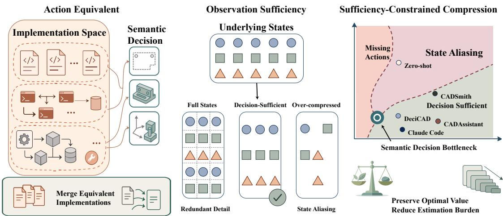  
Fi<sub>gure</sub> 7<sub>:</sub> Th<sub>e</sub> S<sub>eman</sub>ti<sub>c</sub> D<sub>ec</sub>i<sub>s</sub>i<sub>on</sub> B<sub>o</sub>ttl<sub>enec</sub>k <sub>compares</sub> h<sub>arnesses</sub> b<sub>y</sub> th<sub>e</sub>i<sub>r</sub> d<sub>ec</sub>i<sub>s</sub>i<sub>on capa</sub>biliti<sub>es w</sub>hil<sub>e preserv</sub>i<sub>ng op</sub>ti<sub>ma</sub>l CAD <sub>p</sub>er<sup>f</sup>ormance.

Th<sub>e</sub> th<sub>eorem c</sub>l<sub>ar</sub>ifi<sub>es w</sub>h<sub>a</sub>t <sub>a mo</sub>d<sub>e</sub>l<sub>-</sub>f<sub>ac</sub>i<sub>ng</sub> CAD i<sub>n</sub>t<sub>er</sub>f<sub>ace</sub> <sub>mus</sub>t <sub>re</sub>t<sub>a</sub>i<sub>n.</sub> Th<sub>e mo</sub>d<sub>e</sub>l d<sub>oes no</sub>t <sub>requ</sub>i<sub>re</sub> di<sub>rec</sub>t <sub>access</sub> t<sub>o</sub> th<sub>e</sub> <sub>comp</sub>l<sub>e</sub>t<sub>e</sub> b<sub>ac</sub>k<sub>en</sub>d <sub>s</sub>t<sub>a</sub>t<sub>e</sub> <sub>or</sub> t<sub>o</sub> <sub>every</sub> l<sub>ow-</sub>l<sub>eve</sub>l <sub>comman</sub>d<sub>.</sub> It <sub>requ</sub>i<sub>res an execu</sub>t<sub>a</sub>bl<sub>e represen</sub>t<sub>a</sub>ti<sub>on o</sub>f <sub>an op</sub>ti<sub>ma</sub>l <sub>opera-</sub> ti<sub>on w</sub>h<sub>enever one</sub> i<sub>s nee</sub>d<sub>e</sub>d<sub>,</sub> t<sub>oge</sub>th<sub>er w</sub>ith <sub>o</sub>b<sub>serva</sub>ti<sub>ons</sub> th<sub>a</sub>t di<sub>s</sub>ti<sub>ngu</sub>i<sub>s</sub>h b<sub>ac</sub>k<sub>en</sub>d <sub>s</sub>t<sub>a</sub>t<sub>es w</sub>h<sub>enever</sub> th<sub>ose s</sub>t<sub>a</sub>t<sub>es</sub> d<sub>eman</sub>d i<sub>n-</sub> <sub>compa</sub>tibl<sub>e</sub> <sub>nex</sub>t <sub>ac</sub>ti<sub>ons.</sub>

Th<sub>e</sub> t<sub>wo con</sub>diti<sub>ons a</sub>l<sub>so</sub> d<sub>escr</sub>ib<sub>e</sub> di<sub>s</sub>ti<sub>nc</sub>t f<sub>a</sub>il<sub>ure</sub> b<sub>oun</sub>d<sub>-</sub> <sub>ar</sub>i<sub>es.</sub> If <sub>ac</sub>ti<sub>on su</sub>fi<sub>c</sub>i<sub>ency</sub> f<sub>a</sub>il<sub>s a</sub>t <sub>a reac</sub>h<sub>a</sub>bl<sub>e s</sub>t<sub>a</sub>t<sub>e, no ac</sub>ti<sub>on</sub> <sub>expose</sub>d b<sub>y</sub> th<sub>e</sub> h<sub>arness can a</sub>tt<sub>a</sub>i<sub>n</sub> $V _ { g , t } ^ { * } ( s )$ <sub>;</sub> i<sub>ncreas</sub>i<sub>ng mo</sub>d<sub>e</sub>l <sub>capac</sub>it<sub>y or a</sub>ddi<sub>ng po</sub>li<sub>cy</sub> d<sub>a</sub>t<sub>a canno</sub>t <sub>recover an opera</sub>ti<sub>on</sub> <sub>a</sub>b<sub>sen</sub>t f<sub>rom</sub> th<sub>e</sub> i<sub>n</sub>t<sub>er</sub>f<sub>ace.</sub> If <sub>o</sub>b<sub>serva</sub>ti<sub>on su</sub>fi<sub>c</sub>i<sub>ency</sub> f<sub>a</sub>il<sub>s a</sub>t <sub>a</sub> <sub>reac</sub>h<sub>a</sub>bl<sub>e</sub> hi<sub>s</sub>t<sub>ory,</sub> th<sub>e s</sub>t<sub>a</sub>t<sub>es cons</sub>i<sub>s</sub>t<sub>en</sub>t <sub>w</sub>ith th<sub>a</sub>t hi<sub>s</sub>t<sub>ory s</sub>h<sub>are</sub> <sub>no op</sub>ti<sub>ma</sub>l <sub>mo</sub>d<sub>e</sub>l <sub>ac</sub>ti<sub>on.</sub> A<sub>ny po</sub>li<sub>cy con</sub>diti<sub>one</sub>d <sub>on</sub>l<sub>y on</sub> th<sub>e</sub> <sub>v</sub>i<sub>s</sub>ibl<sub>e</sub> hi<sub>s</sub>t<sub>ory mus</sub>t th<sub>ere</sub>f<sub>ore</sub> b<sub>e su</sub>b<sub>op</sub>ti<sub>ma</sub>l f<sub>or a</sub>t l<sub>eas</sub>t <sub>one</sub> <sub>o</sub>f th<sub>em.</sub> Th<sub>e</sub> <sub>resu</sub>lti<sub>ng</sub> <sub>expec</sub>t<sub>e</sub>d l<sub>oss</sub> d<sub>epen</sub>d<sub>s</sub> <sub>on</sub> h<sub>ow</sub> <sub>o</sub>ft<sub>en</sub> th<sub>e</sub> <sub>a</sub>li<sub>ase</sub>d <sub>s</sub>t<sub>a</sub>t<sub>es</sub> <sub>occur</sub> <sub>an</sub>d <sub>on</sub> th<sub>e</sub> <sub>va</sub>l<sub>ue</sub> <sub>gap</sub> b<sub>e</sub>t<sub>ween</sub> th<sub>e</sub> <sub>c</sub>h<sub>osen an</sub>d <sub>op</sub>ti<sub>ma</sub>l <sub>opera</sub>ti<sub>ons.</sub>

Mi<sub>ss</sub>i<sub>ng</sub> <sub>ac</sub>ti<sub>ons</sub> <sub>an</sub>d <sub>s</sub>t<sub>a</sub>t<sub>e</sub> <sub>a</sub>li<sub>as</sub>i<sub>ng</sub> <sub>consequen</sub>tl<sub>y</sub> <sub>cons</sub>t<sub>ra</sub>i<sub>n</sub> dif<sub>eren</sub>t <sub>s</sub>id<sub>es o</sub>f th<sub>e</sub> h<sub>arness-</sub>i<sub>n</sub>d<sub>uce</sub>d d<sub>ec</sub>i<sub>s</sub>i<sub>on space.</sub> Th<sub>e</sub> f<sub>ormer</sub> li<sub>m</sub>it<sub>s w</sub>h<sub>a</sub>t th<sub>e po</sub>li<sub>cy can execu</sub>t<sub>e;</sub> th<sub>e</sub> l<sub>a</sub>tt<sub>er</sub> li<sub>m</sub>it<sub>s</sub> <sub>w</sub>h<sub>a</sub>t it <sub>can</sub> di<sub>s</sub>ti<sub>ngu</sub>i<sub>s</sub>h<sub>.</sub> Th<sub>ese</sub> b<sub>oun</sub>d<sub>ar</sub>i<sub>es</sub> d<sub>e</sub>t<sub>erm</sub>i<sub>ne w</sub>hi<sub>c</sub>h <sub>ac</sub>ti<sub>on an</sub>d <sub>o</sub>b<sub>serva</sub>ti<sub>on</sub> d<sub>e</sub>t<sub>a</sub>il<sub>s may</sub> b<sub>e compresse</sub>d <sub>w</sub>hil<sub>e pre-</sub> <sub>serv</sub>i<sub>ng</sub> th<sub>e op</sub>ti<sub>ma</sub>l CAD <sub>po</sub>li<sub>cy.</sub>

## B.2 Semantic Decision Bottleneck

D<sub>ec</sub>i<sub>s</sub>i<sub>on</sub> <sub>su</sub>fi<sub>c</sub>i<sub>ency</sub> <sub>spec</sub>ifi<sub>es</sub> <sub>w</sub>h<sub>a</sub>t <sub>a</sub> h<sub>arness</sub> <sub>mus</sub>t <sub>preserve,</sub> b<sub>u</sub>t d<sub>oes no</sub>t <sub>un</sub>i<sub>que</sub>l<sub>y</sub> d<sub>e</sub>t<sub>erm</sub>i<sub>ne</sub> h<sub>ow</sub> th<sub>ose capa</sub>biliti<sub>es are</sub> <sub>represen</sub>t<sub>e</sub>d t<sub>o</sub> th<sub>e mo</sub>d<sub>e</sub>l<sub>.</sub> T<sub>wo</sub> h<sub>arnesses may connec</sub>t t<sub>o</sub> th<sub>e</sub> <sub>same</sub> CAD b<sub>ac</sub>k<sub>en</sub>d <sub>an</sub>d <sub>suppor</sub>t th<sub>e</sub> <sub>same</sub> t<sub>as</sub>k<sub>-</sub>l<sub>eve</sub>l <sub>op-</sub> <sub>era</sub>ti<sub>ons w</sub>hil<sub>e expos</sub>i<sub>ng</sub> dif<sub>eren</sub>t <sub>num</sub>b<sub>ers o</sub>f i<sub>mp</sub>l<sub>emen</sub>t<sub>a-</sub> ti<sub>on c</sub>h<sub>o</sub>i<sub>ces,</sub> dif<sub>eren</sub>t <sub>s</sub>t<sub>a</sub>t<sub>e granu</sub>l<sub>ar</sub>it<sub>y, an</sub>d dif<sub>eren</sub>t f<sub>orms</sub> <sub>o</sub>f <sub>execu</sub>ti<sub>on</sub> f<sub>ee</sub>db<sub>ac</sub>k<sub>.</sub> Th<sub>e</sub> S<sub>eman</sub>ti<sub>c</sub> D<sub>ec</sub>i<sub>s</sub>i<sub>on</sub> B<sub>o</sub>ttl<sub>enec</sub>k <sub>compares</sub> th<sub>ese</sub> d<sub>ec</sub>i<sub>s</sub>i<sub>on-su</sub>fi<sub>c</sub>i<sub>en</sub>t <sub>represen</sub>t<sub>a</sub>ti<sub>ons,</sub> <sub>a</sub>d<sub>ap</sub>ti<sub>ng</sub> th<sub>e compress</sub>i<sub>on pr</sub>i<sub>nc</sub>i<sub>p</sub>l<sub>e o</sub>f th<sub>e</sub> i<sub>n</sub>f<sub>orma</sub>ti<sub>on</sub> b<sub>o</sub>ttl<sub>enec</sub>k t<sub>o a</sub> model-facin<sub>g</sub> action–observation interface (Tishb<sub>y</sub>, Pereira, and Bialek 2000).

Decision-preserving compression. We call a transformati<sub>on</sub> f<sub>rom</sub> h<sub>arness</sub> $\mathcal { H } _ { 2 }$ t<sub>o</sub> h<sub>arness</sub> $\mathcal { H } _ { 1 }$ a decision-preserving compression when it satisfies two conditions. On the action <sub>s</sub>id<sub>e, mo</sub>d<sub>e</sub>l <sub>ac</sub>ti<sub>ons may</sub> b<sub>e merge</sub>d <sub>on</sub>l<sub>y w</sub>h<sub>en, a</sub>t <sub>every</sub> t<sub>as</sub>k<sub>-</sub> <sub>reac</sub>h<sub>a</sub>bl<sub>e s</sub>t<sub>a</sub>t<sub>e w</sub>h<sub>ere</sub> th<sub>ey are a</sub>d<sub>m</sub>i<sub>ss</sub>ibl<sub>e,</sub> th<sub>e</sub>i<sub>r</sub> b<sub>oun</sub>d b<sub>ac</sub>k<sub>-</sub> <sub>en</sub>d <sub>opera</sub>ti<sub>ons</sub> i<sub>n</sub>d<sub>uce</sub> th<sub>e same</sub> di<sub>s</sub>t<sub>r</sub>ib<sub>u</sub>ti<sub>on over nex</sub>t <sub>s</sub>t<sub>a</sub>t<sub>es</sub> <sub>an</sub>d th<sub>e same</sub> t<sub>as</sub>k <sub>rewar</sub>d f<sub>or every</sub> t<sub>rans</sub>iti<sub>on o</sub>f <sub>nonzero</sub> <sub>pro</sub>b<sub>a</sub>bilit<sub>y.</sub> Th<sub>e compresse</sub>d h<sub>arness mus</sub>t <sub>a</sub>l<sub>so re</sub>t<sub>a</sub>i<sub>n an exe-</sub> <sub>cu</sub>t<sub>a</sub>bl<sub>e represen</sub>t<sub>a</sub>ti<sub>on o</sub>f <sub>every consequence nee</sub>d<sub>e</sub>d t<sub>o a</sub>tt<sub>a</sub>i<sub>n</sub> Eq. (12). This removes diferences in s<sub>y</sub>ntax or im<sub>p</sub>lementati<sub>on w</sub>ith<sub>ou</sub>t <sub>c</sub>h<sub>ang</sub>i<sub>ng a</sub> d<sub>ec</sub>i<sub>s</sub>i<sub>on-re</sub>l<sub>evan</sub>t CAD <sub>consequence.</sub> O<sub>n</sub> th<sub>e o</sub>b<sub>serva</sub>ti<sub>on s</sub>id<sub>e, v</sub>i<sub>s</sub>ibl<sub>e</sub> hi<sub>s</sub>t<sub>or</sub>i<sub>es may</sub> b<sub>e</sub> id<sub>en</sub>tifi<sub>e</sub>d <sub>on</sub>l<sub>y w</sub>h<sub>en a</sub>ll b<sub>ac</sub>k<sub>en</sub>d <sub>s</sub>t<sub>a</sub>t<sub>es cons</sub>i<sub>s</sub>t<sub>en</sub>t <sub>w</sub>ith <sub>any o</sub>f th<sub>ose</sub> hi<sub>s-</sub> t<sub>or</sub>i<sub>es s</sub>till <sub>s</sub>h<sub>are an op</sub>ti<sub>ma</sub>l <sub>ac</sub>ti<sub>on</sub> i<sub>n</sub> th<sub>e compresse</sub>d h<sub>arness.</sub> This is <sub>p</sub>recisel<sub>y</sub> the criterion in Eq. (15), evaluated after the hi<sub>s</sub>t<sub>or</sub>i<sub>es</sub> <sub>are</sub> id<sub>en</sub>tifi<sub>e</sub>d<sub>.</sub> Th<sub>e</sub> <sub>ac</sub>ti<sub>on</sub> <sub>con</sub>diti<sub>on</sub> <sub>re</sub>t<sub>a</sub>i<sub>ns</sub> <sub>an</sub> <sub>op-</sub> ti<sub>ma</sub>l <sub>execu</sub>t<sub>a</sub>bl<sub>e consequence a</sub>t <sub>every</sub> t<sub>as</sub>k<sub>-reac</sub>h<sub>a</sub>bl<sub>e s</sub>t<sub>a</sub>t<sub>e,</sub> <sub>w</sub>hil<sub>e</sub> th<sub>e o</sub>b<sub>serva</sub>ti<sub>on con</sub>diti<sub>on re</sub>t<sub>a</sub>i<sub>ns a common op</sub>ti<sub>ma</sub>l <sub>ac</sub>ti<sub>on</sub> f<sub>or every compresse</sub>d hi<sub>s</sub>t<sub>ory.</sub> Th<sub>ey</sub> th<sub>ere</sub>f<sub>ore preserve</sub> <sub>ac</sub>ti<sub>on an</sub>d <sub>o</sub>b<sub>serva</sub>ti<sub>on su</sub>fi<sub>c</sub>i<sub>ency, respec</sub>ti<sub>ve</sub>l<sub>y.</sub>

F<sub>or</sub> d<sub>ec</sub>i<sub>s</sub>i<sub>on-su</sub>fi<sub>c</sub>i<sub>en</sub>t h<sub>arnesses, we wr</sub>it<sub>e</sub>

$$
\mathcal { H } _ { 1 } \preceq _ { \mathrm { S D B } } \mathcal { H } _ { 2 }\tag{16}
$$

if $\mathcal { H } _ { 1 }$ <sub>can</sub> b<sub>e</sub> <sub>o</sub>bt<sub>a</sub>i<sub>ne</sub>d f<sub>rom</sub> $\mathcal { H } _ { 2 }$ th<sub>roug</sub>h <sub>a</sub> d<sub>ec</sub>i<sub>s</sub>i<sub>on-preserv</sub>i<sub>ng</sub> <sub>compress</sub>i<sub>on.</sub> Th<sub>e re</sub>l<sub>a</sub>ti<sub>on expresses a represen</sub>t<sub>a</sub>ti<sub>on pre</sub>f<sub>er-</sub> <sub>ence un</sub>d<sub>er</sub> fi<sub>xe</sub>d d<sub>ec</sub>i<sub>s</sub>i<sub>on capa</sub>bilit<sub>y:</sub> $\mathcal { H } _ { 1 }$ d<sub>oes no</sub>t <sub>requ</sub>i<sub>re</sub> th<sub>e</sub> <sub>mo</sub>d<sub>e</sub>l t<sub>o</sub> di<sub>s</sub>ti<sub>ngu</sub>i<sub>s</sub>h <sub>ac</sub>ti<sub>on</sub> i<sub>mp</sub>l<sub>emen</sub>t<sub>a</sub>ti<sub>ons or v</sub>i<sub>s</sub>ibl<sub>e s</sub>t<sub>a</sub>t<sub>es</sub> th<sub>a</sub>t <sub>are</sub> i<sub>rre</sub>l<sub>evan</sub>t t<sub>o o</sub> ti<sub>ma</sub>l CAD d<sub>ec</sub>i<sub>s</sub>i<sub>ons</sub> i<sub>n</sub> $\mathcal { H } _ { 2 }$

D<sub>ec</sub>i<sub>s</sub>i<sub>on-preserv</sub>i<sub>ng</sub> <sub>compress</sub>i<sub>ons</sub> <sub>can</sub> b<sub>e</sub> <sub>app</sub>li<sub>e</sub>d <sub>succes-</sub> <sub>s</sub>i<sub>ve</sub>l<sub>y: eac</sub>h <sub>s</sub>t<sub>ep re</sub>t<sub>a</sub>i<sub>ns</sub> th<sub>e ac</sub>ti<sub>on consequences an</sub>d <sub>s</sub>t<sub>a</sub>t<sub>e</sub> distinctions required b<sub>y</sub> Eqs. (12) and (15). The relation th<sub>ere</sub>f<sub>ore suppor</sub>t<sub>s compar</sub>i<sub>ng</sub> h<sub>arnesses</sub> b<sub>y remova</sub>bl<sub>e se-</sub> <sub>man</sub>ti<sub>c s</sub>t<sub>ruc</sub>t<sub>ure w</sub>ith<sub>ou</sub>t <sub>se</sub>l<sub>ec</sub>ti<sub>ng a par</sub>ti<sub>cu</sub>l<sub>ar ac</sub>ti<sub>on syn</sub>t<sub>ax</sub> <sub>or o</sub>b<sub>serva</sub>ti<sub>on</sub> f<sub>orma</sub>t <sub>as canon</sub>i<sub>ca</sub>l<sub>.</sub>

Compression frontier. The Semantic Decision Bottleneck i<sub>s</sub> th<sub>e</sub> d<sub>ec</sub>i<sub>s</sub>i<sub>on-su</sub>fi<sub>c</sub>i<sub>en</sub>t f<sub>ron</sub>ti<sub>er o</sub>f thi<sub>s re</sub>l<sub>a</sub>ti<sub>on.</sub> A h<sub>arness</sub> li<sub>es</sub> <sub>on</sub> th<sub>e</sub> f<sub>ron</sub>ti<sub>er</sub> <sub>w</sub>h<sub>en</sub> <sub>every</sub> f<sub>ur</sub>th<sub>er</sub> <sub>seman</sub>ti<sub>c</sub> <sub>compress</sub>i<sub>on</sub> <sub>v</sub>i<sub>o</sub>l<sub>a</sub>t<sub>es a</sub>t l<sub>eas</sub>t <sub>one su</sub>fi<sub>c</sub>i<sub>ency con</sub>diti<sub>on.</sub> F<sub>ur</sub>th<sub>er ac</sub>ti<sub>on</sub> <sub>compress</sub>i<sub>on crosses</sub> thi<sub>s</sub> f<sub>ron</sub>ti<sub>er w</sub>h<sub>en</sub> it <sub>removes</sub> th<sub>e on</sub>l<sub>y</sub> re<sub>p</sub>resentation of an o<sub>p</sub>eration required b<sub>y</sub> Eq. (12). Further <sub>o</sub>b<sub>serva</sub>ti<sub>on compress</sub>i<sub>on crosses</sub> it <sub>w</sub>h<sub>en</sub> th<sub>e common-ac</sub>ti<sub>on</sub> i<sub>n</sub>t<sub>ersec</sub>ti<sub>on</sub> b<sub>ecomes emp</sub>t<sub>y, a</sub>li<sub>as</sub>i<sub>ng s</sub>t<sub>a</sub>t<sub>es</sub> th<sub>a</sub>t d<sub>eman</sub>d i<sub>n-</sub> <sub>compa</sub>tibl<sub>e nex</sub>t <sub>ac</sub>ti<sub>ons.</sub> Th<sub>e re</sub>l<sub>a</sub>ti<sub>on nee</sub>d <sub>no</sub>t <sub>se</sub>l<sub>ec</sub>t <sub>a un</sub>i<sub>que</sub> f<sub>ron</sub>ti<sub>er</sub> h<sub>arness:</sub> dif<sub>eren</sub>t <sub>ac</sub>ti<sub>on voca</sub>b<sub>u</sub>l<sub>ar</sub>i<sub>es or o</sub>b<sub>serva</sub>ti<sub>on</sub> <sub>organ</sub>i<sub>za</sub>ti<sub>ons may</sub> b<sub>e</sub> i<sub>ncompara</sub>bl<sub>e w</sub>hil<sub>e preserv</sub>i<sub>ng</sub> th<sub>e</sub> <sub>same op</sub>ti<sub>ma</sub>l CAD <sub>capa</sub>bilit<sub>y.</sub> Th<sub>e</sub> b<sub>o</sub>ttl<sub>enec</sub>k i<sub>s</sub> th<sub>ere</sub>f<sub>ore</sub> <sub>ne</sub>ith<sub>er a un</sub>i<sub>que</sub> i<sub>n</sub>t<sub>er</sub>f<sub>ace nor</sub> th<sub>e s</sub>h<sub>or</sub>t<sub>es</sub>t <sub>one</sub> i<sub>n c</sub>h<sub>arac</sub>t<sub>ers</sub> or tokens; it is the frontier of semantic compression subject t<sub>o preserv</sub>i<sub>ng</sub> th<sub>e op</sub>ti<sub>ma</sub>l d<sub>ec</sub>i<sub>s</sub>i<sub>on po</sub>li<sub>cy.</sub>

Equation (16) concerns semantic redundanc<sub>y</sub> rather than t<sub>o</sub>k<sub>en coun</sub>t it<sub>se</sub>lf<sub>.</sub> I<sub>n a</sub> l<sub>anguage-mo</sub>d<sub>e</sub>l i<sub>n</sub>t<sub>er</sub>f<sub>ace, re</sub>d<sub>un</sub>d<sub>an</sub>t <sub>ac</sub>ti<sub>on</sub> i<sub>mp</sub>l<sub>emen</sub>t<sub>a</sub>ti<sub>ons an</sub>d <sub>s</sub>t<sub>a</sub>t<sub>e</sub> d<sub>escr</sub>i<sub>p</sub>ti<sub>ons o</sub>ft<sub>en</sub> i<sub>ncrease</sub> <sub>mo</sub>d<sub>e</sub>l i<sub>npu</sub>t <sub>or ou</sub>t<sub>pu</sub>t<sub>, so</sub> t<sub>o</sub>k<sub>en use prov</sub>id<sub>es an o</sub>b<sub>serva</sub>bl<sub>e</sub> <sub>measure o</sub>f <sub>represen</sub>t<sub>a</sub>ti<sub>on</sub> b<sub>ur</sub>d<sub>en.</sub> N<sub>ever</sub>th<sub>e</sub>l<sub>ess, seman</sub>ti<sub>c</sub> <sub>compress</sub>i<sub>on an</sub>d t<sub>o</sub>k<sub>en compress</sub>i<sub>on are no</sub>t <sub>equ</sub>i<sub>va</sub>l<sub>en</sub>t<sub>.</sub> W<sub>e</sub> therefore evaluate a harness jointly by task performance, <sub>o</sub>b<sub>serva</sub>ti<sub>on a</sub>bl<sub>a</sub>ti<sub>ons, an</sub>d t<sub>o</sub>k<sub>en consump</sub>ti<sub>on.</sub> N<sub>or</sub> d<sub>oes</sub> th<sub>e</sub> <sub>re</sub>l<sub>a</sub>ti<sub>on</sub> b<sub>y</sub> it<sub>se</sub>lf<sub>guaran</sub>t<sub>ee eas</sub>i<sub>er op</sub>ti<sub>m</sub>i<sub>za</sub>ti<sub>on</sub> f<sub>or every</sub> fi<sub>n</sub>it<sub>e</sub> <sub>mo</sub>d<sub>e</sub>l<sub>;</sub> th<sub>e ma</sub>t<sub>c</sub>h<sub>e</sub>d SFT <sub>an</sub>d <sub>on</sub>li<sub>ne</sub> RL <sub>exper</sub>i<sub>men</sub>t<sub>s</sub> i<sub>n</sub> th<sub>e</sub> <sub>ma</sub>i<sub>n</sub> t<sub>ex</sub>t t<sub>es</sub>t <sub>w</sub>h<sub>e</sub>th<sub>er</sub> th<sub>e</sub> i<sub>n</sub>d<sub>uce</sub>d <sub>represen</sub>t<sub>a</sub>ti<sub>on</sub> i<sub>mproves</sub> <sub>po</sub>li<sub>cy</sub> l<sub>earn</sub>i<sub>ng</sub> i<sub>n prac</sub>ti<sub>ce.</sub>

Multi-objective harness optimization. A natural directi<sub>on</sub> f<sub>or</sub> f<sub>u</sub>t<sub>ure wor</sub>k i<sub>s</sub> t<sub>o</sub> t<sub>rea</sub>t h<sub>arness cons</sub>t<sub>ruc</sub>ti<sub>on as an</sub> explicit multi-objective optimization problem. Let $L _ { \mathrm { i n } }$ <sub>an</sub>d $L _ { \mathrm { o u t } }$ d<sub>eno</sub>t<sub>e</sub> th<sub>e num</sub>b<sub>ers o</sub>f <sub>mo</sub>d<sub>e</sub>l<sub>-</sub>f<sub>ac</sub>i<sub>ng</sub> i<sub>npu</sub>t <sub>an</sub>d <sub>ou</sub>t<sub>-</sub> <sub>pu</sub>t t<sub>o</sub>k<sub>ens,</sub> <sub>respec</sub>ti<sub>ve</sub>l<sub>y,</sub> <sub>an</sub>d l<sub>e</sub>t $N _ { \mathrm { { i n s p e c t } } }$ d<sub>eno</sub>t<sub>e</sub> th<sub>e num</sub>b<sub>er</sub> <sub>o</sub>f t<sub>arge</sub>t<sub>e</sub>d i<sub>nspec</sub>ti<sub>on</sub> <sub>opera</sub>ti<sub>ons.</sub> O<sub>ne</sub> <sub>may</sub> <sub>see</sub>k <sub>a</sub> P<sub>are</sub>t<sub>o-</sub> <sub>e</sub>fi<sub>c</sub>i<sub>en</sub>t h<sub>arness</sub> <sub>accor</sub>di<sub>ng</sub> t<sub>o</sub>

$$
\operatorname* { m i n } _ { \mathcal { H } \in \mathfrak { H } _ { \mathrm { s u f f } } } \mathbf { C } ( \mathcal { H } ) = ( \mathbb { E } [ L _ { \mathrm { i n } } ] , \mathbb { E } [ L _ { \mathrm { o u t } } ] , \mathbb { E } [ N _ { \mathrm { i n s p e c t } } ] ) ,\tag{17}
$$

<sub>w</sub>h<sub>ere</sub> ${ \mathfrak { H } } _ { \operatorname { s u f f } }$ i<sub>s</sub> th<sub>e se</sub>t <sub>o</sub>f h<sub>arnesses sa</sub>ti<sub>s</sub>f<sub>y</sub>i<sub>ng</sub> b<sub>o</sub>th <sub>ac</sub>ti<sub>on</sub> <sub>an</sub>d <sub>o</sub>b<sub>serva</sub>ti<sub>on su</sub>fi<sub>c</sub>i<sub>ency, an</sub>d th<sub>e expec</sub>t<sub>a</sub>ti<sub>ons are</sub> t<sub>a</sub>k<sub>en</sub> over the task distribution and policy-induced trajectories. Diferent deployment settings may scalarize these objectives <sub>us</sub>i<sub>ng</sub> dif<sub>eren</sub>t <sub>we</sub>i<sub>g</sub>ht<sub>s:</sub> f<sub>or examp</sub>l<sub>e,</sub> i<sub>n</sub>t<sub>erac</sub>ti<sub>ve sys</sub>t<sub>ems may</sub> <sub>pena</sub>li<sub>ze</sub> i<sub>nspec</sub>ti<sub>on</sub> l<sub>a</sub>t<sub>ency more</sub> h<sub>eav</sub>il<sub>y, w</sub>h<sub>ereas resource-</sub> <sub>cons</sub>t<sub>ra</sub>i<sub>ne</sub>d d<sub>ep</sub>l<sub>oymen</sub>t<sub>s may pr</sub>i<sub>or</sub>iti<sub>ze con</sub>t<sub>ex</sub>t <sub>an</sub>d <sub>genera-</sub> ti<sub>on</sub> l<sub>eng</sub>th<sub>.</sub> M<sub>ore</sub> b<sub>roa</sub>dl<sub>y,</sub> th<sub>e</sub> h<sub>arness an</sub>d <sub>po</sub>li<sub>cy cou</sub>ld b<sub>e</sub> optimized jointly, subject to semantic suficiency constraints. W<sub>e</sub> l<sub>eave au</sub>t<sub>oma</sub>t<sub>e</sub>d <sub>exp</sub>l<sub>ora</sub>ti<sub>on o</sub>fthi<sub>s</sub> h<sub>arness–po</sub>li<sub>cy</sub> P<sub>are</sub>t<sub>o</sub> f<sub>ron</sub>ti<sub>er</sub> t<sub>o</sub> f<sub>u</sub>t<sub>ure wor</sub>k<sub>.</sub>

## C Implementation Details

Th<sub>e ma</sub>i<sub>n</sub> t<sub>ex</sub>t <sub>c</sub>h<sub>arac</sub>t<sub>er</sub>i<sub>zes a</sub> d<sub>ec</sub>i<sub>s</sub>i<sub>on-su</sub>fi<sub>c</sub>i<sub>en</sub>t CAD h<sub>ar-</sub> <sub>ness</sub> th<sub>roug</sub>h <sub>ac</sub>ti<sub>on an</sub>d <sub>o</sub>b<sub>serva</sub>ti<sub>on su</sub>fi<sub>c</sub>i<sub>ency.</sub> Thi<sub>s sec</sub>ti<sub>on</sub> f<sub>o</sub>ll<sub>ows an ac</sub>t<sub>ua</sub>l <sub>mo</sub>d<sub>e</sub>li<sub>ng</sub> d<sub>ec</sub>i<sub>s</sub>i<sub>on</sub> th<sub>roug</sub>h D<sub>eci</sub>CAD t<sub>o</sub> <sub>s</sub>h<sub>ow</sub> h<sub>ow</sub> th<sub>ese con</sub>diti<sub>ons are</sub> i<sub>ns</sub>t<sub>an</sub>ti<sub>a</sub>t<sub>e</sub>d<sub>.</sub> Th<sub>e mo</sub>d<sub>e</sub>l fi<sub>rs</sub>t <sub>expresses</sub> <sub>geome</sub>t<sub>r</sub>i<sub>c</sub> i<sub>n</sub>t<sub>en</sub>t i<sub>n</sub> <sub>a</sub> <sub>seman</sub>ti<sub>c</sub> <sub>ac</sub>ti<sub>on</sub> <sub>space,</sub> th<sub>e</sub> h<sub>arness</sub> <sub>groun</sub>d<sub>s</sub> th<sub>a</sub>t i<sub>n</sub>t<sub>en</sub>t i<sub>n</sub> th<sub>e</sub> <sub>curren</sub>t CAD <sub>s</sub>t<sub>a</sub>t<sub>e,</sub> <sub>an</sub>d th<sub>e env</sub>i<sub>ronmen</sub>t <sub>re</sub>t<sub>urns</sub> th<sub>e execu</sub>ti<sub>on ev</sub>id<sub>ence nee</sub>d<sub>e</sub>d f<sub>or</sub> th<sub>e nex</sub>t d<sub>ec</sub>i<sub>s</sub>i<sub>on.</sub> T<sub>oge</sub>th<sub>er,</sub> th<sub>ese mec</sub>h<sub>an</sub>i<sub>sms</sub> d<sub>e</sub>t<sub>erm</sub>i<sub>ne</sub> th<sub>e</sub> CAD <sub>po</sub>li<sub>c</sub>i<sub>es</sub> th<sub>a</sub>t th<sub>e mo</sub>d<sub>e</sub>l <sub>can</sub> l<sub>earn an</sub>d <sub>execu</sub>t<sub>e.</sub>

## C.1 Semantic CAD Action Space

A <sub>mo</sub>d<sub>e</sub>li<sub>ng</sub> <sub>po</sub>li<sub>cy</sub> fi<sub>rs</sub>t <sub>requ</sub>i<sub>res</sub> <sub>an</sub> <sub>ac</sub>ti<sub>on</sub> <sub>voca</sub>b<sub>u</sub>l<sub>ary</sub> <sub>capa-</sub> bl<sub>e</sub> <sub>o</sub>f <sub>express</sub>i<sub>ng</sub> d<sub>es</sub>i<sub>gn</sub> i<sub>n</sub>t<sub>en</sub>t<sub>.</sub> D<sub>eci</sub>CAD <sub>represen</sub>t<sub>s</sub> <sub>eac</sub>h <sub>mo</sub>d<sub>e</sub>l <sub>ou</sub>t<sub>pu</sub>t <sub>as a</sub> CAD <sub>ac</sub>ti<sub>on w</sub>ith <sub>geome</sub>t<sub>r</sub>i<sub>c argumen</sub>t<sub>s.</sub> Th<sub>e voca</sub>b<sub>u</sub>l<sub>ar covers</sub> d<sub>ocumen</sub>t<sub>s an</sub>d <sub>ar</sub>tif<sub>ac</sub>t<sub>s, s</sub>k<sub>e</sub>t<sub>c</sub>h<sub>es</sub> <sub>an</sub>d <sub>cons</sub>t<sub>ra</sub>i<sub>n</sub>t<sub>s, so</sub>lid f<sub>ea</sub>t<sub>ures,</sub> B<sub>oo</sub>l<sub>eans an</sub>d <sub>pa</sub>tt<sub>erns, e</sub>d<sub>ge</sub> treatments, object placement, assembly, and state inspection. E<sub>ac</sub>h <sub>ac</sub>ti<sub>on exposes</sub> th<sub>e var</sub>i<sub>a</sub>bl<sub>es</sub> th<sub>a</sub>t d<sub>e</sub>t<sub>erm</sub>i<sub>ne</sub> th<sub>e</sub> CAD <sub>s</sub>t<sub>a</sub>t<sub>e</sub> t<sub>rans</sub>iti<sub>on.</sub> A<sub>n ex</sub>t<sub>rus</sub>i<sub>on,</sub> f<sub>or examp</sub>l<sub>e, spec</sub>ifi<sub>es</sub> it<sub>s pro-</sub> file, material mode, extent, and direction, while object resol<sub>u</sub>ti<sub>on an</sub>d CAD API i<sub>nvoca</sub>ti<sub>on rema</sub>i<sub>n w</sub>ithi<sub>n</sub> th<sub>e</sub> h<sub>arness.</sub> Thi<sub>s</sub> f<sub>ea</sub>t<sub>ure-or</sub>i<sub>en</sub>t<sub>e</sub>d <sub>organ</sub>i<sub>za</sub>ti<sub>on</sub> f<sub>o</sub>ll<sub>ows s</sub>t<sub>ruc</sub>t<sub>ure</sub>d <sub>con-</sub> <sub>s</sub>t<sub>ruc</sub>ti<sub>on</sub> hi<sub>s</sub>t<sub>or</sub>i<sub>es use</sub>d i<sub>n parame</sub>t<sub>r</sub>i<sub>c</sub> CAD <sub>corpora w</sub>hil<sub>e</sub> ex<sub>p</sub>osin<sub>g</sub> them as executable interaction ste<sub>p</sub>s (Wu, Xiao, and Zhen<sub>g</sub> 2021; Willis et al. 2020; Khan et al. 2024).

Th<sub>e</sub> f<sub>o</sub>ll<sub>ow</sub>i<sub>ng</sub> <sub>a</sub>b<sub>s</sub>t<sub>rac</sub>t i<sub>n</sub>t<sub>er</sub>f<sub>ace</sub> <sub>summar</sub>i<sub>zes</sub> th<sub>e</sub> <sub>mo</sub>d<sub>e</sub>l<sub>-</sub> visible action s<sub>p</sub>ace. Ref<T> denotes a stable environmentgenerated object reference that subsequent actions can reuse; the ex<sub>p</sub>ression after -> describes the <sub>g</sub>eometric <sub>p</sub>ostcondition <sub>re</sub>t<sub>urne</sub>d <sub>a</sub>ft<sub>er execu</sub>ti<sub>on.</sub>

```rust
CADAction ::=
Document {Create, Open, Save, Export}
| Sketch {Create, AddGeometry, Constrain,
Pattern, Trim, Project}
| Solid {CreateBody, Extrude, Revolve, Sweep,
Loft, Boolean, Repeat, Fillet,
Chamfer, Shell}
| Entity {SetPlacement}
| Assembly {Create, AddComponent, Ground, AddMate,
RemoveMate, Solve}
| Inspect {List, Get}
Extrude(
profile: Ref<Sketch>,
mode: Add | Cut,
extent: Distance(d) | ThroughAll,
direction: SketchNormal | Vector3D
) -> {
feature: Ref<SolidFeature>,
body: Ref<Body>,
solid_count: Int,
volume_mm3: Float
```

Thi<sub>s</sub> <sub>represen</sub>t<sub>a</sub>ti<sub>on</sub> id<sub>en</sub>tifi<sub>es</sub> b<sub>e</sub>h<sub>av</sub>i<sub>ora</sub>ll<sub>y</sub> <sub>equ</sub>i<sub>va</sub>l<sub>en</sub>t <sub>c</sub>h<sub>o</sub>i<sub>ces o</sub>f <sub>var</sub>i<sub>a</sub>bl<sub>e names, con</sub>t<sub>ro</sub>l fl<sub>ow, an</sub>d API <sub>syn</sub>t<sub>ax as</sub> th<sub>e</sub> <sub>same ac</sub>ti<sub>on, w</sub>hil<sub>e re</sub>t<sub>a</sub>i<sub>n</sub>i<sub>ng</sub> th<sub>e parame</sub>t<sub>ers</sub> th<sub>a</sub>t d<sub>e</sub>t<sub>erm</sub>i<sub>ne</sub> <sub>geome</sub>t<sub>r</sub>i<sub>c ou</sub>t<sub>come.</sub> St<sub>a</sub>bl<sub>e re</sub>f<sub>erences compose</sub> th<sub>ese ac</sub>ti<sub>ons:</sub> <sub>a s</sub>k<sub>e</sub>t<sub>c</sub>h <sub>can pro</sub>d<sub>uce a so</sub>lid f<sub>ea</sub>t<sub>ure;</sub> th<sub>a</sub>t <sub>so</sub>lid <sub>can par</sub>ti<sub>c</sub>i<sub>pa</sub>t<sub>e</sub> i<sub>n</sub> B<sub>oo</sub>l<sub>eans,</sub> t<sub>rans</sub>f<sub>orma</sub>ti<sub>ons, an</sub>d <sub>e</sub>d<sub>ge</sub> t<sub>rea</sub>t<sub>men</sub>t<sub>s; an</sub>d <sub>par</sub>t<sub>s</sub> <sub>can en</sub>t<sub>er an assem</sub>bl<sub>y an</sub>d <sub>rece</sub>i<sub>ve cons</sub>t<sub>ra</sub>i<sub>n</sub>t<sub>s.</sub> E<sub>ac</sub>h <sub>ac</sub>ti<sub>on</sub> d<sub>escr</sub>ib<sub>es a</sub> l<sub>oca</sub>l <sub>geome</sub>t<sub>r</sub>i<sub>c</sub> t<sub>rans</sub>iti<sub>on, w</sub>hil<sub>e an ac</sub>ti<sub>on se-</sub> <sub>quence</sub> i<sub>ncremen</sub>t<sub>a</sub>ll<sub>y cons</sub>t<sub>ruc</sub>t<sub>s</sub> th<sub>e</sub> f<sub>u</sub>ll d<sub>es</sub>i<sub>gn.</sub> F<sub>or</sub> th<sub>e</sub> t<sub>as</sub>k di<sub>s</sub>t<sub>r</sub>ib<sub>u</sub>ti<sub>on</sub> <sub>cons</sub>id<sub>ere</sub>d i<sub>n</sub> thi<sub>s</sub> <sub>wor</sub>k<sub>,</sub> thi<sub>s</sub> <sub>compos</sub>iti<sub>ona</sub>l <sub>c</sub>l<sub>o-</sub> <sub>sure a</sub>ll<sub>ows</sub> l<sub>ong-</sub>h<sub>or</sub>i<sub>zon mo</sub>d<sub>e</sub>li<sub>ng po</sub>li<sub>c</sub>i<sub>es</sub> t<sub>o rema</sub>i<sub>n w</sub>ithi<sub>n</sub> <sub>one seman</sub>ti<sub>c ac</sub>ti<sub>on space,</sub> i<sub>ns</sub>t<sub>an</sub>ti<sub>a</sub>ti<sub>ng ac</sub>ti<sub>on su</sub>fi<sub>c</sub>i<sub>ency</sub> i<sub>n</sub> th<sub>e ma</sub>i<sub>n</sub> t<sub>ex</sub>t<sub>.</sub>

## C.2 Grounding Semantic Actions in CAD State

S<sub>eman</sub>ti<sub>c ac</sub>ti<sub>ons spec</sub>if<sub>y w</sub>h<sub>a</sub>t th<sub>e mo</sub>d<sub>e</sub>l <sub>can se</sub>l<sub>ec</sub>t<sub>; s</sub>t<sub>a</sub>t<sub>e</sub> <sub>groun</sub>di<sub>ng</sub> d<sub>e</sub>t<sub>erm</sub>i<sub>nes</sub> <sub>w</sub>h<sub>a</sub>t <sub>a</sub> <sub>se</sub>l<sub>ec</sub>ti<sub>on</sub> <sub>means</sub> i<sub>n</sub> th<sub>e</sub> <sub>curren</sub>t d<sub>es</sub>i<sub>gn.</sub> A <sub>po</sub>i<sub>n</sub>t<sub>,</sub> di<sub>rec</sub>ti<sub>on,</sub> <sub>or</sub> <sub>ro</sub>t<sub>a</sub>ti<sub>on</sub> h<sub>as</sub> <sub>a</sub> <sub>un</sub>i<sub>que</sub> <sub>geome</sub>t<sub>r</sub>i<sub>c</sub> <sub>mean</sub>i<sub>ng</sub> <sub>on</sub>l<sub>y</sub> <sub>re</sub>l<sub>a</sub>ti<sub>ve</sub> t<sub>o</sub> <sub>an</sub> <sub>exp</sub>li<sub>c</sub>it <sub>coor</sub>di<sub>na</sub>t<sub>e</sub> f<sub>rame.</sub> D<sub>eci-</sub> CAD th<sub>ere</sub>f<sub>ore</sub> i<sub>n</sub>t<sub>erpre</sub>t<sub>s</sub> <sub>a</sub>ll <sub>ac</sub>ti<sub>on</sub> <sub>argumen</sub>t<sub>s</sub> <sub>un</sub>d<sub>er</sub> <sub>a</sub> <sub>s</sub>h<sub>are</sub>d <sub>spa</sub>ti<sub>a</sub>l <sub>con</sub>t<sub>rac</sub>t<sub>.</sub> Li<sub>near</sub> <sub>quan</sub>titi<sub>es</sub> <sub>use</sub> <sub>m</sub>illi<sub>me</sub>t<sub>ers</sub> <sub>an</sub>d <sub>angu-</sub> l<sub>ar quan</sub>titi<sub>es use</sub> d<sub>egrees.</sub> D<sub>ocumen</sub>t<sub>s use a r</sub>i<sub>g</sub>ht<sub>-</sub>h<sub>an</sub>d<sub>e</sub>d world frame with (+X) ri<sub>g</sub>ht, (+Y) back, and (+Z) u<sub>p</sub>, and <sub>ro</sub>t<sub>a</sub>ti<sub>ons</sub> f<sub>o</sub>ll<sub>ow</sub> th<sub>e r</sub>i<sub>g</sub>ht<sub>-</sub>h<sub>an</sub>d <sub>ru</sub>l<sub>e.</sub> T<sub>wo-</sub>di<sub>mens</sub>i<sub>ona</sub>l <sub>geom-</sub> <sub>e</sub>t<sub>ry</sub> li<sub>es</sub> i<sub>n</sub> th<sub>e r</sub>i<sub>g</sub>ht<sub>-</sub>h<sub>an</sub>d<sub>e</sub>d l<sub>oca</sub>l f<sub>rame o</sub>f it<sub>s s</sub>k<sub>e</sub>t<sub>c</sub>h<sub>, w</sub>hil<sub>e</sub> <sub>so</sub>lid <sub>p</sub>l<sub>acemen</sub>t <sub>exp</sub>li<sub>c</sub>itl<sub>y</sub> <sub>se</sub>l<sub>ec</sub>t<sub>s</sub> <sub>wor</sub>ld <sub>or</sub> <sub>paren</sub>t <sub>coor</sub>di<sub>-</sub> <sub>na</sub>t<sub>es.</sub> S<sub>ys</sub>t<sub>em</sub> i<sub>ns</sub>t<sub>ruc</sub>ti<sub>ons s</sub>t<sub>a</sub>t<sub>e</sub> th<sub>ese ru</sub>l<sub>es,</sub> t<sub>ype</sub>d <sub>argumen</sub>t<sub>s</sub> <sub>mar</sub>k th<sub>e space o</sub>f <sub>eac</sub>h <sub>va</sub>l<sub>ue, an</sub>d th<sub>e execu</sub>ti<sub>on</sub> l<sub>ayer repor</sub>t<sub>s</sub> <sub>au</sub>th<sub>or</sub>it<sub>a</sub>ti<sub>ve</sub> f<sub>rames rea</sub>d f<sub>rom</sub> th<sub>e ac</sub>t<sub>ua</sub>l CAD <sub>p</sub>l<sub>acemen</sub>t<sub>.</sub>

SpatialContract {   
length\_unit = millimeter   
angle\_unit = degree   
world\_frame = right\_handed(+X right, +Y back, +Z   
up)   
rotation = right\_hand\_rule(axis, angle)   
Point2D := coordinate in Ref<Sketch>.   
local\_frame   
Point3D := coordinate in world\_frame   
Placement(space = World | Parent)   
Frame := {origin, unit\_x, unit\_y, unit\_z}   
}   
CreateSketch(support, plane)   
-> {sketch: Ref<Sketch>, local\_frame: Frame}   
SetPlacement(target, placement, space)   
-> {target, effective\_placement, space}

Th<sub>e spa</sub>ti<sub>a</sub>l <sub>con</sub>t<sub>rac</sub>t fi<sub>xes</sub> th<sub>e mean</sub>i<sub>ng o</sub>f <sub>argumen</sub>t<sub>s, w</sub>hil<sub>e</sub> object references fix their targets. Documents, entities, and <sub>reusa</sub>bl<sub>e</sub> t<sub>opo</sub>l<sub>og</sub>i<sub>ca</sub>l <sub>e</sub>l<sub>emen</sub>t<sub>s</sub> h<sub>ave s</sub>t<sub>a</sub>bl<sub>e</sub> id<sub>en</sub>tifi<sub>ers re</sub>t<sub>urne</sub>d b<sub>y crea</sub>ti<sub>on or</sub> i<sub>nspec</sub>ti<sub>on an</sub>d <sub>reuse</sub>d <sub>unc</sub>h<sub>ange</sub>d i<sub>n</sub> l<sub>a</sub>t<sub>er ac-</sub> ti<sub>ons.</sub> Th<sub>e</sub> h<sub>arness reso</sub>l<sub>ves</sub> th<sub>ese re</sub>f<sub>erences</sub> i<sub>n</sub> th<sub>e curren</sub>t d<sub>ocumen</sub>t<sub>, execu</sub>t<sub>es</sub> th<sub>e na</sub>ti<sub>ve</sub> CAD <sub>opera</sub>ti<sub>on, an</sub>d <sub>ver</sub>ifi<sub>es</sub> <sub>ac</sub>ti<sub>on-spec</sub>ifi<sub>c pos</sub>t<sub>con</sub>diti<sub>ons.</sub> A <sub>va</sub>lid <sub>resu</sub>lt i<sub>s comm</sub>itt<sub>e</sub>d t<sub>o</sub> th<sub>e pers</sub>i<sub>s</sub>t<sub>en</sub>t d<sub>ocumen</sub>t <sub>so</sub> th<sub>a</sub>t l<sub>a</sub>t<sub>er ac</sub>ti<sub>ons opera</sub>t<sub>e on</sub> th<sub>e</sub> <sub>resu</sub>lti<sub>ng s</sub>t<sub>a</sub>t<sub>e; a</sub> f<sub>a</sub>il<sub>e</sub>d <sub>resu</sub>lt <sub>preserves</sub> th<sub>e prev</sub>i<sub>ous s</sub>t<sub>a</sub>t<sub>e or</sub> <sub>mar</sub>k<sub>s</sub> th<sub>e execu</sub>ti<sub>on ou</sub>t<sub>come as un</sub>k<sub>nown.</sub>

```r
Execute(action, state s_t):
args <- validate(action, SpatialContract)
objects <- resolve(action.references, s_t)
transaction.begin()
native_out <- apply(action.name, args, objects)
evidence <- verify_postcondition(native_out)
if evidence is valid:
transaction.commit()
return Success(evidence), s_{t+1}
else:
transaction.rollback()
return Failure(recovery_evidence), s_t
```

A<sub>c</sub>ti<sub>on groun</sub>di<sub>ng</sub> i<sub>s</sub> th<sub>ere</sub>f<sub>ore more</sub> th<sub>an a</sub> l<sub>oo</sub>k<sub>up</sub> f<sub>rom a</sub> t<sub>oo</sub>l <sub>name</sub> t<sub>o a</sub> b<sub>ac</sub>k<sub>en</sub>d f<sub>unc</sub>ti<sub>on.</sub> Th<sub>e s</sub>h<sub>are</sub>d <sub>spa</sub>ti<sub>a</sub>l <sub>con</sub>t<sub>rac</sub>t d<sub>e</sub>t<sub>erm</sub>i<sub>nes parame</sub>t<sub>er seman</sub>ti<sub>cs, s</sub>t<sub>a</sub>bl<sub>e re</sub>f<sub>erences</sub> d<sub>e</sub>t<sub>erm</sub>i<sub>ne</sub> the operated objects, and transactions with postcondition <sub>c</sub>h<sub>ec</sub>k<sub>s</sub> d<sub>e</sub>t<sub>erm</sub>i<sub>ne w</sub>h<sub>e</sub>th<sub>er an ac</sub>ti<sub>on ac</sub>t<sub>ua</sub>ll<sub>y</sub> t<sub>oo</sub>k <sub>e</sub>f<sub>ec</sub>t<sub>.</sub> E<sub>v-</sub> <sub>ery success</sub>f<sub>u</sub>l <sub>ac</sub>ti<sub>on</sub> i<sub>n</sub> th<sub>e mo</sub>d<sub>e</sub>l hi<sub>s</sub>t<sub>ory correspon</sub>d<sub>s</sub> t<sub>o a</sub> <sub>ver</sub>ifi<sub>e</sub>d t<sub>rans</sub>iti<sub>on</sub> i<sub>n</sub> th<sub>e pers</sub>i<sub>s</sub>t<sub>en</sub>t CAD d<sub>ocumen</sub>t<sub>.</sub> T<sub>oge</sub>th<sub>er,</sub> th<sub>ese cons</sub>t<sub>ra</sub>i<sub>n</sub>t<sub>s</sub> i<sub>mp</sub>l<sub>emen</sub>t th<sub>e</sub> bi<sub>n</sub>di<sub>ng map</sub> d<sub>e</sub>fi<sub>ne</sub>d i<sub>n</sub> th<sub>e</sub> <sub>ma</sub>i<sub>n</sub> t<sub>ex</sub>t<sub>.</sub>

## C.3 Decision-Oriented Environment Observations

Aft<sub>er an ac</sub>ti<sub>on execu</sub>t<sub>es,</sub> th<sub>e mo</sub>d<sub>e</sub>l <sub>mus</sub>t <sub>con</sub>ti<sub>nue</sub> f<sub>rom</sub> th<sub>e</sub> <sub>resu</sub>lti<sub>ng</sub> <sub>env</sub>i<sub>ronmen</sub>t <sub>s</sub>t<sub>a</sub>t<sub>e.</sub> E<sub>xpan</sub>di<sub>ng</sub> th<sub>e</sub> <sub>comp</sub>l<sub>e</sub>t<sub>e</sub> CAD document repeatedly introduces objects and properties irrele-<sub>van</sub>t t<sub>o</sub> th<sub>e</sub> <sub>curren</sub>t d<sub>ec</sub>i<sub>s</sub>i<sub>on,</sub> <sub>w</sub>h<sub>ereas</sub> <sub>repor</sub>ti<sub>ng</sub> <sub>on</sub>l<sub>y</sub> <sub>ca</sub>ll<sub>-</sub>l<sub>eve</sub>l success cannot support geometric judgment or recovery. De-<sub>ci</sub>CAD <sub>separa</sub>t<sub>es</sub> th<sub>ese nee</sub>d<sub>s: pass</sub>i<sub>ve execu</sub>ti<sub>on</sub> f<sub>ee</sub>db<sub>ac</sub>k describes the state transition that just occurred, while active hi<sub>erarc</sub>hi<sub>ca</sub>l i<sub>nspec</sub>ti<sub>on re</sub>t<sub>r</sub>i<sub>eves</sub> l<sub>oca</sub>l <sub>s</sub>t<sub>a</sub>t<sub>e nee</sub>d<sub>e</sub>d b th<sub>e</sub> <sub>nex</sub>t d<sub>ec</sub>i<sub>s</sub>i<sub>on.</sub>

Passive Execution Feedback The harness returns success <sub>or</sub> f<sub>a</sub>il<sub>ure a</sub>ft<sub>er every ac</sub>ti<sub>on.</sub> A <sub>success response con</sub>t<sub>a</sub>i<sub>ns</sub> afected objects, action-specific postconditions, and the doc-<sub>umen</sub>t <sub>genera</sub>ti<sub>on.</sub> A f<sub>a</sub>il<sub>ure</sub> <sub>response</sub> <sub>con</sub>t<sub>a</sub>i<sub>ns</sub> <sub>an</sub> <sub>error</sub> <sub>ca</sub>t<sub>-</sub> egory, the relevant argument or object, and a recovery di-<sub>rec</sub>ti<sub>on.</sub> I<sub>nva</sub>lid i<sub>npu</sub>t<sub>, m</sub>i<sub>ss</sub>i<sub>ng re</sub>f<sub>erences, geome</sub>t<sub>r</sub>i<sub>c</sub> f<sub>a</sub>il<sub>ure,</sub> <sub>con</sub>fli<sub>c</sub>t<sub>,</sub> ti<sub>meou</sub>t<sub>,</sub> <sub>an</sub>d <sub>un</sub>k<sub>nown</sub> <sub>ou</sub>t<sub>come</sub> <sub>rema</sub>i<sub>n</sub> di<sub>s</sub>ti<sub>nc</sub>t b<sub>e-</sub> <sub>cause</sub> th<sub>ey ca</sub>ll f<sub>or</sub> dif<sub>eren</sub>t <sub>nex</sub>t <sub>ac</sub>ti<sub>ons.</sub>

ActionResult :=   
Success {   
affected: [StableRef],   
postcondition: ActionSpecificEvidence,   
document\_state: Generation   
}   
| Failure {   
category: InvalidInput | MissingObject |   
InvalidState | GeometryFailure |   
Conflict | Timeout |   
BackendUnavailable |   
OutcomeUnknown,   
location: Optional<ArgumentPath | StableRef   
>,   
message: ShortExplanation,   
recovery: RetryWithArguments | InspectState   
|   
ChooseAnotherAction   
}

F<sub>or examp</sub>l<sub>e, a success</sub>f<sub>u</sub>l <sub>ex</sub>t<sub>rus</sub>i<sub>on re</sub>t<sub>urns</sub> it<sub>s genera</sub>t<sub>e</sub>d f<sub>ea</sub>t<sub>ure, own</sub>i<sub>ng</sub> b<sub>o</sub>d<sub>y, an</sub>d <sub>so</sub>lid <sub>coun</sub>t<sub>;</sub> i<sub>nva</sub>lid <sub>argumen</sub>t<sub>s</sub> id<sub>en</sub>tif<sub>y</sub> th<sub>e respons</sub>ibl<sub>e</sub> fi<sub>e</sub>ld<sub>; an</sub>d <sub>an un</sub>k<sub>nown ou</sub>t<sub>come</sub> di<sub>-</sub> <sub>rec</sub>t<sub>s</sub> th<sub>e mo</sub>d<sub>e</sub>l t<sub>o</sub> i<sub>nspec</sub>t th<sub>e</sub> d<sub>ocumen</sub>t b<sub>e</sub>f<sub>ore ac</sub>ti<sub>ng aga</sub>i<sub>n.</sub> Th<sub>ese</sub> di<sub>s</sub>ti<sub>nc</sub>ti<sub>ons</sub> d<sub>e</sub>t<sub>erm</sub>i<sub>ne w</sub>h<sub>e</sub>th<sub>er</sub> th<sub>e po</sub>li<sub>cy s</sub>h<sub>ou</sub>ld <sub>con-</sub> ti<sub>nue mo</sub>d<sub>e</sub>li<sub>ng, rev</sub>i<sub>se an argumen</sub>t<sub>, or</sub> fi<sub>rs</sub>t <sub>ver</sub>if<sub>y s</sub>t<sub>a</sub>t<sub>e.</sub> P<sub>as-</sub> <sub>s</sub>i<sub>ve</sub> f<sub>ee</sub>db<sub>ac</sub>k th<sub>ere</sub>f<sub>ore re</sub>t<sub>a</sub>i<sub>ns causa</sub>l <sub>ev</sub>id<sub>ence</sub> f<sub>or</sub> l<sub>oca</sub>l <sub>con-</sub> ti<sub>nua</sub>ti<sub>on an</sub>d <sub>recovery w</sub>hil<sub>e</sub> k<sub>eep</sub>i<sub>ng eac</sub>h <sub>s</sub>t<sub>ep compac</sub>t<sub>.</sub>

Active Hierarchical Inspection Passive feedback focuses on the action just completed, but later decisions may de-<sub>pen</sub>d <sub>on</sub> <sub>a</sub> b<sub>roa</sub>d<sub>er</sub> <sub>por</sub>ti<sub>on</sub> <sub>o</sub>f th<sub>e</sub> d<sub>es</sub>i<sub>gn.</sub> A<sub>n</sub> <sub>e</sub>d<sub>ge</sub> t<sub>rea</sub>t<sub>-</sub> <sub>men</sub>t <sub>may requ</sub>i<sub>re</sub> l<sub>oca</sub>ti<sub>ng</sub> t<sub>opo</sub>l<sub>og</sub>i<sub>ca</sub>l <sub>e</sub>d<sub>ges w</sub>ith <sub>par</sub>ti<sub>cu-</sub> l<sub>ar</sub> <sub>geome</sub>t<sub>ry,</sub> <sub>w</sub>hil<sub>e</sub> <sub>an</sub> <sub>assem</sub>bl<sub>y</sub> <sub>ma</sub>t<sub>e</sub> <sub>may</sub> <sub>requ</sub>i<sub>re</sub> <sub>c</sub>h<sub>ec</sub>k<sub>-</sub> i<sub>ng componen</sub>t <sub>p</sub>l<sub>acemen</sub>t <sub>an</sub>d <sub>connec</sub>ti<sub>v</sub>it<sub>y.</sub> F<sub>or</sub> th<sub>ese cases,</sub> InspectList first discovers relevant state. The model sel<sub>ec</sub>t<sub>s a</sub> b<sub>oun</sub>d<sub>e</sub>d <sub>co</sub>ll<sub>ec</sub>ti<sub>on—suc</sub>h <sub>as en</sub>titi<sub>es, c</sub>hild<sub>ren,</sub> t<sub>opo</sub>l<sub>-</sub> <sub>ogy,</sub> <sub>s</sub>k<sub>e</sub>t<sub>c</sub>h <sub>geome</sub>t<sub>ry,</sub> <sub>cons</sub>t<sub>ra</sub>i<sub>n</sub>t<sub>s,</sub> d<sub>epen</sub>d<sub>enc</sub>i<sub>es,</sub> <sub>or</sub> <sub>assem</sub>bl<sub>y</sub> i<sub>n</sub>t<sub>er</sub>f<sub>erence—an</sub>d <sub>rece</sub>i<sub>ves s</sub>t<sub>a</sub>bl<sub>e re</sub>f<sub>erences w</sub>ith <sub>compac</sub>t summaries throu<sub>g</sub>h filterin<sub>g</sub> and <sub>p</sub>a<sub>g</sub>ination. InspectGet th<sub>en rea</sub>d<sub>s</sub> th<sub>e canon</sub>i<sub>ca</sub>l d<sub>e</sub>t<sub>a</sub>il <sub>o</sub>f <sub>one prec</sub>i<sub>se re</sub>f<sub>erence,</sub> i<sub>n-</sub> <sub>c</sub>l<sub>u</sub>di<sub>ng</sub> id<sub>en</sub>tit<sub>y,</sub> <sub>p</sub>l<sub>acemen</sub>t <sub>or</sub> l<sub>oca</sub>l f<sub>rame,</sub> b<sub>oun</sub>di<sub>ng</sub> b<sub>ox,</sub> <sub>s</sub>h<sub>ape or cons</sub>t<sub>ra</sub>i<sub>n</sub>t <sub>summary, re</sub>l<sub>a</sub>ti<sub>ons, an</sub>d <sub>va</sub>lidit<sub>y.</sub>

```typescript
InspectList(
collection: Documents | Entities | Children |
Topology | SketchGeometry |
SketchConstraints | Dependencies |
Interferences | ArtifactComponents,
scope: Optional<Ref<Document | Entity> |
ArtifactPath>,
filter: Optional<{name_pattern, entity_type}>,
offset: Int,
```

```erlang
limit: Int
) -> {
items: [{ref, kind, compact_summary}],
generation: Generation,
next_offset: Optional<Int>
}
InspectGet(
target: Ref<Document | Entity | Face | Edge |
Vertex>
| ArtifactPath
) -> {
identity, placement_or_frame, bounding_box,
shape_or_constraint_summary, relation_summary,
validity
```

Th<sub>e</sub> t<sub>wo</sub> i<sub>nspec</sub>ti<sub>on</sub> l<sub>eve</sub>l<sub>s answer, respec</sub>ti<sub>ve</sub>l<sub>y, w</sub>hi<sub>c</sub>h <sub>o</sub>b<sub>-</sub> jects are relevant to the current decision and what the authorit<sub>a</sub>ti<sub>ve s</sub>t<sub>a</sub>t<sub>e o</sub>f <sub>one</sub> t<sub>arge</sub>t i<sub>s.</sub> A <sub>po</sub>li<sub>cy can</sub> fi<sub>rs</sub>t li<sub>s</sub>t th<sub>e</sub> t<sub>opo</sub>l<sub>og-</sub> i<sub>ca</sub>l <sub>e</sub>d<sub>ges o</sub>f <sub>a so</sub>lid<sub>, se</sub>l<sub>ec</sub>t <sub>can</sub>did<sub>a</sub>t<sub>es</sub> f<sub>rom</sub> th<sub>e</sub>i<sub>r summar</sub>i<sub>es,</sub> <sub>re</sub>t<sub>r</sub>i<sub>eve exac</sub>t <sub>geome</sub>t<sub>r</sub>i<sub>c proper</sub>ti<sub>es, an</sub>d <sub>reuse</sub> th<sub>e same re</sub>f<sub>-</sub> <sub>erence</sub> i<sub>n a</sub> fill<sub>e</sub>t <sub>ac</sub>ti<sub>on.</sub> S<sub>epara</sub>ti<sub>ng</sub> di<sub>scovery</sub> f<sub>rom re</sub>t<sub>r</sub>i<sub>eva</sub>l b<sub>oun</sub>d<sub>s eac</sub>h <sub>o</sub>b<sub>serva</sub>ti<sub>on w</sub>hil<sub>e a</sub>ll<sub>ow</sub>i<sub>ng</sub> th<sub>e mo</sub>d<sub>e</sub>l t<sub>o recover</sub> <sub>s</sub>t<sub>a</sub>t<sub>e</sub> di<sub>s</sub>ti<sub>nc</sub>ti<sub>ons</sub> th<sub>a</sub>t <sub>c</sub>h<sub>ange</sub> th<sub>e nex</sub>t <sub>ac</sub>ti<sub>on.</sub> P<sub>ass</sub>i<sub>ve</sub> f<sub>ee</sub>d<sub>-</sub> b<sub>ac</sub>k <sub>an</sub>d <sub>ac</sub>ti<sub>ve</sub> i<sub>nspec</sub>ti<sub>on</sub> th<sub>ere</sub>b<sub>y</sub> i<sub>ns</sub>t<sub>an</sub>ti<sub>a</sub>t<sub>e o</sub>b<sub>serva</sub>ti<sub>on</sub> <sub>su</sub>fi<sub>c</sub>i<sub>ency</sub> i<sub>n</sub> th<sub>e ma</sub>i<sub>n</sub> t<sub>ex</sub>t<sub>.</sub>

## C.4 Implementing the Semantic Decision Bottleneck

A<sub>cross</sub> thi<sub>s</sub> l<sub>oop,</sub> D<sub>eci</sub>CAD <sub>coor</sub>di<sub>na</sub>t<sub>es compress</sub>i<sub>on o</sub>f <sub>mo</sub>d<sub>e</sub>l<sub>-</sub>f<sub>ac</sub>i<sub>ng ac</sub>ti<sub>ons an</sub>d <sub>o</sub>b<sub>serva</sub>ti<sub>ons.</sub> S<sub>eman</sub>ti<sub>c ac</sub>ti<sub>ons</sub> <sub>merge</sub> b<sub>e</sub>h<sub>av</sub>i<sub>ora</sub>ll<sub>y equ</sub>i<sub>va</sub>l<sub>en</sub>t i<sub>mp</sub>l<sub>emen</sub>t<sub>a</sub>ti<sub>on</sub> f<sub>orms, w</sub>hil<sub>e</sub> th<sub>e spa</sub>ti<sub>a</sub>l <sub>con</sub>t<sub>rac</sub>t<sub>, s</sub>t<sub>a</sub>bl<sub>e re</sub>f<sub>erences, an</sub>d <sub>execu</sub>ti<sub>on ver</sub>ifi<sub>-</sub> <sub>ca</sub>ti<sub>on ensure</sub> th<sub>a</sub>t th<sub>e compresse</sub>d <sub>ac</sub>ti<sub>ons s</sub>till d<sub>eno</sub>t<sub>e we</sub>ll<sub>-</sub> d<sub>e</sub>fi<sub>ne</sub>d CAD t<sub>rans</sub>iti<sub>ons.</sub> P<sub>ass</sub>i<sub>ve</sub> f<sub>ee</sub>db<sub>ac</sub>k <sub>om</sub>it<sub>s</sub> th<sub>e</sub> <sub>com-</sub> <sub>p</sub>l<sub>e</sub>t<sub>e</sub> i<sub>n</sub>t<sub>erna</sub>l <sub>s</sub>t<sub>a</sub>t<sub>e,</sub> <sub>an</sub>d <sub>ac</sub>ti<sub>ve</sub> i<sub>nspec</sub>ti<sub>on</sub> <sub>res</sub>t<sub>ores</sub> l<sub>oca</sub>l di<sub>s-</sub> ti<sub>nc</sub>ti<sub>ons w</sub>h<sub>en a</sub> d<sub>ec</sub>i<sub>s</sub>i<sub>on requ</sub>i<sub>res</sub> th<sub>em.</sub> C<sub>ompress</sub>i<sub>on</sub> th<sub>ere-</sub> f<sub>ore rema</sub>i<sub>ns cons</sub>t<sub>ra</sub>i<sub>ne</sub>d b<sub>y ac</sub>ti<sub>on an</sub>d <sub>o</sub>b<sub>serva</sub>ti<sub>on su</sub>fi<sub>-</sub> c<sup>i</sup>enc<sub>y</sub>.

T<sub>oge</sub>th<sub>er,</sub> th<sub>ese mec</sub>h<sub>an</sub>i<sub>sms</sub> i<sub>ns</sub>t<sub>an</sub>ti<sub>a</sub>t<sub>e</sub> th<sub>e</sub> S<sub>eman</sub>ti<sub>c</sub> D<sub>e-</sub> <sub>c</sub>i<sub>s</sub>i<sub>on</sub> B<sub>o</sub>ttl<sub>enec</sub>k f<sub>rom</sub> th<sub>e ma</sub>i<sub>n</sub> t<sub>ex</sub>t<sub>.</sub> Th<sub>e mo</sub>d<sub>e</sub>l <sub>genera</sub>t<sub>es</sub> CAD d<sub>ec</sub>i<sub>s</sub>i<sub>ons ra</sub>th<sub>er</sub> th<sub>an</sub> th<sub>e</sub>i<sub>r expan</sub>d<sub>e</sub>d i<sub>mp</sub>l<sub>emen</sub>t<sub>a</sub>ti<sub>ons</sub> <sub>an</sub>d <sub>o</sub>b<sub>serves</sub> <sub>s</sub>t<sub>a</sub>t<sub>e</sub> <sub>ev</sub>id<sub>ence</sub> <sub>suppor</sub>ti<sub>ng</sub> th<sub>e</sub> <sub>nex</sub>t d<sub>ec</sub>i<sub>s</sub>i<sub>on</sub> <sub>ra</sub>th<sub>er</sub> th<sub>an</sub> th<sub>e</sub> f<sub>u</sub>ll i<sub>n</sub>t<sub>erna</sub>l <sub>represen</sub>t<sub>a</sub>ti<sub>on o</sub>f th<sub>e</sub> CAD <sub>sys-</sub> t<sub>em.</sub> C<sub>oor</sub>di<sub>na</sub>ti<sub>ng ac</sub>ti<sub>ons, groun</sub>di<sub>ng, an</sub>d <sub>o</sub>b<sub>serva</sub>ti<sub>ons</sub> i<sub>n</sub> th<sub>e same c</sub>l<sub>ose</sub>d l<sub>oop re</sub>d<sub>uces represen</sub>t<sub>a</sub>ti<sub>on</sub> b<sub>ur</sub>d<sub>en w</sub>ith<sub>ou</sub>t <sub>remov</sub>i<sub>ng</sub> th<sub>e</sub> d<sub>ec</sub>i<sub>s</sub>i<sub>on pa</sub>th<sub>s requ</sub>i<sub>re</sub>d f<sub>or</sub> t<sub>as</sub>k <sub>comp</sub>l<sub>e</sub>ti<sub>on an</sub>d <sup>error</sup> <sup>recover</sup>y<sup>.</sup>

I<sub>n</sub> th<sub>e concre</sub>t<sub>e co</sub>d<sub>e organ</sub>i<sub>za</sub>ti<sub>on,</sub> th<sub>ese mec</sub>h<sub>an</sub>i<sub>sms are</sub> <sub>separa</sub>t<sub>e</sub>d i<sub>n</sub>t<sub>o</sub> th<sub>ree</sub> <sub>connec</sub>t<sub>e</sub>d <sub>componen</sub>t<sub>s.</sub> Th<sub>e</sub> h<sub>arness</sub> <sub>run-</sub> ti<sub>me organ</sub>i<sub>zes</sub> th<sub>e</sub> d<sub>ec</sub>i<sub>s</sub>i<sub>on</sub> l<sub>oop across mo</sub>d<sub>e</sub>l i<sub>nvoca</sub>ti<sub>on,</sub> <sub>ac</sub>ti<sub>on execu</sub>ti<sub>on, an</sub>d f<sub>ee</sub>db<sub>ac</sub>k<sub>.</sub> A<sub>n</sub> i<sub>n</sub>t<sub>er</sub>f<sub>ace-con</sub>t<sub>rac</sub>t l<sub>ayer</sub> d<sub>e</sub>fi<sub>nes seman</sub>ti<sub>c ac</sub>ti<sub>ons, geome</sub>t<sub>r</sub>i<sub>c represen</sub>t<sub>a</sub>ti<sub>ons, an</sub>d <sub>ex-</sub> <sub>ecu</sub>ti<sub>on resu</sub>lt<sub>s.</sub> A b<sub>ac</sub>k<sub>en</sub>d <sub>execu</sub>ti<sub>on</sub> l<sub>ayer</sub> bi<sub>n</sub>d<sub>s</sub> th<sub>ose con-</sub> t<sub>rac</sub>t<sub>s</sub> t<sub>o</sub> <sub>na</sub>ti<sub>ve</sub> <sub>opera</sub>ti<sub>ons</sub> i<sub>n</sub> <sub>a</sub> <sub>spec</sub>ifi<sub>c</sub> CAD <sub>sys</sub>t<sub>em.</sub> Thi<sub>s</sub> <sub>organ</sub>i<sub>za</sub>ti<sub>on a</sub>ll<sub>ows</sub> th<sub>e</sub> i<sub>n</sub>t<sub>erac</sub>ti<sub>on po</sub>li<sub>cy,</sub> th<sub>e mo</sub>d<sub>e</sub>l<sub>-v</sub>i<sub>s</sub>ibl<sub>e</sub> i<sub>n</sub>t<sub>er</sub>f<sub>ace,</sub> <sub>an</sub>d CAD <sub>execu</sub>ti<sub>on</sub> l<sub>og</sub>i<sub>c</sub> t<sub>o</sub> <sub>evo</sub>l<sub>ve</sub> i<sub>n</sub>d<sub>epen</sub>d<sub>en</sub>tl<sub>y.</sub> A <sub>new</sub> CAD b<sub>ac</sub>k<sub>en</sub>d i<sub>mp</sub>l<sub>emen</sub>t<sub>s</sub> th<sub>e same ac</sub>ti<sub>on an</sub>d f<sub>ee</sub>d<sub>-</sub> b<sub>ac</sub>k <sub>con</sub>t<sub>rac</sub>t<sub>s w</sub>hil<sub>e preserv</sub>i<sub>ng</sub> th<sub>e mo</sub>d<sub>e</sub>l<sub>-</sub>f<sub>ac</sub>i<sub>ng</sub> d<sub>ec</sub>i<sub>s</sub>i<sub>on</sub> <sup>s</sup>p<sup>ace</sup>.

## D Supplementary Experiments

Thi<sub>s sec</sub>ti<sub>on comp</sub>l<sub>e</sub>t<sub>es</sub> th<sub>e eva</sub>l<sub>ua</sub>ti<sub>on pro</sub>t<sub>oco</sub>l <sub>use</sub>d i<sub>n</sub> th<sub>e</sub> <sub>ma</sub>i<sub>n</sub> t<sub>ex</sub>t <sub>an</sub>d f<sub>ur</sub>th<sub>er ana</sub>l<sub>yzes</sub> h<sub>ow</sub> th<sub>e</sub> h<sub>arness a</sub>f<sub>ec</sub>t<sub>s</sub> CAD <sub>capa</sub>bilit<sub>y,</sub> i<sub>n</sub>t<sub>erac</sub>ti<sub>on represen</sub>t<sub>a</sub>ti<sub>on, an</sub>d <sub>po</sub>li<sub>cy</sub> l<sub>earn</sub>i<sub>ng.</sub> Th<sub>e ma</sub>i<sub>n</sub> t<sub>ex</sub>t <sub>repor</sub>t<sub>s aggrega</sub>t<sub>e geome</sub>t<sub>ry resu</sub>lt<sub>s,</sub> difi<sub>cu</sub>lt<sub>y</sub> t<sub>ren</sub>d<sub>s, ou</sub>t<sub>pu</sub>t <sub>sca</sub>li<sub>ng, o</sub>b<sub>serva</sub>ti<sub>on a</sub>bl<sub>a</sub>ti<sub>ons, po</sub>li<sub>cy per</sub>f<sub>or-</sub> <sub>mance, an</sub>d l<sub>earne</sub>d b<sub>e</sub>h<sub>av</sub>i<sub>or.</sub> H<sub>ere we prov</sub>id<sub>e</sub> th<sub>e pro</sub>t<sub>oco</sub>l<sub>s</sub> <sub>an</sub>d <sub>ev</sub>id<sub>ence no</sub>t <sub>s</sub>h<sub>own</sub> i<sub>n</sub> th<sub>e ma</sub>i<sub>n</sub> t<sub>ex</sub>t<sub>:</sub> difi<sub>cu</sub>lt<sub>y ca</sub>lib<sub>ra</sub>ti<sub>on</sub> an<sup>d</sup> <sub>p</sub>er-<sub>q</sub>uant<sup>il</sup>e <sub>g</sub>eometr<sub>y</sub>, t<sup>h</sup>e <sub>g</sub>eometr<sub>y</sub>–context tra<sup>d</sup>e-o<sup>f</sup>, <sub>qua</sub>lit<sub>a</sub>ti<sub>ve asse</sub>t<sub>s, superv</sub>i<sub>s</sub>i<sub>on cons</sub>t<sub>ruc</sub>ti<sub>on, on</sub>li<sub>ne-</sub>RL d<sub>e-</sub> sign, and a per-task trajectory example. All analyses retain th<sub>e</sub> f<sub>rozen</sub> t<sub>as</sub>k<sub>s, mo</sub>d<sub>e</sub>l<sub>s, an</sub>d <sub>eva</sub>l<sub>ua</sub>t<sub>or</sub> f<sub>rom</sub> th<sub>e ma</sub>i<sub>n exper-</sub> i<sub>men</sub>t<sub>s.</sub>

## D.1 Complete Experimental Setup

W<sub>e</sub> fi<sub>rs</sub>t <sub>spec</sub>if<sub>y</sub> th<sub>e common</sub> b<sub>enc</sub>h<sub>mar</sub>k<sub>s,</sub> b<sub>ase</sub>li<sub>nes,</sub> dif<sub>-</sub> fi<sub>cu</sub>lt<sub>y ca</sub>lib<sub>ra</sub>ti<sub>on, geome</sub>t<sub>ry eva</sub>l<sub>ua</sub>t<sub>or, an</sub>d <sub>po</sub>li<sub>cy-</sub>l<sub>earn</sub>i<sub>ng</sub> <sub>pro</sub>t<sub>oco</sub>l <sub>un</sub>d<sub>er</sub>l<sub>y</sub>i<sub>ng</sub> th<sub>e</sub> <sub>su</sub>b<sub>sequen</sub>t <sub>ana</sub>l<sub>yses.</sub>

Benchmarks and baselines. The harness-level evaluation <sub>covers</sub> f<sub>our</sub> CAD <sub>se</sub>tti<sub>ngs.</sub> CADP<sub>romp</sub>t <sub>uses</sub> it<sub>s comp</sub>l<sub>e</sub>t<sub>e</sub> <sub>eva</sub>l<sub>ua</sub>ti<sub>on se</sub>t<sub>.</sub> W<sub>e manua</sub>ll<sub>y rev</sub>i<sub>ewe</sub>d CADI<sub>ns</sub>t<sub>ruc</sub>t <sub>an</sub>d P3D<sub>-</sub> T<sub>ex</sub>t<sub>-</sub>t<sub>o-</sub>3D <sub>an</sub>d fi<sub>xe</sub>d th<sub>e</sub>i<sub>r</sub> <sub>mos</sub>t <sub>c</sub>h<sub>a</sub>ll<sub>eng</sub>i<sub>ng</sub> <sub>su</sub>b<sub>se</sub>t<sub>s</sub> b<sub>e</sub>f<sub>ore</sub> <sub>runn</sub>i<sub>ng</sub> <sub>any</sub> <sub>me</sub>th<sub>o</sub>d<sub>.</sub> P3D<sub>-</sub>A<sub>ssem</sub>bl<sub>y-</sub>3D <sub>compr</sub>i<sub>ses</sub> <sub>mu</sub>lti<sub>-</sub> <sub>mo</sub>d<sub>a</sub>l <sub>assem</sub>bl<sub>y</sub> t<sub>as</sub>k<sub>s</sub> th<sub>a</sub>t <sub>prov</sub>id<sub>e</sub> b<sub>o</sub>th t<sub>ex</sub>t<sub>ua</sub>l <sub>requ</sub>i<sub>remen</sub>t<sub>s</sub> <sub>an</sub>d t<sub>arge</sub>t i<sub>mages.</sub> T<sub>oge</sub>th<sub>er,</sub> th<sub>e</sub> b<sub>enc</sub>h<sub>mar</sub>k<sub>s</sub> <sub>cover</sub> <sub>parame</sub>t<sub>-</sub> <sub>r</sub>i<sub>c par</sub>t <sub>mo</sub>d<sub>e</sub>li<sub>ng, comp</sub>l<sub>ex</sub> t<sub>ex</sub>t<sub>-con</sub>diti<sub>one</sub>d <sub>geome</sub>t<sub>ry, an</sub>d multi-com<sub>p</sub>onent assembl<sub>y</sub> (Alrashed<sub>y</sub> et al. 2025; Lv and Bao 2025; Khan et al. 2024; Willis et al. 2020).

<table><tr><td>Benchmark</td><td>Samples</td><td>Input</td><td>Task type</td></tr><tr><td>CADPrompt</td><td>200</td><td>Text</td><td>Part modeling</td></tr><tr><td>P3D-Text-to-3D</td><td>100</td><td>Text</td><td>Part modeling</td></tr><tr><td>CADInstruct</td><td>100</td><td>Text</td><td>Part modeling</td></tr><tr><td>P3D-Assembly-3D</td><td>203</td><td></td><td>Text + image Assembly modeling</td></tr></table>

T<sub>a</sub>bl<sub>e</sub> 5<sub>:</sub> St<sub>a</sub>ti<sub>s</sub>ti<sub>cs</sub> <sub>o</sub>f th<sub>e</sub> b<sub>enc</sub>h<sub>mar</sub>k<sub>s</sub> <sub>use</sub>d i<sub>n</sub> <sub>our</sub> <sub>exper</sub>i<sub>men</sub>t<sub>s.</sub>

T<sub>a</sub>bl<sub>e</sub> 5 <sub>summar</sub>i<sub>zes</sub> th<sub>e</sub> i<sub>npu</sub>t <sub>mo</sub>d<sub>a</sub>lit<sub>y an</sub>d t<sub>as</sub>k t<sub>ype o</sub>f <sub>eac</sub>h b<sub>enc</sub>h<sub>mar</sub>k<sub>.</sub> T<sub>oge</sub>th<sub>er</sub> th<sub>ey span</sub> t<sub>ex</sub>t<sub>-con</sub>diti<sub>one</sub>d <sub>par</sub>t <sub>mo</sub>d<sub>e</sub>li<sub>ng an</sub>d <sub>mu</sub>lti<sub>mo</sub>d<sub>a</sub>l <sub>assem</sub>bl<sub>y w</sub>ith <sub>progress</sub>i<sub>ve</sub>l<sub>y r</sub>i<sub>c</sub>h<sub>er</sub> <sub>geome</sub>t<sub>r</sub>i<sub>c</sub> <sub>an</sub>d <sub>re</sub>l<sub>a</sub>ti<sub>ona</sub>l <sub>requ</sub>i<sub>remen</sub>t<sub>s.</sub>

We compare zero-shot CadQuer<sub>y</sub>, CADSmith, CAD-A<sub>ss</sub>i<sub>s</sub>t<sub>an</sub>t<sub>,</sub> Cl<sub>au</sub>d<sub>e</sub> C<sub>o</sub>d<sub>e, an</sub>d D<sub>eci</sub>CAD<sub>.</sub> Z<sub>ero-s</sub>h<sub>o</sub>t <sub>em</sub>it<sub>s a</sub> complete CadQuer<sub>y</sub> pro<sub>g</sub>ram in one response. CADSmith <sub>coor</sub>di<sub>na</sub>t<sub>es p</sub>l<sub>ann</sub>i<sub>ng, program genera</sub>ti<sub>on, an</sub>d <sub>ver</sub>ifi<sub>ca</sub>ti<sub>on</sub> <sub>across mu</sub>lti<sub>p</sub>l<sub>e agen</sub>t<sub>s.</sub> CAD<sub>-</sub>A<sub>ss</sub>i<sub>s</sub>t<sub>an</sub>t it<sub>era</sub>ti<sub>ve</sub>l<sub>y rev</sub>i<sub>ses a</sub> d<sub>es</sub>i<sub>gn</sub> th<sub>roug</sub>h <sub>a</sub> P<sub>y</sub>th<sub>on</sub> i<sub>n</sub>t<sub>erpre</sub>t<sub>er an</sub>d <sub>ex</sub>t<sub>erna</sub>l CAD <sub>op-</sub> <sub>era</sub>ti<sub>ons.</sub> Cl<sub>au</sub>d<sub>e</sub> C<sub>o</sub>d<sub>e prov</sub>id<sub>es a genera</sub>l <sub>co</sub>di<sub>ng</sub> h<sub>arness</sub> for CadQuer<sub>y g</sub>eneration, execution, and repair. DeciCAD instead exposes semantic CAD actions and object-level environment feedback (Mallis et al. 2024; Barkle<sub>y</sub>, Lo<sub>g</sub>hmani, and Barati Farimani 2026; Anthro<sub>p</sub>ic 2026a). Harness-level <sub>exper</sub>i<sub>men</sub>t<sub>s</sub> <sub>use</sub> Cl<sub>au</sub>d<sub>e</sub> O<sub>pus</sub> 4<sub>.</sub>7<sub>,</sub> id<sub>en</sub>ti<sub>ca</sub>l t<sub>as</sub>k i<sub>npu</sub>t<sub>s</sub> <sub>an</sub>d <sub>geome</sub>t<sub>ry eva</sub>l<sub>ua</sub>ti<sub>on, an</sub>d <sub>on</sub>l<sub>y</sub> th<sub>e sys</sub>t<sub>em</sub> i<sub>ns</sub>t<sub>ruc</sub>ti<sub>ons re-</sub> quired b<sub>y</sub> each interface (Anthro<sub>p</sub>ic 2026b).

Dificulty calibration. Aggregate means alone do not locate a method’s boundary on complex tasks. For task x, l<sub>e</sub>t $s _ { \mathrm { s e m } } ( x )$ d<sub>eno</sub>t<sub>e</sub> <sub>seman</sub>ti<sub>c</sub> <sub>comp</sub>l<sub>ex</sub>it<sub>y,</sub> $s _ { \mathrm { m e s h } } ( x )$ <sub>re</sub>f<sub>erence-</sub> mesh complexity, and a(x) description ambiguity. We first d<sub>e</sub>fi<sub>ne</sub> <sub>geome</sub>t<sub>r</sub>i<sub>c</sub> <sub>comp</sub>l<sub>ex</sub>it<sub>y</sub> <sub>an</sub>d th<sub>en</sub> <sub>com</sub>bi<sub>ne</sub> it <sub>w</sub>ith <sub>am</sub>bi<sub>-</sub> gu<sup>it</sup>y<sup>:</sup>

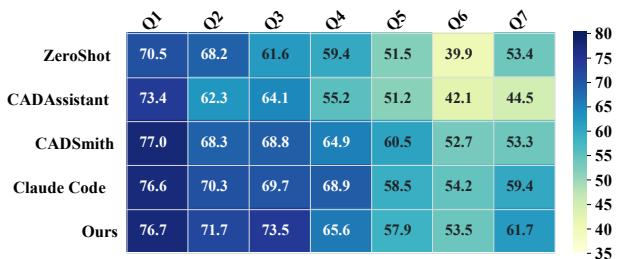

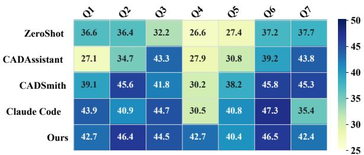

(a) CADProm<sub>p</sub>t
<table><tr><td></td><td>à</td><td>Q</td><td>è</td><td>Q</td><td>é</td><td>Q6</td><td>á</td><td rowspan="5">35 -30 -25 -20</td><td rowspan="5"></td></tr><tr><td>ZeroShot</td><td>16.5</td><td>15.5</td><td>27.1</td><td>16.0</td><td>20.6</td><td>18.8</td><td>20.9</td></tr><tr><td>CADAssistant</td><td>11.7</td><td>11.9</td><td>30.0</td><td>16.9</td><td>19.2</td><td>16.2</td><td>13.3</td></tr><tr><td>CADSmith</td><td>16.8</td><td>16.6</td><td>28.4</td><td>19.4</td><td>18.7</td><td>19.4</td><td>20.3</td></tr><tr><td>Claude Code</td><td>13.3</td><td>21.8</td><td>27.4</td><td>18.5</td><td>18.8</td><td>20.3</td><td>21.3</td></tr><tr><td>Ours</td><td>16.9</td><td>17.5</td><td>24.7</td><td>19.0</td><td>22.2</td><td>22.4</td><td>21.9</td><td>-15 -10</td></tr></table>

(c) CADInstruct

(b) P3D-Text-to-3D  
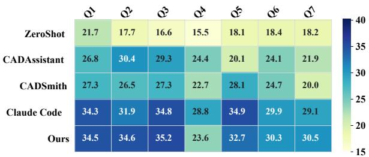  
(d) P3D-Assembl<sub>y</sub>-3D  
Fi<sub>gure</sub> 8<sub>:</sub> M<sub>ean</sub> <sub>en</sub>d<sub>-</sub>t<sub>o-en</sub>d F1 <sub>across</sub> <sub>ca</sub>lib<sub>ra</sub>t<sub>e</sub>d <sub>w</sub>ithi<sub>n-</sub>d<sub>a</sub>t<sub>ase</sub>t difi<sub>cu</sub>lt<sub>y</sub> <sub>quan</sub>til<sub>es.</sub>

$$
g _ { \mathrm { g e o } } ( x ) = \alpha s _ { \mathrm { s e m } } ( x ) + \beta s _ { \mathrm { m e s h } } ( x ) ,\tag{18}
$$

$$
d ( x ) = \lambda _ { 1 } g _ { \mathrm { g e o } } ( x ) + \lambda _ { 2 } a ( x ) + \lambda _ { 3 } g _ { \mathrm { g e o } } ( x ) a ( x ) .\tag{19}
$$

Th<sub>e coe</sub>fi<sub>c</sub>i<sub>en</sub>t<sub>s are</sub> fi<sub>xe</sub>d <sub>across</sub> b<sub>enc</sub>h<sub>mar</sub>k<sub>s.</sub> Th<sub>e</sub> i<sub>n</sub>t<sub>erac</sub>ti<sub>on</sub> t<sub>erm ass</sub>i<sub>gns</sub> hi<sub>g</sub>h<sub>er</sub> difi<sub>cu</sub>lt<sub>y w</sub>h<sub>en comp</sub>l<sub>ex geome</sub>t<sub>ry</sub> i<sub>s a</sub>l<sub>so</sub> described ambiguously. We compute d(x) by the same rule f<sub>or</sub> <sub>every</sub> <sub>samp</sub>l<sub>e</sub> <sub>an</sub>d f<sub>orm</sub> <sub>seven</sub> <sub>equa</sub>l<sub>-</sub>f<sub>requency</sub> <sub>quan</sub>til<sub>es</sub> Q1–Q7 within each dataset. Quantiles thus represent relative difi<sub>cu</sub>lt<sub>y</sub> <sub>w</sub>ithi<sub>n</sub> <sub>a</sub> b<sub>enc</sub>h<sub>mar</sub>k <sub>ra</sub>th<sub>er</sub> th<sub>an</sub> id<sub>en</sub>ti<sub>ca</sub>l <sub>a</sub>b<sub>so</sub>l<sub>u</sub>t<sub>e</sub> <sub>comp</sub>l<sub>ex</sub>it<sub>y across</sub> b<sub>enc</sub>h<sub>mar</sub>k<sub>s.</sub>

<table><tr><td>Component</td><td>Setting</td></tr><tr><td>Student / teacher</td><td>Qwen3.5-9B / Claude Sonnet 4.6</td></tr><tr><td>SFT LoRA</td><td>rank 32, alpha 64, dropout 0.05</td></tr><tr><td>SFT learning rate</td><td> $1 \times 1 0 ^ { - 5 }$  , cosine</td></tr><tr><td>SFT context</td><td>65,536 tokens</td></tr><tr><td>Checkpoint interval</td><td>25 optimizer steps</td></tr><tr><td>GRPO LoRA</td><td>rank 32, alpha 64</td></tr><tr><td>Rollout group</td><td>16 tasks × 8 samples</td></tr><tr><td>Rollout context</td><td>131,072 tokens</td></tr><tr><td>Sampled-sequence cap</td><td>65,536 tokens</td></tr><tr><td>Hardware</td><td>Eight NVIDIA H800 GPUs</td></tr></table>

T<sub>a</sub>bl<sub>e</sub> 6<sub>:</sub> Sh<sub>are</sub>d <sub>po</sub>li<sub>cy-</sub>l<sub>earn</sub>i<sub>ng</sub> <sub>con</sub>fi<sub>gura</sub>ti<sub>on.</sub>

Geometry and execution evaluation. Generated and ref-<sub>erence asse</sub>t<sub>s are conver</sub>t<sub>e</sub>d t<sub>o a common mes</sub>h <sub>represen</sub>t<sub>a-</sub> ti<sub>on,</sub> <sub>sca</sub>l<sub>e-norma</sub>li<sub>ze</sub>d<sub>,</sub> <sub>cen</sub>t<sub>er-a</sub>li<sub>gne</sub>d<sub>,</sub> <sub>an</sub>d <sub>r</sub>i<sub>g</sub>idl<sub>y</sub> <sub>a</sub>li<sub>gne</sub>d by ICP. Chamfer Distance (CD) and surface F1 use 10,000 <sub>un</sub>if<sub>orm</sub>l<sub>y samp</sub>l<sub>e</sub>d <sub>sur</sub>f<sub>ace po</sub>i<sub>n</sub>t<sub>s per asse</sub>t<sub>;</sub> th<sub>e</sub> F1 <sub>neares</sub>t<sub>-</sub> neighbor threshold and IoU voxel resolution are both 0.01. G<sub>eome</sub>t<sub>ry</sub> A<sub>va</sub>il<sub>a</sub>bilit<sub>y</sub> i<sub>s</sub> th<sub>e</sub> f<sub>rac</sub>ti<sub>on</sub> <sub>o</sub>f t<sub>as</sub>k<sub>s</sub> <sub>pro</sub>d<sub>uc</sub>i<sub>ng</sub> <sub>a</sub> nonem<sub>p</sub>t<sub>y</sub>, <sub>p</sub>arsea<sup>bl</sup>e asset t<sup>h</sup>at enters <sub>g</sub>eometr<sub>y</sub> eva<sup>l</sup>uat<sup>i</sup>on. F1<sub>,</sub> I<sub>o</sub>U<sub>, an</sub>d CD <sub>are compu</sub>t<sub>e</sub>d <sub>over</sub> th<sub>ose va</sub>lid <sub>asse</sub>t<sub>s.</sub> F<sub>or</sub> th<sub>e</sub> difi<sub>cu</sub>lt<sub>y-s</sub>t<sub>ra</sub>tifi<sub>e</sub>d Fi<sub>gures</sub> 8 <sub>an</sub>d 4<sub>, we a</sub>dditi<sub>ona</sub>ll<sub>y repor</sub>t <sub>en</sub>d<sub>-</sub>t<sub>o-en</sub>d F1<sub>: m</sub>i<sub>ss</sub>i<sub>ng, unparsa</sub>bl<sub>e, or</sub> i<sub>nva</sub>lid <sub>ou</sub>t<sub>pu</sub>t<sub>s are as-</sub> <sub>s</sub>i<sub>gne</sub>d F1<sub>=</sub>0<sub>.</sub> A<sub>va</sub>il<sub>a</sub>bilit<sub>y</sub> <sub>an</sub>d <sub>con</sub>diti<sub>ona</sub>l <sub>geome</sub>t<sub>ry</sub> <sub>qua</sub>lit<sub>y</sub> <sub>are</sub> k<sub>ep</sub>t <sub>separa</sub>t<sub>e ra</sub>th<sub>er</sub> th<sub>an co</sub>ll<sub>apse</sub>d i<sub>n</sub>t<sub>o a s</sub>i<sub>ng</sub>l<sub>e success</sub> <sub>score.</sub> Th<sub>e sur</sub>f<sub>ace-</sub>di<sub>s</sub>t<sub>ance an</sub>d <sub>occupancy measures</sub> f<sub>o</sub>ll<sub>ow</sub> <sub>es</sub>t<sub>a</sub>bli<sub>s</sub>h<sub>e</sub>d <sub>po</sub>i<sub>n</sub>t<sub>-se</sub>t <sub>an</sub>d i<sub>mp</sub>li<sub>c</sub>it<sub>-geome</sub>t<sub>ry eva</sub>l<sub>ua</sub>ti<sub>on prac-</sub> tice (Fan, Su, and Guibas 2017; Mescheder et al. 2019).

T<sub>a</sub>bl<sub>e</sub> 6 <sub>repor</sub>t<sub>s</sub> th<sub>e s</sub>h<sub>are</sub>d <sub>po</sub>li<sub>cy-</sub>l<sub>earn</sub>i<sub>ng con</sub>fi<sub>gura</sub>ti<sub>on.</sub> Th<sub>e</sub> t<sub>wo</sub> h<sub>arness</sub> t<sub>rac</sub>k<sub>s use</sub> th<sub>e same s</sub>t<sub>u</sub>d<sub>en</sub>t <sub>an</sub>d t<sub>eac</sub>h<sub>er</sub> <sub>mo</sub>d<sub>e</sub>l<sub>s,</sub> L<sub>o</sub>RA <sub>capac</sub>it<sub>y, con</sub>t<sub>ex</sub>t li<sub>m</sub>it<sub>s, c</sub>h<sub>ec</sub>k<sub>po</sub>i<sub>n</sub>t <sub>sc</sub>h<sub>e</sub>d<sub>u</sub>l<sub>e,</sub> <sub>an</sub>d h<sub>ar</sub>d<sub>ware.</sub>

Policy-learning protocol. Policy learning uses the T<sub>ex</sub>t2CAD/D<sub>eep</sub>CAD 800/200 tr<sub>a</sub>in<sub>–</sub>t<sub>es</sub>t <sub>sp</sub>lit<sub>.</sub> Cl<sub>au</sub>d<sub>e</sub> S<sub>o</sub>n<sub>-</sub> net 4.6 generates teacher trajectories independently in the codin<sub>g</sub> harness and DeciCAD; Qwen3.5-9B is the shared <sub>s</sub>t<sub>u</sub>d<sub>en</sub>t<sub>.</sub> B<sub>o</sub>th t<sub>rac</sub>k<sub>s use</sub> th<sub>e same</sub> t<sub>as</sub>k d<sub>escr</sub>i<sub>p</sub>ti<sub>ons, re</sub>f<sub>er-</sub> <sub>ence</sub> <sub>geome</sub>t<sub>ry,</sub> CAD <sub>env</sub>i<sub>ronmen</sub>t<sub>,</sub> <sub>an</sub>d <sub>eva</sub>l<sub>ua</sub>t<sub>or.</sub> Th<sub>e</sub> fi<sub>-</sub> nal test set is excluded from trajectory selection, balancing, hyperparameter adjustment, reward design, and checkpoint <sub>se</sub>l<sub>ec</sub>ti<sub>on.</sub>

SFT <sub>an</sub>d <sub>on</sub>li<sub>ne</sub> RL <sub>use</sub> BF16 L<sub>o</sub>RA<sub>.</sub> Th<sub>e</sub> SFT t<sub>rac</sub>k<sub>s s</sub>h<sub>are</sub> l<sub>earn</sub>i<sub>ng</sub> <sub>ra</sub>t<sub>e,</sub> b<sub>a</sub>t<sub>c</sub>h <sub>con</sub>fi<sub>gura</sub>ti<sub>on,</sub> <sub>con</sub>t<sub>ex</sub>t l<sub>eng</sub>th<sub>,</sub> <sub>an</sub>d L<sub>o</sub>RA <sub>se</sub>tti<sub>ngs.</sub> GRPO b<sub>eg</sub>i<sub>ns</sub> f<sub>rom</sub> th<sub>e se</sub>l<sub>ec</sub>t<sub>e</sub>d SFT <sub>c</sub>h<sub>ec</sub>k<sub>po</sub>i<sub>n</sub>t f<sub>or</sub> <sub>eac</sub>h h<sub>arness an</sub>d <sub>samp</sub>l<sub>es s</sub>t<sub>u</sub>d<sub>en</sub>t <sub>ro</sub>ll<sub>ou</sub>t<sub>s</sub> th<sub>roug</sub>h th<sub>e same</sub> i<sub>n</sub>t<sub>er</sub>f<sub>ace</sub> <sub>use</sub>d d<sub>ur</sub>i<sub>ng</sub> <sub>superv</sub>i<sub>s</sub>i<sub>on.</sub>

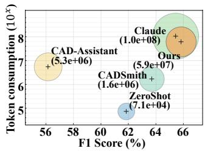  
(a) CADProm<sub>p</sub>t

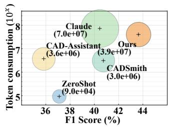  
(b) P3D-Text-to-3D

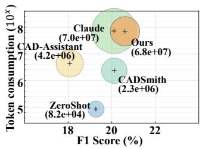  
(c) CADInstruct

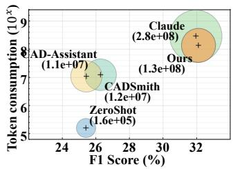  
(d) P3D-Assembl<sub>y</sub>-3D  
Fi<sub>gure</sub> 9<sub>:</sub> G<sub>eome</sub>t<sub>ry–con</sub>t<sub>ex</sub>t t<sub>ra</sub>d<sub>e-o</sub>f <sub>across</sub> b<sub>enc</sub>h<sub>mar</sub>k<sub>s.</sub> E<sub>ac</sub>h <sub>po</sub>i<sub>n</sub>t <sub>repor</sub>t<sub>s mean</sub> F1 <sub>an</sub>d <sub>cumu</sub>l<sub>a</sub>ti<sub>ve mo</sub>d<sub>e</sub>l<sub>-v</sub>i<sub>s</sub>ibl<sub>e</sub> i<sub>npu</sub>t t<sub>o</sub>k<sub>ens</sub> f<sub>or one me</sub>th<sub>o</sub>d<sub>.</sub>

## D.2 Extended Harness Comparison

W<sub>e</sub> <sub>ex</sub>t<sub>en</sub>d th<sub>e</sub> <sub>aggrega</sub>t<sub>e</sub> <sub>compar</sub>i<sub>son</sub> i<sub>n</sub> th<sub>e</sub> <sub>ma</sub>i<sub>n</sub> t<sub>ex</sub>t <sub>a</sub>l<sub>ong</sub> t<sub>as</sub>k difi<sub>cu</sub>lt<sub>y, mo</sub>d<sub>e</sub>l<sub>-v</sub>i<sub>s</sub>ibl<sub>e con</sub>t<sub>ex</sub>t<sub>, an</sub>d <sub>represen</sub>t<sub>a</sub>ti<sub>ve ou</sub>t<sub>-</sub> pu<sup>t</sup> g<sup>eometr</sup>y.

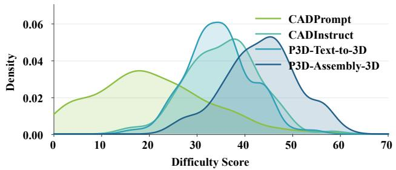  
Fi<sub>gure</sub> 10<sub>:</sub> C<sub>a</sub>lib<sub>ra</sub>t<sub>e</sub>d difi<sub>cu</sub>lt<sub>y</sub> di<sub>s</sub>t<sub>r</sub>ib<sub>u</sub>ti<sub>ons</sub> <sub>o</sub>f th<sub>e</sub> f<sub>our</sub> b<sub>enc</sub>h<sub>mar</sub>k<sub>s.</sub>

Dificulty distribution and stratified performance. Fig-<sub>ure</sub> 10 <sub>s</sub>h<sub>ows</sub> th<sub>e ca</sub>lib<sub>ra</sub>t<sub>e</sub>d difi<sub>cu</sub>lt<sub>y</sub> di<sub>s</sub>t<sub>r</sub>ib<sub>u</sub>ti<sub>ons.</sub> CAD<sub>-</sub> Pr<sub>o</sub>m<sub>p</sub>t <sub>co</sub>n<sub>ce</sub>ntr<sub>a</sub>t<sub>es</sub> in th<sub>e</sub> l<sub>owe</sub>r r<sub>a</sub>n<sub>ge,</sub> CADIn<sub>s</sub>tr<sub>uc</sub>t <sub>a</sub>nd P3D<sub>-</sub>T<sub>ex</sub>t<sub>-</sub>t<sub>o-</sub>3D <sub>s</sub>hift t<sub>owa</sub>rd <sub>g</sub>r<sub>ea</sub>t<sub>e</sub>r <sub>co</sub>m<sub>p</sub>l<sub>ex</sub>it<sub>y,</sub> <sub>a</sub>nd P3D<sub>-</sub> A<sub>ssem</sub>bl<sub>y-</sub>3D <sub>occup</sub>i<sub>es</sub> th<sub>e</sub> hi<sub>g</sub>h<sub>es</sub>t <sub>range.</sub> Thi<sub>s or</sub>d<sub>er</sub>i<sub>ng re-</sub> fl<sub>ec</sub>t<sub>s</sub> th<sub>e</sub> <sub>a</sub>dditi<sub>ona</sub>l <sub>nee</sub>d t<sub>o</sub> <sub>preserve</sub> <sub>componen</sub>t id<sub>en</sub>tit<sub>y,</sub> relative placement, and cross-object relations in assembly.

Figure 8 expands the aggregate F1 results across Q1–Q7. D<sub>eci</sub>CAD l<sub>ea</sub>d<sub>s</sub> 14 <sub>o</sub>f th<sub>e</sub> 28 d<sub>a</sub>t<sub>ase</sub>t<sub>–quan</sub>til<sub>e ce</sub>ll<sub>s, more</sub> than an<sub>y</sub> baseline, and exceeds Claude Code at Q7 on ever<sub>y</sub> b<sub>enc</sub>h<sub>mar</sub>k<sub>.</sub> It <sub>ran</sub>k<sub>s</sub> fi<sub>rs</sub>t i<sub>n</sub> fi<sub>ve o</sub>f <sub>seven</sub> P3D<sub>-</sub>A<sub>ssem</sub>bl<sub>y-</sub>3D quantiles and leads from Q5 through Q7 on CADInstruct. On P3D<sub>-</sub>T<sub>ex</sub>t<sub>-</sub>t<sub>o-</sub>3D<sub>,</sub> it<sub>s</sub> F1 r<sub>e</sub>m<sub>a</sub>in<sub>s a</sub>h<sub>ea</sub>d <sub>o</sub>f Cl<sub>au</sub>d<sub>e</sub> C<sub>o</sub>d<sub>e a</sub>t both Q4 (42.7 versus 30.5) and Q7 (42.4 versus 35.4).

Th<sub>e</sub> <sub>aggrega</sub>t<sub>e</sub> <sub>a</sub>d<sub>van</sub>t<sub>age</sub> i<sub>s</sub> th<sub>ere</sub>f<sub>ore</sub> <sub>no</sub>t d<sub>r</sub>i<sub>ven</sub> <sub>on</sub>l<sub>y</sub> b<sub>y</sub> <sub>easy</sub> t<sub>as</sub>k<sub>s.</sub> If th<sub>e seman</sub>ti<sub>c ac</sub>ti<sub>on space om</sub>itt<sub>e</sub>d <sub>opera</sub>ti<sub>ons</sub> <sub>requ</sub>i<sub>re</sub>d b<sub>y comp</sub>l<sub>ex</sub> d<sub>es</sub>i<sub>gns, per</sub>f<sub>ormance wou</sub>ld d<sub>e</sub>t<sub>er</sub>i<sub>ora</sub>t<sub>e</sub> s<sub>y</sub>stematicall<sub>y</sub> at high dificult<sub>y</sub>. Its competitive Q7 behavi<sub>or</sub> i<sub>ns</sub>t<sub>ea</sub>d i<sub>n</sub>di<sub>ca</sub>t<sub>es</sub> th<sub>a</sub>t <sub>compress</sub>i<sub>ng</sub> i<sub>mp</sub>l<sub>emen</sub>t<sub>a</sub>ti<sub>on-</sub>l<sub>eve</sub>l <sub>c</sub>h<sub>o</sub>i<sub>ces</sub> <sub>re</sub>t<sub>a</sub>i<sub>ns</sub> th<sub>e</sub> <sub>necessary</sub> CAD t<sub>rans</sub>iti<sub>ons.</sub> CADI<sub>ns</sub>t<sub>ruc</sub>t <sub>rema</sub>i<sub>ns non-mono</sub>t<sub>on</sub>i<sub>c, so</sub> difi<sub>cu</sub>lt<sub>y serves as a s</sub>t<sub>ra</sub>tifi<sub>ca</sub>ti<sub>on</sub> <sub>var</sub>i<sub>a</sub>bl<sub>e ra</sub>th<sub>er</sub> th<sub>an a</sub> d<sub>e</sub>t<sub>erm</sub>i<sub>n</sub>i<sub>s</sub>ti<sub>c pre</sub>di<sub>c</sub>t<sub>or o</sub>f f<sub>a</sub>il<sub>ure.</sub>

Fi<sub>gure</sub> 4 i<sub>n</sub> th<sub>e ma</sub>i<sub>n</sub> t<sub>ex</sub>t <sub>summar</sub>i<sub>zes</sub> th<sub>ese quan</sub>til<sub>e</sub> t<sub>ren</sub>d<sub>s</sub> <sub>w</sub>ith li<sub>near</sub> fit<sub>s.</sub> B<sub>ecause</sub> CADI<sub>ns</sub>t<sub>ruc</sub>t i<sub>s</sub> <sub>non-mono</sub>t<sub>on</sub>i<sub>c,</sub> it<sub>s</sub> <sub>s</sub>l<sub>ope</sub> i<sub>s</sub> <sub>use</sub>d <sub>on</sub>l<sub>y</sub> <sub>as</sub> <sub>a</sub> <sub>compac</sub>t <sub>summary</sub> <sub>o</sub>f th<sub>e</sub> h<sub>ea</sub>t<sub>map.</sub>

Geometry–context trade-of. Figure 9 jointly compares <sub>geome</sub>t<sub>r</sub>i<sub>c qua</sub>lit<sub>y an</sub>d <sub>mo</sub>d<sub>e</sub>l<sub>-v</sub>i<sub>s</sub>ibl<sub>e</sub> i<sub>npu</sub>t t<sub>o</sub>k<sub>ens.</sub> O<sub>n</sub> th<sub>e</sub> th<sub>ree</sub> t<sub>ex</sub>t<sub>-</sub>t<sub>o-</sub>CAD b<sub>enc</sub>h<sub>mar</sub>k<sub>s,</sub> D<sub>eci</sub>CAD <sub>occup</sub>i<sub>es</sub> <sub>a</sub> <sub>s</sub>t<sub>ronger per</sub>f<sub>ormance–cos</sub>t <sub>reg</sub>i<sub>on</sub> th<sub>an</sub> Cl<sub>au</sub>d<sub>e</sub> C<sub>o</sub>d<sub>e:</sub> it <sub>a</sub>t<sub>-</sub> t<sub>a</sub>i<sub>ns</sub> hi<sub>g</sub>h<sub>er</sub> F1 <sub>w</sub>hil<sub>e consum</sub>i<sub>ng su</sub>b<sub>s</sub>t<sub>an</sub>ti<sub>a</sub>ll<sub>y</sub> l<sub>ess</sub> i<sub>npu</sub>t <sub>con-</sub> t<sub>ex</sub>t<sub>.</sub> Th<sub>e geome</sub>t<sub>r</sub>i<sub>c a</sub>d<sub>van</sub>t<sub>age</sub> th<sub>ere</sub>f<sub>ore canno</sub>t b<sub>e a</sub>tt<sub>r</sub>ib<sub>u</sub>t<sub>e</sub>d t<sub>o</sub> <sub>expos</sub>i<sub>ng</sub> th<sub>e</sub> <sub>mo</sub>d<sub>e</sub>l t<sub>o</sub> <sub>a</sub> l<sub>arger</sub> i<sub>n</sub>t<sub>erac</sub>ti<sub>on</sub> hi<sub>s</sub>t<sub>ory.</sub> P3D<sub>-</sub> A<sub>ssem</sub>bl<sub>y-</sub>3D i<sub>s more</sub> d<sub>eman</sub>di<sub>ng</sub> f<sub>or</sub> b<sub>o</sub>th h<sub>arnesses</sub> b<sub>ecause</sub> multi-object references and repeated state updates enlarge th<sub>e con</sub>t<sub>ex</sub>t<sub>, ye</sub>t D<sub>eci</sub>CAD <sub>re</sub>t<sub>a</sub>i<sub>ns a compe</sub>titi<sub>ve</sub> t<sub>ra</sub>d<sub>e-o</sub>f<sub>.</sub> T<sub>oge</sub>th<sub>er w</sub>ith th<sub>e ou</sub>t<sub>pu</sub>t<sub>-s</sub>id<sub>e ana</sub>l<sub>ys</sub>i<sub>s</sub> b<sub>e</sub>l<sub>ow,</sub> th<sub>ese resu</sub>lt<sub>s</sub> separate representation eficiency from trajectory truncation <sub>or re</sub>d<sub>uce</sub>d t<sub>as</sub>k <sub>coverage.</sub>

Output scaling with interaction length. Figure 5 in the <sub>ma</sub>i<sub>n</sub> t<sub>ex</sub>t <sub>compares</sub> i<sub>n</sub>t<sub>erac</sub>ti<sub>on</sub> t<sub>urns w</sub>ith <sub>cumu</sub>l<sub>a</sub>ti<sub>ve ou</sub>t<sub>pu</sub>t <sub>a</sub>t th<sub>e</sub> t<sub>as</sub>k l<sub>eve</sub>l <sub>an</sub>d <sub>s</sub>h<sub>ows</sub> th<sub>a</sub>t th<sub>e ou</sub>t<sub>pu</sub>t <sub>re</sub>d<sub>uc</sub>ti<sub>on</sub> d<sub>oes no</sub>t <sub>ar</sub>i<sub>se</sub> f<sub>rom ear</sub>l<sub>y</sub> t<sub>erm</sub>i<sub>na</sub>ti<sub>on.</sub>

Decision allocation. We group decisions as Planning, M<sub>o</sub>d<sub>e</sub>li<sub>ng, or</sub> V<sub>er</sub>ifi<sub>ca</sub>ti<sub>on accor</sub>di<sub>ng</sub> t<sub>o</sub> th<sub>e</sub>i<sub>r ex</sub>t<sub>erna</sub>l <sub>e</sub>f<sub>ec</sub>t<sub>.</sub> Fi<sub>gure</sub> 11 <sub>s</sub>h<sub>ows</sub> th<sub>a</sub>t D<sub>eci</sub>CAD <sub>cons</sub>i<sub>s</sub>t<sub>en</sub>tl<sub>y</sub> d<sub>evo</sub>t<sub>es</sub> <sub>a</sub> l<sub>arger</sub> <sub>s</sub>h<sub>are o</sub>f <sub>o</sub>b<sub>serva</sub>bl<sub>e</sub> d<sub>ec</sub>i<sub>s</sub>i<sub>ons</sub> t<sub>o</sub> M<sub>o</sub>d<sub>e</sub>li<sub>ng across</sub> d<sub>a</sub>t<sub>ase</sub>t<sub>s</sub> <sub>an</sub>d difi<sub>cu</sub>lt<sub>y</sub> l<sub>eve</sub>l<sub>s, w</sub>h<sub>ereas</sub> Cl<sub>au</sub>d<sub>e</sub> C<sub>o</sub>d<sub>e</sub> d<sub>evo</sub>t<sub>es a</sub> l<sub>arger</sub> <sub>com</sub>bi<sub>ne</sub>d <sub>s</sub>h<sub>are</sub> t<sub>o</sub> Pl<sub>ann</sub>i<sub>ng an</sub>d V<sub>er</sub>ifi<sub>ca</sub>ti<sub>on.</sub>

Qualitative comparison. Figure 12 shows representative <sub>asse</sub>t<sub>s</sub> f<sub>rom</sub> P3D<sub>-</sub>T<sub>ex</sub>t<sub>-</sub>t<sub>o-</sub>3D <sub>an</sub>d CADP<sub>romp</sub>t<sub>.</sub> Z<sub>ero-s</sub>h<sub>o</sub>t <sub>an</sub>d li<sub>g</sub>ht<sub>we</sub>i<sub>g</sub>ht <sub>spec</sub>i<sub>a</sub>li<sub>ze</sub>d <sub>agen</sub>t<sub>s</sub> <sub>more</sub> <sub>o</sub>ft<sub>en</sub> <sub>om</sub>it l<sub>oca</sub>l f<sub>ea</sub>t<sub>ures</sub> <sub>or pro</sub>d<sub>uce uneva</sub>l<sub>ua</sub>bl<sub>e ar</sub>tif<sub>ac</sub>t<sub>s.</sub> Cl<sub>au</sub>d<sub>e</sub> C<sub>o</sub>d<sub>e usua</sub>ll<sub>y recov-</sub> <sub>ers</sub> th<sub>e g</sub>l<sub>o</sub>b<sub>a</sub>l <sub>s</sub>h<sub>ape</sub> b<sub>u</sub>t <sub>may re</sub>t<sub>a</sub>i<sub>n geome</sub>t<sub>r</sub>i<sub>c-</sub>d<sub>e</sub>t<sub>a</sub>il <sub>errors</sub> d<sub>esp</sub>it<sub>e execu</sub>t<sub>a</sub>bl<sub>e co</sub>d<sub>e.</sub> D<sub>eci</sub>CAD <sub>more cons</sub>i<sub>s</sub>t<sub>en</sub>tl<sub>y pre-</sub> <sub>serves</sub> th<sub>e reques</sub>t<sub>e</sub>d <sub>pro</sub>fil<sub>es, open</sub>i<sub>ngs, an</sub>d <sub>repea</sub>t<sub>e</sub>d f<sub>ea</sub>t<sub>ures,</sub> <sub>ma</sub>t<sub>c</sub>hi<sub>ng</sub> th<sub>e aggrega</sub>t<sub>e</sub> t<sub>ren</sub>d<sub>s</sub> i<sub>n</sub> F1<sub>,</sub> I<sub>o</sub>U<sub>, an</sub>d A<sub>va</sub>il<sub>a</sub>bilit<sub>y.</sub>

## D.3 Harness-Grounded SFT

We next describe how closed-loop teacher trajectories are <sub>conver</sub>t<sub>e</sub>d i<sub>n</sub>t<sub>o causa</sub>l <sub>superv</sub>i<sub>s</sub>i<sub>on an</sub>d h<sub>ow</sub> th<sub>e resu</sub>lti<sub>ng po</sub>li<sub>-</sub> <sub>c</sub>i<sub>es are se</sub>l<sub>ec</sub>t<sub>e</sub>d <sub>an</sub>d <sub>eva</sub>l<sub>ua</sub>t<sub>e</sub>d<sub>.</sub>

Causal decision supervision and data composition. Poli<sub>cy superv</sub>i<sub>s</sub>i<sub>on mus</sub>t <sub>preserve</sub> th<sub>e</sub> d<sub>ec</sub>i<sub>s</sub>i<sub>on con</sub>diti<sub>ons un</sub>d<sub>er</sub> <sub>w</sub>hi<sub>c</sub>h <sub>eac</sub>h <sub>ac</sub>ti<sub>on</sub> <sub>was</sub> <sub>pro</sub>d<sub>uce</sub>d<sub>.</sub> F<sub>or</sub> <sub>every</sub> t<sub>eac</sub>h<sub>er</sub> <sub>ac</sub>ti<sub>on</sub> $a _ { t } ,$ <sub>, we recons</sub>t<sub>ruc</sub>t th<sub>e mo</sub>d<sub>e</sub>l<sub>-v</sub>i<sub>s</sub>ibl<sub>e</sub> hi<sub>s</sub>t<sub>ory</sub> $h _ { t }$ i<sub>mme</sub>di<sub>a</sub>t<sub>e</sub>l<sub>y</sub> b<sub>e</sub>f<sub>ore</sub> th<sub>a</sub>t <sub>ac</sub>ti<sub>on,</sub> i<sub>nc</sub>l<sub>u</sub>di<sub>ng</sub> th<sub>e</sub> <sub>sys</sub>t<sub>em</sub> i<sub>ns</sub>t<sub>ruc</sub>ti<sub>on,</sub> t<sub>as</sub>k<sub>,</sub> <sub>pre-</sub> <sub>ce</sub>di<sub>ng mo</sub>d<sub>e</sub>l <sub>ac</sub>ti<sub>ons,</sub> t<sub>oo</sub>l <sub>resu</sub>lt<sub>s, an</sub>d <sub>ava</sub>il<sub>a</sub>bl<sub>e</sub> t<sub>oo</sub>l <sub>sc</sub>h<sub>ema.</sub>

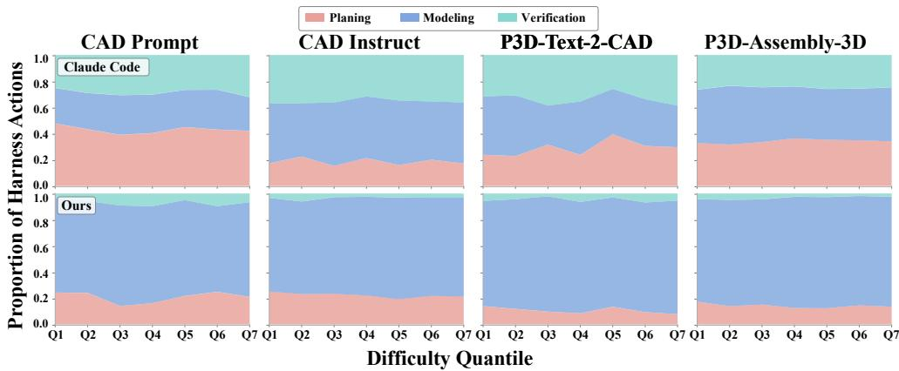  
Fi<sub>gure</sub> 11<sub>:</sub> All<sub>oca</sub>ti<sub>on</sub> <sub>o</sub>f <sub>o</sub>b<sub>serva</sub>bl<sub>e</sub> d<sub>ec</sub>i<sub>s</sub>i<sub>ons</sub> t<sub>o</sub> Pl<sub>ann</sub>i<sub>ng,</sub> M<sub>o</sub>d<sub>e</sub>li<sub>ng,</sub> <sub>an</sub>d V<sub>er</sub>ifi<sub>ca</sub>ti<sub>on</sub> <sub>across</sub> d<sub>a</sub>t<sub>ase</sub>t<sub>s</sub> <sub>an</sub>d difi<sub>cu</sub>lt<sub>y</sub> <sub>quan</sub>til<sub>es.</sub> Th<sub>e upper an</sub>d l<sub>ower rows s</sub>h<sub>ow</sub> Cl<sub>au</sub>d<sub>e</sub> C<sub>o</sub>d<sub>e an</sub>d D<sub>eci</sub>CAD<sub>, respec</sub>ti<sub>ve</sub>l<sub>y.</sub>

Th<sub>e</sub> t<sub>arge</sub>t i<sub>s</sub> th<sub>e</sub> t<sub>eac</sub>h<sub>er</sub>’<sub>s nex</sub>t <sub>co</sub>di<sub>ng response or seman</sub>ti<sub>c</sub> CAD action. When a trajectory contains a local failure, the f<sub>a</sub>il<sub>ure resu</sub>lt <sub>rema</sub>i<sub>ns</sub> i<sub>n</sub> th<sub>e</sub> hi<sub>s</sub>t<sub>ory an</sub>d <sub>superv</sub>i<sub>s</sub>i<sub>on</sub> i<sub>s app</sub>li<sub>e</sub>d t<sub>o</sub> th<sub>e su</sub>b<sub>sequen</sub>t <sub>recovery</sub> d<sub>ec</sub>i<sub>s</sub>i<sub>on.</sub> Thi<sub>s causa</sub>l <sub>cons</sub>t<sub>ruc</sub>ti<sub>on</sub> f<sub>o</sub>ll<sub>ows</sub> th<sub>e pr</sub>i<sub>nc</sub>i<sub>p</sub>l<sub>e</sub> th<sub>a</sub>t i<sub>n</sub>t<sub>erac</sub>ti<sub>ve po</sub>li<sub>c</sub>i<sub>es mus</sub>t b<sub>e</sub> t<sub>ra</sub>i<sub>ne</sub>d <sub>on</sub> hi<sub>s</sub>t<sub>or</sub>i<sub>es</sub> i<sub>n</sub>d<sub>uce</sub>d b<sub>y prece</sub>di<sub>ng ac</sub>ti<sub>ons ra</sub>th<sub>er</sub> th<sub>an on</sub> f<sub>u-</sub> ture trajectory information (Ross, Gordon, and Bagnell 2011; Qin et al. 2024).

B<sub>o</sub>th d<sub>a</sub>t<sub>ase</sub>t<sub>s or</sub>i<sub>g</sub>i<sub>na</sub>t<sub>e</sub> f<sub>rom</sub> th<sub>e o</sub>fi<sub>c</sub>i<sub>a</sub>l T<sub>ex</sub>t2CAD t<sub>ra</sub>i<sub>n-</sub> i<sub>ng sp</sub>lit<sub>.</sub> Cl<sub>au</sub>d<sub>e</sub> S<sub>onne</sub>t 4<sub>.</sub>6 <sub>execu</sub>t<sub>es</sub> th<sub>e same</sub> t<sub>as</sub>k<sub>s</sub> i<sub>n</sub>d<sub>e-</sub> <sub>pen</sub>d<sub>en</sub>tl<sub>y</sub> th<sub>roug</sub>h th<sub>e</sub> C<sub>o</sub>di<sub>ng an</sub>d D<sub>eci</sub>CAD h<sub>arnesses, an</sub>d th<sub>e</sub> <sub>resu</sub>lti<sub>ng</sub> <sub>asse</sub>t<sub>s</sub> <sub>are</sub> <sub>eva</sub>l<sub>ua</sub>t<sub>e</sub>d <sub>aga</sub>i<sub>ns</sub>t th<sub>e</sub> <sub>same</sub> t<sub>arge</sub>t <sub>ge-</sub> ometry. Geometry- and protocol-audited trajectories are then ex<sub>p</sub>anded into causal decision exam<sub>p</sub>les (Khan et al. 2024; Anthropic 2026c; Qwen Team 2026). The DeciCAD dataset <sub>con</sub>t<sub>a</sub>i<sub>ns</sub> 642 <sub>au</sub>dit<sub>e</sub>d t<sub>as</sub>k<sub>s,</sub> di<sub>v</sub>id<sub>e</sub>d b<sub>y</sub> t<sub>as</sub>k id<sub>en</sub>tit<sub>y</sub> i<sub>n</sub>t<sub>o</sub> 542 t<sub>ra</sub>i<sub>n</sub>i<sub>ng an</sub>d 100 d<sub>eve</sub>l<sub>opmen</sub>t t<sub>as</sub>k<sub>s.</sub> E<sub>ac</sub>h t<sub>as</sub>k <sub>re</sub>t<sub>a</sub>i<sub>ns a</sub>t <sub>mos</sub>t 11 <sub>regu</sub>l<sub>ar</sub> <sub>an</sub>d th<sub>ree</sub> <sub>correc</sub>ti<sub>ve</sub> d<sub>ec</sub>i<sub>s</sub>i<sub>ons</sub> <sub>cover</sub>i<sub>ng</sub> i<sub>n</sub>i<sub>-</sub> ti<sub>a</sub>li<sub>za</sub>ti<sub>on, core mo</sub>d<sub>e</sub>li<sub>ng,</sub> i<sub>nspec</sub>ti<sub>on, recovery, an</sub>d <sub>ar</sub>tif<sub>ac</sub>t <sub>pers</sub>i<sub>s</sub>t<sub>ence.</sub> Th<sub>e</sub> C<sub>o</sub>di<sub>ng</sub> d<sub>a</sub>t<sub>ase</sub>t <sub>con</sub>t<sub>a</sub>i<sub>ns</sub> 499 <sub>geome</sub>t<sub>ry-va</sub>lid t<sub>as</sub>k<sub>s, o</sub>f <sub>w</sub>hi<sub>c</sub>h 471 <sub>are use</sub>d f<sub>or</sub> t<sub>ra</sub>i<sub>n</sub>i<sub>ng an</sub>d 28 f<sub>or</sub> d<sub>eve</sub>l<sub>op-</sub> <sub>men</sub>t<sub>, y</sub>i<sub>e</sub>ldi<sub>ng</sub> 3<sub>,</sub>651 t<sub>ra</sub>i<sub>n</sub>i<sub>ng</sub> t<sub>arge</sub>t<sub>s an</sub>d 207 d<sub>eve</sub>l<sub>opmen</sub>t t<sub>arge</sub>t<sub>s;</sub> 336 t<sub>ra</sub>i<sub>n</sub>i<sub>ng</sub> t<sub>arge</sub>t<sub>s</sub> f<sub>o</sub>ll<sub>ow an o</sub>b<sub>serve</sub>d <sub>execu</sub>ti<sub>on</sub> error.

<table><tr><td>Harness</td><td>Audited tasks Train / dev. Target cap Recovery</td><td></td><td></td><td>targets</td></tr><tr><td>Coding</td><td>499</td><td>471/28</td><td>12</td><td>Up to 4 observed</td></tr><tr><td>DECICAD</td><td>642</td><td>542 / 100</td><td>11 + 3</td><td>Up to 3 observed or controlled</td></tr></table>

T<sub>a</sub>bl<sub>e</sub> 7<sub>:</sub> SFT <sub>superv</sub>i<sub>s</sub>i<sub>on</sub> <sub>o</sub>bt<sub>a</sub>i<sub>ne</sub>d th<sub>roug</sub>h th<sub>e</sub> t<sub>wo</sub> h<sub>arnesses.</sub> B<sub>o</sub>th t<sub>rac</sub>k<sub>s use</sub> th<sub>e same s</sub>t<sub>u</sub>d<sub>en</sub>t <sub>mo</sub>d<sub>e</sub>l <sub>an</sub>d <sub>op</sub>ti<sub>m</sub>i<sub>za</sub>ti<sub>on</sub> <sub>p</sub>rotoco<sup>l</sup>.

Th<sub>e</sub> t<sub>wo</sub> t<sub>rac</sub>k<sub>s s</sub>h<sub>are</sub> th<sub>e source</sub> t<sub>as</sub>k<sub>s,</sub> t<sub>eac</sub>h<sub>er an</sub>d <sub>s</sub>t<sub>u-</sub> d<sub>en</sub>t <sub>mo</sub>d<sub>e</sub>l<sub>s, causa</sub>l t<sub>runca</sub>ti<sub>on, con</sub>t<sub>ex</sub>t li<sub>m</sub>it<sub>, an</sub>d <sub>op</sub>ti<sub>m</sub>i<sub>za-</sub> ti<sub>on pro</sub>t<sub>oco</sub>l<sub>, w</sub>hil<sub>e re</sub>t<sub>a</sub>i<sub>n</sub>i<sub>ng</sub> th<sub>e na</sub>t<sub>ura</sub>l <sub>granu</sub>l<sub>ar</sub>it<sub>y o</sub>f th<sub>e</sub>i<sub>r</sub> <sub>respec</sub>ti<sub>ve</sub> d<sub>ec</sub>i<sub>s</sub>i<sub>on spaces.</sub> D<sub>eci</sub>CAD <sub>examp</sub>l<sub>es are s</sub>t<sub>ra</sub>ti<sub>-</sub> fi<sub>e</sub>d b<sub>y</sub> t<sub>as</sub>k difi<sub>cu</sub>lt<sub>y,</sub> CAD <sub>s</sub>t<sub>age, accumu</sub>l<sub>a</sub>t<sub>e</sub>d d<sub>ocumen</sub>t <sub>s</sub>t<sub>a</sub>t<sub>e, prece</sub>di<sub>ng ac</sub>ti<sub>on an</sub>d <sub>ou</sub>t<sub>come,</sub> hi<sub>s</sub>t<sub>ory pa</sub>tt<sub>ern, an</sub>d t<sub>ar-</sub> <sub>ge</sub>t <sub>ac</sub>ti<sub>on c</sub>l<sub>ass.</sub> G<sub>ener</sub>i<sub>c query an</sub>d <sub>compu</sub>t<sub>a</sub>ti<sub>on ac</sub>ti<sub>ons are</sub> ca<sub>pp</sub>e<sup>d</sup>, w<sup>h</sup>ereas <sub>g</sub>eometr<sub>y</sub>-c<sup>h</sup>an<sub>g</sub><sup>i</sup>n<sub>g</sub>, <sup>i</sup>ns<sub>p</sub>ect<sup>i</sup>on, an<sup>d</sup> recov-<sub>ery ac</sub>ti<sub>ons re</sub>t<sub>a</sub>i<sub>n</sub> th<sub>e</sub>i<sub>r causa</sub>l hi<sub>s</sub>t<sub>or</sub>i<sub>es.</sub> C<sub>o</sub>di<sub>ng</sub> d<sub>a</sub>t<sub>a</sub> f<sub>o</sub>ll<sub>ow</sub> th<sub>e same</sub> t<sub>as</sub>k<sub>-</sub>l<sub>eve</sub>l filt<sub>er</sub>i<sub>ng pr</sub>i<sub>nc</sub>i<sub>p</sub>l<sub>e an</sub>d <sub>pr</sub>i<sub>or</sub>iti<sub>ze genu</sub>i<sub>ne</sub> <sup>reco</sup>v<sup>er</sup>y <sup>res</sup>p<sup>onses.</sup>

T<sub>a</sub>bl<sub>e</sub> 7 <sub>recor</sub>d<sub>s</sub> th<sub>e au</sub>dit<sub>e</sub>d t<sub>as</sub>k <sub>coverage an</sub>d t<sub>arge</sub>t <sub>con-</sub> <sub>s</sub>t<sub>ruc</sub>ti<sub>on use</sub>d f<sub>or</sub> th<sub>e</sub> t<sub>wo</sub> SFT t<sub>rac</sub>k<sub>s.</sub> Th<sub>ese coun</sub>t<sub>s re</sub>fl<sub>ec</sub>t th<sub>e execu</sub>t<sub>a</sub>bl<sub>e superv</sub>i<sub>s</sub>i<sub>on ava</sub>il<sub>a</sub>bl<sub>e</sub> i<sub>n eac</sub>h h<sub>arness-</sub>i<sub>n</sub>d<sub>uce</sub>d d<sub>ec</sub>i<sub>s</sub>i<sub>on</sub> <sub>space.</sub>

Checkpoint selection and learned policies. Both tracks <sub>save</sub> <sub>a</sub> <sub>c</sub>h<sub>ec</sub>k<sub>po</sub>i<sub>n</sub>t <sub>every</sub> 25 <sub>op</sub>ti<sub>m</sub>i<sub>zer</sub> <sub>s</sub>t<sub>eps.</sub> T<sub>ra</sub>i<sub>n</sub>i<sub>ng</sub> <sub>an</sub>d t<sub>o</sub>k<sub>en-</sub>l<sub>eve</sub>l <sub>va</sub>lid<sub>a</sub>ti<sub>on</sub> l<sub>oss mon</sub>it<sub>or op</sub>ti<sub>m</sub>i<sub>za</sub>ti<sub>on, w</sub>hil<sub>e</sub> th<sub>e</sub> fi<sub>na</sub>l <sub>c</sub>h<sub>ec</sub>k<sub>po</sub>i<sub>n</sub>t i<sub>s</sub> <sub>se</sub>l<sub>ec</sub>t<sub>e</sub>d <sub>on</sub> f<sub>rozen</sub> d<sub>eve</sub>l<sub>opmen</sub>t t<sub>as</sub>k<sub>s</sub> <sub>us-</sub> i<sub>ng c</sub>l<sub>ose</sub>d<sub>-</sub>l<sub>oop</sub> A<sub>va</sub>il<sub>a</sub>bilit<sub>y,</sub> F1<sub>,</sub> I<sub>o</sub>U<sub>, an</sub>d CD<sub>.</sub>

SFT equips both Qwen3.5-9B policies with closed-loop CAD <sub>capa</sub>bilit<sub>y,</sub> b<sub>u</sub>t th<sub>e</sub> l<sub>earne</sub>d <sub>ou</sub>t<sub>comes</sub> dif<sub>er.</sub> C<sub>o</sub>di<sub>ng</sub> SFT raises Availability from 12.5% to 60.5%, F1 from 0.5902 to 0.6460, and IoU from 0.5871 to 0.6286, while CD changes from 0.00972 to 0.01130. The student therefore acquires <sub>program cons</sub>t<sub>ruc</sub>ti<sub>on, execu</sub>ti<sub>on, an</sub>d <sub>repa</sub>i<sub>r, a</sub>lth<sub>oug</sub>h l<sub>oca</sub>l <sub>geome</sub>t<sub>r</sub>i<sub>c error rema</sub>i<sub>ns a</sub>ft<sub>er</sub> th<sub>e</sub> l<sub>arge coverage expans</sub>i<sub>on.</sub> DeciCAD SFT raises Availability from 61.5% to 66.5%, F1 from 0.6883 to 0.7437, and IoU from 0.6487 to 0.6631, while reducing CD from 0.01023 to 0.00782. Semantic CAD super-<sub>v</sub>i<sub>s</sub>i<sub>on</sub> th<sub>us</sub> i<sub>mproves</sub> b<sub>o</sub>th <sub>asse</sub>t <sub>coverage an</sub>d th<sub>e geome</sub>t<sub>ry</sub> <sub>o</sub>f <sub>va</sub>lid <sub>ou</sub>t<sub>pu</sub>t<sub>s.</sub> Th<sub>e agg</sub>r<sub>ega</sub>t<sub>e s</sub>t<sub>age-w</sub>i<sub>se geo</sub>m<sub>e</sub>tr<sub>y</sub> r<sub>esu</sub>lt<sub>s</sub> <sub>an</sub>d th<sub>e resu</sub>lti<sub>ng po</sub>li<sub>cy</sub> b<sub>e</sub>h<sub>av</sub>i<sub>or are repor</sub>t<sub>e</sub>d i<sub>n</sub> th<sub>e ma</sub>i<sub>n</sub> t<sub>ex</sub>t<sub>;</sub> b<sub>e</sub>l<sub>ow we</sub> d<sub>e</sub>t<sub>a</sub>il th<sub>e on</sub>li<sub>ne op</sub>ti<sub>m</sub>i<sub>za</sub>ti<sub>on</sub> th<sub>a</sub>t <sub>pro</sub>d<sub>uces</sub> th<sub>em.</sub>

## D.4 Geometry-Grounded Online RL

St<sub>ar</sub>ti<sub>ng</sub> f<sub>rom</sub> th<sub>e se</sub>l<sub>ec</sub>t<sub>e</sub>d SFT <sub>po</sub>li<sub>c</sub>i<sub>es, we</sub> d<sub>e</sub>t<sub>a</sub>il th<sub>e cur-</sub> <sub>r</sub>i<sub>cu</sub>l<sub>um, rewar</sub>d<sub>, an</sub>d <sub>up</sub>d<sub>a</sub>t<sub>e cons</sub>t<sub>ra</sub>i<sub>n</sub>t<sub>s use</sub>d f<sub>or on</sub>li<sub>ne op</sub>ti<sub>-</sub> <sub>m</sub>i<sub>za</sub>ti<sub>on</sub> b<sub>e</sub>f<sub>ore</sub> <sub>ana</sub>l<sub>yz</sub>i<sub>ng</sub> th<sub>e</sub> l<sub>earne</sub>d b<sub>e</sub>h<sub>av</sub>i<sub>or.</sub>

Two-stage online optimization. Online RL continues f<sub>rom s</sub>t<sub>a</sub>t<sub>es</sub> i<sub>n</sub>d<sub>uce</sub>d b<sub>y</sub> th<sub>e curren</sub>t <sub>s</sub>t<sub>u</sub>d<sub>en</sub>t<sub>.</sub> T<sub>ra</sub>i<sub>n</sub>i<sub>ng</sub> t<sub>as</sub>k<sub>s</sub>

# G<sup>T</sup> G<sup>T</sup> ZeroShot ZeroShot CADSmith CADSmith CADAssistant CADAssistant Claude Code Claude Code u<sup>rs</sup> O<sup>urs</sup>

Fi<sub>g</sub>ure 12: Qualitative com<sub>p</sub>arison on P3D-Text-to-3D (left) and CADProm<sub>p</sub>t (ri<sub>g</sub>ht).

serve four roles: completion\_frontier tasks fre-<sub>q</sub>uentl<sub>y</sub> fail to form a valid asset; recovery tasks ex<sub>p</sub>ose locall<sub>y</sub> recoverable failures; quality\_frontier tasks com<sub>p</sub>lete but admit <sub>g</sub>eometric im<sub>p</sub>rovement; and anchor t<sub>as</sub>k<sub>s</sub> <sub>are</sub> <sub>so</sub>l<sub>ve</sub>d <sub>re</sub>li<sub>a</sub>bl<sub>y</sub> <sub>an</sub>d <sub>cons</sub>t<sub>ra</sub>i<sub>n</sub> f<sub>orge</sub>tti<sub>ng.</sub> Th<sub>e</sub> fi<sub>rs</sub>t <sub>s</sub>t<sub>age emp</sub>h<sub>as</sub>i<sub>zes comp</sub>l<sub>e</sub>ti<sub>on an</sub>d <sub>recovery</sub> t<sub>o expan</sub>d <sub>va</sub>lid<sub>-</sub> <sub>asse</sub>t <sub>coverage.</sub> It<sub>s po</sub>li<sub>cy</sub> b<sub>ecomes</sub> th<sub>e</sub> f<sub>rozen paren</sub>t <sub>o</sub>f <sub>a</sub> <sub>secon</sub>d<sub>, geome</sub>t<sub>ry-or</sub>i<sub>en</sub>t<sub>e</sub>d <sub>s</sub>t<sub>age.</sub> Th<sub>e</sub> fi<sub>na</sub>l <sub>secon</sub>d<sub>-s</sub>t<sub>age</sub> it<sub>er-</sub> <sub>a</sub>ti<sub>on samp</sub>l<sub>es</sub> 16 t<sub>as</sub>k<sub>s—</sub>12 <sub>qua</sub>lit<sub>y-</sub>f<sub>ron</sub>ti<sub>er,</sub> t<sub>wo comp</sub>l<sub>e</sub>ti<sub>on-</sub> f<sub>ron</sub>ti<sub>er, an</sub>d t<sub>wo anc</sub>h<sub>or</sub> t<sub>as</sub>k<sub>s—w</sub>ith <sub>e</sub>i<sub>g</sub>ht <sub>ro</sub>ll<sub>ou</sub>t<sub>s per</sub> t<sub>as</sub>k<sub>.</sub> Thi<sub>s</sub> <sub>or</sub>d<sub>er</sub>i<sub>ng</sub> <sub>com</sub>bi<sub>nes</sub> <sub>curr</sub>i<sub>cu</sub>l<sub>um</sub> l<sub>earn</sub>i<sub>ng</sub> <sub>w</sub>ith <sub>group-</sub> <sub>re</sub>l<sub>a</sub>ti<sub>ve on</sub>li<sub>ne op</sub>ti<sub>m</sub>i<sub>za</sub>ti<sub>on use</sub>d i<sub>n</sub> t<sub>oo</sub>l<sub>-</sub>l<sub>earn</sub>i<sub>ng po</sub>li<sub>c</sub>i<sub>es</sub> (Ben<sub>g</sub>io et al. 2009; Shao et al. 2024; Qian et al. 2025; Gon<sub>g</sub> et al. 2026).

E<sub>ac</sub>h <sub>group con</sub>t<sub>a</sub>i<sub>ns</sub> th<sub>ree conserva</sub>ti<sub>ve,</sub> th<sub>ree s</sub>t<sub>an</sub>d<sub>ar</sub>d<sub>,</sub> <sub>an</sub>d t<sub>wo exp</sub>l<sub>ora</sub>t<sub>ory ro</sub>ll<sub>ou</sub>t<sub>s w</sub>ith $( T , p ) \ = \ ( 0 . 6 5 , 0 . 9 0 )$ (0.90, 0.95), and (1.10, 0.98), respectively. Interaction bud-<sub>ge</sub>t<sub>s</sub> i<sub>ncrease w</sub>ith t<sub>as</sub>k <sub>s</sub>t<sub>age</sub> f<sub>rom</sub> 32<sub>,</sub> 40<sub>, an</sub>d 48 t<sub>o</sub> 64 d<sub>e-</sub> <sub>c</sub>i<sub>s</sub>i<sub>ons.</sub> B<sub>o</sub>th <sub>s</sub>t<sub>ages</sub> <sub>re</sub>t<sub>a</sub>i<sub>n</sub> th<sub>e</sub> <sub>same</sub> h<sub>arness,</sub> t<sub>oo</sub>l <sub>con</sub>t<sub>rac</sub>t<sub>s,</sub> <sub>an</sub>d t<sub>erm</sub>i<sub>na</sub>l <sub>eva</sub>l<sub>ua</sub>t<sub>or;</sub> th<sub>e</sub> <sub>secon</sub>d <sub>s</sub>t<sub>age</sub> <sub>c</sub>h<sub>anges</sub> <sub>po</sub>li<sub>cy</sub> <sub>pre</sub>f<sub>-</sub> <sub>erence</sub> <sub>w</sub>ithi<sub>n</sub> th<sub>e</sub> <sub>ex</sub>i<sub>s</sub>ti<sub>ng</sub> CAD d<sub>ec</sub>i<sub>s</sub>i<sub>on</sub> <sub>space.</sub>

Geometry and process reward. For a rollout with valid t<sub>erm</sub>i<sub>na</sub>l <sub>geome</sub>t<sub>ry,</sub> th<sub>e norma</sub>li<sub>ze</sub>d <sub>geome</sub>t<sub>ry rewar</sub>d i<sub>s</sub>

$$
R _ { \mathrm { g e o } } = w _ { F } F 1 ^ { p _ { F } } + w _ { I } I o U ^ { p _ { I } } + w _ { C } \exp \left( - \frac { C D } { \tau _ { C } } \right) ,\tag{20}
$$

<sub>w</sub>h<sub>ere</sub> $w _ { F } = 0 . 4 5 , w _ { I } = 0 . 3 5 , w _ { C } = 0 . 2 0 , p _ { F } = p _ { I } = 2 ,$ <sub>an</sub>d $\tau _ { C } = 0 . 0 0 2$ <sub>.</sub> S<sub>quar</sub>i<sub>ng re</sub>t<sub>a</sub>i<sub>ns</sub> di<sub>scr</sub>i<sub>m</sub>i<sub>na</sub>ti<sub>on</sub> i<sub>n</sub> th<sub>e</sub> hi<sub>g</sub>h<sub>-</sub> <sub>qua</sub>lit<sub>y reg</sub>i<sub>on, an</sub>d th<sub>e exponen</sub>ti<sub>a</sub>l <sub>maps un</sub>b<sub>oun</sub>d<sub>e</sub>d CD t<sub>o</sub> [0, 1]. Missing or unparsable assets, and assets with $R _ { \mathrm { g e o } } <$ 0.15, receive zero geometry reward.

P<sub>rocess ev</sub>id<sub>ence</sub> d<sub>escr</sub>ib<sub>es o</sub>b<sub>serva</sub>bl<sub>e</sub> CAD <sub>progress.</sub> At decision t, let $v _ { t } , c _ { t } , r _ { t }$ <sub>, an</sub>d $b _ { t }$ i<sub>n</sub>di<sub>ca</sub>t<sub>e a va</sub>lid <sub>ca</sub>ll<sub>, a new s</sub>t<sub>a</sub>t<sub>e</sub> <sub>c</sub>h<sub>ange,</sub> <sub>recovery</sub> f<sub>rom</sub> th<sub>e</sub> <sub>prece</sub>di<sub>ng</sub> f<sub>a</sub>il<sub>ure,</sub> <sub>an</sub>d <sub>repea</sub>t<sub>e</sub>d f<sub>a</sub>il<sub>ure or no-progress regress</sub>i<sub>on.</sub> Th<sub>en</sub>

$$
R _ { \mathrm { p r o c } , t } = \mathrm { c l i p } \left( 0 . 2 0 v _ { t } + 0 . 5 5 c _ { t } + 0 . 2 5 r _ { t } - 0 . 4 5 b _ { t } , - 1 , 1 \right) ,\tag{21}
$$

and trajectory process reward is its decision-wise mean. Prot<sub>oco</sub>l <sub>rewar</sub>d i<sub>s</sub> th<sub>e va</sub>lid<sub>-ca</sub>ll f<sub>rac</sub>ti<sub>on.</sub> Th<sub>e secon</sub>d<sub>-s</sub>t<sub>a e re-</sub> <sub>war</sub>d i<sub>s</sub>

$$
R = \left\{ \begin{array} { l l } { 0 , } & { R _ { \mathrm { g e o } } = 0 , } \\ { \eta R _ { \mathrm { g e o } } + \rho R _ { \mathrm { p r o c } } + \xi R _ { \mathrm { p r o t o } } , } & { R _ { \mathrm { g e o } } > 0 , } \end{array} \right.\tag{22}
$$

<sub>w</sub>ith $( \eta , \rho , \xi ) \ : = \ : ( 0 . 9 4 , 0 . 0 5 , 0 . 0 1 )$ . <sup>Zero-</sup>g<sup>eometr</sup>y g<sup>atin</sup>g <sub>p</sub>l<sub>aces</sub> th<sub>e</sub> t<sub>erm</sub>i<sub>na</sub>l <sub>asse</sub>t fi<sub>rs</sub>t<sub>, w</sub>hil<sub>e</sub> th<sub>e sma</sub>ll<sub>er process</sub> <sub>an</sub>d <sub>pro</sub>t<sub>oco</sub>l t<sub>erms</sub> di<sub>s</sub>ti<sub>ngu</sub>i<sub>s</sub>h <sub>no-progress</sub> b<sub>e</sub>h<sub>av</sub>i<sub>or,</sub> i<sub>nva</sub>lid <sub>ca</sub>ll<sub>s, an</sub>d <sub>execu</sub>t<sub>a</sub>bl<sub>e mo</sub>d<sub>e</sub>li<sub>ng sequences.</sub>

Group-relative advantage and update gating. Eight roll-<sub>ou</sub>t<sub>s</sub> <sub>o</sub>f <sub>o</sub>n<sub>e</sub> t<sub>as</sub>k f<sub>o</sub>rm <sub>a</sub> GRPO <sub>g</sub>r<sub>oup.</sub> A <sub>g</sub>r<sub>oup</sub> <sub>e</sub>nt<sub>e</sub>r<sub>s</sub> <sub>op</sub>ti<sub>-</sub> <sub>m</sub>i<sub>za</sub>ti<sub>on</sub> <sub>on</sub>l<sub>y</sub> if <sub>a</sub>t l<sub>eas</sub>t <sub>one</sub> <sub>ro</sub>ll<sub>ou</sub>t h<sub>as</sub> <sub>nonzero</sub> <sub>geome</sub>t<sub>ry</sub> reward and its reward standard deviation is at least 0.02. This excludes all-failure groups whose trajectories difer only in <sub>proce</sub>d<sub>ura</sub>l <sub>score.</sub>

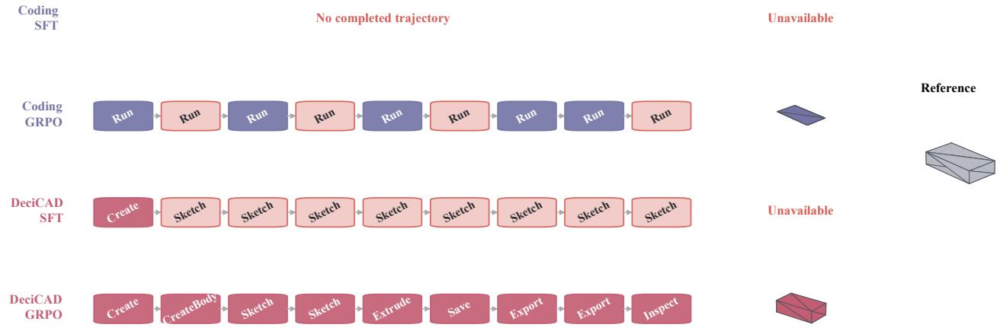  
Figure 13: Cross-harness policy trajectories and terminal geometry on the same CAD task. Rows show Coding SFT, Coding GRPO<sub>,</sub> D<sub>eci</sub>CAD SFT<sub>, a</sub>nd D<sub>eci</sub>CAD GRPO<sub>.</sub> N<sub>o</sub>d<sub>es su</sub>mm<sub>a</sub>ri<sub>ze ex</sub>t<sub>e</sub>rn<sub>a</sub>l <sub>ca</sub>ll<sub>s a</sub>nd th<sub>e</sub>ir <sub>execu</sub>ti<sub>o</sub>n <sub>s</sub>t<sub>a</sub>t<sub>us;</sub> th<sub>e</sub> ri<sub>g</sub>ht <sub>s</sub>id<sub>e s</sub>h<sub>ows</sub> <sub>genera</sub>t<sub>e</sub>d <sub>asse</sub>t<sub>s an</sub>d th<sub>e re</sub>f<sub>erence geome</sub>t<sub>ry.</sub> U<sub>nava</sub>il<sub>a</sub>bl<sub>e</sub> i<sub>n</sub>di<sub>ca</sub>t<sub>es</sub> th<sub>a</sub>t <sub>no eva</sub>l<sub>ua</sub>bl<sub>e asse</sub>t <sub>was pro</sub>d<sub>uce</sub>d<sub>.</sub>

Th<sub>e secon</sub>d <sub>s</sub>t<sub>age com</sub>bi<sub>nes comp</sub>l<sub>e</sub>ti<sub>on an</sub>d <sub>qua</sub>lit<sub>y a</sub>d<sub>van-</sub> tage at 0.15 : 0.85. Quality-frontier and anchor candidates <sub>mus</sub>t <sub>sa</sub>ti<sub>s</sub>f<sub>y an a</sub>b<sub>so</sub>l<sub>u</sub>t<sub>e qua</sub>lit<sub>y</sub> fl<sub>oor an</sub>d <sub>rema</sub>i<sub>n w</sub>ithi<sub>n</sub> th<sub>e</sub> t<sub>o</sub>l<sub>erance o</sub>f th<sub>e</sub> f<sub>rozen paren</sub>t <sub>anc</sub>h<sub>or.</sub> E<sub>ac</sub>h <sub>group re</sub>t<sub>a</sub>i<sub>ns a</sub>t most one positive and one negative trajectory, balancing task influence. The policy objective uses learning rate 3 × 10<sup>−9</sup>, two-sided clip 0.03, and token-level KL coeficient β = 0.10 t<sub>o</sub> th<sub>e</sub> f<sub>rozen</sub> fi<sub>rs</sub>t<sub>-s</sub>t<sub>age paren</sub>t<sub>.</sub> A <sub>s</sub>t<sub>op ac</sub>ti<sub>on rece</sub>i<sub>ves pos</sub>iti<sub>ve</sub> <sub>cre</sub>dit <sub>on</sub>l<sub>y w</sub>h<sub>en geome</sub>t<sub>ry excee</sub>d<sub>s</sub> b<sub>o</sub>th <sub>an a</sub>b<sub>so</sub>l<sub>u</sub>t<sub>e</sub> th<sub>res</sub>h<sub>-</sub> <sub>o</sub>ld <sub>an</sub>d <sub>a</sub> hi<sub>g</sub>h <sub>w</sub>ithi<sub>n-group quan</sub>til<sub>e; prema</sub>t<sub>ure</sub> t<sub>erm</sub>i<sub>na</sub>ti<sub>on</sub> <sub>rece</sub>i<sub>ves nega</sub>ti<sub>ve cre</sub>dit<sub>.</sub>

Th<sub>e</sub> l<sub>earne</sub>d <sub>secon</sub>d<sub>-s</sub>t<sub>age</sub> L<sub>o</sub>RA i<sub>ncremen</sub>t i<sub>s</sub> fi<sub>na</sub>ll<sub>y ap-</sub> plied to the parent at strength 0.375. We preserve the adapter <sub>we</sub>i<sub>g</sub>ht<sub>s an</sub>d <sub>c</sub>h<sub>ange</sub> L<sub>o</sub>RA <sub>a</sub>l<sub>p</sub>h<sub>a</sub> f<sub>rom</sub> 64 t<sub>o</sub> 24<sub>, sca</sub>li<sub>ng</sub> th<sub>e</sub> learned ofset by 24/64 = 0.375. This continuous control <sub>re</sub>t<sub>a</sub>i<sub>ns</sub> th<sub>e</sub> <sub>paren</sub>t’<sub>s</sub> <sub>coverage</sub> <sub>an</sub>d <sub>recovery</sub> b<sub>e</sub>h<sub>av</sub>i<sub>or</sub> <sub>w</sub>hil<sub>e</sub> <sub>a</sub>ddi<sub>ng</sub> th<sub>e</sub> <sub>qua</sub>lit<sub>y</sub> <sub>pre</sub>f<sub>erence</sub> l<sub>earne</sub>d i<sub>n</sub> th<sub>e</sub> <sub>secon</sub>d <sub>s</sub>t<sub>age.</sub>

Online optimization results. DeciCAD GRPO raises Availability from 66.5% to 73.5%, F1 from 0.7437 to 0.7880, and IoU from 0.6631 to 0.7036, while reducing CD from 0.00782 to 0.00570. Coding GRPO raises Availability from 60.5% to 65.5%, but F1 falls from 0.6460 to 0.6253, IoU from 0.6286 to 0.5987, and CD increases from 0.01130 to 0.02253. Thus, identical terminal geometry feedback ex-<sub>pan</sub>d<sub>s execu</sub>t<sub>a</sub>bl<sub>e coverage</sub> i<sub>n</sub> b<sub>o</sub>th h<sub>arnesses, w</sub>hil<sub>e s</sub>t<sub>a</sub>bl<sub>e</sub> g<sup>eometr</sup>y <sup>im</sup>p<sup>ro</sup>v<sup>ement</sup> <sup>de</sup>p<sup>ends</sup> <sup>on</sup> <sup>ho</sup>w <sup>credit</sup> p<sup>ro</sup>p<sup>a</sup>g<sup>ates</sup> th<sub>roug</sub>h th<sub>e</sub> h<sub>arness-</sub>i<sub>n</sub>d<sub>uce</sub>d d<sub>ec</sub>i<sub>s</sub>i<sub>on</sub> <sub>space.</sub>

Observable capabilities in rollouts. Figure 6 in the main t<sub>ex</sub>t <sub>repor</sub>t<sub>s</sub> <sub>po</sub>li<sub>cy</sub> b<sub>e</sub>h<sub>av</sub>i<sub>or</sub> <sub>un</sub>d<sub>er</sub> <sub>s</sub>i<sub>x</sub> <sub>s</sub>h<sub>are</sub>d <sub>ca</sub>t<sub>egor</sub>i<sub>es.</sub> C<sub>on-</sub> <sub>s</sub>t<sub>ruc</sub>t <sub>crea</sub>t<sub>es</sub> <sub>or</sub> <sub>mo</sub>difi<sub>es</sub> <sub>geome</sub>t<sub>r</sub>i<sub>c</sub> i<sub>mp</sub>l<sub>emen</sub>t<sub>a</sub>ti<sub>on;</sub> I<sub>nspec</sub>t <sub>execu</sub>t<sub>es co</sub>d<sub>e, rea</sub>d<sub>s s</sub>t<sub>a</sub>t<sub>e, or c</sub>h<sub>ec</sub>k<sub>s a resu</sub>lt<sub>;</sub> R<sub>ecover c</sub>h<sub>anges</sub> <sub>ac</sub>ti<sub>on a</sub>ft<sub>er an exp</sub>li<sub>c</sub>it f<sub>a</sub>il<sub>ure an</sub>d <sub>res</sub>t<sub>ores progress;</sub> I<sub>nva</sub>lid R<sub>e</sub>f<sub>erence an</sub>d N<sub>o</sub> P<sub>rogress recor</sub>d i<sub>nva</sub>lid t<sub>arge</sub>t<sub>s an</sub>d <sub>re-</sub> <sub>pea</sub>t<sub>e</sub>d <sub>non-progress; an</sub>d P<sub>ers</sub>i<sub>s</sub>t <sub>saves or expor</sub>t<sub>s</sub> th<sub>e</sub> t<sub>erm</sub>i<sub>-</sub> <sub>na</sub>l <sub>asse</sub>t<sub>.</sub> E<sub>ven</sub>t<sub>s are coun</sub>t<sub>e</sub>d <sub>per</sub> 100 <sub>ex</sub>t<sub>erna</sub>l d<sub>ec</sub>i<sub>s</sub>i<sub>ons so</sub> that trajectories of diferent lengths are comparable.

Fi<sub>gure</sub> 13 <sub>groun</sub>d<sub>s</sub> th<sub>e aggrega</sub>t<sub>e</sub> dif<sub>erence</sub> i<sub>n one s</sub>h<sub>are</sub>d task. Coding SFT produces no completed trajectory. Coding GRPO <sub>em</sub>it<sub>s</sub> <sub>an</sub> <sub>asse</sub>t <sub>a</sub>ft<sub>er</sub> <sub>repea</sub>t<sub>e</sub>d <sub>runs</sub> <sub>an</sub>d <sub>repa</sub>i<sub>rs,</sub> b<sub>u</sub>t th<sub>e</sub> <sub>ou</sub>t<sub>pu</sub>t <sub>co</sub>ll<sub>apses</sub> t<sub>o a</sub> thi<sub>n p</sub>l<sub>a</sub>t<sub>e un</sub>lik<sub>e</sub> th<sub>e re</sub>f<sub>erence s</sub>t<sub>ruc-</sub> t<sub>ure.</sub> D<sub>eci</sub>CAD SFT <sub>en</sub>t<sub>ers</sub> th<sub>e</sub> d<sub>oma</sub>i<sub>n</sub> <sub>mo</sub>d<sub>e</sub>li<sub>ng</sub> <sub>process</sub> b<sub>u</sub>t <sub>repea</sub>t<sub>e</sub>d f<sub>a</sub>il<sub>e</sub>d Sk<sub>e</sub>t<sub>c</sub>h <sub>ac</sub>ti<sub>ons</sub> l<sub>eave no eva</sub>l<sub>ua</sub>bl<sub>e asse</sub>t<sub>.</sub> D<sub>e-</sub> <sub>ci</sub>CAD GRPO i<sub>ns</sub>t<sub>ea</sub>d <sub>comp</sub>l<sub>e</sub>t<sub>es a c</sub>h<sub>a</sub>i<sub>n o</sub>f <sub>crea</sub>ti<sub>on, s</sub>k<sub>e</sub>t<sub>c</sub>h<sub>-</sub> i<sub>ng,</sub> <sub>ex</sub>t<sub>rus</sub>i<sub>on,</sub> <sub>pers</sub>i<sub>s</sub>t<sub>ence,</sub> <sub>expor</sub>t<sub>,</sub> <sub>an</sub>d i<sub>nspec</sub>ti<sub>on,</sub> <sub>pro</sub>d<sub>uc</sub>i<sub>ng</sub> t<sub>erm</sub>i<sub>na</sub>l <sub>geome</sub>t<sub>ry cons</sub>i<sub>s</sub>t<sub>en</sub>t <sub>w</sub>ith th<sub>e re</sub>f<sub>erence.</sub> Th<sub>e exam-</sub> <sub>p</sub>l<sub>e c</sub>l<sub>ar</sub>ifi<sub>es</sub> th<sub>a</sub>t <sub>recovery coun</sub>t <sub>a</sub>l<sub>one</sub> d<sub>oes no</sub>t i<sub>mp</sub>l<sub>y use</sub>f<sub>u</sub>l <sub>recovery: su</sub>b<sub>sequen</sub>t <sub>ac</sub>ti<sub>ons mus</sub>t <sub>con</sub>ti<sub>nue</sub> t<sub>o a</sub>d<sub>vance</sub> th<sub>e</sub> <sub>ac</sub>t<sub>ua</sub>l CAD <sub>s</sub>t<sub>a</sub>t<sub>e.</sub>

Aggregate geometry, behavior statistics, and trajectorylevel evidence jointly define the scope of online improve-<sub>men</sub>t<sub>.</sub> GRPO i<sub>ncreases va</sub>lid<sub>-asse</sub>t <sub>coverage an</sub>d <sub>re</sub>d<sub>uces</sub> i<sub>n-</sub> <sub>va</sub>lid <sub>re</sub>f<sub>erences an</sub>d <sub>repea</sub>t<sub>e</sub>d <sub>non-progress, w</sub>hil<sub>e sma</sub>ll f<sub>ea-</sub> t<sub>ures</sub> i<sub>n</sub> l<sub>ong-</sub>h<sub>or</sub>i<sub>zon</sub> t<sub>as</sub>k<sub>s rema</sub>i<sub>n</sub> li<sub>m</sub>it<sub>e</sub>d b<sub>y</sub> t<sub>erm</sub>i<sub>na</sub>l <sub>re-</sub> <sub>war</sub>d <sub>reso</sub>l<sub>u</sub>ti<sub>on.</sub> F1 <sub>an</sub>d I<sub>o</sub>U <sub>measure sur</sub>f<sub>ace an</sub>d <sub>vo</sub>l<sub>ume</sub>t<sub>r</sub>i<sub>c</sub> <sub>agreemen</sub>t<sub>, an</sub>d CD <sub>a</sub>dd<sub>s</sub> l<sub>oca</sub>l di<sub>s</sub>t<sub>ance,</sub> b<sub>u</sub>t f<sub>ea</sub>t<sub>ure coun</sub>t<sub>,</sub> t<sub>opo</sub>l<sub>og</sub>i<sub>ca</sub>l <sub>correspon</sub>d<sub>ence, repea</sub>t<sub>e</sub>d <sub>s</sub>t<sub>ruc</sub>t<sub>ures, an</sub>d <sub>con-</sub> <sub>s</sub>t<sub>ra</sub>i<sub>n</sub>t <sub>re</sub>l<sub>a</sub>ti<sub>ons can s</sub>till dif<sub>er un</sub>d<sub>er s</sub>i<sub>m</sub>il<sub>ar</sub> t<sub>erm</sub>i<sub>na</sub>l <sub>scores.</sub> W<sub>e</sub> th<sub>ere</sub>f<sub>ore</sub> <sub>use</sub> <sub>c</sub>l<sub>ose</sub>d<sub>-</sub>l<sub>oop</sub> <sub>geome</sub>t<sub>ry</sub> <sub>as</sub> th<sub>e</sub> <sub>pr</sub>i<sub>mary</sub> <sub>ev-</sub> id<sub>ence an</sub>d th<sub>e o</sub>b<sub>serve</sub>d b<sub>e</sub>h<sub>av</sub>i<sub>or an</sub>d <sub>asse</sub>t<sub>s</sub> t<sub>o s</sub>h<sub>ow</sub> h<sub>ow</sub> i<sub>mprovemen</sub>t f<sub>orms w</sub>ithi<sub>n eac</sub>h h<sub>arness</sub> d<sub>ec</sub>i<sub>s</sub>i<sub>on space.</sub>

## E DeciCAD: An Interactive Agentic CAD System

D<sub>eci</sub>CAD i<sub>s</sub> di<sub>s</sub>t<sub>r</sub>ib<sub>u</sub>t<sub>e</sub>d <sub>as a</sub> t<sub>erm</sub>i<sub>na</sub>l<sub>-na</sub>ti<sub>ve</sub> A<sub>gen</sub>ti<sub>c</sub> CAD <sub>app</sub>li<sub>ca</sub>ti<sub>on.</sub> It <sub>organ</sub>i<sub>zes</sub> <sub>mo</sub>d<sub>e</sub>l <sub>prov</sub>id<sub>ers,</sub> <sub>spec</sub>i<sub>a</sub>li<sub>ze</sub>d <sub>agen</sub>t<sub>s,</sub> CAD backends, and project resources in one workspace, all<sub>ow</sub>i<sub>ng</sub> <sub>a</sub> <sub>user</sub> t<sub>o</sub> <sub>crea</sub>t<sub>e,</sub> <sub>mo</sub>dif<sub>y,</sub> i<sub>nspec</sub>t<sub>,</sub> <sub>assem</sub>bl<sub>e,</sub> <sub>an</sub>d <sub>expor</sub>t <sub>na</sub>ti<sub>ve</sub> CAD d<sub>ocumen</sub>t<sub>s</sub> th<sub>roug</sub>h <sub>na</sub>t<sub>ura</sub>l<sub>-</sub>l<sub>anguage</sub> i<sub>n</sub>t<sub>erac</sub>ti<sub>on.</sub> Thi<sub>s</sub> <sub>sec</sub>ti<sub>on</sub> <sub>presen</sub>t<sub>s</sub> th<sub>e</sub> <sub>resu</sub>lti<sub>ng</sub> <sub>pro</sub>d<sub>uc</sub>t <sub>wor</sub>kfl<sub>ow,</sub> it<sub>s</sub> <sub>sup-</sub> port for long-horizon multi-agent projects, the backend SDK <sub>ava</sub>il<sub>a</sub>bl<sub>e</sub> t<sub>o</sub> d<sub>eve</sub>l<sub>opers, an</sub>d <sub>our o</sub>fi<sub>c</sub>i<sub>a</sub>l F<sub>ree</sub>CAD i<sub>n</sub>t<sub>egra</sub>ti<sub>on.</sub> It<sub>s s</sub>t<sub>reame</sub>d <sub>ac</sub>ti<sub>on–o</sub>b<sub>serva</sub>ti<sub>on</sub> l<sub>oop</sub> f<sub>o</sub>ll<sub>ows</sub> th<sub>e</sub> i<sub>n</sub>t<sub>erac</sub>ti<sub>on</sub> <sub>pa</sub>tt<sub>ern es</sub>t<sub>a</sub>bli<sub>s</sub>h<sub>e</sub>d b<sub>y</sub> l<sub>anguage agen</sub>t<sub>s w</sub>hil<sub>e groun</sub>di<sub>ng eac</sub>h domain action in <sub>p</sub>ersistent CAD state (Yao et al. 2023; Yan<sub>g</sub> et al. 2024).

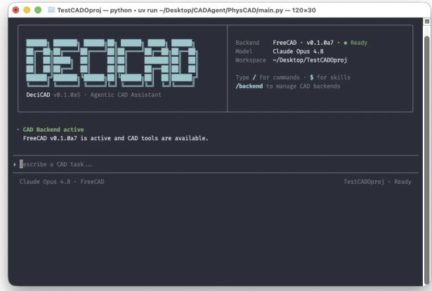  
(a) Project works<sub>p</sub>ace and active CAD runtime.

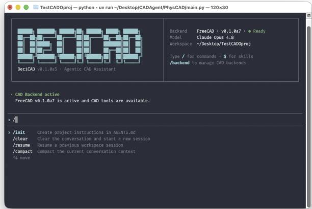  
(b) Session commands available from the com<sub>p</sub>oser.

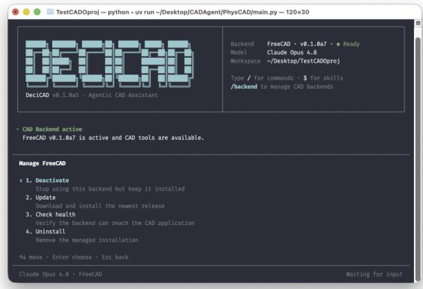  
(c) Lifec<sub>y</sub>cle and health controls for the FreeCAD backend.

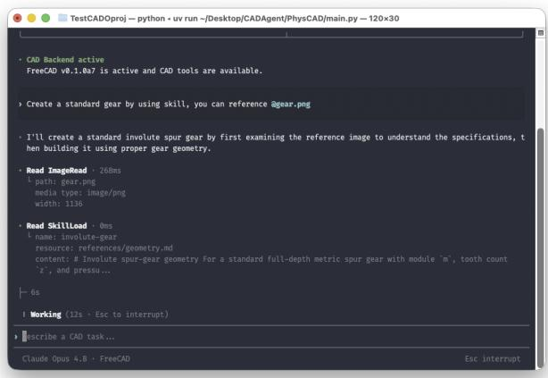  
(d) A live task usin<sub>g</sub> an ima<sub>g</sub>e reference and a CAD skill.  
Figure 14: The project-level DeciCAD interface. The workspace keeps natural-language interaction, project resources, CAD <sub>s</sub>kill<sub>s,</sub> b<sub>ac</sub>k<sub>en</sub>d <sub>s</sub>t<sub>a</sub>t<sub>e, an</sub>d <sub>s</sub>t<sub>reame</sub>d <sub>execu</sub>ti<sub>on even</sub>t<sub>s</sub> i<sub>n one pers</sub>i<sub>s</sub>t<sub>en</sub>t <sub>sess</sub>i<sub>on.</sub> U<sub>sers can</sub> i<sub>nspec</sub>t <sub>an</sub>d <sub>con</sub>t<sub>ro</sub>l th<sub>e run</sub>ti<sub>me w</sub>hil<sub>e</sub> <sub>seman</sub>ti<sub>c</sub> CAD <sub>ac</sub>ti<sub>ons con</sub>ti<sub>nue</sub> t<sub>o opera</sub>t<sub>e on</sub> th<sub>e ac</sub>ti<sub>ve</sub> d<sub>ocumen</sub>t<sub>.</sub>

## E.1 From Natural Language to Editable CAD Documents

D<sub>eci</sub>CAD <sub>p</sub>r<sub>ov</sub>id<sub>es</sub> n<sub>a</sub>ti<sub>ve</sub> r<sub>e</sub>l<sub>ease pac</sub>k<sub>ages</sub> f<sub>o</sub>r m<sub>ac</sub>OS<sub>,</sub> Li<sub>nux,</sub> <sub>an</sub>d Wi<sub>n</sub>d<sub>ows</sub> <sub>an</sub>d <sub>uses</sub> <sub>a</sub> <sub>manage</sub>d i<sub>ns</sub>t<sub>a</sub>ll<sub>er</sub> f<sub>or</sub> application updates. Running decicad inside a project o<sub>p</sub>ens that director<sub>y</sub> as the active works<sub>p</sub>ace; decicad -project /path/to/project selects it ex<sub>p</sub>licitl<sub>y</sub>. D<sub>ur</sub>i<sub>ng</sub> i<sub>n</sub>iti<sub>a</sub>l <sub>se</sub>t<sub>up,</sub> th<sub>e app</sub>li<sub>ca</sub>ti<sub>on con</sub>fi<sub>gures a mo</sub>d<sub>e</sub>l provider and requests trust before accessing project files or CAD <sub>resources.</sub>

Th<sub>e</sub> <sub>co</sub>m<sub>pose</sub>r <sub>accep</sub>t<sub>s</sub> <sub>pa</sub>rt m<sub>o</sub>d<sub>e</sub>lin<sub>g,</sub> <sub>asse</sub>mbl<sub>y,</sub> <sub>geo</sub>m<sub>e</sub>t<sub>-</sub> ric revision, ins<sub>p</sub>ection, and ex<sub>p</sub>ort re<sub>q</sub>uests. An @ reference attaches a project resource such as an image or specification, while \$ loads an inline CAD skill that su<sub>pp</sub>lies task-s<sub>p</sub>ecific <sub>proce</sub>d<sub>ures.</sub> Sl<sub>as</sub>h <sub>comman</sub>d<sub>s expose run</sub>ti<sub>me con</sub>t<sub>ro</sub>l<sub>s</sub> i<sub>n</sub> th<sub>e</sub> same interface: /model selects the <sub>p</sub>rovider, model, and reasonin<sub>g</sub> efort; /backend installs, activates, u<sub>p</sub>dates, and checks a CAD backend; and /status summarizes the cur-<sub>ren</sub>t <sub>run</sub>ti<sub>me an</sub>d t<sub>o</sub>k<sub>en usage.</sub> Fi<sub>gure</sub> 14 <sub>s</sub>h<sub>ows</sub> th<sub>ese opera-</sub> ti<sub>ons</sub> i<sub>n</sub> th<sub>e</sub> t<sub>erm</sub>i<sub>na</sub>l i<sub>n</sub>t<sub>er</sub>f<sub>ace.</sub>

M<sub>o</sub>d<sub>e</sub>l <sub>ac</sub>ti<sub>ons an</sub>d <sub>env</sub>i<sub>ronmen</sub>t <sub>resu</sub>lt<sub>s</sub> th<sub>en appear</sub> i<sub>n</sub> t<sub>em-</sub> <sub>pora</sub>l <sub>or</sub>d<sub>er.</sub> Fil<sub>e</sub> <sub>an</sub>d i<sub>mage</sub> <sub>rea</sub>d<sub>s</sub> id<sub>en</sub>tif<sub>y</sub> th<sub>e</sub> <sub>ev</sub>id<sub>ence</sub> <sub>use</sub>d b<sub>y</sub> th<sub>e mo</sub>d<sub>e</sub>l<sub>, s</sub>kill l<sub>oa</sub>d<sub>s expose</sub> th<sub>e se</sub>l<sub>ec</sub>t<sub>e</sub>d d<sub>oma</sub>i<sub>n proce-</sub> d<sub>ure, an</sub>d CAD <sub>ca</sub>ll<sub>s repor</sub>t th<sub>e</sub>i<sub>r execu</sub>ti<sub>on s</sub>t<sub>a</sub>t<sub>e an</sub>d <sub>compac</sub>t <sub>resu</sub>lt<sub>.</sub> S<sub>uccess</sub>f<sub>u</sub>l <sub>ca</sub>ll<sub>s</sub> i<sub>mme</sub>di<sub>a</sub>t<sub>e</sub>l<sub>y</sub> <sub>up</sub>d<sub>a</sub>t<sub>e</sub> th<sub>e</sub> <sub>pers</sub>i<sub>s</sub>t<sub>en</sub>t d<sub>ocumen</sub>t<sub>;</sub> f<sub>a</sub>il<sub>e</sub>d <sub>ca</sub>ll<sub>s</sub> <sub>re</sub>t<sub>urn</sub> i<sub>n</sub>f<sub>orma</sub>ti<sub>on</sub> th<sub>a</sub>t <sub>suppor</sub>t<sub>s</sub> <sub>argu-</sub> <sub>men</sub>t <sub>correc</sub>ti<sub>on,</sub> t<sub>arge</sub>t<sub>e</sub>d i<sub>nspec</sub>ti<sub>on, or se</sub>l<sub>ec</sub>ti<sub>on o</sub>f <sub>ano</sub>th<sub>er</sub> <sub>ac</sub>ti<sub>on.</sub> Th<sub>e user can</sub> i<sub>n</sub>t<sub>errup</sub>t <sub>execu</sub>ti<sub>on or a</sub>dd <sub>a</sub> f<sub>o</sub>ll<sub>ow-up</sub> <sub>reques</sub>t <sub>a</sub>t <sub>any po</sub>i<sub>n</sub>t<sub>, an</sub>d <sub>su</sub>b<sub>sequen</sub>t <sub>ac</sub>ti<sub>ons con</sub>ti<sub>nue</sub> f<sub>rom</sub> th<sub>e</sub> <sub>curren</sub>t CAD <sub>s</sub>t<sub>a</sub>t<sub>e</sub> <sub>ra</sub>th<sub>er</sub> th<sub>an</sub> <sub>regenera</sub>ti<sub>ng</sub> th<sub>e</sub> <sub>ar</sub>tif<sub>ac</sub>t f<sub>rom scra</sub>t<sub>c</sub>h<sub>.</sub>

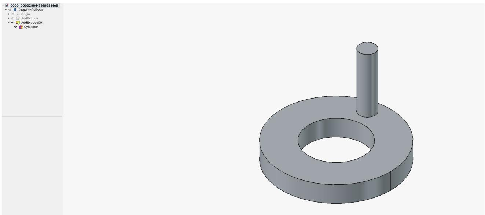  
Fi <sub>ure</sub> 15<sub>:</sub> A<sub>n e</sub>dit<sub>a</sub>bl<sub>e</sub> CAD d<sub>ocumen</sub>t <sub>ro</sub>d<sub>uce</sub>d th<sub>rou</sub> h th<sub>e</sub> F<sub>ree</sub>CAD b<sub>ac</sub>k<sub>en</sub>d<sub>.</sub> Th<sub>e v</sub>i<sub>ew or</sub>t <sub>s</sub>h<sub>ows</sub> th<sub>e enera</sub>t<sub>e</sub>d <sub>so</sub>lid <sub>w</sub>hil<sub>e</sub> th<sub>e</sub> d<sub>ocumen</sub>t t<sub>ree re</sub>t<sub>a</sub>i<sub>ns</sub> th<sub>e</sub> b<sub>o</sub>d<sub>y, a</sub>dditi<sub>ve</sub> f<sub>ea</sub>t<sub>ures, an</sub>d <sub>un</sub>d<sub>er</sub>l<sub>y</sub>i<sub>ng s</sub>k<sub>e</sub>t<sub>c</sub>h <sub>crea</sub>t<sub>e</sub>d d<sub>ur</sub>i<sub>ng</sub> th<sub>e</sub> i<sub>n</sub>t<sub>erac</sub>ti<sub>on.</sub> Thi<sub>s pers</sub>i<sub>s</sub>t<sub>en</sub>t <sub>s</sub>t<sub>ruc</sub>t<sub>ure a</sub>ll<sub>ows</sub> l<sub>a</sub>t<sub>er</sub> i<sub>nspec</sub>ti<sub>on an</sub>d <sub>mo</sub>difi<sub>ca</sub>ti<sub>on</sub> th<sub>roug</sub>h <sub>e</sub>ith<sub>er</sub> D<sub>eci</sub>CAD <sub>or</sub> th<sub>e na</sub>ti<sub>ve</sub> F<sub>ree</sub>CAD i<sub>n</sub>t<sub>er</sub>f<sub>ace.</sub>

Th<sub>e resu</sub>lti<sub>ng ar</sub>tif<sub>ac</sub>t i<sub>s a</sub>l<sub>so ava</sub>il<sub>a</sub>bl<sub>e</sub> i<sub>n</sub> th<sub>e na</sub>ti<sub>ve</sub> CAD <sub>app</sub>li<sub>ca</sub>ti<sub>on.</sub> U<sub>sers can</sub> i<sub>nspec</sub>t th<sub>e</sub> th<sub>ree-</sub>di<sub>mens</sub>i<sub>ona</sub>l <sub>v</sub>i<sub>ew</sub> <sub>an</sub>d <sub>access</sub> th<sub>e crea</sub>t<sub>e</sub>d B<sub>o</sub>d<sub>y,</sub> Sk<sub>e</sub>t<sub>c</sub>h<sub>,</sub> F<sub>ea</sub>t<sub>ure,</sub> A<sub>ssem</sub>bl<sub>y, an</sub>d Component objects in the document tree. The document can b<sub>e save</sub>d i<sub>n</sub> it<sub>s na</sub>ti<sub>ve e</sub>dit<sub>a</sub>bl<sub>e</sub> f<sub>orma</sub>t <sub>or expor</sub>t<sub>e</sub>d <sub>as a s</sub>t<sub>an</sub>d<sub>ar</sub>d g<sup>eometr</sup>y <sup>asset</sup>, p<sup>reser</sup>v<sup>in</sup>g <sup>a</sup> p<sup>ath</sup> <sup>from</sup> <sup>a</sup>g<sup>ent</sup> g<sup>eneration</sup> <sup>to</sup> <sub>manua</sub>l i<sub>nspec</sub>ti<sub>on</sub> <sub>an</sub>d <sub>con</sub>ti<sub>nue</sub>d <sub>eng</sub>i<sub>neer</sub>i<sub>ng</sub> <sub>wor</sub>k<sub>.</sub>

## E.2 Control Plane for Multi-Agent CAD Work

Th<sub>e</sub> i<sub>n</sub>t<sub>erac</sub>ti<sub>ve</sub> l<sub>oop</sub> i<sub>s suppor</sub>t<sub>e</sub>d b<sub>y an app</sub>li<sub>ca</sub>ti<sub>on-</sub>l<sub>eve</sub>l <sub>con-</sub> t<sub>ro</sub>l <sub>p</sub>l<sub>ane</sub> th<sub>a</sub>t <sub>coor</sub>di<sub>na</sub>t<sub>es agen</sub>t<sub>s,</sub> t<sub>oo</sub>l<sub>s, resources, perm</sub>i<sub>s-</sub> sions, and persistent project state. CAD backends execute d<sub>oma</sub>i<sub>n opera</sub>ti<sub>ons,</sub> b<sub>u</sub>t th<sub>ey</sub> d<sub>o no</sub>t d<sub>ec</sub>id<sub>e w</sub>hi<sub>c</sub>h <sub>agen</sub>t <sub>may</sub> <sub>ac</sub>t<sub>, w</sub>hi<sub>c</sub>h <sub>ca</sub>ll<sub>s may run concurren</sub>tl<sub>y, or w</sub>h<sub>e</sub>th<sub>er an ac</sub>ti<sub>on</sub> <sub>was</sub> b<sub>ase</sub>d <sub>on a curren</sub>t d<sub>ocumen</sub>t <sub>rev</sub>i<sub>s</sub>i<sub>on.</sub> K<sub>eep</sub>i<sub>ng</sub> th<sub>ese</sub> <sub>respons</sub>ibiliti<sub>es</sub> i<sub>n</sub> th<sub>e con</sub>t<sub>ro</sub>l <sub>p</sub>l<sub>ane a</sub>ll<sub>ows</sub> th<sub>e same orc</sub>h<sub>es-</sub> t<sub>ra</sub>ti<sub>on po</sub>li<sub>cy</sub> t<sub>o opera</sub>t<sub>e across compa</sub>tibl<sub>e</sub> CAD <sub>sys</sub>t<sub>ems.</sub>

Agent orchestration. For larger projects, a leader agent <sub>re</sub>t<sub>a</sub>i<sub>ns</sub> th<sub>e user conversa</sub>ti<sub>on an</sub>d <sub>overa</sub>ll <sub>goa</sub>l <sub>w</sub>hil<sub>e</sub> d<sub>e</sub>l<sub>-</sub> <sub>ega</sub>ti<sub>ng</sub> b<sub>oun</sub>d<sub>e</sub>d <sub>su</sub>bt<sub>as</sub>k<sub>s</sub> t<sub>o</sub> f<sub>our</sub> b<sub>u</sub>ilt<sub>-</sub>i<sub>n ro</sub>l<sub>es.</sub> Th<sub>e</sub> D<sub>e-</sub> <sub>s</sub>i<sub>gner</sub> t<sub>urns</sub> f<sub>unc</sub>ti<sub>ona</sub>l <sub>an</sub>d <sub>geome</sub>t<sub>r</sub>i<sub>c</sub> i<sub>n</sub>t<sub>en</sub>t i<sub>n</sub>t<sub>o</sub> <sub>a</sub> f<sub>ea</sub>t<sub>ure</sub> <sub>an</sub>d i<sub>n</sub>t<sub>er</sub>f<sub>ace p</sub>l<sub>an;</sub> th<sub>e</sub> M<sub>o</sub>d<sub>e</sub>l<sub>er owns one comp</sub>l<sub>e</sub>t<sub>e par</sub>t <sub>or a</sub> d<sub>epen</sub>d<sub>ency-or</sub>d<sub>ere</sub>d <sub>mo</sub>d<sub>e</sub>li<sub>ng s</sub>t<sub>age;</sub> th<sub>e</sub> A<sub>ssem</sub>bl<sub>er</sub> i<sub>nser</sub>t<sub>s</sub> com<sub>p</sub>onents an<sup>d</sup> mana<sub>g</sub>es <sub>p</sub><sup>l</sup>acements, <sub>g</sub>roun<sup>di</sup>n<sub>g</sub>, mates, an<sup>d</sup> <sub>so</sub>l<sub>ve</sub> <sub>s</sub>t<sub>a</sub>t<sub>e;</sub> <sub>an</sub>d th<sub>e</sub> V<sub>er</sub>ifi<sub>er</sub> <sub>per</sub>f<sub>orms</sub> <sub>an</sub> i<sub>n</sub>d<sub>epen</sub>d<sub>en</sub>t<sub>,</sub> <sub>pre-</sub> d<sub>om</sub>i<sub>nan</sub>tl<sub>y</sub> <sub>rea</sub>d<sub>-on</sub>l<sub>y</sub> <sub>ev</sub>id<sub>ence</sub> <sub>pass</sub> <sub>over</sub> th<sub>e</sub> fi<sub>na</sub>l d<sub>ocumen</sub>t <sub>an</sub>d <sub>expor</sub>t<sub>e</sub>d <sub>asse</sub>t<sub>s.</sub> E<sub>ac</sub>h <sub>c</sub>hild <sub>rece</sub>i<sub>ves</sub> th<sub>e</sub> <sub>or</sub>i<sub>g</sub>i<sub>na</sub>l <sub>reques</sub>t t<sub>oge</sub>th<sub>er w</sub>ith <sub>a</sub> b<sub>oun</sub>d<sub>e</sub>d <sub>ass</sub>i<sub>gnmen</sub>t<sub>, separa</sub>t<sub>e con</sub>t<sub>ex</sub>t<sub>, ro</sub>l<sub>e-</sub> <sub>spec</sub>ifi<sub>c</sub> i<sub>ns</sub>t<sub>ruc</sub>ti<sub>ons,</sub> t<sub>oo</sub>l <sub>a</sub>ll<sub>ow</sub>li<sub>s</sub>t<sub>, an</sub>d i<sub>n</sub>t<sub>erac</sub>ti<sub>on</sub> b<sub>u</sub>d<sub>ge</sub>t<sub>.</sub> A <sub>c</sub>hild <sub>canno</sub>t <sub>recurs</sub>i<sub>ve</sub>l<sub>y crea</sub>t<sub>e more agen</sub>t<sub>s or mo</sub>dif<sub>y</sub> th<sub>e</sub> l<sub>ea</sub>d<sub>er</sub>’<sub>s</sub> t<sub>as</sub>k b<sub>oar</sub>d<sub>.</sub> It<sub>s</sub> fi<sub>na</sub>l <sub>response</sub> i<sub>s re</sub>t<sub>urne</sub>d <sub>as ev</sub>id<sub>ence</sub> t<sub>oge</sub>th<sub>er w</sub>ith th<sub>e resources c</sub>h<sub>ange</sub>d d<sub>ur</sub>i<sub>ng execu</sub>ti<sub>on,</sub> l<sub>eav-</sub> i<sub>ng accep</sub>t<sub>ance an</sub>d f<sub>o</sub>ll<sub>ow-up</sub> d<sub>ec</sub>i<sub>s</sub>i<sub>ons w</sub>ith th<sub>e</sub> l<sub>ea</sub>d<sub>er.</sub>

Task and dependency state. Multi-stage work is represented by a compact project task graph. Tasks record their <sub>s</sub>t<sub>a</sub>t<sub>us,</sub> d<sub>escr</sub>i<sub>p</sub>ti<sub>on,</sub> d<sub>epen</sub>d<sub>enc</sub>i<sub>es,</sub> bl<sub>oc</sub>ki<sub>ng re</sub>l<sub>a</sub>ti<sub>ons, an</sub>d <sub>comp</sub>l<sub>e</sub>ti<sub>on ev</sub>id<sub>ence.</sub> Thi<sub>s grap</sub>h <sub>separa</sub>t<sub>es conversa</sub>ti<sub>ona</sub>l <sub>p</sub>l<sub>ann</sub>i<sub>ng</sub> f<sub>rom execu</sub>ti<sub>on s</sub>t<sub>a</sub>t<sub>e:</sub> th<sub>e</sub> l<sub>ea</sub>d<sub>er can recover w</sub>hi<sub>c</sub>h <sub>componen</sub>t<sub>s are rea</sub>d<sub>y, w</sub>hi<sub>c</sub>h <sub>assem</sub>bl<sub>y s</sub>t<sub>ep</sub> i<sub>s</sub> bl<sub>oc</sub>k<sub>e</sub>d<sub>, an</sub>d <sub>w</sub>hi<sub>c</sub>h <sub>ver</sub>ifi<sub>ca</sub>ti<sub>on rema</sub>i<sub>ns a</sub>ft<sub>er con</sub>t<sub>ex</sub>t <sub>compac</sub>ti<sub>on or ses-</sub> <sub>s</sub>i<sub>on</sub> <sub>resump</sub>ti<sub>on.</sub> D<sub>epen</sub>d<sub>ency</sub> <sub>up</sub>d<sub>a</sub>t<sub>es</sub> <sub>are</sub> <sub>ser</sub>i<sub>a</sub>li<sub>ze</sub>d b<sub>y</sub> th<sub>e</sub> <sup>control</sup> p<sup>lane</sup>, p<sup>re</sup>v<sup>entin</sup>g <sup>t</sup>w<sup>o</sup> <sup>a</sup>g<sup>ents</sup> <sup>from</sup> <sup>conc</sup>u<sup>rrentl</sup>y p<sup>ro-</sup> d<sub>uc</sub>i<sub>ng</sub> i<sub>ncons</sub>i<sub>s</sub>t<sub>en</sub>t t<sub>as</sub>k<sub>-</sub>b<sub>oar</sub>d t<sub>rans</sub>iti<sub>ons.</sub>

Resource resolution and authorization. Every tool specifi<sub>ca</sub>ti<sub>on</sub> d<sub>ec</sub>l<sub>ares s</sub>t<sub>a</sub>ti<sub>c resource</sub> b<sub>e</sub>h<sub>av</sub>i<sub>or,</sub> i<sub>nc</sub>l<sub>u</sub>di<sub>ng</sub> th<sub>e ar-</sub> <sub>gumen</sub>t<sub>s</sub> th<sub>a</sub>t id<sub>en</sub>tif<sub>y</sub> <sub>rea</sub>d<sub>s,</sub> <sub>wr</sub>it<sub>es,</sub> <sub>o</sub>b<sub>serva</sub>ti<sub>ons,</sub> <sub>crea</sub>ti<sub>ons,</sub> <sub>or</sub> fil<sub>esys</sub>t<sub>em ma</sub>t<sub>er</sub>i<sub>a</sub>li<sub>za</sub>ti<sub>on.</sub> B<sub>e</sub>f<sub>ore execu</sub>ti<sub>on,</sub> th<sub>e resource</sub> <sub>manager reso</sub>l<sub>ves</sub> th<sub>ose</sub> fi<sub>e</sub>ld<sub>s</sub> t<sub>o concre</sub>t<sub>e</sub> d<sub>ocumen</sub>t<sub>, en</sub>tit<sub>y,</sub> t<sub>opo</sub>l<sub>ogy, assem</sub>bl<sub>y, or</sub> fil<sub>e</sub> k<sub>eys.</sub> E<sub>ac</sub>h <sub>agen</sub>t <sub>a</sub>l<sub>so ma</sub>i<sub>n</sub>t<sub>a</sub>i<sub>ns</sub> th<sub>e rev</sub>i<sub>s</sub>i<sub>ons</sub> it h<sub>as ac</sub>t<sub>ua</sub>ll<sub>y o</sub>b<sub>serve</sub>d<sub>.</sub> A <sub>wr</sub>it<sub>e</sub> i<sub>s au</sub>th<sub>or</sub>i<sub>ze</sub>d <sub>on</sub>l<sub>y w</sub>h<sub>en</sub> it<sub>s</sub> d<sub>epen</sub>d<sub>en</sub>t <sub>resources</sub> h<sub>ave</sub> b<sub>een o</sub>b<sub>serve</sub>d <sub>a</sub>t th<sub>e</sub>i<sub>r curren</sub>t <sub>rev</sub>i<sub>s</sub>i<sub>ons;</sub> if <sub>ano</sub>th<sub>er agen</sub>t h<sub>as mo</sub>difi<sub>e</sub>d <sub>one</sub> of them, the stale write is rejected with a recoverable confli<sub>c</sub>t <sub>an</sub>d th<sub>e agen</sub>t <sub>mus</sub>t i<sub>nspec</sub>t th<sub>e up</sub>d<sub>a</sub>t<sub>e</sub>d <sub>s</sub>t<sub>a</sub>t<sub>e.</sub> Fil<sub>e e</sub>dit<sub>s</sub> f<sub>o</sub>ll<sub>ow</sub> th<sub>e same ru</sub>l<sub>e an</sub>d <sub>requ</sub>i<sub>re a comp</sub>l<sub>e</sub>t<sub>e pr</sub>i<sub>or rea</sub>d<sub>.</sub> Thi<sub>s</sub> <sub>o</sub>b<sub>serva</sub>ti<sub>on-</sub>b<sub>ase</sub>d <sub>au</sub>th<sub>or</sub>i<sub>za</sub>ti<sub>on preven</sub>t<sub>s a p</sub>l<sub>aus</sub>ibl<sub>e</sub> b<sub>u</sub>t <sub>ou</sub>t<sub>-</sub> d<sub>a</sub>t<sub>e</sub>d <sub>mo</sub>d<sub>e</sub>l <sub>con</sub>t<sub>ex</sub>t f<sub>rom s</sub>il<sub>en</sub>tl<sub>y overwr</sub>iti<sub>ng newer</sub> CAD or project state.

Concurrency and commit. Independent child assign-<sub>men</sub>t<sub>s can</sub> b<sub>e em</sub>itt<sub>e</sub>d t<sub>oge</sub>th<sub>er an</sub>d <sub>run concurren</sub>tl<sub>y.</sub> T<sub>oo</sub>l <sub>spec</sub>ifi<sub>ca</sub>ti<sub>ons a</sub>dditi<sub>ona</sub>ll<sub>y ass</sub>i<sub>gn ca</sub>ll<sub>s</sub> t<sub>o execu</sub>ti<sub>on</sub> l<sub>anes an</sub>d <sub>mar</sub>k th<sub>em as para</sub>ll<sub>e</sub>l <sub>or exc</sub>l<sub>us</sub>i<sub>ve.</sub> Aft<sub>er resource reso</sub>l<sub>u</sub>ti<sub>on,</sub> <sub>wr</sub>it<sub>e scopes are sor</sub>t<sub>e</sub>d <sub>an</sub>d l<sub>oc</sub>k<sub>e</sub>d i<sub>n a</sub> d<sub>e</sub>t<sub>erm</sub>i<sub>n</sub>i<sub>s</sub>ti<sub>c or</sub>d<sub>er;</sub> calls with disjoint scopes proceed in parallel, while overl<sub>app</sub>i<sub>ng</sub> CAD <sub>wr</sub>it<sub>es are ser</sub>i<sub>a</sub>li<sub>ze</sub>d<sub>.</sub> A<sub>u</sub>th<sub>or</sub>i<sub>za</sub>ti<sub>on</sub> i<sub>s reva</sub>l<sub>-</sub> id<sub>a</sub>t<sub>e</sub>d i<sub>mme</sub>di<sub>a</sub>t<sub>e</sub>l<sub>y</sub> b<sub>e</sub>f<sub>ore execu</sub>ti<sub>on</sub> t<sub>o c</sub>l<sub>ose</sub> th<sub>e</sub> i<sub>n</sub>t<sub>erva</sub>l b<sub>e</sub>t<sub>ween sc</sub>h<sub>e</sub>d<sub>u</sub>li<sub>ng an</sub>d di<sub>spa</sub>t<sub>c</sub>h<sub>.</sub> A <sub>success</sub>f<sub>u</sub>l b<sub>ac</sub>k<sub>en</sub>d <sub>re-</sub> sult re<sub>p</sub>orts concrete RuntimeResourceEffects; the <sub>con</sub>t<sub>ro</sub>l <sub>p</sub>l<sub>ane</sub> <sub>comm</sub>it<sub>s</sub> th<sub>ese</sub> <sub>e</sub>f<sub>ec</sub>t<sub>s,</sub> <sub>a</sub>d<sub>vances</sub> <sub>resource</sub> <sub>gen-</sub> <sub>era</sub>ti<sub>ons, recor</sub>d<sub>s</sub> th<sub>e respons</sub>ibl<sub>e agen</sub>t<sub>, an</sub>d i<sub>nva</sub>lid<sub>a</sub>t<sub>es s</sub>t<sub>a</sub>l<sub>e</sub> <sub>o</sub>b<sub>serva</sub>ti<sub>ons</sub> h<sub>e</sub>ld <sub>e</sub>l<sub>sew</sub>h<sub>ere.</sub> A f<sub>a</sub>il<sub>e</sub>d <sub>ca</sub>ll d<sub>oes no</sub>t <sub>c</sub>l<sub>a</sub>i<sub>m a</sub> <sub>s</sub>t<sub>a</sub>t<sub>e</sub> t<sub>rans</sub>iti<sub>on.</sub> If t<sub>ranspor</sub>t f<sub>a</sub>il<sub>s a</sub>ft<sub>er a po</sub>t<sub>en</sub>ti<sub>a</sub>ll<sub>y mu</sub>t<sub>a</sub>ti<sub>ng</sub> <sub>ca</sub>ll<sub>,</sub> th<sub>e a</sub>f<sub>ec</sub>t<sub>e</sub>d <sub>scope</sub> i<sub>s conserva</sub>ti<sub>ve</sub>l<sub>y</sub> i<sub>nva</sub>lid<sub>a</sub>t<sub>e</sub>d <sub>so</sub> th<sub>a</sub>t l<sub>a</sub>t<sub>er</sub> d<sub>ec</sub>i<sub>s</sub>i<sub>ons re-</sub>i<sub>nspec</sub>t it<sub>.</sub>

Thi<sub>s pro</sub>t<sub>oco</sub>l <sub>suppor</sub>t<sub>s use</sub>f<sub>u</sub>l <sub>concurrency w</sub>ith<sub>ou</sub>t t<sub>rea</sub>t<sub>-</sub> i<sub>ng</sub> th<sub>e</sub> CAD d<sub>ocumen</sub>t <sub>as an or</sub>di<sub>nary s</sub>h<sub>are</sub>d t<sub>ex</sub>t b<sub>u</sub>f<sub>er.</sub> Dif<sub>eren</sub>t M<sub>o</sub>d<sub>e</sub>l<sub>ers may cons</sub>t<sub>ruc</sub>t i<sub>n</sub>d<sub>epen</sub>d<sub>en</sub>t <sub>par</sub>t<sub>s s</sub>i<sub>mu</sub>l<sub>-</sub> t<sub>aneous</sub>l<sub>y, a</sub>ft<sub>er w</sub>hi<sub>c</sub>h <sub>an</sub> A<sub>ssem</sub>bl<sub>er consumes</sub> th<sub>e</sub>i<sub>r com-</sub> <sub>m</sub>itt<sub>e</sub>d <sub>ou</sub>t<sub>pu</sub>t<sub>s.</sub> C<sub>a</sub>ll<sub>s</sub> th<sub>a</sub>t t<sub>ouc</sub>h th<sub>e same</sub> b<sub>o</sub>d<sub>y, assem</sub>bl<sub>y, or</sub> <sub>ou</sub>t<sub>pu</sub>t fil<sub>e are or</sub>d<sub>ere</sub>d<sub>, an</sub>d <sub>eac</sub>h d<sub>owns</sub>t<sub>ream agen</sub>t <sub>rece</sub>i<sub>ves</sub> <sub>on</sub>l<sub>y</sub> th<sub>e</sub> d<sub>ocumen</sub>t <sub>rev</sub>i<sub>s</sub>i<sub>ons</sub> k<sub>nown</sub> t<sub>o</sub> b<sub>e</sub> <sub>va</sub>lid <sub>a</sub>t d<sub>e</sub>l<sub>ega</sub>ti<sub>on</sub> ti<sub>me.</sub>

Permissions and project boundaries. Workspace trust <sub>an</sub>d <sub>perm</sub>i<sub>ss</sub>i<sub>on c</sub>h<sub>ec</sub>k<sub>s are eva</sub>l<sub>ua</sub>t<sub>e</sub>d b<sub>e</sub>f<sub>ore pro</sub>t<sub>ec</sub>t<sub>e</sub>d fil<sub>es</sub> <sub>o</sub>r CAD r<sub>esou</sub>r<sub>ces a</sub>r<sub>e expose</sub>d t<sub>o a</sub>n <sub>age</sub>nt<sub>.</sub> Th<sub>e use</sub>r r<sub>e-</sub> mains the authority for access that crosses the active project b<sub>oun</sub>d<sub>ary or carr</sub>i<sub>es e</sub>l<sub>eva</sub>t<sub>e</sub>d <sub>e</sub>f<sub>ec</sub>t<sub>s.</sub> B<sub>ecause perm</sub>i<sub>ss</sub>i<sub>ons</sub> <sub>are eva</sub>l<sub>ua</sub>t<sub>e</sub>d i<sub>n</sub> th<sub>e app</sub>li<sub>ca</sub>ti<sub>on ra</sub>th<sub>er</sub> th<sub>an re</sub>i<sub>mp</sub>l<sub>emen</sub>t<sub>e</sub>d b<sub>y every</sub> b<sub>ac</sub>k<sub>en</sub>d<sub>, a</sub>ddi<sub>ng a</sub> CAD i<sub>n</sub>t<sub>egra</sub>ti<sub>on</sub> d<sub>oes no</sub>t <sub>crea</sub>t<sub>e</sub> <sub>a secon</sub>d<sub>,</sub> b<sub>ac</sub>k<sub>en</sub>d<sub>-spec</sub>ifi<sub>c au</sub>th<sub>or</sub>i<sub>za</sub>ti<sub>on pa</sub>th<sub>.</sub>

Sessions, memory, and observability. The control plane projects model messages, tool calls, execution outcomes, per-<sub>m</sub>i<sub>ss</sub>i<sub>ons, resource comm</sub>it<sub>s,</sub> t<sub>as</sub>k <sub>c</sub>h<sub>anges, an</sub>d <sub>compac</sub>ti<sub>on</sub> <sub>even</sub>t<sub>s on</sub>t<sub>o an appen</sub>d<sub>-on</sub>l<sub>y ro</sub>ll<sub>ou</sub>t<sub>.</sub> Th<sub>e same even</sub>t <sub>s</sub>t<sub>ream</sub> d<sub>r</sub>i<sub>ves</sub> th<sub>e</sub> t<sub>erm</sub>i<sub>na</sub>l i<sub>n</sub>t<sub>er</sub>f<sub>ace an</sub>d <sub>prov</sub>id<sub>es</sub> th<sub>e s</sub>t<sub>a</sub>t<sub>e requ</sub>i<sub>re</sub>d for re<sub>p</sub>la<sub>y</sub> and session restoration. /resume reconstructs an earlier project session, while /compact replaces older i<sub>n</sub>t<sub>erac</sub>ti<sub>on w</sub>ith <sub>a</sub> b<sub>oun</sub>d<sub>e</sub>d <sub>summary an</sub>d k<sub>eeps recen</sub>t d<sub>ec</sub>i<sub>-</sub> <sub>s</sub>i<sub>ons ava</sub>il<sub>a</sub>bl<sub>e</sub> t<sub>o</sub> th<sub>e mo</sub>d<sub>e</sub>l<sub>.</sub> D<sub>ura</sub>bl<sub>e memory</sub> i<sub>s ex</sub>t<sub>rac</sub>t<sub>e</sub>d f<sub>rom comp</sub>l<sub>e</sub>t<sub>e</sub>d <sub>roo</sub>t <sub>ro</sub>ll<sub>ou</sub>t<sub>s w</sub>ith li<sub>n</sub>k<sub>s</sub> t<sub>o</sub> it<sub>s source</sub> t<sub>urns,</sub> <sub>separa</sub>ti<sub>ng pers</sub>i<sub>s</sub>t<sub>en</sub>t d<sub>es</sub>i<sub>gn</sub> f<sub>ac</sub>t<sub>s</sub> f<sub>rom</sub> t<sub>rans</sub>i<sub>en</sub>t di<sub>a</sub>l<sub>ogue.</sub> Skills add reusable CAD procedures, hooks connect project workflows to agent and tool lifecycle events, and a projectlevel AGENTS.md carries coordinate conventions, namin<sub>g</sub> <sub>ru</sub>l<sub>es,</sub> <sub>an</sub>d d<sub>e</sub>li<sub>very</sub> <sub>requ</sub>i<sub>remen</sub>t<sub>s</sub> i<sub>n</sub>t<sub>o</sub> <sub>su</sub>b<sub>sequen</sub>t <sub>sess</sub>i<sub>ons.</sub> T<sub>oge</sub>th<sub>er,</sub> th<sub>ese serv</sub>i<sub>ces a</sub>ll<sub>ow</sub> l<sub>ong-runn</sub>i<sub>ng</sub> CAD <sub>wor</sub>k t<sub>o</sub> <sub>rema</sub>i<sub>n recovera</sub>bl<sub>e,</sub> i<sub>nspec</sub>t<sub>a</sub>bl<sub>e, an</sub>d <sub>governe</sub>d b<sub>y one con-</sub> sistent project state.

## E.3 Adapting a CAD Backend with the DeciCAD SDK

Th<sub>e</sub> D<sub>ec</sub>iCAD SDK i<sub>s</sub> th<sub>e con</sub>t<sub>rac</sub>t b<sub>oun</sub>d<sub>ary s</sub>h<sub>are</sub>d b<sub>y</sub> th<sub>e</sub> <sub>app</sub>li<sub>ca</sub>ti<sub>on an</sub>d b<sub>ac</sub>k<sub>en</sub>d i<sub>mp</sub>l<sub>emen</sub>t<sub>a</sub>ti<sub>ons.</sub> It d<sub>e</sub>fi<sub>nes canon-</sub> i<sub>ca</sub>l t<sub>oo</sub>l <sub>names,</sub> t<sub>ype</sub>d i<sub>npu</sub>t <sub>an</sub>d <sub>ou</sub>t<sub>pu</sub>t <sub>mo</sub>d<sub>e</sub>l<sub>s,</sub> <sub>geom-</sub> etry types, opaque object references, permission require-<sub>men</sub>t<sub>s,</sub> <sub>run</sub>ti<sub>me</sub> <sub>resource</sub> <sub>e</sub>f<sub>ec</sub>t<sub>s,</sub> <sub>s</sub>t<sub>ruc</sub>t<sub>ure</sub>d <sub>success</sub> <sub>va</sub>l<sub>ues,</sub> <sub>an</sub>d <sub>mo</sub>d<sub>e</sub>l<sub>-</sub>f<sub>ac</sub>i<sub>ng</sub> <sub>errors.</sub> Th<sub>e</sub> <sub>app</sub>li<sub>ca</sub>ti<sub>on</sub> <sub>rema</sub>i<sub>ns</sub> <sub>respons</sub>i<sub>-</sub> bl<sub>e</sub> f<sub>or</sub> <sub>mo</sub>d<sub>e</sub>l i<sub>n</sub>t<sub>erac</sub>ti<sub>on,</sub> <sub>agen</sub>t <sub>orc</sub>h<sub>es</sub>t<sub>ra</sub>ti<sub>on,</sub> <sub>perm</sub>i<sub>ss</sub>i<sub>ons,</sub> <sub>sess</sub>i<sub>ons, an</sub>d <sub>resource coor</sub>di<sub>na</sub>ti<sub>on.</sub> A b<sub>ac</sub>k<sub>en</sub>d d<sub>eve</sub>l<sub>oper</sub> <sub>maps</sub> th<sub>e canon</sub>i<sub>ca</sub>l <sub>s</sub>t<sub>a</sub>t<sub>e</sub> t<sub>rans</sub>iti<sub>ons</sub> t<sub>o</sub> th<sub>e na</sub>ti<sub>ve</sub> API <sub>o</sub>f <sub>a</sub> t<sub>a</sub>r<sub>ge</sub>t CAD <sub>sys</sub>t<sub>e</sub>m<sub>.</sub>

Thi<sub>s separa</sub>ti<sub>on ma</sub>k<sub>es</sub> th<sub>e</sub> SDK <sub>a seman</sub>ti<sub>c con</sub>t<sub>rac</sub>t <sub>ra</sub>th<sub>er</sub> th<sub>an a conven</sub>i<sub>ence wrapper aroun</sub>d <sub>one ven</sub>d<sub>or</sub> API<sub>.</sub> C<sub>anon-</sub> i<sub>ca</sub>l t<sub>oo</sub>l<sub>s</sub> <sub>are</sub> <sub>groupe</sub>d i<sub>n</sub>t<sub>o</sub> d<sub>ocumen</sub>t<sub>,</sub> i<sub>nspec</sub>ti<sub>on,</sub> <sub>en</sub>tit<sub>y,</sub> <sub>s</sub>k<sub>e</sub>t<sub>c</sub>h<sub>, so</sub>lid<sub>, an</sub>d <sub>assem</sub>bl<sub>y</sub> d<sub>oma</sub>i<sub>ns.</sub> Th<sub>e</sub>i<sub>r</sub> P<sub>y</sub>d<sub>an</sub>ti<sub>c mo</sub>d<sub>e</sub>l<sub>s</sub> <sub>norma</sub>li<sub>ze un</sub>it<sub>s,</sub> f<sub>rames, geome</sub>t<sub>r</sub>i<sub>c va</sub>l<sub>ues, opera</sub>ti<sub>on mo</sub>d<sub>es,</sub> and result sha<sub>p</sub>es, while DocumentRef and EntityRef preserve backend-owned object identity as opaque values. A b<sub>ac</sub>k<sub>en</sub>d i<sub>mpor</sub>t<sub>s</sub> th<sub>ese spec</sub>ifi<sub>ca</sub>ti<sub>ons</sub> i<sub>ns</sub>t<sub>ea</sub>d <sub>o</sub>f <sub>copy</sub>i<sub>ng</sub> <sub>or re</sub>d<sub>e</sub>fi<sub>n</sub>i<sub>ng</sub> th<sub>em.</sub> C<sub>onsequen</sub>tl<sub>y,</sub> fi<sub>e</sub>ld d<sub>escr</sub>i<sub>p</sub>ti<sub>ons, mo</sub>d<sub>e</sub>l<sub>-</sub> f<sub>ac</sub>i<sub>ng</sub> t<sub>oo</sub>l <sub>sc</sub>h<sub>emas, resource</sub> d<sub>ec</sub>l<sub>ara</sub>ti<sub>ons, an</sub>d <sub>ou</sub>t<sub>pu</sub>t <sub>va</sub>li<sub>-</sub> d<sub>a</sub>ti<sub>on rema</sub>i<sub>n</sub> id<sub>en</sub>ti<sub>ca</sub>l <sub>across</sub> i<sub>n</sub>t<sub>egra</sub>ti<sub>ons, w</sub>hil<sub>e</sub> i<sub>mp</sub>l<sub>emen-</sub> t<sub>a</sub>ti<sub>on</sub> i<sub>ns</sub>t<sub>ruc</sub>ti<sub>ons can s</sub>till d<sub>escr</sub>ib<sub>e</sub> b<sub>e</sub>h<sub>av</sub>i<sub>or spec</sub>ifi<sub>c</sub> t<sub>o</sub> th<sub>e</sub> t<sub>a</sub>r<sub>ge</sub>t CAD <sub>app</sub>li<sub>ca</sub>ti<sub>o</sub>n<sub>.</sub>

A backend first im<sub>p</sub>orts a canonical ToolSpec and binds it to an as<sub>y</sub>nc im<sub>p</sub>lementation with @tool. In<sub>p</sub>uts have al-<sub>rea</sub>d<sub>y passe</sub>d th<sub>e spec</sub>’<sub>s</sub> P<sub>y</sub>d<sub>an</sub>ti<sub>c va</sub>lid<sub>a</sub>ti<sub>on</sub> b<sub>e</sub>f<sub>ore execu</sub>ti<sub>on.</sub> Th<sub>e</sub> i<sub>mp</sub>l<sub>emen</sub>t<sub>a</sub>ti<sub>on</sub> <sub>re</sub>t<sub>urns</sub> th<sub>e</sub> <sub>canon</sub>i<sub>ca</sub>l <sub>ou</sub>t<sub>pu</sub>t <sub>mo</sub>d<sub>e</sub>l t<sub>o-</sub> <sub>g</sub>ether with accurate RuntimeResourceEffects; these <sub>e</sub>f<sub>ec</sub>t<sub>s</sub> l<sub>e</sub>t th<sub>e app</sub>li<sub>ca</sub>ti<sub>on up</sub>d<sub>a</sub>t<sub>e resource vers</sub>i<sub>ons, per-</sub> <sub>m</sub>i<sub>ss</sub>i<sub>ons, an</sub>d l<sub>oc</sub>k<sub>s.</sub> R<sub>ecovera</sub>bl<sub>e</sub> CAD f<sub>a</sub>il<sub>ures use a com-</sub> <sub>p</sub>act ToolError, kee<sub>p</sub>in<sub>g</sub> o<sub>p</sub>erational failures distinct from b<sub>ac</sub>k<sub>en</sub>d d<sub>e</sub>f<sub>ec</sub>t<sub>s an</sub>d t<sub>ranspor</sub>t <sub>errors.</sub> Th<sub>e</sub> f<sub>o</sub>ll<sub>ow</sub>i<sub>ng examp</sub>l<sub>e</sub> <sub>summar</sub>i<sub>zes</sub> th<sub>e</sub> bi<sub>n</sub>di<sub>ng use</sub>d f<sub>or na</sub>ti<sub>ve</sub> d<sub>ocumen</sub>t <sub>crea</sub>ti<sub>on.</sub>

Li<sub>s</sub>ti<sub>ng</sub> 1<sub>:</sub> Mi<sub>n</sub>i<sub>ma</sub>l bi<sub>n</sub>di<sub>ng</sub> <sub>o</sub>f <sub>a</sub> <sub>canon</sub>i<sub>ca</sub>l SDK t<sub>oo</sub>l t<sub>o</sub> <sub>a</sub> <sub>na</sub>ti<sub>ve</sub> CAD <sub>opera</sub>ti<sub>on.</sub>

CREATE = DOCUMENT\_TOOLS["DocumentCreate"]   
@tool(spec=CREATE,   
instructions="Create one native document.")   
async def create\_document(arguments):   
result = await execute\_cad\_write(   
operation="new\_document",   
arguments=arguments,   
)   
if result.ok:   
record\_document\_create\_effect(result)   
return result

Th<sub>e</sub> b<sub>ac</sub>k<sub>en</sub>d th<sub>en</sub> d<sub>ec</sub>l<sub>ares a man</sub>if<sub>es</sub>t <sub>con</sub>t<sub>a</sub>i<sub>n</sub>i<sub>ng</sub> it<sub>s</sub> b<sub>ac</sub>k<sub>en</sub>d<sub>,</sub> SDK<sub>, pro</sub>t<sub>oco</sub>l<sub>, an</sub>d t<sub>oo</sub>l<sub>-con</sub>t<sub>rac</sub>t <sub>vers</sub>i<sub>ons.</sub> A BackendServer re<sub>g</sub>isters the com<sub>p</sub>lete canonical tool <sub>ros</sub>t<sub>er an</sub>d <sub>exposes a</sub> h<sub>ea</sub>lth <sub>c</sub>h<sub>ec</sub>k f<sub>or</sub> th<sub>e</sub> t<sub>arge</sub>t CAD <sub>run</sub>ti<sub>me, as</sub> ill<sub>us</sub>t<sub>ra</sub>t<sub>e</sub>d i<sub>n</sub> Li<sub>s</sub>ti<sub>ng</sub> 2<sub>.</sub> D<sub>ur</sub>i<sub>ng ac</sub>ti<sub>va</sub>ti<sub>on, a</sub> BackendClient starts the isolated <sub>p</sub>rocess and verifies th<sub>e man</sub>if<sub>es</sub>t<sub>, pro</sub>t<sub>oco</sub>l <sub>vers</sub>i<sub>on,</sub> t<sub>oo</sub>l <sub>reg</sub>i<sub>s</sub>t<sub>ry, con</sub>t<sub>rac</sub>t di<sub>ges</sub>t<sub>,</sub> <sub>an</sub>d h<sub>ea</sub>lth <sub>response.</sub> O<sub>n</sub>l<sub>y a</sub>ft<sub>er</sub> thi<sub>s</sub> i<sub>n</sub>iti<sub>a</sub>li<sub>za</sub>ti<sub>on</sub> d<sub>oes</sub> it bi<sub>n</sub>d <sub>remo</sub>t<sub>e execu</sub>t<sub>ors as or</sub>di<sub>nary</sub> SDK t<sub>oo</sub>l<sub>s</sub> i<sub>ns</sub>id<sub>e</sub> D<sub>eci</sub>CAD<sub>.</sub>

Li<sub>s</sub>ti<sub>ng</sub> 2<sub>:</sub> R<sub>eg</sub>i<sub>s</sub>t<sub>er</sub>i<sub>ng</sub> t<sub>oo</sub>l d<sub>oma</sub>i<sub>ns</sub> <sub>an</sub>d <sub>expos</sub>i<sub>ng</sub> b<sub>ac</sub>k<sub>en</sub>d h<sub>ea</sub>lth th<sub>roug</sub>h th<sub>e</sub> SDK <sub>server.</sub>

```python
server = BackendServer(
manifest=MANIFEST,
health_check=health_check,
)
for domain in (document, entity, inspection,
sketch, solid, assembly):
server.register(domain.TOOLS)
await server.serve()
```

Th<sub>e</sub> <sub>server</sub> <sub>reserves</sub> <sub>s</sub>t<sub>an</sub>d<sub>ar</sub>d <sub>ou</sub>t<sub>pu</sub>t f<sub>or</sub> <sub>new</sub>li<sub>ne-</sub>d<sub>e</sub>li<sub>m</sub>it<sub>e</sub>d JSON<sub>-</sub>RPC fr<sub>a</sub>m<sub>es</sub> <sub>a</sub>nd <sub>se</sub>nd<sub>s</sub> <sub>ope</sub>r<sub>a</sub>ti<sub>o</sub>n<sub>a</sub>l di<sub>ag</sub>n<sub>os</sub>ti<sub>cs</sub> t<sub>o</sub> <sub>s</sub>t<sub>a</sub>n<sub>-</sub> d<sub>ar</sub>d <sub>error,</sub> k<sub>eep</sub>i<sub>ng</sub> t<sub>ranspor</sub>t <sub>parsea</sub>bl<sub>e</sub> <sub>un</sub>d<sub>er</sub> <sub>su</sub>b<sub>process</sub> <sub>su-</sub> <sub>perv</sub>i<sub>s</sub>i<sub>on.</sub> It <sub>re</sub>f<sub>uses</sub> t<sub>o</sub> i<sub>n</sub>iti<sub>a</sub>li<sub>ze w</sub>h<sub>en a canon</sub>i<sub>ca</sub>l t<sub>oo</sub>l i<sub>s</sub> <sub>m</sub>i<sub>ss</sub>i<sub>ng, a</sub> t<sub>oo</sub>l <sub>name</sub> i<sub>s</sub> d<sub>up</sub>li<sub>ca</sub>t<sub>e</sub>d<sub>, an</sub> i<sub>mpor</sub>t<sub>e</sub>d <sub>spec</sub> dif<sub>ers</sub> f<sub>rom</sub> th<sub>e</sub> SDK<sub>, or</sub> th<sub>e man</sub>if<sub>es</sub>t t<sub>arge</sub>t<sub>s</sub> i<sub>ncompa</sub>tibl<sub>e</sub> SDK<sub>,</sub> <sub>pro</sub>t<sub>oco</sub>l<sub>, or</sub> t<sub>oo</sub>l<sub>-con</sub>t<sub>rac</sub>t <sub>vers</sub>i<sub>ons.</sub> S<sub>uccess</sub>f<sub>u</sub>l <sub>resu</sub>lt<sub>s are</sub> <sub>va</sub>lid<sub>a</sub>t<sub>e</sub>d <sub>aga</sub>i<sub>ns</sub>t th<sub>e exac</sub>t <sub>ou</sub>t<sub>pu</sub>t <sub>mo</sub>d<sub>e</sub>l b<sub>e</sub>f<sub>ore</sub> th<sub>ey cross</sub> th<sub>e</sub> <sub>process</sub> b<sub>oun</sub>d<sub>ary;</sub> <sub>opera</sub>ti<sub>ona</sub>l f<sub>a</sub>il<sub>ure</sub> <sub>resu</sub>lt<sub>s</sub> <sub>con</sub>t<sub>a</sub>i<sub>n</sub> <sub>a</sub> ToolError and cannot claim resource efects.

<table><tr><td>Domain</td><td>Canonical operations</td><td></td><td>Supported behavior</td></tr><tr><td>Document</td><td>DocumentCreate, DocumentOpen, DocumentExport, DocumentDeleteEntity</td><td>DocumentSave, DocumentClose,</td><td>Create and open native FreeCAD documents; save editable documents; export selected targets to STEP or STL; close documents; and delete unused entities without down- stream dependents.</td></tr><tr><td>Inspection</td><td>InspectList,InspectGet</td><td></td><td>Page through bounded document, entity, geometry, topology, and assembly collections, then retrieve canonical detail for one stable reference.</td></tr><tr><td>Entity</td><td>EntitySetPlacement</td><td></td><td>Apply rigid transforms in world or parent space to placeable CAD entities and com- ponent instances.</td></tr><tr><td>Sketch</td><td>SketchCreate, SketchAddLines, SketchAddCircle, SketchAddArc, SketchAddPoint, SketchConstrain,</td><td></td><td>Create plane-bound sketches; add local lines, circles, arcs, and points; apply geomet- ric and dimensional constraints; project external geometry; create linear or circular</td></tr><tr><td>Solid</td><td>SketchProject, SketchPattern, SketchTrim SolidCreateBody, SolidExtrude, SolidRevolve, SolidSweep, SolidLoft, SolidRepeat, SolidFillet,</td><td>SolidBoolean,</td><td>patterns; and trim at intersections. Create feature bodies; add or cut material by extrusion, revolution, sweep, or loft; per- form body booleans; repeat or mirror features and bodies; and apply fillets, chamfers,</td></tr><tr><td>Assembly</td><td>SolidShell AssemblyCreate, AssemblySetGrounded,</td><td>SolidChamfer, AssemblyAddComponent,</td><td>and inward or outward shells. Create assemblies; insert placed component instances; ground or release components; add and remove geometry-referenced mates; and solve the resulting assembly con-</td></tr></table>

T<sub>a</sub>bl<sub>e</sub> 8<sub>:</sub> C<sub>anon</sub>i<sub>ca</sub>l CAD <sub>opera</sub>ti<sub>ons</sub> i<sub>mp</sub>l<sub>emen</sub>t<sub>e</sub>d b<sub>y</sub> th<sub>e curren</sub>t F<sub>ree</sub>CAD b<sub>ac</sub>k<sub>en</sub>d<sub>.</sub> Th<sub>e</sub> 34 t<sub>oo</sub>l<sub>s cons</sub>tit<sub>u</sub>t<sub>e</sub> th<sub>e comp</sub>l<sub>e</sub>t<sub>e</sub> SDK b<sub>ac</sub>k<sub>en</sub>d <sub>reg</sub>i<sub>s</sub>t<sub>ry use</sub>d b<sub>y</sub> D<sub>eci</sub>CAD<sub>.</sub>

Th<sub>ese cons</sub>t<sub>ra</sub>i<sub>n</sub>t<sub>s re</sub>d<sub>uce</sub> th<sub>e wor</sub>k <sub>requ</sub>i<sub>re</sub>d f<sub>rom a</sub> b<sub>ac</sub>k<sub>-</sub> <sub>en</sub>d d<sub>eve</sub>l<sub>oper.</sub> Th<sub>e</sub> SDK <sub>prov</sub>id<sub>es mo</sub>d<sub>e</sub>l <sub>sc</sub>h<sub>emas, va</sub>li<sub>-</sub> d<sub>a</sub>ti<sub>on,</sub> RPC f<sub>ram</sub>i<sub>ng, process</sub> lif<sub>ecyc</sub>l<sub>e, con</sub>t<sub>rac</sub>t <sub>nego</sub>ti<sub>a-</sub> tion, error serialization, and the client-side Tool bindings. The developer concentrates on object resolution, nati<sub>ve</sub> CAD <sub>ca</sub>ll<sub>s, rea</sub>di<sub>ness, an</sub>d <sub>accura</sub>t<sub>e resource e</sub>f<sub>ec</sub>t<sub>s.</sub> A real BackendClient/ BackendServer initialization t<sub>es</sub>t <sub>exerc</sub>i<sub>ses</sub> th<sub>e same reg</sub>i<sub>s</sub>t<sub>ry an</sub>d <sub>w</sub>i<sub>re con</sub>t<sub>rac</sub>t <sub>use</sub>d b<sub>y</sub> th<sub>e</sub> <sub>pro</sub>d<sub>uc</sub>t<sub>,</sub> <sub>ca</sub>t<sub>c</sub>hi<sub>ng</sub> i<sub>n</sub>t<sub>egra</sub>ti<sub>on</sub> d<sub>r</sub>ift b<sub>e</sub>f<sub>ore</sub> <sub>an</sub> <sub>agen</sub>t <sub>can</sub> i<sub>n-</sub> <sub>vo</sub>k<sub>e</sub> th<sub>e</sub> b<sub>ac</sub>k<sub>en</sub>d<sub>.</sub> Th<sub>e app</sub>li<sub>ca</sub>ti<sub>on an</sub>d b<sub>ac</sub>k<sub>en</sub>d <sub>may</sub> th<sub>en</sub> b<sub>e re</sub>l<sub>ease</sub>d i<sub>n</sub>d<sub>epen</sub>d<sub>en</sub>tl<sub>y w</sub>h<sub>enever</sub> th<sub>e</sub>i<sub>r</sub> d<sub>ec</sub>l<sub>are</sub>d <sub>con</sub>t<sub>rac</sub>t<sub>s</sub> <sub>rema</sub>i<sub>n</sub> <sub>compa</sub>tibl<sub>e;</sub> <sub>an</sub> i<sub>ncompa</sub>tibl<sub>e</sub> <sub>re</sub>l<sub>ease</sub> f<sub>a</sub>il<sub>s</sub> <sub>exp</sub>li<sub>c</sub>itl<sub>y</sub> <sub>a</sub>t <sub>ac</sub>ti<sub>va</sub>ti<sub>on</sub> i<sub>ns</sub>t<sub>ea</sub>d <sub>o</sub>f <sub>pro</sub>d<sub>uc</sub>i<sub>ng</sub> <sub>am</sub>bi<sub>guous</sub> b<sub>e</sub>h<sub>av</sub>i<sub>or</sub> <sub>m</sub>id<sub>way</sub> th<sub>roug</sub>h <sub>a mo</sub>d<sub>e</sub>li<sub>ng</sub> t<sub>as</sub>k<sub>.</sub>

## E.4 FreeCAD as the Reference Backend

O<sub>ur o</sub>fi<sub>c</sub>i<sub>a</sub>l <sub>re</sub>f<sub>erence</sub> b<sub>ac</sub>k<sub>en</sub>d i<sub>ns</sub>t<sub>an</sub>ti<sub>a</sub>t<sub>es</sub> thi<sub>s</sub> SDK b<sub>oun</sub>d<sub>-</sub> <sub>ary</sub> f<sub>or</sub> F<sub>ree</sub>CAD<sub>,</sub> <sub>an</sub>d <sub>a</sub>ll <sub>exper</sub>i<sub>men</sub>t<sub>s</sub> i<sub>n</sub> thi<sub>s</sub> <sub>paper</sub> <sub>use</sub> thi<sub>s</sub> b<sub>ac</sub>k<sub>en</sub>d<sub>.</sub> Th<sub>e</sub> b<sub>ac</sub>k<sub>en</sub>d <sub>manager</sub> <sub>s</sub>h<sub>own</sub> i<sub>n</sub> Fi<sub>gure</sub> 14 <sub>con-</sub> t<sub>ro</sub>l<sub>s</sub> it<sub>s</sub> i<sub>ns</sub>t<sub>a</sub>ll<sub>a</sub>ti<sub>on,</sub> <sub>ac</sub>ti<sub>va</sub>ti<sub>on,</sub> h<sub>ea</sub>lth <sub>c</sub>h<sub>ec</sub>ki<sub>ng,</sub> <sub>up</sub>d<sub>a</sub>t<sub>e,</sub> <sub>an</sub>d <sub>remova</sub>l th<sub>roug</sub>h <sub>an</sub> i<sub>so</sub>l<sub>a</sub>t<sub>e</sub>d <sub>manage</sub>d <sub>env</sub>i<sub>ronmen</sub>t<sub>.</sub> I<sub>n</sub> d<sub>eve</sub>l<sub>-</sub> <sub>opmen</sub>t <sub>mo</sub>d<sub>e,</sub> th<sub>e se</sub>t<sub>up comman</sub>d <sub>a</sub>l<sub>so</sub> i<sub>ns</sub>t<sub>a</sub>ll<sub>s a</sub> F<sub>ree</sub>CAD Add<sub>on</sub> i<sub>n</sub>t<sub>o</sub> th<sub>e vers</sub>i<sub>one</sub>d <sub>user</sub> di<sub>rec</sub>t<sub>ory</sub> di<sub>scovere</sub>d f<sub>rom</sub> th<sub>e</sub> <sub>ac</sub>t<sub>ua</sub>l Fr<sub>ee</sub>CAD r<sub>u</sub>ntim<sub>e, suppo</sub>rtin<sub>g sys</sub>t<sub>e</sub>m<sub>, po</sub>rt<sub>a</sub>bl<sub>e, a</sub>nd <sub>cus</sub>t<sub>om</sub> i<sub>ns</sub>t<sub>a</sub>ll<sub>a</sub>ti<sub>ons.</sub>

Th<sub>e</sub> i<sub>n</sub>t<sub>egra</sub>ti<sub>on uses</sub> t<sub>wo</sub> l<sub>oca</sub>l <sub>commun</sub>i<sub>ca</sub>ti<sub>on</sub> l<sub>ayers.</sub> Th<sub>e</sub> SDK BackendClient communicates with an inde<sub>p</sub>endent b<sub>ac</sub>k<sub>en</sub>d <sub>process;</sub> th<sub>a</sub>t <sub>process</sub> <sub>connec</sub>t<sub>s</sub> th<sub>roug</sub>h <sub>an</sub> <sub>au</sub>th<sub>en</sub>ti<sub>-</sub> <sub>ca</sub>t<sub>e</sub>d l<sub>oop</sub>b<sub>ac</sub>k b<sub>r</sub>id<sub>ge</sub> t<sub>o</sub> F<sub>ree</sub>CAD’<sub>s em</sub>b<sub>e</sub>dd<sub>e</sub>d P<sub>y</sub>th<sub>on run-</sub> ti<sub>me.</sub> Th<sub>e</sub> b<sub>r</sub>id<sub>ge execu</sub>t<sub>es</sub> CAD <sub>opera</sub>ti<sub>ons on</sub> th<sub>e</sub> F<sub>ree</sub>CAD

GUI th<sub>rea</sub>d<sub>, wraps</sub> d<sub>ocumen</sub>t <sub>wr</sub>it<sub>es</sub> i<sub>n na</sub>ti<sub>ve</sub> t<sub>ransac</sub>ti<sub>ons,</sub> <sub>an</sub>d <sub>enco</sub>d<sub>es</sub> th<sub>e resu</sub>lt <sub>un</sub>d<sub>er</sub> th<sub>e canon</sub>i<sub>ca</sub>l <sub>ou</sub>t<sub>pu</sub>t <sub>mo</sub>d<sub>e</sub>l<sub>.</sub> Th<sub>e</sub> b<sub>r</sub>id<sub>ge pane</sub>l <sub>exposes connec</sub>ti<sub>on s</sub>t<sub>a</sub>t<sub>e,</sub> d<sub>ynam</sub>i<sub>c en</sub>d<sub>-</sub> <sub>po</sub>i<sub>n</sub>t<sub>, pro</sub>t<sub>oco</sub>l <sub>vers</sub>i<sub>on, age o</sub>f th<sub>e</sub> l<sub>as</sub>t <sub>au</sub>th<sub>en</sub>ti<sub>ca</sub>t<sub>e</sub>d <sub>reques</sub>t<sub>,</sub> <sub>an</sub>d <sub>s</sub>t<sub>ar</sub>t<sub>,</sub> <sub>s</sub>t<sub>op,</sub> <sub>res</sub>t<sub>ar</sub>t<sub>,</sub> <sub>an</sub>d <sub>au</sub>t<sub>oma</sub>ti<sub>c-s</sub>t<sub>ar</sub>t <sub>con</sub>t<sub>ro</sub>l<sub>s,</sub> <sub>w</sub>hil<sub>e</sub> th<sub>e app</sub>li<sub>ca</sub>ti<sub>on sees on</sub>l<sub>y</sub> th<sub>e s</sub>t<sub>a</sub>bl<sub>e</sub> SDK <sub>con</sub>t<sub>rac</sub>t<sub>.</sub> K<sub>eep</sub>i<sub>ng</sub> th<sub>e</sub> b<sub>r</sub>id<sub>ge pro</sub>t<sub>oco</sub>l <sub>separa</sub>t<sub>e</sub> i<sub>s necessary</sub> b<sub>ecause</sub> F<sub>ree</sub>CAD <sub>owns</sub> th<sub>e</sub> <sub>em</sub>b<sub>e</sub>dd<sub>e</sub>d i<sub>n</sub>t<sub>erpre</sub>t<sub>er</sub> <sub>an</sub>d GUI <sub>even</sub>t l<sub>oop;</sub> it <sub>a</sub>l<sub>so</sub> keeps FreeCAD object lookup, argument decoding, result <sub>enco</sub>di<sub>ng,</sub> t<sub>ransac</sub>ti<sub>on</sub> h<sub>an</sub>dli<sub>ng, an</sub>d <sub>na</sub>ti<sub>ve</sub> di<sub>agnos</sub>ti<sub>cs ou</sub>t <sub>o</sub>f th<sub>e</sub> <sub>app</sub>li<sub>ca</sub>ti<sub>on</sub> <sub>process.</sub>

T<sub>a</sub>bl<sub>e</sub> 8 <sub>summar</sub>i<sub>zes</sub> th<sub>e comp</sub>l<sub>e</sub>t<sub>e canon</sub>i<sub>ca</sub>l <sub>opera</sub>ti<sub>on</sub> <sub>se</sub>t <sub>curren</sub>tl<sub>y</sub> i<sub>mp</sub>l<sub>emen</sub>t<sub>e</sub>d b<sub>y</sub> th<sub>e re</sub>f<sub>erence</sub> b<sub>ac</sub>k<sub>en</sub>d<sub>.</sub> St<sub>a</sub>bl<sub>e</sub> o<sub>p</sub>a<sub>q</sub>ue re<sup>f</sup>erences connect <sup>d</sup>ocuments, ent<sup>i</sup>t<sup>i</sup>es, <sub>g</sub>eometr<sub>y</sub>, topology, features, and assembly objects across calls. Suc-<sub>cess</sub>f<sub>u</sub>l t<sub>oo</sub>l<sub>s re or</sub>t <sub>concre</sub>t<sub>e resource e</sub>f<sub>ec</sub>t<sub>s, an</sub>d f<sub>a</sub>il<sub>ures</sub> <sub>are</sub> <sub>mappe</sub>d i<sub>n</sub>t<sub>o</sub> <sub>s</sub>h<sub>are</sub>d <sub>error</sub> <sub>ca</sub>t<sub>egor</sub>i<sub>es,</sub> <sub>so</sub> th<sub>e</sub> <sub>genera</sub>l <sub>agen</sub>t <sub>an</sub>d <sub>resource</sub> <sub>run</sub>ti<sub>me</sub> d<sub>o</sub> <sub>no</sub>t d<sub>epen</sub>d <sub>on</sub> th<sub>e</sub> F<sub>ree</sub>CAD P<sub>y</sub>th<sub>on</sub> API<sub>.</sub>

I<sub>nspec</sub>ti<sub>on</sub> i<sub>s</sub> hi<sub>erarc</sub>hi<sub>ca</sub>l <sub>ra</sub>th<sub>er</sub> th<sub>an a</sub> f<sub>u</sub>ll d<sub>ocumen</sub>t d<sub>ump.</sub> P<sub>ag</sub>i<sub>na</sub>t<sub>e</sub>d li<sub>s</sub>t <sub>opera</sub>ti<sub>ons expose</sub> d<sub>ocumen</sub>t <sub>s</sub>t<sub>ruc</sub>t<sub>ure</sub> <sub>an</sub>d <sub>s</sub>t<sub>a</sub>bl<sub>e re</sub>f<sub>erences, a</sub>ft<sub>er w</sub>hi<sub>c</sub>h <sub>ge</sub>t <sub>opera</sub>ti<sub>ons re</sub>t<sub>r</sub>i<sub>eve</sub> d<sub>e-</sub> <sup>tailed</sup> p<sup>ro</sup>p<sup>erties</sup>, p<sup>lacement</sup>, g<sup>eometr</sup>y, <sup>to</sup>p<sup>olo</sup>gy, <sup>or</sup> <sup>assem-</sup> bly state only for selected objects. Modeling tools return <sub>compac</sub>t <sub>na</sub>ti<sub>ve resu</sub>lt<sub>s an</sub>d <sub>resource e</sub>f<sub>ec</sub>t<sub>s</sub> i<sub>mme</sub>di<sub>a</sub>t<sub>e</sub>l<sub>y a</sub>f<sub>-</sub> t<sub>er execu</sub>ti<sub>on.</sub> Thi<sub>s suppor</sub>t<sub>s</sub> th<sub>e same ac</sub>ti<sub>ve an</sub>d <sub>pass</sub>i<sub>ve o</sub>b<sub>-</sub> <sub>serva</sub>ti<sub>on</sub> <sub>pa</sub>tt<sub>ern</sub> <sub>use</sub>d b<sub>y</sub> th<sub>e</sub> D<sub>ec</sub>iCAD d<sub>ec</sub>i<sub>s</sub>i<sub>on</sub> l<sub>oop</sub> <sub>w</sub>hil<sub>e</sub> <sub>re</sub>t<sub>a</sub>i<sub>n</sub>i<sub>ng</sub> di<sub>rec</sub>t <sub>access</sub> t<sub>o</sub> F<sub>ree</sub>CAD’<sub>s e</sub>dit<sub>a</sub>bl<sub>e</sub> f<sub>ea</sub>t<sub>ure</sub> hi<sub>s</sub>t<sub>ory.</sub>

Fi<sub>gure</sub> 15 <sub>s</sub>h<sub>ows a</sub> d<sub>ocumen</sub>t <sub>s</sub>t<sub>a</sub>t<sub>e pro</sub>d<sub>uce</sub>d th<sub>roug</sub>h thi<sub>s</sub> <sub>pa</sub>th<sub>.</sub> Th<sub>e</sub> th<sub>ree-</sub>di<sub>mens</sub>i<sub>ona</sub>l <sub>so</sub>lid i<sub>s</sub> <sub>accompan</sub>i<sub>e</sub>d b<sub>y</sub> it<sub>s</sub> b<sub>o</sub>d<sub>y,</sub> <sub>a</sub>dditi<sub>ve</sub> f<sub>ea</sub>t<sub>ures, an</sub>d <sub>s</sub>k<sub>e</sub>t<sub>c</sub>h i<sub>n</sub> th<sub>e</sub> F<sub>ree</sub>CAD t<sub>ree, ra</sub>th<sub>er</sub> th<sub>an</sub> b<sub>e</sub>i<sub>ng</sub> <sub>expose</sub>d <sub>on</sub>l<sub>y</sub> <sub>as</sub> <sub>a</sub> fl<sub>a</sub>tt<sub>ene</sub>d <sub>mes</sub>h <sub>or</sub> i<sub>mage.</sub>

F<sub>or</sub> b<sub>a</sub>t<sub>c</sub>h <sub>eva</sub>l<sub>ua</sub>ti<sub>on</sub> <sub>an</sub>d d<sub>a</sub>t<sub>a</sub> <sub>co</sub>ll<sub>ec</sub>ti<sub>on,</sub> <sub>mu</sub>lti<sub>p</sub>l<sub>e</sub> <sub>wor</sub>k<sub>ers</sub> <sub>run</sub> i<sub>so</sub>l<sub>a</sub>t<sub>e</sub>d F<sub>ree</sub>CAD <sub>an</sub>d b<sub>ac</sub>k<sub>en</sub>d <sub>processes</sub> <sub>w</sub>ith <sub>separa</sub>t<sub>e</sub> b<sub>r</sub>id<sub>ge</sub> <sub>en</sub>d<sub>po</sub>i<sub>n</sub>t<sub>s,</sub> <sub>au</sub>th<sub>en</sub>ti<sub>ca</sub>ti<sub>on</sub> t<sub>o</sub>k<sub>ens,</sub> i<sub>ns</sub>t<sub>ance</sub> id<sub>en</sub>tifi<sub>ers,</sub> <sub>an</sub>d <sub>resu</sub>lt <sub>cac</sub>h<sub>es.</sub> A <sub>wor</sub>k<sub>er rese</sub>t<sub>s an</sub>d <sub>ver</sub>ifi<sub>es a</sub>ll <sub>open</sub> d<sub>oc-</sub> <sub>umen</sub>t<sub>s</sub> b<sub>e</sub>f<sub>ore</sub> <sub>accep</sub>ti<sub>ng</sub> <sub>ano</sub>th<sub>er</sub> <sub>ep</sub>i<sub>so</sub>d<sub>e.</sub> Thi<sub>s</sub> i<sub>so</sub>l<sub>a</sub>ti<sub>on</sub> <sub>pre-</sub> <sub>ven</sub>t<sub>s</sub> CAD <sub>s</sub>t<sub>a</sub>t<sub>e</sub> f<sub>rom</sub> l<sub>ea</sub>ki<sub>ng</sub> <sub>across</sub> t<sub>as</sub>k<sub>s</sub> <sub>w</sub>hil<sub>e</sub> <sub>re</sub>t<sub>a</sub>i<sub>n</sub>i<sub>ng</sub> th<sub>e</sub> <sub>same</sub> b<sub>ac</sub>k<sub>en</sub>d <sub>con</sub>t<sub>rac</sub>t <sub>use</sub>d b<sub>y</sub> th<sub>e</sub> i<sub>n</sub>t<sub>erac</sub>ti<sub>ve</sub> <sub>pro</sub>d<sub>uc</sub>t<sub>.</sub>

P<sub>ara</sub>ll<sub>e</sub>li<sub>sm</sub> i<sub>s</sub> th<sub>ere</sub>f<sub>ore process-</sub>i<sub>so</sub>l<sub>a</sub>t<sub>e</sub>d <sub>ra</sub>th<sub>er</sub> th<sub>an</sub> i<sub>m-</sub> <sub>p</sub>l<sub>emen</sub>t<sub>e</sub>d b<sub>y</sub> i<sub>ssu</sub>i<sub>ng concurren</sub>t CAD <sub>opera</sub>ti<sub>ons</sub> i<sub>ns</sub>id<sub>e one</sub> F<sub>ree</sub>CAD i<sub>ns</sub>t<sub>ance.</sub> E<sub>ac</sub>h <sub>wor</sub>k<sub>er owns one</sub> F<sub>ree</sub>CAD <sub>process,</sub> <sub>one</sub> Add<sub>on</sub> b<sub>r</sub>id<sub>ge, an</sub>d <sub>one ma</sub>t<sub>c</sub>hi<sub>ng</sub> b<sub>ac</sub>k<sub>en</sub>d <sub>process.</sub> Di<sub>s-</sub> ti<sub>nc</sub>t <sub>en</sub>d<sub>po</sub>i<sub>n</sub>t d<sub>escr</sub>i<sub>p</sub>t<sub>or</sub> fil<sub>es</sub> l<sub>ea</sub>d t<sub>o</sub> i<sub>n</sub>d<sub>epen</sub>d<sub>en</sub>t d<sub>ynam</sub>i<sub>c</sub> l<sub>oop</sub>b<sub>ac</sub>k <sub>por</sub>t<sub>s</sub> <sub>an</sub>d <sub>au</sub>th<sub>en</sub>ti<sub>ca</sub>ti<sub>on</sub> t<sub>o</sub>k<sub>ens.</sub> Thi<sub>s</sub> d<sub>es</sub>i<sub>gn</sub> <sub>sup-</sub> ports parallel interactive services, trajectory collection, and b<sub>enc</sub>h<sub>mar</sub>k <sub>eva</sub>l<sub>ua</sub>ti<sub>on w</sub>ith<sub>ou</sub>t <sub>s</sub>h<sub>ar</sub>i<sub>ng mu</sub>t<sub>a</sub>bl<sub>e</sub> F<sub>ree</sub>CAD <sub>s</sub>t<sub>a</sub>t<sub>e across</sub> t<sub>as</sub>k<sub>s.</sub>

<table><tr><td>Capability</td><td></td><td>FreeCAD SolidWorks AutoCAD</td><td></td></tr><tr><td>Documents and objects</td><td>√</td><td>√</td><td>√</td></tr><tr><td>Inspection and query</td><td>√</td><td>√</td><td>√</td></tr><tr><td>Parametric modeling</td><td>√</td><td>√</td><td></td></tr><tr><td>Assemblies and mates</td><td>√</td><td>√</td><td></td></tr><tr><td>2D drafting</td><td></td><td></td><td>√</td></tr><tr><td>Exchange formats</td><td>STEP, STL STEP, STL</td><td></td><td>DXF</td></tr></table>

T<sub>a</sub>bl<sub>e</sub> 9<sub>:</sub> C<sub>apa</sub>biliti<sub>es</sub> <sub>suppor</sub>t<sub>e</sub>d b<sub>y</sub> th<sub>e</sub> th<sub>ree</sub> CAD b<sub>ac</sub>k<sub>en</sub>d<sub>s.</sub> All b<sub>ac</sub>k<sub>en</sub>d<sub>s</sub> i<sub>mp</sub>l<sub>emen</sub>t th<sub>e</sub> <sub>same</sub> SDK <sub>con</sub>t<sub>rac</sub>t<sub>;</sub> <sub>a</sub>ll <sub>exper</sub>i<sub>-</sub> <sub>men</sub>t<sub>s</sub> i<sub>n</sub> thi<sub>s paper use</sub> th<sub>e</sub> F<sub>ree</sub>CAD b<sub>ac</sub>k<sub>en</sub>d<sub>.</sub>

## E.5 Additional Backends

Th<sub>e</sub> <sub>same</sub> SDK <sub>con</sub>t<sub>rac</sub>t <sub>a</sub>l<sub>so</sub> <sub>suppor</sub>t<sub>s</sub> t<sub>wo</sub> <sub>commerc</sub>i<sub>a</sub>l CAD <sub>sys</sub>t<sub>ems,</sub> S<sub>o</sub>lidW<sub>or</sub>k<sub>s an</sub>d A<sub>u</sub>t<sub>o</sub>CAD<sub>.</sub> E<sub>ac</sub>h b<sub>ac</sub>k<sub>en</sub>d d<sub>ec</sub>l<sub>ares</sub> th<sub>e capa</sub>biliti<sub>es</sub> it i<sub>mp</sub>l<sub>emen</sub>t<sub>s, an</sub>d th<sub>e app</sub>li<sub>ca</sub>ti<sub>on</sub> l<sub>oa</sub>d<sub>s</sub> th<sub>e</sub> <sub>correspon</sub>di<sub>ng</sub> t<sub>oo</sub>l<sub>s w</sub>h<sub>en</sub> it <sub>connec</sub>t<sub>s; agen</sub>t <sub>orc</sub>h<sub>es</sub>t<sub>ra</sub>ti<sub>on,</sub> <sub>perm</sub>i<sub>ss</sub>i<sub>ons, resource coor</sub>di<sub>na</sub>ti<sub>on, an</sub>d <sub>sess</sub>i<sub>ons are s</sub>h<sub>are</sub>d <sub>across</sub> <sub>a</sub>ll b<sub>ac</sub>k<sub>en</sub>d<sub>s.</sub> T<sub>a</sub>bl<sub>e</sub> 9 <sub>summar</sub>i<sub>zes</sub> th<sub>e</sub> <sub>capa</sub>biliti<sub>es</sub> <sub>sup-</sub> <sub>por</sub>t<sub>e</sub>d b<sub>y</sub> th<sub>e</sub> th<sub>ree</sub> b<sub>ac</sub>k<sub>en</sub>d<sub>s.</sub>