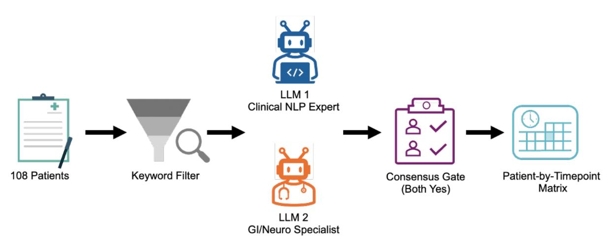
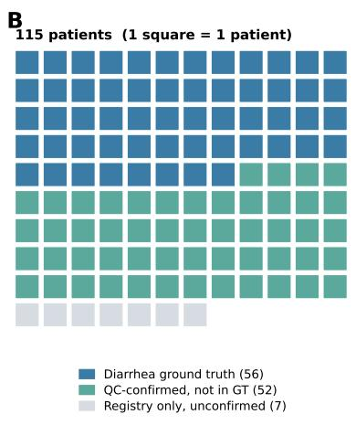
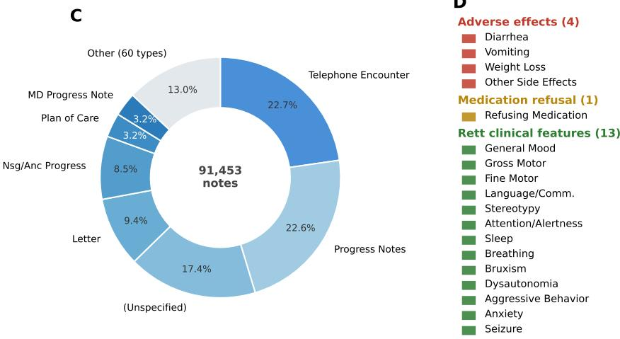
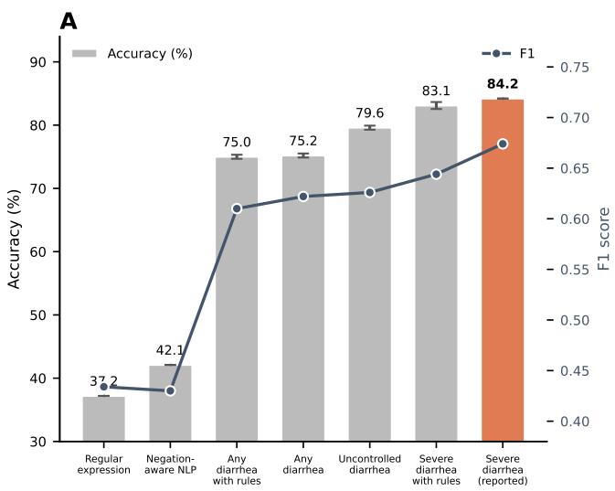
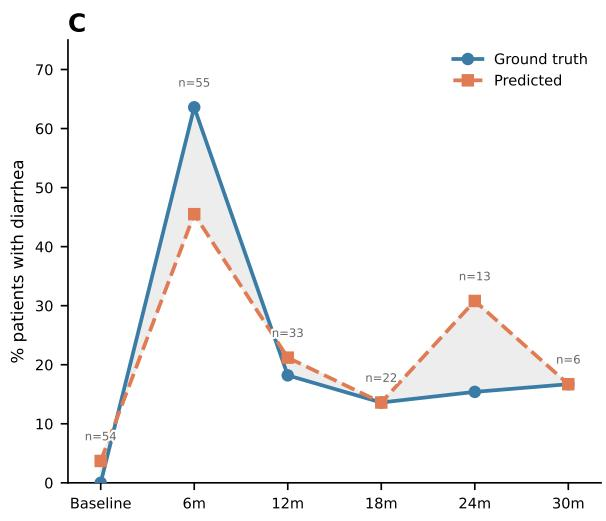
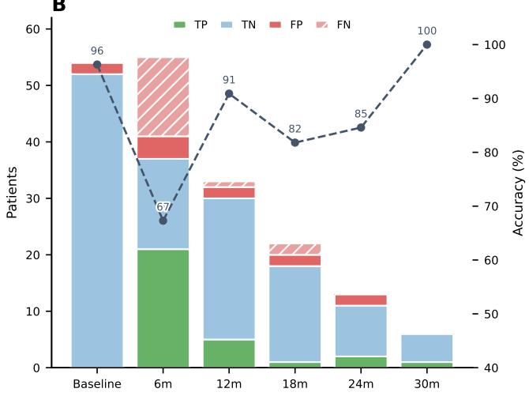
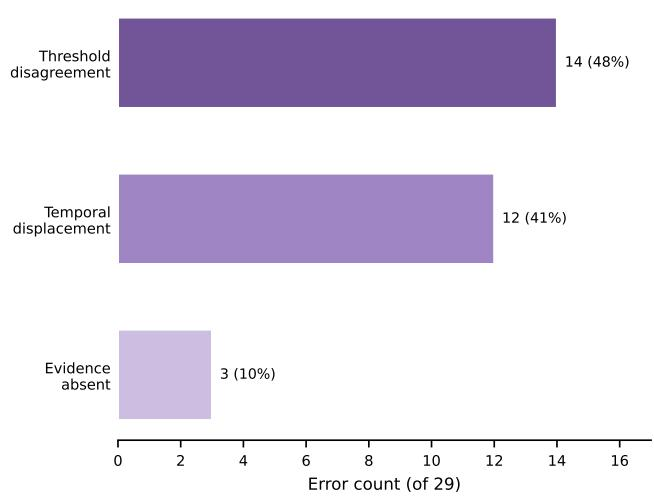
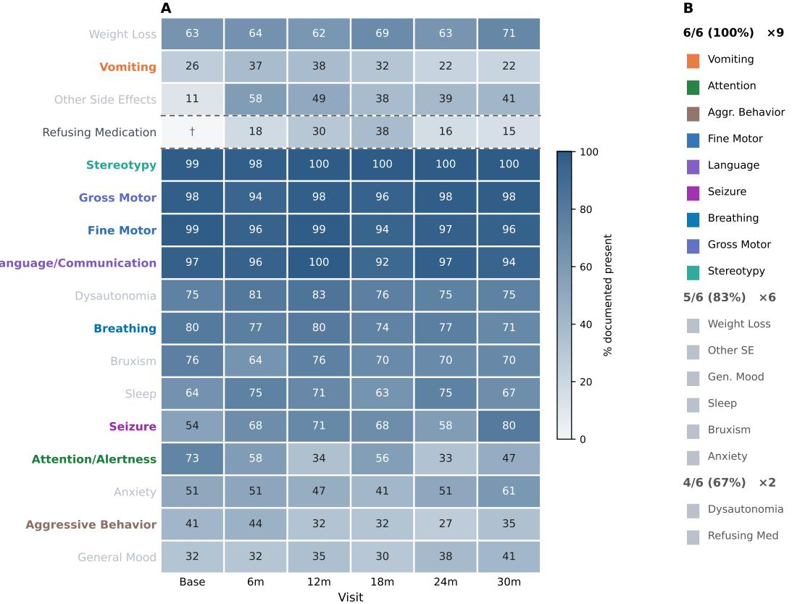
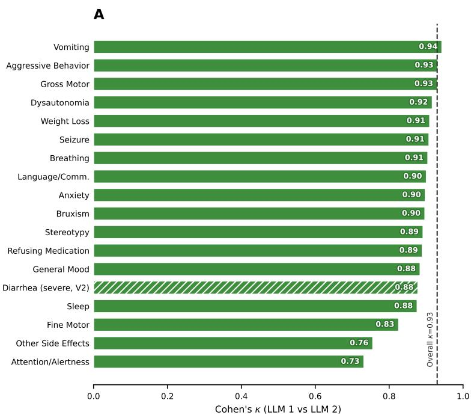
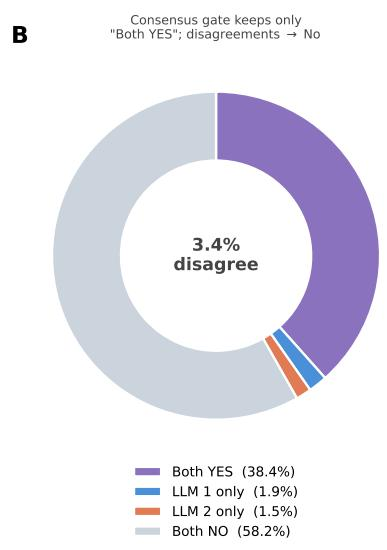

# Documenting Trofinetide Treatment Phenotypes in Rett Syndrome with a Dual-LLM Consensus Pipeline

Article type: Research and Applications

Authors. Daniel Palacios, BS1,2,3,4, Guantong Qi, BS2,3,4,5, Mikael Guzman Karlsson, MD, PhD2,6, Shawntel K. David, BSN, RN7, Mohammed Sameeruddin, BSN, RN7, Bernhard Suter, MD2,7,8, Zhandong Liu, PhD1,2,3,4,\*, Davut Pehlivan, MD2,3,7,8,\*, Hu Chen, PhD2,3,4,\*.

Co-corresponding authors.

## Afiliations.

1. Quantitative and Computational Biosciences, Baylor College of Medicine, Houston, Texas, 77030, USA

2. Department of Pediatrics, Baylor College of Medicine, Houston, Texas, 77030, USA

3. Jan and Dan Duncan Neurological Research Institute, Texas Children’s Hospital, Houston, Texas, 77030, USA

4. Data Science Center, Texas Children’s Hospital, Houston, Texas, 77030, USA

5. Genetics & Genomics Graduate Program, Baylor College of Medicine, Houston, Texas, 77030, USA

6. Department of Pathology and Immunology, Baylor College of Medicine, Houston, Texas, 77030, USA

7. Blue Bird Circle Rett Center, Texas Children’s Hospital, Houston, Texas, 77030, USA

8. Section of Pediatric Neurology and Developmental Neuroscience, Department of Pediatrics, Baylor College of Medicine, Houston, Texas, 77030, USA

Corresponding author. Hu Chen, Department of Pediatrics, Baylor College of Medicine, and Jan and Dan Duncan Neurological Research Institute, Texas Children’s Hospital, 1250 Moursund Street, Houston, TX 77030, USA. Telephone: 832-652-0576. Email: Hu.Chen@bcm.edu.

Keywords: Rett syndrome; trofinetide; large language models; natural language processing; electronic health records.

Word count. Abstract: 247. Main body: 3,859. Tables: 4. Figures: 3.

## ABSTRACT

Objective. Trofinetide, approved in 2023 as the first Rett syndrome treatment, lacks scalable real-world monitoring because chart review is labor-intensive. We developed a dual large language model (LLM) consensus pipeline to extract 18 treatment-response phenotypes, comprising 4 adverse efects, 13 Rett clinical features, and medication refusal, from clinical notes. Materials and Methods. We analyzed 26,763 notes from 108 patients with confirmed sustained trofinetide exposure at Texas Children’s Hospital. The pipeline filters notes by keyword, classifies each through two LLMs requiring consensus, and aggregates a patient-by-timepoint matrix. Architecture and prompt were selected on a diarrhea development set, then frozen and applied to the other 17 phenotypes with the phenotype definition substituted, as an out-of-sample test. The reported prompt comparison scores 183 expert-labeled cells. Results. A prompt requiring diarrhea to be active and severe performed best (84.2±0.0% accuracy; $_ { \mathrm { F 1 } = 0 . 6 7 4 ) }$ , 47 percentage points above regular-expression matching $\left( p < 0 . 0 0 0 1 \right)$ ). Expert reviewers judged six of the pipeline’s calls per phenotype, three positive and three negative, and agreed with 90.2% (92/102). The 13 Rett clinical features are manifestations of the disorder itself rather than adverse efects of trofinetide. Gross and fine motor impairment, language/communication, and stereotypy were documented present in 92–100% of patients at every visit. Discussion. In-context LLM extraction captured multi-domain treatment responses. The outcome is documented presence at each visit, not a direction-of-change judgment. Conclusion. Coupling in-context LLM reasoning with a consensus architecture ofers a scalable alternative to keyword and regular-expression extraction for real-world evidence, adapting to new phenotypes and medications through configuration alone.

## INTRODUCTION

Rett syndrome is a severe neurodevelopmental disorder afecting approximately 1 in 10,000–15,000 live female births, caused primarily by loss-of-function mutations in the MECP2 gene [1, 2]. The condition is characterized by an initial period of apparently normal development followed by a period of regression, with loss of acquired hand skills, development of stereotypic hand movements, gait abnormalities, and loss of spoken language [2], followed by a period of stabilization without further regression of skills.

In March 2023, trofinetide (Daybue) became the first FDA-approved treatment for Rett syndrome [3], following earlier phase 2 eficacy data [4] and a pivotal Phase 3 trial demonstrating improvements on the Rett Syndrome Behaviour Questionnaire (RSBQ) and Clinical Global Impression–Improvement (CGI-I) scale [5]. However, the trial captured only a subset of treatment-relevant phenotypes over 12 weeks, and real-world treatment response across the full spectrum of Rett syndrome features remains incompletely characterized.

## BACKGROUND AND SIGNIFICANCE

Monitoring treatment response in Rett syndrome is challenging. The condition manifests across multiple domains, including motor, cognitive, behavioral and autonomic function, each potentially documented by a diferent specialist in narrative notes. Manual chart review of the resulting note volume can quickly become prohibitively labor-intensive. Electronic health record (EHR) phenotyping has therefore turned to automated methods, from concept-extraction systems [6, 7] to rule-based and portable phenotype algorithms [8, 9]. But traditional rule-based natural language processing (NLP) [10, 11] struggles to distinguish active symptoms from historical, anticipatory, and negated mentions within complex narratives [12, 13], a dificulty long noted in adverse-event detection [14, 15].

Large language models (LLMs) perform strongly on clinical text and medical benchmarks [16, 17, 18, 19], ofering the contextual reasoning to interpret narratives, but a single LLM applied directly to clinical extraction can perform poorly [20]. In our data a single model produced both false positives, over-interpreting routine documentation, and false negatives. The appropriate architecture depends on task complexity. Simple extraction tasks may suit a single well-prompted model [21, 22]. Our task spans many phenotypes and requires judging, within each note, whether a finding is active at that visit rather than historical, negated or anticipatory, so it is complex enough to benefit from a multi-agent verification design in which one model evaluates or critiques another’s output [23, 24]. We therefore use two independently prompted models and require agreement before making a positive call, prioritizing precision over recall.

We present a dual-LLM consensus pipeline that extracts 18 treatment-response phenotypes from clinical notes of 108 patients with Rett syndrome receiving trofinetide. The 18 comprise 4 adverse efects, 13 Rett clinical features and medication refusal, and each is classified at every visit as documented present or absent (Methods). The pipeline was developed and evaluated on an expert-annotated ground truth for the diarrhea phenotype, then applied to the remaining 17 phenotypes with only the phenotype definition substituted. Our objective was to determine whether contextual LLM reasoning, combined with a consensus requirement, can extract multi-domain treatment-response phenotypes from routine clinical documentation at a scale that manual review cannot reach. We focused on one major adverse efect, diarrhea, to develop the pipeline, and we report that process in full.

## MATERIALS AND METHODS

## Study design and population

We conducted a retrospective observational study of patients with Rett syndrome identified from Rett Center clinical visits at Texas Children’s Hospital (TCH) who were prescribed or considered for trofinetide (Daybue). We selected this population because the TCH Rett Center is a dedicated center of excellence whose standardized note templates capture comprehensive disorder-specific information over ofice visits of at least one hour. An initial 115 patients were identified on this basis. To verify sustained drug exposure, an independent quality-control (QC) review triangulated three sources per patient: pharmacy orders, medication-administration records, and longitudinal note mentions. This confirmed sustained exposure in 108 of 115 patients (94%), with 65 by pharmacy order and 43 by clinical documentation alone (≥2 note mentions over >60 days). The remaining 7 were unconfirmed (4 with only isolated mentions, 3 with no evidence) and were therefore excluded. This 108-patient QC-confirmed cohort is the analysis cohort throughout.

Cohort characteristics for the 108 QC-confirmed patients and the 56 diarrhea-validation patients are summarized in Table 1. The subset is comparable to the remaining QC-confirmed patients on age, sex, and follow-up, but has more notes per patient (median 171 vs. 99, $p = 0 . 0 7 )$ . The full cohort’s median is 148. The per-patient note count is right-skewed (range 7–2,546), summing to the 26,763 analyzed notes, and the cohort is young (median age 13 years) and almost entirely female, consistent with Rett syndrome epidemiology. The rare male patients with MECP2-related disorders can follow a diferent disease course, but we retained them because this analysis documents phenotype presence rather than disease severity.

Table 1: Cohort characteristics for the full QC-confirmed cohort and the diarrhea-validation subset. Values are median (IQR) or n (%). The p-column compares the validation subset against the remaining QC-confirmed patients, Mann–Whitney U for continuous variables and Fisher exact for sex. Variable definitions, and the patient count each row rests on, are in Supplementary Note S8.
<table><tr><td>Characteristic</td><td>Full cohort (n = 108)</td><td>Validation subset (n = 56)</td><td>p</td></tr><tr><td>Age at trofinetide start, years</td><td>12.7 (8.2–20.3)</td><td>12.6 (8.3–18.5)</td><td>0.72</td></tr><tr><td>Female, n (%)</td><td>106 (98.1)</td><td>56 (100.0)</td><td>0.23</td></tr><tr><td>Follow-up duration, months</td><td>29.4 (20.0–34.1)</td><td>32.4 (25.3–34.1)</td><td>0.06</td></tr><tr><td>Notes analyzed per patient, median (IQR)</td><td>148 (49–349)</td><td>171 (61–397)</td><td>0.07</td></tr><tr><td>Notes analyzed per patient, mean</td><td>270</td><td>271</td><td></td></tr><tr><td>Total analyzed notes</td><td>26,763</td><td>15,177</td><td></td></tr><tr><td>Total notes retrieved</td><td>91,453</td><td>47,491</td><td></td></tr></table>

## Data sources

We integrated four data sources: the Rett Center registry, from which the cohort was identified; the clinical-notes repository, spanning all documented note types; and two structured Epic EHR medication tables (order and administered). All four reside as ontology-mapped tables in Texas Children’s Hospital’s Palantir Foundry environment. The registry is curated by the Rett Center clinical team of two pediatric nurses and two pediatric neurologists, who together performed all clinical annotation and review reported here, and the notes and medication tables are drawn from the institutional EHR.

The QC review found that 43 of the 108 confirmed patients had no matching row in the Epic order table. Trofinetide is a specialty-pharmacy product whose dispensing often bypasses the institutional order table, so structured orders alone would have undercounted these patients, motivating our notes-inclusive design. Retrieval for the QC-confirmed patients returned 91,453 notes, of which the 26,763 falling inside the six evaluation windows constitute the analyzed corpus. Retrieval was not restricted to the treatment period, so the retrieved notes span November 1998 to August 2026, while the analyzed notes span July 2021 to August 2026.

The retrieved corpus spans 67 note types (Figure 1C; full distribution in Supplementary Table S1), the largest being telephone encounters at 22.7% and progress notes, followed by a large “unspecified” group and letters. Because telephone encounters are often the first channel through which adverse efects like diarrhea are reported, we retain all note types rather than restricting to progress notes.

## Pipeline architecture

The extraction pipeline follows a five-step architecture (Figure 1):

Step 1: Medication Timeline. Every follow-up window is measured from the patient’s exposure anchor, meaning the identified date on which trofinetide was started. The anchor is taken from the Epic medication-administration record where available, and otherwise from the earliest note documenting active dosing, adjudicated by LLM review; no patient anchored on a dispense record, because trofinetide fills bypass the institutional tables. Across the 108 patients, 8 anchored on an administration record and 91 on an adjudicated note, while 9 lack a reliable date and are excluded from the timepoint analysis.

Step 2: Note Bucketing. Each note is assigned to a six-month bucket (baseline through 30 months) by the days between its contact date and the exposure anchor. Notes are then pre-filtered by phenotype-specific keyword lists (Supplementary Table S2), producing 60,537 note–phenotype matches across the 17 phenotypes scored by the presence prompt, all but 7 of which returned a valid YES/NO in the structured output from both models. Those 7 were scored negative (Supplementary Note S1, which also reports inter-LLM agreement). For diarrhea the filter matches 7,111 of the 91,453 retrieved notes, and the 2,260 of those falling inside an evaluation window are the corpus every diarrhea comparison below is scored on.

Step 3: Dual-LLM Classification. Each keyword-positive note is independently classified by two LLMs with complementary perspectives. The first, a clinical NLP expert, judges whether the phenotype is documented in the note itself, applying explicit rules to separate findings recorded at that visit from historical, negated, anticipatory, and template mentions against a written per-phenotype definition. For diarrhea that definition adds a severity threshold. The second, a domain specialist (gastroenterologist for side efects, pediatric neurologist for the Rett clinical features), weighs clinical significance and attribution. Prompt templates, YES/NO criteria, and a contingency table of the two agents’ calls (evidence they work independently) are in Supplementary Notes S3 and S1. Both output a structured YES/NO call with supporting evidence, and a note is positive only when both models agree YES. The record also carries the note’s contact date, which is known from EHR metadata rather than extracted from the note text (Supplementary Note S3). The evidence spans were spot-checked but not systematically validated. Detection is thus note-local in time, so historical mentions score negative, at the cost of missing purely retrospective ones (quantified in the error analysis).

The LLMs were accessed within Palantir Foundry (Claude Opus 4.6, July 2026, default decoding parameters) with output constrained to the structured YES/NO schema (Supplementary Note S3). Because the defaults are not guaranteed deterministic, we report run-to-run variability across three independent runs.

Step 4: Aggregation. For each patient and timepoint, if any note in the bucket receives a positive consensus call, the patient is marked Yes for that phenotype, producing a patient-by-timepoint-by-phenotype matrix.

Step 5: Evaluation. Diarrhea was evaluated against a ground truth from independent manual chart review by domain experts, who labeled each patient-timepoint cell Yes (medication-associated diarrhea), No, or Deceased/Not applicable. This produced labels for 56 patients across the six timepoints (Table 1), giving 183 evaluable cells inside follow-up, of which 47 are labeled Yes. Metrics include accuracy, precision, recall, F1, Cohen’s κ, Matthews correlation, and per-timepoint confusion matrices.

Annotation procedure. The ground truth was established by the Rett Center clinical team, who reviewed each patient’s notes within a timepoint window using the same labeling scheme. The same reviewers performed the multi-phenotype expert spot-check. Annotation followed a consensus-adjudication workflow with no formal written guideline and no retrospective inter-annotator agreement statistic, a limitation for gold-standard reliability detailed in Supplementary Note S6 (TRIPOD-LLM items 8a–8b) [25].

## Phenotype definitions

The 18 phenotypes were selected by the Rett Center clinical team as the adverse efects and disease-related functional domains most salient to monitor in routine trofinetide care, rather than an exhaustive enumeration. At each clinical visit, each phenotype is classified according to whether it is documented as present in that visit’s clinical note, not as a direction-of-change judgment. They span three categories.

Adverse efects (4): Diarrhea, Vomiting, Weight Loss, and Other Side Efects, each a physiological reaction to trofinetide. The diarrhea phenotype, defined as medication-associated diarrhea, is the target of the ground-truth validation and error analysis.

Medication refusal (1): Refusing Medication is tracked separately because it is a behavioral response, not a physiological reaction, and captures documented instances of the patient declining or resisting the medication.

Rett clinical features (13): General Mood, Gross Motor, Fine Motor, Language/Communication, Stereotypy, Attention/Alertness, Sleep, Breathing/Hyperventilation, Bruxism, Dysautonomia, Aggressive Behavior, Anxiety, Seizures. These are manifestations of Rett syndrome itself, part of the natural history of the disorder that clinicians track over the course of treatment. They are not adverse efects, and no finding in this category should be read as an efect caused by trofinetide.

Each phenotype is defined by a keyword list (Supplementary Table S2) and phenotype-specific LLM prompts encoding what constitutes a true positive. Generic terms matching routine documentation are excluded (e.g., “alert” is dropped from the attention/alertness list to avoid vital-sign notes).

## Model development and iteration

We developed the pipeline on diarrhea, our development set, because expert annotation of all 18 phenotypes across every patient would be prohibitively slow, the bottleneck this pipeline relieves.

The architecture was settled first, by a comparison of six extraction strategies on this development set that selected the dual-model consensus gate. Holding it fixed, we then ran that consensus configuration under five classification prompts difering only in what they count as diarrhea, alongside two rule-based methods that bound the comparison from below (Table 2). Prompt wording, the architecture comparison, and the identifiers these methods carry in the released code are in Supplementary Notes S2, S3, and S7. We selected the reported prompt on the same 183 cells we score it on. Its diarrhea accuracy is therefore an in-sample upper bound rather than a held-out estimate. The evidence that the design generalizes comes from the other 17 phenotypes. We froze the pipeline after the diarrhea work and applied it to them with only the phenotype definition substituted (Results; Supplementary Note S2).

## Ethical considerations

This study was conducted under IRB protocol H-52222 at Baylor College of Medicine / Texas Children’s Hospital. All data remained within the institutional secure computing environment, and LLM inference was performed in-environment under enterprise data-governance controls.

## RESULTS

## Contextual reasoning improves performance and outperforms keyword matching

We evaluated seven methods of increasing specificity on the identical 183-cell ground truth (Table 2).

The severe-diarrhea prompt performs best. Accuracy rises with the severity threshold the prompt sets, and the severe-diarrhea prompt (Claude Opus 4.6) performs best on every headline metric except recall: 84.2% accuracy, precision 0.714, F1 0.674, κ 0.570. This is 47 percentage points over the regular-expression baseline (37.2%, indiscriminate over-flagging) and 42 points over negation-aware NLP (42.1%). Both restrictions help. Requiring diarrhea to be uncontrolled improves on counting any documented mention (79.6% against 75.2%), and stating that restriction as an explicit severity bar raises accuracy to 84.2% via precision (0.596→0.714), as the bar converts nine false positives into true negatives at the cost of one true positive.

How strong is this evidence? We then asked whether these diferences are real or only directional, testing each comparison with McNemar’s exact test and Holm-correcting across a pre-declared family of seven prompt comparisons (Supplementary Table S4). The reported prompt beats both rule-based methods decisively $( p < 0 . 0 0 0 1 )$ , and every prompt sits far above them on accuracy. None of the prompt-to-prompt comparisons reaches significance. The severe-diarrhea prompt wins 9 cells against the uncontrolled-diarrhea prompt the pipeline was originally deployed with (row 5 of Table 2) and loses 1, which is $p = 0 . 0 2 1$ before correction and $p = 0 . 1 5$ after, so it is the top of a sweep rather than a demonstrated improvement. With 183 cells and a gap of roughly 8, this cohort is too small to resolve diferences of that size.

Table 2: Method comparison on the diarrhea phenotype. All seven methods are scored on the identical 183-cell expert ground truth from the 56 labeled patients. Type is the kind of system doing the reading, either lexical pattern matching, rule-based NLP, or a large language model. The five LLM rows share the same two agents, the same consensus gate, and the same model (Claude Opus 4.6), and difer only in what they count as diarrhea. All five also exclude resolved, negated, templated, anticipatory and other-cause mentions, so the two with rules variants restate that guidance rather than introduce it. Accuracy is the mean±SD over three independent runs, and the two non-LLM methods are deterministic. The other metrics are computed from the modal prediction across the three runs. The bolded row is the configuration reported throughout the paper. Full prompt wording, and the identifiers these names carry in the released code, are in Supplementary Notes S3 and S7. Best value in each column in bold.
<table><tr><td>Method</td><td>Type</td><td>What counts as diarrhea</td><td>Accuracy (%)</td><td>Precision</td><td>Recall</td><td>F1</td></tr><tr><td>Regular expression</td><td>Regex</td><td>Any note containing a diarrhea keyword</td><td>37.2</td><td>0.282</td><td>0.936</td><td>0.434</td></tr><tr><td>Negation-aware NLP</td><td>NLP</td><td>The same keywords, with negated and historical men- tions filtered out</td><td>42.1</td><td>0.288</td><td>0.851</td><td>0.430</td></tr><tr><td>Any diarrhea, with LLM rules</td><td></td><td>Any documented diarrhea, un- less the note reports it as re- solved or attributes it to another cause</td><td>75.0±0.3</td><td>0.507</td><td>0.766</td><td>0.610</td></tr><tr><td>Any diarrhea</td><td>LLM</td><td>Any documented diarrhea, in- cluding diarrhea that treatment has brought under control</td><td>75.2±0.3</td><td>0.514</td><td>0.787</td><td>0.622</td></tr><tr><td>Uncontrolled diar- LLM rhea</td><td></td><td>Diarrhea unless the note de- scribes it as mild or controlled without needing intervention</td><td>79.6±0.3</td><td>0.596</td><td>0.660</td><td>0.626</td></tr><tr><td>Severe diarrhea, with rules</td><td>LLM</td><td>Active diarrhea causing con- cern or prompting a manage- ment change, unless the note re- ports it as resolved or attributes</td><td>83.1±0.5</td><td>0.700</td><td>0.596</td><td>0.644</td></tr><tr><td>Severe diarrhea</td><td>LLM</td><td>it to another cause Diarrhea that is active and either causing ongoing con- cern or prompting a change in management at that visit</td><td>84.2±0.0</td><td>0.714</td><td></td><td>0.638 0.674</td></tr></table>

A patient-level bootstrap (2,000 resamples) gave a 95% CI of 78.1–89.9%, and splitting the cohort in half by patient gives 81.1% and 87.5%. Restricted to the 129 on-treatment cells accuracy is 79.1%, because the 54 baseline cells are almost all true negatives and inflate every configuration equally (baseline 96.3%), with the ranking unchanged (Supplementary Note S7).

The predicted vs. ground-truth prevalence trajectories (Figure 2C) show the model under-detecting at 6 months (45.5% vs. 63.6%) and over-detecting at 24 months (30.8% vs. 15.4%), with the remaining timepoints within a few points of the expert labels, attributed to a stricter human threshold for “managed” diarrhea and to documentation falling one window away from the labeled visit, dominated by annotation and data-availability factors rather than model misreadings. Per-timepoint confusion matrices and additional metrics are in Supplementary Tables S5 and S6.

## The pipeline extends to 18 phenotypes over 30 months of follow-up

We extended the analysis to the other 17 phenotypes using a uniform presence prompt, with documented presence shown in Figure 3 and full per-visit rates in Supplementary Tables S7–S8. Because diarrhea has its own ground truth and error analysis, we assessed these 17 with a lighter expert spot-check instead. For each we drew a balanced sample of six cases, three model-present and three model-absent, and the Rett Center clinical team judged whether the model’s call agreed with the note. The model agreed with the reviewer in 90.2% of cases (92/102; 95% CI 82.9–94.6%), 86.3% on model-positive calls (44/51) and 94.1% on model-negative (48/51), the pipeline slightly more conservative about missing than over-calling a phenotype. The review procedure and the scope of the reviewed sample are in Supplementary Note S6.

Per-phenotype agreement (Table 3) shows nine phenotypes reached 6/6, six reached 5/6, and two (dysautonomia, refusing medica tion) reached 4/6. One pattern dominated the ten disagreements, in which the model inferred a currently active phenotype from a historical or past-medical-history mention. Attention/alertness and seizure, whose vocabulary overlaps routine documentation and required careful presence-specific keyword design, both nonetheless reached 6/6. Inter-LLM agreement per phenotype provides a complementary label-free check (Supplementary Note S1, Supplementary Figure S1).

Table 3: Expert spot-check agreement for the 17 phenotypes without a ground truth. For each phenotype the Rett Center clinica team judged six model calls (three model-positive and three model-negative) as agreeing or disagreeing with the note (102 cases in total); overall model–reviewer agreement was 90.2% (92/102; 95% CI 82.9–94.6%). Diarrhea’s six cases were omitted from this spot-check because diarrhea is validated against a quantitative ground truth and characterized by a dedicated error analysis.
<table><tr><td>Agreement</td><td>Count</td><td>Phenotypes</td></tr><tr><td>6/6 (100%)</td><td>9</td><td>Aggressive Behavior, Attention/Alertness, Breath- ing/Hyperventilation, Fine Motor, Gross Motor, Lan- guage/Communication, Seizure, Stereotypy, Vomiting</td></tr><tr><td>5/6 (83%)</td><td>6</td><td>Anxiety, Bruxism, General Mood, Other Side Effects, Sleep, Weight Loss</td></tr><tr><td>4/6 (67%)</td><td>2</td><td>Dysautonomia, Refusing Medication</td></tr></table>

## Adverse-efect and clinical-feature presence follow distinct temporal patterns

Several patterns emerge across the extracted phenotypes (Figure 3).

Adverse-efect presence. Documented rates vary across the adverse efects (Figure 3A). Other side efects are documented in 11% of patients at baseline and rise sharply to 58% at 6 months, settling at 38–49% thereafter. Medication refusal rests on a single patient at baseline, so that cell is suppressed, and it peaks at 38% at 18 months before falling to 15–16% at the later visits. Weight-loss documentation is already high before treatment starts (63%) and stays in a 62–71% band across follow-up, so it is unlikely to be treatment-emergent and more consistent with a pre-existing feeding or growth concern. Vomiting fluctuates modestly, peaking at 38% at 12 months and falling to 22% by 30 months. Diarrhea, the only validated adverse efect, is characterized separately (Figure 2).

Rett clinical-feature presence. These 13 features are manifestations of Rett syndrome itself and not adverse efects of trofinetide, so their documented presence describes the disorder under treatment rather than harm caused by it. They span a wide range of documented prevalence (Figure 3A; full rates in Supplementary Table S8). Gross- and fine-motor impairment, impaired language/communication, and hand stereotypies are the core neurodevelopmental features of the disorder, and all are documented as present in nearly all patients at every visit (92–100%). Dysautonomia, breathing, bruxism, sleep, and seizure form a middle band at intermediate rates, while attention/alertness, anxiety, and the afective and behavioral findings of mood and aggression are documented least often. Documented presence at the pre-treatment baseline is lower than at 6 months for 5 of the 13 features, so baseline-to-follow-up diferences should still not be read as clinical change (Supplementary Table S8). These trajectories are documentation-based and, except for diarrhea, are not validated against a ground truth (Discussion).

## Most residual discrepancies reflect difering scoring targets rather than misreading of the note

We classified every diarrhea discrepancy under the reported configuration (29 of 183 cells) by root cause (Table 4, Figure 2D), assigning each cell by rule from the keyword-passing notes in its own window and the adjacent ones rather than by manual re-reading. Three mechanisms account for all 29, and all three are annotation, data-coverage, or window-placement limitations rather than demonstrable misreadings. The reviewer integrates patient-level context across encounters and grades case by case, while the model is note-local by construction and applies one fixed threshold uniformly.

Table 4: Error taxonomy for the diarrhea phenotype under the reported configuration (29 total errors on 183 cells, 17 false negatives and 12 false positives). “Model reading defensible?” indicates whether the model’s call is defensible against the notes available in the window it scored. Assignment is rule-based, so it separates the window a piece of evidence falls in but not whether a note was misread within its own window.
<table><tr><td>Mechanism</td><td>What happens</td><td>N(%)</td><td>Model reading defensible?</td></tr><tr><td>Threshold disagreement</td><td>Note documents active or medication- managed diarrhea. The reviewer scores No under a stricter severity threshold, or the converse, where the reviewer counts mild or managed changes the model discounts</td><td>14 (48%)</td><td>Arguable</td></tr><tr><td>Temporal displacement</td><td>The supporting positive note exists but falls in an adjacent six-month window, so the model and the reviewer are describing the same episode at different visits</td><td>12 (41%)</td><td>Arguable</td></tr><tr><td>Evidence absent</td><td>Diarrhea recorded in the ground truth but not present in any keyword-passing note in the window, having been reported by phone, through the patient portal, or only retrospec- tively</td><td>3 (10%)</td><td>N/A (no evidence)</td></tr></table>

Most discrepancies are not misreadings. The largest category (14/29, 48%) is a definitional disagreement about what counts as clinically significant diarrhea rather than a model error. It cuts both ways, since the 29 errors are 17 false negatives and 12 false positives, so a single severity threshold would trade one error type for the other. Re-scoring the 14 threshold-disagreement cases as correct yields a 91.8% bounding sensitivity-analysis estimate rather than a corrected performance figure (Supplementary Note S4).

The 12 displacement cells are the ones an onset-aligned variant of the predictions addresses (Supplementary Note S7). Errors concentrate at 6 months, which holds 18 of the 29, and 28 of the 29 were also errors under the deployed prompt, so the severity bar shrank the error set rather than relocating it. What this rule-based assignment cannot do is separate a within-note misreading from a window-placement mismatch, since the prompts emit only YES or NO and so record whether a call is right but not the reasoning behind it (Supplementary Note S4).

## DISCUSSION

A dual-LLM consensus pipeline can extract clinically meaningful treatment-response phenotypes from unstructured notes at scale, recovering signal that structured fields miss. Modeling clinical context significantly outperforms naive keyword matching, and what separates the configurations that do so is what the prompt counts as diarrhea rather than how many models are asked. The severe-diarrhea prompt was strongest, but its margin over the deployed prompt is unresolved at this sample size, so we adopt it as a precision-favorable default rather than a proven improvement. It was also selected on the same 183 cells it is scored on, so its accuracy is an in-sample upper bound. The evidence that the design transfers is the half-cohort split and the 90.2% agreement on the other 17 phenotypes, which the same architecture and prompt design reached with only the phenotype definition substituted.

The type of error matters more than the headline accuracy. Most diarrhea errors are annotation or data limitations rather than model failures, which tells a deploying institution which discrepancies prompting can fix, which are data-coverage ceilings, and which are annotation-guideline decisions. Design choices and intended use are in Supplementary Note S4, and the architecture comparison is in Note S2.

Diarrhea is the most commonly reported adverse event in the pivotal Phase 3 trial, at ∼80% in the treatment arm [5, 26]. Our validated target is narrower, severe rather than any diarrhea, and expert labels put it at 64% of evaluable patients at 6 months and below 20% at every later visit (Supplementary Table S5), so the diference from the trial figure is mostly one of threshold rathe than of detection. The later validated timepoints have few evaluable cells, 13 at 24 months and 6 at 30 months, and warrant caution.

The main limitation is that only diarrhea has a ground truth. The other 17 phenotypes rest on spot-check review and inter-LLM agreement rather than full annotation (Supplementary Note S1), a resource constraint described in Methods. Their rates are therefore hypothesis-generating lower bounds, and generalization likely varies by phenotype, since concrete adverse efects should transfer more readily than subjective findings. The pipeline detects only what our corpus documents, and some symptoms surface only in other channels. The exposure anchor is adjudicated from note text for most patients rather than taken from a structured record, so window boundaries carry real uncertainty, visible in the 12 displacement errors. The observed trajectories cannot be definitively attributed to trofinetide rather than to concurrent therapies or the natural course of development. The outcome is documented presence and not direction of change or severity, so the pipeline cannot distinguish an improved feature from a persistent one. For the core Rett features, documented in nearly all patients at nearly every visit, detecting within-feature improvement would need severity-graded instruments such as the RSBQ or CGI-I. Documentation does move for other side efects and refusing medication, so the method registers change when change is recorded. All patients come from a single institution, and the pipeline is not yet optimized for eficiency, which cheap pre-filtering, batched calls, and smaller distilled models could improve.

Integrating additional sources such as telephone logs and portal messages, and cross-temporal reasoning that propagates retrospective mentions to the timepoint they describe, would recover symptoms currently missed. Expanding the ground truth b second-reviewer adjudication and by annotation prioritized on inter-LLM disagreement would convert the six-case agreement tiers into per-phenotype accuracy with confidence intervals. Individual feature trajectories, including the apparent seizure rise, need validated per-timepoint annotation before clinical interpretation and are deferred. Direction-of-change extraction is feasible in the same architecture with phenotype-specific prompts and a correspondingly annotated ground truth, but was outside this validation’s scope. The framework extends to other medications and conditions by configuration alone.

## CONCLUSION

We present a dual-LLM consensus pipeline for multi-phenotype treatment-response extraction from clinical notes, applied to 108 patients with Rett syndrome receiving trofinetide over 30 months. Using Claude Opus 4.6, it substantially outperforms a regular-expression baseline on an expert-annotated diarrhea development set, and the same configuration transfers out-of-sample to the remaining 17 phenotypes with only the phenotype definition substituted. It also yields one of the first comprehensive real-world characterizations of how multi-domain trofinetide response is documented in routine care. The architecture extends to further phenotypes, medications, and institutions by configuration alone, showing that LLM consensus can bridge clinical narrative and the structured data needed for scalable treatment-response monitoring and real-world evidence in rare diseases.

## FUNDING

This research was supported by a fellowship from the Gulf Coast Consortia on the NLM Training Program in Biomedical Informatics and Data Science (T15 LM007093); the National Science Foundation Graduate Research Fellowship Program (NSF GRFP Fellow ID 2024370642); the Cancer Prevention and Research Institute of Texas (CPRIT, RP240131); the Chan Zuckerberg Initiative (2023-332162); the National Institutes of Health (NIH, U54NS093793 and OT2OD040565); the Eunice Kennedy Shriver National Institute of Child Health and Human Development of the NIH (P50HD103555); the Chao Endowment; the Hufington Foundation; and the Jan and Dan Duncan Neurological Research Institute at Texas Children’s Hospital. D.Pe. is supported by Doris Duke Charitable Foundation grant 2023-0235 and NINDS K23 NS125126-01A1.

## ADDITIONAL CONTRIBUTIONS

No AI-assisted tools were used for study design, analysis, or primary manuscript drafting; generative AI tools were used only for proofreading and typographical/grammatical correction of author-written text. Large language models are the object of study and their use in the analysis pipeline is described in Methods. In accordance with COPE’s position and JAMIA policy, no AI or NLP tool is listed as an author; the authors reviewed and verified all text and take full responsibility for the integrity, accuracy, and originality of all content.

## CONFLICTS OF INTEREST

D.Pe. provides paid consulting services for Ionis Pharmaceuticals, M2DS Therapeutics and Acadia Pharmaceuticals. B.S. has provided consulting services to Acadia, Neurogene, Ionis Pharmaceuticals, Taysha, EcoR1, and UCB; all remuneration for these has been made to his institution. The remaining authors declare no competing interests.

## DATA AVAILABILITY

The classification pipeline, phenotype keyword lists, and LLM prompt templates are publicly available at https://github. com/DanPalBCM/clinical-trofinetide. The underlying clinical notes cannot be shared due to patient-privacy protections and institutional/HIPAA policy; requests for access to de-identified derived data may be directed to the corresponding author and are subject to a data-use agreement and IRB approval. De-identified aggregate results supporting all figures and tables are provided within the article and its supplementary materials. Figures were produced with Matplotlib in a soft-fill style inspired by the PubliPlots library [27]. Reporting follows the TRIPOD-LLM guidance for studies using large language models on clinica text [25]; the addressed checklist items are mapped to their locations in Supplementary Note S5.

## AUTHOR CONTRIBUTIONS

Following the CRediT taxonomy: D.P. (Palacios): conceptualization, methodology, software, formal analysis, investigation, data curation, visualization, writing – original draft. G.Q. (Qi): visualization (Figure 1A), writing – original draft. M.G.K. (Guzman Karlsson): conceptualization, investigation, methodology (bioinformatics expertise, analysis strategy), writing – review and editing. S.K.D. (David): investigation, data curation, validation (registry curation, diarrhea ground-truth annotation, and multi-phenotype spot-check). M.S. (Sameeruddin): investigation, data curation, validation (registry curation, diarrhea ground-truth annotation, and multi-phenotype spot-check). B.S. (Suter): investigation, data curation, validation (registry curation, diarrhea ground-truth annotation, and multi-phenotype spot-check), clinical/domain expertise, writing – review and editing. Z.L. (Liu): supervision, funding acquisition, methodology, writing – review and editing. D.Pe. (Pehlivan): investigation, data curation, validation (registry curation, diarrhea ground-truth annotation, and multi-phenotype spot-check), clinical/domain expertise, resources (patient registry), writing – review and editing. H.C. (Chen): supervision, project administration, methodology, writing – review and editing. All authors reviewed and approved the final manuscript.

## REFERENCES

[1] Ruthie E Amir, Ignatia B Van den Veyver, Mimi Wan, Charles Q Tran, Uta Francke, and Huda Y Zoghbi. Rett syndrome is caused by mutations in x-linked mecp2, encoding methyl-cpg-binding protein 2. Nature Genetics, 23(2):185–188, 1999. doi: 10.1038/13810.

[2] Jefrey L Neul, Walter E Kaufmann, Daniel G Glaze, John Christodoulou, Angus J Clarke, Nadia Bahi-Buisson, Helen Leonard, Mark E S Bailey, N Carolyn Schanen, Michele Zappella, Alessandra Renieri, Peter Huppke, and Alan K Percy. Rett syndrome: revised diagnostic criteria and nomenclature. Annals ofNeurology, 68(6):944–950, 2010. doi: 10.1002/ana.22124.

[3] U.S. Food and Drug Administration. FDA approves first treatment for Rett syndrome, 2023. URL https://www.fda. gov/drugs/news-events-human-drugs/fda-approves-first-treatment-rett-syndrome. Content current as of 13 March 2023. Accessed 2026-08-18.

[4] Daniel G Glaze, Jefrey L Neul, Alan Percy, Tim Feyma, Arthur Beisang, Alex Yaroshinsky, George Stoms, David Zuchero, Joseph Horrigan, Larry Glass, and Nancy E Jones. A double-blind, randomized, placebo-controlled clinical study of trofinetide in the treatment of rett syndrome. Pediatric Neurology, 76:37–46, 2017. doi: 10.1016/j.pediatrneurol.2017.07.002. Phase 2, RETT-001; adolescent and adult females.

[5] Jefrey L Neul, Alan K Percy, Timothy A Benke, Elizabeth M Berry-Kravis, Daniel G Glaze, Eric D Marsh, Tim Lin, Serge Stankovic, Kathie M Bishop, and James M Youakim. Trofinetide for the treatment of rett syndrome: a randomized phase 3 study. Nature Medicine, 29(6):1468–1475, 2023. doi: 10.1038/s41591-023-02398-1. LAVENDER, NCT04181723.

[6] Guergana K Savova, James J Masanz, Philip V Ogren, Jiaping Zheng, Sunghwan Sohn, Karin C Kipper-Schuler, and Christopher G Chute. Mayo clinical text analysis and knowledge extraction system (cTAKES): architecture, component evaluation and applications. Journal of the American Medical Informatics Association, 17(5):507–513, 2010. doi: 10.1136/ jamia.2009.001560.

[7] Sunyang Fu, David Chen, Huan He, Sijia Liu, Sungrim Moon, Kevin J Peterson, Feichen Shen, Liwei Wang, Yanshan Wang, Andrew Wen, Yiqing Zhao, Sunghwan Sohn, and Hongfang Liu. Clinical concept extraction: a methodology review. Journal of Biomedical Informatics, 109:103526, 2020. doi: 10.1016/j.jbi.2020.103526.

[8] Chaitanya Shivade, Preethi Raghavan, Eric Fosler-Lussier, Peter J Embi, Noemie Elhadad, Stephen B Johnson, and Albert M Lai. A review of approaches to identifying patient phenotype cohorts using electronic health records. Journal of the American Medical Informatics Association, 21(2):221–230, 2014. doi: 10.1136/amiajnl-2013-001935.

[9] Jacqueline C Kirby, Peter Speltz, Luke V Rasmussen, Melissa Basford, Omri Gottesman, Peggy L Peissig, Jennifer A Pacheco, Gerard Tromp, Jyotishman Pathak, David S Carrell, Stephen B Ellis, Todd Lingren, Will K Thompson, Guergana Savova, Jonathan Haines, Dan M Roden, Paul A Harris, and Joshua C Denny. PheKB: a catalog and workflow for creating electronic phenotype algorithms for transportability. Journal of the American Medical Informatics Association, 23(6): 1046–1052, 2016. doi: 10.1093/jamia/ocv202.

[10] Yanshan Wang, Liwei Wang, Majid Rastegar-Mojarad, Sungrim Moon, Feichen Shen, Naveed Afzal, Sijia Liu, Yuqun Zeng, Saeed Mehrabi, Sunghwan Sohn, and Hongfang Liu. Clinical information extraction applications: a literature review. Journal ofBiomedical Informatics, 77:34–49, 2018. doi: 10.1016/j.jbi.2017.11.011.

[11] Kory Kreimeyer, Matthew Foster, Abhishek Pandey, Nina Arya, Gwendolyn Halford, Sandra F Jones, Richard Forshee, Mark Walderhaug, and Taxiarchis Botsis. Natural language processing systems for capturing and standardizing unstructured clinical information: a systematic review. Journal of Biomedical Informatics, 73:14–29, 2017. doi: 10.1016/j.jbi.2017.07.012.

[12] Wendy W Chapman, Will Bridewell, Paul Hanbury, Gregory F Cooper, and Bruce G Buchanan. A simple algorithm for identifying negated findings and diseases in discharge summaries. Journal ofBiomedical Informatics, 34(5):301–310, 2001. doi: 10.1006/jbin.2001.1029.

[13] Henk Harkema, John N Dowling, Tyler Thornblade, and Wendy W Chapman. ConText: an algorithm for determining negation, experiencer, and temporal status from clinical reports. Journal ofBiomedical Informatics, 42(5):839–851, 2009. doi: 10.1016/j.jbi.2009.05.002.

[14] Harvey J Murf, Fern FitzHenry, Michael E Matheny, Nancy Gentry, Kristen L Kotter, Kimberly Crimin, Robert S Dittus, Amy K Rosen, Peter L Elkin, Steven H Brown, and Theodore Sperof. Automated identification of postoperative

complications within an electronic medical record using natural language processing. JAMA, 306(8):848–855, 2011. doi: 10.1001/jama.2011.1204.

[15] Rave Harpaz, William DuMouchel, Nigam H Shah, David Madigan, Patrick Ryan, and Carol Friedman. Novel data-mining methodologies for adverse drug event discovery and analysis. Clinical Pharmacology & Therapeutics, 91(6):1010–1021, 2012. doi: 10.1038/clpt.2012.50.

[16] Karan Singhal, Shekoofeh Azizi, Tao Tu, S Sara Mahdavi, Jason Wei, Hyung Won Chung, Nathan Scales, Ajay Tanwani, Heather Cole-Lewis, Stephen Pfohl, et al. Large language models encode clinical knowledge. Nature, 620(7972):172–180, 2023. doi: 10.1038/s41586-023-06291-2.

[17] Arun James Thirunavukarasu, Darren Shu Jeng Ting, Kabilan Elangovan, Laura Gutierrez, Ting Fang Tan, and Daniel Shu Wei Ting. Large language models in medicine. Nature Medicine, 29(8):1930–1940, 2023. doi: 10.1038/s41591-023-02448-8.

[18] Harsha Nori, Nicholas King, Scott Mayer McKinney, Dean Carignan, and Eric Horvitz. Capabilities of GPT-4 on medical challenge problems, 2023. URL https://arxiv.org/abs/2303.13375.

[19] Zhengliang Liu, Xiaowei Yu, Lu Zhang, Zihao Wu, Chao Cao, Haixing Dai, Lin Zhao, Wei Liu, Dinggang Shen, Quanzheng Li, Tianming Liu, Dajiang Zhu, and Xiang Li. DeID-GPT: Zero-shot medical text de-identification by GPT-4, 2023. URL https://arxiv.org/abs/2303.11032. arXiv:2303.11032v1.

[20] Ruixiang Tang, Xiaotian Han, Xiaoqian Jiang, and Xia Hu. Does synthetic data generation of LLMs help clinical tex mining?, 2023. URL https://arxiv.org/abs/2303.04360.

[21] Qineng Wang, Zihao Wang, Ying Su, Hanghang Tong, and Yangqiu Song. Rethinking the bounds of LLM reasoning: Are multi-agent discussions the key?, 2024. URL https://arxiv.org/abs/2402.18272.

[22] Mert Cemri, Melissa Z. Pan, Shuyi Yang, Lakshya A. Agrawal, Bhavya Chopra, Rishabh Tiwari, Kurt Keutzer, Aditya Parameswaran, Dan Klein, Kannan Ramchandran, Matei Zaharia, Joseph E. Gonzalez, and Ion Stoica. Why do multi-agent LLM systems fail?, 2025. URL https://arxiv.org/abs/2503.13657.

[23] Jiawei Gu, Xuhui Jiang, Zhichao Shi, Hexiang Tan, Xuehao Zhai, Chengjin Xu, Wei Li, Yinghan Shen, Shengjie Ma, Honghao Liu, Saizhuo Wang, Kun Zhang, Yuanzhuo Wang, Wen Gao, Lionel Ni, and Jian Guo. A survey on LLM-as-a-judge, 2024. URL https://arxiv.org/abs/2411.15594.

[24] Nat McAleese, Rai Michael Pokorny, Juan Felipe Ceron Uribe, Evgenia Nitishinskaya, Maja Trebacz, and Jan Leike. LLM critics help catch LLM bugs, 2024. URL https://arxiv.org/abs/2407.00215

[25] Jack Gallifant, Majid Afshar, Saleem Ameen, Yindalon Aphinyanaphongs, Shan Chen, Giovanni Cacciamani, Dina Demner-Fushman, Dmitriy Dligach, Roxana Daneshjou, Chrystinne Fernandes, et al. The TRIPOD-LLM reporting guideline for studies using large language models. Nature Medicine, 31(1):60–69, 2025. doi: 10.1038/s41591-024-03425-5.

[26] Abdallah Abbas, Aya M Fayoud, Mostafa Hossam El Din Moawad, Abdullah Ashraf Hamad, Heba Hamouda, and Eman A Fouad. Safety and eficacy of trofinetide in rett syndrome: a systematic review and meta-analysis of randomized controlled trials. BMC Pediatrics, 24(1):206, 2024. doi: 10.1186/s12887-024-04526-3.

[27] Jorge Botas. PubliPlots: Publication-ready plotting for Python. https://github.com/jorgebotas/publiplots, 2025.

A  

D  
  
Figure 1: Study design, cohort, corpus, and phenotype panel. (A) The five-stage extraction pipeline, from keyword filtering through independent classification by two LLMs, the consensus gate, aggregation into a patient-by-timepoint matrix, and evaluation against ground truth. (B) The cohort as an icon array, one square per patient, showing the 115 patients screened, the 108 with QC-confirmed trofinetide exposure, and the 56 of those who formed the expert-annotated diarrhea ground truth. (C) Composition of the 91,453 retrieved notes by note type, with the top seven shown and 60 further types collapsed into “Other”. (D) The 18 extracted phenotypes, grouped into adverse efects, Rett clinical features, and medication refusal. Definitions are in Methods and the keyword lists in Supplementary Table S2.

Alt text: Four-panel study-design figure. Panel A is a schematic of a five-stage extraction pipeline: keyword filtering of clinica notes, independent classification by two large language models (a clinical-NLP expert and a GI/neurology specialist), a consensus gate requiring both to agree, aggregation into a patient-by-timepoint matrix, and evaluation against ground truth. Panel B is an icon array of the cohort showing the 115 patients screened, of whom 108 had QC-confirmed sustained exposure and 56 form the expert-annotated diarrhea ground truth. Panel C is a donut chart of retrieved-corpus composition by note type, with telephone encounters the largest slice at 22.7 percent. Panel D lists the 18 extracted phenotypes grouped into 4 adverse efects, 13 Rett clinical features, and medication refusal.

B  

D  
  
Figure 2: Diarrhea validation against the expert ground truth, 183 evaluable patient-timepoint cells from the 56 labeled patients, all panels on Claude Opus 4.6. (A) Accuracy (bars, error bars = SD over three runs) and F1 (line) for the seven methods of Table 2, ordered by accuracy, with the two non-LLM methods shaded apart from the five prompts. (B) Confusion structure at each timepoint, stacked true and false positives and negatives, with overall accuracy as a dashed line. A patient contributes at most one cell per timepoint, so each bar counts patients. (C) Expert and predicted diarrhea prevalence at each timepoint, the shaded band showing the diference and n the evaluable patients. (D) The 29 errors of the reported configuration grouped by mechanism, with the mechanisms defined in Table 4. Panels B to D use the reported configuration, whose three runs are identical on every cell. Statistical tests for panel A are in Supplementary Table S4.

Alt text: Four-panel diarrhea-validation figure. Panel A is a bar-and-line chart of accuracy and F1 across seven methods, rising from a regular-expression baseline (37.2 percent) through negation-aware NLP (42.1 percent) and the two prompts counting any documented diarrhea near 75 percent to the deployed prompt (79.6 percent) and the two prompts with a severity bar (83.1 and 84.2 percent). Panel B is stacked per-timepoint confusion bars with an accuracy line, 96 percent at baseline, with the 6-month timepoint dominated by false negatives and the 24-month timepoint showing false positives only. Panel C plots ground-truth versus predicted diarrhea prevalence over time with a shaded diference band, showing under-detection at 6 months and over-detection at 24 months. Panel D is an error taxonomy of 29 errors by mechanism: 48 percent threshold disagreement, 41 percent temporal displacement into an adjacent window, and 10 percent evidence absent from the available notes.

  
Figure 3: Multi-phenotype documented presence across treatment. (A) The percentage of patients with each phenotype documented present at each visit, from Claude Opus 4.6, on one shared 0–100% scale. Denominators are the anchor-confirmed patients with at least one keyword-matching note in that window, so they vary by phenotype and by visit and are listed in Supplementary Table S8. The baseline medication-refusal cell rests on a single patient and is suppressed (†). Dashed lines separate adverse efects, medication refusal, and Rett clinical features, and that last block is ordered by mean documented presence. Each visit is a separate cell and not a point on a connected line, so the panel shows documentation rates rather than a trajectory of improvement or worsening, and the Rett clinical features are manifestations of the disorder rather than drug-related harm. Diarrhea is validated separately in Figure 2 and is not plotted here. (B) Expert spot-check agreement for the same 17 phenotypes, six cases each, three model-positive and three model-negative. Row labels in panel A are bold for the nine phenotypes reaching 6/6. Full per-visit rates are in Supplementary Table S8.

Alt text: Two-panel multi-phenotype documented-presence figure spanning a pre-treatment baseline through 30 months. Panel A is a single heatmap of 17 phenotypes by visit, grouped by dashed lines into adverse efects, medication refusal, and Rett clinical features, the last being manifestations of the disorder itself rather than adverse efects. Fine motor, stereotypy, gross motor, and language and communication are documented in nearly all patients throughout. General mood and aggressive behavior are documented least often. Weight-loss documentation is high at baseline and stays high across follow-up, while medication refusa and other side efects are documented rarely at baseline and rise afterwards. Panel B summarizes expert spot-check agreement tiers for the 17 non-validated phenotypes, with nine at full 6/6 agreement shown in colour, six at 5/6, and two at 4/6 shown in grey.

# Supplementary Material

for

Documenting Trofinetide Treatment Phenotypes in Rett Syndrome with a Dual-LLM Consensus Pipeline

## SUPPLEMENTARY NOTES

## Supplementary Note S1. Inter-LLM Agreement and the Consensus Gate

Because only diarrhea has an expert ground truth, we also measured the agreement between the two independently prompted agents, which requires no labels. Cohen’s κ between LLM 1 (clinical NLP expert) and LLM 2 (GI/neurology specialist) was computed over the $6 0 { , } 5 3 0$ note–phenotype instances that both models classified (Figure S1A). Overall agreement was high $( \kappa = 0 . 9 3 0$ , raw agreement 96.6%), and all 17 phenotypes reached $\kappa \geq 0 . 7 3$ , with per-phenotype values in Table S3. Seven of the 60,537 matches did not return a valid YES or NO from both models and were scored negative. Because the two prompts were written independently, their agreement is a proxy for how well specified a phenotype is. It does not track the per-phenotype expert agreement from the spot-check, however. Attention/alertness has the lowest κ (0.732) yet reached 6/6 on review, while dysautonomia $( \kappa = 0 . 9 1 7 )$ and refusing medication $( \kappa = 0 . 8 9 0 )$ reached only $4 / 6 .$ . With six cases per phenotype the spot-check cannot resolve diferences of that size, so the two signals should be read as independent rather than concordant.

Diarrhea is scored by the diarrhea-specific pipeline rather than by the presence prompt, and reaches $\kappa = 0 . 8 7 8$ at raw agreement 98.0% over the 2,260 notes both agents classified. It is therefore shown separately from the 17, as a hatched bar in Figure S1A and below the rule in Table S3.

Prompt wording drives agreement. The two diarrhea prompts isolate what wording alone contributes, because both were applied to the identical 2,260 notes with the same two models. The deployed prompt V0 reaches raw agreement 95.1% and $\kappa = 0 . 8 0 5$ , and the reported prompt V2 reaches $9 8 . 0 \%$ and $\kappa = 0 . 8 7 8$ (Table S9). Specifying the target more tightly leaves the two agents less room to difer, and the same efect appears at the cell level across the prompt ladder (Table S10). Among the 17 phenotypes the two lowest values are attention/alertness $( \kappa = 0 . 7 3 2 )$ and the open-ended other-side-efects category (0 756), which are also the two whose target is least concretely specifiable. Inter-LLM disagreement may therefore be a useful label-free signal for which phenotypes most need prompt refinement or human review, although the present spot-check is too small to validate it.

What the consensus gate costs and buys. Across the full corpus the two agents disagreed on 3.4% of instances (Figure S1B, with raw counts in Table S9). The gate resolves these disagreements conservatively, counting only “both $\mathrm { Y E S ^ { \prime } }$ instances (38.4%) as positive and treating one-sided calls as negative. This is how it suppresses one-sided false positives, at some cost in recall. On the diarrhea ground truth the mechanism is measurable but small. Under the deployed prompt, the only configuration for which both agents were also scored alone, the gate changes two of 183 cells against the stronger of them (Table S10, panel A), so it neither costs nor buys measurable accuracy there. The case for two agents rests on making their disagreement observable across the 17 phenotypes that have no ground truth.

The voting pattern as a confidence signal. Partitioning cells by the two agents’ votes shows that cells where both agree No are the most accurate against the expert labels (84.3%, 113/134), cells where both agree Yes are the least accurate (52.3%, 23/44), and split votes fall between them (72.7%, 8/11). The low accuracy of “both Yes” cells is the threshold-disagreement efect described in the main-text error analysis. The agents confidently and defensibly detect documented diarrhea that the reviewer scored as sub-threshold, so positive calls are exactly the cells a deployment should route for human adjudication.

Why the reported configuration’s run-to-run SD is zero. Prompt V2’s accuracy in main-text Table 2 carries an SD of 0.0 because its confusion matrix is identical in all three runs, at 30 true positives, 124 true negatives, 12 false positives and 17 false negatives. This is a property of the aggregation step and not evidence that the prompt is deterministic. At the note level the consensus call does move, flipping on 7, 9 and 8 of the 2,260 classified notes across the three run pairs, and on 3, 4 and 3 of the 1,404 notes that fall inside the annotated patients’ evaluation windows. None of those flips changes a cell. Aggregation marks a patient–timepoint Yes if any note in the six-month bucket receives a positive call, so a flip on a note whose bucket already holds another positive is absorbed. The deployed prompt V0 flips on 15, 11 and 10 notes over the same pairs, and one of its cells does move. The zero is therefore correct arithmetic at the cell level while the underlying note-level classification remains stochastic, and it should not be read as prompt stability.

Decoding parameters and the independence ofthe runs. No seed and no sampling parameters were set in any of the 42 model invocation nodes, so temperature, top-p, top-k and the token limit took platform defaults throughout, as the main-text Methods states. The three runs are therefore independent draws rather than replays of a single run. We verified this on the response strings themselves, since the platform exposes no per-call telemetry. Under V2, Agent 1 returned byte-identical text on 2,243 of the 2,260 notes and Agent 2 on 2,251, whereas a cached or memoized path would return identical strings everywhere. Byte diferences outnumber label flips, so part of the run-to-run variation is wording that leaves the YES/NO verdict unchanged.

## Supplementary Note S2. Model Development History

This note expands the model-development summary in the main-text Methods. The pipeline was reached through a sequence of designs, each built to address a failure mode observed in the previous one, and the benchmark of the six retained methods against the 189-cell diarrhea ground truth is in Table S11.

Two points bound how those numbers relate to the main text. First, the architecture was selected on the original note corpus, the order-date exposure anchor and a 189-cell grid, and it is reported here on the numbers it was decided with. The architecture it settled on was then held fixed, and the prompt comparison in the main text varies the prompt instead, on the refreshed corpus and the corrected anchor. The two sets of numbers are not interchangeable. Second, the negation-aware NLP row of main-text Table 2 is not the rule-based NLP of Table S11. It is a reimplementation written for the rerun so that every method in Table 2 is scored on one grid, and it reaches 42.1% there against the 70.9% of rule-based NLP. The regular expression row is the Stage 0 floor below, and matches its 42.3% on the original grid.

Stage 0: Regex-onlyfloor. The earliest approach flagged any note containing a diarrhea keyword. Recall is high but precision is poor, because negated, historical, templated and anticipatory mentions are all counted positive, as in “denies diarrhea,” “had diarrhea last year,” checkbox review-of-systems fields and “call if diarrhea develops.” Every subsequent design targets one of these false-positive sources.

Stage 1: Rule-based NLP. We added regular-expression negation detection and temporal cue matching to discount past-tense and resolved mentions. This substantially improved precision over the floor but was brittle. Hand-written patterns missed paraphrases and complex sentence structure, and over-aggressive negation occasionally suppressed true positives.

Stage 2: Hybrid NLP. We layered three further components onto the rule-based system. Clinical-form and template filters remove boilerplate and blank-field matches, severity gates down-weight “mild,” “controlled” and “resolving” language, and simple cross-temporal handling was added. At equal overall accuracy to the rule-based model, this recovered recall that the stricter negation rules had removed, so the two systems sat at diferent points on the same precision–recall frontier rather than one dominating the other.

Stage 3: Iterative single-LLM prototype. Before the full ground truth existed, we prototyped a three-pass LLM approach on a 32-patient subset to test whether contextual reasoning could move beyond the rule-based frontier. It established feasibility but used a diferent evaluation set with no paired ground truth, so it is not part of the six-method benchmark.

Stage 4: Single-LLM and the dual-LLM consensus gate. Once the full ground truth was available, we evaluated a single clinical-NLP-expert LLM, whose accuracy (72.7%) edged above the rule-based frontier (70.9%) although the diference was not resolved at 189 cells. Adding a second, diferently prompted domain-specialist model raised the question of how to combine the two outputs. We tested both aggregation rules on identical model outputs. An OR-gate (permissive, positive if either agent says Yes) maximizes sensitivity but readmits false positives, while an AND-gate (consensus, positive only if both agree) favors precision. The consensus gate gave the best overall accuracy and the most run-stable operating point, and was adopted.

Rejected variant: a broader definition of the target. Having fixed the gate, we tried loosening what the prompt counts as a positive. Both agents were instructed to score any documented diarrhea as present, dropping the exclusion for diarrhea that was mild or already controlled with medication, on the reasoning that a symptom under treatment is still a symptom. This raised recall as intended but added far more false positives than it recovered true ones, so overall accuracy fell well below the adopted design and the change was reverted. Note S7 quantifies the same efect on the reported grid as versions V1 and V4.

What the pairwise tests do and do not establish. Table S11, panel B, reports all 15 pairwise McNemar exact tests on the identical 189-cell paired ground truth. Every context-aware method significantly outperforms the regex floor (p < 0 0001, and after Holm correction). The comparisons above the floor are directionally consistent with the accuracy ordering, with the consensus model winning each head-to-head disagreement, for example 24 discordant cells to 14 against hybrid NLP, but none reaches significance $( p = 0 . 1 1 { - } 1 . 0 )$ . This reflects limited power rather than an absence of efect. The consensus-versus-NLP gap rests on a net of roughly ten cells of 189, and confirming a diference of that size at 80% power would require on the order of 550 annotated cells, about three times the current ground truth. The final rerun sharpens the same reading. On the refreshed corpus and the corrected anchor the gate reaches 79.6% and the stronger single agent 79.2%, difering on two of 183 cells (Table S10, panel A).

We therefore adopt the consensus gate as the best-performing configuration on present evidence, and for the observability of the two agents’ disagreement across the 17 phenotypes that have no ground truth, rather than as a proven necessity.

Multi-phenotype run configuration. The 17-phenotype presence results in main-text Figure 3 and in Tables S3, S7, S8 and S9 were produced by the same model as the reported diarrhea configuration. Both agents ran Claude Opus 4.6 and issued 60,537 calls each, for 121,074 in total, with temperature, top-p, top-k, maximum tokens and seed all left at platform defaults. The denominato for these percentages is the 99 patients whose exposure anchor could be confirmed, which is the 108 of Table 1 less the 9 who have no reliable start date and therefore no windows to score. The two paths assign notes to windows slightly diferently. The multi-phenotype path converts a day ofset to months by dividing by 30.44 while the diarrhea grid uses day bounds, which places 26,773 notes in window on the multi-phenotype side against the 26,763 the diarrhea grid counts. We report the diarrhea grid figure throughout, since that is the corpus the validated result rests on.

In-sample versus out-of-sample evidence. Architecture selection was informed by errors on the same 189 cells used to report the architecture comparison, and prompt selection by errors on the same 183 cells used to report the prompt comparison, so both diarrhea accuracies are in-sample estimates and are upper bounds rather than held-out validations. The architecture, the consensus gate and the prompt design were then frozen and carried to the remaining 17 phenotypes with only the phenotype definition substituted (Note S3.4), and their expert spot-check agreement in the main-text Results is the out-of-sample evidence that the design transfers.

## Supplementary Note S3. LLM Prompt Templates

Both agents return a structured JSON object rather than a bare token. The output schema is configured in Palantir Foundry’s structured-output interface and appended to the prompt by the platform rather than typed by the prompt author, and it is shown here as it is sent to the model. The date field echoes the note’s contact date, which is already known from the EHR metadata before classification and is bundled into the same record for traceability. It is not an independent date extracted from the note text. The listings below therefore end with the author’s own instruction to answer YES or NO, and the schema is what the platform appends after it.

Output format (JSON): {"answer": "YES" | "NO", "evidence": "<supporting quote or reasoning>", "date": "<note contact date>"}

The two diarrhea prompts are reproduced in full below, as the base-case version V0 that Note S7 sweeps against. Each agent receives a system prompt and a user prompt. The three independent runs use byte-identical prompt text, so the run-to-run variation documented in Note S1 comes from the model rather than from the prompt, and these listings therefore cover all six V0 classification nodes, three runs for each of the two agents. [prompt\_bucket] is the only interpolation point in the system prompts and takes the visit label in words, meaning Baseline, 6 months, 12 months, 18 months, 24 months or 30 months. [note\_text] is the note body.

## S3.1. LLM 1: Clinical NLP Expert, diarrhea prompt V0

System prompt.

You are a clinical NLP expert analyzing patient notes for medication side effects. Determine

if the patient is CURRENTLY experiencing clinically significant diarrhea as a side effect of

Trofinetide/Daybue AT THE TIME of this clinical note.

RULES:

1. ACTIVE current diarrhea at this visit = YES

2. Historical references (had diarrhea early on, developed diarrhea when started) where it has

since resolved = NO

3. Mild/controlled diarrhea not requiring intervention = NO

4. Pre-printed form templates or checkbox fields = NO

5. Anticipatory guidance (may cause diarrhea) = NO

6. Negated mentions (denies diarrhea, no diarrhea) = NO

7. Diarrhea attributed to other causes (URI, illness) = NO

The note is from approximately [prompt\_bucket] after starting Trofinetide/Daybue.

Respond with ONLY: YES or NO

User prompt.

Clinical note:

[note\_text]

Is the patient CURRENTLY experiencing clinically significant diarrhea as a medication side

effect? YES or NO only.

## S3.2. LLM 2: Gastroenterology Specialist, diarrhea prompt V0

System prompt.

You are a gastroenterology specialist reviewing clinical notes for active diarrhea as a side

effect of Trofinetide (Daybue) for Rett Syndrome.

Critical distinctions:

\- ACTIVE diarrhea NOW causing clinical concern = YES

\- HISTORICAL diarrhea (had, developed, past tense about dose adjustments) = NO

\- MILD/CONTROLLED (mostly under control, manageable, only sometimes) = NO

\- NEGATED (denies, no diarrhea, negative for) = NO

\- FORM TEMPLATES (checkboxes, blank fields with Severe Diarrhea) = NO

\- Never has diarrhea = NO

This note is from the [prompt\_bucket] post-medication time point.

Respond ONLY: YES or NO

User prompt.

Note:

[note\_text]

Does this patient have CURRENT clinically significant diarrhea from Trofinetide at this visit? YES or NO.

## S3.3. The reported diarrhea prompt (V2)

The diarrhea results in the main text use version V2, which difers from the V0 text above in exactly one rule per agent and is otherwise identical character for character, including the two role descriptions, the remaining rules, the visit-label statement, both user prompts and the output schema. The replaced line is rule 3 in LLM 1 and the MILD/CONTROLLED bullet in LLM 2. The inserted text below is the same for both agents. The V0-to-V2 contrast is therefore a single-factor change.

Diarrhea that is mild, controlled, or adequately managed (responding to loperamide, Imodium, probiotics, fiber, diet change, or dose adjustment) = NO. Answer YES only if it is active AND clinically significant, meaning it is causing ongoing concern or prompting a change in management at this visit.

V0 states the same exclusion in a single clause, rule 3 above, that mild or controlled diarrhea not requiring intervention is absent. V2 names the interventions that count as control and adds the severity bar. That one change is what separates the two configurations in main-text Table 2, and it is worth 4.6 percentage points against the expert annotation. The diference does not survive correction for multiplicity, so it is the ranking of a sweep rather than a demonstrated improvement. The text above is reproduced character for character from the block that defines V2.

## S3.4. The presence prompts for the other 17 phenotypes

The 17 phenotypes that have no ground truth are scored by a separate pair of presence prompts rather than by the diarrhea prompts above. Those prompts keep the same two-role design, the same decision rules for historical, negated, anticipatory and template mentions, and the same interpolated visit label, and they add a written definition of the phenotype being scored. That definition block is why the presence prompts carry no diarrhea branch, and why diarrhea is scored by its own prompt instead (Note S1). Their full text is in the released code.

## Supplementary Note S4. Reading the Error Taxonomy, and Intended Use

How to read the error taxonomy. The taxonomy in main-text Table 4 covers the 29 errors of the reported configuration. Two points about it are worth stating.

The taxonomy does not contain a category for the model misreading a note, and that absence is a limit of the method rather than a finding. Each error was assigned by rule, from where the supporting evidence sits relative to the scored window, so the categories can separate a window-placement mismatch from a threshold disagreement but cannot tell whether a note was misread within its own window. The prompts emit only YES or NO, so nothing in the output records the reasoning behind a call.

The 91.8% quoted in the main text is a bound and not a corrected accuracy. It is what accuracy becomes if every thresholddisagreement cell is re-scored as correct wherever the model and the note agree the symptom is present. Reaching it defensibly would require re-adjudicating the ground truth prospectively, under a severity threshold written into both the annotation guideline and the prompt, rather than relabeling the current errors after the fact.

Intended use. The operating point we report, precision 0.714 and recall 0.638 on diarrhea, is well suited to cohort-level inference and triage but not to autonomous per-patient decision-making. At this precision and recall the pipeline is best used to estimate phenotype prevalence and trajectories across a population, where over- and under-calls partially ofset in aggregate, and to surface candidate notes for a human reviewer. Errors are also non-random, concentrating in threshold-ambiguous cases, so any per-patient use should keep a clinician in the loop and treat a positive call as a prompt for review rather than a conclusion. We therefore frame the extracted rates as a real-world evidence and hypothesis-generation tool, and the individual note classifications as a triage aid

## Supplementary Note S5. TRIPOD-LLM Reporting Checklist (Addressed Items)

We report our study against the TRIPOD-LLM reporting guideline [1]. The table below lists the checklist items this manuscript addresses and where each is reported, with items marked Partial addressed in part and the missing component noted. Items not listed are not applicable to a study that applies an existing, externally developed LLM through prompting, such as those specific to de novo model development, instruction tuning or model updating. This is not a complete item-by-item attestation of all 19 items and 50 subitems.

<table><tr><td>Item</td><td>TRIPOD-LLM description (abbrev.)</td><td>Where addressed</td></tr><tr><td>1</td><td>Title identifies the study as evaluating an LLM, Title</td><td></td></tr><tr><td></td><td>the task, population, and outcome</td><td></td></tr><tr><td>2</td><td>Abstract</td><td>Abstract</td></tr><tr><td>3a</td><td>Healthcare context/use case and rationale</td><td>Introduction</td></tr><tr><td>3b</td><td>Target population and intended use in the care Introduction; Methods (Study design) pathway</td><td></td></tr><tr><td>4</td><td>Study objectives (development/validation stage) Introduction</td><td></td></tr><tr><td>5a</td><td>Sources of data and rationale</td><td>Methods (Data sources)</td></tr><tr><td>5b</td><td>Relevant data points and dataset description</td><td>Methods (Data sources); Table 1</td></tr><tr><td>5c</td><td>Date of oldest and newest text used</td><td>Methods (Data sources); analyzed cor-</td></tr><tr><td></td><td></td><td>pus July 2021 to August 2026, retrieved corpus November 1998 to August 2026</td></tr><tr><td>5d</td><td>Data preprocessing and quality checking</td><td>Methods (Study design, QC review;</td></tr><tr><td>5e</td><td>Handling of missing/excluded data</td><td>Methods (Study design, 7 unconfirmed excluded; Pipeline architecture, 9 of 108 without a reliable exposure anchor excluded from the timepoint analysis;</td></tr><tr><td>6a</td><td>LLM name, version, and training date</td><td>Methods (Pipeline architecture; Claude Opus 4.6, July 2026); Note S7 (build versions v1.154.0 and v1.151.0)</td></tr><tr><td>6c</td><td>How text was generated: prompting and infer- Methods (Pipeline architecture); Sup- ence settings</td><td>plementary Note S3</td></tr><tr><td>6d</td><td>Initial and postprocessed output of the LLM</td><td>Methods (Pipeline architecture; struc- tured YES/NO output, parsing)</td></tr><tr><td>6e</td><td>Classification rationale and thresholds</td><td>Methods (Pipeline architecture, consen- sus gate); Supplementary Note S1</td></tr><tr><td>7a</td><td>Metrics capturing output quality vs. gold stan- Results (performance); Table 2 dard</td><td></td></tr><tr><td>7c</td><td>Outcome definition and how predictions were Methods (Pipeline architecture; Model computed</td><td>development)</td></tr><tr><td>7d</td><td>Subjective assessment: assessor qualifications, Methods (Model development); Sup- instructions, agreement</td><td>plementary Note S6 (qualifications and consensus adjudication, no agreement</td></tr><tr><td>7e</td><td>Comparison to other benchmarks/methods</td><td>statistic) Results (performance, prompt compari- son); Supplementary Notes S2 and S7,</td></tr><tr><td>8a</td><td>Annotation guidelines with examples</td><td>Supplementary Tables S10 and S11 Partial; Supplementary Note S6 (oper- ative definition and severity scale, no</td></tr><tr><td>8b</td><td>Number of annotators, double-annotation, inter- Partialª; Supplementary Note S6 (four annotator agreement</td><td>written guideline issued) reviewers, consensus adjudication, no</td></tr><tr><td>8c</td><td>Annotator background/experience</td><td>agreement statistic) Supplementary Note S6 (Rett Center clinical team: two pediatric Rett-clinic</td></tr><tr><td>9a</td><td>Prompt design, curation, and selection</td><td>Methods (Pipeline architecture; Phe- notype definitions); Supplementary</td></tr><tr><td>9b</td><td>Data used to develop the prompts</td><td>Notes S3 and S7 Methods (Phenotype definitions); Sup- plementary Note S2</td></tr><tr><td>12</td><td>Compute/resources required</td><td>Discussion; 121,074 agent calls for the multi-phenotype pipeline (60,537 matches × 2 agents) and 13,560 for the</td></tr><tr><td>13</td><td>Ethics approval and consent/waiver</td><td>2 agents × 3 runs) Methods (Ethical considerations; IRB</td></tr><tr><td>14a</td><td>Funding source and role of funders</td><td>H-52222) Funding</td></tr><tr><td>14b</td><td>Conflicts of interest</td><td>Conflicts of Interest</td></tr><tr><td>14e</td><td>Availability of study data</td><td>Data Availability</td></tr><tr><td>14f</td><td>Availability of code</td><td>Data Availability (GitHub)</td></tr><tr><td>16a</td><td>Flow of text/patient data; counts with/without Methods (Study design; Data sources); outcome; follow-up</td><td>Figure 1B</td></tr><tr><td>16b</td><td>Participant characteristics overall and by split</td><td>Partial; Table 1 (MECP2/severity omit-</td></tr><tr><td>16c</td><td>Comparison of key clinical variables across</td><td>ted) Table 1</td></tr><tr><td>16d</td><td>splits Number of participants and events per analysis Methods (Evaluation; 56 labeled pa-</td><td></td></tr><tr><td>17</td><td>Performance per prespecified metrics</td><td>tients, 183 evaluable cells, 47 positive) Results (performance); Supplementary</td></tr><tr><td>19a</td><td>Overall interpretation</td><td>Table S6 Discussion</td></tr><tr><td>19b</td><td>Limitations, biases, statistical uncertainty, gen- Discussion; Results (performance; Mc-</td><td>Nemar, CIs)</td></tr><tr><td>19c</td><td>eralizability Known data challenges: representation, miss- Discussion; Methods (Data sources)</td><td></td></tr><tr><td>19d</td><td>ingness, bias Intended use, input, and level of auton- Supplementary Note S4 (Intended use)</td><td></td></tr><tr><td>19e</td><td>omy/oversight Handling of poor-quality/unavailable input in Supplementary Note S4; Discussion</td><td></td></tr><tr><td>19g</td><td>Next steps for future research and applicability Discussion</td><td></td></tr></table>

aItem 8b (inter-annotator agreement). The ground truth was set by the Rett Center clinical team of two pediatric Rett-clinic nurses and two pediatric neurologists, who resolved each cell together by consensus rather than annotating independently, so no κ or F1 agreement statistic can be computed retrospectively (Note S6). This is a real limitation for gold-standard reliability and is part of why reviewer–model threshold disagreements dominate the error analysis.

## Supplementary Note S6. Annotation Procedure

The diarrhea ground truth and the multi-phenotype expert spot-check were established by the Rett Center clinical team, comprising two pediatric nurses familiar with the Rett syndrome clinic and two pediatric neurologists, who worked as a single reviewing group throughout. For each patient and timepoint window the reviewers examined the available clinical notes and labeled the cell Yes for medication-associated diarrhea, No, or Deceased/Not applicable. Where diarrhea was recorded, its severity was noted on the clinic’s four-level scale: 1, loose stool in diaper; 2, watery stool in diaper; 3, watery stool on clothes; 4, watery stool outside clothes. The operative question was whether documented diarrhea represented a medication side efect as opposed to a tolerated, controlled or pre-existing baseline symptom. This is the same judgment that drives the reviewer–model threshold disagreements in main-text Table 4.

The reviewers resolved each cell together by consensus rather than annotating independently against a written guideline. No forma written guideline was issued, and because each cell was adjudicated by consensus, no inter-annotator agreement statistic could be computed retrospectively. This is a genuine limitation for gold-standard reliability (TRIPOD-LLM items 8a–8c). A shared written guideline with an explicit severity threshold, applied by independent double annotation, would both tighten the ground truth and allow the reviewer–model threshold disagreements to be quantified rather than adjudicated case by case.

Scope ofthe spot-check sample. The spot-check sample was drawn before the exposure-anchor adjudication was final, so its coverage of the reported evaluation windows is partial. Of the 102 reviewed notes, 58 fall inside an evaluation window in the reported configuration and 44 do not. The shortfall is concentrated at baseline, where 26 of 33 cases fall outside, against 12 of 34 at 6 months, 6 of 34 at 12 months and 0 of 1 at 18 months. That gradient follows from the baseline window being the one defined immediately around the anchor, so it is the most sensitive to where the anchor sits, while the later windows are progressively less so. A failure of record linkage would instead have removed cases uniformly. The shortfall is balanced with respect to the model’s call, afecting 22 of the 51 model-positive and 22 of the 51 model-negative cases, so the 58 are not tilted toward agreement or disagreement. On those 58 the reported configuration returns the same call in 57 cases, and expert agreement over them is 91.4% (53/58). The 90.2% (92/102) in the main text is the figure the reviewers produced over the notes they read, and we report it as such. Re-estimating agreement directly on the reported configuration would require a fresh sample.

## Supplementary Note S7. Prompt-Level and Variable-Decomposition Sensitivity Analyses

Note S2 describes how the architecture was selected. Holding that architecture fixed, we ran three further experiments on the refreshed corpus and the corrected exposure anchor to ask which component of the configuration the remaining error is attributable to. The first varied the prompt wording, and it is where the reported configuration comes from. The second replaced the single extraction question with two simpler questions combined by an explicit rule. The third left the extraction untouched and realigned each patient’s sequence of predictions in time. The main text carries the prompt comparison as Table 2, while the realignment appears only here, because it presumes that onset falls at the first on-treatment visit and is therefore a diagnostic of where the error sits rather than a deployable comparator.

The version identifiers used in this supplement and in the released code correspond to the main-text names as follows. V0 is uncontrolled diarrhea, the deployed prompt; V1 is any diarrhea; V2 is severe diarrhea, the reported prompt; V3 is severe diarrhea with rules; V4 is any diarrhea with rules; and S1 is the onset-aligned variant. Severe denotes the clinical-significance bar quoted verbatim in Note S3, that the diarrhea be active and either causing ongoing concern or prompting a change in management. With rules denotes the pair of rules that treat resolved diarrhea, and diarrhea attributed to another cause, as absent.

## Prompt wording

Five prompt versions were compared on the same 183 annotated diarrhea cells, with the two agents, the consensus gate, the keyword pre-filter and the output schema all unchanged. Two elements were varied. The first is the severity threshold, specifically whether diarrhea being controlled with medication counts as present. The second is a pair of explicit reasoning rules stating that a resolution later in a note governs an earlier onset, and that a finding attributed to another cause is absent. Version V0 is the deployed prompt and serves as the base case. Each version was run three times. Table S10 reports the results, and three findings follow.

First, the severity threshold is the only element that moves accuracy. Restating the deployed exclusion explicitly and adding a severity bar raised accuracy from 79.6% to 84.2% (V0 to V2), the largest movement anywhere in the family. The mechanism is precision. False positives fall from 21 to 12 while true positives are essentially unchanged at 31 and 30, so the added bar suppresses calls on documented but managed diarrhea without giving up detections. The diference is nonetheless not established, as it rests on 9 cells won against 1 lost, which is $p = 0 . 0 2 1$ before correction and $p = 0 . 1 5$ after Holm correction across the seven comparisons in this family.

Second, the explicit reasoning rules add nothing. V3, which is V2 plus those rules, scores 83.1% against V2’s 84.2%, difering on two cells of 183 $( p = 0 . 5 0 )$ , and V0 to V3 changes 12 cells for a net of six $( p = 0 . 3 5$ after correction). The reason is that the deployed prompt already carried both instructions in weaker form, stating that historical references where the finding has clearly resolved are absent, and that findings attributed to another cause are absent (Note S3). The added rules therefore restated existing guidance rather than supplying a new criterion. The residual temporal errors in main-text Table 4 reflect inconsistent application of a rule the prompt already contained, and restating that rule more forcefully did not correct them.

Third, reclassifying medication-controlled diarrhea as present made performance worse, by 4.4 points in V1 and 4.6 points in V4, consistently across all three runs. The mechanism is a poor trade, adding 14 false positives to remove 6 false negatives.

This is the same direction as the broader definition of the target that was tested and reverted during development (Note S2), now quantified on the reported grid, and it is why the deployed prompt treats adequately controlled diarrhea as absent. Neither broader version is significantly worse than V0 on this grid $( p = 0 . 3 5$ and $p = 0 . 2 5$ after correction), so the threshold choice is supported by a consistent direction across runs and versions rather than by a resolved test.

Model count is not one of the elements that matters here. Running either agent alone under V0 gives 78.5% and 79.2%, and the gate’s 79.6% difers from the stronger single agent on two cells, so the whole spread in Table S10 is attributable to wording rather than to the number of calls (Note S1).

The ranking also survives dropping the pre-treatment baseline. The 54 baseline cells are almost all true negatives and inflate every configuration equally, and on the 129 on-treatment cells alone the deployed prompt scores 72.9%, the reported prompt 79.1% at precision 0.750, and the onset-aligned variant 79.1% at recall 0.745. Removing baseline therefore costs the reported configuration 5.1 points without changing which configuration wins. These three are computed from the modal predictions rather than as three-run means, because the per-timepoint confusion counts were exported for the modal run only, which is also why the two rule-based methods and versions V1, V3 and V4 cannot be shown this way.

## Decomposing the extraction question

The prompt experiment leaves open the possibility that the single extraction question asks for two judgments at once, whether diarrhea has started and whether it is currently uncontrolled. We tested that reading by replacing the single question with two simpler ones and combining them in code rather than in the prompt. Variable A asks only whether diarrhea has begun as a side efect of trofinetide at any point up to and including the visit. Variable B asks only whether it is adequately controlled at the visit. The two were combined by a deterministic state rule that labels diarrhea present from the visit at which onset is first detected and absent from the visit at which control is first established. Ten combination rules were evaluated, varying that rule, the direction of the consensus gate and the within-window aggregation order, all at no additional inference cost, since each is a function of the same two extracted variables.

The decomposition did not improve on the single question. The ten rules span 61.7% to 79.4% (Table S10, panel B), the best coming within 0.2 points of the deployed prompt and none reaching the 84.2% of the reported configuration. The onset variable is what limits them. Applied alone it scores 61.7% at precision 0.384, so it fires on 61 of the 136 negative cells, and because the state rule cannot label a visit negative until control is documented, the combination rules can only recover accuracy by suppressing harder, which collapses recall. As with the reasoning rules above, the deployed prompt already encodes this logic, since it scores active diarrhea as present and both resolved history and adequately controlled disease as absent (Note S3). Splitting that judgment into two questions and a state machine reproduced it less accurately than asking it once.

## Realigning the predictions in time

Correcting the exposure anchor removes the dispensing and titration delay from the window boundaries (Note S8), but it canno remove the lag between a symptom starting and a note recording it. A third experiment asked what accuracy would be available in the best case, if the anchor and the annotation agreed on when diarrhea began. We left the extraction untouched and slid each patient’s sequence of predicted visits so that the first visit predicted positive falls at the first on-treatment visit, padding the vacated tail as negative. Only the model output moves, so every cell remains comparable against the same annotation. Applied to the deployed prompt’s modal predictions this raised accuracy from 79.8% to 84.2%, the best F1 anywhere in the family at 0.707 (variant S1 in Table S10, panel C), matching the reported prompt from the opposite direction, by cutting false negatives rather than false positives.

This is a bound and not a method. Collapsing every patient’s onset to the first on-treatment visit removes any possibility of predicting a later onset, so it assumes away the case of a patient who develops the symptom after a year. For diarrhea that assumption is nearly free, since the annotation places 35 of the 37 positive patients at their first on-treatment visit, but it is not an assumption we could carry to the other phenotypes, where onset is not concentrated at a single visit. A related benchmark makes the same point about the task. Predicting from the visit number alone, positive at 6 months and negative everywhere else, scores 82.5% on these cells, because 35 of the 47 positive cells sit at that one visit. Much of the annotated signal is carried by the timing of the visit relative to treatment start rather than by the content of the individual note, which is a property of this label set rather than a result about the model.

How these experiments sit in the development process. The results above are the final stage of an iterative process and not a set of independent replications. We first searched over architectures, then over prompts, running rounds of error analysis between stages and carrying the surviving configuration forward each time. Two things changed along the way. Error analysis showed that some of the remaining error was in the data rather than in the model, so the note pull was extended from one ending in 2025 to one extending through August 2026, and the exposure anchor was replaced (Note S8). Earlier stages were therefore run on a diferent corpus and a diferent set of evaluation windows, and their numbers are not comparable to the ones reported here. Where an earlier stage and the final run disagree, we report the final run.

Model builds difer between the two for the same reason. Every configuration of the final rerun ran in one session on Claude Opus 4.6 v1.154.0 and the arms are therefore mutually comparable, while the architecture comparison in Table S11 ran on the build the pipeline was originally deployed with, v1.151.0. The platform withdrew v1.151.0 before the rerun, so a byte-identical replication of the deployed configuration was not available and the two sets are reported separately rather than pooled.

## Supplementary Note S8. The Exposure Anchor

Every follow-up window is measured from the date trofinetide was started, so that date determines which visit a note is scored against. The deployed pipeline took it from the earliest trofinetide record in the Epic order table, and the resulting windows disagreed with the expert annotation more often than the note content did. Manual review of the record explained why. Trofinetide is an oral solution dispensed by a specialty pharmacy and given at home, so the drug appears in orders, charts and correspondence well before the family gives the first dose, and the order is followed by pharmacy processing, insurance authorization and a four-week titration. In one reviewed patient the prescription reached the specialty pharmacy 73 days after the order, insurance declined coverage the same day, and the first record of the family giving the drug is at day 114. In another the order preceded the first documented dose by more than two years. In both cases the agents read every note correctly and the error was in which window the note had been placed.

We therefore replaced the order date with the earliest documented exposure, taken in order of preference from the medication administration record, then from a dispense or fill record, and otherwise from the earliest note adjudicated as documenting active dosing. Of the 108 QC-confirmed patients, 8 anchor on an administration record and 91 on an adjudicated note, while 9 have no reliable evidence of a start date and are excluded from the timepoint analysis. None anchors on a dispense record, because trofinetide fills go through a specialty pharmacy and never reach the institutional dispense tables. The correction is large and does not depend on the labels, moving the median patient by 116 days, with more than half moving by more than 90 days. It also moves six cells out of the follow-up range, taking the grid from 189 cells to 183 while conserving the contributing patients and the 47 positive cells, and accuracy under the deployed prompt rises from 77.1% to 79.6%. That rise cannot be attributed to the anchor alone, because the note corpus was refreshed in the same rerun, so we report the two grids side by side. Two negative controls confirm that the result does not follow from displacing windows as such, since neither randomly re-anchoring the patients nor permuting their timepoint labels reaches the observed accuracy in 200 draws.

The corrected anchor does not remove the problem entirely. It cannot recover the lag between a symptom starting and a note recording it, and the annotation is cell-level and carries no dates, so a reviewer may place a symptom at the stage of treatmen where it clinically belongs rather than at the timestamp of the note that records it. Both efects are visible in the gap between the two ways of scoring the pipeline. Judged note by note, where the anchor plays no part, agreement with expert review is about 90%, at 90.2% over the full 17-phenotype spot-check and 91.4% over the 58 of those cases that fall inside an evaluation window (Note S6). Judged cell by cell, where every call must also land in the right six-month window, the reported configuration reaches 84.2%. We read the diference as the cost of identifying the start date from the record rather than as a failure to read the notes, which is why the residual temporal errors in main-text Table 4 are the largest remaining category after threshold disagreement.

Denominators in main-text Table 1. The 9 patients without a confirmed start date have no evaluation window, so the age, follow-up, notes-per-patient and total-analyzed-notes rows rest on the remaining 99, while the total-retrieved-notes and sex rows cover all 108. The comparison group is therefore 43 patients on the former and 52 on the latter. Follow-up is measured from the anchor to each patient’s last available note rather than to the corpus cutof, and age is computed from the date of birth in the institutional EHR demographics table.

Table S1: Note-type distribution of the 91,453 notes retrieved for the 108 QC-confirmed patients, giving the top 10 types by volume with 57 further types collapsed. Corresponds to main-text Figure 1C. The last two columns give the diarrhea funnel, first the notes containing at least one term from the diarrhea keyword list, then the subset of those falling inside a patient’s evaluation window and therefore classified by both agents. Retrieval is broader than analysis, and the 26,763 notes falling inside an evaluation window are the analyzed subset counted in main-text Table 1. The 1,650 MR AVS Snapshot notes illustrate the distinction, contributing 157 keyword-passing notes but no classifications, because none falls inside a window.
<table><tr><td>Note Type</td><td>Notes</td><td>% Corpus</td><td>Keyword-passing</td><td>Classified</td></tr><tr><td>Telephone Encounter</td><td>20,760</td><td>22.7%</td><td>425</td><td>164</td></tr><tr><td>Progress Notes</td><td>20,683</td><td>22.6%</td><td>3,125</td><td>879</td></tr><tr><td>(Unspecified)</td><td>15,899</td><td>17.4%</td><td>381</td><td>177</td></tr><tr><td>Letter</td><td>8,584</td><td>9.4%</td><td>1,399</td><td>536</td></tr><tr><td>Nsg/Anc Progress Note</td><td>7,753</td><td>8.5%</td><td>86</td><td>36</td></tr><tr><td>Plan of Care</td><td>2,965</td><td>3.2%</td><td>11</td><td>2</td></tr><tr><td>MD Progress Note</td><td>2,923</td><td>3.2%</td><td>173</td><td>80</td></tr><tr><td>MR AVS Snapshot</td><td>1,650</td><td>1.8%</td><td>157</td><td>0</td></tr><tr><td>Patient Instructions</td><td>1,604</td><td>1.8%</td><td>98</td><td>12</td></tr><tr><td>Addendum Note</td><td>1,491</td><td>1.6%</td><td>0</td><td>0</td></tr><tr><td>Other (57 types)</td><td>7,141</td><td>7.8%</td><td>1,256</td><td>374</td></tr><tr><td>Total</td><td>91,453</td><td>100%</td><td>7,111</td><td>2,260</td></tr></table>

Table S2: Representative keywords for each phenotype category. The lists are abbreviated here, and the full lists contain 14–22 terms per phenotype and 24 for diarrhea.
<table><tr><td>Phenotype</td><td>Representative Keywords</td></tr><tr><td>Diarrhea</td><td>diarrhea, loose stool, watery stool, pasty stool, GI side effect</td></tr><tr><td>Vomiting</td><td>vomiting, emesis, retching, gagging, nausea</td></tr><tr><td>Weight Loss</td><td>weight loss, poor appetite, failure to thrive, eating less</td></tr><tr><td>Mood</td><td>irritable, low mood, distress, dysphoric, agitated</td></tr><tr><td>Gross Motor</td><td>gait difficulty, impaired balance, non-ambulatory, unsteady</td></tr><tr><td>Stereotypy</td><td>hand wringing, hand mouthing, midline hand movements, stereotyped</td></tr><tr><td>Seizure</td><td>seizure, epileptic event, convulsion, ongoing seizures</td></tr></table>

Table S3: Inter-LLM agreement between LLM 1 (clinical NLP expert) and LLM 2 (GI/neurology specialist) for each phenotype (Claude Opus 4.6), given as Cohen’s κ and raw agreement over the note–phenotype instances that returned a valid response from both models. Table S9 gives the raw contingency counts, and Figure S1 plots these values. Sorted by κ. The diarrhea row uses the severe-diarrhea prompt V2 on its own validated 2,260-note corpus, a diferent prompt from the other 17, so it is listed separately and excluded from the overall row.
<table><tr><td>Phenotype</td><td>N instances</td><td>Raw agreement</td><td>Cohen&#x27;s κ</td></tr><tr><td>Overall (17 phenotypes)</td><td>60,530</td><td>96.6%</td><td>0.930</td></tr><tr><td>Vomiting</td><td>2,959</td><td>98.3%</td><td>0.943</td></tr><tr><td>Aggressive Behavior</td><td>4,297</td><td>98.9%</td><td>0.932</td></tr><tr><td>Gross Motor</td><td>6,022</td><td>97.8%</td><td>0.931</td></tr><tr><td>Dysautonomia</td><td>2,699</td><td>96.6%</td><td>0.917</td></tr><tr><td>Weight Loss</td><td>1,905</td><td>95.6%</td><td>0.910</td></tr><tr><td>Seizure</td><td>562</td><td>96.3%</td><td>0.908</td></tr><tr><td>Breathing</td><td>6,192</td><td>96.3%</td><td>0.905</td></tr><tr><td>Language/Communication</td><td>8,277</td><td>95.9%</td><td>0.901</td></tr><tr><td>Anxiety</td><td>5,299</td><td>97.6%</td><td>0.898</td></tr><tr><td>Bruxism</td><td>1,113</td><td>96.1%</td><td>0.897</td></tr><tr><td>Stereotypy</td><td>1,423</td><td>99.4%</td><td>0.892</td></tr><tr><td>Refusing Medication</td><td>566</td><td>97.0%</td><td>0.890</td></tr><tr><td>General Mood</td><td>5,973</td><td>98.4%</td><td>0.884</td></tr><tr><td>Sleep</td><td>4,884</td><td>94.3%</td><td>0.876</td></tr><tr><td>Fine Motor</td><td>3,443</td><td>95.1%</td><td>0.826</td></tr><tr><td>Other Side Effects</td><td>4,603</td><td>94.1%</td><td>0.756</td></tr><tr><td>Attention/Alertness</td><td>313</td><td>86.6%</td><td>0.732</td></tr><tr><td>Diarrhea (severe, V2)</td><td>2,260</td><td>98.0%</td><td>0.878</td></tr></table>

Stereotypy is documented present in 97% of its classified notes;  
that near-universal prevalence caps κ despite 99.4% raw agreement.

Table S4: Pairwise McNemar exact tests among the comparator configurations on the 183-cell diarrhea ground truth, computed on the modal prediction across three runs. b counts the cells where the first configuration is correct and the second wrong, c the reverse, and p is the two-sided exact p-value. $p _ { \mathrm { H o l m } }$ is Holm-adjusted within the pre-declared family the comparison belongs to, which is of size 7 for the prompts, 1 for the alignment contrast and 2 for the rule-based floors, rather than across all comparisons. Significant results $( p < 0 . 0 5 )$ in bold. Only the two floors are separated from the reported prompt. No contrast within the prompt family clears Holm correction, which is why V2 is described as the top of a sweep rather than as a demonstrated improvement. Every test is cell-comparable, meaning both configurations are scored against the same annotation on the same windows.
<table><tr><td>Configuration A</td><td>Configuration B</td><td>b</td><td>C</td><td>p</td><td>PHolm</td></tr><tr><td colspan="6">Prompts (family of 7)</td></tr><tr><td>V2</td><td>VO (as deployed)</td><td>9</td><td>1</td><td>0.021</td><td>0.149</td></tr><tr><td>V2</td><td>V3</td><td>2</td><td>0</td><td>0.500</td><td>0.500</td></tr><tr><td>V2</td><td>Agent 1 alone (VO)</td><td>13</td><td>3</td><td>0.021</td><td>0.149</td></tr><tr><td>V2</td><td>Agent 2 alone (VO)</td><td>10</td><td>2</td><td>0.039</td><td>0.193</td></tr><tr><td>V0</td><td>Vi</td><td>14</td><td>6</td><td>0.115</td><td>0.346</td></tr><tr><td>V0</td><td>V3</td><td>3</td><td>9</td><td>0.146</td><td>0.346</td></tr><tr><td>V0</td><td>V4</td><td>14</td><td>5</td><td>0.064</td><td>0.254</td></tr><tr><td colspan="6">Temporal alignment (family of 1)</td></tr><tr><td>V2</td><td>S1 (V0 realigned)</td><td>9</td><td>9</td><td>1.000</td><td>1.000</td></tr><tr><td colspan="6">Rule-based floors (family of 2)</td></tr><tr><td>V2</td><td>Regular expression</td><td>100</td><td>14</td><td>&lt;0.0001</td><td>&lt;0.0001</td></tr><tr><td>V2</td><td>Negation-aware NLP</td><td>88</td><td>11</td><td>&lt;0.0001</td><td>&lt;0.0001</td></tr></table>

Table S5: Per-timepoint performance of the reported diarrhea configuration (Claude Opus 4.6, prompt V2, severe diarrhea, under the dual-LLM consensus gate). All three runs returned identical predictions on all 183 cells, so these are the predictions themselves rather than a representative run, although the note-level calls behind them are not fully stable (Note S1). Baseline is not negative by construction, since two of the 54 baseline cells are false positives.
<table><tr><td>Timepoint</td><td>N</td><td>Accuracy</td><td>TP</td><td>TN</td><td>FP</td><td>FN</td></tr><tr><td>Baseline</td><td>54</td><td>96.3%</td><td>0</td><td>52</td><td>2</td><td>0</td></tr><tr><td>6 months</td><td>55</td><td>67.3%</td><td>21</td><td>16</td><td>4</td><td>14</td></tr><tr><td>12 months</td><td>33</td><td>90.9%</td><td>5</td><td>25</td><td>2</td><td>1</td></tr><tr><td>18 months</td><td>22</td><td>81.8%</td><td>1</td><td>17</td><td>2</td><td>2</td></tr><tr><td>24 months</td><td>13</td><td>84.6%</td><td>2</td><td>9</td><td>2</td><td>0</td></tr><tr><td>30 months</td><td>6</td><td>100.0%</td><td>1</td><td>5</td><td>0</td><td>0</td></tr></table>

Table S6: Additional per-timepoint metrics for the reported diarrhea configuration (Claude Opus 4.6, prompt V2 under the consensus gate), computed from the same confusion counts as Table S5, namely 30 TP, 124 TN, 12 FP and 17 FN over 183 evaluable cells. BalAcc is balanced accuracy, PPV precision, Sens recall, Spec specificity, NPV negative predictive value, and MCC the Matthews correlation coeficient. Dashes mark metrics undefined at a timepoint, which at baseline is every metric requiring a positive gold case. The rows at 24 and 30 months rest on 13 and 6 cells and should be read as descriptive.
<table><tr><td>Timepoint</td><td>Acc</td><td>BalAcc</td><td>PPV</td><td>Sens</td><td>Spec</td><td>F1</td><td>NPV</td><td>MCC</td><td>Prev</td></tr><tr><td>Overall</td><td>.842</td><td>.775</td><td>.714</td><td>.638</td><td>.912</td><td>.674</td><td>.879</td><td>.571</td><td>.257</td></tr><tr><td>Baseline</td><td>.963</td><td></td><td>.000</td><td></td><td>.963</td><td>.000</td><td>1.00</td><td></td><td>.000</td></tr><tr><td>6 months</td><td>.673</td><td>.700</td><td>.840</td><td>.600</td><td>.800</td><td>.700</td><td>.533</td><td>.386</td><td>.636</td></tr><tr><td>12 months</td><td>.909</td><td>.880</td><td>.714</td><td>.833</td><td>.926</td><td>.769</td><td>.962</td><td>.716</td><td>.182</td></tr><tr><td>18 months</td><td>.818</td><td>.614</td><td>.333</td><td>.333</td><td>.895</td><td>.333</td><td>.895</td><td>.228</td><td>.136</td></tr><tr><td>24 months</td><td>.846</td><td>.909</td><td>.500</td><td>1.00</td><td>.818</td><td>.667</td><td>1.00</td><td>.640</td><td>.154</td></tr><tr><td>30 months</td><td>1.00</td><td>1.00</td><td>1.00</td><td>1.00</td><td>1.00</td><td>1.00</td><td>1.00</td><td>1.00</td><td>.167</td></tr></table>

Table S7: Adverse efects, given as the percentage of patients with the finding documented as present at each visit (Claude Opus 4.6). Base is the pre-treatment baseline. A patient contributes a cell at a visit only where a keyword-passing note falls inside that window, so denominators vary by phenotype and visit, and the last column gives the range of per-visit denominators across the six visits. † marks a cell suppressed because it rests on a single patient. Diarrhea is not listed here because it is scored by the severe-diarrhea prompt V2 against its own ground truth, with per-visit performance in Table S5.
<table><tr><td>Phenotype</td><td>Base</td><td>6m</td><td>12m</td><td>18m</td><td>24m</td><td>30m</td><td>n range</td></tr><tr><td>Weight Loss</td><td>63.2</td><td>64.2</td><td>61.7</td><td>69.2</td><td>62.7</td><td>71.4</td><td>42-67</td></tr><tr><td>Vomiting</td><td>26.5</td><td>37.3</td><td>37.5</td><td>31.6</td><td>22.2</td><td>21.7</td><td>46-75</td></tr><tr><td>Other Side Effects</td><td>11.0</td><td>57.8</td><td>49.4</td><td>37.7</td><td>39.3</td><td>41.2</td><td>51-90</td></tr><tr><td>Refusing Medication</td><td>十</td><td>18.2</td><td>30.3</td><td>37.5</td><td>16.1</td><td>14.8</td><td>24-33</td></tr></table>

Table S8: Rett clinical features, given as the percentage of patients with the finding documented as present at each visit (Claude Opus 4.6). These features are manifestations of Rett syndrome itself rather than adverse efects of trofinetide. Values reflect documented presence of the finding regardless of whether it is improving or worsening, and Base is the pre-treatment baseline. A patient contributes a cell at a visit only where a keyword-passing note falls inside that window, so denominators vary by phenotype and visit, and the last column gives the range of per-visit denominators across the six visits. Documented presence is lower at baseline than at 6 months for 5 of the 13 features, so baseline-to-follow-up diferences in this table should not be interpreted as clinical change.
<table><tr><td>Phenotype</td><td>Base</td><td>6m</td><td>12m</td><td>18m</td><td>24m</td><td>30m</td><td>n range</td></tr><tr><td>Attention/Alertness</td><td>73.3</td><td>58.1</td><td>34.4</td><td>56.5</td><td>33.3</td><td>47.4</td><td>15-32</td></tr><tr><td>General Mood</td><td>32.1</td><td>31.5</td><td>35.0</td><td>30.3</td><td>38.3</td><td>40.7</td><td>54-89</td></tr><tr><td>Gross Motor</td><td>97.6</td><td>93.5</td><td>97.6</td><td>95.7</td><td>98.4</td><td>98.1</td><td>53-93</td></tr><tr><td>Fine Motor</td><td>98.8</td><td>95.5</td><td>98.7</td><td>94.0</td><td>96.6</td><td>95.9</td><td>49-89</td></tr><tr><td>Dysautonomia</td><td>74.7</td><td>81.2</td><td>83.3</td><td>76.1</td><td>75.0</td><td>75.0</td><td>48-85</td></tr><tr><td>Language/Communication</td><td>96.6</td><td>95.7</td><td>100.0</td><td>91.9</td><td>96.9</td><td>94.5</td><td>55-93</td></tr><tr><td>Seizure</td><td>54.5</td><td>67.6</td><td>70.6</td><td>67.7</td><td>57.7</td><td>80.0</td><td>20-34</td></tr><tr><td>Stereotypy</td><td>98.8</td><td>97.5</td><td>100.0</td><td>100.0</td><td>100.0</td><td>100.0</td><td>45-80</td></tr><tr><td>Breathing</td><td>80.2</td><td>77.3</td><td>79.7</td><td>73.9</td><td>77.0</td><td>70.6</td><td>51-88</td></tr><tr><td>Sleep</td><td>64.3</td><td>75.3</td><td>70.9</td><td>63.4</td><td>75.0</td><td>67.3</td><td>52-89</td></tr><tr><td>Bruxism</td><td>76.1</td><td>63.6</td><td>75.7</td><td>69.6</td><td>69.8</td><td>70.5</td><td>44-77</td></tr><tr><td>Anxiety</td><td>50.7</td><td>51.2</td><td>47.2</td><td>41.0</td><td>50.9</td><td>60.9</td><td>46-82</td></tr><tr><td>Aggressive Behavior</td><td>41.2</td><td>44.3</td><td>32.5</td><td>32.4</td><td>26.7</td><td>34.6</td><td>52-88</td></tr></table>

Table S9: Contingency table of LLM 1 (clinical NLP expert) and LLM 2 (domain specialist) calls (Claude Opus 4.6). The first row covers the 17 phenotypes scored by the presence prompt, restricted to the 60,530 of 60,537 note–phenotype matches that returned a valid response from both models, which is the same base Table S3 uses. The two diarrhea rows use the diarrhea-specific prompts on the identical 2,260-note corpus, so the diference between them isolates the efect of prompt wording on how often the two agents difer. Their cells are means over the three runs and are therefore not integers.
<table><tr><td>Phenotype</td><td>Both YES</td><td>LLM 1 only</td><td>LLM 2 only</td><td>Both NO</td><td>N</td></tr><tr><td>Presence prompt, 17 phenotypes</td><td>23,251</td><td>1,123</td><td>923</td><td>35,233</td><td>60,530</td></tr><tr><td>Diarrhea, V0 (deployed)</td><td>276</td><td>97.7</td><td>12.7</td><td>1,873.3</td><td>2,260</td></tr><tr><td>Diarrhea, V2 (reported)</td><td>183</td><td>25.3</td><td>20.3</td><td>2,031.3</td><td>2,260</td></tr></table>

Table S10: Prompt-level, variable-decomposition and temporal-alignment sensitivity analyses (Note S7). Every variant is scored on the same 183 annotated diarrhea cells, with the architecture, consensus gate, keyword pre-filter and output schema held fixed, so every ∆ is a like-for-like comparison. V0 is the deployed prompt and serves as the base case, and V2 is the configuration reported in the main text. Accuracy in panels A and B is the mean±SD of three independent runs, as in main-text Table 2, and the other metrics are computed from the modal prediction across those runs. Panel C is a deterministic transformation of the V0 modal predictions, so it was run once and its ∆ is taken against those predictions. The p values are McNemar exact against the base case, Holm-adjusted within the family the comparison belongs to (Table S4), and are therefore not comparable across panels. Three readings follow. The severity threshold in panel A is the only element that moves accuracy materially. No decomposition rule in panel B beats the deployed prompt, and the best comes within 0.2 points of it. In panel C, S1 shifts only the model output and is therefore scored against the same annotation on the same cells, whereas S3 shifts the annotation as well and is positional, so its 85.2% is an upper bound and never a metric of the pipeline. S1 is not deployable either, since the shift presumes onset at the first on-treatment visit, and it is reported as a diagnostic of where the error sits. The panel B labels are the identifiers used in the released code, and the family varies the combination rule, the direction of the consensus gate and the within-window aggregation order, all as functions of the same two extracted variables and therefore at no additional inference cost. C1 and C2b, and C2 and C2\_strictB, return identical predictions on all 183 cells.
<table><tr><td>Variant</td><td>Change from the deployed prompt</td><td>Acc. (%)</td><td>Δ</td><td>Prec.</td><td>Rec.</td><td>PHolm</td></tr><tr><td colspan="7">A. Prompt wording and model count</td></tr><tr><td>V0</td><td>Uncontrolled diarrhea. Base case, as deployed. Both agents exclude</td><td>79.6 ± 0.3</td><td></td><td>0.596</td><td>0.660</td><td></td></tr><tr><td>V1</td><td>adequately controlled diarrhea. Any diarrhea. Controlled diarrhea re- classified as present. “Being treated</td><td>75.2 ± 0.3</td><td>-4.4</td><td>0.514</td><td>0.787</td><td>0.35</td></tr><tr><td>V2</td><td>means it is present.&quot; Severe diarrhea. Same exclusion, restated explicitly as a severity bar. “YES only if active AND clinically</td><td>84.2 ± 0.0</td><td>+4.6</td><td>0.714</td><td>0.638</td><td>0.15</td></tr><tr><td>V3</td><td>significant.&quot; Severe diarrhea with rules. V2 plus two reasoning rules. A later resolu- tion governs an earlier onset in the same note, and a finding attributed to</td><td>83.1 ± 0.5</td><td>+3.5</td><td>0.700</td><td>0.596</td><td>0.35</td></tr><tr><td>V4</td><td>another cause is absent. Any diarrhea with rules. V1 plus the same two reasoning rules as V3.</td><td>75.0 ± 0.3</td><td>-4.6</td><td>0.507</td><td>0.766</td><td>0.25</td></tr><tr><td>Agent 1</td><td>VO prompt, clinical NLP expert alone, no gate.</td><td>78.5 ± 0.3</td><td>-1.1</td><td>0.569</td><td>0.702</td><td>0.15*</td></tr><tr><td>Agent 2</td><td>V0 prompt, domain specialist alone, no gate.</td><td>79.2 ± 0.5</td><td>-0.4</td><td>0.593</td><td>0.681</td><td>0.19*</td></tr><tr><td colspan="7">B. Onset/control decomposition, ten combination rules</td></tr><tr><td>A_only</td><td>Onset variable alone, with no control test applied.</td><td>61.7 ± 0.0</td><td>-17.9</td><td>0.384</td><td>0.809</td><td></td></tr><tr><td>notB_only</td><td>Control variable alone, applied as a negation.</td><td>74.7 ± 0.3</td><td>-4.9</td><td>0.500</td><td>0.447</td><td></td></tr><tr><td>C1 C2b</td><td>First state rule over the two variables. Variant of the second state rule.</td><td>75.8 ± 0.3 75.8 ± 0.3</td><td>-3.8</td><td>0.526</td><td>0.426</td><td></td></tr><tr><td>C1_OR</td><td>C1 with the permissive gate on both</td><td>77.0 ± 0.5</td><td>-3.8 -2.6</td><td>0.526 0.600</td><td>0.426 0.383</td><td></td></tr><tr><td></td><td>variables. Second state rule over the two vari-</td><td></td><td></td><td></td><td></td><td></td></tr><tr><td>C2</td><td>ables.</td><td>77.8 ± 0.3</td><td>-1.8</td><td>0.550</td><td>0.702</td><td></td></tr><tr><td>C2_strictB C2_first</td><td>C2 with a stricter control test. C2 with first-note within-window ag-</td><td>77.8 ± 0.3</td><td>-1.8</td><td>0.550</td><td>0.702</td><td></td></tr><tr><td></td><td>gregation.</td><td>78.7 ± 0.0</td><td>-0.9</td><td>0.567</td><td>0.723</td><td></td></tr><tr><td>C2_OR</td><td>C2 with the permissive gate on both variables.</td><td>79.2 ± 0.5</td><td>-0.4</td><td>0.589</td><td>0.702</td><td></td></tr><tr><td>C2_any</td><td>C2 with any-note within-window ag- gregation.</td><td>79.4 ± 0.3</td><td>-0.2</td><td>0.585</td><td>0.660</td><td></td></tr><tr><td colspan="7">C. Temporal alignment of the V0 predictions</td></tr><tr><td>S1</td><td>Model output only is slid so that the first visit predicted positive falls at the first on-treatment visit, padding</td><td>84.2</td><td>+4.4</td><td>0.673</td><td>0.745</td><td>1.00*</td></tr><tr><td>S3</td><td>the tail negative. Both the predictions and the anno- tation are aligned to their own first</td><td>85.2</td><td>+5.5</td><td>0.692</td><td>0.766</td><td></td></tr></table>

∗Contrast is against V2 rather than against V0.

Table S11: Architecture selection, reported on the numbers it was decided with (Note S2). Six methods of increasing sophistication were evaluated on the identical 189-cell diarrhea ground truth under the original note corpus and the order-date exposure anchor and this comparison is what selected the two-agent consensus architecture that the reported pipeline holds fixed. These are not the reported metrics, and they are not comparable to main-text Table 2 or to Table S10, both of which run on the refreshed corpus, the corrected anchor and a 183-cell grid. Panel A gives accuracy as the mean±SD over three runs for the LLM methods, with the three deterministic methods exact, and the best value in each column in bold. Panel B gives all 15 pairwise McNemar exact tests, Holm-adjusted across the 15 comparisons, where b counts the cells on which the first method is correct and the second wrong. Only the contrasts against the regex floor are significant, so the architecture was adopted as the best-performing configuration rather than as a proven necessity. The final rerun confirms that reading by placing the gate within 0.4 points of the stronger single agent under the deployed prompt, difering on two of 183 cells (Note S1). The consensus accuracy here, 76.4%, is not the 77.1% that Note S8 reports for the deployed prompt on a 189-cell grid, because this comparison is an earlier stage of development that ran on a diferent note pull and a diferent set of evaluation windows.  
A. Six methods on the 189-cell grid
<table><tr><td>Method</td><td>Accuracy (%)</td><td>Precision</td><td>Recall</td><td>F1</td></tr><tr><td>Regex-only (floor)</td><td>42.3</td><td>0.293</td><td>0.936</td><td>0.447</td></tr><tr><td>Rule-based NLP</td><td>70.9</td><td>0.423</td><td>0.468</td><td>0.444</td></tr><tr><td>Hybrid NLP</td><td>70.9</td><td>0.436</td><td>0.575</td><td>0.495</td></tr><tr><td>Single-LLM</td><td> $7 2 . 7 \pm 0 . 6$ </td><td> $0 . 4 5 8 \pm 0 . 0 1 0$ </td><td> $0 . 5 3 2 \pm 0 . 0 0 0$ </td><td> $0 . 4 9 2 \pm 0 . 0 0 6$ </td></tr><tr><td>Dual-LLM (permissive)</td><td> $7 3 . 0 \pm 0 . 5$ </td><td> $0 . 4 6 4 \pm 0 . 0 0 8$ </td><td> $0 . 5 5 3 \pm 0 . 0 0 0$ </td><td> $0 . 5 0 5 \pm 0 . 0 0 5$ </td></tr><tr><td>Dual-LLM consensus</td><td> ${ \bf 7 6 . 4 \pm 0 . 3 }$ </td><td> $\mathbf { 0 . 5 2 7 \pm 0 . 0 0 7 }$ </td><td> $0 . 4 8 9 \pm 0 . 0 0 0$ </td><td> $\mathbf { 0 . 5 0 7 \pm 0 . 0 0 3 }$ </td></tr></table>

B. All 15 pairwise McNemar exact tests
<table><tr><td>Method A</td><td>Method B</td><td>b</td><td>C</td><td>p</td><td>PHolm</td></tr><tr><td>Regex-only</td><td>Rule-based NLP</td><td>22</td><td>76</td><td>&lt;0.0001</td><td>&lt;0.0001</td></tr><tr><td>Regex-only</td><td>Hybrid NLP</td><td>18</td><td>72</td><td>&lt;0.0001</td><td>&lt;0.0001</td></tr><tr><td>Regex-only</td><td>Single-LLM</td><td>19</td><td>77</td><td>&lt;0.0001</td><td>&lt;0.0001</td></tr><tr><td>Regex-only</td><td>Permissive</td><td>18</td><td>77</td><td>&lt;0.0001</td><td>&lt;0.0001</td></tr><tr><td>Regex-only</td><td>Consensus</td><td>21</td><td>85</td><td>&lt;0.0001</td><td>&lt;0.0001</td></tr><tr><td>Rule-based NLP</td><td>Hybrid NLP</td><td>7</td><td>7</td><td>1.000</td><td>1.000</td></tr><tr><td>Rule-based NLP</td><td>Single-LLM</td><td>13</td><td>17</td><td>0.585</td><td>1.000</td></tr><tr><td>Rule-based NLP</td><td>Permissive</td><td>12</td><td>17</td><td>0.458</td><td>1.000</td></tr><tr><td>Rule-based NLP</td><td>Consensus</td><td>11</td><td>21</td><td>0.110</td><td>1.000</td></tr><tr><td>Hybrid NLP</td><td>Single-LLM</td><td>15</td><td>19</td><td>0.608</td><td>1.000</td></tr><tr><td>Hybrid NLP</td><td>Permissive</td><td>14</td><td>19</td><td>0.487</td><td>1.000</td></tr><tr><td>Hybrid NLP</td><td>Consensus</td><td>14</td><td>24</td><td>0.143</td><td>1.000</td></tr><tr><td>Single-LLM</td><td>Permissive</td><td>0</td><td>1</td><td>1.000</td><td>1.000</td></tr><tr><td>Single-LLM</td><td>Consensus</td><td>2</td><td>8</td><td>0.109</td><td>1.000</td></tr><tr><td>Permissive</td><td>Consensus</td><td>3</td><td>8</td><td>0.227</td><td>1.000</td></tr></table>

  
Supplementary Figure S1: Inter-LLM agreement supports the consensus-gate design (Claude Opus 4.6). (A) Cohen’s κ between the two agents for each phenotype, sorted descending. Every phenotype reaches the substantial band, so the bars share one color, and the dashed line is the overall κ = 0 93 across the 60,530 instances both agents scored. Agreement is highest for discrete, observable events such as vomiting, aggressive behavior and gross-motor findings, and lowest for attention/alertness, the phenotype with the fewest instances (313), and for the open-ended other-side-efects category. The hatched bar is diarrhea, scored by the diarrhea-specific prompt on its own validated corpus rather than by the presence prompt, and shown for reference. (B) Consensus outcome composition over the same 60,530 matches. The gate retains only “both YES” (38.4%) as positive, and the 3.4% one-sided disagreements are conservatively classified negative.

## REFERENCES

[1] Jack Gallifant, Majid Afshar, Saleem Ameen, Yindalon Aphinyanaphongs, Shan Chen, Giovanni Cacciamani, Dina Demner-Fushman, Dmitriy Dligach, Roxana Daneshjou, Chrystinne Fernandes, et al. The TRIPOD-LLM reporting guideline for studies using large language models. Nature Medicine, 31(1):60–69, 2025. doi: 10.1038/s41591-024-03425-5.