# Effectiveness of Hidden-State Probes for Localizing Reasoning Failures

Shubham Subhnil∗ Trinity College Dublin, Ireland subhnils@tcd.ie

Yannis Belkhiter† IBM Research, Dublin, Ireland belkhity@tcd.ie

Erik Miehling IBM Research, Dublin, Ireland Erik.Miehling@ibm.com

Adam Dahlgren Lindström Umeå University, Sweden dali@cs.umu.se

Elizabeth M. Daly IBM Research, Dublin, Ireland elizabeth.daly@ie.ibm.com

## Abstract

Verifying the final answer of a long reasoning trace may show that the trace is wrong but it does not distinguish three cases. The problem may lie beyond the model’s capability, another attempt would succeed, or one step in an otherwise recoverable trace made the trace fail. Standard hidden-state probes are trained on final-answer correctness, a label that conflates these cases. Monte Carlo rollouts distinguish the cases and locate the failing step at additional inference cost. We test the hidden states of 4B and 8B reasoning models for the failure type and the failing step and compare each probe with the strongest baseline that uses no hidden states. On incorrect 8B traces, the confidence probe, a calibrated correctness probe at a midpoint cutoff, misses 81% of cases in which a single step makes the trace unrecoverable and 47% of cases in which another attempt would succeed. A probe with a different training design over the same states reverses the ordering of these two kinds of failure, so either ordering can be read from those states. At both scales, no single tested probe locates the failing step more accurately than a rule based only on trace length, and at 4B a probe trained to predict that step fails to outperform this rule in any of 10 runs on identical traces. The confidence probe therefore indicates that an answer is wrong, but its failure-type ordering depends on its training design.

§ github.com/SSubhnil/Reasoning-Failures huggingface.co/datasets/ssubhnil/Reasoning-Failures

## 1 Introduction

Reasoning models can produce long traces that end in an incorrect answer [DeepSeek-AI, 2025, Yang et al., 2025]. For these incorrect traces, the appropriate intervention depends on the cause of the failure. Some problems remain unsolved across many sampled attempts [Yue et al., 2025]; others are solved on another attempt [Wen et al., 2026]; and some traces remain recoverable until one step makes all later continuations fail [Hwang et al., 2024]. A final label does not distinguish these failure types, and a model’s stated confidence is an unreliable guide to correctness: instruction-tuned models asked for a confidence score often assign high scores to incorrect answers [Zhao et al., 2026a]. A monitor therefore needs to identify the failure type and, for a trace that becomes unrecoverable, the step at which recovery is lost.

A trace is the reasoning the model generates in one attempt at a problem, and a prefix is a trace up to a given step. A prefix is recoverable if a correct answer remains reachable from it. Monte Carlo rollouts from each evaluated prefix estimate the probability that a continuation from it reaches a correct answer. An incorrect trace is termed a capability gap if it is unrecoverable from the initial problem state, and a near miss if it remains recoverable at every evaluated prefix. A PIT is an incorrect trace whose first unrecoverable prefix occurs partway through [cf. Setlur et al., 2024]; the step that ends that prefix is its PIT step. We test the ability of hidden-state probes to distinguish these failure types and locate the PIT step without additional rollouts at deployment time.

Hidden states carry information about the truth of a statement or an answer [Azaria and Mitchell, 2023, Marks and Tegmark, 2024, Kadavath et al., 2022], and a probe on the hidden states of a language model can estimate the correctness of its reasoning steps [Ni et al., 2026]. Final labels record only final-answer correctness and do not directly supervise the failure type or the PIT step. We train probes on the hidden states at a fixed set of layers, the read site, with three kinds of supervision: final labels; rollout rates, the fraction of rollouts from a prefix that reach a correct answer; and the PIT step itself (Table 3).

We evaluate Qwen3 in thinking mode at 4B and 8B on hard mathematics problems from DeepMath-103k [He et al., 2026] and the training split of Hendrycks MATH [Hendrycks et al., 2021]. We use this model family because it provides open-weight reasoning models at two scales with a thinking mode [Yang et al., 2025]. Appendix B gives the difficulty levels, the sampling parameters, and the seed and interval conventions of each measurement.

## Findings.

1. The confidence probe, trained on final labels, misses capability gaps and PITs more often than near misses. At the final step, the probe predicts the final label and remains calibrated at both model scales, but it misses 81% of PITs and 47% of near misses at 8B; a trace is missed when its predicted correctness at the final step is at or above a cutoff of 0.5. After controls for four variables of the trace and the problem, the difference between PITs and near misses exceeds the prespecified minimum effect of 0.08 at 8B. At 4B the difference is nonzero and below the minimum effect (Section 3).

2. The combined probe reverses the failure-type ordering. The combined probe, trained on rollout rates of incorrect traces, reads the same hidden states at the same read site. At 8B the confidence probe gives a randomly chosen PIT a higher final-step score than a randomly chosen near miss with probability 0.76 (the AUROC of PITs against near misses), and the combined probe does so with probability 0.40. The two probes differ in training labels, attention mask, step weighting and training schedule, so the reversal cannot be attributed to the labels alone (Section 3).

3. At 8B, a failure-type classifier on transcoder activations meets the margin. The failuretype classifier reads the transcoder activations of one completed incorrect trace per problem and separates problems labelled capability gap from problems labelled PIT. It exceeds the strongest tested baseline that uses no hidden states by 0.055 AUROC at 8B and 0.049 at 4B, so the 8B result meets the prespecified margin of 0.05 and the 4B result does not (Section 3).

4. No single probe exceeds the length rule at locating the PIT step. The length rule predicts a late step from trace length alone. At 4B, the pointer probe, trained to predict the PIT step, exceeds the length rule in 0 of 10 runs on identical held-out PITs. The ensemble, the average of the five pointer probes, exceeds the length rule under one of the two weightings of its failure-type loss. At 8B only the value probe, trained on rollout rates of recoverable traces, was tested, and it is below the length rule in each of five training seeds (Section 4).

The localization finding is limited to the probe designs, training labels, read site, and the two collections of rollouts specified in Table 3 and Section 2.

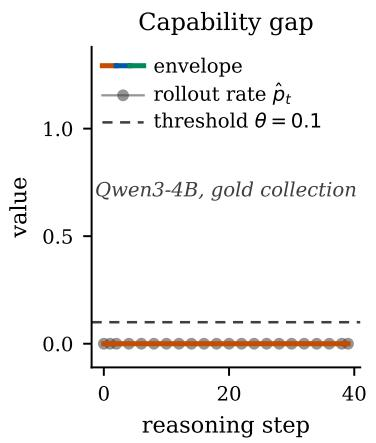

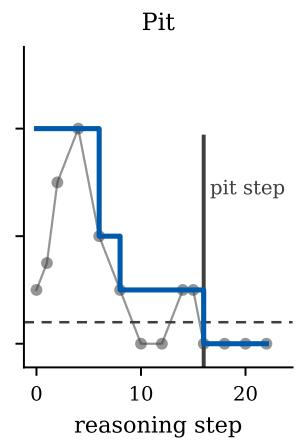

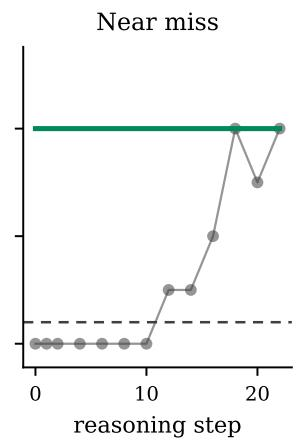  
Figure 1: The three failure types (Definition 1) on three Qwen3-4B traces from the gold collection. Each panel shows, for one trace, the rollout rates $\hat { p } _ { t }$ at the evaluated prefixes and the envelope, which is the best reachable value $V _ { t } ^ { * }$ at each step. For a capability gap, the envelope is at or below $\theta = 0 . 1$ from step 0. For a PIT, the envelope first falls to θ or below partway through the trace, at the PIT step. For a near miss, the envelope stays above θ at every step.

## 2 Failure types

We describe the two collections of rollouts that supply the labels, define the continuation value of a prefix and the best reachable value, use a threshold θ on the best reachable value to assign each incorrect trace a failure type and each PIT its PIT step, and state the evaluation protocol.

Collections of rollouts. Two collections of rollouts supply the labels. The broad collection labels every incorrect trace at both scales. It evaluates steps 0, 1 and 2 and then every second step of a trace with 8 rollouts, and evaluates some of these prefixes with 16 rollouts in a refinement stage (Appendix B). The gold collection applies the same scan to a set of 4B traces with 4 rollouts and refines with 8, half as many as the broad collection. The PIT steps of its 818 PITs are the reference PIT steps for localization. Each comparison is scored on one collection, because the two collections use different numbers of rollouts. Table 9 gives the size of each population and the comparisons that use each population.

Step-level value. We split each trace at blank lines and merge adjacent blocks until every step contains at least 400 tokens. For problem x, model π produces steps $\hat { y } _ { 1 } , \dots ,$ yˆT, and the prefix $s _ { t } = ( \mathbf { x } , \hat { y } _ { 1 : t } )$ contains the problem and the steps through t. The final label $Y \in \{ 0 , 1 \}$ records the correctness of the answer generated after the reasoning. Following prior work on mathematical reasoning [Setlur et al., 2024, Yu et al., 2024, Kazemnejad et al., 2025, Wang et al., 2024], we define the continuation value $V _ { t } ^ { \pi }$ of a prefix as the probability that a continuation sampled from it ends with a correct answer. We estimate it by the rollout rate $\hat { p } _ { t }$ , the fraction of K rollouts from $s _ { t }$ that end with a correct answer:

$$
V _ { t } ^ { \pi } = \mathbb { E } _ { \pi } { \left[ Y \mid s _ { t } \right] } , \qquad { \hat { p } } _ { t } = { \frac { 1 } { K } } \sum _ { j = 1 } ^ { K } Y ^ { ( j ) } .\tag{1}
$$

We call predicting the final label detection, estimating $V _ { t } ^ { \pi }$ value estimation, and locating the PIT step localization.

Pit-step definition. Process reward models trained on human step labels target local validity, the correctness of each step judged on its own [Lightman et al., 2024, Uesato et al., 2022]. Correct traces can contain locally flawed steps [Zheng et al., 2025], and in long traces that revise earlier work a local checker can flag a different step from the PIT step. We therefore define the PIT step from the continuation value in Equation 1.

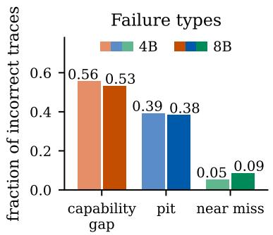

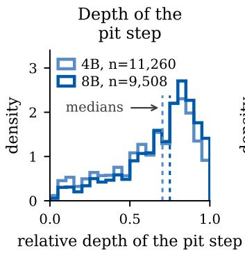

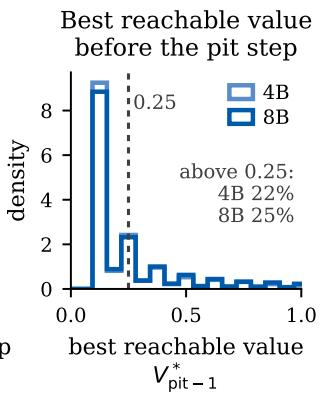  
Figure 2: Failure types and PIT steps in the broad collection at both model scales (Table 9). Left: Shares of capability gaps, PITs and near misses among incorrect traces. Center: The relative depth of the PIT step, the PIT step divided by the number of steps in the trace, with the medians marked. The late median depths of the PIT step motivate a baseline that predicts a late step. Right: The best reachable value immediately before the PIT step, $V _ { t _ { \mathrm { P I T } } - 1 } ^ { * }$ , with the share above 0.25 marked. $V _ { t _ { \mathrm { P I T } } - 1 } ^ { * }$ depends on later sampled states, so a probe that reads only the steps generated so far need not determine it (Section 4).

Definition 1 (Best reachable value and the PIT step). For an incorrect trace, the best reachable value at step t is $V _ { t } ^ { * } = \operatorname* { m a x } _ { t ^ { \prime } > t } V _ { t ^ { \prime } } ^ { \pi }$ , which is non-increasing in $t ,$ and the envelope of the trace is the sequence $V _ { 0 } ^ { * } , \ldots , V _ { T } ^ { * }$ . Step 0 denotes the problem before any reasoning, with $s _ { 0 } = ( \mathbf { x } )$ . Let $t _ { \mathrm { P I T } }$ be thefirst step at which the envelope is at or below the threshold θ:

$$
t _ { \mathrm { P I T } } = \operatorname* { m i n } \{ t \in \{ 0 , 1 , \ldots , T \} : V _ { t } ^ { * } \leq \theta \} , \qquad \theta = 0 . 1 .\tag{2}
$$

An incorrect trace is a capability gap $i f t _ { \mathrm { P I T } } = 0 ,$ a PIT $i f 1 \le t _ { \mathrm { P I T } } \le T$ , in which case $t _ { \mathrm { P I T } }$ is its PIT step, and a near miss ifthe envelope stays above θ at every step, written $t _ { \mathrm { P I T } } = \infty .$ . Failure types are assigned to incorrect traces only. The running maximum $V ^ { * }$ is defined along one sampled trace and differsfrom the optimal value ofa policy.

In the collections, the envelope is computed from the rollout rates $\hat { p } _ { t }$ at the evaluated prefixes, with the maximum taken over the evaluated prefixes at or after step t, so the PIT step is always the last step of an evaluated prefix. $V _ { t } ^ { * }$ gives the highest continuation value available at the current or any later step in the sampled trace. For example, a trace can establish a valid approach, introduce a sign error, and then develop the resulting wrong branch. Its envelope is high before the sign error and near zero afterward, so its PIT step is the step that introduces the sign error.

The threshold $\theta = 0 . 1$ exceeds $1 / 1 6 = 0 . 0 6 2 5$ , the rollout rate of a single success among 16 rollouts, the largest $K$ used to assign labels. At a prefix where the envelope is at or below θ, the rollout rate there and at every later evaluated prefix therefore reflects at most one success in 16 rollouts and no success in 8 or fewer. Self-Explore treats a prefix as unrecoverable only if no sampled continuation succeeds [Hwang et al., 2024]; the threshold relaxes this test so that a single success in 16 rollouts does not make a prefix recoverable.

Setlur et al. [2024] select the first step with the lowest estimated value in an incorrect trace, arg mint $\hat { V } _ { t }$ . With few rollouts per prefix, zero estimates are common and a zero estimate can be followed by a rate above θ, so the arg min step and the PIT step rarely coincide at either scale (Table 10); all PIT steps in this paper follow Definition 1.

A capability gap has no recoverable prefix; it is related to problems that remain unsolved across repeated attempts [Yue et al., 2025] and to difficulty regions in which accuracy is at most 10 percent and does not rise with more sampled reasoning paths [Chen et al., 2024]. A near miss remains recoverable at every evaluated prefix although the trace ends with a wrong answer; it is related to problems that are solved on another attempt [Wen et al., 2026]. A PIT is recoverable before its PIT step and unrecoverable from it onward (Figure 1). Near misses and PITs are the incorrect traces whose prefix at step 0 is recoverable; we call them recoverable traces.

Capability gaps are the most frequent failure type at both scales, followed by PITs and near misses, and fewer than half of the incorrect traces are recoverable (Figure 2). The shares of the failure types change by less than two percentage points for θ between 0.05 and 0.10, and raising θ to 0.15 moves some PITs to capability gaps (Table 1). The shares depend weakly on problem type (Appendix E). The best reachable value immediately before the PIT step is usually low but has a right-skewed tail: some PITs retain a best reachable value above 0.25 until their PIT step (Figure 2). PIT steps occur late in the trace, so localization is compared with the length rule, which predicts a late step (Section 4).

The behavioral taxonomies reviewed in Section 6 group near misses and PITs together, as failures that resampling fixes. Capability gaps, near misses and PITs are the evaluation targets of the remaining experiments.

Evaluation protocol. The two scales share the problem set, but the traces, and therefore the incorrect traces and their failure types, differ between scales, so no comparison between scales is paired. Each point estimate has a 95% bootstrap interval obtained by resampling problems. We report no detected difference when the interval contains zero. Two decision thresholds were fixed before the probes were evaluated. First, a probe counts as using information in the hidden states only if its AUROC exceeds that of the strongest tested baseline for its task that uses no hidden states by 0.05, the margin, with an interval of the difference that excludes zero. Second, the difference between PITs and near misses after controls in Section 3 counts as an effect only above 0.08, the minimum effect.

## 3 Confidence predictions by failure type

A probe trained on hidden states and final labels needs no rollouts at deployment time. We train the confidence probe, validate its detection AUROC and calibration, and then evaluate its predictions at the final step.

Probe inputs. The probes read the hidden states of the frozen model at the read site, on traces that are generated once and reused for every probe (Table 3). For each step, a probe reads the hidden states at the read site at one token position, which lies at or before the last token of the step. For about half of the traces, the position read for the final step lies in an earlier step (Appendix D). We selected the read site, layers {23, 24} at both scales, from the detection AUROC of a probe at each layer, using the final label only and no failure type or PIT step (Table 10; Appendix D).

Confidence probe. We call the probe trained on final labels the confidence probe. Every confidence score in this paper is an output of the confidence probe. Our confidence probe is a causal transformer encoder over the steps of a trace. At step t it reads the hidden states $h _ { 1 } , \ldots , h _ { t }$ at the read site and outputs the predicted correctness $c _ { t } = \sigma ( g ( h _ { 1 : t } ) ) = \widehat { \mathrm { P r } } ( Y = 1 \mid h _ { 1 : t } )$ . We broadcast the trace’s final label to every valid step and minimize per-step Bernoulli loss. The same final label supervises every prefix, so the objective estimates $\mathbb { E } [ { \dot { Y } } \mid h _ { 1 : t } ]$ [Yu et al., 2024], which equals $V _ { t } ^ { \pi }$ only when $h _ { 1 : t }$ retains all the information in the prefix about the final label (Proposition 1, Section 4). We calibrate held-out scores by temperature scaling [Guo et al., 2017]. Training and validation traces are split by problem, so no problem contributes traces to both; we call this the problem split. Appendix B gives the architecture and training details and reports a split by trace for comparison.

On held-out problems, the confidence probe predicts the final label and is calibrated before temperature scaling at both scales (Table 13). Trace length, answer form and problem difficulty also predict the final label, so a probe can score well without using information beyond these variables; format variables have been shown to account for probe accuracy on a different prediction target [Sahoo et al., 2026]. Table 13 therefore also reports the detection AUROC of the probe’s score after five such variables are regressed out, and a variant of the probe trained with the Brier loss, which gives simila detection AUROC and calibration.

Text baseline. Among the baselines that use no hidden states, the strongest we tested for detection is the text baseline, a gradient-boosted classifier that predicts the final label from eleven features of the trace text, such as the frequency of verification and backtracking sentences, the position of the final answer, and the number and length of sentences (Appendix B). A logistic regression on the same features has a lower detection AUROC, so a linear classifier understates the predictive power of these features (Table 13). The confidence probe reaches a detection AUROC of 0.81 at both scales, against 0.78 at 4B and 0.77 at 8B for the text baseline. The interval of the difference excludes zero and lies below the margin at both scales, so the confidence probe exceeds the text baseline without meeting the margin. Adding the confidence probe’s score to the text baseline’s features raises the detection AUROC, with an interval that excludes zero (Table 13).

Failure-type pattern. The confidence probe misses capability gaps and PITs more often than near misses at both scales (Figure 3A; Table 11); a trace is missed when its predicted correctness at the final step is at least the cutoff of 0.5. Overall calibration is compatible with this pattern by failure type, because incorrect traces are the minority of the calibration population.

Controlled comparison. We test the hypothesis that the best reachable value at step $0 , V _ { 0 } ^ { * }$ , trace length, answer position and problem difficulty account for the higher miss rate of PITs than of near misses. We first compare the two failure types within bins of $V _ { 0 } ^ { * }$ (Figure 3B), and then fit a logistic model of trace misses on the failure type and the four variables. The difference between PITs and near misses after controls is the average marginal effect of changing a trace’s failure type from near miss to PIT in this model (Appendix B). It exceeds the minimum effect at 8B, at +0.125 [+0.104, +0.143]. At 4B the difference is nonzero and below the minimum effect, at +0.037 [+0.012, +0.064] (Table 11). Capability gaps have $V _ { 0 } ^ { * } \leq \theta$ by definition and PITs have $V _ { 0 } ^ { * } > \theta ,$ , so the two failure types occupy disjoint ranges of $V _ { 0 } ^ { * }$ , and their miss rates are compared without controls.

Combined probe. We call the probe trained on rollout rates of incorrect traces the combined probe. It reads the confidence probe’s input, the hidden states at the read site, and keeps the final label as the target on correct traces. At the final step, the confidence probe gives PITs higher scores than near misses at both scales, and the combined probe gives PITs lower scores than near misses (Figure 3C); each probe is scored on its own held-out traces. The two probes differ in training labels, attention mask, step weighting and training schedule (Table 3; Appendix B), so this reversal cannot be attributed to the labels alone.

Failure-type classifier. The confidence probe’s miss rates for capability gaps and PITs differ by less than two percentage points at both scales (Table 11), so we test the separation of the two failure types from a completed incorrect trace. A transcoder is a fixed sparse approximation of an MLP sublayer [Dunefsky et al., 2024, Paulo et al., 2025]. The failure-type classifier differs from the confidence probe in input and in scoring problems instead of traces: it reads the transcoder activations at layers 19 to 24 of one completed incorrect trace per problem and separates problems labelled capability gap from problems labelled PIT (Appendix B.1). It exceeds the strongest tested baseline that uses no hidden states by 0.055 AUROC at 8B and 0.049 at 4B. The margin is applied to the mean over six repetitions of five-fold cross-validation on the same problems, so the 8B result meets the margin and the 4B result does not. At both scales the interval of the difference excludes zero and contains the margin in each of the six repetitions. The same classifier on the hidden states at these layers scores lower at both scales (Appendix B.1). Our intuition is that the width of the transcoder input, 40 to 64 times that of the hidden states, accounts for part of this gap; a random encoding of equal width was not tested. The failure-type classifier reads a completed trace and predicts a label of its problem, so it applies only after a trace has ended incorrectly. Appendix B.1 reports the baselines, the six repetitions, and the differences after removing problems whose labels may be defective.

Predicted correctness at the PIT step. At both scales, the confidence probe’s predicted correctness is lower at the PIT step than at the other steps of the trace. The position-matched steps of a trace are its other steps whose scaled position $t / ( L - 1 )$ , for step t of a trace with L steps, lies within 0.15 of the PIT step’s. Against these steps the decrease remains at 8B. At 4B, where the comparison uses about a tenth as many PITs, there is no detected difference (Table 10).

## 4 Locating the PIT step

We compare probes that locate the PIT step with the strongest tested baselines that use no hidden states.

Identifiability. A training signal identifies a quantity when the population optimum of its objective determines that quantity. The PIT step is defined through $V _ { t } ^ { * }$ , a maximum over current and later prefix values. At generation time a probe observes only the prefix, so the later values can remain random conditional on its input.

(C) pit vs near miss AUROC, by probe

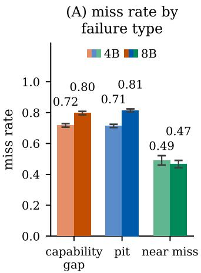

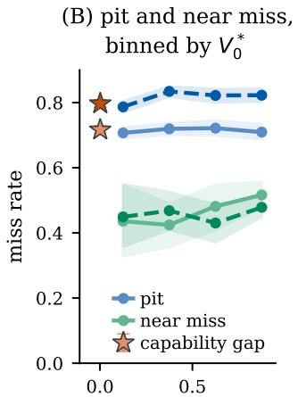

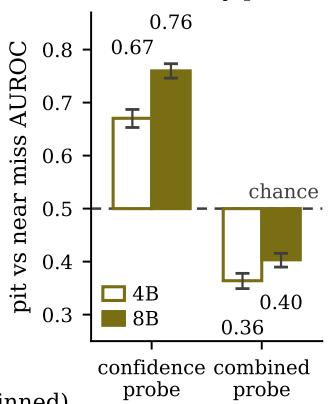  
best reachable value at step 0, $V _ { 0 } ^ { * }$ (binned)  
Figure 3: Confidence-probe predictions at the final step, on the broad collection at both model scales, with training and validation split by problem. (A) The miss rates for capability gaps, PITs, and near misses. (B) The miss rates of PITs and near misses within four bins of the best reachable value at step 0, $V _ { 0 } ^ { * }$ , at 4B (solid) and 8B (dashed); the star marks the miss rate of capability gaps at their mean $V _ { 0 } ^ { * }$ . The incorrect traces differ between scales, so no comparison between scales is paired. Bands and bars are 95% problem-clustered bootstrap intervals at both scales. (C) AUROC of PITs against near misses: the confidence probe ranks PITs above near misses and the combined probe ranks PITs below near misses, each by its final-step score on its own held-out traces. Table 11 gives the values, intervals and trace counts.

Proposition 1 (Population optimum of outcome supervision). Let N be the number ofvalid steps in a trace and assume $0 < \mathbb { E } _ { \pi } [ N ] < \infty$ . Under a strictly proper per-step Bernoulli objective with final label Y broadcast to every valid step, the population risk minimizer over measurable $[ 0 , 1 ]$ -valued functions ofthe hidden prefix is $g ^ { \star } ( \hat { h } _ { 1 : t } ) \doteq \hat { \mathbb { E } } _ { \mathbb { Q } } [ Y \mid h _ { 1 : t } ]$ . Here Q is the step-weighted training law, which counts each trace once per valid step. Moreover, $\mathsf { \bar { g } } ^ { \star } ( h _ { 1 : t } ) = \mathbb { E } _ { \mathbb { Q } } [ V _ { t } ^ { \pi } \mid h _ { 1 : t } ]$ , and it equals $V _ { t } ^ { \pi }$ under representation sufficiency.

Proposition 2 (Exact recovery from a prefix). Under the completed-incorrect-trace law, fix step t, condition on $T \geq t ,$ and let s denote the prefix. A measurable function $f$ with $f ( s _ { t } ) ^ { \vee } = \tilde { V _ { t } ^ { * } }$ almost surely exists $i f$ and only $i f \operatorname { V a r } ( V _ { t } ^ { * } \ | \ s _ { t } ) = 0$ almost surely. No function of $s _ { t }$ returns the realized $V _ { t } ^ { * }$ exactly where that variance is positive, regardless of training label or loss. t is a function of st if and only if its conditional law given $s _ { t }$ is a point mass. For $m _ { t } = V _ { t } ^ { * } - V _ { t } ^ { \pi }$ $\mathrm { \bar { V a r } } ( m _ { t } \mid \bar { s } _ { t } ) = \mathrm { V a r } ( V _ { t } ^ { * } \mid \bar { s _ { t } } )$

A hidden-state probe is no stronger than a probe of $s _ { t } ,$ since $h _ { 1 : t }$ is a deterministic function of $s _ { t }$ The claim concerns exact recovery of the realized quantity; a probe may still estimate its conditional mean. Proposition 2 applies only where $\mathrm { V a r } ( V _ { t } ^ { * } \textbf { | } s _ { t } ) > 0$ . We do not measure this variance, and $0 < V _ { t } ^ { \pi } < \bar { 1 }$ does not determine it, so Proposition 2 does not explain the localization results below. The values along a completed trace determine $t _ { \mathrm { P I T } }$ (Lemma 1); the probes below estimate those values or predict the PIT step directly. Both propositions are proved in Appendix C.

Length rule. The length rule predicts the PIT step $t = { \mathrm { r o u n d } } ( f \left( L - 1 \right) )$ ) of a trace with $L$ steps, with one parameter f. PIT steps occur late in a trace: the median relative depth of the PIT step is 0.70 at 4B and 0.75 at 8B (Figure 2). We score the probes and the length rule by Hit@±2, the fraction of PITs for which the predicted step lies within two steps of the PIT step. In each comparison, f is fitted to maximize $\mathrm { H i t } @ \pm 2$ on PITs of problems outside the evaluation set. The length rule is therefore refitted for each evaluation set, because its score depends on that set’s trace lengths and on the relative depths of its PIT steps (Appendix B).

Pointer probe. We call the probe trained to predict the PIT step the pointer probe. It differs from the confidence probe in input and target: it reads a completed trace, which Proposition 2, a statement about prefixes, does not cover, and is trained on the PIT step itself. The pointer probe is a transformer encoder with bidirectional attention over the steps of a completed trace. At each step it reads that step’s hidden states at the read site together with those of the final step, and it outputs a distribution over the steps of the trace, whose most probable step is its prediction. The distribution is trained on the PIT steps of the broad collection’s PITs. It is trained jointly on three further outputs, among them the failure type, which is trained on all incorrect traces with one of two weightings of its loss, inverse-frequency or uniform (Appendix B); only the step distribution is evaluated.

Paired localization results. At 4B, the pointer probe is trained on the broad-collection traces of 80% of the problems and evaluated on the 2,289 PITs of the remaining problems; the same problem split is used for every seed and both weightings of the failure-type loss. The pointer probe exceeds the length rule in 0 of 10 runs on identical held-out PITs (Table 12). Each comparison is paired on the same PITs, with intervals that resample problems. In a second comparison, on the reference PIT steps of the gold collection, a pointer probe trained without any problem that contributes a gold trace does not exceed the length rule in any of five seeds. The length rule in this comparison is fitted on broad-collection PITs that exclude the gold problems (Table 12).

An untrained distance score, the distance of each step’s stored hidden state from the pooled step states of correct traces of the same problem, has an AUROC for the PIT step near 0.5 at every layer tested on 76 PIT traces at 4B (Figure 4, right). At the read site it is below t/(L − 1) used as a score (Table 10).

The pointer probe and the length rule disagree on about a third of the held-out PITs in every run, about equally in each direction (Table 10). Averaging the pointer probes across seeds, separately for each weighting of the failure-type loss, gives the ensemble. With inverse-frequency weights, the ensemble exceeds the length rule with an interval of the difference that excludes zero; with uniform weights, the interval of the difference contains zero (Table 12).

Value probe. We call the probe trained on rollout rates of recoverable traces the value probe; it has the combined probe’s design, restricted to recoverable traces (Appendix B). Its predicted PIT step is the PIT step of Definition 1 computed from its predicted values at the evaluated prefixes in place of the rollout rates. The value probe’s prediction at the last evaluated prefix separates held-out near misses from PITs with an AUROC of 0.91 at both scales (Table 10). The comparison of near misses with PITs was not run for a baseline that uses no hidden states. By Definition 1, a near miss has a rollout rate above θ at its last evaluated prefix and a PIT does not, so the value probe’s training target itself separates the two failure types and this AUROC measures the probe’s fit to that target. The value probe’s per-step mean absolute error exceeds the error from predicting zero in every seed, so rollout supervision does not yield accurate per-step values in this experiment.

Localization at 8B. At 8B, where no gold collection exists, the value probe is the only probe tested for localization. In each seed it is scored on the PIT steps of the broad collection for that seed’s held-out problems, on the same PITs as the length rule. The comparison is through the five seed means, without a paired interval, and the value probe is below the length rule in every seed with both input sets (Table 10).

Final-label comparison. We compare the value probe with the final-label probe, a transformer encoder over the steps trained on final labels with a causal attention mask, a value output and a confidence output; its predicted PIT step is the step with the largest drop in its value output from the preceding step (Appendix B). The two probes differ in training label, attention mask, output head and step rule, so the comparison changes the label together with these design choices. Each probe is run with five seeds and two input sets, hidden states alone and hidden states with five next-token statistics, on the reference PIT steps. The value probe is trained on broad-collection traces, which include most gold PIT traces, so we evaluate each seed on the reference PIT steps of the problems held out from the value probe’s training. The final-label probe’s training traces are not recorded, so some of these PITs may be among them. On these PIT steps, both probes are below the length rule in every seed with both input sets (Table 12). The value probe’s advantage over the final-label probe has an interval that excludes zero in one of the five seeds with hidden states alone and in none with hidden states with the next-token statistics (Table 10). The value probe therefore gives no consistent improvement over the final-label probe on these PIT steps, and neither probe exceeds the length rule on these PIT steps or in a pooled evaluation over all reference PIT steps (Appendix B).

Rollout search. The PIT step can also be located with rollouts instead of a probe [Luo et al., 2024]. We replay such a search offline on the stored rollout rates of the gold collection: it reads every second step of a trace and then bisects the interval that contains the first prefix at which the envelope is at or below θ. The search finds the reference PIT step within two steps for 80.4% of the gold PITs while reading 6.6 evaluated prefixes per trace (Table 10). The search reads the rollout rates that define the reference PIT steps, so its agreement with them is a different quantity from a probe’s Hit@±2 and is reported separately.

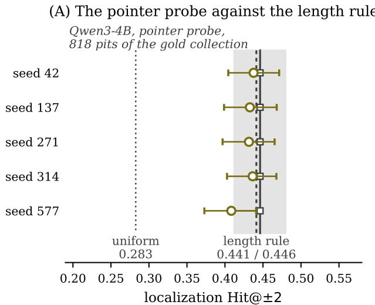

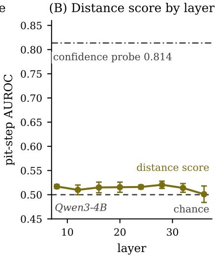  
Figure 4: Localization at 4B. Left: Hit@±2 on the reference PIT steps for the five pointer probes trained without any problem that contributes a gold trace. Vertical lines mark the uniform-step baseline (dotted, no interval) and two fits of the length rule: the fit on broad-collection PITs outside the gold problems (solid, interval shaded), with which each pointer probe is paired, and the fit by five-fold cross-validation within the gold collection (dashed). Bars and the shaded band are 95% bootstrap intervals. Right: AUROC of the distance score for the PIT step against the other steps of the trace, by layer, on 76 PIT traces. Points are midpoints and bars the range over four distance measures, not confidence intervals. The horizontal line is the detection AUROC of the confidence probe, a different task, shown for reference.

## 5 Discussion and limitations

The confidence probe misses capability gaps and PITs more often than near misses at both scales (Figure 3). At detection it exceeds the strongest baseline we tested that uses no hidden states, but it does not meet the margin (Section 3). The text baseline’s miss rates by failure type were not measured, so the pattern is established for the confidence probe only.

Either ordering of PITs and near misses can be read from the hidden states that the confidence probe reads. The combined probe reads the same hidden states and gives PITs lower final-step scores than near misses at both scales, the opposite of the confidence probe (Figure 3C). We think the training target itself produces the combined probe’s order: by Definition 1 a near miss keeps a rollout rate above θ at its last evaluated prefix and a PIT does not, so a probe fitted to these rates is trained toward ranking near misses above PITs. The confidence probe and the combined probe differ in more than their labels, and we did not isolate the contribution of the labels (Section 3).

At 4B, no single probe exceeds the length rule at locating the PIT step on held-out PITs, and at 8B the one tested probe, the value probe, is below the length rule in every seed (Section 4). The hidden states may still carry the PIT step; the tested probes do not recover it. Two limits bear directly on the localization result. First, each step’s hidden states were read at a position at or before the step’s last token, and for about half of the traces the position read for the final step lies in an earlier step (Section 3). No result was re-scored with corrected positions, so the localization result holds for these stored hidden states. Second, the PIT steps are assigned from a small number of rollouts at each evaluated step, and the two collections assign different failure types to some traces they share (Appendix B). The highest score that any predictor could reach against these labels is therefore unknown. We think the second limit dominates: the ensemble exceeds the length rule under one weighting, so the pointer probes read some information beyond trace length, and PIT steps assigned from 4 to 16 rollouts at every second step may be too noisy for that information to raise Hit@±2.

All results in this paper come from one model family, Qwen3 in thinking mode at two scales, on hard mathematics problems. The failure types depend on the rollout protocol, including the number of rollouts, the threshold and the token limits (Appendix B). Under this protocol, a capability gap records only that no sampled continuation reached a correct answer. A rollout counts as successful when its final answer is correct, so a continuation that reaches the answer through an invalid argument counts as a success. Such cases are reported for base models [Wen et al., 2026]. The final labels contain grading errors, and correcting them leaves capability gaps and PITs missed more often than near misses at both scales (Appendix B).

## 6 Related work

Correctness probes. Probes on hidden states predict the truth of a statement or an answer [Azaria and Mitchell, 2023, Marks and Tegmark, 2024, Kadavath et al., 2022, Orgad et al., 2025], and on reasoning models the correctness of an intermediate answer [Zhang et al., 2025a]. Orgad et al. [2025] also define error types by resampling the answers to a question and show that probes predict them; their types are defined per question from sampled final answers, and ours per trace from rollouts at each step. A related study trains correctness probes on instruction-tuned models and one distilled reasoning model [Yuan et al., 2026]; the signal is decodable in all of these models. Steering along the probe direction in two instruction-tuned models does not raise accuracy consistently, which the authors read as a diagnostic signal. The internal signal is useful because verbal reports can differ from the model’s computation [Turpin et al., 2023, Zhao et al., 2026a]. This paper measures the failure types that a correctness probe distinguishes.

Failure taxonomies. Uncertainty work commonly separates epistemic from aleatoric uncertainty [Ahdritz et al., 2024, Abbasi Yadkori et al., 2024] or data from model uncertainty [Ren et al., 2026], and a recent account separates input ambiguity, knowledge gaps and decoding randomness [Taparia et al., 2026]; decoding randomness is closest in definition to our near misses. Behavioral work separates failures that resampling fixes from failures it does not [Islah et al., 2026], and a similar division is hypothesized for self-correction [Li, 2026]. Under our taxonomy, the failures that resampling fixes combine near misses with PITs. Concurrent work predicts, from the output log-probabilities of failed rollouts, which intervention rescues a problem [Islah et al., 2026].

Pit-step targets. Process benchmarks label the first locally invalid step [Zheng et al., 2025] or every erroneous section of a long trace [He et al., 2025], which differs from the PIT step, and annotators can disagree about which step is wrong [Jacovi et al., 2024]. State geometry can identify a first local error [Alvarez and Baheri, 2026], and attribution graphs can recover local validity [Zhao et al., 2026b]. Both targets differ from the PIT step, which depends on the model’s continuations from each prefix, so an oracle for local validity need not locate it. Cui et al. [2026] and Yuan et al. [2025] infer step credit from final outcomes, which is a different target from the best reachable value (Proposition 1). Merrill and Srivastava [2026] locate commitment junctures by counterfactual resampling in strategicdeception settings. Among the definitions reviewed here, that counterfactual procedure is closest to the definition used in this study. Appendix A compares each claim with the nearest prior result.

## 7 Conclusion

We assigned each incorrect trace of a reasoning model one of three failure types from rollouts and tested the recovery of these types and of the PIT step from the model’s hidden states. The confidence probe predicts the final label, and at the cutoff it misses capability gaps and PITs more often than near misses. The combined probe ranks PITs and near misses in the opposite order to the confidence probe, so an ordering of failure types read from a probe depends on the probe’s training design. The failure-type classifier, which reads transcoder activations of a completed incorrect trace, separates capability gaps from PITs. It meets the margin at 8B and not at 4B. At 4B no single probe exceeds the length rule at locating the PIT step, and the ensemble exceeds it under one of the two weightings of its failure-type loss. At 8B only the value probe was tested, and it is below the length rule in every seed. The localization results concern the tested probes and read site; a probe that locates the PIT step from the hidden states remains possible.

## Acknowledgments and Disclosure of Funding

This work was funded in part by the EU Horizon project ELIAS (#101120237). Views and opinions expressed are those of the author(s) only and do not necessarily reflect those of the European Union or The European Research Executive Agency. This publication has partly emanated from research conducted with the financial support of Taighde Éireann – Research Ireland under Frontiers for the Future grant number 21/FFP-A/8957 and grant number 18/CRT/6223. For the purpose of Open Access, the author has applied a CC BY public copyright licence to any Author Accepted Manuscript version arising from this submission. This work was partially supported by the Knut and Alice Wallenberg Foundation. Experiments were run on the Cognitive Compute Cluster (CCC) at IBM Research.

## References

Yasin Abbasi Yadkori, Ilja Kuzborskij, András György, and Csaba Szepesvári. To believe or not to believe your LLM: Iterative prompting for estimating epistemic uncertainty. In Advances in Neural Information Processing Systems (NeurIPS), pages 58077– 58117, 2024. URL https://proceedings.neurips.cc/paper\_files/paper/2024/hash/ 6aebba00fff5b6de7b488e496f80edd7-Abstract-Conference.html.

Gustaf Ahdritz, Tian Qin, Nikhil Vyas, Boaz Barak, and Benjamin L. Edelman. Distinguishing the knowable from the unknowable with language models. In International Conference on Machine Learning (ICML), pages 503–549, 2024. URL https://proceedings.mlr.press/ v235/ahdritz24a.html.

Tyler Alvarez and Ali Baheri. Where does reasoning break? step-level hallucination detection via hidden-state transport geometry, 2026. URL https://arxiv.org/abs/2605.13772.

Amos Azaria and Tom Mitchell. The internal state of an LLM knows when it’s lying. In Findings of the Association for Computational Linguistics: EMNLP, pages 967–976, 2023. doi: 10.18653/v1/ 2023.findings-emnlp.68. URL https://arxiv.org/abs/2304.13734.

Collin Burns, Haotian Ye, Dan Klein, and Jacob Steinhardt. Discovering latent knowledge in language models without supervision. In International Conference on Learning Representations (ICLR), 2023. URL https://arxiv.org/abs/2212.03827.

Qiguang Chen, Libo Qin, Jiaqi Wang, Jinxuan Zhou, and Wanxiang Che. Unlocking the capabilities of thought: A reasoning boundary framework to quantify and optimize chain-of-thought. In Advances in Neural Information Processing Systems (NeurIPS), pages 54872–54904, 2024. URL https://arxiv.org/abs/2410.05695. Oral.

Ganqu Cui, Lifan Yuan, Zefan Wang, Hanbin Wang, Yuchen Zhang, Jiacheng Chen, Wendi Li, Bingxiang He, Yuchen Fan, Tianyu Yu, Qixin Xu, Weize Chen, Jiarui Yuan, Huayu Chen, Kaiyan Zhang, Xingtai Lv, Shuo Wang, Yuan Yao, Xu Han, Hao Peng, Yu Cheng, Zhiyuan Liu, Maosong Sun, Bowen Zhou, and Ning Ding. Process reinforcement through implicit rewards. Transactions on Machine Learning Research (TMLR), 2026. URL https://openreview.net/forum?id= 9SkkifLopZ.

DeepSeek-AI. DeepSeek-R1 incentivizes reasoning in LLMs through reinforcement learning. Nature, 645(8081):633–638, 2025. doi: 10.1038/s41586-025-09422-z. URL https://arxiv.org/abs/ 2501.12948.

Jacob Dunefsky, Philippe Chlenski, and Neel Nanda. Transcoders find interpretable LLM feature circuits. In Advances in Neural Information Processing Systems (NeurIPS), pages 24375–24410, 2024. URL https://openreview.net/forum?id=J6zHcScAo0.

Kawin Ethayarajh, Yejin Choi, and Swabha Swayamdipta. Understanding dataset difficulty with Vusable information. In International Conference on Machine Learning (ICML), pages 5988–6008, 2022. URL https://proceedings.mlr.press/v162/ethayarajh22a.html.

Jack Gallifant, Shan Chen, Kuleen Sasse, Hugo Aerts, Thomas Hartvigsen, and Danielle Bitterman. Sparse autoencoder features for classifications and transferability. In Proceedings of the 2025 Conference on Empirical Methods in Natural Language Processing, pages 29939–29963, 2025. doi: 10.18653/v1/2025.emnlp-main.1521. URL https://aclanthology.org/2025.emnlp-main. 1521/.

Tilmann Gneiting and Adrian E. Raftery. Strictly proper scoring rules, prediction, and estimation. Journal of the American Statistical Association, 102(477):359–378, 2007. doi: 10.1198/016214506000001437.

Chuan Guo, Geoff Pleiss, Yu Sun, and Kilian Q. Weinberger. On calibration of modern neural networks. In International Conference on Machine Learning (ICML), volume 70, pages 1321– 1330, 2017. URL https://proceedings.mlr.press/v70/guo17a.html.

Yancheng He, Shilong Li, Jiaheng Liu, Weixun Wang, Xingyuan Bu, Ge Zhang, Z.Y. Peng, Zhaoxiang Zhang, Zhicheng Zheng, Wenbo Su, and Bo Zheng. Can large language models detect errors in long chain-of-thought reasoning? In Proceedings of the 63rd Annual Meeting of the Association for Computational Linguistics (Volume 1: Long Papers), pages 18468–18489, 2025. doi: 10. 18653/v1/2025.acl-long.905. URL https://aclanthology.org/2025.acl-long.905/.

Zhiwei He, Tian Liang, Jiahao Xu, Qiuzhi Liu, Xingyu Chen, Yue Wang, Linfeng Song, Dian Yu, Zhenwen Liang, Wenxuan Wang, Zhuosheng Zhang, Rui Wang, Zhaopeng Tu, Haitao Mi, and Dong Yu. DeepMath-103K: A large-scale, challenging, decontaminated, and verifiable mathematical dataset for advancing reasoning. In International Conference on Learning Representations (ICLR), 2026. URL https://arxiv.org/abs/2504.11456.

Dan Hendrycks, Collin Burns, Saurav Kadavath, Akul Arora, Steven Basart, Eric Tang, Dawn Song, and Jacob Steinhardt. Measuring mathematical problem solving with the MATH dataset. In Advances in Neural Information Processing Systems (NeurIPS) Datasets and Benchmarks Track, 2021. URL https://arxiv.org/abs/2103.03874.

John Hewitt, Kawin Ethayarajh, Percy Liang, and Christopher D. Manning. Conditional probing: measuring usable information beyond a baseline. In Conference on Empirical Methods in Natural Language Processing (EMNLP), pages 1626–1639, 2021. doi: 10.18653/v1/2021.emnlp-main.122. URL https://aclanthology.org/2021.emnlp-main.122/.

Hyeonbin Hwang, Doyoung Kim, Seungone Kim, Seonghyeon Ye, and Minjoon Seo. Self-Explore: Enhancing mathematical reasoning in language models with fine-grained rewards. In Findings of EMNLP, pages 1444–1466, 2024. doi: 10.18653/v1/2024.findings-emnlp.78. URL https: //aclanthology.org/2024.findings-emnlp.78/.

Nizar Islah, Istabrak Abbes, Irina Rish, Sarath Chandar, and Eilif B. Muller. Failed reasoning traces tell you what is fixable (but not by reading them), 2026. URL https://arxiv.org/abs/2606. 05145.

Alon Jacovi, Yonatan Bitton, Bernd Bohnet, Jonathan Herzig, Or Honovich, Michael Tseng, Michael Collins, Roee Aharoni, and Mor Geva. A chain-of-thought is as strong as its weakest link: A benchmark for verifiers of reasoning chains. In Annual Meeting of the Association for Computational Linguistics (ACL), pages 4615–4634, 2024. doi: 10.18653/v1/2024.acl-long.254. URL https://aclanthology.org/2024.acl-long.254/.

Saurav Kadavath, Tom Conerly, Amanda Askell, Tom Henighan, Dawn Drain, Ethan Perez, et al. Language models (mostly) know what they know. arXiv preprint arXiv:2207.05221, 2022. URL https://arxiv.org/abs/2207.05221.

Subhash Kantamneni, Joshua Engels, Senthooran Rajamanoharan, Max Tegmark, and Neel Nanda. Are sparse autoencoders useful? a case study in sparse probing. In International Conference on Machine Learning (ICML), pages 29018–29049, 2025. URL https://openreview.net/ forum?id=rNfzT8YkgO.

Amirhossein Kazemnejad, Milad Aghajohari, Eva Portelance, Alessandro Sordoni, Siva Reddy, Aaron Courville, and Nicolas Le Roux. VinePPO: Refining credit assignment in RL training of LLMs. In International Conference on Machine Learning (ICML), pages 29557–29590, 2025. URL https://proceedings.mlr.press/v267/kazemnejad25a.html.

Yin Li. Decomposing LLM self-correction: The accuracy-correction paradox and error depth hypothesis, 2026. URL https://arxiv.org/abs/2601.00828.

Hunter Lightman, Vineet Kosaraju, Yuri Burda, Harrison Edwards, Bowen Baker, Teddy Lee, Jan Leike, John Schulman, Ilya Sutskever, and Karl Cobbe. Let’s verify step by step. In International Conference on Learning Representations (ICLR), 2024. URL https://openreview.net/ forum?id=v8L0pN6EOi.

Jianqiao Lu, Zhiyang Dou, Hongru Wang, Zeyu Cao, Jianbo Dai, Yingjia Wan, Yunlong Feng, and Zhijiang Guo. AutoPSV: Automated process-supervised verifier. In Advances in Neural Information Processing Systems (NeurIPS), pages 79935– 79962, 2024. URL https://proceedings.neurips.cc/paper\_files/paper/2024/hash/ 9246aa822579d9b29a140ecdac36ad60-Abstract-Conference.html.

Liangchen Luo, Yinxiao Liu, Rosanne Liu, Samrat Phatale, Meiqi Guo, Harsh Lara, Yunxuan Li, Lei Shu, Yun Zhu, Lei Meng, Jiao Sun, and Abhinav Rastogi. Improve mathematical reasoning in language models by automated process supervision. arXiv preprint arXiv:2406.06592, 2024. URL https://arxiv.org/abs/2406.06592.

George Ma, Zhongyuan Liang, Irene Y. Chen, and Somayeh Sojoudi. Do sparse autoencoders identify reasoning features in language models? In International Conference on Machine Learning (ICML), 2026. URL https://arxiv.org/abs/2601.05679.

Samuel Marks and Max Tegmark. The geometry of truth: Emergent linear structure in large language model representations of true/false datasets. In Conference on Language Modeling (COLM), 2024. URL https://arxiv.org/abs/2310.06824.

Scott Merrill and Shashank Srivastava. The point of no return: Counterfactual localization of deceptive commitment in language-model reasoning, 2026. URL https://arxiv.org/abs/2605.17113.

Mohammed Suhail B Nadaf. Steerable but not decodable: Function vectors operate beyond the logit lens. In ICML Workshop on Mechanistic Interpretability, 2026. URL https://arxiv.org/abs/ 2604.02608.

Jingwei Ni, Ekaterina Fadeeva, Tianyi Wu, Mubashara Akhtar, Jiaheng Zhang, Elliott Ash, Markus Leippold, Timothy Baldwin, See-Kiong Ng, Artem Shelmanov, and Mrinmaya Sachan. ReProbe: Efficient test-time scaling of multi-step reasoning by probing internal states of large language models. In Annual Meeting of the Association for Computational Linguistics (ACL), pages 11667–11689, 2026. doi: 10.18653/v1/2026.acl-long.536. URL https://arxiv.org/abs/ 2511.06209.

Charles O’Neill, Sviatoslav Chalnev, Rune Chi Zhao, Max Kirkby, and Mudith Jayasekara. A single direction of truth: An observer model’s linear residual probe exposes and steers contextual hallucinations. In ICML Workshop on Actionable Interpretability, 2025. URL https://arxiv. org/abs/2507.23221.

Hadas Orgad, Michael Toker, Zorik Gekhman, Roi Reichart, Idan Szpektor, Hadas Kotek, and Yonatan Belinkov. LLMs know more than they show: On the intrinsic representation of LLM hallucinations. In International Conference on Learning Representations (ICLR), 2025. URL https://arxiv.org/abs/2410.02707.

Gonçalo Paulo, Stepan Shabalin, and Nora Belrose. Transcoders beat sparse autoencoders for interpretability. arXiv preprint arXiv:2501.18823, 2025. URL https://arxiv.org/abs/2501. 18823.

Tiago Pimentel, Josef Valvoda, Rowan Hall Maudslay, Ran Zmigrod, Adina Williams, and Ryan Cotterell. Information-theoretic probing for linguistic structure. In Annual Meeting ofthe Association for Computational Linguistics (ACL), pages 4609–4622, 2020. doi: 10.18653/v1/2020.acl-main. 420. URL https://aclanthology.org/2020.acl-main.420/.

Jingyi Ren, Ante Wang, Yunghwei Lai, Xiaolong Wang, Linlu Gong, Weitao Li, Weizhi Ma, and Yang Liu. Beyond “I don’t know”: Evaluating LLM self-awareness in discriminating data and model uncertainty. In Annual Meeting ofthe Associationfor Computational Linguistics (ACL),

pages 11911–11929, 2026. doi: 10.18653/v1/2026.acl-long.547. URL https://arxiv.org/ abs/2604.17293.

Subramanyam Sahoo, Vinija Jain, Aman Chadha, and Divya Chaudhary. Linear probes detect task format, not reasoning mode in language model hidden states. In Proceedings of the 6th Workshop on Trustworthy NLP (TrustNLP 2026), pages 227–239, San Diego, California, July 2026. Association for Computational Linguistics. doi: 10.18653/v1/2026.trustnlp-main.12. URL https://aclanthology.org/2026.trustnlp-main.12/.

Amrith Setlur, Saurabh Garg, Xinyang Geng, Naman Garg, Virginia Smith, and Aviral Kumar. RL on incorrect synthetic data scales the efficiency of LLM math reasoning by eight-fold. In Advances in Neural Information Processing Systems (NeurIPS), pages 43000–43031, 2024. URL https://openreview.net/forum?id=9m87e9Keq1.

Aditya Taparia, Ransalu Senanayake, Kowshik Thopalli, and Vivek Narayanaswamy. The anatomy of uncertainty in LLMs, 2026. URL https://arxiv.org/abs/2603.24967. ICBINB Workshop @ ICLR 2026 (non-archival).

Miles Turpin, Julian Michael, Ethan Perez, and Samuel Bowman. Language models don’t always say what they think: Unfaithful explanations in chain-of-thought prompting. In Advances in Neural Information Processing Systems (NeurIPS), pages 74952– 74965, 2023. URL https://proceedings.neurips.cc/paper\_files/paper/2023/hash/ ed3fea9033a80fea1376299fa7863f4a-Abstract-Conference.html.

Jonathan Uesato, Nate Kushman, Ramana Kumar, Francis Song, Noah Siegel, Lisa Wang, Antonia Creswell, Geoffrey Irving, and Irina Higgins. Solving math word problems with process-based and outcome-based feedback. In NeurIPS Workshop on Mathematical Reasoning and AI (MATH-AI), 2022. URL https://arxiv.org/abs/2211.14275.

Peiyi Wang, Lei Li, Zhihong Shao, Runxin Xu, Damai Dai, Yifei Li, Deli Chen, Yu Wu, and Zhifang Sui. Math-Shepherd: Verify and reinforce LLMs step-by-step without human annotations. In Annual Meeting ofthe Associationfor Computational Linguistics (ACL), pages 9426–9439, 2024. doi: 10.18653/v1/2024.acl-long.510. URL https://aclanthology.org/2024.acl-long. 510/.

Xumeng Wen, Zihan Liu, Shun Zheng, Shengyu Ye, Zhirong Wu, Yang Wang, Zhijian Xu, Xiao Liang, Junjie Li, Ziming Miao, Jiang Bian, and Mao Yang. Reinforcement learning with verifiable rewards implicitly incentivizes correct reasoning in base LLMs. In International Conference on Learning Representations (ICLR), 2026. URL https://iclr.cc/virtual/2026/poster/10007896.

David Williams. Probability with Martingales. Cambridge Mathematical Textbooks. Cambridge University Press, Cambridge, 1991. doi: 10.1017/CBO9780511813658.

Yilun Xu, Shengjia Zhao, Jiaming Song, Russell Stewart, and Stefano Ermon. A theory of usable information under computational constraints. In International Conference on Learning Representations (ICLR), 2020. URL https://openreview.net/forum?id=r1eBeyHFDH.

An Yang et al. Qwen3 technical report. arXiv preprint arXiv:2505.09388, 2025. URL https: //arxiv.org/abs/2505.09388.

Fei Yu, Anningzhe Gao, and Benyou Wang. OVM, outcome-supervised value models for planning in mathematical reasoning. In Findings of the Association for Computational Linguistics: NAACL 2024, pages 858–875, 2024. doi: 10.18653/v1/2024.findings-naacl.55. URL https://aclanthology.org/2024.findings-naacl.55/.

Aojie Yuan, Zhiyuan Julian Su, Haiyue Zhang, Yi Nian, and Yue Zhao. Hidden error awareness in chain-of-thought reasoning: The signal is diagnostic, not causal. In ICML Workshop on Mechanistic Interpretability, 2026. URL https://arxiv.org/abs/2605.09502.

Lifan Yuan, Wendi Li, Huayu Chen, Ganqu Cui, Ning Ding, Kaiyan Zhang, Bowen Zhou, Zhiyuan Liu, and Hao Peng. Free process rewards without process labels. In International Conference on Machine Learning (ICML), pages 73511–73525, 2025. URL https://proceedings.mlr. press/v267/yuan25c.html.

Yang Yue, Zhiqi Chen, Rui Lu, Andrew Zhao, Zhaokai Wang, Yang Yue, Shiji Song, and Gao Huang. Does reinforcement learning really incentivize reasoning capacity in LLMs beyond the base model? In Advances in Neural Information Processing Systems (NeurIPS), pages 57654–57689, 2025. URL https://openreview.net/forum?id=4OsgYD7em5. Oral.

Anqi Zhang, Yulin Chen, Jane Pan, Chen Zhao, Aurojit Panda, Jinyang Li, and He He. Reasoning models know when they’re right: Probing hidden states for self-verification. In Conference on Language Modeling (COLM), 2025a. URL https://arxiv.org/abs/2504.05419.

Qingjie Zhang, Yujia Fu, Yang Wang, Liu Yan, Tao Wei, Ke Xu, Minlie Huang, and Han Qiu. Stop before you fail: Operational capability boundaries for mitigating unproductive reasoning in large reasoning models, 2025b. URL https://arxiv.org/abs/2509.24711.

Tianyi Zhao, Yinhan He, Wendy Zheng, Yujie Zhang, and Chen Chen. Wired for overconfidence: A mechanistic perspective on inflated verbalized confidence in LLMs. In Conference on Language Modeling (COLM), 2026a. URL https://arxiv.org/abs/2604.01457.

Zheng Zhao, Yeskendir Koishekenov, Xianjun Yang, Naila Murray, and Nicola Cancedda. Verifying chain-of-thought reasoning via its computational graph. In International Conference on Learning Representations (ICLR), 2026b. URL https://openreview.net/forum?id=CxiNICq0Rr. Oral.

Chujie Zheng, Zhenru Zhang, Beichen Zhang, Runji Lin, Keming Lu, Bowen Yu, Dayiheng Liu, Jingren Zhou, and Junyang Lin. ProcessBench: Identifying process errors in mathematical reasoning. In Annual Meeting of the Association for Computational Linguistics (ACL), pages 1009–1024, 2025. doi: 10.18653/v1/2025.acl-long.50. URL https://aclanthology.org/ 2025.acl-long.50/.

## A Claims, evidence, and prior work

Table 1 states each claim at the scope supported by the experiments, reports the decisive measurements, records failed and inconclusive comparisons, and identifies the nearest prior work. The detailed tables provide sample sizes, seed axes, and confidence intervals. A probe counts as using information in the hidden states only when it meets the margin defined in Section 2. Differences below the margin are recorded as failures even when their intervals exclude zero.

## B Experimental protocols

Problem set and sampling. The two scales share one problem set of 35,854 problems. Of these problems, 32,031 come from DeepMath-103k at difficulty at least 7, and 3,823 come from levels 4 and 5 of the training split of Hendrycks MATH. Each problem has four sampled traces, except 146 problems with eight, which gives 144,000 traces at each scale. The traces were sampled at temperature 0.7 with a 16k-token budget.

No problem in the problem set matches a MATH-500, MATH-Perturb or AIME 2024–2025 problem after whitespace and case normalization (0 of 35,854 problems). The exact-match check does not detect paraphrased or reformatted duplicates.

Monte Carlo collections. The two collections use different numbers of rollouts, and every result identifies its source collection (Table 2). The broad collection labels all incorrect traces and supplies the failure-type shares in Section 2. In a scan, it evaluates steps 0, 1 and 2 and then every second step with 8 rollouts, and in a refinement it re-evaluates some of these prefixes with 16 rollouts. More than 80% of its evaluated prefixes have 8 rollouts, and more than 70% of its PIT steps were evaluated with 16 (Table 2). About half of the 16-rollout prefixes of PITs lie within two evaluated steps of the PIT step. The collection evaluates about 60% of the steps of a trace.

Each set of K rollouts contains one greedy rollout and K − 1 independent samples at temperature 0.7, so its success count is not binomial. Writing $G _ { t } \in \{ 0 , 1 \}$ for the greedy result and $p _ { t }$ for the temperature-0.7 success probability, the count is $G _ { t } + X _ { t } ,$ where $X _ { t } \sim \operatorname { B i n } ( K - 1 , p _ { t } )$ . Thus $\mathbb { E } [ \hat { p _ { t } } \mid s _ { t } ] = [ G _ { t } + ( K \stackrel { \cdot } { - } 1 ) p _ { t } ] / \dot { K }$ , a K-dependent protocol mean rather than $p _ { t }$ . Rollout rates at $K = 8$ and $K = 1 6$ therefore differ in mixture weight as well as sampling variance under the recorded protocol. Conditional on the greedy outcome, the remaining $K - 1$ samples give rate standard deviations of 0.099 at $K { = } 8$ and 0.073 at $K { = } 1 6$ near p=0.1. A depth sweep reports refinement-depth agreement of 0.754 at K=16 against 0.638 at $K { = } 8$ . The two agreement values are point estimates against a deeper reference, with no interval.

The envelope is computed over the prefixes evaluated by a collection (Section 2). Rollouts continue from the final recorded prefix, so the value of that prefix is estimated from rollouts and is not set equal to the final label.

The rollout search, replayed offline on the gold collection’s stored rollout rates, reads every second step and then bisects the interval that contains the first prefix at which the envelope is at or below θ. No 8B replay exists.

Each rollout is capped at 4,096 tokens, a cap read from the stored rollouts at both scales. The temperature of 0.7 is taken from our experiment records. The temperature, nucleus-sampling parameter, random seed and stop strings cannot be recovered from the stored rollouts, and the script that generated the rollouts was not retained.

The gold collection contains 5,380 Qwen3-4B traces and supplies 818 PITs, whose PIT steps are the reference PIT steps. It scans with 4 rollouts and refines with 8 (Table 2), so no step in it receives the 16 rollouts of the broad collection’s refinement. At K=4 and $K { = } 8 ,$ , a rollout rate at or below θ means zero successes.

The gold collection overlaps the broad collection. Of its 5,380 traces, 2,760 are also broad-collection traces, including 815 of the 818 gold PIT traces. For 84 of these 815 traces, the broad collection assigns a different failure type: 76 capability gaps and 8 near misses.

This overlap restricts the traces that can be evaluated at 4B. For the pointer probe evaluated on the reference PIT steps, we exclude every trace from every problem that contributes a gold PIT. The value probe is trained on broad-collection traces, which include 815 of the gold PIT traces. For a given seed, 528 to 565 of the gold PITs are therefore training traces of the value probe. The final-label probe’s training traces and problem split are not recorded. Section 4 reports an evaluation of each seed on the problems held out from the value probe’s training, with 205 to 242 PITs per seed. Pooled over all reference PIT steps, about two thirds of each seed’s evaluations are on training traces of the value probe. In this pooled evaluation the value probe scores higher than the final-label probe, and both probes are below the length rule in all 20 runs (two probes, two input sets, five seeds; Table 12).

<table><tr><td>Claim</td><td>Supporting evidence</td><td>Verdict</td><td>Nearest prior work [Hwang et al., 2024,</td><td>Contribution</td></tr><tr><td>Best reachable value partitions incorrect traces into capability gaps, PITs, and near misses</td><td>0.56/0.39/0.05 (4B) and 0.53/0.38/0.09 (8B); recoverable 44.5 and 46.8%; the shares change by less than two percentage points for θ between 0.05 and 0.10, while θ=0.15 raises the share of capability gaps to</td><td>Descriptive result under one decoding setting</td><td>Setlur et al., 2024, Li, 2026, Ahdritz et al., 2024]</td><td>Separates PITs from near misses among recoverable traces</td></tr><tr><td>The confidence probe predicts final correctness and remains calibrated</td><td>0.68 and 0.65 Detection AUROC 0.814 and 0.809 over 5 seeds; after controls 0.729 and 0.722; ECE 0.014/0.024 (Table 13); the text baseline reaches 0.7783 at 4B and 0.7725 at 8B</td><td>Supported for prediction and calibration; the probe exceeds the text baseline by less than the margin</td><td>[Azaria and Mitchell, 2023, Kadavath et al., 2022, Yuan et al., 2025,2026]</td><td>A step-level probe with a causal attention mask and surface-feature controls</td></tr><tr><td>Miss rates at the cutoff differ by failure type</td><td>Miss rates 0.717/0.714/0.490 (4B) and 0.797/0.815/0.466 (8B); difference between PITs and near misses after controls +0.037 and +0.125 (Table 11)</td><td>at 4B, where the difference between PITs and near misses after controls is nonzero, its interval [+0.012, +0.064] does not reach the minimum effect, and the confidence probe trained with the Brier loss gives +0.052</td><td>Supported at 8B; partial [Yuan et al., 2026]</td><td>Breaks down misses by failure type</td></tr><tr><td>training designs recover opposite failure-type orderings A failure-type classifier on transcoder activations</td><td>AUROC of PITs against near misses: confidence probe 0.67/0.76, combined probe 0.36/0.40 (4B/8B), each on its own held-out traces Difference from the strongest tested baseline that uses no hidden states +0.055 (8B) and +0.049 (4B), mean over six repetitions of five-fold cross-validation; every interval excludes zero and contains the margin; the same classifier on</td><td>Opposite orderings under partially matched training designs; the contribution of the target alone is open Meets the margin at 8B, not at 4B; a difference between the scales is not established; applies after</td><td>[Yu et al., 2024, Lu et al., 2024] [Orgad et al., 2025, Zhang et al., 2025b, Kantamneni et al.,</td><td>Compares two training designs on the same hidden states at the same read site Separates capability gaps from PITs; the confidence probe&#x27;s miss rates do not</td></tr><tr><td>of one completed incorrect trace per problem separates capability-gap problems from PIT problems No single tested probe exceeds the length rule at locating the PIT step; at 8B only the value probe was tested</td><td>hidden states scores lower (Appendix B.1) Pointer probe 0.463 versus length rule 0.469, above the length rule in 0 of 10 runs: pointer probe trained without gold problems 0.429 versus 0.446, 0 of 5; ensemble</td><td>a trace has ended Negative result at 4B. paired on identical PITs, and at 8B, compared</td><td>2025] [Zheng et al., 2025, Alvarez and Baheri,</td><td>separate these two types Uses a continuation-based PIT-step target and refits</td></tr><tr><td></td><td>+0.026 [+0.002, +0.050] with inverse-frequency weights on the failure-type loss, interval containing zero with uniform weights; final-label comparison: the value probe and the final-label probe are below the length rule in every seed on the problems held out from the value probe&#x27;s training; pooled over all reference PIT steps, which include training traces, the two probes score above the length rule in 0 of 20 runs (Table 12); 8B value probe with the two input sets 0.429 and 0.405 versus length rule</td><td>through seed means against the PIT steps of the broad collection. Earlier configurations evaluated on 55 to 134 PITs are inconclusive</td><td>2026, Zhao et al., 2026b, Cui et al., 2026, Nadaf, 2026]</td><td>the length rule for each evaluation set</td></tr><tr><td>At 4B, a rollout search replayed on the gold collection&#x27;s stored estimates reproduces the reference PIT steps</td><td>0.503, above the length rule in 0 of 5 seeds for each input set (Table 10) Within two steps for 80.4% of the gold PITs while reading 6.6 evaluated prefixes per trace; refinement-depth agreement 0.754</td><td>Supported at 4B in an offline replay against the estimates that define the reference PIT steps; not comparable with a probe&#x27;s Hit@±2; no interval</td><td>[Luo et al., 2024]</td><td>Measures the share of the collection&#x27;s evaluated prefixes that the search reads</td></tr></table>

Table 1: Claims, supporting evidence, verdicts, nearest prior work, and contributions. Among the reviewed studies, none combines a three-way recovery taxonomy, probes on hidden states, and a continuation-based PIT-step target.

Table 2: The two collections of rollouts. A dash marks a quantity that was not computed for the gold collection. The refinement re-evaluates some prefixes with more rollouts than the scan.
<table><tr><td rowspan="2"></td><td colspan="2">broad collection</td><td>gold collection</td></tr><tr><td>4B</td><td>8B</td><td>4B</td></tr><tr><td>evaluated steps</td><td colspan="3">0, 1, 2, then every second step</td></tr><tr><td>rollouts per prefix in the scan</td><td>8</td><td>8</td><td>4</td></tr><tr><td>rollouts per prefix in the refinement</td><td>16</td><td>16</td><td>8</td></tr><tr><td>evaluated prefixes with the scan&#x27;s rollouts</td><td>82.3%</td><td>83.3%</td><td>81.4%</td></tr><tr><td>evaluated prefixes with the refinement&#x27;s rollouts</td><td>17.7%</td><td>16.7%</td><td>18.6%</td></tr><tr><td>PIT steps evaluated with the refinement&#x27;s rollouts</td><td>8,270</td><td>6,895</td><td>448</td></tr><tr><td>PIT steps evaluated with the scan&#x27;s rollouts</td><td>2,990</td><td>2,613</td><td>370</td></tr><tr><td>mean share of a trace&#x27;s steps evaluated</td><td>0.620</td><td>0.612</td><td>0.623</td></tr><tr><td>cap on each rollout, tokens</td><td>4,096</td><td>4,096</td><td></td></tr></table>

At 8B, where no gold collection exists, the value probe is scored on the PIT steps of the broad collection within each seed’s held-out problems, 2,805 to 2,918 per seed. The length rule is refitted on each seed’s training problems. The 8B comparison uses the five seed means and reports sample standard deviations over seeds in place of a bootstrap interval on the difference.

Label corrections. The stored final labels mark some correct answers as incorrect. The mislabelled answers are yes/no answers given as their true/false synonyms, and answers to true-or-false questions whose reference answer is coded as a letter. The reported numbers use the stored labels, and the probes are trained on them.

Correcting these labels changes the 8B capability-gap miss rate under the problem split, from 0.797 to 0.779, which is the largest change among the reported quantities. The 8B PIT miss rate moves from 0.815 to 0.800. The shares of the failure types move by at most 0.006, detection AUROC by at most +0.004, and the difference between PITs and near misses after controls by at most +0.005.

The stored labels also mark as incorrect the answers that the grader could not parse. There are 2,853 such capability-gap and PIT traces at 4B and 2,994 at 8B. Removing these unparsed traces leaves capability gaps and PITs missed more often than near misses at both scales.

Removing instead every problem whose reference answer is a yes/no answer or a letter removes 47% of the incorrect 4B traces. On the remaining traces, the interval of the 4B difference between PITs and near misses after controls on the problem split is [+0.009, +0.085], which contains the minimum effect. On all traces the interval is [+0.012, +0.064], which lies below the minimum effect.

Seeds and intervals. The confidence probe, combined probe, value probe, and pointer probe each use five seeds, with new weights for each seed and a new problem split for each seed, except the pointer probe, whose problem split is the same for every seed. The final-label probe uses the same five seeds; its problem split is not recorded. The value probe, the final-label probe, and the pointer probe use the common set {42, 137, 271, 314, 577}. The combined probe also uses the common set; the confidence probe uses seeds 0 to 4. Read-site selection uses bootstrap intervals without a seed axis.

The comparison of the confidence probe’s predicted correctness at the PIT step with other steps uses, for each trace, only the seeds that held it out. The failure-type classifier uses six repetitions of five-fold cross-validation grouped by problem, with the same folds for the classifier and every baseline; the margin is applied to the mean difference over the six repetitions, and each repetition has its own bootstrap interval (Appendix B.1). Every bootstrap resamples problems and uses between 1,000 and

2,000 replicates, except the read-site intervals, which use 1,000 resamples of held-out traces, and the pooled differences of the final-label comparison in Table 10, which use 10,000 resamples of traces.

Residualization. For Section 3, we fit a logistic model of trace misses on failure type, trace length, answer position, difficulty, and best reachable value at step 0, $V _ { 0 } ^ { * }$ . The difference between PITs and near misses after controls is the average marginal effect obtained by changing the failure type from near miss to PIT while holding each other variable at its observed value, then averaging over traces. For the detection AUROC after controls, we regress trace length, difficulty, problem source, answer length, and numeric-answer status out of the confidence probe’s log odds. We score the residual on held-out traces and average over five seeds. As a stratified check, we also compare the miss rates of PITs and near misses within cells of $V _ { 0 } ^ { * }$ bin by trace-length tertile that hold at least 30 near misses. The PIT miss rate minus the near-miss miss rate is positive in all five such cells at 4B and in seven of eight at 8B, where the exception holds 33 near misses.

Table 3: Training configuration of every probe and of the failure-type classifier. The four probes read hidden states at the read site (Appendix D); the failure-type classifier reads transcoder activations at layers 19 to 24 (Appendix B.1). The pointer probe was trained at 4B only.
<table><tr><td>model</td><td>target</td><td>training traces</td><td>mask</td><td>scales</td></tr><tr><td>confidence probe</td><td>final label Y, broadcast all 144,000 traces to every step</td><td></td><td>causal</td><td>4B,8B</td></tr><tr><td>value probe</td><td>rollout rate  $\hat { p } _ { t }$  at each step</td><td>recoverable traces</td><td>bidirectional</td><td>4B,8B</td></tr><tr><td>combined probe</td><td>Y on correct traces, êt on incorrect ones</td><td>143,979 traces (21 incorrect traces without</td><td>bidirectional</td><td>4B, 8B</td></tr><tr><td>pointer probe</td><td>PIT step; further outputs, including the failure type</td><td>rollout rates dropped) 22,877 incorrect traces of the broad collection, of which 8,971 PITs</td><td>bidirectional</td><td>4B</td></tr><tr><td>failure-type classifier</td><td>failure type of the problem, capability gap problem or PIT</td><td>one scored trace per</td><td></td><td>4B, 8B</td></tr></table>

Confidence probe. The confidence probe is a causal transformer encoder over the steps of a trace, with a learned positional embedding and a two-layer sigmoid head. The two scales use the same architecture and training settings and differ only in input width and number of parameters (Table 4). For each step, the input concatenates the hidden states of the two read-site layers (Appendix D) at one token position.

The objective broadcasts the trace’s final label Y to every valid step and minimizes per-step Bernoulli loss, averaged over the valid steps in the batch:

$$
\mathcal { L } _ { \mathrm { c o n f } } = - \frac { 1 } { \sum _ { i } T _ { i } } \sum _ { i } \sum _ { t = 1 } ^ { T _ { i } } \left[ Y _ { i } \log c _ { i , t } + ( 1 - Y _ { i } ) \log ( 1 - c _ { i , t } ) \right] , \qquad c _ { i , t } = \sigma ( g ( h _ { i , 1 : t } ) ) .\tag{3}
$$

Here $h _ { i , 1 : t }$ is the sequence of hidden states read at the read site for steps 1 to t of trace $i , g$ is the encoder’s scalar logit output, and σ is the logistic function. A Brier-loss robustness variant remains within the BCE variant’s seed spread on every detection and calibration measurement (Table 13). The experiment establishes no difference between the two objectives, which were not compared pairwise.

Each model trains on all traces with the problem split, which holds out about 30% of the traces, so no problem contributes traces to both training and validation. We fit one temperature on held-out logits. Expected calibration error uses ten equal-width bins and is reported before temperature scaling, which reduces it (Table 13).

As a leakage comparison, we also train with a 70/30 split by trace, stratified to preserve the base correctness rate, which we call the trace split. Under that split, 97.6% of validation traces share a problem with at least one training trace. Table 5 gives the trace-split results; the 4B difference between PITs and near misses after controls is +0.085 under the trace split and +0.037 under the problem split. The trace split also gives 4B PITs a higher miss rate than capability gaps (0.742 against 0.717, Table 5); under the problem split the PIT miss rate minus the capability-gap miss rate is −0.003 [−0.018, +0.012].

Table 4: Architecture and training settings of the confidence probe. A value spanning both columns applies at both scales.
<table><tr><td></td><td>4B</td><td>8B</td></tr><tr><td>pre-norm encoder layers</td><td>4</td><td></td></tr><tr><td>width</td><td>512</td><td></td></tr><tr><td>attention heads</td><td>8</td><td></td></tr><tr><td>maximum number of steps</td><td>48</td><td></td></tr><tr><td>input dimension per step</td><td>5,120</td><td>8,192</td></tr><tr><td>parameters</td><td>15.5M</td><td>17.1M</td></tr><tr><td>optimizer and learning rate</td><td>AdamW, 10−4</td><td></td></tr><tr><td>batch size</td><td>64</td><td></td></tr><tr><td>maximum epochs, with early stopping</td><td>20</td><td></td></tr><tr><td>numeric precision</td><td>bf16</td><td></td></tr></table>

Table 5: The confidence probe under the trace split, the leakage comparison. Table 13 and Table 11 give the same quantities under the problem split.
<table><tr><td></td><td>4B</td><td>8B</td></tr><tr><td>detection AUROC</td><td>0.8165</td><td>0.8165</td></tr><tr><td>AUROC after controls</td><td>0.7322</td><td>0.7267</td></tr><tr><td>ECE</td><td>0.027</td><td>0.019</td></tr><tr><td>miss rate, capability gap</td><td>0.717</td><td>0.795</td></tr><tr><td>miss rate, PIT</td><td>0.742</td><td>0.823</td></tr><tr><td>miss rate, near miss</td><td>0.469</td><td>0.522</td></tr><tr><td>PITs — near misses, after controls</td><td>+0.085 [+0.061, +0.110]</td><td>+0.119 [+0.099, +0.137]</td></tr></table>

Text baseline. The text baseline is a gradient-boosted model on eleven features of the trace text: the densities of sentence roles such as verification, derivation and backtracking, assigned by cue-word lists, statistics of the transitions between roles, the position of the final answer, and the number and mean length of sentences. On the problem split, a logistic regression on the same features reaches a detection AUROC of 0.7548 at 4B and 0.7379 at 8B. Adding the confidence probe’s score to the text baseline’s features raises the detection AUROC by +0.034 to +0.041 across the two scales and the two training losses, with intervals that exclude zero.

Combined probe. Table 3 sets out the target, training traces, mask and model scales of every probe. The combined probe, compared with the confidence probe in Figure 3C, has the confidence probe’s architecture, input and optimizer (Table 4). Its attention mask is bidirectional. It trains on correct and incorrect traces, taking the final label as the target at every step of a correct trace and the rollout rate $\hat { p } _ { t }$ as the target at each evaluated prefix of an incorrect trace; the other steps of an incorrect trace carry no loss. It weights each evaluated prefix by its rollout count and each step of a correct trace by one, and the confidence probe weights every step equally. It trains for a fixed 8 epochs, and the confidence probe trains for at most 20 epochs with early stopping. The combined probe has a lower detection AUROC than the confidence probe on held-out problems at both scales (Table 10). Training the confidence probe’s design on the combined probe’s labels may help isolate the contribution of the labels; we did not run this experiment.

## B.1 Failure-type classifier

Input and population. The failure-type classifier reads the transcoder activations at the input of the MLP block of each of layers 19 to 24, from the publicly released transcoders for both models3. For each problem it takes one completed incorrect trace, the one with the lowest trace index, which we call the scored trace.

Each latent’s rectified activation is summed over the trace’s tokens, at most 16,384, and binarized at that latent’s 90th percentile over the problems of the training folds. The binarized vector is projected to 256 dimensions by truncated singular value decomposition and passed to a class-balanced logistic regression. Gallifant et al. [2025] sum each sparse-autoencoder latent over the tokens of a text and binarize the sum at a fixed threshold before a logistic regression. The failure-type classifier uses the same summation and binarization with a threshold set for each latent.

The label of a problem is its failure type in the broad collection, capability gap or PIT. At 4B the population is a class-balanced sample of 1,722 problems within the difficulty range 7.0 to 9.5: 839 capability gaps and 883 PITs. At 8B it is all 6,372 such problems: 2,749 capability gaps and 3,623 PITs.

The scored trace is not always the trace that set the problem’s label. At 4B it differs from that trace for 971 of the 1,722 problems. The scored trace is not a verified failure for 13.6% of problems at 4B and 20.3% at 8B, because of the grading defects described under Label corrections.

Baselines and evaluation. The baselines use no hidden states. They are built from six feature sets: the question text with problem difficulty, trace counts and lengths, the question text with difficulty and the counts and lengths combined, the text of the scored trace, five statistics of the model’s own token log-probabilities on that trace, and the first five sets together, each fitted by logistic regression and by gradient-boosted trees. The strongest of these twelve baselines is taken in each repetition. Every model uses the same five folds grouped by problem, and the five-fold cross-validation is repeated with six seeds; the margin is applied to the mean over the six repetitions of the difference from the strongest baseline, and each repetition has a problem-clustered bootstrap interval. The same pipeline applied to the rectified hidden states at layers 19 to 24, summed over tokens, gives the comparison with hidden states; the transcoder input has 983,040 dimensions against 15,360 (4B) and 24,576 (8B) for the hidden states, and no random encoding of equal width was tested. Reordering the rows of identical inputs moves a baseline’s AUROC by about 0.01. The text baselines and the comparison with hidden states address two results on probes of sparse features. Between 45 and 90 percent of the sparse-autoencoder features that activate more on reasoning text than on other text also activate when a few associated tokens are inserted into non-reasoning text [Ma et al., 2026]. Probes on sparse-autoencoder features do not improve on logistic regression on the dense activations, on average over 113 classification datasets [Kantamneni et al., 2025]. A linear probe on the hidden state of the last prompt token separates competition problems that a reasoning model fails under greedy decoding from those it solves, before the trace begins [Zhang et al., 2025b]. A problem that one greedy run fails can be a capability gap, a near miss or a PIT under the failure types defined here.

Results and label sensitivity. With the stored labels, the failure-type classifier meets the margin at 8B and not at 4B (Table 6). The difference from the strongest baseline is +0.055 at 8B, with every repetition at or above the margin. It is +0.049 at 4B, with three of six repetitions at or above the margin. Every interval excludes zero and contains the margin (Table 7). The same classifier on hidden states at the same layers scores lower at both scales. No probe in Table 3 is trained on this label.

Removing problems whose scored trace may carry a wrong label raises the difference at both scales. The removal covers every problem whose scored trace carries a grading defect and, at 4B, every problem whose scored trace has a different failure type from its label. The removal leaves 1,294 problems at 4B and 5,078 at 8B and raises the difference to +0.065 and +0.083. With these problems removed, every repetition is at or above the margin at both scales.

The removed problems are 62% (4B) and 65% (8B) capability gaps, and the baselines lose more AUROC on the remaining problems than the classifier does. The rise in the difference is consistent with two explanations that this analysis does not separate: grading defects that the question text identifies, and a subset of capability gaps that the question text identifies.

The transcoders reconstruct the MLP outputs at layers 19 to 24 with a fraction of variance explained, pooled over tokens, of 0.338 to 0.525 at 4B and 0.366 to 0.564 at 8B.

## B.2 Localization

Localization baselines. The length rule predicts t = round(f(L − 1)), and we fit the single parameter f on training traces by maximizing Hit@±2 and score the length rule out of sample; Hit@±2 is also the evaluation metric of the probes. The median of t/(L − 1) at the PIT step t, the length rule’s scale, is 0.75 at 4B and 0.79 at 8B. Figure 4 shows two fits on the reference PIT steps, one by five-fold cross-validation within the gold collection and one on broad-collection PITs outside the gold problems; the Hit@±2 of the two fits differs by 0.005. The uniform-step baseline, a step drawn uniformly from the trace, is computed in closed form for each evaluation set.

Table 6: Failure-type classifier on one completed incorrect trace per problem, capability-gap problems against PIT problems. AUROCs are means over six repetitions of five-fold cross-validation; the difference is the classifier’s AUROC minus that of the strongest baseline that uses no hidden states, mean ± standard deviation over repetitions. The hidden-state column is the same classifier on hidden states at the same layers. The last two rows remove the problems whose scored trace carries a grading defect and, at 4B, those whose scored trace has a different failure type from its label.
<table><tr><td>labels</td><td></td><td>scale problems classifier</td><td></td><td>hidden states</td><td>strongest baseline</td><td>difference</td><td>repetitions  $\geq 0 . 0 5$ </td></tr><tr><td>stored</td><td>4B</td><td>1,722</td><td>0.667</td><td>0.580</td><td>0.618</td><td> $+ 0 . 0 4 8 8 \pm 0 . 0 0 7 1$ </td><td>3 of 6</td></tr><tr><td>stored</td><td>8B</td><td>6,372</td><td>0.721</td><td>0.646</td><td>0.666</td><td> $+ 0 . 0 5 4 9 \pm 0 . 0 0 2 6$ </td><td>6 of 6</td></tr><tr><td>defects removed 4B</td><td></td><td>1,294</td><td>0.643</td><td>0.581</td><td>0.578</td><td> $+ 0 . 0 6 4 8 \pm 0 . 0 0 7 4$ </td><td>6 of 6</td></tr><tr><td>defects removed 8B</td><td></td><td>5,078</td><td>0.700</td><td>0.638</td><td>0.617</td><td> $+ 0 . 0 8 3 0 \pm 0 . 0 0 4 9$ </td><td>6 of 6</td></tr></table>

Table 7: Difference between the failure-type classifier and the strongest baseline that uses no hidden states, per repetition of five-fold cross-validation, with stored labels. Each cell is the AUROC difference with its 95% problem-clustered bootstrap interval.
<table><tr><td>repetition</td><td>4B</td><td>8B</td></tr><tr><td>1</td><td> $+ 0 . 0 3 6 4 \left[ + 0 . 0 0 4 0 , + 0 . 0 6 9 0 \right]$ </td><td> $+ 0 . 0 5 8 1 \ [ + 0 . 0 4 6 8 , + 0 . 0 6 9 8 ]$ </td></tr><tr><td>2</td><td> $+ 0 . 0 5 5 8 \left[ + 0 . 0 2 7 8 , + 0 . 0 8 4 5 \right]$ </td><td>+0.0550  $\left[ + 0 . 0 4 2 6 , + 0 . 0 6 6 7 \right]$ </td></tr><tr><td>3</td><td> $+ 0 . 0 5 0 5 \ [ + 0 . 0 2 1 8 , + 0 . 0 8 1 4 ]$ </td><td>+0.0537  $\left[ + 0 . 0 4 1 3 , + 0 . 0 6 7 1 \right]$ </td></tr><tr><td>4</td><td> $+ 0 . 0 4 9 1 \ [ + 0 . 0 1 8 9 , + 0 . 0 7 9 4 ]$ </td><td> $+ 0 . 0 5 5 3 \ [ + 0 . 0 4 2 5 , + 0 . 0 6 7 5 ]$ </td></tr><tr><td>5</td><td> $+ 0 . 0 4 6 3 \ : [ + 0 . 0 1 5 8 , + 0 . 0 7 9 7 ]$ </td><td> $+ 0 . 0 5 0 6 \ [ + 0 . 0 3 7 7 , + 0 . 0 6 3 7 ]$ </td></tr><tr><td>6</td><td> $+ 0 . 0 5 4 7 \left[ + 0 . 0 2 2 2 , + 0 . 0 8 7 9 \right]$ </td><td> $+ 0 . 0 5 6 8 \left[ + 0 . 0 4 4 2 , + 0 . 0 6 8 6 \right]$ </td></tr></table>

Pointer probe. The pointer probe predicts the PIT step of a PIT trace directly. It is a four-layer transformer encoder with bidirectional attention over the steps; at each step it reads that step’s hidden states at the read site together with those of the final step, and it assigns a softmax score to every step. Training minimizes the cross-entropy to the labelled PIT step smoothed by a Gaussian of width one step, and inference selects the most probable step. The encoder has three further outputs trained jointly, a three-way failure type, a per-step estimate of the envelope and a confidence output, with loss weights 1, 0.25 and 0.5 against 1 for the step distribution; only the step distribution is evaluated in this paper. All 22,877 incorrect training traces (8,971 PITs, 12,692 capability gaps and 1,214 near misses) supervise the failure-type and envelope outputs, and only the PIT traces supervise the step distribution. The two weightings of the failure-type loss are inverse-frequency weights (0.85 for PITs, 0.60 for capability gaps, 6.28 for near misses) and uniform weights; the step loss is the same under both. A held-out PIT trace counts as a hit when the most probable step lies within two steps of the labelled PIT step; held-out traces of the other failure types are not scored for localization. The run that excludes the gold problems trains on 17,143 traces.

Value probe. The value probe uses the combined probe’s design, trains only on recoverable traces, and predicts the raw rollout rate $\hat { p } _ { t } . \mathrm { ~ A ~ }$ second input set appends to each step’s hidden states five statistics of the model’s next-token distribution at the step’s read position: the entropy, the varentropy, the probability of the most probable token, the difference between the probabilities of the two most probable tokens, and the probability mass of the five most probable tokens. With rollout count $K _ { t }$ at step $t ,$ the value probe minimizes count-weighted Bernoulli cross entropy:

$$
\mathcal { L } _ { \mathrm { v a l } } = \frac { \sum _ { t } K _ { t } \big [ - \widehat { p } _ { t } \log { \widehat { V } _ { t } } - ( 1 - \widehat { p } _ { t } ) \log ( 1 - \widehat { V } _ { t } ) \big ] } { \sum _ { t } K _ { t } } .\tag{4}
$$

A step estimated with $K { = } 1 6$ therefore receives twice the weight of a step estimated with $K { = } 8$ . The value probe’s predicted PIT step applies Definition 1 to its predicted values at the evaluated prefixes: it is the first evaluated step at which the maximum of the predictions at that and every later evaluated prefix is at or below $\theta ,$ and a PIT whose predictions never meet this condition counts as a miss. The final-label probe is a transformer encoder over the steps with a causal attention mask, a value output and a confidence output, trained on final labels; it predicts the step with the largest drop in its value output $q _ { t }$ from the preceding step, arg mint $\left( q _ { t } - q _ { t - 1 } \right)$ . Prior work trains a verifier on final labels to estimate, without sampling, each prefix’s probability of reaching a correct answer [Lu et al., 2024].

Distance score. The distance score in Figure 4 uses the 76 PIT traces, from 74 problems, that have at least one correct trace of the same problem, at layers 8 to 36, under four distance measures; it was computed from hidden states of an earlier extraction whose read positions were not checked. The distance score in Table 10 is computed at the read site, from the stored hidden states that the probes read, on every PIT trace with at least one correct trace of the same problem. Its AUROC pools the steps of these traces, and $t / ( L - 1 )$ for step t of a trace with L steps is scored in the same way.

Decodability and behavior. In a study of in-context learning on three model families at 7B to 9B parameters, function vectors steered the output in 5 of 72 task and model cells in which the logit lens, a tuned lens and a two-layer probe all failed to decode the answer [Nadaf, 2026]. A representation can therefore affect behavior without being decodable by a tested probe.

## C Proofs

Preliminaries. A prefix is a finite sequence of tokens, so $s _ { t }$ takes values in a countable set and every conditional expectation below conditions on an event of the form $\{ s _ { t } = s \} ; h _ { 1 : t }$ is a deterministic function of $s _ { t } ,$ so the same holds for it.

Strict propriety pins the population minimizer of the loss in Proposition 1 pointwise, so that minimizer is $\mathbb { E } [ \bar { Y } \mid \bar { h } _ { 1 : t } ]$ under the law the training set draws from. Reading it as the step’s on-policy value needs one further condition, representation sufficiency: $\mathbb { E } [ Y \mid s _ { t } ]$ has to be a function of $h _ { 1 : t } .$ , so that the read site keeps whatever the prefix carries about the outcome. This paper does not test that condition, and a last-token read at two fixed layers can discard prefix information that predicts the outcome. Calibration is checked empirically (Table 13); subject to sufficiency, one final label per trace suffices to supervise the detection task in Section 3.

Both directions of Proposition $2 \mathrm { { } s }$ equivalence follow from the $L ^ { 2 }$ projection of $V _ { t } ^ { * }$ onto $\sigma ( s _ { t } )$ the σ-algebra generated by $s _ { t } ,$ and the projection is the best square-integrable function of $s _ { t } .$ , the conditional mean $\mathbb { E } [ V _ { t } ^ { * } \mid s _ { t } ] ;$ ; a function of $h _ { 1 : t }$ does no better, since $\sigma ( h _ { 1 : t } ) \subseteq \sigma ( s _ { t } )$

Figure 2 shows that $V ^ { * }$ immediately before the PIT step is low and right-skewed, and its excess over $V _ { t } ^ { \pi } , m _ { t }$ , need not be fixed by the current prefix. The threshold event also depends on the greedy outcome, as Lemma 1 states.

ProofofProposition 1. Throughout, Q is the step-weighted law named in the statement: the training set contains every valid step of every trace, so a trace with n valid steps contributes n rows, and $\checkmark$ is the trace law reweighted by that row count. The weighting changes the marginal over prefixes and nothing else. A prefix $s _ { t }$ carries its own step index, so each trace whose prefix at that index is $s _ { t }$ contributes exactly one row there; conditioning on $s _ { t }$ therefore returns the trace law π given that prefix, and $\mathbb { E } _ { \mathbb { Q } } [ Y \mid \dot { s } _ { t } ] = \mathbb { E } _ { \pi } [ Y \mid s _ { t } ] = V _ { t } ^ { \pi }$ . Conditioning on $h _ { 1 : t }$ instead gives the corresponding hidden-state conditional mean under the step-weighted law.

Fix a value h of the hidden prefix and write $q _ { h } = \mathbb { E } _ { \mathbb { Q } } [ Y \mid h _ { 1 : t } = h ]$ . Conditional on $h _ { 1 : t } = h$ the label is Bernoulli with mean $q _ { h } .$ , so the population risk of a candidate g under a scoring rule ℓ is

$$
R ( g ) = \mathbb { E } _ { \mathbb { Q } } \big [ \ell ( g ( h _ { 1 : t } ) , Y ) \big ] = \mathbb { E } _ { h \sim \mathbb { Q } } \Big [ \mathbb { E } _ { Y \sim \mathrm { B e r n } ( q _ { h } ) } \big [ \ell ( g ( h ) , Y ) \big ] \Big ] .
$$

The minimization runs over measurable functions, which place no constraint tying the value of g at one h to its value at another, so R is minimized by minimizing the inner expectation separately at each $h .$

For the log loss the excess conditional risk at h is

$$
- q _ { h } \log { \frac { g ( h ) } { q _ { h } } } - ( 1 - q _ { h } ) \log { \frac { 1 - g ( h ) } { 1 - q _ { h } } } = D _ { \mathrm { K L } } { \bigl ( } \mathrm { B e r n } ( q _ { h } ) \bigr | \big | \mathrm { B e r n } ( g ( h ) ) { \bigr ) } \ \geq \ 0 ,
$$

which is zero only at $g ( h ) = q _ { h }$ . The Brier rule is strictly proper as well and has the same minimizer, its excess conditional risk being $( g ( h ) - q _ { h } ) ^ { 2 }$ . Both are instances of a strictly proper scoring rule pinning the conditional minimizer at the conditional mean [Gneiting and Raftery, 2007]. The conditional minimizer equals $q _ { h }$ at every h, so the risk minimizer is $g ^ { \star } ( h _ { 1 : t } ) = \mathbb { E } _ { \mathbb { Q } } [ Y ~ | ~ h _ { 1 : t } ] =$ $\operatorname { P r } _ { \mathbb { Q } } ( Y = 1 \mid h _ { 1 : t } )$ .

The hidden states are a deterministic function of the prefix, so $\sigma ( h _ { 1 : t } ) \subseteq \sigma ( s _ { t } )$ , and the tower property gives $\begin{array} { r } { g ^ { \star } ( h _ { 1 : t } ) = \mathbb { E } _ { \mathbb { Q } } \big [ \mathbb { E } _ { \mathbb { Q } } [ Y \mid s _ { t } ] \big | h _ { 1 : t } \big ] = \mathbb { E } _ { \mathbb { Q } } [ V _ { t } ^ { \pi } \mid h _ { 1 : t } ] , \operatorname { s o } g ^ { \star } ( h _ { 1 : t } ) = V _ { t } ^ { \pi } } \end{array}$ almost surely if and only if $\mathbb { E } [ Y \mid s _ { t } ]$ is $\sigma ( h _ { 1 : t } )$ -measurable up to null sets, which is the representation-sufficiency condition. □

ProofofProposition 2. Write $p = V _ { t } ^ { \pi }$ , which is a function of $s _ { t } .$ , and recall $m _ { t } = V _ { t } ^ { \ast } - V _ { t } ^ { \pi } \geq 0$ The projection identity below holds for every $\sigma ( s _ { t } )$ -measurable $f \in L ^ { 2 }$ , since $V _ { t } ^ { * } \in [ 0 , 1 ] ;$ the projection of $V _ { t } ^ { * }$ onto $\sigma ( s _ { t } )$ splits the squared error into the part no such f can remove and the part that measures the distance of $f$ from the conditional mean [Williams, 1991, Ch. 9]:

$$
{ \mathbb E } \big [ ( V _ { t } ^ { * } - f ( s _ { t } ) ) ^ { 2 } \big ] = \underbrace { { \mathbb E } \big [ \mathrm { V a r } ( V _ { t } ^ { * } \mid s _ { t } ) \big ] } _ { \mathrm { i r r e d u c i b l e } } + \underbrace { { \mathbb E } \big [ ( { \mathbb E } [ V _ { t } ^ { * } \mid s _ { t } ] - f ( s _ { t } ) ) ^ { 2 } \big ] } _ { \mathrm { c h o i c e ~ o f ~ } f } .
$$

If $\mathrm { V a r } ( V _ { t } ^ { * } \mid s _ { t } ) = 0$ almost surely, take $f = \mathbb { E } [ V _ { t } ^ { * } \mid s _ { t } ] \colon$ both terms vanish, the left side is zero, and so $f ( s _ { t } ) = V _ { t } ^ { * }$ almost surely. Conversely, if some f makes the left side zero, then both non-negative terms vanish; $\mathbb { E } [ \mathrm { V a r } ( V _ { t } ^ { * } \mid \bar { s } _ { t } ) ] = 0$ with a non-negative integrand gives $\operatorname { V a r } ( V _ { t } ^ { * } \mid s _ { t } ) = 0$ almost surely.

The projection uses only the measurability of $f$ with respect to $\sigma ( s _ { t } )$ . A training label and loss select one function from that class but do not add information. The squared-loss optimum over functions of the hidden prefix, where $\sigma ( h _ { 1 : t } ) \subseteq \sigma ( s _ { t } )$ , is the projection $\mathbb { E } \{ V _ { t } ^ { * } \mid h _ { 1 : t } \}$ , with the same or greater irreducible error.

The same equivalence holds for the discrete t : it takes values in $\mathbb { N } _ { 0 } \cup \{ \infty \}$ , so the argument runs through its conditional law. $\mathrm { I f } \ t _ { \mathrm { { P I T } } } \ = \ f ( s _ { t } )$ almost surely for a $\sigma ( s _ { t } )$ -measurable ${ \bar { \boldsymbol { f } } } ,$ , then conditionally on $s _ { t }$ the variable $t _ { \mathrm { P I T } }$ equals the constant $f ( s _ { t } )$ almost surely, so its conditional law is the point mass at $f ( s _ { t } )$ ). Conversely, if that conditional law is the point mass at some $c ( s _ { t } )$ , then $\operatorname* { P r } ( t _ { \mathrm { P I T } } = c ( s _ { t } ) \mid s _ { t } ) = 1$ almost surely, and taking expectations gives $t _ { \mathrm { P I T } } = c ( s _ { t } )$ almost surely, and countability makes the unique-atom selector c measurable.

Subtracting $V _ { t } ^ { \pi }$ does not change conditional variance, because $V _ { t } ^ { \pi }$ is $\sigma ( s _ { t } )$ -measurable: $\mathrm { V a r } ( m _ { t } \mid$ $s _ { t } ) = \mathrm { V a r } ( \bar { V _ { t } ^ { * } } \ | \ s _ { t } )$ The condition $0 < V _ { t } ^ { \pi } < 1$ by itself does not imply that either variance is positive. For example, suppose every future reasoning prefix reachable from $s _ { t }$ has the same value $p \in ( 0 , 1 )$ until the final answer is sampled. Then a fresh continuation outcome remains random, while $\dot { V } _ { t } ^ { * } = p$ and $m _ { t } = 0$ are fixed by $s _ { t } .$ . Positive conditional variance instead requires continuation paths of positive probability that produce different future maxima. In that case, the first term in the projection identity is the irreducible mean-squared error of every prefix-state predictor. A hidden-state predictor can have additional error because $h _ { 1 : t }$ may discard information from $s _ { t }$ . Thus the proposition gives a conditional obstruction to exact recovery. The size of that obstruction depends on $\bar { \mathrm { V a r } } ( V _ { t } ^ { * } \mid s _ { t } ) ; V _ { t } ^ { \pi }$ alone does not determine it. □

Lemma 1 (The completed path determines the PIT). Fix the inclusive crossing test $V _ { t } ^ { * } \leq \theta$ of Definition 1. (i) Let $\dot { V _ { 0 } ^ { \pi } } , \dots , \dot { V _ { T } ^ { \pi } }$ be the exact value path over the recorded reasoning prefixes used to compute the envelopefor a completed incorrect trace, and let $L = \operatorname* { m a x } \{ u \in \{ 0 , \ldots , T \} : V _ { u } ^ { \pi } > \theta \}$ with max $\varnothing = - 1$ . Then $t _ { \mathrm { P I T } } = 0$ (capability gap) $i f L = - 1 , t _ { \mathrm { P I T } } = \bar { L } + 1 \bar { ( \mathrm { P I T } ) } i f \bar { - 1 } < \bar { L } < \bar { T } ,$ and $t _ { \mathrm { P I T } } = \infty$ (near miss) $i f L = \bar { T }$ . (ii) Let $G _ { t } \in \{ 0 , 1 \}$ be the greedy-continuation outcome and $X _ { t } \sim \operatorname { B i n } ( K - 1 , p _ { t } )$ count successes among the independent temperature-0.7 rollouts. Then $\hat { p } _ { t } = ( G _ { t } + X _ { t } ) / K$ and ${ \widehat { p } } _ { t } \leq \theta \iff X _ { t } \leq \lfloor \theta K \rfloor - G _ { t }$

Proof. (i) If $L = - 1$ , every value is at most θ, so the envelope crosses at step 0. $\mathrm { I f } - 1 < L < T$ , the envelope exceeds θ through L and is at most θ afterward, so the first crossing is $L + 1$ . If $L = T$ every candidate crossing has a later value above θ, so the envelope never crosses and $t _ { \mathrm { P I T } } = \infty$ . The three cases of $L$ correspond one-to-one to the capability-gap, PIT and near-miss cases of Definition 1. Under the strict test $V _ { t } ^ { \bar { * } } < \theta$ , the same cases hold with L taken over $\lbrace u : V _ { u } ^ { \pi } \geq \theta \rbrace$

(ii) The total count is $G _ { t } + X _ { t }$ , so the threshold equivalence follows by multiplying by K and using that $X _ { t }$ is integer-valued. $\operatorname { A t } \theta = 0 . 1 , \operatorname { a } K = 8$ crossing requires $G _ { t } = 0$ and $\dot { X _ { t } } = \dot { 0 } . \dot { \mathrm { ~ A t ~ } } K = 1 6$ , it requires $X _ { t } \leq 1$ when $G _ { t } = 0$ and $X _ { t } = 0$ when $G _ { t } = 1$ . Thus the mixed rollout design changes both the threshold grid and the sampling law of the success count across depths. □

## D Read-site selection

The confidence, value, combined and pointer probes read hidden states at the read site $S ^ { \star } = \{ 2 3 , 2 4 \}$ We select the read site by the detection AUROC of a probe at each layer, using the final label Y only. The selection measure is the detection AUROC in the middle step bin, computed within each difficulty group and then averaged, with a probe of the confidence probe’s architecture trained on the hidden states of each layer. The middle bin reduces both the difficulty prior present in early steps and the answer commitment present in the final step. Figure 5A also shows the same measure for transcoder activations, obtained by applying the published per-layer transcoders to the residual stream before the layer normalization that precedes the MLP, with their activations projected to the width of the hidden states by a fixed random matrix. The transcoders were trained on the output of that normalization, so the transcoder curves do not describe the transcoders at their training site. No result in this paper uses the transcoder curves. We also record predictive V-information [Xu et al., 2020, Ethayarajh et al., 2022]; predictive V-information peaks at layer 28 at 4B and at layer 18 at 8B and was not used for the selection. We record a usable-information measure because raw mutual information cannot order deterministic layers [Pimentel et al., 2020, Xu et al., 2020].

Layer selection. The detection AUROC forms a broad upper-middle-layer plateau and peaks at layer 23 for both model scales, at 0.7264 [0.7079, 0.7445] for 4B and 0.7124 [0.6933, 0.7295] for 8B (Figure 5A); the interval at the peak overlaps those of most neighbouring layers. The read site {23, 24} is not distinguishable from layer 23 alone because the four bootstrap intervals, the two at layer 23 above and the two read-site intervals in Table 10, overlap. This selection uses one measurement per scale with no seed spread, and the two scales, selected separately, peak at the same layer. The upper-middle location is consistent with prior truth and correctness probes [Azaria and Mitchell, 2023, Marks and Tegmark, 2024, Burns et al., 2023]. Prior work also reports that the best probe layer tends to be deeper in larger models [O’Neill et al., 2025], so we repeat the selection at each scale. Conditional probing measures only the information added beyond a baseline such as the first layer [Hewitt et al., 2021], and adjacent residual-stream layers are expected to be redundant. The layer-count sweep tests 2, 3, 5 and 8 adjacent layers centred on the peak. Two layers is the smallest tested layer count whose interval overlaps the interval of the best-scoring layer count, and adding a third changes the score by less than the interval width at both scales (Figure 5B).

(A) AUROC by layer  
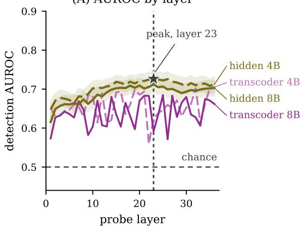

(B) AUROC by number of layers  
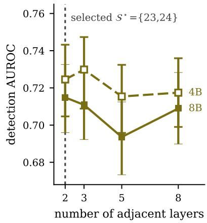  
Figure 5: Read-site selection for Qwen3-4B and Qwen3-8B. (A) Detection AUROC of a probe at each layer, on hidden states and on transcoder activations (not used by any result in this paper; see the text of this appendix); on hidden states it forms a broad upper-middle-layer plateau and peaks at layer 23. (B) Detection AUROC of a probe on 2, 3, 5 and 8 adjacent layers centred on layer 23; the gain from a third layer over two is smaller than the interval width. Bands and bars are 95% bootstrap intervals that resample held-out traces. We select hidden states from $S ^ { \star } = \{ 2 3 , 2 4 \}$

Read position. Each read lies at or before the step’s last token. The stored step positions come from tokenizing each step on its own, and the hidden states were extracted in left-padded batches without shifting those positions. Each read therefore lies earlier than the step’s last token by the padding width of its trace, at most 512 tokens. For the final step, the read lies inside the intended step for 51.0% of traces at 4B and 51.6% at 8B. Tokenizing the steps separately adds a smaller drift, with a median of 3 tokens over 820 step reads in a 40-trace 4B sample. No result was re-scored with corrected positions.

## E Failure types by problem type

Table 8 reports the capability-gap share of incorrect traces for each problem type in the broad collection. A problem’s type is its DeepMath topic at the second level of that dataset’s hierarchy, or its Hendrycks MATH subject. The association between failure type and problem type is weak at both scales, with Cramér’s V of 0.095 at 4B and 0.101 at 8B over traces with the stored labels, and 0.099 and 0.110 with corrected labels (Appendix B). The DeepMath topics span a narrow range of capability-gap shares, with Discrete Mathematics above the pooled share and Calculus and Number Theory below it at both scales. The Hendrycks MATH subjects have higher capability-gap shares. The two sources also differ in difficulty scale, so this table does not separate source from topic, and the pooled V carries the same limitation.

Table 8: Capability-gap share of incorrect traces by problem type in the broad collection at both model scales, with the stored labels and 95% problem-clustered bootstrap intervals. The pooled shares are 0.5555 at 4B and 0.5321 at 8B. DeepMath topics and Hendrycks MATH subjects are listed separately because the two sources differ in difficulty scale.
<table><tr><td>problem type</td><td>4B problems</td><td>4B share</td><td>8B problems</td><td>8B share</td></tr><tr><td>DeepMath topics</td><td></td><td></td><td></td><td></td></tr><tr><td>Algebra</td><td>4,136</td><td>0.563 [0.549, 0.577]</td><td>3,728</td><td>0.537 [0.522, 0.552]</td></tr><tr><td>Calculus</td><td>2,564</td><td>0.511 [0.494, 0.530]</td><td>2,256</td><td>0.477 [0.457, 0.497]</td></tr><tr><td>Other</td><td>928</td><td>0.542 [0.513, 0.572]</td><td>826</td><td>0.510 [0.478, 0.541]</td></tr><tr><td>Discrete Mathematics</td><td>890</td><td>0.603 [0.573, 0.632]</td><td>801</td><td>0.599 [0.564, 0.627]</td></tr><tr><td>Geometry</td><td>856</td><td>0.555 [0.524, 0.584]</td><td>769</td><td>0.535 [0.506, 0.569]</td></tr><tr><td>Applied Mathematics</td><td>586</td><td>0.561 [0.523, 0.596]</td><td>524</td><td>0.533 [0.491, 0.571]</td></tr><tr><td>Number Theory</td><td>424</td><td>0.495 [0.447, 0.538]</td><td>405</td><td>0.469 [0.424, 0.513]</td></tr><tr><td>Differential Equations</td><td>239</td><td>0.512 [0.448, 0.570]</td><td>195</td><td>0.487 [0.418, 0.549]</td></tr><tr><td>Precalculus</td><td>178</td><td>0.483 [0.406, 0.554]</td><td>154</td><td>0.488 [0.408, 0.566]</td></tr><tr><td>Hendrycks MATH subjects</td><td></td><td></td><td></td><td></td></tr><tr><td>geometry</td><td>163</td><td>0.772 [0.722, 0.818]</td><td>159</td><td>0.789 [0.737, 0.839]</td></tr><tr><td>intermediate algebra</td><td>84</td><td>0.566 [0.454, 0.670]</td><td>83</td><td>0.635 [0.534, 0.733]</td></tr><tr><td>counting and probability</td><td>78</td><td>0.810 [0.734, 0.876]</td><td>64</td><td>0.803 [0.725, 0.872]</td></tr><tr><td>precalculus</td><td>68</td><td>0.587 [0.458, 0.693]</td><td>56</td><td>0.561 [0.443, 0.671]</td></tr><tr><td>number theory</td><td>60</td><td>0.641 [0.532, 0.745]</td><td>57</td><td>0.655 [0.529, 0.757]</td></tr><tr><td>prealgebra</td><td>38</td><td>0.768 [0.660, 0.859]</td><td>30</td><td></td></tr><tr><td></td><td></td><td>0.880 [0.756, 0.967]</td><td>16</td><td>0.706 [0.560, 0.844]</td></tr><tr><td>algebra</td><td>18</td><td></td><td></td><td>0.682 [0.488, 0.837]</td></tr></table>

## F Supporting tables

Table 9: Sizes of the trace sets and of the populations drawn from them, and the use of each population. The broad collection labels every incorrect trace at both model scales. The gold collection is a 4B collection with half as many rollouts per evaluated prefix, and the PIT steps of its PITs are the reference PIT steps. A later table reports a separate n when its evaluation population differs from the corresponding row here.
<table><tr><td>set</td><td>population</td><td>used for</td><td>4B</td><td>8B</td></tr><tr><td>all traces</td><td>every sampled trace (35,854 problems)</td><td>training the confidence and combined probes</td><td>144,000</td><td>144,000</td></tr><tr><td>held-out traces</td><td>traces whose problems were held out by at least one of the five training</td><td>detection and calibration of the confidence probe</td><td>119,736</td><td>119,756</td></tr><tr><td>broad collection</td><td>seeds every incorrect trace</td><td>shares of the failure types (Figure 2)</td><td>28,699</td><td>24,871</td></tr><tr><td>held-out incorrect traces</td><td>incorrect traces among the held-out traces</td><td>miss rates by failure type (Section 3)</td><td>23,837</td><td>20,590</td></tr><tr><td>held-out PITs</td><td>PITs of problems outside the training split</td><td>pointer probe (4B); value probe, per seed (8B)</td><td>2,289</td><td>2,805–2,918</td></tr><tr><td>classifier problems</td><td>one incorrect trace per problem, capability gaps</td><td>failure-type classifier (Appendix B.1)</td><td>1,722</td><td>6,372</td></tr><tr><td>gold collection</td><td>and PITs every trace of the</td><td>reference PIT steps</td><td>5,380</td><td>not collected</td></tr><tr><td>PITS</td><td>collection reference PIT steps</td><td>pointer probe trained without gold problems;</td><td>818</td><td>not collected</td></tr></table>

Table 10: Supporting measurements cited in the main text, at both model scales. Intervals are 95% bootstrap intervals that resample problems unless a note says otherwise, and ± values are sample standard deviations over seeds (seed axes in Appendix B).
<table><tr><td>measurement</td><td>4B</td><td>8B</td><td>interpretation</td></tr><tr><td>Failure types and detection</td><td></td><td></td><td>read site chosen from the</td></tr><tr><td>detection AUROC of the read siteª</td><td>0.7245 [0.7047, 0.7432]</td><td>0.7149 [0.6960, 0.7326]</td><td>final label only the arg min step equals</td></tr><tr><td>share of PITs whose PIT step equals arg mint  $\hat { V } _ { t }$ </td><td>0.154</td><td>0.125</td><td>the PIT step for a minority of PITs</td></tr><tr><td>combined probe — confidence probe, detection AUROC on held-out problems</td><td> $- 0 . 0 2 6 \left[ - 0 . 0 2 9 , - 0 . 0 2 2 \right]$ </td><td> $- 0 . 0 2 5 \left[ - 0 . 0 2 9 , - 0 . 0 2 1 \right]$ </td><td>the confidence probe has the higher detection AUROC</td></tr><tr><td>confidence probe&#x27;s predicted correctness at the PIT step minus other stepsb</td><td> $- 0 . 0 2 0 6 \ [ - 0 . 0 2 7 2 , - 0 . 0 1 4 0 ]$ </td><td>-0.0351[-0.0372, -0.0327]</td><td>lower at the PIT step</td></tr><tr><td>same difference against the position-matched stepsb</td><td> $- 0 . 0 0 1 8 \left[ - 0 . 0 0 5 5 , + 0 . 0 0 2 2 \right]$ </td><td> $- 0 . 0 0 5 1 \left[ - 0 . 0 0 6 2 , - 0 . 0 0 4 0 \right]$ </td><td>8B: the decrease remains; 4B: no detected difference</td></tr><tr><td>Localization final-label comparison, value probe —</td><td>+0.0609 [+0.0293, +0.0929]; not evaluated +0.0433[+0.0137, +0.0731]</td><td></td><td>pooled evaluation includes training traces of the value probe; on the</td></tr><tr><td>final-label probe, pooled over all reference PIT steps (two input sets)º</td><td></td><td></td><td>problems held out from its training the interval excludes zero in 1 of 5 seeds (first input set) and 0 of 5 (second)</td></tr><tr><td>value probe, AUROC of near misses against PITs by its prediction at the last evaluated step value probe, per-step absolute error</td><td> $0 . 9 1 4 8 \pm 0 . 0 0 5 4$ </td><td> $0 . 9 0 6 2 \pm 0 . 0 0 7 9$ </td><td>separates near misses from PITs</td></tr><tr><td>versus predicting zero and a monotone fite</td><td> $0 . 1 2 2 7 \pm 0 . 0 0 5 2$  versus  $0 . 1 0 4 0 \pm 0 . 0 0 1 9$  and</td><td> $0 . 1 2 6 1 \pm 0 . 0 0 4 0$  versus  $0 . 1 0 9 1 \pm 0 . 0 0 3 4 \mathrm { a n d }$ </td><td>predicting zero and the monotone fit each have</td></tr><tr><td>value probe versus length rule, Hit@±2</td><td> $0 . 0 8 3 0 \pm 0 . 0 0 1 4$ </td><td> $0 . 0 9 6 2 \pm 0 . 0 0 2 4$ </td><td>lower error than the value probe in every seed below the length rule at</td></tr><tr><td>on each seed&#x27;s held-out PITs, two input setsd</td><td>Table 12</td><td> $0 . 4 2 9 3 \pm 0 . 0 2 2 3$  and  $0 . 4 0 4 6 \pm 0 . 0 1 6 2$  versus 0.5028 ± 0.0108; 0 of 5 seeds each</td><td>8B</td></tr><tr><td>PITs located within two steps by exactly one of the pointer probe and the length rule, 10 runs</td><td>723 to 857 of 2,289 PITs (31.6 to 37.4%)</td><td>not evaluated</td><td>about a third of PITs in each run</td></tr><tr><td>distance score at the read site versus  $t / ( L - 1 )$  AUROC of the PIT step against the other stepst</td><td>0.55 versus 0.63 (gold); 0.55 versus 0.69 (broad)</td><td>0.56 versus 0.74 (broad)</td><td>lower than  $t / ( L - 1 )$  in each collection and at each scale</td></tr><tr><td>rollout search replay, reference PIT step within two steps at 6.6 evaluated prefixes per trace</td><td>0.804</td><td>not evaluated</td><td>reads the estimates that define the labels; not comparable with a</td></tr><tr><td>refinement-depth agreement</td><td>0.754 (0.638 at K=8)</td><td>not evaluated</td><td>probe&#x27;s Hit@±2 point estimates against a deeper reference; no interval</td></tr></table>

Notes. aIntervals resample held-out traces. bEach trace uses only the seeds that held it out, and PIT steps at the first or last step of a trace are excluded; the rows cover 682 reference PIT steps at 4B and 7,277 PITs of the broad collection at 8B, so the two scales are not a matched comparison. cThe final-label comparison is evaluated only at 4B; intervals of the pooled evaluation resample traces. ${ \^ { \mathrm { d } } \mathbf { A } } \mathrm { t } 8 \mathbf { B } .$ , the row compares seed means on 2,805 to 2,918 held-out PITs of the broad collection per seed and has no per-trace interval. The value-probe rows use the first input set except where two input sets are named. eThe monotone fit is the best non-increasing least-squares fit to each trace’s rollout rates. fThe distance score takes the highest of four distance measures; the comparison scores step t of a trace with L steps by $t / ( L - 1 )$ . The row uses the PIT traces with at least one correct trace of the same problem: 593 in the gold collection, 7,987 in the broad collection at 4B and 6,881 at 8B.

Table 11: Values behind Figure 3: confidence-probe predictions at the final step, on the broad collection at both model scales, on held-out problems of the problem split. An incorrect trace is missed when its predicted correctness is at least the cutoff, 0.5. The binned rows give the miss rates of PITs and near misses within bins of the best reachable value at step 0, V∗, with the number of traces in each bin in parentheses. The AUROC rows score each probe by its final-step score on its own held-out traces. The last block is the difference between PITs and near misses after controls, from a logistic model of trace misses on failure type, trace length, answer position, difficulty and V∗ (Appendix B). Intervals are 95% problem-clustered bootstraps.
<table><tr><td>quantity</td><td>4B</td><td>8B</td></tr><tr><td>miss rate, capability gap</td><td>0.717 [0.706, 0.729]</td><td>0.797 [0.785, 0.808]</td></tr><tr><td>miss rate, PIT</td><td>0.714 [0.703, 0.724]</td><td>0.815 [0.805, 0.824]</td></tr><tr><td>miss rate, near miss</td><td>0.490 [0.460, 0.521]</td><td>0.466 [0.442, 0.490]</td></tr><tr><td>n (incorrect traces)</td><td>23,837</td><td>20,590</td></tr><tr><td> $V _ { 0 } ^ { \ast } \leq 0 . 2 5 , \mathrm { { P I T s } }$ </td><td>0.707[0.690, 0.723] (3,160)</td><td>0.787[0.770, 0.804] (2,548)</td></tr><tr><td>near misses</td><td>0.436[0.329, 0.547] (78)</td><td>0.449[0.357, 0.549] (118)</td></tr><tr><td> $0 . 2 5 < V _ { 0 } ^ { * } \leq 0 . 5 0 , \mathrm { { P I T s } }$ </td><td>0.720[0.701, 0.737] (2,931)</td><td>0.834[0.818, 0.849] (2,415)</td></tr><tr><td> $\mathrm { n e a r ~ m i s s e s }$ </td><td>0.424[0.357, 0.491] (205)</td><td>0.468[0.410, 0.526] (299)</td></tr><tr><td> $0 . 5 0 < V _ { 0 } ^ { * } \leq 0 . 7 5 ,$  PITS near misses</td><td>0.722[0.699, 0.745] (1,591)</td><td>0.822[0.801, 0.841] (1,359)</td></tr><tr><td> $0 . 7 5 < V _ { 0 } ^ { * } , \mathrm { P I T s }$ </td><td>0.481[0.410, 0.548] (216)</td><td>0.430[0.371, 0.487] (323)</td></tr><tr><td>near misses</td><td>0.709[0.687, 0.734] (1,682)</td><td>0.823[0.803, 0.843] (1,568)</td></tr><tr><td></td><td>0.517[0.479, 0.556] (722)</td><td>0.479[0.449, 0.511] (1,047)</td></tr><tr><td>AUROC of PITs against near misses, confidence probe n (PITs; near misses)</td><td>0.670 [0.653, 0.687]</td><td>0.760 [0.746, 0.773]</td></tr><tr><td>AUROC of PITs against near misses, combined probe</td><td>9,364; 1,221 0.364 [0.349, 0.378]</td><td>7,890; 1,787 0.403 [0.390, 0.416]</td></tr><tr><td>n (PITs; near misses)</td><td>9,344; 1,254</td><td>7,903; 1,805</td></tr><tr><td>PITs — near misses, after controls</td><td> $+ 0 . 0 3 7 2 \ [ + 0 . 0 1 1 6 , + 0 . 0 6 4 1 ]$ </td><td></td></tr><tr><td>n (traces in the logistic model)ª</td><td>23,820</td><td> $+ 0 . 1 2 4 6 \ [ + 0 . 1 0 4 3 , + 0 . 1 4 2 8 ]$ </td></tr><tr><td>PITs — near misses, after controls, Brier loss</td><td> $+ 0 . 0 5 2 \left[ + 0 . 0 2 8 , + 0 . 0 7 6 \right]$ </td><td>20,590 +0.123 [+0.103, +0.143]</td></tr></table>

Notes. aThe model omits 17 traces at 4B that contain no final answer, for which answer position is undefined.

Table 12: Paired comparisons with the length rule, at 4B throughout. Each comparison scores the probe and the length rule on the same PITs; intervals are 95% problem-clustered bootstraps of the per-trace difference where given.
<table><tr><td>comparison</td><td>PITS</td><td>probe</td><td>length rule</td><td>difference</td><td>runs above rule</td></tr><tr><td>pointer probe, held-out PITs of the broad collectiona</td><td>2,289</td><td> $0 . 4 6 3 2 \pm 0 . 0 1 3 4$ </td><td>0.4692</td><td>-0.0060  $[ - 0 . 0 2 6 0 , + 0 . 0 1 4 1 ]$ </td><td>0 of 10</td></tr><tr><td>pointer probe trained without gold problems</td><td>818</td><td> $0 . 4 2 9 3 \pm 0 . 0 1 2 0$ </td><td>0.4462</td><td>-0.0169  $[ - 0 . 0 4 7 3 , + 0 . 0 1 3 1 ]$ </td><td>0 of 5</td></tr><tr><td>final-label comparison, held-out: value probeb</td><td>205-242</td><td>0.3640; 0.3402</td><td>0.4812</td><td> $- 0 . 1 6 6 \mathrm { t o } - 0 . 0 8 4 ;$   $- 0 . 1 8 2 \mathrm { t o } - 0 . 1 1 3$ </td><td>0 of 10</td></tr><tr><td>final-label comparison, held-out: final-label probeb</td><td>205-242</td><td>0.3041; 0.3423</td><td>0.4812</td><td> $- 0 . 2 1 6 \mathrm { t o } - 0 . 1 2 4 ;$   $- 0 . 1 7 0 \mathrm { t o } - 0 . 1 1 6$ </td><td>0 of 10</td></tr><tr><td>final-label comparison, pooled, training traces includedº</td><td>818</td><td>0.3186-0.3795</td><td>0.4462</td><td> $- 0 . 1 2 8 \mathrm { t o } - 0 . 0 6 7$ </td><td>0 of 20</td></tr></table>

Notes. All retraining uses seeds {42, 137, 271, 314, 577}. aTen runs, five seeds under each of two weightings of the failure-type loss; the probe and difference cells report the inverse-frequency weights, and the uniform weights score 0.4524 ± 0.0111. The ensemble, the average of the five pointer probes of one weighting, exceeds the length rule by $+ 0 . 0 2 6 2 \left[ + 0 . 0 0 2 2 , + 0 . 0 4 9 5 \right]$ with inverse-frequency weights and by $+ 0 . 0 1 6 6 \left[ - 0 . 0 0 6 5 , + 0 . 0 4 0 0 \right]$ ], an interval that contains zero, with uniform weights. bEach seed is scored on the reference PIT steps of the problems held out from the value probe’s training for that seed; the difference column gives the range of the five per-seed differences, each with an interval below zero. The two values in a cell are the two input sets. cEvery seed is scored on all reference PIT steps, which include that seed’s training traces; every per-seed interval in this row lies below zero.

Table 13: Detection by the confidence probe at the final step and comparison with the text baseline, on held-out problems of the problem split at both model scales. The upper block reports the mean ± standard deviation over five seeds. AUROC after controls scores the same five-seed predictions after the five control variables of Appendix B are removed from them. Expected calibration error uses ten equal-width bins on held-out scores, before and after temperature scaling. The lower block gives the held-out detection AUROC of the text baseline and of a logistic regression on the same features, the paired difference between the confidence probe and the text baseline, and the gain from adding the confidence probe’s score to the text baseline’s features; the lower block’s intervals are 95% problem-clustered bootstraps. Appendix B reports the trace split as a leakage comparison.
<table><tr><td>scale</td><td>loss</td><td>AUROC</td><td>AUROC after controls</td><td>ECE</td><td>ECE after scaling</td></tr><tr><td>4B</td><td>BCE (main)</td><td> $0 . 8 1 3 6 \pm 0 . 0 0 4 9$ </td><td> $0 . 7 2 9 1 \pm 0 . 0 0 4 2$ </td><td> $0 . 0 1 4 3 \pm 0 . 0 0 4 0$ </td><td>0.0103</td></tr><tr><td>8B</td><td>BCE (main)</td><td> $0 . 8 0 8 8 \pm 0 . 0 0 8 4$ </td><td> $0 . 7 2 2 1 \pm 0 . 0 1 4 9$ </td><td> $0 . 0 2 4 3 \pm 0 . 0 1 1 1$ </td><td>0.0092</td></tr><tr><td>4B</td><td>Brier (robustness)</td><td> $0 . 8 1 0 7 \pm 0 . 0 0 4 6$ </td><td> $0 . 7 2 9 7 \pm 0 . 0 0 3 6$ </td><td> $0 . 0 2 7 3 \pm 0 . 0 1 0 3$ </td><td>0.0215</td></tr><tr><td>8B</td><td>Brier (robustness)</td><td> $0 . 8 0 8 5 \pm 0 . 0 0 4 7$ </td><td> $0 . 7 3 4 5 \pm 0 . 0 0 2 9$ </td><td> $0 . 0 2 2 9 \pm 0 . 0 0 6 1$ </td><td>0.0107</td></tr><tr><td colspan="5">4B</td><td>8B</td></tr><tr><td colspan="2">text baseline (gradient-boosted), AUROC logistic regression on the same features,</td><td>0.7783</td><td></td><td colspan="2">0.7725</td></tr><tr><td colspan="2">AUROC confidence probe — text baseline, BCE</td><td></td><td>0.7548 [0.7488, 0.7609]</td><td colspan="2">0.7379 [0.7312, 0.7442]</td></tr><tr><td colspan="2">confidence probe — text baseline, Brier</td><td></td><td>+0.0353 [+0.0319, +0.0387]</td><td colspan="2">+0.0362 [+0.0324, +0.0403]</td></tr><tr><td colspan="2">gain from adding the probe&#x27;s score to the</td><td></td><td>+0.0324 [+0.0290, +0.0357] +0.0369 [+0.0335, +0.0402]</td><td colspan="2">+0.0359  $[ + 0 . 0 3 2 3 , + 0 . 0 3 9 7 ]$  +0.0406 [+0.0369, +0.0445]</td></tr><tr><td colspan="2">text baseline, BCE</td><td></td><td></td><td colspan="2"></td></tr><tr><td colspan="2">text baseline, Brier</td><td></td><td></td><td colspan="2">gain from adding the probe&#x27;s score to the +0.0338 [+0.0305, +0.0370] +0.0393 [+0.0357, +0.0430]</td></tr></table>

Notes. The confidence probe’s seed identities are not recorded, so the overlap between its seeds and the value probe’s seeds is unknown.