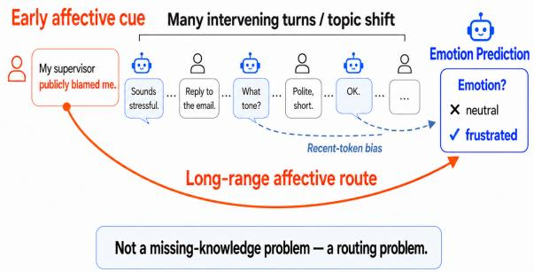
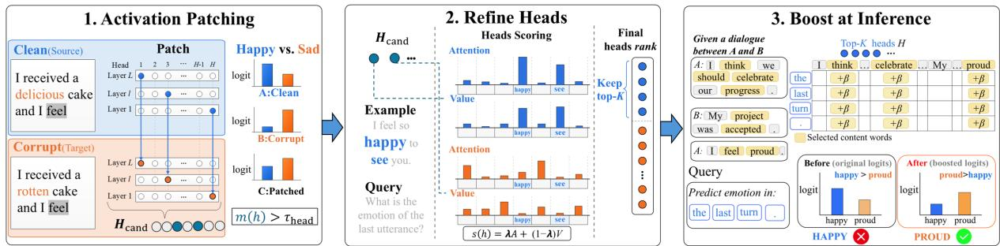
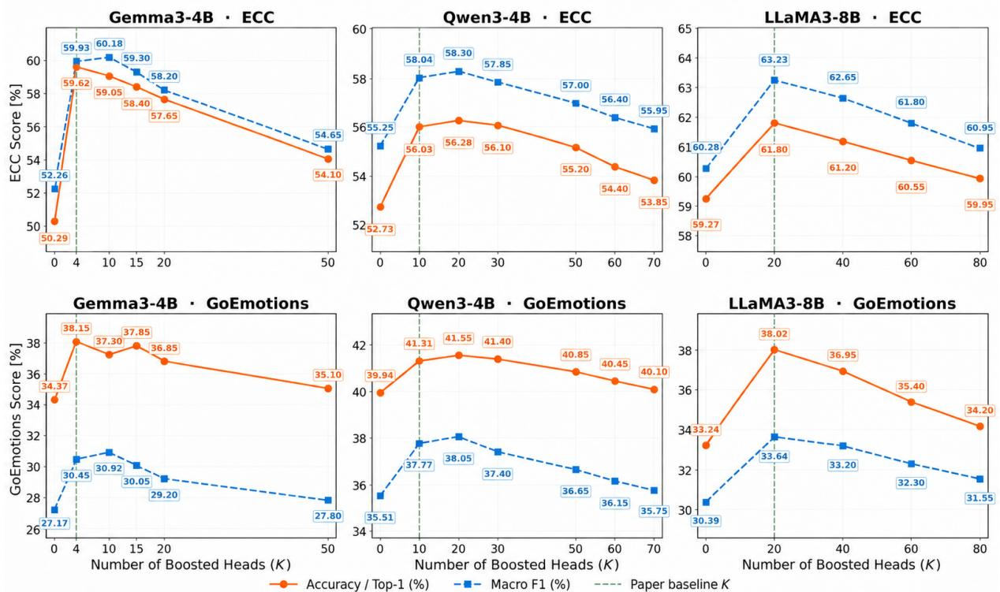
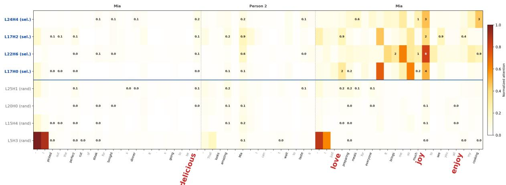

# Emotion is not External Knowledge: Internal Attention Signals for Affective State Reasoning

Wenqiu Tang1 Zhen Wan2 Yihui Wang1

Takahiro Komamizu1 Ichiro Ide1

1Nagoya University, Nagoya, Aichi, Japan

2National Institute of Informatics, Tokyo, Japan

{tangw, wangyi}@cs.is.i.nagoya-u.ac.jp

{taka-coma@acm.org, ide@i.nagoya-u.ac.jp, zhenwan.nlp@gmail.com}

## Abstract

Large Language Models (LLMs) increasingly operate in multi-turn interactions that require maintaining latent conversational states, not only explicit facts. We study affective state as an implicit state inferred from sparse contextual cues that remain relevant after topic shifts, and ask whether LLMs expose internal attention signals for routing such evidence at inference time. Prior attention interventions rely on head profiles derived from labeled exam ples across multiple profiling tasks and externally specified target spans, limiting transfer across affective-evidence distributions. We propose Self-targeted Internal Attention Boosting (SIAB), which localizes sparse affective heads across transformer layers in each model via causal localization (in detail activation patching) on synthetic minimal pairs and boosts the content tokens these heads already attend to. Both edited heads and target tokens are derived from the model’s own behavior, enabling the same head set to be reused across tasks. We evaluate SIAB on the ECC and GoEmotions benchmarks across three LLMs and multiple prompting settings. Relative to the corresponding settings without SIAB, macro-F1 improves by up to 7.67 points on ECC and 3.28 points on GoEmotions. Combining SIAB with PASTA further raises ECC macro-F1 by 12.51 points over the Gemma 3 zero-shot baseline.

## 1 Introduction

Conversation is inherently stateful; What a user means at any point depends on what came before. As Large Language Models (LLMs) are increasingly deployed in such multi-turn interaction, successful responses must not only retain explicit factual context but also maintain latent conversational states, such as a user’s frustration, uncertainty, or trust (Fazzi et al., 2025, Følstad et al., 2024). Affective state is a challenging case. It is rarely given as an explicit variable. Instead, it must be inferred from sparse contextual cues whose relevance can persist across topic shifts. As illustrated in Figure 1, a model may therefore need to use an earlier affective cue when making a later prediction.

  
Figure 1: Long dialogues can bury early affective cues, turning affective prediction into a routing problem.

Unlike knowledge-intensive failures, where retrieval or tool use can supply a missing fact, affective continuity does not require adding new information. Since the relevant evidence is already in the dialogue, the difficulty is whether the model routes it to the final decision point. Emotion recognition therefore provides a controlled proxy for studying this routing problem at inference time.

Inference-time attention intervention is a natural way to probe this problem, since it reroutes existing contextual evidence during the forward pass, without parameter updates or newly supplied facts. Existing attention intervention methods, however, rely on external control signals. Post-hoc Attention STeering Approach (PASTA) (Zhang et al., 2024a) profiles which heads to edit from labeled in-domain data and steers attention toward externally specified spans. Later variants reduce but do not remove this reliance on external signals. These methods raise two questions. RQ1: Can internal attention signals route affective evidence without external spans? and RQ2: Are internal and external signals redundant or complementary?

We address these questions with Self-targeted Internal Attention Boosting (SIAB), an attention intervention proposed for affective state reasoning. It first localizes a sparse set of emotion-sensitive attention heads in different Transformer layers through causal localization via activation patching. It then uses these heads themselves to select target tokens. At inference time, SIAB adds a scalar bias to the pre-softmax attention logits of the localized heads, boosting the content tokens they already attend to. Both the edited heads and the target tokens thus derive from the model’s own behavior.

We evaluate on two Emotion Recognition in Conversation (ERC) settings with complementary distributions of affective evidence. In the Emotion-Cause Conversation benchmark (ECC; He et al., 2025), cues are dispersed across earlier turns and must survive later topic shifts. Meanwhile, in the GoEmotions benchmark (Demszky et al., 2020), a single dense cue must instead be disambiguated among many fine-grained categories. The same head set is reused across both.

Since our goal is not only to improve recognition but to understand the internal signal we exploit, we analyze when and why the localized heads work. The gains come from a sparse set of heads; A few heads are sufficient, and they attend more to affective words than random heads from early, middle, and late layers. Whether SIAB succeeds further depends on logit geometry and on whether the boosted tokens align with the final label decision. Finally, the effects of SIAB and PASTA complement each other depending on their layerband proximity.

Our contributions are threefold: (i) We propose SIAB, a self-targeted inference-time attention intervention that requires no parameter update or annotated span and composes with prompting and PASTA-style external supervision, (ii) We show consistent gains across models, datasets, and prompting settings, and (iii) We characterize its mechanism and boundary conditions.

## 2 Related Work

Existing attention-level methods externalize control to varying degrees, relying on heads selected by testing each head’s steering effect on development examples with target tokens that are userannotated (Zhang et al., 2024a), heuristically extracted (Zhang et al., 2024b, Yu et al., 2024), or applied at the head output rather than its attention (Li et al., 2023). Residual-stream steering operates at a coarser granularity (Turner et al., 2024, Rimsky et al., 2024, Zou et al., 2023). These methods assume that the relevant evidence can be externally identified, an assumption less natural for affective state, whose cues spread across turns, often lack lexical salience, and shift as the conversation unfolds. We instead derive both signals internally — heads from activation patching, target tokens from each head’s own attention— and study how this internal signal composes with external ones.

Mechanistic interpretability provides tools for discovering internal structures that mediate model behavior. Activation patching (Wang et al., 2023, Goldowsky-Dill et al., 2023) has been used to localize concrete circuit components, such as name-mover and S-inhibition heads, through clean– corrupted activation contrasts, while direct logit attribution (Belrose et al., 2023) links intermediate contributions to final-token logits. These tools fit our goal of identifying internal signals for affectiveevidence routing. Rather than specifying emotionbearing spans externally, we localize the attention heads that internally route affective contrast.

Emotion recognition in conversation naturally probes affective state across dialogue turns, yet existing mechanistic work operates at a coarser granularity. It studies sentiment directions (Tigges et al., 2024), mid-layer multi-head self-attention units (Tak et al., 2025), or residual-stream circuits for emotion generation (Wang et al., 2025), leaving head-level recognition unaddressed. Other work improves accuracy through retrieval, speaker modeling, or curriculum learning (Lei et al., 2023, Xue et al., 2024, Fu et al., 2025, Li et al., 2026), but treats the model as a black box and ignores its internal attention signal.

## 3 Method

We introduce SIAB, an inference-time attention intervention with two components: Head-set construction via Activation Patching and heads refinement introduced in §3.1 and §3.2, respectively, and Self-targeted pre-softmax logit boosting introduced in §3.3. Both components derive their control signal from the model’s own internal behavior. Figure 2 gives an overview.

We frame emotion prediction as generative label scoring. Given an input context X and a candidate label set Y, we score each label using its answerposition verbalizer logit, rather than training a taskspecific classification head.

  
Figure 2: Overview of the proposed Self-targeted Internal Attention Boosting (SIAB). Causal localization via activation patching selects sparse emotion-sensitive heads (4–20 of hundreds). SIAB adds a pre-softmax bias to the content tokens these heads already attend to at final query positions —without training, parameter update, or external span.

## 3.1 Head Selection via Activation Patching

Activation patching localizes the attention heads in different Transformer layers that causally affect the original prediction using prompt pairs that differ only in the feature driving that prediction. In our case, the difference in affective state is driven by the affective cues, so we build clean–corrupted pairs $( X ^ { \mathrm { c l e a n } } , X ^ { \mathrm { c o r r } } ) , { \mathrm { e . g . } } , X ^ { \mathrm { c l e a n } } = { ^ { \ast } I }$ received a delicious cake. $I f e e l ^ { \prime \prime }$ and $X ^ { \mathrm { c o r r } } = { } ^ { \cdots } I$ received a rotten cake. I feel” (Appendix A shows the detail of pairs construction). Two properties make these pairs suitable for causal attribution. First, every prompt ends with I feel, so the model is induced to predict an emotion word at the final position, where we read off the effect. Second, the two prompts share the same syntactic structure and differ only in the affective cue, so any difference in the final-position emotion prediction can be attributed to that cue.

We run the model on $X ^ { \mathrm { c o r r } }$ as a baseline. Then, for one head h at a time, we replace only that head’s final-token output with the output it produced on the $X ^ { \mathrm { c l e a n } }$ and complete the forward pass. Everything else stays at its corrupted value. If h encodes the cue, restoring its clean output pulls the emotion prediction back toward the clean answer. Otherwise, the model’s prediction should remain close to the corrupted-run baseline. We quantify this as the normalized logit-difference recovery formulated as:

$$
m ( h ) = { \frac { { \mathcal { L } } ( { \mathrm { p a t c h } } _ { h } ) - { \mathcal { L } } ( X ^ { \mathrm { c o r r } } ) } { { \mathcal { L } } ( X ^ { \mathrm { c l e a n } } ) - { \mathcal { L } } ( X ^ { \mathrm { c o r r } } ) } } ,\tag{1}
$$

$$
\mathcal { L } ( \cdot ) = \log \mathrm { i t } ( e _ { \mathrm { c l e a n } } ) - \log \mathrm { i t } ( e _ { \mathrm { c o r r } } ) .
$$

Here, $e _ { \mathrm { c l e a n } }$ and $e _ { \mathrm { c o r r } }$ are the top-ranked finalposition emotion words on $X ^ { \mathrm { c l e a n } }$ and $X ^ { \mathrm { c o r r } }$ , respectively, and $\mathrm { p a t c h } _ { h }$ denotes the patched run described above. Thus $m ( h ) = 1$ when the swap fully restores the clean prediction and $m ( h ) = 0$ when it has no effect, following Belrose et al. (2023) and Tigges et al. (2023). We apply the test to every head independently and retain those with $m ( h ) > \tau _ { \mathrm { h e a d } }$ , and their union forms the candidate set $\mathcal { H } _ { \mathrm { c a n d } }$

## 3.2 Label-free Refinement on Dialogues

Having obtained the candidate heads $\mathcal { H } _ { \mathrm { c a n d } }$ , we do not directly treat all of them as suitable intervention targets. A head may obtain a high patching score m(h) through generic mechanisms, such as positional tracking or induction-like copying (Olsson et al., 2022), rather than by routing affective cues. In natural dialogues, affective evidence is usually carried by lexical content. We therefore use a lightweight content-token filter that removes punctuation, special tokens, pronouns, interrogatives, and prepositions, while retaining negators and intensifiers. We then refine the candidates on dialogues by measuring their attention and value mass on content-word positions before the emotion prediction, using value mass because attention alone does not determine the information written to the residual stream (Kobayashi et al., 2020).

For this refinement stage, we use 200 dialogues sampled from the DailyDialog dataset (Li et al., 2017). For each dialogue, we append a probe question, $\mathrm { e . g . }$ , “What is the emotion of the last utterance?”, and inspect each candidate head immediately before the model generates the answer. Although this dataset provides emotion annotations, we use only the dialogue text during this stage and do not access any gold emotion label.

For an arbitrary token position u, let $\alpha _ { h , q , u }$ be the attention from query position $q \in \mathcal { Q }$ to u on head h, and let $v _ { h , q , u }$ be the L2 norm of the corresponding value contribution. Because dialogue turns have different lengths, we normalize both quantities within the conversational turn as:

$$
\begin{array} { r } { \tilde { \alpha } _ { h , q , u } = \frac { \alpha _ { h , q , u } } { \sum _ { u ^ { \prime } \in \mathrm { t u r n } ( u ) } \alpha _ { h , q , u ^ { \prime } } } , } \\ { \tilde { v } _ { h , q , u } = \frac { v _ { h , q , u } } { \sum _ { u ^ { \prime } \in \mathrm { t u r n } ( u ) } v _ { h , q , u ^ { \prime } } } , } \end{array}\tag{2}
$$

where turn(u) denotes all token positions in the same conversational turn as $u ,$ including both content and non-content tokens. Thus, $\tilde { \alpha } _ { h , q , u }$ and $\tilde { v } _ { h , q , u }$ measure the fraction of a head’s attention and value mass within that turn assigned to u.

Let $\mathcal { C } ( \boldsymbol { r } )$ denote the content-word positions in turn r. The candidate score is defined as:

$$
s _ { \mathrm { h e a d } } ( h ) = \lambda A _ { h } + ( 1 - \lambda ) V _ { h } ,\tag{3}
$$

where $A _ { h }$ and $V _ { h }$ are computed by summing the turn-normalized masses over $u \in { \mathcal { C } } ( r )$ and then averaging over turns r, query positions $q \in \mathcal { Q }$ , and refinement dialogues. This yields the fraction of each head’s turn-level mass assigned to substantive dialogue content. The final head set H is the top-K heads by $s _ { \mathrm { h e a d } }$ . Per-model values of K and the resulting head indices are reported in Appendix B.

## 3.3 Attention Logit Boosting

Crucially, the intervened tokens are not externally annotated, but selected from each chosen head’s own attention distribution at the final query positions. At inference time, for each $( h , q ) \in \mathcal { H } \times \mathcal { Q } .$ let ${ \mathcal { T } } _ { r } ( h , q )$ denote the top-r fraction of contentword tokens ranked by attention score $\alpha _ { h , q , t }$ . We add a scalar bias $\beta$ to the pre-softmax attention logits $\ell _ { h , q , t }$ of these tokens as:

$$
\ell _ { h , q , t } ^ { \prime } = \ell _ { h , q , t } + \beta { \bf 1 } [ t \in \mathcal { T } _ { r } ( h , q ) ] .\tag{4}
$$

The attention distribution is then computed by applying softmax to the modified logits $\ell _ { h , q , t } ^ { \prime }$

The head set H is fixed once and reused across both datasets without re-localization. Also the bias magnitude $\beta$ is calibrated per model and then held fixed across both datasets. Hyperparameter values and the calibration protocol are reported in $\mathsf { A p - }$ pendix C.

## 4 Experimental Evaluation

## 4.1 Datasets

We evaluate on two benchmarks that stress different cue regimes. ECC (He et al., 2025) labels multi-turn dialogues (max. 831 tokens) with 10 fine-grained emotion classes, where affective evidence can appear early and must remain available across many turns. GoEmotions (Demszky et al., 2020) labels short Reddit comments1 (max. 52 tokens) with 27 multi-label emotion categories plus a Neutral class, where cues are local and informationdense but must be separated among many finegrained labels. We exclude samples labeled solely as Neutral, since they contain no non-neutral affective cue for cue-targeting heads to act on. For multi-label samples, we retain the non-Neutral labels. This leaves 3,821 test examples for evaluation. Neutral results are reported in Appendix D.

## 4.2 Evaluation Metrics

We report macro-F1 and Accuracy. For the ECC benchmark, we take the argmax over 10 labels. For the GoEmotions benchmark, we follow the multi-label setting of Demszky et al. (2020). The temperature $T$ and threshold t are tuned on the GoEmotions dev split (The specific hyperparameter values are provided in Appendix C). and Top-1 accuracy counts the argmax label as correct if it belongs to the gold label set.

We additionally quantify finite-sample uncertainty using paired bootstrap resampling $( B \ =$ 10,000). Full pointwise 95% percentile confidence intervals and implementation details are reported in Appendix G.

## 4.3 Models

We evaluate three open, small-to-mid-sized instruction-tuned LLMs from different model families: Gemma3-4B (Gemma Team, 2025), Qwen3-4B (Yang et al., 2025), and LLaMA3- 8B (Grattafiori et al., 2024).

## 4.4 Baselines and Prompting Settings

We compare the proposed SIAB against three baselines. The first is prompting: Zero-Shot (ZS) and fixed few-shot prompting (Templates are introduced in Appendix F).

The second is PASTA-style (Zhang et al., 2024a) performance-profiled head selection, for which we report three variants: PASTA-ECC and PASTA-GOE are profiled on labeled ECC and GoEmotions dev-data, respectively, probing in-domain effectiveness and cross-dataset transfer, PASTA-∩ keeps only the heads shared by both profiles, testing whether a shared profile improves generality. We also report PASTA+SIAB to test complementarity with in-domain PASTA. PASTA’s head count and variants are also tuned to their optimal values.

Table 1: Results of two different metrics on the ECC (He et al., 2025) and GoEmotions (Demszky et al., 2020) benchmarks. ZS / Mid / High denote zero- / few-shot prompts (15/27 for GoEmotions, 5/10 for ECC). PASTA-{ECC,GoE} use heads selected on the named dataset, PASTA-∩ keeps the shared top heads from these two profiles. Rand. is layer-matched random. Scores are ×100, ∆ is vs. ZS, best per model in bold.
<table><tr><td colspan="2"></td><td colspan="4">ECC benchmark</td><td colspan="4">GoEmotions benchmark</td></tr><tr><td>Model</td><td>Config</td><td>Acc.</td><td>Macro-F1</td><td> $\Delta _ { \mathbf { A } \mathbf { c } \mathbf { c } }$ </td><td> $\Delta _ { \mathbf { F 1 } }$ </td><td>Macro-F1</td><td>Top-1</td><td> $\Delta _ { \mathbf { F } 1 }$ </td><td> $\Delta _ { \mathbf { T o p 1 } }$ </td></tr><tr><td rowspan="12">(Ge m e) Gema3</td><td>ZS</td><td>50.29</td><td>52.26</td><td></td><td></td><td>27.17</td><td>34.37</td><td></td><td></td></tr><tr><td>ZS+SIAB</td><td>59.62</td><td>59.93</td><td>+9.32</td><td>+7.67</td><td>30.45</td><td>38.15</td><td>+3.28</td><td>+3.78</td></tr><tr><td>Mid</td><td>56.48</td><td>55.51</td><td>+6.19</td><td>+3.25</td><td>30.55</td><td>33.45</td><td>+3.38</td><td>-0.92</td></tr><tr><td>Mid+SIAB</td><td>59.90</td><td>60.15</td><td>+9.61</td><td>+7.89</td><td>32.65</td><td>36.68</td><td>+5.47</td><td>+2.30</td></tr><tr><td>High</td><td>60.66</td><td>58.27</td><td>+10.37</td><td>+6.01</td><td>28.72</td><td>32.24</td><td>+1.55</td><td>-2.14</td></tr><tr><td>High+SIAB</td><td>63.69</td><td>62.52</td><td>+13.40</td><td>+10.27</td><td>31.49</td><td>36.19</td><td>+4.32</td><td>+1.82</td></tr><tr><td>PASTA-ECC</td><td>59.43</td><td>60.37</td><td>+9.14</td><td>+8.11</td><td>26.86</td><td>32.89</td><td>-0.31</td><td>-1.48</td></tr><tr><td>PASTA-GoE</td><td>52.11</td><td>52.99</td><td>+1.82</td><td>+0.73</td><td>31.81</td><td>34.37</td><td>+4.64</td><td>+0.00</td></tr><tr><td>PASTA-∩</td><td>59.12</td><td>60.02</td><td>+8.83</td><td>+7.76</td><td>29.19</td><td>34.65</td><td>+2.02</td><td>+0.28</td></tr><tr><td>PASTA+SIAB</td><td>64.13</td><td>64.77</td><td>+13.84</td><td>+12.51</td><td>33.75</td><td>38.01</td><td>+6.58</td><td>+3.64</td></tr><tr><td>Random</td><td> $4 1 . 8 9 { \scriptstyle \pm 3 . 7 0 }$ </td><td> $4 5 . 6 0 { \scriptstyle \pm 4 . 1 0 }$ </td><td>-8.40</td><td>-6.66</td><td> $2 6 . 0 1 { \scriptstyle \pm 1 . 8 0 }$ </td><td> $3 2 . 1 3 { \scriptstyle \pm 2 . 9 0 }$ </td><td>-1.16</td><td>-2.24</td></tr><tr><td>ZS</td><td>52.73</td><td>55.25</td><td></td><td></td><td>35.51</td><td>39.94</td><td></td><td></td></tr><tr><td rowspan="10">(Ya  s 2025)) Pen3</td><td>ZS+SIAB</td><td>56.03</td><td>58.04</td><td>+3.30</td><td>+2.79</td><td>37.77</td><td>41.31</td><td>+2.26</td><td>+1.37</td></tr><tr><td>Mid</td><td>55.63</td><td>58.02</td><td>+2.90</td><td>+2.78</td><td>35.56</td><td>40.38</td><td>+0.05</td><td>+0.44</td></tr><tr><td>Mid+SIAB</td><td>57.71</td><td>59.91</td><td>+4.99</td><td>+4.66</td><td>38.31</td><td>42.69</td><td>+2.79</td><td>+2.75</td></tr><tr><td>High</td><td>58.71</td><td>60.67</td><td>+5.98</td><td>+5.42</td><td>35.99</td><td>43.25</td><td>+0.48</td><td>+3.31</td></tr><tr><td>High+SIAB</td><td>60.36</td><td>61.88</td><td>+7.63</td><td>+6.63</td><td>38.23</td><td>44.26</td><td>+2.71</td><td>+4.32</td></tr><tr><td>PASTA-ECC</td><td>59.65</td><td>59.85</td><td>+6.92</td><td>+4.60</td><td>35.20</td><td>40.28</td><td>-0.31</td><td>+0.34</td></tr><tr><td>PASTA-GoE</td><td>52.82</td><td>55.14</td><td>+0.09</td><td>-0.11</td><td>35.63</td><td>39.17</td><td>+0.12</td><td>-0.77</td></tr><tr><td>PASTA-∩</td><td>57.65</td><td>59.11</td><td>+4.92</td><td>+3.86</td><td>35.99</td><td>39.80</td><td>+0.48</td><td>-0.14</td></tr><tr><td>PASTA+SIAB</td><td>62.76</td><td>63.09</td><td>+10.03</td><td>+7.84</td><td>37.97</td><td>41.61</td><td>+2.46</td><td>+1.67</td></tr><tr><td>Random</td><td>52.39±2.30</td><td>55.27±0.70</td><td>-0.34</td><td>+0.02</td><td>34.64±0.80</td><td>39.75±1.00</td><td>-0.87</td><td>-0.19</td></tr><tr><td></td><td></td><td>59.27</td><td>60.28</td><td></td><td></td><td>30.39</td><td>33.24</td><td></td><td></td></tr><tr><td rowspan="10">(r   o24) LMA3</td><td>ZS ZS+SIAB</td><td>61.80</td><td>63.23</td><td>+2.53</td><td>+2.95</td><td>33.64</td><td>38.02</td><td>+3.25</td><td>+4.78</td></tr><tr><td>Mid</td><td>62.24</td><td>62.86</td><td>+2.96</td><td>+2.58</td><td>29.16</td><td>34.28</td><td>-1.23</td><td>+1.04</td></tr><tr><td>Mid+SIAB</td><td>64.21</td><td>64.52</td><td>+4.94</td><td>+4.25</td><td>29.81</td><td>36.44</td><td>-0.58</td><td>+3.20</td></tr><tr><td>High</td><td>64.97</td><td>64.81</td><td>+5.70</td><td>+4.53</td><td>26.57</td><td>32.53</td><td>-3.82</td><td>-0.72</td></tr><tr><td>High+SIAB</td><td>66.22</td><td>66.13</td><td>+6.95</td><td>+5.85</td><td>27.55</td><td>35.85</td><td>-2.84</td><td>+2.61</td></tr><tr><td>PASTA-ECC</td><td></td><td></td><td></td><td></td><td></td><td></td><td></td><td></td></tr><tr><td>PASTA-GoE</td><td>65.28 62.09</td><td>63.35</td><td>+6.01</td><td>+3.07</td><td>23.20</td><td>26.31</td><td>-7.19</td><td>-6.93</td></tr><tr><td>PASTA-∩</td><td></td><td>61.74 60.82</td><td>+2.82 +4.01</td><td>+1.46 +0.54</td><td>32.14 30.86</td><td>31.51 33.18</td><td>+1.75 +0.47</td><td>-1.73</td></tr><tr><td>PASTA+SIAB</td><td>63.28 65.48</td><td>63.55</td><td>+6.21</td><td>+3.27</td><td>36.17</td><td>37.73</td><td>+5.78</td><td>-0.06 +4.49</td></tr><tr><td>Random</td><td> $5 2 . 8 4 { \scriptstyle \pm 5 . 0 0 }$ </td><td> $5 6 . 2 4 { \scriptstyle \pm 4 . 1 0 }$ </td><td>-6.43</td><td>-4.04</td><td> $2 8 . 5 2 { \scriptstyle \pm 2 . 8 0 }$ </td><td> $3 0 . 5 9 { \scriptstyle \pm 3 . 2 0 }$ </td><td>-1.87</td><td>-2.65</td></tr></table>

The third is, Layer-Matched Random, which tests whether the effect is only layer-specific or due to within-layer redundancy. In either case, random same-layer heads should work as well (Voita et al., 2019, Michel et al., 2019). We sample 20 random subsets of non-selected heads from the same layers, matching our head-set size, and tune $\beta$ on the same dev set.

## 4.5 Results

Table 1 reports results on two datasets. The reported changes in macro-F1 and full accuracy (∆) are computed relative to the ZS baseline.

SIAB generalized across models, datasets, and prompts. Across all 18 model–prompt–dataset settings, the proposed SIAB improved over the corresponding prompting baseline using the same head set, with gains up to +10.27 macro-F1 on the ECC benchmark and +5.47 on the GoEmotions benchmark. The effect is not limited to ZS, but under 10-shot ECC, SIAB still added +1.21 to +4.25 macro-F1 across models. On GoEmotions, it also reduced harmful few-shot effects. It turned the Gemma3 model’s Mid / High Top-1 drops into gains and weakened the LLaMA3 model’s Macro-F1 drops, while flipping its High-setting Top-1 change from negative to positive.

PASTA was strong in-domain but transferred poorly. In-domain PASTA profiles were competitive with, and often stronger than, ZS+SIAB. However, this strength was task-specific. Applying PASTA-ECC heads to GoEmotions dropped LLaMA3 by −7.19 macro-F1, and transfer in the reverse direction was similarly unstable. PASTA-∩ also lost in-domain performance without recovering cross-task gains. In contrast, SIAB uses the same causally selected head set across both datasets and gave positive $\Delta$ in all 18 settings. Thus, PASTA reached a stronger in-domain peak when its profiling task matches the test task, whereas SIAB was weaker but more stable across tasks, motivating their composition.

The two signals composed additively in five of six (model, dataset) configurations. Across five configurations, PASTA+SIAB recovered 79– 116% of the naive sum of the two individual ZS gains, and yielded the best macro-F1 on 4 of them, indicating the two signals operate largely orthogonally. The single exception, LLaMA3 on ECC, recovered only 54%. We attribute this to layerband disjointness between the PASTA-profiled and SIAB head sets and quantify the relationship in §5.4.

Effect of head selection: Evidence from Random. Across all models, datasets, and metrics, ZS+SIAB outperformed the mean score of 20 layer-matched random head subsets. Since Random uses the same layers, head-set size, and tuning protocol, this argues against a simple accumulation of layer-level effects. It also shows that same-layer heads are not interchangeable for this intervention, but the gain depends on the specific heads selected by SIAB.

## 5 Mechanistic Analysis

To analyze when and why the intervention succeeded, we partition test samples into four groups based on the joint behavior of ZS and the proposed SIAB predictions: POS: ZS incorrect, SIAB correct, NEG: ZS correct, SIAB incorrect, EASY:

both ZS and SIAB correct, and HARD: both ZS and SIAB incorrect.

## 5.1 Sparsity of the Affective Head Set

To test whether our selected head set is sufficiently sparse, we vary K and select the top-K heads according to the ranking determined during refinement in §3.2. Figure 3 shows the same trend across all models and datasets, that F1 rose quickly with a few heads, saturated near a small $K ^ { * }$ , and dropped as more heads were added. This suggests that affective signal is concentrated in a small head set, while lower-ranked heads mostly add noise. Since the same $K ^ { * }$ appears on both the ECC and GoEmotions benchmarks for each model, the sparsity seems more model-dependent than dataset-specific.

## 5.2 Selected Heads Attend More to Emotion Words

We test whether selected heads disproportionately attend to emotion words.

Setup. For each dialogue turn u that contains at least one word from the NRC Emotion Lexicon (Mohammad and Turney, 2013), let $\mathcal { C } _ { u }$ denote the content-word tokens in the turn, and let $\mathcal { E } _ { u } \subseteq \mathcal { C } _ { u }$ denote the subset of tokens matched by the NRC. For a head $h ,$ let $\mathcal { S } _ { h , u }$ be the top-30% tokens in $\mathcal { C } _ { u }$ ranked by the attention that head h assigns to them at the prediction position. We then compute a concentration ratio defined as:

$$
r _ { h , u } = \frac { | S _ { h , u } \cap \mathcal { E } _ { u } | / | S _ { h , u } | } { | \mathcal { E } _ { u } | / | \mathcal { C } _ { u } | } .\tag{5}
$$

The numerator is the emotion-word fraction among the head’s top-attended tokens, while the denominator is the emotion-word fraction in the whole turn. Thus, $r _ { h , u } > 1$ indicates that head h attends to emotion words more than expected from their base rate in that turn. We compare selected heads with random non-selected heads sampled from early, middle, and late layer bands (40 heads per band).

Internal signal was head-specific, but not layerdriven. The selected heads had the highest emotion-word ratios for all three models as shown in Table 2. Among random heads, middle and late layer bands generally showed higher ratios than early layers, consistent with prior work showing stronger affective or sentiment signals in mid-tolate layers (Tak et al., 2025, Tigges et al., 2024). Moreover, the selected heads span early, middle, and late layer regions, yet outperformed random heads within each region. This suggests that the higher emotion-word ratio is a property of the selected heads themselves, not merely a consequence of their layer positions. Appendix E provides qualitative examples.

  
Figure 3: Performance vs. boosted head count K on the ECC (He et al., 2025) and GoEmotions (Demszky et al., 2020) benchmarks. Blue denotes macro-F1, and orange denotes accuracy for ECC and Top-1 accuracy for GoEmotions. Dashed lines mark the $K ^ { * }$ used in the main experiments, showing small- $K ^ { * }$ saturation across datasets for each model.

Table 2: Emotion-word ratio for selected and random heads. Larger values indicate a higher emotion-word share turn average.
<table><tr><td>Head set</td><td>Gemma3 (K=4)</td><td>Qwen3 (K=10)</td><td>LLaMA3 (K=20)</td></tr><tr><td>Selected</td><td>1.575</td><td>1.370</td><td>1.384</td></tr><tr><td>Random Late</td><td>1.373</td><td>1.064</td><td>1.195</td></tr><tr><td>Random Middle</td><td>1.346</td><td>1.157</td><td>1.228</td></tr><tr><td>Random Early</td><td>1.224</td><td>1.083</td><td>1.092</td></tr></table>

Table 3: Mean ∆label\_gap per on GoEmotion samples.
<table><tr><td>Group</td><td>Gemma3</td><td>Qwen3</td><td>LLaMA3</td></tr><tr><td>POS</td><td>+9.77</td><td>+2.85</td><td>+0.79</td></tr><tr><td>NEG</td><td>-7.57</td><td>-2.12</td><td>-0.83</td></tr><tr><td>HARD</td><td>+2.53</td><td>+1.14</td><td>+0.45</td></tr></table>

## 5.3 What Makes a Sample Rescuable?

The proposed SIAB changes the prediction only when its induced logit movement is both large

Table 4: Zero-Shot (ZS) margin and label-gap statistics by sample group, and rescue rates by label-gap range.In (a), share is calculated over all test samples, and in (b), it is calculated over the POS+HARD subset.

(a) ZS margin = $\mathrm { : \ell _ { t o p 1 } - \ell _ { t o p 2 } }$ and ZS label $\mathrm { g a p } = \ell _ { \mathrm { g o l d } } - \ell _ { \mathrm { t o p 1 } }$ by group.
<table><tr><td>Group</td><td>Share [%]</td><td>ZS margin</td><td>ZS label_gap</td></tr><tr><td>POS</td><td>12.9</td><td>9.4</td><td>-9.8</td></tr><tr><td>NEG</td><td>3.1</td><td>8.7</td><td>0.0</td></tr><tr><td>EASY</td><td>42.7</td><td>20.5</td><td>0.0</td></tr><tr><td>HARD</td><td>41.3</td><td>16.8</td><td>-20.2</td></tr></table>

(b) Rescue rate of POS+HARD samples stratified by ZS label\_gap.
<table><tr><td>Range</td><td>Share [%]</td><td>Rescue rate</td></tr><tr><td>-5, 0] (Shallow)</td><td>10.2</td><td>66.9%</td></tr><tr><td> $- 1 0 , \textrm { -- } 5 ]$  (Mid)</td><td>12.3</td><td>47.9%</td></tr><tr><td>[−100,−10] (Deep)</td><td>77.5</td><td>14.4%</td></tr></table>

enough and pointed in the useful direction. We first describe the observed movement across POS, NEG, and HARD samples, and then analyze two factors behind it: Baseline logit gap and Alignment of selected heads with the gold label.

SIAB induced different logit movements across groups. We measure the intervention effect by ∆label\_ $\mathrm { \ g a p = \ l a b e l { \_ } g a p _ { S I A B } - \ l a b e l { \_ } g a p _ { Z S } }$ . For an example with gold label $y ,$ candidate label set Y, and label-logit vector $\ell ,$ we define label\_gap = $\ell _ { y } - \operatorname* { m a x } _ { c \in \mathcal { V } } \ell _ { c } ,$ where c indexes candidate emotion labels. The gap is 0 when the gold label is already Top-1 and negative otherwise, and positive ∆label\_gap values mean that SIAB moves the gold label closer to Top-1. As reported in Table 3, POS shifted strongly upward and NEG strongly downward. Meanwhile, HARD also shifted upward, but by a much smaller margin.

Table 5: Selected-head attention mass on emotion tokens. POS shows stronger label-directional bias.
<table><tr><td>Group</td><td>Tlabel</td><td> $r _ { \mathbf { w r o n g } }$ </td><td> $\Delta r$ </td></tr><tr><td>POS</td><td> $0 . 7 6 7 \pm 0 . 2 8 4$ </td><td> $0 . 1 4 0 \pm 0 . 2 3 3$ </td><td> $+ 0 . 6 2 7$ </td></tr><tr><td>NEG</td><td> $0 . 6 6 1 \pm 0 . 3 3 5$ </td><td>一</td><td></td></tr><tr><td>EASY</td><td> $0 . 7 2 6 \pm 0 . 3 2 5$ </td><td></td><td></td></tr><tr><td>HARD</td><td> $0 . 6 5 6 \pm 0 . 3 4 5$ </td><td> $0 . 1 9 5 \pm 0 . 2 8 5$ </td><td> $+ 0 . 4 6 1$ </td></tr></table>

Large baseline logit gaps limited rescue. The weaker HARD movement is partly explained by its baseline logit geometry. Table 4 (a) shows that POS and NEG had small Top-1 vs. Top-2 margins on the Gemma3 model (9.4 and 8.7), while HARD had a much larger margin (16.8) and a deeper gold-label gap (−20.2). Stratifying POS+HARD samples by ZS label\_gap further confirms this pattern as shown in Table 4 (b): Rescue was frequent in the shallow range but dropped sharply once the gold label was more than 10 logit points behind Top-1. HARD mostly lay in this deep-gap regime, where SIAB could move the gold label but rarely enough to change the prediction.

Direction was set by head alignment. Selected heads differed across groups in how strongly they attended to gold-label versus wrong-label emotion tokens before intervention. Using the NRC EmoLex categories, we compute the fraction of selected-head attention mass on emotion tokens matching the gold label $( r _ { \mathrm { l a b e l } } )$ versus the wrong Top-1 $( r _ { \mathrm { w r o n g } } )$ As shown in Table 5, $r _ { \mathrm { l a b e l } } ~ >$ 0.65. POS exhibited stronger directional bias than HARD (0.767 vs. 0.656) and a lower wrongaligned fraction (0.140 vs. 0.195). On HARD, the intervention thus amplifies a noisier signal, which can partially explain HARD’s resistance to rescue.

Can more HARD samples be rescued? We probe this in two ways: by scaling $\beta$ by a factor of 2 and by suppressing sink-token attention in selected heads (Table 6). First, setting $\beta$ to $2 \beta$ rescued only

Table 6: Rescue rate on HARD samples under two intervention strategies.
<table><tr><td>Model</td><td>Sink mass</td><td> $\beta \times 2$ </td><td>Sink suppression</td></tr><tr><td>Gemma3</td><td> $\sim 2 5 \%$ </td><td>4.5%</td><td>4.2%</td></tr><tr><td> $\mathrm { Q w e n } 3$ </td><td> $\sim 4 0 \%$ </td><td>0.4%</td><td>1.4%</td></tr><tr><td>LLaMA3</td><td> $\sim 6 0 \%$ </td><td>0.1%</td><td>5.5%</td></tr></table>

4.5% of HARD samples on Gemma3, and the effect saturated beyond $\times 2$ . LLaMA3 and Qwen3 showed essentially no gain (0.1% and 0.4%, respectively). Thus, increasing $\beta$ alone is insufficient. Second, suppressing attention to sink tokens in selected heads generally performed better than increasing $\beta ,$ but the gains remained modest despite the large share of attention attracted by sink tokens. The largest gain on HARD samples was 5.5% for LLaMA3, while Qwen3 showed only a small gain.

## 5.4 Layer-band Proximity in SIAB–PASTA Additivity

The Results section identified the LLaMA3 model on the ECC benchmark as the single non-additive outlier. Here we test whether this outlier was caused by layer disjointness between the two head sets.

Quantifying additivity. For each PASTA head set, we compare the actual Combo gain to the sum of the two individual gains as:

$$
\mathrm { \Delta A d d i t i v i t y = \frac { \Delta \Delta _ { C o m b o } } { \Delta _ { P A S T A } + \Delta _ { S I A B } } , }\tag{6}
$$

where $\Delta _ { X } = X - Z \mathrm { S }$ . A value of 100% means the two interventions are exactly additive; $< 1 0 0 \%$ indicates redundancy or interference between the two head sets and $> 1 0 0 \%$ indicates super-additivity.

Layer-disjointness hypothesis. We hypothesize that PASTA and the proposed SIAB compose additively only when the two head sets occupy overlapping or adjacent Transformer layers, and breaks down when the two sets sit too many layers apart for their signals to combine. LLaMA3 on ECC was the natural witness. Its scan-selected PASTA Top-10 lay entirely on $L { \le } 1 1$ , and Combo provided essentially nothing on top of PASTA alone. To probe the causal direction, we (i) re-select LLaMA3’s PASTA heads to mid-late layers and check whether additivity recovers, and (ii) artificially reproduce the disjoint pattern in two models where Combo otherwise works by hand-selecting their PASTApositive heads at near-SIAB vs. early layer bands.

Table 7: Layer-band manipulation on the ECC (He et al., 2025) benchmark. Near / Far denote PASTA (Zhang et al., 2024a) heads at small / large mean layer distance ¯d to the proposed SIAB’s heads, respectively. Boldface values mark the high-additivity configuration per model. †Configuration used in the main results (Table 1).
<table><tr><td>Model</td><td>PASTA dist. to SIAB Additivity (Acc / F1)</td></tr><tr><td>Gemma3</td><td>Near (d=1.1) 95.8% 1</td></tr><tr><td>Gemma3 Far (α=10.5)</td><td>96.6% 79.4% 1 81.5%</td></tr><tr><td>Qwen3 Near (d=0.5)</td><td>118.5% / 112.7%</td></tr><tr><td>Qwen3 Far (λ=11.1)</td><td>70.0% 1 70.4%</td></tr><tr><td></td><td></td></tr><tr><td>LLaMA3 Near (d=0.3) LLaMA3 Far (λ=8.6)†</td><td>89.0% 1 108.0% 72.7% 1 54.3%</td></tr></table>

Manipulating PASTA’s layer band recovered and broke additivity. Table 7 reports additivity per manipulation, and the pattern was consistent across all three models. Additivity was high when PASTA and SIAB occupied nearby layers and collapsed when they were forced apart. Re-selecting LLaMA3’s natively early-stacked PASTA heads ( ¯d=8.6) to mid-late layers ( ¯d=0.3) lifted F1 additivity above 100% (108.0%). Conversely, forcing the otherwise-additive Gemma3 and Qwen3 models’ PASTA heads into early layers dropped additivity from 95.8% and 118.5% (Near) to 79.4% and 70.0% (Far). The recovery and breakdown both track the layer gap rather than the model, confirming that the layer band is the limiting factor.

## 6 Conclusion

Affective state in dialogue depends on contextual cues that are already present but easily lost at prediction time. We showed that the proposed SIAB could route this evidence through internal model signals, without relying on externally marked spans or task-specific training. A fixed causally localized head set transferred across two contrasting attentional demands, whereas PASTA-style external profiles were competitive in-domain but transferred poorly. Their additive gains further suggested that internal and external signals capture complementary aspects of affective evidence. Future work should move from a fixed global intervention to sample-adaptive control, where intervention strength and target tokens vary with each example’s uncertainty and attention pattern, and test whether the same interface extends to other latent conversational states such as uncertainty, trust, or intent.

## Limitations

Model scale. We evaluated three open instruction-tuned LLMs spanning 4–8B parameters from distinct families (Gemma3, Qwen3, and LLaMA3). Whether the internal signal continues to generalize at much larger scales (e.g., 70B+) is an open question. Exhaustive activation patching at such scales is computationally prohibitive in our setting.

Language coverage. Both benchmarks (ECC and GoEmotions) were in English. Whether the recovered head set transfers across languages, or whether language-specific recognition circuits would emerge under multilingual evaluation, is untested.

Dataset breadth. The two benchmarks were selected to span complementary attentional demands (long-context dialogue integration vs. wide-label distribution shift over short inputs), and we reuse the same head set across them without re-derivation. Generalization to non-emotion classification tasks is left to future work.

Boundary on HARD samples. A subset of test samples (HARD) remained unrescued even under stronger interventions. As analyzed in §5.3, Both scaling β and suppressing attention sink were insufficient. Whether these samples can be rescued by a more selective, sample-adaptive intervention is left to future work.

## References

Nora Belrose, Zach Furman, Logan Smith, Danny Halawi, Igor Ostrovsky, et al. March 2023. Eliciting Latent Predictions from Transformers with the Tuned Lens. Computing Research Repository, arXiv Preprint, arXiv:2303.08112.

Dorottya Demszky, Dana Movshovitz-Attias, Jeongwoo Ko, Alan Cowen, Gaurav Nemade, et al. July 2020. GoEmotions: A Dataset of Fine-grained Emotions. In Proceedings ofthe 58th Annual Meeting ofthe Association for Computational Linguistics, pages 4040– 4054, Online.

Paul Ekman. 1992. An Argument for Basic Emotions. Cognition & Emotion, 6(3–4):169–200.

Gino Franco Fazzi, Julie Skoven Hinge, Stefan Heinrich, and Paolo Burelli. April 2025. Don’t Get Too Excited —Eliciting Emotions in LLMs. In Proceedings of the Extended Abstracts of the CHI Conference on Human Factors in Computing Systems, pages 200:1– 200:9, Yokohama, Kanagawa, Japan.

Asbjørn Følstad, Effie L.-C. Law, and Nena van As. November 2024. Conversational Breakdown in a Customer Service Chatbot: Impact of Task Order and Criticality on User Trust and Emotion. ACM Transactions on Computer–Human Interaction, 31(5):1–52.

Yumeng Fu, Junjie Wu, Zhongjie Wang, Meishan Zhang, Lili Shan, et al. January 2025. LaERC-S: Improving LLM-based Emotion Recognition in Conversation with Speaker Characteristics. In Proceedings of the 31st International Conference on Computational Linguistics, pages 6748–6761, Abu Dhabi, UAE.

Gemma Team. March 2025. Gemma 3 Technical Report. Computing Research Repository, arXiv Preprint, arXiv:2503.19786.

Nicholas Goldowsky-Dill, Chris MacLeod, Lucas Sato, and Aryaman Arora. April 2023. Localizing Model Behavior with Path Patching. Computing Research Repository, arXiv Preprint, arXiv:2304.05969.

Aaron Grattafiori, Abhimanyu Dubey, Abhinav Jauhri, Abhinav Pandey, Abhishek Kadian, et al. July 2024. The Llama 3 Herd of Models. Computing Research Repository, arXiv Preprint, arXiv:2407.21783.

Yuanyuan He, Yongsen Pan, Wei Li, Jiali You, Jiawen Deng, et al. November 2025. ECC: An Emotioncause Conversation Dataset for Empathy Response. In Proceedings of the 2025 Conference on Empirical Methods in Natural Language Processing, pages 6000–6017, Suzhou, Jiangsu, China.

Goro Kobayashi, Tatsuki Kuribayashi, Sho Yokoi, and Kentaro Inui. November 2020. Attention is Not Only a Weight: Analyzing Transformers with Vector Norms. In Proceedings of the 2020 Conference on Empirical Methods in Natural Language Processing, pages 7057–7075, Online.

Shanglin Lei, Guanting Dong, Xiaoping Wang, Keheng Wang, Runqi Qiao, et al. September 2023. InstructERC: Reforming Emotion Recognition in Conversation with Multi-task Retrieval-augmented Large Language Models. Computing Research Repository, arXiv Preprint, arXiv:2309.11911.

Kenneth Li, Oam Patel, Fernanda Viégas, Hanspeter Pfister, and Martin Wattenberg. 2023. Inference-time Intervention: Eliciting Truthful Answers from a Language Model. Advances in Neural Information Processing Systems, 36:41451–41530.

Xinran Li, Yu Liu, Jiaqi Qiao, and Xiujuan Xu. March 2026. Do LLMs Feel? Teaching Emotion Recognition with Prompts, Retrieval, and Curriculum Learning. In Proceedings of the 40th AAAI Conference on Artificial Intelligence, pages 31778–31786, Singapore.

Yanran Li, Hui Su, Xiaoyu Shen, Wenjie Li, Ziqiang Cao, and Shuzi Niu. November 2017. DailyDialog: A Manually Labelled Multi-turn Dialogue Dataset. Proceedings of the 8th International Joint Conference

on Natural Language Processing (Volume 1: Long Papers), pages 986–995, Taipei, Taiwan.

Paul Michel, Omer Levy, and Graham Neubig. 2019. Are Sixteen Heads Really Better than One? Advances in Neural Information Processing Systems, 32:14014–14024.

Mistral AI. 2025. Mistral-small-3.2-24b-instruct-2506. https://huggingface.co/mistralai/ Mistral-Small-3.2-24B-Instruct-2506. Hugging Face model card, accessed 2026-09-19.

Saif M. Mohammad and Peter D. Turney. 2013. Crowdsourcing a Word–Emotion Association Lexicon. Computational Intelligence, 29(3):436–465.

Catherine Olsson, Nelson Elhage, Neel Nanda, Nicholas Joseph, Nova DasSarma, et al. 2022. In-context Learning and Induction Heads. Computing Research Repository, arXiv Preprint, arXiv:2209.11895.

Nina Rimsky, Nick Gabrieli, Julian Schulz, Meg Tong, Evan Hubinger, et al. August 2024. Steering Llama 2 via Contrastive Activation Addition. In Proceedings of the 62nd Annual Meeting of the Association for Computational Linguistics (Volume 1: Long Papers), pages 15504–15522, Bangkok, Thailand.

Ala N. Tak, Amin Banayeeanzade, Anahita Bolourani, Mina Kian, Robin Jia, et al. July 2025. Mechanistic Interpretability of Emotion Inference in Large Language Models. Findings of the Association for Computational Linguistics: ACL 2025, pages 13090– 13120, Vienna, Austria.

Curt Tigges, Oskar J. Hollinsworth, Atticus Geiger, and Neel Nanda. November 2024. Language Models Linearly Represent Sentiment. In Proceedings ofthe 7th BlackboxNLP Workshop: Analyzing and Interpreting Neural Networksfor NLP, pages 58–87, Miami, FL, USA.

Curt Tigges, Oskar John Hollinsworth, Atticus Geiger, and Neel Nanda. October 2023. Linear Representations of Sentiment in Large Language Models. Computing Research Repository, arXiv Preprint, arXiv:2310.15154.

Alexander Matt Turner, Lisa Thiergart, Gavin Leech, David Udell, Juan J. Vazquez, Ulisse Mini, and Monte MacDiarmid. August 2024. Steering Language Models with Activation Engineering. Computing Research Repository, arXiv Preprint, arXiv:2308.10248,.

Elena Voita, David Talbot, Fedor Moiseev, Rico Sennrich, and Ivan Titov. July 2019. Analyzing Multi-Head Self-attention: Specialized Heads do the Heavy Lifting, the Rest can be Pruned. In Proceedings of the 57th Annual Meeting ofthe Associationfor Computational Linguistics, pages 5797–5808, Florence, Tuscany, Italy.

Chenxi Wang, Yixuan Zhang, Ruiji Yu, Yufei Zheng, Lang Gao, et al. October 2025. Do LLMs “Feel”? Emotion Circuits Discovery and Control. Computing Research Repository, arXiv Preprint, arXiv:2510.11328.

Kevin Ro Wang, Alexandre Variengien, Arthur Conmy, Buck Shlegeris, and Jacob Steinhardt. 2023. Interpretability in the Wild: A Circuit for Indirect Object Identification in GPT-2 Small. In Proceedings ofthe 11th International Conference on Learning Representations, 21 pages.

Jieying Xue, Minh-Phuong Nguyen, Blake Matheny, and Le-Minh Nguyen. 2024. BiosERC: Integrating Biography Speakers Supported by LLMs for ERC Tasks. In Proceedings ofthe 33rd International Conference on Artificial Neural Networks, Part V, pages 277–292, Lugano, Switzerland.

An Yang, Anfeng Li, Baosong Yang, Beichen Zhang, Binyuan Hui, et al. May 2025. Qwen3 Technical Report. Computing Research Repository, arXiv Preprint, arXiv:2505.09388.

Zhongzhi Yu, Zheng Wang, Yonggan Fu, Huihong Shi, Khalid Shaikh, et al. 2024. Unveiling and Harnessing Hidden Attention Sinks: Enhancing Large Language Models without Training through Attention Calibration. In Proceedings of the 41st International Conference on Machine Learning, pages 57659–57677, Vienna, Austria.

Qingru Zhang, Chandan Singh, Liyuan Liu, Xiaodong Liu, Bin Yu, et al. 2024a. Tell Your Model Where to Attend: Post-hoc Attention Steering for LLMs. In Proceedings ofthe 12th International Conference on Learning Representations, 20 pages.

Qingru Zhang, Xiaodong Yu, Chandan Singh, Xiaodong Liu, Liyuan Liu, et al. 2024b. Model Tells Itself Where to Attend: Faithfulness Meets Automatic Attention Steering. Computing Research Repository, arXiv Preprint, arXiv:2409.10790.

Andy Zou, Long Phan, Sarah Chen, James Campbell, Phillip Guo, et al. October 2023. Representation Engineering: A Top-down Approach to AI Transparency. Computing Research Repository, arXiv Preprint, arXiv:2310.01405.

## A Pair Construction for Causal Patching

Following the minimal-pair design of Wang et al. (2023), each pair (Xclean, Xcorr) shares syntactic skeleton and token length and differs only in affective content.

Coverage. The set spans the six basic emotions of Ekman (1992): Anger, Disgust, Fear, Happiness, Sadness, and Surprise, 100 pairs each (600 total), covering both valences and arousal levels to avoid a polarity confound. Example (Anger):

clean “During class, you blamed me for the result, and I feel very” (Target angry) vs. corrupted “. . . you praised me. . . ” (Target happy). Within each category, pairs further vary the syntactic locus of the cue —verb, predicateadjective, prenominal-adjective, or purpose-clause replacement— and distribute it across multiple content words, so the discovered head set is not tied to a single syntactic position.

Verification. We constructed these datasets from approximately 25 templates authored by human annotators. Each template contains several replaceable slots, including names, times, locations, objects, and an emotion-bearing word or phrase. The emotion-bearing slots are shown in bold in the full template list. Example templates include:

• “[time PP], [Name] [verb-past] me in front of [audience NP], which makes me feel”

• “I received a [adj] [noun] from [person NP], and I feel”

• “The [adj] [noun] appeared [time/place PP], which makes me feel”

• “The results of my [noun] came back [adj] [time PP], and I feel”

• “[Name] stayed up all night to [VP], and I feel”

Mistral-Small-3.2-24B-Instruct-2506 (Mistral AI, 2025), which is distinct from all downstream models evaluated in this work, instantiated these templates with concrete names, times, locations, objects, and emotion-bearing expressions.

Generalization beyond localization categories. Only 4 of 10 labels in the ECC benchmark and 6 of 27 labels in the GoEmotions benchmark overlap with the pair-set categories. The rest are unseen during localization. Strong performance on these unseen labels as shown in §4.5, indicates that the head set generalizes beyond the specific cues used to identify it.

## B Implementation Details for Refinement and Intervention

Table 8 summarizes the complete set of hyperparameters used by the proposed SIAB, listing the role, value, and how each is set. The per-model final head set H and the calibrated intervention strength β are reported in Table 9.

Table 8: Hyperparameter inventory. The first six are fixed per model across all (dataset, shot) configurations, while the last one is recalibrated as noted.
<table><tr><td>Hyperparameter</td><td>Role</td><td>Value</td><td>How set</td></tr><tr><td>Thead</td><td>Direct-effect threshold</td><td>0.05</td><td>(Wang et al., 2023)</td></tr><tr><td>λ</td><td>Attention-vs.-value weight in  $s _ { \mathrm { h e a d } }$ </td><td>0.5</td><td>Equal-weighting</td></tr><tr><td> $K$ </td><td>Heads in H</td><td>4,10,20</td><td> $K ^ { * }$  saturation, Fig. 3</td></tr><tr><td> $| \mathcal { Q } |$ </td><td>Boost-applied query positions</td><td>4</td><td>ECC dev</td></tr><tr><td> $r$ </td><td>Top fraction of attended content tokens</td><td>0.3</td><td> $\mathbf { A }$  priori</td></tr><tr><td> $\beta$ </td><td>Pre-softmax bias magnitude</td><td>Tab 9</td><td>Per model</td></tr><tr><td> $( k , t )$ </td><td>GoEmotions multi-label top-k + threshold</td><td>Tab 10</td><td>Per (model, shot), baseline only</td></tr></table>

Table 9: Final head set H per model, with intervention strength $\beta .$ Both H and $\beta$ are fixed per model and reused across the two datasets. All indices are 0-based. HuggingFace identifiers: google/gemma-3-4b-it, Qwen/Qwen3-4B-Instruct-2507, meta-llama/Llama-3.1-8B-Instruct.
<table><tr><td>Model</td><td>Selected (layer, head) indices</td></tr><tr><td>Gemma3  $( K { = } 4 , \beta { = } 6 )$ </td><td>(24,4), (17,2), (22,6), (17,0)</td></tr><tr><td>Qwen3  $( \stackrel { \cdot } { K } = 1 0 , \beta = 9 )$ </td><td>(22,5), (18,30), (23,10), (20,9), (29,3), (26,27), (29,0), (7,3), (25,9), (24,15)</td></tr><tr><td>LLaMA3 (K=20, β=10)</td><td>(18,0), (16,10), (19,9), (16,26), (21,26), (6,20), (22,1), (13,10), (15,26), (21,24), (15,14), (19,11), (14,24), (15,20), (20,9), (13,12), (17,28), (24,21), (28,25), (17,20)</td></tr></table>

Non-content token filter and heads detail. A token is excluded from $A _ { h } , V _ { h }$ averaging and from the intervention pool ${ \mathcal { T } } _ { r } ( h , q )$ if it falls into any of (i) punctuation, (ii) English personal pronouns, (iii) interrogatives (what, who, when, where, why, how, which), (iv) prepositions, or (v) model-specific special tokens (BOS / EOS and chat-template markers). Negation and intensifiers (not, very, no, . . . ) are retained as content tokens.

## C Hyperparameters and Calibration

This section describes how the calibration sets are constructed and how each hyperparameter is tuned or frozen. The multi-label decoding parameters $( k , t )$ used for each (model, shot) configuration for the GoEmotions benchmark are listed in Table 10.

Calibration sets. For the ECC benchmark, 200 dialogues sampled from the official dev split form the calibration set, while the evaluation uses the full ECC test split. For the GoEmotions benchmark, 200 dev samples form the calibration set, while the evaluation uses the full GoEmotions test split, excluding Neutral-only samples. The per-model $\beta$ is calibrated once on the ECC dev set and reused unchanged on GoEmotions. No hyperparameter is tuned on test data.

Table 10: Multi-label decoding parameters $( T , t )$ per (model, shot) pair for the GoEmotions benchmark: $T$ = Temperature, t = inclusion threshold. Tuned on GoEmotions dev under baseline and frozen for +SIAB, so reported ∆F1 reflects intervention effect, not (T, t) recalibration.
<table><tr><td>Shots Qwen3</td><td>LLaMA3</td><td>Gemma3</td></tr><tr><td>0 (5, 0.10)</td><td>(3,0.10)</td><td>(6, 0.05)</td></tr><tr><td>5 (3, 0.20)</td><td>(3, 0.10)</td><td>(7, 0.05)</td></tr><tr><td>10 (2, 0.20)</td><td>(3, 0.10)</td><td>(10, 0.05)</td></tr><tr><td>15 (7, 0.08)</td><td>(3, 0.10)</td><td>(3, 0.03)</td></tr><tr><td>27 (3, 0.15)</td><td>(2, 0.15)</td><td>(7, 0.05)</td></tr></table>

Hyperparameter inventory. The structural hyperparameters $( \tau _ { \mathrm { h e a d } } , \lambda , K , | \mathcal { Q } |$ and r) are calibrated once on the ECC dev set and frozen across all (model, dataset, shot) configurations. The bias magnitude $\beta$ is likewise calibrated once per model on the ECC dev set and held fixed across both datasets. |Q|=4 tokens around the answer position, $r { = } 0 . 3$ of content-word tokens, K=4, 10, 20 for the Gemma3, Qwen3, and LLaMA3 models, respectively, set at each model’s saturation point on the ECC dev sweep (Figure 3), $\beta { = } 6 , 9$ , 10 for Gemma3, Qwen3, and LLaMA3, respectively. The GoEmotions multi-label decoding uses a Top-T cap and inclusion threshold t, tuned on the GoEmotions dev set under the baseline and frozen for +SIAB, per-(model, shot) values are shown in Table 10.

## D Results on Neutral-only GoEmotions Samples

We exclude samples labeled solely as Neutral, since they lack explicit emotion cues. Multilabel samples retain their non-Neutral labels. On the excluded Neutral-only subset (1,606 test samples), the proposed SIAB improved Neutral recall by +1.08 to +1.93 percentage points across the three models (Gemma3: 9.10 → 10.54, Qwen3: 10.05 → 11.13, and LLaMA3: 8.93 → 10.86), indicating that content-token amplification does not inflate emotion predictions on neutral inputs.

  
Figure 4: Per-head attention on an ECC (He et al., 2025) example rescued by the proposed SIAB (GT happy, ZS →proud ✗, ZS+SIAB → happy ✓). Each row: Attention from the final-4 query band on a single head, globally normalized, cell value = attention ×100, restricted to the head’s top-30% content tokens (the boost set $S _ { h , q } ) .$ Bold red tokens are NRC EmoLex (Mohammad and Turney, 2013) emotion words. Top: Four Gemma3 (Gemma Team, 2025) selected heads (L24H4, L17H2, L22H6, L17H0). Bottom: Depth-stratified random non-selected heads (L25H1, L20H0, L15H4, L5H3).

## E Qualitative Attention Visualization

Figure 4 visualizes per-head attention on an ECC benchmark example, contrasting the four selected heads (Top) from the Gemma3 model with four depth-stratified random non-selected heads (Bottom).

## F Prompt

Zero-shot. Inputs of the ECC benchmark are rendered as a multi-turn chat (user / assistant alternation along dialogue turns, assistant role assigned to the target speaker) via tokenizer.apply\_chat\_template. A final user message asks for the emotion of the last utterance with the 10-class label list. The inputs of the GoEmotions benchmark use a single user message containing the sentence and the 27-class label list. System message is the default “You are a helpful assistant” for both. The ECC final-turn instruction is:

What emotion is expressed in the last   
utterance?   
Answer with one word: happy, excited, sad,   
proud, frustrated,   
angry, relaxed, afraid, confident, or   
guilty.

Few-shot. Demonstrations follow an utterance / cues / reasoning / emotion chain-of-thought format, with one demonstration per emotion class (10 for ECC and 27 for GoEmotions). Demonstrations are prepended to the ZS prompt and held fixed across methods within each (dataset, shot) setting. One ECC demonstration is shown below as a template:

Utterance: "I can't believe I finally got   
the promotion after   
all these years!"   
Cues: "can't believe", "finally", "got the   
promotion"   
-> excitement from achieving a   
long-awaited goal   
Emotion: excited

## G Bootstrap

We use paired bootstrap resampling to quantify uncertainty arising from the finite evaluation sets. For each contrast, we draw B = 10,000 samples with replacement from the corresponding test set and recompute each metric for both methods using identical resampled example indices. Model outputs, decoding settings, and hyperparameters remain fixed across replicates. For the GoEmotions benchmark, the temperature T and threshold t are tuned on the development set under the corresponding baseline and then frozen for its +SIAB counterpart. We report the 2.5th and 97.5th percentiles of each paired-difference distribution as a pointwise 95% confidence interval. SIAB comparisons are prompt-matched, whereas the PASTA-family variants are compared with ZS.

Table 11: Pointwise paired-bootstrap 95% percentile Confidence Intervals (CI) on the GoEmotions (Demszky et al., 2020) benchmark (B = 10,000, values are ×100). The proposed SIAB comparisons are prompt-matched, whereas PASTA-family rows are compared with Zero-Shot (ZS).  
(a) Gemma3 (Gemma Team, 2025)
<table><tr><td>Comparison</td><td>∆Top-1 [95% CI]</td><td>∆F1 [95% CI]</td></tr><tr><td> $\mathrm { Z S \to Z S \mathrm { + } S I A B }$ </td><td>+3.78  $^ { [ + 2 . 9 3 , + 4 . 7 3 ] } _ { + 3 . 2 3 }$ </td><td>+3.28  $^ { [ + 2 . 1 6 , + 4 . 4 2 ] } _ { + 2 . 1 0 }$ </td></tr><tr><td> $\mathbf { M i d } \to \mathbf { M i d } + \mathbf { S I A B }$ </td><td> $^ { [ + 2 . 3 1 , + 4 . 1 8 ] } _ { + 3 . 9 5 }$ </td><td> $^ { [ + 0 . 9 4 , + 3 . 1 9 ] } _ { + 2 . 7 7 }$ </td></tr><tr><td> $\mathrm { H i g h }  \mathrm { H i g h } { + } \mathrm { S I A B }$ </td><td> $^ { [ + 3 . 0 3 , + 4 . 8 9 ] } _ { - 1 . 4 8 }$ </td><td> $^ { [ + 1 . 6 5 , + 3 . 8 6 ] } _ { - 0 . 3 1 }$ </td></tr><tr><td>PASTA-ECC vs. ZS</td><td> $\left[ - 2 . 5 3 , - 0 . 5 3 \right]$ </td><td> $\begin{array} { c } { { [ - 1 . 3 0 , + 0 . 7 9 ] } } \\ { { + 4 . 6 4 } } \end{array}$ </td></tr><tr><td>PASTA-GoE vs. ZS</td><td> $^ { [ - 0 . 9 3 , + 1 . 1 1 ] } _ { + 0 . 2 8 }$ </td><td> $^ { [ + 3 . 4 6 , + 5 . 6 7 ] } _ { + 2 . 0 2 }$ </td></tr><tr><td>PASTA-∩ vs. ZS</td><td> $\begin{array} { r l } {  { [ - 0 . 7 2 , + 1 . 3 5 ] } } \\ { + 3 . 6 4 } \end{array}$ </td><td></td></tr><tr><td>PASTA+SIAB vs. ZS [+2.70, +4.77]</td><td></td><td> $^ { [ + 0 . 9 6 , + 3 . 2 2 ] } _ { + 6 . 5 8 }$   $[ + 5 . 5 7 , + 7 . 7 6 ]$ </td></tr></table>

(b) Qwen3 (Yang et al., 2025)
<table><tr><td>Comparison</td><td>∆Top-1 [95% CI]</td><td>∆F1 [95% CI]</td></tr><tr><td>ZS → ZS+SIAB</td><td>+1.37</td><td>+2.26</td></tr><tr><td> $\mathbf { M i d } \to \mathbf { M i d } + \mathbf { S I A B }$ </td><td> $^ { [ + 0 . 4 8 , + 2 . 2 7 ] } _ { + 2 . 3 1 }$ </td><td> $^ { [ + 1 . 1 0 , + 3 . 6 3 ] } _ { + 2 . 7 5 }$ </td></tr><tr><td> $\mathrm { H i g h }  \mathrm { H i g h } { + } \mathrm { S I A B }$ </td><td> $^ { [ + 1 . 4 8 , + 3 . 2 6 ] } _ { + 1 . 0 1 }$ </td><td> $^ { [ + 1 . 4 1 , + 4 . 0 6 ] } _ { + 2 . 2 4 }$ </td></tr><tr><td>PASTA-ECC vs. ZS</td><td> $^ { [ + 0 . 1 2 , + 1 . 8 8 ] } _ { + 0 . 3 4 }$ </td><td> $^ { [ + 0 . 9 3 , + 3 . 6 7 ] } _ { - 0 . 3 1 }$ </td></tr><tr><td>PASTA-GoE vs. ZS</td><td> $\begin{array} { c } { { [ - 0 . 6 1 , + 1 . 3 2 ] } } \\ { { - 0 . 7 7 } } \end{array}$ </td><td> $^ { [ - 1 . 5 9 , + 0 . 9 6 ] } _ { + 0 . 1 2 }$ </td></tr><tr><td> $\mathrm { P A S T A - } \cap \mathrm { v s } . \mathrm { } Z \mathrm { S }$ </td><td> $\begin{array} { c } { { [ - 1 . 5 7 , + 0 . 1 8 ] } } \\ { { - 0 . 1 4 } } \end{array}$ </td><td> $^ { [ - 1 . 3 3 , + 1 . 6 1 ] } _ { + 0 . 4 8 }$  [-0.90, +1.86]</td></tr><tr><td>PASTA+SIAB vs. ZS</td><td> $\left[ - 0 . 9 7 , + 0 . 7 6 \right]$   $[ + 0 . 8 2 , + 2 . 6 9 ]$ </td><td>+2.46  $[ + 1 . 0 1 , + 3 . 7 5 ]$ </td></tr></table>

<table><tr><td>Comparison</td><td>∆Top-1 [95% CI]</td><td>∆F1 [95% CI]</td></tr><tr><td> $\mathrm { Z S }  \mathrm { Z S } { + } \mathrm { S I A B }$ </td><td>+4.78</td><td>+3.25</td></tr><tr><td> $\mathrm { M i d } \to \mathrm { M i d } + \mathrm { S I A B }$ </td><td> $\begin{array} { r } { [ + 3 . 6 7 , + 5 . 8 3 ] } \\ { + 2 . 1 6 } \end{array}$  [+1.07, +3.23] [+0.03, +1.29]</td><td> $\begin{array} { c } { { [ + 2 . 1 5 , + 4 . 3 1 ] } } \\ { { + 0 . 6 5 } } \end{array}$ </td></tr><tr><td> $\mathrm { H i g h }  \mathrm { H i g h } { + } \mathrm { S I A B }$ </td><td>+3.32</td><td>+0.98</td></tr><tr><td> $\mathrm { P A S T A - E C C ~ v s . } Z S$ </td><td> $^ { [ + 2 . 2 0 , + 4 . 3 7 ] } _ { - 6 . 9 3 }$ </td><td> $^ { [ + 0 . 0 6 , + 1 . 8 7 ] } _ { - 7 . 1 9 }$ </td></tr><tr><td> $\mathrm { P A S T A \mathrm { - } G o E \ v s . } Z S$ </td><td> $\left[ - 8 . 1 3 , - 5 . 8 0 \right]$ </td><td> $\left[ - 8 . 3 1 , - 6 . 0 8 \right]$ </td></tr><tr><td></td><td> $\begin{array} { c } { { [ - 2 . 7 7 , - 0 . 7 0 ] } } \\ { { - 0 . 0 6 } } \end{array}$ </td><td> $^ { [ + 0 . 7 5 , + 2 . 8 3 ] } _ { + 0 . 4 7 }$ </td></tr><tr><td> $\mathrm { P A S T A - } \cap \mathrm { v s . } \mathrm { Z S }$ </td><td> $^ { [ - 1 . 0 9 , + 1 . 1 4 ] } _ { + 4 . 4 9 }$ </td><td> $^ { [ - 0 . 4 1 , + 1 . 4 4 ] } _ { + 5 . 7 8 }$ </td></tr><tr><td> $\mathrm { P A S T A + S I A B \ v s . } Z S$ </td><td> $[ + 3 . 4 5 , + 5 . 6 0 ]$ </td><td> $[ + 4 . 6 7 , + 6 . 8 8 ]$ </td></tr></table>

Table 11 reports the GoEmotions results, and Table 12 reports the ECC results. Across the two tables, all 18 prompt-matched the proposed SIAB settings yielded positive differences on both reported metrics. Equivalently, all 36 metric-level confidence intervals excluded zero. All 12 metriclevel PASTA+SIAB-versus-ZS intervals were also strictly positive. The smallest positive lower bounds occurred under few-shot prompting, including the LLaMA3 model’s Mid / High on GoEmotions macro-F1 and the Qwen3 model’s High on ECC macro-F1, but remained above zero. In contrast, several stand-alone PASTA intervals included zero, indicating less consistent gains. The largest degradations occurred when ECC-profiled PASTA heads were transferred to GoEmotions, particularly for the LLaMA3 model, although LLaMA3’s indomain PASTA-GOE configuration also decreased the Top-1 accuracy. Overall, the paired-bootstrap results supported the consistency of SIAB across models, datasets, prompting regimes, and evaluation metrics.

Table 12: Pointwise paired-bootstrap 95% percentile Confidence Intervals (CI) on the ECC (He et al., 2025) benchmark $( B = 1 0 , 0 0 0$ , values are ×100). The proposed SIAB comparisons are prompt-matched, whereas PASTA-family rows are compared with Zero-Shot (ZS).  
(a) Gemma3 (Gemma Team, 2025)
<table><tr><td>Comparison</td><td>∆Top-1 [95% CI]</td><td>∆F1 [95% CI]</td></tr><tr><td> $\mathrm { Z S }  \mathrm { Z S } { + } \mathrm { S I A B }$ </td><td>+9.32  $^ { [ + 7 . 8 4 , + 1 0 . 6 1 ] } _ { + 3 . 4 2 }$ </td><td>+7.67  $^ { [ + 6 . 3 3 , ~ + 8 . 9 8 ] } _ { + 4 . 6 4 }$ </td></tr><tr><td> $\mathrm { M i d } \to \mathrm { M i d } + \mathrm { S I A B }$ </td><td> $\begin{array} { r } { [ + 2 . 0 1 , + 4 . 7 9 ] } \\ { + 3 . 0 3 \qquad } \end{array}$ </td><td>[+3.27, +5.91]</td></tr><tr><td> $\mathrm { H i g h }  \mathrm { H i g h } { + } \mathrm { S I A B }$ </td><td> $\begin{array} { r } { [ + 1 . 7 1 , + 4 . 4 8 ] } \\ { + 9 . 1 4 \qquad } \end{array}$ </td><td>+4.25  $\begin{array} { c } { { [ + 2 . 8 3 , + 5 . 5 4 ] } } \\ { { + 8 . 1 1 } } \end{array}$ </td></tr><tr><td>PASTA-ECC vs. ZS</td><td> $^ { [ + 7 . 8 0 , + 1 0 . 6 0 ] } _ { + 1 . 8 2 }$ </td><td> $\left[ + 6 . 8 2 , + 9 . 3 7 \right]$ </td></tr><tr><td>PASTA-GoE vs. ZS</td><td> $\left[ + 0 . 3 2 , + 3 . 1 4 \right]$ </td><td> $\left[ - 0 . 7 3 , + 2 . 2 9 \right]$ </td></tr><tr><td>PASTA-∩ vs. ZS</td><td> $^ { [ + 7 . 4 3 , + 1 0 . 2 3 ] } _ { + 1 3 . 8 4 }$ </td><td> $^ { [ + 6 . 3 7 , + 9 . 2 1 ] } _ { + 1 2 . 5 1 }$ </td></tr><tr><td>PASTA+SIAB vs. ZS [+12.18,+15.31] [+11.23,+13.84]</td><td></td><td></td></tr></table>

<table><tr><td>Comparison</td><td>∆Top-1 [95% CI]</td><td>∆F1 [95% CI]</td></tr><tr><td>ZS → ZS+SIAB</td><td>+3.30  $\begin{array} { r } { [ + 2 . 1 0 , + 4 . 4 6 ] } \\ { + 2 . 0 8 } \end{array}$ </td><td>+2.79  $\left[ + 1 . 6 6 , + 3 . 9 0 \right]$ </td></tr><tr><td> $\mathrm { M i d } \to \mathrm { M i d } + \mathrm { S I A B }$ </td><td></td><td>[+0.94, +3.20] [+0.78, +2.98]</td></tr><tr><td> $\mathrm { H i g h }  \mathrm { H i g h } { + } \mathrm { S I A B }$ </td><td>+1.65  $\begin{array} { c } { [ + 0 . 5 4 , + 2 . 8 2 ] } \\ { + 6 . 9 2 } \end{array}$ </td><td>+1.21  $\begin{array} { r } { [ + 0 . 0 7 , + 2 . 3 4 ] } \\ { + 4 . 6 0 \qquad } \end{array}$ </td></tr><tr><td>PASTA-ECC vs. ZS</td><td> $\begin{array} { r } { [ + 5 . 7 2 , + 8 . 2 5 ] } \\ { + 0 . 0 9 } \end{array}$ </td><td> $\begin{array} { c } { { [ + 3 . 4 6 , ~ + 5 . 7 6 ] } } \\ { { - 0 . 1 1 } } \end{array}$ </td></tr><tr><td>PASTA-GoE vs. ZS</td><td> $\left[ - 1 . 0 0 , + 1 . 2 1 \right] $ </td><td> $\left[ - 1 . 2 5 , + 0 . 9 9 \right]$ </td></tr><tr><td> $\mathrm { P A S T A - } \cap \mathrm { v s . } \mathrm { Z S }$ </td><td> $\begin{array} { c } { [ + 3 . 7 4 , + 6 . 1 4 ] } \\ { + 1 0 . 0 3 } \end{array}$ </td><td>[+2.62, +4.97]</td></tr><tr><td>PASTA+SIAB vs. ZS</td><td> $[ + 8 . 7 8 , + 1 1 . 2 5 ]$ </td><td>+7.84 [+6.75, +9.09]</td></tr></table>

<table><tr><td colspan="2">(c) LLaMA3 (Grattafiori et al., 2024)</td></tr><tr><td>∆Top-1 Comparison [95% CI]</td><td>∆F1 [95% CI]</td></tr><tr><td> $\mathrm { Z S }  \mathrm { Z S } { + } \mathrm { S I A B }$ </td><td>+2.53 +2.95  $^ { [ + 1 . 5 2 , ~ + 3 . 6 6 ] } _ { + 1 . 9 7 }$   $\begin{array} { r } { [ + 1 . 9 4 , + 3 . 9 1 ] } \\ { + 1 . 6 6 \qquad } \end{array}$ </td></tr><tr><td> $\mathbf { M i d } \to \mathbf { M i d } + \mathbf { S I A B }$ </td><td> $^ { 1 + 0 . 9 0 , + 3 . 0 8 ] } _ { + 1 . 2 5 }$   $\left[ + 0 . 6 3 , + 2 . 7 1 \right]$ </td></tr><tr><td> $\mathrm { H i g h }  \mathrm { H i g h } { + } \mathrm { S I A B }$ </td><td>[+0.19, +2.32] [+0.33, +2.28]</td></tr><tr><td> $\mathrm { P A S T A - E C C ~ v s . } Z S$ </td><td>+6.01 +3.07  $\left[ + 4 . 9 9 , + 7 . 2 2 \right]$   $\begin{array} { r } { [ + 2 . 1 1 , + 4 . 1 4 ] } \\ { + 1 . 4 6 \qquad } \end{array}$ </td></tr><tr><td> $\mathrm { P A S T A  – G o E ~ v s . } Z S$ </td><td> $\begin{array} { r } { [ + 1 . 7 8 , + 3 . 9 9 ] } \\ { + 4 . 0 1 \qquad } \end{array}$   $\begin{array} { c } { { [ + 0 . 3 2 , ~ + 2 . 4 5 ] } } \\ { { + 0 . 5 4 } } \end{array}$ </td></tr><tr><td> $\mathrm { P A S T A - } \cap \mathrm { v s . } \mathrm { Z S }$ </td><td> $\left[ - 0 . 5 2 , + 1 . 6 4 \right]$ </td></tr><tr><td> $\mathrm { P A S T A + S I A B \ v s . } Z S$ </td><td> $\begin{array} { c } { { [ + 2 . 9 6 , + 5 . 0 3 ] } } \\ { { + 6 . 2 1 } } \end{array}$   $[ + 5 . 1 8 , + 7 . 4 0 ]$   $[ + 2 . 1 7 , + 4 . 2 4 ]$ </td></tr></table>