# Enhancing Multimodal RLVR with Pairwise Token Contrast and Adaptive Trajectory Confidence

Yiran Zhang1,2 Hanbo Huang1 Jielan Li2 Zhen Zhao2\* Shiyu Liang1\* Hongxia Hao2\* 1Shanghai Jiao Tong University 2 Shanghai Artificial Intelligence Laboratory {yrzhangz, lsy18602808513}@sjtu.edu.cn {haohongxia, zhaozhen}@pjlab.org.cn

## Abstract

Reinforcement learning with verifiable rewards (RLVR) improves multimodal reasoning, but group-relative policy optimization broadcasts a single sequence-level advantage to every token of a response, although errors usually localize to a few decisive steps. Recent self-distilled variants refine credit with a teacher–student likelihood gap. However, this signal cannot tell whether it relies on the image or on a language shortcut, and is applied uniformly even when the teacher is uninformative. To address this, we propose Pairwise token contrast and Adaptive trajectory ConfidencE (PACE). Pairwise token contrast scores each response under four teacher views, crossing a correct or incorrect answer hint with the image present or removed, and compares the two hints for every token, which cancels shifts shared by both hints and reveals whether the token’s support relies on the image. Adaptive trajectory confidence measures how well the teacher predicts each response given the correct hint and the image, normalizes this score within the batch, and uses it to set how far the token contrast redistributes credit within that response. PACE achieves the best average accuracy on three backbones and ranks first on all evaluated multimodal reasoning benchmarks with Qwen3-VL-8B-Instruct. Experiments show that both components matter: replacing pairwise token contrast with a single-view signal underperforms our method, while adaptive trajectory confidence adds further improvement.

## 1 Introduction

RLVR has emerged as a powerful approach for improving reasoning in large language models (Guo et al., 2025). A rule-based verifier scores sampled responses, and group-relative policy optimization methods such as GRPO (Shao et al., 2024) convert these verifier rewards into learning signals without requiring a learned reward model. This paradigm extends naturally to vision-language models, improving visual mathematics and multimodal reasoning (Huang et al., 2026b; Meng et al., 2025).

Self-distilled RLVR refines the sequence-level advantage of GRPO at the token level, as in RLSD (Yang et al., 2026) and RLCSD (Pan et al., 2026). A periodically synchronized copy of the policy scores each sampled response under a privileged context, typically the ground-truth answer, and the resulting teacher–student likelihood gap reweights individual tokens. This lets credit concentrate on the few steps where long multimodal reasoning chains usually go wrong, such as a misread chart label or a single arithmetic mistake.

Although these approaches provide dense tokenlevel supervision, they face two unaddressed challenges in multimodal reasoning. On the one hand, they derive this supervision from a contrast along a single modality. RLCSD varies only the textual answer hint, while visually grounded signals (Wang et al., 2026b; Huang et al., 2026a) vary only the image. On the other hand, they apply the same fixed weighting strategy to every rollout trajectory, while the teacher is confident on some trajectories and uninformative on others. Together, these two challenges aggravate the drift of the teacher–student gap. The signal comes from a single view and is applied with equal strength to every response. Any shift in the teacher’s or the student’s likelihood during training passes directly into the token weights.

To address these limitations, we propose PACE, a method for enhancing multimodal RLVR with two components: pairwise token contrast and adaptive trajectory confidence, as shown in Figure 1. Pairwise token contrast scores each sampled response under four teacher views that cross correct vs. incorrect answer hints with full vs. null vision. Comparing the two hints under full vision and under null vision gives two correctness contrasts per token, which we combine into a single token contrast. The null-vision contrast exposes whether the correctness signal persists without the image, and because the two views in each contrast differ only in the hint, offsets shared by both hints, including drift in the teacher’s overall confidence, cancel out. Adaptive trajectory confidence measures how much better the teacher predicts each response under the full-information view than under the degraded views, normalizes this confidence within the batch, and uses it to set how far the token contrast redistributes credit among the tokens of each response. Our contributions are as follows:

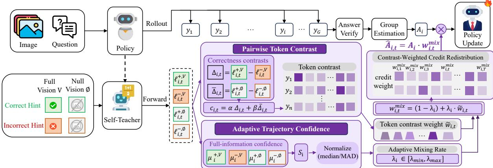  
Figure 1: Overview of PACE. A periodically refreshed teacher scores each sampled response under four counterfactual views (correct/incorrect hints × full/null vision). Pairwise token contrast yields the token contrast $c _ { i , t } ;$ adaptive trajectory confidence uses the teacher’s batch-normalized confidence on each response to set the mixing rate $\lambda _ { i } .$ , i.e., how far $c _ { i , t }$ redistributes credit among the tokens of each response.

• We propose pairwise token contrast, which removes the dependence on the student’s likelihood, cancels confidence drift shared by both hints, and assigns credit without biasing it toward either the image or the text.

• We propose adaptive trajectory confidence, which treats distinct trajectories differently by applying the token contrast more strongly where the teacher is confident and less where it is uninformative, remains stable as the teacher’s confidence drifts during training, and preserves the sign and mean of every response’s advantage.

• Extensive experiments show that PACE obtains the best average accuracy on all three main backbones across five multimodal reasoning benchmarks. We provide ablations showing that pairwise token contrast and adaptive trajectory confidence both contribute to the gains.

## 2 Related Works

RLVR for language and multimodal model reasoning. Reinforcement learning with verifiable outcome avoids a learned reward model when correctness can be checked with rules. GRPO estimates relative advantages from multiple responses to the same prompt without a separate critic (Shao et al., 2024), and multimodal variants apply this recipe to visual mathematics and general visual reasoning (Huang et al., 2026b; Meng et al., 2025). These methods generally broadcast a sequencelevel advantage across response tokens. PACE keeps the verifier and group advantage unchanged and assigns that credit at token level.

On-policy self-distillation and token-level credit assignment. On-policy distillation (Agarwal et al., 2024) and its self-distilled variants evaluate responses sampled by the student itself (Zhao et al., 2026; Yang et al., 2026; Hübotter et al., 2026; Li et al., 2026a; Pan et al., 2026). Recent work makes the same broad move toward finer credit: VCSD uses image-content removal to form a visual contrast and distills a sharpened token distribution (Liang et al., 2026); GCPO contrasts positive and negative prompts and derives token advantages from predictive divergence (Li et al., 2026b); PEPO combines a hidden-state perception prior with token entropy (Li et al., 2026c); and $\mathrm { C E P O , }$ the closest contemporaneous method, contrasts a correctanswer teacher with a wrong-answer teacher built from an already-rejected rollout to flag decisive tokens on multimodal math reasoning (Heakl et al., 2026). These methods differ from PACE in both signal and objective. VCSD does not condition the contrast on correctness, GCPO does not factor out generic visual sensitivity with a full/null factorial design, PEPO uses perception–exploration statistics rather than answer-conditioned teacher contrasts, and CEPO’s answer contrast holds the image fixed rather than crossing it with a full/null vision axis. PACE uses answer-conditioned, vision-dependent token contrast for sign-preserving GRPO credit assignment, not as a standalone distillation target.

Visual grounding and reflective multimodal RL. PAPO, VPPO, and propagation-aware visual retention prioritize visual dependence or retention during long-chain reasoning (Wang et al., 2026b; Huang et al., 2026a; Gong et al., 2026); reflectioncentric systems instead add explicit rethink or reattention stages (Wang et al., 2026a; Wan et al., 2026; Yao et al., 2026; Jian et al., 2025; Chu et al., 2025). Dependence alone is unsigned with respect to correctness, and reflection changes the sampled reasoning process. In contrast, PACE evaluates the already sampled response under correct/incorrect hints and full/null vision, then uses the resulting token contrast for token-level credit assignment without changing inference.

## 3 Preliminaries

Multimodal RLVR. Given a prompt $x = ( q , V )$ with question q and image V , the policy πθ samples G responses $\{ y _ { i } \} _ { i = 1 } ^ { G }$ , where $y _ { i } = ( y _ { i , 1 } , . . . , y _ { i , T _ { i } } )$ and a rule-based verifier assigns each response a reward $r _ { i } ~ \in ~ \{ 0 , 1 \}$ . GRPO (Shao et al., 2024) normalizes the rewards within the group into $A _ { i } =$ $( r _ { i } - \mathrm { m e a n } ( \{ r _ { j } \} ) ) / \mathrm { s t d } ( \{ r _ { j } \} )$ and maximizes the clipped surrogate

$$
\mathcal { I } ( \theta ) = \mathbb { E } \left[ \underset { i , t } { \frac { 1 } { G } } \sum _ { i , t } \frac { 1 } { T _ { i } } \operatorname* { m i n } \bigl ( \rho _ { i , t } \hat { A } _ { i , t } , \bar { \rho } _ { i , t } \hat { A } _ { i , t } \bigr ) \right]\tag{1}
$$

with ${ \hat { A } } _ { i , t } = A _ { i }$ , where $\rho _ { i , t }$ is the token-level importance ratio to the rollout policy $\pi _ { \boldsymbol { \theta } _ { \mathrm { o l d } } }$ and $\bar { \rho } _ { i , t }$ its clipped value; the KL term is disabled. Every token of a response thus receives the same credit, although errors usually localize to a few decisive tokens. RLSD (Yang et al., 2026) instead sets $\hat { A } _ { i , t } = A _ { i } \cdot \mathrm { c l i p } ( e ^ { \mathrm { s i g n } ( A _ { i } ) g _ { i , t } } , 1 - \varepsilon _ { w } , 1 + \varepsilon _ { w } )$ with the detached gain

$$
g _ { i , t } = \log \bar { \pi } ( y _ { i , t } \mid x , h _ { i } ^ { + } ) - \log \pi _ { \theta _ { \mathrm { o l d } } } ( y _ { i , t } \mid x ) ,\tag{2}
$$

where the teacher π¯ is a periodically synchronized copy of the policy and $h _ { i } ^ { + }$ is the ground-truth answer given as a hint.

Limitations of self-distilled RLVR. The gain in Eq. (2) exhibits the two challenges raised in Section 1, which in turn make the gain drift. First, $g _ { i , t }$ is measured under a single context that contains the image, so the gain cannot tell whether a token’s support comes from the image or from a languageonly pattern. Second, the same weighting is applied to every response, including those on which the teacher barely separates the privileged context from its alternatives. As a result, the single-view gain drifts: an offset in the teacher’s log-probabilities, passes into $g _ { i , t }$ directly, and log $\pi _ { \theta _ { \mathrm { o l d } } }$ changes as the policy trains, so the gain drifts even when the token’s dependence on the answer does not.

Problem formulation. We keep the verifier’s judgment of each response and only redistribute its credit among tokens, i.e., we maximize Eq. (1) with $\hat { A } _ { i , t } = A _ { i } w _ { i , t }$ , where the detached weights satisfy $w _ { i , t } > 0$ and $\begin{array} { r } { \frac { 1 } { T _ { i } } \sum _ { t } w _ { i , t } = 1 } \end{array}$ . These constraints keep the sign of $A _ { i }$ on every token and its mean over the response, and GRPO is the special case $w _ { i , t } ~ = ~ 1$ . We further write $w _ { i , t } ^ { \operatorname* { m i x } } =$ $( 1 - \lambda _ { i } ) + \lambda _ { i } \tilde { w } _ { i , t } .$ , where $\tilde { w } _ { i , t }$ is a unit-mean token weight derived from a token signal $c _ { i , t }$ and $\lambda _ { i }$ is a per-trajectory mixing rate. These issues then translate into requirements on the two factors: $c _ { i , t }$ should be measured with and without the image, and should compare views that differ only in the answer hint so that shared offsets cancel; $\lambda _ { i }$ should vary with the teacher’s confidence on each response, measured relative to the current batch. Section 4 instantiates $c _ { i , t }$ as pairwise token contrast and $\lambda _ { i }$ as adaptive trajectory confidence.

## 4 Methodology

## 4.1 Counterfactual Teacher Views

Every sampled response $y _ { i }$ is scored by the teacher $\bar { \pi }$ (a copy of the policy, hard-refreshed every 20 steps) under a $2 \times 2$ factorial design over two privileged factors: the answer hint (correct vs. incorrect) and the visual input (full vs. null), as the example illustrated in Figure 2.

Candidate-answer hints. For each response we build a positive hint $h _ { i } ^ { + }$ from the ground-truth answer, and collect the $K _ { i }$ valid negative hints $\{ h _ { i , k } ^ { - } \} _ { k = 1 } ^ { K _ { i } }$ from incorrect responses of sibling rollouts in the same GRPO group, deduplicated by their normalized final answers. Both branches share an identical template (“Privileged candidate answer: . . . ”), so the two contexts differ only in the answer content. Note that the positive branch contains a single ground-truth hint, while the negative branch aggregates $K _ { i }$ incorrect hints; this asymmetry is deliberate, reflecting the one-vs-many structure of correctness contrasts. When $K _ { i } = 0$ (no incorrect siblings in the group, or all the same answer), the pairwise contrast cannot be formed, and the trajectory falls back to single-view RLSD weights or uniform weights (details in Sec. 4.3).

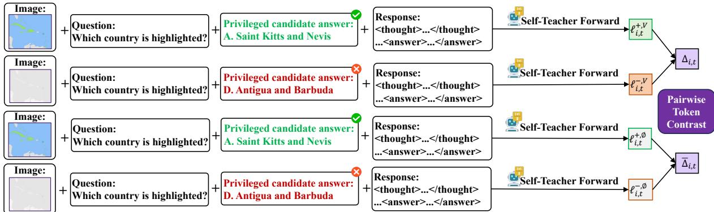  
Figure 2: The four teacher views of pairwise token contrast.

Visual-null intervention. To remove visual evidence without touching the textual context, we replace the visual-token embeddings with a fixed zero vector; we write the intervened image as $\varnothing$ Teacher-forcing $y _ { i }$ under these contexts yields the realized-token log-probabilities of the four views, where $q _ { i }$ and $V _ { i }$ are the question and image of the prompt that produced $y _ { i }$ . We write each view as $\bar { \ell } _ { i , t } ^ { a , b }$ , where the first superscript $a \ \in \ \left\{ + , - \right\}$ marks the correct or incorrect hint and the second $b \in \{ V , \emptyset \}$ the full or null image. Under the positive hint and full vision,

$$
\ell _ { i , t } ^ { + , V } = \log \bar { \pi } \big ( y _ { i , t } | q _ { i } , V _ { i } , h _ { i } ^ { + } , y _ { i , < t } \big ) ,\tag{3}
$$

and for the negative side we marginalize the $K _ { i }$ valid sibling hints in probability space:

$$
\ell _ { i , t } ^ { - , V } = \log \Bigl [ \frac { 1 } { K _ { i } } \sum _ { k = 1 } ^ { K _ { i } } \bar { \pi } \bigl ( y _ { i , t } | q _ { i } , V _ { i } , h _ { i , k } ^ { - } , y _ { i , < t } \bigr ) \Bigr ] .\tag{4}
$$

The visual-null counterparts $\ell _ { i , t } ^ { + , \emptyset }$ and $\ell _ { i , t } ^ { - , \emptyset }$ are defined identically with $V _ { i }$ replaced by ∅. All teacher scores are detached, which only weight tokens and never contribute gradients.

## 4.2 Pairwise Token Contrast

From the four views we form two correctness contrasts of the same realized token:

$$
\Delta _ { i , t } = \ell _ { i , t } ^ { + , V } - \ell _ { i , t } ^ { - , V } , \qquad \bar { \Delta } _ { i , t } = \ell _ { i , t } ^ { + , \emptyset } - \ell _ { i , t } ^ { - , \emptyset } .\tag{5}
$$

$\Delta _ { i , t }$ measures how strongly token $y _ { i , t }$ is tied to the correct answer when full vision is available; $\Delta _ { i , t }$ repeats the measurement under the visual counterfactual, exposing how much of the correctness signal survives without looking at the image. The token contrast is a weighted combination of the two contrasts:

$$
c _ { i , t } = \alpha \Delta _ { i , t } + \beta \bar { \Delta } _ { i , t } ,\tag{6}
$$

where α and $\beta$ are chosen such that $\alpha = 1 + \beta$ to maintain a unit-weight anchor on $\Delta _ { i , t }$ while varying the correction strength $\beta$ . In practice, we set $( \alpha , \beta ) \ = \ ( 1 . 5 , 0 . 5 )$ (Appendix B). With $\beta > 0$ a token whose correctness preference holds with and without the image $( \Delta _ { i , t } \approx \bar { \Delta } _ { i , t } )$ receives a token contrast ≈ $2 \Delta _ { i , t }$ , whereas a token preferring correctness only with the image $( \bar { \Delta } _ { i , t } \approx 0 )$ receives $1 . 5 \Delta _ { i , t } ;$ the null-vision contrast thus acts as a moderate second estimate rather than penalizing vision-independent tokens.

The sign of $c _ { i , t }$ indicates whether the token supports the correct answer $( c _ { i , t } > 0 )$ or the incorrect $( c _ { i , t } < 0 )$ . Whether this translates to reinforcement or suppression depends on both the token contrast and the trajectory’s verifier advantage: the token weight in Eq. (10) is constructed as sign $\left( A _ { i } \right) c _ { i , t }$ Thus, for positive trajectories $( A _ { i } > 0 )$ , tokens with $c _ { i , t } > 0$ receive larger weights and are reinforced more, while for negative trajectories $( A _ { i } < 0 )$ the same tokens receive smaller weights and are penalized less; the penalty concentrates on tokens that favor the incorrect answer.

Why pairwise contrasts? A simpler alternative is to derive token weights without contrasting a hint pair, e.g. from the visual sensitivity $\ell _ { i , t } ^ { + , V } - \ell _ { i , t } ^ { + , \emptyset }$ (the teacher’s confidence in a token with vs. without the image) or from the teacher–student gap of RLSD. Such single-view signals reflect how confident the teacher is under some context, not how much the token prefers the correct answer. The distinction matters because the teacher, refreshed from the improving policy, grows steadily more confident during training, e.g., under full vision. Such a drift shifts these signals even when the token’s true dependence on the answer or the image is unchanged, misallocating credit (Figure 5a in Appendix B.8). Each contrast in Eq. (6) avoids this: its two sides share the same teacher, response, and visual context and differ only in the hint, so the shared drift cancels in the subtraction and only the token’s preference for the correct answer remains, as detailed in Appendix B.4.

## 4.3 Adaptive Trajectory Confidence

The token contrast is not equally trustworthy on every trajectory: if the teacher fails to separate the privileged view from the degraded ones on response $y _ { i }$ , its per-token contrasts are mostly noise, and the safest choice is to reduce reliance on contrast weighting. We therefore score the teacher’s full-information confidence on each trajectory,

$$
\begin{array} { r } { S _ { i } = \mu _ { i } ^ { + , V } - \frac { 1 } { 3 } \mu _ { i } ^ { - , V } - \frac { 1 } { 3 } \mu _ { i } ^ { + , \infty } - \frac { 1 } { 3 } \mu _ { i } ^ { - , \infty } , } \end{array}\tag{7}
$$

where $\mu _ { i } ^ { + , V } , ~ \mu _ { i } ^ { - , V } , ~ \mu _ { i } ^ { + , \emptyset } , ~ \mu _ { i } ^ { - , \emptyset }$ are the withintrajectory means of the four views in Eqs. (3)–(4). $S _ { i }$ measures how much better the teacher predicts the response under the full-information view (correct hint and full vision) than under the three degraded views. It is large when the teacher achieves high confidence under full privileged information but lower certainty on any single degraded view, indicating that the response is well-resolved under the teacher’s complete knowledge. Note that $S _ { i }$ reflects overall teacher confidence rather than whether the response actually needs the image: it reduces reliance on the token contrast from trajectories where the teacher barely separates the views, but does not by itself test visual grounding, as detailed in Appendix B.5.

Because the absolute level of $S _ { i }$ drifts as the policy moves, we normalize it robustly within each micro-batch over the set V of trajectories with a valid hint pair:

$$
z _ { i } = \mathrm { c l i p } \Big ( \frac { S _ { i } - \mathrm { m e d } _ { \mathcal { V } } ( S ) } { \mathrm { M A D } _ { \mathcal { V } } ( S ) } , - \zeta , \zeta \Big ) ,\tag{8}
$$

where med and $\mathrm { M A D } _ { \mathcal { V } }$ are the median and median absolute deviation of $\{ S _ { j } \} _ { j \in \mathcal { V } }$ , and $\zeta { = } 3 .$ The normalized confidence $z _ { i }$ is then mapped to a per-

trajectory mixing rate through a sigmoid:

$$
\eta _ { i } = \sigma ( z _ { i } ) , \qquad \lambda _ { i } = \lambda _ { \operatorname* { m i n } } + \left( \lambda _ { \operatorname* { m a x } } - \lambda _ { \operatorname* { m i n } } \right) \eta _ { i } ,\tag{9}
$$

where $\sigma ( \cdot )$ is the logistic sigmoid, $\eta _ { i } ~ \in ~ ( 0 , 1 )$ $z _ { i }$ mapped to the unit interval, and the floor and ceiling of the mixing rate are $[ \lambda _ { \operatorname* { m i n } } , \lambda _ { \operatorname* { m a x } } ] =$ [0.15, 0.65] (implementation details and design rationale in Appendix B.5). The choice of $\lambda _ { \operatorname* { m i n } } =$ 0.15 reflects a conservative strategy: even when the teacher provides little signal (low $\eta _ { i } )$ , we retain some contrast weighting rather than discarding it entirely, to avoid complete reliance on responselevel verifier advantages. This partial fallback allows fine-grained credit to be guided by a weak contrast while respecting the verifier’s trajectorylevel judgment. The ceiling $\lambda _ { \mathrm { m a x } } = 0 . 6 5$ prevents any single trajectory from being dominated by potentially noisy token contrasts. $\lambda _ { i }$ varies per trajectory between this floor and ceiling; trajectories on which the teacher cannot discriminate the views receive low $\eta _ { i }$ and reduced contrast weighting, while confidently resolved trajectories receive high $\eta _ { i }$ Trajectories without a valid sibling pair (no negative hint) use single-view RLSD weights (Eq. (2)) at mixing rate $\lambda _ { \operatorname* { m i n } } ,$ a weaker fallback than the pairwise method; trajectories without any hint use uniform GRPO weights.

## 4.4 Contrast-Weighted Credit Redistribution

The token contrast enters the GRPO objective as a positive token weight built in three steps. First, the direction-aware log-weight incorporates the trajectory advantage sign to align the contrast with the reinforcement direction:

$$
s _ { i , t } = \mathrm { s i g n } ( A _ { i } ) \frac { c _ { i , t } } { \tau }\tag{10}
$$

with temperature τ, so that tokens supporting the correct answer $( c _ { i , t } > 0 )$ are reinforced more on positive trajectories and penalized less on negative ones. The log-weight is then exponentiated and clipped:

$$
\hat { w } _ { i , t } = \mathrm { c l i p } \big ( e ^ { s _ { i , t } } , u _ { \mathrm { m i n } } , u _ { \mathrm { m a x } } \big ) ,\tag{11}
$$

with $\tau { = } 1$ and lower/upper bounds $[ u _ { \mathrm { m i n } } , u _ { \mathrm { m a x } } ] =$ [0.8, 1.2], bounding the token-level weight ratio. Second, $\hat { w } _ { i , t }$ is normalized to unit mean within each response, $\begin{array} { r } { \tilde { w } _ { i , t } ~ = ~ \hat { w } _ { i , t } \Big / \left( \frac { 1 } { T _ { i } } \sum _ { t = 1 } ^ { T _ { i } } \hat { w } _ { i , t } \right) } \end{array}$ , so credit is redistributed rather than amplified. Third, the normalized weight is mixed with the uniform weight 1 at the mixing rate $\lambda _ { i } { \mathrm { : } }$

$$
w _ { i , t } ^ { \operatorname* { m i x } } = \left( 1 - \lambda _ { i } \right) + \lambda _ { i } \tilde { w } _ { i , t } , \qquad \hat { A } _ { i , t } = A _ { i } \cdot w _ { i , t } ^ { \operatorname* { m i x } } .\tag{12}
$$

Since $w _ { i , t } ^ { \operatorname* { m i x } } > 0$ and $\tilde { w } _ { i , t }$ has unit mean, $w _ { i , t } ^ { \operatorname* { m i x } }$ satisfies the constraints in Sec. 3, and the redistributed advantages replace $A _ { i }$ in the GRPO surrogate:

$$
\mathcal { T } _ { \mathrm { P A C E } } ( \theta ) = \mathbb { E } \left[ \frac { 1 } { G } \sum _ { i , t } \frac { 1 } { T _ { i } } \operatorname* { m i n } \bigl ( \rho _ { i , t } \hat { A } _ { i , t } , \bar { \rho } _ { i , t } \hat { A } _ { i , t } \bigr ) \right] .\tag{13}
$$

Coefficient-level guarantees. Since $w _ { i , t } ^ { \operatorname* { m i x } } > 0$ and $\begin{array} { r } { \frac { 1 } { T _ { i } } \sum _ { t } w _ { i , t } ^ { \mathrm { m i x } } = 1 } \end{array}$ , the token advantages satisfy two algebraic properties at the coefficient level: (1) mean preservation, $\begin{array} { r } { \frac { 1 } { T _ { i } } \sum _ { t } \hat { A } _ { i , t } = A _ { i } } \end{array}$ , and (2) sign preservation, sign $( \hat { A } _ { i , t } ) = \mathrm { s i g n } ( A _ { i } )$ . These properties hold in the explicit formulas before policy optimization and ensure that the verifier reward determines whether the trajectory is reinforced or suppressed, while the token contrast redistributes credit among tokens within that fixed direction and magnitude. They do not extend to the clipped, nonlinear PPO update in Eq. (13), whose per-token gradients also depend on the clipping regime (Appendix B.6). Algorithm 1 in Appendix B summarizes one complete PACE training step.

## 5 Experiments

## 5.1 Experimental Setup

Baselines. We compare PACE with main multimodal RLVR methods. GRPO (Shao et al., 2024) is the baseline that broadcasts a uniform sequencelevel advantage to every token. OPSD (Zhao et al., 2026) trains the student policy by the privileged teacher with self-generated rollouts. RLSD (Yang et al., 2026) and RLCSD (Pan et al., 2026) are self-distilled RLVR methods that derive token-level credit from answer-conditioned teacher–student contrasts, and are the closest to our approach. PAPO (Wang et al., 2026b) and VPPO (Huang et al., 2026a) inject visually grounded signals into the RL objective, addressing grounding from a direction orthogonal to token credit.

Training. PACE, GRPO, RLSD, RLCSD, PAPO, and VPPO are trained under a shared configuration on the MMFineReason-123K training split by RLSD, which derives from MMFineReason (Lin et al., 2026) and keeps only the final conclusion after the </think> tag as supervision. All methods are trained for 200 optimization steps with

8 rollouts per prompt (Appendix 3). To evaluate scalability and generalizability across diverse architectures and model scales, we use Qwen3- VL-8B-Instruct (Bai et al., 2025a), Qwen2.5-VL-7B-Instruct (Bai et al., 2025b), and InternVL3.5- 4B (Wang et al., 2025) for training. OPSD uses its original implementation with rank-64 LoRA (Hu et al., 2021) and the ms-swift trainer (Appendix 4). Checkpoint selection is based on the training reward over the final 50 steps.

Benchmarks. We evaluate on five multimodal reasoning benchmarks. GSM8K-V (Yuan et al., 2025) renders grade-school math word problems as images, directly testing whether a model reads quantitative content from pixels. LogicVista (Xiao et al., 2024) tests logical reasoning over visual scenes. MMMU (Yue et al., 2024) is a collegelevel, multi-discipline multimodal understanding benchmark. MathVision (Wang et al., 2024) collects competition-level mathematical problems in visual contexts. MathVista (Lu et al., 2024) aggregates a broad range of mathematical and visual reasoning tasks. All benchmarks are evaluated with VLMEvalKit (Duan et al., 2024).

## 5.2 Main Results

PACE is best on every benchmark with 8B model. As shown in Table 1, on Qwen3-VL-8B-Instruct, PACE ranks first on all five benchmarks and reaches 58.47% on average, +6.38 over Base, +3.64 over GRPO, and +1.22 over the strongest baseline VPPO. The gains over Base are largest on LogicVista (+8.95), MathVision (+8.22), and MMMU (+7.67), and smallest on MathVista (+1.90), where all methods lie within 2.7 points of each other. VPPO is second on every benchmark, so the margin over it (0.60–1.79 points per benchmark) is the tightest comparison. PACE reaches it at about a third of VPPO’s per-step training time, as detailed in Appendix B.9. Appendix D visualizes PACE’s token credit on three examples.

Pairwise token contrast improves over teacher–student gaps. RLSD and RLCSD share PACE’s training stack and differ mainly in how token credit is computed, so this comparison isolates the credit signal. PACE outperforms RLSD by 3.09 points and RLCSD by 3.96 points on average, with the largest gaps on LogicVista (+5.59 over RLSD, +6.26 over RLCSD) and MathVision (+4.11 and +5.06). RLCSD, which contrasts correct and incorrect hints without the vision axis or adaptive trajectory confidence, gains 2.42 points over Base, fewer than GRPO (2.74), while PACE gains 6.38. OPSD, trained with LoRA adapters in a separate framework, falls below Base, which we attribute to its different optimization setup rather than to on-policy distillation itself. The same pattern holds on the other two backbones: RLSD improves over GRPO by at most 0.55 points , while PACE improves over GRPO by 3.64, 1.48, and 1.12 points.

<table><tr><td>Model</td><td>Method</td><td>GSM8K-V</td><td>LogicVista</td><td>MMMU</td><td>MathVision</td><td>MathVista</td><td>Average</td></tr><tr><td rowspan="7">Qwen3-VL-8B Instruct</td><td>Base</td><td>22.97</td><td>54.36</td><td>61.33</td><td>45.79</td><td>76.00</td><td>52.09</td></tr><tr><td>GRPO</td><td>26.61</td><td>58.84</td><td>65.89</td><td>47.11</td><td>75.70</td><td>54.83 (↑2.74)</td></tr><tr><td>PAPO</td><td>25.47</td><td>59.73</td><td>65.44</td><td>50.03</td><td>76.10</td><td>55.36 (↑3.27)</td></tr><tr><td>VPPO</td><td>26.99</td><td>61.52</td><td>67.67</td><td>52.80</td><td>77.30</td><td>57.25 (↑5.16)</td></tr><tr><td>OPSD</td><td>23.05</td><td>54.36</td><td>61.67</td><td>42.86</td><td>75.20</td><td>51.43 (↓0.66)</td></tr><tr><td>RLSD</td><td>26.38</td><td>57.72</td><td>66.22</td><td>49.90</td><td>76.70</td><td>55.38 (↑3.29)</td></tr><tr><td>RLCSD</td><td>25.47</td><td>57.05</td><td>64.00</td><td>48.95</td><td>77.10</td><td>54.51 (↑2.42)</td></tr><tr><td rowspan="8">Instruct</td><td>PACE (Ours)</td><td>28.13</td><td>63.31</td><td>69.00</td><td>54.01</td><td>77.90</td><td>58.47 (↑6.38)</td></tr><tr><td>Base</td><td>15.96</td><td>45.08</td><td>51.28</td><td>25.52</td><td>67.80</td><td>41.13</td></tr><tr><td>GRPO</td><td>17.49</td><td>48.15</td><td>52.97</td><td>27.72</td><td>72.12</td><td>43.69 (↑2.56)</td></tr><tr><td>PAPO</td><td>18.33</td><td>46.36</td><td>53.83</td><td>27.42</td><td>70.97</td><td>43.38 (↑2.26)</td></tr><tr><td>Qwen2.5-VL-7B VPPO</td><td>16.40</td><td>50.00</td><td>55.53</td><td>27.61</td><td>71.30</td><td>44.17 (↑3.04)</td></tr><tr><td>OPSD</td><td>16.38</td><td>47.15</td><td>53.25</td><td>26.49</td><td>69.12</td><td>42.48 (↑1.35)</td></tr><tr><td>RLSD RLCSD</td><td>17.55</td><td>46.81</td><td>53.80</td><td>28.90</td><td>72.43</td><td>43.90 (↑2.77)</td></tr><tr><td>PACE (Ours)</td><td>16.24 18.27</td><td>45.02 49.89</td><td>52.19 55.67</td><td>26.13</td><td>68.42</td><td>41.60 (↑0.48)</td></tr><tr><td rowspan="8">InternVL3.5-4B</td><td></td><td></td><td></td><td></td><td>29.01</td><td>73.00</td><td>45.17 (↑4.04)</td></tr><tr><td>Base GRPO</td><td>14.76 14.85</td><td>49.13</td><td>61.76</td><td>33.60</td><td>70.47</td><td>45.95</td></tr><tr><td>PAPO</td><td>14.74</td><td>51.09</td><td>62.01</td><td>34.89</td><td>71.58</td><td>46.88 (↑0.93)</td></tr><tr><td>VPPO</td><td>15.68</td><td>49.69</td><td>62.28</td><td>34.67</td><td>71.24</td><td>46.53 (↑0.58)</td></tr><tr><td>OPSD</td><td>14.53</td><td>52.52</td><td>62.36</td><td>34.46</td><td>72.03</td><td>47.41 (↑1.46)</td></tr><tr><td>RLSD</td><td>15.92</td><td>52.27 50.56</td><td>61.03 61.56</td><td>33.78</td><td>71.03</td><td>46.53 (↑0.58)</td></tr><tr><td>RLCSD</td><td>14.69</td><td>49.22</td><td>61.55</td><td>34.66 33.75</td><td>71.71 70.37</td><td>46.88 (↑0.93)</td></tr><tr><td>PACE (Ours)</td><td>15.54</td><td>52.80</td><td>63.78</td><td>35.26</td><td>72.60</td><td>45.92 (↓0.03) 48.00 (↑2.05)</td></tr></table>

Table 1: Accuracy (%) (mean@8) on five multimodal reasoning benchmarks. Parenthesized values denote percentage-point change from Base. Bold indicates best results; underline indicates second best.

PACE leads across different backbones. The advantage is not specific to Qwen3-VL-8B. On Qwen2.5-VL-7B-Instruct, PACE achieves the best average accuracy (45.17%, +4.04 over Base), ahead of VPPO (44.17%), RLSD (43.90%), and GRPO (43.69%). It ranks first on MMMU, MathVision, and MathVista and is within 0.11 points of the best method on GSM8K-V and LogicVista. On InternVL3.5-4B, which comes from a different model family, PACE again achieves the best average accuracy (48.00%, +2.05 over Base) and ranks first on four of five benchmarks, with RLSD only marginally better on GSM8K-V (15.92 vs. 15.54). On both backbones, PACE improves over Base on every benchmark rather than on a single task.

The gain over baselines narrows with smaller self-teachers. The gain of PACE over base model shrinks with backbone size: +6.38 points on

Qwen3-VL-8B-Instruct, +4.04 points on Qwen2.5- VL-7B-Instruct, and +2.05 points on InternVL3.5- 4B, while still remaining ahead of the strongest baseline. Since the self-teacher is a copy of the policy, a smaller backbone is less able to solve the hard training problems even with privileged hints, which makes its token contrasts noisier and limits how much token-level credit assignment can add over uniform credit.

## 5.3 Ablation Study

We ablate PACE on Qwen3-VL-8B-Instruct and report average accuracy over the five benchmarks in Table 2 and Figure 3; per-benchmark results are shown in Appendix C.3.

Pairwise token contrast is necessary. Table 2a compares hint contrasts, i.e. $\Delta _ { i , t }$ or $\bar { \Delta } _ { i , t }$ in Eq. (5), combined as full vision only or full ± null vision, against the vision gap $\ell ^ { + , V } - \ell ^ { + , \emptyset }$ , which uses no hint contrast; Fixed λ sets $\lambda = 0 . 5$ for all trajectories. Replacing hint contrasts with the vision gap drops accuracy to 51.05%, below Base (52.09%), with the largest loss on MathVision (40.95% vs. 45.79% for Base). With a fixed mixing rate, all hintcontrast variants reach 57.06–57.68%, well above GRPO (54.83%) and on par with VPPO (57.25%). This 0.62 point spread is small beside the 6 point drop of the vision gap, so contrasting paired hints matters more than how the full- and null-vision contrasts are combined. Consistent with this, the vision gap drifts during training while the hint contrasts stay stable, as detailed in Appendix B.8.

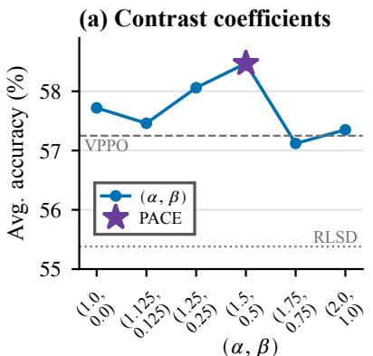

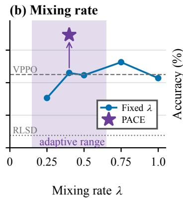

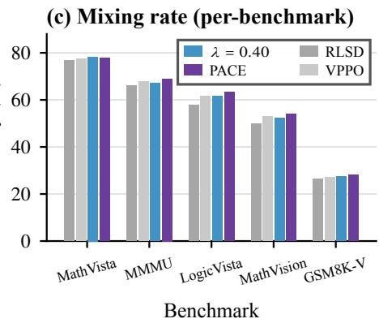  
Figure 3: Ablations on Qwen3-VL-8B-Instruct. (a) Contrast coefficients $( \alpha , \beta )$ with the adaptive mixing rate $\lambda _ { i } .$ . (b) Fixed mixing rate λ. (c) Per-benchmark accuracy of fixed λ and PACE.

<table><tr><td>(a) Pairwise token contrast</td><td>Fixed λ</td><td>Adaptive  $\lambda _ { i }$ </td></tr><tr><td>Vision gap (no hint contrast)</td><td>51.05</td><td></td></tr><tr><td>Hint contrast, full vision</td><td>57.06</td><td>57.72</td></tr><tr><td>Hint contrast, full – null vision</td><td>57.68</td><td>57.34</td></tr><tr><td>Hint contrast, full + null vision</td><td>57.23</td><td>58.47</td></tr><tr><td>(b) Adaptive traj. confidence</td><td>λ</td><td>Avg.</td></tr><tr><td> $S _ { \mathrm { m e a n } }$  (mean-based)</td><td>[0.10,0.65]</td><td>57.04</td></tr><tr><td> $S _ { \mathrm { m e a n } }$  (mean-based)</td><td>[0.15,0.75]</td><td>57.42</td></tr><tr><td> $S _ { \mathrm { m e a n } }$  (mean-based)</td><td>[0.15,0.65]</td><td>58.47</td></tr><tr><td> $S _ { \mathrm { m e a n } }$  (mean-based)</td><td>[0.25,0.65]</td><td>57.60</td></tr><tr><td> $S _ { \mathrm { s t d } }$  (dispersion-based)</td><td>[0.25,0.65]</td><td>57.62</td></tr><tr><td>Mix of  $\bar { S _ { \mathrm { m e a n } } }$  and  $S _ { \mathrm { s t d } }$ </td><td>[0.25,0.65]</td><td>57.64</td></tr></table>

Table 2: Ablation results (average accuracy, %).

Moderate counterfactual correction works best. Figure 3a varies the weights $( \alpha , \beta )$ of the two contrasts in Eq. (6) under adaptive mixing rate. Across $( \alpha , \beta )$ , average accuracy peaks at the default (1.5, 0.5), followed by (1.25, 0.25). Removing the null-vision contrast (1, 0) or weighting it heavily $( \beta \ge 0 . 7 5 )$ degrades accuracy.

Adaptive trajectory confidence adds gain beyond a fixed mixing rate. Figure 3b and c replace the adaptive $\lambda _ { i }$ with a fixed rate shared by all trajectories. With full + null vision contrast, adaptive trajectory confidence improves over fixed $\lambda = 0 . 5$ by 1.24 points. Fixing $\lambda = 0 . 4 0$ , the median of the adaptive $\lambda _ { i } .$ , reaches only 57.30%, so 1.17 of the 1.24 points come from per-trajectory adaptation rather than from the average rate. No fixed rate exceeds 57.63% (Figure 3b), and the best fixed rate varies across benchmarks (Figure 3c). The adaptive rate outperforms every fixed rate on GSM8K-V, MMMU, and MathVision.

The range of the mixing rate matters more than how confidence is measured. Table 2b varies the range $[ \lambda _ { \operatorname* { m i n } } , \lambda _ { \operatorname* { m a x } } ]$ and the confidence $S _ { i }$ . Besides the default $S _ { \mathrm { m e a n } }$ (Eq. (7)), the dispersion-based $S _ { \mathrm { s t d } } = { \textstyle \frac { 1 } { 2 } } ( \sigma _ { i } ^ { + , \emptyset } + \sigma _ { i } ^ { - , \emptyset } ) - { \textstyle \frac { 1 } { 2 } } ( \sigma _ { i } ^ { + , V } + \sigma _ { i } ^ { - , V } )$ measures how much more dispersed the teacher’s token log-probabilities become without the image, where $\bar { \sigma } _ { i } ^ { a , b }$ is the within-trajectory standard deviation of $\ell _ { i , t } ^ { a , b }$ . Mix normalizes $S _ { \mathrm { m e a n } }$ and $S _ { \mathrm { s t d } }$ separately with Eq. (8), giving $z _ { i } ^ { \mathrm { m e a n } }$ and $z _ { i } ^ { \mathrm { s t d } }$ , and uses $\begin{array} { r } { \eta _ { i } = \sigma \big ( \frac { 1 } { 2 } z _ { i } ^ { \mathrm { m e a n } } + \frac { 1 } { 2 } z _ { i } ^ { \mathrm { s t d } } \big ) } \end{array}$ in Eq. (9). Relative to the default [0.15, 0.65], lowering the floor to 0.10, raising it to 0.25, or raising the ceiling to 0.75 all lower accuracy: low-confidence trajectories still benefit from a moderate amount of contrast weighting, while high-confidence ones should not rely on it too heavily. At [0.25, 0.65], the three ways of measuring confidence perform similarly (57.60– 57.64%), so within the tested range the choice of $S _ { i }$ matters less than the range of $\lambda _ { i }$

## 6 Conclusion

This paper presents PACE, a method for selfdistilled multimodal reasoning RLVR that assigns credit at two levels: pairwise token contrast decides which tokens of a response receive more credit, and adaptive trajectory confidence decides how far that credit is redistributed on each response. Our experiments show that hint contrasts give more stable token credit than single-view signals, which drift during training. Normalizing trajectory confidence within each batch keeps the mixing rate stable throughout training. With these designs, PACE achieves the best average accuracy on evaluated benchmarks with models across different model families and model sizes from 4B to 8B.

## Limitations

Pairwise token contrast cancels only offsets shared by paired hints, and the null-vision intervention cannot rule out language shortcuts that correlate with the correct answer. The trajectory confidence that sets the mixing rate measures how well the teacher separates the full-information view from the degraded ones, not whether a response actually needs the image, so a high mixing rate does not guarantee visual grounding (Appendix B.5). The sign- and mean-preserving properties hold for the token weights, not for the clipped PPO update. Gains are smaller on smaller backbones such as InternVL3.5-4B. On Qwen3-VL-2B-Instruct, PACE does not achieve the best average (Appendix C.2). We attribute this to the training data. Following RLSD, MMFineReason-123K keeps only problems that Qwen3-VL-4B-Thinking fails in all four rollouts, and on such hard problems smaller self-teachers remain unreliable even with privileged hints, so their token contrasts are noisier. Our experiments cover multimodal mathematical and logical reasoning with verifiable answers. Whether the gains transfer to other tasks remains to be tested. Finally, scoring four teacher views adds training cost, although inference is unaffected.

## References

Rishabh Agarwal, Nino Vieillard, Yongchao Zhou, Piotr Stanczyk, Sabela Ramos Garea, Matthieu Geist, and Olivier Bachem. 2024. On-policy distillation of language models: Learning from self-generated mistakes. In International Conference on Learning Representations, volume 2024, pages 21246–21263.

Shuai Bai, Yuxuan Cai, Ruizhe Chen, Keqin Chen, Xionghui Chen, Zesen Cheng, Lianghao Deng, Wei Ding, Chang Gao, Chunjiang Ge, et al. 2025a. Qwen3-vl technical report. arXiv preprint arXiv:2511.21631.

Shuai Bai, Keqin Chen, Xuejing Liu, Jialin Wang, Wenbin Ge, Sibo Song, Kai Dang, Peng Wang, Shijie Wang, Jun Tang, Humen Zhong, Yuanzhi Zhu, Mingkun Yang, Zhaohai Li, Jianqiang Wan, Pengfei Wang, Wei Ding, Zheren Fu, Yiheng Xu, and 8 others. 2025b. Qwen2.5-vl technical report. Preprint, arXiv:2502.13923.

Xu Chu, Xinrong Chen, Guanyu Wang, Zhijie Tan, Kui Huang, Wenyu Lv, Tong Mo, and Weiping Li. 2025. Qwen look again: Guiding vision-language reasoning models to re-attention visual information. arXiv preprint arXiv:2505.23558.

Haodong Duan, Junming Yang, Yuxuan Qiao, Xinyu Fang, Lin Chen, Yuan Liu, Xiaoyi Dong, Yuhang

Zang, Pan Zhang, Jiaqi Wang, et al. 2024. Vlmevalkit: An open-source toolkit for evaluating large multi-modality models. In Proceedings ofthe 32nd ACM international conference on multimedia, pages 11198–11201.

Xuan Gong, Hanbo Huang, Hao Zheng, Yiran Zhang, Wenbin Dai, Weishu Zhao, and Shiyu Liang. 2026. Reflection anchors for propagation-aware visual retention in long-chain multimodal reasoning. arXiv preprint arXiv:2605.09614.

Daya Guo, Dejian Yang, Haowei Zhang, Junxiao Song, Peiyi Wang, Qihao Zhu, Runxin Xu, Ruoyu Zhang, Shirong Ma, Xiao Bi, et al. 2025. Deepseek-r1 incentivizes reasoning in llms through reinforcement learning. Nature, 645(8081):633–638.

Yuhang He, Haodong Wu, Siyi Liu, Hongyu Ge, Hange Zhou, Keyi Wu, Zhuo Zheng, Qihong Lin, Zixin Zhong, and Yongqi Zhang. 2026. Rethinking tokenlevel credit assignment in rlvr: A polarity-entropy analysis. arXiv e-prints, pages arXiv–2604.

Ahmed Heakl, Abdelrahman M Shaker, Youssef Mohamed, Rania Elbadry, Omar Fetouh, Fahad Shahbaz Khan, and Salman Khan. 2026. Cepo: Rlvr self-distillation using contrastive evidence policy optimization. arXiv preprint arXiv:2605.19436.

Edward J Hu, Yelong Shen, Phillip Wallis, Zeyuan Allen-Zhu, Yuanzhi Li, Shean Wang, Lu Wang, and Weizhu Chen. 2021. Lora: Low-rank adaptation of large language models. arXiv preprint arXiv:2106.09685.

Siyuan Huang, Xiaoye Qu, Yafu Li, Yun Luo, Zefeng He, Daizong Liu, and Yu Cheng. 2026a. Spotlight on token perception for multimodal reinforcement learning. In International Conference on Learning Representations, volume 2026, pages 103291–103325.

Wenxuan Huang, Bohan Jia, Shaosheng Cao, Zheyu Ye, Zhe Xu, Yao Hu, Shaohui Lin, et al. 2026b. Visionr1: Incentivizing reasoning capability in multimodal large language models. In International Conference on Learning Representations, volume 2026, pages 63794–63812.

Jonas Hübotter, Frederike Lübeck, Lejs Behric, Anton Baumann, Marco Bagatella, Daniel Marta, Ido Hakimi, Idan Shenfeld, Thomas Kleine Buening, Carlos Guestrin, et al. 2026. Reinforcement learning via self-distillation. arXiv preprint arXiv:2601.20802.

Pu Jian, Junhong Wu, Wei Sun, Chen Wang, Shuo Ren, and Jiajun Zhang. 2025. Look again, think slowly: Enhancing visual reflection in vision-language models. In Proceedings ofthe 2025 Conference on Empirical Methods in Natural Language Processing, pages 9262–9281.

Gengsheng Li, Tianyu Yang, Junfeng Fang, Mingyang Song, Mao Zheng, Haiyun Guo, Dan Zhang, Jinqiao Wang, and Tat-Seng Chua. 2026a. Unifying grouprelative and self-distillation policy optimization via sample routing. arXiv preprint arXiv:2604.02288.

Shufan Li, Konstantinos Kallidromitis, Akash Gokul, Yuta Kyuragi, and Aditya Grover. 2026b. Guidance contrastive token credit assignment for discrete policy optimization. arXiv preprint arXiv:2605.29198.

Yunheng Li, Hangyi Kuang, Hengrui Zhang, Jiangxia Cao, Zhaojie Liu, Qibin Hou, and Ming-Ming Cheng. 2026c. Rethinking token-level policy optimization for multimodal chain-of-thought. arXiv preprint arXiv:2603.22847.

Yijun Liang, Yunjie Tian, Yijiang Li, Yuqi Jia, Furong Huang, Tianyi Zhou, and Di Fu. 2026. Visual contrastive self-distillation. arXiv preprint arXiv:2607.21556.

Honglin Lin, Zheng Liu, Yun Zhu, Chonghan Qin, Juekai Lin, Xiaoran Shang, Conghui He, Wentao Zhang, and Lijun Wu. 2026. Mmfinereason: Closing the multimodal reasoning gap via open data-centric methods. arXiv preprint arXiv:2601.21821.

Pan Lu, Hritik Bansal, Tony Xia, Jiacheng Liu, Chunyuan Li, Hannaneh Hajishirzi, Hao Cheng, Kai-Wei Chang, Michel Galley, and Jianfeng Gao. 2024. Mathvista: Evaluating mathematical reasoning of foundation models in visual contexts. In International Conference on Learning Representations, volume 2024, pages 23439–23554.

Fanqing Meng, Lingxiao Du, Zongkai Liu, Zhixiang Zhou, Quanfeng Lu, Daocheng Fu, Tiancheng Han, Botian Shi, Wenhai Wang, Junjun He, et al. 2025. Mm-eureka: Exploring the frontiers of multimodal reasoning with rule-based reinforcement learning. arXiv preprint arXiv:2503.07365.

Leyi Pan, Shuchang Tao, Yunpeng Zhai, Lingzhe Zhang, Zhaoyang Liu, Bolin Ding, Aiwei Liu, and Lijie Wen. 2026. Rlcsd: Reinforcement learning with contrastive on-policy self-distillation. arXiv preprint arXiv:2606.11709.

Zhihong Shao, Peiyi Wang, Qihao Zhu, Runxin Xu, Junxiao Song, Xiao Bi, Haowei Zhang, Mingchuan Zhang, YK Li, Yang Wu, et al. 2024. Deepseekmath: Pushing the limits of mathematical reasoning in open language models. arXiv preprint arXiv:2402.03300.

Guangming Sheng, Chi Zhang, Zilingfeng Ye, Xibin Wu, Wang Zhang, Ru Zhang, Yanghua Peng, Haibin Lin, and Chuan Wu. 2025. Hybridflow: A flexible and efficient rlhf framework. In Proceedings ofthe Twentieth European Conference on Computer Systems, pages 1279–1297.

Zhongwei Wan, Zhihao Dou, Che Liu, Yu Zhang, Dongfei Cui, Qinjian Zhao, Hui Shen, Jing Xiong, Yi Xin, Yifan Jiang, et al. 2026. Srpo: Enhancing multimodal llm reasoning via reflection-aware reinforcement learning. Advances in Neural Information Processing Systems, 38:153676–153713.

Haozhe Wang, Chao Qu, Zuming Huang, Wei Chu, Fangzhen Lin, and Wenhu Chen. 2026a. Vlrethinker: Incentivizing self-reflection of visionlanguage models with reinforcement learning. Advances in Neural Information Processing Systems, 38:30865–30891.

Ke Wang, Junting Pan, Weikang Shi, Zimu Lu, Houxing Ren, Aojun Zhou, Mingjie Zhan, and Hongsheng Li. 2024. Measuring multimodal mathematical reasoning with math-vision dataset. Advances in Neural Information Processing Systems, 37:95095–95169.

Weiyun Wang, Zhangwei Gao, Lixin Gu, Hengjun Pu, Long Cui, Xingguang Wei, Zhaoyang Liu, Linglin Jing, Shenglong Ye, Jie Shao, et al. 2025. Internvl3. 5: Advancing open-source multimodal models in versatility, reasoning, and efficiency. arXiv preprint arXiv:2508.18265.

Zhenhailong Wang, Xuehang Guo, Sofia Stoica, Haiyang Xu, Hongru Wang, Hyeonjeong Ha, Xiusi Chen, Yangyi Chen, Ming Yan, Fei Huang, et al. 2026b. Perception-aware policy optimization for multimodal reasoning. In International Conference on Learning Representations, volume 2026, pages 80502–80530.

Yijia Xiao, Edward Sun, Tianyu Liu, and Wei Wang. 2024. Logicvista: Multimodal llm logical reasoning benchmark in visual contexts. arXiv preprint arXiv:2407.04973.

Chenxu Yang, Chuanyu Qin, Qingyi Si, Minghui Chen, Naibin Gu, Dingyu Yao, Zheng Lin, Weiping Wang, Jiaqi Wang, and Nan Duan. 2026. Self-distilled rlvr. arXiv preprint arXiv:2604.03128.

Huanjin Yao, Jiaxing Huang, Wenhao Wu, Jingyi Zhang, Yibo Wang, Shunyu Liu, Yingjie Wang, Yuxin Song, Haocheng Feng, Li Shen, et al. 2026. Mulberry: Empowering mllm with o1-like reasoning and reflection via collective monte carlo tree search. Advances in Neural Information Processing Systems, 38:29918– 29952.

Fan Yuan, Yuchen Yan, Yifan Jiang, Haoran Zhao, Tao Feng, Jinyan Chen, Yanwei Lou, Wenqi Zhang, Yongliang Shen, Weiming Lu, et al. 2025. Gsm8k-v: Can vision language models solve grade school math word problems in visual contexts. arXiv preprint arXiv:2509.25160.

Xiang Yue, Yuansheng Ni, Kai Zhang, Tianyu Zheng, Ruoqi Liu, Ge Zhang, Samuel Stevens, Dongfu Jiang, Weiming Ren, Yuxuan Sun, et al. 2024. Mmmu: A massive multi-discipline multimodal understanding and reasoning benchmark for expert agi. In Proceedings of the IEEE/CVF conference on computer vision and pattern recognition, pages 9556–9567.

Siyan Zhao, Zhihui Xie, Mengchen Liu, Jing Huang, Guan Pang, Feiyu Chen, and Aditya Grover. 2026. Self-distilled reasoner: On-policy selfdistillation for large language models. arXiv preprint arXiv:2601.18734.

Yuze Zhao, Jintao Huang, Jinghan Hu, Xingjun Wang, Yunlin Mao, Daoze Zhang, Zeyinzi Jiang, Zhikai Wu, Baole Ai, Ang Wang, Wenmeng Zhou, and Yingda Chen. 2024. Swift:a scalable lightweight infrastructure for fine-tuning. Preprint, arXiv:2408.05517.

## A Related Works

Outcome-verifiable reinforcement learning. RLVR uses automatically checkable outcomes to avoid dense process supervision. GRPO estimates a relative advantage from multiple responses to one prompt without a separate value model (Shao et al., 2024), while subsequent systems study exploration, clipping, and training stability (Guo et al., 2025). Multimodal RLVR transfers this recipe to visual mathematics and general visual reasoning (Huang et al., 2026b; Meng et al., 2025). The common limitation relevant to PACE is that a scalar response-level advantage is broadcast to every valid response token. PACE keeps this verifier-defined direction and changes only the allocation of credit within the sampled trajectory.

On-policy distillation and self-distillation. Onpolicy distillation trains on prefixes and responses sampled by the student, reducing the mismatch between training trajectories and inference behavior (Agarwal et al., 2024; Zhao et al., 2026). Selfdistilled RLVR methods instead let a single model play both roles: an EMA or periodically synchronized copy of the actor is given privileged context and used to score the same realized tokens. RLSD uses a privileged answer-conditioned teacher–student likelihood gap as a bounded tokencredit signal while anchoring the update sign to the verifier (Yang et al., 2026); SDPO instead conditions the self-teacher on rich textual feedback (e.g., an error explanation) rather than the ground-truth answer and distills the feedback-informed distribution densely into the student (Hübotter et al., 2026); SRPO observes that self-distillation supervision is uninformative on already-correct rollouts and routes correct samples to GRPO while only incorrect samples receive dense self-distillation, with an entropy-aware weight on the teacher target (Li et al., 2026a). RLCSD contrasts correct and incorrect answer hints to suppress components shared by both conditions (Pan et al., 2026). PACE extends this line by asking whether the correctness contrast is specifically supported by the visual input.

Recent token-level credit assignment. Several contemporaneous papers also move beyond uniform sequence advantages. VCSD removes image content to create a visual contrast between original and content-erased inputs, then distills a sharpened full token distribution (Liang et al., 2026). GCPO contrasts predictions under positive and negative prompts and uses a predictive-divergence statistic to form per-token advantages (Li et al., 2026b). PEPO derives a perception prior from hidden-state similarity and combines it with token entropy through a smooth gate (Li et al., 2026c). CEPO is the closest contemporaneous method: it also asks whether a token is favored by a correct answer hint and disfavored by an incorrect one, built from an existing rejected rollout in the same batch, and uses the resulting agreement as a decisivetoken signal on multimodal math reasoning (Heakl et al., 2026). Orthogonally, a polarity–entropy analysis argues that token entropy upper-bounds how much hindsight credit a token can absorb and reallocates GRPO advantages by crossing this capacity term with reward polarity (He et al., 2026). PACE differs from all of these in three ways. First, its raw statistic is a four-view difference-in-differences: two correctness contrasts, $\Delta _ { i , t }$ under observed vision and $\bar { \Delta } _ { i , t }$ under nulled vision (Eq. (5)), are combined into the token contrast $c _ { i , t }$ (Eq. (6)), rather than relying on a single visual contrast, prompt divergence, perception–entropy score, or an answer contrast alone. Unlike CEPO, whose two teacher views vary only the answer hint with the image held fixed, PACE’s 2 × 2 design crosses the answer hint with a full/null vision axis, so it can attribute the correctness contrast to the visual input specifically rather than to the hint alone. Second, the positive/negative views are answer candidates, so the statistic tests visual support for correctness rather than generic input sensitivity or token entropy. Third, $c _ { i , t }$ is used as a detached signal for sign-preserving, mean-conserving GRPO tokenlevel credit assignment; it is not itself a distillation target and is interpreted as a contrastive signal, not a causal effect.

Visual grounding and visual retention. PAPO and VPPO prioritize tokens with stronger visual dependence, and propagation-aware objectives study whether visual information survives along long multimodal chains (Wang et al., 2026b; Huang et al., 2026a; Gong et al., 2026). These methods motivate measuring vision-aware token signals, but visual dependence is unsigned with respect to the answer: a wrong interpretation can also be highly image-sensitive. PACE subtracts the visual sensitivity associated with an incorrect answer hint from the sensitivity associated with a correct hint, targeting correctness-aligned visual evidence.

Algorithm 1 PACE training step   
Require: policy $\pi _ { \theta } .$ , teacher $\bar { \pi }$ (copied from $\pi _ { \theta }$   
every 20 steps), rule-based verifier   
1: Sample $G$ responses $\{ y _ { i } \} _ { i = 1 } ^ { G }$ per prompt from   
$\pi _ { \boldsymbol { \theta } _ { \mathrm { o l d } } } ;$ compute rewards $r _ { i }$ and advantages $A _ { i }$   
2: Build hints: $h _ { i } ^ { + }$ from ground truth; $\{ h _ { i , k } ^ { - } \}$ from   
incorrect siblings   
3: Teacher-force each $y _ { i }$ under the four teacher   
views ▷ Eq. (4)   
4: Pairwise token contrast: compute token con  
trast $c _ { i , t }$ ▷   
Eqs. (5)–(6)   
5: Adaptive trajectory confidence: confidence $S _ { i } .$   
$z _ { i } , \eta _ { i } , \lambda _ { i }$ ▷ Eqs. (7)–(9)   
6: Redistribute: $\hat { A } _ { i , t } = A _ { i } \cdot w _ { i , t } ^ { \operatorname* { m i x } }$ ▷   
Eqs. (11)–(12)   
7: PPO-clipped policy update on $\mathcal { I } _ { P A C E }$ ▷   
Eq. (13)

Reflection and re-attention. Another family of multimodal RL methods adds reflection, search, or explicit re-attention to recover missing visual evidence (Wang et al., 2026a; Wan et al., 2026; Yao et al., 2026; Jian et al., 2025; Chu et al., 2025). Those approaches modify the reasoning process or introduce additional stages. PACE is complementary: it scores the trajectory already sampled by the policy under controlled answer and visual contexts, and uses the resulting token contrast to assign credit without adding an inference-time reflection module.

## B Implementation Details

## B.1 Training Procedure

Algorithm 1 walks through one PACE optimization step end to end. Given a batch of prompts, the old policy $\pi _ { \theta _ { \mathrm { o l d } } }$ samples G responses per prompt, and the rule-based verifier scores them to form group-relative advantages $A _ { i }$ (Sec. 3). We then build the answer hints: a single positive hint $h _ { i } ^ { + }$ from the ground-truth answer, and $K _ { i }$ negative hints $\{ h _ { i , k } ^ { - } \}$ collected from incorrect sibling rollouts in the same group and deduplicated by their normalized final answers (Sec. 4.1). Each sampled response is teacher-forced under the four teacher views — correct vs. incorrect hints crossed with full vs. null vision — producing four detached pertoken log-probability sequences from the teacher. Pairwise token contrast over these views defines the token contrast $c _ { i , t }$ (Sec. 4.2), while adaptive trajectory confidence, i.e. the teacher confidence $S _ { i }$ , its batch-normalized value $z _ { i } ,$ the sigmoid output $\eta _ { i } .$ and the mixing rate $\lambda _ { i } .$ , decides how much the token contrast is trusted on each trajectory (Sec. 4.3). The group advantage is then redistributed across tokens as $\hat { A } _ { i , t } = A _ { i } \cdot w _ { i , t } ^ { \operatorname* { m i x } }$ (Sec. 4.4), and the policy is updated on the PPO-clipped objective of Eq. (13). Trajectories without a valid negative-hint sibling fall back to single-view RLSD weights at mixing rate $\lambda _ { \operatorname* { m i n } }$ , and those without any hint use uniform GRPO weights. All teacher scoring is detached, computed once per step under teacher forcing, and discarded after the update, so the procedure adds no inference-time cost at deployment.

## B.2 Training Configurations

PACE and the other methods trained under the shared setup are implemented on top of the open-source RLSD codebase, which itself builds on the veRL reinforcement learning framework (Sheng et al., 2025); Table 3 summarizes this shared training configuration. For all methods in the shared stack, the student is the respective backbone (Qwen3-VL-8B-Instruct, Qwen3- VL-2B-Instruct (Bai et al., 2025a), Qwen2.5-VL-7B-Instruct (Bai et al., 2025b), or InternVL3.5- 4B (Wang et al., 2025)) fine-tuned in full parameters, and the teacher is a BF16 copy of the policy that starts from the base model and is hardrefreshed from the actor every 20 steps for 8B, 7B, and 4B models, following RLSD.

Qwen3-VL-2B-Instruct configuration. The 2B model uses a tighter teacher synchronization interval and a narrower range of the mixing rate to account for faster policy drift in smaller models. Specifically, the teacher is hard-refreshed every 10 steps (instead of 20), because the 2B policy shifts more rapidly during training and a 20-stepold teacher becomes too stale to provide reliable token contrasts. The mixing rate $\lambda _ { i }$ is adapted within [0.05, 0.30] (instead of [0.15, 0.65]), reducing reliance on potentially noisier token contrasts while retaining a modest degree of token-level credit assignment. All other hyperparameters remain identical to Table 3.

The OPSD baseline is trained separately with msswift (Zhao et al., 2024) and its generalized knowledge distillation (GKD) trainer (Table 4). Following the original OPSD configuration (Zhao et al., 2026), OPSD uses LoRA adapters of rank 64 and $\alpha = 1 2 8$ on all linear layers, with the teacher as the same frozen base model accessed by disabling the adapters. OPSD employs forward KL between teacher and student distributions (GKD $\beta = 0 )$ fully on-policy student rollouts (GKD $\lambda = 1 . 0 )$ sampling temperature 1.1, no SFT regularization, learning rate $5 \times 1 0 ^ { - 6 }$ , and batch size 32. While we maintain 200 optimization steps and the same MMFineReason-123K training split for comparability, the different framework and hyperparameters reflect OPSD’s original implementation.

<table><tr><td>Configuration</td><td>Value</td></tr><tr><td>Training data</td><td>MMFineReason-123K</td></tr><tr><td>Optimization steps</td><td>200</td></tr><tr><td>Batch size</td><td>256 prompts</td></tr><tr><td>Rollouts per prompt</td><td>8</td></tr><tr><td>Actor global batch size</td><td>256</td></tr><tr><td>Rollout temperature</td><td>1.0</td></tr><tr><td>Max training response length</td><td>4,096</td></tr><tr><td>Optimizer</td><td>AdamW</td></tr><tr><td>Learning rate</td><td> $1 \times 1 0 ^ { - 6 }$ </td></tr><tr><td>Weight decay</td><td>0.01</td></tr><tr><td>Policy-ratio bounds</td><td>[0.80, 1.28]</td></tr><tr><td>Reference KL</td><td>Disabled</td></tr><tr><td>Teacher type</td><td>Policy copy, hard-refreshed</td></tr><tr><td>Negative hints K</td><td>every 20 steps, BF16 1</td></tr><tr><td>Contrast coefficients  $( \alpha , \beta )$ </td><td>(1.5, 0.5)</td></tr><tr><td>Contrast temperature τ</td><td>1.0</td></tr><tr><td>Raw log-weight clip  $s _ { \mathrm { m a x } }$ </td><td>8.0</td></tr><tr><td>Pre-norm weight range</td><td>[0.8,1.2]</td></tr><tr><td>Mixing rate λi</td><td>adaptive in [0.15, 0.65]</td></tr><tr><td>Hardware</td><td>8 × NVIDIA H200</td></tr></table>

Table 3: Training configuration of PACE and the methods trained under the shared setup.

## B.3 Teacher Prompt

The positive and negative teacher branches share an identical prompt template and differ only in the candidate answer content. Below is the positive-branch prompt: the question (with the image placeholder) followed by the ground-truth answer as a privileged candidate, wrapped by the chat template. The negative branch reuses the identical template with an incorrect candidate answer parsed from a sibling rollout. The visual-null views replace the image embedding with zeros while keeping this prompt, including the image token positions, unchanged.

<|im\_start|>user   
<image>   
{{ question | trim }}

<table><tr><td>Configuration</td><td>Value</td></tr><tr><td>Training data</td><td>MMFineReason-123K</td></tr><tr><td>Optimization steps</td><td>200</td></tr><tr><td>Batch size</td><td>32</td></tr><tr><td>Optimizer</td><td>AdamW</td></tr><tr><td>Learning rate</td><td> $5 \times 1 0 ^ { - 6 }$ </td></tr><tr><td>Warmup ratio</td><td>0</td></tr><tr><td>Precision</td><td>BF16</td></tr><tr><td>LoRA rank / α</td><td>64 / 128</td></tr><tr><td>LoRA target modules</td><td>all-linear</td></tr><tr><td>Frozen modules</td><td>ViT and aligner</td></tr><tr><td>Divergence</td><td>Forward KL (GKD β = 0)</td></tr><tr><td>On-policy fraction (GKD λ)</td><td>1.0</td></tr><tr><td>Sampling temperature</td><td>1.1</td></tr><tr><td>SFT loss weight</td><td>0</td></tr><tr><td>Max sequence length</td><td>8,192</td></tr><tr><td>Max completion length</td><td>4,096</td></tr><tr><td>Teacher</td><td>Frozen base model (adapters disabled)</td></tr><tr><td>Generation backend</td><td>vLLM (colocate mode)</td></tr><tr><td>DeepSpeed</td><td>ZeRO-2</td></tr><tr><td>Hardware</td><td>4 × NVIDIA H200</td></tr></table>

Table 4: OPSD baseline configuration with the ms-swift GKD trainer.

Privileged candidate answer: {{ hint |   
trim }}   
Use the candidate answer as privileged   
context while independently solving   
the   
original problem. You FIRST think about   
the reasoning process as an internal   
monologue enclosed within <thought> </   
thought> tags. The final answer MUST   
be   
enclosed within <answer> </answer> tags   
.<|im\_end|>   
<|im\_start|>assistant

## B.4 Shared-Offset Cancellation in Pairwise Token Contrast

This appendix states precisely which offsets the token contrast $c _ { i , t }$ (Eq. (6)) removes, and which it does not.

Cancellation of shared offsets. Let $\begin{array} { r l r } { \ell } & { { } = } & { \log \bar { \pi } ( y _ { i , t } | x , h , y _ { i , < t } ) } \end{array}$ denote a teacher log-probability under some view, with h the hint of that view. As the student moves, the teacher π¯, fixed between refreshes, scores increasingly off-distribution responses, which may shift its log-probabilities. Suppose, as an idealization, that this shift is a common offset for both hint views: $\ell ^ { \prime } = \ell + \delta$

Each correctness contrast $\Delta _ { i , t }$ compares positive

and negative hints under the same visual context:

$$
\Delta _ { i , t } ^ { \prime } = \left( \ell _ { i , t } ^ { + , V } + \delta \right) - \left( \ell _ { i , t } ^ { - , V } + \delta \right) = \Delta _ { i , t } .
$$

The shift $\delta$ cancels because both branches of the contrast are affected equally. The same cancellation holds for $\bar { \Delta } _ { i , t }$ under the nulled-vision branch. Therefore, the combined token contrast $\begin{array} { r l } { c _ { i , t } } & { { } = } \end{array}$ $\alpha \Delta _ { i , t } + \beta \bar { \Delta } _ { i , t }$ preserves the relative correctness signal while removing any offset shared by the paired hint views.

Scope. This is an algebraic property of the contrast, not a claim about training dynamics. It removes only offsets common to both branches of a contrast. The teacher’s uncertainty may shift nonuniformly: the positive and negative hint branches may respond differently to off-distribution responses, and nulled-vision views may shift differently from full-vision ones. Such view-specific shifts are not removed, and we do not claim that $c _ { i , t }$ is robust to policy drift in general.

What the cancellation does and does not imply. The cancellation does not mean that $\mathbb { E } _ { t } [ c _ { i , t } ] = 0$ for a single trajectory or that the token contrast is zero-mean in a statistical sense. Instead, it means:

• The token contrast $c _ { i , t }$ contains no offset that is shared by the paired hint views, because every view appears inside a contrast and such terms cancel in the subtraction.

• The statistic is a relative quantity rather than a zero-mean one: it measures relative correctness support (the difference between how strongly the token supports the correct vs. incorrect answer), not an absolute confidence level.

• More formally: if we decompose each logprobability into a trajectory-level mean and token deviation, $\ell _ { i , t } ^ { + , V } = \check { \mu } ^ { + , V } \dot { + } \delta _ { i , t } ^ { + , V }$ with trajectory mean $\mu ^ { + , V }$ (the $\mu _ { i } ^ { \cdot }$ of Eq. (7), index i dropped) and token deviation $\delta _ { i , t } ^ { + , V }$ , and analogously for the other views, then $c _ { i , t }$ depends only on the $d i f -$ ferences $( \mu ^ { + , V } - \mu ^ { - , V } )$ and $( \mu ^ { + , \emptyset } - \mu ^ { - , \emptyset } )$ , not on the absolute levels $\mu ^ { + , V }$ or $\mu ^ { - , V }$ themselves. The construction thus removes shared offsets and retains the correctness-aligned contrast; whether this reduces sensitivity to policy drift in practice depends on how much of the drift is shared across paired views, which we examine below at the batch level. The token contrast can still be positive or negative on average across a trajectory, depending on whether the response as a whole supports the correct answer more than the incorrect one.

Empirical verification. Figure 5a tracks these quantities during training. The vision gap, a singleview signal, rises from 0.20 to 0.42 (first vs. last 20 steps), while the batch means of $\Delta$ and ∆¯ stay within 0.02 of zero and shift by at most 0.011; in a separate RLSD run (not plotted), the teacher– student gap drifts from −0.019 to −0.055. At the batch level, most of the drift is therefore shared by the paired hint views, as the cancellation argument requires. These are batch means, so they do not rule out token- or view-specific shifts; measuring the variance of $c _ { i , t }$ across steps relative to that of the individual view log-probabilities remains future work.

## B.5 Adaptive Trajectory Confidence: Implementation Details

This appendix specifies how the normalized confidence $z _ { i }$ in Eq. (8) is implemented and the rationale for making the normalization batch-relative and robust.

Estimator. Within each actor micro-batch $B ,$ let $\nu \subseteq B$ be the rows with a valid hint pair. In the actual implementation, the denominator of Eq. (8) is rescaled by the constant 1.4826 and stabilized by a small constant ϵ:

$$
z _ { i } = \mathrm { c l i p } \Big ( { \frac { S _ { i } - \mathrm { m e d } _ { \mathcal { V } } ( S ) } { 1 . 4 8 2 6 ~ \mathrm { M A D } _ { \mathcal { V } } ( S ) + \epsilon } } , - \zeta , \zeta \Big ) .
$$

The factor $1 . 4 8 2 6 ~ \approx ~ 1 / \Phi ^ { - 1 } ( 3 / 4 )$ , where $\Phi ^ { - 1 }$ is the standard normal quantile function, makes 1.4826 MAD a consistent estimator of the standard deviation when S is normally distributed, so $z _ { i }$ lives on the same scale as an ordinary z-score and the clip bound $\zeta { = } 3$ retains its usual “threesigma” meaning. The constant ϵ only prevents division by zero when nearly all values of $S$ in V coincide and the MAD vanishes. Three boundary cases are handled explicitly:

1. If a batch has no reward variance (std $\begin{array} { r l r } { . ( \{ r _ { j } \} _ { j \in B } ) } & { { } = } & { 0 ) } \end{array}$ , all responses are equivalent; we set $A _ { i } = 0$ for all i and skip the RLVR update.

2. If a response has no valid negative sibling $( K _ { i } =$ 0, so the sum in Eq. (4) is undefined), we use single-view RLSD weights (Eq. (2)) at mixing rate $\lambda _ { i } = \lambda _ { \operatorname* { m i n } } .$ a weaker fallback than the pairwise method.

3. If $| \nu | < 4$ (too few valid hint pairs for a stable normalization), every valid row receives the neutral value $\eta _ { i } = 0 . 5 ;$ rows without any hint use uniform GRPO credit.

Why batch-relative: tracking the current level. The absolute level of the confidence $S _ { i }$ changes over training, because the policy — and hence the distribution of sampled responses that the teacher scores — keeps moving. An absolute criterion is therefore fragile: in preliminary experiments, a fixed threshold on $S$ collapsed, with the mixing rate saturating once the overall level shifted. The batch median acts as the current water level: the normalization only answers whether a trajectory is strong or weak relative to its current batch, so a shift common to the whole batch does not change zi.

Why median/MAD: heavy tails. The distribution of $S _ { i }$ is heavy-tailed — on a few trajectories the teacher is extremely confident and produces outlier values of $S _ { i }$ . Standardizing with mean/std lets those outliers inflate the scale and compresses the z-scores of the vast majority of ordinary trajectories into a narrow band, destroying the resolution of the normalized confidence exactly where it matters. The median and MAD are robust to such outliers, so the bulk of the distribution keeps full discriminative resolution.

Why clipping and the sigmoid midpoint. Clipping $z _ { i } ~ \mathrm { t o } ~ [ - 3 , 3 ]$ keeps the sigmoid away from its saturating regimes, so $\lambda _ { i }$ is never pinned to the interval endpoints; throughout training we monitor the quantiles of $\eta _ { i }$ , and the observed P10/P90 of $0 . 2 9 / 0 . 8 3$ confirm that the sigmoid mapping operates in its responsive regime. The midpoint carries an explicit semantics: a trajectory at the batch median $( z _ { i } ~ = ~ 0 )$ receives $\eta _ { i } = 0 . 5$ , i.e. $\lambda _ { i } = 0 . 4$ the midpoint of $[ 0 . 1 5 , 0 . 6 5 ] - { \bf a }$ typical trajectory receives a typical mixing rate.

Why micro-batch rather than global statistics. The four teacher forward passes for a micro-batch are already in hand when the normalization is computed, so the standardization adds zero communication and negligible compute — measured at 0.1–0.2 s per training step, about 0.05% of the step time. A global running estimate would add synchronization across data-parallel ranks and, worse, would compare a trajectory against a stale level that lags the shifting distribution, partially reintroducing the sensitivity to drift that batch-relative standardization avoids.

Limitations: confidence vs. visual necessity. $S _ { i }$ reflects the teacher’s full-information confidence rather than whether the response actually needs the image. A response on which the teacher is confident due to the correct hint alone will still receive a fairly high $S _ { i }$ : removing the image lowers $\mu _ { i } ^ { + , \ d _ { 0 } }$ only slightly, so only the $\bar { \mu _ { i } ^ { - , V } }$ and $\mu _ { i } ^ { - , \ d _ { \theta } }$ terms separate the full-information view from the rest. Two points qualify what adaptive trajectory confidence provides:

1. If the image is irrelevant to a response, then $\Delta _ { i , t } \approx \bar { \Delta } _ { i , t }$ and the token contrast reduces to $c _ { i , t } \approx ( \alpha + \beta ) \Delta _ { i , t }$ , a pure answer-correctness contrast. A high mixing rate on such a trajectory still redistributes credit by correctness, but not by visual grounding.

2. Adaptive trajectory confidence therefore acts as a plausibility check on the teacher’s overall quality rather than a guarantee of visual grounding: it down-weights the token contrast mainly on trajectories where the teacher barely separates the full-information view from the degraded ones.

## B.6 Sign- and Mean-Preserving Properties: Scope and Limitations

The main text claims that the token-level advantages $\hat { A } _ { i , t }$ satisfy two algebraic properties: (1) pertrajectory mean preservation, $\begin{array} { r } { \bar { \frac { 1 } { T _ { i } } } \bar { \sum _ { t } { A _ { i , t } } } = \bar { A _ { i } } } \end{array}$ and (2) sign preservation, sign $( \hat { A } _ { i , t } ) = \mathrm { s i g n } ( A _ { i } )$ These properties hold at the coefficient level, i.e., in the explicit formulas before policy optimization. Specifically:

• The normalization step $\tilde { w } _ { i , t } = \hat { w } _ { i , t } / \bar { w } _ { i }$ (where $\begin{array} { r } { \bar { w } _ { i } = \frac { 1 } { T _ { i } } \sum _ { t } \hat { w } _ { i , t } ) } \end{array}$ ensures that $\begin{array} { r } { \frac { 1 } { T _ { i } } \sum _ { t } w _ { i , t } ^ { \mathrm { m i x } } = 1 } \end{array}$

• Since $A _ { i }$ is a scalar multiplier on all $\hat { A } _ { i , t } ,$ , the mean property follows: $\begin{array} { r } { \frac { 1 } { T _ { i } } \sum _ { t } \hat { A } _ { i , t } = A _ { i } \cdot 1 = } \end{array}$ $A _ { i }$

• The mixing formula $w _ { i , t } ^ { \operatorname* { m i x } } = ( 1 - \lambda _ { i } ) + \lambda _ { i } \tilde { w } _ { i , t }$ is always positive (since both $\lambda _ { i }$ and $\tilde { w } _ { i , t }$ are positive), so sign $( \hat { A } _ { i , t } ) = \mathrm { s i g n } ( A _ { i } )$

However, the GRPO objective (Eq. (13)) contains min $( \rho _ { i , t } \hat { A } _ { i , t } , \bar { \rho } _ { i , t } \hat { A } _ { i , t } )$ and implicit policy gradient clipping. These are non-linear operations. Therefore, after policy optimization:

• The actual gradient flow to individual tokens depends on which term in the min(·) is active (a function of importance weights $\rho _ { i , t }$ and $\bar { \rho } _ { i , t } )$

• The magnitude of token-level updates is not directly controlled by the coefficient structure; it depends on the clipping regime and the distribution of advantage magnitudes.

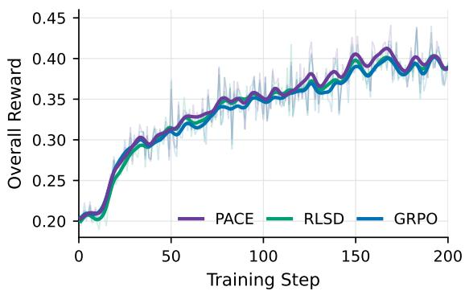

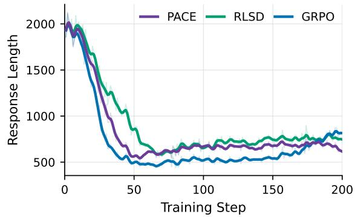  
Figure 4: Training dynamics of PACE, RLSD, and GRPO on Qwen3-VL-8B-Instruct over the shared 200- step budget. Top: overall training reward, i.e. the fraction of sampled responses passing the verifier. Bottom: mean response length in tokens. Light traces show raw values and bold curves show smoothed trends.

• The properties guarantee that the direction and sign of credit assignment remain aligned with the trajectory-level verifier reward, and that credit is redistributed (not amplified) among tokens. But they do not guarantee that the final update magnitudes will preserve the exact mean or relative weighting structure after clipping.

In summary, the sign- and mean-preserving properties hold at the coefficient level and ensure that the verifier reward controls the overall optimization direction. The token contrast cannot flip the sign or amplify the trajectory advantage. However, the effect size of individual token updates within a trajectory is not fully determined by the coefficient structure and depends on the policy gradient dynamics.

## B.7 Training Dynamics

Figure 4 tracks the overall training reward and the mean response length of PACE, RLSD, and GRPO over the 200-step budget. The reward curves are close throughout: they rise from about 0.20 to 0.39,

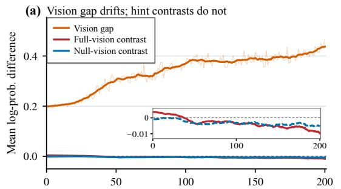

(b) Raw confidence drifts; mixing rates do not  
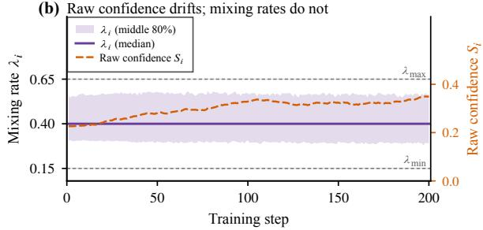  
Figure 5: Teacher signals of PACE training on Qwen3- 1VL-8B-Instruct. (a) Vision gap and hint contrasts (fullvision and null-vision). Inset: zoomed view of the hint contrasts. (b) Mixing rate $\lambda _ { i }$ (median and P10–P90 band) and raw confidence $S _ { i }$

PACE is slightly ahead between roughly steps 120 and 170 (peaking near 0.41), and the three converge again by step 200. The training reward therefore does not separate the methods; the differences in Table 1 appear only on held-out benchmarks.

Response length orders the methods more clearly. All three compress responses sharply during the first 50 steps, from about 2,000 tokens to 500–900. GRPO compresses fastest, stays near 500 tokens until step 150, and then re-inflates to about 800 tokens by step 200. RLSD compresses slowest and stays above PACE from about step 110 on. PACE compresses at an intermediate rate, remains flat at 600–700 tokens, and ends with the shortest responses (about 620 tokens at step 200). The curves describe rather than explain the effect of token credit; the component-level evidence comes from the ablations (Table 2).

## B.8 Teacher Signals During Training

Vision gap drifts but pairwise token contrast does not. Figure 5a tracks the vision gap and hint contrasts during training. The vision gap doubles from 0.20 to 0.42 as the teacher improves: its fullvision log-probabilities pull away from null-vision ones, and this shift enters the signal directly regardless of whether a token depends on the image. The hint contrasts stay within 0.02 of zero and move by at most 0.011, about 20× less than the vision gap.

The drift is shared by both hint branches of each contrast and cancels in subtraction. A 0.4 drift produces weight factors $e ^ { 0 . 4 } \approx 1 . 4 9$ that exceed the clip bound $u _ { \mathrm { m a x } } .$ flattening token differences and explaining why the vision-gap variant falls below Base.

Adaptive trajectory confidence is batch-relative. Figure 5b shows that while the raw confidence $S _ { i }$ rises from 0.23 to 0.34 as the teacher grows more confident, the distribution of the mixing rate $\lambda _ { i }$ remains stable: the P10–P90 band stays at 0.30–0.57 and the median at 0.40 throughout training. The robust batch-relative standardization absorbs both the level and scale drift of $S _ { i }$ , so adaptive trajectory confidence ranks trajectories by confidence relative to the current batch rather than shifting credit toward the token contrast as training progresses.

## B.9 Training-Time Cost Analysis

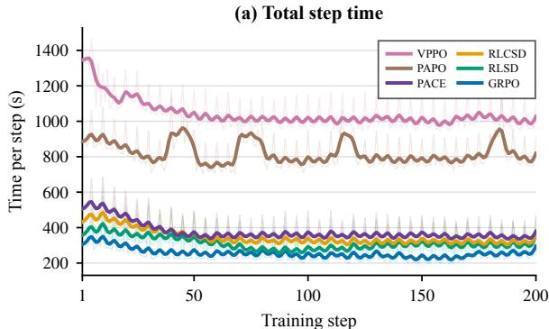

(b) Generation time  
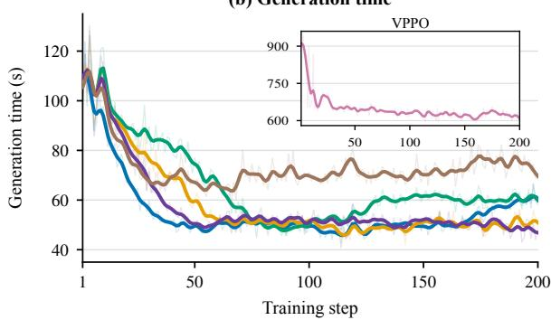  
Figure 6: Per-step training and generation time across 1RLVR methods on an 8 × NVIDIA H200 GPU cluster. (a) Total step time. (b) Generation time.

Figure 6 reports the empirical per-step training and generation time across RLVR methods on an 8 × NVIDIA H200 GPU cluster. The pairwise token contrast of PACE requires positive and negative teacher contexts under both full and nulled vision. With one negative hint, this corresponds to four scored contexts per response, implemented as sequential microbatches to bound memory use. After the first 50 steps, a PACE step takes about 350– 380 s, compared with about 250–280 s for GRPO and 300–350 s for RLSD and RLCSD, and far less than PAPO (about 800 s) and VPPO (about 1,000 s). Generation time (panel b) is close to that of GRPO (about 50 s per step), so the overhead comes from teacher scoring rather than from longer rollouts. The additional computational work is confined strictly to training; evaluation and deployment use the original policy alone without any overhead.

## C Experimental Details

## C.1 Main Results with Standard Deviation

Table 5 reports per-benchmark accuracy (mean@8) with standard deviation on Qwen3-VL-8B-Instruct, Qwen2.5-VL-7B-Instruct, InternVL3.5-4B, and Qwen3-VL-2B-Instruct.

## C.2 Results on Qwen3-VL-2B-Instruct

On Qwen3-VL-2B-Instruct (Table 5), PACE is second on average (38.23%, +4.19 over Base) behind RLSD (38.78%). It is best on GSM8K-V and LogicVista but trails RLSD on MMMU, MathVision, and MathVista, and falls below Base on MathVista (55.60 vs. 58.36), as GRPO does (52.33). We attribute this to the 2B model’s limited capacity as a self-teacher. The training data—filtered to retain only problems that the much larger Qwen3-VL-4B-Thinking consistently fails—is too difficult for 2B to reliably solve even with privileged hints. When the 2B teacher itself produces low-confidence or inconsistent predictions under correct-answer contexts, the pairwise contrasts degrade into uninformative noise, and the confidence $S _ { i }$ used by adaptive trajectory confidence becomes unreliable. Token-level credit assignment thus provides less benefit over uniform GRPO when the teacher capacity is insufficient relative to task difficulty.

## C.3 Full Ablation Results

Table 6 lists per-benchmark accuracy on Qwen3- VL-8B-Instruct for every ablation configuration, each appearing once. The full PACE uses full + null vision contrast with the $S _ { \mathrm { m e a n } }$ confidence and $\lambda _ { i } \in [ 0 . 1 5 , 0 . 6 5 ]$ ; other rows change only the listed setting. In terms of Eq. (6), full vision, full − null vision, and full + null vision contrast correspond to $c = \Delta , c = 2 \Delta - \bar { \Delta }$ , and $c = 1 . 5 \Delta + 0 . 5 \bar { \Delta }$ and the vision gap is $c = \ell ^ { + , V } - \ell ^ { + , \mathcal { O } }$

<table><tr><td>Model</td><td>Method</td><td>GSM8K-V</td><td>LogicVista</td><td>MMMU</td><td>MathVision</td><td>MathVista</td><td>Average</td></tr><tr><td rowspan="8">Qwen3-VL-8B Instruct</td><td>Base</td><td> $2 2 . 9 7 { \scriptstyle \pm 0 . 6 3 }$ </td><td> $5 4 . 3 6 { \pm } 1 . 1 1$ </td><td> $6 1 . 3 3 { \pm } 0 . 6 8$ </td><td> $4 5 . 7 9 2 0 . 4 4$ </td><td> $7 6 . 0 0 { \scriptstyle \pm 0 . 7 2 }$ </td><td>52.09</td></tr><tr><td>GRPO</td><td> $2 6 . 6 1 { \scriptstyle \pm 0 . 7 0 }$ </td><td> $5 8 . 8 4 \pm 1 . 2 4 $ </td><td> $6 5 . 8 9 { \pm } 1 . 1 8$ </td><td> $4 7 . 1 1 { \scriptstyle \pm 0 . 5 7 }$ </td><td> $7 5 . 7 0 { \scriptstyle \pm 0 . 9 6 }$ </td><td>54.83 (↑2.74)</td></tr><tr><td>PAPO</td><td> $2 5 . 4 7 { \scriptstyle \pm 0 . 6 4 }$ </td><td> $5 9 . 7 3 { \pm } 1 . 1 0 $ </td><td> $6 5 . 4 4 { \scriptstyle \pm 0 . 7 3 }$ </td><td> $5 0 . 0 3 { \scriptstyle \pm 0 . 4 7 }$ </td><td> $7 6 . 1 0 { \scriptstyle \pm 0 . 7 4 }$ </td><td>55.36 (↑3.27)</td></tr><tr><td>VPPO</td><td> $2 6 . 9 9 { \scriptstyle \pm 0 . 4 6 }$ </td><td> $6 1 . 5 2 { \scriptstyle \pm 0 . 9 4 }$ </td><td> $6 7 . 6 7 { \scriptstyle \pm 0 . 6 6 }$ </td><td> $5 2 . 8 0 { \scriptstyle \pm 0 . 4 0 }$ </td><td> $7 7 . 3 0 { \scriptstyle \pm 0 . 6 9 }$ </td><td>57.25 (↑5.16)</td></tr><tr><td>OPSD</td><td> $2 3 . 0 5 { \pm } 0 . 7 6$ </td><td> $5 4 . 3 6 { \pm } 1 . 0 4 $ </td><td> $6 1 . 6 7 { \scriptstyle \pm 0 . 7 0 }$ </td><td> $4 2 . 8 6 { \scriptstyle \pm 0 . 6 0 }$ </td><td> $7 5 . 2 0 { \scriptstyle \pm 0 . 4 8 }$ </td><td>51.43 (↓0.66)</td></tr><tr><td>RLSD</td><td> $2 6 . 3 8 { \scriptstyle \pm 0 . 2 7 }$ </td><td> $5 7 . 7 2 { \scriptstyle \pm 1 . 2 6 }$ </td><td> $6 6 . 2 2 { \scriptstyle \pm 0 . 9 8 }$ </td><td> $4 9 . 9 0 { \scriptstyle \pm 0 . 4 9 }$ </td><td> $7 6 . 7 0 { \scriptstyle \pm 0 . 7 3 }$ </td><td>55.38 (↑3.29)</td></tr><tr><td>RLCSD</td><td> $2 5 . 4 7 { \scriptstyle \pm 0 . 7 0 }$ </td><td> $5 7 . 0 5 { \pm } 1 . 6 2 $ </td><td> $6 4 . 0 0 { \scriptstyle \pm 0 . 7 0 }$ </td><td> $4 8 . 9 5 { \scriptstyle \pm 0 . 8 2 }$ </td><td> $7 7 . 1 0 { \scriptstyle \pm 0 . 7 8 }$ </td><td>54.51 (↑2.42)</td></tr><tr><td>PACE (Ours)</td><td> $\mathbf { 2 8 . 1 3 } \pm \mathbf { 0 . 5 2 }$ </td><td> ${ \bf 6 3 . 3 1 \pm 1 . 5 2 }$ </td><td> ${ \bf 6 9 . 0 0 } { \scriptstyle \pm 0 . 8 7 }$ </td><td> ${ \bf 5 4 . 0 1 } { \bf \pm 0 . 4 2 }$ </td><td> ${ 7 7 . 9 0 } { \pm 0 . 8 3 }$ </td><td>58.47 (↑6.38)</td></tr><tr><td rowspan="8"> $_ { \mathrm { Q w e n } 2 . 5 - \mathrm { V L } - 7 \mathrm { B } }$  Instruct</td><td>Base</td><td> $1 5 . 9 6 { \pm } 0 . 2 8 $ </td><td> $4 5 . 0 8 { \pm } 1 . 5 8 $ </td><td> $5 1 . 2 8 { \scriptstyle \pm 0 . 7 2 }$ </td><td> $2 5 . 5 2 { \scriptstyle \pm 0 . 4 3 }$ </td><td> $6 7 . 8 0 { \scriptstyle \pm 0 . 4 9 }$ </td><td>41.13</td></tr><tr><td>GRPO</td><td> $1 7 . 4 9 { \scriptstyle \pm 0 . 2 8 }$ </td><td> $4 8 . 1 5 { \scriptstyle \pm 0 . 6 4 }$ </td><td> $5 2 . 9 7 { \scriptstyle \pm 0 . 6 6 }$ </td><td> $2 7 . 7 2 { \scriptstyle \pm 0 . 3 6 }$ </td><td> $7 2 . 1 2 { \scriptstyle \pm 0 . 3 9 }$ </td><td>43.69 (↑2.56)</td></tr><tr><td>PAPO</td><td> $\mathbf { 1 8 . 3 3 \pm 0 . 1 3 }$ </td><td> $4 6 . 3 6 { \pm } 1 . 8 7$ </td><td> $5 3 . 8 3 { \pm } 1 . 0 2 $ </td><td> $2 7 . 4 2 { \scriptstyle \pm 0 . 3 4 }$ </td><td> $7 0 . 9 7 { \scriptstyle \pm 0 . 6 0 }$ </td><td>43.38 (↑2.26)</td></tr><tr><td>VPPO</td><td> $1 6 . 4 0 { \scriptstyle \pm 0 . 5 2 }$ </td><td> ${ \pm \bf 0 . 0 0 { \pm } 1 . 6 2 }$ </td><td> $5 5 . 5 3 { \pm } 0 . 5 0 $ </td><td> $2 7 . 6 1 { \scriptstyle \pm 0 . 1 9 }$ </td><td> $7 1 . 3 0 { \scriptstyle \pm 0 . 2 9 }$ </td><td>44.17 (↑3.04)</td></tr><tr><td>OPSD</td><td> $1 6 . 3 8 { \scriptstyle \pm 0 . 7 7 }$ </td><td> $4 7 . 1 5 { \pm } 1 . 6 3 $ </td><td> $5 3 . 2 5 { \pm } 0 . 9 0 $ </td><td> $2 6 . 4 9 { \scriptstyle \pm 0 . 8 2 }$ </td><td> $6 9 . 1 2 { \scriptstyle \pm 0 . 2 6 }$ </td><td>42.48 (↑1.35)</td></tr><tr><td>RLSD</td><td> $1 7 . 5 5 { \scriptstyle \pm 0 . 2 6 }$ </td><td> $4 6 . 8 1 { \scriptstyle \pm 0 . 6 4 }$ </td><td> $5 3 . 8 0 { \scriptstyle \pm 0 . 5 2 }$ </td><td> $2 8 . 9 0 { \scriptstyle \pm 0 . 3 2 }$ </td><td> $7 2 . 4 3 { \pm } 0 . 3 8 $ </td><td>43.90 (↑2.77)</td></tr><tr><td>RLCSD</td><td> $1 6 . 2 4 { \scriptstyle \pm 0 . 2 8 }$ </td><td> $4 5 . 0 2 { \scriptstyle \pm 2 . 2 4 }$ </td><td> $5 2 . 1 9 { \pm } 1 . 0 2 $ </td><td> $2 6 . 1 3 { \scriptstyle \pm 0 . 3 4 }$ </td><td> $6 8 . 4 2 { \scriptstyle \pm 0 . 8 2 }$ </td><td>41.60 (↑0.48)</td></tr><tr><td>PACE (Ours)</td><td> $1 8 . 2 7 { \scriptstyle \pm 0 . 4 9 }$ </td><td> $\underline { { 4 9 . 8 9 \pm 1 . 4 4 } }$ </td><td> ${ \pm \bf 5 5 . 6 7 { \pm 0 . 7 6 } }$ </td><td> $\mathbf { 2 9 . 0 1 } \pm \mathbf { 0 . 3 9 }$ </td><td> ${ \bf 7 3 . 0 0 { \scriptstyle \pm 0 . 6 7 } }$ </td><td>45.17 (↑4.04)</td></tr><tr><td rowspan="8">InternVL3.5-4B</td><td>Base</td><td> $1 4 . 7 6 { \scriptstyle \pm 0 . 6 9 }$ </td><td> $4 9 . 1 3 { \pm } 2 . 7 8$ </td><td> $6 1 . 7 6 { \scriptstyle \pm 0 . 9 9 }$ </td><td> $3 3 . 6 0 { \scriptstyle \pm 0 . 2 5 }$ </td><td> $7 0 . 4 7 { \scriptstyle \pm 0 . 7 7 }$ </td><td>45.95</td></tr><tr><td>GRPO</td><td> $1 4 . 8 5 { \scriptstyle \pm 0 . 5 6 }$ </td><td> $5 1 . 0 9 { \scriptstyle \pm 1 . 3 5 }$ </td><td> $6 2 . 0 1 { \scriptstyle \pm 1 . 3 4 }$ </td><td> $3 4 . 8 9 { \scriptstyle \pm 0 . 4 5 }$ </td><td> $7 1 . 5 8 { \pm } 1 . 9 4 $ </td><td>46.88 (↑0.93)</td></tr><tr><td>PAPO</td><td> $1 4 . 7 4 { \scriptstyle \pm 0 . 3 8 }$ </td><td> $4 9 . 6 9 { \scriptstyle \pm 1 . 1 6 }$ </td><td> $6 2 . 2 8 { \pm } 1 . 1 5$ </td><td> $3 4 . 6 7 { \scriptstyle \pm 0 . 7 8 }$ </td><td> $7 1 . 2 4 { \scriptstyle \pm 0 . 3 7 }$ </td><td>46.53 (↑0.58)</td></tr><tr><td>VPPO</td><td> $\underline { { 1 5 . 6 8 \pm 0 . 7 2 } }$ </td><td> ${ \underline { { 5 2 . 5 2 \pm 1 . 7 1 } } }$ </td><td> $\underline { { 6 2 . 3 6 \pm 1 . 2 4 } }$ </td><td> $3 4 . 4 6 { \pm } 0 . 5 0 $ </td><td> $7 2 . 0 3 { \scriptstyle \pm 0 . 8 6 }$ </td><td>47.41 (↑1.46)</td></tr><tr><td>OPSD</td><td> $\overline { { 1 4 . 5 3 \pm 0 . 6 7 } }$ </td><td> $\overline { { 5 2 . 2 7 \pm 1 . 4 9 } }$ </td><td> $6 1 . 0 3 { \scriptstyle \pm 0 . 7 7 }$ </td><td> $3 3 . 7 8 { \scriptstyle \pm 0 . 6 5 }$ </td><td> $7 1 . 0 3 { \pm } 0 . 6 8$ </td><td>46.53 (↑0.58)</td></tr><tr><td>RLSD</td><td> $\mathbf { 1 5 . 9 2 \pm 0 . 9 1 }$ </td><td> $5 0 . 5 6 { \pm } 1 . 8 4 $ </td><td> $6 1 . 5 6 { \pm } 0 . 8 2 $ </td><td> $3 4 . 6 6 { \scriptstyle \pm 0 . 6 8 }$ </td><td> $7 1 . 7 1 { \scriptstyle \pm 0 . 5 6 }$ </td><td>46.88 (↑0.93)</td></tr><tr><td>RLCSD</td><td> $1 4 . 6 9 { \scriptstyle \pm 0 . 4 0 }$ </td><td> $4 9 . 2 2 \pm 2 . 5 2 $ </td><td> $6 1 . 5 5 { \scriptstyle \pm 0 . 7 3 }$ </td><td> $3 3 . 7 5 { \scriptstyle \pm 0 . 6 2 }$ </td><td> $7 0 . 3 7 { \scriptstyle \pm 0 . 7 3 }$ </td><td>45.92 (↓0.03)</td></tr><tr><td>PACE (Ours)</td><td> $1 5 . 5 4 { \scriptstyle \pm 0 . 5 9 }$ </td><td> ${ \pm 2 . 8 0 \pm 2 . 5 8 }$ </td><td> ${ \bf 6 3 . 7 8 { \pm } 1 . 0 1 }$ </td><td> $3 5 . 2 6 { \scriptstyle \pm 0 . 3 7 }$ </td><td> $7 2 . 6 0 { \scriptstyle \pm 1 . 1 5 }$ </td><td>48.00 (↑2.05)</td></tr><tr><td rowspan="8"> $\mathrm { Q w e n 3 - V L - 2 B }$  Instruct</td><td>Base</td><td> $1 0 . 3 2 { \pm } 0 . 5 3 $ </td><td> $3 3 . 6 1 \pm 1 . 3 0 $ </td><td> $4 7 . 5 4 { \pm } 0 . 7 7$ </td><td> $2 0 . 3 7 { \scriptstyle \pm 0 . 5 6 }$ </td><td> $5 8 . 3 6 { \scriptstyle \pm 0 . 5 7 }$ </td><td></td></tr><tr><td>GRPO</td><td> $9 . 5 0 { \scriptstyle \pm 0 . 6 1 }$ </td><td> $4 2 . 8 6 { \pm } 1 . 5 3 $ </td><td> $4 9 . 1 7 { \scriptstyle \pm 0 . 9 2 }$ </td><td> $2 2 . 7 7 { \scriptstyle \pm 0 . 4 4 }$ </td><td></td><td>34.04</td></tr><tr><td>PAPO</td><td> $1 0 . 6 9 { \scriptstyle \pm 0 . 2 8 }$ </td><td> $3 9 . 0 9 { \scriptstyle \pm 1 . 7 7 }$ </td><td> $4 9 . 8 1 { \pm } 1 . 1 1 $ </td><td> $2 4 . 8 0 { \scriptstyle \pm 0 . 7 0 }$ </td><td> $5 2 . 3 3 { \pm } 1 . 1 6$   $5 7 . 6 4 { \pm } 0 . 4 8 $ </td><td>35.32 (↑1.28)</td></tr><tr><td>VPPO</td><td> $1 0 . 7 0 { \scriptstyle \pm 0 . 2 9 }$ </td><td> $3 9 . 9 9 { \scriptstyle \pm 1 . 8 4 }$ </td><td> $5 0 . 9 6 { \pm } 0 . 9 7$ </td><td> $2 3 . 3 4 { \scriptstyle \pm 0 . 6 0 }$ </td><td> ${ \bf 5 9 . 9 0 { \scriptstyle \pm 0 . 6 7 } }$ </td><td>36.41 (↑2.37) 36.98 (↑2.94)</td></tr><tr><td>OPSD</td><td> $1 0 . 7 3 { \scriptstyle \pm 0 . 5 1 }$ </td><td> $3 3 . 6 9 { \scriptstyle \pm 1 . 6 3 }$ </td><td> $\overline { { 4 7 . 9 8 \pm 0 . 6 8 } }$ </td><td> $1 9 . 9 0 { \scriptstyle \pm 0 . 6 6 }$ </td><td> $5 8 . 0 9 { \scriptstyle \pm 0 . 6 9 }$ </td><td>34.08 (↑0.04)</td></tr><tr><td>RLSD</td><td> $\overline { { 1 0 . 7 1 { \pm } 0 . 8 5 } }$ </td><td> $4 4 . 4 2 \pm 1 . 1 2$ </td><td> ${ \bf 5 1 . 7 1 { \pm 0 . 8 5 } }$ </td><td> $\mathbf { 2 8 . 9 0 { \scriptstyle \pm 0 . 6 5 } }$ </td><td> $5 8 . 1 6 { \scriptstyle \pm 0 . 4 3 }$ </td><td>38.78 (↑4.74)</td></tr><tr><td>RLCSD</td><td> $1 0 . 6 2 { \scriptstyle \pm 0 . 4 9 }$ </td><td> $3 4 . 2 5 { \pm } 0 . 6 2$ </td><td> $4 7 . 7 4 { \pm } 1 . 0 9 $ </td><td> $2 0 . 4 6 { \scriptstyle \pm 0 . 4 2 }$ </td><td> $5 8 . 5 0 { \scriptstyle \pm 0 . 6 4 }$ </td><td>34.32 (↑0.28)</td></tr><tr><td>PACE (Ours)</td><td> ${ \bf 1 1 . 9 0 { \scriptstyle \pm 0 . 5 1 } }$ </td><td> $\mathbf { 4 6 . 9 8 { \scriptstyle \pm 1 . 7 0 } }$ </td><td> $5 0 . 5 6 { \scriptstyle \pm 0 . 3 3 }$ </td><td> $2 6 . 0 9 { \scriptstyle \pm 0 . 2 6 }$ </td><td> $5 5 . 6 0 { \scriptstyle \pm 0 . 7 9 }$ </td><td>38.23 (↑4.19)</td></tr></table>

Table 5: Accuracy (%) (mean@8) on five multimodal reasoning benchmarks with standard deviation.

## D Case Study

nearly unweighted. The contrast between correct and incorrect hints singles out the tokens that decide the count, rather than restating the question.

Figures 7–9 visualize token credit on three responses from the evaluation benchmarks. For each response, the upper copy shows the token weights assigned by PACE and the lower copy those assigned by RLSD on the same sampled tokens; darker shading marks a larger weight, i.e. a larger share of the trajectory advantage. Both methods keep the sign and mean of the trajectory advantage, so the figures differ only in where credit is placed within the response.

Credit on computation (Figure 8). The LogicVista question asks for Website Y’s share of visitors in a table. The response copies the four visitor counts, sums them to 437,380, and divides to obtain 18.86%, which it rounds to option (B). PACE places its largest weights on the result-bearing tokens: the copied counts (e.g., 315,380), the distinguishing digit of the total, the quotient digits of 0.1886, and the decision tokens “Percentage =”, “Therefore”, “correct answer”, and “(B”. RLSD concentrates on the connective phrase “me compute this” and on $\cdot \langle \_ { 3 } ,$ and “Therefore”, and assigns nearly uniform weight to the copied counts.

Credit on visual readouts (Figure 7). The Math-Vista question asks how many items sold more than 3 units in at least one store of a grouped bar chart. The response reads both bars for all seven items and concludes that all seven qualify. PACE shades the values read from the chart $\left( \mathrm { e . g . , 9 } \right.$ for violin, 7 for arch, 1 for breeze), the comparison token “both”, and the final count “All 7”. RLSD instead highlights tokens that restate the question (“either”, “exceeding”, “sold”) and leaves the chart readouts

Credit on an incorrect response (Figure 9). The third response is incorrect: it reads 58.09% and 44.00% for the bottom two countries and answers 51.05 instead of 51.04. Its arithmetic is consistent with these readouts, so the error lies in the extracted values or the rounding. Because the trajectory advantage is negative, a larger weight here means a larger share of the penalty. PACE concentrates the penalty on the extracted values and their context (“Madagascar:”, the digits of 58.09 and 44.00, “from 2012”) and on “percentages”, while RLSD spreads it over planning tokens such as “first”, “which”, “bar”, “These”, and “Next”. Concentrating the penalty on the readouts, rather than on generic planning steps, spares the parts of the reasoning that are correct.

<table><tr><td>Variant</td><td>GSM8K-V</td><td>LogicVista</td><td>MMMU</td><td>MathVision</td><td>MathVista</td><td>Average</td></tr><tr><td>PACE</td><td>28.13±0.52</td><td> $6 3 . 3 1 { \pm } 1 . 5 2 $ </td><td>69.00±0.87</td><td> $5 4 . 0 1 { \scriptstyle \pm 0 . 4 2 }$ </td><td> $7 7 . 9 0 { \scriptstyle \pm 0 . 8 3 }$ </td><td>58.47</td></tr><tr><td colspan="7">Token contrast, fixed λ = 0.5</td></tr><tr><td>Vision gap (no hint contrast)</td><td>24.03±0.70</td><td> $5 5 . 2 6 { \pm } 1 . 5 3 $ </td><td> $6 1 . 2 2 { \pm } 1 . 1 0$ </td><td>40.95±0.41</td><td>73.80±0.49</td><td>51.05</td></tr><tr><td>Hint contrast, full vision</td><td>26.91±0.70</td><td> $6 1 . 9 7 { \scriptstyle \pm 1 . 3 3 }$ </td><td> $6 5 . 5 6 { \pm } 1 . 0 9$ </td><td>53.36±0.71</td><td>77.50±0.57</td><td>57.06</td></tr><tr><td>Hint contrast, full — null vision</td><td>28.28±0.58</td><td> $6 0 . 6 3 { \scriptstyle \pm 1 . 4 4 }$ </td><td> $6 7 . 3 3 { \scriptstyle \pm 1 . 0 7 }$ </td><td>53.36±0.47</td><td>78.80±0.62</td><td>57.68</td></tr><tr><td>Hint contrast, full + null vision</td><td>26.23±0.85</td><td> $6 1 . 0 7 { \scriptstyle \pm 1 . 3 3 }$ </td><td> $6 6 . 6 7 { \scriptstyle \pm 0 . 8 3 }$ </td><td>53.06±0.73</td><td>79.10±0.90</td><td>57.23</td></tr><tr><td colspan="7">Fixed mixing rate, full + null vision contrast</td></tr><tr><td>λ = 0.25</td><td>26.00±0.32</td><td> $6 1 . 9 7 { \scriptstyle \pm 1 . 3 2 }$ </td><td> $6 7 . 3 3 { \scriptstyle \pm 0 . 8 4 }$ </td><td>51.05±0.55</td><td>76.30±0.55</td><td>56.53</td></tr><tr><td>λ = 0.40 (adaptive median)</td><td>27.52±0.62</td><td> $6 1 . 5 2 { \pm } 1 . 1 2 $ </td><td> $6 7 . 0 0 { \scriptstyle \pm 0 . 9 9 }$ </td><td>52.14±0.50</td><td>78.30±0.73</td><td>57.30</td></tr><tr><td> $\lambda = 0 . 5 0$ </td><td> $2 6 . 2 3 { \scriptstyle \pm 0 . 5 2 }$ </td><td> $6 1 . 0 7 { \scriptstyle \pm 1 . 0 5 }$ </td><td>66.67±0.85</td><td>53.06±0.39</td><td>79.10±0.56</td><td>57.23</td></tr><tr><td> $\lambda = 0 . 7 5$ </td><td> $2 6 . 6 1 { \scriptstyle \pm 0 . 5 9 }$ </td><td> $6 6 . 0 0 { \scriptstyle \pm 1 . 3 7 }$ </td><td>65.89±0.81</td><td>52.43±0.79</td><td>77.20±0.64</td><td>57.63</td></tr><tr><td> $\lambda = 1 . 0 0$ </td><td> $2 7 . 1 4 { \scriptstyle \pm 0 . 3 6 }$ </td><td> $6 3 . 5 3 { \pm } 1 . 5 5 $ </td><td>65.78±0.67</td><td>51.74±0.53</td><td>77.50±0.46</td><td>57.14</td></tr><tr><td colspan="7">Adaptive trajectory confidence</td></tr><tr><td>Sstd (dispersion-based),  $\lambda _ { i } \in [ 0 . 2 5 , 0 . 6 5 ]$ </td><td>27.37±0.56</td><td> $6 2 . 4 2 { \scriptstyle \pm 1 . 4 4 }$ </td><td>67.33±1.11</td><td>52.86±0.72</td><td>78.10±0.46</td><td>57.62</td></tr><tr><td>Mix of  $S _ { \mathrm { m e a n } }$  and  $S _ { \mathrm { s t d } } , \lambda _ { i } \in [ 0 . 2 5 , 0 . 6 5 ]$ </td><td>28.58±0.61</td><td> $6 2 . 4 2 { \pm } 1 . 1 8$ </td><td>67.56±0.92</td><td>52.76±0.52</td><td>76.90±0.59</td><td>57.64</td></tr><tr><td> $S _ { \mathrm { m e a n } } , \lambda _ { i } \in [ 0 . 2 5 , 0 . 6 5 ]$ </td><td>25.70±0.71</td><td> $6 4 . 4 3 { \pm } 1 . 0 4 $ </td><td>67.89±0.93</td><td>51.97±0.36</td><td>78.00±0.64</td><td>57.60</td></tr><tr><td> $S _ { \mathrm { m e a n } } , \lambda _ { i } \in [ 0 . 1 0 , 0 . 6 5 ]$ </td><td>26.16±0.50</td><td> $6 1 . 3 0 { \scriptstyle \pm 1 . 4 4 }$ </td><td>66.89±0.72</td><td>53.36±0.48</td><td>77.50±0.94</td><td>57.04</td></tr><tr><td> $S _ { \mathrm { m e a n } } , \lambda _ { i } \in [ 0 . 1 5 , 0 . 7 5 ]$ </td><td>27.22±0.67</td><td> $6 1 . 5 2 { \pm } 1 . 6 9$ </td><td> $6 7 . 6 7 { \scriptstyle \pm 0 . 6 7 }$ </td><td>52.60±0.41</td><td>78.10±0.74</td><td>57.42</td></tr><tr><td> $S _ { \mathrm { m e a n } }$  on full — null vision contrast</td><td>27.98±0.44</td><td> $6 1 . 0 7 { \scriptstyle \pm 1 . 2 0 }$ </td><td> $6 7 . 6 7 { \scriptstyle \pm 0 . 6 5 }$ </td><td>52.20±0.52</td><td>77.80±0.93</td><td>57.34</td></tr><tr><td colspan="7">Contrast coefficients  $( \alpha , \beta ) , S _ { \mathrm { m e a n } }$  confidence</td></tr><tr><td> $( \alpha , \beta ) = ( 1 . 0 0 , 0 . 0 0 )$ </td><td> $2 7 . 8 2 { \scriptstyle \pm 0 . 4 8 }$ </td><td> $6 1 . 3 0 { \pm } 1 . 0 9$ </td><td> $6 7 . 8 9 { \pm } 1 . 1 2 $ </td><td>53.19±0.44</td><td>78.40±0.61</td><td>57.72</td></tr><tr><td> $\dot { ( \alpha , \beta ) } = \dot { ( } 1 . 1 2 5 , 0 . 1 \dot { 2 } 5 )$ </td><td>26.99±0.70</td><td> $6 1 . 9 7 { \scriptstyle \pm 1 . 3 5 }$ </td><td> $6 7 . 8 9 { \scriptstyle \pm 0 . 8 9 }$ </td><td>53.06±0.66</td><td>77.40±0.52</td><td>57.46</td></tr><tr><td> $( \alpha , \beta ) = ( 1 . 2 5 , 0 . 2 5 )$ </td><td> $2 7 . 0 7 { \scriptstyle \pm 0 . 7 4 }$  28.20±0.60</td><td> $6 3 . 3 1 { \pm } 1 . 3 6$ </td><td> $6 7 . 2 2 { \scriptstyle \pm 0 . 7 0 }$ </td><td>54.28±0.74</td><td>78.40±0.61</td><td>58.06</td></tr><tr><td> $( \alpha , \beta ) = ( 1 . 7 5 , 0 . 7 5 )$ </td><td></td><td> $6 2 . 8 6 { \pm } 1 . 6 8$ </td><td> $6 5 . 4 4 { \scriptstyle \pm 0 . 6 9 }$ </td><td>51.81±0.78</td><td>77.30±0.89</td><td>57.12</td></tr><tr><td> $( \alpha , \beta ) = ( 2 . 0 0 , 1 . 0 0 )$ </td><td>26.69±0.65</td><td> $6 1 . 3 0 { \scriptstyle \pm 1 . 0 2 }$ </td><td> $6 9 . 2 2 { \scriptstyle \pm 0 . 9 7 }$ </td><td>53.03±0.61</td><td>76.50±0.91</td><td>57.35</td></tr></table>

Table 6: Per-benchmark accuracy (%) of all ablation configurations (mean@8) with standard deviation.

These examples are qualitative and were selected for illustration, which show how the two signals differ in placement, not that PACE assigns credit correctly on every response.

## MathVista Ground Truth: 7

Hint: Please answer the question requiring an integer answer and provide the final value, e.g., 1, 2, 3, at the end. Question: How many items sold more than 3 units in at least one store?

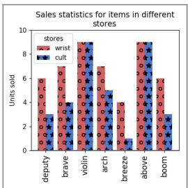

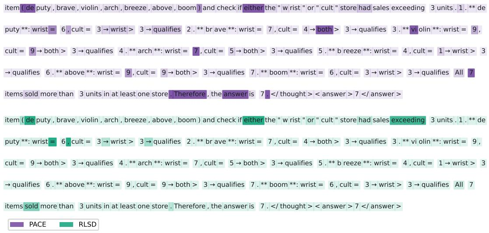  
Figure 7: Case Study.

LogicVista Ground Truth: B Assuming all visitors arrived via either website W, X, Y or Z, approximately what percentage of visitors arrived at newbags.com from Website Y? Select from A, B, C, and D. (A) 15.7% (B) 18.9% (C) 25.0% (D) 30.3%

<table><tr><td rowspan=1 colspan=3>Internet sales data for Newbags.com</td></tr><tr><td rowspan=1 colspan=1>Visitorsfrom</td><td rowspan=1 colspan=1>Number ofvisitors</td><td rowspan=1 colspan=1>Number of visitors whomade a purchase</td></tr><tr><td rowspan=1 colspan=1>Website W</td><td rowspan=1 colspan=1>315,380</td><td rowspan=1 colspan=1>2,876</td></tr><tr><td rowspan=1 colspan=1>Website X</td><td rowspan=1 colspan=1>26,850</td><td rowspan=1 colspan=1>284</td></tr><tr><td rowspan=1 colspan=1>Website Y</td><td rowspan=1 colspan=1>82,520</td><td rowspan=1 colspan=1>183</td></tr><tr><td rowspan=1 colspan=1>Website Z</td><td rowspan=1 colspan=1>12,630</td><td rowspan=1 colspan=1>204</td></tr></table>

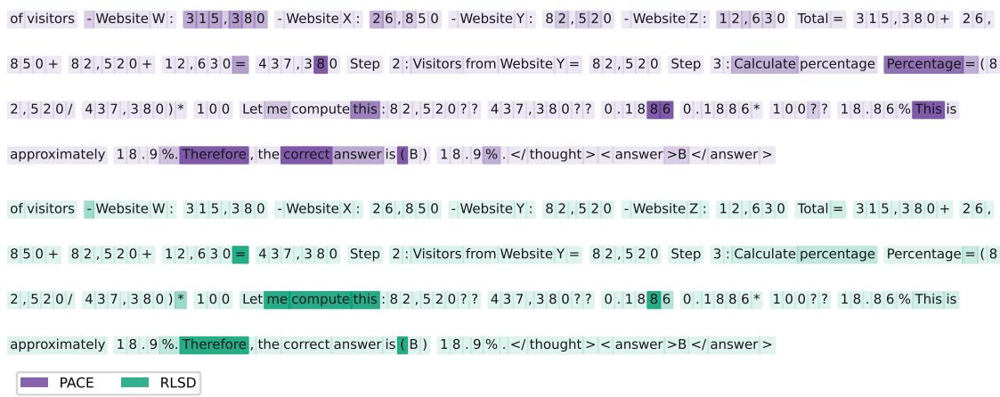  
Figure 8: Case Study.

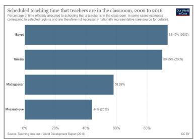

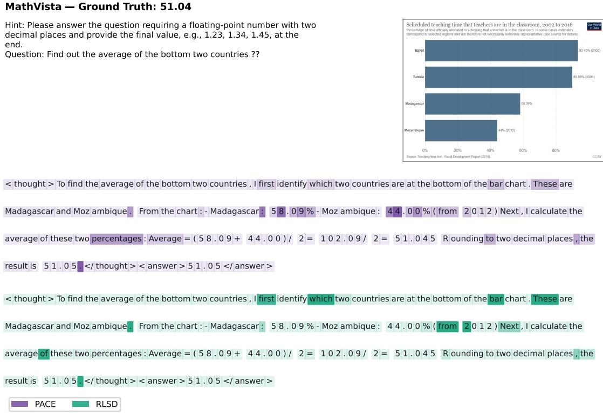  
Figure 9: Case Study.