# Explaining the Roles of Experts in Mixture-of-Experts LLMs for Personalization

Sekh Mainul Islam, Pepa Atanasova, Isabelle Augenstein

University of Copenhagen {seis, pepa, augenstein}@di.ku.dk

## Abstract

Personalization of Large Language Models (LLMs) is increasingly important for usercentric applications, yet prior methods mainly adapt dense LLMs, whose polysemantic neurons, each encoding multiple unrelated concepts, hinder localizing the components be hind personalization, and thus understanding and controlling it. We propose to personalize Mixture-of-Experts (MoE) LLMs, which sparsely route each token to a few specialized experts, reducing polysemanticity and enabling such localization. We adapt three open-weight MoE LLMs on a large-scale personalization dataset and train crosscoders on paired activations of the personalized and non-personalized models to learn interpretable personalized latents, from which we identify the experts encoding distinct personalization features. The personalized MoE LLMs perform competitively with dense LLMs while activating only a frac tion of their parameters, exhibit lower polysemanticity than dense LLMs with similar active parameters, and, within the same model family, yield personalized latents that are less shared with the non-personalized model. Causal interventions show that these latents suffice to recover the personalized model’s behavior and that boosting their associated experts moves the non-personalized model toward it, revealing distinct routing paths for different personalization features.1

## 1 Introduction

Personalization of Large Language Models (LLMs) adapts LLMs to user or group preferences (Salemi et al., 2024; Zhang et al., 2025b). Due to increasing demand for AI-assisted user-centric applications, Personalization of LLMs has become an important research direction. Most methods use dense LLMs (Zhang et al., 2025b), offering little interpretability of localizing important model components encoding distinct personalized features due to the polysemanticity of encoding multiple orthogonal concepts into a single neuron (Olah et al., 2020). Recent work on developing intrinsically interpretable LLMs suggests that wider, more sparse LLMs enable their neurons to capture more disentangled features and reduce polysemanticity (Yang et al., 2025b). Mixture-of-Experts (MoE) LLMs offer a scalable solution for wider and sparser networks by replacing a dense FFN block in the MLP layer with a set of experts of the same size, using a sparse routing mechanism to select a subset of these experts to process each input token (Shazeer et al., 2017). This mechanism enables MoE LLMs to offer better interpretability for downstream tasks by achieving lower polysemanticity (Herbst et al., 2026), where experts encode distinct task-specific features. Motivated by these observations, we utilize MoE LLMs for personalization and subsequent interpretability analysis, addressing research questions covering polysemamticity of MoE LLMs for personalization (RQ1, §6.2), identifying distinct personalized features encoded via experts during personalization (RQ2, §6.3), and localizing unique routing paths for distinct personalized features (RQ3, §6.4).

Following Bai et al. (2025) on MoE LLMs alignment, we adapt the MoE LLMs towards personalization using a two-stage parameter-efficient finetuning (PEFT) (§4.1), on a large-scale personalization dataset covering diverse preferences for user groups, MULTIFACETED COLLECTION (Lee et al., 2024). We then train a sparse autoencoderbased (Bricken et al., 2023; Huben et al., 2024) architecture crosscoder (Minder et al., 2025) on paired personalized and non-personalized activations to identify interpretable personalization latents. Mapping these latents to experts reveals distinct routing paths associated with personalization. Our proposed method is illustrated in Figure 1.

Extensive experiments on three open-weight instruction-tuned decoder-only MoE LLMs, OLMoE-1B-7B (0125), Qwen3-30B-A3B (2507), and Mixtral-8x7B (v0.1), spanning three personalization benchmarks: MULTIFACETED BENCH (Lee et al., 2024) covering preferences for user groups, and LaMP and LongLaMP benchmarks for per user preference, verifies the scalability of MoE LLMs in personalization by outperforming similar active parameter sized dense LLMs and achieve competitive performance against similar total parameter sized dense LLMs, while utilizing only 20% of the total parameters per token (§6.1). Furthermore, MoE LLMs enable better learning of crosscoder to identify a high-quality small set of latents (less than 0.25% of total latents), highly contributing in explaining distinct personalized features encoded during personalization than dense LLMs, verifying lower polysemanticity for personalization (§6.2). These personalized latents each capture a distinct personalization feature (§6.3) and map onto a small, stable set of specialized experts (§6.4), revealing distinct routing paths for personalization in MoE LLMs. Causal interventions further confirm that these latents are sufficient to recover personalized behavior and that the identified experts are necessary for it.

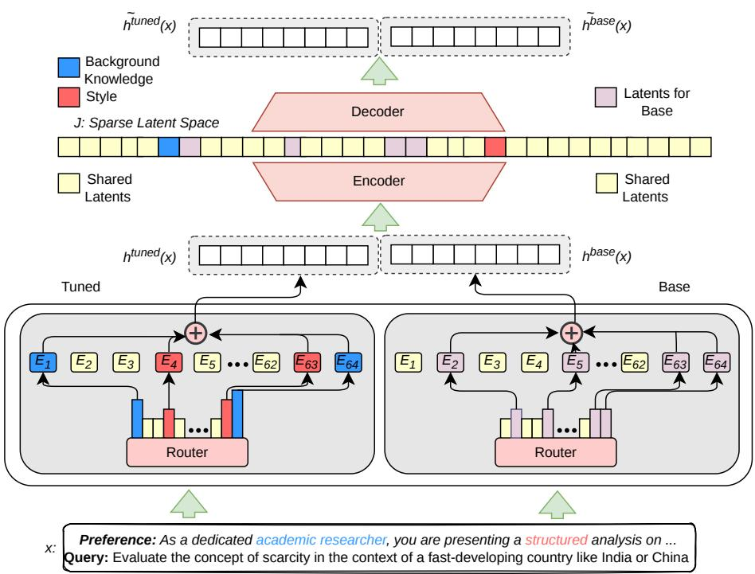  
Figure 1: Overview of the proposed framework: [Bottom → Top] For a given query and user preference via system message, we collect activations for all tokens of the input prompt from a particular layer of personalized (Left) and non-personalized (Right) MoE and then train a SAE-based model (crosscoder) to learn and identify a set of latents associated with the personalized MoE LLMs capturing distinct personalization features.

Overall, our proposed method offers a principled foundation for understanding and designing more transparent personalized language models.

## 2 Related Work

## 2.1 Personalization of LLMs

Methods for aligning LLMs with individual or group preferences (Zhang et al., 2025b) condition on retrieved user history or profile summaries (Salemi et al., 2024; Richardson et al., 2023), encode personas in the prompt (Jiang et al., 2024b), train per-user adapters (Tan et al., 2024), learn personalized reward models or merge preference-specific policies (Cheng et al., 2023; Jang et al., 2024), or steer activations toward a user’s style (Zhang et al., 2025a; Cao et al., 2024). LaMP and LongLaMP (Salemi et al., 2024; Kumar et al., 2024) evaluate per-user personalization, while Multifaceted Collection and Bench (Lee et al., 2024) specify group preferences via system messages. These works study dense models as black boxes; we study how sparse MoEs represent personalization.

## 2.2 Mixture-of-Experts LLMs.

MoE layers route each token to a few experts, decoupling parameter count from compute (Shazeer et al., 2017; Fedus et al., 2022; Zoph et al., 2022), and now underlie strong open models such as Mixtral, OLMoE, and Qwen3 (Jiang et al., 2024a; Muennighoff et al., 2025; Yang et al., 2025a). Analyses of routing report specialization at the level of tokens and syntax rather than domains (Jiang et al., 2024a; Xue et al., 2024), semantic routing in controlled settings (Olson et al., 2025), and languagespecific experts identified by contrasting routing frequencies (Bandarkar et al., 2026). Expert-level specialization can be exploited for adaptation and control: Bai et al. (2025) tune routers to identify context-faithful experts, Li et al. (2026) encourage expert divergence during training, and Fayyaz et al. (2026) steer behavior by (de)activating experts. We adopt a two-stage router-then-expert adaptation for personalization and relate the resulting routing changes to interpretable persona features.

Interpreting model features and fine-tuning. Dense-model neurons are polysemantic (Olah et al., 2020); sparse autoencoders recover more monosemantic features (Bricken et al., 2023; Huben et al., 2024), sparse probing measures how few neurons encode a concept (Gurnee et al., 2023), and wider, sparser architectures such as MoEs reduce polysemanticity (Yang et al., 2025b; Herbst et al., 2026). Crosscoders, trained with BatchTopK (Bussmann et al., 2024) and explained automatically (Paulo et al., 2025), isolate latents specific to a fine-tuned model and have been applied to chat tuning (Minder et al., 2025) and to MoE–dense comparisons (Chaudhari et al., 2026). We diff a personalized MoE against its base and map the resulting latents onto the experts that route them.

## 3 Preliminaries

## 3.1 Problem Formulation

Given a user query x and a preference $P ,$ either the user’s interaction history $P = \{ ( x _ { i } , y _ { i } ) \} _ { i = 1 } ^ { | P | }$ or a set of stated preferences $P = \{ p _ { 1 } , . . . , p _ { n } \}$ , a personalized LLM $M _ { \theta }$ generates

$$
\hat { y } _ { p } = M _ { \theta } \big ( x , A _ { p } ( x , P ) \big ) ,\tag{1}
$$

where the adapter $A _ { p }$ injects $P$ into generation, e.g., via retrieval or learned parameters, and $\hat { y } _ { p }$ is scored against a gold response y. We realize $A _ { p }$ as

PEFT parameters $\phi$ of an MoE LLM (§4.1) and decompose what it encodes into a set of interpretable latents $\mathcal { T } _ { \mathrm { f t } }$ (§4.2).

## 3.2 Mixture-of-Experts LLMs

An MoE layer replaces the dense FFN with $N _ { E }$ experts and a router ${ r _ { \theta _ { \eta } } }$ that routes each token to its top-k experts (Shazeer et al., 2017; Muennighoff et al., 2025). For token $x _ { t }$ with input $u _ { x _ { t } } ^ { ( l ) }$ at layer l,

$$
h _ { x _ { t } } ^ { ( l ) } = u _ { x _ { t } } ^ { ( l ) } + \sum _ { \substack { i \in \mathrm { t o p } - k \left( r _ { \theta _ { r } } ^ { ( l ) } ( u _ { x _ { t } } ^ { ( l ) } ) \right) } } g _ { ( i , t ) } ^ { ( l ) } E _ { i } ^ { ( l ) } \big ( u _ { x _ { t } } ^ { ( l ) } \big ) ,\tag{2}
$$

where $g _ { ( i , t ) } ^ { ( l ) } ~ =$ softmax $( r _ { \theta _ { r } , i } ^ { ( l ) } ( u _ { x _ { t } } ^ { ( l ) } ) )$ is the gate weight of expert $E _ { i } ^ { ( l ) }$

## 3.3 Crosscoder

A crosscoder learns a single dictionary of $D \gg d$ latents that jointly reconstructs paired activations $h _ { x _ { t } } ^ { ( l , \mathrm { f t } ) } , h _ { x _ { t } } ^ { ( l , \mathrm { b a s e } ) } \in \mathbf { \bar { \mathbb { R } } } ^ { d }$ of the personalized and nonpersonalized models at layer l (Minder et al., 2025):

$$
\begin{array} { r l } & { a _ { j } \big ( x _ { t } \big ) = \mathrm { R e L U } \big ( \mathbf { e } _ { j } ^ { \mathrm { f t } } h _ { x _ { t } } ^ { ( l , \mathrm { f t } ) } + \mathbf { e } _ { j } ^ { \mathrm { b a s e } } h _ { x _ { t } } ^ { ( l , \mathrm { b a s e } ) } + b _ { j } ^ { \mathrm { e n c } } \big ) , } \\ & { \quad \tilde { h } _ { x _ { t } } ^ { ( l , m ) } = \sum _ { j } a _ { j } \big ( x _ { t } \big ) \mathbf { d } _ { j } ^ { m } + \mathbf { b } ^ { \mathrm { d e c } , m } , } \end{array}\tag{3}
$$

where $m \in \{ \mathrm { f t } , \mathrm { b a s e } \}$ . Each latent $j$ has a separate decoder vector for each model. A latent whose ${ \bf d } _ { j } ^ { \mathrm { f t } }$ dominates $\mathbf { d } _ { j } ^ { \mathrm { b a s e } }$ contributes mainly to reconstructing the personalized model. We use this property to identify personalized latents (§4.2). We train a BatchTopK crosscoder (Bussmann et al., 2024) and the objective and training details are given in Section A.1.

## 4 Methodology

## 4.1 Personalization of MoE LLMs

Load balancing during MoE pre-training spreads tokens evenly across experts, which discourages individual experts from specializing in task-specific features. Following Bai et al. (2025), we therefore adapt the model in two stages: we first tune the routers to find the experts relevant to personalization, and then tune only those experts. Let $\theta = \{ \theta _ { r } , \theta _ { e } , \theta _ { o } \}$ denote the router, expert and remaining parameters, and $\mathcal { D } _ { p }$ the preference dataset.

Router tuning. We update only the routers with the language-modeling loss:

$$
\operatorname* { m i n } _ { \theta _ { r } } \mathcal { L } _ { \mathrm { L M } } ( M _ { \theta } , \mathcal { D } _ { p } ) \mathrm { s . t . } \theta _ { e } , \theta _ { o } \mathrm { f r o z e n . }\tag{4}
$$

We then measure how often the tuned router selects each expert $E _ { i } ^ { ( l ) }$ :

$$
f _ { i } ^ { ( l ) } = \frac { 1 } { | \mathcal { D } _ { p } | } \sum _ { m = 1 } ^ { | \mathcal { D } _ { p } | } \frac { 1 } { | x _ { m } | } \sum _ { t = 1 } ^ { | x _ { m } | } \frac { \mathbb { I } \left( i \in \mathcal { T } _ { m , t } ^ { ( l ) } \right) } { k } ,\tag{5}
$$

where $\mathcal { T } _ { m , t } ^ { ( l ) }$ is the set of top-k experts selected for token t of sequence $x _ { m }$ at layer l. Dividing by k ensures that the frequencies at each layer sum to 1.

Expert tuning. We then fine-tune only the k most selected experts per layer, ${ \theta } _ { e } ^ { ( k ) } \subset { \theta } _ { e }$

$$
\operatorname* { m i n } _ { \theta _ { e } ^ { ( k ) } } \mathcal { L } _ { \mathrm { L M } } ( M _ { \theta } , \mathcal { D } _ { p } ) \mathrm { s . t . } \theta _ { r } , \theta _ { o } \mathrm { f r o z e n . }\tag{6}
$$

## 4.2 Disentangling Personalized Features

We train a crosscoder (§3.3) on paired activations of the personalized and non-personalized MoE LLMs over $\mathcal { D } _ { p } .$ , identify the latents specific to the personalized model, and map each latent to the experts that process it.

Layer selection. Middle layers carry the most informative representations (Skean et al., 2025).Among them, we select the layer whose routing changes most under personalization, measured by the Jensen–Shannon divergence between the routing distributions of personalized vs. nonpersonalized models (Li et al., 2026; Bandarkar et al., 2026). We require the router to choose experts confidently, as measured by low routing entropy.

Personalized latents. Following Minder et al. (2025), we score each latent by the relative norm difference of its two decoder vectors,

$$
\Delta _ { j } = \frac { 1 } { 2 } \left( \frac { \lVert \mathbf { d } _ { j } ^ { \mathrm { f t } } \rVert _ { 2 } - \lVert \mathbf { d } _ { j } ^ { \mathrm { b a s e } } \rVert _ { 2 } } { \operatorname* { m a x } \left( \lVert \mathbf { d } _ { j } ^ { \mathrm { f t } } \rVert _ { 2 } , \lVert \mathbf { d } _ { j } ^ { \mathrm { b a s e } } \rVert _ { 2 } \right) } + 1 \right) \in [ 0 , 1 ] ,\tag{7}
$$

and assign j to $\mathcal { T } _ { \mathrm { f t } }$ if $\Delta _ { j } \geq 0 . 9$ , to Jbase if $\Delta _ { j } \le$ 0.1, and to $\mathcal { T } _ { \mathrm { s h a r e d } } \operatorname { i f } \Delta _ { j } \in [ 0 . 4 , 0 . 6 ]$

Latent-to-expert mapping. For each $j \in \mathcal { I } _ { \mathrm { f t } }$ we take the top-N sequences in $\mathcal { D } _ { p }$ by activation $a _ { j }$ . Within these sequences, we rank the experts at each layer by how much more often they are selected on tokens where the latent fires than on tokens where they do not (Bandarkar et al., 2026), and keep the top-k′:

$$
\mathcal { E } _ { j } ^ { ( l ) } = \mathrm { T o p } _ { k ^ { \prime } } \Big ( f _ { i } ^ { ( l ) } \big | _ { a _ { j } > 0 } - f _ { i } ^ { ( l ) } \big | _ { a _ { j } \leq 0 } \Big ) ,\tag{8}
$$

where $f _ { i } ^ { ( l ) }$ is the expert activation frequency (Equation (5)) restricted to the given tokens. We choose $( N , k ^ { \prime } )$ by grid search over two criteria in [0, 1]. Distinctiveness (D) is one minus the average overlap of $\mathcal { E } _ { j } ^ { ( l ) }$ across latents, so different latents should map to different experts. Stability (S) is the agreement of $\mathcal { E } _ { j } ^ { ( l ) }$ across random subsamples of the N sequences, so the mapping should not depend on which examples are drawn. Larger N improves stability, but if N is too large, the selected sequences overlap across latents and distinctiveness drops.

## 5 Experimental Settings

Data and evaluation. We personalize models and train crosscoders on MULTIFACETED COLLEC-TION (Lee et al., 2024). Each example pairs a user query with a system message that encodes a group-level preference across four dimensions (style, background knowledge, informativeness, harmlessness), along with a preference-aligned response generated by GPT-4-Turbo-0125. We evaluate on three benchmarks: (i) MULTIFACETED BENCH (Lee et al., 2024), which uses the same system-message format but has no preferences in common with the training set; (ii) LaMP (Salemi et al., 2024); and (iii) LongLaMP (Kumar et al., 2024). LaMP and LongLaMP instead require inferring per-user preferences from interaction history. Following Zhang et al. (2025a), we use their user splits and omit the email tasks, whose data is not publicly available. We report METEOR and ROUGE-L against the gold responses.

Models and baselines. We study three instruction-tuned MoE LLMs: OLMoE-1B-7B (0125), Qwen3-30B-A3B (2507) and Mixtral-8x7B (v0.1). Each is evaluated without adaptation, after router tuning (RT), and after router and expert tuning (RT+EFT). We compare each MoE model with two dense models, one matching its active and one matching its total parameter count: OLMo-2- 1B/7B, Qwen2.5-3B/32B, and Llama-2-13B/70B for Mixtral, following its technical report (Table 1). The dense baselines are evaluated without adaptation and after PEFT on MULTIFACETED COL-LECTION. As a reference, we also report JANUS-7B and its ORPO/DPO variants (Lee et al., 2024), which are fully parameter-fine-tuned on the MUL-TIFACETED COLLECTION, indicating the upper bound of performance for LLMs with similar parameter counts.

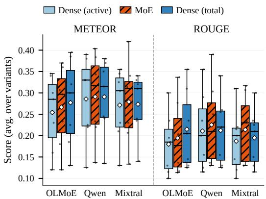

Figure 2: Personalization performance of LLMs: each box plot shows average performance over personalized and non-personalized variants on 7 datasets (points), with the mean performance represented using ⋄. The detailed result is described in Table 2.  
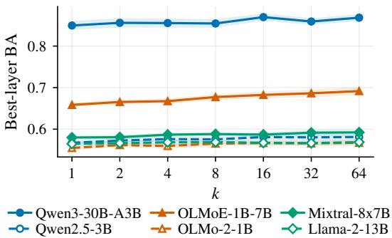  
Figure 3: K-sparse probe balanced accuracy comparison between MoE and dense LLMs with similar active parameters.

## 6 Results

## 6.1 Personalization performance comparison

Across model families and evaluation metrics, MoE LLMs outperform dense LLMs with similar active parameters, and for the Qwen and Mixtral families, they match or exceed dense LLMs with similar total parameters (Figure 2). The per-variant results in Table 2 show the same pattern after personalization: personalized MoE LLMs outperform or match personalized dense LLMs with similar active parameters. Router tuning accounts for most of this gain in Qwen3, whereas expert tuning contributes more in Mixtral. Across benchmarks, personalization yields the largest gains on MULTIFACETED BENCH, which shares the training data’s (MUL-TIFACETED COLLECTION) form of preference (group-level preferences given via system messages), and smaller gains on LaMP and LongLaMP, which require transferring to per-user preferences inferred from interaction history. Overall, MoE

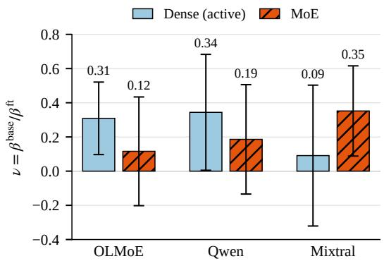  
Figure 4: Ratio ν of scales to explain non-personalized and personalized models via personalized latents and their behavior across dense and MoE LLMs.

LLMs achieve competitive personalization while activating only a fraction of their parameters, motivating a mechanistic analysis ofhow their experts encode personalization features.

## 6.2 RQ1: Do Sparse MoE LLMs offer lower polysemanticity, enabling better disentanglement of personalized features?

Polysemanticity. To investigate the polysemanticity behavior of neurons in MoE experts compared to dense LLMs, we use k-sparse probing (Gurnee et al., 2023). Following Herbst et al. (2026), we estimate the mean difference of activations between positive and negative tokens per concept and compute the binary classification of a probe considering only the top-k neurons with the highest activation difference. For our personalization task, we consider the top 5 most frequent sub-dimensions from MULTIFACETED COLLECTION as concepts for each dimension, resulting in 20 independent concepts. For each concept, we take the response tokens (up to 1024 per response, 100 queries) of samples whose system message specifies that subdimension as positives, and those of samples specifying a different sub-dimension of the same dimension as negatives (e.g.,formal vs. casual under style), giving about 50,000 tokens per class. Following Herbst et al. (2026), we only consider tokens routed to the target expert for MoE LLMs and identify the best layer containing the expert achieving the highest classification accuracy on the test split (25% split). For dense LLMs, the best layer is that with the highest-performing MLP. Figure 3 illustrates the variance in k-sparse probe classification accuracy from k = 64 to k = 1 for the MoE and dense LLMs with similar active parameters. MoE LLMs outperform dense LLMs with similar active parameters in the balanced accuracy metric, and the performance gap is wider for the same model family (Olmo, Qwen). The gap remains wide at $k = 1$ , verifying monosemantic behavior ofMoE expertsfor personalization.

Disentanglement of personalized features. To verify whether lower polysemantic MoE experts enable better disentanglement of personalised features via crosscoder latents, we compare MoE and dense LLMs on how well personalized latents explain activations from non-personalized LLMs. In particular, following Minder et al. (2025), we compute scales $\beta _ { j } ^ { \mathrm { b a s e } } , \bar { \beta } _ { j } ^ { \mathrm { f t } }$ for each personalized latent $j \in \mathcal { I } _ { \mathrm { f t } }$ in explaining activations from nonpersonalized and personalized model as:

$$
\beta _ { j } ^ { \mathrm { b a s e / f t } } = \underset { \beta } { \operatorname { a r g m i n } } \sum _ { i = 1 } ^ { n } \left. \beta a _ { j } ( x _ { i } ) d _ { j } ^ { \mathrm { f t } } - h ^ { \mathrm { b a s e / f t } } ( x _ { i } ) \right. _ { 2 } ^ { 2 }\tag{9}
$$

Since, $\beta _ { j } ^ { \mathrm { b a s e } } , \beta _ { j } ^ { \mathrm { f t } }$ are unbounded, their ratio $\nu _ { j } =$ $\beta _ { j } ^ { \mathrm { b a s e } } / \beta _ { j } ^ { \mathrm { f t } }$ approaching near zero indicate little contribution to reconstructing the non-personalized model relative to the personalized model. Figure 4 compares the $\nu _ { j }$ corresponding to personalized latents of MoE and dense LLMs. For the same model family, the MoE LLM has a lower $\nu _ { j }$ for personalized latents than dense LLMs, except for Mixtral, which yields a higher ν than a similar activeparameter-sized Llama-13B model, indicating that this comparison is limited to the same model family. Overall, MoE LLMs offer lower polysemanticity and better disentanglement ofpersonalized features, which justifies the need for interpretability analysis for decoding personalization mechanism.

## 6.3 RQ2: What are the different personalized features disentangled into a set of interpretable concepts?

Using the routing-divergence and entropy criteria discussed in §4.2, we identify L25, L15, and L6 as the most distinctive layers for Qwen3-30B-A3B (2507), Mixtral-8x7B (v0.1), and OLMoE-1B-7B (0125) respectively, as illustrated in Figures 5, 11 and 12. As discussed in §4.2, we identify a very small subset (less than 0.25%) of latents with very high $( \ge ~ 0 . 9 )$ decoder norm to reconstruct activations from the personalized MoE LLMs. In particular, we identify (157/65536), (132/131072), (111/65536) personalized latents for Qwen3- 30B-A3B (2507), Mixtral-8x7B (v0.1), and OLMoE-1B-7B (0125) respectively, as illustrated in Figures 6, 13 and 14.

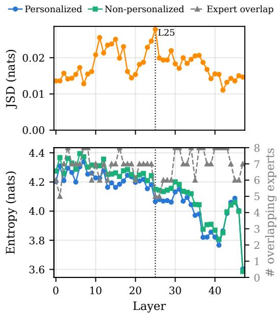  
Figure 5: Layer-wise routing distribution analysis. Top: routing JS-divergence between the personalized and non-personalized Qwen3-30B-A3B (2507). Bottom: entropy of the two models with overlapped experts (right axis). L25 is identified as the best layer. Refer to Figures 11 and 12 for other models.

Interpreting personalized latents. Following Paulo et al. (2025); Minder et al. (2025), we explain each personalized latent with an LLM explainer and evaluate the explanation with an LLM scorer (both Llama-3.3-70B-Instruct). The explainer sees 30 activating examples (the top 20 and 10 weaker ones), each a 40-token window centred on the maximally activating token (32 tokens before, 8 tokens after). The scorer then labels 20 examples as activating and 20 as non-activating, using only the explanation. Figure 8 shows an example: a maxactivating latent from Qwen3 is explained as tracking the audience’s level of expertise.

Most personalized latents encode the requested preference rather than the response: 85% of OL-MoE and 82% of Qwen3 latents fire mainly on the system message. Mixtral is the exception, with 41% firing mainly in the response. The models also emphasize different preference dimensions: OLMoE’s latents are dominated by style (52%) and harmlessness (21%), whereas Qwen3’s and Mixtral’s are dominated by background knowledge (45% and 40%). The scorer reaches moderate F1 overall (0.65 OLMoE, 0.63 Qwen3, 0.70 Mixtral; Figure 7), rising monotonically across activation bins to 0.81, 0.83 and 0.88 in the top bin, so the explanations best describe strong activations. Overall, the crosscoder decomposes the features that personalization adds to MoE LLMs into a small set of interpretable concepts.

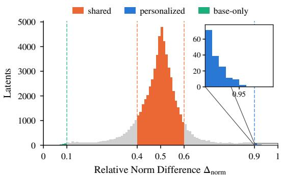  
Figure 6: Relative norm difference distribution of latents from the crosscoder trained on activations from L25 of personalized and non-personalized Qwen3-30B-A3B (2507). Refer Figures 13 and 14 for other models.

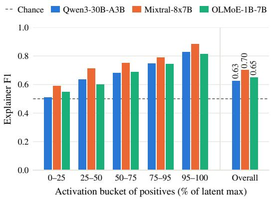  
Figure 7: F1 for classifying positive and negative examples activated by latents (Overall). We also show its efficiency across different activation quantiles.

## 6.4 RQ3: How are different experts in MoE uniquely aligned with different personalized features?

To test whether distinct personalization features map to different experts, we evaluate the distinctiveness and stability of latent–expert mappings (see §4.2). As illustrated in Figure 9, for each latent, we select the optimal 400 examples and restrict it to route towards one expert every layer for the Qwen3- 30B-A3B (2507). For this setting, we achieve very high stability with $S$ of 0.81, verifying that under repeated sampling over those 400 examples, most of the activating examples are routed towards a specialized expert. To validate whether the routing is heavily influenced by a dominant expert, we measure the distinctiveness and a very high $D$ of 0.94, which verifies that a different set of examples activated by different latents is routed to their respective experts. Overall, experts in MoE LLMs encode distinct personalized features, verifying lower polysemanticity for personalization.

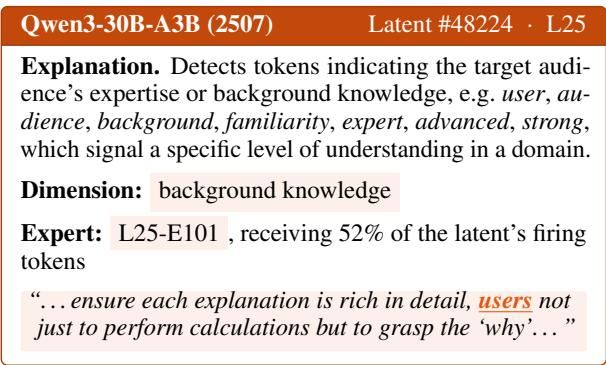  
Figure 8: Top activating latent from Qwen3-30B-A3B (2507): its autointerpretability explanation, dominant preference dimension in MULTIFACETED COLLEC-TION, the top- $\mathbf { \nabla } \cdot k ^ { \prime }$ expert at layer 25 with the share of the latent’s activated tokens routed to it, and an excerpt from a top-N activating sequence with the maximally activating token highlighted. More top activating latents from different models are described in Table 3.

## 6.5 Causal analysis

Sufficiency of personalized latents via activation patching. Following Minder et al. (2025) of causally verifying the sufficiency of chat-specific latents for instruction-tuned LLMs, for an input token, we patch the activation of that token at the crosscoder layer of the personalized model with a hybrid activation combining activation from the non-personalized model and personalized latents activations for that token, and continue the generation from the later layer to measure the KL divergence between the next token probability of the personalized and patched personalized model. In particular, for an input token $x _ { t }$ with activations from personalized and non-personalized MoE LLMs at the crosscoder layer l as $h _ { x _ { t } } ^ { l , \mathrm { f t } }$ , and $h _ { x _ { t } } ^ { l , \mathrm { b a s e } }$ respectively, we measure KL divergence KL $( \boldsymbol { p } _ { h _ { x _ { t } } ^ { l , \mathrm { f t } }  h _ { x _ { t } } ^ { l , \mathcal { I } _ { \mathrm { f t } } } } ^ { \mathrm { f t } }  \boldsymbol { p } ^ { \mathrm { f t } } )$ , where $p ^ { \mathrm { f t } }$ is the personalized model’s next token probability, and the hybrid activation $\begin{array} { r } { h _ { x _ { t } } ^ { l , \mathcal { I } _ { \mathrm { f t } } } = h _ { x _ { t } } ^ { l , \mathrm { b a s e } } + \sum _ { j \in \mathcal { I } _ { \mathrm { f t } } } a _ { j } ( x _ { t } ) \mathbf { d } _ { j } ^ { \mathrm { f t } } } \end{array}$ If we just patch with the non-personalized model, then the KL divergence will be the maximum, and we measure the reduction in KL divergence from the non-personalized patching for our personalized latents. We also randomly select the same number of latents matching the activation frequency of those personalized latents, from the whole and ‘shared’ region of the crosscoder’s latent distribution as baselines. The top part of Figure 10 verifies that for personalized latents, the KL divergence decrease is the maximum among the baselines across MoE models on the MULTIFACETED BENCH benchmark, causally establishing the sufficiency ofpersonalized latents in explaining personalized features in MoE personalization.

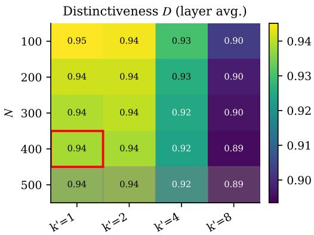

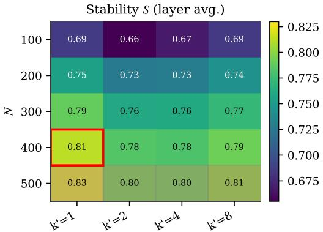  
Figure 9: Grid search over $( N , k )$ for Qwen3-30B-A3B (2507). Top: Distinctiveness of $\mathrm { t o p } { - } k ^ { \prime }$ experts across latents with varying N. Bottom: Stability of top-k′ experts for the same N examples under resampling for a particular latent.

Unique routing paths for distinct personalization features. To causally verify whether a small set of experts encodes distinct personalization features as shown in §6.4, we steer those experts in the non-personalized MoE LLMs along each dimension from the MULTIFACETED COL-LECTION benchmark, and measure the KL divergence from the personalized counterparts. In particular, for each dimension, we collect experts uniquely aligned with the latents (§6.3,§6.3) and rank them by routing frequency (Equation (5)) over the activating examples corresponding to those latents. We steer top-k′ (Figures 9, 15 and 16) experts for each dimension for all the MoE LLMs as: $\tilde { z } _ { i } ^ { ( l ) } = z _ { i } ^ { ( l ) } + \beta ^ { ( l ) } \sigma ( z _ { i } ^ { ( l ) } )$ , where $i \in \mathrm { t o p } - k ^ { \prime }$ $\sigma ( z _ { i } ^ { ( \dot { l } ) } )$ is the standard deviation of the router logits of the non-personalized MoE at layer l (over tokens and experts) and $\beta ^ { ( l ) }$ (2 in our experiment) is the boosting strength. We also randomly steer the same number of experts at the crosscoder layer in the non-personalized layer. The bottom panel of fig. 10 shows that, for each dimension, steering the unique top-k′ experts yields lower KL divergence than random steering, thereby causally verifying unique routing paths for distinct personalization features.

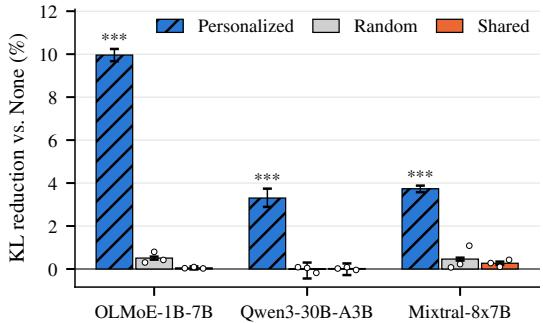  
OLMoE Qwen3 Mixtral random (lighter)

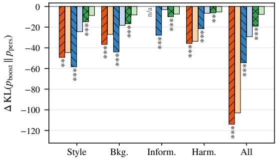  
Figure 10: Top: KL patching at the crosscoder layer over full responses. ‘Random’ and ‘Shared’ baselines are shown as the mean of 3 draws with dots. Bottom: Steering top- $\cdot k ^ { \prime }$ experts per dimension in the nonpersonalized model; measuring KL divergence with its personalized counterpart. \*\*\*: statistically significant with $p \ < \ 0 . 0 0 1$ vs. controls (Wilcoxon, Holmcorrected).

## 7 Discussion and Conclusion

We presented, to our knowledge, the first mechanistic study of personalization in MoE LLMs. Combining a two-stage router-and-expert adaptation for personalization with crosscoder-based interpretability analysis for personalization mechanism shows: (1) MoE LLMs achieve competitive personalization performance than dense LLMs by utilizing only ∼ 20% of total parameters. (2) MoE LLMs exhibit lower polysemanticity than dense LLMs for personalization and they enable better interpretability of encoded personalization features via crosscoder than dense LLMs. (3) MoE encodes distinct personalization features via different routing paths, enabling better localization and subsequent intervention for controlled personalization.

## Limitations

Models and comparisons. We study three open MoE families and analyze one layer per model, selected by routing divergence. Personalization features may also arise at other layers, and our conclusions may not transfer to other MoE designs (e.g., shared experts or fine-grained expert segmentation). The dense counterparts are matched by active or total parameter count, but differ in pretraining data and recipes, so architectural effects cannot be fully separated from training differences.

Data and notion of persona. Multifaceted-Collection describes preferences through synthetic system messages over four dimensions, with categorical, long-tailed subdimension labels. This captures group-level preferences rather than individual users, and our experiments are limited to English. Personalization signals in real user histories may be noisier and more entangled than in this controlled setting.

Crosscoder fidelity. Crosscoders reconstruct activations imperfectly, and reconstruction quality varies across models (with fractions of variance explained of 0.80 for OLMoE, 0.74 for Qwen3- 30B-A3B, and 0.65 for Mixtral, whose activations have much larger magnitudes and heavier tails). Information in the reconstruction error is invisible to our latent-level analyses, and the set of personalized latents depends on the decoder-norm threshold. BatchTopK training and latent scaling mitigate known sparsity artifacts (Minder et al., 2025), but do not rule them out entirely.

Probing. Persona concepts are properties of whole responses, whereas sparse probing labels individual tokens, thereby introducing label noise and lowering absolute scores across all models. Selecting the best of many components favors MoE models, which have more candidates (layers × experts); we mitigate this by selecting on test data and reporting test scores, but selection effects may remain, particularly for k = 1. Probes measure whether a concept is decodable, not whether the model uses it.

Expert attribution and causality. Expert sets are derived from routing frequencies at firing tokens and are therefore correlational; they depend on the number of examples, the selection rule, and the background routing rate, and their stability is

moderate.

Evaluation of generation. ROUGE-L and ME-TEOR measure overlap with reference responses and are imperfect proxies for personalization: a response can satisfy a preference while diverging from the reference wording, as our steering results illustrate. Sampling-based generation adds variance. Automated explanations rely on an LLM explainer and scorer (Llama-3.3-70B-Instruct), whose own biases may shape the descriptions.

## Ethical Considerations

Use of AI Assistants. The authors used Claude API to assist with language polishing and grammatical corrections, clarity and coherence. All technical contributions, including experimental design choices and final decisions, were made by the authors.

## Acknowledgements

c This research was co-funded by the European Union (ERC, ExplainYourself, 101077481) and by VILLUM FONDEN (grant number 40543). Views and opinions expressed are however those of the author(s) only and do not necessarily reflect those of the European Union or the European Research Council. Neither the European Union nor the granting authority can be held responsible for them.

## References

Jun Bai, Minghao Tong, Yang Liu, Zixia Jia, and Zilong Zheng. 2025. Understanding and Leveraging the Expert Specialization of Context Faithfulness in Mixture-of-Experts LLMs. In Proceedings of the 2025 Conference on Empirical Methods in Natural Language Processing, pages 21927–21942, Suzhou, China. Association for Computational Linguistics.

Lucas Bandarkar, Chenyuan Yang, Mohsen Fayyaz, Junlin Hu, and Nanyun Peng. 2026. Multilingual Routing in Mixture-of-Experts. In The Fourteenth International Conference on Learning Representations.

Trenton Bricken, Adly Templeton, Joshua Batson, Brian Chen, Adam Jermyn, Tom Conerly, Nick Turner, Cem Anil, Carson Denison, Amanda Askell, Robert Lasenby, Yifan Wu, Shauna Kravec, Nicholas Schiefer, Tim Maxwell, Nicholas Joseph, Zac Hatfield-Dodds, Alex Tamkin, Karina Nguyen, and 6 others. 2023. Towards Monosemanticity: Decomposing Language Models With Dictionary Learning. Transformer Circuits Thread.

Bart Bussmann, Patrick Leask, and Neel Nanda. 2024. BatchTopK Sparse Autoencoders. In NeurIPS 2024 Workshop on Scientific Methodsfor Understanding Deep Learning.

Yuanpu Cao, Tianrong Zhang, Bochuan Cao, Ziyi Yin, Lu Lin, Fenglong Ma, and Jinghui Chen. 2024. Personalized Steering of Large Language Models: Versatile Steering Vectors Through Bi-directional Preference Optimization. In The Thirty-eighth Annual Conference on Neural Information Processing Systems.

Marmik Chaudhari, Nishkal Hundia, and Idhant Gulati. 2026. Sparse Crosscoders for diffing MoEs and Dense models. Preprint, arXiv:2603.05805.

Pengyu Cheng, Jiawen Xie, Ke Bai, Yong Dai, and Nan Du. 2023. Everyone Deserves A Reward: Learning Customized Human Preferences. Preprint, arXiv:2309.03126.

Mohsen Fayyaz, Ali Modarressi, Hanieh Deilamsalehy, Franck Dernoncourt, Ryan A. Rossi, Trung Bui, Hinrich Schuetze, and Nanyun Peng. 2026. Steering MoE LLMs via Expert (De)Activation. In The Fourteenth International Conference on Learning Representations.

William Fedus, Barret Zoph, and Noam Shazeer. 2022. Switch Transformers: Scaling to Trillion Parameter Models with Simple and Efficient Sparsity. Journal ofMachine Learning Research, 23(120):1–39.

Wes Gurnee, Neel Nanda, Matthew Pauly, Katherine Harvey, Dmitrii Troitskii, and Dimitris Bertsimas. 2023. Finding Neurons in a Haystack: Case Studies with Sparse Probing. Transactions on Machine Learning Research.

Jeremy Herbst, Stefan Wermter, and Jae Hee Lee. 2026. The Expert Strikes Back: Interpreting Mixture-of-Experts Language Models at Expert Level. In Fortythird International Conference on Machine Learning.

Robert Huben, Hoagy Cunningham, Logan Riggs Smith, Aidan Ewart, and Lee Sharkey. 2024. Sparse Autoencoders Find Highly Interpretable Features in Language Models. In The Twelfth International Conference on Learning Representations.

Joel Jang, Seungone Kim, Bill Yuchen Lin, Yizhong Wang, Jack Hessel, Luke Zettlemoyer, Hannaneh Hajishirzi, Yejin Choi, and Prithviraj Ammanabrolu. 2024. Personalized Soups: Personalized Large Language Model Alignment via Post-hoc Parameter Merging. In Adaptive Foundation Models: Evolving AIfor Personalized and Efficient Learning.

Albert Q. Jiang, Alexandre Sablayrolles, Antoine Roux, Arthur Mensch, Blanche Savary, Chris Bamford, Devendra Singh Chaplot, Diego de las Casas, Emma Bou Hanna, Florian Bressand, Gianna Lengyel, Guillaume Bour, Guillaume Lample, Lélio Renard Lavaud, Lucile Saulnier, Marie-Anne Lachaux, Pierre Stock, Sandeep Subramanian,

Sophia Yang, and 7 others. 2024a. Mixtral of Experts. Preprint, arXiv:2401.04088.

Hang Jiang, Xiajie Zhang, Xubo Cao, Cynthia Breazeal, Deb Roy, and Jad Kabbara. 2024b. "PersonaLLM: Investigating the Ability of Large Language Models to Express Personality Traits". In Findings of the Associationfor Computational Linguistics: NAACL 2024, pages 3605–3627, Mexico City, Mexico. Association for Computational Linguistics.

Ishita Kumar, Snigdha Viswanathan, Sushrita Yerra, Alireza Salemi, Ryan A. Rossi, Franck Dernoncourt, Hanieh Deilamsalehy, Xiang Chen, Ruiyi Zhang, Shubham Agarwal, Nedim Lipka, Chien Van Nguyen, Thien Huu Nguyen, and Hamed Zamani. 2024. Longlamp: A benchmark for personalized long-form text generation. Preprint, arXiv:2407.11016.

Seongyun Lee, Sue Hyun Park, Seungone Kim, and Minjoon Seo. 2024. Aligning to Thousands of Preferences via System Message Generalization. In The Thirty-eighth Annual Conference on Neural Information Processing Systems.

Jiaang Li, Haibin Chen, Langming Liu, Yujin Yuan, Yadao Wang, Yizhen Zhang, Chengting Yu, Xin Tong, Weidong Zhang, Shilei Liu, Wenbo Su, and Bo Zheng. 2026. Expert Divergence Learning for MoE-based Language Models. In The Fourteenth International Conference on Learning Representations.

Julian Minder, Clément Dumas, Caden Juang, Bilal Chughtai, and Neel Nanda. 2025. Overcoming Sparsity Artifacts in Crosscoders to Interpret Chat-Tuning. In The Thirty-ninth Annual Conference on Neural Information Processing Systems.

Niklas Muennighoff, Luca Soldaini, Dirk Groeneveld, Kyle Lo, Jacob Morrison, Sewon Min, Weijia Shi, Evan Pete Walsh, Oyvind Tafjord, Nathan Lambert, Yuling Gu, Shane Arora, Akshita Bhagia, Dustin Schwenk, David Wadden, Alexander Wettig, Binyuan Hui, Tim Dettmers, Douwe Kiela, and 5 others. 2025. OLMoE: Open Mixture-of-Experts Language Models. In The Thirteenth International Conference on Learning Representations.

Chris Olah, Nick Cammarata, Ludwig Schubert, Gabriel Goh, Michael Petrov, and Shan Carter. 2020. Zoom In: An Introduction to Circuits. Distill.

Matthew Lyle Olson, Neale Ratzlaff, Musashi Hinck, Man Luo, Sungduk Yu, Chendi Xue, and Vasudev Lal. 2025. Probing Semantic Routing in Large Mixtureof-Expert Models. In Findings of the Association for Computational Linguistics: EMNLP 2025, pages 18263–18278, Suzhou, China. Association for Computational Linguistics.

Gonçalo Santos Paulo, Alex Troy Mallen, Caden Juang, and Nora Belrose. 2025. Automatically Interpreting Millions of Features in Large Language Models. In Forty-second International Conference on Machine Learning.

Chris Richardson, Yao Zhang, Kellen Gillespie, Sudipta Kar, Arshdeep Singh, Zeynab Raeesy, Omar Zia Khan, and Abhinav Sethy. 2023. Integrating summarization and retrieval for enhanced personalization via large language models. Preprint, arXiv:2310.20081.

Alireza Salemi, Sheshera Mysore, Michael Bendersky, and Hamed Zamani. 2024. LaMP: When Large Language Models Meet Personalization. In Proceedings of the 62nd Annual Meeting of the Association for Computational Linguistics (Volume 1: Long Papers), pages 7370–7392, Bangkok, Thailand. Association for Computational Linguistics.

Noam Shazeer, \*Azalia Mirhoseini, \*Krzysztof Maziarz, Andy Davis, Quoc Le, Geoffrey Hinton, and Jeff Dean. 2017. Outrageously Large Neural Networks: The Sparsely-Gated Mixture-of-Experts Layer. In International Conference on Learning Representations.

Oscar Skean, Md Rifat Arefin, Dan Zhao, Niket Nikul Patel, Jalal Naghiyev, Yann LeCun, and Ravid Shwartz-Ziv. 2025. Layer by Layer: Uncovering Hidden Representations in Language Models. In Forty-second International Conference on Machine Learning.

Zhaoxuan Tan, Qingkai Zeng, Yijun Tian, Zheyuan Liu, Bing Yin, and Meng Jiang. 2024. "Democratizing Large Language Models via Personalized Parameter-Efficient Fine-tuning". In Proceedings of the 2024 Conference on Empirical Methods in Natural Language Processing, pages 6476–6491, Miami, Florida, USA. Association for Computational Linguistics.

Fuzhao Xue, Zian Zheng, Yao Fu, Jinjie Ni, Zangwei Zheng, Wangchunshu Zhou, and Yang You. 2024. OpenMoE: An Early Effort on Open Mixture-of-Experts Language Models. In Forty-first International Conference on Machine Learning.

An Yang, Anfeng Li, Baosong Yang, Beichen Zhang, Binyuan Hui, Bo Zheng, Bowen Yu, Chang Gao, Chengen Huang, Chenxu Lv, Chujie Zheng, Dayiheng Liu, Fan Zhou, Fei Huang, Feng Hu, Hao Ge, Haoran Wei, Huan Lin, Jialong Tang, and 41 others. 2025a. Qwen3 Technical Report. Preprint, arXiv:2505.09388.

Xingyi Yang, Constantin Venhoff, Ashkan Khakzar, Christian Schroeder de Witt, Puneet K. Dokania, Adel Bibi, and Philip Torr. 2025b. Mixture of Experts Made Intrinsically Interpretable. In Forty-second International Conference on Machine Learning.

Jinghao Zhang, Yuting Liu, Wenjie Wang, Qiang Liu, Shu Wu, Liang Wang, and Tat-Seng Chua. 2025a. Personalized Text Generation with Contrastive Activation Steering. In Proceedings ofthe 63rd Annual Meeting of the Association for Computational Linguistics (Volume 1: Long Papers), pages 7128–7141, Vienna, Austria. Association for Computational Linguistics.

Zhehao Zhang, Ryan A. Rossi, Branislav Kveton, Yijia Shao, Diyi Yang, Hamed Zamani, Franck Dernoncourt, Joe Barrow, Tong Yu, Sungchul Kim, Ruiyi Zhang, Jiuxiang Gu, Tyler Derr, Hongjie Chen, Junda Wu, Xiang Chen, Zichao Wang, Subrata Mitra, Nedim Lipka, and 2 others. 2025b. Personalization of Large Language Models: A Survey. Transactions on Machine Learning Research. Survey Certification.

Barret Zoph, Irwan Bello, Sameer Kumar, Nan Du, Yanping Huang, Jeff Dean, Noam Shazeer, and William Fedus. 2022. ST-MoE: Designing Stable and Transferable Sparse Expert Models. Preprint, arXiv:2202.08906.

## A Relevant Model Architecture Details

## A.1 Crosscoder

Crosscoder is an encoder-decoder-based architecture that explains the activations from both finetuned (personalized) and base (non-personalized) LLMs by learning a shared dictionary of interpretable concepts (latents). Formally, for the input token $x _ { t } ,$ let the activations from a particular layer l of the personalized and non-personalized MoEs be $h _ { x _ { t } } ^ { ( l , \mathrm { f t } ) } \in \mathbb { R } ^ { d }$ and $h _ { x _ { t } } ^ { ( l , \mathrm { b a s e } ) } \in \mathbb { R } ^ { d }$ respectively (d is the model dimension), the encoder of the crosscoder maps those activations to a higher dimensional $( D > > d ) ^ { 2 }$ latent space, where each dimension $j \in \{ 1 , \ldots , D \}$ explains distinct features encoded in those activations $h _ { x _ { t } } ^ { ( l , \mathrm { f t } ) }$ , and $h _ { x _ { t } } ^ { ( l , \mathrm { b a s e } ) }$ as:

$$
\begin{array} { r } { a _ { j } ( x _ { t } ) = \mathrm { R e L U } ( { \bf e } _ { j } ^ { ( \mathrm { f t } ) } h _ { x _ { t } } ^ { ( l , \mathrm { f t } ) } + { \bf e } _ { j } ^ { ( \mathrm { b a s e } ) } h _ { x _ { t } } ^ { ( l , \mathrm { b a s e } ) } + { \bf b } _ { j } ^ { ( \mathrm { e n c } ) } ) } \\ { ( 1 0 ) } \end{array}
$$

where $a _ { j }$ is the activation for latent $j ,$ $\mathbf e _ { j } ^ { ( \mathrm { f t } ) } , \mathbf e _ { j } ^ { ( \mathrm { b a s \bar { e } } ) } \ \in \ \mathbb R ^ { d }$ are the the encoder weight vectors corresponding to the latent $j ,$ and $\mathbf { b } _ { i } ^ { ( \mathrm { e n c } ) }$ is the corresponding encoder bias. The decoder of the crosscoder then reconstructs those activations $h _ { x _ { t } } ^ { ( l , \mathrm { f t } ) }$ , and $h _ { x _ { t } } ^ { ( l , \mathrm { b a s e } ) }$ for the token $x _ { t }$ using the sparse activation distribution of shared dictionary latents as:

$$
\begin{array} { c } { { \displaystyle \tilde { h } _ { x _ { t } } ^ { ( l , \mathrm { f t } ) } = \sum _ { j } a _ { j } ( x _ { t } ) \mathbf { d } _ { j } ^ { ( \mathrm { f t } ) } + \mathbf { b } ^ { ( \mathrm { d e c } ) } } } \\ { { \displaystyle \tilde { h } _ { x _ { t } } ^ { ( l , \mathrm { b a s e } ) } = \sum _ { j } a _ { j } ( x _ { t } ) \mathbf { d } _ { j } ^ { ( \mathrm { b a s e } ) } + \mathbf { b } ^ { ( \mathrm { d e c } ) } } } \end{array}\tag{11}
$$

where ${ \bf d } _ { j } ^ { ( \mathrm { f t } ) } , { \bf d } _ { j } ^ { ( \mathrm { b a s e } ) } \ \in \ \mathbb { R } ^ { d }$ are the the decoder weight vectors corresponding to the latent $j ,$ and $\mathbf { b } _ { j } ^ { ( \mathrm { d e c } ) } ~ \in ~ \mathbb { R } ^ { d }$ is the decoder bias. The crosscoder is trained by minimizing the loss involving (a) reconstruction error as $\bar { h } _ { x _ { t } } ^ { ( l , \mathrm { f t } ) } - \tilde { h } _ { x _ { t } } ^ { ( l , \mathrm { f t } ) }$ , and $h _ { x _ { t } } ^ { ( \bar { l } , \mathrm { b a s e } ) } - \tilde { h } _ { x _ { t } } ^ { ( l , \mathrm { b a s e } ) }$ , and (b) sparsity enforcement on the decoder weights ${ \bf d } _ { j } ^ { \mathrm { ( f t ) } } , { \bf d } _ { j } ^ { \mathrm { ( b a s e ) } }$ Following (Minder et al., 2025) of utilizing L0 sparsity instead of L1 sparsity in obtaining better decoupled latents, we adopt the L0 sparsity-based BatchTopK crosscoder (Bussmann et al., 2024) to select top-k latents activated per example for a batch size of n, enforcing only nk activated latents for activation reconstruction from both models. More details about BatchTopk crosscoder are described in Minder et al. (2025).

<table><tr><td>Model</td><td>Active Params</td><td>Total Params</td></tr><tr><td>OLMoE family</td><td></td><td></td></tr><tr><td>OLMo-2-1B (0425)</td><td>1B</td><td>1B</td></tr><tr><td>OLMoE-1B-7B (0125)</td><td>1.3B</td><td>6.9B</td></tr><tr><td>OLMo-2-7B (1124)</td><td>7B</td><td>7B</td></tr><tr><td>Qwen family</td><td></td><td></td></tr><tr><td>Qwen2.5-3B</td><td>3B</td><td>3B</td></tr><tr><td>Qwen3-30B-A3B (2507)</td><td>3B</td><td>30B</td></tr><tr><td>Qwen2.5-32B</td><td>32B</td><td>32B</td></tr><tr><td></td><td></td><td></td></tr><tr><td>Mixtral / Llama-2 family</td><td></td><td></td></tr><tr><td>Llama-2-13B</td><td>13B</td><td>13B</td></tr><tr><td>Mixtral-8x7B (v0.1)</td><td>13B</td><td>46.7B</td></tr><tr><td>Llama-2-70B</td><td>70B</td><td>70B</td></tr></table>

Table 1: For each MoE LLM, we compare with similar active and total parameter-sized dense LLMs with the same model family if available. For dense LLMs, active parameters are the same as total parameters.

## B Reproducibility

## B.1 Performance comparison of dense and MoE LLMs for personalized text generation

## B.1.1 Hyperparameters

Following (Lee et al., 2024), for inference on the multifacted-bench dataset, we utilize a temperature of 1.0, a top-p of 0.9, and a repetition penalty of 1.03 for the generation configuration, with a maximum number of new tokens to generate of 4096.

## B.1.2 Implementation Details

We utilize LoRA-PEFT for both router tuning and personalized experts tuning of MoE models and personalization of dense LLMs. We only update the MLP weights for both MoE and dense LLMs.

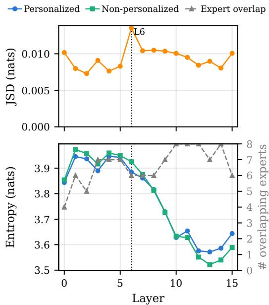  
Figure 11: Layer-wise routing distribution analysis. Top: routing JS-divergence between the personalized and non-personalized OLMoE-1B-7B (0125. Bottom: entropy of the two models with overlapped experts (right axis). L6 is identified as the best layer.

To train the crosscoder, we utilize the BatchTopK crosscoder with L0 and an expansion factor of 32 for all three MoE LLMs, using paired activations collected from the residual MLP contributions.

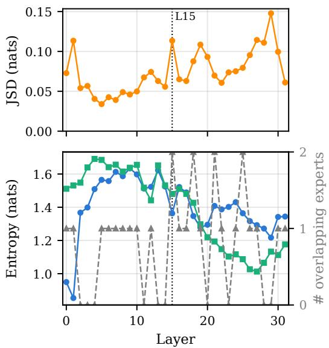  
Figure 12: Layer-wise routing distribution analysis. Top: routing JS-divergence between the personalized and non-personalized Mixtral-8x7B (v0.1). Bottom: entropy of the two models with overlapped experts (right axis). L15 is identified as the best layer.

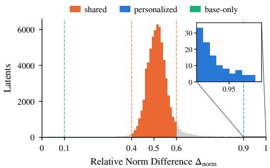  
Figure 13: Relative norm difference distribution of latents from the crosscoder trained on activations from L6 of personalized and non-personalized OLMoE-1B-7B (0125).

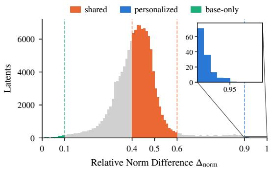  
Figure 14: Relative norm difference distribution of latents from the crosscoder trained on activations from L15 of personalized and non-personalized Mixtral-8x7B (v0.1).

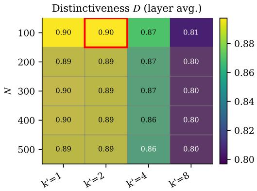

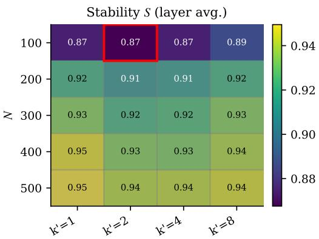  
Figure 15: Grid search over $( N , k )$ for OLMoE-1B-7B (0125). Top: Distinctiveness of $\mathrm { t o p } { - } k ^ { \prime }$ experts across latents with varying N. Bottom: Stability of top-k′ experts for the same N examples under resampling for a particular latent.

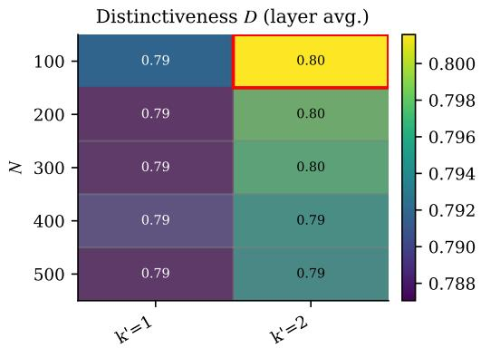

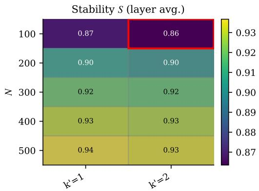  
Figure 16: Grid search over $( N , k )$ for Mixtral-8x7B (v0.1). Top: Distinctiveness of $\mathrm { t o p } { - } k ^ { \prime }$ experts across latents with varying N. Bottom: Stability of $\mathrm { t o p } { - } k ^ { \prime }$ experts for the same N examples under resampling for a particular latent.

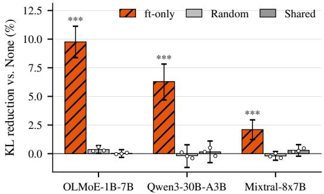  
Figure 17: KL patching at the crosscoder layer over the first 9 response tokens. Reduction of the next-token KL divergence to the personalized MoE, relative to patching in the non-personalized MoE output, when adding the decoder contributions of the personalized latents (ft-only) or of equally sized, firing-frequency-matched random or shared latents (mean of 3 draws; dots: individual draws). Error bars: 95% bootstrap CIs over the 921 MULTIFACETED BENCH examples; $\ast \ast \ast \ast \cdot p < 0 . 0 0 1$ vs. both controls (Wilcoxon, Holm-corrected).

<table><tr><td rowspan="3">Model</td><td rowspan="3">Act.</td><td colspan="2">MFBench</td><td colspan="6">LaMP</td><td colspan="6">LongLaMP</td></tr><tr><td colspan="2"></td><td colspan="2">News</td><td colspan="2">Scholar</td><td colspan="2">Tweet</td><td colspan="2">Abstr.</td><td colspan="3">Topic Review</td></tr><tr><td>M</td><td>R</td><td>M</td><td>R</td><td>M</td><td>R</td><td colspan="2">M R</td><td>M R</td><td colspan="2">M</td><td>M</td><td>R</td></tr><tr><td>OLMo-2-1B (0425)</td><td>1B</td><td>0.29</td><td>0.19</td><td>0.12</td><td>0.08</td><td>0.30</td><td>0.18</td><td>0.29</td><td>0.22</td><td>0.31 0.18</td><td>0.23</td><td>R 0.11</td><td>0.18</td><td>0.14</td></tr><tr><td>OLMo-2-1B (0425)*</td><td>1B</td><td>0.31</td><td>0.20</td><td>0.12</td><td>0.12</td><td>0.38</td><td>0.29</td><td>0.40</td><td>0.38</td><td>0.26 0.19</td><td>0.23</td><td>0.12</td><td>0.14</td><td>0.12</td></tr><tr><td>OLMoE-1B-7B (0125)</td><td>1.3B</td><td>0.25</td><td>0.20</td><td>0.12</td><td>0.11</td><td>0.36</td><td>0.28</td><td>0.35</td><td>0.32 0.31</td><td>0.18</td><td>0.24</td><td>0.11</td><td>0.21</td><td>0.14</td></tr><tr><td>OLMoE-1B-7B (0125)† OLMoE-1B-7B (0125)</td><td>1.3B</td><td>0.32 0.32</td><td>0.20 0.21</td><td>0.12 0.12</td><td>0.12 0.12</td><td>0.35 0.37</td><td>0.26 0.29</td><td>0.36 0.40</td><td>0.32 0.31 0.30</td><td>0.17 0.18</td><td>0.23 0.23</td><td>0.11</td><td>0.19</td><td>0.14</td></tr><tr><td>OLMo-2-7B (1124)</td><td>1.3B 7B</td><td>0.30</td><td>0.23</td><td>0.13</td><td>0.13</td><td>0.40</td><td>0.32</td><td>0.36</td><td>0.37 0.33 0.30</td><td>0.20</td><td>0.24</td><td>0.12 0.12</td><td>0.14 0.21</td><td>0.13 0.15</td></tr><tr><td>OLMo-2-7B (1124)*</td><td>7B</td><td>0.34</td><td>0.24</td><td>0.13</td><td>0.13</td><td>0.39</td><td>0.30</td><td>0.41</td><td>0.38</td><td>0.30 0.21</td><td>0.21</td><td>0.13</td><td>0.16</td><td>0.14</td></tr><tr><td>Qwen2.5-3B</td><td>3B</td><td>0.31</td><td>0.23</td><td>0.13</td><td>0.11</td><td>0.37</td><td>0.27</td><td>0.40</td><td>0.36</td><td>0.34</td><td>0.20 0.24</td><td>0.13</td><td>0.24</td><td>0.16</td></tr><tr><td>Qwen2.5-3B*</td><td>3B</td><td>0.35</td><td>0.24</td><td>0.12</td><td>0.12</td><td>0.39</td><td>0.31</td><td>0.38</td><td>0.35</td><td>0.32</td><td>0.20 0.20</td><td>0.12</td><td>0.21</td><td>0.15</td></tr><tr><td>Qwen3-30B-A3B (2507)</td><td>3B</td><td>0.31</td><td>0.24</td><td>0.14</td><td>0.14</td><td>0.32</td><td>0.23</td><td>0.41</td><td>0.40</td><td>0.32</td><td>0.21 0.22</td><td>0.13</td><td>0.24</td><td>0.15</td></tr><tr><td>Qwen3-30B-A3B (2507) Qwen3-30B-A3B 3 (2507)</td><td>3B</td><td>0.35 0.37</td><td>0.25 0.26</td><td>0.14 0.13</td><td>0.14 0.13</td><td>0.42 0.41</td><td>0.35 0.33</td><td>0.41 0.39</td><td>0.40</td><td>0.31</td><td>0.21 0.22</td><td>0.13</td><td>0.23</td><td>0.16</td></tr><tr><td>Qwen2.5-32B</td><td>3B</td><td></td><td></td><td></td><td></td><td></td><td></td><td></td><td>0.37</td><td>0.32</td><td>0.21 0.22</td><td>0.13</td><td>0.23</td><td>0.16</td></tr><tr><td>Qwen2.5-32B*</td><td>32B 32B</td><td>0.33 0.37</td><td>0.26 0.26</td><td>0.14 0.13</td><td>0.12 0.13</td><td>0.33 0.41</td><td>0.18 0.33</td><td>0.39 0.37</td><td>0.35 0.33</td><td>0.31</td><td>0.23 0.25</td><td>0.14</td><td>0.24</td><td>0.16</td></tr><tr><td></td><td></td><td></td><td></td><td></td><td></td><td></td><td></td><td></td><td></td><td>0.32</td><td>0.21 0.23</td><td>0.12</td><td>0.25</td><td>0.15</td></tr><tr><td>Llama-2-13b Llama-2-13b*</td><td>13B</td><td>0.27 0.34</td><td>0.20</td><td>0.13 0.13</td><td>0.07</td><td>0.29</td><td>0.14</td><td>0.33</td><td>0.26</td><td>0.33</td><td>0.21 0.23</td><td>0.12</td><td>0.23</td><td>0.15</td></tr><tr><td></td><td>13B</td><td></td><td>0.23</td><td></td><td>0.13</td><td>0.40</td><td>0.30</td><td>0.38</td><td>0.36</td><td>0.32</td><td>0.19 0.23</td><td>0.12</td><td>0.19</td><td>0.14</td></tr><tr><td>Mixtral-8x7B (v0.1)</td><td>13B</td><td>0.27</td><td>0.22</td><td>0.14</td><td>0.13</td><td>0.41</td><td>0.29</td><td>0.30</td><td>0.23</td><td>0.31</td><td>0.24 0.23</td><td>0.13</td><td>0.22</td><td>0.16</td></tr><tr><td>Mixtral-8x7B (v0.1)†</td><td>13B</td><td>0.30</td><td>0.22</td><td>0.13</td><td>0.13</td><td>0.43</td><td>0.34</td><td>0.34</td><td>0.33</td><td>0.32</td><td>0.24 0.22</td><td>0.13</td><td>0.18</td><td>0.14</td></tr><tr><td>Mixtral-8x7B (v0.1)‡</td><td>13B</td><td>0.36</td><td>0.25</td><td>0.13</td><td>0.13</td><td>0.42</td><td>0.32</td><td>0.38</td><td>0.36</td><td>0.31</td><td>0.22 0.24</td><td>0.13</td><td>0.22</td><td>0.15</td></tr><tr><td>Llama-2-70b</td><td>70B</td><td>0.28</td><td>0.22</td><td>0.14</td><td>0.10</td><td>0.27</td><td>0.13</td><td>0.30</td><td>0.26</td><td>0.32</td><td>0.21 0.24</td><td>0.13</td><td>0.24</td><td>0.15</td></tr><tr><td>Llama-2-70b*</td><td>70B</td><td>0.36</td><td>0.25</td><td>0.14</td><td>0.13</td><td>0.41</td><td>0.32</td><td>0.36</td><td>0.34</td><td>0.30</td><td>0.21</td><td>0.24 0.13</td><td>0.23</td><td>0.15</td></tr><tr><td>JANUS 7B</td><td></td><td>0.35</td><td>0.24</td><td>0.13</td><td>0.13</td><td></td><td></td><td></td><td></td><td></td><td></td><td></td><td></td><td></td></tr><tr><td></td><td>7B</td><td></td><td></td><td></td><td></td><td>0.40</td><td>0.32</td><td>0.37</td><td>0.35</td><td>0.30</td><td>0.21 0.24</td><td>0.13</td><td>0.23</td><td>0.15</td></tr><tr><td>JANUS+ORPO 7B</td><td>7B</td><td>0.21</td><td>0.10</td><td>0.12</td><td>0.05</td><td>0.09</td><td>0.05</td><td>0.29</td><td>0.15</td><td>0.15</td><td>0.09 0.20</td><td>0.10</td><td>0.07</td><td>0.04</td></tr><tr><td>JANUS+DPO 7B</td><td>7B</td><td>0.35</td><td>0.23</td><td>0.14</td><td>0.13</td><td>0.41</td><td>0.32</td><td>0.36</td><td>0.34</td><td>0.31</td><td>0.22 0.24</td><td>0.13</td><td>0.24</td><td>0.15</td></tr></table>

Table 2: Personalization performance comparison over LLMs across personalization benchmarks using two evaluation metrics METEOR (M) and ROUGE (R). Act. indicates active parameters of LLMs. ⋆ indicates PEFT fine-tuned (FT) dense LLMs, † indicates router-tuned (RT) MoE LLMs, and ‡ indicates the two stage router and expert (RT + EFT)-tuned MoE LLMs. Row colors: dense, active size , MoE , dense, total size . Acronym of personalization benchmarks: MFBench = MULTIFACETED BENCH; LaMP: News = News Headline Generation, Scholar = Scholarly Title Generation, Tweet = Tweet Paraphrasing; LongLaMP: Abstr. = Abstract Generation, Topic = Topic Writing, Review = Review Generation. Within each model family (dense and MoE models together), metric and benchmark, bold indicates the best and underline indicates the second-best result, and tied values share the mark.

<table><tr><td>Model</td><td>Latent Explanation</td><td></td><td>Dimension</td><td>Top-k′ perts</td><td>Ex- Example</td></tr><tr><td>OLMoE-1B-7B (0125)</td><td>12503</td><td>The feature detects the pres- informativeness ence of meticulously struc- tured and precise language, often characterized by the use of advanced technical terminology, detailed expla- nations, and a formal tone, typically in the context of scientific, technical, or aca-</td><td></td><td>L6-E9 (0.91);L6- E22 (0.73)</td><td>&quot;...Your discussions are meticulously detailed, ex- ploring biochemical mech- anisms of Vitamin  $C . . ^ { \mathfrak { n } }$ </td></tr><tr><td>Mixtral-8x7B (v0.1)</td><td></td><td>demic discussions. 45358 The feature detects tokens style related to grammatical cor- rectness, punctuation, and sentence structure, often in the context of editing, cor- recting, or explaining lan-</td><td></td><td>L15-E2 (0.96);L15- E5 (0.34)</td><td>“... identifying run-on sen- tences with a focus on grammatical terms, cater- ing to an audience with prior knowledge...</td></tr></table>

Table 3: Examples of personalized latents identified by the crosscoder for three MoE LLMs: autointerpretability explanation, dominant preference dimension from the MULTIFACETED COLLECTION benchmark, top- $\mathbf { - } k ^ { \prime }$ experts at the optimal layer with the percentage of activated token routed towards that expert, and a representative example from top-N maximally activating sequences with the maximally activated token highlighted.