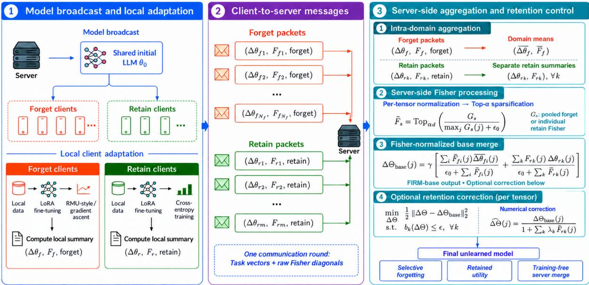
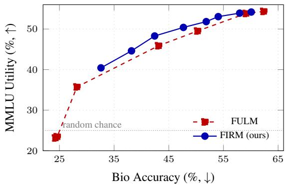
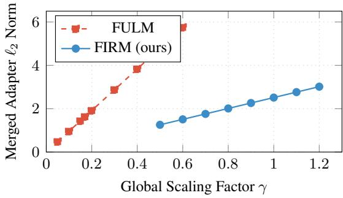

# FIRM: Fisher-Informed Retention Merging for Federated LLM Unlearning

Reeyansh Shah Maram Hasan Subhasis Chaudhuri Biplab Banerjee Indian Institute of Technology Bombay shah.reeyansh@gmail.com

## Abstract

Federated LLM unlearning addresses targeted knowledge removal when forget and retain data remain distributed across private clients and are inaccessible to the server. The resulting locally trained adapters encode conflicting objec tives, making their aggregation fundamentally different from conventional federated optimiza tion. A key failure mode is magnitude explosion, whereby unnormalized cross-client aggregation increases the merged update magnitude and degrades retained utility under stronger unlearning. We propose FIRM (Fisher-Informed Retention Merging), a single-round framework for stable and retention-aware server-side aggregation. FIRM uses client-local Fisher statistics as a unified sensitivity signal to construct a Fisher-normalized base merge and impose explicit control over retain-sensitive parameters. Its second-order retention projection admits a unique minimum-distance solution, while the corresponding dual scales with the number of retain clients rather than the model dimen sion. Experiments across WMDP, TOFU, and MUSE-HP using Zephyr-7B and Llama-3-8B show utility gains at comparable forgetting on WMDP and MUSE-HP, with metric-dependent trade-offs on TOFU. Controlled comparisons support benefits of the combined base merge and additional retention correction at selected operating points.

## 1 Introduction

The widespread deployment of large language models (LLMs) has made selective knowledge removal practically important (Maini et al., 2024). Deployed models may encode personal, copyrighted, or hazardous information that must be removed after training (Li et al., 2024). Regulatory frameworks such as the GDPR (European Parliament and Council of the European Union, 2016) and CCPA (State of California, 2018) further establish rights to erasure, while the cost of retraining billionparameter models makes targeted post-hoc removal the only practical option in many settings. Despite this need, most LLM unlearning methods assume centralized access to both the data to be forgotten and representative retain data.

A critical but under-studied setting isfederated LLM unlearning, where deletion-related data remain distributed across private clients and cannot be transferred to the model provider under localization constraints (Liu et al., 2021). Unlike centralized unlearning, the server cannot jointly access forget and retain data to optimize or validate the resulting model. Unlike standard federated learning, client objectives are not uniformly aligned toward minimizing a shared task loss. Forget clients produce updates that suppress targeted knowledge, whereas retain clients provide preservationoriented updates and parameter-sensitivity information. The server must therefore arbitrate between destructive and protective signals without access to either underlying dataset (Romandini et al., 2025).

Recent work has addressed this problem through server-side aggregation of locally trained adapters. FULM (Zhong et al., 2025), for example, applies TIES-based sign resolution (Yadav et al., 2023) within client groups, followed by unnormalized summation of the resulting domain-level centroids. Although this preserves data locality and avoids additional server-side training, the merged adapter can grow with heterogeneous contributions rather than remain calibrated to their collective importance. We refer to this failure mode as magnitude explosion. As the aggregate update grows, it may suppress general capabilities together with targeted knowledge, causing retained-utility collapse. Moreover, sign-based aggregation captures directional agreement but not the degree of parameter importance to individual clients, and thus provides no explicit control over retain-side damage.

Conventional adapter-merging methods do not directly resolve this problem. TIES (Yadav et al., 2023) and Fisher-weighted model merging (Matena and Raffel, 2022) are primarily designed to combine models optimized for compatible or cooperative objectives. Federated unlearning instead combines updates with opposing functional roles: a parameter may be sensitive on both forget and retain data, while the corresponding task vectors favor opposing changes. A suitable aggregation mechanism must therefore control both the scale of the distributed update and its effect on retain-sensitive parameters.

Our Approach. We introduce FIRM, a Fisherinformed framework for stable and retention-aware federated LLM unlearning. FIRM uses empirical Fisher Information Matrix (FIM) to quantify the parameter-wise importance of each client update and employs it as a common signal throughout aggregation. This allows the server to normalize heterogeneous unlearning contributions, thereby preventing magnitude explosion, while simultaneously protecting parameters that are important to retain clients. Hence, FIRM jointly controls update scale and a retain-side perturbation proxy without requiring server-side access to either forget or retain data.

## Contributions.

1. We identify magnitude explosion as a key failure mode in federated LLM unlearning, where unnormalized cross-client aggregation amplifies the merged update and degrades retained utility under stronger unlearning.

2. We propose FIRM, a single-round framework that uses client-local Fisher information to construct a Fisher-normalized base merge, enabling stable server-side aggregation without access to forget or retain data.

3. We derive a second-order retentionconstrained projection that bounds a diagonal-Fisher perturbation proxy. We establish the uniqueness of its minimum-distance solution and obtain a dual formulation with one variable per retain constraint, enabling tractable server-side optimization.

## 2 Related Work

Machine Unlearning for LLMs. Early methods apply gradient ascent directly to increase the loss on forget examples (Jang et al., 2023), but can be unstable and degrade general utility. More robust formulations regularize the forget objective using retain data, including gradient difference (Liu et al., 2022a) and KL-divergence penalties (Maini et al., 2024). Task Arithmetic (Ilharco et al., 2023) subtracts a fine-tuned task vector from the pretrained model, whereas RMU (Li et al., 2024) redirects selected intermediate representations toward random targets. These methods assume centralized access to forget and retain data and therefore do not directly address distributed deletion requests under data-locality constraints.

Adapter and Model Merging. The adoption of LoRA (Hu et al., 2022) has motivated methods for combining independently trained adapters. TIES-Merging (Yadav et al., 2023) mitigates interference through trimming, sign-conflict resolution, and selective merging, while KnOTS (Stoica et al., 2025) aligns adapters in a shared subspace using joint singular-value decomposition. Fisher-weighted merging (Matena and Raffel, 2022) estimates parameter importance using diagonal Fisher information and combines model parameters through importance-weighted averaging, giving greater influence to models with higher sensitivity at each coordinate. UniFLoW (Liang et al., 2026) addresses aggregation inconsistency in multimodal federated LoRA fine-tuning: averaging low-rank factors separately generally differs from averaging their induced weight updates. It averages one factor and analytically reconstructs the other through regularized least squares. CrossEarth-Gate (Cao et al., 2026) uses empirical Fisher information for remotesensing adaptation, aggregating parameter sensitivities into module-level scores to periodically select which modules to train. FIRM applies Fisher sensitivities to a different objective: combining updates with opposing forget and retain roles. It couples coordinate-wise Fisher-normalized merging with a retention-constrained projection that explicitly bounds a Fisher-weighted perturbation proxy.

Federated Unlearning. Earlier methods target conventional predictive models through selective reconstruction (Liu et al., 2021), rapid retraining (Liu et al., 2022b), or class-discriminative activation pruning (Wang et al., 2022). FedOSD (Pan et al., 2025) addresses forget–retain gradient conflict during iterative federated unlearning by constructing an unlearning direction that avoids interference with remaining-client gradients. It relies on repeated client-gradient access, whereas FIRM operates in an LLM adapter setting where each client transmits one task vector and Fisher summary for training-free server-side aggregation.

Recent work extends federated unlearning to LLMs. Oblivionis (Zhang et al., 2026) evaluates federated LLM fine-tuning and targeted unlearning within an iterative framework, evaluating combinations of federated optimizers and local unlearning objectives. FULM (Zhong et al., 2025), the closest protocol-compatible framework, aggregates locally trained unlearning and retention adapters through hierarchical TIES merging followed by inter-group summation. However, its aggregation is unnormalized and provides no explicit retain-side constraint. FIRM addresses this aggregation gap through a single-round, Fisher-normalized merge and a retention-constrained projection, without server-side access to forget or retain data.

## 3 Problem Setup

Federated Unlearning Setting. We consider a central server hosting a shared initial LLM with parameters $\theta _ { 0 } \ \in \ \mathbb { R } ^ { p }$ A set of forget clients $\mathcal { F } = \{ f _ { i } \} _ { i = 1 } ^ { N _ { f } }$ hold private datasets $\mathcal { D } _ { f _ { i } } ^ { u }$ containing knowledge to be removed, while a set of retain clients $\mathcal { R } = \{ r _ { k } \} _ { k = 1 } ^ { m }$ hold private datasets $\mathcal { D } _ { r _ { k } } ^ { r }$ representing knowledge to be preserved. The server seeks an updated model that achieves effective forgetting while maintaining retained utility. No raw data is transmitted to the server at any point.

Local Adaptation via LoRA. Each client adapts a local model copy using LoRA (Hu et al., 2022). For $W \in \mathbb { R } ^ { d _ { \mathrm { o u t } } \times d _ { \mathrm { i n } } }$ , the adapted weight is $W + s B A$ where $s = \alpha _ { \mathrm { L o R A } } / r , B \in \mathbb { R } ^ { d _ { \mathrm { o u t } } \times r } , A \in \mathbb { R } ^ { r \times d _ { \mathrm { i n } } }$ and $r \ll$ min $( d _ { \mathrm { o u t } } , d _ { \mathrm { i n } } )$ . Task vectors concatenate vec(sBA) over adapted tensors. Forget clients optimize an unlearning objective, whereas retain clients optimize a preservation objective over their local data.

Empirical Fisher Information. Each client c estimates the diagonal empirical Fisher information at shared pretrained reference parameters $\theta _ { F }$ , for $j = 1 , \dotsc , p \colon$

$$
F _ { c } ( j ) = \mathbb { E } _ { x \sim \mathcal { D } _ { c } } \left[ \left( \frac { \partial \mathcal { L } _ { \mathrm { L M } } ( x ; \pmb { \theta } _ { F } ) } { \partial \theta _ { F , j } } \right) ^ { 2 } \right] .\tag{1}
$$

Here $\mathcal { L } _ { \mathrm { L M } }$ is causal-LM loss on the client’s data, including for RMU-trained forget clients. Fisher supplies nonnegative sensitivities; signed task vectors supply direction. The common reference $\theta _ { F }$ is the pretrained backbone; for TOFU it precedes the expert adaptation used to initialize client training (Appendix C).

## 4 Method

FIRM follows a single-round protocol: the server broadcasts the pretrained model, clients perform local adaptation and transmit one summary, and the server computes the final model without further participation. A retention-constrained projection then limits updates along retain-sensitive parameters. Clients may assume forget or retain roles in different rounds; each client has a single role per round. Figure 1 illustrates the pipeline. Table 10 in Appendix A summarizes the notation introduced in this section.

## 4.1 Client-Side Sensitivity Encoding

Each client locally adapts the pretrained model using LoRA and obtains a task vector $\Delta \theta _ { c }$ over the selected model layers. It transmits $( \Delta \theta _ { c } , F _ { c } )$ once, using the raw empirical Fisher diagonal from Eq. (1). Only Fisher coordinates aligned with the task vector enter server-side aggregation; raw client data remain local.

## 4.2 Server-Side Aggregation Control

## 4.2.1 Intra-Domain Aggregation

When multiple forget clients share the same unlearning domain g (e.g., WMDP-Biology vs. WMDP-Cybersecurity), the server forms a domainlevel centroid before cross-domain aggregation:

$$
\overline { { \Delta \theta } } _ { f } = \frac { 1 } { | { \mathcal C } _ { f } | } \sum _ { i \in { \mathcal C } _ { f } } \Delta \theta _ { f _ { i } } , \qquad \bar { F } _ { f } = \frac { 1 } { | { \mathcal C } _ { f } | } \sum _ { i \in { \mathcal C } _ { f } } F _ { f _ { i } } .\tag{2}
$$

where $\mathcal { C } _ { f }$ denotes forget clients from domain $g .$ Unlike FULM’s TIES sign-voting, FIRM uses mean aggregation and preserves opposing signed contributions in the subsequent Fisher-normalized merge. Retain summaries remain separate to preserve client-specific constraints.

Server-Side Fisher Processing. After pooling, the server normalizes and sparsifies each Fisher tensor independently. For a tensor with d coordinates, let $G _ { s }$ be a raw forget-domain centroid $\bar { F } _ { f }$ or retain diagonal $\boldsymbol { F _ { r _ { k } } }$ :

$$
\widetilde { F } _ { s } = \mathrm { T o p } _ { \alpha d } \left( \frac { G _ { s } } { \operatorname* { m a x } _ { j } G _ { s } ( j ) + \epsilon _ { 0 } } \right) .\tag{3}
$$

Here $\alpha \in ( 0 , 1 ]$ sets the retained fraction; threshold ties are kept (Appendix C). We index processed forget-domain sensitivities by $f _ { i }$ below.

  
Figure 1: Overview of FIRM. Clients transmit task vectors and raw Fisher diagonals once. The server pools forget-domain summaries, normalizes and sparsifies each Fisher tensor, and applies separately normalized forge and retain merging with optional retention correction.

## 4.2.2 Fisher-Weighted Base Merge

Direct summation allows the aggregated update to grow with the number of client contributions. FIRM instead constructs separate Fishernormalized forget and retain updates:

Definition 1 (Fisher-Weighted Base Merge).

$$
\Delta \Theta _ { \mathrm { r a w } } ( j ) = \frac { \sum _ { i } \tilde { F } _ { f _ { i } } ( j ) \overline { { \Delta \theta } } _ { f _ { i } } ( j ) } { \sum _ { i } \tilde { F } _ { f _ { i } } ( j ) + \epsilon _ { 0 } } + \frac { \sum _ { k } \tilde { F } _ { r _ { k } } ( j ) \Delta \theta _ { r _ { k } } ( j ) } { \sum _ { k } \tilde { F } _ { r _ { k } } ( j ) + \epsilon _ { 0 } } ,\tag{4}
$$

where $\epsilon _ { 0 } > 0$ ensures numerical stability. As the number of clients grows, the numerator and denominator scale together, preventing the merged update from increasing proportionally with client count. This self-normalizing property mitigates magnitude explosion without additional hyperparameters.

Global Scaling. The base merge is scaled as

$$
\Delta \Theta _ { \mathrm { b a s e } } = \gamma \Delta \Theta _ { \mathrm { r a w } } ,\tag{5}
$$

where $\gamma > 0$ controls the forget-retain trade-off.

## 4.2.3 Retention-constrained Projection

Retention control is applied independently to each selected weight tensor. Within this subsection, $\Delta \Theta \in \mathbb { R } ^ { d }$ denotes its flattened update; we suppress the tensor index. Each retain client has a budget ϵ per tensor, not a global summed budget. We define the second-order Fisher perturbation proxy

$$
b _ { k } ( \Delta \Theta ) = \frac { 1 } { 2 } \sum _ { j = 1 } ^ { d } \widetilde { F } _ { r _ { k } } ( j ) \Delta \Theta ( j ) ^ { 2 } ,\tag{6}
$$

where $\tilde { F } _ { r _ { k } } ( j )$ denotes the sparsified Fisher sensitivity of parameter j for retain client $r _ { k }$ . The proxy $b _ { k } ( \Delta \Theta )$ measures Fisher-weighted perturbation; squaring $\Delta \Theta ( j )$ prevents directional cancellation and penalizes retain-sensitive coordinates.

Second-Order Primal Program. For each tensor, the target projection is the closest update to the scaled base merge under the retain constraints:

$$
\begin{array} { r l } { \underset { \Delta \boldsymbol { \Theta } \boldsymbol { \in } \mathbb { R } ^ { d } } { \operatorname* { m i n } } } & { \frac { 1 } { 2 } \| \Delta \boldsymbol { \Theta } - \Delta \boldsymbol { \Theta } _ { \mathrm { b a s e } } \| _ { 2 } ^ { 2 } } \\ { \mathrm { s . t . } } & { b _ { k } ( \Delta \boldsymbol { \Theta } ) \leq \epsilon , \qquad k = 1 , \dots , m , } \end{array}\tag{7}
$$

where $\epsilon \ > \ 0$ is the retention tolerance. Because each constraint $b _ { k } ( \Delta \Theta )$ is a non-negatively weighted sum of squares, Eq. (7) is strictly convex and satisfies Slater’s condition at $\Delta \Theta = { \bf 0 }$ , ensuring strong duality and a unique global optimum.

Coordinate-Wise Shrinkage and Dual Reduction. Introducing the dual Lagrange multipliers $\pmb { \lambda } = [ \lambda _ { 1 } , \ldots , \lambda _ { m } ] ^ { \top } \geq \mathbf { 0 }$ , the stationarity condition yields, for $j = 1 , \ldots , d ,$

$$
\Delta \Theta ^ { * } ( \lambda ) ( j ) = \frac { \Delta \Theta _ { \mathrm { b a s e } } ( j ) } { 1 + \sum _ { k } \lambda _ { k } \tilde { F } _ { r _ { k } } ( j ) } .\tag{8}
$$

Algorithm 1 FIRM: Fisher-Informed Retention   
Merging   
Require: Forget-client pairs $\{ ( \Delta \pmb { \theta } _ { f _ { i } } , F _ { f _ { i } } ) \} _ { i = 1 } ^ { N _ { f } }$   
retain-client pairs $\{ ( \Delta \pmb { \theta } _ { r _ { k } } , F _ { r _ { k } } ) \} _ { k = 1 } ^ { m } ;$ forget  
client groups $\{ { \mathcal { C } } _ { f } \}$ ; sparsity fraction α; global   
scaling γ; retention tolerance ϵ   
Client side   
1: Summary Transmission: Send $( \Delta \theta _ { c } , F _ { c } )$   
once to the server   
Server side   
2: Intra-domain aggregation: Form forget  
domain centroids $\{ ( \overline { { \Delta \theta } } _ { f _ { i } } , \bar { F } _ { f _ { i } } ) \} _ { i = 1 } ^ { n }$ from the   
groups $\{ { \mathcal { C } } _ { f } \}$   
3: Fisher processing: Normalize and sparsify   
each pooled forget and separate retain Fisher   
tensor via Eq. (3)   
4: Base merge: Compute $\Delta \Theta _ { \mathrm { r a w } }$ via Eq. (4)   
5: Scale: $\Delta \Theta _ { \mathrm { b a s e } }  \gamma \Delta \Theta _ { \mathrm { r a w } }$   
6: Retention correction (per tensor): Initial  
ize $\lambda = 0 ;$ increase multipliers for violated   
constraints by bracketing and bisection until   
feasibility or a stopping limit (Appendix B).   
Recover: $\widehat { \Delta \Theta } ( j ) \gets \frac { \Delta \Theta _ { \mathrm { b a s e } } ( j ) } { 1 + \sum _ { k } \lambda _ { k } \tilde { F } _ { r _ { k } } ( j ) }$   
7: return $\pmb { \theta } _ { 0 }$ plus the assembled tensor correc  
tions

Thus, parameters with larger retain sensitivity undergo stronger shrinkage, while insensitive parameters remain closer to the base merge.

The dual has m variables per tensor; evaluating its objective and gradient costs O(md). Experiments use scalar bisection for $m = 1$ and sequential multiplier increases for $m \ > \ 1$ . The latter checks feasibility, not full optimality; solver details and the exact dual derivation are in Appendix B. All computation remains server-side, with no additional communication rounds.

## 4.3 Theoretical Guarantees

The following guarantees characterize the exact optimum of the per-tensor program, rather than every numerical solver output:

Proposition 1 (Proxy Retention Bound). The optimal solution $\Delta \Theta ^ { * }$ of the second-order primal program (7) satisfies $b _ { k } ( \Delta \Theta ^ { * } ) \le \epsilon$ for all retain clients $k = 1 , \ldots , m$

Proposition 2 (Minimal Modification). $\Delta \Theta ^ { * }$ is the unique ℓ2-closest tensor update to $\Delta \Theta _ { \mathrm { b a s e } }$ satisfying all m retention-proxy constraints.

Proposition 3 (Scalable Dual Solution). The dual ofproblem (7) has m variables per tensor, independent of its dimension d. Strong duality holds for $\epsilon > 0 ;$ projected gradient ascent with an appropriate step size recovers the dual optimum. Evaluation cost still depends on d.

Algorithm 1 summarises the FIRM pipeline.

## 5 Experiments

## 5.1 Setup

Models. Primary experiments use Zephyr-7B-$\beta$ (Tunstall et al., 2023), a 7B-parameter instruction-tuned model based on Mistral-7B, loaded in 4-bit NF4 quantisation (Dettmers et al., 2023). Robustness experiments use Llama-3-8B-Instruct (Meta AI, 2024) on the MUSE-HP benchmark. We use LoRA rank $r \ = \ 1 6$ with scaling coefficient $\alpha _ { \mathrm { L o R A } } = 3 2 $ throughout. Fisher diagonals are computed from a separately loaded bfloat16 copy to estimate sensitivities without 4-bit quantisation (Appendix C).

WMDP Setup (Zephyr-7B). We use six forget clients: three hold disjoint shards of WMDP-Biology (1,273 questions, ≈424 per client), and three hold disjoint shards of WMDP-Cybersecurity (1,987 questions, ≈662 per client). A single retain client trains on a random 600-sample subset of MMLU (Hendrycks et al., 2021). Forget adapters use an RMU-style representation-misdirection objective (Li et al., 2024), updating down-projection weights in layers 5–7. Forget clients optimize the forgetting term; retention is handled by the separate retain client and server merge.

TOFU Setup (Zephyr-7B). The model is first finetuned on the full TOFU dataset (200 fictional authors, 4,000 QA pairs) to establish a knowledgeable baseline. Five forget clients each hold a disjoint shard of the forget01 split (40 QA pairs, 2 authors total). A single retain client trains on 200 samples from the retain90 split. Forget adapters use gradient ascent on all linear layers.

MUSE-HP Setup (Llama-3-8B). Three forget clients each train on a disjoint shard of 1,676 passages (≈4,096 chars each) obtained from the MUSE-Books raw splits (Shi et al., 2024). Forget evaluation: 100 KnowMem QA pairs from the forget\_qa split, measured by ROUGE-L, while Utility is evaluated on MMLU (14,042 questions). Forget adapters use gradient ascent on all linear layers.

Baselines. AVG: uniform mean of all task vectors. SUM: direct summation of forget task vectors. TIES (Yadav et al., 2023): sign-vote merging of forget updates. FULM (Zhong et al., 2025): hierarchical TIES intra-cluster, summation inter-cluster. All baselines use identical training conditions and hardware. Numerical discrepancies from originally reported FULM results may arise from undisclosed implementation details; we report our controlled reimplementation for fair comparison.

Metrics. Bio↓ and Cyber↓ denote WMDP-Biology and WMDP-Cybersecurity accuracy, respectively (lower = better; random chance 25%). $\mathbf { H P } \downarrow$ : MUSE-HP ROUGE-L, and Forget↓: TOFU forget-set ROUGE-L. Retain↑, Real Authors↑, and Real World↑ are the TOFU retention metrics, while Utility↑ denotes MMLU accuracy.

Hyperparameters. FIRM and FULM use independent $\gamma$ sweeps; other baseline settings are detailed in Appendix C. We set $\epsilon _ { 0 } ~ = ~ 1 0 ^ { - 8 }$ and use Top-10% Fisher sparsification $( \alpha = 0 . 1 )$ , selected through the ablation. We distinguish FIRMbase, which uses Fisher-normalized merging without retention projection $( \epsilon = \infty )$ , from FIRM-QP, which additionally applies the projection with finite $\epsilon .$ Tables 1–4 evaluate FIRM-base; the retention-control experiments separately evaluate FIRM-QP. The matched WMDP QP comparisons use $\epsilon = 4 . 1 \times 1 0 ^ { - 5 }$ and a tighter budget of 10−5; multi-client budgets are specified in Table 8. We allow up to 500 solver iterations. All experiments ran on NVIDIA RTX PRO 6000 Blackwell Max-Q GPUs (96 GB VRAM).

## 5.2 Main Results: WMDP (Zephyr-7B)

Forgetting–Utility Pareto Frontier. Table 1 reports WMDP-Bio and WMDP-Cyber accuracies (lower indicates stronger forgetting) and MMLU Utility (higher indicates better retained performance) across the tested $\gamma$ values. FIRM’s Utility declines gradually from 54.19% to 40.43% as $\gamma$ increases from 0.5 to 1.2, whereas FULM shows a sharp degradation for $\gamma \geq 0 . 2$ , with Utility falling to 23–36%. At comparable Bio forgetting depth (Bio ≈ 43%), FIRM retains 48.29% Utility versus 45.88% for FULM, while achieving similar $\mathrm { C y } .$ ber accuracy (31.91% versus 31.76%). This gives a 2.41 pp Utility improvement at comparable forgetting depth. The scale-tuned controls in Section 5.5 further assess the combined merge beyond global rescaling. Figure 2 plots the sweep.

Table 1: WMDP sweep on Zephyr-7B. FIRM uses Fisher-weighted merging without QP $\begin{array} { r l r } { ( \epsilon } & { { } = } & { \infty ) ; } \end{array}$ matched-forgetting $\mathrm { Q P }$ comparisons are reported in Table $7 . \downarrow / \uparrow :$ lower/higher is better. †: Utility collapse $( \leq 2 5 \%$ , near random). Bold: FIRM utility values for ease of comparison.
<table><tr><td>Method</td><td> $\gamma$ </td><td>Bio↓</td><td>Cyber↓</td><td>Util↑</td></tr><tr><td>Pretrained</td><td></td><td>63.08</td><td>40.11</td><td>54.46</td></tr><tr><td>FULM</td><td>0.05</td><td>62.37</td><td>40.01</td><td>54.35</td></tr><tr><td>FULM</td><td>0.10</td><td>59.15</td><td>38.95</td><td>53.84</td></tr><tr><td>FULM</td><td>0.15</td><td>50.27</td><td>36.03</td><td>49.52</td></tr><tr><td>FULM</td><td>0.17</td><td>43.13</td><td>31.76</td><td>45.88</td></tr><tr><td>FULM</td><td>0.20</td><td>28.20</td><td>26.17</td><td>35.73</td></tr><tr><td>FULM</td><td>0.30</td><td>24.59</td><td>24.66</td><td>23.46†</td></tr><tr><td>FULM</td><td>0.40</td><td>24.27</td><td>26.02</td><td>23.14†</td></tr><tr><td>FIRM (ours)</td><td>0.50</td><td>60.09</td><td>38.90</td><td>54.19</td></tr><tr><td>FIRM (ours)</td><td>0.60</td><td>57.97</td><td>38.65</td><td>53.92</td></tr><tr><td>FIRM (ours)</td><td>0.70</td><td>54.05</td><td>38.05</td><td>53.06</td></tr><tr><td>FIRM (ours)</td><td>0.80</td><td>51.85</td><td>37.29</td><td>51.83</td></tr><tr><td>FIRM (ours)</td><td>0.90</td><td>47.68</td><td>35.03</td><td>50.40</td></tr><tr><td>FIRM (ours)</td><td>1.00</td><td>42.42</td><td>31.91</td><td>48.29</td></tr><tr><td>FIRM (ours)</td><td>1.10</td><td>38.18</td><td>30.80</td><td>44.62</td></tr><tr><td>FIRM (ours)</td><td>1.20</td><td>32.60</td><td>28.84</td><td>40.43</td></tr></table>

Table 2: WMDP results at the listed evaluated settings (Zephyr-7B). Scale-controlled averaging is compared separately in Table 6. Bold marks the highest utility among the listed settings.
<table><tr><td>Method</td><td>Setting</td><td>Bio↓</td><td>Cyber↓</td><td>Util↑</td></tr><tr><td>AVG</td><td>scale=1.00</td><td>24.59</td><td>25.87</td><td>24.18</td></tr><tr><td>SUM</td><td> $\mathrm { s c a l e { = } 0 . 0 5 }$ </td><td>38.41</td><td>30.60</td><td>43.06</td></tr><tr><td>TIES</td><td> $\mathrm { t o p k } { = } 0 . 5 0$ </td><td>24.74</td><td>25.11</td><td>22.80</td></tr><tr><td>FULM</td><td> $\gamma = 0 . 1 7$ </td><td>43.13</td><td>31.76</td><td>45.88</td></tr><tr><td>FIRM (ours)</td><td> $\gamma = 1 . 0 0$ </td><td>42.42</td><td>31.91</td><td>48.29</td></tr></table>

Comparison with Merging Baselines. Table 2 reports the listed evaluated settings. AVG averages six forget and one retain vector at unit scale; SUM and TIES use only forget vectors. FIRM achieves the highest utility among these settings (48.29%). These rows differ in inputs and tuning; Table 6 separately tests FIRM against independently scaletuned averaging.

## 5.3 Near-iid Unlearning: TOFU (Zephyr-7B)

Table 3 evaluates FIRM on TOFU (Maini et al., 2024), a near-iid fictional-author unlearning benchmark with closely related forget and retain distributions. This makes targeted forgetting challenging without degrading retained fictional-author knowledge. FULM achieves stronger forgetting at aggressive scales, but with substantial retention loss: from $\gamma = 1 . 0 \ : \mathrm { t o } \ : \gamma = 2 . 5$ , retain ROUGE-L drops from 95.51% to 67.84%, while real-author performance declines from 44.65% to 23.20%. FIRM improves forgetting more gradually, maintaining retain ROUGE-L above 94% across the evaluated scales. At comparable forgetting depth, FIRM at $\gamma ~ = ~ 1 6 . 0$ achieves lower forget ROUGE-L than FULM at $\gamma ~ = ~ 1 . 0$ (70.00% vs. 71.85%), with comparable retain performance (95.55% vs. 95.51%) and a 2.50-point improvement in realauthor ROUGE-L (47.15% vs. 44.65%). This provides a favorable operating point for targeted forgetting and preservation of author knowledge. The trade-off remains metric-dependent: FULM achieves higher MMLU accuracy (37.35% vs. 36.44%) and real-world ROUGE-L (75.93% vs. 72.76%) at these settings.

  
Figure 2: Forgetting–utility trade-off on WMDP with Zephyr-7B. Each point denotes a scaling value γ. The discussed comparable-forgetting pair favors FIRM; connecting segments visualize the sweep and do not establish uniform dominance.

Table 3: TOFU unlearning on Zephyr-7B (base merge without QP). Fgt↓: forget ROUGE-L (lower = better). Ret↑, RA↑, RW↑: retain, real authors, real world ROUGE-L. Util↑: MMLU accuracy. Bold marks the highest retention and utility scores among the unlearned models.
<table><tr><td>Method</td><td>γ</td><td>Fgt↓</td><td>Ret↑</td><td>RA↑</td><td>RW↑</td><td>Util↑</td></tr><tr><td>Expert baseline</td><td>一</td><td>96.74</td><td>94.64</td><td>47.15</td><td>77.78</td><td>39.49</td></tr><tr><td>FULM</td><td>1.0</td><td>71.85</td><td>95.51</td><td>44.65</td><td>75.93</td><td>37.35</td></tr><tr><td>FULM</td><td>1.5</td><td>61.68</td><td>91.51</td><td>42.45</td><td>70.80</td><td>35.94</td></tr><tr><td>FULM</td><td>2.0</td><td>51.84</td><td>78.16</td><td>34.03</td><td>66.97</td><td>32.60</td></tr><tr><td>FULM</td><td>2.5</td><td>43.71</td><td>67.84</td><td>23.20</td><td>64.34</td><td>33.78</td></tr><tr><td>FIRM</td><td>1.0</td><td>90.15</td><td>96.75</td><td>49.15</td><td>77.64</td><td>38.40</td></tr><tr><td>FIRM</td><td>2.0</td><td>81.27</td><td>94.26</td><td>45.40</td><td>74.62</td><td>37.09</td></tr><tr><td>FIRM</td><td>4.0</td><td>78.89</td><td>95.08</td><td>45.90</td><td>74.90</td><td>36.48</td></tr><tr><td>FIRM</td><td>6.0</td><td>76.47</td><td>95.69</td><td>46.65</td><td>74.76</td><td>36.23</td></tr><tr><td>FIRM</td><td>8.0</td><td>73.87</td><td>95.50</td><td>47.15</td><td>72.62</td><td>36.70</td></tr><tr><td>FIRM</td><td>12.0</td><td>71.16</td><td>95.82</td><td>46.65</td><td>71.91</td><td>36.68</td></tr><tr><td>FIRM</td><td>16.0</td><td>70.00</td><td>95.55</td><td>47.15</td><td>72.76</td><td>36.44</td></tr></table>

## 5.4 Robustness: MUSE-HP (Llama-3-8B)

Table 4 evaluates FIRM on a second model family and a different unlearning domain, demonstrating generalization across architectures and knowledge types. At zero forget-QA ROUGE-L (HP = 0%), FULM achieves its best Utility of 57.52% at $\gamma = 0 . 2$ , whereas FIRM reaches 58.57% at $\gamma = 1 . 6 $ , yielding a 1.05 pp gain among the evaluated zero-ROUGE-L settings. This compares utility at equal measured forgetting; numerical $\gamma$ intervals are method-dependent and do not by themselves establish reduced sensitivity to scaling. Crossmodel evaluations on MUSE-HP/Zephyr-7B and WMDP/Llama-3-8B provide further comparisons in Appendix A.1.

Table 4: MUSE-HP unlearning on Llama-3-8B (base merge without QP). HP↓: ROUGE-L on forget QA (lower = better forgetting). Util↑: MMLU accuracy. †: utility collapse $( \leq 2 5 \% )$ near random). Bold marks the highest utility at zero HP ROUGE-L.
<table><tr><td>Method</td><td>γ</td><td>HP↓</td><td>Util↑</td></tr><tr><td>Pretrained</td><td>一</td><td>50.57</td><td>61.12</td></tr><tr><td>FULM</td><td>0.10</td><td>5.52</td><td>59.59</td></tr><tr><td>FULM</td><td>0.20</td><td>0.00</td><td>57.52</td></tr><tr><td>FULM</td><td>0.30</td><td>0.00</td><td>53.95</td></tr><tr><td>FULM</td><td>0.50</td><td>0.00</td><td>35.67  $2 2 . 9 5 ^ { \dagger }$ </td></tr><tr><td>FULM</td><td>0.70</td><td>0.00</td><td>60.87</td></tr><tr><td>FIRM (ours) FIRM (ours)</td><td>0.30 0.50</td><td>45.38 28.41</td><td>60.38</td></tr><tr><td></td><td></td><td></td><td></td></tr><tr><td>FIRM (ours)</td><td>0.70</td><td>11.71</td><td>60.30</td></tr><tr><td>FIRM (ours)</td><td>1.00</td><td>4.57</td><td>59.78</td></tr><tr><td>FIRM (ours)</td><td>1.20</td><td>2.37</td><td>59.43</td></tr><tr><td>FIRM (ours)</td><td>1.50</td><td>0.33</td><td>58.72</td></tr><tr><td>FIRM (ours)</td><td>1.60</td><td>0.00</td><td>58.57</td></tr></table>

Table 5: Ablation study on WMDP (Zephyr-7B, γ = 1.0). †: catastrophic utility collapse (≤25%).
<table><tr><td>Configuration</td><td> $\mathbf { B i o \downarrow }$ </td><td> $\mathbf { C y b e r } \downarrow$ </td><td>Util↑</td></tr><tr><td rowspan="5">FIRM-base  $( \alpha = 0 . 1 0 )$  A1: No sum-norm A2: Uniform weights A3: Top-20%  $( \alpha = 0 . 2 0 )$ </td><td>42.42</td><td>31.91</td><td>48.29</td></tr><tr><td>63.00</td><td>40.01</td><td>54.37</td></tr><tr><td>24.82</td><td>25.87</td><td>24.54†</td></tr><tr><td>34.64 24.82</td><td>29.59 25.87</td><td>42.92 24.54†</td></tr><tr><td>63.08</td><td>40.11</td><td>54.46</td></tr></table>

## 5.5 Ablation Studies

We examine three design choices at fixed $\gamma = 1 . 0$ on WMDP. Results are reported in Table 5.

A1 — Unnormalized Fisher Aggregation. Using an unnormalized raw-Fisher weighted sum produces near-identity behavior at the tested scale: Bio accuracy is 63.00% and MMLU utility is 54.37%, close to the pretrained model. This illustrates the importance of calibrating the weighted update, but does not establish that an independently rescaled variant would behave identically.

A2 — Uniform Weighting. Replacing Fisher weights with uniform weights over all coordinates yields Bio accuracy of 24.82% and MMLU utility of 24.54% at $\gamma = 1 . 0$ . This demonstrates substantial utility degradation under the tested configuration. However, the replacement also changes sparse support and update magnitude, so this comparison does not isolate continuous Fisher weighting.

Table 6: FIRM-base versus scale-tuned averaging on shared WMDP checkpoints, without QP. Each block compares closely matched forgetting; all accuracies are in %.
<table><tr><td>Method</td><td>γ Bio↓</td><td> ${ \mathrm { C y b e r } } \downarrow$ </td><td>MMLU↑</td></tr><tr><td>Uniform avg.</td><td>0.30 45.80</td><td>34.78</td><td>48.58</td></tr><tr><td>FIRM-base</td><td>1.00 45.56</td><td>34.88</td><td>51.33</td></tr><tr><td>FULM-MEAN</td><td>0.35 58.21</td><td>38.70</td><td>53.77</td></tr><tr><td>FIRM-base</td><td>0.60 58.05</td><td>38.70</td><td>54.38</td></tr></table>

A3 — Fisher Sparsification. Increasing the retained Fisher fraction from Top-10% to Top-20% reduces MMLU utility from 48.29% to 42.92%; using the full diagonal reduces it to 24.54%. These results favor Top-10% at the tested scale. Because sparsification changes both coordinate support and the resulting update, they do not establish lowsensitivity noise as the cause of degradation.

Discussion. These fixed-scale ablations support the chosen combination of normalization, Fisher weighting, and sparsification. Their effects on support and update magnitude are coupled, motivating the scale-tuned comparisons below and the support/norm-matched control in Appendix D.3.

FIRM versus Scale-Tuned Averaging. For identical inputs, $\mathrm { A V G } = \mathrm { S U M } / N$ , so γ absorbs this global rescaling. Table 6 compares FIRM-base with two averaging baselines on shared regenerated WMDP checkpoints, using separate γ values and no QP. Dense uniform averaging uses the six-forget mean plus the retain update; FIRM gains 2.756 MMLU points at 0.236/0.101-point Bio/Cyber gaps. FULM-MEAN preserves clustering and intra-cluster TIES, replacing inter-cluster SUM with MEAN. Against this variant, FIRM gains 0.612 MMLU points at identical Cyber accuracy and a 0.157-point Bio gap. These comparisons support the combined FIRM design beyond global rescaling at the reported operating points. Protocols, additional comparisons, and the full-sweep summary are in Appendix D.

Table 7: Representative retention-control comparisons on WMDP (Zephyr-7B), using shared regenerated checkpoints. F: FIRM-base $( \epsilon = \infty ) ;$ ; Q: FIRM-QP with $\epsilon = 4 . 1 \times 1 0 ^ { - 5 }$ ; T: FIRM-QP with $\epsilon = 1 0 ^ { - 5 }$ Parentheses give the first/second method’s $\gamma .$ Accuracy gaps are absolute; $\Delta \mathbf { M M L U }$ is first minus second. All differences are in percentage points.
<table><tr><td>Pair (γ)</td><td>Bio gap</td><td>Cyber gap</td><td>∆MMLU</td></tr><tr><td>Q/F (1.5/1.1)</td><td>0.000</td><td>0.201</td><td>+0.669</td></tr><tr><td>Q/F (2.2/1.5)</td><td>0.393</td><td>0.302</td><td>+1.723</td></tr><tr><td>T/Q (1.1/1.0)</td><td>0.079</td><td>0.101</td><td>+0.249</td></tr><tr><td>T/Q (1.5/1.4)</td><td>0.471</td><td>0.252</td><td>+0.349</td></tr><tr><td>T/Q (2.4/2.3)</td><td>0.393</td><td>0.302</td><td>+1.453</td></tr></table>

## 5.6 Retention Control and Dual Scalability

Retention Control at Comparable Forgetting. A fixed-γ comparison cannot establish whether the retention projection improves utility beyond simply reducing the update scale. We therefore compare FIRM-QP with FIRM-base across independently evaluated γ values on shared regenerated WMDP checkpoints. QP/base matches minimize the maximum absolute Bio/Cyber accuracy gap, without using MMLU for selection. Table 7 reports representative comparisons.

At γ = 1.5, FIRM-QP improves MMLU by 0.669 percentage points over FIRM-base at $\gamma =$ 1.1, with identical Bio accuracy and a 0.201-point Cyber gap. At $\gamma \ = \ 2 . 2$ versus 1.5, FIRM-QP achieves slightly stronger forgetting in both domains and improves MMLU by 1.723 points. These results demonstrate a benefit from retentionaware projection beyond scalar shrinkage at these operating points.

Tightening the tolerance to $\epsilon = 1 0 ^ { - 5 }$ provides additional control over the trade-off. For the three reported comparisons, the nearest Bio and Cyber matches select the same standard-QP reference, and tighter projection improves MMLU by 0.249– 1.453 points. These are local improvements rather than uniform dominance across the sweep. Additional comparisons and the fixed-γ tolerance analysis appear in Appendix D.

Multi-Client Constraint Checks. Table 8 reports positive multipliers for all retain clients and reduced per-tensor Fisher damage, with higher utility and modest server-side cost. These measurements assess constraint satisfaction and overhead; they do not certify minimum-distance optimality for m $> 1$

Table 8: Retention-constraint checks with heterogeneous retain clients on WMDP. Damage is measured per tensor; Bio and Utility are reported as no-QP/QP. For m = 1, 2, 3, respectively, $\epsilon \approx ( 9 . 9 8 , 5 . 6 8 , 6 . 3 0 ) \times 1 0 ^ { - 5 }$ calibrated separately as 0.3 times the mean no-QP damage across retain clients and tensors.
<table><tr><td>m</td><td>|Active | λk</td><td>maxk Before</td><td> $b _ { k }$  After</td><td>Time (s)</td><td>Bio↓ no-QP/QP</td><td>Util↑ no-QP/QP</td></tr><tr><td>1</td><td>1/1</td><td> $5 . 7 \times 1 0 ^ { - 4 }$ </td><td> $1 . 0 \times 1 0 ^ { - 4 }$ </td><td>0.77</td><td>42.97/49.73</td><td>48.16/51.69</td></tr><tr><td>2 3</td><td>2/2 3/3</td><td> $3 . 6 \times 1 0 ^ { - 4 }$   $\mid 4 . 2 \times 1 0 ^ { - 4 }$ </td><td> $5 . 7 \times 1 0 ^ { - 5 }$   $6 . 3 \times 1 0 ^ { - 5 }$ </td><td>0.99 1.66</td><td>42.81/49.80 42.50/50.98</td><td>47.63/51.66 47.67/52.12</td></tr></table>

  
Figure 3: Merged adapter $\ell _ { 2 }$ norm versus γ over three WMDP LoRA tensors. FIRM has smaller norms at equal $\gamma .$ . This illustrates method-dependent update scaling; performance comparisons require tuning γ and matching forgetting.

## 6 Analysis

How Normalization Controls Update Magnitude. Consider n heterogeneous forget-domain centroids. FULM’s unnormalized inter-domain summation can accumulate aligned contributions, increasing the update norm as n grows. In FIRM’s base merge (4), adding the k-th centroid increases both the numerator and denominator by $\tilde { F } _ { f _ { k } } ( j ) \overline { { \Delta \theta } } _ { f _ { k } } ( j )$ and $\tilde { F } _ { f _ { k } } ( j )$ , respectively. Each role-specific term is a coordinate-wise weighted average with weight sum at most one. Its absolute value is therefore bounded by the largest contributing update magnitude at that coordinate, avoiding growth caused solely by summing more terms. Figure 3 shows the norm difference across scaling factors. Table 9 confirms this trend as the number of heterogeneous centroids increases: FULM’s norm rises more rapidly and its utility collapses, whereas FIRM’s norm begins to stabilize and retains substantially higher utility.

Computational Cost. FIRM adds a one-time client-side Fisher estimation step. In the measured WMDP configuration, Fisher estimation takes 15.96 minutes per client. Server-side merging takes 217 seconds, compared with 547 seconds for FULM, while the retention correction adds 1.2 seconds. Appendix C.1 reports the runtime, memory, and communication breakdown.

Table 9: Effect of increasing the number of heterogeneous forget-domain centroids n on WMDP: Bio, then Cyber, then Chemistry, with one forget client per domain and one retain client. Scales remain fixed at $\gamma = 0 . 1 5$ (FULM) and 1.0 (FIRM), with no active QP. Norms cover layers 5–7.
<table><tr><td>n</td><td>Adapter norm FULM FIRM</td><td>Utility↑ FULM FIRM</td></tr><tr><td>1</td><td>0.73 (×1.0) 1.65 (×1.0)</td><td>54.22 52.68</td></tr><tr><td>2</td><td>1.44 (×2.0) 2.59 (×1.6)</td><td>43.31 47.44</td></tr><tr><td>3</td><td>1.86 (×2.6) 2.78 (×1.7)</td><td>24.03 39.10</td></tr></table>

## 7 Conclusion

We introduced FIRM, a single-round framework for federated LLM unlearning that combines local forget and retain updates without server access to client data. FIRM couples Fisher-normalized merging with retention control based on a diagonal-Fisher perturbation proxy. The per-tensor projection formulation has a unique minimum-distance optimum and an m-variable dual. Experiments across two model families show utility gains at comparable forgetting on WMDP and MUSE-HP, with metric-dependent trade-offs on TOFU. Scaletuned comparisons support benefits of the combined Fisher-based design beyond global rescaling, while matched-forgetting comparisons demonstrate additional benefits from retention correction at selected operating points. Future work will examine larger models, mixed-role clients, broader heterogeneity, and the relationship between Fisher-proxy control and actual retention.

## Limitations

FIRM constrains a second-order empirical Fisher proxy rather than the exact retain-loss change. Although this provides non-negative, parameter-wise retention control, its fidelity depends on how well the diagonal empirical Fisher represents the local retain-loss curvature. Establishing tighter bounds between the proxy and the true loss change remains an important theoretical direction.

Our evaluation covers two model families across WMDP, TOFU, and MUSE-HP, including crossmodel tests on WMDP and MUSE-HP. Validation beyond the 8B scale, on additional model families, and under broader client and domain heterogeneity remains future work.

The current protocol assigns each client a single role for a given request, either contributing a forget update or a retain summary. Extending FIRM to mixed-role clients that simultaneously hold both deletion-requested and retained data is left for future work.

Our protocol assumes a trusted central server and honest-but-curious clients. Robustness to manipulated Fisher statistics, poisoned task vectors, client dropout, and fully decentralized aggregation remains open.

## References

Shilei Cao, Ziyang Gong, Hehai Lin, Yang Liu, Jiashun Cheng, Xiaoxing Hu, Haoyuan Liang, Guowen Li, Chengwei Qin, Hong Cheng, Xue Yang, Juepeng Zheng, and Haohuan Fu. 2026. CrossEarth-Gate: Fisher-guided adaptive tuning engine for efficient adaptation of cross-domain remote sensing semantic segmentation. In Proceedings ofthe IEEE/CVF Conference on Computer Vision and Pattern Recognition (CVPR), pages 13222–13233.

Tim Dettmers, Artidoro Pagnoni, Angela Rodolà, and Luke Zettlemoyer. 2023. QLoRA: Efficient finetuning of quantized LLMs. In Advances in Neural Information Processing Systems (NeurIPS).

European Parliament and Council of the European Union. 2016. Regulation (EU) 2016/679 of the European Parliament and of the Council on the general data protection regulation. Official Journal of the European Union, L 119.

Dan Hendrycks, Collin Burns, Steven Basart, Andy Zou, Mantas Mazeika, Dawn Song, and Jacob Steinhardt. 2021. Measuring massive multitask language understanding. arXiv preprint arXiv:2009.03300.

Edward J Hu, Yelong Shen, Phillip Wallis, Zeyuan Allen-Zhu, Yuanzhi Li, Shean Wang, Lu Wang, and Weizhu Chen. 2022. LoRA: Low-rank adaptation of large language models. In International Conference on Learning Representations (ICLR).

Gabriel Ilharco, Marco Tulio Ribeiro, Mitchell Wortsman, Suchin Gururangan, Ludwig Schmidt, Ali Farhadi, and Hannaneh Hajishirzi. 2023. Editing models with task arithmetic. In International Confer ence on Learning Representations (ICLR).

Joel Jang, Dongkeun Yoon, Sohee Yang, Sungmin Cha, Moontae Lee, Lajanugen Logeswaran, and Minjoon Seo. 2023. Knowledge unlearning for mitigating privacy risks in language models. In Proceedings of the 61st Annual Meeting of the Association for Computational Linguistics (ACL), pages 14389–14403.

Nathaniel Li, Alexander Pan, Anjali Gopal, Summer Yue, Daniel Berrios, Alice Gatti, Justin D Li, Ann-Kathrin Dombrowski, Shashwat Goel, Long Phan, et al. 2024. The WMDP benchmark: Measuring and reducing malicious use with unlearning. arXiv preprint arXiv:2403.03218.

Haoyuan Liang, Zhiyu Ye, Jielong Tang, Yang Yang, Shilei Cao, Guowen Li, Fei Hu, Zhiwei Zhang, Haohuan Fu, and Juepeng Zheng. 2026. UniFLoW: Universal multi-modal federated LoRA fine-tuning framework with analytical aggregation. In Proceedings ofthe 43rd International Conference on Machine Learning, volume 306 of Proceedings of Machine Learning Research, pages 73675–73700. PMLR.

Bo Liu, Qiang Liu, and Peter Stone. 2022a. Continual learning and private unlearning. In Conference on Lifelong Learning Agents (CoLLAs), pages 243–254. PMLR.

Gaoyang Liu, Xiaoqiang Ma, Yang Yang, Chen Wang, and Jiangchuan Liu. 2021. FedEraser: Enabling efficient client-level data removal from federated learning models. In 2021 IEEE/ACM 29th International Symposium on Quality of Service (IWQoS), pages 1–10. IEEE.

Yi Liu, Lei Xu, Xingliang Yuan, Cong Wang, and Bo Li. 2022b. The right to be forgotten in federated learning: An efficient realization with rapid retraining. In IEEE INFOCOM, pages 1749–1758.

Pratyush Maini, Zhili Feng, Avi Schwarzschild, Zachary C Lipton, and J Zico Kolter. 2024. Tofu: A task of fictitious unlearning for LLMs. arXiv preprint arXiv:2401.06121.

Michael S Matena and Colin Raffel. 2022. Merging models with fisher-weighted averaging. Advances in Neural Information Processing Systems, 35:17703– 17716.

Meta AI. 2024. Llama 3 model card.

Zibin Pan, Zhichao Wang, Chi Li, Kaiyan Zheng, Boqi Wang, Xiaoying Tang, and Junhua Zhao. 2025. Federated unlearning with gradient descent and conflict mitigation. In Proceedings ofthe AAAI Conference on Artificial Intelligence, volume 39, pages 19804– 19812.

Nicolò Romandini, Alessio Mora, Carlo Mazzocca, Rebecca Montanari, and Paolo Bellavista. 2025. Federated unlearning: A survey on methods, design guidelines, and evaluation metrics. IEEE Transactions on Neural Networks and Learning Systems, 36(7):11697– 11717.

Weijia Shi, Jaechan Lee, Yangsibo Huang, Sadhika Malladi, Jieyu Zhao, Michihiro Yasunaga, Suchin Gururangan, Luke Zettlemoyer, Noah A Smith, and Sewon Min. 2024. MUSE: Machine unlearning six-way evaluation for language models. In Conference on Language Modeling (COLM).

State of California. 2018. California consumer privacy act of 2018. California Civil Code §§ 1798.100– 1798.199.

George Stoica, Pratik Ramesh, Boglarka Ecsedi, Leshem Choshen, and Judy Hoffman. 2025. Model merging with SVD to tie the KnOTS. In International Conference on Learning Representations (ICLR).

Lewis Tunstall, Edward Beeching, Nathan Lambert, Nazneen Rajani, Kashif Rasul, Younes Belkada, Shengyi Huang, Leandro Von Werra, Clémentine Fourrier, Nathan Habib, et al. 2023. Zephyr: Direct distillation of LM alignment. arXiv preprint arXiv:2310.16944.

Junxiao Wang, Song Guo, Xin Xie, and Heng Qi. 2022. Federated unlearning via class-discriminative pruning. In Proceedings of the ACM Web Conference (WWW), pages 622–630.

Prateek Yadav, Derek Tam, Leshem Choshen, Colin Raffel, and Mohit Bansal. 2023. TIES-merging: Resolving interference when merging models. In Advances in Neural Information Processing Systems (NeurIPS).

Fuyao Zhang, Xinyu Yan, Tiantong Wu, Wenjie Li, Tianxiang Chen, Yang Cao, Ran Yan, Longtao Huang, Wei Yang Bryan Lim, and Qiang Yang. 2026. Oblivionis: A lightweight learning and unlearning framework for federated large language models. In Proceedings ofthe AAAI Conference on Artificial Intelligence, volume 40, pages 28185–28193.

Yisheng Zhong, Zhengbang Yang, and Zhuangdi Zhu. 2025. Hierarchical federated unlearning for large language models. arXiv preprint arXiv:2510.17895.

## A Notations

Table 10 summarizes the notation used in our paper.

<table><tr><td>Symbol</td><td>Meaning</td></tr><tr><td> $\Delta \theta _ { c }$   $\theta _ { 0 } , \stackrel {  } { \theta } _ { F }$ </td><td>Concatenated vec(sBA), with  $s = \alpha _ { \mathrm { L o R A } } / r$  Initial model and pretrained Fisher reference</td></tr><tr><td> $\mathbf { \Delta } _ { - } ^ { \alpha , \alpha _ { \mathrm { L o R A } } }$ </td><td>Fisher retained fraction and LoRA scaling coefficient Raw empirical Fisher diagonal for parameter j of</td></tr><tr><td> $F _ { c } ( j )$ </td><td>client c</td></tr><tr><td> $\tilde { F } _ { s } ( j )$   $\mathcal { C } _ { f }$ </td><td>Per-tensor max-normalized, Top-αd Fisher sensitivity Forget clients sharing unlearning domain g</td></tr><tr><td> $\overline { { \Delta \theta } } _ { f } , \ \overline { { F } } _ { f }$ </td><td>Per-domain centroids (means over  $\mathcal { C } _ { f } )$ </td></tr><tr><td> $N _ { f }$ </td><td></td></tr><tr><td></td><td>Number of forget clients before domain pooling</td></tr><tr><td> $_ n \cdot$ </td><td>Number of forget-domain centroids in the merge</td></tr><tr><td> $m$ </td><td>Number of retain clients (constraints per tensor)</td></tr><tr><td> $^ d$ </td><td>Number of coordinates in a selected weight tensor</td></tr><tr><td> $\Delta \Theta _ { \mathrm { r a w } }$ </td><td>Unscaled Fisher-weighted merge  $\left( \operatorname { E q . } \left( 4 \right) \right)$ </td></tr><tr><td> $\Delta \Theta _ { \mathrm { b a s e } }$ </td><td>Scaled merge  $\gamma \Delta \Theta _ { \mathrm { r a w } } ^ { - } \left( \mathrm { E q . } \left( \bar { 5 } \right) \right)$ </td></tr><tr><td> $\gamma$ </td><td>Global update  $\operatorname { s c a l i n g }$  factor</td></tr><tr><td> $\epsilon _ { \mathrm { 0 } }$ </td><td>Numerical stabilizer in the base-merge denominator</td></tr><tr><td></td><td> $( 1 0 ^ { - 8 } )$ </td></tr><tr><td>€</td><td>Retention-proxy budget per client per tensor</td></tr><tr><td> $b _ { k } ( \Delta \Theta )$ </td><td>Fisher perturbation proxy for client k in one tensor</td></tr><tr><td> $S ( \lambda )$ </td><td>Diagonal shrinkage matrix,  $\begin{array} { r } { I + \sum _ { k } \lambda _ { k } D _ { k } } \end{array}$ </td></tr><tr><td></td><td></td></tr><tr><td> $\lambda _ { k }$ </td><td>Dual multiplier for retain client  $k ^ { \prime } \mathrm { { s } } \mathrm { { c o n s t r a i n t } }$ </td></tr><tr><td></td><td></td></tr><tr><td></td><td></td></tr><tr><td></td><td></td></tr><tr><td> $\Delta \Theta ^ { * } , \widehat { \Delta \Theta }$ </td><td></td></tr><tr><td></td><td>Exact per-tensor optimum and numerical correction</td></tr><tr><td></td><td></td></tr><tr><td></td><td></td></tr><tr><td></td><td></td></tr><tr><td></td><td></td></tr><tr><td></td><td></td></tr><tr><td></td><td></td></tr><tr><td></td><td></td></tr><tr><td></td><td></td></tr><tr><td></td><td></td></tr><tr><td></td><td></td></tr><tr><td></td><td></td></tr><tr><td></td><td></td></tr><tr><td></td><td></td></tr><tr><td></td><td></td></tr><tr><td></td><td></td></tr><tr><td></td><td></td></tr><tr><td></td><td></td></tr><tr><td></td><td></td></tr><tr><td></td><td></td></tr><tr><td></td><td></td></tr><tr><td></td><td></td></tr><tr><td></td><td></td></tr><tr><td></td><td></td></tr><tr><td></td><td></td></tr><tr><td></td><td></td></tr><tr><td></td><td></td></tr><tr><td></td><td></td></tr><tr><td></td><td></td></tr></table>

Table 10: Main notation used in FIRM.

## A.1 Cross-Model Robustness

To test robustness beyond the primary model– benchmark pairings, we evaluate MUSE-HP on Zephyr-7B and WMDP on Llama-3-8B. Because γ is method-specific, comparisons are made at similar forgetting levels rather than identical values. The comparisons below show utility gains at selected operating points, with the remaining differences in forgetting reported explicitly.

MUSE-HP / Zephyr-7B. FIRM at $\gamma ~ = ~ 0 . 3 0$ reaches HP ROUGE-L of 0.06% with 50.98% MMLU, compared with 0.81% and 47.35% for FULM at $\gamma = 0 . 0 7 \colon$ lower measured recall and 3.63 points higher utility. At exactly zero HP ROUGE-L, FIRM at $\gamma ~ = ~ 0 . 4 0$ retains 49.34% MMLU versus 35.37% for FULM at $\gamma = 0 . 1 0$ Zero ROUGE-L concerns the evaluated answers, not proof of complete knowledge removal.

WMDP on Llama-3-8B. Table 12 exhibits the same pattern. At a comparable forgetting level, FULM obtains Bio/Cyber accuracies of 30.87%/27.73% with 29.65% MMLU, whereas FIRM obtains 33.70%/27.08% while retaining 36.58% MMLU. Thus, FIRM preserves 6.93 pp more utility, with weaker Bio forgetting by 2.83 points and stronger Cyber forgetting by 0.65 points. This is a trade-off with nonzero matching gaps, not an equal-forgetting comparison.

These sweeps use an inactive QP (ϵ = 999), so they evaluate the combined base merge without projection. They do not isolate continuous Fisher weighting. Numerical γ interval widths are not comparable measures of robustness; the evidence comes from the measured forgetting–utility pairs.

Table 11: Supplementary sweep results on Zephyr-7B / MUSE-HP.
<table><tr><td>Method</td><td> $\gamma$ </td><td>HP↓</td><td>MMLU↑</td></tr><tr><td>Pretrain</td><td></td><td>44.07</td><td>54.46</td></tr><tr><td>FULM</td><td>0.005</td><td>43.43</td><td>54.29</td></tr><tr><td>FULM</td><td>0.010</td><td>41.85</td><td>54.19</td></tr><tr><td>FULM</td><td>0.020</td><td>41.01</td><td>53.88</td></tr><tr><td>FULM</td><td>0.030</td><td>30.25</td><td>53.51</td></tr><tr><td>FULM</td><td>0.050</td><td>10.23</td><td>52.21</td></tr><tr><td>FULM</td><td>0.070</td><td>0.81</td><td>47.35</td></tr><tr><td>FULM</td><td>0.100</td><td>0.00</td><td>35.37</td></tr><tr><td></td><td></td><td>41.43</td><td>54.32</td></tr><tr><td>FIRM</td><td>0.050</td><td></td><td></td></tr><tr><td>FIRM</td><td>0.100</td><td>34.37</td><td>53.82</td></tr><tr><td>FIRM</td><td>0.200</td><td>12.23</td><td>53.45</td></tr><tr><td>FIRM</td><td>0.300</td><td>0.06</td><td>50.98</td></tr><tr><td>FIRM</td><td>0.400</td><td>0.00</td><td>49.34</td></tr><tr><td>FIRM</td><td>0.500</td><td>0.00</td><td>48.17</td></tr></table>

Table 12: Supplementary sweep results on Llama-3-8B / WMDP.
<table><tr><td>Method</td><td>γ</td><td>Bio ↓</td><td>Cyber ↓</td><td>MMLU↑</td></tr><tr><td>Pretrain</td><td></td><td>70.93</td><td>43.53</td><td>61.12</td></tr><tr><td>FULM</td><td>0.05</td><td>71.41</td><td>43.63</td><td>61.10</td></tr><tr><td>FULM</td><td>0.10</td><td>70.78</td><td>42.68</td><td>60.82</td></tr><tr><td>FULM</td><td>0.15</td><td>70.31</td><td>42.07</td><td>60.30</td></tr><tr><td>FULM</td><td>0.20</td><td>69.21</td><td>41.67</td><td>59.36</td></tr><tr><td>FULM</td><td>0.30</td><td>61.82</td><td>38.45</td><td>56.62</td></tr><tr><td>FULM</td><td>0.35</td><td>54.75</td><td>33.32</td><td>53.19</td></tr><tr><td>FULM</td><td>0.40</td><td>39.04</td><td>28.89</td><td>44.50</td></tr><tr><td>FULM</td><td>0.45</td><td>30.87</td><td>27.73</td><td>29.65</td></tr><tr><td>FULM</td><td>0.50</td><td>25.22</td><td>27.38</td><td>25.04</td></tr><tr><td>FIRM</td><td>0.70</td><td>70.54</td><td>43.18</td><td>60.63</td></tr><tr><td>FIRM</td><td>0.90</td><td>69.99</td><td>42.33</td><td>59.93</td></tr><tr><td>FIRM</td><td>1.00</td><td>69.99</td><td>41.87</td><td>59.88</td></tr><tr><td>FIRM</td><td>1.10</td><td>69.99</td><td>41.92</td><td>59.33</td></tr><tr><td>FIRM</td><td>1.20</td><td>69.21</td><td>41.57</td><td>58.89</td></tr><tr><td>FIRM</td><td>1.50</td><td>65.20</td><td>39.26</td><td>57.31</td></tr><tr><td>FIRM</td><td>1.75</td><td>60.96</td><td>36.34</td><td>53.58</td></tr><tr><td>FIRM</td><td>2.00</td><td>46.35</td><td>31.56</td><td>48.45</td></tr><tr><td>FIRM</td><td>2.25</td><td>33.70</td><td>27.08</td><td>36.58</td></tr><tr><td>FIRM</td><td>2.50</td><td>26.00</td><td>26.98</td><td>28.49</td></tr></table>

## B Dual Derivation and Numerical Retention Correction

We derive the exact per-tensor projection and distinguish it from the numerical correction used in Algorithm 1. For tensor $\ell ,$ let $d _ { \ell }$ be its number of coordinates. The full objective separates across tensors when each has its own constraints $b _ { k , \ell } \leq \epsilon .$ The summed proxy for a client is then bounded by $T \epsilon$ for $T$ constrained tensors, not by ϵ. Below, we suppress $\ell$ and write $d = d _ { \ell }$

Setup. For retain client $k ,$ let $D _ { k } = \mathrm { d i a g } ( \tilde { F } _ { r _ { k } } ) \succeq$ 0 be the diagonal matrix formed from its sparsified, normalised Fisher diagonal. The retain damage proxy is

$$
\begin{array} { r } { b _ { k } ( \Delta \Theta ) = \frac { 1 } { 2 } \Delta \Theta ^ { \top } D _ { k } \Delta \Theta . } \end{array}\tag{9}
$$

The target problem is

$$
\begin{array} { r l } { \displaystyle \operatorname* { m i n } _ { \Delta \Theta \in \mathbb { R } ^ { d } } } & { \frac { 1 } { 2 } \left. \Delta \Theta - \Delta \Theta _ { \mathrm { b a s e } } \right. _ { 2 } ^ { 2 } } \\ { \mathrm { s . t . } } & { b _ { k } ( \Delta \Theta ) \leq \epsilon , \qquad k = 1 , \dots , m . } \end{array}\tag{P}
$$

The objective is strictly convex and each constraint is a convex quadratic, so (P) is a convex program with a unique solution. Since $\Delta \Theta = { \bf 0 }$ gives $b _ { k } ( { \bf 0 } ) \ = \ 0 \ < \ \epsilon$ for every k, Slater’s condition holds, strong duality applies, and the KKT conditions fully characterise the optimum.

Lagrangian. With multipliers $\lambda _ { k } \geq 0$

$$
\mathcal { L } = \frac { 1 } { 2 } \| \Delta \Theta - \Delta \Theta _ { \mathrm { b a s e } } \| _ { 2 } ^ { 2 } + \sum _ { k = 1 } ^ { m } \lambda _ { k } \big ( b _ { k } ( \Delta \Theta ) - \epsilon \big )\tag{10}
$$

$$
= \begin{array} { r } { \frac 1 2 \Delta \Theta ^ { \top } S ( \pmb { \lambda } ) \Delta \Theta - \Delta \Theta ^ { \top } \Delta \Theta _ { \mathrm { b a s e } } + c ( \pmb { \lambda } ) , } \end{array}\tag{11}
$$

where $\begin{array} { r } { S ( \lambda ) = I + \sum _ { k } \lambda _ { k } D _ { k } } \end{array}$ is diagonal with entries $\begin{array} { r } { S ( \lambda ) _ { j j } = 1 + \sum _ { k } \lambda _ { k } \tilde { F } _ { r _ { k } } ( j ) } \end{array}$ , and $c ( \lambda )$ collects the terms not depending on $\Delta \Theta$ . Because $\lambda _ { k } \geq 0$ , we always have $S ( \lambda ) \succeq I$

Solving for $\Delta \Theta$ . Setting $\nabla _ { \Delta } \Theta { \mathcal L } \ = \ 0$ gives $S ( \lambda ) \bar { \Delta \Theta } = \Delta \Theta _ { \mathrm { b a s e } }$ , hence

$$
\Delta \Theta ^ { * } ( \lambda ) ( j ) = \frac { \Delta \Theta _ { \mathrm { b a s e } } ( j ) } { 1 + \sum _ { k } \lambda _ { k } \tilde { F } _ { r _ { k } } ( j ) } .\tag{12}
$$

For fixed $\lambda ,$ this is the Lagrangian minimizer; it is the constrained optimum only at optimal multipliers. Algorithm 1 uses this shrinkage form with numerical stabilization and returns $\widehat { \Delta } \widehat { \Theta }$ . Nonnegative multipliers ensure coordinate magnitudes never increase; this controls the Fisher proxy, not the exact retain loss.

Dual function. Plugging (12) back in gives the dual objective $g ( \lambda ) = \mathcal { L } ( \Delta \Theta ^ { * } ( \lambda ) , \lambda )$ . Because $\mathcal { L }$ is linear in λ for any fixed $\Delta \Theta$ , and $\Delta \Theta ^ { * } ( \lambda )$ minimises $\mathcal { L }$ for each $\lambda ,$ its derivative is simply

$$
\frac { \partial g } { \partial \lambda _ { k } } ( \lambda ) = b _ { k } \big ( \Delta \Theta ^ { * } ( \lambda ) \big ) - \epsilon .\tag{13}
$$

As a pointwise infimum of affine functions of $\lambda ,$ $g$ is concave. Convergence of projected gradient ascent also requires an appropriate step size, as specified below.

Dual problem and update rule. The dual is

$$
\operatorname* { m a x } _ { \lambda \geq 0 } g ( \lambda ) ,\tag{14}
$$

and can be solved by projected gradient ascent using (13):

$$
\lambda \gets \operatorname* { m a x } \Bigl ( \mathbf { 0 } , \ : \lambda - \eta \bigl ( \epsilon \mathbf { 1 } - b ( \Delta \Theta ^ { * } ( \lambda ) ) \bigr ) \Bigr ) ,\tag{15}
$$

This theoretical update allows multipliers to both increase and decrease. It differs from the increaseonly bisection procedure used for the reported multi-client runs.

Optimality conditions. The KKT conditions for (P) are

$$
\begin{array} { r } { \Delta \Theta ^ { * } - \Delta \Theta _ { \mathrm { b a s e } } + \Big ( \sum _ { k } \lambda _ { k } ^ { * } D _ { k } \Big ) \Delta \Theta ^ { * } = 0 , } \end{array}\tag{16}
$$

$$
b _ { k } ( \Delta \Theta ^ { * } ) \leq \epsilon , \qquad \forall k ,\tag{17}
$$

$$
\lambda _ { k } ^ { * } \ge 0 , \qquad \forall k ,\tag{18}
$$

$$
\lambda _ { k } ^ { * } \big ( b _ { k } ( \Delta \Theta ^ { * } ) - \epsilon \big ) = 0 , \qquad \forall k .\tag{19}
$$

Since (P) is convex and Slater’s condition holds, these are necessary and sufficient, so any $( \Delta \Theta ^ { * } , \lambda ^ { * } )$ satisfying them is the global solution.

Single retain client $\begin{array} { r l r l } { ( m } & { { } } & { = } & { { } 1 ) } \end{array}$ . Here $b _ { 1 } \big ( \Delta \Theta ^ { * } ( \lambda _ { 1 } ) \big )$ decreases smoothly and monotonically as $\lambda _ { 1 }$ grows from 0 to ∞, going from $b _ { 1 } ( \Delta \Theta _ { \mathrm { b a s e } } )$ down to 0. So:

• if $b _ { 1 } ( \Delta \Theta _ { \mathrm { b a s e } } ) \le \epsilon .$ , the base merge is already safe: $\lambda _ { 1 } ^ { * } = 0$ and $\Delta \Theta ^ { * } = \Delta \Theta _ { \mathrm { b a s e } } ;$

• otherwise there is a unique $\lambda _ { 1 } ^ { * } > 0$ solving $b _ { 1 } ( \Delta \Theta ^ { * } ( \lambda _ { 1 } ) ) = \epsilon .$ , found quickly by bisection.

Scalar bisection therefore recovers the single-client projection to numerical precision. The multi-client implementation is described separately below.

Scalability and an exact dual solver. Each tensor has m dual variables. Evaluating the objective and gradient requires $O ( m d )$ operations; storing its Fisher diagonals requires $O ( m d )$ memory. Across tensors, evaluation cost scales as $O ( m \textstyle \sum _ { \ell } d _ { \ell } )$ , so a small dual dimension does not make computation independent of model size. With $f _ { j } ~ = ~ [ \tilde { \bar { F _ { r _ { 1 } } } } ( j ) , \dots , \tilde { \bar { F _ { r _ { m } } } } ( j ) ] ^ { \top }$ , the negative dual Hessian is

$$
- \nabla ^ { 2 } g ( \pmb { \lambda } ) = \sum _ { j = 1 } ^ { d } \frac { \Delta \Theta _ { \mathrm { b a s e } } ( j ) ^ { 2 } f _ { j } f _ { j } ^ { \top } } { ( 1 + \pmb { \lambda } ^ { \top } f _ { j } ) ^ { 3 } } .\tag{20}
$$

Consequently, a gradient Lipschitz bound is

$$
L = \sum _ { j = 1 } ^ { d } \Delta \Theta _ { \mathrm { b a s e } } ( j ) ^ { 2 } \| f _ { j } \| _ { 2 } ^ { 2 } .\tag{21}
$$

For $L > 0$ , projected gradient ascent with $0 ~ <$ $\eta \leq 1 / L$ converges to a dual optimum, yielding the unique primal optimum. If $L = 0$ , the base update has zero proxy damage and is feasible.

Numerical procedure used in the experiments. The implementation initializes separate multipliers to zero for each selected tensor. For each violated constraint, it brackets a larger multiplier by doubling and performs 60 bisection steps, holding the other multipliers fixed. It stops when all computed damage values are at most $\epsilon + \tau$ , where $\tau = \operatorname* { m a x } ( 1 0 ^ { - 4 } \epsilon , 1 0 ^ { - 1 2 } )$ , or when the multiplierchange or iteration limit is reached. Experiments allow up to 500 outer iterations; stopping at a limit alone does not certify feasibility. The recovered update uses an additional denominator stabilizer $\epsilon _ { \mathrm { 0 } }$ and is cast to the task-vector dtype. Constraint checks on the delivered update should account for this rounding.

<table><tr><td>Component (per client unless stated)</td><td>Time / Size</td></tr><tr><td>Adapter training</td><td>0.63 min</td></tr><tr><td>bf16 model load for Fisher</td><td>0.11 min</td></tr><tr><td>Fisher estimation, 20 batches</td><td>15.96 min*</td></tr><tr><td>Peak GPU memory: training / Fisher</td><td>19.7 / 38.4* GB</td></tr><tr><td>Task-vector checkpoint</td><td>336 MiB</td></tr><tr><td>Dense Fisher on adapter support (derived)</td><td>336 MiB values</td></tr><tr><td>Full Fisher checkpoint in profiling run</td><td>13,562 MiB</td></tr><tr><td>Server: FIRM merge / QP solve</td><td>217 s / 1.2 s</td></tr><tr><td>Server: FULM merge</td><td>547 s</td></tr></table>

Table 13: Client-side and server-side efficiency breakdown for FIRM. ∗The measurement keeps the 4-bit training model resident while loading the bf16 Fisher copy. These measurements include both resident model copies; an isolated Fisher pass was not measured.

For $m = 1$ , bisection solves the scalar boundary equation. For m $> 1$ , the implemented routine only increases multipliers. Later increases can make an earlier constraint slack while its multiplier remains positive, violating complementary slackness. Thus, satisfying the proxy budgets alone does not certify the minimum-distance solution. The multi-client experiment reports empirical constraint satisfaction and cost, not a KKT certificate. An exact-solver implementation would need to permit multiplier decreases and verify all KKT residuals.

Guarantees and their scope. The exact pertensor optimum satisfies every proxy budget and is the unique closest update to the base merge. Its dual has m variables. These mathematical properties do not establish multi-client optimality for the increase-only numerical routine, nor do the proxy budgets bound the exact retain-loss change.

## C Implementation Details

Fisher Computation. Fisher diagonals are computed at pretrained reference weights $\theta _ { F }$ on a fresh bfloat16 model copy, avoiding 4-bit NF4 quantisation noise. For WMDP and MUSE-HP, this is also the client initialization $\pmb { \theta } _ { 0 }$ . For TOFU, client training starts from the expert-adapted model, while Fisher estimation loads the original backbone without that expert adapter. The Fisher batch size is one sequence, with 20 batches per client and gradients reset before each backward pass. Each sequence uses the causal-LM loss averaged over non-padding target tokens. Its gradient is squared element-wise before averaging across the 20 batches: $\widehat { F } _ { c } ( j ) =$ $\begin{array} { r } { \frac { 1 } { 2 0 } \sum _ { b = 1 } ^ { 2 0 } [ \partial \mathcal { L } _ { \mathrm { L M } } ( x _ { b } ; \pmb { \theta } _ { F } ) / \partial \theta _ { F , j } ] ^ { 2 } } \end{array}$ Thus, tokenloss averaging precedes squaring, while crossexample averaging follows squaring. Squared BF16 gradients are accumulated in FP32 and the average is stored in BF16. Sequences are truncated to 512 tokens; batches follow the supplied data order, cycling if fewer than 20 examples are available. Only entries aligned with adapter task-vector keys are used during merging.

Server-Side Fisher Processing. The server first averages raw Fisher tensors within each forget domain. It then divides each pooled forget tensor and each separate retain tensor by its own maximum plus $\epsilon _ { 0 } .$ and applies the Top-αd threshold in Eq. (3). Top-αd keeps values at least as large as the max(1, ⌊αd⌋)-th largest entry, including ties. Pooling precedes both normalization and sparsification; these operations do not generally commute. Multiretain experiments disable retain-client grouping to preserve separate constraints.

Adapter Configuration. All adapters use LoRA r = 16, αLoRA = 32. WMDP adapters target down\_proj in layers 5–7; TOFU and MUSE-HP adapters target all seven projection modules across all layers.

Original Baseline Settings. The original SUM sweep used scales {0.05, 0.1, 0.2, 0.4, 0.6, 1.0}; TIES used support fractions {0.1, 0.2, 0.3, 0.5} without an additional scale sweep. Table 2 reports SUM at 0.05, TIES at 0.5, and one unit-scaled AVG run. These are evaluated settings, not the outcome of a common scale-matched selection rule.

## C.1 Efficiency Analysis

We instrumented one complete WMDP client run and the server-side pipeline. Table 13 reports the corresponding runtime, memory, and communication costs.

Computational Cost. FIRM introduces a onetime client-side Fisher estimation step after local adapter training. With 20 Fisher batches, this is the dominant client-side cost, but it is performed independently and can run in parallel across clients. Server-side computation remains comparatively light: the FIRM merge takes 217 s, compared with

547 s for FULM, while the constrained dual projection adds only 1.2 s. Thus, FIRM’s additional optimization cost is concentrated in local Fisher estimation rather than the server-side projection.

Memory Cost. Local adapter training requires 19.7 GB of peak GPU memory, whereas the Fisher pass reaches 38.4 GB because the measurement retains the 4-bit training model while loading a separate bf16 copy for gradient-stable Fisher estimation. An isolated Fisher pass was not measured. The server operates only on transmitted task vectors and Fisher summaries and therefore requires no access to client data or full client models.

Communication Cost. Each client sends a task vector and raw Fisher summary once; serverside projection needs no further communication. The profiled task-vector artifact occupies 336 MiB. The original full Fisher checkpoint occupies 13,562 MiB; restricting its bf16 values to task-vector support gives a derived dense payload of 336 MiB. These are artifact sizes and payload estimates, not measured network traffic. Top-10% sparsification occurs after server-side pooling and therefore does not reduce the evaluated upload payload.

Compute Budget. NVIDIA RTX PRO 6000 Blackwell Max-Q (96 GB VRAM).

## D Additional Controlled Comparisons

## D.1 Scale-Tuned Uniform Baseline

The dense Fisher-free baseline uses

$$
\Delta _ { \mathrm { u n i f o r m } } = \gamma \left( \frac { 1 } { 6 } \sum _ { i = 1 } ^ { 6 } \Delta _ { i } ^ { \mathrm { f o r g e t } } + \Delta ^ { \mathrm { r e t a i n } } \right)\tag{22}
$$

It applies neither masking nor projection. Both methods use shared regenerated checkpoints and full Bio/Cyber/MMLU evaluation sets (1,273/1,987/14,042 questions). This checkpoint set differs from the original main-result and ablation runs. The sweep comprises 17 FIRM-base and 33 uniform settings, including uniform refinement over [0.20, 0.40] in steps of 0.01. Table 14 gives representative pairs across forgetting levels, including an equal-accuracy pair. Residual gaps are explicit; the stronger-forgetting example exceeds 0.5 points in Bio. The comparison supports the combined design, not continuous Fisher weighting alone or uniform superiority across operating points. No multi-seed uncertainty is estimated.

This uniform baseline differs from the FULM-MEAN variant evaluated separately below, which retains TIES aggregation. Using all 17 FIRM and 33 uniform settings, we also construct observedstep envelopes: the highest observed MMLU under each Bio or Cyber accuracy ceiling, without interpolation or extrapolation. Over common accuracy ranges of 25.22–61.59% (Bio) and 25.97–39.41% (Cyber), range-normalized areas favor FIRM by 1.268 and 2.326 percentage points, respectively. These grid-dependent summaries do not establish statistical significance or uniform dominance.

Table 14: Representative scale-tuned comparisons on WMDP. F: FIRM-base; U: dense uniform. Parentheses give first/second γ. Accuracy gaps are absolute; ∆MMLU is F minus U. Differences are percentage points.
<table><tr><td>Pair (γ)</td><td>Bio gap</td><td>Cyber gap</td><td>∆MMLU</td></tr><tr><td>F/U (0.4/0.10)</td><td>0.000</td><td>0.000</td><td>-0.007</td></tr><tr><td>F/U (0.6/0.20)</td><td>0.236</td><td>0.050</td><td>+0.413</td></tr><tr><td>F/U (1.0/0.30)</td><td>0.236</td><td>0.101</td><td>+2.756</td></tr><tr><td>F/U (1.3/0.35)</td><td>0.550</td><td>0.151</td><td>+2.471</td></tr></table>

## D.2 FULM with Inter-Cluster Averaging

Using the same regenerated checkpoints and evaluation sets, we preserve FULM’s similaritybased clustering (threshold 0.6) and intra-cluster TIES (Top-30%), replacing only inter-cluster SUM with MEAN. The three clusters contain the Bio clients, Cyber clients, and retain client, respectively; all three centroids enter the mean. We evaluate seven scales, $\gamma \in$ $\{ 0 . 3 0 , 0 . 3 5 , 0 . 4 0 , 0 . 4 5 , 0 . 5 0 , 0 . 5 5 , 0 . 6 0 \}$ . Each is matched to the 17 FIRM-base settings by minimizing the maximum absolute Bio/Cyber gap, breaking ties by the sum of gaps and then lower reference γ, without using MMLU. The 0.35/0.60 pair in Table 6 is the only base comparison with both gaps at most 0.5 percentage points. Its 0.612-point utility gain supports a local benefit over FULM-MEAN; the other pairs have larger residual gaps. For fixed centroids, MEAN at γ equals SUM at $\gamma / 3$ in real arithmetic, so averaging itself changes scale rather than update direction.

## D.3 Support- and Norm-Matched Weighting Control

A separate 20-evaluation control compares continuous Fisher weights with uniform weights on identical Fisher-selected Top-10% masks, preserving clients, task vectors, and forget/retain aggregation and denominator normalization. Neither method uses QP. The non-Fisher update is globally rescaled to match the Fisher update’s $\ell _ { 2 }$ norm; both use $\gamma = 0 . 5 , 0 . 6 , \dots , 1 . 4$ Selection-mask mismatches are zero, and the maximum relative norm mismatch after BF16 rounding is 0.00212%. At $\gamma = 1 . 1$ , Bio accuracy is identical (42.97%), while Fisher/uniform Cyber accuracy is 32.76/32.56% and MMLU is 49.76/49.94%. Fisher has localized utility gains at nearest Cyber matches, but these do not also match Bio; neither method dominates the observed frontiers. This control does not establish a consistent advantage for continuous Fisher weighting alone. It is distinct from dense averaging, which also changes sparse support.

## D.4 Retention-Tolerance Sensitivity

Table 15 preserves the separately recorded fixed-γ tolerance sweep. Its no-QP Bio/Cyber/MMLU reference is 42.97/31.96/48.16%, whereas the original main sweep in Table 1 records 42.42/31.91/48.29% at the same $\gamma = 1$ . These are distinct recorded evaluations; the available records do not establish the exact source of the discrepancy. Projection effects are compared within the tolerance sweep, not against the main-table reference. Tighter budgets improve utility while weakening forgetting; the regenerated matched-forgetting comparisons below assess benefits beyond this trade-off.

Table 15: Retention tolerance ϵ effects on WMDP (Zephyr-7B, $\gamma = 1 . 0 )$ . Smaller ϵ enforces a tighter per-tensor proxy budget.
<table><tr><td>€</td><td>Bio↓</td><td>Cyber↓</td><td>Util↑</td></tr><tr><td>∞</td><td>42.97</td><td>31.96</td><td>48.16</td></tr><tr><td> $1 \times 1 0 ^ { - 4 }$ </td><td>49.57</td><td>36.39</td><td>51.68</td></tr><tr><td> $6 \times 1 0 ^ { - 5 }$ </td><td>50.75</td><td>37.49</td><td>52.41</td></tr><tr><td> $4 . 1 \times 1 0 ^ { - 5 }$ </td><td>52.00</td><td>37.85</td><td>52.85</td></tr><tr><td> $2 \times 1 0 ^ { - 5 }$ </td><td>54.05</td><td>38.35</td><td>53.29</td></tr><tr><td> $1 \times 1 0 ^ { - 5 }$ </td><td>55.07</td><td>38.85</td><td>53.45</td></tr></table>

## D.5 Matched Projection Comparisons

Table 16 combines QP/base and tighter/standard-QP comparisons on regenerated checkpoints. It includes every nontrivial jointly close match from the recorded analyses: both accuracy gaps must be at most 0.5 percentage points, and the QP/base update must be active. The two inactive QP/base pairs $( \gamma = 0 . 1 , 0 . 2 )$ are omitted; each has zero accuracy and utility differences.

Table 16: Jointly close projection comparisons on WMDP. F: base; $\mathrm { Q } { : \epsilon } = 4 . 1 { \times } 1 0 ^ { - 5 } ; \mathrm { T } { : \epsilon } = 1 0 ^ { - 5 }$ . Parentheses give first/second γ. Gaps are absolute; ∆MMLU is first minus second, in percentage points. Selection uses forgetting gaps, not utility.
<table><tr><td>Pair (γ)</td><td>Bio gap Cyber gap</td><td>∆MMLU</td></tr><tr><td>Q/F (0.3/0.3)</td><td>0.157</td><td>0.050 -0.028</td></tr><tr><td>Q/F (0.4/0.4)</td><td>0.393</td><td>0.252 -0.036</td></tr><tr><td>Q/F (0.5/0.5)</td><td>0.393</td><td>0.101 -0.114</td></tr><tr><td>Q/F (0.7/0.6)</td><td>0.157</td><td>0.151 -0.085</td></tr><tr><td>Q/F (1.5/1.1)</td><td>0.000</td><td>0.201 +0.669</td></tr><tr><td>Q/F (2.2/1.5)</td><td>0.393</td><td>0.302 +1.723</td></tr><tr><td>Q/F (2.4/1.6)</td><td>0.314</td><td>0.201 +0.242</td></tr><tr><td>T/Q (1.1/1.0)</td><td>0.079</td><td>0.101 +0.249</td></tr><tr><td>T/Q (1.5/1.4)</td><td>0.471 0.252</td><td>+0.349</td></tr><tr><td>T/Q (2.4/2.3)</td><td>0.393 0.302</td><td>+1.453</td></tr><tr><td>T/Q (2.6/2.4)</td><td>0.079 0.000</td><td>-0.883</td></tr></table>

QP/base references minimize the maximum Bio/Cyber accuracy gap over the 17 base settings. For the 22 tighter-QP settings, nearest standard-QP references are selected separately by domain, breaking ties by nearest γ, then lower γ; only pairs selecting the same reference in both domains are included. Neither rule uses MMLU. Negative utility differences are retained. These local comparisons do not establish uniform dominance. Finite ϵ is applied separately to each tensor.