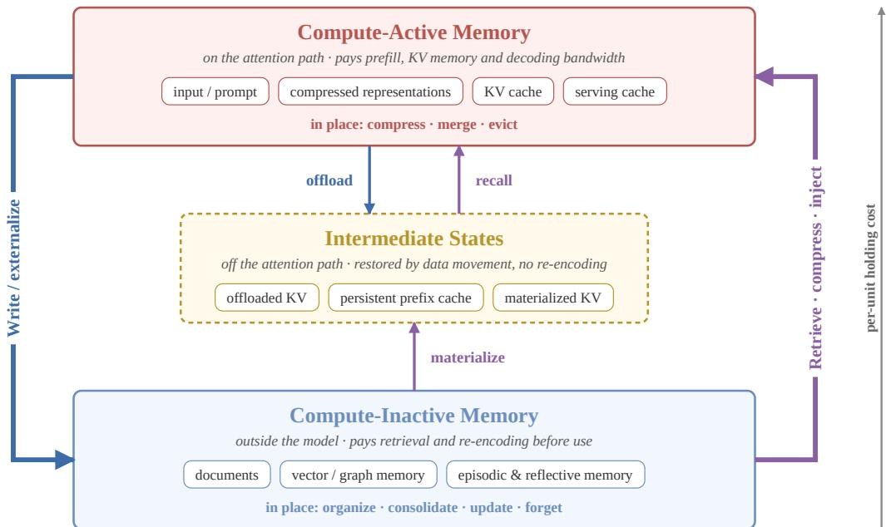
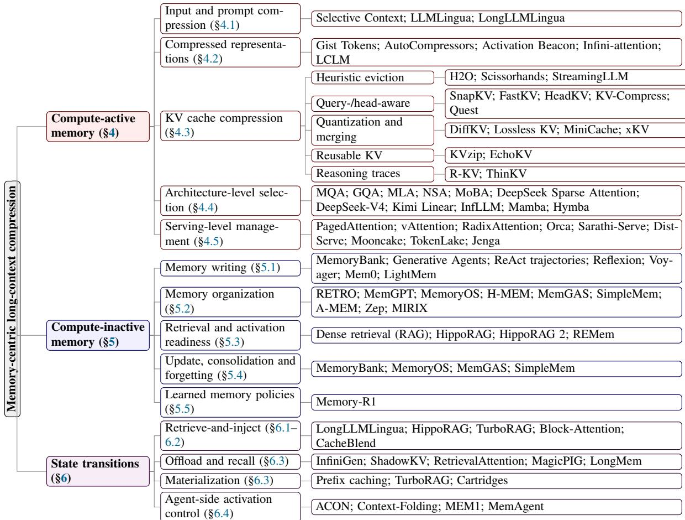

# From Long Context to Selective Memory: A Survey of Memory-Centric Compression for Large Language Models

Chaogui Gou

USTB

ustbedwin@gmail.com

## Abstract

Long-context capability has become essential for large language models (LLMs) to handle complex tasks, yet continuously expanding the context window does not remove the computational, storage, and information-selection pressures incurred at inference time. Existing work on prompt compression, KVcache management, efficient serving, retrieval augmentation, and agent memory is usually discussed in isolation, leaving the flow of information between storage and computation insufficiently understood. This survey reframes long-context compression as a memory-management problem for allocating inferencetime resources. We distinguish compute-active memory, which directly participates in model computation, from compute-inactive memory, which lies outside the computation path but can be stored, retrieved, updated, or forgotten, and we characterize offloaded KV caches, persistent prefix caches, and precomputed KV states as intermediate states on the activation path. On this basis, we formulate writing, offloading, recall, retrieval-and-injection, materialization, eviction, consolidation, and forgetting as state transitions within an information lifecycle, and introduce a budgeted cost model that places these operations in a single cost account. The resulting framework unifies short-term context compression, long-term memory management, and the transitions between them, and shows that the central challenge is not merely reducing information volume but deciding which information should participate in costly inference, when, and in what form. We further summarize evaluation dimensions, benchmark gaps, and open challenges, and argue that future research should move from static, pointwise compression toward dynamic, governable, lifecycle-aware memory management.

Keywords: large language models, long-context inference, context compression, memory management, KV cache, retrieval-augmented generation, agent memory

## 1 Introduction

Long-context capability has become a prerequisite for large language models (LLMs) on complex tasks. As context windows have grown from several thousand to hundreds of thousands or even millions of tokens (Google, 2026; OpenAI, 2026; Xu et al., 2026a), long-document understanding, codebase analysis, multi-turn dialogue, tool-use trajectories, retrieval-augmented generation (RAG), and long-term personalized assistance increasingly depend on a model’s ability to receive and exploit large amounts of contextual information (Liu et al., 2025a).

A larger window, however, does not by itself yield more effective use of information (Hsieh et al., 2024; Liu et al., 2024c). Long inputs increase prefill computation and place growing pressure on key-value (KV) cache memory, memory bandwidth, and latency during decoding (Kwon et al., 2023; Xu et al., 2026a; Zhang et al., 2023), while realistic contexts contain repeated, obsolete, or irrelevant content that dilutes critical evidence. The long-context problem is therefore not only one of capacity but also one of management: how a system selects, compresses, and uses information under a finite computational budget.

Several research directions address this problem at different levels, including prompt compression, latent memory representations, KV-cache compression, architecture-level selective computation, efficient serving, retrieval augmentation, and external long-term memory (Jiang et al., 2023, 2024; Kwon et al., 2023; Lewis et al., 2020; Mu et al., 2023; Packer et al., 2023; Zhang et al., 2023). Existing surveys usually organize them by technical origin or application scenario (Liu et al., 2025a,c; Verma, 2024), which obscures a question they share: which information should enter the expensive attention-computation path, and which should instead be compressed, externalized, reused, updated, or forgotten?

This survey answers this question from a memory-centric perspective. We call information that directly participates in the current model computation compute-active memory, and information that lies outside the current computation path but can be stored, retrieved, updated, or forgotten compute-inactive memory. The distinction concerns an item’s participation in computation at a given inference step rather than its storage location: the same content may be stored externally, later retrieved and injected into the context, and finally written back after inference. Between the two lie intermediate states, in which information has left the attention path but can be restored without re-retrieval or re-encoding, as with offloaded KV caches and precomputed prefix caches. Long-context compression thus becomes the management of an information lifecycle across these states. Recent surveys have also proposed unified views of LLM memory based on memory operations, context engineering, or agent memory (Du et al., 2025; Hu et al., 2025; Mei et al., 2025); we instead organize the field by the computational participation of information and its cost. The main contributions are as follows.

1. We propose a framework that distinguishes compute-active from compute-inactive memory, incorporates intermediate states on the activation path, and casts long-context compression as lifecycle management under a finite computational budget.

2. We formulate writing, offloading, recall, retrieval-and-injection, materialization, eviction, consolidation, and forgetting as state-transition operators and introduce a budgeted cost model that places these operations in a single cost account.

3. We review representative work up to 2026 along this lifecycle, from input, representation, and KV-cache compression to external long-term memory, learned memory policies, and transition mechanisms such as retrieval-and-injection, KV offloading and materialization, and agent-side context folding.

4. We summarize evaluation dimensions, benchmark gaps, and open challenges, and pose a concrete research question for each challenge.

Scope. This survey focuses on the intersection of long-context modeling, KV-cache management, retrieval augmentation, and agent memory: how a system decides which information enters the current inference path, compresses its representation, controls its cost, and later updates or forgets it. Methods that only extend the context window without changing information selection, cache management, or memory mechanisms are treated as background. Parametric memory is included only in a limited way, because knowledge editing, continual pre-training, and parameter-efficient fine-tuning incur their cost mainly at training time and do not selectively activate information within a single inference; methods that blur this boundary, such as test-time neural memory (Behrouz et al., 2025) and self-study-trained KV caches (Eyuboglu et al., 2025), are discussed where they affect inference-time memory allocation.

The remainder of the survey is organized as follows. Section 2 reviews the costs of long-context inference and positions this survey relative to prior reviews. Section 3 presents the framework. Sections 4 and 5 review compute-active and compute-inactive memory, Section 6 discusses state transitions, Section 7 covers evaluation, Section 8 discusses open challenges, and Section 9 concludes.

## 2 Background and Positioning

## 2.1 From Context Extension to Context Management

Early work on long-context LLMs focused on enlarging the input that a model can accept, through positional encoding extrapolation, sparse and sliding-window attention, recurrent-state modeling, retrieval augmentation, and long-context fine-tuning (Beltagy et al., 2020; Borgeaud et al., 2022; Chen et al., 2023, 2024a; Dai et al., 2019; Ding et al., 2024; Peng et al., 2023; Zaheer et al., 2020). These methods allow a model to access more complete task background in a single inference, which matters for long-document understanding, cross-file code analysis, multi-turn dialogue, and tool use, where relevant information is scattered across texts, knowledge bases, interaction histories, and execution states (Bai et al., 2024a; Lewis et al., 2020; Liu et al., 2024d; Packer et al., 2023; Yao et al., 2023; Zheng et al., 2024). As windows reach hundreds of thousands or millions of tokens (Ding et al., 2024; Xu et al., 2026a), the central question has shifted from how much information a model can receive to which information deserves to enter the current inference path, and at what cost (Liu et al., 2025a,c).

This shift is driven by two kinds of cost. The first is computational. Prefill cost and time-to-first-token grow with input length; during decoding, the KV cache grows with context length, model size, and batch size and consumes GPU memory and bandwidth; and information kept in external indexes becomes costly again once it is retrieved and injected into the prompt. The second is informational. Long inputs mix key evidence with background, repetition, outdated states, and noise, and models do not use information uniformly across positions (Liu et al., 2024c); when evidence is dispersed or appears in the middle of the input, omissions, evidence mismatch, and inconsistent reasoning become more likely. Long-context compression therefore differs from generic model acceleration: besides reducing computation, cache usage, and latency, it must preserve evidence coverage, fidelity, temporal consistency, and future recoverability. Over-compression breaks evidence chains, whereas over-retention increases latency, memory pressure, and noise.

## 2.2 Existing Surveys and the Gap Addressed by This Survey

Prior surveys fall into four groups. Surveys of long-context LLMs (Liu et al., 2025a,b,c) cover positiona extension, sparse attention, training, infrastructure, and evaluation; compression is one topic among many, and transitions of information between internal states and external storage are rarely analyzed. Surveys of prompt compression (Li et al., 2025c), KV-cache management (Li et al., 2024a; Xu et al., 2026b), and efficient serving (Miao et al., 2023; Zhou et al., 2024) focus on the cost of the current inference path, but give little attention to how long-term memory is written, organized, and forgotten, and seldom relate KV offloading to external-memory retrieval. Surveys of RAG and agent memory (Du, 2026; Gao et al., 2023; Verma, 2024; Zhang et al., 2024b) emphasize external knowledge and long-term history; Hu et al. (2025) organize agent memory by form, function, and dynamics; they include KV compression as latent working memory but assign model-internal cache management to LLM memory, outside the scope of agent memory. The survey of context compression for LLM agents by Wang et al. (2026a) is closest in spirit: it describes a select–compress–store–recover pipeline, discusses recoverability and control overhead, and formulates learned compression control as task reward minus cost. Its scope, however, is application-leve trajectory compression, and it excludes KV-cache and model-level methods. Neither group distinguishes re-encoding retrieved text from recalling states that are already encoded, or accounts for online activation, offline materialization, cross-request reuse, and invalidation within one cost structure.

The fourth group, closest to this survey, proposes unified views of LLM memory. Du et al. (2025) distinguish parametric from contextual memory and define six atomic operations across long-term memory, long context, and parametric modification; Wu et al. (2025b), Shan et al. (2025), and Jia et al. (2025) organize LLM memory by analogy to human memory; and the context-engineering survey of Mei et al. (2025) places memory hierarchies and context compression under context management. On the system side, MemGPT (Packer et al., 2023) manages context through an operating-system analogy, and MemOS (Li et al., 2025b) schedules plaintext, activation, and parametric memory within one system. These works organize the field by cognitive analogy, functional role, or operation type.

This survey differs in three respects. First, it organizes methods by whether and when information participates in inference computation, which allows system-level mechanisms such as offloaded KV caches, persistent prefix caches, and offline-compressed KV to be compared with external memory within one lifecycle. Second, it treats state transitions as first-class objects of analysis, in particular the distinction between re-encoding retrieved text (retrieve-and-inject) and recalling states that are already encoded (recall), which fetch memory at very different costs. Third, it compares methods through a budgeted cost model that separates online, offline, and amortized costs, so that costs moved from the current context into background maintenance are not hidden. Table 1 summarizes the comparison.

## 3 Memory-Centric Framework for Long-Context Compression

We treat long-context compression as a memory-management problem of allocating inference-time computation: the goal is to decide when information should participate in inference, in what form, and at what cost. This section defines memory states, the operators that move information between them, the resulting lifecycle, and a cost model that underlies the taxonomy of later sections. Figure 1 gives an overview.

## 3.1 Memory States and Computational Participation

We distinguish memory states by participation in inference computation, because this criterion corresponds directly to the main costs of a long-context system. We fix its granularity at a single request: information is compute-active if it is encoded for the current model and addressable by attention during the request, that is, resident in accelerator memory as tokens, latent states, or KV caches. Such information incurs prefill computation, accelerator memory, memory bandwidth, and decoding latency. Methods that attend to only part of it at each decoding step, such as page-level sparse attention, reduce reads and attention computation within compute-active memory rather than moving information out of it.

Compute-active memory is information that the model accesses during the current inference: prompt tokens, soft prompts or latent states, intermediate activations, and KV caches, including prefix caches reused by the current request. Its size and access pattern directly determine efficiency and generation quality. Compute-inactive memory is information that does not currently participate in computation but can be stored, retrieved, updated, or forgotten: document collections, vector indexes, knowledge graphs, summary memories, user profiles, dialogue histories, and tool trajectories. It is cheaper to hold and suited to longterm maintenance, but influences generation only after being retrieved, compressed, and injected. The two are states rather than fixed categories: retrieved content becomes compute-active, and answers, plans, or reflections produced during inference return to the compute-inactive state when written back.

Table 1: Comparison with representative related surveys. : systematically discussed; : partially discussed; : largely not discussed. Ratings reflect the authors’ reading of each survey’s structure and coverage.
<table><tr><td>Survey</td><td>Organizing perspective</td><td>KV/ serving</td><td>Long- term / agent memory</td><td>Explicit cost model</td><td>State transi- tion / injection</td><td>Relation to this survey</td></tr><tr><td>Long-context LLM surveys (Liu et al., 2025a,b)</td><td>Architecture, infrastructure, training, evaluation</td><td></td><td>O</td><td></td><td>O</td><td>Background on long-context modeling (Sec. 2)</td></tr><tr><td>Prompt compression (Li et al., 2025c)</td><td>Hard / soft prompt compression</td><td>O</td><td>O</td><td>T</td><td>O</td><td>Admission control for active memory (Secs. 4.1–4.2)</td></tr><tr><td>et al., 2024a)</td><td>KV-cache management (Li Token / model / system level</td><td></td><td>O</td><td></td><td>O</td><td>System-level basis (Secs. 4.3–4.5, 6.3)</td></tr><tr><td>Agent memory mechanisms (Zhang et al., operations 2024b)</td><td>Memory sources, forms,</td><td>O</td><td></td><td>O</td><td>0</td><td>Writing and maintenance of external memory (Sec. 5)</td></tr><tr><td>From Human Memory to AI Memory (Wu et al., 2025b)</td><td>Object × form × time</td><td>0</td><td></td><td>O</td><td>O</td><td>Cognitive analogy; we adopt a cost view</td></tr><tr><td>Cognitive Memory in LLMs (Shan et al., 2025)</td><td>Sensory / short-term / long-term</td><td>C</td><td></td><td>O</td><td>0</td><td>Covers KV memory without modeling transition cost</td></tr><tr><td>Rethinking Memory in AI (Du et al., 2025)</td><td>Parametric / contextual memory and six atomic operations</td><td>0</td><td></td><td>O</td><td>0</td><td>Closest operation view; we define operators by state change (Sec. 3.2)</td></tr><tr><td>Context engineering (Mei et al., 2025)</td><td>Retrieval, processing, management, and system implementations</td><td>0</td><td></td><td>O</td><td>0</td><td>Broader scope; we focus on compression and activation cost</td></tr><tr><td>Memory in the Age of AI Agents (Hu et al., 2025)</td><td>Forms × functions × dynamics</td><td></td><td></td><td>O</td><td>0</td><td>KV compression as latent working memory; cache management left to LLM memory</td></tr><tr><td>Context compression for LLM agents (Wang et al., 2026a)</td><td>Target × mechanism × control policy</td><td>O</td><td>V</td><td>T</td><td>0</td><td>Application-level; excludes KV-level methods (Sec. 6.4)</td></tr><tr><td>This survey</td><td>Compute-active / compute-inactive memory, lifecycle transitions, and a cost model</td><td></td><td></td><td></td><td></td><td></td></tr></table>

Intermediate states on the activation path. KV offloading, persistent prefix caching, and retrieval-based attention give rise to information that lies between these two states. Such information has already been encoded into a form the model can consume directly (KV blocks, compressed latent states, or precomputed prefixes) and is kept in host memory, SSDs, or remote cache pools; it is not addressable by attention in the current request, yet it can be restored with low latency without re-retrieval or re-prefilling. Examples include offloaded KV states in InfiniGen (Lee et al., 2024), ShadowKV (Sun et al., 2025a), and RetrievalAttention (Liu et al., 2024b), and compressed KV caches trained offline by Cartridges (Eyuboglu et al., 2025). A prefix cache retained for later requests is likewise in an intermediate state; it reaches this state either by being kept after a prefill (A → S) or by precomputation from text (I → S). We regard these as intermediate states on the transition path rather than as a third kind of memory. The criterion is the activation path: information that can return to computation through data movement and light correction is in an intermediate state, whereas information that additionally requires retrieval, compression, and re-encoding is compute-inactive. A transition between active and inactive memory may therefore pass through, and remain for some time in, an intermediate state with its own holding cost.

  
Figure 1: Memory-centric lifecycle view of long-context compression. Information flows between compute-active and compute-inactive memory: writing externalizes information from the inference path, while retrieval, compression, and injection reactivate external memory. Offloaded KV caches, persistent prefix caches, and materialized KV states are intermediate states on the activation path that can be recalled directly. In-place operations compress, reorganize, or discard content within a state; per-unit holding cost increases from bottom to top.

## 3.2 State-Transition Operators

Long-context compression methods can be described by a small set of operators, each specifying the direction in which information moves among compute-active (A), intermediate (S), and compute-inactive (I) states, possibly together with a change of representation such as summarization, structuring, or encoding into KV states (Table 2).

These operators are related to the atomic memory operations of Du et al. (2025), but are defined by changes of computational state rather than by memory function. This distinguishes retrieve-and-inject (I → A, requiring re-prefilling) from recall (S → A, mainly data movement), which both fetch memory but have very different cost structures. Compression, in turn, is not a separate operator but a representation change attached to the operators: eviction discards information within active memory, writing may summarize, retrieve-and-inject may filter and rewrite, and consolidation reorganizes representations within one state. Two further conventions apply. Writing copies rather than moves: written content usually remains in active memory for the rest of the request, so A → I creates a new representation in I without removing its source. Transformations that stay within compute-active memory, such as pruning, encoding into latent states, and architectural sharing or sparsification of KV states, change the representation or the accessed subset without changing state; Table 3 marks them as A → A.

## 3.3 Information Lifecycle in Long-Context Systems

Composing these operators yields an information lifecycle of writing, storage, retrieval, selection, compression, injection, computation, updating, and forgetting. A system first decides what to write and how to organize it as summaries, indexes, structured representations, or embeddings. For a given task, external memory is retrieved, but retrieved results are not yet effective context: they must be filtered, reranked, compressed, and formatted before entering the inference path. After inference, new facts, plans, tool feedback, user corrections, and reflections may be written back, while outdated, conflicting, low-value, or sensitive memories are updated, down-weighted, or forgotten. Long-context compression is therefore a continuous process rather than one-time input pruning, and different methods act at different stages of this lifecycle.

Table 2: State-transition operators. A: compute-active; S: intermediate state on the activation path; I: compute-inactive.
<table><tr><td>Operator</td><td>Transition</td><td>Typical representation change</td><td>Representative methods</td><td>Main cost / risk</td><td>Section</td></tr><tr><td>Write / externalize</td><td>A → I (copy)</td><td>Text → summaries, structured facts, or embeddings</td><td>MemoryBank (Zhong et al., 2023), Mem0 (Chhikara et al., 2025), A-MEM (Xu et al., 2025b)</td><td>Extraction and indexing cost; erroneous or sensitive content may be fixed</td><td>5.1–5.2</td></tr><tr><td>Offload</td><td>A → S</td><td>KV → KV (optionally quantized or low-rank)</td><td>InfiniGen (Lee et al., 2024), ShadowKV (Sun et al., 2025a)</td><td>Host-device bandwidth and storage</td><td>6.3</td></tr><tr><td>Recall</td><td>S → A</td><td>KV → KV</td><td>InfiniGen (Lee et al., 2024), RetrievalAttention (Liu et al., 2024b), MagicPIG (Chen et al., 2025)</td><td>Retrieval precision and transfer latency</td><td>6.3</td></tr><tr><td>Retrieve-and- inject</td><td>I → A</td><td>Text / structure → text, latent, or KV</td><td>RAG (Lewis et al., 2020), LongLLMLingua (Jiang et al., 2024), HippoRAG (Jimenez Gutierrez</td><td>Retrieval, compression, and re-prefill 5.3, cost</td><td>6.1-6.2</td></tr><tr><td>Materialize</td><td>I → S</td><td>Text → KV or latent</td><td>et al., 2024) Prefix-cache precomputation, TurboRAG (Lu et al., 2024), Cartridges (Eyuboglu et al.,</td><td>Offline compute and storage; tied to model version</td><td>6.3</td></tr><tr><td>Evict</td><td>A → ∅</td><td></td><td>2025) H2O (Zhang et al., 2023), SnapKV (Li et al., 2024b), StreamingLLM (Xiao et al.,</td><td>Irrecoverable information loss</td><td>4.3</td></tr><tr><td>Consolidate</td><td>within a state</td><td>Many items → summary, structure, or low-rank form</td><td>2024b) MiniCache (Liu et al., 2024a) (A); SimpleMem (Liu et al., 2026a), MemGAS (Xu et al.,</td><td>Loss of details and conditions through 4.3, 5.4 abstraction</td><td></td></tr><tr><td>Forget</td><td>I → ∅ or down-</td><td></td><td>2025a) (I) MemoryBank forgetting curve (Zhong et al., 2023),</td><td>Verifiable deletion and tracking of derived representations</td><td></td></tr></table>

## 3.4 A Budgeted Cost Model

The aim of compression in this view is to improve information utilization under limited budgets, and the relevant objectives differ by state: for compute-active memory, prefill, KV memory, bandwidth, and throughput; for compute-inactive memory, preserving the retrievability and temporal validity of stored information; and for transitions, evidence traceability, recoverability, and long-term consistency. To make these objectives comparable, let M be the set of memory units held at an inference step, and let each unit m have a state $s ( m ) \in \{ A , S , I \}$ . The total cost is

$$
C = \sum _ { s ( m ) = A } c _ { A } | m | + \sum _ { s ( m ) = S } c _ { S } | m | + \sum _ { s ( m ) = I } c _ { I } | m | + \sum _ { \tau \in T } c _ { \tau } ,\tag{1}
$$

where |m| is the size of a unit (e.g., tokens or KV bytes); $c _ { A } , c _ { S } .$ , and $c _ { I }$ are per-unit holding costs, typically with $c _ { A } \gg c _ { S } \gg c _ { I }$ , covering respectively prefill computation, KV memory, and decoding bandwidth; hostmemory or SSD storage; and external storage and index maintenance; T is the set of transitions performed for the current inference; and $c _ { \tau }$ is the cost of each transition (retrieval, reranking, compression, data movement, recomputation, or write-back), which also depends on the representations before and after the transition. Long-context compression can then be written as

$$
\operatorname* { m a x } _ { s ( \cdot ) , T } U ( y \mid M _ { A } ) - \lambda C \quad \mathrm { s . t . } \quad \sum _ { s ( m ) = A } \left| m \right| \leq B _ { A } , \quad \sum _ { s ( m ) = S } \left| m \right| \leq B _ { S } ,\tag{2}
$$

where $U ( y \mid M _ { A } )$ is the utility of generating output y from active memory $M _ { A }$ , λ trades cost against utility, and $B _ { A }$ and $B _ { S }$ are the active and intermediate-state budgets.

The model exposes a common structure across method families. Prompt compression shrinks $M _ { A }$ in text form; KV eviction removes units from A at the price of recoverability; offloading and recall move units between A and $S ,$ exchanging active budget for transfer cost; retrieval augmentation keeps information in I and pays a retrieve-and-inject cost on demand; materialization pays an offline cost to move information from I to S, lowering the cost of each later activation; and long-term memory management acts mainly on the I term and its future activation cost. It also explains why compression ratio alone is misleading: a method may reduce the $c _ { A }$ term while shifting cost into $c _ { \tau }$ or offline maintenance.

## 3.5 Analytical Dimensions for Method Comparison

The following sections compare methods along shared dimensions: the memory state and operators involved; the compression target (text, structured fragments, continuous vectors, attention states, cache blocks, or indexes); the selection signal (query semantics, attention distributions, temporal state, task goals, retrieval scores, or heuristics); system requirements (access to internal states, training, compatibility with closed-model APIs, and cross-request reuse); and evaluation criteria (computational and storage cost, task utility, evidence fidelity, recoverability, and long-term consistency). Figure 2 organizes representative methods by memory state and transition, and Table 3 codes a subset of them along these dimensions.

## 4 Compressing Compute-Active Memory

Compute-active memory compression reduces the cost of information that is already on the inference path, and therefore acts directly on prefill overhead, decoding latency, GPU memory, and throughput. We organize methods by where compression occurs: text before model input, compact latent representations, the KV cache during decoding, the model architecture, and the serving system. For each family we consider which cost is reduced, what information is preserved, and what the method requires of model access, training, and deployment. KV states that leave the attention path through offloading are discussed with other state transitions in Section 6.3.

## 4.1 Input and Prompt Compression

Input and prompt compression filters or rewrites context before it enters the model, acting as admission control for compute-active memory. Inputs that concatenate documents, interaction histories, retrieved passages, and instructions often contain repeated background, templated text, and weakly relevant passages that raise prefill cost and dilute useful information. Methods differ in how they estimate information value: redundancy-based methods such as Selective Context (Li et al., 2023) remove locally repetitive or low-information tokens, sentences, or passages; LLMLingua (Jiang et al., 2023) formulates compression as coarse-to-fine selection under a token budget; and LongLLMLingua (Jiang et al., 2024) conditions compression on the query to retain relevant evidence in long contexts.

Table 3: Representative methods coded along the analytical dimensions of Section 3. Operators follow Table 2 (A: compute-active; S: intermediate; I: compute-inactive). Access: black-box methods work with closed-model APIs; white-box methods require model weights or internal states; system methods operate in the serving runtime. Reuse: whether the compressed or stored state is reused across requests or sessions.
<table><tr><td>Method</td><td>Operator</td><td>Repr.</td><td>Selection signal / mechanism</td><td>Training</td><td>Access</td><td>Reuse</td></tr><tr><td colspan="7">Compute-active memory (Section 4)</td></tr><tr><td>Selective Context</td><td>A→A (prune)</td><td>Text</td><td>Self-information of lexical units</td><td>None</td><td>Black-box</td><td></td></tr><tr><td>LLMLingua / LongLLMLingua</td><td>A→A (prune)</td><td>Text</td><td>Small-LM perplexity under a budget; question-aware variant</td><td>None</td><td>Black-box</td><td></td></tr><tr><td>Gist Tokens</td><td>A→A (encode)</td><td>Latent</td><td>Learned gist tokens</td><td>Fine-tune</td><td>White-box</td><td></td></tr><tr><td>AutoCompressors</td><td>A→A (encode)</td><td>Latent</td><td>Segment-wise summary vectors</td><td>Fine-tune</td><td>White-box</td><td></td></tr><tr><td>Activation Beacon</td><td>A→A (encode)</td><td>KV</td><td>Learned activation compression</td><td>Fine-tune</td><td>White-box</td><td></td></tr><tr><td>H2O / StreamingLLM</td><td>A→ ∅ (evict)</td><td>KV</td><td>Accumulated attention; attention sinks and recent window</td><td>None</td><td>White-box</td><td></td></tr><tr><td>SnapKV / HeadKV</td><td>A→ ∅ (evict)</td><td>KV</td><td>Observation-window attention; head-level budgets</td><td>None</td><td>White-box</td><td></td></tr><tr><td>MiniCache</td><td>Consolidate</td><td>KV</td><td>Cross-layer similarity merging</td><td>None</td><td>White-box</td><td></td></tr><tr><td>KVzip</td><td>A→A (compress)</td><td>KV</td><td>Query-agnostic context reconstruction</td><td>None</td><td>White-box</td><td></td></tr><tr><td>R-KV</td><td>A→ ∅ (evict)</td><td>KV</td><td>Importance and redundancy in reasoning traces</td><td>None</td><td>White-box</td><td></td></tr><tr><td>Quest</td><td>A→A (select)</td><td>KV</td><td>Page-level attention upper bounds; full cache kept</td><td>None</td><td>White-box</td><td></td></tr><tr><td>GQA / MLA</td><td>A→A (arch.)</td><td>KV</td><td>resident Shared or low-rank latent KV heads</td><td>Pre-train or</td><td>White-box</td><td></td></tr><tr><td>NSA / MoBA</td><td>A→A (arch.)</td><td>KV</td><td>Learned block compression, selection, routing</td><td>uptrain Pre-train</td><td>White-box</td><td></td></tr><tr><td>Kimi Linear</td><td>A→A (arch.)</td><td>KV</td><td>Hybrid linear and full attention</td><td>Pre-train</td><td>White-box</td><td></td></tr><tr><td>PagedAttention</td><td></td><td>KV</td><td>Block-level KV memory allocation</td><td>None</td><td>System</td><td></td></tr><tr><td>RadixAttention</td><td></td><td>KV</td><td>Prefix matching in a radix tree</td><td>None</td><td>System</td><td></td></tr><tr><td>Mooncake</td><td>A↔S</td><td>KV</td><td>KV-centric disaggregated scheduling</td><td>None</td><td>System</td><td></td></tr><tr><td colspan="7">Compute-inactive memory (Section 5)</td></tr><tr><td>MemoryBank</td><td>A→I, forget</td><td>Text</td><td>Ebbinghaus-style forgetting curve</td><td>None</td><td>Black-box</td><td></td></tr><tr><td>Generative Agents</td><td>A→I, I→A</td><td>Text</td><td>Recency, importance, and relevance</td><td>None</td><td>Black-box</td><td>V</td></tr><tr><td>MemGPT</td><td>A↔I</td><td>Text</td><td>LLM-directed paging via function calls</td><td>None</td><td>Black-box</td><td></td></tr><tr><td>HippoRAG</td><td>I→A</td><td>Graph</td><td>Knowledge graph and personalized PageRank</td><td>None</td><td>Black-box</td><td></td></tr><tr><td>Reflexion</td><td>A→I</td><td>Text</td><td>Verbal self-reflection on feedback</td><td>None</td><td>Black-box</td><td></td></tr><tr><td>Mem0</td><td>A→I, consolidate</td><td>Text / graph</td><td>LLM-decided add, update, delete</td><td>None</td><td>Black-box</td><td></td></tr><tr><td>A-MEM</td><td>A→I, consolidate</td><td>Struct.</td><td>Linked atomic notes</td><td>None</td><td>Black-box</td><td></td></tr><tr><td>Zep Memory-R1</td><td>A→I</td><td>Graph</td><td>Temporal knowledge graph</td><td>None</td><td>Black-box</td><td>√</td></tr><tr><td></td><td>A→I, consolidate</td><td>Text</td><td>RL-learned memory operations</td><td>RL</td><td>White-box</td><td>J</td></tr><tr><td colspan="7">State transitions (Section 6)</td></tr><tr><td>TurboRAG / Block-Attention</td><td>I→S→A</td><td>KV</td><td>Precomputed chunk KV; block-wise independent encoding</td><td>Fine-tune</td><td>White-box</td><td></td></tr><tr><td>CacheBlend</td><td>I→S→A</td><td>KV</td><td>Selective recomputation of deviating tokens Self-study distillation of a corpus</td><td>None</td><td>White-box</td><td>V</td></tr><tr><td>Cartridges InfiniGen</td><td>I→S A↔S</td><td>KV KV</td><td>Next-layer KV prefetch predicted from the previous</td><td>Per-corpus None</td><td>White-box White-box</td><td></td></tr><tr><td></td><td></td><td></td><td>layer</td><td></td><td></td><td></td></tr><tr><td>RetrievalAttention / ShadowKV</td><td>A↔S</td><td>KV</td><td>ANN index over keys; low-rank keys with offloaded values</td><td>None</td><td>White-box</td><td></td></tr><tr><td>ACON</td><td>A→A (summarize)</td><td>Text</td><td>Guidelines optimized from failure cases; optional distilled compressor</td><td>None (prompt</td><td>Black-box</td><td></td></tr><tr><td>Context-Folding</td><td>A→A (fold)</td><td>Text</td><td>RL-learned branching and folding</td><td>opt.) RL</td><td>White-box</td><td></td></tr><tr><td>MEM1 / MemAgent</td><td>A→A (overwrite)</td><td>Text</td><td>RL-learned bounded internal memory</td><td>RL</td><td>White-box</td><td></td></tr></table>

  
Figure 2: Taxonomy of representative methods organized by memory state and state transition. Citations for all methods are given in the corresponding sections.

Because the output remains natural language, these methods are inspectable and require no change to model internals. Readability does not by itself ensure evidence traceability, however: token-level pruning may produce ungrammatical text detached from its source, so applications such as RAG and knowledge-base question answering also need to retain the original positions, sources, and timestamps of the selected content. Their limitation is that compression precedes reasoning: content that appears unimportant locally may be needed for multi-hop reasoning, long-range coreference, code dependencies, or cross-turn consistency. They work best when task goals are clear, redundancy is high, and evidence can be located from the query, and otherwise need to be combined with reranking, structured evidence preservation, or downstream verification.

## 4.2 Compressed Representations: Gist Tokens, Latent States, and Summary Memory

Compressed-representation methods encode long contexts into denser computable states, such as special tokens, soft prompts, summary vectors, or compressed activations, which still participate in inference but occupy far less of the context budget. Three directions can be distinguished. Gist Tokens (Mu et al., 2023) train a model to store prompt information in a few learned tokens that later generation attends to; AutoCompressors (Chevalier et al., 2023) process long texts segment by segment and pass summary vectors forward; and Activation Beacon (Zhang et al., 2025b) and Infini-attention (Munkhdalai et al., 2024) compress Transformer activations or combine local attention with a bounded long-term compressed memory. More recent work scales encoder–decoder context compression to large-scale training, improving the trade-off among task performance, compression speed, and peak memory (Li et al., 2026).

These representations increase information density and avoid repeated encoding when the same background is accessed many times. They are, however, difficult to interpret: it is hard to determine which facts or constraints a latent state preserves, or where information was lost when generation fails. They are also tied to specific architectures and training objectives, which limits transfer across models and to closed APIs. They are best viewed as high-density intermediate representations to be combined with task-aware compression or traceable retrieval.

## 4.3 KV Cache Compression

During autoregressive decoding, the keys and values of past tokens are cached to avoid recomputing the prefix, and this cache grows with context length, depth, number of heads, and batch size until it dominates GPU memory and bandwidth. The KV cache is thus a high-cost form of short-term compute-active memory, and KV compression seeks to retain the states most useful for future generation within a fixed budget. Methods differ mainly in how they estimate future utility: by recency, accumulated attention, or attention sinks (Liu et al., 2023; Xiao et al., 2024b; Zhang et al., 2023); by query-, head-, or layer-aware importance (Fu et al., 2025; Jo et al., 2026; Li et al., 2024b; Rehg, 2024); or by reducing representation cost through quantization, merging, low-rank reconstruction, or reuse across queries (Chang et al., 2026; Kim et al., 2025; Liu et al., 2024a; Wang et al., 2026b; Yang et al., 2024; Zhang et al., 2025c). Not all methods discard states: Quest (Tang et al., 2024) keeps the full cache resident and loads only the pages with the highest attention upper bounds for the current query, reducing reads and attention computation rather than memory capacity. Systematic analyses further show that compression can degrade capabilities unevenly, even when aggregate scores are preserved (Liu et al., 2026b). These methods exploit internal signals unavailable to text-level compression, but require access to model states and inference-system support, and their decisions rest on imperfect predictions: states that received little attention so far may become critical later.

A fast-growing branch targets reasoning models, for which long chains of thought shift the main source of KV growth from the prompt to the model’s own generations, and redundancy arises from repeated verification and self-correction. R-KV (Cai et al., 2025) compresses reasoning-trace KV states by jointly considering attention importance and redundancy, and ThinKV (Ramachandran et al., 2026) allocates cache budgets and quantization precision according to the type of thought segment. These methods show that compute-active memory grows not only with external input but also with the reasoning process itself.

## 4.4 Architecture-level Selective Computation

Architecture-level methods reduce the cost of long contexts by changing how the model represents and accesses history, rather than by deleting input or post-processing the cache. Multi-Query and Grouped-Query Attention (Ainslie et al., 2023; Shazeer, 2019) share keys and values across query heads, and Multi-head Latent Attention (DeepSeek-AI, 2024a,b) compresses KV states into latent vectors. Sparse attention has since become native and trainable: NSA (Yuan et al., 2025) combines compression, selection, and sliding-window branches in a hardware-aligned design, MoBA (Lu et al., 2025) routes queries to attention blocks in a mixture-of-experts fashion, and DeepSeek-V3.2 (DeepSeek-AI, 2025) introduces sparse attention driven by a lightweight indexer; DeepSeek-V4 (Xu et al., 2026a) further integrates compressed attention, shared KV, and local windows into the attention mechanism. Other designs reduce reliance on full attention altogether:

InfLLM (Xiao et al., 2024a) retrieves from an efficient context memory, state-space and hybrid models such as Mamba (Gu and Dao, 2023) and Hymba (Dong et al., 2024) maintain recurrent states, and Kimi Linear (Kimi Team, 2025) pairs a few full-attention layers with linear-attention layers to shrink the KV cache substantially.

These methods build the selection or compaction of compute-active memory into the attention mechanism itself. Most require pre-training or continued training, although GQA can also be obtained by uptraining an existing multi-head checkpoint (Ainslie et al., 2023), and InfLLM is training-free and operates on a pre-trained model at inference time (Xiao et al., 2024a). We include context-extension techniques only when they change the access pattern, state representation, or cost structure of inference. Their main limitation is cost of adoption: they require changes to the architecture or attention kernels and to cache management, usually together with training, and cannot be applied to closed-model interfaces.

## 4.5 Serving-level Cache and Prefix Management

Serving-level methods do not change semantic content or internal representations; they determine how computed states are placed, reused, scheduled, and released across GPU memory, cache blocks, batches, and requests. vLLM/PagedAttention (Kwon et al., 2023) manages KV caches in pages to reduce fragmentation and enable sharing, and vAttention (Prabhu et al., 2024) achieves similar benefits by decoupling virtual and physical memory. Prefix caching stores the KV states of stable contexts for reuse, reducing time-to-first-token, and SGLang/RadixAttention (Zheng et al., 2024) automatically identifies and reuses shared prefixes across multi-call programs, branching, and multi-turn interaction. Because prefill is compute-bound and decoding is bandwidth-bound, systems also schedule across phases: Orca introduces iteration-level scheduling (Yu et al., 2022), Sarathi-Serve uses chunked prefill (Agrawal et al., 2024), DistServe disaggregates prefill and decoding (Zhong et al., 2024), and Mooncake builds a disaggregated KV cache across CPU, DRAM, and SSD resources (Qin et al., 2025). TokenLake extends prefix caching to a segment-level cache pool, and Jenga manages memory under heterogeneous cache layouts (Wu et al., 2025a; Zhang et al., 2025a).

Serving-level management is what converts the local savings of other methods into end-to-end latency, throughput, and memory gains. Its benefits depend strongly on frameworks, hardware, workloads, and cache hit rates, so evaluation should report throughput, memory utilization, hit rates, and tail latency rather than single-request speed alone.

## 5 Compute-Inactive Memory Compression

Not all valuable information needs to remain in the attention window. Source documents, dialogue histories, user preferences, tool outputs, task states, and reflections are often stored externally and retrieved when needed. Such compute-inactive memory incurs no prefill or KV cost at the current step, but determines whether a system can maintain continuity and reuse experience over long-term operation. Compressing it therefore means turning large histories into memory structures that remain retrievable, updatable, and reactivatable, not merely reducing storage. This section follows the external-memory lifecycle: writing, organization, retrieval, maintenance, and learned policies that govern these steps; how retrieved memory is compressed and injected into the inference path is discussed in Section 6.

## 5.1 Memory Writing

Writing determines which parts of the current interaction, task execution, or tool feedback become longterm memory units, and is the first selection boundary of an external-memory system. Writing complete histories reduces omission but enlarges the store, adds retrieval noise, and amplifies privacy risks and the accumulation of stale or erroneous content. Written objects can be grouped into five types: factual memory of user preferences and stable states (Kang et al., 2025a; Zhong et al., 2023); episodic memory of temporally grounded experiences (Park et al., 2023; Shu et al., 2026); trajectory memory of reasoning steps, tool calls, and feedback (Yao et al., 2023); reflective memory that abstracts experiences or failures into lessons (Shinn et al., 2023); and skill memory that consolidates successful experience into callable procedures (Wang et al., 2023a). Recent systems make writing an explicit decision: Mem0 (Chhikara et al., 2025) extracts candidate facts after each interaction and decides whether to add, update, delete, or keep them, and LightMem (Fang et al., 2025) pre-compresses and topically segments input before writing and defers consolidation to an offline stage. Writing is a selection made under uncertainty about future tasks: overly conservative writing weakens continuity, whereas overly aggressive writing lowers the signal-to-noise ratio of the store on which all later stages depend.

## 5.2 Memory Organization

Organization determines how written memories are indexed, related, and later updated. Appending memories to a linear log preserves history but lets redundancy, staleness, and retrieval noise grow with interaction length. Existing systems use serialized memory streams that preserve temporal order (Park et al., 2023), vector indexes for semantic retrieval (Borgeaud et al., 2022; Lewis et al., 2020), external stores of independently accessible units (Packer et al., 2023; Zhong et al., 2023), graph-structured memory of entities and relations (Jimenez Gutierrez et al., 2024, 2025), hierarchical and multi-granularity memory across time scales (Kang et al., 2025a; Sun and Zeng, 2025; Xu et al., 2025a), structured semantic compression of memory units (Liu et al., 2026a), and stores of reflections and skills (Shinn et al., 2023; Wang et al., 2023a). Recent systems refine these forms: A-MEM (Xu et al., 2025b) organizes memories as linked atomic notes that evolve with new information, Zep (Rasmussen et al., 2025) uses a temporal knowledge graph with validity intervals for facts, and MIRIX (Wang and Chen, 2025) separates core, episodic, semantic, procedural, and resource memory managed by multiple agents.

Organization is itself a form of compression: without necessarily reducing the number of entries, structuring, indexing, and hierarchization reduce the noise faced by later retrieval and injection. The cost is maintenance: richer structures make updating, deletion, and conflict correction harder, and memory units that are too coarse import irrelevant content while units that are too fine break contextual integrity.

## 5.3 Memory Retrieval and Activation Readiness

Retrieval decides which memories are relevant to the current query, task state, or agent goal. Vector retrieval relies on semantic similarity (Borgeaud et al., 2022; Lewis et al., 2020); interactive agents additionally weight recency and importance (Park et al., 2023; Zhong et al., 2023); memory controllers schedule access across memory tiers (Kang et al., 2025a; Packer et al., 2023); graph-based retrieval follows entity and relation paths for multi-hop and temporal questions (Jimenez Gutierrez et al., 2024, 2025); episodic retrieval recalls specific past experiences (Chhikara et al., 2025; Shu et al., 2026); and agent memory may be triggered by task goals, tool states, or prior failures (Shinn et al., 2023; Wang et al., 2023a). Retrieval compresses the candidate space so that the full history need not be exposed in context, and its quality bounds every later step: retrieving too little causes forgetting and inconsistency, whereas retrieving too much reintroduces noise and increases the cost of later compression and injection. We refer to this stage as activation readiness because retrieved memories remain candidates; they become compute-active only after the selection, compression, and injection steps discussed in Section 6.

## 5.4 Memory Update, Consolidation and Forgetting

Long-term memory does not remain correct indefinitely: preferences change, task states evolve, facts become stale, and sources conflict. Updating reconciles new information with stored memory, reinforcing consistent entries and, for conflicts, replacing, revising, versioning, or deferring until confirmation; without it, stale information is repeatedly reactivated. Consolidation merges repeated or similar memories into summaries, topics, structured facts, or higher-level reflections, increasing density at the risk of losing details, temporal order, or conditions that later tasks need. Forgetting removes, down-weights, expires, hides, or archives memories that are low-value, stale, erroneous, or sensitive, serving both noise control and privacy and safety governance. Together these operations determine whether compute-inactive memory keeps a high signal-to-noise ratio over time; a system that only writes and retrieves gradually degrades into a store of historical noise.

## 5.5 Learned Memory-Management Policies

The mechanisms above mostly rely on hand-designed rules or prompts. A recent trend is to learn memorymanagement policies with reinforcement learning, so that what to store, revise, and use is optimized by task reward. Memory-R1 (Yan et al., 2025) trains a memory manager to add, update, delete, or skip entries in an external memory bank and an answer agent to filter retrieved memories, turning the write, consolidate, and forget operators into learned policies that maximize utility under a budget, as in Eq. (2). Related methods learn to maintain a bounded memory inside the context window; because that memory is compute-active by our criterion, we discuss them with agent-side activation control (Section 6.4). Because rewards usually come only from final answers, however, such learned policies do not directly constrain the faithfulness, traceability, or privacy of memory, and may exploit benchmark regularities; incorporating cost and reliability terms into the reward remains open.

## 6 State Transitions: Retrieval, Injection, and Intermediate States

This section examines how information moves between memory states, which is where the memory-centric view departs most from existing reviews. Retrieved memory is not equivalent to information the model has used: it affects generation only after selection, compression, formatting, and injection into the attention path. Injecting every candidate reintroduces the cost and noise of long contexts, whereas aggressive filtering can remove evidence, temporal relations, or task state. We first discuss the transition from retrieved memory to active context and the forms of injection, then intermediate states on the activation path, agent-side activation control, and the feedback loop created by write-back.

## 6.1 From Retrieved Memory to Active Context

Retrieval is often presented as a way to avoid placing all history in the input, but it is not a cost-free extension of context: as soon as retrieved content is concatenated into the prompt, it consumes prefill computation, context length, and subsequent cache budget. If candidates are injected wholesale, redundant, weakly relevant, or stale content re-enters the inference path and erodes the gains of compression. The transition from candidates to active context therefore requires three judgments: which candidates are relevant to the current task, which can be summarized, structured, or merged, and which must be kept as original evidence. The answer depends on the task: long-document question answering needs verifiable evidence, personalized dialogue needs consistent user state, code tasks need structural dependencies, and agent tasks rely on tool results and action histories. Retrieval-conditioned compression and injection is thus an activation-control process that connects the external memory of Section 5 with the active memory of Section 4.

## 6.2 Compression and Injection Forms

Post-retrieval compression operates at several granularities: filtering removes weakly relevant candidates, reranking orders evidence, summarization merges candidates into shorter text, structured extraction produces entities, attributes, temporal or causal relations, and task states, graph-path compression keeps the key nodes and edges of multi-hop relations, and more aggressive methods encode retrieved content as special tokens, latent vectors, or cache states. Each choice carries its own risk: summaries are inspectable but may omit detail, structured facts are compact but depend on extraction quality, and latent representations compress most but are least interpretable.

The injection form determines the computational state in which external memory participates. Concatenating passages is simple and interpretable but costly; summaries are shorter but lossy; structured facts and graph paths suit relational, temporal, and multi-hop reasoning; and in more integrated systems, external memory enters as soft prompts, latent vectors, prefix states, or KV caches. At the KV level, TurboRAG (Lu et al., 2024) precomputes KV caches for document chunks offline and concatenates them online to skip prefilling of retrieved content; Block-Attention (Ma et al., 2025) encodes retrieved blocks independently, lets only the final query block attend to all blocks, and fine-tunes the model to this pattern; and CacheBlend (Yao et al., 2025) restores cross-document attention lost by naive concatenation by recomputing KV states for a small set of tokens with the largest deviation. No injection form is uniformly superior: traceable evidence favors text or structured facts, extreme compression favors latent representations, and multi-turn reuse favors prefix or cache states, so injection must be chosen jointly by cost, utility, and verifiability.

## 6.3 Intermediate States on the Activation Path: Offloading and Materialization

Retrieve-and-inject requires retrieval, compression, and re-encoding before external memory can be used. Intermediate states avoid the last two steps: the information already has a form the model can use and returns to computation through data movement and light correction. Such states arise in two directions, by offloading active KV states from the attention path (offload and recall in Table 2) or by materializing external memory in advance into loadable forms (materialize).

Offloading and recall. When historical KV states exceed the GPU budget, a system can move them to host memory or lower storage tiers instead of evicting them, and recall a small relevant subset during decoding. The key problem is to decide what to recall without touching all states. InfiniGen (Lee et al., 2024) predicts important tokens of the next layer from the previous layer’s input and partial query–key projections and prefetches their KV states; RetrievalAttention (Liu et al., 2024b) builds attention-aware vector indexes that account for the distribution mismatch between queries and keys; MagicPIG (Chen et al., 2025) estimates attention by locality-sensitive-hashing sampling rather than top-k selection; and ShadowKV (Sun et al., 2025a) keeps low-rank keys on the GPU, offloads values to the CPU, and reconstructs selected keys during decoding. LongMem (Wang et al., 2023b) applies the same idea beyond a single input, caching attention key–value pairs of past inputs in a memory bank that a trained side network retrieves from. Quest (Tang et al., 2024) uses query-aware page selection as well but keeps the full cache in accelerator memory, so it changes which states are read rather than where they reside (Section 4.3). These methods are mechanistically isomorphic to external-memory retrieval—both index information beyond the active budget, select candidates for the current query, and reactivate them at a cost—but KV recall requires no re-prefilling. KV-level retrieval-based attention and text-level retrieval augmentation can thus be viewed as instances of one activation problem over different representations. They remain sensitive to host–device bandwidth, index construction, and recall precision, and mostly operate within a single request.

Materialization. In the other direction, external memory can be moved in advance from the computeinactive state into an intermediate state, so that each later activation pays only for loading and correction. Cross-request prefix caching (Section 4.5) is the simplest case, and the KV-level injection methods of Section 6.2 follow the same idea, facing the mismatch between independently encoded chunks and joint reasoning. Cartridges (Eyuboglu et al., 2025) take a different route: the model generates synthetic conversations about a corpus and distills it into a much smaller trainable KV cache, showing that materialization can be a lossy, learned compression targeted at the expected query distribution rather than lossless storage of raw KV states. Materialized states raise their own problems: they are bound to a specific model version and must be rebuilt after updates, they occupy far more storage than raw text, and they are hard to inspect or edit, so invalidating the derived states of a deleted or corrected document becomes a system-level instance of the governance problems in Section 8.

## 6.4 Agent-Side Activation Control

In long-horizon agent tasks, activation control also applies to the agent’s own trajectory: as tool calls, observations, and intermediate reasoning accumulate, the agent must decide which history stays in active context and which is summarized, folded, or externalized. ACON (Kang et al., 2025b) refines compression guidelines from trajectories in which the full context succeeds but the compressed context fails, and distills the resulting compressor into smaller models; Context-Folding (Sun et al., 2025b) lets an agent branch into sub-tasks and fold each completed sub-trajectory into a summary, learning the folding behavior with reinforcement learning; MEM1 (Zhou et al., 2025) lets an agent merge its previous internal state with each new observation into a compact state, keeping memory nearly constant in long-horizon tasks; and MemAgent (Yu et al., 2025a) reads long documents segment by segment and learns to overwrite a bounded in-context memory, allowing a limited-context model to handle very long inputs. Here the decision-maker shifts from external retrieval modules to the agent policy, and when and what to compress becomes part of the action space. A dedicated survey (Wang et al., 2026a) reviews these methods in detail; from the lifecycle perspective, the open questions are whether folded trajectories should be written back to long-term memory, in what form, and whether information lost in folding can later be recovered.

## 6.5 Feedback and Failure Modes

Transitions form a loop: injected memory shapes current inference, and model outputs, tool feedback, user corrections, and reflections are written back as new memory. The loop allows experience to accumulate, but it also allows errors to persist. Retrieval may return stale or weakly relevant memories, compression may delete critical evidence, injection may use a format the model cannot exploit, inference may over-rely on injected content, and write-back may store erroneous outputs or low-quality reflections, which are then retrieved again in future tasks. The loop also has a security dimension: memory-poisoning attacks implant malicious entries into memory or knowledge bases that are later retrieved under specific triggers, as demonstrated by AgentPoison (Chen et al., 2024b), and a recent survey on long-term memory security (Lin et al., 2026) organizes such threats across the write, store, retrieve, execute, share, and forget phases and notes that compression can amplify poisoned content. Since every transition is a potential point of error or attack, validation must cover writing, materialization, injection, and write-back.

## 7 Evaluation, Benchmarks, and Metrics

Evaluating long-context compression requires more than measuring how much information is removed. A method that shortens the input, shrinks the cache, or retrieves less is not effective if it damages evidence, reasoning chains, user state, or long-term consistency. Because costs arise at different stages—prefill for input compression, decoding memory for KV compression, recall and summarization for retrieval-conditioned compression, and writing, indexing, and maintenance for long-term memory—evaluation should report cost–quality curves across context lengths and budgets, so that genuine improvements can be distinguished from costs shifted into external storage or background maintenance.

## 7.1 Cost, Utility, and Long-term Reliability

Cost should be reported beyond compression ratio: input tokens, cache size, peak GPU memory, prefill latency, time-to-first-token, decoding latency, retrieval and compression latency, end-to-end latency, and throughput. Following the cost model in Section 3.4, we recommend reporting separately the active holding cost (prefill tokens and peak KV memory), the intermediate-state holding cost (offloaded or materialized storage), the transition cost (retrieval, transfer, compression, and recomputation), and offline maintenance cost, together with the number of requests over which each cost is amortized; vectorization, graph construction, consolidation, and prefix precomputation can otherwise move inference cost into unreported background processes.

Task utility should extend beyond final accuracy to evidence retention, faithfulness, reasoning consistency, hallucination rate, and task success. Question answering should be grounded in the correct evidence, structured and graph memory should preserve relation paths and state constraints, and agent tasks should additionally be assessed on planning, tool use, failure recovery, and skill reuse.

Long-term reliability distinguishes memory-centric compression from generic input or cache compression. Evaluation should test whether a system writes new memories correctly, retrieves old ones at the right time, updates stale states, consolidates repeated memories, and down-weights or forgets low-value, erroneous, sensitive, or retracted information. A method that optimizes single answers while accumulating erroneous reflections, stale preferences, or conflicting states is not a reliable long-term solution.

## 7.2 Benchmark Gaps and Evaluation Protocols

Existing benchmarks cover important but partial capabilities (Table 4). Comprehensive long-context benchmarks test understanding, question answering, summarization, code, and reasoning over long documents; synthetic retrieval tasks test localization at extreme lengths; and long-term memory benchmarks examine cross-session recall, temporal reasoning, knowledge updates, and implicit conflicts. Recent benchmarks address further gaps. InfiniteBench (Zhang et al., 2024a) extends evaluation beyond 100K tokens; HEL-MET (Yen et al., 2025) shows that synthetic tasks correlate weakly with downstream performance and adds application-oriented tasks; NoLiMa (Modarressi et al., 2025) removes literal overlap between questions and evidence and reveals sharp degradation when semantic association is required; BABILong (Kuratov et al., 2024) embeds multi-fact reasoning in long distractor text; SCBench (Li et al., 2025a) evaluates sharedcontext, multi-request settings across the generation, compression, retrieval, and loading of KV caches; MemoryAgentBench (Hu et al., 2026) evaluates retrieval, test-time learning, long-range understanding, and conflict resolution in incremental interaction; and STALE (Chao et al., 2026) tests whether agents recognize memories that are no longer valid.

These benchmarks remain dominated by static inputs or isolated capabilities. Success on needle-style retrieval does not imply multi-evidence reasoning, accuracy on long-document question answering does not imply maintenance of user state, and recalling historical facts does not imply correct updating or forgetting. Evaluation protocols should therefore separate context comprehension, evidence localization, memory retrieval, state updating, forgetting, and agent execution, and should vary context length, evidence position, compression, cache, retrieval, and injection budgets, memory scale, and interaction rounds jointly while reporting both stage-level and end-to-end cost.

Table 4: Coverage of representative benchmarks across lifecycle capabilities. : primary focus; : partially covered; G#: not covered. No benchmark jointly covers KV-level compression, memory updating, and systematic cost reporting.
<table><tr><td>Benchmark</td><td>Setting</td><td>Localiza- tion</td><td>Multi- evid. reason- ing</td><td>Cross- session memory</td><td>conflict</td><td>Update / Compres- Agent / sion- aware</td><td>tool</td><td>Cost report</td></tr><tr><td>NIAH/ Passkey (Munkhdalai et al.,</td><td>Synthetic long sequences</td><td></td><td>O</td><td>O</td><td>O</td><td>O</td><td>O</td><td>O</td></tr><tr><td>2024; Yu et al., 2025b) RULER (Hsieh et al., 2024) Controlled lengths</td><td></td><td></td><td></td><td></td><td></td><td></td><td></td><td></td></tr><tr><td>NoLiMa (Modarressi et al., Non-literal matching</td><td></td><td></td><td></td><td>O</td><td>O</td><td>O</td><td>O</td><td>O</td></tr><tr><td>2025) BABILong (Kuratov et al., Facts in distractor text</td><td></td><td></td><td></td><td>O</td><td>O</td><td>O</td><td>O</td><td>O</td></tr><tr><td>2024) LongBench / v2 (Bai et al., Natural long documents</td><td></td><td></td><td></td><td>O</td><td>O</td><td>O</td><td>O</td><td>O</td></tr><tr><td>2024a,b) InfiniteBench (Zhang et al., Beyond 100K tokens</td><td></td><td>0</td><td></td><td>O</td><td>O</td><td>O</td><td>O</td><td>O</td></tr><tr><td>2024a) HELMET (Yen et al., 2025) Application-oriented tasks</td><td></td><td>0</td><td></td><td>O</td><td>O</td><td>O</td><td>O</td><td>O</td></tr><tr><td>SCBench (Li et al., 2025a) Shared context, multi-request</td><td></td><td>0</td><td></td><td>O</td><td>O</td><td>O</td><td>O</td><td>O</td></tr><tr><td>LoCoMo (Maharana et al., Multi-session dialogue</td><td></td><td>0</td><td></td><td>0</td><td>O</td><td></td><td>O</td><td>0</td></tr><tr><td>2024) LongMemEval (Wu et al., Multi-session chat history</td><td></td><td>0</td><td></td><td></td><td>0</td><td>O</td><td>O</td><td>O</td></tr><tr><td>2024) MemoryAgentBench (Hu</td><td>Incremental interaction</td><td>0</td><td></td><td></td><td></td><td>O</td><td>O</td><td>O</td></tr><tr><td>et al., 2026) STALE (Chao et al., 2026) Evolving facts and states</td><td></td><td>0</td><td></td><td></td><td></td><td>O</td><td>0</td><td>O</td></tr><tr><td>Code / agent</td><td>Repositories, web, tools</td><td>O</td><td></td><td>0</td><td></td><td>O</td><td>0</td><td>O</td></tr><tr><td>benchmarks (Jimenez et al., 2023; Liu et al., 2024d; Zhou et al., 2023)</td><td></td><td>0</td><td></td><td>O</td><td>O</td><td>O</td><td></td><td>O</td></tr></table>

## 8 Open Challenges and Future Directions

## 8.1 Learned, Cross-Tier Budget Allocation

Most methods rely on fixed policies, such as a fixed compression ratio, number of retrieved items, cache budget, or summary granularity, although memory requirements vary with the task: factual question answering needs verifiable evidence, summarization needs coverage, code tasks need interfaces and dependencies, longterm dialogue needs temporally valid user state, and agents need goals, tool results, and reusable experience. Components are also optimized in isolation even though they interact: excessive retrieval enlarges the current context, aggressive context compression degrades both generation and subsequent write-back, and KV eviction determines whether activated information remains usable. Allocation should therefore be decided jointly across input compression, KV retention and offloading, retrieval, post-retrieval compression, and injection form, according to task goals, model uncertainty, and the available budget.

Research question. Can a single allocation policy be trained with the cost model of Section 3.4 as its objective, jointly choosing the prompt compression ratio, the fraction of KV states retained or offloaded, the number of retrieved items, and the injection form within a request? The learned policies in Sections 5.5 and 6.4 show that memory decisions can be learned, but their rewards include no explicit cost terms and do not cover KV- or serving-level decisions.

## 8.2 Trustworthy Write-back, Security, and Governable Forgetting

Errors in long-term memory are dangerous because they persist. Stale or irrelevant retrievals, compression that drops conditions, misattributed reflections, and misread tool results can be written back and reactivated in later tasks, turning a local error into a lasting bias; poisoning attacks exploit the same path deliberately. Memories should therefore not be retained merely because they appear in dialogue, model output, or tool logs; write-back requires evidence checking, conflict detection, provenance tracking, and versioning, and must distinguish stable facts from temporary states and uncertain inferences. Long-term memory also stores preferences, histories, and potentially sensitive personal information, so users need to know what is remembered, why, and when it is used, and to correct or delete it. Because memory is compressed into summaries, embeddings, graph nodes, profiles, reflections, skills, and KV states, governance must extend from source text to all derived representations.

Research question. When a memory is deleted or corrected, how can all of its derived representations— summaries, embeddings, graph nodes, materialized KV states (Section 6.3), and learned compressed caches— be located and invalidated, and how can poisoned content be detected at write-back time at acceptable cost? Verifiable deletion and the tracking of derived representations are among the least studied stages of the memory lifecycle (Lin et al., 2026).

## 8.3 Lifecycle-Level Evaluation with Full Cost Accounting

Current evaluation is largely based on single inputs, single answers, or fixed compression ratios, whereas memory-centric compression concerns a lifecycle in which a system must decide what to write, how to organize and retrieve it, how to compress it before injection, how to update it after inference, and what to forget. Evaluation must therefore ask not only whether a compressed system answers correctly, but whether its memory remains usable, trustworthy, and governable over time, under the stress conditions and cost reporting described in Section 7.

Research question. Can a single benchmark cover writing, materialization, activation, updating, and forgetting, and require methods to report the itemized costs of Section 3.4? SCBench (Li et al., 2025a) covers the KV lifecycle, and LongMemEval (Wu et al., 2024), MemoryAgentBench (Hu et al., 2026), and STALE (Chao et al., 2026) cover memory recall and updating, but no benchmark evaluates both within one workload.

## 8.4 Emerging Frontiers: Reasoning Traces, Multimodality, and the Parametric Boundary

Three developments are changing the problem. In reasoning models, long chains of thought shift the main source of active memory from input to the model’s own generations, and it is not yet understood which reasoning steps can be compressed without breaking correctness. Multimodal long contexts from video, document images, and embodied interaction produce far more tokens than text and have different redundancy structures, which affects both compression and cross-modal memory writing and retrieval. At the parametric boundary, test-time training, on-demand adapters, and learned compressed KV caches make the choice between holding memory in context or in weights no longer binary.

Research question. Under what query frequencies, corpus sizes, and update rates should information be kept as text, materialized as KV states, or compressed into parameters? The cost model of this survey offers a starting point, but the training and update costs of parametric representations must be brought into the same account.

## 9 Conclusion

Long-context compression is evolving from a problem of length reduction into a problem of managing information for inference-time computation: the bottleneck is no longer how much input a model can accept, but which information should be retained, when it should be activated, in what form it should participate in inference, and when it should be updated or forgotten. This survey addressed this problem from a memory-centric perspective. We distinguished compute-active from compute-inactive memory, characterized intermediate states on the activation path, and described long-context compression as a lifecycle of state transitions with a budgeted cost model. Within this framework, prompt compression, latent memory, KVcache compression, architecture-level selective computation, serving-level cache management, external long-term memory, retrieval augmentation, agent memory, and learned memory policies regulate storage cost, computational cost, and task utility at different points of one lifecycle.

Future systems need to move from static, pointwise, and modular compression toward dynamic, joint, and governable memory management: allocating memory across tiers according to task and budget, preventing errors from accumulating through write-back, supporting verifiable forgetting, and being evaluated over the full lifecycle with complete cost accounting.

## References

Amey Agrawal, Nitin Kedia, Ashish Panwar, Jayashree Mohan, Nipun Kwatra, Bhargav S. Gulavani, Alexey Tumanov, and Ramachandran Ramjee. Taming throughput-latency tradeoff in LLM inference with Sarathi-Serve. arXiv preprint arXiv:2403.02310, 2024. doi: 10.48550/arXiv.2403.02310. URL https://arxiv.org/abs/2403.02310.

Joshua Ainslie, James Lee-Thorp, Michiel de Jong, Yury Zemlyanskiy, Federico Lebron, and Sumit Sanghai. GQA: Training generalized multi-query transformer models from multi-head checkpoints. In Proceedings ofthe 2023 Conference on Empirical Methods in Natural Language Processing, pages 4895–4901, Singapore, December 2023. Association for Computational Linguistics. doi: 10.18653/v1/2023.emnlp-main.298. URL https://aclanthology.org/2023.emnlp-main.298/.

Yushi Bai, Xin Lv, Jiajie Zhang, Hongchang Lyu, Jiankai Tang, Zhidian Huang, Zhengxiao Du, Xiao

Liu, Aohan Zeng, Lei Hou, Yuxiao Dong, Jie Tang, and Juanzi Li. LongBench: A bilingual, multitask benchmark for long context understanding. In Proceedings of the 62nd Annual Meeting of the Association for Computational Linguistics, pages 3119–3137, 2024a. doi: 10.18653/v1/2024.acl-long.172.

Yushi Bai, Shangqing Tu, Jiajie Zhang, Hao Peng, Xiaozhi Wang, Xin Lv, Shulin Cao, Jiazheng Xu, Lei Hou, Yuxiao Dong, Jie Tang, and Juanzi Li. LongBench v2: Towards deeper understanding and reasoning on realistic long-context multitasks. arXiv preprint arXiv:2412.15204, 2024b. doi: 10.48550/arXiv.2412. 15204. URL https://arxiv.org/abs/2412.15204.

Ali Behrouz, Peilin Zhong, and Vahab Mirrokni. Titans: Learning to memorize at test time. arXiv preprint arXiv:2501.00663, 2025.

Iz Beltagy, Matthew E. Peters, and Arman Cohan. Longformer: The long-document transformer, 2020.

Sebastian Borgeaud, Arthur Mensch, Jordan Hoffmann, Trevor Cai, Eliza Rutherford, Katie Millican, George B. M. van den Driessche, Jean-Baptiste Lespiau, Bogdan Damoc, Aidan Clark, Diego de Las Casas, Aurelia Guy, Jacob Menick, Roman Ring, Tom Hennigan, Saffron Huang, Loren Maggiore, Chris Jones, Albin Cassirer, Andy Brock, Michela Paganini, Geoffrey Irving, Oriol Vinyals, Simon Osindero, Karen Simonyan, Jack Rae, Erich Elsen, and Laurent Sifre. Improving language models by retrieving from trillions of tokens. In Proceedings of the 39th International Conference on Machine Learning, volume 162 of Proceedings ofMachine Learning Research, pages 2206–2240, 2022.

Zefan Cai, Wen Xiao, Hanshi Sun, Cheng Luo, Yikai Zhang, Ke Wan, Yucheng Li, Yeyang Zhou, Li-Wen Chang, Jiuxiang Gu, Zhen Dong, Anima Anandkumar, Abedelkadir Asi, and Junjie Hu. R-KV: Redundancy-aware KV cache compression for reasoning models. In Advances in Neural Information Processing Systems (NeurIPS), 2025.

Chi-Chih Chang, Wei-Cheng Lin, Chien-Yu Lin, Hung-Yueh Chiang, Yash Akhauri, Xilai Dai, Huiqiang Jiang, Yucheng Li, Luis Ceze, Kai-Chiang Wu, and Mohamed S. Abdelfattah. xKV: Cross-layer KV-cache compression via aligned singular vector extraction. In Proceedings of the International Conference on Machine Learning, 2026. doi: 10.48550/arXiv.2503.18893.

Hanxiang Chao, Yihan Bai, Rui Sheng, Tianle Li, and Yushi Sun. STALE: Can LLM agents know when their memories are no longer valid? arXiv preprint arXiv:2605.06527, 2026. doi: 10.48550/arXiv.2605.06527. URL https://arxiv.org/abs/2605.06527.

Shouyuan Chen, Sherman Wong, Liangjian Chen, and Yuandong Tian. Extending context window of large language models via positional interpolation, 2023.

Yukang Chen, Shengju Qian, Haotian Tang, Xin Lai, Zhijian Liu, Song Han, and Jiaya Jia. LongLoRA: Efficient fine-tuning of long-context large language models. In Proceedings of the Twelfth International Conference on Learning Representations, 2024a.

Zhaorun Chen, Zhen Xiang, Chaowei Xiao, Dawn Song, and Bo Li. AgentPoison: Red-teaming LLM agents via poisoning memory or knowledge bases. In Advances in Neural Information Processing Systems (NeurIPS), 2024b.

Zhuoming Chen, Ranajoy Sadhukhan, Zihao Ye, Yang Zhou, Jianyu Zhang, Niklas Nolte, Yuandong Tian, Matthijs Douze, Léon Bottou, Zhihao Jia, and Beidi Chen. MagicPIG: LSH sampling for efficient LLM generation. In International Conference on Learning Representations (ICLR), 2025.

Alexis Chevalier, Alexander Wettig, Anirudh Ajith, and Danqi Chen. Adapting language models to compress contexts. In Proceedings of the 2023 Conference on Empirical Methods in Natural Language Processing, pages 3829–3846, Singapore, December 2023. Association for Computational Linguistics. doi: 10.18653/ v1/2023.emnlp-main.232. URL https://aclanthology.org/2023.emnlp-main.232/.

Prateek Chhikara, Dev Khant, Saket Aryan, Taranjeet Singh, and Deshraj Yadav. Mem0: Building productionready AI agents with scalable long-term memory. arXiv preprint arXiv:2504.19413, 2025. doi: 10.48550/ arXiv.2504.19413. URL https://arxiv.org/abs/2504.19413.

Zihang Dai, Zhilin Yang, Yiming Yang, Jaime Carbonell, Quoc V. Le, and Ruslan Salakhutdinov. Transformer-XL: Attentive language models beyond a fixed-length context. In Proceedings of the 57th Annual Meeting of the Association for Computational Linguistics, pages 2978–2988, 2019. doi: 10.18653/v1/P19-1285.

DeepSeek-AI. DeepSeek-V2: A strong, economical, and efficient mixture-of-experts language model. arXiv preprint arXiv:2405.04434, 2024a. doi: 10.48550/arXiv.2405.04434. URL https://arxiv.org/abs/ 2405.04434.

DeepSeek-AI. DeepSeek-V3 technical report. arXiv preprint arXiv:2412.19437, 2024b. doi: 10.48550/arXiv. 2412.19437. URL https://arxiv.org/abs/2412.19437.

DeepSeek-AI. DeepSeek-V3.2: Pushing the frontier of open large language models. arXiv preprint arXiv:2512.02556, 2025.

Yiran Ding, Li Lyna Zhang, Chengruidong Zhang, Yuanyuan Xu, Ning Shang, Jiahang Xu, Fan Yang, and Mao Yang. LongRoPE: Extending llm context window beyond 2 million tokens, 2024.

Xin Dong, Yonggan Fu, Shizhe Diao, Wonmin Byeon, Zijia Chen, Ameya Sunil Mahabaleshwarkar, Shih-Yang Liu, Matthijs Van Keirsbilck, Min-Hung Chen, Yoshi Suhara, Yingyan Lin, Jan Kautz, and Pavlo Molchanov. Hymba: A hybrid-head architecture for small language models. arXiv preprint arXiv:2411.13676, 2024. doi: 10.48550/arXiv.2411.13676. URL https://arxiv.org/abs/2411. 13676.

Pengfei Du. Memory for autonomous LLM agents: Mechanisms, evaluation, and emerging frontiers. arXiv preprint arXiv:2603.07670, 2026.

Yiming Du, Wenyu Huang, Danna Zheng, Zhaowei Wang, Sebastien Montella, Mirella Lapata, Kam-Fai Wong, and Jeff Z. Pan. Rethinking memory in AI: Taxonomy, operations, topics, and future directions. arXiv preprint arXiv:2505.00675, 2025.

Sabri Eyuboglu, Ryan Ehrlich, Simran Arora, Neel Guha, Dylan Zinsley, Emily Liu, Will Tennien, Atri Rudra, James Zou, Azalia Mirhoseini, and Christopher Ré. Cartridges: Lightweight and general-purpose long context representations via self-study. arXiv preprint arXiv:2506.06266, 2025.

Jizhan Fang, Xinle Deng, Haoming Xu, Ziyan Jiang, Yuqi Tang, Ziwen Xu, Shumin Deng, Yunzhi Yao, Mengru Wang, Shuofei Qiao, Huajun Chen, and Ningyu Zhang. LightMem: Lightweight and efficient memory-augmented generation. arXiv preprint arXiv:2510.18866, 2025.

Yu Fu, Zefan Cai, Abedelkadir Asi, Wayne Xiong, Yue Dong, and Wen Xiao. Not all heads matter: A head-level KV cache compression method with integrated retrieval and reasoning. In The Thirteenth International Conference on Learning Representations, 2025. doi: 10.48550/arXiv.2410.19258.

Yunfan Gao, Yun Xiong, Xinyu Gao, Kangxiang Jia, Jinliu Pan, Yuxi Bi, Yi Dai, Jiawei Sun, Meng Wang, and Haofen Wang. Retrieval-augmented generation for large language models: A survey, 2023.

Google. Gemini 3.1 Pro Preview, 2026. URL https://ai.google.dev/gemini-api/docs/models/ gemini-3.1-pro-preview. Google AI for Developers documentation. Accessed: 2026-06-22.

Albert Gu and Tri Dao. Mamba: Linear-time sequence modeling with selective state spaces. arXiv preprint arXiv:2312.00752, 2023. doi: 10.48550/arXiv.2312.00752. URL https://arxiv.org/abs/2312. 00752.

Cheng-Ping Hsieh, Simeng Sun, Samuel Kriman, Shantanu Acharya, Dima Rekesh, Fei Jia, Yang Zhang, and Boris Ginsburg. RULER: What’s the real context size of your long-context language models?, 2024.

Yuanzhe Hu, Yu Wang, and Julian McAuley. Evaluating memory in LLM agents via incremental multi-turn interactions. In International Conference on Learning Representations (ICLR), 2026.

Yuyang Hu, Shichun Liu, Yanwei Yue, Guibin Zhang, Boyang Liu, Fangyi Zhu, Jiahang Lin, Honglin Guo, Shihan Dou, Zhiheng Xi, et al. Memory in the age of AI agents: A survey. arXiv preprint arXiv:2512.13564, 2025.

Zixia Jia, Jiaqi Li, Yipeng Kang, Yuxuan Wang, Tong Wu, Quansen Wang, Xiaobo Wang, Shuyi Zhang, Junzhe Shen, Qing Li, Siyuan Qi, Yitao Liang, Di He, Zilong Zheng, and Song-Chun Zhu. The AI hippocampus: How far are we from human memory? Transactions on Machine Learning Research, 2025.

Huiqiang Jiang, Qianhui Wu, Chin-Yew Lin, Yuqing Yang, and Lili Qiu. LLMLingua: Compressing prompts for accelerated inference of large language models. In Proceedings of the 2023 Conference on Empirical Methods in Natural Language Processing, pages 13358–13376, Singapore, December 2023. Association for Computational Linguistics. doi: 10.18653/v1/2023.emnlp-main.825. URL https: //aclanthology.org/2023.emnlp-main.825/.

Huiqiang Jiang, Qianhui Wu, Xufang Luo, Dongsheng Li, Chin-Yew Lin, Yuqing Yang, and Lili Qiu. LongLLMLingua: Accelerating and enhancing LLMs in long context scenarios via prompt compression. In Proceedings of the 62nd Annual Meeting of the Association for Computational Linguistics (Volume 1: Long Papers), pages 1658–1677, Bangkok, Thailand, August 2024. Association for Computational Linguistics. doi: 10.18653/v1/2024.acl-long.91. URL https://aclanthology.org/2024.acl-long.91/.

Carlos E. Jimenez, John Yang, Alexander Wettig, Shunyu Yao, Kexin Pei, Ofir Press, and Karthik Narasimhan. SWE-bench: Can language models resolve real-world GitHub issues? arXiv preprint arXiv:2310.06770, 2023. doi: 10.48550/arXiv.2310.06770. URL https://arxiv.org/abs/2310.06770.

Bernal Jimenez Gutierrez, Yiheng Shu, Yu Gu, Michihiro Yasunaga, and Yu Su. HippoRAG: Neurobiologically inspired long-term memory for large language models. In Advances in Neural Information Processing Systems, 2024. doi: 10.48550/arXiv.2405.14831. URL https://arxiv.org/abs/2405.14831.

Bernal Jimenez Gutierrez, Yiheng Shu, Weijian Qi, Sizhe Zhou, and Yu Su. From RAG to memory: Nonparametric continual learning for large language models. arXiv preprint arXiv:2502.14802, 2025. doi: 10.48550/arXiv.2502.14802. URL https://arxiv.org/abs/2502.14802.

Dongwon Jo, Jiwon Song, Yulhwa Kim, and Jae-Joon Kim. FastKV: Decoupling of context reduction and KV cache compression for prefill-decoding acceleration. In Findings of the Association for Computational Linguistics: ACL 2026, 2026. doi: 10.48550/arXiv.2502.01068.

Jiazheng Kang, Mingming Ji, Zhe Zhao, and Ting Bai. Memory OS of AI agent. arXiv preprint arXiv:2506.06326, 2025a. doi: 10.48550/arXiv.2506.06326. URL https://arxiv.org/abs/2506. 06326.

Minki Kang, Wei-Ning Chen, Dongge Han, Huseyin A. Inan, Lukas Wutschitz, Yanzhi Chen, Robert Sim, and Saravan Rajmohan. ACON: Optimizing context compression for long-horizon LLM agents. arXiv preprint arXiv:2510.00615, 2025b.

Jang-Hyun Kim, Jinuk Kim, Sangwoo Kwon, Jae W. Lee, Sangdoo Yun, and Hyun Oh Song. KVzip: Query-agnostic KV cache compression with context reconstruction. In Advances in Neural Information Processing Systems, 2025. doi: 10.48550/arXiv.2505.23416.

Kimi Team. Kimi linear: An expressive, efficient attention architecture. arXiv preprint arXiv:2510.26692, 2025.

Yuri Kuratov, Aydar Bulatov, Petr Anokhin, Ivan Rodkin, Dmitry Sorokin, Artyom Sorokin, and Mikhail Burtsev. BABILong: Testing the limits of LLMs with long context reasoning-in-a-haystack. In Advances in Neural Information Processing Systems (NeurIPS) Datasets and Benchmarks Track, 2024.

Woosuk Kwon, Zhuohan Li, Siyuan Zhuang, Ying Sheng, Lianmin Zheng, Cody Hao Yu, Joseph E. Gonzalez, Hao Zhang, and Ion Stoica. Efficient memory management for large language model serving with PagedAttention. In Proceedings ofthe 29th Symposium on Operating Systems Principles, pages 611–626, 2023. doi: 10.1145/3600006.3613165. URL https://doi.org/10.1145/3600006.3613165.

Wonbeom Lee, Jungi Lee, Junghwan Seo, and Jaewoong Sim. InfiniGen: Efficient generative inference of large language models with dynamic KV cache management. In 18th USENIX Symposium on Operating Systems Design and Implementation (OSDI), 2024.

Patrick Lewis, Ethan Perez, Aleksandra Piktus, Fabio Petroni, Vladimir Karpukhin, Naman Goyal, Heinrich K"uttler, Mike Lewis, Wen-tau Yih, Tim Rockt"aschel, Sebastian Riedel, and Douwe Kiela. Retrievalaugmented generation for knowledge-intensive NLP tasks. In Advances in Neural Information Processing Systems, volume 33, pages 9459–9474, 2020.

Ang Li, Sean McLeish, Haozhe Chen, Nimit Kalra, Zaiqian Chen, Artem Gazizov, Venkata Anoop Suhas Kumar Morisetty, Bhavya Kailkhura, Harshitha Menon, Zhuang Liu, Brian R. Bartoldson, Tom Goldstein, Sanae Lotfi, Micah Goldblum, and Pavel Izmailov. End-to-end context compression at scale. arXiv preprint arXiv:2606.09659, 2026.

Haoyang Li, Yiming Li, Anxin Tian, Tianhao Tang, Zhanchao Xu, Xuejia Chen, Nicole Hu, Wei Dong, Qing Li, and Lei Chen. A survey on large language model acceleration based on KV cache management, 2024a.

Yucheng Li, Bo Dong, Frank Guerin, and Chenghua Lin. Compressing context to enhance inference efficiency of large language models. In Proceedings of the 2023 Conference on Empirical Methods in Natural Language Processing, pages 6342–6353, Singapore, December 2023. Association for Computational Linguistics. doi: 10.18653/v1/2023.emnlp-main.391. URL https://aclanthology.org/2023. emnlp-main.391/.

Yucheng Li, Huiqiang Jiang, Qianhui Wu, Xufang Luo, Surin Ahn, Chengruidong Zhang, Amir H. Abdi, Dongsheng Li, Jianfeng Gao, Yuqing Yang, and Lili Qiu. SCBench: A KV cache-centric analysis of long-context methods. In International Conference on Learning Representations (ICLR), 2025a.

Yuhong Li, Yingbing Huang, Bowen Yang, Bharat Venkitesh, Acyr Locatelli, Hanchen Ye, Tianle Cai, Patrick Lewis, and Deming Chen. SnapKV: LLM knows what you are looking for before generation. In Advances in Neural Information Processing Systems, volume 37, 2024b.

Zhiyu Li, Chenyang Xi, Chunyu Li, Ding Chen, Boyu Chen, Shichao Song, Simin Niu, Hanyu Wang, Jiawei Yang, Chen Tang, et al. MemOS: A memory OS for AI system. arXiv preprint arXiv:2507.03724, 2025b.

Zongqian Li, Yinhong Liu, Yixuan Su, and Nigel Collier. Prompt compression for large language models: A survey. In Proceedings of the 2025 Conference of the Nations of the Americas Chapter of the Association for Computational Linguistics: Human Language Technologies (Volume 1: Long Papers), pages 7182– 7195, Albuquerque, New Mexico, 2025c. Association for Computational Linguistics. doi: 10.18653/v1/ 2025.naacl-long.368.

Zehao Lin, Chunyu Li, and Kai Chen. A survey on the security of long-term memory in LLM agents: Toward mnemonic sovereignty. arXiv preprint arXiv:2604.16548, 2026.

Akide Liu, Jing Liu, Zizheng Pan, Yefei He, Gholamreza Haffari, and Bohan Zhuang. MiniCache: KV cache compression in depth dimension for large language models. In Advances in Neural Information Processing Systems, volume 37, 2024a. doi: 10.48550/arXiv.2405.14366.

Di Liu, Meng Chen, Baotong Lu, Huiqiang Jiang, Zhenhua Han, Qianxi Zhang, Qi Chen, Chengruidong Zhang, Bailu Ding, Kai Zhang, Chen Chen, Fan Yang, Yuqing Yang, and Lili Qiu. RetrievalAttention: Accelerating long-context LLM inference via vector retrieval. arXiv preprint arXiv:2409.10516, 2024b.

Jiaheng Liu, Dawei Zhu, Zhiqi Bai, Yancheng He, Huanxuan Liao, Haoran Que, Zekun Wang, Chenchen Zhang, Ge Zhang, Jiebin Zhang, Yuanxing Zhang, Zhuo Chen, Hangyu Guo, Shilong Li, Ziqiang Liu, Yong Shan, Yifan Song, Jiayi Tian, Wenhao Wu, Zhejian Zhou, Ruijie Zhu, Junlan Feng, Yang Gao, Shizhu He, Zhoujun Li, Tianyu Liu, Fanyu Meng, Wenbo Su, Yingshui Tan, Zili Wang, Jian Yang, Wei Ye, Bo Zheng, Wangchunshu Zhou, Wenhao Huang, Sujian Li, and Zhaoxiang Zhang. A comprehensive survey on long context language modeling, 2025a.

Jiaqi Liu, Yaofeng Su, Peng Xia, Siwei Han, Zeyu Zheng, Cihang Xie, Mingyu Ding, and Huaxiu Yao. SimpleMem: Efficient lifelong memory for LLM agents. arXiv preprint arXiv:2601.02553, 2026a. doi: 10.48550/arXiv.2601.02553. URL https://arxiv.org/abs/2601.02553.

Nelson F. Liu, Kevin Lin, John Hewitt, Ashwin Paranjape, Michele Bevilacqua, Fabio Petroni, and Percy Liang. Lost in the middle: How language models use long contexts. Transactions ofthe Associationfor Computational Linguistics, 12:157–173, 2024c. doi: 10.1162/tacl\_a\_00638.

Tianyang Liu, Canwen Xu, and Julian McAuley. RepoBench: Benchmarking repository-level code autocompletion systems. In Proceedings of the Twelfth International Conference on Learning Representations, 2024d.

Xiang Liu, Zhenheng Tang, Hong Chen, Peijie Dong, Zeyu Li, Xiuze Zhou, Bo Li, Xuming Hu, and Xiaowen Chu. Semantic integrity matters: Benchmarking and preserving high-density reasoning in KV cache compression. In Proceedings ofthe International Conference on Machine Learning, 2026b. doi: 10.48550/arXiv.2502.01941.

Xiaoran Liu, Ruixiao Li, Mianqiu Huang, Zhigeng Liu, Yuerong Song, Qipeng Guo, Siyang He, Qiqi Wang, Linlin Li, Qun Liu, Ziwei He, Yaqian Zhou, Xuanjing Huang, and Xipeng Qiu. Thus spake long-context large language model. arXiv preprint arXiv:2502.17129, 2025b.

Yijun Liu, Jinzheng Yu, Yang Xu, Zhongyang Li, and Qingfu Zhu. A survey on transformer context extension: Approaches and evaluation, 2025c.

Zichang Liu, Aditya Desai, Fangshuo Liao, Weitao Wang, Victor Xie, Zhaozhuo Xu, Anastasios Kyrillidis, and Anshumali Shrivastava. Scissorhands: Exploiting the persistence of importance hypothesis for LLM KV cache compression at test time. In Advances in Neural Information Processing Systems, volume 36, 2023.

Enzhe Lu, Zhejun Jiang, Jingyuan Liu, Yulun Du, Tao Jiang, Chao Hong, Shaowei Liu, Weiran He, Enming Yuan, Yuzhi Wang, Zhiqi Huang, Huan Yuan, Suting Xu, Xinran Xu, Guokun Lai, Yanru Chen, Huabin Zheng, Junjie Yan, Jianlin Su, Yuxin Wu, Neo Y. Zhang, Zhilin Yang, Xinyu Zhou, Mingxing Zhang, and Jiezhong Qiu. MoBA: Mixture of block attention for long-context LLMs. arXiv preprint arXiv:2502.13189, 2025.

Songshuo Lu, Hua Wang, Yutian Rong, Zhi Chen, and Yaohua Tang. TurboRAG: Accelerating retrievalaugmented generation with precomputed KV caches for chunked text. arXiv preprint arXiv:2410.07590, 2024.

Dongyang Ma, Yan Wang, and Lan Tian. Block-attention for efficient prefilling. In International Conference on Learning Representations (ICLR), 2025.

Adyasha Maharana, Dong-Ho Lee, Sergey Tulyakov, Mohit Bansal, Francesco Barbieri, and Yuwei Fang. Evaluating very long-term conversational memory of LLM agents. arXiv preprint arXiv:2402.17753, 2024. doi: 10.48550/arXiv.2402.17753. URL https://arxiv.org/abs/2402.17753.

Lingrui Mei, Jiayu Yao, Yuyao Ge, Yiwei Wang, Baolong Bi, Yujun Cai, Jiazhi Liu, Mingyu Li, Zhong-Zhi Li, Duzhen Zhang, Chenlin Zhou, Jiayi Mao, Tianze Xia, Jiafeng Guo, and Shenghua Liu. A survey of context engineering for large language models. arXiv preprint arXiv:2507.13334, 2025.

Xupeng Miao, Gabriele Oliaro, Zhihao Zhang, Xinhao Cheng, Hongyi Jin, Tianqi Chen, and Zhihao Jia. Towards efficient generative large language model serving: A survey from algorithms to systems, 2023.

Ali Modarressi, Hanieh Deilamsalehy, Franck Dernoncourt, Trung Bui, Ryan A. Rossi, Seunghyun Yoon, and Hinrich Schütze. NoLiMa: Long-context evaluation beyond literal matching. In International Conference on Machine Learning (ICML), 2025.

Jesse Mu, Xiang Lisa Li, and Noah Goodman. Learning to compress prompts with gist tokens. In Advances in Neural Information Processing Systems, volume 36, 2023. URL https://proceedings.neurips.cc/ paper\_files/paper/2023/hash/3d77c6dcc7f143aa2154e7f4d5e22d68-Abstract-Conference. html.

Tsendsuren Munkhdalai, Manaal Faruqui, and Siddharth Gopal. Leave no context behind: Efficient infinite context transformers with infini-attention. arXiv preprint arXiv:2404.07143, 2024. doi: 10.48550/arXiv. 2404.07143. URL https://arxiv.org/abs/2404.07143.

OpenAI. Introducing GPT-5.5, 2026. URL https://openai.com/index/introducing-gpt-5-5/. Accessed: 2026-06-22.

Charles Packer, Sarah Wooders, Kevin Lin, Vivian Fang, Shishir G. Patil, Ion Stoica, and Joseph E. Gonzalez. MemGPT: Towards llms as operating systems, 2023.

Joon Sung Park, Joseph C. O’Brien, Carrie Jun Cai, Meredith Ringel Morris, Percy Liang, and Michael S. Bernstein. Generative agents: Interactive simulacra of human behavior, 2023.

Bowen Peng, Jeffrey Quesnelle, Honglu Fan, and Enrico Shippole. YaRN: Efficient context window extension of large language models, 2023.

Ramya Prabhu, Ajay Nayak, Jayashree Mohan, Ramachandran Ramjee, and Ashish Panwar. vAttention: Dynamic memory management for serving LLMs without PagedAttention. arXiv preprint arXiv:2405.04437, 2024. doi: 10.48550/arXiv.2405.04437. URL https://arxiv.org/abs/2405.04437.

Ruoyu Qin, Zheming Li, Weiran He, Jialei Cui, Feng Ren, Mingxing Zhang, Yongwei Wu, Weimin Zheng, and Xinran Xu. Mooncake: Trading more storage for less computation—a KVCache-centric architecture for serving LLM chatbot. In 23rd USENIX Conference on File and Storage Technologies, pages 155–170, Santa Clara, CA, 2025. USENIX Association. URL https://www.usenix.org/conference/fast25/ presentation/qin.

Akshat Ramachandran, Marina Neseem, Charbel Sakr, Rangharajan Venkatesan, Brucek Khailany, and Tushar Krishna. ThinKV: Thought-adaptive KV cache compression for efficient reasoning models. In International Conference on Learning Representations (ICLR), 2026.

Preston Rasmussen, Pavlo Paliychuk, Travis Beauvais, Jack Ryan, and Daniel Chalef. Zep: A temporal knowledge graph architecture for agent memory. arXiv preprint arXiv:2501.13956, 2025.

Isaac Rehg. KV-Compress: Paged KV-cache compression with variable compression rates per attention head. arXiv preprint arXiv:2410.00161, 2024. doi: 10.48550/arXiv.2410.00161.

Lianlei Shan, Shixian Luo, Zezhou Zhu, Yu Yuan, and Yong Wu. Cognitive memory in large language models. arXiv preprint arXiv:2504.02441, 2025.

Noam Shazeer. Fast transformer decoding: One write-head is all you need. arXiv preprint arXiv:1911.02150, 2019. doi: 10.48550/arXiv.1911.02150. URL https://arxiv.org/abs/1911.02150.

Noah Shinn, Federico Cassano, Edward Berman, Ashwin Gopinath, Karthik Narasimhan, and Shunyu Yao. Reflexion: Language agents with verbal reinforcement learning. arXiv preprint arXiv:2303.11366, 2023. doi: 10.48550/arXiv.2303.11366. URL https://arxiv.org/abs/2303.11366.

Yiheng Shu, Saisri Padmaja Jonnalagedda, Xiang Gao, Bernal Jimenez Gutierrez, Weijian Qi, Kamalika Das, Huan Sun, and Yu Su. REMem: Reasoning with episodic memory in language agent. arXiv preprint arXiv:2602.13530, 2026. doi: 10.48550/arXiv.2602.13530. URL https://arxiv.org/abs/ 2602.13530.

Hanshi Sun, Li-Wen Chang, Wenlei Bao, Size Zheng, Ningxin Zheng, Xin Liu, Harry Dong, Yuejie Chi, and Beidi Chen. ShadowKV: KV cache in shadows for high-throughput long-context LLM inference. In International Conference on Machine Learning (ICML), 2025a.

Haoran Sun and Shaoning Zeng. Hierarchical memory for high-efficiency long-term reasoning in LLM agents. arXiv preprint arXiv:2507.22925, 2025. doi: 10.48550/arXiv.2507.22925. URL https://arxiv. org/abs/2507.22925.

Weiwei Sun, Miao Lu, Zhan Ling, Kang Liu, Xuesong Yao, Yiming Yang, and Jiecao Chen. Scaling long-horizon LLM agent via context-folding. arXiv preprint arXiv:2510.11967, 2025b.

Jiaming Tang, Yilong Zhao, Kan Zhu, Guangxuan Xiao, Baris Kasikci, and Song Han. Quest: Query-aware sparsity for efficient long-context LLM inference. In International Conference on Machine Learning (ICML), 2024.

Sourav Verma. Contextual compression in retrieval-augmented generation for large language models: A survey, 2024.

Guanzhi Wang, Yuqi Xie, Yunfan Jiang, Ajay Mandlekar, Chaowei Xiao, Yuke Zhu, Linxi Fan, and Anima Anandkumar. Voyager: An open-ended embodied agent with large language models. arXiv preprint arXiv:2305.16291, 2023a. doi: 10.48550/arXiv.2305.16291. URL https://arxiv.org/abs/2305. 16291.

Weizhi Wang, Li Dong, Hao Cheng, Xiaodong Liu, Xifeng Yan, Jianfeng Gao, and Furu Wei. Augmenting language models with long-term memory. In Advances in Neural Information Processing Systems, 2023b. URL https://arxiv.org/abs/2306.07174.

Yifei Wang, Ziteng Wang, Yuling Shi, Silin Chen, Xinrui Wang, Yueqi Wang, Beijun Shen, Linjing Li, Xiaodong Gu, Julian McAuley, and Daniel Dajun Zeng. Context compression for LLM agents: A survey of methods, failure modes, and evaluation. Preprints.org preprint 202605.2065, doi:10.20944/preprints202605.2065.v1, 2026a.

Yixuan Wang, Shiyu Ji, Yijun Liu, Qingfu Zhu, and Wanxiang Che. EchoKV: Efficient KV cache compression via similarity-based reconstruction. arXiv preprint arXiv:2603.22910, 2026b. doi: 10.48550/arXiv.2603. 22910.

Yu Wang and Xi Chen. MIRIX: Multi-agent memory system for LLM-based agents. arXiv preprint arXiv:2507.07957, 2025.

Bingyang Wu, Zili Zhang, Yinmin Zhong, Guanzhe Huang, Yibo Zhu, Xuanzhe Liu, and Xin Jin. TokenLake: A unified segment-level prefix cache pool for fine-grained elastic long-context LLM serving. arXiv preprint arXiv:2508.17219, 2025a. doi: 10.48550/arXiv.2508.17219. URL https://arxiv.org/abs/2508. 17219.

Di Wu, Hongwei Wang, Wenhao Yu, Yuwei Zhang, Kai-Wei Chang, and Dong Yu. LongMemEval: Benchmarking chat assistants on long-term interactive memory. arXiv preprint arXiv:2410.10813, 2024. doi: 10.48550/arXiv.2410.10813. URL https://arxiv.org/abs/2410.10813.

Yaxiong Wu, Sheng Liang, Chen Zhang, Yichao Wang, Yongyue Zhang, Huifeng Guo, Ruiming Tang, and Yong Liu. From human memory to AI memory: A survey on memory mechanisms in the era of LLMs. arXiv preprint arXiv:2504.15965, 2025b.

Chaojun Xiao, Pengle Zhang, Xu Han, Guangxuan Xiao, Yankai Lin, Zhengyan Zhang, Zhiyuan Liu, and Maosong Sun. InfLLM: Training-free long-context extrapolation for LLMs with an efficient context memory. In Advances in Neural Information Processing Systems, volume 37, 2024a. URL https: //arxiv.org/abs/2402.04617.

Guangxuan Xiao, Yuandong Tian, Beidi Chen, Song Han, and Mike Lewis. Efficient streaming language models with attention sinks. In The Twelfth International Conference on Learning Representations, 2024b.

Anyi Xu, Bangcai Lin, Bing Xue, Bingxuan Wang, Bingzheng Xu, Bochao Wu, Bowei Zhang, Chaofan Lin, Chen Dong, Chenchen Ling, et al. Deepseek-v4: Towards highly efficient million-token context intelligence. arXiv preprint arXiv:2606.19348, 2026a.

Derong Xu, Yi Wen, Pengyue Jia, Yingyi Zhang, Wenlin Zhang, Yichao Wang, Huifeng Guo, Ruiming Tang, Xiangyu Zhao, Enhong Chen, and Tong Xu. Towards multi-granularity memory association and selection for long-term conversational agents. arXiv preprint arXiv:2505.19549, 2025a. doi: 10.48550/arXiv.2505. 19549. URL https://arxiv.org/abs/2505.19549.

Wujiang Xu, Zujie Liang, Kai Mei, Hang Gao, Juntao Tan, and Yongfeng Zhang. A-MEM: Agentic memory for LLM agents. In Advances in Neural Information Processing Systems (NeurIPS), 2025b.

Yichun Xu, Navjot K. Khaira, and Tejinder Singh. KV cache optimization strategies for scalable and efficient LLM inference. arXiv preprint arXiv:2603.20397, 2026b.

Sikuan Yan, Xiufeng Yang, Zuchao Huang, Ercong Nie, Zifeng Ding, Zonggen Li, Xiaowen Ma, Jinhe Bi, Kristian Kersting, Jeff Z. Pan, Hinrich Schütze, Volker Tresp, and Yunpu Ma. Memory-R1: Enhancing large language model agents to manage and utilize memories via reinforcement learning. arXiv preprint arXiv:2508.19828, 2025.

Zhen Yang, J. N. Han, Kan Wu, Ruobing Xie, An Wang, Xingwu Sun, and Zhanhui Kang. Lossless KV cache compression to 2%. arXiv preprint arXiv:2410.15252, 2024. doi: 10.48550/arXiv.2410.15252.

Jiayi Yao, Hanchen Li, Yuhan Liu, Siddhant Ray, Yihua Cheng, Qizheng Zhang, Kuntai Du, Shan Lu, and Junchen Jiang. CacheBlend: Fast large language model serving for RAG with cached knowledge fusion. In Proceedings of the European Conference on Computer Systems (EuroSys), 2025.

Shunyu Yao, Jeffrey Zhao, Dian Yu, Nan Du, Izhak Shafran, Karthik Narasimhan, and Yuan Cao. ReAct: Synergizing reasoning and acting in language models. In Proceedings of the Eleventh International Conference on Learning Representations, 2023.

Howard Yen, Tianyu Gao, Minmin Hou, Ke Ding, Daniel Fleischer, Peter Izsak, Moshe Wasserblat, and Danqi Chen. HELMET: How to evaluate long-context language models effectively and thoroughly. In International Conference on Learning Representations (ICLR), 2025.

Gyeong-In Yu, Joo Seong Jeong, Geon-Woo Kim, Soojeong Kim, and Byung-Gon Chun. Orca: A distributed serving system for Transformer-Based generative models. In 16th USENIX Symposium on Operating Systems Design and Implementation, pages 521–538, Carlsbad, CA, 2022. USENIX Association. URL https://www.usenix.org/conference/osdi22/presentation/yu.

Hongli Yu, Tinghong Chen, Jiangtao Feng, Jiangjie Chen, Weinan Dai, Qiying Yu, Ya-Qin Zhang, Wei-Ying Ma, Jingjing Liu, Mingxuan Wang, and Hao Zhou. MemAgent: Reshaping long-context LLM with multi-conv RL-based memory agent. arXiv preprint arXiv:2507.02259, 2025a.

Yifei Yu, Qian-Wen Zhang, Lingfeng Qiao, Di Yin, Fang Li, Jie Wang, Zengxi Chen, Suncong Zheng, Xiaolong Liang, and Xing Sun. Sequential-NIAH: A needle-in-a-haystack benchmark for extracting sequential needles from long contexts. arXiv preprint arXiv:2504.04713, 2025b. doi: 10.48550/arXiv. 2504.04713. URL https://arxiv.org/abs/2504.04713.

Jingyang Yuan, Huazuo Gao, Damai Dai, Junyu Luo, Liang Zhao, Zhengyan Zhang, Zhenda Xie, Y. X. Wei, Lean Wang, Zhiping Xiao, Yuqing Wang, Chong Ruan, Ming Zhang, Wenfeng Liang, and Wangding Zeng. Native sparse attention: Hardware-aligned and natively trainable sparse attention. In Proceedings ofthe Annual Meeting ofthe Associationfor Computational Linguistics (ACL), 2025.

Manzil Zaheer, Guru Guruganesh, Avinava Dubey, Joshua Ainslie, Chris Alberti, Santiago Onta n’on, Philip Pham, Anirudh Ravula, Qifan Wang, Li Yang, and Amr Ahmed. Big Bird: Transformers for longer sequences. In Advances in Neural Information Processing Systems, volume 33, pages 17283–17297, 2020.

Chen Zhang, Kuntai Du, Shu Liu, Woosuk Kwon, Xiangxi Mo, Yufeng Wang, Xiaoxuan Liu, Kaichao You, Zhuohan Li, Mingsheng Long, Jidong Zhai, Joseph Gonzalez, and Ion Stoica. Jenga: Effective memory management for serving LLM with heterogeneity. arXiv preprint arXiv:2503.18292, 2025a. doi: 10.48550/arXiv.2503.18292. URL https://arxiv.org/abs/2503.18292.

Peitian Zhang, Zheng Liu, Shitao Xiao, Ninglu Shao, Qiwei Ye, and Zhicheng Dou. Long context compression with activation beacon. In The Thirteenth International Conference on Learning Representations, 2025b. URL https://openreview.net/forum?id=1eQT9OzfNQ.

Xinrong Zhang, Yingfa Chen, Shengding Hu, Zihang Xu, Junhao Chen, Moo Khai Hao, Xu Han, Zhen Leng Thai, Shuo Wang, Zhiyuan Liu, and Maosong Sun. ∞Bench: Extending long context evaluation beyond 100K tokens. In Proceedings of the Annual Meeting of the Association for Computational Linguistics (ACL), 2024a.

Yanqi Zhang, Yuwei Hu, Runyuan Zhao, John C. S. Lui, and Haibo Chen. DiffKV: Differentiated memory management for large language models with parallel KV compaction. In Proceedings of the ACM SIGOPS Symposium on Operating Systems Principles, 2025c. doi: 10.48550/arXiv.2412.03131.

Zeyu Zhang, Xiaohe Bo, Chen Ma, Rui Li, Xu Chen, Quanyu Dai, Jieming Zhu, Zhenhua Dong, and Ji-Rong Wen. A survey on the memory mechanism of large language model based agents, 2024b.

Zhenyu Zhang, Ying Sheng, Tianyi Zhou, Tianlong Chen, Lianmin Zheng, Ruisi Cai, Zhao Song, Yuandong Tian, Christopher R’e, Clark Barrett, Zhangyang Wang, and Beidi Chen. H2O: Heavy-hitter oracle for efficient generative inference of large language models. In Advances in Neural Information Processing Systems, 2023.

Lianmin Zheng, Liangsheng Yin, Zhiqiang Xie, Chuyue Sun, Jeff Huang, Cody Hao Yu, Shiyi Cao, Christos Kozyrakis, Ion Stoica, Joseph E. Gonzalez, Clark Barrett, and Ying Sheng. SGLang: Efficient execution of structured language model programs. In Advances in Neural Information Processing Systems, 2024.

Wanjun Zhong, Lianghong Guo, Qiqi Gao, He Ye, and Yanlin Wang. MemoryBank: Enhancing large language models with long-term memory. arXiv preprint arXiv:2305.10250, 2023. doi: 10.48550/arXiv.2305.10250. URL https://arxiv.org/abs/2305.10250.

Yinmin Zhong, Shengyu Liu, Junda Chen, Jianbo Hu, Yibo Zhu, Xuanzhe Liu, Xin Jin, and Hao Zhang. DistServe: Disaggregating prefill and decoding for goodput-optimized large language model serving. arXiv preprint arXiv:2401.09670, 2024. doi: 10.48550/arXiv.2401.09670. URL https://arxiv.org/abs/ 2401.09670.

Shuyan Zhou, Frank F. Xu, Hao Zhu, Xuhui Zhou, Robert Lo, Abishek Sridhar, Xianyi Cheng, Tianyue Ou, Yonatan Bisk, Daniel Fried, Uri Alon, and Graham Neubig. WebArena: A realistic web environment for building autonomous agents. arXiv preprint arXiv:2307.13854, 2023. doi: 10.48550/arXiv.2307.13854. URL https://arxiv.org/abs/2307.13854.

Zijian Zhou, Ao Qu, Zhaoxuan Wu, Sunghwan Kim, Alok Prakash, Daniela Rus, Jinhua Zhao, Bryan Kian Hsiang Low, and Paul Pu Liang. MEM1: Learning to synergize memory and reasoning for efficient long-horizon agents. arXiv preprint arXiv:2506.15841, 2025.

Zixuan Zhou, Xuefei Ning, Ke Hong, Tianyu Fu, Jiaming Xu, Shiyao Li, Yuming Lou, Luning Wang, Zhihang Yuan, Xiuhong Li, Shengen Yan, Guohao Dai, Xiao-Ping Zhang, Yuhan Dong, and Yu Wang. A survey on efficient inference for large language models, 2024.