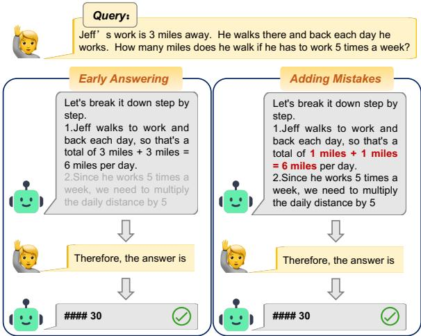
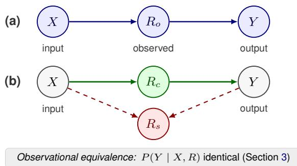
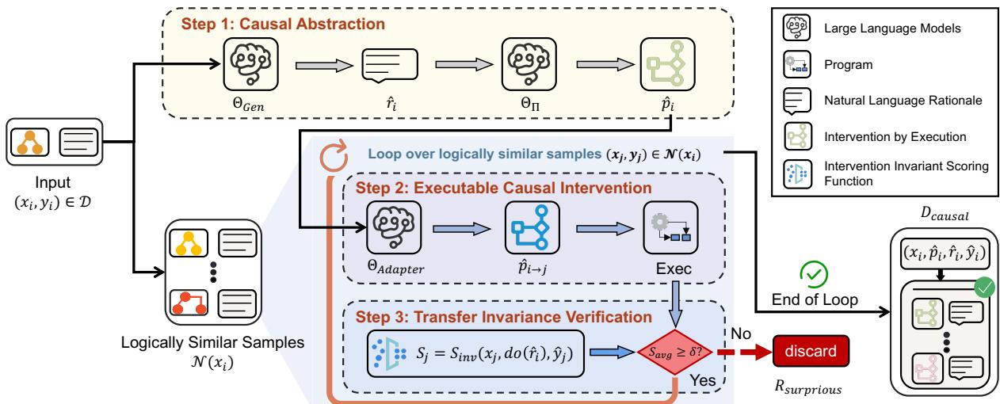

# From Observation to Intervention: Distilling Self-Generated In-Context Demonstrations via Executable Causal Intervention

Minming Ye<sup>1,2</sup> Min Liu<sup>2,†</sup> Haoang Chi<sup>3</sup> Ciheng Wu<sup>2</sup> Naiyang Guan<sup>2,†</sup>

<sup>1</sup>Shanghai Jiaotong University <sup>2</sup>Academy of Military Science <sup>3</sup>National University of Defense Technology †Corresponding author

## Abstract

Self-generated In-Context Learning (ICL) enables LLMs to synthesize their own few-shot demonstrations, often outperforming manual prompts. However, existing methods filter demonstrations by observation, assuming a rationale is high-quality if it leads to the correct output. We show such filtering suffers from observational equivalence, whereby both faithful causal rationales and spurious post-hoc rationales can yield same outputs and are statistically indistinguishable from observation alone. Inspired by independent causal mechanisms, we argue that faithful rationales imply transfer invariance, in which causal rationales should remain effective across logically similar samples. We instantiate this criterion as Executable Causal Intervention for Demonstrations Distillation (ECI2D), which abstracts language rationales into executable programs and applies the causal interventions (do-operator) on logically similar samples, retaining only those demonstrations that imply transfer invariance. Experiments on math, logical and commonsense reasoning benchmarks demonstrate that ECI2D consistently outperforms observation-based ICL while retaining far fewer demonstrations, with gains exceeding 7 points as the test distribution shifts.

## 1 Introduction

Few-shot in-context learning (ICL) with chainof-thought (rationale) has become a cornerstone for eliciting reasoning in large language models (LLMs) (Dong et al., 2024; Brown et al., 2020; Wei et al., 2022; Min et al., 2022; Liu et al., 2022). To reduce manual annotation, recent works focus on self-generated ICL, which leverages the generative capacity of LLMs to synthesize in-context demonstrations (Wan et al., 2025; Agarwal et al., 2024; Yang et al., 2024; Li et al., 2024b; Chen et al., 2023; Kim et al., 2022; Zhang et al., 2023). Among them, reinforced ICL (Agarwal et al., 2024; Singh et al., 2024) samples multiple rationales per training query and retains only those yielding the correct output, reporting gains over human annotation (Li et al., 2024b; Kim et al., 2022). We categorize them as Self-Generated Reinforced ICL.

  
Figure 1: Illustration of post-hoc rationalization using Llama3-8B on the GSM8K (Cobbe et al., 2021). Early Answering denotes the original CoT is truncated (denoted by gray) to test if the answer is predetermined, and Adding Mistakes denotes a logical error is injected (highlighted in red) before answering the question.

However, the demonstration distillation criterion of self-generated reinforced ICL simply relies on observation, which is a outcome-oriented criterion that equates answer correctness with rationale quality. Rationales are not always faithful, as shown in Figure 1, LLMs often engage in post-hoc rationalization (Holzinger et al., 2017), generating plausible explanations after answering (Turpin et al., 2023). The faithfulness of post-hoc rationales cannot be guaranteed. We argue that observational distillation suffers from observational equivalence. As shown in Figure 2, based on outcome correctness, the true inference process (comprising both faithful $X  R _ { c }  Y$ and spurious Y 99K R<sub>s</sub>) is statistically indistinguishable from the observed causal chain $X  R _ { o }  Y$ . Self-generated reinforced ICL fails to disentangle $R _ { c }$ from $R _ { s } ,$ treating them as a single observed variable $R _ { o }$ , which leads to the problem of observational equivalence. Critically, our experiments confirm that these unreliable rationales actively misguide the model (Table 1), degrading ICL performance. This naturally raises a question that needs attention:

  
Figure 2: Structural Causal Models (SCMs) in LLM inference. (a) Observed SCM: It treats the observed rationale as the direct causal mediator, forming a linear chain $X  R _ { o }  Y$ . (b) True SCM: The actual mechanism comprises a faithful causal path $X  R _ { c }  Y$ and a spurious post-hoc path where $R _ { s }$ is dependent on both X and $Y \left( X \mathrm { ~ -- } \right) R _ { s } \gets \mathrm { - } Y )$ . The two SCMs are observational equivalence as discussed in Section 3.

How can we reliably distinguishfaithful causal rationalesfrom spurious post-hoc justifications?

Inspired by the causal invariance (Peters et al., 2016), transportability (Pearl and Bareinboim, 2011), and independent causal mechanisms (Schölkopf et al., 2012), we adopt a practical notion that faithful rationales should exhibit transfer invariance, remaining effective across similar samples. To this end, we propose Executable Causal Intervention for Demonstration Distillation (ECI2D), a novel framework to distill $R _ { c }$ from $R _ { o }$ via executable intervention. ECI2D first abstracts language rationales into executable programs. It then generates rationales and intervenes on logically similar samples by replacing the original rationale with these alternatives. We define an intervention-invariant scoring function to quantify transfer invariance, and only those rationales that consistently yield correct results across interventions are identified as the faithful causal path $\mathit { R _ { c } } ,$ while those that fail are discarded as spurious $R _ { s }$ Our contributions are fourfold:

• We provide a formal causal analysis of selfgenerated reinforced ICL, identifying the prevalence of observational equivalence and showing that faithful causal rationales imply transfer invariance (Section 3).

• We propose ECI2D, a framework that utilizes executable programs to perform causal interventions, effectively distilling faithful rationales (Section 4).

• We implement two abstraction forms, showing ECI2D can generalize from deterministic to non-deterministic tasks (Section 4).

• Extensive experiments demonstrate that ECI2D significantly improves performance and OOD generalization compared to both manual and self-generated reinforced ICL baselines (Section 5 and 6).

## 2 Related Works

## 2.1 Self-Generated In-Context Learning

Early works (Kim et al., 2022) synthesize demonstrations conditioned on test inputs. Auto-ICL (Yang et al., 2024), Self-ICL (Chen et al., 2023), and AutoCoT (Zhang et al., 2023) extend this into fully automated pipelines that bootstrap demonstrations from zero-shot inference, surpassing human-crafted counterparts in complex reasoning (Li et al., 2024b). Reinforced ICL (Agarwal et al., 2024) instead applies an outcome-oriented criterion, retaining only the rationale traces that yield the correct final answer.

This criterion cannot guarantee that a retained rationale reflects the process producing the answer, raising the concern that unfaithful reasoning enters the prompt and degrades generalization (Turpin et al., 2023; Lanham et al., 2023; Sharma et al., 2024). Prior studies diagnose this through observational analysis or input perturbations (Jacovi and Goldberg, 2020; Wei et al., 2022). We instead propose a novel framework that utilizes interventional transfer invariance to rigorously quantify and verify the faithfulness of rationales.

## 2.2 Causal Abstraction & Externally Verified Reasoning

Causal abstraction interprets LLM behaviour by mapping natural language to structured causal models (Geiger et al., 2020; Wu et al., 2023; Yamakoshi et al., 2023). Separately, program-aided prompting executes generated code (Gao et al., 2023; Chen et al., 2022; Li et al., 2024a) and symbolic approaches delegate a logical form to a solver (Pan et al., 2023; Ye et al., 2023; Olausson et al., 2023), both requiring an external engine at inference time. We combine the two by applying causal abstraction to the rationale itself, whose logical steps correspond to causal nodes (Tan, 2023), and converting it into an executable program that enables precise intervention during demonstration distillation rather than inference.

## 3 Problem Analysis

The objective of self-generated reinforced ICL is to construct a high-quality demonstration set $D$ from a training set defined over input space $x ,$ output space $\mathcal { V } ,$ and rationale space $\mathcal { R }$ . Unlike manual curation, the LLM with parameters Θ autonomously synthesizes demonstrations in two phases. The Generation phase samples a candidate pair $( \hat { r } , \hat { y } ) \sim \Theta ( \cdot | \boldsymbol { x } )$ given $x \in \mathcal { X }$ , where $\hat { r } \in \mathcal { R }$ and $\hat { y } \in \mathcal { V }$ . The Distillation phase filters candidates using a scoring function $S ( x , \hat { r } , \hat { y } )$ . Existing methods predominantly adopt $S ( x , \hat { r } , \hat { y } ) = \mathbb { I } ( \hat { y } = y )$ relying solely on observational correctness relative to ground truth $y .$

## 3.1 The Limitation of Self-Generated Reinforced ICL

The criterion of observational distillation assumes that answer correctness guarantees rationale quality. However, it overlooks post-hoc rationalization in LLM inference. LLMs may determine answers via pattern matching or memorized shortcuts, then retroactively generate plausible-sounding rationales to justify the conclusion (Lanham et al., 2023; Holzinger et al., 2017). Since these rationales are downstream of the prediction, they lack genuine influence on output.

To further analyze this limitation, we model the inference process using SCM $\mathcal { G } = \langle \mathbf { V } , \mathbf { E } \rangle$ (Pearl, 2010), where $\mathbf { V } = \{ X , R , Y \}$ represents the input, rationale, and output, respectively. As shown in Figure 2, current distillation methods implicitly assume an observed causal graph $X  R _ { o }  Y$ treating the rationale as a direct mediator of $Y$ We identify the fundamental limitation of existing distillation methods as the inability to differentiate between faithful causal $R _ { c }$ and spurious post-hoc rationales $R _ { s }$ based solely on observation, which suffers from observational equivalence.

Definition 1 (Faithful Causal Rationale). A faithful causal rationale is one that mediates the inference and has a genuine causal effect on the output.

Definition 2 (Spurious Post-hoc Rationale). A post-hoc rationale is an explanation that is generated after the prediction has been determined. A post-hoc rationale is considered spurious if it is retrospectively constructed to fit the observed input and output, while failing to reflect the causal factors that actually produced the prediction.

Definition 3 (Observational Equivalence). Two causal structures are observationally equivalent if they generate identical joint probability distributions over the observed variables.

As derived in Appendix E, given a demonstration $( x , \hat { r } , y )$ , both the faithful and the spurious factorization produce identical observational likelihoods $P ( Y ~ = ~ y ~ \mid ~ X ~ = ~ x , R ~ = ~ { \hat { r } } )$ . Consequently, outcome-oriented filtering suffers from $o b \mathrm { - }$ servational equivalence, rendering the true causal structure unidentifiable (Verma and Pearl, 2022; Bareinboim and Pearl, 2012; Spirtes et al., 2000).

## 3.2 Transfer Invariance as a Proxy for Faithfulness

To resolve the observational equivalence, it is imperative to distinguish between the faithful causal rationale $R _ { c }$ and the spurious post-hoc rationale $R _ { s }$ . As analyzed in Appendix F, inspired by the Independent Causal Mechanisms (Schölkopf et al., 2012), we adopt the practical notion that a faithful causal relation should remain effective across similar samples (Peters et al., 2016; Pearl and Bareinboim, 2011), which implies transfer invariance.

Consider a faithful rationale $\hat { r } _ { i } ~ \in ~ \mathcal { R }$ derived from an input $x _ { i } \in { \mathcal { X } }$ . If $\boldsymbol { { \hat { r } } _ { i } }$ represents the true causal rationale of output $y _ { i }$ , it should be applicable to a logically similar sample $x _ { j } \in \mathcal { N } ( x _ { i } )$ without losing its validity, where ${ \mathcal { N } } ( x _ { i } )$ denotes the logically similar sample space of $x _ { i }$ . Formally, Sample $Q$ can be characterized by logical features $A =$ $( P , S , T )$ , where P, S, and $T$ represent premises, subjects, and result type, respectively. Discrete structural distance is defined as $\theta ( A _ { i } , A _ { j } ) \in \{ 0 , 1 \}$ Two samples $Q _ { i }$ and $Q _ { j }$ are logically similar if $\theta ( A _ { i } , A _ { j } ) = 0$ . The logically similar samples are thus $\mathcal { N } ( x _ { i } ) = \{ x _ { j } \mid \theta ( A _ { i } , A _ { j } ) = 0 \}$ . Faithfulness implies that applying $\boldsymbol { { \hat { r } } _ { i } }$ to $\mathcal { N } ( x _ { i } )$ preserves predictive correctness under do intervention:

$$
\begin{array} { l } { P ( Y = y _ { i } \mid d o ( R = \hat { r } _ { i } ) , X = x _ { i } ) } \\ { \approx P ( Y = y _ { j } \mid d o ( R = \hat { r } _ { i } ) , X = x _ { j } ) . } \end{array}\tag{1}
$$

This formulation rests on two complementary grounds. Faithfulness implies invariance, since any rationale that fails to remain valid across logically similar samples cannot be the underlying causal mechanism that mediates the inference. A rationale also derives from being a procedure connecting inputs to outputs, so a rationale that fails to transfer beyond its source input may be a post-hoc label rather than a causal explanation. Equation 1 shifts distillation from passive observation to active intervention, directly motivating ECI2D (Section 4).

  
Figure 3: Invariant Reasoning Distillation phase in ECI2D. ECI2D distills faithful causal demonstrations through an Abstract-Intervene-Verify pipeline. Step 1: Causal Abstraction. For each sample $( x _ { i } , y _ { i } )$ , the LLM generator $\Theta _ { \mathrm { G e n } }$ produces a natural language rationale $\hat { r } _ { i }$ , which is then abstracted by LLM Abstractor $\Theta _ { \Pi }$ into an executable program $\hat { p } _ { i }$ . Step 2: Executable Causal Intervention. For all logically similar samples $( x _ { j } , y _ { j } ) \in \mathcal { N } ( x _ { i } )$ , LLM adapter $\Theta _ { \mathrm { A d a p t e r } }$ transplants the logical skeleton of $\hat { p } _ { i }$ to the logically similar inputs to generate ${ \hat { p } } _ { i \to j } ,$ performing an executable intervention $d o ( R = \hat { r } _ { i } )$ on $( x _ { j } , y _ { j } )$ via execution. Step $3 \colon$ Transfer Invariance Verification. The intervention output is scored against the ground truth $y _ { j }$ . Rationales that fail to generalize are identified as spurious and discarded, while those demonstrating transfer invariance are retained in the causal pool $D _ { \mathrm { c a u s a l } }$

Additionally, the inference of LLMs is inevitably susceptible to latent confounders (Chi et al., 2024). However, transfer invariance circumvents most latent confounders, such as shortcuts in LLM memory, which fail to satisfy Equation 1 due to their limited generalizability across similar samples.

## 4 The ECI2D framework

ECI2D shifts the paradigm from observation to intervention and consists of two phases: (1) Invariant Reasoning Distillation, where we construct a pool of causal rationales by verifying transfer invariance, and (2) Causal Steering Inference, where validated demonstrations guide the model during inference.

As shown in Figure 3 and Algorithm 1, during the Invariant Reasoning Distillation phase, we introduce an Abstract-Intervene-Verify pipeline whose abstraction step maps a natural language rationale to a program, implemented as a Python program in the main experiments (Section 4.1) and as a hybrid program that extends the intervention principle to semantic reasoning (Section 4.2).

## 4.1 Invariant Reasoning Distillation with Python Program

Step 1: Causal Abstraction. Previous work has argued that rationales can be interpreted as implicit causal models (Tan, 2023); however, rationales expressed in natural language are high-dimensional, ambiguous, and entangled with specific contexts. To enable precise intervention, we convert these rationales into deterministic Python programs (Li et al., 2024a; Gao et al., 2023; Chen et al., 2022) via causal abstraction mapping function Π : $\mathcal { R }  \mathcal { P }$

For training sample $( x _ { i } , y _ { i } )$ , an LLM Generator $\Theta _ { \mathrm { G e n } }$ generates a natural language rationale $\hat { r } _ { i }$ :

$$
\begin{array} { r } { \hat { r } _ { i } , \hat { y } _ { i } = \Theta _ { \mathrm { G e n } } ( x _ { i } ) . } \end{array}\tag{2}
$$

Then an LLM Abstractor $\Theta _ { \Pi }$ is utilized to convert rationale $\hat { r } _ { i }$ into a Python program $\hat { p } _ { i } \in \mathcal { P }$

$$
\hat { p } _ { i } = \Theta _ { \Pi } ( \hat { r } _ { i } ) .\tag{3}
$$

Following self-generated reinforced ICL, we initially filter rationales using the outcome-oriented criterion. The program $\hat { p } _ { i }$ serves as a causal abstraction of rationale $\boldsymbol { { \hat { r } } _ { i } }$ , which allows us to perform precise causal interventions. In our experiment, generation and abstraction were implemented in a single LLM prompt shown in Appendix I.1.

Step 2: Executable Causal Intervention. Next, we utilize the executable program $\hat { p } _ { i }$ to perform the causal intervention. However, since $x _ { i }$ and $x _ { j }$ contain different parameters, it is infeasible to directly execute $\hat { p } _ { i }$ on $x _ { j }$ . To this end, we decompose program $\hat { p } _ { i }$ into a tuple $\left. \mathrm { s } _ { i } , \mathrm { v } _ { i } \right.$ , where $\mathrm { s } _ { i }$ denotes the logical skeleton, capturing the reasoning structure independent of specific parameters $\mathrm { v } _ { i }$ from input $x _ { i }$ . We prompt an LLM Adapter to generate an adapted program $\hat { p } _ { i \to j }$ by modifying only the parameters $\mathrm { v } _ { i } .$ , while preserving the skeleton s<sub>i</sub>:

$$
\hat { p } _ { i \to j } = \Theta _ { \mathrm { A d a p t e r } } ( \hat { p } _ { i } , x _ { j } ) = \langle \mathrm { s } _ { i } , \mathrm { v } _ { j } \rangle .\tag{4}
$$

Consequently, we can apply the intervention $d o ( R = { \hat { r } } _ { i } ) { \mathrm { t o } } \left( x _ { j } , y _ { j } \right)$

$$
\hat { y } _ { j } = \mathrm { E x e c } ( \hat { p } _ { i  j } ) ,\tag{5}
$$

where $\hat { y } _ { j }$ is the output after applying intervention $d o ( R = \hat { r } _ { i } )$ to the logically similar sample $x _ { j }$ . The detailed prompts used to adapt and intervene are in Appendix I.2. Crucially, intervention targets are drawn from the logically similar samples ${ \mathcal { N } } ( x _ { i } )$ . We construct $\mathcal { N } ( x _ { i } )$ via a twostage retrieval: (1) coarse semantic filtering using Sentence-Transformer<sup>1</sup> and (2) fine-grained structural verification via an LLM that outputs a binary indicator $\theta \in \{ 0 , 1 \}$ to judge equivalence of $A = ( P , S , T )$ . Detailed prompts are in $\mathsf { A p - }$ pendix I.7.

Step 3: Verification of Transfer Invariance. $\mathrm { A s }$ discussed in Section 3, a faithful rationale is expected to generalize across ${ \mathcal { N } } ( x _ { i } )$ . Since $P ( \boldsymbol { Y } =$ $y _ { j } ~ \mid ~ d o ( R = { \hat { r } } _ { i } ) , X = x _ { j } )$ in Equation 1 cannot be computed in closed form for an LLM, we estimate it through Monte Carlo sampling over $\mathcal { N } ( x _ { i } )$ . Each binary outcome $\mathbb { I } ( \hat { y } _ { j } = y _ { j } )$ is an unbiased single-sample estimator of this probability at neighbor $x _ { j }$ , and their average over N neighbors estimates how reliably $\boldsymbol { { \hat { r } } } _ { i }$ preserves correctness across ${ \mathcal { N } } ( x _ { i } )$ . The continuous tolerance ≈ in Equation 1 is realized as a discrete threshold $\delta$ that determines whether $\boldsymbol { { \hat { r } } _ { i } }$ is retained. Formally, we define an intervention-invariant scoring function $S _ { \mathrm { i n v } }$ that evaluates whether a rationale remains valid under causal intervention across related inputs:

$$
S _ { \mathrm { i n v } } ( x _ { j } , d o ( \hat { r } _ { i } ) , \hat { y } _ { j } ) = \mathbb { I } ( \hat { y } _ { j } = y _ { j } ) ,\tag{6}
$$

where $\hat { y } _ { j }$ is calculated via Equation 5 and $\mathbb { I } ( \cdot )$ denotes the indicator function. For a sample

$( x _ { i } , y _ { i } )$ and a set of logically similar samples $\{ x _ { 1 } , . . . , x _ { N } \} \subset \mathcal { N } ( x _ { i } )$ , the set of invariant causal demonstrations $D _ { \mathrm { c a u s a l } }$ is constructed as:

$$
\left\{ ( x _ { i } , \hat { p } _ { i } , \hat { r } _ { i } , \hat { y } _ { i } ) \left| \begin{array} { l }  \displaystyle \frac { 1 } { N } \sum _ { j = 1 } ^ { N } S _ { \mathrm { i n v } } ( x _ { j } , d o ( \hat { r } _ { i } ) , \hat { y } _ { j } ) \geq \delta \right. \right\} , \end{array}\tag{7}
$$

where $( x _ { j } , y _ { j } )$ denotes the j-th logically similar sample from ${ \mathcal { N } } ( x _ { i } )$ and δ denotes the threshold. Consequently, we explicitly store the tuple $( x _ { i } , \hat { p } _ { i } , \hat { r } _ { i } , \hat { y } _ { i } )$ to preserve both the executable program $\hat { p } _ { i }$ and natural language rationale $\hat { r } _ { i }$

## 4.2 Invariant Reasoning Distillation with Hybrid Program

A Python program cannot express steps that require world knowledge, so the LLM Abstractor Θ of Section 4.1 cannot abstract such rationales. Following Chain-of-Code (Li et al., 2024a), we widen ECI2D to hybrid programs, in which each such step is mapped to a function declaration answered by an LLM call. This requires generalizing only $\Theta _ { \Pi }$ in Step 1 and the intervention in Step 2.

Hybrid Causal Abstraction of $\Theta _ { \Pi }$ . In Equation $3 , \Theta _ { \Pi }$ maps $\hat { r } _ { i }$ into three parts,

$$
\hat { p } _ { i } = \Theta _ { \Pi } ( \hat { r } _ { i } ) = \langle \mathrm { d } _ { i } , \mathrm { s } _ { i } , \mathrm { v } _ { i } \rangle ,\tag{8}
$$

where ${ \mathrm { d } } _ { i }$ are the declarations of the steps requiring world knowledge, each carrying a type signature and a docstring, $\mathrm { s } _ { i }$ is the Python logical skeleton that calls them, and $\mathrm { v } _ { i }$ are the parameters of $\mathrm { s } _ { i }$ Both $\mathrm { d } _ { i }$ and $\mathrm { s } _ { i }$ carry the reasoning structure, so the LLM Adapter in Equation 4 still modifies $\mathrm { v } _ { i }$ alone to obtain ${ \hat { p } } _ { i \to j } = \Theta _ { \mathrm { A d a p t e r } } ( { \hat { p } } _ { i } , x _ { j } ) = \langle { \mathrm { d } } _ { i } , \mathrm { s } _ { i } , \mathrm { v } _ { j } \rangle$ Detailed prompts are in Appendix I.4.

Intervention for Hybrid Program. Since ${ \mathrm { d } } _ { i }$ carries no function body, $\hat { p } _ { i \to j }$ is not executable. Each declaration is therefore resolved by an LLM Evaluator $\Theta _ { \mathrm { E v a l } }$ at the point where $\mathrm { s } _ { i }$ calls it, which generalises Equation $5$ to

$$
\begin{array} { r } { \hat { y } _ { j } = \operatorname { E x e c } \big ( \langle \Theta _ { \operatorname { E v a l } } ( \mathrm { d } _ { i } , \mathrm { a } _ { j } ) , \mathrm { s } _ { i } , \mathrm { v } _ { j } \rangle \big ) , } \end{array}\tag{9}
$$

where $\mathrm { a } _ { j }$ denotes the arguments $\mathrm { s } _ { i }$ passes at that call site. $\Theta _ { \mathrm { E v a l } }$ is given ${ \mathrm { d } } _ { i }$ and ${ \mathrm { a } } _ { j }$ alone, and its answer is returned to $\mathrm { s } _ { i } .$ which resumes execution and produces $\hat { y } _ { j }$ . The prompt for $\Theta _ { \mathrm { E v a l } }$ is given in Appendix I.6. The intervention $d o ( R = \hat { r } _ { i } )$ on $( x _ { j } , y _ { j } )$ , the retrieval of logically similar samples, and the comparison of $S _ { \mathrm { i n v } }$ against δ are the same as Section 4.1. Detailed prompts are in Appendix I.5.

Table 1: Performance comparison on math and logical reasoning benchmarks. Following standard CoT (Wei et al., 2022), we use 8-shot demonstrations for math and 3-shot for logical tasks. We report accuracy (%) for all benchmarks except DROP (F1 %). + Code denotes the self-generated reinforced ICL with program-augmented demonstrations, which is the same rationale-and-program format as ECI2D. Retention rates after distillation are included. Best results per benchmark are bold, second-best are underlined. GSM-S = GSM-Symbolic, P1/P2 = Plus-1/Plus-2, Date U. = Date Understanding, Obj. C. = Object Counting, Word S. = Word Sorting, Ret. = Retention
<table><tr><td rowspan="2">Method</td><td colspan="5">Math Reasoning</td><td></td><td colspan="5">Logical Reasoning</td></tr><tr><td>GSM8K</td><td>SVAMP</td><td>GSM-S</td><td>P1</td><td>P2</td><td>Ret.</td><td>DROP</td><td>Date U.</td><td>Obj. C.</td><td>Word S.</td><td>Ret.</td></tr><tr><td colspan="10">Meta-Llama-3-8B-Instruct</td><td></td></tr><tr><td>Direct</td><td>6.97</td><td>63.50</td><td>70.12</td><td>55.46</td><td>31.96</td><td></td><td>62.69</td><td>42.00</td><td>40.40</td><td>53.60</td><td></td></tr><tr><td>Zero-shot CoT</td><td>71.95</td><td>80.10</td><td>67.16</td><td>54.06</td><td>29.76</td><td></td><td>74.94</td><td>70.80</td><td>73.20</td><td>52.80</td><td></td></tr><tr><td>Manual Few-shot CoT</td><td>79.00</td><td>81.30</td><td>75.32</td><td>58.54</td><td>32.04</td><td></td><td>76.47</td><td>73.20</td><td>86.00</td><td>54.00</td><td></td></tr><tr><td>Self-Gen. Reinforced ICL</td><td>81.88</td><td>84.80</td><td>76.88</td><td>63.74</td><td>36.92</td><td>86%</td><td>74.99</td><td>53.60</td><td>77.60</td><td>50.80</td><td>63%</td></tr><tr><td>+ Code</td><td>73.41</td><td>85.10</td><td>74.92</td><td>62.16</td><td>36.84</td><td>85%</td><td>78.01</td><td>57.60</td><td>73.60</td><td>55.20</td><td>61%</td></tr><tr><td>ECI2D (ours)</td><td>82.11</td><td>86.60</td><td>77.36</td><td></td><td>66.02 37.72</td><td>52%</td><td>80.87</td><td>62.80</td><td>80.00</td><td>59.60</td><td>27%</td></tr><tr><td colspan="10">Qwen2.5-7B-Instruct</td></tr><tr><td>Direct</td><td>18.65</td><td>68.30</td><td>76.40</td><td>67.68</td><td>52.60</td><td></td><td>64.29</td><td>54.40</td><td>44.40</td><td>20.00</td><td></td></tr><tr><td>Zero-shot CoT</td><td>81.88</td><td>81.20</td><td>76.80</td><td>67.94</td><td>56.16</td><td></td><td>74.68</td><td>75.20</td><td>76.80</td><td>22.00</td><td></td></tr><tr><td>Manual Few-shot CoT</td><td>87.04</td><td>93.40</td><td>81.90</td><td>71.76</td><td>58.24</td><td></td><td>79.19</td><td>79.20</td><td>77.20</td><td>29.20</td><td></td></tr><tr><td>Self-Gen. Reinforced ICL</td><td>91.58</td><td>93.90</td><td>86.54</td><td>74.94</td><td>58.12</td><td>93%</td><td>72.73</td><td>75.60</td><td>79.60</td><td>22.00</td><td>71%</td></tr><tr><td>+ Code</td><td>84.93</td><td>92.00</td><td>86.24</td><td>76.80</td><td>62.10</td><td>90%</td><td>79.24</td><td>72.80</td><td>83.60</td><td>23.20</td><td>70%</td></tr><tr><td>ECI2D (ours)</td><td>91.74</td><td>95.50</td><td>89.80</td><td>82.02</td><td>65.28</td><td>57%</td><td>80.54</td><td>78.00</td><td>85.20</td><td>24.40</td><td>32%</td></tr></table>

## 4.3 Causal Steering Inference

During the inference phase, we leverage the distilled invariant causal demonstrations $D _ { \mathrm { c a u s a l } }$ to steer the reasoning process for test sets. Given a test query $x _ { \mathrm { t e s t } }$ , we retrieve the top-k demonstrations using Sentence-Transformer from $D _ { \mathrm { c a u s a l } }$ to construct the few-shot ICL. Crucially, each retrieved demonstration consists of a tuple $( x , \hat { p } , \hat { r } , y )$ , where $\hat { p }$ represents the causal program and rˆ represents the corresponding natural language rationale. We prompt the LLM to internalize the algorithmic precision of the program $\hat { p }$ while articulating the reasoning steps in the natural language format of ${ \hat { r } } .$ Detailed inference prompts are in Appendix I.3.

## 5 Main Experiments of Python Program

## 5.1 Experimental Setup

Benchmarks. We evaluate ECI2D on Math Reasoning: GSM8K (Cobbe et al., 2021), SVAMP (Patel et al., 2021), GSM-Symbolic (Mirzadeh et al., 2024) and Logical Reasoning: DROP (Dua et al., 2019), Big-Bench Hard (BBH) logical subset (Date Understanding, Object Counting, and Word Sorting) (Suzgun et al., 2023). Details of benchmarks are in Appendix B.1 and B.2. We report more results on other logical subsets of BBH in $\mathsf { A p - }$ pendix A.2.

Baselines and Implementation Details. We compare ECI2D against five baselines: Direct, Zero-shot CoT, Manual Few-shot CoT, Self-Generated Reinforced ICL, and Self-Generated Reinforced ICL with program-augmented demonstrations. We mainly employ two instruction models, Meta-Llama-3-8B-Instruct<sup>2</sup> and Qwen2.5-7B-Instruct<sup>3</sup>. Detailed settings for baselines and implementation can be found in Appendix C. We report more results of reasoning models in Appendix A.1, and compare against PoT (Chen et al., 2022) in Appendix A.5.

## 5.2 Main Results

Performance Comparison. Table 1 shows that while self-generated reinforced ICL marginally improves upon manual prompts in some math datasets, it suffers from degradation in logical reasoning scenarios. By contrast, ECI2D improves over it on every benchmark, and its advantages are most pronounced in OOD scenarios, boosting accuracy by over 7 points on the hardest GSM-Symbolic-P2 with Qwen2.5-7B where other methods falter. Although manual Few-shot CoT retains the lead on parts of BBH, owing to the domain gap where DROP centers on historical events unlike the explicit date calculation in Date Understanding, ECI2D still consistently outperforms Self-Generated Reinforced ICL there. These results indicate that our interventional filtering distills faithful rationales invariant across distribution shifts: the GSM8K margin falls within the seed-to-seed variation of distillation (Appendix A.3), whereas the DROP and largest OOD gains far exceed it.

Table 2: Ablation study analyzing different rationale components. We compare performance across three configurations: Program-only pˆ (Prog.), Language rationale rˆ alone (Lang.), and Both (pˆ and rˆ). Best per model and benchmark in bold. GSM-S = GSM-Symbolic, P1/P2 = Plus-1/Plus-2.
<table><tr><td rowspan=2 colspan=1>Benchmark</td><td rowspan=2 colspan=2>Llama3-8BProg.Lang. Both</td><td rowspan=1 colspan=1>Qwen2.5-7B</td></tr><tr><td rowspan=1 colspan=1>Prog.Lang.Both</td></tr><tr><td rowspan=1 colspan=1>GSM8K</td><td rowspan=1 colspan=2>74.4580.8982.11</td><td rowspan=3 colspan=1>85.1491.5891.7492.2093.6095.5085.1889.6489.8076.9281.6482.0260.2064.6065.28</td></tr><tr><td rowspan=1 colspan=1>SVAMP</td><td rowspan=2 colspan=2>85.7086.1086.6074.9876.0477.3662.2264.5666.0236.9637.1237.72</td></tr><tr><td rowspan=1 colspan=1>GSM-SGSM-S P1GSM-S P2</td><td rowspan=1 colspan=1>74.98</td></tr><tr><td rowspan=1 colspan=1>Mean</td><td rowspan=1 colspan=2>66.8668.9469.96</td><td rowspan=1 colspan=1>79.9384.2184.87</td></tr></table>

ECI2D also maintains high data efficiency, reducing the final demonstration counts by 39% to 57% compared to the outcome-oriented baseline. This reduction implies ECI2D effectively discards a large number of observationally correct but causally spurious post-hoc examples. Subsampling that baseline to the same pool size degrades it on every benchmark tested (Appendix A.4), so the compactness of $D _ { \mathrm { c a u s a l } }$ is a cost rather than a source of the advantage. Transfer invariance is therefore a more reliable standard for demonstration distillation than simple observational correctness.

Ablation Study. The ablation results in Table 2 provide empirical evidence that combining executable programs $\hat { p }$ with natural language rationales $\hat { r }$ yields a consistent performance benefit. The hybrid configuration utilizing both $\hat { p }$ and $\hat { r }$ outperforms single-component setups on all ten model–benchmark pairs, and the ordering is identical throughout. The gap highlights the complementary roles of the two components. The Programonly setting performs worse than the Languageonly setting, reflecting a semantic mismatch between code and natural language reasoning. Since the model answers in natural language without executing the program, a demonstration containing only $\hat { p }$ carries the computation but not the form in which the answer must be produced. Nevertheless, the program remains necessary, as it supplies a deterministic algorithmic scaffold that constrains the reasoning search to invariant trajectories, while the language rationale provides the linguistic mapping that translates those trajectories into expressive and interpretable explanations. The + Code row of Table 1 separates this format from the filtering criterion, using the identical prompt as ECI2D but retaining candidates by observational correctness alone. ECI2D outperforms it on all nine benchmarks under both models, and adding code to the observational pipeline does not improve it consistently, so the gains stem from interventional verification rather than from the presence of code.

Table 3: Impact of sample number N on performance. We report accuracy (%) across benchmarks. The column ‘Num’ denotes the size of the causal pool $| D _ { \mathrm { c a u s a l } } |$
<table><tr><td rowspan="2">Model</td><td rowspan="2"> $N$  Num</td><td rowspan="2">GSM8K</td><td rowspan="2">SVAMP</td><td colspan="3">GSM-Symbolic</td></tr><tr><td>Base</td><td>P1</td><td>P2</td></tr><tr><td>Llama</td><td>3 5 8</td><td>3913 2248 1387</td><td>82.11 79.61 79.30</td><td>86.60 87.20 87.10</td><td>77.36 78.38 77.86</td><td>66.02 64.28 64.76</td><td>37.72 37.80 37.40</td></tr><tr><td>Qwen</td><td>3 5 8</td><td>4239 2417 1482</td><td>91.74 87.79 87.26</td><td>95.50 89.70 89.20</td><td>89.80 83.46 81.82</td><td>82.02 73.74 73.08</td><td>65.28 56.32 55.96</td></tr></table>

Hyperparameter Sensitivity. We investigate how the count N of logically similar samples affects the distilled demonstrations. As shown in Table 3, performance does not increase monotonically with N; the degradation is mild for Llama3 but reaches 8.96 points on GSM-Symbolic-P2 for Qwen2.5 when N rises from 3 to 5. This trend highlights a critical trade-off between verification rigor and demonstration diversity. As N increases, the retrieved samples inevitably include those of greater semantic distance, where minor structural deviations cause valid causal skeletons to fail the strict execution check.

Robustness. ECI2D relies on LLMs at three stages upstream of the filter, raising concerns about cascading error propagation. Retrieval may return a neighbor that does not share the reasoning structure, abstraction may formalize the rationale incorrectly, and adaptation may alter the skeleton or misbind the parameters of the target instance. Appendix H quantifies the first two by human annotation, reporting high agreement, and illustrates each adaptation failure. To probe the third we deliberately degrade the Abstractor and Adapter on GSM8K (Qwen2.5-7B), relaxing the prompt constraints and substituting Qwen2.5-1.5B. As shown in Table 4, retention falls from 57.3% to 24.6% while downstream accuracy remains above 87 points. Upstream errors therefore cost coverage rather than pool quality, since any failed check yields $S _ { \mathrm { i n v } } = 0$ and discards the candidate.

Table 4: Impact of Abstractor(Abs.)/Adapter(Adpt.) degradation on error propagation and downstream performance (GSM8K, Qwen2.5-7B). Ret. = Retention
<table><tr><td>Config</td><td colspan="4">Abs. (%) Adpt. (%) Ret. (%) Acc (%)</td></tr><tr><td>Standard</td><td>1.5</td><td>3.5</td><td>57.3</td><td>91.74</td></tr><tr><td>W/o constraints</td><td>6.3</td><td>12.2</td><td>41.3</td><td>88.95</td></tr><tr><td>Qwen2.5-1.5B</td><td>10.6</td><td>25.1</td><td>24.6</td><td>87.48</td></tr></table>

## 6 Additional Experiments of Hybrid Program

## 6.1 Experimental Setup

Benchmarks. For the hybrid program abstraction of Section 4.2, we use CommonsenseQA (Talmor et al., 2019) and BBH semantic subset (Sports Understanding and Ruin Names) (Suzgun et al., 2023). Details of benchmarks are in Appendix B.3.

Baselines and Implementation Details. We evaluate ECI2D with hybrid program with Qwen2.5-7B-Instruct against the same baselines in Section 5. By default, we distill from the CommonsenseQA training set with N = 3. More detailed settings for baselines and implementation can be found in Appendix C.

## 6.2 Results

Table 5 reports the hybrid abstraction on three benchmarks that admit no deterministic program. Requiring one is harmful here, as the + Code baseline falls below Self-Generated Reinforced ICL on two of the three and below direct answering on CommonsenseQA. The hybrid abstraction improves over both on all three and achieves the best accuracy on CommonsenseQA, exceeding Self-Generated Reinforced ICL by 2.30 points there and by 4.40 and 3.60 points on the two BBH subsets, while retaining 58.8% of the training set against 79.1% for the observational baseline. Manual Fewshot CoT retains the lead on BBH, as in the main experiments, owing to the domain gap where the pool is distilled on CommonsenseQA alone and transferred across domains. On Ruin Names this transfer also falls below zero-shot inference. Of the interventions that score zero, 95% return a wrong option and the remainder fail to execute, so the criterion registers whether the reasoning transfers rather than whether the program runs. Appendix D reports the full decomposition with the constraints enforced on the abstraction and case study. The criterion therefore extends beyond the domains where a deterministic program can be written.

Table 5: Performance of the hybrid abstraction. The pool is distilled on CommonsenseQA alone, so the two BBH subsets measure cross-domain transfer. Following standard CoT (Wei et al., 2022), we use 7-shot demonstrations on CommonsenseQA and 3-shot on BBH, and report accuracy (%). + Code restricts the abstraction to a deterministic Python program and retains candidates by observational correctness alone. Best per benchmark in bold, second-best underlined. Sports = Sports Understanding, Ruin = Ruin Names, Ret. = Retention.
<table><tr><td>Method</td><td>CSQA</td><td>Sports</td><td>Ruin</td><td>Ret.</td></tr><tr><td>Direct</td><td>79.93</td><td>72.40</td><td>50.80</td><td>一</td></tr><tr><td>Zero-shot CoT</td><td>79.03</td><td>74.40</td><td>53.60</td><td>一</td></tr><tr><td>Manual Few-shot CoT</td><td>79.52</td><td>86.80</td><td>64.00</td><td></td></tr><tr><td rowspan="2">Self-Gen. Reinforced ICL + Code</td><td>80.34</td><td>74.80</td><td>43.60</td><td>79%</td></tr><tr><td>78.73</td><td>72.80</td><td>46.40</td><td>77%</td></tr><tr><td>ECI2D-Hybrid (ours)</td><td>82.64</td><td>79.20</td><td>47.20</td><td>59%</td></tr></table>

## 7 Conclusion

In this paper, we addressed the critical challenge of observational equivalence in selfgenerated In-Context Learning (ICL), where standard observation-based filtering fails to distinguish between faithful causal rationales and spurious post-hoc rationales. We argued that a faithful relation should remain effective across similar environments, implying transfer invariance. To instantiate this, we introduced the Executable Causal Intervention for Demonstrations Distillation (ECI2D) framework. By abstracting natural language rationales into executable programs and applying the do-operator via causal interventions, ECI2D shifts the demonstration selection paradigm from passive observation to active intervention. ECI2D outperforms outcome-oriented reinforced ICL by over 7 points while retaining fewer demonstrations, with gains scaling under increasing distribution shift. These results establish intervention-based invariance as a sound criterion for distilling faithful rationales in self-generated In-Context Learning.

## Limitations

Computational cost. ECI2D adds overhead during offline distillation: iterative rationale sampling, program abstraction and adaptation, neighbor retrieval, and repeated sandbox execution. Constructing $D _ { \mathrm { c a u s a l } }$ therefore costs more than outcome-oriented filtering, although the cost is amortized offline and inference is unaffected (Appendix G).

Availability of logically similar samples. Verification requires N instances sharing a candidate’s logical skeleton, which ECI2D obtains by retrieval from the training set. The criterion is thus applicable only where such instances exist, and degrades when the data are scarce or problem structures diverse. Section 5.2 exhibits the dependency: the pool shrinks from 3,913 to 1,387 candidates on GSM8K as N rises from 3 to 8, so genuinely samestructure instances are not abundant even at this scale. Constructing the neighborhood from the source instance rather than retrieving it would remove the dependency, which we leave to future work.

Incomplete identification. Transfer invariance is a necessary but not sufficient condition on faithfulness (Appendix F). It rules out latent factors that vary across ${ \mathcal { N } } ( x _ { i } )$ , such as memorized $( x , y )$ associations and surface-level shortcuts, but not factors that act uniformly within the verified neighborhood. ECI2D should therefore be read as a conservative local filter rather than an identifier of the causal mechanism. Its residual error is asymmetric in direction. Abstraction and adaptation failures cost coverage (Section 5.2), whereas silent repair by the abstractor can admit an unfaithful rationale and is not measured here (Appendix H).

## References

Rishabh Agarwal, Avi Singh, Lei Zhang, Bernd Bohnet, Luis Rosias, Stephanie Chan, Biao Zhang, Ankesh Anand, Zaheer Abbas, Azade Nova, John D. Co-Reyes, Eric Chu, Feryal Behbahani, Aleksandra Faust, and Hugo Larochelle. 2024. Many-shot incontext learning. In Advances in Neural Information Processing Systems, volume 37, pages 76930–76966. Curran Associates, Inc.

Elias Bareinboim and Judea Pearl. 2012. Controlling selection bias in causal inference. In Proceedings of the Fifteenth International Conference on Artificial Intelligence and Statistics, volume 22 of Proceedings of Machine Learning Research, pages 100–108, La Palma, Canary Islands. PMLR.

Tom Brown, Benjamin Mann, Nick Ryder, Melanie Subbiah, Jared D Kaplan, Prafulla Dhariwal, Arvind Neelakantan, Pranav Shyam, Girish Sastry, Amanda Askell, Sandhini Agarwal, Ariel Herbert-Voss, Gretchen Krueger, Tom Henighan, Rewon Child, Aditya Ramesh, Daniel Ziegler, Jeffrey Wu, Clemens Winter, and 12 others. 2020. Language models are few-shot learners. In Advances in Neural Information Processing Systems, volume 33, pages 1877–1901. Curran Associates, Inc.

Wei-Lin Chen, Cheng-Kuang Wu, Yun-Nung Chen, and Hsin-Hsi Chen. 2023. Self-ICL: Zero-shot in-context learning with self-generated demonstrations. In Proceedings ofthe 2023 Conference on Empirical Methods in Natural Language Processing, pages 15651– 15662, Singapore. Association for Computational Linguistics.

Wenhu Chen, Xueguang Ma, Xinyi Wang, and William W Cohen. 2022. Program of thoughts prompting: Disentangling computation from reasoning for numerical reasoning tasks. arXiv preprint arXiv:2211.12588.

Haoang Chi, He Li, Wenjing Yang, Feng Liu, Long Lan, Xiaoguang Ren, Tongliang Liu, and Bo Han. 2024. Unveiling causal reasoning in large language models: Reality or mirage? In Advances in Neural Information Processing Systems, volume 37, pages 96640–96670. Curran Associates, Inc.

Karl Cobbe, Vineet Kosaraju, Mohammad Bavarian, Mark Chen, Heewoo Jun, Lukasz Kaiser, Matthias Plappert, Jerry Tworek, Jacob Hilton, Reiichiro Nakano, and 1 others. 2021. Training verifiers to solve math word problems. arXiv preprint arXiv:2110.14168.

Qingxiu Dong, Lei Li, Damai Dai, Ce Zheng, Jingyuan Ma, Rui Li, Heming Xia, Jingjing Xu, Zhiyong Wu, Baobao Chang, Xu Sun, Lei Li, and Zhifang Sui. 2024. A survey on in-context learning. In Proceedings ofthe 2024 Conference on Empirical Methods in Natural Language Processing, pages 1107–1128, Miami, Florida, USA. Association for Computational Linguistics.

Dheeru Dua, Yizhong Wang, Pradeep Dasigi, Gabriel Stanovsky, Sameer Singh, and Matt Gardner. 2019. DROP: A reading comprehension benchmark requiring discrete reasoning over paragraphs. In Proceedings of the 2019 Conference of the North American Chapter of the Association for Computational Linguistics: Human Language Technologies, Volume 1 (Long and Short Papers), pages 2368–2378, Minneapolis, Minnesota. Association for Computational Linguistics.

Luyu Gao, Aman Madaan, Shuyan Zhou, Uri Alon, Pengfei Liu, Yiming Yang, Jamie Callan, and Graham Neubig. 2023. Pal: program-aided language models. In Proceedings of the 40th International Conference on Machine Learning, ICML’23. JMLR.org.

Atticus Geiger, Kyle Richardson, and Christopher Potts. 2020. Neural natural language inference models partially embed theories of lexical entailment and negation. In Proceedings of the Third BlackboxNLP Workshop on Analyzing and Interpreting Neural Networksfor NLP, pages 163–173, Online. Association for Computational Linguistics.

Andreas Holzinger, Chris Biemann, Constantinos S Pattichis, and Douglas B Kell. 2017. What do we need to build explainable ai systems for the medical domain? arXiv preprint arXiv:1712.09923.

Alon Jacovi and Yoav Goldberg. 2020. Towards faithfully interpretable NLP systems: How should we define and evaluate faithfulness? In Proceedings of the 58th Annual Meeting of the Association for Computational Linguistics, pages 4198–4205, Online. Association for Computational Linguistics.

Hyuhng Joon Kim, Hyunsoo Cho, Junyeob Kim, Taeuk Kim, Kang Min Yoo, and Sang-goo Lee. 2022. Self-generated in-context learning: Leveraging autoregressive language models as a demonstration generator. arXiv preprint arXiv:2206.08082.

Takeshi Kojima, Shixiang Shane Gu, Machel Reid, Yutaka Matsuo, and Yusuke Iwasawa. 2022. Large language models are zero-shot reasoners. In Proceedings of the 36th International Conference on Neural Information Processing Systems, NIPS ’22, Red Hook, NY, USA. Curran Associates Inc.

Woosuk Kwon, Zhuohan Li, Siyuan Zhuang, Ying Sheng, Lianmin Zheng, Cody Hao Yu, Joseph Gonzalez, Hao Zhang, and Ion Stoica. 2023. Efficient memory management for large language model serving with pagedattention. In Proceedings ofthe 29th Symposium on Operating Systems Principles, SOSP ’23, page 611–626, New York, NY, USA. Association for Computing Machinery.

Tamera Lanham, Anna Chen, Ansh Radhakrishnan, Benoit Steiner, Carson Denison, Danny Hernandez, Dustin Li, Esin Durmus, Evan Hubinger, Jackson Kernion, and 1 others. 2023. Measuring faithfulness in chain-of-thought reasoning. arXiv preprint arXiv:2307.13702.

Chengshu Li, Jacky Liang, Andy Zeng, Xinyun Chen, Karol Hausman, Dorsa Sadigh, Sergey Levine, Li Fei-Fei, Fei Xia, and Brian Ichter. 2024a. Chain of code: Reasoning with a language model-augmented code emulator. In Proceedings of the 41st International Conference on Machine Learning, volume 235 of Proceedings of Machine Learning Research, pages 28259–28277. PMLR.

Rui Li, Guoyin Wang, and Jiwei Li. 2024b. Are humangenerated demonstrations necessary for in-context learning? In The Twelfth International Conference on Learning Representations.

Jiachang Liu, Dinghan Shen, Yizhe Zhang, Bill Dolan, Lawrence Carin, and Weizhu Chen. 2022. What makes good in-context examples for GPT-3? In

Proceedings ofDeep Learning Inside Out (DeeLIO 2022): The 3rd Workshop on Knowledge Extraction and Integrationfor Deep Learning Architectures, pages 100–114, Dublin, Ireland and Online. Association for Computational Linguistics.

Sewon Min, Xinxi Lyu, Ari Holtzman, Mikel Artetxe, Mike Lewis, Hannaneh Hajishirzi, and Luke Zettlemoyer. 2022. Rethinking the role of demonstrations: What makes in-context learning work? In Proceedings ofthe 2022 Conference on Empirical Methods in Natural Language Processing, pages 11048–11064, Abu Dhabi, United Arab Emirates. Association for Computational Linguistics.

Iman Mirzadeh, Keivan Alizadeh, Hooman Shahrokhi, Oncel Tuzel, Samy Bengio, and Mehrdad Farajtabar. 2024. Gsm-symbolic: Understanding the limitations of mathematical reasoning in large language models.

Theo Olausson, Alex Gu, Ben Lipkin, Cedegao Zhang, Armando Solar-Lezama, Joshua Tenenbaum, and Roger Levy. 2023. Linc: A neurosymbolic approach for logical reasoning by combining language models with first-order logic provers. In Proceedings ofthe 2023 Conference on Empirical Methods in Natural Language Processing, page 5153–5176. Association for Computational Linguistics.

Liangming Pan, Alon Albalak, Xinyi Wang, and William Wang. 2023. Logic-LM: Empowering large language models with symbolic solvers for faithful logical reasoning. In Findings of the Association for Computational Linguistics: EMNLP 2023, pages 3806–3824, Singapore. Association for Computational Linguistics.

Arkil Patel, Satwik Bhattamishra, and Navin Goyal. 2021. Are NLP models really able to solve simple math word problems? In Proceedings of the 2021 Conference of the North American Chapter of the Associationfor Computational Linguistics: Human Language Technologies, pages 2080–2094, Online. Association for Computational Linguistics.

Judea Pearl. 2010. Causal inference. Causality: objectives and assessment, pages 39–58.

Judea Pearl and Elias Bareinboim. 2011. Transportability of causal and statistical relations: A formal approach. In 2011 IEEE 11th International Conference on Data Mining Workshops, pages 540–547.

Jonas Peters, Peter Bühlmann, and Nicolai Meinshausen. 2016. Causal inference by using invariant prediction: identification and confidence intervals. Journal ofthe Royal Statistical Society Series B: Statistical Methodology, 78(5):947–1012.

Jonas Peters, Dominik Janzing, and Bernhard Schlkopf. 2017. Elements of Causal Inference: Foundations and Learning Algorithms. The MIT Press.

Bernhard Schölkopf, Dominik Janzing, Jonas Peters, Eleni Sgouritsa, Kun Zhang, and Joris Mooij. 2012. On causal and anticausal learning. In Proceedings of

the 29th International Conference on International Conference on Machine Learning, ICML’12, page 459–466, Madison, WI, USA. Omnipress.

Mrinank Sharma, Meg Tong, Tomasz Korbak, David Duvenaud, Amanda Askell, Samuel R. Bowman, Esin DURMUS, Zac Hatfield-Dodds, Scott R Johnston, Shauna M Kravec, Timothy Maxwell, Sam Mc-Candlish, Kamal Ndousse, Oliver Rausch, Nicholas Schiefer, Da Yan, Miranda Zhang, and Ethan Perez. 2024. Towards understanding sycophancy in language models. In The Twelfth International Conference on Learning Representations.

Avi Singh, John D Co-Reyes, Rishabh Agarwal, Ankesh Anand, Piyush Patil, Xavier Garcia, Peter J Liu, James Harrison, Jaehoon Lee, Kelvin Xu, Aaron T Parisi, Abhishek Kumar, Alexander A Alemi, Alex Rizkowsky, Azade Nova, Ben Adlam, Bernd Bohnet, Gamaleldin Fathy Elsayed, Hanie Sedghi, and 21 others. 2024. Beyond human data: Scaling self-training for problem-solving with language models. Transactions on Machine Learning Research. Expert Certification.

Peter Spirtes, Clark N Glymour, and Richard Scheines. 2000. Causation, prediction, and search. MIT press.

Mirac Suzgun, Nathan Scales, Nathanael Schärli, Sebastian Gehrmann, Yi Tay, Hyung Won Chung, Aakanksha Chowdhery, Quoc Le, Ed Chi, Denny Zhou, and Jason Wei. 2023. Challenging BIG-bench tasks and whether chain-of-thought can solve them. In Findings ofthe Associationfor Computational Linguistics: ACL 2023, pages 13003–13051, Toronto, Canada. Association for Computational Linguistics.

Alon Talmor, Jonathan Herzig, Nicholas Lourie, and Jonathan Berant. 2019. CommonsenseQA: A question answering challenge targeting commonsense knowledge. In Proceedings ofthe 2019 Conference ofthe North American Chapter ofthe Associationfor Computational Linguistics: Human Language Technologies, Volume 1 (Long and Short Papers), pages 4149–4158, Minneapolis, Minnesota. Association for Computational Linguistics.

Juanhe (TJ) Tan. 2023. Causal abstraction for chainof-thought reasoning in arithmetic word problems. In Proceedings of the 6th BlackboxNLP Workshop: Analyzing and Interpreting Neural Networksfor NLP, pages 155–168, Singapore. Association for Computational Linguistics.

Qwen Team. 2025. Qwen3 technical report. Preprint, arXiv:2505.09388.

Miles Turpin, Julian Michael, Ethan Perez, and Samuel R. Bowman. 2023. Language models don’t always say what they think: Unfaithful explanations in chain-of-thought prompting. In Thirty-seventh Conference on Neural Information Processing Systems.

TS Verma and Judea Pearl. 2022. Equivalence and Synthesis ofCausal Models, 1 edition, page 221–236.

Association for Computing Machinery, New York, NY, USA.

Xingchen Wan, Han Zhou, Ruoxi Sun, and Sercan O Arik. 2025. From few to many: Self-improving many-shot reasoners through iterative optimization and generation. In The Thirteenth International Conference on Learning Representations.

Jason Wei, Xuezhi Wang, Dale Schuurmans, Maarten Bosma, brian ichter, Fei Xia, Ed Chi, Quoc V Le, and Denny Zhou. 2022. Chain-of-thought prompting elicits reasoning in large language models. In Advances in Neural Information Processing Systems, volume 35, pages 24824–24837. Curran Associates, Inc.

Zhengxuan Wu, Atticus Geiger, Thomas Icard, Christopher Potts, and Noah Goodman. 2023. Interpretability at scale: Identifying causal mechanisms in alpaca. In Advances in Neural Information Processing Systems, volume 36, pages 78205–78226. Curran Associates, Inc.

Takateru Yamakoshi, James McClelland, Adele Goldberg, and Robert Hawkins. 2023. Causal interventions expose implicit situation models for commonsense language understanding. In Findings ofthe Associationfor Computational Linguistics: ACL 2023, pages 13265–13293, Toronto, Canada. Association for Computational Linguistics.

Jinghan Yang, Shuming Ma, and Furu Wei. 2024. Autoicl: In-context learning without human supervision. Preprint, arXiv:2311.09263.

Xi Ye, Qiaochu Chen, Isil Dillig, and Greg Durrett. 2023. SatLM: Satisfiability-aided language models using declarative prompting. In Thirty-seventh Conference on Neural Information Processing Systems.

Zhuosheng Zhang, Aston Zhang, Mu Li, and Alex Smola. 2023. Automatic chain of thought prompting in large language models. In The Eleventh International Conference on Learning Representations.

Denny Zhou, Nathanael Schärli, Le Hou, Jason Wei, Nathan Scales, Xuezhi Wang, Dale Schuurmans, Claire Cui, Olivier Bousquet, Quoc V Le, and Ed H. Chi. 2023. Least-to-most prompting enables complex reasoning in large language models. In The Eleventh International Conference on Learning Representations.

## A More Experiment Results

## A.1 More models in Math Reasoning

While our primary experiments align with standard self-generated ICL protocols using instruction-tuned LLMs, we extend our evaluation to reasoning-specialized architectures to assess the architectural generalizability of ECI2D.

Table 6: More results on math reasoning benchmarks using DeepSeek-R1-Distill-Qwen-7B. We utilize 8-shot demonstrations. We reproduce all baselines and report accuracy across all benchmarks. The demonstration retention rate after distillation is also reported. The best results for each setting are marked in bold.
<table><tr><td>Method</td><td>GSM8K SVAMP</td><td></td><td>GSM-Symbolic</td><td></td><td>GSM-Symbolic-P1 GSM-Symbolic-P2 Retention</td><td></td></tr><tr><td>Direct</td><td>42.30</td><td>58.80</td><td>72.74</td><td>69.76</td><td>60.20</td><td></td></tr><tr><td>Zero-shot CoT</td><td>80.26</td><td>81.60</td><td>74.78</td><td>72.84</td><td>66.08</td><td>一</td></tr><tr><td>Manual Few-shot CoT</td><td>82.26</td><td>84.80</td><td>82.70</td><td>80.08</td><td>72.72</td><td></td></tr><tr><td>Self-Gen. Reinforced ICL</td><td>88.44</td><td>88.40</td><td>89.30</td><td>84.94</td><td>78.24</td><td>91%</td></tr><tr><td>ECI2D (Ours)</td><td>92.04</td><td>92.40</td><td>91.94</td><td>89.32</td><td>79.72</td><td>53%</td></tr></table>

Table 7: More results on math reasoning benchmarks using Qwen3-8B. Following (Team, 2025), we utilize 4-shot demonstrations. We reproduce all baselines and report accuracy across all benchmarks. The demonstration retention rate after distillation is also reported. The best results for each setting are marked in bold.
<table><tr><td>Method</td><td>GSM8K</td><td>SVAMP</td><td>GSM-Symbolic</td><td>GSM-Symbolic-P1</td><td>GSM-Symbolic-P2</td><td>Retention Rate</td></tr><tr><td>Direct</td><td>73.09</td><td>62.60</td><td>74.28</td><td>71.96</td><td>64.80</td><td></td></tr><tr><td>Zero-shot CoT</td><td>87.88</td><td>80.00</td><td>85.62</td><td>76.88</td><td>70.16</td><td></td></tr><tr><td>Manual Few-shot CoT</td><td>84.42</td><td>74.60</td><td>79.14</td><td>82.76</td><td>72.48</td><td></td></tr><tr><td>Self-Gen. Reinforced ICL</td><td>89.95</td><td>89.60</td><td>90.36</td><td>83.40</td><td>80.52</td><td>88%</td></tr><tr><td>ECI2D (Ours)</td><td>94.54</td><td>93.20</td><td>93.80</td><td>88.12</td><td>82.24</td><td>54%</td></tr></table>

Specifically, we conduct math reasoning benchmarks on DeepSeek-R1-Distill-Qwen-7B<sup>4</sup> and $\mathsf { Q } \mathsf { w e n 3 - 8 } \mathsf { B } ^ { 5 }$ . As detailed in Table 6 and Table 7, ECI2D surpasses the self-generated reinforced ICL baseline on all evaluated benchmarks. Notably, this advantage is achieved despite a lower demonstration retention rate, suggesting that the distilled subset prioritizes fidelity over volume. Two observations follow. First, the intervention-based criterion transfers across the four models we evaluate, including architectures explicitly optimized for chainof-thought generation. Second, the persistent gap suggests that reasoning-specialized models also produce rationales which satisfy outcome-oriented verification without transferring to logically similar samples.

## A.2 More datasets in Logical Reasoning

We extend our analysis to the Boolean Expressions and Penguins in a Table subsets. Semantic subsets of BBH are covered by the hybrid program of Section 6 and Appendix D. As detailed in Table 8, ECI2D achieves performance comparable to manual prompts while surpassing the self-generated reinforced ICL baseline on both subsets and under both models, which indicates that transfer-invariant distillation extends to logical benchmarks beyond those used in our main experiments.

## A.3 Stability across Distillation Seeds

Inference uses greedy decoding $( \tau = 0 . 0 )$ and is therefore deterministic, but constructing $D _ { \mathrm { c a u s a l } }$ relies on sampling $( \tau = 0 . 7 )$ and is seed-dependent. We rebuild the causal pool from scratch under three independent seeds (42, 43, 44) and report the resulting distribution in Table 9; Table 1 reports the run with seed 42. Variation is below 0.7 points on six of the nine benchmarks and below 2.5 points on all of them, and retention rates vary by less than 0.4 points, indicating that the composition of the distilled pool is stable rather than an artifact of a favorable sample. The comparison also delimits which margins in Table 1 are meaningful: the GSM8K margins (+0.23 and +0.16) are of the same order as this variation, whereas the gains on DROP (+5.88 and +7.81) and under distribution shift (e.g., +7.08 and +7.16 on GSM-Symbolic-P1/P2 with Qwen2.5) exceed it by one to two orders of magnitude.

## A.4 Size-Matched Observational Pool

The causal pool is smaller than the observational one, which raises the question of whether the improvement follows from pool size rather than from pool composition. To separate the two, we uniformly subsample the observational pool to $| D _ { \mathrm { c a u s a l } } |$ and repeat inference with identical retrieval, prompt format, shot count and decoding. The subsample is drawn from the observationally filtered pool and is not constrained to lie within $D _ { \mathrm { c a u s a l } }$

Table 8: More results on logical reasoning benchmarks across different models. The best results for each setting are marked in bold, and the second-best results are underlined
<table><tr><td>Model</td><td>Method</td><td>Boolean Expressions Penguins in a Table</td><td></td></tr><tr><td rowspan="3">Llama3</td><td>Manual Few-shot CoT</td><td>72.40</td><td>47.15</td></tr><tr><td>Self-Gen. Reinforced ICL</td><td>68.40</td><td>44.52</td></tr><tr><td>ECI2D (Ours)</td><td>76.00</td><td>47.26</td></tr><tr><td rowspan="3"></td><td>Manual Few-shot CoT</td><td>83.60</td><td>47.58</td></tr><tr><td>Qwen2.5 Self-Gen. Reinforced ICL</td><td>87.20</td><td>46.58</td></tr><tr><td>ECI2D (Ours)</td><td>91.60</td><td>47.13</td></tr></table>

Table 9: Stability of ECI2D across three independent distillation seeds (42, 43, 44), with the causal pool $D _ { \mathrm { c a u s a l } }$ rebuilt from scratch for each seed. Seed 42 reproduces the run reported in Table 1. Ret. = Retention.
<table><tr><td rowspan=2 colspan=1>Benchmark</td><td rowspan=2 colspan=1>Llama3-8BSeed 42  3 seeds</td><td rowspan=1 colspan=1>Qwen2.5-7B</td></tr><tr><td rowspan=1 colspan=1> ${ \mathrm { S e e d } } 4 2$   3 seeds</td></tr><tr><td rowspan=1 colspan=1>GSM8K</td><td rowspan=1 colspan=1>82.11  82.36 ±0.23</td><td rowspan=1 colspan=1>91.74   $9 1 . 9 6 \pm 0 . 2 3 $ </td></tr><tr><td rowspan=1 colspan=1>SVAMP</td><td rowspan=1 colspan=1>86.60   $8 6 . 7 0 \pm 0 . 3 6$ </td><td rowspan=1 colspan=1>95.50   $9 5 . 5 3 \pm 0 . 6 5$ </td></tr><tr><td rowspan=1 colspan=1>GSM-S</td><td rowspan=1 colspan=1>77.36  77.35 ±0.13</td><td rowspan=1 colspan=1>89.80   $8 9 . 7 9 \pm 0 . 1 2 $ </td></tr><tr><td rowspan=1 colspan=1>GSM-S P1</td><td rowspan=1 colspan=1>66.02  66.05 ±0.04</td><td rowspan=1 colspan=1>82.02   $8 2 . 0 8 \pm 0 . 1 8$ </td></tr><tr><td rowspan=1 colspan=1>GSM-S P2</td><td rowspan=1 colspan=1>37.72  37.88 ±0.16</td><td rowspan=1 colspan=1>65.28   $6 5 . 4 0 \pm 0 . 1 4$ </td></tr><tr><td rowspan=1 colspan=1>DROP</td><td rowspan=1 colspan=1>80.87   $8 1 . 0 0 \pm 0 . 6 2 $ </td><td rowspan=1 colspan=1>80.54   $8 0 . 8 9 \pm 0 . 3 7$ </td></tr><tr><td rowspan=1 colspan=1>Date U.</td><td rowspan=1 colspan=1>62.80   $6 3 . 4 7 \pm 1 . 5 1$ </td><td rowspan=1 colspan=1>78.00   $7 7 . 8 7 \pm 1 . 4 1$ </td></tr><tr><td rowspan=1 colspan=1>Obj. C.</td><td rowspan=1 colspan=1>80.00   $7 9 . 8 7 \pm 1 . 4 0 $ </td><td rowspan=1 colspan=1>85.20   $8 5 . 4 7 \pm 1 . 2 2$ </td></tr><tr><td rowspan=1 colspan=1>Word S.</td><td rowspan=1 colspan=1>59.60   $6 0 . 5 3 \pm 1 . 0 1$ </td><td rowspan=1 colspan=1>24.40   $2 6 . 5 3 \pm 2 . 4 5$ </td></tr><tr><td rowspan=1 colspan=1>Ret. (math)</td><td rowspan=1 colspan=1>52.00   $5 1 . 9 7 \pm 0 . 3 9$ </td><td rowspan=1 colspan=1>57.00   $5 7 . 2 1 \pm 0 . 2 7$ </td></tr><tr><td rowspan=1 colspan=1>Ret. (logic)</td><td rowspan=1 colspan=1>27.00   $2 7 . 2 5 \pm 0 . 2 7$ </td><td rowspan=1 colspan=1>32.00   $3 2 . 1 6 \pm 0 . 1 7$ </td></tr></table>

As shown in Table 10, reducing the pool degrades the observational baseline on all three benchmarks, by 2.73 points on GSM8K, 1.68 on GSM-Symbolic-P2 and 1.45 on DROP. Pool size therefore acts in the opposite direction to the one the concern presupposes. The compactness of $D _ { \mathrm { c a u s a l } }$ is a cost that ECI2D absorbs rather than a source of its advantage, and at equal pool size the margin over the observational criterion widens on every benchmark.

Random subsampling is the appropriate null model here because it preserves the composition of the observational pool in expectation, so any difference from the full pool is attributable to size alone. It is not, however, the strongest selection heuristic available at that size, and the comparison should be read as isolating the effect of pool size rather than as a comparison against demonstration selection methods in general.

Table 10: Size-matched control with Meta-Llama-3-8B-Instruct. The observational pool is subsampled from 6,427 to 3,913 candidates for math reasoning and from 2,981 to 1,278 for DROP, matching $| D _ { \mathrm { c a u s a l } } |$ in each domain. Retrieval, shot count, prompt format and decoding are identical throughout.
<table><tr><td>Method</td><td>GSM8K</td><td>GSM-S P2</td><td>DROP</td></tr><tr><td>Self-Gen. Reinforced ICL</td><td>81.88</td><td>36.92</td><td>74.99</td></tr><tr><td>@ matched pool size</td><td>79.15</td><td>35.24</td><td>73.54</td></tr><tr><td>ECI2D (ours)</td><td>82.11</td><td>37.72</td><td>80.87</td></tr></table>

## A.5 Comparison with Program-Aided Prompting

PAL and PoT differ primarily in prompt format rather than in mechanism, and we take PoT as representative of program-aided prompting. PoT (Chen et al., 2022) generates a program for each test query and executes it to obtain the answer, whereas ECI2D uses programs only during offline distillation and issues a standard few-shot prompt at inference time. The two operate under different deployment assumptions, and we report the comparison separately for that reason rather than folding it into Table 1. We restrict it to math reasoning: on the BBH subsets the task reduces to a single library call once a program is emitted, so a comparison there measures interpreter access rather than demonstration quality.

As shown in Table 11, access to program execution improves over human-written prompts under the training distribution (81.65 against 79.00 on GSM8K) but does not confer robustness to structural complexity: PoT reaches only 58.62 on GSM-Symbolic-P1 and 32.28 on P2, below the self-generated baseline and 7.40 and 5.44 points below ECI2D. The bottleneck under distribution shift therefore lies in selecting the reasoning structure rather than in executing it precisely, and interpreter access does not substitute for filtering which rationales enter the demonstration pool.

Table 11: Comparison with program-aided prompting on math reasoning (Meta-Llama-3-8B-Instruct). PoT<sup>†</sup> generates and executes a program for each test query and therefore requires interpreter access at inference time; the remaining methods issue a standard few-shot prompt. No ranking is marked, since the two regimes operate under different deployment assumptions. GSM-S = GSM-Symbolic, $\mathrm { P l } / \mathrm { P } 2 = \mathrm { P l u s } \ – 1 / \mathrm { P l u s } \ – 2$
<table><tr><td>Method</td><td>GSM8K</td><td>SVAMP</td><td>GSM-S</td><td>P1</td><td>P2</td></tr><tr><td>Manual Few-shot CoT</td><td>79.00</td><td>81.30</td><td>75.32</td><td>58.54</td><td>32.04</td></tr><tr><td>Self-Gen. Reinforced ICL</td><td>81.88</td><td>84.80</td><td>76.88</td><td></td><td>63.74 36.92</td></tr><tr><td>PoT†</td><td>81.65</td><td>85.20</td><td>75.44</td><td>58.62</td><td>32.28</td></tr><tr><td>ECI2D (ours)</td><td>82.11</td><td>86.60</td><td>77.36</td><td></td><td>66.0237.72</td></tr></table>

## B Benchmark Details

In this section, we provide detailed specifications of the datasets used in our experiments. We categorize them into Math Reasoning, Logical Reasoning, and Semantic Reasoning benchmarks. Specifically, GSM8K, a filtered subset of DROP, and CommonsenseQA serve as In-Distribution (ID) datasets for distilling and evaluation, while SVAMP, GSM-Symbolic, and Big-Bench Hard (BBH) serve as Out-Of-Distribution (OOD) benchmarks to evaluate the robustness and effectiveness of our proposed framework. All the distilled demonstrations are from training set, no test examples are included in ${ \mathcal { N } } ( x )$ or $D _ { \mathrm { c a u s a l } }$

## B.1 Math Reasoning Benchmarks

GSM8K (In-Distribution) (Cobbe et al., 2021) consists of 8.5K high-quality linguistically diverse grade school math word problems. It is divided into 7,473 training examples and 1,319 test examples. Each problem takes between 2 to 8 reasoning steps to solve. We use the training set of GSM8K to construct our invariant causal demonstrations and the test set for standard performance evaluation.

SVAMP (Out-Of-Distribution) (Patel et al., 2021) is a challenge dataset created by applying varying structural modifications to elementary math word problems. It consists of 1,000 examples designed to test the robustness of models against changes in word order and problem structure. In our experiments, SVAMP is used as an OOD benchmark to verify whether the distilled rationales can generalize to problems with different linguistic patterns than GSM8K.

GSM-Symbolic (Out-Of-Distribution) (Mirzadeh et al., 2024) is an improved benchmark created from symbolic templates that allow for the generation of a diverse set of questions. Unlike static datasets, it allows for the generation of massive variations of a single problem logic. We utilize these three different difficulty level subsets to evaluate robustness: GSM-Symbolic (Standard), GSM-Symbolic-Plus-1, and GSM-Symbolic-Plus-2. GSM-Symbolic contains 100 templates generating 5,000 examples. It mirrors the distribution of the original GSM8K but with refreshed numbers and names to prevent memorization. One or two clauses can be added to the questions to increase their difficulty, yielding GSM-Symbolic-Plus-1 (GSM-Symbolic-P1) and GSM-Symbolic-Plus-2 (GSM-Symbolic-P2), respectively.

## B.2 Logical Reasoning Benchmarks

Discrete Reasoning Over Paragraphs (DROP) (In-Distribution) (Dua et al., 2019) is a reading comprehension benchmark requiring discrete reasoning over paragraphs. The original dataset contains 77,409 training and 9,536 validation examples. DROP has nine reasoning categories, covering discrete reasoning and span information extraction. To save computational resources and improve distilling efficiency, we pre-filter the benchmark to retain only questions requiring sorting, counting, and temporal reasoning, resulting 4,732 training and 737 validation examples. We developed a heuristic classifier based on question keywords and answer types. The filtering process is formally described in Algorithm 2.

Big-Bench Hard (BBH) (Out-Of-Distribution) (Suzgun et al., 2023) is a suite of 23 challenging tasks from BIG-Bench where language models previously struggled. To evaluate logical reasoning, we select three specific subsets that require multi-step logical deduction. Date Understanding: involves inferring dates from relative time descriptions (e.g., "yesterday", "the first Monday of April"). Object Counting: requires maintaining a mental state to count objects satisfying specific conditions. Word Sorting: tests the ability to lexicographically sort a list of words. Boolean Expressions: evaluates formal logical reasoning by requiring models to determine the truth value of nested Boolean expressions containing operators such as AND, OR, and NOT. Penguins in a Table: assesses structured data comprehension by querying a tabular dataset of penguin attributes, requiring models to perform precise filtering, counting, and comparison operations to derive deterministic answers. Based on this classification, we extracted a balanced subset focusing on quantitative and temporal logic to serve as the training source for our logical reasoning experiments.

## B.3 Semantic Reasoning Benchmarks

CommonsenseQA (In-Distribution) (Talmor et al., 2019) is a five-way multiple-choice benchmark built from ConceptNet, in which each question targets a commonsense relation between concepts. It contains 9,741 training and 1,221 validation examples, and the test labels are withheld for the official leaderboard, so we evaluate on the validation split. Answering a question requires world knowledge about objects and actions rather than computation, and no deterministic program decides it. We distil from the full training split and use CommonsenseQA as the ID benchmark for the hybrid abstraction of Section 4.2.

BBH Semantic Subset (Out-Of-Distribution) (Suzgun et al., 2023) comprises the two subsets of BBH whose answers likewise rest on world knowledge, each containing 250 examples. Sports Understanding: judges whether an artificially constructed sentence about sports is plausible, which requires knowing which sport an athlete plays and which actions belong to that sport. Ruin Names: selects the humorous edit of an artist or movie name among near-identical alternatives, which requires recognising wordplay. Neither is expressible as a deterministic program. Both are evaluated with the pool distilled on CommonsenseQA, so they measure cross-domain transfer in the same way that BBH does for DROP.

## C Baselines and Implementation Details

In this section, we provide a comprehensive overview of the baseline methods, model specifications, and the specific implementation configurations used in our experiments. Code and datageneration scripts will be released upon acceptance.

## C.1 Baseline Methods

To evaluate the effectiveness and robustness of ECI2D, we compare it against a spectrum of prompting paradigms ranging from standard usage to state-of-the-art self-generated methods.

Direct Prompting: The model predicts the answer directly given the question, without any intermediate reasoning steps. This serves as the lower bound to assess the necessity of rationales.

Algorithm 1 Invariant Reasoning Distillation of   
ECI2D   
Require: Training set $\begin{array} { r c l } { \mathcal D } & { = } & { \{ ( x _ { i } , y _ { i } ) \} } \end{array}$ , LLM   
Generator $\Theta _ { \mathrm { G e n } } ,$ LLM Abstractor $\Theta _ { \Pi }$ , LLM   
Adapter $\Theta _ { \mathrm { A d a p t e r } } ,$ threshold δ   
Ensure: Invariant Causal Demonstrations $D _ { \mathrm { c a u s a l } }$   
1: Initialize $D _ { \mathrm { c a u s a l } }  \emptyset$   
2: for each sample $( x _ { i } , y _ { i } ) \in \mathcal { D }$ do   
3: // Step 1: Causal Abstraction   
4: Generate rationale $\hat { r } _ { i }$ for $x _ { i }$ using $\Theta _ { \mathrm { G e n } }$   
5: Abstract into executable program: $\hat { p } _ { i } \gets$   
$\Theta _ { \Pi } ( \hat { r } _ { i } )$   
6: Initialize cumulative score $S _ { \mathrm { s u m } }  0$   
7: for each neighbor $( x _ { j } , y _ { j } ) \in \mathcal { N } ( x _ { i } )$ do   
8: // Step 2: Executable Causal Inter  
vention   
9: Adapt: $\hat { p } _ { i \to j }  \Theta _ { \mathrm { A d a p t e r } } ( \hat { p } _ { i } , x _ { j } )$   
10: Execute: $\hat { y } _ { j } \gets \mathrm { E x e c } ( \hat { p } _ { i  j } )$   
11: // Step 3: Transfer Invariance Verifi  
cation   
12: Score: $S _ { j } \gets S _ { \mathrm { i n v } } ( x _ { j } , d o ( \hat { r } _ { i } ) , \hat { y } _ { j } )$   
13: $S _ { \mathrm { s u m } } \gets S _ { \mathrm { s u m } } + S _ { j }$   
14: end for   
15: Compute average score: $\begin{array} { r } { S _ { \mathrm { a v g } }  \frac { S _ { \mathrm { s u m } } } { | \mathcal { N } ( x _ { i } ) | } } \end{array}$   
16: if $S _ { \mathrm { a v g } } \geq \delta$ then   
17: Add $( x _ { i } , \hat { p } _ { i } , \hat { r } _ { i } , \hat { y } _ { i } )$ to $D _ { \mathrm { c a u s a l } }$   
18: end if   
19: end for   
20: return $D _ { \mathrm { c a u s a l } }$

Zero-Shot CoT (Kojima et al., 2022): We append the trigger prompt Let’s think step by step to the input. This baseline evaluates the intrinsic reasoning capability of LLMs without the guidance of external demonstrations.

Manual Few-Shot CoT (Wei et al., 2022): We utilize high-quality human-annotated Chainof-Thought demonstrations to serve as a strong baseline. To ensure a fair comparison with established standards, we source the demonstrations from representative works, (Wei et al., 2022) for all math reasoning datasets (GSM8K, SVAMP, GSM-Symbolic), (Zhou et al., 2023) for the DROP dataset, and (Suzgun et al., 2023) for BBH tasks.

Self-Generated Reinforced ICL (Wan et al., 2025; Agarwal et al., 2024; Li et al., 2024b; Kim et al., 2022; Zhang et al., 2023): This is the primary baseline to our approach. It distills demonstrations based on an outcome-oriented criterion, retaining generated rationales that lead to the correct ground truth answer. Aside from the difference in the quality of the self-generated demonstrations, our method maintains consistency with self-generated reinforced ICL in terms of retrieval ICL, Sentence-transformer selection, and hyperparameter settings. Comparing against this baseline highlights the specific contribution of our transfer intervention mechanism over simple correctness distilling.

Algorithm 2 Heuristic Filtering for DROP Logical   
Subsets   
Require: Question string Q, Answer types set A   
Ensure: Logical Category C ∈   
{Sorting, Counting, Temporal, Other}   
// 1. Identify Sorting Logic   
if any keyword in ["first", "last", "most", "least",   
"largest", "smallest", "order", "sort"] exists in Q   
then   
return C ← Sorting   
end if   
// 2. Identify Counting Logic   
if "how many" is in Q then   
if no arithmetic keyword (e.g., "difference",   
"change", "total", "sum", "more", "less") exists   
in Q then   
if "number" is in A then   
return C ← Counting   
end if   
end if   
end if   
// 3. Identify Temporal Logic   
if "date" is in A then   
return C ← Temporal   
end if   
if any keyword in ["year", "month", "day",   
"date", "period", "when"] exists in Q then   
return C ← Temporal   
end if   
return C ← Other ▷ Discarded in our subset

Self-Generated Reinforced ICL + Code: A control that separates the filtering criterion from the demonstration format. It uses the identical generation prompt as ECI2D (Appendix I.1), so each candidate contains both a natural-language rationale and a Python program, but retains candidates by observational correctness on the source question alone, omitting Steps 2 and 3 of Algorithm 1. Retrieval, encoder and all hyperparameters are identical to ECI2D. The same control is applied to the hybrid abstraction of Section 4.2, which uses the template of Appendix I.4 without the declaration block.

PoT (Chen et al., 2022): The model emits a Python program for the test query, which an external interpreter executes to obtain the answer. Unlike all other methods considered here, this requires interpreter access at test time; the comparison is reported in Appendix A.5.

All the baselines adopt a greedy decoding configuration to ensure consistency and reproducibility. This hierarchy of baselines allows us to deconstruct the performance gains, in which improving over Zero-Shot proves the value of demonstrations; improving over Self-generated Reinforced ICL proves the value of intervention over observation.

## C.2 Model Selection

We conduct experiments on four open-source Large Language Models, spanning standard instructiontuned LLMs and reasoning-specialized architectures.

Meta-Llama-3-8B-Instruct<sup>6</sup>: As a widely adopted decoder-only model, Llama-3 exhibits strong instruction-following capabilities and serves as a representative benchmark for the 8B parameter scale.

Qwen2.5-7B-Instruct<sup>7</sup>: We specifically select Qwen2.5 due to its specialized strengths in math reasoning and code generation. Since our ECI2D framework relies on abstracting reasoning into Python programs, Qwen2.5’s coding proficiency makes it an ideal candidate to test the limits of our framework.

DeepSeek-R1-Distill-Qwen-7B<sup>8</sup>: Distilled from DeepSeek-R1 onto a Qwen2.5-7B backbone, this model embeds long chain-of-thought reasoning patterns directly into its parameters. We include it to assess whether ECI2D’s intervention-based filtering remains effective on architectures explicitly optimized for extended rationale generation, where the risk of post-hoc rationalization is arguably higher.

Qwen3-8B<sup>9</sup>: The latest 8B model in the Qwen series, featuring further-strengthened reasoning and coding capabilities relative to Qwen2.5. We include it to verify that the gains of ECI2D persist as the underlying base model continues to improve, rather than reflecting weaknesses specific to a particular generation of LLMs.

All models are deployed using the vLLM (Kwon et al., 2023) library on a single NVIDIA A6000 (48GB) GPU to ensure efficient, high-throughput inference.

## C.3 Implementation Details

Logically Similar Sample Retrieval for Intervention To construct the logically similar samples ${ \mathcal { N } } ( x )$ for the executable causal intervention, we employ a coarse-to-fine retrieval strategy. This two-stage process is designed to ensure that the retrieved neighborhood ${ \mathcal { N } } ( x )$ satisfies both feasibility and comparability for the subsequent intervention. In the initial coarse retrieval stage, we utilize the sentence-transformers $\scriptstyle / { \mathsf { a l l } } - { \mathsf { M i n i L M - L } } 6 - { \mathsf { v } } 2 ^ { 1 0 }$ model to encode input queries. For each training sample x, we retrieve a broad candidate pool of size 5N. This step serves as a necessary domain constraint, ensuring that the candidate samples reside within the same semantic context as the input. Subsequently, in the fine-grained selection stage, we further leverage the LLM to identify logically analogous examples. Since mere semantic similarity does not guarantee logical compatibility, and applying a rationale to a logically heterogeneous problem would render the verification meaningless, we prompt the LLM to analyze the underlying problem logic. It selects the final top-N (with $N \in \{ 3 , 5 , 8 \} \rangle$ ) samples that share similar reasoning logic with the input x. This ensures that the intervention is executable and the results are comparable, thereby providing a testbed for verifying the transfer invariance of the distilled rationales. The prompts for fine-grained retrieval can be found in Appendix I.7.

Invariance Threshold Settings The transfer invariance verification relies on a scoring threshold δ to determine if a rationale’s logic holds across logically similar samples. For math reasoning, since math problems have unique, objective solutions, we set the threshold $\delta = 1 . 0$ . A rationale is considered invariant only if the executed program yields the exact match of the ground truth for the neighbor problem. For logical reasoning (DROP), the

DROP dataset often involves answer sets or text spans where slight formatting variations are permissible. We use the F1 score as the evaluation metric and set the invariance threshold $\delta = 0 . 9$ This strict yet flexible threshold ensures that the logic is correct while accommodating minor textual discrepancies common in reading comprehension tasks. For semantic reasoning (CommonsenseQA), the answer is a single option from a closed label set, so we again set $\delta = 1 . 0$ and retain a candidate only when all N interventions recover the ground truth of their target.

Hyperparameter Configuration We adopt a distinct temperature strategy for the distillation and inference phases to balance diversity and determinism. In invariant reasoning distillation phase, we set temperature $T = 0 . 7 .$ . A higher temperature is crucial here to encourage the model to explore a diverse space of rationales. This diversity is necessary to uncover potentially faithful causal mechanisms among various spurious possibilities. In causal steering inference phase, we set $T = 0 . 0$ (greedy decoding). This ensures reproducibility and minimizes variance, forcing the model to strictly adhere to the guidance provided by the selected causal demonstrations without introducing stochastic noise.

Timeout in Execution For the causal abstraction, we limit the generation to a maximum of 512 tokens to encourage concise algorithmic logic. All generated programs are executed in a sandboxed Python environment with a timeout of 2 seconds to prevent infinite loops.

Hybrid Program Configuration The hybrid abstraction of Section 4.2 is evaluated with Qwen2.5-7B-Instruct. We distil from the full CommonsenseQA training set of 9,741 examples and retrieve logically similar samples with all-mpnet-base-v2, setting $N = 3$ and $\delta = 1 . 0$ as in the preceding paragraph. The coarse retrieval pool is 5N. $\Theta _ { \Pi }$ decodes at temperature 0.7 and every other call is greedy, following the main experiments. $\Theta _ { \Pi }$ is allowed two retries when a candidate fails the constraints of Appendix D, while $\Theta _ { \mathrm { A d a p t e r } }$ and $\Theta _ { \mathrm { E v a l } }$ are each called once. Every execution is bounded by a two second timeout. At inference time we use 7-shot demonstrations on CommonsenseQA and 3-shot on the semantic subset of BBH.

CommonsenseQA presents five candidate answers, so $\Theta _ { \Pi }$ abstracts a rationale that discriminates among them into a test of the candidates against the properties the rationale names, and s<sub>i</sub> visits each candidate in turn. One intervention therefore issues one call to $\Theta _ { \mathrm { E v a l } }$ per candidate per declaration in $\mathrm { d } _ { i } ,$ which for Figure 4 is five candidates against two declarations. Answers are cached on the pair of declaration and arguments, so a candidate appearing in the option lists of several neighbors is queried once. Sports Understanding admits two outcomes and its skeletons contain no such loop, issuing one call per declaration for the whole instance. The loop follows from the number of candidates the task presents, and both benchmarks pass through the same intervention and execution.

## D More Experiment of Hybrid Program

This section details the hybrid abstraction of Section 4.2. Its settings are given in Section C.

## D.1 Static Validation

Three constraints are enforced by inspecting the abstract syntax tree rather than by prompt instruction, and a candidate failing any of them after the retries of Appendix C is discarded. The program body contains at least one deterministic construct. Every call to an undefined function takes at most two arguments, each a single string or number, and no argument is the question, the option list, or any name bound to either along an assignment chain. Every undefined name called in the body is declared, carries complete type annotations and a non-empty docstring, and returns bool, int, float or a short str. The second constraint is what confines $\Theta _ { \mathrm { E v a l } }$ to its arguments. Following the outcome-oriented criterion of Section 4.1, we additionally require the abstraction to reproduce the answer on its own instance. The + Code condition of Table 5 uses the template of Appendix I.4 without the declaration block, so the abstraction is a deterministic program, and candidates are retained by observational correctness alone.

## D.2 Run-Time Evaluation

$\Theta _ { \mathrm { A d a p t e r } }$ returns the call line alone, and the declarations and the body are reused verbatim. Since $\mathrm { s } _ { i }$ returns the text of the selected option rather than its label, we match the returned string against the option list of $x _ { j }$ and take the label at the matching position, so a return value absent from that list yields $S _ { \mathrm { i n v } } = 0$ in the same way as a failed execution.

## D.3 Diagnostics

Observational filtering retains a similar share whether or not the demonstration carries a program, 79.1% without and 77.1% with, so the reduction to 58.8% under ECI2D follows from the intervention rather than from the difficulty of producing the abstraction. Table 12 decomposes the interventions that score zero. Wrong options dominate and execution failures account for 5% together, so what the criterion rejects is a rationale that does not transfer rather than a program that does not run. The retained skeletons combine their undefined functions over the candidate answers rather than sequentially, with one call rarely informing the argument of another, so what Step 2 transplants in this domain is the choice of functions and the way their returned values are combined.

Table 12: Decomposition of the interventions scoring $S _ { \mathrm { i n v } } ~ = ~ 0$ under the hybrid abstraction on CommonsenseQA.
<table><tr><td>Cause</td><td>Share (%)</td></tr><tr><td>Wrong option returned</td><td>94.92</td></tr><tr><td>Execution timeout</td><td>3.57</td></tr><tr><td>Code error</td><td>1.51</td></tr></table>

## D.4 Case Study

Figure 4 traces one retained candidate. The abstraction declares two functions and scores the answer options by the values they return, and the adapter rewrites only the call line. On the neighbor shown, the ground truth is selected over a competing option that also scores, so the outcome follows from the comparison rather than from a default.

A second candidate illustrates the separation of $\mathrm { s } _ { i }$ from $\mathrm { v } _ { i } .$ Its skeleton declares is\_pleasant\_person(person) alongside two functions over the options, and the adapter rebinds that argument from receptionist lady to Jenny while leaving the body untouched. Its interventions also draw values from the cache, since office appears among the options of several neighbors.

## E More analysis of Observational Equivalence under Observation Distillation

We formally analyze the observational equivalence of the causal structure governing the generation of rationales under the constraint of observational data. Let $\mathcal { D } = \{ ( x _ { i } , r _ { i } , y _ { i } ) \} _ { i = 1 } ^ { | \mathcal { D } | }$ denote a dataset of demonstrations distilled via an outcome-oriented criterion, where $y _ { i }$ matches the ground truth $y _ { g t }$ We posit two competing structural causal models (SCMs) that could generate this data: the Faithful Causal Model $\mathcal { M } _ { \mathrm { c a u s a l } }$ and the Spurious Post-hoc Model $\mathcal { M } _ { \mathrm { s p u r i o u s } }$ . Under the Faithful Causal Model $\mathcal { M } _ { \mathrm { c a u s a l } }$ , the rationale R functions as a necessary mediator that transmits the causal influence of input X to output Y . The joint probability distribution factorizes according to the directed acyclic graph $X  R  Y ;$

```csv
Source instance (x<sub>i</sub>, gold E)
• Question: She had to comfort friend that day, she gave her a big ole what?
• Options: A) friendly B) sympathetic C) handshake D) cook E) hug
• Abstraction (pˆ<sub>i</sub>):
def is_physical_action ( action : str) -> bool :
""" Returns True if the action involves
physical contact ."""
def is_emotional_support ( action : str) -> bool :
""" Returns True if the action provides
emotional support ."""
def solution (param , options ):
best , best_score = options [0] , -1.0
for option in options :
score = 0.0
if is_physical_action ( option ): score
+= 1.0
if is_emotional_support ( option ): score
+= 1.0
if score > best_score :
best , best_score = option , score
return best
• Self-execution: returns E) hug, matching the gold answer.
Intervention on a neighbor $( x _ { j } ,$ gold D)
• Question: James and Lilly have strong feelings for each other. To express
those feelings they kiss. What else might they do?
• Adapted call $( \hat { p } _ { i  j } ) \colon$
solution (" kiss ", [" shake hands ", " fall in love
" smile ",
" embrace ", " falling in love "
])
• Returned values: shake hands scores 1.0, embrace scores 2.0, the remain
ing options score 0.0.
• Result: returns embrace, matching y<sub>j</sub> , so $S _ { \mathrm { i n v } } = 1 $
```  
Figure 4: One retained candidate under the hybrid abstraction. The logical skeleton is transplanted unchanged and only the call line is rewritten.

$$
P _ { \mathcal { M } _ { \mathrm { c a u s a l } } } ( X , R , Y ) = P ( Y \mid R ) P ( R \mid X ) P ( X ) .\tag{10}
$$

This factorization implies a conditional independence structure where the output is independent of the input given the rationale, denoted as $( Y \perp$ $X \mid R )$ . Conversely, under the Spurious Post-hoc Model $\mathcal { M } _ { \mathrm { s p u r i o u s } } ,$ the output Y is determined directly by the input X (potentially via latent shortcuts), while the rationale R is generated retrospectively to justify the observed (X, Y) pair. This structure corresponds to the graph $X  Y  R$ or a confounding structure where R is a collider $X \right. R \left. Y$ . The joint probability distribution for the post-hoc chain $X  Y $ R factorizes as:

$$
P _ { \mathcal { M } _ { \mathrm { s p u r i o u s } } } ( X , R , Y ) = P ( R \mid X , Y ) P ( Y \mid X ) P ( X ) .
$$

The fundamental challenge of observation distillation arises from the fact that for any distribution $P ( X , R , Y )$ generated by a faithful model, there exists a parameterization of a spurious model that can reproduce the exact same observational distribution. By the chain rule of probability, the joint distribution can generally be decomposed as $P ( X , R , Y ) = P ( R \mid X , Y ) P ( Y \mid X ) P ( X )$ Without external constraints or interventional data, the faithful factorization in Equation 10 is mathematically indistinguishable from the spurious factorization in Equation 11 solely based on the observed samples. This phenomenon corresponds to the concept of Markov Equivalence Classes in causal discovery (Spirtes et al., 2000; Verma and Pearl, 2022), where multiple causal graphs entail the same set of conditional independencies and thus generate identical observational likelihoods. Consequently, an outcome-oriented filter that selects demonstrations maximizing $P ( Y = y _ { g t } \mid X , R )$ cannot differentiate between a rationale that causes the correct answer $( R \to Y )$ and a rationale that is caused by the correct answer $( Y \to R )$ . Although these two models are observationally equivalent, they are interventionally distinct (Pearl, 2010; Peters et al., 2017). Specifically, the interventional distributions differ significantly:

$$
\begin{array} { r } { P _ { \mathcal { M } _ { \mathrm { c a u s a l } } } ( Y \mid d o ( R = r ) , X ) = P ( Y \mid r ) , } \\ { P _ { \mathcal { M } _ { \mathrm { s p u r i o u s } } } ( Y \mid d o ( R = r ) , X ) = P ( Y \mid X ) . } \end{array}\tag{12}
$$

In the faithful case, intervening on R alters the probability of Y , whereas in the spurious case, the intervention leaves the distribution of Y invariant (or governed solely by X). This derivation theoretically justifies our proposed ECI2D framework, which utilizes the do-operator to break the observational equivalence and identify $R _ { c }$ through the invariance of the interventional distribution.

## F More analysis of Transfer Invariance from Independent Causal Mechanisms

In this section, we provide a formal justification for utilizing transfer invariance as a proxy for rationale faithfulness. Our derivation relies on the Principle of Independent Causal Mechanisms (ICM) (Schölkopf et al., 2012), which posits that the conditional distribution of an effect given its direct causes remains invariant to changes in the marginal distribution of the causes. We analyze the behavior of faithful and spurious rationales under causal intervention across local distributional shifts.

Let S denote a shift variable representing the transition from a source context $x _ { i }$ to a neighbor context $x _ { j } \in \mathcal { N } ( x _ { i } )$ . This shift induces a change in the input distribution $P ( X \mid S )$ . We examine the stability of the conditional probability $P ( Y \mid$ $d o ( R ) , X )$ under this shift for two distinct causal structures.

Rationale as an Operational Procedure. Before the case analysis, we make explicit the operational sense in which a rationale acts as a causal mechanism. We treat a rationale $r \in \mathcal { R }$ as a function $r : \mathcal { X } _ { \mathcal { C } } \ :  \mathcal { Y } _ { \mathcal { C } }$ that maps inputs within a problem class C, defined by shared logical features $A \ = \ ( P , S , T )$ , to their predicted outputs. Under this view, faithfulness with respect to $( x _ { i } , y _ { i } )$ requires $r ( x _ { j } ) = y _ { j }$ for every $( x _ { j } , y _ { j } ) \in { \mathcal { C } } .$ A rationale that satisfies this requirement only on its source input provides no procedural content and reduces to a constant function returning $y _ { i }$ , which carries no explanatory role. Equation 1 formalizes this requirement in probabilistic form by reducing it to the necessary condition that interventions with r on neighbors $x _ { j } \in \mathcal { N } ( x _ { i } )$ preserve correctness in distribution.

Case 1: Faithfulness Implies Invariance. Consider the faithful causal rationale $R _ { c }$ defined in Definition 1, where the causal structure is governed by the directed edge $R _ { c }  Y$ . According to the ICM principle, the causal mechanism $P ( Y \mid R _ { c } )$ is autonomous and modular, meaning it remains invariant to interventions or shifts in the input generation process $P ( X )$ . Formally, when we perform an intervention $d o ( R = r )$ by transplanting a rationale skeleton extracted from $x _ { i } \mathrm { ~ t o ~ } x _ { j }$ , the interventional distribution factorizes as:

$$
P ( Y \mid d o ( R _ { c } = r ) , x _ { j } ) = P ( Y \mid r ) .\tag{13}
$$

Since the mechanism $P ( Y \mid R )$ captures the underlying functional law (e.g., the arithmetic logic of addition) rather than statistical correlations, it remains valid regardless of the specific parameterization of the input $x _ { j }$ . Consequently, a faithful rationale demonstrates transfer invariance, as the intervened mechanism consistently induces the correct ground truth $y _ { j }$ across the local neighborhood $\mathcal { N } ( x _ { i } )$

Case 2: Spuriousness Implies Variance. Conversely, consider the spurious post-hoc rationale $R _ { s }$ defined in Definition 2, which arises from the reverse causal path $Y  R _ { s }$ or confounding by $X$ . In this scenario, the rationale is functionally dependent on the specific outcome $y _ { i }$ of the source context. Applying the do-operator to set $R _ { s } = r$ breaks the incoming edges to $R ,$ rendering R statistically independent of its original parents $X$ and $Y$ in the interventional graph. The distribution of $Y$ is thus governed solely by the input X via the spurious mechanism $\mathcal { M } _ { \mathrm { s p u r i o u s } } \mathrm { : }$

$$
P ( Y \mid d o ( R _ { s } = r ) , x _ { j } ) = P ( Y \mid x _ { j } ) .\tag{14}
$$

However, the explicit content of the intervened rationale $r$ carries the specific context of $x _ { i }$ . Since $R _ { s }$ does not structurally cause $Y$ but merely correlates with it in the source distribution, forcing this rationale upon a new context $x _ { j }$ creates a mismatch between the logic encoded in $r$ and the ground truth $y _ { j }$ . The observational correlation $P ( Y \mid R )$ observed at $x _ { i }$ fails to transport to $x _ { j }$ because the underlying joint distribution $P ( X , { \dot { Y } } , R )$ changes with S. Therefore, spurious rationales violate transfer invariance, exhibiting a performance degradation when subjected to causal intervention.

Sound but Incomplete Identification. The two cases above establish the asymmetric identifiability of $R _ { c }$ and $R _ { s }$ under transfer invariance. Let $T ( \hat { r } _ { i } ) ~ \in ~ \{ 0 , 1 \}$ denote the invariance verdict, where $T ( \hat { r } _ { i } ) =$ 1 if $\boldsymbol { { \hat { r } } _ { i } }$ satisfies Equation 1 across ${ \mathcal { N } } ( x _ { i } )$ Case 1 establishes the implication $\hat { r } _ { i } ~ = ~ R _ { c } \Rightarrow T ( \hat { r } _ { i } ) ~ = ~ 1$ , whose contrapositive $T ( \hat { r } _ { i } ) ~ = ~ 0 ~ \Rightarrow ~ \hat { r } _ { i } ~ \neq ~ R _ { c }$ provides a soundness guarantee for the filter and does not depend on the absence of latent variables. Case 2 establishes that a generic post-hoc $R _ { s }$ violates Equation 1, yet does not preclude the existence of pathological rationales that share statistical regularities with $R _ { c }$ across ${ \mathcal { N } } ( x _ { i } )$ without being causally faithful, for instance through unobserved factors that act uniformly across the neighborhood. Equation 1 therefore provides a necessary but not sufficient condition for faithfulness, and ECI2D should be understood as a sound filter that excludes the most prevalent non-faithful rationales rather than a complete identifier of the causal mechanism. The residual configurations are discussed in Limitations.

Empirical Estimation in Finite Samples. Direct computation of the probabilities in Equation 1 is infeasible for an LLM-induced distribution, so Section 4 replaces them with the empirical estimator

$$
\hat { S } _ { N } ( \hat { r } _ { i } ) = \frac { 1 } { N } \sum _ { j = 1 } ^ { N } \mathbb { I } ( \hat { y } _ { j } = y _ { j } ) ,\tag{15}
$$

where $\{ x _ { j } \} _ { j = 1 } ^ { N }$ are drawn from ${ \mathcal { N } } ( x _ { i } )$ and $\hat { y } _ { j } =$ $\mathrm { E x e c } ( \hat { p } _ { i \to j } )$ . Each indicator is an unbiased singlesample estimator of $P ( Y = y _ { j } \mid d o ( R = { \hat { r } } _ { i } )$ 2 $X =$ $x _ { j } )$ at neighbor $x _ { j }$ . At the small values of N used in practice the estimator is coarse, and we therefore adopt the strictest available threshold, requiring agreement on every neighbor except on DROP, where the F1 metric admits a threshold of 0.9. Sensitivity to N is reported in Section 5.2.

## G Computational Cost Analysis

The ECI2D framework incurs additional computational overhead strictly during the offline demonstration distillation phase. This overhead originates from iterative rationale sampling, program abstraction and adaptation, logical neighbor retrieval, and repeated sandbox executions for verification. For a standard benchmark such as GSM8K with a logical neighborhood size of $N = 3$ , the pipeline entails approximately 22,000–30,000 lightweight Python operations. Execution of these scripts requires less than one minute on a standard CPU, with the dominant cost arising from offline LLM generation calls.

Crucially, this preprocessing cost is strictly a onetime investment. During the online inference phase, ECI2D introduces no additional computational overhead compared to standard self-generated ICL. The model receives a standard few-shot prompt format, and no external execution or intervention steps are performed at test time.

The offline computational investment yields a compact, causally validated demonstration pool. This distilled subset reduces online vector retrieval latency and decreases context token consumption. Consequently, the framework implements a standard offline-online trade-off: increased preprocessing cost is exchanged for higher demonstration fidelity and downstream reasoning robustness, while preserving the computational profile of conventional ICL during deployment.

## H Human Validation

All annotation was carried out by three annotators with graduate-level training in NLP, working independently and blind to the pipeline’s output.

Validity of neighborhood construction. The construction of ${ \mathcal { N } } ( x _ { i } )$ rests on the assumption that the two-stage retrieval identifies instances sharing a reasoning structure. We sampled 1,000 pairs judged logically similar by the pipeline from each of GSM8K and DROP, and asked three annotators to decide independently, and blind to the pipeline’s verdict, whether the two instances admit a common logical skeleton under $A = ( P , S , T )$ . Mean agreement with the pipeline is 94.4% on GSM8K and 91.3% on DROP (Table 13). Disagreements concentrate on instances with strong lexical overlap but divergent premise structure, which the semantic retriever ranks highly and the structural verifier does not always reject. The residual error rate propagates conservatively: a faithful rationale evaluated against a mismatched neighbor fails the execution check and is discarded, which lowers retention without admitting spurious rationales into $D _ { \mathrm { c a u s a l } }$

Alignment between rationale and program. A second assumption is that Π formalizes the reasoning structure of $\hat { r } _ { i }$ rather than altering it. Three annotators judged 2,000 $\langle \hat { r } , \hat { p } \rangle$ pairs for step-level correspondence, reporting a mean alignment of 95.5%. Since $\hat { r }$ and $\hat { p }$ are emitted in a single forward pass (Appendix I.1), they are conditioned on the same context, which we expect accounts for the high agreement. Observed misalignments are of two kinds with opposite consequences. Alteration of the skeleton causes the adapted program to fail on its neighbors, so the demonstration is discarded. Silent repair, in which Π maps a flawed $\hat { r }$ to a correct $\hat { p } ,$ has the opposite effect and is not detectable by alignment annotation, since the annotated program is correct by construction. We additionally inspected 500 demonstrations sampled from $D _ { \mathrm { c a u s a l } }$ for chain-level correctness and observed no incorrect reasoning chain, which bounds the prevalence of silent repair in the retained pool at 0.76% with 95% confidence, but a direct measurement of this rate remains future work.

Case study of adapter errors. Figure 5 illustrates the two failure modes discussed above with instances drawn from GSM8K. In Case 1 the Adapter alters the arithmetic structure of the source skeleton, so the adapted program returns a value inconsistent with the ground truth and the source demonstration is discarded. In Case 2 the skeleton is preserved but the target instance expresses its parameter in a different unit, which the Adapter fails to normalize before substitution. Both are con-

Table 13: Human validation of the assumptions underlying ECI2D. Three annotators judged every sample independently and blind to condition. Ranges give the per-annotator minimum and maximum.
<table><tr><td>Target</td><td>Source</td><td>Samples</td><td>Agreement</td></tr><tr><td>neighborhood</td><td>GSM8K</td><td>1,000</td><td>94.4 (93.6–95.3)</td></tr><tr><td>membership</td><td>DROP</td><td>1,000</td><td>91.3 (90.3–91.8)</td></tr><tr><td>〈, p〉 alignment</td><td>both</td><td>2,000</td><td>95.5 (94.5–96.5)</td></tr><tr><td>Chain ness in Dcausal</td><td>correct- GSM8K</td><td>500</td><td>100.0 [99.24, 100]</td></tr></table>

servative in effect, since a failed execution yields   
S<sub>inv</sub> = 0 and removes the candidate from $D _ { \mathrm { c a u s a l } } .$   
Case 1: Skeleton Alteration   
• Source Problem (x ): Janet’s ducks lay 16 eggs/day. She eats 3, uses 4 for   
baking, and sells the rest for \$2 each. Daily earnings?   
• Source Code (pˆ<sub>i</sub>):   
def solution ():   
laid , eaten , baked , price = 16, 3, 4, 2   
remainder = laid - eaten - baked   
return remainder \* price   
# Logic : (a - b - c) \* d   
• Logically Similar Target (x ): A farm produces 40 gallons of milk/day.   
The farmer uses 5 for his family, gives 10 to calves, and sells the rest for   
\$3/gallon. Daily earnings?   
• Adapter Code (pˆ<sub>i→j</sub> ):   
def solution ():   
produced , family , calves , price = 40, 5,   
10, 3   
return produced - ( family \* price ) - (   
calves \* price )   
# Logic : (a \* b) (c \* d)   
• Error: Adapter alters the causal skeleton and distributes the price incor  
rectly.   
• Result: Outputs -5 instead of the correct answer 75.   
Case 2: Variable Mapping Failure   
• Source Problem (x ): Weng earns \$12/hour. She worked for 50 minutes.   
How much did she earn?   
• Source Code (pˆ<sub>i</sub>):   
def solution ():   
rate , minutes = 12, 50   
return rate \* ( minutes / 60)   
• Logically Similar Target (x ): A worker is paid \$15/hour. He worked for 3   
hours and 20 minutes. How much was he paid?   
• Adapter Code (pˆ<sub>i→j</sub> ):   
def solution ():   
rate = 15   
minutes = 20   
return rate \* ( minutes / 60)   
• Error: Adapterfails to synthesize "3 hours and 20 mins" into a single minute   
variable tofit the skeleton.   
• Result: Outputs 5 instead of the correct answer 50.

Figure 5: Case study of LLM adapter errors.

## I Prompts

I.1 Rationales Generation and Abstraction   
Prompt template of Rationales Gen  
eration and Abstraction for Math   
Reasoning   
Instruction   
You are a Python Expert. Write a generic   
Python function ‘def solution():‘ to solve   
this math problem.   
First, think step-by-step about the logic   
required (Chain of Thought).   
Then, write a Python function ‘def   
solution():‘ that returns the answer.   
Question: [question]   
Format your response as:   
Rationale:   
... content ...   
Code:   
“‘python   
.. code ...

Prompt template of Rationales Gen  
eration and Abstraction for Logic   
Reasoning.   
Instruction   
You are a Python Expert. Solve the problem   
based on the Context.   
First, think step-by-step about the logic   
required (Chain of Thought).   
Then, write a Python function ‘def   
solution():‘ that returns the answer.   
Use ‘datetime‘, ‘math‘, ‘sorting‘, or   
‘counting‘ logic as needed.   
Context: {passage}   
Question: {question}   
Format your response as:   
CoT:   
... content ...   
Code:   
“‘python   
... code ...   
“

## I.2 Adaptation and Intervention

## Prompt template of Adaptation and Intervention

Instruction   
Solve the NEW PROBLEM using the LOGIC of   
the EXISTING CODE.   
1. Analyze the NEW PROBLEM.   
2. Reuse the structure of EXISTING CODE   
(do not change the formulas/logic).   
3. Call the function with values from the   
NEW PROBLEM.   
EXISTING CODE:   
“‘python   
{retrieved\_code}   
“   
NEW PROBLEM:   
{retrieved\_question}   
Output Python Code based on the Existing   
Code’s logic:   
“‘python   
code   
“

## I.3 Causal Steering Inference

## Prompt template of Math Reasoning

Instruction   
You are a Math and Reasoning Expert   
utilizing a Hybrid Reasoning approach.   
Combine natural language intuition with   
Python precision.   
Reference the provided examples for   
reasoning style.   
You should:   
Natural Language Analysis: Explain   
the reasoning step-by-step   
(chain-of-thought).   
Python Implementation: Consider the logic   
in code.   
CRITICAL: Do NOT output python code to   
execute.   
At the very end of your response, strictly   
output the answer in this format:   
Final Answer:

## Prompt template of DROP Reasoning

Instruction   
You are a Logic and Reasoning Expert.   
Solve the reading comprehension problem   
based on the Context.   
Reference the provided examples for   
reasoning style.   
Do NOT output python code to execute.   
At the very end of your response, strictly   
output the answer in this format:   
Final Answer:   
Demonstration   
— Example i+1 —   
Context: {passage}   
Question: {question}   
CoT: {rationale}   
Code: {code}   
— Current Task —   
Context: {passage}   
Question: {question}   
Think step by step, ensure precision.   
Format: Final Answer:

## Prompt template of BBH logic subset Reasoning

Instruction   
You are an expert in logical reasoning   
and causal inference.   
I will provide you with REFERENCE EXAMPLES   
that include a Question, Analysis (CoT),   
and Pseudo-Code.   
NOTE: The reference examples might be   
from a different domain (e.g., reading   
comprehension),   
but you must abstract the \*\*reasoning   
logic\*\* and \*\*algorithmic thinking\*\* from   
them.   
Apply this logic to solve the CURRENT   
TASK step-by-step.   
Do NOT execute python code. Use the code   
only as a logical blueprint.

## Demonstration Demonstration

— Example i+1 —   
Context: {passage}   
Question: {question}   
CoT: {rationale}   
Code: {code}   
Note: Learn the reasoning logic (how   
to calculate/count/sort), even if the   
context format is different.

— Current Task —   
Context: {passage}   
Question: {question}   
Think step by step, ensure precision.   
Format: Final Answer:

## Prompt template of Commonsense and BBH semantic subset Reasoning

## Instruction

You are a Commonsense Reasoning Expert   
utilizing a Hybrid Reasoning approach.   
Combine natural language intuition with   
Python precision.   
Reference the provided examples for   
reasoning style.   
The helper functions in the examples   
are not implemented, so treat them as   
judgements you make yourself.   
Do NOT output python code to execute.   
At the very end of your response, strictly   
output the answer in this format:   
Final Answer:

## Demonstration

## I.4 Hybrid Abstraction

## Prompt template of Rationales Generation and Hybrid Abstraction

Instruction   
You are a Python Expert. Solve   
the multiple-choice question by   
writing a generic Python function   
‘def solution():‘.   
First, think step-by-step about the logic   
required (Chain of Thought).   
Then, declare any step that requires   
world knowledge rather than computation   
as an undefined helper function, with a   
type signature and a docstring.   
Finally, write ‘def solution():‘ that   
scores each option using those helpers   
and returns the highest scoring one.   
Rules:   
1. Each helper takes at most two   
arguments, each a single string or   
number.   
2. Never pass the question or the full   
option list to a helper.   
3. Accumulate scores as floats and   
compare with ‘>‘, so ties keep the first   
option.   
4. Always return an option, never ‘None‘.   
Question: {question}   
Options: {options}   
Format your response as:   
Rationale:   
... content ...   
Primitives:   
“‘python   
... declarations only ...   
“   
Code:   
“‘python   
... def solution ...   
“   
Call:   
“‘python   
... solution(...) ...   
“

## I.5 Adaptation and Intervention for Hybrid Programs

## Prompt template of Adaptation and Intervention for Hybrid Programs

Instruction   
Bind the NEW PROBLEM to the EXISTING CODE.   
1. Analyze the NEW PROBLEM.   
2. Do NOT change the helper declarations   
or the function body.   
3. Output only the call line, with values   
from the NEW PROBLEM.   
EXISTING CODE:   
“‘python   
{primitives}   
{code}   
“   
NEW PROBLEM:   
{retrieved\_question}   
Options: {retrieved\_options}   
Output the call line only:   
“‘python   
solution(...)   
“

## I.6 Run-Time Function Evaluation

## Prompt template of Run-Time Function Evaluation

Instruction   
Answer the following function call.   
You are given the declaration of the   
function and its arguments, and nothing   
else.   
Return a single value that matches the   
declared return type.   
Do not explain.   
Declaration:   
“‘python   
{declaration}   
“   
Arguments: {arguments}   
Return value:

3. Result Type (T): Required output   
format or objective.

## I.7 Similar Sample Fine-grained Retrieval

## Prompt Template for Logically Similar Sample Retrieval

## Instruction

You are a structural reasoning evaluator. Assess logical similarity between a Target Question and each candidate based on three formal components:

1. Premises (P): Initial conditions, constraints, or given facts.

2. Subjects (S): Core entities or variables under analysis.

Two questions are logically similar   
(θ = 0) if their (P, S, T) structures   
are equivalent. Ignore surface phrasing,   
domain context, or specific numerical   
values. Compute θ ∈ {0, 1} for each   
candidate. Return the indices of the   
top-N candidates where θ = 0 as a Python   
list. Target Question: {question}

## Related

Questions:

{related\_questions\_List}

Output: