# Grid-Bench:

# Can LLMs Predict How Discrete Worlds Change?

Zixiang Xu<sup>1</sup>, Zirui Song<sup>2</sup>, Wanrong Zheng<sup>1</sup>, Chiyu Zhang<sup>3</sup>, Yue Huang<sup>4</sup>, Yuyang Peng<sup>5</sup>, Kexin Zhang<sup>1</sup>, Jinkun Chen<sup>1</sup>, Xiuying Chen<sup>2</sup>, Xiangliang Zhang<sup>4</sup>, Yan Liu<sup>1</sup>, Laurent Itti<sup>1</sup>, Frank Shyu<sup>3</sup>, Xiaoqiang Luo<sup>3</sup>, Sandeep Pandey<sup>3</sup>, Xi Liu<sup>3</sup>, Luke Simon<sup>3</sup>, Xiyang Hu<sup>6</sup>, Yue Zhao<sup>1</sup>

<sup>1</sup>University of Southern California

<sup>2</sup>Mohamed bin Zayed University of Artificial Intelligence

<sup>3</sup>Meta <sup>4</sup>University of Notre Dame

<sup>5</sup>University of California, Los Angeles <sup>6</sup>Arizona State University

Spatial instructions describe how to move objects, transform regions, or modify their surroundings. When several operations are applied in sequence, each acts on a configuration shaped by earlier changes. How accurately can large language models (LLMs) predict the resulting spatial state? We introduce Grid-Bench, an executable benchmark in which eight families of operations transform discrete worlds represented as two-, three-, and four-dimensional grids. Given an initial grid, explicit rules, and an event history expressed as text, a model predicts the complete final grid. Reference execution makes every predicted value checkable, supporting comparisons across spatial operations, history lengths, and workloads. Evaluating six LLMs shows that complete-state accuracy falls sharply as histories grow, with substantial divergence among models that perform similarly on single events. Models with similar exact-match accuracy can nevertheless difer substantially in the number of incorrect cells on shared instances. Even over long histories, some models recover many correct changes beyond what copying the initial state would yield. Grid-Bench makes both complete recovery and these diferences in returned states directly measurable across a range of spatial conditions.

Website: https://grid-bench.github.io/ GitHub: https://github.com/grid-bench/Grid-Bench Hugging Face: https://huggingface.co/datasets/xzx34/Grid-Bench

∞Meta

## 1 Introduction

Spatial reasoning supports understanding scene descriptions and interpreting instructions about objects and their surroundings (Shi et al., 2022; Long et al., 2016). Such instructions appear in tasks ranging from object manipulation to geometric design, where language specifies actions or construction operations that change a spatial configuration (Shridhar et al., 2021; Khan et al., 2024). When instructions describe a sequence of operations, earlier changes can alter the spatial conditions on which later operations depend. Moving an object, for example, can free one position while blocking another, changing the outcome of a subsequent move. Predicting the resulting configuration from text therefore involves relating the described operations to the spatial states they successively produce. We investigate how accurately large language models predict these outcomes across varied operations, event histories, and spatial structures.

Existing benchmarks evaluate selected spatial relations and entity states (Mirzaee et al., 2021; Shi et al., 2022; Kim and Schuster, 2023), while recent studies also examine complete-grid and chess-state prediction from event sequences (Chapra et al., 2026; Walker and Lyons, 2026). We introduce Grid-Bench to study complete state prediction in discrete spatial worlds, across operations that draw on diferent spatial information. A reflection rearranges values within a specified geometric region; region growth acts on a connected component whose boundary changes with the state. The grid makes coordinates and adjacency explicit, providing a common representation and output format for comparing predictions across these operations.

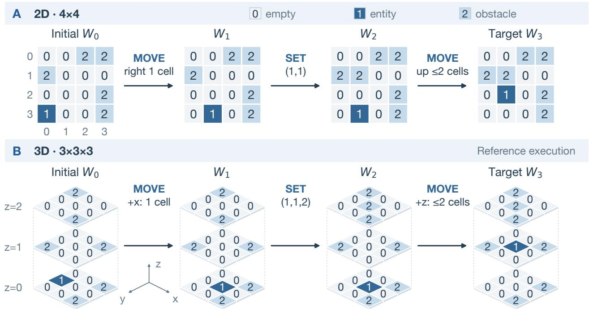  
Figure 1 Reference execution in 2D (A) and 3D (B), from $W _ { 0 }$ through $W _ { 1 }$ , $W _ { 2 } ,$ and $W _ { 3 }$ . Values 0, 1, and 2 denote empty cells, the moving entity, and obstacles. MOVE stops at an obstacle or its step limit; SET places an obstacle at the labeled coordinate. The new obstacle limits the final move to one cell. Coordinates are zero-based: (row, column) in (A) and $( x , y , z )$ in (B). The model receives $W _ { 0 } .$ , rules, and all three events as text and predicts the complete $W _ { 3 }$

The benchmark covers eight operation families on two-, three-, and four-dimensional grids, with instances varying in history length and within-family workload. Each instance provides an initial grid, explicit rules, and an ordered event sequence as text; the model predicts the complete final grid after all supplied events in a single response. The rules specify how each event selects locations and changes their values in the current configuration. A simulator executes the full event sequence to compute an exact reference state. Comparing every predicted value with this reference establishes whether the whole state is correct and reveals the extent and location of errors when it is not. Figure 1 illustrates the reference states produced by a movement history in two and three dimensions.

We evaluate six large language models under a shared protocol and find that exact-match accuracy declines sharply with history length. Models with similar single-event accuracy separate over longer histories, and even similar rates of complete recovery can accompany quite diferent incorrect predictions. At eight events, Kimi K2.5 and MiniMax M2.5 have similar exact-match accuracy, yet their median wrong-cell counts are 14 and 67 on the 84 shared instances where both return valid incorrect states.

Grid-Bench brings diverse spatial operations into a common, executable framework for predicting and evaluating complete worlds. The accompanying six-model study examines when models recover the final state across event histories and spatial conditions, and what they get wrong when recovery fails.

## 2 Related Work

Spatial benchmarks evaluate relations, transformations, and actions through diferent prediction targets. SPARTQA (Mirzaee et al., 2021) and SPARTUN/ReSQ (Mirzaee and Kordjamshidi, 2022) ask questions about relations expressed in scene descriptions. StepGame (Shi et al., 2022) tests relational composition, while SpaRC/SpaRP (Rizvi et al., 2024) formalizes spatial properties and reasoning paths. Other evaluations consider constrained path construction (Kaesberg et al., 2025), spatial reasoning across textual and visual inputs (Wang et al., 2024), and action selection in symbolic or simulated environments (Gao et al., 2026b,a).

JigShape (Li et al., 2026c) evaluates geometric reconstruction from puzzle pieces, and OrigamiBench (Agarwal et al., 2026) studies physically grounded fold operations. SnorkelSpatial (Vishwakarma, 2025) studies transformations of textual boards, querying properties after translations and rotations. Grid-Bench evaluates the complete configuration produced by a prescribed event history, allowing errors to be located throughout the resulting world.

Predicting the result of an event history also connects spatial reasoning to instruction execution and state tracking. bAbI (Weston et al., 2015) includes questions about locations and possessions after narrated events; SCONE (Long et al., 2016) grounds instruction sequences in executable worlds; and ProPara (Dalvi et al., 2018) follows entity existence and location through procedural text. Entity-tracking evaluations more directly test whether models update afected entities while retaining unafected information across operations (Kim and Schuster, 2023; Tang et al., 2026). Beyond state tracking, GT Bench (Xu et al., 2026e) examines algorithmic reasoning over graphs, while AlgoWorlds (Xu et al., 2026d) evaluates tool-guided decisions against verifiable optima. Closest to our complete-state setting, Alien Grid (Chapra et al., 2026) studies sequential depth through rotations, corner swaps, and shifts of a $3 \times 3$ grid. Chess-World-Model (Walker and Lyons, 2026) trains sequence models to recover complete chess states at successive move prefixes. Grid-Bench evaluates LLMs given explicit textual rules across geometric, neighborhood, connectivity, and movement operations, using complete predictions to compare recovery across spatial conditions. Appendix A develops these connections and compares the corresponding evaluation settings.

## 3 Grid-Bench

## 3.1 Spatial states and event histories

Grid-Bench asks for the complete spatial state after all events in a supplied sequence. A discrete world occupies a bounded d-dimensional grid with side lengths $L _ { 1 } , \ldots , L _ { d }$ and domain

$$
\begin{array} { r } { \mathcal { X } = \prod _ { j = 1 } ^ { d } \{ 0 , \dotsc , L _ { j } - 1 \} . } \end{array}
$$

Cell values are integers from a finite alphabet A containing 0. A state $W \in { \mathcal { A } } ^ { \mathcal { X } }$ assigns one value to every coordinate. Boundaries do not wrap, and 0 denotes an empty cell.

The model receives the grid specification, initial state $W _ { 0 }$ , explicit rules, and the complete event sequence $h _ { T } = ( e _ { 1 } , . . . , e _ { T } )$ as text. It is asked to predict the state after all $T$ events in a single response.

Each event specifies an operation and its parameters. We use one core transition family f per history to measure recovery over repeated applications of its operations. The sequence may also contain single-cell assignments $\operatorname { S E T } ( p , v )$ , which write v at $p .$ . Let $W _ { t }$ denote the reference state after the first t events. The simulator applies the family’s deterministic transition operator $F _ { f } \colon$

$$
W _ { t } = F _ { f } ( W _ { t - 1 } , e _ { t } ) , \qquad t = 1 , \dots , T .\tag{1}
$$

History length $T$ counts all supplied events, including these assignments; operation workload is specified separately. At $T = 0$ , the target is the initial state itself.

In Figure 1, the three displayed events form $h _ { 3 }$ , and Equation 1 maps the displayed $W _ { 0 }$ to $W _ { 3 }$ . The SET between the two MOVE events places an obstacle that limits the second move.

The requested prediction $\widehat { W } _ { T } \in { \mathcal { A } } ^ { \mathcal { X } }$ uses the same sparse format as the initial state: a list of all nonzero ccoordinate–value pairs, with omitted coordinates taking value 0. The target is the entire reference world $W _ { T }$ : every coordinate must have its correct final value, including those whose values match the initial state. Appendix C.2 gives the model-facing prompts and worked examples; Appendix C.3 specifies the answer contract.

## 3.2 Spatial transition families

The eight transition families in Table 1 cover geometry, neighborhood aggregation, connected regions, and movement. Explicit rules specify how each event selects cells and transforms their values. Events may select a region geometrically, as a ball or box, or through the current world’s connectivity, occupancy, and obstacles. These dependencies make an operation’s efect sensitive to the preceding history. Every family extends to all supported dimensions under the shared state representation.

<table><tr><td>Rule</td><td>Spatial selection</td><td>State transformation</td></tr><tr><td>PAINT</td><td>Cells with a specified source value inside a Man- hattan ball.</td><td>Simultaneously replace the source value with a target value.</td></tr><tr><td>REFLECT</td><td>An axis-aligned box.</td><td>Apply a bijective reflection along one axis, in- cluding zero-valued cells.</td></tr><tr><td>STENCIL</td><td>A Manhattan ball, with reads from adjacent cells beyond the ball.</td><td>Replace each selected value by a modular sum over its old local neighborhood.</td></tr><tr><td>MIX</td><td>Cells reachable within a bounded number of steps through nonzero cells.</td><td>Apply synchronous neighborhood aggregation while keeping updated cells nonzero.</td></tr><tr><td>RELABEL</td><td>The maximal equal-valued connected compo- nent containing a seed.</td><td>Assign one target value to the entire compo- nent.</td></tr><tr><td>LAYER</td><td>A component boundary or the component cells exposed to empty space.</td><td>Grow the component by one layer or erode its exposed layer.</td></tr><tr><td>MOVE</td><td>Entities of one label and the traversed positions on axis-parallel lines.</td><td>Move entities in a prescribed order until ob- structed or the step limit is reached.</td></tr><tr><td>COMPRESS</td><td>Every line parallel to a selected axis.</td><td>Remove gaps, merge adjacent equal values once per pair, and pack toward one boundary.</td></tr></table>

Table 1 The eight core transition families. Each trajectory uses core events from one family, interleaved with single-cell SET assignments. Full definitions, valid parameter ranges, and edge cases appear in Appendix B.

For example, a LAYER growth event fills the empty cells adjacent to a selected component. Let $N _ { 1 } ( x ) =$ $\{ y \in \mathcal { X } : \| x - y \| _ { 1 } = 1 \}$ denote the in-bounds axis-neighbors of x. For an occupied seed $p ,$ let $C = C _ { W } ( p )$ be its maximal axis-connected component of value $W ( p )$ . The component’s external boundary and the region written by a growth event are

$$
\begin{array} { c } { \partial C = \{ y \in \mathcal { X } \backslash C : N _ { 1 } ( y ) \cap C \neq \emptyset \} , } \\ { S _ { + } ( W , p ) = \{ y \in \partial C : W ( y ) = 0 \} . } \end{array}
$$

Growth fills these empty boundary cells with $W ( p ) { \mathrm { ; } }$ ; erosion instead clears component cells with an in-bounds empty neighbor. The component and boundary are computed before writing, so each event acts on a single layer. Earlier events can enlarge or split the component, change its boundary, or clear its seed. The same later instruction can therefore afect a diferent region depending on the preceding history.

Read and write regions can difer: STENCIL updates a ball using values from selected cells and their neighbors, including those outside the ball. These updates read the same pre-event state; MOVE instead processes entities front to back, exposing vacated positions to later entities within the event. Appendices B and B.6 give full transition equations, read/write accounting, and conservation and ordering properties.

## 3.3 Reference trajectories and instance construction

The construction varies history length, dimension, and within-family workload to study prediction across diferent spatial conditions. Dimension comparisons use approximately equal world volumes $N = | { \mathcal { X } } | =$ $\textstyle \prod _ { j = 1 } ^ { d } L _ { j }$ , varying coordinate arity and neighborhood structure while keeping the number of predicted cell Qvalues nearly constant. Operation scale is specified by a family-specific workload target w: cell-value reads during reference execution for most families, update-region size for STENCIL and MIX, and world volume for COMPRESS. Realized workload, value changes, and core-event counts are recorded separately from the target w and history length T.

A generation condition fixes the transition family, grid shape, alphabet, target workload, and policies for initial states and event proposals. Starting from a sampled $W _ { 0 }$ , the simulator executes candidate events and selects among them using realized workload and resulting occupancy. Accepted trajectories remain nonempty and satisfy bounds on density, mean workload, and the fraction of core events that change the state. Settings were frozen before formal evaluation; Appendix B.7 gives the generation settings and the selection and acceptance procedures.

Each accepted trajectory supplies instances at selected prefix lengths. A length-T request contains the original state $W _ { 0 }$ and the first $T$ events $( e _ { 1 } , \dots , e _ { T } )$ , with the target $W _ { T }$ computed by Equation 1. These prefixes are queried separately, allowing comparison across progressively longer histories from the same initial world. The shared reference trace records intermediate states and event statistics for exact replay.

## 3.4 Evaluating complete-state predictions

Complete predictions support evaluation of both exact recovery and cell-level agreement with the reference. The primary measure is semantic full-world exact match (EM). For request i, let $W _ { i }$ be the reference final state and $v _ { i }$ indicate validity of the extracted prediction $\widehat { W } _ { i }$ . A prediction is valid if it decodes to a grid satisfying the output specification. Set $y _ { i } = 1$ cwhen the prediction is valid and equals $W _ { i }$ at every coordinate, and $y _ { i } = 0$ otherwise. For requests $I ,$

$$
\begin{array} { r } { \mathrm { E M } ( I ) = \frac { 1 } { | I | } \sum _ { i \in I } y _ { i } . } \end{array}\tag{2}
$$

Semantic equality compares cell values, including implicit zeros, regardless of list ordering. Invalid or absent states score zero in the full denominator.

Exact match treats all incorrect states alike; cell-level comparisons distinguish a few wrong values from errors across the grid. For a valid prediction on domain $\mathcal { X } _ { i } ,$ the error set $E _ { i } = \{ x \in \mathcal { X } _ { i } : \widehat { W } _ { i } ( x ) \neq W _ { i } ( x ) \}$ } gives the wrong-cell count $| E _ { i } | .$ . For the valid subset $V = \{ i \in I : v _ { i } = 1 \}$ c, cell accuracy averages the fraction of correct cells in each returned world:

$$
\begin{array} { r } { \mathrm { C A } ( I ) = \frac { 1 } { | V | } \sum _ { i \in V } \left( 1 - \frac { | E _ { i } | } { | \mathcal { X } _ { i } | } \right) . } \end{array}\tag{3}
$$

This macro-average gives each valid prediction equal weight. Error-extent summaries instead use valid incorrect predictions, $V ^ { - } = \{ i \in V : y _ { i } = 0 \}$ , and report the subset size, median wrong-cell count, and 90th percentile.

We further distinguish errors on cells that must change from errors on cells whose final values must match the initial world. With $W _ { 0 , i }$ denoting the initial state, define

$$
\begin{array} { l } { { C _ { i } = \{ x \in \mathcal { X } _ { i } : W _ { i } ( x ) \not = W _ { 0 , i } ( x ) \} , } } \\ { { U _ { i } = \mathcal { X } _ { i } \setminus C _ { i } . } } \end{array}\tag{4}
$$

This partition uses initial and final values; a cell in $U _ { i }$ may change during the history and later return to its original value. Each valid incorrect prediction is classified as changed-only if its errors lie entirely in $C _ { i } .$ unchanged-only if they lie entirely in $U _ { i } .$ or both if they intersect both sets. In Figure 1, retaining 1 at (3, 0) in $\mathrm { ( A ) }$ would be an error in $C _ { i }$ ; clearing (2, 0, 0) in (B) would be an error in $U _ { i }$ . Appendix C.3 gives the extraction and validity rules, answer accounting, cell-group accuracies, quantile convention, and empty-subset handling.

## 4 Experiments and Results

## 4.1 Experimental setup

We evaluate GPT-5.6 Sol, Claude 5 Sonnet, GPT-5.4 Mini, GLM-5, Kimi K2.5, and MiniMax M2.5 on a shared set of 1,488 instances, yielding 8,928 model outcomes. All six models receive identical initial worlds, event histories, and prompts specifying the rules and task instructions. Predictions are checked against the same reference states. Table 2 summarizes the evaluation coverage.

<table><tr><td>Evaluation</td><td>Instances per model</td><td>Six-model outcomes</td></tr><tr><td>Main</td><td>1,152</td><td>6,912</td></tr><tr><td>Additional workload</td><td>336</td><td>2,016</td></tr><tr><td>Unique total</td><td>1,488</td><td>8,928</td></tr></table>

Table 2 Evaluation coverage. Lengths are $T = 0 , 1 , 8 , 1 6 , 3 2 , 6 4$ . The workload analysis combines seven additional settings with four reused main settings, for 528 instances per model; reused instances are counted only once in the total.

The main experiment crosses eight task families with three spatial dimensions and six history lengths, $T = 0 , 1 , 8 , 1 6 , 3 2 , 6 4 .$ . The grids contain 252 or 256 cells, allowing comparisons across spatial structures at approximately matched world volume. A complementary workload study varies operation scale at $d = 2$ for PAINT, REFLECT, LAYER, and MIX. Across both studies, 248 independently generated trajectories supply the evaluated instances: eight trajectories per generation condition, each queried separately at six prefixes.

Each request supplies the full task as text, permits one response with a 128,000-token combined reasoningand-answer ceiling, and provides no tools. We request high reasoning efort where supported; MiniMax M2.5 uses native always-on thinking. The full sample accounting and request parameters appear in Appendix C.1, with the shared prompt in Appendix C.2.

We report full-world EM over all requests and analyze returned states using the measures in Section 3.4. Pooled summaries use T = 8, 16, 32, 64 with equal length weights. The length curves use marginal 95% intervals from 2,000 stratified bootstrap resamples of whole trajectories, keeping their nested prefixes to gether as specified in Appendix C.4. Complete supplementary results and resource records are indexed in Appendix C.5.

## 4.2 Complete-state recovery across event histories

At $T = 0$ , all six models recover the supplied initial state almost perfectly. Exact-match accuracy then declines sharply as the same worlds undergo longer event histories. In Figure 2, GPT-5.6 Sol’s accuracy falls from 95% after one event to 13% at $T = 6 4$

Longer histories also distinguish models with similar one-event accuracy. Claude 5 Sonnet, Kimi K2.5, and MiniMax M2.5 begin with comparable scores, yet the latter two fall well below Claude 5 Sonnet by $T = 8$ . The corresponding paired and collectioncohort comparisons appear in Appendix D.4.

Within the overall decline, success remains uneven along individual histories. Every model has cases in which a later, separately queried prefix is correct after an earlier positive-length prefix was incorrect. Appendix D.5 documents these reversals on shared reference histories.

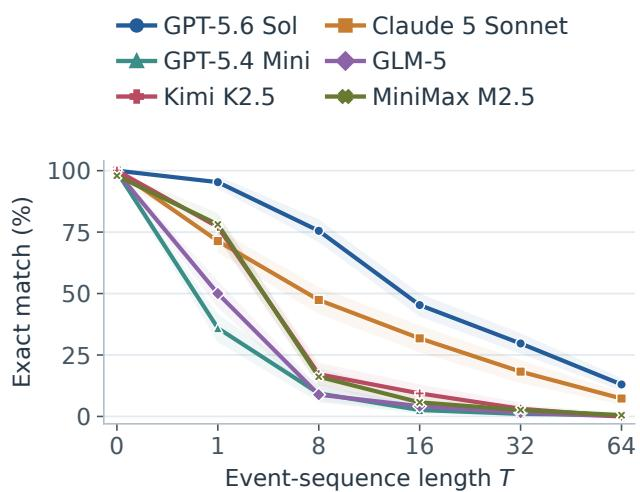  
Figure 2 Complete-state recovery across event histories. Each point reports full-world EM on 192 main instances. Colors and markers identify models; shading gives marginal 95% trajectory-bootstrap intervals, omitting degenerate intervals. Lengths are categorical.

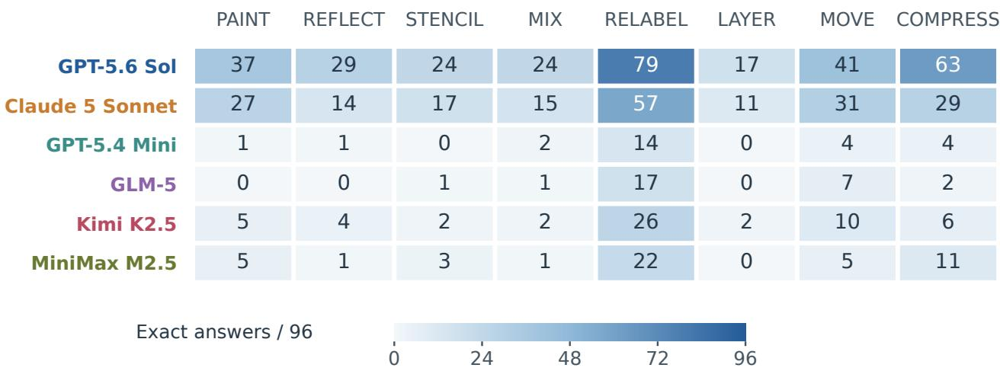  
Figure 3 Complete-state recovery across eight task families. Each cell gives exact answers out of 96 instances, comprising four prefixes $( T = 8 , 1 6 , 3 2 , 6 4 )$ of 24 trajectories across three dimensions. Shading encodes counts on a shared scale; label colors identify models.

## 4.3 Errors in predicted states

Error extent and location are measured on valid incorrect grids; cell accuracy and baseline comparisons also include exact grids.

Among these incorrect grids, one-event predictions are typically close to the target, whereas every model has a larger median wrong-cell count at the longest history in Figure 5(a). GPT-5.6 Sol illustrates this change: most of its incorrect states at $T = 1 6$ difer from the target in at most five cells, but such small deviations become uncommon at $T = 6 4$ . The error tails in Appendix E.1 show how far these departures extend beyond the typical prediction.

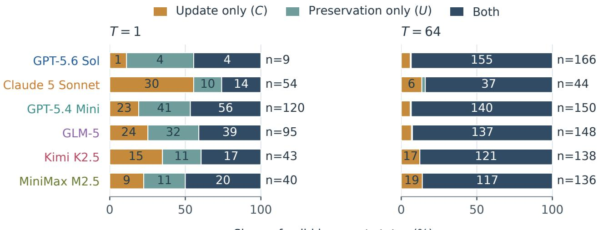  
Share of valid incorrect states (%)  
Figure 4 Composition of valid incorrect states at $T = 1$ and $T = 6 4$ . Each bar shows the proportion with errors on reference-changed cells only (C), reference-unchanged cells only (U), or both. Segments display counts where space permits; n counts the conditional subset at each length. Changed and unchanged compare final reference values with initial values.

This variation in error extent also separates models that appear similar under exact match. Figure 5(b) illustrates this diference for Kimi K2.5 and MiniMax M2.5 at $T = 8 .$ On the 84 shared instances with an incorrect grid from both models, their median wrong-cell counts are 14 and 67, respectively. The contrast appears in both collection cohorts and also when the shared comparison includes exact answers, as detailed in Appendices D.4 and E.2.

(a) Extent across histories

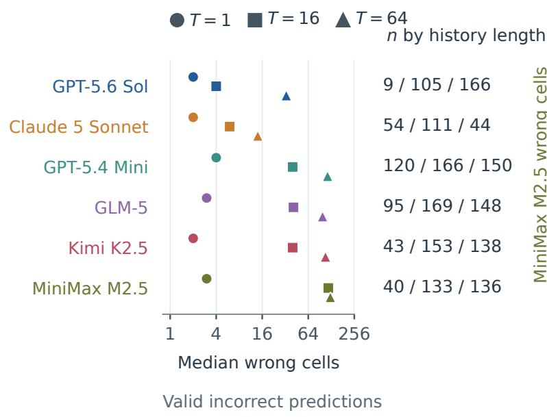

(b) Shared instances  
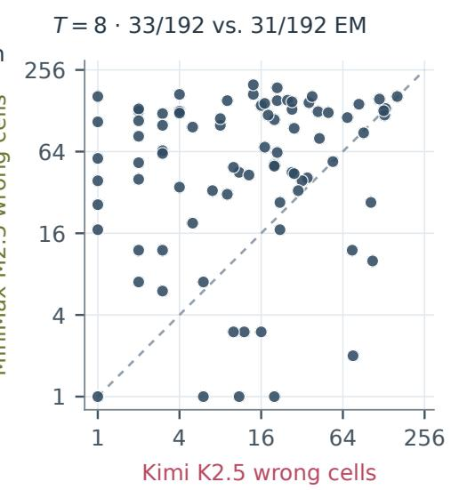  
84 pairs · medians (x/y): 14 / 67  
Kimi K2.5: 68 fewer · 3 equal · 13 more  
Figure 5 Error extent in returned states. (a) Median wrong-cell counts among each model’s valid incorrect answers at $T = 1$ , 16, 64 on a logarithmic axis. Marker shapes identify lengths, and the n column lists their sample sizes in that order. Each length uses its own conditional subset. (b) Wrong-cell counts on 84 shared instances where Kimi K2.5 and MiniMax M2.5 both return valid incorrect states at $T = 8 .$ . Both axes are logarithmic with equal scales; points above the equality line indicate fewer errors for Kimi K2.5.

Long-history errors extend across both updating and preservation requirements. The model-specific one-event patterns in Figure 4 give way to a common pattern at $T = 6 4 \colon$ most incorrect grids have errors both on cells that should change and on cells whose final values should match the initial world. At $T = 1 6 , 3 2 , 6 4$ , every model nevertheless has higher cell accuracy on final-unchanged cells, as reported in Appendix E.3. Much of the information that should be preserved can therefore remain correct even when a prediction contains errors in both groups. Appendix E.5 illustrates these patterns with actual predictions.

Some incomplete predictions recover correct changes well beyond what copying the initial world would achieve. Both copying the initial state and returning zeros match many individual values, although neither recovers a complete positive-length main target. Table 3 compares predictions and baselines on the same instances within each row at $T = 6 4$ , with their coverage of all requests. GPT-5.6 Sol exceeds copying by about 31 percentage points in mean cell accuracy, whereas GPT-5.4 Mini and MiniMax M2.5 have much smaller gains. The instance-level comparisons in Appendix E.4 show that GPT-5.6 Sol improves on copying across almost all of its returned grids, including many that fail exact match.

Executing only the later core operations rarely recovers the complete final state. Starting from the initial world, a partial-execution baseline follows the supplied event order, applying every SET assignment but executing core operations only in the final half of the history. Only three of the 192 main targets at $T = 6 4$ are recovered this way. Appendix E.4 reports the shorter sufixes.

<table><tr><td>Model</td><td> $n / N$ </td><td>Pred.</td><td>Copy</td><td>Zero</td></tr><tr><td>GPT-5.6 Sol</td><td>191/192</td><td>81.6</td><td>51.0</td><td>48.8</td></tr><tr><td>Claude 5 Sonnet</td><td>58/192</td><td>90.5</td><td>49.5</td><td>56.5</td></tr><tr><td>GPT-5.4 Mini</td><td>151/192</td><td>56.1</td><td>50.6</td><td>49.8</td></tr><tr><td>GLM-5</td><td>148/192</td><td>62.4</td><td>52.5</td><td>50.6</td></tr><tr><td>Kimi K2.5</td><td>138/192</td><td>55.6</td><td>51.1</td><td>50.2</td></tr><tr><td>MiniMax M2.5</td><td>137/192</td><td>52.4</td><td>50.9</td><td>49.4</td></tr></table>

Table 3 Cell accuracy (percent) at $T = 6 4 . \ n / N$ gives valid grids, including exact ones, out of all main requests. Pred. denotes the model prediction; Copy and Zero denote copy-initial and all-zero. All three use the same instances within each row; subsets difer across models.

## 4.4 Performance across spatial conditions

Low aggregate accuracy at long histories combines little or no recovery on some task conditions with continued success on others. Figure 3 summarizes this concentration over $T = 8 – 6 4$ . RELABEL is the highest-scoring family for every model under its low-merger policy, while the relative performance across the remaining families varies by model. The length curves in Appendix D.1 identify where recovery persists as histories grow; Appendix B.7 specifies the sampled connectivity conditions.

Approximately matching world volume also leaves substantial diferences across spatial structures. Pooled over $T = 8 – 6 4$ , accuracy is nonincreasing from two through four dimensions for every model. The early profiles in Table 4 difer: GLM-5 already has a pronounced dimension diference after one event, whereas GPT-5.6 Sol has nearly equal one-event scores. Its advantage in two dimensions emerges over longer histories. The full profiles in Appendix D.2 show the early reversals, while Appendix B.6 describes the corresponding geometry.

<table><tr><td colspan="4"> $T = 1$ </td><td colspan="3"> $T = 1 6$ </td></tr><tr><td>Model</td><td>d=2</td><td>d=3</td><td>d=4</td><td>d=2</td><td>d=3</td><td>d=4</td></tr><tr><td>GPT-5.6 Sol</td><td>62</td><td>60</td><td>61</td><td>49</td><td>21</td><td>17</td></tr><tr><td>Claude 5 Sonnet</td><td>53</td><td>52</td><td>32</td><td>34</td><td>16</td><td>11</td></tr><tr><td>GPT-5.4 Mini</td><td>29</td><td>26</td><td>14</td><td>4</td><td>1</td><td>0</td></tr><tr><td>GLM-5</td><td>47</td><td>30</td><td>19</td><td>6</td><td>2</td><td>0</td></tr><tr><td>Kimi K2.5</td><td>56</td><td>53</td><td>39</td><td>13</td><td>5</td><td>0</td></tr><tr><td>MiniMax M2.5</td><td>55</td><td>51</td><td>44</td><td>6</td><td>5</td><td>0</td></tr></table>

Table 4 Exact answers out of 64 main instances per cell, retaining all failures. The two lengths show early and intermediate structural contrasts. Worlds at $d = 2 , 3 ,$ 4 contain 256, 252, and 256 cells; geometry and coordinate representation change together. Complete length curves appear in Appendix Figure 11.

Operation scale has a more task-dependent relationship with recovery. In the pooled $T = 8 – 6 4$ workload comparison at $d = 2$ in Figure 6, every model has lower accuracy at the largest MIX and LAYER targets than at the smallest. Comparing the smallest and largest MIX workload targets at $T \ : = \ : 6 4$ , reference execution records roughly fivefold increases in both mean cell-value reads and mean changed-cell counts per core event. PAINT instead has mixed directions across models, and REFLECT includes nonmonotonic profiles. Appendix D.3 examines these length-specific contrasts and realized workloads.

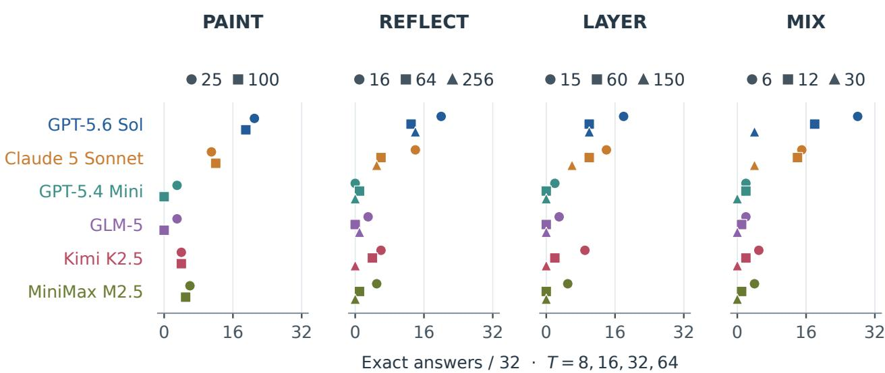  
Figure 6 Within-family workload comparisons at d = 2. Each panel shows all six models; marker shapes denote the task-specific targets listed above it. Points report exact answers out of 32 instances: four prefixes (T = 8, 16, 32, 64) from eight trajectories per target. Targets refer to ball size (PAINT), box volume (REFLECT), component-plus boundary size (LAYER), and reached-region size (MIX).

## 5 Conclusion

Grid-Bench uses eight families of executable operations and exact reference states to evaluate how accurately language models predict the complete final state of a discrete spatial world. Across six models, success on individual operations gives way to much lower exact recovery over longer histories, with substantial diferences across models and spatial conditions. When complete recovery fails, the returned states range from nearly correct grids to extensively incorrect configurations. Some retain many correct updates beyond what copying the initial state would recover, even at the longest histories. Reliable prediction of spatial change remains challenging even with explicit rules. The executable rules can supply training examples with exact targets, while cell-level diagnostics can show whether models improve at predicting required changes, preserving unchanged values, or both.

## Limitations

Grid-Bench evaluates predictions in fully specified symbolic worlds with prescribed operations. Its task families and generation settings define the spatial conditions studied here. Transfer to other world sizes, operation distributions, or environments with uncertain observations remains an empirical question.

Error extent and update–preservation partitions describe the final values models return. Connecting these outcomes to internal representations or execution strategies requires evidence about intermediate computa tion.

## Acknowledgment

All research and engineering work reported in this paper, including the design, implementation, evaluation, and public release of Grid-Bench, was carried out by the university-afiliated authors. The Meta-afiliated authors’ contributions were advisory only.

## References

Naaisha Agarwal, Yihan Wu, Xin Guan, Ayaan Garg, Yikuan Hu, Mohan Li, Vincenzo Collura, Wang-Zhou Dai, Yao-Xiang Ding, and Emanuele Sansone. Can AI Understand the Language of Origami?, 2026. https://arxiv.or g/abs/2603.13856.

Amazon Web Services. GLM 5: Amazon Bedrock model documentation, 2026a. https://docs.aws.amazon.com/be drock/latest/userguide/model-card-zai-glm-5.html. Accessed September 20, 2026.

Amazon Web Services. Kimi K2.5: Amazon Bedrock model documentation, 2026b. https://docs.aws.amazon.com/ bedrock/latest/userguide/model-card-moonshot-ai-kimi-k2-5.html. Accessed September 20, 2026.

Amazon Web Services. MiniMax M2.5: Amazon Bedrock model documentation, 2026c. https://docs.aws.amazon. com/bedrock/latest/userguide/model-card-minimax-minimax-m2-5.html. Accessed September 20, 2026.

Han Bao, Yue Huang, Yanbo Wang, Jiayi Ye, Xiangqi Wang, Xiuying Chen, Yue Zhao, Tianyi Zhou, Mohamed Elhoseiny, and Xiangliang Zhang. AutoBench-V: Can Large Vision-Language Models Benchmark Themselves?, 2024. https://arxiv.org/abs/2410.21259.

Antoine Bosselut, Omer Levy, Ari Holtzman, Corin Ennis, Dieter Fox, and Yejin Choi. Simulating action dynamics with neural process networks. In International Conference on Learning Representations, 2018. https://arxiv.or g/abs/1711.05313.

Shubh Chapra, Dhruv Kumar, Murari Mandal, and Yash Sinha. The complexity ceiling benchmark: A multi-domain evaluation of sequential reasoning under depth scaling, 2026. https://arxiv.org/abs/2606.29278. Author reported acceptance at CTB@ICML 2026 workshop.

Marc-Alexandre Côté, Ákos Kádár, Xingdi Yuan, Ben Kybartas, Tavian Barnes, Emery Fine, James Moore, Ruo Yu Tao, Matthew Hausknecht, Layla El Asri, Mahmoud Adada, Wendy Tay, and Adam Trischler. TextWorld: A learning environment for text-based games, 2018. https://arxiv.org/abs/1806.11532.

Bhavana Dalvi, Lifu Huang, Niket Tandon, Wen-tau Yih, and Peter Clark. Tracking state changes in procedural text: a challenge dataset and models for process paragraph comprehension. In Proceedings of the 2018 Conference of the North American Chapter of the Association for Computational Linguistics: Human Language Technologies, Volume 1 (Long Papers), pages 1595–1604. Association for Computational Linguistics, 2018. doi: 10.18653/v1/N18-1144. https://aclanthology.org/N18-1144/.

Grégoire Delétang, Anian Ruoss, Jordi Grau-Moya, Tim Genewein, Li Kevin Wenliang, Elliot Catt, Chris Cundy, Marcus Hutter, Shane Legg, Joel Veness, and Pedro A. Ortega. Neural networks and the chomsky hierarchy. In International Conference on Learning Representations, 2023. https://openreview.net/forum?id=WbxHAzkeQcn.

Nouha Dziri, Ximing Lu, Melanie Sclar, Xiang Lorraine Li, Liwei Jiang, Bill Yuchen Lin, Sean Welleck, Peter West, Chandra Bhagavatula, Ronan Le Bras, Jena Hwang, Soumya Sanyal, Xiang Ren, Allyson Ettinger, Zaid Harchaoui, and Yejin Choi. Faith and fate: Limits of transformers on compositionality. In Advances in Neural Information Processing Systems, volume 36, 2023. https://proceedings.neurips.cc/paper\_files/paper/2023/hash/deb3c 28192f979302c157cb653c15e90-Abstract-Conference.html.

Mingyang Fu, Yuyang Peng, Dongping Chen, Zetong Zhou, Benlin Liu, Yao Wan, Zhou Zhao, Philip S Yu, and Ranjay Krishna. Seeking and Updating with Live Visual Knowledge. In Advances in Neural Information Processing Systems, volume 38. Curran Associates, Inc., 2025. doi: 10.52202/085713-2513. https://proceedings.neurips.cc/paper \_files/paper/2025/file/6c7c9811d06b41b320b69abf37234f84-Paper-Datasets\_and\_Benchmarks\_Track.pdf.

Hongcheng Gao, Hailong Qu, Jingyi Tang, Jiahao Wang, Zihao Huang, Hengkang Qiao, Shihong Huang, Junming Yang, Yi Li, Hongyixuan Yuan, Wenjie Li, Bohan Zeng, Wenbo Li, Bo Wang, Jianhui Liu, Olive Huang, Haoyang Huang, Wentao Zhang, Guoqing Huang, Nan Duan, and Yinpeng Dong. SpatialWorld: Benchmarking interactive spatial reasoning of multimodal agents in real-world tasks, 2026a. https://arxiv.org/abs/2606.09669.

Huan-ang Gao, Zikang Zhang, Tianwei Luo, Kaisen Yang, Xinzhe Juan, Jiahao Qiu, Tianxing Chen, Bingxiang He, Hao Zhao, Hao Zhou, Shilong Liu, and Mengdi Wang. CubeBench: Diagnosing interactive, long-horizon spatial reasoning under partial observations. In International Conference on Learning Representations, 2026b. https://proceedings.iclr.cc/paper\_files/paper/2026/file/f1f9962f76581ce8bf38d04c6d6c96b1-Paper-C onference.pdf.

Lang Gao, Kaiyang Wan, Wei Liu, Chenxi Wang, Zirui Song, Zixiang Xu, Yanbo Wang, Veselin Stoyanov, and Xiuying Chen. Evaluate Bias without Manual Test Sets: A Concept Representation Perspective for LLMs, 2025 https://arxiv.org/abs/2505.15524.

Yikuan Hu, Jifeng Zhu, Lanrui Tang, and Chen Huang. ReMindRAG: Low-Cost LLM-Guided Knowledge Graph Traversal for Eficient RAG. In Advances in Neural Information Processing Systems, volume 38, pages 53757–53798.

Curran Associates, Inc., 2025. doi: 10.52202/085713-1793. https://proceedings.neurips.cc/paper\_files/pap er/2025/file/4d880ba08f6b115bb8d685159bb167eb-Paper-Conference.pdf.

Xuanao Huang, Xingjia Liu, Zetong Zhou, Yuyang Peng, Yao Wan, and Dongping Chen. Worldwide LiveVQA: Real-Time Visual Knowledge Seeking and Updating Across Languages. In Findings of the Association for Computational Linguistics: ACL 2026, pages 39819–39894. Association for Computational Linguistics, 2026. doi: 10.18653/v1/20 26.findings-acl.1984. https://aclanthology.org/2026.findings-acl.1984/.

Hongbo Jin, Mingnan Zhu, Jingqi Tian, Xu Jiang, Zhongjing Du, Haoran Tang, Siyi Xie, Qiaoman Zhang, and Jiayu Ding. Context-CoT: Enhancing Context Learning via High-Quality Reasoning Synthesis, 2026. https: //arxiv.org/abs/2605.25354.

Justin Johnson, Bharath Hariharan, Laurens van der Maaten, Li Fei-Fei, C. Lawrence Zitnick, and Ross Girshick. CLEVR: A diagnostic dataset for compositional language and elementary visual reasoning. In Proceedings of the IEEE Conference on Computer Vision and Pattern Recognition, pages 2901–2910, 2017. https://openaccess.the cvf.com/content\_cvpr\_2017/html/Johnson\_CLEVR\_A\_Diagnostic\_CVPR\_2017\_paper.html.

Lars Benedikt Kaesberg, Jan Philip Wahle, Terry Ruas, and Bela Gipp. SPaRC: A spatial pathfinding reasoning challenge. In Proceedings of the 2025 Conference on Empirical Methods in Natural Language Processing, pages 10359–10390. Association for Computational Linguistics, 2025. doi: 10.18653/v1/2025.emnlp-main.526. https: //aclanthology.org/2025.emnlp-main.526/.

Mohammad Sadil Khan, Sankalp Sinha, Talha Uddin Sheikh, Didier Stricker, Sk Aziz Ali, and Muhammad Zeshan Afzal. Text2CAD: Generating sequential CAD designs from beginner-to-expert level text prompts. In Advances in Neural Information Processing Systems, volume 37, pages 7552–7579, 2024. doi: 10.52202/079017-0242. https: //proceedings.neurips.cc/paper\_files/paper/2024/hash/0e5b96f97c1813bb75f6c28532c2ecc7-Abstract-C onference.html.

Najoung Kim and Sebastian Schuster. Entity tracking in language models. In Proceedings of the 61st Annual Meeting of the Association for Computational Linguistics (Volume 1: Long Papers), pages 3835–3855. Association for Computational Linguistics, 2023. doi: 10.18653/v1/2023.acl-long.213. https://aclanthology.org/2023.acl-lon g.213/.

Belinda Z. Li, Maxwell Nye, and Jacob Andreas. Implicit representations of meaning in neural language models. In Proceedings of the 59th Annual Meeting of the Association for Computational Linguistics and the 11th International Joint Conference on Natural Language Processing (Volume 1: Long Papers), pages 1813–1827. Association for Computational Linguistics, 2021. doi: 10.18653/v1/2021.acl-long.143. https://aclanthology.org/2021.acl-lon g.143/.

Belinda Z. Li, Zifan Carl Guo, and Jacob Andreas. (How) do language models track state? In Proceedings of the 42nd International Conference on Machine Learning, volume 267 of Proceedings of Machine Learning Research, pages 34429–34452. PMLR, 2025a. https://proceedings.mlr.press/v267/li25r.html.

Fangjun Li, David C. Hogg, and Anthony G. Cohn. Advancing spatial reasoning in large language models: An in depth evaluation and enhancement using the StepGame benchmark. In Proceedings of the AAAI Conference on Artificial Intelligence, volume 38, pages 18500–18507, 2024. doi: 10.1609/aaai.v38i17.29811. https://ojs.aaai.o rg/index.php/AAAI/article/view/29811.

Jiate Li, Defu Cao, Li Li, Wei Yang, Yuehan Qin, Chenxiao Yu, Tiannuo Yang, Ryan A. Rossi, Yan Liu, Xiyang Hu, and Yue Zhao. “Someone Hid It”: Query-Agnostic Black-Box Attacks on LLM-Based Retrieval, 2026a. https: //arxiv.org/abs/2602.00364.

Kenneth Li, Aspen K. Hopkins, David Bau, Fernanda Viégas, Hanspeter Pfister, and Martin Wattenberg. Emergent world representations: Exploring a sequence model trained on a synthetic task. In International Conference on Learning Representations, 2023. https://openreview.net/forum?id=DeG07\_TcZvT.

Li Li, Peilin Cai, Ryan A. Rossi, Franck Dernoncourt, Branislav Kveton, Junda Wu, Tong Yu, Linxin Song, Tiankai Yang, Yuehan Qin, Nesreen K. Ahmed, Samyadeep Basu, Subhojyoti Mukherjee, Ruiyi Zhang, Zhengmian Hu, Bo Ni, Yuxiao Zhou, Zichao Wang, Yue Huang, Yu Wang, Xiangliang Zhang, Philip S. Yu, Xiyang Hu, and Yue Zhao. A Personalized Conversational Benchmark: Towards Simulating Personalized Conversations, 2025b. https://arxiv.org/abs/2505.14106.

Li Li, Jiashu Qu, Linxin Song, Yuxiao Zhou, Yuehan Qin, Tiankai Yang, and Yue Zhao. Treble Counterfactual VLMs: A Causal Approach to Hallucination. In Findings of the Association for Computational Linguistics: EMNLP 2025, pages 18423–18434. Association for Computational Linguistics, 2025c. doi: 10.18653/v1/2025.findings-emnlp.1000. https://aclanthology.org/2025.findings-emnlp.1000/.

Li Li, Ryan Rossi, Sungchul Kim, Sunav Choudhary, Franck Dernoncourt, Puneet Mathur, Zhengzhong Tu, and Yue

Zhao. Charts Are Not Images: On the Challenges of Scientific Chart Editing. In International Conference on Learning Representations, pages 11937–11966, 2026b. https://proceedings.iclr.cc/paper\_files/paper/2026 /file/141ad4ee52ba0b1db87483cb8f173c4e-Paper-Conference.pdf.

Shawn Li, Wei Yang, Jike Zhong, Jiate Li, Jiawei Yang, You Qin, Ryan Rossi, Franck Dernoncourt, Roger Zimmermann, Yue Wang, Zhengzhong Tu, Vicente Ordonez, Mohit Bansal, and Yue Zhao. JigShape: Evaluating Visual-Geometric Reasoning in VLMs through Jigsaw Puzzles, 2026c. https://arxiv.org/abs/2607.27670.

Shawn Li, Chenxiao Yu, Han Wang, Wei Yang, Ryan Rossi, Franck Dernoncourt, Xiyang Hu, Philip Yu, Chaowei Xiao, Huan Zhang, and Yue Zhao. FORTIS: Benchmarking Over-Privilege in Agent Skills, 2026d. https://arxiv. org/abs/2605.09163.

Yuangang Li, Yiqing Shen, Yi Nian, Jiechao Gao, Ziyi Wang, Chenxiao Yu, Shawn Li, Jie Wang, Xiyang Hu, and Yue Zhao. Mitigating Hallucinations in Large Language Models via Causal Reasoning, 2025d. https://arxiv.or g/abs/2508.12495.

Hao Lin, Kunyang Lv, Xu Jiang, Jingqi Tian, Zhongjing Du, Jiayu Ding, Qiaoman Zhang, and Hongbo Jin. VISD: Enhancing Video Reasoning via Structured Self-Distillation, 2026. https://arxiv.org/abs/2605.06094.

Bingbin Liu, Jordan T. Ash, Surbhi Goel, Akshay Krishnamurthy, and Cyril Zhang. Transformers learn shortcuts to automata. In International Conference on Learning Representations, 2023a. https://openreview.net/forum?id= De4FYqjFueZ.

Fangyu Liu, Guy Emerson, and Nigel Collier. Visual spatial reasoning. Transactions of the Association for Computational Linguistics, 11:635–651, 2023b. doi: 10.1162/tacl\_a\_00566. https://aclanthology.org/2023.tacl-1.37/.

Reginald Long, Panupong Pasupat, and Percy Liang. Simpler context-dependent logical forms via model projections. In Proceedings of the 54th Annual Meeting of the Association for Computational Linguistics (Volume 1: Long Papers), pages 1456–1465. Association for Computational Linguistics, 2016. doi: 10.18653/v1/P16-1138. https: //aclanthology.org/P16-1138/.

Haoran Luo, Haihong E, Yuhao Yang, Gengxian Zhou, Yikai Guo, Tianyu Yao, Zichen Tang, Xueyuan Lin, and Kaiyang Wan. NQE: N-ary Query Embedding for Complex Query Answering over Hyper-Relational Knowledge Graphs. In Proceedings of the AAAI Conference on Artificial Intelligence, volume 37, pages 4543–4551, 2023. doi: 10.1609/aaai.v37i4.25576. https://ojs.aaai.org/index.php/AAAI/article/view/25576.

Julius Mayer, Mohamad Ballout, Serwan Jassim, Farbod Nosrat Nezami, and Elia Bruni. iVISPAR — an interactive visual-spatial reasoning benchmark for VLMs. In Proceedings of the 2025 Conference on Empirical Methods in Natural Language Processing, pages 26757–26781. Association for Computational Linguistics, 2025. doi: 10.18653 /v1/2025.emnlp-main.1359. https://aclanthology.org/2025.emnlp-main.1359/.

Roshanak Mirzaee and Parisa Kordjamshidi. Transfer learning with synthetic corpora for spatial role labeling and reasoning. In Proceedings of the 2022 Conference on Empirical Methods in Natural Language Processing, pages 6148–6165. Association for Computational Linguistics, 2022. doi: 10.18653/v1/2022.emnlp-main.413. https: //aclanthology.org/2022.emnlp-main.413/.

Roshanak Mirzaee, Hossein Rajaby Faghihi, Qiang Ning, and Parisa Kordjamshidi. SPARTQA: A textual question answering benchmark for spatial reasoning. In Proceedings of the 2021 Conference of the North American Chapter of the Association for Computational Linguistics: Human Language Technologies, pages 4582–4598. Association for Computational Linguistics, 2021. doi: 10.18653/v1/2021.naacl-main.364. https://aclanthology.org/2021.naac l-main.364/.

Jacqueline Mitchell, Brian Hyeongseok Kim, Chenyu Zhou, and Chao Wang. Understanding Formal Reasoning Failures in LLMs as Abstract Interpreters. In Proceedings of the 1st ACM SIGPLAN International Workshop on Language Models and Programming Languages, pages 71–83. Association for Computing Machinery, 2025. doi: 10.1145/3759425.3763389. https://doi.org/10.1145/3759425.3763389.

Maxwell Nye, Anders Johan Andreassen, Guy Gur-Ari, Henryk Michalewski, Jacob Austin, David Bieber, David Dohan, Aitor Lewkowycz, Maarten Bosma, David Luan, Charles Sutton, and Augustus Odena. Show your work: Scratchpads for intermediate computation with language models, 2021. https://arxiv.org/abs/2112.00114.

Yuyang Peng, Yanling Xu, Shuyi Wang, Xiaofei Liao, and Qinbin Li. Parallelizing LLM Agent Execution with Contrastive Task Allocation. In Proceedings of the 32nd ACM SIGKDD Conference on Knowledge Discovery and Data Mining V.2, pages 3967–3977. Association for Computing Machinery, 2026. doi: 10.1145/3770855.3817872. https://doi.org/10.1145/3770855.3817872.

Yuehan Qin, Shawn Li, Yi Nian, Xinyan Velocity Yu, Yue Zhao, and Xuezhe Ma. Don’t Let It Hallucinate: Premise Verification via Retrieval-Augmented Logical Reasoning, 2025. https://arxiv.org/abs/2504.06438.

Yuehan Qin, Li Li, Linxin Song, Wei Yang, Jiate Li, Yuqing Yang, and Yue Zhao. Memory Retrieval for Changing Preferences, 2026. https://arxiv.org/abs/2606.02976.

Md Imbesat Rizvi, Xiaodan Zhu, and Iryna Gurevych. SpaRC and SpaRP: Spatial reasoning characterization and path generation for understanding spatial reasoning capability of large language models. In Proceedings of the 62nd Annual Meeting of the Association for Computational Linguistics (Volume 1: Long Papers), pages 4750–4767. Association for Computational Linguistics, 2024. doi: 10.18653/v1/2024.acl-long.261. https://aclanthology.org /2024.acl-long.261/.

Zhengxiang Shi, Qiang Zhang, and Aldo Lipani. StepGame: A new benchmark for robust multi-hop spatial reasoning in texts. In Proceedings of the AAAI Conference on Artificial Intelligence, volume 36, pages 11321–11329, 2022. doi: 10.1609/aaai.v36i10.21383. https://ojs.aaai.org/index.php/AAAI/article/view/21383.

Mohit Shridhar, Xingdi Yuan, Marc-Alexandre Côté, Yonatan Bisk, Adam Trischler, and Matthew Hausknecht. ALF-World: Aligning text and embodied environments for interactive learning. In International Conference on Learning Representations, 2021. https://openreview.net/forum?id=0IOX0YcCdTn.

Yuyang Song, Hanxu Yan, Jiale Lao, Yibo Wang, Yufei Li, Yuanchun Zhou, Jianguo Wang, and Mingjie Tang. QUITE: A Query Rewrite System Beyond Rules with LLM Agents, 2025. https://arxiv.org/abs/2506.07675.

Shane Storks, Qiaozi Gao, Yichi Zhang, and Joyce Chai. Tiered reasoning for intuitive physics: Toward verifiable commonsense language understanding. In Findings of the Association for Computational Linguistics: EMNLP 2021, pages 4902–4918. Association for Computational Linguistics, 2021. doi: 10.18653/v1/2021.findings-emnlp.422. https://aclanthology.org/2021.findings-emnlp.422/.

Min-Le Su, Kai-Yu Chen, Jiong-Da Wang, Yikuan Hu, and Wang-Zhou Dai. Abductive State Grounding for Neuro Symbolic Reinforcement Learning. AAAI 2026 Language Model Reasoning Workshop, 2026. https://openreview .net/forum?id=avW76NTVVl.

Alane Suhr, Mike Lewis, James Yeh, and Yoav Artzi. A corpus of natural language for visual reasoning. In Proceedings of the 55th Annual Meeting of the Association for Computational Linguistics (Volume 2: Short Papers), pages 217– 223. Association for Computational Linguistics, 2017. doi: 10.18653/v1/P17-2034. https://aclanthology.org/P 17-2034/.

Niket Tandon, Keisuke Sakaguchi, Bhavana Dalvi, Dheeraj Rajagopal, Peter Clark, Michal Guerquin, Kyle Richardson, and Eduard Hovy. A dataset for tracking entities in open domain procedural text. In Proceedings of the 2020 Conference on Empirical Methods in Natural Language Processing, pages 6408–6417. Association for Computational Linguistics, 2020. doi: 10.18653/v1/2020.emnlp-main.520. https://aclanthology.org/2020.emnlp-main.520/.

Zilu Tang, Qiao Zhao, Gabriel Franco, Derry Wijaya, Aaron Mueller, Sebastian Schuster, and Najoung Kim. Do language models track entities across state changes? In Proceedings of the 43rd International Conference on Machine Learning, 2026. https://arxiv.org/abs/2605.30233.

Jingqi Tian, Haoji Zhang, Lin Chen, Hongbo Jin, Haonan Xu, Tianrui Zhu, Xingming Shui, Shilin Ma, Wenjing Yang, and Yansong Tang. AdaThinkV: Adaptive Thinking for Token-Eficient Video Reasoning, 2026. https: //arxiv.org/abs/2608.01980.

Shubham Toshniwal, Sam Wiseman, Karen Livescu, and Kevin Gimpel. Chess as a testbed for language model state tracking. In Proceedings of the AAAI Conference on Artificial Intelligence, volume 36, pages 11385–11393, 2022. doi: 10.1609/aaai.v36i10.21390. https://ojs.aaai.org/index.php/AAAI/article/view/21390.

Harit Vishwakarma. Introducing SnorkelSpatial: A benchmark for LLM spatial reasoning. Snorkel AI technical blog, October 2025. https://snorkel.ai/blog/introducing-snorkelspatial/. Published October 24, 2025; accessed September 17, 2026.

Benjamin Walker and Terry Lyons. Chess-World-Model: A 10M-game benchmark for exact state tracking from chess move sequences, 2026. https://arxiv.org/abs/2605.30100.

Kaiyang Wan, Honglin Mu, Rui Hao, Haoran Luo, Tianle Gu, and Xiuying Chen. A Cognitive Writing Perspective for Constrained Long-Form Text Generation. In Findings of the Association for Computational Linguistics: ACL 2025, pages 9832–9844. Association for Computational Linguistics, 2025. doi: 10.18653/v1/2025.findings-acl.511. https://aclanthology.org/2025.findings-acl.511/.

Kaiyang Wan, Lang Gao, Honglin Mu, Preslav Nakov, Yuxia Wang, and Xiuying Chen. A Fano-Style Accuracy Upper Bound for LLM Single-Pass Reasoning in Multi-Hop QA. In International Conference on Learning Representations, pages 52600–52621, 2026. https://proceedings.iclr.cc/paper\_files/paper/2026/file/56193e81af44ee5b90 b8466e477c30c7-Paper-Conference.pdf.

Chenxi Wang, Yixuan Zhang, Lang Gao, Zixiang Xu, Zirui Song, Yanbo Wang, and Xiuying Chen. Under the Shadow of Babel: How Language Shapes Reasoning in LLMs. In Findings of the Association for Computational Linguistics:

EMNLP 2025, pages 24327–24344. Association for Computational Linguistics, 2025a. doi: 10.18653/v1/2025.findi ngs-emnlp.1321. https://aclanthology.org/2025.findings-emnlp.1321/.

Jiayu Wang, Yifei Ming, Zhenmei Shi, Vibhav Vineet, Xin Wang, Yixuan Li, and Neel Joshi. Is a picture worth a thousand words? delving into spatial reasoning for vision language models. In Advances in Neural Information Processing Systems, volume 37, 2024. doi: 10.52202/079017-2400. https://papers.nips.cc/paper\_files/paper /2024/hash/89cc5e613d34f90de90c21e996e60b30-Abstract-Conference.html.

Ruoyao Wang, Peter Jansen, Marc-Alexandre Côté, and Prithviraj Ammanabrolu. ScienceWorld: Is your agent smarter than a 5th grader? In Proceedings of the 2022 Conference on Empirical Methods in Natural Language Processing, pages 11279–11298. Association for Computational Linguistics, 2022. doi: 10.18653/v1/2022.emnlp-m ain.775. https://aclanthology.org/2022.emnlp-main.775/.

Yanbo Wang, Zixiang Xu, Yue Huang, Chujie Gao, Siyuan Wu, Jiayi Ye, Pin-Yu Chen, Xiuying Chen, and Xiangliang Zhang. Adaptive Distraction: Probing LLM Contextual Robustness with Automated Tree Search. In Advances in Neural Information Processing Systems, volume 38, pages 165093–165131. Curran Associates, Inc., 2025b. doi: 10.52202/085713-5504. https://proceedings.neurips.cc/paper\_files/paper/2025/hash/f13d74c6666087aa6 eea3d17820e6a23-Abstract-Conference.html.

Yanbo Wang, Zixiang Xu, Yue Huang, Xiangqi Wang, Zirui Song, Lang Gao, Chenxi Wang, Robert Tang, Yue Zhao, Arman Cohan, Xiangliang Zhang, and Xiuying Chen. DyFlow: Dynamic Workflow Framework for Agentic Reasoning. In Advances in Neural Information Processing Systems, volume 38, pages 174148–174181. Curran Associates, Inc., 2025c. doi: 10.52202/085713-5793. https://proceedings.neurips.cc/paper\_files/paper/202 5/hash/fe9910d2b03324faeb5371a9658277bb-Abstract-Conference.html.

Yiqin Wang, Haoji Zhang, Jingqi Tian, and Yansong Tang. Ponder & Press: Advancing Visual GUI Agent towards General Computer Control. In Findings of the Association for Computational Linguistics: ACL 2025, pages 1461–1473. Association for Computational Linguistics, 2025d. doi: 10.18653/v1/2025.findings-acl.76. https: //aclanthology.org/2025.findings-acl.76/.

Jason Weston, Antoine Bordes, Sumit Chopra, Alexander M. Rush, Bart van Merriënboer, Armand Joulin, and Tomas Mikolov. Towards AI-complete question answering: A set of prerequisite toy tasks, 2015. https://arxiv.org/ab s/1502.05698.

Siwei Wu, Yizhi Li, Yuyang Song, Wei Zhang, Yang Wang, Riza Batista-Navarro, Xian Yang, Mingjie Tang, Bryan Dai, Jian Yang, and Chenghua Lin. Large-Scale Terminal Agentic Trajectory Generation from Dockerized Environments. In Proceedings of the 43rd International Conference on Machine Learning, volume 306, pages 136233–136282. PMLR, 2026. https://proceedings.mlr.press/v306/wu26ad.html.

Haoyan Xu, Ruizhi Qian, Zhengtao Yao, Ziyi Liu, Li Li, Yuqi Li, Yanshu Li, Wenqing Zheng, Daniele Rosa, Daniel Barcklow, Senthil Kumar, Jieyu Zhao, and Yue Zhao. LLM-Powered Text-Attributed Graph Anomaly Detection via Retrieval-Augmented Reasoning, 2025a. https://arxiv.org/abs/2511.17584.

Haoyan Xu, Zhengtao Yao, Yushun Dong, Ziyi Wang, Ryan A. Rossi, Mengyuan Li, and Yue Zhao. Few-Shot Graph Out-of-Distribution Detection with LLMs, 2025b. https://arxiv.org/abs/2503.22097.

Ruiyao Xu, Tiankai Yang, and Wei-Chieh Huang. HyperSkill: Self-Evolving LLM Agents via Hypergraph-Structured Skill Memory, 2026a. https://arxiv.org/abs/2608.16114.

Zixiang Xu, Yanbo Wang, Yue Huang, Xiuying Chen, Jieyu Zhao, Meng Jiang, and Xiangliang Zhang. Cross-Lingual Pitfalls: Automatic Probing Cross-Lingual Weakness of Multilingual Large Language Models. In Proceedings of the 63rd Annual Meeting of the Association for Computational Linguistics (Volume 1: Long Papers), pages 8254–8284. Association for Computational Linguistics, 2025c. doi: 10.18653/v1/2025.acl-long.404. https: //aclanthology.org/2025.acl-long.404/.

Zixiang Xu, Yanbo Wang, Yue Huang, Haomin Zhuang, Yujun Zhou, Jiayi Ye, Sixian Li, Zirui Song, Lang Gao, Chenxi Wang, Zhaorun Chen, Wang Pan, Yue Zhao, Jieyu Zhao, Xiangliang Zhang, and Xiuying Chen. Social-Maze: A Benchmark for Evaluating and Enhancing Social Reasoning in Large Language Models in Complex Social Environments, 2025d. https://arxiv.org/abs/2505.23713.

Zixiang Xu, Sixian Li, Huaxing Liu, Xiang Wang, Shuai Li, Zirui Song, and Xiuying Chen. Inside the Unfair Judge: A Mechanistic Interpretability Account of LLM-as-Judge Bias, 2026b. https://arxiv.org/abs/2607.11871.

Zixiang Xu, Zirui Song, Chiyu Zhang, Xiuying Chen, Xi Liu, Xiyang Hu, and Yue Zhao. JevOut: Natural Context Can Flip Decision Models, 2026c. https://arxiv.org/abs/2609.30243.

Zixiang Xu, Jiaan Wang, and Fandong Meng. AlgoWorlds: Benchmarking Tool Use for Global Optimization in Algorithmic Worlds, 2026d. https://arxiv.org/abs/2608.29397.

Zixiang Xu, Yanbo Wang, Chenxi Wang, Lang Gao, Zirui Song, Yue Huang, Zhaorun Chen, Xiangliang Zhang, and

Xiuying Chen. GTA: Graph Theory Agent and Benchmark for Algorithmic Graph Reasoning with LLMs, 2026e. https://arxiv.org/abs/2609.12265.

Tiankai Yang, Yi Nian, Li Li, Ruiyao Xu, Yuangang Li, Jiaqi Li, Zhuo Xiao, Xiyang Hu, Ryan A. Rossi, Kaize Ding, Xia Hu, and Yue Zhao. AD-LLM: Benchmarking Large Language Models for Anomaly Detection. In Findings of the Association for Computational Linguistics: ACL 2025, pages 1524–1547. Association for Computational Linguistics, 2025. doi: 10.18653/v1/2025.findings-acl.79. https://aclanthology.org/2025.findings-acl.79/.

Tiankai Yang, Jiate Li, Yi Nian, Shen Dong, Ruiyao Xu, Ryan Rossi, Kaize Ding, and Yue Zhao. No Attacker Needed: Unintentional Cross-User Contamination in Shared-State LLM Agents, 2026a. https://arxiv.org/abs/2604.013 50.

Wei Yang, Bryce Kan, Shixuan Li, Li Li, Yuehan Qin, Jiate Li, Paul Bogdan, and Jesse Thomason. RaMem: Contextual Reinstatement for Long-term Agentic Memory, 2026b. https://arxiv.org/abs/2606.22844.

Wanrong Zheng, Yunhao Ge, and Laurent Itti. Three-Step Nav: A Hierarchical Global-Local Planner for Zero-Shot Vision-and-Language Navigation. In Proceedings of the 29th International Conference on Artificial Intelligence and Statistics, 2026. https://arxiv.org/abs/2604.26946.

Chenyu Zhou, Yuzhou Fang, and Jingbo Wang. The Checkability Boundary: Abstraction Principles for LLM-Assisted Verification and Analysis. LMPL 2026, extended abstract, 2026a. https://conf.researchr.org/details/splas h-issta-2026/lmpl-2026-papers/4/The-Checkability-Boundary-Abstraction-Principles-for-LLM-Assiste d-Verification-and-A.

Xiaolin Zhou, Jinbo Liu, Li Li, Ryan A. Rossi, and Xiyang Hu. Counterfactual Trace Auditing of LLM Agent Skills, 2026b. https://arxiv.org/abs/2605.11946.

Yujun Zhou, Jiayi Ye, Zipeng Ling, Yufei Han, Yue Huang, Haomin Zhuang, Zhenwen Liang, Kehan Guo, Taicheng Guo, Xiangqi Wang, and Xiangliang Zhang. Dissecting Logical Reasoning in LLMs: A Fine-Grained Evaluation and Supervision Study, 2025. https://arxiv.org/abs/2506.04810.

Haidong Zhu, Zhaoheng Zheng, Wanrong Zheng, and Ram Nevatia. CAT-NeRF: Constancy-Aware Tx2Former for Dynamic Body Modeling. In Proceedings ofthe IEEE/CVF Conference on Computer Vision and Pattern Recognition (CVPR) Workshops, pages 6619–6628, 2023. https://openaccess.thecvf.com/content/CVPR2023W/DynaVis/ht ml/Zhu\_CAT-NeRF\_Constancy-Aware\_Tx2Former\_for\_Dynamic\_Body\_Modeling\_CVPRW\_2023\_paper.html.

Tianrui Zhu, Shiyi Zhang, Zhirui Sun, Jingqi Tian, and Yansong Tang. Memorize-and-Generate: Towards Long-Term Consistency in Real-Time Video Generation, 2025. https://arxiv.org/abs/2512.18741.

## A Extended Related Work

Spatial state prediction connects spatial evaluation with tasks that map a described world and a sequence of operations to an observable outcome. This appendix develops connections to spatial evaluation, instruc tion execution and entity state, complete-state prediction, structured reasoning, and contextual robustness. Table 5 compares representative prediction targets and evaluation emphases.

## A.1 Spatial relations, perception, and action

Textual spatial benchmarks have progressively broadened the relations and compositions exposed in language. SPARTQA asks relation, object, and containment questions over human-written and generated scene descriptions (Mirzaee et al., 2021); SPARTUN and ReSQ broaden relation types, linguistic expressions, and human-authored questions (Mirzaee and Kordjamshidi, 2022). StepGame varies the length of relation chains and the presence of distractors (Shi et al., 2022), and later analysis separates relation parsing from logical composition while correcting template artifacts (Li et al., 2024). SpaRC formalizes properties of objects, relations, and contexts, while SpaRP supplies deductively verified reasoning paths (Rizvi et al., 2024).

Visual benchmarks provide a complementary tradition of controlled spatial evaluation. CLEVR uses rendered scenes and generated questions to diagnose compositional visual reasoning (Johnson et al., 2017); NLVR pairs natural statements with synthetic images requiring visual and set-theoretic reasoning (Suhr et al., 2017). VSR evaluates natural text–image pairs across a broad inventory of spatial relations and reference frames (Liu et al., 2023b), while SpatialEval compares spatial questions across textual and visual inputs (Wang et al., 2024). These benchmarks make relation recognition and composition observable under diferent balances of perception and language. JigShape extends geometric evaluation to reconstructing jigsaw arrangements from interlocking pieces and visual content (Li et al., 2026c). OrigamiBench connects visual observations with a language of physically grounded fold actions (Agarwal et al., 2026). FigEdit studies another form of structured transformation: checking whether chart edits respect the intended data and graphical relationships (Li et al., 2026b).

Maintaining a coherent visual world across time introduces further requirements. CAT-NeRF separates appearance shared across a video from frame-specific body variation (Zhu et al., 2023), while Memorize-and-Generate compresses prior frames into memory to retain historical scene information during video generation (Zhu et al., 2025). VISD uses feedback on answer correctness, logical consistency, and spatiotemporal ground ing to train video reasoning models (Lin et al., 2026). Learning a symbolic description from observations is a related problem: abductive state grounding uses environmental knowledge to supervise the mapping from sensory inputs to symbolic states (Su et al., 2026).

Changes in the external world also afect the knowledge needed to answer visual questions. LiveVQA evaluates seeking and updating recent visual knowledge (Fu et al., 2025); Worldwide LiveVQA extends this setting across languages, with entity-recognition and multi-hop questions (Huang et al., 2026). These evaluations concern keeping knowledge current as new observations become available. Grid-Bench supplies the initial world and the events that determine the requested final state.

Other work places spatial reasoning inside path construction or interactive action selection. SPaRC pathfind ing asks models to construct grid paths under interacting spatial, arithmetic, and geometric constraints (Kaesberg et al., 2025). TextWorld generates executable text games with controllable worlds and quests (Côté et al., 2018); ALFWorld aligns such textual interaction with embodied household environments (Shrid har et al., 2021), and ScienceWorld provides an interactive text environment for scientific tasks (Wang et al., 2022). More recent spatial-agent evaluations include iVISPAR’s sliding-tile tasks across text, 2D, and 3D inputs (Mayer et al., 2025), CubeBench’s symbolic and visual cube manipulation (Gao et al., 2026b), and SpatialWorld’s egocentric multimodal environments (Gao et al., 2026a). Three-Step Nav combines landmark planning, local visual guidance, and trajectory review for language-guided navigation (Zheng et al., 2026). Ponder & Press separates instruction interpretation from locating interface elements for computer control (Wang et al., 2025d). These settings evaluate paths or actions selected toward a goal. Grid-Bench instead supplies the operations and evaluates the complete configuration they produce.

## A.2 Instruction execution and entity state

Controlled language tasks have long connected narrated events to changing worlds. bAbI generates questions about locations, possessions, and other facts after sequences of events (Weston et al., 2015). SCONE pairs an initial world with context-dependent instructions in three executable domains; predicted logical forms are evaluated by the world they produce (Long et al., 2016). Both use simulation to make consequences checkable, while placing diferent demands on the predicted answer.

Procedural-text research studies changes that may be implicit in natural descriptions. Neural Process Networks model actions as operators that transform learned entity states (Bosselut et al., 2018). ProPara annotates entity existence and location as a process unfolds (Dalvi et al., 2018), and OpenPI extends procedural state changes to open-vocabulary entities, attributes, and before/after values (Tandon et al., 2020). TRIP associates multi-sentence physical stories with state annotations that support tiered evaluation of plausibility and its underlying evidence (Storks et al., 2021). This line asks models to infer consequences from ordinary language; Grid-Bench makes the transition rules explicit and varies the spatial structures on which they act.

Entity-tracking studies isolate update and retention more directly. Box-transfer tasks query container contents after PUT, REMOVE, and MOVE operations and distinguish changed from unchanged states (Kim and Schuster, 2023). Subsequent work uses behavioral tests, probes, and interventions to study how models process these changes (Tang et al., 2026). Related probing work recovers and manipulates entity-state information in models trained on Alchemy instructions and TextWorld transcripts (Li et al., 2021). These studies motivate examining both final values that difer from the initial world and those that match it when a model returns an entire state.

The use of evolving histories also appears in social and personalized interaction. SocialMaze evaluates reasoning across social settings with changing interactions and uncertain information (Xu et al., 2025d); PersonaConvBench evaluates personalized predictions and generation from conversation histories (Li et al., 2025b). Memory Retrieval for Changing Preferences selects historical turns as evidence of a user’s current preferences (Qin et al., 2026), while RaMem preserves temporal and participant context when retrieving past experiences (Yang et al., 2026b). The scope of retained information matters as well: shared-state agents can misapply information from one user’s interaction to another (Yang et al., 2026a). For procedural memory, HyperSkill links reusable skills and subtask steps through the trajectories in which they occurred (Xu et al., 2026a). This literature examines which past information remains useful and how it should be represented; spatial-state prediction provides explicit operations whose consequences can be checked at the cell level.

## A.3 Complete-state prediction

Board games provide deterministic state transitions over long sequences. Language modeling of chess move records has been evaluated with piece-location and legal-move probes (Toshniwal et al., 2022); Othello-GPT work uses probes and interventions to study board representations learned from move transcripts (Li et al., 2023). These studies connect sequence modeling to an underlying board state through targeted queries or internal analyses.

Two recent benchmarks make complete state recovery the evaluated output. Chess-World-Model predicts 75 categorical labels for board occupancy and auxiliary chess state at successive move prefixes, reporting both exact and labelwise accuracy (Walker and Lyons, 2026). The Alien Grid domain of the Complexity Ceiling Benchmark requests intermediate and final 3 × 3 grids after rotations, corner swaps, and shifts at increasing sequential depths (Chapra et al., 2026). SnorkelSpatial likewise applies translations and rotations to tex tual boards and particles, then asks targeted questions about the transformed result (Vishwakarma, 2025). Grid-Bench evaluates complete-state prediction across eight operation families and two-, three-, and four dimensional grids. Its cell-level comparisons connect exact recovery to the location and extent of diferences in the returned configuration.

<table><tr><td>Work</td><td>Setting</td><td>Supplied information</td><td>Evaluated output</td><td>Evaluation focus</td></tr><tr><td>SPARTQA (Mirzaee et al., 2021)</td><td>Textual scenes</td><td>Description and question</td><td>Relation, object, or containment answer</td><td>Spatial relations and reasoning steps</td></tr><tr><td>CLEVR/NLVR/ VSR (Johnson et al., 2017; Suhr et al., 2017; Liu et al., 2023b)</td><td>Visual scenes</td><td>Image and language</td><td>Answer or statement truth</td><td>Compositional and spatial relations</td></tr><tr><td>SCONE (Long et al., 2016) ProPara/OpenPI</td><td>Executable domains</td><td>Initial world and instructions</td><td>Executable logical forms</td><td>Final-world denotation accuracy</td></tr><tr><td>(Dalvi et al., 2018; Tandon et al., 2020)</td><td>Natural processes</td><td>Procedural text</td><td>Entity states or change tuples</td><td>Changes through process steps</td></tr><tr><td>Entity tracking (Kim and Schuster, 2023)</td><td>Containers and objects</td><td>Initial contents and events</td><td>Queried container contents</td><td>Update and retention</td></tr><tr><td>Interactive worlds (Côté et al., 2018; Shridhar et al., 2021; Wang et al., 2022)</td><td>Textual or embodied environments</td><td>Observations and goals</td><td>Agent-selected actions</td><td>Goal success and efficiency</td></tr><tr><td>SnorkelSpatial (Vishwakarma, 2025)</td><td>Textual boards</td><td>Board, actions, and query</td><td>Final-property answer Transformations and</td><td>action count</td></tr><tr><td>Alien Grid (Chapra 3 × 3 grids et al., 2026) Chess-World-Model Chess</td><td></td><td>Grid and event history</td><td>Intermediate and final grids</td><td>Sequential depth and failure types</td></tr><tr><td>(Walker and Lyons, 2026)</td><td></td><td>Legal move prefix</td><td>75 state labels per prefx</td><td>Exact and labelwise state accuracy</td></tr><tr><td>Grid-Bench</td><td>Multidimensional grids</td><td>Initial state, rules, and prescribed events</td><td>Complete final grid</td><td>Histories, spatial conditions, and cell errors</td></tr></table>

Table 5 Representative evaluation settings related to Grid-Bench. The columns describe what information a task supplies, what prediction or action it scores, and the main focus of that evaluation. Rows group closely related datasets when they share a role in the discussion; the table is not a numerical comparison.

## A.4 Sequential computation and structured reasoning

Formal and synthetic tasks study how neural models realize computations over sequences. Computation-graph analyses cover multiplication, logic-grid tasks, and dynamic programming (Dziri et al., 2023). Automata experiments show that the number of state transitions in a specification need not determine the computation a Transformer learns (Liu et al., 2023a); evaluations across the Chomsky hierarchy relate length generalization to task and architecture classes (Delétang et al., 2023). Permutation-composition studies combine behavioral evaluation with probes and activation patching to examine learned algorithms (Li et al., 2025a). Scratchpads instead expose intermediate computations as generated text for tasks including program execution (Nye et al., 2021). In multi-hop question answering, Wan et al. (2026) analyze single-pass reasoning through an information-theoretic capacity model and use it to motivate decomposition of interdependent evidence.

Program analysis provides a setting in which intermediate claims have formal semantics. Mitchell et al. (2025) prompt LLMs to reason as abstract interpreters, evaluating the soundness of generated invariants and recurring reasoning errors. For natural-language queries, Qin et al. (2025) instead convert premises into logical representations and check them against retrieved sources before generating a response.

Graph-based methods expose another range of structural dependencies. NQE combines neural representations of n-ary facts with logical query operations (Luo et al., 2023). GT Bench evaluates graph algorithms across graph structures and input representations, and GTA uses representation selection and task decomposition to improve performance (Xu et al., 2026e). CDCR-SFT trains models to construct causal graphs and reason over variable-level dependencies (Li et al., 2025d). TAG-AD evaluates contextual and structural anomalies in text-attributed graphs (Xu et al., 2025a); LLM-GOOD combines LLM filtering with graph neural networks for data-eficient out-of-distribution detection (Xu et al., 2025b). ReMindRAG uses graph traversal and replay of earlier traversals to retrieve relevant knowledge (Hu et al., 2025). These tasks difer in their outputs, but all make the organization of information part of the reasoning problem.

Executable problems also support evaluation beyond a binary task outcome. AlgoWorlds distinguishes feasi ble decisions from globally optimal ones using exact solutions to combinatorial problems (Xu et al., 2026d). QUITE evaluates SQL rewrites for semantic equivalence and execution eficiency, using database feedback during rewriting (Song et al., 2025). TerminalTraj constructs agent trajectories in Dockerized environments and pairs them with executable validation code (Wu et al., 2026).

A related line changes how reasoning is organized or learned. DyFlow constructs and revises workflows from intermediate feedback (Wang et al., 2025c); CogWriter combines hierarchical planning with monitoring and revision for constrained long-form generation (Wan et al., 2025). CoAct uses online task allocation to parallelize LLM-agent execution (Peng et al., 2026). Context-CoT synthesizes and filters reasoning traces grounded in supplied context for fine-tuning (Jin et al., 2026), while AdaThinkV learns when explicit reasoning improves video answers enough to justify its additional response length (Tian et al., 2026).

Grid-Bench evaluates the complete spatial state produced by a supplied transition sequence. History length counts events in this specification; task-local reads and changes describe reference execution. These quantities organize the conditions under which predictions are compared. The formal sequence studies above address how models realize sequential mappings, complementing the output-level evaluation of spatial states.

## A.5 Contextual robustness and evaluation

Controlled changes to an input provide another way to characterize model behavior. Adaptive Distraction uses tree search to construct task-irrelevant context while preserving the original question and answer (Wang et al., 2025b). JevOut optimizes natural context additions to redirect decisions under answer-preservation constraints (Xu et al., 2026c). Query-agnostic attacks on LLM retrieval show that document edits can also change which evidence reaches a model (Li et al., 2026a). Cross-Lingual Pitfalls searches for bilingual questions that expose performance discrepancies (Xu et al., 2025c), and BICAUSE uses aligned Chinese and English causal statements to examine sensitivity to language and causal word order (Wang et al., 2025a). These studies vary the presentation surrounding a reasoning problem; Grid-Bench varies the supplied events and spatial configurations that determine its reference outcome.

Evaluation design also determines which aspects of a system become observable. AutoBench-V generates images and visual questions to construct evaluations for requested capabilities (Bao et al., 2024). AD-LLM separates anomaly detection, data augmentation, and model selection into distinct tasks (Yang et al., 2025). Within logical reasoning, FineLogic distinguishes final accuracy from stepwise soundness and representation level evidence (Zhou et al., 2025). Agent evaluations make similar distinctions: FORTIS separately checks skill selection and execution within permitted actions (Li et al., 2026d), while Counterfactual Trace Auditing compares paired trajectories to identify behavioral changes that pass rates can miss (Zhou et al., 2026b).

Representational analyses and interventions address diferent questions from output scoring. BiasLens measures associations among concepts in model representations (Gao et al., 2025); Treble Counterfactual VLMs uses causal interventions to study modality shortcuts associated with hallucination (Li et al., 2025c). Inside the Unfair Judge similarly studies scoring biases through representations and interventions in LLM judges (Xu et al., 2026b). Work on the checkability boundary places candidate generation with the LLM and ac ceptance with an independent semantic checker (Zhou et al., 2026a). In Grid-Bench, reference execution supplies this check: each returned cell is compared directly with its reference value.

## B Benchmark Specification

## B.1 Shared conventions and read accounting

The state domain and finite alphabet are those defined in Section 3.1. Each event supplies its operation and parameters. Coordinates omitted from the input list have value zero, so the list specifies the complete world.

Let $N _ { 1 } ( x )$ contain the in-bounds coordinates at Manhattan distance one from x, and let $B _ { 1 } ( a , r )$ be the in-bounds Manhattan ball of radius r centered at a. Reference execution reads the current world W and produces $W ^ { \prime }$ . Unless a rule explicitly specifies sequential mutation, all reads use $W .$ . Cells not selected for writing keep their values. The zero value is stored implicitly. $\operatorname { S E T } ( p , v )$ writes v at $p _ { : }$ including zero when a cell is cleared.

The canonical read list $\mathcal { R } ( W , e )$ counts cell incidences, so repeated accesses to one coordinate can occur more than once. Its unique read support is $R ( W , e ) = \{ x : x$ occurs in $\mathcal { R } ( W , e ) \}$ . A rule also specifies a write support $S ( W , e )$ : the coordinates that receive assignments, whether or not their values change. Finally,

$$
D ( W , e ) = \{ x : F _ { f } ( W , e ) ( x ) \neq W ( x ) \} ,\tag{5}
$$

$$
\operatorname { s c a n } ( W , e ) = | \mathcal { R } ( W , e ) | ,\tag{6}
$$

$$
\mathrm { e f f e c t } ( W , e ) = | D ( W , e ) | .\tag{7}
$$

Thus $D ( W , e ) \subseteq S ( W , e )$ , but a large support need not produce a large efect. A SET event has scan one and efect one when $W ( p ) \neq v$ , or efect zero otherwise. Reference reads use a fixed accounting convention. Com ponent boundary cells are counted once even if several explored cells touch them; neighborhood aggregation instead counts each incidence in a separate output sum.

The definitions below specify valid rule inputs and transition semantics. Appendix B.7 gives the evaluated sampling conditions, and Appendix C.2 records the literal model-facing rule cards.

## B.2 Geometric selection and synchronous aggregation

$\mathrm { P A I N T } ( a , r , u , v )$ . For every $x \in B _ { 1 } ( a , r )$ with $W ( x ) = u$ , set $W ^ { \prime } ( x ) = v$ . Other values in the ball and all values outside it are unchanged. Both $u = 0$ and $v = 0$ are valid, and $u = v$ is a valid no-op. A radius of zero selects only the anchor. The canonical read count is $| B _ { 1 } ( a , r ) |$ . The anchor is in bounds, r is a nonnegative integer, and both labels belong to the declared alphabet. The write support is $\{ x \in B _ { 1 } ( a , r ) : W ( x ) = u \}$ so selecting a ball does not imply recoloring every cell in it. The source-value predicate is true when this set is nonempty. The evaluated generator proposes only $u \ne v ,$ making predicate truth equivalent to positive efect. Its no-op proposals select a source label absent from the ball.

REFL $\operatorname { E C T } ( \log , \operatorname { h i } , j )$ . Within the inclusive box lo $\leq x \leq \mathrm { { h i } }$ , map coordinate $x$ to $x ^ { \prime }$ with $x _ { j } ^ { \prime } = \log { + \mathrm { h i } _ { j } } - x _ { j }$ and other coordinates unchanged. Set $W ^ { \prime } ( x ^ { \prime } ) = W ( x )$ , including zero values, simultaneously for the entire box. This is a bijection, so repeating the same reflection restores the input. The read count is the box volume. A box of extent one on axis j gives an identity operation; generated reflections use at least two cells on that axis. More generally, a reflection-symmetric box can be a no-op even when that extent exceeds one. The lower and upper corners are in bounds and ordered coordinate by coordinate. Both the read and write support are the entire inclusive box, not only its occupied coordinates. Including zeros matters: reflecting a nonzero value into an empty position also clears its old position.

$\mathrm { S T E N C I L } ( a , r )$ . With alphabet $\{ 0 , \ldots , M - 1 \}$ , update each $x \in B _ { 1 } ( a , r )$ by

$$
W ^ { \prime } ( x ) = \left( W ( x ) + \sum _ { y \in N _ { 1 } ( x ) } W ( y ) \right) { \bmod { M } } .\tag{8}
$$

Neighbors outside the ball contribute to the sum but are not written. All updates read the same old world, including when two updated cells are adjacent. The workload target is update-support size; reference reads count $\begin{array} { r } { \sum _ { x \in B _ { 1 } ( a , r ) } ( 1 + | N _ { 1 } ( x ) | ) } \end{array}$ , including repeated incidences. The unique read support is the ball together Pwith all of its in-bounds neighbors. A cell outside the ball can consequently influence several output cells while its own value is preserved. A zero-radius event still aggregates the anchor’s neighbors. The all-zero world is a fixed point. The generation checks in Appendix B.7 retain nonempty trajectories and impose a minimum efect on sampled aggregation events.

## B.3 State-dependent regions and boundaries

Here adjacency always means an in-bounds axis-neighbor edge, not diagonal contact. For any set $C ,$ its external vertex boundary is

$$
\partial C = \{ y \in \mathcal { X } \backslash C : \exists x \in C , y \in N _ { 1 } ( x ) \} .\tag{9}
$$

Boundary coordinates are unique: a cell adjacent to several members of C still contributes one element to $\partial C .$

$\mathrm { M I X } ( p , r )$ . With alphabet $\{ 0 , \ldots , M - 1 \}$ and $K = M - 1 \geq 2$ , an empty anchor gives a no-op. Otherwise, find the set S reachable from $p$ by at most r axis-neighbor steps through cells with nonzero old values. Empty cells cannot be entered or crossed. Simultaneously, for each $x \in S$ , set

$$
W ^ { \prime } ( x ) = 1 + \left( W ( x ) + \sum _ { y \in N _ { 1 } ( x ) } W ( y ) \right) { \mathrm { ~ m o d ~ } } K .\tag{10}
$$

The sum includes neighbors outside $S ;$ empty neighbors contribute zero. The nonzero support is conserved by the core event, but interleaved SET operations may change occupancy. The target is $| S | ;$ reference reads count $\textstyle \sum _ { x \in S } ( 1 + | N _ { 1 } ( x ) | )$ , or one for an empty anchor. Unlike STENCIL, this rule changes both support Pdiscovery and arithmetic. The region is a graph-distance ball in the occupied subgraph, not all occupied cells within a Manhattan ball. A coordinate can be geometrically close but unreachable within r steps because intervening empty cells block every short path. At radius zero only the anchor is updated, although its neighbors are still read. The selected generator proposes nonzero anchors and targets the size of this reached region (Appendix B.7).

$\operatorname { R E L A B E L } ( p , v )$ . Find the maximal axis-connected component $C$ containing p whose cells have value $W ( p )$ and set every cell in $C { \mathrm { ~ t o ~ } } v .$ The rule permits an empty-component anchor, deletion by $v = 0$ , and an unchanged label. The read count is $\left| C \right| + \left| \partial C \right|$ , where $\partial C$ is the in-bounds external vertex boundary. The component is identified entirely in the old world, so touching a component of the destination label after recoloring does not expand this event’s write support. The next event can, however, encounter the combined component. Appendix B.7 specifies the narrower proposal policy used to sample these valid transitions.

$\mathrm { L A Y E R } ( p , s )$ . An empty anchor is a no-op. Otherwise let C be the seed’s maximal equal-valued component with value u. For $s = - 1$ , erase every cell of C with an in-bounds empty neighbor. For $s = + 1$ , fill every empty cell of ∂C with u. Reads are simultaneous. Out-of-world positions are not empty neighbors: growing $[ 0 , 1 , 0 ]$ yields [1, 1, 1], and subsequent erosion leaves it unchanged. Growth and erosion are therefore not inverses. Reference reads count $\left| C \right| + \left| \partial C \right|$ , or one at an empty anchor. For erosion, the write support is $\{ x \in C : N _ { 1 } ( x ) \cap W ^ { - 1 } ( 0 ) \neq \emptyset \}$ ; for growth it is $\partial C \cap W ^ { - 1 } ( 0 )$ Erosion can split a component, whereas growth can join same-label components through a newly filled cell. Neither operation overwrites another nonzero label. Both signs have positive efect precisely when the old external boundary contains an empty cell. The reference discovers the component and its boundary before writing, so a newly filled cell does not trigger another layer of growth within the event.

## B.4 Ordered motion and line aggregation

$\mathrm { M O V E } ( v , j , s , k )$ . Select the original entities of nonzero value v. For direction $s = + 1$ , process them in decreasing coordinate on axis $j ;$ for $s = - 1$ , use increasing order. Each moves at most k one-cell steps, stopping before a boundary or a currently occupied cell. Earlier moves are visible to later ones. Each move clears its origin and writes v at its destination, without merging. Diferent axis-parallel lines are independent.

The write support also includes intermediate coordinates traversed and later cleared during an entity’s move, even when their final value equals their initial value. The read count is the number of processed entities plus all in-bounds destination checks, including checks that encounter an obstacle. The direction is $s \in \{ - 1 , + 1 \}$ and k is a nonnegative integer. At $k = 0$ the scan is the selected entity count and the state is unchanged. An entity already at the leading wall makes no in-bounds destination check; an entity immediately behind an obstacle makes one. Original entities are processed once: moving an entity into another coordinate does not add it again to the processing list. Ties on the moving-axis coordinate occur only on distinct lines and do not afect the result. The selected generator uses $1 \leq k \leq \operatorname* { m i n } ( 4 , L _ { j } - 1 )$ rather than treating k as the workload parameter.

COMPRESS(j, s). On each line parallel to axis $j ,$ list the nonzero values starting at the destination edge. Read this list in order, replacing each adjacent equal pair by its sum and continuing after the pair. Write the resulting list from that edge and set the remaining line to zero. A newly merged value cannot merge again during the same event. For example, [2, 2, 4] toward coordinate zero becomes [4, 4, 0], not $[ 8 , 0 , 0 ] ;$ a second event produces the latter. Core events conserve each line’s sum. Generated values are zero or powers of two through $2 ^ { 1 2 } { \mathrm { : } }$ an out-of-alphabet merge is invalid and rejected by replay validation. Every core event reads the entire world, making world size its workload parameter. The order is stable before pairing: zeros are removed without sorting the remaining values. The one-pass pairing rule also distinguishes $[ 4 , 2 , 2 , 0 ] \mapsto [ 4 , 4 , 0 , 0 ]$ from an unrestricted repeated-merging process. Opposite directions can choose diferent pairs when there are three equal tiles. A core event cannot create an additional nonzero tile, but the interleaved SET policy can inject small tiles, so the core conservation properties are not claims about the whole event sequence.

## B.5 Checked illustrative examples

Table 6 illustrates each rule on a bounded line of five cells; coordinates are $[ 0 ] , \ldots , [ 4 ]$ . These are explanatory examples, not additional evaluated instances or human baselines. Expected outputs were specified directly and checked against both the reference simulator and a separate dictionary-based implementation. The explicit expected states make boundary and ordering conventions directly checkable.

<table><tr><td>Rule</td><td>Initial values</td><td>Event parameters</td><td>Final values</td></tr><tr><td>PAINT</td><td>[0, 1, 1, 2, 0]</td><td> $a = [ 2 ] , r = 1 , u = 1 , v = 3$ </td><td>[0,3, 3, 2,0]</td></tr><tr><td>REFLECT</td><td>[1, 0, 2, 3, 0]</td><td> $\mathrm { l o } = [ 1 ] , \mathrm { h i } = [ 4 ] , j = 0$ </td><td>[1, 0, 3, 2, 0]</td></tr><tr><td>STENCIL</td><td>[1, 2, 0, 3, 0]</td><td> $a = [ 2 ] , r = 1 , M = 4$ </td><td>[1, 3, 1, 3, 0]</td></tr><tr><td>MIX</td><td>[1, 2, 0, 3, 1]</td><td> $p = [ 0 ] , r = 2 , M = 4$ </td><td>[1, 1, 0, 3, 1]</td></tr><tr><td>RELABEL</td><td>[1, 1, 0, 1, 2]</td><td> $p = [ 0 ] , v = 2$ </td><td>[2, 2, 0, 1, 2]</td></tr><tr><td>LAYER</td><td>[0, 1, 1, 0, 2]</td><td> $p = [ 1 ] , s = + 1$ </td><td>[1, 1, 1, 1, 2]</td></tr><tr><td>MOVE</td><td>[1, 1, 0, 0, 2]</td><td> $v = 1 , j = 0 , s = + 1 , k = 2$ </td><td>[0, 0, 1, 1, 2]</td></tr><tr><td>COMPRESS</td><td>[2, 2, 4, 4, 0]</td><td> $j = 0 , s = - 1$ </td><td>[4,8,0,0,0]</td></tr></table>

Table 6 Single-event illustrations with explicit expected states. All positions not changed by the event retain their initial value. The COMPRESS alphabet includes 8; other examples use an alphabet containing their displayed labels.

Figure 1 shows all four reference states of two three-event MOVE histories, each containing a SET assignment. In (A), coordinates are (row, column), with zero-based rows increasing downward and columns rightward. The entity starts at (3, 0) and moves one cell right to (3, 1). A SET then writes value 2 at (1, 1). The final MOVE allows up to two cells upward but stops at (2, 1), immediately below the new obstacle. In (B), coordinates are $( x , y , z )$ . The first move follows +x from (0, 1, 0) to (1, 1, 0); SET writes 2 at (1, 1, 2); the final move follows +z but stops at (1, 1, 1). Existing obstacles retain their values in both histories. The grids and exploded layers visualize explanatory examples whose states are checked against both executors; model inputs use the text serialization in Appendix C.2.

Figure 7 adds four two-dimensional examples that expose details hidden by a line illustration. Each panel’s coordinates are [row, column], with row increasing downward and column increasing rightward from zero. Solid blue outlines mark write support in the old state; dashed gray outlines mark other read coordinates. Orange outlines in the new state identify actual value changes. A written cell need not change: the STENCIL center keeps value 1, while in MOVE the original entity at [0, 1] moves out and a following entity moves into that coordinate. The motion panel also writes and clears the transit coordinates [1, 2] and [2, 3]; both are in the blue write support although they begin and end at zero.

(a) RELABEL: connected region p=[0,0], v=3; disconnected 1s stay 1  
(b) LAYER: empty boundary p=[1,1], s=+1; new cells do not regrow  
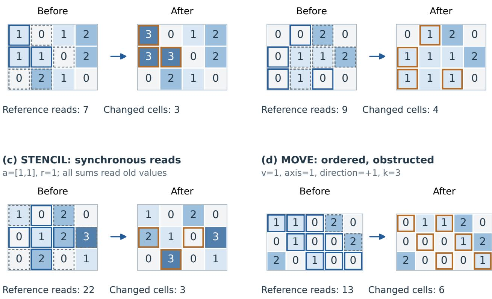  
Solid blue: write support Dashed gray: other reads Orange: actual changes

Figure 7 Four hand-calculated two-dimensional rule examples, verified by the production and dictionary executors. Cell color encodes the printed integer value; solid blue old-state outlines mark write support, dashed gray outlines mark other read coordinates, and orange new-state outlines mark actual changes. RELABEL preserves disconnected cells with the same label. LAYER grows only one boundary layer and does not overwrite label 2. STENCIL reads beyond its five-cell update ball and uses only old values. MOVE updates each row front to back, with label-2 obstacles preserved. Read counts include repeated incidences, whereas outlines show unique coordinates. These small examples are explanatory fixtures, not formal samples or model predictions

In the STENCIL panel, the old-state sums on the five support coordinates, in row order, are 4, 2, 5, 8, 3. Modulo four these become 0, 2, 1, 0, 3, changing three values. Its 22 read incidences cover ten unique coordinates, five outside the write support. In the motion panel, the first row’s leading entity advances one cell before encountering label 2; the following entity then advances into its vacated coordinate. The middle row advances two cells, and the bottom row advances to the world edge. These steps give four processed entities plus nine in-bounds occupancy checks, not four times the maximum distance.

## B.6 Geometry and transition properties

At nearly equal volume, the evaluated shapes have diferent adjacency and boundary structure. Let $N =$ $\prod _ { i } L _ { i }$ and let $E$ count undirected axis-neighbor edges. Counting edges along each axis gives

$$
E = \sum _ { i = 1 } ^ { d } ( L _ { i } - 1 ) \prod _ { j \neq i } L _ { j } ,\tag{11}
$$

$$
\overline { { \mathrm { d e g } } } = \frac { 2 E } { N } = 2 \sum _ { i = 1 } ^ { d } \left( 1 - \frac { 1 } { L _ { i } } \right) .\tag{12}
$$

The fraction of cells on the geometric world boundary is

$$
b = 1 - \frac { \prod _ { i } \operatorname* { m a x } ( L _ { i } - 2 , 0 ) } { N } .\tag{13}
$$

Table 7 reports these quantities for the three shapes. Higher dimension here increases mean degree and boundary exposure while shortening individual axes. These are joint structural changes in the dimension experiment.

<table><tr><td>d Shape</td><td></td><td>N</td><td>E</td><td>deg</td><td>Boundary N + 2E</td></tr><tr><td>2 [16, 16]</td><td></td><td>256</td><td>480 3.750</td><td>23.44%</td><td>1216</td></tr><tr><td>3</td><td>[6, 6,7]</td><td>252</td><td>636</td><td>5.048 68.25%</td><td>1524</td></tr><tr><td>4</td><td>[4, 4, 4, 4]</td><td>256</td><td>768 6.000</td><td>93.75%</td><td>1792</td></tr></table>

Table 7 Exact structural quantities for the three evaluated shapes. Boundary is the percentage of cells on the geometric world boundary. The final column is full-world neighborhood-aggregation scan, not the realized workload of the selected STENCIL or MIX events.

For a STENCIL or occupied-anchor MIX support S, reference reads satisfy

$$
\mathrm { s c a n } = \sum _ { x \in { \cal S } } ( 1 + | N _ { 1 } ( x ) | ) \le ( 1 + 2 d ) | { \cal S } | .\tag{14}
$$

Full-world support gives N + 2E. The count includes repeated neighborhood incidences, so equal support sizes need not imply equal read counts.

Conservation and ordering. The following properties hold for individual valid core events and provide checks on execution. Reflection permutes the inclusive box, preserving every label count; applying the same reflection twice restores the state because its coordinate map is an involution. MIX preserves the occupied set: every updated value remains in $\{ 1 , \ldots , K \}$ and every updated coordinate was already occupied. MOVE preserves label counts and ordering along each axis-parallel line. If selected-label positions before and after the event are ordered as $a _ { 1 } < \cdots < a _ { m }$ and $b _ { 1 } < \cdots < b _ { m }$ , then $0 \leq s ( b _ { i } - a _ { i } ) \leq k .$ . Occupied cells prevent overtaking, while front-to-back execution lets later entities enter vacated space. COMPRESS preserves each line’s sum: deleting zeros, replacing $a , a$ by $2 a$ , and packing all preserve that sum. Its occupied-cell count cannot increase. These event-specific identities do not extend unchanged through arbitrary SET assignments.

Synchronous aggregation. Index the world lexicographically and write its values as $w \in \mathbb { Z } _ { M } ^ { N }$ . For a fixed STENCIL event, let A be the grid adjacency matrix and $D _ { S }$ the diagonal indicator of its update support. Then

$$
w ^ { \prime } = ( I + D _ { S } A ) w \quad ( \mathrm { m o d } \ M ) .\tag{15}
$$

Rows outside $S$ preserve their old values; rows inside add the old neighbors. This is linear over the residue ring $\mathbb { Z } _ { M }$ , including the evaluated $\mathbb { Z } _ { 4 }$ . Sequential in-place updates would define a diferent map. MIX instead reduces modulo $K = M - 1$ and adds one: on a fully updated three-cell line [1, 1, 1], the two rules yield [2, 3, 2] and [3, 1, 3], respectively. Their arithmetic difers as well as their support selection.

Event changes and final changes. The cumulative efect $\textstyle \sum _ { t = 1 } ^ { T } | D ( W _ { t - 1 } , e _ { t } ) |$ counts a coordinate again when ever it changes. The set $C _ { i }$ Pin Equation 4 instead compares only the initial and final values. A cell can change repeatedly and still finish in $U _ { i }$ . Reference workload and final-state diagnostics therefore measure distinct properties of the same history.

## B.7 Generation conditions and acceptance

The formal evaluation uses generator 0.5.0 and the settings in Table 8. Initial states and event proposals are sampled within each condition, then executed to obtain reference trajectories. The main shapes are [16, 16], [6, 6, 7], and [4, 4, 4, 4]. The workload sweep fixes d = 2 and uses PAINT targets 25/100, REFLECT $1 6 / 6 4 / 2 5 6$ , LAYER $1 5 / 6 0 / 1 5 0$ , and MIX $6 / 1 2 / 3 0$ . Four levels coincide with main conditions and reuse those instances.

<table><tr><td>Rule</td><td>Target</td><td>Unit</td><td>Alphabet / initializer</td><td>Density band</td><td>SET rate</td></tr><tr><td>PAINT</td><td>100</td><td>reads</td><td>0:3 / uniform</td><td>.45-.65</td><td>.2</td></tr><tr><td>REFLECT</td><td>64</td><td>reads</td><td>0:3 / uniform</td><td>.45-.65</td><td>.2</td></tr><tr><td>STENCIL</td><td>10</td><td>support</td><td>0:3 / uniform</td><td>.55-.85</td><td>.2</td></tr><tr><td>MIX</td><td>12</td><td>support</td><td>0:3 / uniform</td><td>.55-.70</td><td>.2</td></tr><tr><td>RELABEL</td><td>100</td><td>reads</td><td>0:6 / regions</td><td>.50-.65</td><td>.2</td></tr><tr><td>LAYER</td><td>60</td><td>reads</td><td>0:6 / regions</td><td>.45-.60</td><td>.2</td></tr><tr><td>MOVE</td><td>30</td><td>reads</td><td>0:4 / uniform</td><td>.35-.50</td><td>.3</td></tr><tr><td>COMPRESS</td><td>256</td><td>cells</td><td> $\{ 0 , { \dot { 2 } } ^ { 0 } , \dots , 2 ^ { 1 2 } \}$  /small tiles</td><td>.15-.60</td><td>.5</td></tr></table>

Table 8 Main generation conditions. Targets guide candidate selection; realized operation sizes vary with the state and geometry. A cells target selects the shape tier, whose volume is 252 or 256. Density bands guide initialization and event selection.

Initial states. A density $\rho$ is drawn uniformly from the family’s band [l, h], giving max(1, min $( N \textrm { -- }$ $1 , \operatorname { r o u n d } ( N \rho ) ) )$ occupied cells. Uniform initialization samples coordinates without replacement and assigns independent nonzero labels. Small-tile initialization uses the two smallest positive tile values with probabilities 0.9 and 0.1. Region initialization grows connected sets through empty axis neighbors, choosing their typical size to approximate the component-plus-boundary target. Regions receive a label absent from their external neighbors when possible. The latter initializer allows workload to vary both initial component structure and later operations.

Event schedule. At rate $s ,$ position t is a SET event when $\lfloor t s \rfloor > \lfloor ( t - 1 ) s \rfloor$ . The first event is therefore a core operation. Assignments clear cells above the density band, fill below it, and otherwise change a value. The region families prefer nonzero labels distinct from neighboring labels; COMPRESS spawns tiles of value 1 or 2, with probabilities 0.9 and 0.1, and clears a cell when occupancy is too high. At $T = 6 4$ , most families contain $5 2$ core events and 12 assignments; MOVE contains 45 and 19, and COMPRESS 32 and 32. Assignments enter the supplied history because they can alter the state used by subsequent operations. Reference reads and changed-cell counts separately describe operation scale.

Candidate selection. Valid candidates are executed before selection. For realized workload q, target $w ,$ tolerance $\delta ,$ and post-event density $\rho ^ { \prime } ,$ the selection score is

$$
p _ { w } ( q ) = \bigg [ \bigg | \log \frac { \operatorname* { m a x } ( q , 1 ) } { \operatorname* { m a x } ( w , 1 ) } \bigg | - \log ( 1 + \delta ) \bigg ] _ { + } ,\tag{16}
$$

$$
p _ { \rho } ( \rho ^ { \prime } ) = \frac { 2 } { h - l } \left[ \left| \rho ^ { \prime } - \frac { l + h } { 2 } \right| - \frac { h - l } { 2 } \right] _ { + } ,\tag{17}
$$

$$
\begin{array} { r } { \mathrm { s c o r e } ( e ) = p _ { w } ( q _ { e } ) + p _ { \rho } ( \rho _ { e } ^ { \prime } ) . } \end{array}\tag{18}
$$

Here $q$ is the family’s read count, support size, or world volume. Tolerance is 0.15 for PAINT/MIX, 0.30 for STENCIL, 0.25 for REFLECT/RELABEL/LAYER/MOVE, and zero for COMPRESS. The minimumscore candidate is selected with seeded tie-breaking. Before scoring, recent-state repetition is filtered when a fresh alternative exists, and the requested efective/no-op category is preferred. Applicable families target a 0.1 no-op proposal rate in shufled blocks of eight core events; STENCIL, MIX, and RELABEL request efective events throughout. Unavailable categories are recorded as misses.

Trajectory acceptance. Generated states must remain nonempty and within density bounds [max(0.02, l − $0 . 4 ) , \operatorname* { m i n } ( 0 . 9 8 , h + 0 . 4 ) ]$ . The mean-workload ratio must lie in [0.5, 2], the efective-core fraction must be at least 0.5, and the missed-category fraction at most 0.5. STENCIL/MIX core events must change at least 10% of their support. Up to eight seeded attempts are made per trajectory index. The stored trajectories extend to $T = 1 2 8 ;$ acceptance is applied before selecting the evaluated prefixes $T = 0 , 1 , 8 , 1 6 , 3 2 , 6 4$ . Dataset seed 20260907 and a condition/index/attempt-specific digest determine the random streams. The two collection cohorts select disjoint indices 0–3 and 4–7 from the same conditions. Exact proposer and seed specifications accompany the implementation

Realized operation scale. Targets describe sampling objectives. For example, at MIX targets $6 / 1 2 / 3 0$ , mean reads per core event in the selected $d = 2 , T = 6 4$ histories are $2 8 . 1 3 / 5 8 . 6 7 / 1 4 5 . 4 7$ , while mean changedcell counts are 3.99/8.00/20.05. Reads count repeated neighborhood incidences; changes count coordinates whose values actually change. The supplementary data provide these quantities for every main and additional workload condition.

Connectivity profile. RELABEL proposals prefer destination labels absent from the component’s external boundary, using deletion or a merging label when necessary. Deletion is eligible when the component occupies at most one quarter of the nonzero cells and is tried first with probability 0.15. The 24 main trajectories contain 54 contact events among 1,248 core recolorings (4.3%); 17 trajectories contain at least one. This describes the low-merger distribution used for the task profile. Assignments can also alter connectivity. Per-trajectory contact counts are included in the supplementary data.

## C Evaluation Protocol

## C.1 Shared evaluation and model settings

The six models receive the same 1,488 instances from 248 reference trajectories, producing 8,928 retained outcomes. The main experiment contains 192 trajectories and 1,152 instances. Seven additional workload conditions contribute 56 trajectories and 336 instances; combining them with four reused main conditions gives the 528-instance workload view. Each generation condition has eight trajectories, and each trajectory supplies six separately queried prefixes. At one main length, task and dimension summaries contain 24 and 64 instances, respectively.

Table 9 records the full model identities and request parameters. GPT-5.6 Sol, Claude 5 Sonnet, and GPT 5.4 Mini use the NAIRR gateway; GLM-5, Kimi K2.5, and MiniMax M2.5 use native Bedrock streaming (Amazon Web Services, 2026a,b,c). Collection took place on 16–24 September 2026 UTC. All requests use prompt 0.4, one completion, a 128,000-token combined reasoning-and-answer ceiling, no tools, and a 7,200- second deadline. Temperature, top\_p, and seed are omitted. Five models receive the high-efort setting; MiniMax M2.5 uses native always-on thinking without an efort field.

Each instance is submitted as one user message, with no task-specific system message or preceding conversation. Scoring uses the delivered answer text. Technical failures before a scorable outcome can be retried; delivered outcomes are retained regardless of correctness, format, or termination. There is one retained outcome per model–instance pair. The request ledger preserves exact parameters and raw termination fields.

## C.2 Model-facing prompts

Figure 8 gives the shared prompt. The space declaration specifies the shape, alphabet, and zero-based non wrapping coordinates. Initial states and events are compact JSON; omitted cells are zero. Each prompt contains the complete event sequence $e _ { 1 } , \ldots , e _ { T }$ , including any assignments, and requests the complete state after all T events.

<table><tr><td>Model</td><td>Requested identity</td><td>Recorded route</td><td>Recorded request parameters</td></tr><tr><td>GPT-5.6 Sol</td><td>gpt-5.6-sol</td><td>azure/gpt-5.6-sol</td><td>max_completion_tokens = 128000 reasoning_effort = &quot;high&quot;</td></tr><tr><td>Claude 5 Sonnet claude-sonnet</td><td></td><td>vertex_ai/ claude-sonnet-5</td><td>max_completion_tokens = 128000 reasoning_effort = &quot;high&quot;</td></tr><tr><td>GPT-5.4 Mini</td><td>gpt-5.4-mini</td><td>azure/gpt-5.4-mini</td><td>max_completion_tokens = 128000 reasoning_effort = &quot;high&quot;</td></tr><tr><td>GLM-5</td><td>zai.glm-5</td><td>zai.glm-5</td><td>max_tokens = 128000 reasoning_effort = &quot;high&quot;</td></tr><tr><td>Kimi K2.5</td><td>moonshotai.kimi-k2.5</td><td>moonshotai.kimi-k2.5</td><td>max_tokens = 128000 reasoning_effort = &quot;high&quot;</td></tr><tr><td>MiniMax M2.5</td><td>minimax.minimax-m2.5</td><td>minimax.minimax-m2.5</td><td>max_tokens = 128000 Effort absent; native thinking.</td></tr></table>

Table9 Six evaluated models, each with 1,488/1,488 scored instances, prompt 0.4, a 128,000-token generation allowance, and no tools. Parameter keys and values are copied from the retained request ledger. For Bedrock, ledger max\_tokens maps to wire field inferenceConfig.maxTokens; gateway requests retain max\_completion\_tokens. MiniMax M2.5 sends no efort field and uses native always-on thinking. Identifiers and routes follow the frozen collection metadata.

This is a deterministic simulation of an abstract integer-valued grid.

Keep deliberation concise and reserve enough of the response budget to return the complete final-state JSON.

TASK

Apply all events in order and return the final world.

SPACE

shape = <axis lengths>

Coordinates and axis indices are zero-based. The world is bounded and does not wrap.

Unlisted cells have value 0. Allowed values: <declared alphabet>.

W(x) denotes the value of cell x immediately before the current event.

COMMON EVENT

SET(p,v): set cell p to v.

FAMILY RULE

<family-specific rule card>

EXAMPLE

<family-specific one-dimensional worked example>

INITIAL

<complete initial state in sparse JSON>

EVENTS

<ordered event array in JSON>

OUTPUT

Return only {"cells":[[p,v],...]}, where each entry is [coordinate,value]. Include every nonzero cell exactly once in lexicographic coordinate order. Output the JSON object only, with no code fence or other text.

Figure 8 Shared prompt 0.4 template, derived from the actual renderer. Angle-bracket fields replace instance-specific content. Line wrapping is typographical; the evaluated representation remains a coordinate list, not a grid drawing.

Rule cards. The following text is taken directly from the registered rule renderers using the selected alphabets. The mathematical explanations in Appendix B supplement these literal instructions for the reader. PAINT. $\mathrm { P A I N T } ( \mathrm { a } , \mathrm { r } , \mathrm { u } , \mathrm { v } )$ : simultaneously replace u by v at every coordinate x with sum $\underline { { { \mathrm { ~ i ~ } } } } | \mathrm { x } \_ { - } \mathrm { i - a } \_ { 1 } | \ < = \mathrm { r }$ . All other cells remain unchanged.

REFLECT. REFL $. { \mathrm { E C T } } ( { \mathrm { l o } } , { \mathrm { h i } } , { \mathrm { a x i s } } )$ : for every cell x in the inclusive box lo $< = \mathrm { { x } < = \mathrm { { h i } } }$ , the new value at the mirrored position $\mathrm { { x } ^ { \prime } \ ( \mathrm { { x } ^ { \prime } \mathrm { { - } \ a x i s = \mathrm { { l o } } } } }$ axis + hi\_axis - x\_axis, other coordinates unchanged) is the old value at x, including 0. All writes happen simultaneously. Cells outside the box remain unchanged.

STENCIL. STENCIL(a,r): simultaneously set every cell x with sum\_i |x\_i-a\_i| <= r to $( \mathrm { W } ( \mathrm { x } ) + \mathrm { s u m } \mathrm { W } ( \mathrm { y } ) )$ mod 4, where y ranges over the in-bounds cells at Manhattan distance 1 from x, whether or not they lie within distance r of a. Every update reads the same old world; cells farther than r from a remain unchanged.

MIX. MIX(p,r): if $\mathrm { W ( p ) } = 0$ , nothing changes. Otherwise find every cell that can be reached from p by a path of at most r Manhattan-distance-1 steps whose cells all have nonzero old values (p itself counts as reached with 0 steps; a cell with old value 0 can never be entered or passed through). Then simultaneously set every reached cell x to $1 +$ $( ( \mathrm { W ( x ) } + \mathrm { s u m } \mathrm { W ( y ) } )$ mod 3), where y ranges over the in-bounds cells at Manhattan distance 1 from x, whether or not they were reached. Every update reads the old world; cells that were not reached remain unchanged.

RELABEL. RELABEL(p,v): let $\mathrm { u } = \mathrm { W } ( \mathrm { p } )$ (u may be 0). Find the maximal set of cells connected to p by Manhattan distance-1 steps whose old values are all u, including p. Set every cell of that set to v.

LAYER. LAYER(p,s): if $\mathrm { W ( p ) } = 0 ;$ nothing changes. Otherwise let $\mathbf { u } = \mathbf { W } ( \mathbf { p } )$ and find the maximal Manhattanconnected set of cells with old value u, including p. If $\mathrm { { s } = - 1 }$ , set to 0 every cell of that set that has an in-bounds neighbor with old value 0. If $\mathrm { s } = + 1$ , set to u every in-bounds cell with old value 0 that is a neighbor of a cell of that set. Positions outside the world are not neighbors; nothing else changes.

MOVE. MOVE(v,axis,direction,k): take every cell with value v, ordered by decreasing coordinate on axis if direction=1 and increasing if direction=-1, so that the cells nearest the leading edge are handled first. In that order, move each one along axis in the sign of direction, one cell at a time and at most k cells, stopping as soon as the next cell is outside the world or nonzero (including cells already moved into). Each move clears the old cell and writes v to the new cell; values never merge, and a block of adjacent v cells therefore moves as a unit.

COMPRESS. COMPRESS(axis,direction): on every line parallel to axis, independently: list the nonzero values in order starting from the destination edge (coordinate 0 if direction=-1, the highest coordinate if direction=1). Walk that list from its start; whenever two consecutive values are equal, replace them by one value equal to their sum and continue after the pair, so a merged value cannot merge again in this event. Write the resulting list back starting at the destination edge and set every remaining cell of the line to 0.

A complete example. Figure 9 shows the full rendered prompt for the RELABEL example in Figure 7. It includes the renderer’s one-dimensional rule example, followed by the two-dimensional initial state and event. The renderer computes the rule example under the instance’s alphabet, omitting it only when its values cannot be represented. The evaluated instance’s final state is never part of the prompt.

For this illustrative $3 \times 4$ world, recoloring the component at [0, 0] leaves the disconnected value-1 cells at [0, 2] and [2, 2] unchanged. Figure 7 shows the checked reference state; the data package includes the literal prompt and answer.

## C.3 Answer extraction and diagnostic populations

The answer has one field, cells, listing every nonzero coordinate–value pair. Omitted coordinates are zero. Duplicate or out-of-bounds coordinates, explicit zeros, undeclared values, and unknown fields invalidate a state. JSON parsing rejects duplicate keys and non-finite numbers; Boolean values are not integer coordinates or labels.

The fixed extractor first tries the stripped response, optionally removing one enclosing code fence. Otherwise, it selects the last top-level JSON-object candidate, respecting braces inside strings. A malformed or unclosed trailing candidate fails extraction. Selection uses syntax and position, never the reference answer, and does not repair state values. Semantic EM scores the extracted state. Strict EM applies the same scorer directly

COMMON EVENT   
SET(p,v): set cell p to v.

This is a deterministic simulation of an abstract integer-valued grid. Keep deliberation concise and reserve enough of the response budget to return the complete final-state JSON.

## TASK

Apply all events in order and return the final world.

## SPACE

Coordinates and axis indices are zero-based. The world is bounded and does not wrap.   
Unlisted cells have value 0. Allowed values: [0,1,2,3].

W(x) denotes the value of cell x immediately before the current event.

## FAMILY RULE

RELABEL(p,v): let u = W(p) (u may be 0). Find the maximal set of cells connected to p by Manhattan-distance-1 steps whose old values are all u, including p. Set every cell of that set to v.

## EXAMPLE

On shape [7], listing the values of cells [0] to [6] in order. Before: 1 1 0 1 2 2 3. Event: {"op":"RELABEL","p":[4],"v":3}. After: 1 1 0 1 3 3 3. The cells with old value 2 connected to [4] are [4] and [5]; both become 3. The 1 at [3] and the 3 at [6] are not part of that set, although [6] ends up adjacent to the new 3s.

```jsonl
INITIAL
{"cells":[[[0,0],1],[[0,2],1],[[0,3],2],[[1,0],1],[[1,1],1],[[1,3],2],[[2,1],2],[[2,2],
1]]}
```

```json
EVENTS
[{"op":"RELABEL","p":[0,0],"v":3}]
```

## OUTPUT

Return only {"cells":[[p,v],...]}, where each entry is [coordinate,value]. Include every nonzero cell exactly once in lexicographic coordinate order. Output the JSON object only, with no code fence or other text.

Figure 9 Complete renderer-produced prompt for the checked RELABEL illustration in Figure 7. The 3-by-4 world is a synthetic explanatory fixture, not an evaluated formal instance. The included one-dimensional example is the renderer’s standard rule example, not the answer to the supplied 2D world. Only printed line wrapping difers from the saved literal prompt.

to the raw response. For example, reordering a correct coordinate list preserves both scores, while enclosing it in prose can preserve semantic EM but fail strict EM. A valid state with one wrong cell has EM zero.

Section 3.4 defines full-world EM, valid-state cell accuracy, and the final changed/unchanged partition. These measures use three populations: all requests for EM, valid states for cell accuracy, and valid incorrect states for error extent and error categories. For the valid subset V, define $V _ { C } = \{ i \in V : | C _ { i } | > 0 \}$ and $V _ { U } = \{ i \in$ $V : | U _ { i } | > 0 \}$ . The changed-cell accuracy is

$$
\mathrm { C A } _ { C } = \frac { 1 } { | V _ { C } | } \sum _ { i \in V _ { C } } \left( 1 - \frac { | E _ { i } \cap C _ { i } | } { | C _ { i } | } \right) ,\tag{19}
$$

with the analogous definition on $U _ { i }$ . This averages per-instance fractions. An empty contributing population has undefined accuracy; in particular, $C _ { i }$ is empty for the reconstruction control T = 0.

Wrong-cell quantiles use linear interpolation at order position $( n - 1 ) q$ for n valid incorrect answers and quantile fraction $q .$ Empty subsets are shown as dashes. The ≤ 5-cell count describes small errors with out changing the exact-match criterion. The complete error-partition counts and contributing populations accompany the supplementary data.

Answer accounting. Correct, valid incorrect, nonempty invalid, and empty answers form a disjoint partition of the full evaluation. A valid all-zero state, $\lbrace " { \mathsf { c e l l s } } " : \left[ \right] \rbrace ,$ is a prediction rather than an empty response. Termination is recorded separately; any delivered valid state is scored on its content. Across the six models’ 5,760 main responses at $T > 0 ,$ 1,457 are exact, 3,554 are valid but incorrect, and 749 are invalid or empty. Table 10 reports answer counts by model and length, combining nonempty invalid and empty responses in its third category. The data package retains their separate counts, semantic and strict EM, and providerreported usage for all six models. Request settings remain specified here; the detailed records are indexed in Appendix C.5.

## C.4 Uncertainty and reference verification

Intervals use 2,000 stratified bootstrap resamples of whole trajectories, with pseudorandom seed zero. A stratum fixes family, dimension, and workload. Resampling retains each stratum’s eight trajectories and keeps the selected prefix vector of a sampled trajectory intact. Thus the procedure preserves dependence across lengths and compares models on matched instances.

Write $y _ { s r t }$ for correctness on trajectory r in stratum s at length t. For selected lengths T , the estimate is

$$
\widehat { \mu } = \frac { \sum _ { s } \sum _ { r = 1 } ^ { n _ { s } } \sum _ { t \in \mathcal { T } } y _ { s r t } } { | \mathcal { T } | \sum _ { s } n _ { s } } .\tag{20}
$$

In each replicate, draw $n _ { s }$ trajectory indices with replacement within stratum s and replace each trajectory by its sampled prefix vector. The reported endpoints are the interpolated 2.5th and 97.5th percentiles. For model diferences, replace $y _ { s r t }$ by $y _ { s r t } ^ { A } - y _ { s r t } ^ { B }$ before resampling. These are marginal intervals conditional on the evaluated strata; degenerate empirical intervals are omitted. Task, dimension, and workload breakdowns report descriptive counts. Reused main/workload instances enter each selected view once.

Ofline verification re-scores all 8,928 outcomes and checks the 1,488 reference states with separately implemented dictionary-based rules. Both checks yield zero discrepancies, covering 30,008 replayed prefix events. The rule illustrations and model-facing examples are also checked against literal expected states. The imple mentation and technical-asset tests provide the executable verification procedures.

## C.5 Supplementary data and reproduction

The public Hugging Face dataset provides benchmark instances, reference states, and recorded measurements supporting the analyses in Appendices D and E. Its README defines units and populations, and its manifests record source and member checksums. The evidence/ directory contains frozen analysis and diagnostic summaries in JSON and CSV tables for convenient lookup.

Within evidence/, the tables/ directory contains overall, history-length, task, dimension, workload, and re source summaries. The diagnostics/ directory contains joint task–dimension–length counts, wrong-cell distributions, update/preservation partitions, matched baselines, and paired-instance comparisons. The reference/ directory contains realized workloads, omission and sufix diagnostics, and per-trajectory connectivity counts. Original and additional cohorts are identified explicitly. The companion GitHub code replays reference states and rebuilds six descriptive tables and the history-length plot from the released measurements. Collected model answers are not distributed.

## D Supplementary Performance Analyses

These analyses resolve the aggregate results in Section 4 by task, dimension, workload, and collection cohort, then examine reversals within individual histories. Appendix C.5 indexes the complete joint counts and

model-pair records.

## D.1 Recovery across histories and task families

Table 10 separates exact states, incorrect grids, and invalid or empty responses by model and history length. The exact counts underlie Figure 2. The reconstruction control and the one-event condition play diferent roles: the former checks recovery of the supplied state, while the latter already requires a spatial transformation. All six models approach perfect reconstruction, but their one-event scores range from 69 to 183 out of 192.
<table><tr><td>Model</td><td> $T = 0$ </td><td> $T = 1$ </td><td> $T = 8$ </td><td> $T = 1 6$ </td><td> $T = 3 2$ </td><td> $T = 6 4$ </td></tr><tr><td>GPT-5.6 Sol</td><td>192/0/0</td><td> $1 8 3 / 9 / 0$ </td><td> $1 4 5 / 4 7 / 0$ </td><td> $8 7 / 1 0 5 / 0$ </td><td> $5 7 / 1 3 5 / 0$ </td><td> $2 5 / 1 6 6 / 1$ </td></tr><tr><td>Claude 5 Sonnet</td><td>192/0/0</td><td>137/54/1</td><td>91/98/3</td><td>61/111/20</td><td>35/102/55</td><td>14/44/134</td></tr><tr><td>GPT-5.4 Mini</td><td>191/1/0</td><td>69/120/3</td><td>18/157/17</td><td>5/166/21</td><td>2/153/37</td><td>1/150/41</td></tr><tr><td>GLM-5</td><td>191/0/1</td><td>96/95/1</td><td>17/165/10</td><td>8/169/15</td><td>3/167/22</td><td>0/148/44</td></tr><tr><td>Kimi K2.5</td><td>192/0/0</td><td>148/43/1</td><td>33/138/21</td><td>18/153/21</td><td>6/151/35</td><td>0/138/54</td></tr><tr><td>MiniMax M2.5</td><td>188/2/2</td><td>150/40/2</td><td>31/117/44</td><td>11/133/48</td><td> $5 / 1 4 4 / 4 3$ </td><td>1/136/55</td></tr></table>

Table 10 Answer composition at each main history length. Each cell lists exact / valid incorrect / invalid or empty counts, which sum to 192. The first two categories form the valid-state population; the second is used for error-extent and location diagnostics. All six lengths use separately queried prefixes of the same trajectories.

Figure 10 resolves the aggregate decline by task family. The profiles difer in both one-event accuracy and the lengths over which success persists. For GPT-5.6 Sol, PAINT falls from $2 2 / 2 4$ at $T = 8$ to zero at $T = 6 4$ while RELABEL and COMPRESS retain $1 6 / 2 4$ and 8/24. Claude 5 Sonnet’s longest-history successes likewise concentrate in RELABEL, with one each in MOVE and COMPRESS. The RELABEL results use the low-merger generation conditions specified in Appendix B.7.

$$
\begin{array} { l l l l } { - \infty } & { \mathsf { G P T - 5 . 6 ~ S o o l } } & { - \equiv - } & { \mathsf { C l a u d e ~ 5 ~ S o n n e t } } & { - \pm } & { \mathsf { G P T - 5 . 4 ~ M i n i } } \\ { - \infty } & { \mathsf { G L M - 5 } } & { + } & { \mathsf { K i m i } \mathsf { K } 2 . 5 } & { - \pm } & { \mathsf { M i n i } \mathsf { M a } \times \mathsf { M } 2 . 5 } \end{array}
$$

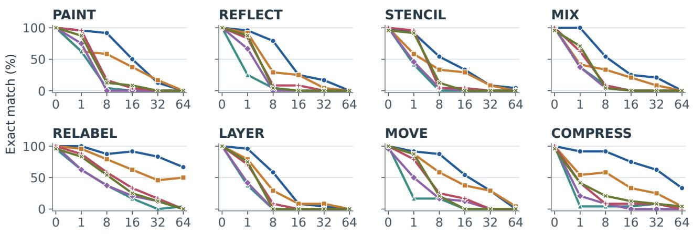  
Event-sequence length T  
Figure 10 Full task-specific history profiles. Each point is exact answers out of 24 main instances: eight trajectories in each of three dimensions. Colors and markers identify the six models. Lines connect the tested categorical lengths; the curves are descriptive. All outcomes remain in the denominator.

Within a task family, success need not decrease at every sampled length. GPT-5.6 Sol’s RELABEL count rises from 21 to 22 between $T = 8$ and $T = 1 6$ , and Claude 5 Sonnet’s rises from 11 to 12 between $T = 3 2$ and $T = 6 4$ . Appendix D.5 examines such reversals on individual trajectories.

## D.2 Spatial dimension across history lengths

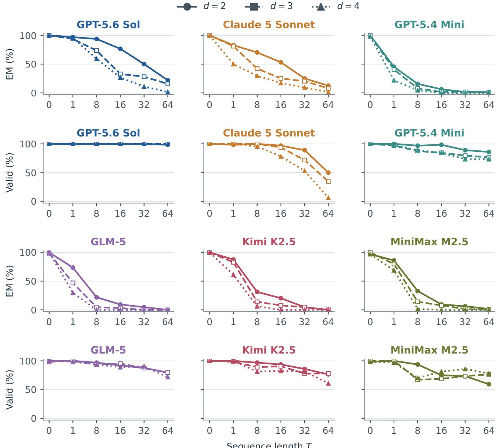  
Figure 11 Dimension profiles for all six models. Each model has two vertically adjacent panels: full-world EM and valid-state rate. Circles/solid, squares/dashed, and triangles/dotted denote $d = 2 , 3 , 4 .$ Each point includes 64 main instances from eight tasks and eight trajectories per task. Valid states include exact and incorrect answers. Lines connect categorical lengths and carry no uncertainty bands.

Figure 11 shows that dimension diferences emerge at diferent lengths across models. GPT-5.6 Sol’s nearly level one-event profile separates by eight events, when it solves $6 0 / 6 4 , \ 4 7 / 6 4$ , and 38/64 instances across $d = 2 , 3 , 4 .$ . GLM-5 and Kimi K2.5 already show substantial diferences at one event, as reported in Table 4. Pooled over $T = 8 , 1 6 , 3 2 , 6 4 .$ , correct counts are nonincreasing from $d = 2$ to $d = 4$ for every model.

At later lengths several exact-match curves approach zero, while their companion valid-state curves remain above zero. Thus, many responses can still be inspected cell by cell after complete recovery has become rare. The dimension comparison combines changes in adjacency, boundary exposure, and coordinate arity at approximately fixed volume; their geometric quantities are given in Appendix B.6.

## D.3 Within-family workload profiles

The workload curves retain all six lengths for the eleven settings at $d \ = \ 2 .$ . Each point contains eight trajectories; each pooled main-text count contains four prefixes of those trajectories.

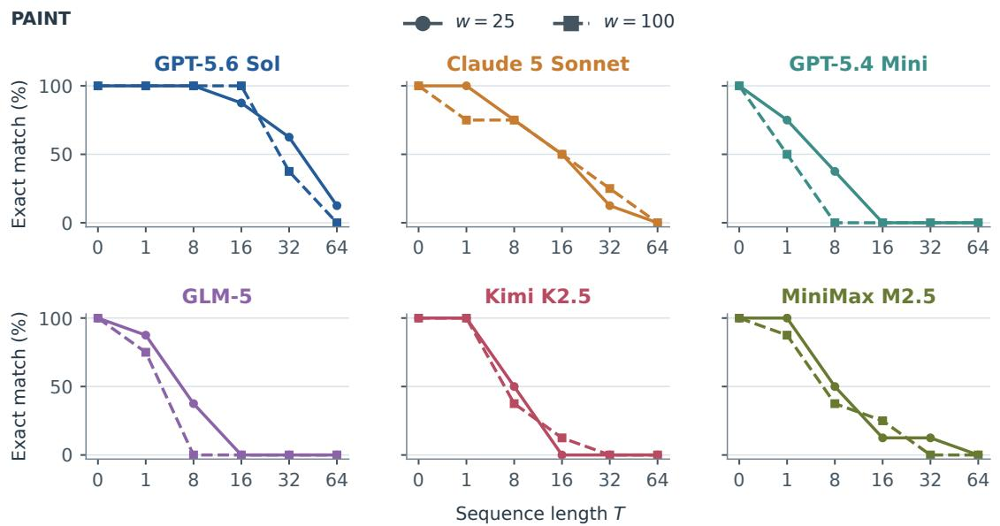  
Figure 12 PAINT workload profiles at $d = 2 .$ . Six model panels compare the two ball-size targets. Each point is EM over eight trajectories at the specified length, including all outcomes. Markers and line styles identify targets; lengths are categorical. The main-condition level reuses main instances.

The mixed pooled PAINT results include changes in ordering across history lengths. GPT-5.6 Sol solves $7 / 8$ and $8 / 8$ instances at $T = 1 6$ for ball-size targets 25 and 100, respectively. ${ \mathrm { A t ~ } } T = 3 2 { \mathrm { . } }$ , it solves $5 / 8$ and $3 / 8 ,$ reversing that ordering. A single pooled comparison thus combines diferent length-specific contrasts.

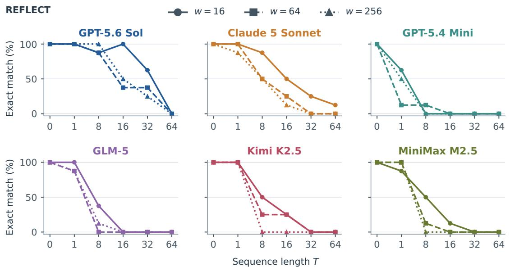  
Figure 13 REFLECT workload profiles at $d = 2$ . Each model panel compares box-volume targets 16, 64, and 256 using the legend’s markers and line styles. Each point is EM over eight trajectories at a categorical tested length, with all outcomes retained. Curves are descriptive.

For REFLECT, GPT-5.6 Sol solves all eight one-event instances at each box-volume target. At $T = 1 6 ,$ its counts are $8 / 8 , 3 / 8$ , and $4 / 8$ at targets 16, 64, and 256. The smallest box retains the highest recovery at this length, but the three-target profile is not monotonic.

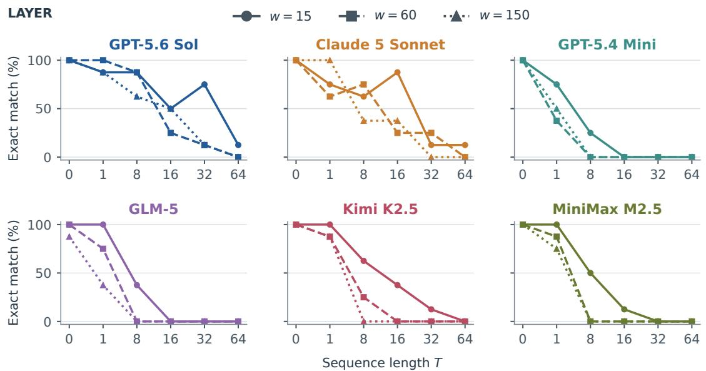  
Figure 14 LAYER workload profiles at $d = 2 ,$ , comparing component-plus-boundary targets 15, 60, and 150. Each model panel reports EM over eight trajectories per categorical length, with all outcomes retained. Markers and line styles identify targets; curves are descriptive.

For LAYER, the pooled advantage of the smallest target does not hold at every length. Claude 5 Sonnet solves $6 / 8 , 5 / 8 ,$ , and $8 / 8$ instances at $T = 1$ for targets $1 5 , 6 0 .$ , and 150, respectively. At $T = 1 6$ , these counts are $7 / 8 , 2 / 8 .$ , and $3 / 8 \colon$ the smallest target now has the highest count.

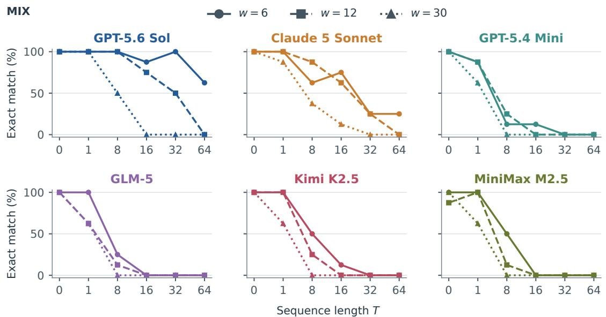  
Figure 15 MIX workload profiles at $d = 2 ,$ comparing reached-region targets 6, 12, and 30. Each model panel reports EM over eight trajectories per categorical length, with all outcomes retained. Markers and line styles identify targets; curves are descriptive.

For MIX, the smallest target also supports recovery over longer histories. GPT-5.6 Sol solves all eight oneevent instances at every target, but retains $5 / 8$ successes at $T = 6 4$ only at target 6, compared with zero at targets 12 and 30. Across the four families, the full curves reveal where workload contrasts emerge, persist, or reverse as histories lengthen.

Targets use diferent units across families. Their realized reads and changes are defined in Appendix B.7 and tabulated in the data package. For example, over the T = 64 MIX histories, increasing the target from 6 to 30 raises mean reference reads per core event from 28.13 to 145.47 and mean changed cells from 3.99 to 20.05. This confirms that the target change afects both the amount of state consulted and the number of values altered during reference execution. The data package also gives exact and valid-state counts at every workload and length, including the four settings shared with the main experiment.

## D.4 Collection cohorts and paired model comparisons

<table><tr><td>Model</td><td>Original /384</td><td>Additional /384</td><td>Combined /768</td></tr><tr><td>GPT-5.6 Sol</td><td>160</td><td>154</td><td>314</td></tr><tr><td>Claude 5 Sonnet</td><td>103</td><td>98</td><td>201</td></tr><tr><td>GPT-5.4 Mini</td><td>13</td><td>13</td><td>26</td></tr><tr><td>GLM-5</td><td>10</td><td>18</td><td>28</td></tr><tr><td>Kimi K2.5</td><td>23</td><td>34</td><td>57</td></tr><tr><td>MiniMax M2.5</td><td>21</td><td>27</td><td>48</td></tr></table>

Table 11 Exact main-set answers over T = 8, 16, 32, 64, separated by collection cohort. The original and additional cohorts each contain 96 trajectories, with four prefixes per trajectory. They use disjoint seeds under the same selected generation and evaluation conditions. The combined column is their sum.

The original and additional collections use disjoint trajectory indices 0–3 and 4–7 under the same generation and evaluation conditions. Each contributes 744 unique instances per model. Table 11 compares their main results over $T = 8 , 1 6 , 3 2 , 6 4$ , with 384 instances per cohort. GPT-5.6 Sol and Claude 5 Sonnet have the largest pooled counts in both, and RELABEL remains the highest-scoring family for every model in each cohort. The union is used throughout the main text.

The matched-error illustration also retains its direction in both cohorts. Kimi K2.5 and MiniMax M2.5 have 42 jointly valid incorrect T = 8 answers in each cohort. Their wrong-cell medians are 12.5/85.5 in the original and 15/57.5 in the addition; the combined 84-instance comparison gives 14/67.

Paired EM comparisons use the identical main instances and the bootstrap procedure in Appendix C.4. GPT-5.6 Sol exceeds Claude 5 Sonnet by 11.46 percentage points at $T = 3 2$ (95% interval 4.17–18.23) and 5.73 points at T = 64 (2.60–8.85). At T = 64, the other four models each solve zero or one instance. All fifteen model pairs at both lengths, including their intervals, are preserved in the supplementary data.

## D.5 Nonmonotonic outcomes on shared trajectories

Table 12 counts histories with an exact answer at a later prefix after an earlier failure. Every model exhibits this pattern even when the reconstruction control is excluded. Including T = 0 adds one trajectory for GPT-5.4 Mini and GLM-5 and three for MiniMax M2.5; the other totals are unchanged.

These reversals also occur at long histories. Between $T = 3 2$ and $T = 6 4 .$ GPT-5.6 Sol loses 34 previously correct instances but gains two; Claude 5 Sonnet loses 27 and gains six. Gains therefore coexist with an aggregate decline. Each prefix has its own supplied history, reference final state, and independently queried answer, so the result describes success at diferent targets along a shared reference trajectory.

<table><tr><td>Model</td><td>Including T = 0</td><td>Positive lengths only</td></tr><tr><td>GPT-5.6 Sol</td><td>20</td><td>20</td></tr><tr><td>Claude 5 Sonnet</td><td>51</td><td>51</td></tr><tr><td>GPT-5.4 Mini</td><td>13</td><td>12</td></tr><tr><td>GLM-5</td><td>5</td><td>4</td></tr><tr><td>Kimi K2.5</td><td>15</td><td>15</td></tr><tr><td>MiniMax M2.5</td><td>9</td><td>6</td></tr></table>

Table 12 Trajectories with at least one exact later answer after an earlier failed answer, out of 192 per model. The second column includes the reconstruction control; the third uses only positive lengths. Each prefix is a separate request.

## E Supplementary State Diagnostics

Complete-state errors difer in extent, location, and the values that remain correct. The following analyses extend Section 4.3 using the diagnostic populations defined in Appendix C.3. All-model distributions and matched comparisons are reported separately.

## E.1 Error extent beyond the median

Table 13 complements the main-text medians with upper-tail error counts and the frequency of small deviations. At T = 1, Claude 5 Sonnet has 44 of 54 valid incorrect states within five wrong cells, and GPT-5.4 Mini has 75 of 120. Even when whole-state recovery fails, much of a one-event prediction can therefore agree with the reference.

<table><tr><td>Model</td><td>T</td><td>n</td><td>Median</td><td>P90</td><td>≤ 5 cells</td></tr><tr><td>GPT-5.6 Sol</td><td>1</td><td>9</td><td>2.0</td><td>2.2</td><td>9</td></tr><tr><td>GPT-5.6 Sol</td><td>16</td><td>105</td><td>4.0</td><td>24.6</td><td>62</td></tr><tr><td>GPT-5.6 Sol</td><td>64</td><td>166</td><td>33.0</td><td>123.0</td><td>12</td></tr><tr><td>Claude 5 Sonnet</td><td>1</td><td>54</td><td>2.0</td><td>8.0</td><td>44</td></tr><tr><td>Claude 5 Sonnet</td><td>16</td><td>111</td><td>6.0</td><td>34.0</td><td>53</td></tr><tr><td>Claude 5 Sonnet</td><td>64</td><td>44</td><td>14.0</td><td>88.9</td><td>6</td></tr><tr><td>GPT-5.4 Mini</td><td>1</td><td>120</td><td>4.0</td><td>21.2</td><td>75</td></tr><tr><td>GPT-5.4 Mini</td><td>16</td><td>166</td><td>40.0</td><td>100.0</td><td>16</td></tr><tr><td>GPT-5.4 Mini</td><td>64</td><td>150</td><td>114.5</td><td>183.2</td><td>3</td></tr><tr><td>GLM-5</td><td>1</td><td>95</td><td>3.0</td><td>8.6</td><td>76</td></tr><tr><td>GLM-5</td><td>16</td><td>169</td><td>41.0</td><td>99.0</td><td>15</td></tr><tr><td>GLM-5</td><td>64</td><td>148</td><td>98.5</td><td>174.6</td><td>6</td></tr><tr><td>Kimi K2.5</td><td>1</td><td>43</td><td>2.0</td><td>9.8</td><td>32</td></tr><tr><td>Kimi K2.5</td><td>16</td><td>153</td><td>40.0</td><td>139.2</td><td>19</td></tr><tr><td>Kimi K2.5</td><td>64</td><td>138</td><td>107.5</td><td>184.1</td><td>4</td></tr><tr><td>MiniMax M2.5</td><td>1</td><td>40</td><td>3.0</td><td>54.5</td><td>22</td></tr><tr><td>MiniMax M2.5</td><td>16</td><td>133</td><td>117.0</td><td>163.0</td><td>11</td></tr><tr><td>MiniMax M2.5</td><td>64</td><td>136</td><td>124.5</td><td>184.0</td><td>2</td></tr></table>

Table 13 Error extent at early, intermediate, and long histories, conditional on valid incorrect main answers. Median and P90 count wrong cells in worlds of 252 or 256 cells; P90 uses linear interpolation. The last column counts predictions with at most five wrong cells. Each row has its own subset of size n.

The distributions at longer histories difer in both their center and tail. For GPT-5.6 Sol, the median rises from four wrong cells at $T = 1 6$ to 33 at T = 64, while P90 rises from 24.6 to 123. The fraction within five wrong cells falls from 62/105 to 12/166. Thus, small deviations become less common as the upper tail extends farther across the grid. At T = 64, GPT-5.4 Mini has median 114.5 and P90 183.2, with only 3/150 states within five cells.

Task conditions further separate error extent within a model. GPT-5.6 Sol returns 24 valid incorrect states for each of MOVE and LAYER at $T = 6 4$ , so both have zero EM, but their wrong-cell medians are 9.5 and 103. These independently generated task sets illustrate why complete failure rates can accompany diferent spatial deviations. The data package contains all per-instance wrong-cell counts and task-level quantiles, including lengths not displayed in this table.
<table><tr><td>Model</td><td>T</td><td>nc</td><td>C acc. (%)</td><td>nU</td><td>U acc. (%)</td></tr><tr><td>GPT-5.6 Sol</td><td>16</td><td>192</td><td>95.3</td><td>192</td><td>99.0</td></tr><tr><td>GPT-5.6 Sol</td><td>32</td><td>192</td><td>88.6</td><td>192</td><td>96.1</td></tr><tr><td>GPT-5.6 Sol</td><td>64</td><td>191</td><td>73.6</td><td>191</td><td>88.7</td></tr><tr><td>Claude 5 Sonnet</td><td>16</td><td>172</td><td>92.7</td><td>172</td><td>98.6</td></tr><tr><td>Claude 5 Sonnet</td><td>32</td><td>137</td><td>89.3</td><td>137</td><td>96.1</td></tr><tr><td>Claude 5 Sonnet</td><td>64</td><td>58</td><td>88.6</td><td>58</td><td>91.8</td></tr><tr><td>GPT-5.4 Mini</td><td>16</td><td>171</td><td>68.0</td><td>171</td><td>89.4</td></tr><tr><td>GPT-5.4 Mini</td><td>32</td><td>155</td><td>51.4</td><td>155</td><td>82.6</td></tr><tr><td>GPT-5.4 Mini</td><td>64</td><td>151</td><td>39.6</td><td>151</td><td>73.1</td></tr><tr><td>GLM-5</td><td>16</td><td>177</td><td>66.6</td><td>177</td><td>88.4</td></tr><tr><td>GLM-5</td><td>32</td><td>170</td><td>55.3</td><td>170</td><td>79.7</td></tr><tr><td>GLM-5</td><td>64</td><td>148</td><td>46.2</td><td>148</td><td>76.0</td></tr><tr><td>Kimi K2.5</td><td>16</td><td>171</td><td>63.9</td><td>171</td><td>90.3</td></tr><tr><td>Kimi K2.5</td><td>32</td><td>157</td><td>46.5</td><td>157</td><td>83.6</td></tr><tr><td>Kimi K2.5</td><td>64</td><td>138</td><td>31.8</td><td>138</td><td>77.4</td></tr><tr><td>MiniMax M2.5</td><td>16</td><td>144</td><td>46.3</td><td>144</td><td>75.4</td></tr><tr><td>MiniMax M2.5</td><td>32</td><td>149</td><td>38.6</td><td>149</td><td>76.3</td></tr><tr><td>MiniMax M2.5</td><td>64</td><td>137</td><td>30.1</td><td>137</td><td>73.2</td></tr></table>

Table 14 Changed- and unchanged-cell accuracy for valid main answers. Each value is a macro-average over the n<sub>C</sub> or $n _ { U }$ answers with a nonempty reference subset. C denotes final-reference-changed cells; U denotes final-referenceunchanged cells. Accuracy is undefined for an empty contributing subset. This table covers $T = 1 6 , 3 2 , 6 4$

## E.2 Error comparisons on the same instances

We compare Kimi K2.5 and MiniMax M2.5 at $T = 8$ using two common populations. Their full-set exact counts are 33/192 and 31/192. Among 131 instances where both return a valid state, their median wrong cell counts are four and 39, with mean cell accuracies of 92.8% and 77.7%. This population includes exact predictions.

Restricting to the 84 instances where both predictions are incorrect gives medians of 14 and 67. Kimi K2.5 has fewer wrong cells on 68 instances, the same count on three, and more on 13. The contrast thus appears both when exact states are included and when only shared failures are compared. It adds information about returned configurations to their similar full-set EM.

## E.3 Update and preservation accuracy

Figure 4 classifies valid incorrect predictions by whether their errors afect changed cells, unchanged cells, or both. Table 14 complements this classification with the fraction of each cell group predicted correctly. It averages per-instance cell accuracies over valid answers at $T = 1 6 , 3 2 , 6 4$ , including exact states.

At these lengths, every model has lower accuracy on final-changed cells than on final-unchanged cells. This is compatible with the high prevalence of the both category in Figure 4: group accuracy measures the fraction of values predicted correctly, whereas the partition records whether any error occurs in each group. Even a prediction with one wrong changed cell and one wrong unchanged cell belongs to both, regardless of how many other cells it gets right. The group accuracies also include exact answers, while the partition is restricted to incorrect states. The supplementary data retain both diagnostics at all six lengths.

## E.4 Cell accuracy relative to simple predictions

Copy-initial and all-zero obtain zero EM on the 960 positive-length main instances, yet each matches many individual cells. Table 15 compares cell accuracy at $T = 1 6 , 3 2 , 6 4$ on each model’s own valid-answer subset. Within a row, the model and both baselines use exactly the same instances. The final column adds an instance-level view: how often does the model improve on copying the supplied world?

<table><tr><td>Model</td><td>T</td><td>n</td><td>Prediction</td><td>Copy</td><td>Zero</td><td>Above copy</td></tr><tr><td>GPT-5.6 Sol</td><td>16</td><td>192</td><td>98.0</td><td>63.0</td><td>48.5</td><td>192</td></tr><tr><td>GPT-5.6 Sol</td><td>32</td><td>192</td><td>93.1</td><td>56.6</td><td>48.6</td><td>191</td></tr><tr><td>GPT-5.6 Sol</td><td>64</td><td>191</td><td>81.6</td><td>51.0</td><td>48.8</td><td>180</td></tr><tr><td>Claude 5 Sonnet</td><td>16</td><td>172</td><td>96.8</td><td>63.5</td><td>48.9</td><td>172</td></tr><tr><td>Claude 5 Sonnet</td><td>32</td><td>137</td><td>93.4</td><td>57.3</td><td>49.3</td><td>134</td></tr><tr><td>Claude 5 Sonnet</td><td>64</td><td>58</td><td>90.5</td><td>49.5</td><td>56.5</td><td>57</td></tr><tr><td>GPT-5.4 Mini</td><td>16</td><td>171</td><td>82.4</td><td>63.3</td><td>48.1</td><td>160</td></tr><tr><td>GPT-5.4 Mini</td><td>32</td><td>155</td><td>69.7</td><td>56.3</td><td>48.4</td><td>129</td></tr><tr><td>GPT-5.4 Mini</td><td>64</td><td>151</td><td>56.1</td><td>50.6</td><td>49.8</td><td>98</td></tr><tr><td>GLM-5</td><td>16</td><td>177</td><td>80.9</td><td>63.9</td><td>49.1</td><td>158</td></tr><tr><td>GLM-5</td><td>32</td><td>170</td><td>69.6</td><td>57.9</td><td>49.6</td><td>134</td></tr><tr><td>GLM-5</td><td>64</td><td>148</td><td>62.4</td><td>52.5</td><td>50.6</td><td>102</td></tr><tr><td>Kimi K2.5</td><td>16</td><td>171</td><td>80.6</td><td>62.9</td><td>49.1</td><td>147</td></tr><tr><td>Kimi K2.5</td><td>32</td><td>157</td><td>67.7</td><td>56.2</td><td>49.3</td><td>116</td></tr><tr><td>Kimi K2.5</td><td>64</td><td>138</td><td>55.6</td><td>51.1</td><td>50.2</td><td>86</td></tr><tr><td>MiniMax M2.5</td><td>16</td><td>144</td><td>64.3</td><td>62.3</td><td>50.3</td><td>76</td></tr><tr><td>MiniMax M2.5</td><td>32</td><td>149</td><td>58.9</td><td>55.2</td><td>49.7</td><td>76</td></tr><tr><td>MiniMax M2.5</td><td>64</td><td>137</td><td>52.4</td><td>50.9</td><td>49.4</td><td>64</td></tr></table>

Table 15 Cell accuracy (percent) for model predictions, copy-initial, and all-zero. n is the number of valid main answers; all three predictions in a row use the same instances. Above copy counts model answers with strictly greater cell accuracy than copy-initial. Valid-answer subsets can difer across models. This table covers $T = 1 6 , 3 2 , 6 4$

For GPT-5.6 Sol, cell accuracy remains above copying on 180/191 valid $T \ : = \ : 6 4$ predictions. MiniMax M2.5 has mean cell accuracy 52.4%, compared with 50.9% for copying, and improves on copying on 64/137 instances. In this case, the modest gain in mean accuracy coexists with improvement on fewer than half of the valid instances. Appendix E.2 compares models on shared valid instances.

A reference sufix check asks whether executing only late core operations recovers the target. Sufix-k starts from the initial world, executes every SET, and executes core operations only in the final k event positions. At T = 64, sufix-8 and sufix-16 recover 0/192 main states, and sufix-32 recovers 3/192, all in RELABEL. These reference checks complement copying with specified partial-execution baselines. The full reference diagnostics and their definitions are provided in the supplementary data.

## E.5 Examples of localized and extensive errors

Three actual valid incorrect predictions illustrate the range of error patterns. The first, GPT-5.6 Sol on COMPRESS at $T = 1 6$ , has three wrong cells: two required values are omitted and a third is assigned the wrong nonzero value. All three belong to the final-changed set.

The second, GPT-5.4 Mini on LAYER at $T = 1$ , correctly predicts all required changes but omits the preserved value at [2, 6]. The final GPT-5.4 Mini LAYER example at T = 64 difers on 170 of 256 cells. Together, the examples distinguish error extent and location among predictions that all receive EM zero.

Examples are selected from valid incorrect d = 2 main responses. Within each category we take the lexicographically first instance: GPT-5.6 Sol at $T = 1 6$ with one to five wrong cells; GPT-5.4 Mini at $T = 1$ with preservation-only errors; and GPT-5.4 Mini at $T = 6 4$ with at least half the world wrong. These are illustrative selections; the aggregate diagnostics report prevalence.