# HTN-Orchestrate: A Hierarchical Task Network Framework for Multi-Agent Orchestration

Yanchen Deng <sup>1</sup> Jianguo Huang <sup>1</sup> Yao Long Teng <sup>1</sup> Yixuan Li <sup>1</sup> Handuo Zhang <sup>2</sup> Ning Wang <sup>2</sup> Liangcai Su <sup>2</sup> Xinyu Wang <sup>2</sup> Bo An <sup>1</sup>

## Abstract

Orchestrating multiple agents on a complex task requires reconciling local subtask execution with global task planning. Dynamic dispatch approaches provide execution flexibility but do not explicitly model subtask hierarchies or dependencies, while predefined workflows impose this structure but fix the decomposition before execution begins. Therefore, we introduce HTN-Orchestrate, a two-layer framework that separates these responsibilities through a hierarchical task network (HTN). The Planner maintains subtask hierarchies and dependencies, deferring decomposition until prerequisite results become available, while local Orchestrators schedule workers to execute each leaf subtask. Results propagate upward under AND semantics, and accumulated findings inform a rebuilt task network when the current decomposition cannot resolve the task. On five benchmarks spanning web research, scientific reasoning, and research workflows, HTN-Orchestrate outperforms ReAct, Agent Team, and DeepSeek Harness using the same base model, achieving 89.73% accuracy on BrowseComp and 73.44% on SUPERChem, exceeding Agent Team by 2.45 and 4.69 percentage points, respectively.

## 1. Introduction

Large language models (LLMs) have demonstrated strong performance on challenging reasoning tasks (Yang et al., 2023; Hubert et al., 2026; Novikov et al., 2025), and by integrating with external tools, LLM-powered agents (Yao et al., 2023; Wang et al., 2025; Agashe et al., 2025) can proactively acquire information and revise actions in response to observations. Multi-agent systems (Wu et al., 2024; Steinberger & OpenClaw Community, 2026; Nous Research, 2026; Anthropic, 2025; 2026d) further extend this approach by organizing agents into complementary roles that distribute investigations, explore independent approaches, and verify candidate solutions. Directing these activities toward a common goal requires orchestration (Zhang et al., 2025c; Ruan et al., 2026), which must reconcile local subtask execution that responds to emerging findings with global task planning that maintains a structured decomposition and tracks dependencies across subtasks.

Existing approaches address orchestration through structured workflows or runtime delegation, but each sacrifices one side of this tradeoff. Structured workflows organize tasks into stages connected by explicit control flow, specifying when agents act and how they exchange results (Hong et al., 2024; LangChain, 2026). Whether authored manually or generated automatically as in AFlow (Zhang et al., 2025b), these workflows impose clear global structure but fix the decomposition before execution begins, so that findings from local execution cannot reshape subsequent planning. Runtime delegation addresses this rigidity by having a central orchestrator determine subtasks and assign agents as execution proceeds (Fourney et al., 2024; Ruan et al., 2026), with agent-team approaches (Kimi Team, 2026a; Apodex Team, 2026) further extending this to parallel subagent dispatch. However, this design couples task decomposition, subtask dispatch, and result synthesis within a single orchestrator (Ruan et al., 2026; Kimi Team, 2026a; Zhang et al., 2025c), without explicitly modeling subtask hierarchies or precedence dependencies among sibling subtasks. Although dynamic decomposition methods such as ADaPT (Prasad et al., 2024) and ReAcTree (Choi et al., 2026) allow the plan to evolve during execution, they too provide limited support for representing complex dependencies, leaving the tension between adaptive local execution and structured global planning unresolved.

We introduce HTN-Orchestrate<sup>1</sup>, a two-layer orchestration framework that separates these responsibilities through a hierarchical task network (HTN) (Erol et al., 1994). At the upper layer, the Planner expands the task network incrementally as prerequisite results become available, so that subsequent decomposition decisions reflect information obtained during execution. At the lower layer, each executable leaf subtask is delegated to an Orchestrator that schedules workers (e.g., researchers, verifiers) and uses their reports to guide investigation, verification, and synthesis. Results propagate upward through the task network under AND semantics, whereby each leaf subtask returns the result produced by its Orchestrator, while each non-leaf subtask synthesizes its result after all its children have completed. The framework also incorporates a rebuilding mechanism that constructs a new task network conditioned on partial results from the previous epoch when execution fails or there is no plausible solution under the current task network.

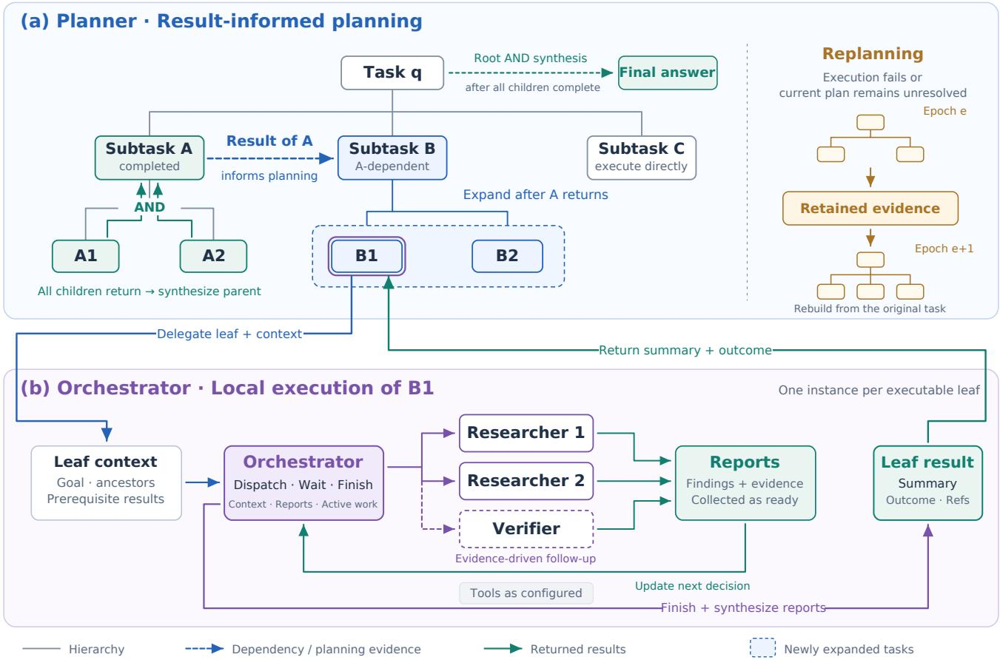  
Figure 1. HTN-Orchestrate separates result-informed task planning from local multi-agent orchestration. (a) The Planner expands ready tasks using prerequisite results and synthesizes parent results after all children return. When rebuilding is needed, supported evidence is retained to construct a new task network. (b) Each executable leaf is delegated to an Orchestrator, which dispatches workers, collects reports as they become available, and uses those reports to guide subsequent assignments and leaf synthesis. The leaf result returns to the task network for further planning and upward synthesis.

Our main contributions are as follows.

• We propose HTN-Orchestrate, a two-layer orchestration framework (Figure 1) that decouples global task planning from local subtask execution through a hierarchical task network that explicitly represents subtask hierarchies and precedence dependencies. The Planner incrementally expands the network as prerequisite results become available, while each executable leaf subtask is delegated to an Orchestrator that coordinates multiple workers.

• We combine result-informed planning, which defers decomposition decisions for dependent subtasks until prerequisite findings are available, with AND-semantic synthesis that propagates results upward through the task hierarchy, and a rebuilding mechanism that retains supported evidence from completed work to construct a revised task network when the current decomposition cannot resolve the task.

• We evaluate HTN-Orchestrate on five benchmarks spanning web research, scientific reasoning, and research workflows and demonstrate that it consistently outperforms Agent Team (Apodex Team, 2026) and DeepSeek Harness (DeepSeek-AI, 2026a). In particular, HTN-Orchestrate achieves 89.73% accuracy on BrowseComp and 73.44% on SUPERChem, exceeding

Agent Team by 2.45 and 4.69 percentage points, respectively. Ablations on BrowseComp demonstrate the contributions of result-informed planning, local multiagent orchestration, and task-network rebuilding.

## 2. Related Work

## 2.1. Multi-Agent Orchestration

Multi-agent orchestration methods vary in how they distribute responsibilities between global task planning and local execution, and most designs favor one side of this tradeoff. Early frameworks such as AutoGen (Wu et al., 2024) and MetaGPT (Hong et al., 2024) organize collaboration through conversation patterns and role-based procedures that provide clear global structure but follow fixed interaction protocols. AFlow (Zhang et al., 2025b) and MaAS (Zhang et al., 2025a) reduce manual design effort by automating workflow and architecture construction, while Conductor (Nielsen et al., 2026) and MAS-Orchestra (Ke et al., 2026) learn to generate orchestration decisions through reinforcement learning. Although these methods can discover effective coordination patterns, the resulting structures are determined before or independently of task execution.

Runtime delegation shifts toward local adaptability by allowing an orchestrator to assign work as execution proceeds, with Magentic-One (Fourney et al., 2024) and AOrchestra (Ruan et al., 2026) managing task progress through agent feedback. Kimi K2.5 (Kimi Team, 2026a) and Apodex 1.1 (Apodex Team, 2026) further support parallel subagents dynamically dispatched by a main agent, and such dispatch decisions can also be learned through policies for agent selection and tool invocation (Dang et al., 2025; Su et al., 2026). However, these approaches couple task decomposition, subtask dispatch, and result synthesis within a single orchestrator, without explicitly separating global planning from local execution management. Workforce, introduced with OWL (Hu et al., 2025a), addresses this by separating a domain-agnostic planner from a central coordinator that manages worker assignments and task dependencies. HTN-Orchestrate shares this separation but assigns a dedicated Orchestrator to each executable leaf subtask, while the Planner maintains and incrementally expands the task network, allowing local coordination within each subtask to operate independently of global planning over the task hierarchy.

## 2.2. Task Decomposition

The tension between local execution and global planning is particularly evident in task decomposition, where the challenge is determining not only how to break a task apart but also when to revise that breakdown in response to execution findings. Static approaches commit to a full decomposition before observing results. Least-to-most prompting (Zhou et al., 2023) generates subproblems before solving them sequentially, and Agent-Oriented Planning (Li et al., 2025) accounts for agent capabilities when decomposing and allocating tasks. D-CORE (Xu et al., 2026) uses reinforcement learning to incentivize decomposition reasoning in large reasoning models, and Select-Then-Decompose (Liu et al., 2025) chooses a decomposition strategy according to the task. These methods improve the quality of decomposition but still finalize it before execution begins.

When intermediate findings affect subsequent work, decomposition must also adapt during execution. Plan-and-Act (Erdogan et al., 2025) trains models on planning trajectories and revises the plan after each executor step, ADaPT (Prasad et al., 2024) recursively decomposes tasks that resist direct execution, ReCAP (Zhang et al., 2025d) revises the remaining plan using execution results, and ReAcTree (Choi et al., 2026) organizes execution through hierarchical agent trees. TodoEvolve (Liu et al., 2026) extends adaptation to the planning architecture itself by learning to generate and revise task-specific planning systems. These methods allow plans to evolve but provide limited support for explicitly modeling precedence dependencies among subtasks. HTN-Orchestrate uses prerequisite results to inform the further decomposition of dependent subtasks, deferring decisions about their internal structure until the relevant evidence becomes available.

## 2.3. Hierarchical Task Networks and Dependency-Aware Planning

Explicit dependencies connect global planning with local execution by determining which results must be available before subsequent work can proceed. Hierarchical task networks represent complex activities through task decomposition and constraints on the resulting subtasks (Erol et al., 1994), and recent work such as ChatHTN (Muñoz-Avila et al., 2025) combines this tradition with language models by interleaving LLM-based decomposition with symbolic HTN planning. At a different level of granularity, LLMCompiler (Kim et al., 2024) constructs dependencies among function calls to schedule parallel execution, whereas FlowSearch (Hu et al., 2025b) models research as an evolving graph of interdependent knowledge units and dynamically revises its structure in response to intermediate findings. HTN-Orchestrate distinguishes the parent-child relation that defines a decomposition from precedence dependencies among sibling subtasks. The former determines how results are synthesized upward after all children complete, while the latter determines which prerequisite results are available for further decomposition and execution. Each executable task then invokes an Orchestrator that can organize multiple workers, combining hierarchical decomposition, result-informed planning, and local multi-agent coordination within a common execution process. Table 1 summarizes the feature differences between HTN-Orchestrate and the most closely related systems.

Table 1. Feature comparison with closely related systems. STR = structured plan (explicit task hierarchy or dependency graph); RES = result-informed (subsequent work conditioned on execution findings); DEC = decoupled (global planning and local execution handled by separate controllers); RPL = replanning (task structure revised during execution); EVC = evidence carryover (findings from a prior plan explicitly condition the rebuilt plan).
<table><tr><td></td><td>STR</td><td>RES</td><td>DEC</td><td>RPL</td><td>EVC</td></tr><tr><td>Agent Team (Apodex Team, 2026)</td><td></td><td>√</td><td></td><td></td><td></td></tr><tr><td>Workforce (Hu et al., 2025a)</td><td>√</td><td></td><td>√</td><td>√</td><td></td></tr><tr><td>ADaPT (Prasad et al., 2024)</td><td>√</td><td></td><td></td><td>√</td><td></td></tr><tr><td>FlowSearch (Hu et al., 2025b)</td><td>√</td><td>√</td><td></td><td>√</td><td></td></tr><tr><td>ChatHTN (Muñoz-Avila et al., 2025)</td><td>√</td><td></td><td></td><td></td><td></td></tr><tr><td>HTN-Orchestrate (ours)</td><td>√</td><td>√</td><td>√</td><td>√</td><td>√</td></tr></table>

## 3. Method

Given a task q and a set of worker roles and tools, HTN-Orchestrate separates global task planning from local subtask execution through two cooperating layers (Figure 1). At the upper layer, the Planner incrementally constructs a hierarchical task network that encodes subtask decompositions and their dependencies, while at the lower layer, each executable leaf subtask is delegated to an Orchestrator that schedules workers and returns a result. Because these results flow back to the Planner, subsequent decomposition decisions reflect findings that were unavailable when the network was first constructed, and when the current decomposition cannot resolve the task, accumulated evidence supports the construction of a revised network.

## 3.1. Task Network Representation

Following the HTN formulation (Erol et al., 1994), we represent a task network as $\mathcal { T } ~ = ~ ( V , E _ { h } , E _ { d } )$ , whose root corresponds to q. The hierarchy edges $E _ { h }$ form a rooted tree in which each parent is decomposed into children that jointly address its task, and the dependency edges $E _ { d }$ impose acyclic precedence constraints among siblings, with an edge $( u , v )$ indicating that v requires the result of u. We denote the children and direct prerequisites of v by Ch(v) and Pred(v), respectively. Unlike classical HTN planners that draw from a predefined library of decomposition rules, our Planner uses an LLM to generate decompositions during execution, which allows the network to grow incrementally as prerequisite results become available.

Each node stores its task description, execution status, and result summary $y _ { v }$ (Appendix B lists the full node fields and prompt templates). A node with $\mathrm { C h } ( v ) = \emptyset$ is a leaf, which the Planner may further decompose into children or route to an Orchestrator for direct execution. Before either can happen, the leaf must be ready, meaning it is pending and all its prerequisites have completed,

Algorithm 1 Planner: Result-Informed Planning and Re  
planning   
Input: Task $q ,$ workers, rebuild limit B, execution budgets   
Output: Answer and resolution outcome   
1: $M  \varnothing ,$ epoch $e \gets 0$   
2: loop   
3: $\tau $ InitializeRoot $( q , M )$   
4: while epoch can advance within execution budgets   
do   
5: while a ready planning leaf v exists do   
6: PlanOrExecute(v, T, M)   
7: L ← ready executable leaves of T   
8: if $L = \mathcal { O }$ then   
9: break   
10: Start Orchestrate(v, $C _ { v } )$ for all $v \in L$   
11: As results arrive, PropagateResults(T)   
12: Settle the wave, or stop it for replanning   
13: if the root is resolved then   
14: return root result and outcome   
15: $\mathbf { i f } e \geq B$ or execution budgets are exhausted then   
16: return synthesis of available evidence   
17: M ← CollectEvidence(T , M)   
18: $e  e + 1$

$$
\begin{array} { r } { \mathrm { R e a d y } ( v ) \iff \mathrm { C h } ( v ) = \emptyset \ \wedge \ v \ \mathrm { i s ~ p e n d i n g } } \\ { \qquad \wedge \ \forall u \in \mathrm { P r e d } ( v ) , \ u \ \mathrm { i s ~ c o m p l e t e d } . } \end{array}\tag{1}
$$

Because execution can yield partial findings rather than a definitive answer, each result also records whether the subtask is resolved or remains open. The completed status in the Ready condition encompasses both outcomes, so a downstream task proceeds with whatever evidence its prerequisite produced regardless of resolution. The resolved-oropen distinction instead feeds into synthesis and replanning decisions that determine whether further work is needed.

## 3.2. Result-Informed Planning

The Planner uses prerequisite execution results to guide subsequent task decomposition and retains accumulated findings to support replanning, as summarized in Algorithm 1. For each ready leaf, PlanOrExecute considers the original goal, the task description, its ancestors, and summaries of relevant prerequisite results, and based on this context either marks the task for direct execution or expands the network with children and their sibling dependencies. Because a dependent subtask receives its decomposition only after its prerequisites return, its internal structure can reflect their findings rather than relying on assumptions made before execution began. For example, a task that first identifies a research subject can supply its result to a subsequent analysis task, whose decomposition can then target that subject’s specific properties (Figure 5 illustrates this on a web-research question where identifying a set of authors allows the Planner to specialize the downstream search to that specific list). Each proposed decomposition is validated for coverage of the parent task and acyclicity of the proposed dependency edges, and revised if either check fails. Depth and branching limits further control overall network growth.

Algorithm 2 Orchestrator: Multi-Agent Subtask Execution   
Input: Leaf $v ,$ context $C _ { v }$ , worker roles, budgets   
Output: Result summary, outcome, and evidence refer  
ences   
1: $R _ { v }  \emptyset , A _ { v }  \emptyset$   
2: while dispatch-round and time budgets remain do   
3: Collect finished reports into $R _ { v }$ and update $A _ { v }$   
4: $a \gets \mathrm { D e c i d e } ( C _ { v } , R _ { v } , A _ { v } )$   
5: if a is dispatch then   
6: Select roles and generate worker instructions   
7: Add assignments to A within available limits   
8: Collect progress within the allotted waiting time   
9: else if a is wait then   
10: Wait for worker progress within the time budget   
11: else   
12: Stop unnecessary active assignments   
13: return $\mathrm { S y }$ nthesizeLea $\mathrm { f } \left( C _ { v } , R _ { v } \right)$   
14: if the shared worker-dispatch budget is exhausted   
then   
15: break   
16: Collect available reports within remaining limits   
17: Stop remaining assignments and update $R _ { v }$   
18: return SynthesizeLea $\mathrm { f } \left( C _ { v } , R _ { v } \right)$

To execute the resulting network, the Planner first processes ready planning nodes until none remain, then dispatches the ready executable leaves to their Orchestrators in parallel. Each such batch forms a wave, and the next planning round begins after the current wave settles. Returned results support both subsequent decomposition along dependency edges and upward synthesis along hierarchy edges. Under AND semantics, an internal node synthesizes its result only after all its children have completed execution. Thus, the result of a node is obtained recursively as

$$
y _ { v } = \left\{ \begin{array} { l l } { \mathrm { O r c h e s t r a t e } ( v , C _ { v } ) , } & { \mathrm { C h } ( v ) = \emptyset , } \\ { \mathrm { S y n t h e s i z e } \big ( v , \left\{ y _ { u } \right\} _ { u \in \mathrm { C h } ( v ) } \big ) , } & { \mathrm { o t h e r w i s e } , } \end{array} \right.\tag{2}
$$

where $C _ { v }$ is the execution context defined in Section 3.3, and the leaf case applies after the Planner has marked v executable. As leaf results arrive, PropagateResults records them in the network and recursively synthesizes each parent whose children have all returned their results. Each synthesized summary is passed to the next parent until the root produces the final result for the original task.

When execution fails or the returned findings indicate no plausible solution under the current task network, the Planner can reconsider the decomposition through replanning. Each construction and execution of a task network constitutes an epoch, and before starting a new epoch the Planner settles or stops ongoing work and uses CollectEvidence to extract supported findings from completed and partial reports into an evidence summary M. This summary conditions the construction of a new network rooted at the original task, providing planning context rather than automatically marking any new subtask as completed, so that the next epoch can pursue a different decomposition while retaining useful evidence. The number of rebuilds is bounded, and the framework terminates through one of two paths. When the root node is resolved, its synthesized result is returned directly as the final answer. When execution budgets are exhausted before the task is resolved, the framework instead synthesizes the evidence obtained so far and reports any unresolved requirements, so the output reflects the sufficiency of the evidence rather than treating the stopping condition as task success.

## 3.3. Multi-Agent Orchestration

For each executable leaf v, an Orchestrator manages the workers needed to address that subtask (Algorithm 2). Workers carry out targeted research, reasoning, or verification using their configured tools, while the Orchestrator decides how the investigation should proceed based on their reports. Each Orchestrator receives a stable context $C _ { v }$ containing the original task, the leaf’s objective, relevant ancestor descriptions, and prerequisite result summaries, and during execution it maintains the set of returned worker reports $R _ { v }$ and active assignments $A _ { v }$

At each decision point, the Orchestrator considers $C _ { v } , R _ { v } ,$ and $A _ { v }$ and chooses to dispatch workers, wait for progress, or finish the subtask. A dispatch decision selects worker roles and produces task-specific instructions based on the current evidence, so an initial investigation can be followed by a focused search or a verification step when a report reveals a gap or a disputed claim. Reports are collected as workers finish, allowing the Orchestrator to schedule followup work while other assignments remain active, or to wait for new reports when the outstanding questions are already covered. This progressive collection of results allows local decisions to respond to evidence within a wave, while limits on concurrency, dispatch rounds, and execution time bound the work assigned to each subtask.

Once the Orchestrator decides to finish, it stops work that is no longer needed and synthesizes the collected reports into a leaf result that includes a summary, a resolved or unresolved outcome, and evidence references. If an execution limit is reached before a voluntary finish, the Orchestrator collects available reports within the remaining time and returns the supported findings together with any outstanding gaps. In both cases, the outcome reflects the sufficiency of the evidence rather than merely whether workers stopped or a verifier was invoked, and the Planner uses the returned result to inform subsequent decomposition through PlanOrExecute and parent synthesis through PropagateResults.

## 4. Empirical Evaluations

## 4.1. Experimental Setup

We evaluate HTN-Orchestrate on five benchmarks covering web research, scientific reasoning, and research workflows. BrowseComp (BC) (Wei et al., 2025) tests an agent’s ability to locate hard-to-find information through persistent web browsing. For scientific reasoning and research, we use both tracks of FrontierScience (Wang et al., 2026), with FrontierScience-Research (FSR) comprising open-ended research subproblems and FrontierScience-Olympiad (FSO) assessing olympiad-level reasoning in physics, chemistry, and biology. We use the text-only subset of 256 questions from SUPERChem (Zhao et al., 2025) to further evaluate multistep reasoning across chemistry subfields, while PRL-Bench (Miao et al., 2026) extends the evaluation to theoretical and computational physics research tasks derived from published papers. We report accuracy for BC, FSO, and SUPERChem, where answers can be directly verified against ground truth. For the rubric-based benchmarks, we report the success rate for FSR, defined as the fraction of responses earning at least seven of ten rubric points, and the mean percentage of satisfied rubric criteria on a 0–100 scale for PRL-Bench.

We compare HTN-Orchestrate with the ReAct and Agent Team workflows implemented in FrontierAgent (Apodex Team, 2026).<sup>2</sup> The ReAct baseline (Yao et al., 2023) uses a single agent that alternates reasoning and tool use, incorporating observations into subsequent actions. Agent Team uses a main agent to decompose the task, dispatch subagents in parallel, and integrate their reports as execution proceeds. We also include DeepSeek Harness (DSH) (DeepSeek-AI, 2026a), DeepSeek’s official agent runtime in Minimal Mode, a single-agent configuration with a persistent shell and file editor, to which we add web search tools for BrowseComp.

All four methods use DeepSeek-V4.1-Flash as the backbone model with high reasoning effort. In HTN-Orchestrate, workers instead use low reasoning effort and operate in two complementary roles for research and verification. Their available tools include web search, webpage retrieval, scholarly search, Python execution, file reading, and report submission, though search and retrieval are disabled for FSR, FSO, SUPERChem, and PRL-Bench. To bound network growth and execution cost, we set the maximum tasknetwork depth to two (counting the root at depth zero) with at most four children per node, and within each executable subtask allow up to three concurrent workers over at most twelve orchestration rounds per epoch, while the Planner can rebuild the task network once during execution. Appendix A lists the full execution settings, evaluation judges, and measurement definitions.

## 4.2. Main Results

HTN-Orchestrate outperforms all three controlled baselines on every benchmark and is competitive with frontier proprietary models despite using DeepSeek-V4.1-Flash, an openweight model, as its backbone (Table 2). On BrowseComp, it achieves 89.73% accuracy, exceeding ReAct by 15.80 percentage points and Agent Team by 2.45 points. Only GPT-6 Astra (91.50%), Kimi K3 (91.20%), and GPT-5.6 Sol (90.40%) score higher, all of which are frontier-scale models. Agent Team, which dispatches subagents without hierarchical planning, already exceeds ReAct by 13.35 points, confirming that multi-agent execution is broadly beneficial for persistent web research. The additional 2.45-point gain from HTN-Orchestrate over Agent Team reflects the contribution of structured decomposition and result-informed planning.

On the two open-ended research benchmarks, HTN-Orchestrate achieves the highest scores among all models in Table 2. On FSR, it reaches a success rate of 43.33%, surpassing Meta Muse Spark (38.00%), GPT-5.5 (33.90%), and Agent Team (40.00%). The 18.33-point margin over ReAct and 3.33-point margin over Agent Team suggest that separating global task planning from local worker coordination allows the framework to manage the iterative hypothesis refinement that open-ended research demands. PRL-Bench reinforces this pattern, with a mean rubric score of 46.00 exceeding the next-best result from Gemini 3.1 Pro (44.27) by 1.73 points, while the 10.19-point gain over Agent Team is the largest on any benchmark.

On the two accuracy-based science benchmarks, HTN-Orchestrate remains competitive with much larger proprietary systems. On FSO, it reaches 79.00% accuracy, matching Gemini 3.1 Pro and improving over Agent Team (75.00%) and DeepSeek Harness (76.00%) by 4.00 and 3.00 points. On SUPERChem, it scores 73.44%, falling only 0.16 points short of GPT-5.6 Sol (73.60%), the overall best, while exceeding Agent Team and ReAct by 4.69 and 8.21 points. Across all five benchmarks, gains over Agent Team range from 2.45 points on BC to 10.19 points on PRL-Bench, with the largest improvements appearing on tasks that reward structured decomposition and iterative refinement.

Table 2. Main results. BC, FSO, and SUPERChem report accuracy (%), FSR reports success rate (%), and PRL-Bench reports the mean percentage of satisfied rubric criteria. Higher is better for all metrics; bold marks the best score and underline marks the second best on each benchmark.
<table><tr><td>Method / Model</td><td>BC</td><td>FSR</td><td>FSO</td><td>SUPERChem (text-only)</td><td>PRL-Bench</td></tr><tr><td colspan="6">Proprietary</td></tr><tr><td>GPT-6 Astra (OpenAI, 2026d)</td><td>91.50</td><td></td><td></td><td></td><td></td></tr><tr><td>GPT-5.6 Sol (OpenAI, 2026c)</td><td>90.40</td><td></td><td></td><td>73.60</td><td></td></tr><tr><td>GPT-5.5 (OpenAI, 2026b)</td><td>84.40</td><td>33.90</td><td>73.80</td><td>66.20</td><td></td></tr><tr><td>GPT-5.4 (OpenAI, 2026a)</td><td>82.70</td><td>23.33</td><td></td><td>57.70</td><td>37.38</td></tr><tr><td>Claude Fable 5 (Anthropic, 2026a)</td><td>87.40</td><td></td><td></td><td></td><td></td></tr><tr><td>Claude Opus 4.8 (Anthropic, 2026c)</td><td>84.30</td><td>26.70</td><td>74.30</td><td>66.90</td><td></td></tr><tr><td>Claude Opus 4.6 (Anthropic, 2026b</td><td>83.70</td><td></td><td>73.00</td><td>62.30</td><td>37.40</td></tr><tr><td>Gemini 3.1 Pro (Google DeepMind, 2026)</td><td>85.90</td><td>16.70</td><td>79.00</td><td>54.30</td><td>44.27</td></tr><tr><td>Qwen 3.7 Max (Qwen Team, 2026)</td><td></td><td>24.80</td><td>74.30</td><td>60.50</td><td></td></tr><tr><td>Meta Muse Spark (Meta Superintelligence Labs, 2026)</td><td></td><td>38.00</td><td></td><td></td><td></td></tr><tr><td colspan="6">Open-weight</td></tr><tr><td>Kimi K3 (Kimi Team, 2026b)</td><td>91.20</td><td>21.70</td><td>69.00</td><td>66.90</td><td></td></tr><tr><td>Hy4 Preview (Tencent, 2026b)</td><td></td><td></td><td></td><td>66.40</td><td></td></tr><tr><td>Hy3 (Tencent, 2026a)</td><td>84.20</td><td>21.30</td><td>74.80</td><td>54.90</td><td></td></tr><tr><td>DeepSeek-V4-Pro (DeepSeek-AI, 2026b)</td><td>83.40</td><td>13.30</td><td>76.00</td><td>62.00</td><td></td></tr><tr><td colspan="6">DeepSeek-V4.1-Flash (DeepSeek-AI, 2026c)</td></tr><tr><td>FrontierAgent ReAct (Yao et al., 2023; Apodex Team, 2026)</td><td>73.93</td><td>25.00</td><td>74.00</td><td>65.23</td><td>36.13</td></tr><tr><td>FrontierAgent Agent Team (Apodex Team, 2026)</td><td>87.28</td><td>40.00</td><td>75.00</td><td>68.75</td><td>35.81</td></tr><tr><td>DeepSeek Harness (DeepSeek-AI, 2026a)</td><td>80.33</td><td>31.67</td><td>76.00</td><td>66.80</td><td>39.89</td></tr><tr><td>HTN-Orchestrate (Ours)</td><td>89.73</td><td>43.33</td><td>79.00</td><td>73.44</td><td>46.00</td></tr></table>

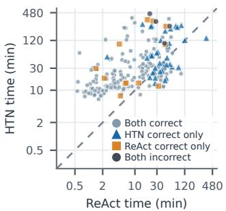  
(a) HTN vs. ReAct.

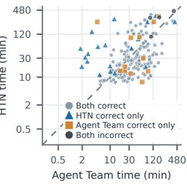  
(b) HTN vs. Agent Team.  
Figure 2. Per-question completion times on a 200-question subset of BrowseComp, with marker shapes and colors indicating paired correctness. Both axes use logarithmic scales; points below the dashed equality line indicate shorter completion times for HTN.

These results also highlight the complementary strengths of multi-agent orchestration and minimal-tooling runtimes. DeepSeek Harness, as a single-agent runtime, outperforms Agent Team on PRL-Bench (39.89 vs. 35.81) and matches it on FSO (76.00 vs. 75.00), showing that a focused singleagent runtime can be competitive on benchmarks that reward sustained reasoning. HTN-Orchestrate outperforms both approaches across all five benchmarks. That it achieves these results with DeepSeek-V4.1-Flash, an open-weight model, while matching or exceeding larger proprietary systems underscores the importance of orchestration design in determining overall system performance.

Table 3. HTN-Orchestrate’s internal statistics on a 200-question subset of BrowseComp, grouped by outcome. Tree metrics describe the final task network; execution counts include work before and after rebuilding. Values are means except for the percentage of questions with a rebuild.
<table><tr><td>Metric Correct Incorrect (n = 184) (n = 16)</td></tr><tr><td>Final tree maximum depth 1.23 1.19</td></tr><tr><td>Final tree leaves 3.95 4.00</td></tr><tr><td>Executed leaf instances 4.52 6.31</td></tr><tr><td>Worker invocations 21.04 47.50</td></tr><tr><td>Orchestrator decision rounds 20.21 44.62</td></tr><tr><td>Task-network rebuild (%) 14.7 50.0</td></tr></table>

## 4.3. Analysis

To understand how HTN-Orchestrate’s two-layer design translates accuracy gains into distinct execution patterns, and to isolate the contribution of each architectural component, we conduct execution analysis and ablation studies on a 200-question subset randomly sampled from BrowseComp. The execution analysis examines completion time, worker concurrency, and internal task-network statistics to reveal the operational signatures of hierarchical orchestration, while the ablations disable result-informed planning, local multi-agent orchestration, and task-network rebuilding in turn to quantify their individual effects.

Execution Analysis. The per-question comparisons in Figure 2 reveal how HTN-Orchestrate’s accuracy advantage interacts with completion time. Among the 165 questions both HTN-Orchestrate and Agent Team answer correctly, HTN-Orchestrate finishes faster on 112 (67.9%), with a median per-question completion-time ratio of 0.699 relative to Agent Team, so its time advantage complements its higher overall accuracy. The comparison with ReAct reveals a different tradeoff, as HTN-Orchestrate generally takes longer on questions both methods answer correctly while correctly answering 38 questions that ReAct misses and missing only 12 that ReAct answers correctly, for a net gain of 26 correct answers.

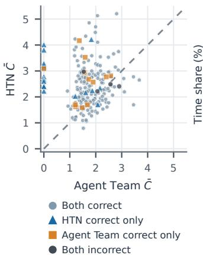  
(a) Average concurrency C<sup>¯</sup>.

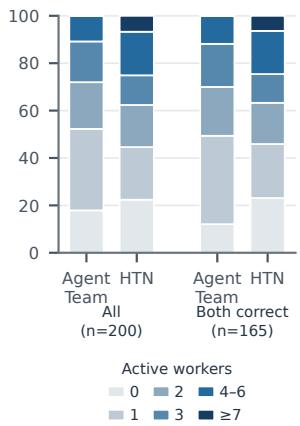  
(b) Concurrency time shares.  
Figure 3. Worker concurrency on a 200-question subset of BrowseComp. (a) Average worker concurrency C<sup>¯</sup> over each question’s full trace window; the dashed line marks equality. (b) Perquestion time shares, averaged equally over all 200 questions or the 165 questions both methods answer correctly. Workers are active from invocation to completion or cancellation, including model and tool waits; control agents are excluded.

Table 4. Ablation results on a 200-question subset of BrowseComp. ∆ is the accuracy difference from HTN-Orchestrate in percentage points.
<table><tr><td>Variant</td><td>Accuracy (%) ∆</td></tr><tr><td>HTN-Orchestrate</td><td>92.0</td></tr><tr><td>Upfront decomposition</td><td>90.5 -1.5</td></tr><tr><td>Single-agent leaf execution</td><td>89.5 -2.5</td></tr><tr><td>No rebuilding</td><td>89.5 -2.5</td></tr></table>

To characterize parallel execution, we apply the averageconcurrency measure used in performance analysis (Huang et al., 2010) to worker invocations. For each question, average worker concurrency is $\begin{array} { r } { \bar { C } = \frac { 1 } { T } \sum _ { i } d _ { i } } \end{array}$ , where d is the active duration of worker invocation i within the trace window and T is the question’s makespan, giving the time-weighted mean number of active workers over the full window including periods with no active workers. Figure 3 compares this measure and the fraction of time spent at different worker counts. Averaged across all questions, worker concurrency is 2.47 for HTN-Orchestrate and 1.70 for Agent Team; on the 165 shared successes, it remains higher at 2.42 vs. 1.82. On this shared subset, HTN-Orchestrate spends an average of 24.6% of each run with at least four active workers, compared with 11.8% for Agent Team, but it also spends a larger fraction of time with no active workers, during which planning, coordination, or synthesis can still proceed. This pattern of concentrated worker activity interspersed with non-worker periods is consistent with its hierarchical organization, which dispatches workers concurrently across executable subtasks, and accompanies the shorter completion times observed on shared successes.

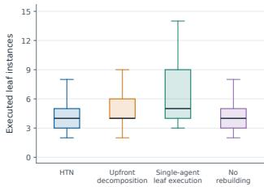  
(a) Executed leaf instances.

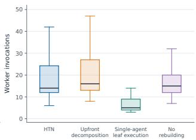  
(b) Worker invocations.

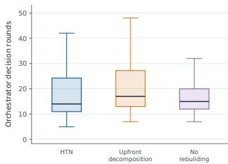

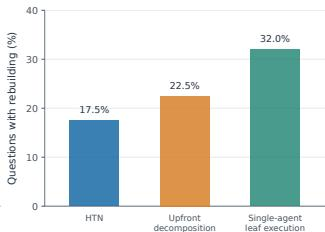  
(c) Orchestrator decision rounds. (d) Task-network rebuilding.  
Figure 4. Execution statistics on a 200-question subset of BrowseComp for HTN-Orchestrate (HTN) and its ablated variants. Panels (a–c) show per-question counts across all epochs. Boxes span the interquartile range, horizontal lines mark medians, and whiskers extend to 1.5 times the interquartile range; outlier markers are hidden. Panel (d) shows the percentage of questions with a tasknetwork rebuild. Single-agent leaf execution is omitted from (c), and No rebuilding from (d), because their values are uniformly zero.

Within HTN-Orchestrate, Table 3 relates final task structure to the execution activity accumulated across the initial and rebuilt task networks. The two outcome groups have similar final tree depths and leaf counts, while questions scored incorrect involve more leaf executions, worker invocations, and Orchestrator decisions on average. Rebuilding also occurs more frequently in this group, at 50.0% compared with 14.7% for questions scored correct. Similar final task structures therefore correspond to substantially different execution histories, making accumulated orchestration and rebuilding activity important for understanding the research process.

The traces also document the use of dynamic decomposition and recovery. The Planner produces child subtasks at nodes with prerequisite dependencies 79 times across 57 of the 200 questions, confirming that result-informed planning occurs regularly during execution. Task-network rebuilding occurs on 35 questions, of which 27 are ultimately scored correct. These runs show that research can continue through a revised task network and reach a correct answer after the original execution encounters a recovery condition.

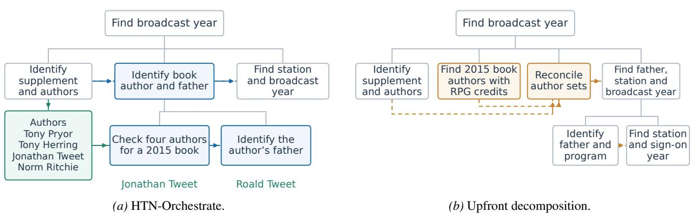  
Figure 5. Result-informed planning on BrowseComp Q193. The question traces an author of a 1993 role-playing-game supplement through a 2015 children’s book and his father’s radio program to a station’s first broadcast year. Solid lines show task hierarchy; dashed arrows show dependencies or returned evidence. Green boxes contain research findings. In (a), the blue subtree is expanded after the author list is returned. In (b), the orange tasks independently discover and reconcile author candidates within a tree fully planned before research begins. Both runs correctly identify WVIK and answer 1980.

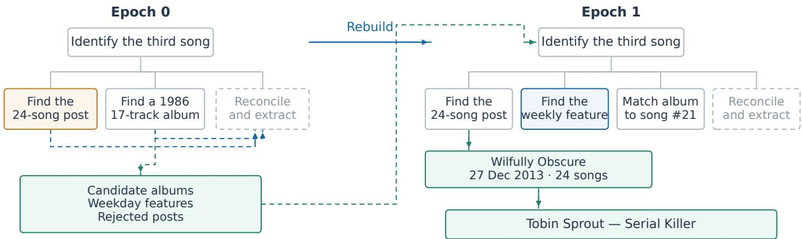  
Figure 6. Task-network rebuilding on BrowseComp Q501. The question asks for the third song in a 24-song blog list dated December 27, using a weekly-feature clue and the 21st song’s album as additional constraints. The orange node marks the initial incomplete post search; the blue node marks the added weekly-feature task. Green boxes show retained findings and subsequent results. Solid lines show hierarchy, and dashed arrows show selected dependencies and evidence transfers. Gray dashed nodes were planned but not executed; the final answer is supported by the completed post-search branch in epoch 1.

Ablation Studies. To isolate the contribution of each component, we evaluate three ablated variants, removing resultinformed planning, local multi-agent orchestration, and tasknetwork rebuilding in turn while preserving the remaining mechanisms (Appendix C gives detailed definitions and extended results). All three reduce accuracy (Table 4), but with distinct effects on execution behavior (Figure 4; counts cover all epochs, with No rebuilding restricted to its single epoch).

Upfront decomposition is the most direct test of the central mechanism because it changes only whether decomposition occurs before or after prerequisite results return, while retaining dependency-based execution, local multi-agent orchestration, and rebuilding. Without current-epoch research results to narrow subsequent decomposition, accuracy decreases from 92.0% to 90.5%. This less targeted planning also increases coordination effort at the median, with worker invocations rising from 14 to 16, Orchestrator rounds from 14 to 17, and the rebuilding rate from 17.5% to 22.5%. Median completion time also rises from 25.23 to 30.02 minutes. The full system therefore achieves higher accuracy with less coordination and lower latency, indicating that intermediate findings guide more effective task decomposition.

Single-agent leaf execution replaces each leaf’s local orchestration with a single ReAct researcher while retaining HTN planning, synthesis, and task-network rebuilding. Accuracy drops to 89.5%, and although the variant naturally uses fewer workers and makes no Orchestrator decisions, the mean number of executed leaf instances increases from 4.67 to 6.15 per question while the rebuilding rate nearly doubles from 17.5% to 32.0%. Less effective research within individual leaves shifts more of the burden to the Planner, which compensates by spawning additional subtasks and rebuilding more frequently. The full system combines higher accuracy with fewer leaf executions and less frequent rebuilding, highlighting how local orchestration supports global task resolution.

No rebuilding disables task-network reconstruction while preserving result-informed planning within the initial epoch. Accuracy decreases to 89.5%, and because the system can no longer trigger a second epoch, average execution activity also falls, with executed leaf instances dropping from 4.67 to 4.12 per question and worker invocations from 23.16 to 19.01. The full system’s higher accuracy therefore comes at the cost of this additional research, which the rebuilding mechanism makes possible by retaining findings and revising the task network when the initial decomposition cannot resolve the task.

Case Studies. Figure 5 shows how intermediate findings shape task decomposition on BrowseComp question Q193. After identifying the supplement and its four authors, HTN-Orchestrate incorporates their names into a newly generated task that checks which author wrote a children’s book in 2015. The upfront decomposition variant instead specifies an independent search for children’s-book authors with role-playing-game credits, followed by a separate task to reconcile the two candidate sets. Both runs reach the correct answer, but the result-informed plan narrows the downstream search to the returned author list and executes four leaves rather than five.

Figure 6 illustrates task-network rebuilding on Q501. The initial search does not locate the target music-blog post. HTN-Orchestrate retains candidate albums, recurring weekday features, and rejected posts, then rebuilds the network with an additional feature-based search and an explicit album-to-list matching task. Research continues until the post-search branch locates the target article and verifies its song list. The final answer is Serial Killer by Tobin Sprout, while No rebuilding returns Silent Night. Appendix D presents an additional case study covering targeted verification within a leaf.

## 5. Conclusion

We presented HTN-Orchestrate, a two-layer orchestration framework that separates global task planning from local multi-agent execution. Its upper layer maintains a hierarchical task network that decomposes incrementally as prerequisite findings become available and can be rebuilt when the initial plan proves insufficient, while its lower layer coordinates multiple workers within each executable subtask. On five benchmarks spanning web research, scientific reasoning, and research workflows, HTN-Orchestrate consistently outperforms ReAct, Agent Team, and DeepSeek Harness. Ablation studies on BrowseComp suggest that result-informed planning, local multi-agent orchestration, and task-network rebuilding each contribute to this advantage, with execution traces revealing interdependence between the two layers. These findings show that separating control across two layers while feeding results back through a shared, revisable task structure allows each layer to inform the other and strengthens both. Future work includes scaling the task-network depth for problems that require deeper decomposition hierarchies and evaluating the framework across additional backbone models.

## Acknowledgments

This work was supported by Apodex. Yanchen Deng, Jianguo Huang, Yao Long Teng, and Yixuan Li conducted this research during internships at Apodex.

## References

Agashe, S., Wong, K., Tu, V., Yang, J., Li, A., and Wang, X. E. Agent S2: A compositional generalist-specialist framework for computer use agents. In COLM, 2025.

Anthropic. Claude code. https://www.anthropic. com/claude-code, 2025.

Anthropic. Claude Fable 5. https://www. anthropic.com/research/claude-fable-5, 2026a.

Anthropic. Claude Opus 4.6. https://www. anthropic.com/news/claude-opus-4-6, 2026b.

Anthropic. Claude Opus 4.8. https: //www.anthropic.com/research/ claude-opus-4-8, 2026c.

Anthropic. Claude managed agents. https: //platform.claude.com/docs/en/ managed-agents/overview, 2026d.

Apodex Team. Apodex 1.1: Scaling agentic intelligence for complex work. arXiv preprint arXiv:2608.23283, 2026.

Choi, J.-W., Kim, H., Ong, H., Yoon, Y., Jang, M., Kim, D., and Kim, J. ReAcTree: Hierarchical LLM agent trees with control flow for long-horizon task planning. In AAMAS, 2026.

Dang, Y., Qian, C., Luo, X., Fan, J., Xie, Z., Shi, R., Chen, W., Yang, C., Che, X., Tian, Y., Xiong, X., Han, L., Liu,

Z., and Sun, M. Multi-agent collaboration via evolving orchestration. In NeurIPS, pp. 165025–165059, 2025.

DeepSeek-AI. Deepseek harness: Everything is a plugin. https://github.com/deepseek-ai/ deepseek-harness, 2026a.

DeepSeek-AI. DeepSeek-V4: Towards highly efficient million-token context intelligence. arXiv preprint arXiv:2606.19348, 2026b.

DeepSeek-AI. DeepSeek-V4.1-Flash technical report. https://huggingface.co/deepseek-ai/ DeepSeek-V4.1-Flash, 2026c.

Erdogan, L. E., Lee, N., Kim, S., Moon, S., Furuta, H., Anumanchipalli, G., Keutzer, K., and Gholami, A. Planand-act: Improving planning of agents for long-horizon tasks. In ICML, pp. 15419–15462, 2025.

Erol, K., Hendler, J., and Nau, D. S. HTN planning: Complexity and expressivity. In AAAI, pp. 1123–1128, 1994.

Fourney, A., Bansal, G., Mozannar, H., Tan, C., Salinas, E., Zhu, E., Niedtner, F., Proebsting, G., Bassman, G., Gerrits, J., Alber, J., Chang, P., Loynd, R., West, R., Dibia, V., Awadallah, A., Kamar, E., Hosn, R., and Amershi, S. Magentic-One: A generalist multi-agent system for solving complex tasks. arXiv preprint arXiv:2411.04468, 2024.

Google DeepMind. Gemini 3.1 Pro model card. https://deepmind.google/models/ model-cards/gemini-3-1-pro/, 2026.

Hong, S., Zhuge, M., Chen, J., Zheng, X., Cheng, Y., Wang, J., Zhang, C., Wang, Z., Yau, S., Lin, Z., Zhou, L., Ran, C., Xiao, L., Wu, C., and Schmidhuber, J. MetaGPT: Meta programming for a multi-agent collaborative framework. In ICLR, 2024.

Hu, M., Zhou, Y., Fan, W., Nie, Y., Xia, B., Sun, T., Ye, Z., Jin, Z., Li, Y., Chen, Q., Zhang, Z., Wang, Y., Ye, Q., Ghanem, B., Luo, P., and Li, G. OWL: Optimized workforce learning for general multi-agent assistance in realworld task automation. In NeurIPS, pp. 50859–50906, 2025a.

Hu, Y., Ma, R., Fan, Y., Shi, J., Cao, Z., Zhou, Y., Yuan, J., Zhang, S., Feng, S., Yan, X., Zhang, S., Zhang, W., Bai, L., and Zhang, B. FlowSearch: Advancing deep research with dynamic structured knowledge flow. arXiv preprint arXiv:2510.08521, 2025b.

Huang, J., Xu, Q., Tiwana, B., Mao, Z. M., Zhang, M., and Bahl, P. Anatomizing application performance differences on smartphones. In MobiSys, pp. 165–178, 2010. doi: 10.1145/1814433.1814452.

Hubert, T., Mehta, R., Sartran, L., et al. Olympiad-level formal mathematical reasoning with reinforcement learning. Nature, 651:607–613, 2026.

Ke, Z., Ming, Y., Xu, A., Chin, R., Nguyen, X.-P., Jwalapuram, P., Yavuz, S., Xiong, C., and Joty, S. MAS-Orchestra: Understanding and improving multi-agent reasoning through holistic orchestration and controlled benchmarks. In ICML, 2026.

Kim, S., Moon, S., Tabrizi, R., Lee, N., Mahoney, M. W., Keutzer, K., and Gholami, A. An LLM compiler for parallel function calling. In ICML, pp. 24370–24391, 2024.

Kimi Team. Kimi K2.5: Visual agentic intelligence. arXiv preprint arXiv:2602.02276, 2026a.

Kimi Team. Kimi K3: Open frontier intelligence. arXiv preprint arXiv:2607.24653, 2026b.

LangChain. Workflows and agents. Lang-Graph documentation, 2026. URL https: //docs.langchain.com/oss/python/ langgraph/workflows-agents. Accessed September 17, 2026.

Li, A., Xie, Y., Li, S., Tsung, F., Ding, B., and Li, Y. Agentoriented planning in multi-agent systems. In ICLR, 2025.

Liu, J., Jiang, Y., Zhang, G., Zhang, Z., Chang, H., Yin, Z., Ren, Q., and Yan, J. TodoEvolve: Learning to architect agent planning systems. In ICML, 2026.

Liu, S., Liu, Y., Wang, Z., Wang, Y., Wu, H., Xiang, L., and He, Z. Select-then-decompose: From empirical analysis to adaptive selection strategy for task decomposition in large language models. In EMNLP, pp. 5454–5477, 2025.

Meta Superintelligence Labs. Muse spark. https://ai. meta.com/blog/muse-spark/, 2026.

Miao, T., Jin, W., Zhang, M., Tan, J., Hu, Y., Guo, T., Zhang, J., Wang, Y., Li, W., Gao, Y., Chen, S., Jiang, W., Hu, Y., Lei, Z., Pang, X., Liu, Z., Zhang, Y., Zhang, L., Chen, K., Wang, W., E, W., and Chen, S. PRL-Bench: A comprehensive benchmark evaluating LLMs capabilities in frontier physics research. arXiv preprint arXiv:2604.15411, 2026.

Muñoz-Avila, H., Aha, D. W., and Rizzo, P. ChatHTN: Interleaving approximate (LLM) and symbolic HTN planning. In International Conference on Neuro-symbolic Systems, pp. 446–458, 2025.

Nielsen, S., Cetin, E., Schwendeman, P., Sun, Q., Xu, J., and Tang, Y. Learning to orchestrate agents in natural language with the conductor. In ICLR, 2026.

Nous Research. Hermes agent: The agent that grows with you. https://github.com/NousResearch/ hermes-agent, 2026.

Novikov, A., Vu, N., Eisenberger, M., Dupont, E., Huang,˜ P.-S., Wagner, A. Z., Shirobokov, S., Kozlovskii, B., Ruiz, F. J., Mehrabian, A., et al. AlphaEvolve: A coding agent for scientific and algorithmic discovery. arXiv preprint arXiv:2506.13131, 2025.

OpenAI. GPT-5.4 thinking. https: //deploymentsafety.openai.com/ gpt-5-4-thinking, 2026a.

OpenAI. GPT-5.5 system card. https://openai. com/index/gpt-5-5-system-card, 2026b.

OpenAI. Introducing GPT-5.6. https://openai.com/ index/gpt-5-6/, 2026c.

OpenAI. GPT-6 astra. https://openai.com/blog/ gpt-6-astra, 2026d.

Prasad, A., Koller, A., Hartmann, M., Clark, P., Sabharwal, A., Bansal, M., and Khot, T. ADaPT: As-needed decomposition and planning with language models. In Findings ofNAACL, pp. 4226–4252, 2024.

Qwen Team. Qwen3.7: The agent frontier. https:// qwen.ai/blog?id=qwen3.7, 2026.

Ruan, J., Xu, Z., Peng, Y., Ren, F., Yu, Z., Liang, X., Xiang, J., Chen, Y., Liu, B., Wu, C., Luo, Y., and Zhang, J. AOrchestra: Automating sub-agent creation for agentic orchestration. arXiv preprint arXiv:2602.03786, 2026.

Steinberger, P. and OpenClaw Community. OpenClaw: Your own personal AI assistant. https://github. com/openclaw/openclaw, 2026.

Su, H., Diao, S., Lu, X., Liu, M., Xu, J., Dong, X., Fu, Y., Belcak, P., Ye, H., Yin, H., Dong, Y., Bakhturina, E., Yu, T., Choi, Y., Kautz, J., and Molchanov, P. ToolOrchestra: Elevating intelligence via efficient model and tool orchestration. In ICML, 2026.

Tencent. Hunyuan Hy3. https://huggingface.co/ tencent/Hy3, 2026a.

Tencent. Hunyuan Hy4 preview. https: //huggingface.co/tencent/Hy4-Preview, 2026b.

Wang, M., Lin, R., Hu, K., Jiao, J., Chowdhury, N., Chang, E., and Patwardhan, T. FrontierScience: Evaluating AI’s ability to perform expert-level scientific tasks. arXiv preprint arXiv:2601.21165, 2026.

Wang, X., Li, B., Song, Y., Xu, F. F., Tang, X., Zhuge, M., Pan, J., Song, Y., Li, B., Singh, J., Tran, H., Li, F., Ma, R., Zheng, M., Qian, B., Shao, D., Muennighoff, N., Zhang, Y., Hui, B., Lin, J., Brennan, R., Peng, H., Ji, H., and Neubig, G. OpenHands: An open platform for AI software developers as generalist agents. In ICLR, 2025.

Wei, J., Sun, Z., Papay, S., McKinney, S., Han, J., Fulford, I., Chung, H. W., Passos, A. T., Fedus, W., and Glaese, A. BrowseComp: A simple yet challenging benchmark for browsing agents. arXiv preprint arXiv:2504.12516, 2025.

Wu, Q., Bansal, G., Zhang, J., Wu, Y., Li, B., Zhu, E., Jiang, L., Zhang, X., Zhang, S., Liu, J., Awadallah, A., White, R. W., Burger, D., and Wang, C. AutoGen: Enabling next-gen LLM applications via multi-agent conversations. In COLM, 2024.

Xu, B., Wu, S., Jiang, H., Liu, K., Chen, X., Hu, L., and Yang, B. D-CORE: Incentivizing task decomposition in large reasoning models for complex tool use. In ICML, 2026.

Yang, K., Swope, A., Gu, A., Chalamala, R., Song, P., Yu, S., Godil, S., Prenger, R. J., and Anandkumar, A. LeanDojo: Theorem proving with retrieval-augmented language models. In NeurIPS, pp. 21573–21612, 2023.

Yao, S., Zhao, J., Yu, D., Du, N., Shafran, I., Narasimhan, K., and Cao, Y. ReAct: Synergizing reasoning and acting in language models. In ICLR, 2023.

Zhang, G., Niu, L., Fang, J., Wang, K., Bai, L., and Wang, X. Multi-agent architecture search via agentic supernet. In ICML, pp. 75834–75852, 2025a.

Zhang, J., Xiang, J., Yu, Z., Teng, F., Chen, X., Chen, J., Zhuge, M., Cheng, X., Hong, S., Wang, J., Zheng, B., Liu, B., Luo, Y., and Wu, C. AFlow: Automating agentic workflow generation. In ICLR, 2025b.

Zhang, W., Zeng, L., Xiao, Y., Li, Y., Cui, C., Zhao, Y., Hu, R., Liu, Y., Zhou, Y., and An, B. AgentOrchestra: Orchestrating multi-agent intelligence with the Tool-Environment-Agent (TEA) protocol. arXiv preprint arXiv:2506.12508, 2025c.

Zhang, Z., Chen, T., Xu, W., Pentland, A., and Pei, J. Re-CAP: Recursive context-aware reasoning and planning for large language model agents. In NeurIPS, pp. 95158– 95186, 2025d.

Zhao, Z., Huang, Z., Li, J., Lin, S., Zhou, J., Cao, F., Zhou, K., Ge, R., Long, T., Zhu, Y., Liu, Y., Zheng, J., Wei, J., Zhu, R., Zou, P., Li, W., Cheng, Z., Ding, T., Wang, Y., Yan, Y., Wei, T., Ming, H., Mao, W., Sun, C., Liu, Y., Wang, Z., Zhang, Z., Yang, T., Ma, H., Gao, Z., and Pei,

J. SUPERChem: A multimodal reasoning benchmark in chemistry. arXiv preprint arXiv:2512.01274, 2025.

Zhou, D., Schärli, N., Hou, L., Wei, J., Scales, N., Wang, X., Schuurmans, D., Cui, C., Bousquet, O., Le, Q., and Chi, E. Least-to-most prompting enables complex reasoning in large language models. In ICLR, 2023.

## A. Experimental Details

## A.1. Benchmarks and Tool Access

We evaluate HTN-Orchestrate on five benchmarks covering web research, scientific problem solving, and research-level reasoning. Table 5 summarizes the evaluation sets. The BrowseComp main results use the full 1,266-question set, and the ablations use the same fixed subset of 200 questions for all variants.

Table 5. Evaluation sets and solver tools. Python execution is available in all five settings. Offline evaluation disables search, page retrieval, and external network access while retaining Python computation.
<table><tr><td>Benchmark</td><td>Questions</td><td>Task format</td><td>Retrieval</td></tr><tr><td>BrowseComp</td><td>1,266</td><td>Multi-hop web research; short factual answers</td><td>Enabled</td></tr><tr><td>BC ablation subset</td><td>200</td><td>Same task format; fixed question IDs across variants</td><td>Enabled</td></tr><tr><td>FrontierScience-Research</td><td>60</td><td>Research-level scientific problems; written solutions</td><td>Disabled</td></tr><tr><td>FrontierScience-Olympiad</td><td>100</td><td>Olympiad-level problems; worked solutions and final answers</td><td>Disabled</td></tr><tr><td>SUPERChem</td><td>256</td><td>Text-only chemistry questions; option selection</td><td>Disabled</td></tr><tr><td>PRL-Bench</td><td>100</td><td>Research-level physics problems; written solutions</td><td>Disabled</td></tr></table>

For offline tasks, worker instructions ask agents to derive results from the problem statement, check assumptions, and verify calculations with Python. The verifier checks the derivation and answer independently using the same available tools.

## A.2. Model and Execution Settings

The solver backbone is DeepSeek-V4.1-Flash. Table 6 gives the execution settings used across all benchmarks. Planner and Orchestrator calls use high reasoning effort, while worker and instruction-generation calls use low reasoning effort. Leaf synthesis, tree synthesis, and recovery use high reasoning effort.

Table 6. HTN-Orchestrate execution settings. Tree depth counts the root as depth zero. Worker capacity applies within a leaf; independent ready leaves may execute concurrently.
<table><tr><td>Setting</td><td>Value</td></tr><tr><td>Temperature / top-p</td><td>1.0 / 0.95</td></tr><tr><td>Maximum output tokens per model call</td><td>65,536</td></tr><tr><td>Maximum tree depth</td><td>2</td></tr><tr><td>Maximum children per decomposition</td><td>4</td></tr><tr><td>Maximum Orchestrator decisions per leaf per epoch</td><td>12</td></tr><tr><td>Worker capacity per leaf</td><td>3</td></tr><tr><td>Maximum ReAct turns per worker</td><td>70</td></tr><tr><td>Maximum tree rebuilds per question</td><td>1</td></tr><tr><td>Leaf time budget</td><td>7,200 s</td></tr><tr><td>Question time budget</td><td>28,800 s</td></tr><tr><td>Finalization reserve</td><td>1,800 s</td></tr><tr><td>Completed precursor context budget</td><td>24,000 chars total; 6,000 per summary</td></tr><tr><td>Repeated runs per question and variant</td><td>1</td></tr></table>

The ReAct, Agent Team, and DeepSeek Harness baselines use the same solver backbone in the within-backbone comparison.   
Their results are reported separately from the published model results in the main table.

## A.3. Evaluation Judges

BrowseComp, FrontierScience-Research, FrontierScience-Olympiad, and PRL-Bench use GPT-5.5 as the judge for semantic answer matching and rubric evaluation. SUPERChem uses exact matching against the selected option.

## A.4. Execution Measurements

Question duration is the elapsed time recorded for the selected question attempt, including planning, worker execution, coordination, and finalization. Execution counts include all epochs of that attempt. An executed leaf is identified by its question, epoch, and node ID, and a worker invocation is one ReAct worker launch. Orchestrator decisions include dispatch,

wait, and terminate actions.

For worker concurrency, let $n _ { q } ( t )$ be the number of active workers at time t during question q, and let $T _ { q }$ be the duration of its main execution trace. The time-averaged concurrency C<sup>¯</sup> used in Section 4.3 is

$$
\bar { C } _ { q } = \frac { 1 } { T _ { q } } \int _ { 0 } ^ { T _ { q } } n _ { q } ( t ) d t .\tag{3}
$$

This measure includes intervals spent planning or synthesizing when no worker is active. Dataset averages give each question equal weight. Paired latency ratios compare the same question only when both methods answer it correctly.

## B. Implementation Details

## B.1. Task-Node Representation

Each task node stores its objective, hierarchical position, sibling prerequisites, execution state, and evidence summary. Table 7 lists the fields used by planning and execution. A pending leaf becomes ready when all its declared prerequisites have completed. If further planning is required, the Planner receives the node objective and completed precursor summaries before choosing between direct execution and decomposition.

Table 7. Task-node representation.
<table><tr><td>Field</td><td>Meaning</td></tr><tr><td>id,parent_id, children</td><td>Node identity and hierarchical edges</td></tr><tr><td>title,task</td><td>Short label and self-contained objective</td></tr><tr><td>depends_on</td><td>Sibling nodes whose completion is required before this node becomes ready</td></tr><tr><td>needs_decomposition</td><td>Whether a ready node returns to the Planner</td></tr><tr><td>status</td><td>pending, running, completed, or failed</td></tr><tr><td>result_summary, ref</td><td>Evidence summary and reference to the full leaf result</td></tr><tr><td>completion_outcome</td><td>resolved or exhausted_unresolved</td></tr><tr><td>failure_reason</td><td>Execution or synthesis failure information</td></tr></table>

## B.2. Prompt Templates and Tool Schemas

Table 8 summarizes the information supplied to each role and the output it controls. The remainder of this section excerpts the core decision logic from each role’s system prompt and lists the tool schemas that structure their outputs. Full prompt templates are available in the code repository.

Table 8. Role inputs and outputs.
<table><tr><td>Role</td><td>Input</td><td>Output</td></tr><tr><td>Planner</td><td>Root question, current task, completed precursor summaries, restart context</td><td>Direct execution or validated child tasks and dependencies</td></tr><tr><td>Orchestrator</td><td>Leaf objective, prerequisite evidence, returned reports, active assignments, budget</td><td>Dispatch, wait, or terminate</td></tr><tr><td>Instruction generator</td><td>Leaf objective, selected role, evidence and remaining issue Assigned objective, original constraints, prior evidence</td><td>An executable worker assignment Findings, evidence, unresolved constraints,</td></tr><tr><td>Researcher</td><td></td><td>confidence</td></tr><tr><td>Verifier</td><td>Proposed answer, original objective, supporting reports</td><td>Completeness and correctness checks, ver- dict</td></tr><tr><td>Synthesizer</td><td>Node objective and worker or child reports</td><td>Evidence summary and completion outcome</td></tr><tr><td>Recovery</td><td>Original question, retained evidence, unresolved relations</td><td>A revised task network</td></tr></table>

Planner. The Planner receives the root question, the current task to decompose, completed precursor summaries, and (when rebuilding) retained evidence from a previous epoch. Its user message follows this structure:

## Root Goal   
{root\_question}   
## Prior Epoch Recovery Context [present only when rebuilding]   
{retained\_evidence}   
## Task to Decompose   
{current\_task\_title}   
{current\_task\_objective}   
## Completed Precursor Evidence [present when prerequisites have completed]   
<precursor relation="direct|ancestor" node\_id="{id}"   
title="{title}" completion\_outcome="{outcome}">   
{completed\_result\_summary}   
</precursor>   
## Decomposition Constraints   
Maximum subtasks: {max\_children}   
Depth remaining after this split: {child\_remaining\_depth}

The system prompt instructs the Planner to choose exactly one planning action:

Choose exactly one planning action:   
execute\_direct when the remaining work is one coherent investigation, verification, or   
synthesis that the adaptive leaf orchestrator can handle.   
decompose only when two or more genuinely distinct workstreams benefit from separate   
execution, parallelism, timeout isolation, or later hierarchical synthesis.

The Planner emits its decision through tool calls. For decomposition, it emits one decompose call per subtask. The runtime collects these calls into a single atomic plan, validates coverage and acyclicity, and installs the children.

decompose(id, title, task, depends\_on, needs\_decomposition, rationale)   
id: short unique slug for this subtask   
title: human-readable label (3-7 words)   
task: compact structural objective (≤1000 chars)   
depends\_on: IDs of sibling subtasks that must finish first (default: [])   
needs\_decomposition: whether to return to planning after prerequisites   
rationale: why this branch is warranted (≤800 chars)

For direct execution, a single execute\_direct(rationale) call marks the current node as an executable leaf.

Orchestrator. The Orchestrator receives the complete leaf context and all returned reports at every decision round. The excerpt below shows the retrieval-enabled rendering used for BrowseComp. When retrieval is disabled, the template conditionally omits search and retrieval references from role descriptions and dispatch instructions. The user message contains:

```markdown
## Task Context (C)
{leaf_objective_and_prerequisite_evidence}
## Sub-agent Results (R)
{completed_worker_reports}
## In-flight Agent Work (do not duplicate)
{outstanding_assignments}
## Available Agent Roles
dynir_researcher - searches, fetches, computes; gathers facts + evidence
dynir_verifier - independently re-checks a candidate answer
## Execution Budget
Rounds remaining: {rounds_remaining}
Max agents this round: {available_worker_capacity}
Call one of: terminate, dispatch, wait.
```

The core decision rule from the system prompt:

dispatch - Send agents when R does not yet fully + verifiably answer the leaf task.   
Pursue important routes through genuinely different retrieval methods. Verify BEFORE   
finishing: once you have a candidate, dispatch a verifier so it re-confirms with   
independent searches.   
wait - Use when R is not sufficient to terminate, at least one agent is still in flight,   
and R exposes no distinct gap worth dispatching.   
terminate - When R contains a complete answer AND a verifier has confirmed it, OR when   
no distinct evidence-producing route remains. Retain the best-supported candidate and   
explicit unresolved gaps.

Each dispatch call specifies role\_id, task\_summary, and rationale. Multiple dispatch calls in one response start independent assignments concurrently.

Researcher. The Researcher receives a self-contained assignment produced by the instruction generator. The system prompt specifies a five-step methodology (understand, search strategically, extract with precision, compute and verify in code, write a complete answer) and requires all calculations to use Python. The report is submitted through a submit\_report(content, confidence) tool call:

Scope: [what was investigated]   
Finding: [best-supported finding or ranked candidates]   
Constraint ledger:   
[candidate] - SUPPORTED / CONTRADICTED / UNRESOLVED for each constraint   
Evidence:   
Source URL or computation   
Confidence: [numeric value from 0.0 to 1.0]   
Conflicts: [contradictions between sources with citations, or "none"]

Verifier. The Verifier receives the proposed answer, the original task, and supporting reports. Its system prompt specifies four phases: (1) completeness, listing every requirement as answered or missing; (2) correctness, independently verifying factual claims and recomputing calculations; (3) precision, confirming exact values rather than approximations; and (4) answer contract, checking scope and format. Its report uses:

Verdict: CONFIRMED | NEEDS CORRECTION | INCOMPLETE   
Unconfirmed or wrong constraints: [specific factual gaps, or "none"]   
Corrected answer: [supported replacement, or "N/A"]

Synthesis. Separate templates cover leaf, internal-node, and root synthesis. Leaf synthesis joins worker reports into an evidence memo. Internal synthesis combines child results for the parent. Root synthesis checks every requested output field and returns the final answer. All templates distinguish resolved (the complete answer-bearing claim is positively supported) from exhausted\_unresolved (a decisive relation remains missing after available routes are exhausted, with partial evidence preserved).

Recovery. When the current task network cannot resolve the root objective, the recovery step extracts supported facts through an extract\_supported\_facts tool that requires each claim to include a verbatim supporting quote and source reference. These facts, together with unresolved relations and the reason the previous approach stopped, form the restart context for the next epoch. The rebuild instructions supplement the Planner with the requirement to identify the most discriminative unresolved relation and to preserve a discovery route that can surface an alternative candidate.

## C. Additional Results and Ablation Details

## C.1. Ablation Definitions

All three ablations use the same 200 BrowseComp questions. Each changes one part of the orchestration procedure while preserving the remaining mechanisms.

In the single-agent variant, the unit of assignment is an executed leaf within an epoch. A question may still contain several leaves, and a rebuilt task network may introduce new leaves. In the upfront variant, a downstream worker can consume completed prerequisite results even though its position and objective were planned earlier.

Table 9. Components changed by each ablated variant.
<table><tr><td>Variant</td><td>Changed behavior</td><td>Retained components</td></tr><tr><td>Upfront decomposition</td><td>Complete the task network before executing any leaf in each epoch. Decomposition instructions refer to anticipated outputs rather than completed precursor results.</td><td>Dependency-constrained execution, local multi-agent orchestration, synthesis, rebuild- ing</td></tr><tr><td>Single-agent leaf execu- tion</td><td>Launch exactly one ReAct researcher for each exe- cutable leaf. Its report goes directly to leaf synthesis, replacing Orchestrator decisions and multi-worker dispatch.</td><td>Result-informed planning, prerequisite con- text, leaf and tree synthesis, rebuilding</td></tr><tr><td>No rebuilding</td><td>Set the maximum number of rebuilds to zero.</td><td>Result-informed planning, local multi-agent orchestration, synthesis, finalization from accumulated evidence</td></tr></table>

## C.2. Accuracy, Execution Volume, and Latency

Table 10 extends the accuracy comparison in the main paper with execution volume and latency measurements. Upfront decomposition uses more executed leaves and workers than the full system and has longer mean and median duration. The single-agent variant reduces worker use and latency while its number of executed leaves increases and rebuilding occurs on 64 questions, compared with 35 for the full system. Removing rebuilding reduces mean duration, although its median duration is slightly higher.

Table 10. BrowseComp-200 ablation results. Execution counts and duration include all epochs of each selected attempt. Time is measured in minutes; leaves, workers, and decisions are means per question.
<table><tr><td>Method</td><td>Correct</td><td>Acc. (%)</td><td>Mean time</td><td>Med. time</td><td>Exec. leaves</td><td>Workers</td><td>Decisions</td><td>Rebuilt</td></tr><tr><td>HTN-Orchestrate</td><td>184</td><td>92.0</td><td>58.03</td><td>25.23</td><td>4.665</td><td>23.155</td><td>22.165</td><td>35</td></tr><tr><td>Upfront decomposition</td><td>181</td><td>90.5</td><td>67.69</td><td>30.02</td><td>5.025</td><td>24.760</td><td>24.025</td><td>45</td></tr><tr><td>Single-agent leaf execution</td><td>179</td><td>89.5</td><td>28.49</td><td>17.69</td><td>6.145</td><td>6.145</td><td>0</td><td>64</td></tr><tr><td>No rebuilding</td><td>179</td><td>89.5</td><td>46.54</td><td>28.15</td><td>4.120</td><td>19.010</td><td>18.500</td><td>0</td></tr></table>

## C.3. Paired Correctness

Table 11 partitions the same 200 questions by paired correctness between the full system and each ablated variant. Figure 7 visualizes the exclusive correct outcomes.

Table 11. Paired correctness on BrowseComp-200. “HTN correct only” means the full system is correct and the ablated variant is incorrect; “Ablated variant correct only” denotes the reverse.
<table><tr><td>Ablated variant</td><td>Both correct</td><td>HTN correct only</td><td>Ablated variant correct only</td><td>Both incorrect</td><td>Net HTN gain</td></tr><tr><td>Upfront decomposition</td><td>176</td><td>8</td><td>5</td><td>11</td><td>+3</td></tr><tr><td>Single-agent leaf execution</td><td>172</td><td>12</td><td>7</td><td>9</td><td>+5</td></tr><tr><td>No rebuilding</td><td>175</td><td>9</td><td>4</td><td>12</td><td>+5</td></tr></table>

## D. Additional Case Studies

## D.1. Using an Intermediate Result to Specialize Later Work

BrowseComp Q193 asks for a radio station’s first broadcast year through a chain of clues involving a 1993 role-playing supplement, one of its authors, a children’s book, and the author’s father. The initial investigation identifies Creative Campaigning and returns four authors: Tony Pryor, Tony Herring, Jonathan Tweet, and Norm Ritchie. The Planner then specializes the downstream investigation using this returned list, checking which author wrote the 2015 children’s book and establishing the father’s identity.

The resulting chain identifies Jonathan Tweet, Grandmother Fish, Roald Tweet, and WVIK, leading to the answer 1980. The upfront variant also answers correctly, but plans its children’s-book investigation before receiving the author list. Across the complete attempts, HTN-Orchestrate executes four leaves and 15 workers, compared with five leaves and 20 workers for upfront decomposition. This case shows how an intermediate result can make the remaining task more specific even when both methods eventually reach the same answer.

Single-agent leaf: Gregory Wait · incorrect  
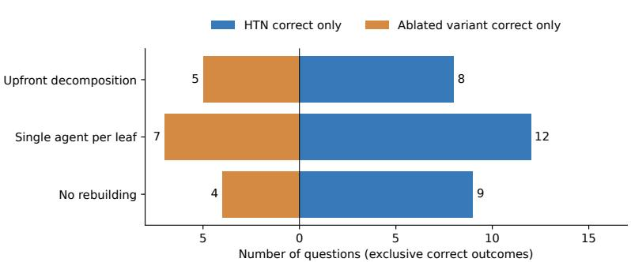  
Figure 7. Exclusive correct outcomes in the ablation comparison. Blue bars count questions answered correctly only by HTN-Orchestrate; orange bars count questions answered correctly only by the ablated variant. The difference gives the net gain in Table 11.

## D.2. Targeted Verification within a Leaf

BrowseComp Q1025 asks for a conductor identified by a 2008 concert review, a poem-based opening work, and a venue dedicated in the early 1990s. The task network separates identifying the poem, locating candidate reviews, and reconciling the conductor’s identity. Within the review-search leaf, the Orchestrator dispatches complementary review-first, venue-first, and opening-song investigations.

The venue-first report connects the Berger Center, dedicated in 1992, with Reveille Men’s Chorus, conductor Linus Lerner, and the opener Come Travel With Me. The Orchestrator then assigns a verifier to check that evidence chain. The completed attempt uses three leaves and ten workers. The single-agent-per-leaf variant executes nine leaves across two epochs and submits Gregory Wait; its final explanation does not establish the specific 2008 review connecting that conductor to the requested performance.

Local multi-agent orchestration · Q1025 Identify a conductor from a 2008 concert review, a poem-based opener, and a venue dedicated in the early 1990s  
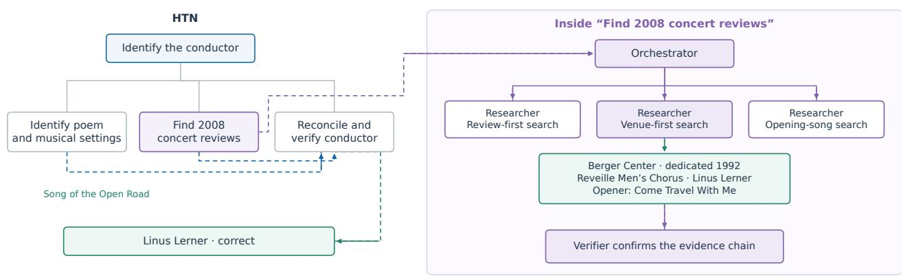  
Executed leaves: HTN 3 · Single-agent leaf 9 (across 2 epochs)  
Figure 8. Local multi-agent orchestration on BrowseComp Q1025. The expanded leaf shows complementary discovery assignments followed by verification of a returned candidate. The full system identifies Linus Lerner; the single-agent-per-leaf variant submits Gregory Wait.

## D.3. Evidence Carried across a Rebuild

BrowseComp Q501 asks for the third song in a 24-song blog list dated 27 December, using clues about a weekly feature and an album. In the first epoch, the investigation fails to recover the required list before a leaf timeout. Recovery retains the findings and unresolved source-identification work, and the next epoch constructs a revised task network.

The second epoch obtains answer-bearing evidence in its post-list branch. When a later timeout ends further execution, recovery finalization uses the accumulated evidence to return “Serial Killer” by Tobin Sprout. The no-rebuilding variant returns “Silent Night.” The full attempt executes five leaves and 72 workers across two epochs, compared with two leaves and 18 workers for no rebuilding. This case illustrates a successful continuation through evidence-preserving recovery, including finalization from the evidence available at the execution limit.

Table 12. Execution counts for the three BrowseComp case pairs. Counts cover the entire selected question attempt.
<table><tr><td>Question</td><td>Method</td><td>Leaves</td><td>Workers</td><td>Decisions</td><td>Rebuilds</td><td>Answer</td></tr><tr><td>Q193</td><td>HTN-Orchestrate</td><td>4</td><td>15</td><td>18</td><td>0</td><td>1980</td></tr><tr><td>Q193</td><td>Upfront decomposition</td><td>5</td><td>20</td><td>21</td><td>0</td><td>1980</td></tr><tr><td>Q1025</td><td>HTN-Orchestrate</td><td>3</td><td>10</td><td>10</td><td>0</td><td>Linus Lerner</td></tr><tr><td>Q1025</td><td>Single-agent leaf execution</td><td>9</td><td>9</td><td>0</td><td>1</td><td>Gregory Wait</td></tr><tr><td>Q501</td><td>HTN-Orchestrate</td><td>5</td><td>72</td><td>56</td><td>1</td><td>Serial Killer</td></tr><tr><td>Q501</td><td>No rebuilding</td><td>2</td><td>18</td><td>18</td><td>0</td><td>Silent Night</td></tr></table>