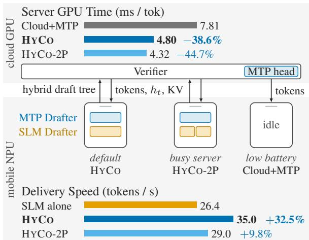
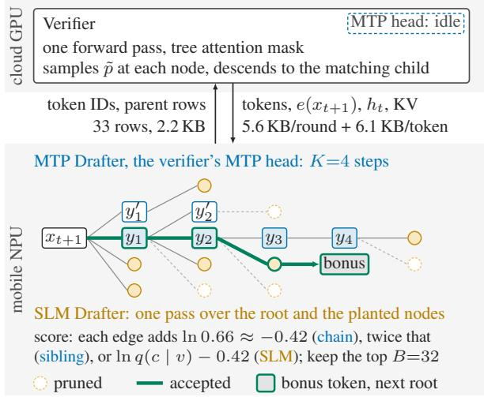
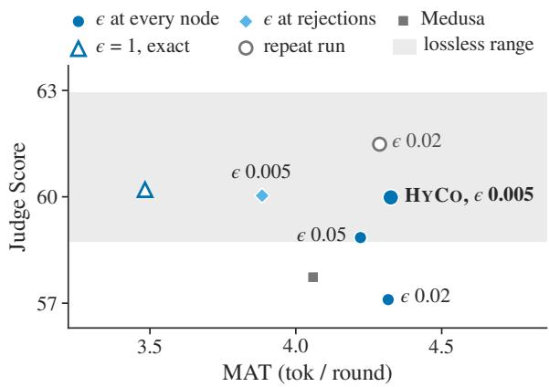

# HYCO: Hybrid Drafting for Cost-Efficient Mobile–Cloud Speculative Decoding

Hanbin Bae Heejin Choi Joohyung Lee

Byoung Jin Choi Sangjun Park Hoon-Young Cho

AI Solution Team, Samsung Research, Seoul, Republic of Korea

{bhb0722.bae,hee\_jin.choi,jooooh.lee,bj87.choi,sj0.park,h.y.cho}@samsung.com

## Abstract

Device–cloud speculative decoding reduces server computation, but growing a deep draft tree with a small language model (SLM) requires repeated passes on a mobile neural processing unit (NPU). We present HYCO, which assigns depth to the server model’s native multitoken prediction (MTP) head, executed on the device, and alternative branches to one SLM pass. The server returns the hidden state, input embedding, and key–value entries needed by the head instead of executing its sequential steps. Quantization, a restricted vocabulary, and a 1K-token window fit both drafters to the NPU. An ϵ-threshold rule additionally relaxes exact preservation of the verifier’s sampling distribution. In single-client runs with a Galaxy S26 Ultra over LTE/5G, HYCO reduces server GPU time per output token relative to server-side MTP self-speculation by 38.6% on Spec-Bench and 29.2% on 32K-token summarization. With the same acceptance rule, three Spec-Bench runs per system show 9.0 percentage points more saving and 1.9× delivery speed than an SLM-only drafter. HYCO differs from Cloud+MTP by +0.2 judge-score points (paired 95% CI: −0.9 to +1.3); exploratory translation favors SpecEdge-ϵ. Without relax ation, HYCO exact saves 27.7% and 11.9% on the two datasets.

## 1 Introduction

Speculative decoding accelerates large language models (LLMs) by verifying several draft tokens in one forward pass, with exact verification preserving the LLM’s sampling distribution (Leviathan et al., 2023; Chen et al., 2023). Serving engines support it (Kwon et al., 2023; Zheng et al., 2024), and recent LLMs include a native multi-token prediction (MTP) head (DeepSeek-AI, 2024; Gemma Team, 2026), one of several approaches to drafting from the LLM’s hidden states (Cai et al., 2024; Li et al., 2024, 2025b). Device–cloud speculative decoding instead places a small language model (SLM)

on the user’s device and leaves verification to the server (Park et al., 2025; Li et al., 2025a). Communication can make an individual request slower than server-only speculation (Lyu et al., 2026); the opportunity is therefore to reduce server computation without making the mobile experience impractically slow.

We target two goals. The server should spend less GPU time per output token than Cloud+MTP, which already runs the LLM’s own MTP selfspeculation. The user should receive tokens at least as fast as the SLM alone generates them on the device. These are distinct reference points: Cloud+MTP measures the server-side opportunity, whereas the SLM alone represents a local alternative for the user.

Meeting both goals is difficult on a mobile neural processing unit (NPU). The drafters must fit integer execution graphs, limited shared memory, and compiled context lengths. Acceptance varies across tasks (Liu et al., 2024a; Xia et al., 2024) and determines how effectively each round amortizes server work and communication. A tree offers alternative tokens at each position and is verified in one pass (Miao et al., 2024), but growing it with an autoregressive SLM requires a sequential pass per level. The four-level SpecEdge-style tree studied here raises the mean number of tokens accepted per round (MAT), yet its four mobile SLM passes leave the user slower than the SLM alone. The challenge is to obtain useful depth and alternatives without repeatedly running the SLM.

We present HYCO, based on a division of drafting work. The LLM’s native MTP head reads only a small slice of the LLM’s state, so it can execute on the mobile device. This MTP Drafter supplies a chain that gives the tree its depth. The server’s LLM, the verifier, returns the head’s inputs with each verification rather than executing the head’s sequential steps itself. One pass of the device’s SLM Drafter adds alternatives under the root and every planted node, allowing the tree to continue where the chain breaks. Together, the two form the Hybrid Drafter, whose output is the hybrid draft tree. The MTP head still runs sequentially, but depth no longer requires extra SLM passes.

  
Figure 1: HYCO on Spec-Bench. Italic labels illustrate deployment priorities. HYCO-2P runs two SLM passes per round. KV: key–value entries. Percentages: change from Cloud+MTP or the SLM alone, using unrounded values. HYCO: three-run mean; other configurations: one run. Delivery speed: tokens/s from a request’s start to its last token.

Integer quantization, a restricted output vocabulary, and a 1K-token window fit both drafters to the NPU, at some cost in acceptance. On the server, ϵ-threshold acceptance additionally accepts drafted tokens whose probability under the verifier’s sampling distribution reaches ϵ (Hewitt et al., 2022). This raises acceptance but changes the output distribution. We therefore evaluate quality alongside server GPU time, mobile draft time, and user delivery speed, and compare both an exact-verification ablation and an SLM-only tree under the same threshold.

We evaluate Gemma 4 26B-A4B on an RTX PRO 6000 cloud GPU, with its MTP head and Gemma 4 E2B on a Galaxy S26 Ultra over LTE/5G. In single-client measurements, HYCO reduces server GPU time per output token against Cloud+MTP by 38.6% on Spec-Bench (SB; Xia et al., 2024) and 29.2% on 32K-token summarization from ∞Bench Sum (Zhang et al., 2024). On SB, three runs of both HYCO and the SLM-only baseline under the same ϵ rule give reductions of 38.6 ± 0.2% and 29.6 ± 0.2%, respectively. HYCO delivers 35.0 tokens/s, 1.9× the baseline’s rate and faster than the SLM alone. With exact verification, HYCO still saves 27.7% and 11.9%, respectively. Repeated generation and long-summary assessment characterize the quality trade-offs. Our contribution is the native-head/SLM division of drafting work and an implementation demonstrating its usefulness under mobile NPU constraints.

<table><tr><td></td><td colspan="3">Drafts</td><td>Verifies</td></tr><tr><td></td><td>on device</td><td>with LLM&#x27;s draft head</td><td>from server state</td><td>every token</td></tr><tr><td>SpecEdge</td><td>√</td><td></td><td></td><td>√</td></tr><tr><td>SLED</td><td>√</td><td></td><td></td><td>√</td></tr><tr><td>HAT</td><td>√</td><td></td><td></td><td>√</td></tr><tr><td>Li et al. (2026a)</td><td>√</td><td></td><td>√</td><td>√</td></tr><tr><td>Synera</td><td>√</td><td></td><td></td><td></td></tr><tr><td>Cloud+MTP</td><td>—</td><td>√</td><td>√</td><td>√</td></tr><tr><td>HYCO</td><td>√</td><td>√</td><td>√</td><td>√t</td></tr></table>

Table 1: Device–cloud systems, Cloud+MTP and HYCO. Server state: hidden states or KV entries computed by the server. †Every token is checked, but ϵ- threshold acceptance does not preserve the sampling distribution.

## 2 Related Work

Work on device–cloud speculative decoding either strengthens the draft or skips verification where the device is confident. The draft is strengthened in three ways: drafting a tree instead of a sequence (Miao et al., 2024; Park et al., 2025), training the draft model toward the target (Zhou et al., 2024), or drafting several tokens in parallel (An et al., 2026). The latter two retrain the draft model and are orthogonal to our approach: HYCO keeps its drafters as released, apart from quantization and a restricted output vocabulary, and strengthens the draft through its tree.

In SLM-based device–cloud systems, the device’s draft model drafts every proposed token (Park et al., 2025; Li et al., 2025a, 2026c), one sequential pass per tree level, and SpecEdge overlaps these passes with the round trip by proactive drafting (PD), preparing the next round’s tree while the reply is in flight.

Among the device–cloud systems in Table 1, none drafts with the LLM’s native draft head: HAT (Xie et al., 2026) runs the LLM’s first layers on the device, whereas Li et al. (2026a) draft from hidden states returned by the server. Cloud+MTP drafts with that head, but on the server. HYCO instead runs that head on the mobile device, beside one SLM pass.

Skipping verification by confidence saves rounds but is lossy. Synera keeps on the device the tokens whose confidence clears a threshold and offloads only the rest for the cloud to verify (Wang et al., 2025). The cloud’s LLM does not check the locally retained tokens. HYCO instead checks every round with the verifier and raises acceptance within that check through ϵ-threshold acceptance; its relaxed rule is also lossy.

Raising acceptance within verification is the aim of lossy acceptance rules, which accept drafted tokens that the target would not necessarily sample, and they differ in what they test. BiLD keeps a small model’s tokens unless its distribution diverges from the large model’s beyond a threshold (Kim et al., 2023), and fuzzy speculative decoding and the edge–cloud $\mathrm { E ^ { 2 } } { \cdot } \mathrm { S C I }$ accept within divergence thresholds of their own (Holsman et al., 2025; Li et al., 2026b). Judge decoding lets a learned judge keep tokens that exact verification rejects (Bachmann et al., 2025), and Medusa’s typical acceptance tests the target’s raw softmax against an entropy-adaptive threshold taken from η-sampling (Cai et al., 2024; Hewitt et al., 2022).

HYCO’s ϵ-threshold acceptance instead thresholds the verifier’s own sampling distribution $\tilde { p }$ (§3.5).

## 3 Method

In HYCO, the mobile device constructs a hybrid draft tree and the server’s verifier checks it (Algorithm 1). We measure and compare settings on UC-val, 60 prompts from the test split of UltraChat 200k (UC; Ding et al., 2023; Tunstall et al., 2024), and fix the chosen configuration for the reported SB and ∞Bench Sum runs (Appendix D). Server cost g is the total GPU time including prefill divided by output tokens. For decoding, this is server time per round divided by MAT.

The default selection criterion minimizes g among settings whose LLM-judge score (§4.3) falls within the observed lossless-run range, 58.7– 63.0. This is a screening heuristic, not a qualityequivalence test: two runs of the same setting scored 57.1 and 61.5. When g differs by less than the approximately 2% variation observed in validation, we use the stated device-cost or comparison rationale.

## 3.1 Hybrid draft tree

Figure 2 depicts one round, from the verifier’s hand-off to its check of the trimmed tree. The MTP Drafter is the verifier’s own MTP head, quantized by our quantization-aware training (QAT), and drafts each round’s chain of K top-1 tokens, which gives the hybrid draft tree its depth. It reads the input embedding $e ( x _ { t + 1 } )$ of the tree’s root $x _ { t + 1 }$ the last hidden state $h _ { t }$ from which the verifier sampled $x _ { t + 1 }$ , and the keys and values (KV) of two verifier layers. The server returns these inputs with each verification, 5.6 KB per round plus 6.1 KB per output token at 8 bits, and skips the K sequential steps that its MTP head runs after every verification pass in Cloud+MTP. Running the MTP head on the mobile device instead of the server shortens the server’s median round from 26.8 to 21.7 ms and lowers g by 15.2%, at about 20 ms more per round on the mobile device.

  
Figure 2: One HYCO round around its hybrid draft tree. The MTP Drafter’s chain $y _ { 1 : 4 }$ gives depth, runner-up siblings $y _ { k } ^ { \prime }$ double its first two tokens, and one SLM Drafter pass adds candidates under the root and every planted node; the B=32 highest-scoring nodes go to the verifier, whose one forward pass accepts the green path, ending with the bonus token. Drawn with at most two of each node’s 32 SLM Drafter candidates and 12 kept nodes.

At its first two steps, the MTP Drafter also plants its second-ranked token beside the chain token as a runner-up sibling, in case the top-1 misses the verifier’s choice. The SLM Drafter, Gemma 4 E2B from Google’s QAT checkpoint (Google Deep-Mind, 2026), then proposes in one pass children under the root and every planted node, giving the tree its width. Trimming the tree to its node budget needs scores that weigh the chain’s nodes, which carry no probability, against the SLM’s candidates.

Each depth along a node’s path costs ln 0.66 ≈ −0.42, as the chain’s acceptance rate per depth, the share of rounds whose first k chain tokens are all accepted among those whose first k−1 are, is 0.65–0.68 at every depth, with a geometric mean of 0.66. A depth-d chain node thus scores d ln 0.66, about the logarithm of its chance of being accepted. A runner-up sibling pays this cost twice on its own edge, which ranks it just below the chain token it doubles, and an SLM candidate adds its token’s logprobability to the cost. The tree is then trimmed by score, closed under ancestors, and sent as token IDs and parent indices, 2.2 KB per round. The verifier checks it in one forward pass with a tree attention mask (Miao et al., 2024). Under exact verification, it samples at each node v from its sampling distribution $\tilde { p } ( \cdot \mid v )$ and descends to the matching child, so the committed text follows $\tilde { p }$ and verification is lossless. The first sample that matches no child ends the round as its bonus token, which MAT counts and which becomes the root of the next tree.

The chain supplies most accepted tokens, and the siblings and the SLM’s alternatives take over where it breaks. An SLM leaf extends a fully accepted chain to a fifth token in 17% of rounds under exact verification.

We choose K=4 and runner-up siblings at depths 1–2 on UC-val. The cumulative chain acceptance reaches 18.9% at depth 4; later siblings bring little additional server saving. The 32-node budget matches SpecEdge-style, and the verifier uses the same 33-row CUDA graphs, including the root. A second SLM pass is retained as the HYCO-2P operating option rather than the default (Appendix D).

## 3.2 Quantization

Integer graphs let both drafters exploit the mobile NPU (Tan et al., 2024). In a diagnostic comparison, 16-bit floating-point activations lengthened the SLM Drafter’s 32-row pass from 15.7 to 38–41 ms at unchanged acceptance. The SLM’s QAT checkpoint has 2-, 4-, or 8-bit weights but computes in floating point (Gemma Team, 2026; Google DeepMind, 2026). We convert it through graph surgery and activation calibration without retraining its weights. The verifier’s MTP head is released in bfloat16 (BF16); we apply 4-bit QAT to its linear weights. Both drafters use 16-bit fixedpoint activations and static graphs compiled with the Qualcomm AI Runtime (QAIRT; Qualcomm Technologies, Inc., 2026).

For the reported collaborative configurations, activation calibration and head QAT use 60 prompts from UC-tr, the train\_sft split of UltraChat 200k, not SB prompts. The head is trained for 100 steps by minimizing Kullback–Leibler (KL) divergence from the BF16 head on the verifier’s greedy answers. On UC-val, this raises top-1 agreement with BF16 from 87.4% to 91.0%; 8-bit weights retain 98.8% without training but double weight storage (Appendix A).

## 3.3 Restricted output vocabulary

The output layers of both drafters span 262,144 tokens, and these layers and their top-k search, repeated for every row of the SLM pass and every MTP Drafter step, take a large share of each round on the mobile device. The full vocabulary lengthens the mobile device’s time per round from 52.9 to 77.9 ms. As in FR-Spec (Zhao et al., 2025), both drafters therefore predict from one keep set of 86,089 tokens, mostly the tokens most frequent in the answers of UC-tr, plus the special and byte tokens. The MTP Drafter embeds its own drafted tokens from an 8-bit, 242 MB table of the verifier’s input embeddings for the kept tokens. Neither drafter can propose the tokens outside the keep set, which make up 3.0% of the verifier’s bonus tokens on UC-val, although UC-val is drawn from the keep set’s own dataset, and more on SB. The verifier still samples them from its full vocabulary as bonus tokens, which both drafters take as input, so the restriction costs only acceptance and exact verification stays lossless.

By the default criterion, we use the 86K keep set, whose g of 6.23 ms is the lowest of the four sizes, against 6.44–7.57 ms, as Table 6 in Appendix D shows. The full vocabulary has the highest g of all, as its MAT is the lowest, 2.85.

## 3.4 1K-token context window

Both drafters read only the last 1,024 tokens of the context, as prior drafters do on long inputs (Sadhukhan et al., 2025; Valliappan, 2026). The SLM Drafter keeps its KV cache as a ring of the last 1,024 committed tokens, or 512 in its slidingwindow layers, so the mobile device never prefills more than 1,024 prompt tokens. The MTP Drafter reads the verifier’s keys and values over the same window and prefills nothing on the device, while the verifier prefills the whole prompt.

The device’s memory and prefill time set both drafters’ windows at 1,024 tokens, as UC-val’s short prompts cannot tell window lengths apart. An SLM Drafter context of 4,096 tokens instead of 1,024 moves $g$ from 6.82 to 6.77 ms, and MTP head windows of 512–2,048 tokens, run with the head on the server, give 7.75–7.89 ms, both within noise.

  
Figure 3: MAT against judge score of each acceptance rule on HYCO’s tree on UC-val. Repeat run: ϵ=0.02 at every node, run again with node logging. Over the other runs, g falls as MAT rises.

## 3.5 ϵ-threshold acceptance

The quantized, restricted and windowed drafters on the mobile device propose some of the verifier’s likely tokens less often than full drafters would, and tokens outside the keep set not at all. Exact verification thus ends rounds that a plausible drafted child could have continued.

Under ϵ-threshold acceptance, a drafted child c of node v is accepted if it matches the verifier’s sample or if $\tilde { p } ( c \mid v ) \geq \epsilon$ . Here $\tilde { p }$ is the verifier’s sampling distribution after temperature scaling and top-k/top-p truncation, rather than its raw softmax. With a one-hot greedy distribution, the threshold adds no token beyond exact verification. The fixed threshold follows ϵ-sampling (Hewitt et al., 2022). The verifier selects the deepest path of accepted children and appends its sample at that path’s endpoint as the bonus token. Among equally deep paths, it prefers the one with more verifier-sampled edges, then the highest product of ${ \tilde { p } } .$ This is a pathlevel preference, not a requirement to retain every sampled edge.

Every accepted token is in the support of $\tilde { p } ,$ but the rule can commit tokens that the verifier did not sample and changes their selection probabilities. It is therefore lossy: membership in the verifier’s sampling support does not guarantee distribution preservation or equivalent quality. We measure the quality–efficiency trade-off in §4.5; ϵ=1 gives the exact-verification ablation.

Figure 3 depicts MAT against the judge score for each acceptance rule on HYCO’s tree. $\mathrm { A t \ { \epsilon } { = } 0 . 0 0 5 }$ applying the threshold at every node rather than only at rejections lowers $g$ from 5.62 to 5.10 ms at the same judge score of 60.0, and Medusa’s typical acceptance at its defaults falls below the lossless range. We choose $\epsilon { = } 0 . 0 0 5$ at every node by the default criterion: it has the highest MAT and lowest g among the screened settings, whereas ϵ=0.02 matches that g but scored 57.1 without node logging. On the fixed logged trees of one run, lowering ϵ has little remaining headroom: $\epsilon { = } 0 . 0 0 5$ gives MAT 4.364 versus 4.366 if every drafted token in the verifier’s sampling support were accepted.

## 4 Experiments

## 4.1 Setup

The verifier is Gemma 4 26B-A4B (Gemma Team, 2026) with 4-bit activation-aware weight quantization (AWQ; Lin et al., 2024), served on one RTX PRO 6000 cloud GPU. A Galaxy S26 Ultra with an SM8850 chipset runs the drafters on its Hexagon Tensor Processor v81 over a commercial LTE/5G connection; the operator assigned LTE-CA or 5G NSA during measurement. The verifier samples with temperature 1, top-k 64 and top-p 0.95. Thus, exact verification preserves this sampling distribution, not a fixed greedy output. All configurations use SpecEdge’s verification server (Park et al., 2025), extended with our verifier and its MTP head, the same kernels, and one client at a time (Appendix B).

## 4.2 Baselines and variants

Cloud+MTP uses the released BF16 MTP head over the full prefix and vocabulary, with exact verification and the same chain depth K=4 as HYCO. SpecEdge-style drafts a 32-node tree in four sequential SLM passes, with the same 1K mobile prefill bound. SpecEdge-style + PD additionally uses proactive drafting while the verification reply is in flight; both variants verify exactly. SpecEdge-ϵ keeps this SLM-only construction but applies exactly the same threshold and path-selection rule as HYCO. This controls the acceptance rule, not output quality; we therefore compare their quality directly.

HYCO uses one SLM pass; HYCO-2P uses two. Both apply ϵ=0.005. HYCO exact sets ϵ=1, which adds no token that the verifier would not sample. The server-head variant also verifies exactly but leaves the head on the server, in BF16 with the 86K keep set and 1K window, and omits runnerup siblings. It is an alternative configuration, not a placement-only ablation (Table 5). On-device 8K is the SLM alone with an 8K context, full vocabulary, and greedy decoding, evaluated on SB only; it represents standalone local generation, not a matched drafter ablation.

## 4.3 Evaluation and uncertainty

We use all 480 Spec-Bench questions (SB-480; Xia et al., 2024) to measure decoding efficiency, including both MT-bench turns, with a 1,024-token output cap. To assess the effect of ϵ-threshold acceptance on the generated answers, we add the following quality evaluations. GPT-5.4 scores firstturn answers from 0 to 100 using the question, not a reference answer. The aggregate judge score covers non-QA tasks; QA diagnostics are reported separately in Appendix E. Two summarization items consistently refused by the judge’s filter are also omitted. Thus, HYCO–Cloud+MTP quality comparisons cover 398 questions. Complete-case threerun comparisons involving SpecEdge-ϵ cover 396, owing to two additional missing scores across its runs (Appendix E). Reference metrics supplement this question-only judge.

For ∞Bench Sum, we evaluate the first 50 English novels in HELMET’s seed-42 order, truncated to 32K tokens with its preprocessing (Zhang et al., 2024; Yen et al., 2025), with a 1,200-token output cap. We report ROUGE-L-Sum (Lin, 2004) and HELMET’s model-based fluency-weighted F1, key-point recall, and precision using GPT-5.4. Precision tests support in the expert summary, not direct factual verification against the entire novel.

We measure GPU time per output token g, including prompt prefill; MAT; and delivery speed, pooled output tokens divided by mobile wall time from request start to last token. Mobile draft time excludes verification waits and prefill. HYCO and SpecEdge-ϵ each have three SB generations, with one judge evaluation per output; other configurations, the 32K set, and Cloud+MTP have one. Reported ± values are the sample SD of run-level measurements, not confidence intervals.

Paired 95% CIs use 2,000 question-level bootstrap samples, clustering MT-bench turns. For repeated quality, we first average each question’s three scores and then resample common questions. These intervals condition on the recorded generations and the single Cloud+MTP run; they do not separate generation variation from judge variation (Appendix E).

## 4.4 Efficiency under matched acceptance rules

Under the same ϵ rule, HYCO reduces GPU time by $3 8 . 6 \pm 0 . 2 \%$ on SB versus $2 9 . 6 \pm 0 . 2 \%$ for SpecEdge-ϵ, an additional 9.0 percentage points. Delivery speeds are $3 5 . 0 \pm 0 . 7$ and $1 8 . 9 \pm 0 . 1$ tokens/s, respectively. The hybrid tree achieves MAT 4.71 with one SLM pass, whereas the SLM-only tree reaches 4.13 with four. On 32K summarization, their reductions are 29.2% (95% CI: 27.8–30.6%) and 15.7% (14.1–17.1%), at 21.0 and 12.4 tokens/s.

The benefit also appears without relaxation. On SB, HYCO exact reduces g by 27.7%, compared with 20.6% for SpecEdge-style exact. On 32K, the corresponding savings are 11.9% and 2.9%. The exact and same-ϵ comparisons therefore provide complementary evidence: the design saves server work without altering the sampling distribution, and an additional advantage remains when both device drafters share the relaxed rule.

HYCO-2P saves more server time, 44.7%/31.9% on SB/32K, but delivers fewer tokens per second than default HYCO. The server-head configuration is faster on SB, at 36.1 tokens/s, but saves only 14.6% of server GPU time. PD raises SpecEdgestyle’s SB saving from 20.6% to 23.9%, but lowers delivery from 16.1 to 12.1 tokens/s. On 32K, both save 2.9% (rounded), while PD lowers delivery from 10.0 to 8.2 tokens/s. Thus, neither more passes nor overlapping draft work is uniformly beneficial in this deployment.

Per-question analysis finds 2, 1, and 0 nonsaving cases among the 480 questions in HYCO’s three runs. They are short RAG answers of about 40 tokens. Pooled g weights questions by each configuration’s output length and is not the mean per-question reduction (Appendix F).

## 4.5 Quality and failure cases

The three run-level judge means are $9 0 . 3 4 \pm 0 . 5 0$ for HYCO and 90.60 ± 0.61 for SpecEdge-ϵ. Their paired difference on common questions is −0.2 points (95% CI: −1.2 to +0.8). Relative to Cloud+MTP, HYCO differs by +0.2 points (−0.9 to +1.3). Against HYCO exact, its three-run perquestion mean differs by −0.4 points (−1.5 to +0.6), using the same 398 questions and one exact run. Intervals spanning zero do not establish quality equivalence.

<table><tr><td></td><td></td><td colspan="3">SB-480</td><td colspan="3">∞Bench Sum 32K</td></tr><tr><td>Configuration</td><td>Rule</td><td> $\Delta g ( \% )$ </td><td>MAT</td><td>Tok/s</td><td> $\Delta g ( \% )$ </td><td>MAT</td><td>Tok/s</td></tr><tr><td>Cloud+MTP</td><td>exact</td><td>0.0</td><td>3.05</td><td>一</td><td>0.0</td><td>2.37</td><td></td></tr><tr><td>SpecEdge-style</td><td>exact</td><td>-20.6</td><td>3.53</td><td>16.1</td><td>-2.9</td><td>2.52</td><td>10.0</td></tr><tr><td>SpecEdge-style + PD</td><td>exact</td><td>-23.9</td><td>3.69</td><td>12.1</td><td>-2.9</td><td>2.52</td><td>8.2</td></tr><tr><td>SpecEdge-€</td><td>€</td><td> $- 2 9 . 6 \pm 0 . 2$ </td><td>4.13</td><td> $1 8 . 9 \pm 0 . 1$ </td><td>-15.7</td><td>3.08</td><td>12.4</td></tr><tr><td>HYCO</td><td>€</td><td> $- 3 8 . 6 \pm 0 . 2$ </td><td>4.71</td><td> $3 5 . 0 \pm 0 . 7$ </td><td>-29.2</td><td>3.73</td><td>21.0</td></tr><tr><td>HYCo-2P</td><td>€</td><td>-44.7</td><td>5.27</td><td>29.0</td><td>-31.9</td><td>3.95</td><td>18.8</td></tr><tr><td>HYCo exact</td><td>exact</td><td>-27.7</td><td>3.84</td><td>28.2</td><td>-11.9</td><td>2.81</td><td>16.8</td></tr><tr><td>HYCo server head</td><td>exact</td><td>-14.6</td><td>3.79</td><td>36.1</td><td>-3.8</td><td>2.70</td><td>19.8</td></tr></table>

Table 2: Server cost, acceptance, and delivery speed. $\Delta g$ is the paired change from Cloud+MTP; its reference g is 7.81/23.91 ms per token on SB/32K. Lower $\Delta g$ is better. HYCO and SpecEdge-ϵ SB entries average three runs (±: run SD); all other entries use one run. MAT run SDs are both 0.012 for the repeated systems. –: Cloud+MTP was measured without the phone, so no mobile delivery rate is available. PD uses 558 SB turns and 49 summaries; recording details are in Appendix G. Matching rules does not enforce equal quality.

Translation is an important exception to the aggregate pattern: HYCO scores 2.6 points below SpecEdge-ϵ (95% CI: −5.2 to −0.2), while its difference from Cloud+MTP spans zero. SpecEdge-ϵ is higher in all three translation runs. The 15 taskwise contrasts are exploratory and unadjusted for multiple comparisons; we do not claim that every task is unaffected (Table 8).

Reference-based checks also cover HYCO’s first SB generation. For HYCO versus Cloud+MTP, GSM8K numeric-answer accuracy is 95.0% versus 95.0%, RAG contains-gold accuracy is 65.7% versus 67.1%, CNN/DailyMail ROUGE-L is 19.2 versus 19.8, and WMT14 corpus BLEU is 33.9 versus 33.7. These are descriptive single-generation comparisons, not three-run averages; RAG measures normalized reference containment, not full answer correctness (Appendix E).

On 32K summaries, HYCO’s HELMET F1 difference from Cloud+MTP is +0.4 points (−2.3 to +3.1), and its precision difference is +1.9 (−2.6 to +6.2). ROUGE-L-Sum is 37.5 versus 38.5, a difference of −1.0 (−2.1 to +0.1). SpecEdge-ϵ instead combines higher precision with lower recall (Table 9). These reference-based measures add evidence about summary content but are not a guarantee of factual consistency.

A fixed ±20-point screen of HYCO’s three-run per-question means against Cloud+MTP selects 13 decreases and 12 increases. Our manual inspection identifies six substantive errors among the decreases, as well as score/content discrepancies in both directions. We retain all measured scores; the selected cases are not an estimate of the overall error rate (Appendix F).

## 4.6 Mobile costs and head transfer

On SB, HYCO delivers 35.0 tokens/s versus 26.4 for the SLM alone. Its 12.1 ms of mobile draft time per output token is about a third of the SLM alone’s 36.8 ms. SpecEdge-style exact delivers 16.1 tokens/s and consumes 42.8 ms of mobile draft time per token. The two efficiency goals therefore use distinct references: less server work than Cloud+MTP, and faster delivery than the local SLM. Since Cloud+MTP was not streamed to the phone, we do not compare its user delivery speed with HYCO.

In a separate paired 150-question experiment, the device-head configuration (W4, 86K keep set, 1K window) has 4.0% lower MAT than the original BF16 server head (95% CI: 3.0–4.9%). In the full SB experiment, relaxing HYCO exact raises MAT from 3.84 to 4.71. These are separate comparisons, not additive estimates of independent component effects.

The first hand-off introduces a startup cost. Single-run HYCO traces have mean time to first token of 846 ms on SB and 4.60 s on 32K inputs. Thus, higher average delivery speed does not imply a lower first-token delay. We report GPU-busy efficiency, not loaded-service capacity or energy savings (Appendix G).

## 5 Discussion

## 5.1 From server accelerator to client drafter

Device–cloud systems commonly offload an independent draft model (Park et al., 2025; Li et al., 2025a, 2026c). When the server already has a native draft head, the remaining server-side opportunity can be small (Lyu et al., 2026). HYCO changes the work split itself: it moves the native head’s sequential steps to the mobile device and returns the slice of verifier state that the head reads. MTP self-speculation becomes a device–cloud protocol rather than only a server-internal accelerator.

This split is useful when server GPU time is a priority and the head’s inputs fit the link. The UCval comparison in §3.1 exchanges about 5 ms of server time per round for about 20 ms of additional mobile work, while the independent SLM supplies alternative branches without taking over the chain’s depth. Our single-client measurements establish the execution-time trade-off, not the capacity gain of a loaded service.

## 5.2 Choosing the mobile–cloud work split

The configurations expose different operating points. Prior systems adapt draft length to the channel (Li et al., 2026c), an acceptance threshold (Li et al., 2026b), or which tokens reach the server (Wang et al., 2025). Here, the choices also include where the native head executes and how many SLM passes accompany it. Figure 1 illustrates the associated deployment priorities, rather than an evaluated online switching policy.

More drafting is not uniformly beneficial. The second SLM pass in HYCO-2P exchanges more mobile work for a larger server saving, at 29.0 tokens/s on SB-480 against 35.0 for default HYCO. On ∞Bench Sum, however, that pass adds only 2.7 percentage points of server saving and reduces delivery speed by 10%: its MAT gain is smaller, and prefill, which drafting does not shorten, accounts for about a fifth of g.

Cloud+MTP removes mobile drafting altogether. Among the exact configurations, server head uses 9.2 ms of mobile draft time per output token versus 14.7 ms for HYCO exact, with 13.1 percentage points less server saving on SB. The preferred split depends on which resource is constrained; time measurements alone do not determine an energyoptimal choice.

## 5.3 Lossy acceptance revisited

Wang et al. (2026) identify risks of truncationbased verification: an allowed set constrains which tokens can be accepted, but does not preserve the verifier’s relative preferences within that set. Our ϵ- threshold acceptance belongs to this category. The repeated and long-summary results in §4.5 characterize its trade-off on the evaluated tasks; they do not remove the underlying distributional risk.

The exact comparisons favor HYCO over the SLM-only baseline on both SB and 32K inputs, while the same-ϵ comparisons retain an efficiency advantage after matching the relaxed rule. The latter controls the acceptance rule but not the proposal distribution. Its overall score interval and translation difference support a task-dependent trade-off.

The fixed-tree UC-val replay of §3.5 helps explain which proposals benefit. About two thirds of threshold-only accepted tokens come from the verifier’s MTP chain, a tenth from runner-up siblings, and a quarter from the SLM. Thus, most such tokens follow the native head’s proposals rather than an independent drafter’s. This composition, the use of p˜ rather than raw softmax, and the path-level preference for sampled edges are plausible explanations for the observed scores, not guarantees of quality. The replay follows fixed logged trajectories and does not measure the quality of newly generated answers.

## 6 Conclusion

HYCO combines two complementary drafters on a mobile NPU: the verifier’s native MTP head supplies depth, and one SLM pass supplies alternative branches. Returning the head’s inputs instead of executing its sequential steps reduces server work, while the hybrid tree avoids repeated SLM passes for depth. Quantization, a restricted vocabulary, and a bounded context make this split practical on the device.

In single-client measurements, HYCO with ϵ- threshold acceptance reduces server GPU time per output token against Cloud+MTP by 38.6% on SB and 29.2% on 32K-token summarization; with exact verification, it still saves 27.7% and 11.9%, respectively. On SB, it delivers tokens 32.5% faster than the SLM alone at a third of its mobile draft time per output token. Exact-verification and sameϵ comparisons support the design, while repeated generation and summary assessment quantify a task-dependent quality–efficiency trade-off. Hybrid drafting therefore offers a practical mobile– cloud operating point without requiring the SLM alone to provide both depth and alternatives. Applying the same split to other model families is a natural next step; it requires a native head that the mobile device can run, and Appendix H shows the SLM Drafter working for Muse-Glimmer-30B through a token bridge without retraining.

## Limitations

Deployment scope and cost. Each round waits for one network round trip, which bounds mobile delivery speed. Retaining unverified device tokens, as in Synera (Wang et al., 2025), would introduce a different lossy mechanism. The full hybrid deployment uses one mobile device, one commercial cellular network, one cloud GPU type, and one verifier family. All configurations serve one client at a time in our engine. We measure GPU execution time and mobile draft time, not loaded-service capacity, monetary cost, or device and radio energy.

Distribution and quality. Default HYCO does not preserve the verifier’s sampling distribution. The reported judge-score interval permits a modest quality decrease. The aggregate covers scored non-QA first-turn answers, not QA or second-turn quality. Translation favors SpecEdge-ϵ in an exploratory comparison. The question-only judge and reference-summary-based HELMET metrics do not comprehensively assess factual consistency, and we do not establish how relaxed acceptance changes output diversity. Only the two main relaxed systems have three SB generations; the other configurations and Cloud+MTP have one. Question-bootstrap intervals condition on these outputs, and one judge evaluation per output does not separate judging from generation variability. The UC-val screening range is not an equivalence margin. Appendices A and D distinguish calibration and development data from the reported benchmark runs.

Requirements and device costs. HYCO requires access to the verifier’s native head, intermediate hidden states, and KV entries, which may not be available from closed model services; its head must also run on the mobile device, and the SLM needs a shared tokenizer or token bridge. Heads that read more verifier layers (Chen et al., 2026) can require a larger hand-off. The MTP Drafter adds about 20 ms per mobile round and up to 6.3 MB to the first reply of a long prompt. The device stores 365 MB for it alongside the SLM’s 754 MB graph.

Vocabulary, context, and input scope. The UCderived keep set and 1K window need not suit every language or domain (Abramovich et al., 2026). Tokens outside the keep set comprise 3.0% of verifier bonus tokens on UC-val and 6.8% on the 150- question SB subset of the head-configuration comparison (§4.6). Exact verification preserves the output distribution despite these proposal restrictions; relaxed acceptance does not. The SLM accesses earlier context only indirectly through the MTP chain. We evaluate text only, not Gemma’s image or audio inputs.

Information exposure. Each client holds the MTP head and part of the verifier’s input embeddings. Transmitted activations and reply-size patterns may expose information beyond the text (Cunningham, 2026). We evaluate no safeguard.

## References

Talor Abramovich, Maor Ashkenazi, Izzy Putterman, Benjamin Chislett, Tiyasa Mitra, Bita Darvish Rouhani, et al. 2026. SPEED-Bench: A unified and diverse benchmark for speculative decoding. In Proceedings of the 43rd International Conference on Machine Learning (ICML), volume 306 of Proceedings ofMachine Learning Research, pages 240–267. PMLR.

Zihao An, Huajun Bai, Ziqiong Liu, Dong Li, and Emad Barsoum. 2026. PARD: Accelerating LLM inference with low-cost PARallel draft model adaptation. In International Conference on Learning Representations (ICLR).

Gregor Bachmann, Sotiris Anagnostidis, Albert Pumarola, Markos Georgopoulos, Artsiom Sanakoyeu, Yuming Du, et al. 2025. Judge decoding: Faster speculative sampling requires going beyond model alignment. In International Conference on Learning Representations (ICLR), pages 40894–40914.

Yoshua Bengio, Nicholas Léonard, and Aaron Courville. 2013. Estimating or propagating gradients through stochastic neurons for conditional computation. Preprint, arXiv:1308.3432.

Ondˇrej Bojar, Christian Buck, Christian Federmann, Barry Haddow, Philipp Koehn, Johannes Leveling, et al. 2014. Findings of the 2014 workshop on statistical machine translation. In Proceedings ofthe Ninth Workshop on Statistical Machine Translation, pages 12–58. Association for Computational Linguistics.

Tianle Cai, Yuhong Li, Zhengyang Geng, Hongwu Peng, Jason D. Lee, Deming Chen, et al. 2024. Medusa: Simple LLM inference acceleration framework with multiple decoding heads. In Proceedings of the 41st International Conference on Machine Learning (ICML), volume 235 of Proceedings ofMachine Learning Research, pages 5209–5235. PMLR.

Charlie Chen, Sebastian Borgeaud, Geoffrey Irving, Jean-Baptiste Lespiau, Laurent Sifre, and John Jumper. 2023. Accelerating large language model decoding with speculative sampling. Preprint, arXiv:2302.01318.

Jian Chen, Yesheng Liang, and Zhijian Liu. 2026. DFlash: Block diffusion for flash speculative decoding. In Proceedings of the 43rd International Conference on Machine Learning (ICML), volume 306 of Proceedings of Machine Learning Research, pages 15343–15355. PMLR.

Karl Cobbe, Vineet Kosaraju, Mohammad Bavarian, Mark Chen, Heewoo Jun, Lukasz Kaiser, et al. 2021. Training verifiers to solve math word problems. Preprint, arXiv:2110.14168.

Michael Cunningham. 2026. Privacy-aware split inference with speculative decoding for large language models over wide-area networks. Preprint, arXiv:2602.16760.

DeepSeek-AI. 2024. DeepSeek-V3 technical report. Preprint, arXiv:2412.19437.

Ning Ding, Yulin Chen, Bokai Xu, Yujia Qin, Shengding Hu, Zhiyuan Liu, et al. 2023. Enhancing chat language models by scaling high-quality instructional conversations. In Proceedings of the 2023 Conference on Empirical Methods in Natural Language Processing, pages 3029–3051. Association for Computational Linguistics.

Elias Frantar, Roberto L. Castro, Jiale Chen, Torsten Hoefler, and Dan Alistarh. 2025. MARLIN: Mixedprecision auto-regressive parallel inference on large language models. In Proceedings ofthe 30th ACM SIGPLAN Annual Symposium on Principles and Practice of Parallel Programming (PPoPP), pages 239–251. Association for Computing Machinery.

Gemma Team. 2025. Gemma 3 technical report. Preprint, arXiv:2503.19786.

Gemma Team. 2026. Gemma 4 technical report. Preprint, arXiv:2607.02770.

Google DeepMind. 2026. gemma-4-E2B-it-qat-mobiletransformers. Hugging Face model card.

John Hewitt, Christopher D. Manning, and Percy Liang. 2022. Truncation sampling as language model desmoothing. In Findings ofthe Associationfor Computational Linguistics: EMNLP 2022, pages 3414– 3427. Association for Computational Linguistics.

Maximilian Holsman, Yukun Huang, and Bhuwan Dhingra. 2025. Fuzzy speculative decoding for a tunable accuracy-runtime tradeoff. In Findings of the Association for Computational Linguistics: ACL 2025, pages 26257–26273. Association for Computational Linguistics.

Inco AI. 2026. Muse-Glimmer-30B-DFlash2. Hugging Face model card.

Vladimir Karpukhin, Barlas Oguz, Sewon Min, Patrick Lewis, Ledell Wu, Sergey Edunov, et al. 2020. Dense passage retrieval for open-domain question answering. In Proceedings of the 2020 Conference on Empirical Methods in Natural Language Processing

(EMNLP), pages 6769–6781. Association for Computational Linguistics.

Sehoon Kim, Karttikeya Mangalam, Suhong Moon, Jitendra Malik, Michael W. Mahoney, Amir Gholami, et al. 2023. Speculative decoding with big little decoder. In Advances in Neural Information Processing Systems (NeurIPS), volume 36, pages 39236–39256.

Tom Kwiatkowski, Jennimaria Palomaki, Olivia Redfield, Michael Collins, Ankur Parikh, Chris Alberti, et al. 2019. Natural Questions: A benchmark for question answering research. Transactions of the Associationfor Computational Linguistics, 7:452–466.

Woosuk Kwon, Zhuohan Li, Siyuan Zhuang, Ying Sheng, Lianmin Zheng, Cody Hao Yu, et al. 2023. Efficient memory management for large language model serving with PagedAttention. In Proceedings ofthe 29th Symposium on Operating Systems Principles (SOSP), pages 611–626. Association for Computing Machinery.

Yaniv Leviathan, Matan Kalman, and Yossi Matias. 2023. Fast inference from transformers via speculative decoding. In Proceedings of the 40th International Conference on Machine Learning (ICML), volume 202 of Proceedings of Machine Learning Research, pages 19274–19286. PMLR.

Cheng Li, Jiexiong Liu, Yixuan Chen, and Yi Li. 2026a. Efficient and privacy aware edge cloud collaborative inference for large language models. Preprint, arXiv:2607.13093.

Senyao Li, Haozhao Wang, Zhaobai Jiang, Zhanbo Jin, Hao Fan, and Ruixuan Li. 2026b. E<sup>2</sup>-SCI: Elastic edge-cloud speculative decoding via credit inertia. In Proceedings ofthe IEEE/CVF Conference on Computer Vision and Pattern Recognition (CVPR), pages 12944–12954.

Xiangchen Li, Dimitrios Spatharakis, Saeid Ghafouri, Jiakun Fan, Hans Vandierendonck, Deepu John, et al. 2025a. SLED: A speculative LLM decoding framework for efficient edge serving. In Proceedings of the Tenth ACM/IEEE Symposium on Edge Computing (SEC), pages 1–8. Association for Computing Machinery.

Yuchen Li, Rui Kong, Zhonghao Lyu, Qiyang Li, Xinran Chen, Hengyi Cai, et al. 2026c. FlexSpec: Frozen drafts meet evolving targets in edge-cloud collaborative LLM speculative decoding. IEEE Transactions on Mobile Computing, 25(9):14642–14655.

Yuhui Li, Fangyun Wei, Chao Zhang, and Hongyang Zhang. 2024. EAGLE: Speculative sampling requires rethinking feature uncertainty. In Proceedings ofthe 41st International Conference on Machine Learning (ICML), volume 235 of Proceedings ofMachine Learning Research, pages 28935–28948. PMLR.

Yuhui Li, Fangyun Wei, Chao Zhang, and Hongyang Zhang. 2025b. EAGLE-3: Scaling up inference acceleration of large language models via training-time

test. In Advances in Neural Information Processing Systems (NeurIPS), volume 38.

Chin-Yew Lin. 2004. ROUGE: A package for automatic evaluation of summaries. In Text Summarization Branches Out, pages 74–81, Barcelona, Spain. Association for Computational Linguistics.

Ji Lin, Jiaming Tang, Haotian Tang, Shang Yang, Wei-Ming Chen, Wei-Chen Wang, et al. 2024. AWQ: Activation-aware weight quantization for on-device LLM compression and acceleration. In Proceedings ofMachine Learning and Systems (MLSys), volume 6, pages 87–100.

Xiaoxuan Liu, Jongseok Park, Langxiang Hu, Woosuk Kwon, Zhuohan Li, Chen Zhang, et al. 2024a. TurboSpec: Closed-loop speculation control system for optimizing LLM serving goodput. Preprint, arXiv:2406.14066. Earlier version titled “Optimizing Speculative Decoding for Serving Large Language Models Using Goodput”.

Zechun Liu, Barlas Oguz, Changsheng Zhao, Ernie Chang, Pierre Stock, Yashar Mehdad, et al. 2024b. LLM-QAT: Data-free quantization aware training for large language models. In Findings of the Association for Computational Linguistics: ACL 2024, pages 467–484. Association for Computational Linguistics.

Yuan Lyu, Bharath Irukulapati, and Jaya Prakash Champati. 2026. Speculation at a distance: Where edge-cloud speculative decoding actually pays off. Preprint, arXiv:2606.25091.

Meta Superintelligence Lab. 2026. Muse-Glimmer-30B. Hugging Face model card.

Xupeng Miao, Gabriele Oliaro, Zhihao Zhang, Xinhao Cheng, Zeyu Wang, Zhengxin Zhang, et al. 2024. SpecInfer: Accelerating large language model serving with tree-based speculative inference and verification. In Proceedings of the 29th ACM International Conference on Architectural Support for Programming Languages and Operating Systems, Volume 3 (ASPLOS), pages 932–949. Association for Computing Machinery.

Jijoong Moon, Hyeonseok Lee, Jiho Chu, Donghak Park, Seungbaek Hong, Hyungjun Seo, et al. 2024. A new frontier of AI: On-device AI training and personalization. In Proceedings of the 46th International Conference on Software Engineering: Software Engineering in Practice (ICSE-SEIP), pages 323–333. Association for Computing Machinery.

Ramesh Nallapati, Bowen Zhou, Cicero dos Santos, Çaglar Gülçehre, and Bing Xiang. 2016.˘ Abstractive text summarization using sequence-to-sequence RNNs and beyond. In Proceedings of the 20th SIGNLL Conference on Computational Natural Language Learning, pages 280–290. Association for Computational Linguistics.

NVIDIA. 2026. Muse-Glimmer-30B-NVFP4. Hugging Face model card.

OpenAI. 2026. GPT-5.4 Thinking system card. https://deploymentsafety.openai.com/ gpt-5-4-thinking. Accessed 2026-10-08.

Jinwoo Park, Seunggeun Cho, and Dongsu Han. 2025. SpecEdge: Scalable edge-assisted serving framework for interactive LLMs. In Advances in Neural Information Processing Systems (NeurIPS), volume 38.

Adam Paszke, Sam Gross, Francisco Massa, Adam Lerer, James Bradbury, Gregory Chanan, et al. 2019. PyTorch: An imperative style, high-performance deep learning library. In Advances in Neural Information Processing Systems (NeurIPS), volume 32.

Qualcomm Technologies, Inc. 2026. Qualcomm AI Runtime (QAIRT) SDK. https: //softwarecenter.qualcomm.com/catalog/ item/Qualcomm\_AI\_Runtime\_SDK. Version 2.47.1. Accessed 2026-10-08.

Ranajoy Sadhukhan, Jian Chen, Zhuoming Chen, Vashisth Tiwari, Ruihang Lai, Jinyuan Shi, et al. 2025. MagicDec: Breaking the latency-throughput tradeoff for long context generation with speculative decoding. In International Conference on Learning Representations (ICLR), pages 6835–6850.

Fuwen Tan, Royson Lee, Łukasz Dudziak, Shell Xu Hu, Sourav Bhattacharya, Timothy Hospedales, et al. 2024. MobileQuant: Mobile-friendly quantization for on-device language models. In Findings of the Associationfor Computational Linguistics: EMNLP 2024, pages 9761–9771. Association for Computational Linguistics.

Lewis Tunstall, Edward Emanuel Beeching, Nathan Lambert, Nazneen Rajani, Kashif Rasul, Younes Belkada, et al. 2024. Zephyr: Direct distillation of LM alignment. In First Conference on Language Modeling (COLM).

Alagappan Valliappan. 2026. Windowed-MTP: Removing the full-context draft-KV tax at million-token context. Preprint, arXiv:2607.21535.

Genglin Wang, Liekang Zeng, Bufang Yang, Kaiwei Liu, Guoliang Xing, Chumin Sun, et al. 2025. Synera: Synergistic LLM serving across device and cloud at scale. Preprint, arXiv:2511.07423.

Tianyu Wang, Yuxuan Zhou, Heng Li, Wenbin Wang, Zikai Xiao, Chunrui Zheng, et al. 2026. Revisiting lossy verification in speculative decoding: Mechanisms, trade-offs, and failure modes. Preprint, arXiv:2607.26627.

Thomas Wolf, Lysandre Debut, Victor Sanh, Julien Chaumond, Clement Delangue, Anthony Moi, et al. 2020. Transformers: State-of-the-art natural language processing. In Proceedings ofthe 2020 Conference on Empirical Methods in Natural Language Processing: System Demonstrations, pages 38–45. Association for Computational Linguistics.

Heming Xia, Zhe Yang, Qingxiu Dong, Peiyi Wang, Yongqi Li, Tao Ge, et al. 2024. Unlocking efficiency in large language model inference: A comprehensive survey of speculative decoding. In Findings of the Associationfor Computational Linguistics: ACL 2024, pages 7655–7671. Association for Computational Linguistics.

Zuan Xie, Yang Xu, Hongli Xu, Yunming Liao, and Zhiwei Yao. 2026. A novel hat-shaped device-cloud collaborative inference framework for large language models. In IEEE INFOCOM 2026 – IEEE Conference on Computer Communications, pages 1–10. IEEE.

Zihao Ye, Lequn Chen, Ruihang Lai, Wuwei Lin, Yineng Zhang, Stephanie Wang, et al. 2025. FlashInfer: Efficient and customizable attention engine for LLM inference serving. In Proceedings of Machine Learning and Systems (MLSys), volume 7.

Howard Yen, Tianyu Gao, Minmin Hou, Ke Ding, Daniel Fleischer, Peter Izsak, et al. 2025. HELMET: How to evaluate long-context models effectively and thoroughly. In International Conference on Learning Representations (ICLR), pages 98914–98965.

Xinrong Zhang, Yingfa Chen, Shengding Hu, Zihang Xu, Junhao Chen, Moo Khai Hao, et al. 2024. ∞Bench: Extending long context evaluation beyond 100K tokens. In Proceedings of the 62nd Annual Meeting of the Association for Computational Linguistics (Volume 1: Long Papers), pages 15262– 15277. Association for Computational Linguistics.

Weilin Zhao, Tengyu Pan, Xu Han, Yudi Zhang, Ao Sun, Yuxiang Huang, et al. 2025. FR-Spec: Accelerating large-vocabulary language models via frequencyranked speculative sampling. In Proceedings ofthe 63rd Annual Meeting ofthe Associationfor Computational Linguistics (Volume 1: Long Papers), pages 3909–3921. Association for Computational Linguistics.

Lianmin Zheng, Wei-Lin Chiang, Ying Sheng, Siyuan Zhuang, Zhanghao Wu, Yonghao Zhuang, et al. 2023. Judging LLM-as-a-judge with MT-Bench and Chatbot Arena. In Advances in Neural Information Processing Systems (NeurIPS), Datasets and Benchmarks Track, volume 36, pages 46595–46623.

Lianmin Zheng, Liangsheng Yin, Zhiqiang Xie, Chuyue Sun, Jeff Huang, Cody Hao Yu, et al. 2024. SGLang: Efficient execution of structured language model programs. In Advances in Neural Information Processing Systems (NeurIPS), volume 37, pages 62557– 62583.

Yongchao Zhou, Kaifeng Lyu, Ankit Singh Rawat, Aditya Krishna Menon, Afshin Rostamizadeh, Sanjiv Kumar, et al. 2024. DistillSpec: Improving speculative decoding via knowledge distillation. In International Conference on Learning Representations (ICLR), pages 32011–32050.

## A The Drafters on the Mobile Device

Table 3 shows each drafter’s integer formats, size and training. Weights are per-channel symmetric integers at the bit maps it lists, activation ranges are fixed ahead of time, and no operator falls back to floating point. QAIRT compiles static shapes, with 32 tree rows for the SLM Drafter and one query position over a 1,024-column window for the MTP Drafter.

Final calibration and training. The collaborative configurations in Table 2 use the UCtr-calibrated SLM and, where applicable, MTP head. Both calibration procedures use 60 first-turn prompts from the training split of UltraChat 200k and the verifier’s greedy answers; no SB prompt is used in this calibration or QAT. The keep-set token counts use separate UC-tr conversations. Validation and benchmark configurations are distinguished below.

The graph surgery of the SLM Drafter keeps the checkpoint’s bit allocation and the weights’ integers and scales bit-exact, rewrites each low-bit weight matrix multiplication as an integer one with an explicit encoding of its bit width, decomposes root-mean-square (RMS) normalization into standard operators, computes the rotary tables on the host, and keeps the embedding tables on the CPU as lookup tables. For the final calibration, activation ranges come from the 60 UC-tr prompts with the verifier’s greedy answers used for the MTP head’s QAT, and KV caches use 8 bits with a range of 1.2 times their 99.9th percentile. Keys enter the KV ring with their rotary embedding applied, so an entry keeps its absolute position wherever it sits in the ring.

Table 4 shows the UC-tr training settings for the MTP head, whose KL loss follows Gemma’s own QAT (Gemma Team, 2025) and data-free QAT for LLMs (Liu et al., 2024b). After a perchannel search for the clipping ratio that minimizes the quantization error, every linear layer is fakequantized with a straight-through estimator (Bengio et al., 2013). The training inputs, captured by teacher forcing the verifier in BF16, are the input embedding, the last hidden state, and the keys and values of the two source layers. The 60 UC-tr prompts are first turns sampled at random from conversations that the keep set’s counts never read. The top-1 agreement of §3.2 compares the quantized integer head with the BF16 head on the 25,625 response tokens of the 60 UC-val sequences.

<table><tr><td></td><td>SLM Drafter</td><td>MTP Drafter</td></tr><tr><td>Weight bit</td><td>the checkpoint&#x27;s</td><td>W4 (W8:</td></tr><tr><td>map</td><td>2/4/8 bits</td><td>post-training)</td></tr><tr><td>Activations</td><td>16-bit</td><td>16-bit</td></tr><tr><td>KV / inputs</td><td>8-bit KV cache</td><td>16-bit (8-bit on the wire)</td></tr><tr><td>Embeddings Size</td><td>2/4-bit LUT 754 MB NPU graph</td><td>8-bit LUT, 242 MB* 123 MB NPU graph at W4</td></tr><tr><td>Our training</td><td>only)</td><td>none (graph surgery QAT, 100 steps (W4)</td></tr></table>

Table 3: Integer formats of the two drafters on the NPU. W4, W8: 4- and 8-bit weights. LUT: lookup table on the CPU. ∗For the MTP Drafter’s own drafted tokens.
<table><tr><td>Initialization Teacher</td><td>BF16 release original head (BF16)</td></tr><tr><td>Trained</td><td>linear weights only (norms frozen)</td></tr><tr><td>Weight bits</td><td>4, all linear layers incl. output layer per-channel mean-squared-error search,</td></tr><tr><td>Weight clipping</td><td>ratio 1.0–0.6</td></tr><tr><td>Loss</td><td>KL on response tokens</td></tr><tr><td>Optimizer</td><td>AdamW, β=(0.9, 0.95), no weight decay, gradient-norm clip 1.0</td></tr><tr><td>Learning rate Batch</td><td> $1 0 ^ { - 5 }$  , 50 warm-up steps, cosine 1 sequence, 2 accumulation steps</td></tr><tr><td>Sequence length Steps</td><td>≤2,048 (about 900) 100</td></tr><tr><td>Data</td><td>60 UC-tr prompts with the BF16</td></tr><tr><td></td><td>verifier&#x27;s greedy answers (≤1,024 new tokens), all for training, and the 60</td></tr></table>

Table 4: Final UC-tr QAT of the MTP head’s 4-bit weights.

The trained integers and scales form a static graph whose output layer is untied and restricted to the keep set, and whose fixed input ranges are the 99.99th percentiles of the UC-tr captures.

The keep set always holds the 24 special tokens, the 256 byte tokens, which can spell any string, and all 4,678 Hangul tokens regardless of their UC-tr frequency. The other 81,131 are the tokens most frequent in the assistant turns of 20,000 UC-tr conversations. The SLM Drafter’s input tables stay complete, and the MTP Drafter’s first step reads $e ( x _ { t + 1 } )$ from the hand-off, so both drafters can take a committed token outside the keep set.

The hand-off carries the MTP Drafter’s inputs as 8-bit integers. These are $e ( x _ { t + 1 } )$ and $h _ { t }$ , the latter taken before the verifier’s final normalization, 5,632 values per round, and the keys and values of the last full-attention and the last sliding-window layer, 6,144 values per committed token. The first reply seeds the MTP Drafter’s window with the prompt’s last 1,024 tokens, at most 6.3 MB.

## B Verifier Engine

We ported the verifier’s text model with static shapes into SpecEdge’s server (Park et al., 2025), replacing its model side, and checked it against the Hugging Face model. Attention projections run as 4-bit integer Marlin matrix products (Frantar et al., 2025) and the experts, 8 of 128 per token, through vLLM’s fused Marlin mixture-of-experts kernel (Kwon et al., 2023), while the dense MLP and the router stay in 16 bits. RMS normalization runs in FlashInfer (Ye et al., 2025), and attention in PyTorch (Paszke et al., 2019) with the tree mask. Tree verification uses the routed MoE kernel described above rather than a dense all-expert path. Each decode round is padded to the narrowest of ten attention windows that covers its context, 256, 512 and 768 positions and then powers of two up to the maximum context of 65,536, and replays that window’s CUDA graphs, while prefill runs eagerly in chunks. The verifier’s MTP head, which Cloud+MTP and the server head variant run on the server, replays its own graphs over the same windows, and its chains agree with eager execution on 99.2–99.6% of tokens, as often as two stock attention kernels agree.

## C Decoding Round and Configurations

Algorithms 1–4 specify one HYCO decoding round as implemented. Algorithm 1 is the round, and it calls the MTP Drafter (Algorithm 2), the construction of the hybrid draft tree (Algorithm 3) and the verification (Algorithm 4). Every HYCO configuration uses chain depth $K { = } 4$ , runner-up siblings at depths up to D=2, node budget B=32, depth cost ln λ with λ=0.66, W=1,024-token windows, the keep set V of 86,089 tokens and 32 SLM Drafter candidates per row, and $\epsilon { = } 0 . 0 0 5$ except in the exact variant. Positions count from 0, so the root $x _ { t + 1 }$ sits at position t, and $\tilde { p }$ applies temperature 1, top-k 64 and top-p 0.95.

At a request’s start, the mobile device fills the SLM Drafter’s cache with the prompt’s last W tokens and drafts the first tree with the SLM Drafter alone, while the server prefills the whole prompt; its first H thus carries up to W rows, and later ones carry only the newly committed positions. Since $\tilde { p } ( c \mid v ) \geq 1$ only when $\tilde { p } ( \cdot \mid v )$ puts all its mass on $c , \epsilon { = } 1$ reduces line 5 of Algorithm 4 to exact verification.

Algorithm 1 One HYCO decoding round.   
Require: root $x _ { t + 1 } ;$ hand-off H of the last verification   
Mobile device   
1: $( y _ { 1 : K } , y _ { 1 : D } ^ { \prime } ) \gets \mathbf { M } \mathrm { T P D R A F T } ( H )$ ▷ Alg. 2   
2: $\breve { \tau } $ BUILDTREE $\vdots ( x _ { t + 1 } , y _ { 1 : K } , y _ { 1 : D } ^ { \prime } ) ;$ send ${ \mathcal { T } } \ { \scriptstyle { \triangleright \bigwedge } } \mathbf { A l g } . 3$   
Server   
3: $( \hat { y } , b , H ) \gets \mathrm { V E R I F Y } ( \mathcal { T } )$ ; reply with them ▷ Alg. 4   
Mobile device   
4: $P $ deepest path below $x _ { t + 1 }$ whose every node c with   
parent v has $c = \hat { y } _ { v } ;$ ties to the lowest row   
5: commit the tokens of $P$ and the bonus token $^ { b }$   
6: move the SLM Drafter KV rows of $P ^ { * } s$ nodes behind   
$x _ { t + 1 } \mathrm { { ' s } ; }$ the next SLM Drafter pass writes those of b and   
of $\mathrm { { \dot { \it P } } } \mathrm { { \dot { \it s } } }$ nodes without one   
$7 \colon t  t + 1 + | P | ; x _ { t + 1 }  b$

```latex
Algorithm 2 MTP Drafter on the mobile device,
MTPDRAFT.
Require: $\begin{array} { r l r } { H } & { { } = } & { ( t , a , \hat { x } , R ) \colon } \end{array}$ root position $\begin{array} { r l } { t , \hat { x } } & { { } = } \end{array}$
$[ e ( x _ { t + 1 } ) ; h _ { t } ] ,$ and $R ,$ the KV rows of positions $[ a , t )$ in
the verifier’s last full-attention and last sliding-window
layers, all 8-bit
State: per layer a ring of W KV columns; live positions
$[ \ell , t _ { 0 } )$
1: if a ̸= t<sub>0</sub> then clear the ring; $b  a \triangleright$ new request
2: write the row of position p into column $p$ mod $W ,$ for
$a \leq p < t ,$ rescaled to the graph’s 16-bit inputs; $t _ { 0 } \gets t$
3: ℓ ← max $\mathbf { \nabla } \cdot ( \ell , t - W )$ ; mask all columns outside $[ \ell , t )$
4: fix the query’s rotary position at t − 1; the keys arrive
rotated
5: z ← xˆ
6: for $k = 1 , \ldots , K$ do
7: $( o , h ) \gets$ head graph on z over the ring, which it does
not extend ▷ o over V
8: $i , i ^ { \prime } \gets$ indices of the largest and second-largest entry
of $^ { o , }$ first among equals
9: $y _ { k } \gets \mathcal { V } [ i ] ; \operatorname { i f } \hat { k } \le D , y _ { k } ^ { \prime } \gets \mathcal { V } [ i ^ { \prime } ]$
10: $\begin{array} { r } { z  [ E [ i ] ; h ] \triangleright \triangleright E \colon } \end{array}$ 8-bit table of e(·) over V
11: return $y _ { 1 : K } , y _ { 1 : D } ^ { \prime }$
```

Table 5 shows the settings of every configuration in Tables 2 and 7.

## D Validation Protocol and Measurement Conditions

The configuration comparisons of §3 use UC-val on the cloud GPU and include prefill in g, as the benchmark runs do. UC-val has 60 prompts, about 100 tokens at the median, and a 512-token output limit. Earlier SB trials informed implementation development and were rechecked on UC-val. The final 86K keep set is derived from UC-tr, and ϵ was chosen on UC-val before the final benchmark runs. The development-stage sweeps below compare their listed configurations within each block; they are not repetitions of the final benchmark configuration.

These runs, including those of Table 6 for the keep set and the two window lengths, took place in different sessions and setups. The runs on the siblings, the keep set and the SLM Drafter’s context used the development-stage 45K keep set, which the keep-set block varies, and exact verification. The head-window block kept the head on the server, restricted to a 55K superset of the 45K set. The runs on the rule, Medusa’s setting, the threshold and the passes ran with the 86K keep set and runnerup siblings at depths 1–2 in one session. In that session, ϵ=0.02 at every node scored 57.1 without node logging and 61.5 with every tree node logged.

<table><tr><td></td><td colspan="4">MTP head</td><td colspan="5"></td></tr><tr><td>Configuration</td><td>Place</td><td>Weights</td><td>Vocabulary</td><td>Window</td><td>K</td><td>Siblings</td><td>SLM passes</td><td></td><td>Nodes / rows Acceptance</td></tr><tr><td>Cloud+MTP</td><td>server</td><td>BF16</td><td>262K</td><td>whole prefix</td><td>4</td><td></td><td>1</td><td>4/5</td><td>exact</td></tr><tr><td>SpecEdge-style</td><td></td><td></td><td></td><td></td><td>0</td><td></td><td>4</td><td>32/33</td><td>exact</td></tr><tr><td>+ PD</td><td></td><td></td><td></td><td></td><td>0</td><td></td><td> $4 + \mathrm { P D }$ </td><td>32/33</td><td>exact</td></tr><tr><td>SpecEdge-€</td><td></td><td></td><td></td><td></td><td>0</td><td></td><td>4</td><td>32/33</td><td>€=0.005</td></tr><tr><td>HYCO</td><td>mobile</td><td>W4</td><td>86K</td><td>1,024</td><td>4</td><td>depths 1-2</td><td>1</td><td>32 / 33</td><td>€=0.005</td></tr><tr><td>-2P</td><td>mobile</td><td>W4</td><td>86K</td><td>1,024</td><td>4</td><td>depths 1-2</td><td>2</td><td>32 / 33</td><td>€=0.005</td></tr><tr><td>exact</td><td>mobile</td><td>W4</td><td>86K</td><td>1,024</td><td>4</td><td>depths 1–2</td><td>1</td><td>32/33</td><td>exact (∈=1)</td></tr><tr><td>server head</td><td>server</td><td>BF16</td><td>86K</td><td>1,024</td><td>4</td><td></td><td>1</td><td>32 / 33</td><td>exact</td></tr></table>

On-device 8K the SLM alone: 8,192-token context, 262K vocabulary, greedy decoding, no verifier

Table 5: Settings of every configuration in Tables 2 and 7. Every tree drafted on the mobile device uses the SLM Drafter with the 86K keep set and a 1,024-token context. K: MTP chain depth; Siblings: depths of the runner-up siblings; Nodes / rows: draft nodes after the trim and verifier rows per round, including the root. ϵ: ϵ-threshold acceptance at every node (§3.5). PD continues drafting while a verification reply is in flight. All SLM-based device configurations use the final UC-tr activation calibration.  
Algorithm 3 Hybrid draft tree on the mobile device, Algorithm 4 Verification on the server, VERIFY.   
BUILDTREE. Require: tree $\tau$ with root $r = x _ { t + 1 } ;$ the verifier’s KV of   
Require: root r; chain $y _ { 1 : K } ;$ ; runner-ups $y _ { 1 : D } ^ { \prime }$ positions $[ 0 , t )$   
1: $\mathcal { T }  \{ r \} ; \ s ( r )  0 ; \ u _ { 0 }  r$ 1: row $j$ takes position $t + \mathrm { d e p t h } ( j )$ and attends to $[ 0 , t ) ,$   
2: for $k \stackrel { \cdot } { = } 1 , \ldots , K$ do ▷ chain its ancestor rows and itself ▷ tree attention mask   
3: add y under $u _ { k - 1 }$ with $s ( y _ { k } ) = s ( u _ { k - 1 } )$ + ln λ; 2: one forward over the $B { + 1 }$ rows gives logits $o _ { j }$ and last   
$u _ { k } \gets y _ { k }$ hidden states $h _ { j } ,$ taken before the final norm   
4: for $k = 1 , \ldots , D$ do ▷ runner-up siblings 3: for all rows $j$ do   
5: if $y _ { k } ^ { \prime } \neq y _ { k } ,$ add $y _ { k } ^ { \prime }$ under $u _ { k - 1 }$ with $\begin{array} { r l } { \hat { \boldsymbol s } ( y _ { k } ^ { \prime } ) } & { { } = } \end{array}$ 4: $\tilde { p } ( \cdot \mid j ) \dot {  }$ softmax over the 64 largest $o _ { j } .$ , cut to the   
top-p nucleus and renormalized; sample $\hat { y } _ { j } \sim \tilde { p } ( \cdot | j )$   
$s ( u _ { k - 1 } ) + 2 \ln \lambda$   
6: $F $ committed tokens without SLM Drafter $\mathrm { K V , }$ ending 5: for each node c with parent v: $\mathrm { { h i t } } ( c )  [ c = \hat { y } _ { v } ] ;$   
with r, and the planted nodes, by descending s $\mathrm { o k } ( c ) \gets \mathrm { h i t } ( c ) \vee \tilde { p } ( c \bar { | } v ) \ge \epsilon$   
6: A ← nodes whose path from r is ok at every node   
7: one SLM Drafter forward over $F ;$ row v attends to the   
7: if $A = \emptyset$ then $v ^ { * }  r$   
last W committed positions and to v’s ancestors   
8: else   
8: $C \gets \emptyset$   
9: for all $v \in F$ except committed tokens before r do 9: $v ^ { * } $ node of $A$ maximizing, in order, depth, hits on   
10: $q ( \cdot \mid v ) $ softmax of row $v { \mathrm { s } }$ logits over V its path and $\Pi \tilde { p }$ along it   
11: for all the 32 tokens c of largest ${ \bar { \boldsymbol { q } } } ( c \mid v )$ do 10: $\hat { y } _ { v } \gets c$ for every edge $( v , c )$ on the path to $v ^ { \ast }$ ▷ so   
12: unless v has a child $^ { c , }$ add $( v , c )$ to C with $s ( c ) =$ line 4 of Alg. 1 ends at $\bar { v ^ { * } }$   
$s ( v ) + \ln q ( c \mid v ) + \ln \lambda$ 11: $b  \hat { y } _ { v ^ { * } } ; P \ .$ ← path from $r \mathrm { t o } v ^ { * }$ , without r   
12: move the KV of r and $P$ to positions $t , \ldots , t { + } | P |$ and   
13: $\theta \gets B .$ -th highest s over ${ \mathcal { T } } \backslash \{ r \}$ and $C \left( - \infty \right.$ if fewer);   
add every $( v , c ) \in C$ with $s ( \dot { c } ) \overset { } { \geq } \theta$ to T drop the other rows; $t ^ { \prime } \gets t + \dot { 1 } + | P | \triangleright b$ has no KV yet   
13: $\hat { H } \dot { \langle - ( t ^ { \prime } , a , [ e ( b ) ; h _ { v ^ { * } } ] , R ) }$ with R the two layers’ KV of   
14: HYCO-2P: lines 6–13 once more, with F the nodes just   
positions $[ a , \dot { t } ^ { \prime } ) , \dot { a } = \operatorname* { m a x } ( t , t ^ { \prime } - W )$ , or max $( 0 , t ^ { \prime } - W )$   
added   
in a request’s first round, at 8 bits with fixed scales: 44 B   
15: keep the B highest-scoring nodes, ties to the earlier one,   
and 5,632 B per round plus 6,144 B per position   
and their ancestors   
14: return yˆ, b, H   
16: return rows of r and the kept nodes in insertion order:   
token ID, depth and parent row, with the ancestor mask,   
padded to B+1 rows by repeating the last

The lossless range of §3 runs from 58.7, the score of Cloud+MTP in an earlier session without the mobile device, to 63.0, one of the scores of ϵ=1, exact, on HYCO’s tree in three sessions, 61.8, 63.0 and 60.2.

The quantization follows the NPU and the released checkpoints, so no UC-val run chose it. The score penalty of §3.1 is measured rather than chosen. It is ln 0.66 ≈ −0.42, where 0.66 is the geometric mean of the chain’s per-depth acceptance rates in §3.1, measured over 7,513 rounds with exact verification and the MTP Drafter on the mobile device.

<table><tr><td>Setting</td><td>MAT</td><td>g</td><td>Device</td></tr><tr><td colspan="4">Keep set</td></tr><tr><td>21K</td><td>2.98</td><td>7.00</td><td>45.7</td></tr><tr><td>45K</td><td>3.25</td><td>6.44</td><td>47.8</td></tr><tr><td>86K√</td><td>3.36</td><td>6.23</td><td>52.9</td></tr><tr><td>262K, full vocabulary</td><td>2.85</td><td>7.57</td><td>77.9</td></tr><tr><td colspan="4">SLM context</td></tr><tr><td>1,024√</td><td>3.08</td><td>6.82</td><td>48.2</td></tr><tr><td>4,096</td><td>3.09</td><td>6.77</td><td>48.7</td></tr><tr><td colspan="4">MTP head window, head on the server</td></tr><tr><td>512</td><td>3.20</td><td>7.75</td><td>28.8</td></tr><tr><td>1,024√</td><td>3.18</td><td>7.83</td><td>28.8</td></tr><tr><td>2,048</td><td>3.16</td><td>7.89</td><td>28.1</td></tr></table>

Table 6: Selection runs on UC-val for the keep set, the SLM Drafter’s context, and the MTP head’s window. Blocks ran in different sessions and setups, so compare rows only within a block. ✓: chosen; g: server ms per output token; Device: on-device ms per round.

In the test runs, g includes the prompt’s prefill, which configurations with a mobile tree run as a separate step before their first round, and counts Cloud+MTP’s tokens up to its first stop token, as the mobile device does.

On ∞Bench Sum, the 32K setting uses the first 50 novels of HELMET’s seed-42 order with its 2-shot prompt, and its prompts have a median of 30.6K Gemma tokens. Answers are sampled, not greedily decoded as in HELMET. During the test runs, the mobile device keeps its screen on at minimum brightness. Temperature was not controlled or used to adjust the reported full-run timings. With the screen off, each round trip took 14 ms longer.

## E Quality per Task

Scoring and missing observations. The SB judge sees the question and answer, each truncated to 6,000 characters by our scoring script, but not a reference answer. We retain the original scores and do not replace scores after manual inspection. Two summarization prompts are consistently blocked by the judge’s filter. HYCO has 398 eligible scored first turns in each run; SpecEdge-ϵ has 397, 397, and 398. The latter’s three-run complete-case intersection has 396 questions. Consequently, HYCO– Cloud+MTP uses 398 paired questions, while both repeated comparisons involving SpecEdge-ϵ use 396. The final PD run provides 558 of 560 SB turns (479 questions), with 398 eligible first-turn judge scores, and 49 of 50 long-summary requests and scores. A failed score or incomplete response is not imputed.

Bootstrap procedure. The release uses 2,000 percentile-bootstrap draws with seed 20261011 restarted per contrast, with question IDs sorted as strings. Both MT-bench turns are resampled together for efficiency. Repeated quality averages all three available scores per question before completecase pairing and resampling. These intervals reflect variation across recorded questions conditional on the observed runs; they are not an estimate of variability across arbitrary deployments. The separate run SD combines generation and judging variability because each output has only one judge evaluation. Intervals may differ slightly from intermediate logs whose random-number streams were consumed in another order.

QA diagnostics. The question-only judge is not a reference-based QA accuracy test, so we report QA separately from the non-QA aggregate. Our NQ-Open reference matching procedure matched 43 of the 80 QA questions; the remaining 37 were unmatched. Using the same normalized referencecontainment rule as for RAG, Cloud+MTP scores 30.2%, HYCO 30.2%, HYCO exact 25.6%, and SpecEdge-ϵ 29.5% on these 43 items. For the two repeated systems, each question’s three binary scores are averaged; the other systems use one answer. The HYCO–Cloud+MTP difference is 0.0 percentage points (95% CI: −13.2 to +10.9). Unmatched questions are omitted from this diagnostic rather than counted as errors; containment is not strict exact match. The question-only QA judge means, covering all 80 questions, are 49.1 for HYCO and 45.1 for Cloud+MTP; they do not establish reference-answer correctness.

Reference metrics. The optional referencemetric script computes WMT14 corpus BLEU, CNN/DailyMail ROUGE-L, GSM8K numericanswer accuracy, RAG contains-gold accuracy, and InfiniteBench ROUGE-L-Sum. The RAG measure checks normalized reference containment, not full answer correctness. For a descriptive check on HYCO’s first generation, GSM8K accuracy is 95.0% for both HYCO and Cloud+MTP; RAG accuracy is 65.7% versus 67.1%; ROUGE-L is 19.2 versus 19.8; BLEU is 33.9 versus 33.7. These values refer to one output set, not the three-run judge aggregate. On 32K summaries, the recorded ROUGE-L-Sum differences are −1.0 [−2.1, +0.1] for HYCO and −0.8 [−1.8, +0.1] for SpecEdgeϵ. For SpecEdge-style and PD, the differences are −0.2 [−1.0, +0.4] and −0.8 [−2.0, +0.2], on 50 and 49 paired summaries, respectively.

<table><tr><td>Configuration</td><td>Generations</td><td>Judge mean</td><td>Paired ∆ vs. Cloud+MTP</td><td>Paired n</td></tr><tr><td>Cloud+MTP</td><td>1</td><td>90.15</td><td></td><td></td></tr><tr><td>SpecEdge-style</td><td>1</td><td>90.21</td><td> $+ 0 . 1 \ [ - 1 . 3 , + 1 . 4 ]$ </td><td>398</td></tr><tr><td>SpecEdge-style + PD</td><td>1</td><td>90.05</td><td> $- 0 . 1 \left[ - 1 . 6 , + 1 . 2 \right]$ </td><td>398</td></tr><tr><td>SpecEdge-€</td><td>3</td><td> $9 0 . 6 0 \pm 0 . 6 1$ </td><td> $+ 0 . 5 \left[ - 0 . 7 , + 1 . 8 \right]$ </td><td>396</td></tr><tr><td>HYCO</td><td>3</td><td> $9 0 . 3 4 \pm 0 . 5 0$ </td><td> $+ 0 . 2 \ [ - 0 . 9 , + 1 . 3 ]$ </td><td>398</td></tr><tr><td>HYCo-2P</td><td>1</td><td>90.38</td><td> $+ 0 . 2 \ [ - 1 . 0 , + 1 . 5 ]$ </td><td>398</td></tr><tr><td>HYCo exact</td><td>1</td><td>90.76</td><td> $+ 0 . 6 \ [ - 0 . 7 , + 1 . 9 \ ]$ </td><td>398</td></tr><tr><td>HYCo server head</td><td>1</td><td>90.72</td><td> $+ 0 . 6 \ [ - 0 . 4 , + 1 . 6 ]$ </td><td>398</td></tr><tr><td>On-device 8K</td><td>1</td><td>54.59</td><td> $- 3 5 . 6 [ - \mathrm { \dot { 3 } 9 . 2 } , - \mathrm { 3 2 . 0 } ]$ </td><td>398</td></tr></table>

Table 7: SB judge results. For the repeated systems, the judge mean is the mean ± sample SD of the three run-level means, each using its available eligible answers. Paired differences instead use per-question three-run averages on the common complete-case set. Thus, a paired difference need not equal the difference of the displayed marginal means. Other rows use one generation and one judge score per output. All intervals are paired question-bootstrap 95% CIs.
<table><tr><td>Comparison</td><td>All</td><td>MT-bench</td><td>Translation</td><td>Summarization</td><td>Math</td><td>RAG</td></tr><tr><td>HYCo – SpecEdge-€</td><td>-0.2</td><td>+0.2</td><td>-2.6</td><td>+0.3</td><td>+0.5</td><td>+0.6</td></tr><tr><td>HYCo – Cloud+MTP</td><td> $\begin{array} { r } { [ - 1 . 2 , + 0 . 8 ] } \\ { + 0 . 2 } \end{array}$ </td><td> $\begin{array} { r } { [ - 1 . 5 , + 1 . 8 ] } \\ { - 0 . 2 } \end{array}$ </td><td> $\begin{array} { r } { [ - 5 . 2 , - 0 . 2 ] } \\ { + 0 . 3 } \end{array}$ </td><td> $\begin{array} { r } { [ - 0 . 1 , + 0 . 7 ] } \\ { + 0 . 0 } \end{array}$ </td><td> $\begin{array} { r } { [ - 1 . 3 , + 2 . 7 ] } \\ { - 0 . 1 } \end{array}$ </td><td> $[ - 2 . 7 , + 3 . 7 ]$  +0.9</td></tr><tr><td>SpecEdge-€ — Cloud+MTP</td><td> $[ - 0 . 9 , + 1 . 3 ]$ </td><td> $\begin{array} { r } { [ - 1 . 9 , + 1 . 4 ] } \\ { - 0 . 4 } \end{array}$ </td><td> $\begin{array} { r } { [ - 2 . 6 , + 3 . 3 ] } \\ { + 2 . 8 } \end{array}$ </td><td> $\begin{array} { r } { [ - 0 . 3 , + 0 . 4 ] } \\ { - 0 . 3 } \end{array}$ </td><td> $[ - 1 . 6 , + 1 . 9 ]$ </td><td> $[ - 2 . 9 , + 4 . 9 ]$ </td></tr><tr><td></td><td>+0.5</td><td></td><td></td><td></td><td>−0.2</td><td>+0.3</td></tr><tr><td></td><td>[−0.7, +1.8]</td><td> $[ - 2 . 1 , + 1 . 5 ]$ </td><td> $[ + 0 . 1 , + 6 . 2 ]$ </td><td>[−0.8, +0.2]</td><td> $[ - 2 . 5 , + 2 . 1 ]$ </td><td> $[ - 4 . 5 , + 5 . 2 ]$ </td></tr><tr><td></td><td></td><td></td><td></td><td></td><td></td><td></td></tr></table>

Table 8: Repeated SB quality contrasts, in judge points: mean difference and paired 95% CI. All: non-QA first turns, n = 398 for HYCO–Cloud+MTP and n = 396 otherwise. Task sizes are 80 except summarization (78) and math in comparisons involving SpecEdge-ϵ (78). These 15 task-wise contrasts are exploratory and not multiplicity-adjusted. A CI spanning zero does not establish equivalence.

The HELMET evaluation retains its booksummary prompts and key points, using GPT-5.4 as the judge. One metric evaluation contains separate fluency, recall, and precision requests, not three independent repeated evaluations of the same metric. The script requests temperature 0.1, top-p 0.9 and seed 42, omitting a field only if the API rejects it. The reported comparisons use the recorded scores, not new API calls.

## F Failure Cases

Server cost. Among 480 questions, HYCO has 2, 1, and 0 cases with $\Delta g \ge 0$ in its three runs. The non-saving cases are short RAG answers of approximately 40 tokens. This observation illustrates an unfavorable operating condition; it does not establish that output length alone causes every cost difference.

Quality-screened cases. We apply a fixed ±20- point screen to the difference between each question’s three-run HYCO mean and Cloud+MTP’s single score. This selects 13 decreases and 12 increases. The following categories are our own judgments, not an independent adjudication or the overall error rate.

Seven selected decreases have one especially low-scoring HYCO generation. In one inspected question (559), identical answer text received scores of 15 and 95, showing that at least some large changes can originate in the evaluator rather than different text. This does not establish that all score discrepancies are judge errors.

## G System Metrics and Reproducibility

Table 11 separates GPU execution efficiency from user-visible delivery. Per request, g includes server\_ms plus prefill\_ms. Cloud+MTP already includes prefill in the former, so the latter is zero. Mobile draft time is phone\_ms minus verify\_wait\_ms and phone\_prefill\_ms, divided by output tokens. All ratios pool numerators and denominators before averaging across repeated runs. For PD, subtracting the verification wait also excludes any drafting overlapped with that wait, so the mobile-time column is not its total active compute.

PD recording coverage. The SB PD run contains 558 of 560 scheduled turns; its paired efficiency contrast uses 479 common questions. Two recorded turns (questions 559 and 560) have no assigned PRIME prefill and retain prefill\_ms=0. We do not impute these times, so reported PD GPU time may be slightly underestimated. On 32K, PD completes 49 of 50 requests; its efficiency and quality contrasts use those 49 common questions. Other finalized long-summary configurations have 50 records.

<table><tr><td rowspan=1 colspan=6>Configuration                  F1                       ∆F1                    ∆ recall                  ∆ precision</td></tr><tr><td rowspan=1 colspan=6>Cloud+MTP                  29.6</td></tr><tr><td rowspan=1 colspan=1>SpecEdge-style               31.3          $+ 1 . 6 \</td><td rowspan=1 colspan=1>[ - 1 . 2 , + 4 . 4 ]$ </td><td rowspan=1 colspan=1> $+ 1 . 3 \left</td><td rowspan=1 colspan=1>[ - 0 . 7 , + 3 . 3 \right]$ </td><td rowspan=1 colspan=2> $+ 5 . 8 \ : [ + 1 . 3 , + 1 0 . 2 ]$ </td></tr><tr><td rowspan=1 colspan=1>SpecEdge-style + PD         29.1          $- 0 . 9 \left</td><td rowspan=1 colspan=1>[ - 4 . 1 , + 2 . 1 \right]$ </td><td rowspan=1 colspan=1> $+ 1 . 1 \left</td><td rowspan=1 colspan=1>[ - 1 . 0 , + 3 . 0 \right]$ </td><td rowspan=1 colspan=2> $- 1 . { \dot { 7 } } \left[ - 7 . 1 , + 4 . 1 \right]$ </td></tr><tr><td rowspan=1 colspan=1>SpecEdge-€                  28.5          $- 1 . 2 \</td><td rowspan=1 colspan=1>[ - 3 . 6 , + 1 . 4 ]$ </td><td rowspan=1 colspan=2> $- 2 . { \overset { \cdot } { 2 } } \left[ - 4 . 3 , 0 . 0 \right]$ </td><td rowspan=1 colspan=2> $+ 6 . 2 \ : [ + 2 . 0 , + 1 0 . 6 ]$ </td></tr><tr><td rowspan=1 colspan=1>HYCo                        30.0          $+ 0 . 4 \left</td><td rowspan=1 colspan=1>[ - 2 . 3 , + 3 . 1 \right]$ </td><td rowspan=1 colspan=1> $- 0 . 1 \left[ \stac</td><td rowspan=1 colspan=1>krel { \cdot } { - } 2 . 3 , + 2 . 1 \right]$ </td><td rowspan=1 colspan=1> $+ 1 . 9 \left</td><td rowspan=1 colspan=1>[ - 2 . 6 , + 6 . 2 \right]$ </td></tr><tr><td rowspan=1 colspan=1>HYCo-2P                    28.0          $- 1 . 7 \</td><td rowspan=1 colspan=1>[ - 4 . 3 , + 1 . 0 ]$ </td><td rowspan=1 colspan=1> $- 1 . 9 \left</td><td rowspan=1 colspan=1>. - 4 . 1 , + 0 . 3 \right.$ </td><td rowspan=1 colspan=1> $+ 4 . 3 \left</td><td rowspan=1 colspan=1>[ - 0 . 3 , + 8 . 9 \right]$ </td></tr><tr><td rowspan=1 colspan=1>HYCo exact                  29.7           0.0 −</td><td rowspan=1 colspan=1>2.5, +2.6]</td><td rowspan=1 colspan=1> $+ 0 . 1 \left</td><td rowspan=1 colspan=1>[ - 1 . 8 , + 2 . 1 \right]$ </td><td rowspan=1 colspan=1> $+ 1 . 8 \left</td><td rowspan=1 colspan=1>[ - 3 . 5 , + 6 . 9 \right]$ </td></tr><tr><td rowspan=1 colspan=1>HYCo server head            29.0         −0.6 [</td><td rowspan=1 colspan=1>−3.4, +2.2]</td><td rowspan=1 colspan=1> $+ 0 . 4 \ [ -</td><td rowspan=1 colspan=1>2 . 1 , + 3 . 0 \dot { ] }$ </td><td rowspan=1 colspan=2>+0.7 [−3.2, +4.6]</td></tr></table>

Table 9: HELMET model-based evaluation on 50 ∞Bench Sum 32K summaries per configuration (49 for PD), one generated answer and one metric evaluation per answer. Values are percentage points; differences are against Cloud+MTP with paired 95% CIs. F1 includes the fluency factor. PD differences use the 49 common summaries, so they need not equal differences of displayed marginal means. Recall measures key-point coverage; precision measures support by the reference expert summary. These are not human factuality judgments against full novels.

<table><tr><td>Our classification</td><td>Decreases</td><td>Increases</td></tr><tr><td>Substantive HYCo error</td><td>6</td><td>一</td></tr><tr><td>Minor difference</td><td>2</td><td>1</td></tr><tr><td>Score/content discrepancy</td><td>5</td><td>9</td></tr><tr><td>Cloud+MTP defect</td><td>一</td><td>2</td></tr><tr><td>Selected cases</td><td>13</td><td>12</td></tr></table>

Table 10: Manual inspection of large score changes. No scored item is removed from the quantitative analysis.

First-token latency. The recorded single-run latency export reports HYCO mean/p90 TTFT of 846/1,922 ms on SB and 4,604/4,842 ms on 32K summaries. For HYCO-2P these are 967/2,147 ms and 3,759/3,908 ms, and for HYCO exact 920/2,050 ms and 4,014/4,344 ms. Recorded SB summaries put network and serialization at roughly 40–58 ms per round, after subtracting server decoding from the verification wait; this is not a standalone link-RTT measurement. These are individual-run traces, not three-run averages; other finalized configurations do not have a corresponding released per-event latency trace. The initial head-state transfer can contain up to 1,024 positions. Consequently, first-token latency must be considered separately from average delivery speed.

## H Additional Cross-Family Measurements

The SLM half of the Hybrid Drafter is not tied to Gemma 4. In additional runs, our SLM Drafter drafted without retraining on a Galaxy Z Fold8 smartphone, which shares the S26 Ultra’s SM8850 chipset, for Muse-Glimmer-30B in NVFP4 (Meta Superintelligence Lab, 2026; NVIDIA, 2026), a verifier of another family whose tokenizer it is mapped to through a token bridge. Glimmer’s own DFlash2 head (Chen et al., 2026; Inco AI, 2026), which reads five of its layers and was not deployed on the device, drafted eight-token chains on the server, as in our server head variant. Over all 480 SB questions, a SpecEdge-style tree of four SLM passes and 127 nodes (128 verifier rows, against 33 in Table 5) reached an MAT of 3.16, and a 32-node tree of the chain and a single SLM pass reached 4.07.

These runs used another verifier, server GPU, and engine, and answers of up to 2,048 tokens, so they are not comparable with Table 2, but they show that the SLM Drafter carries over to another model family through a token bridge. A head that the mobile device can run for such families would move the whole Hybrid Drafter, not only its SLM half, to the device, which we leave to future work.

## I Artifacts, Licenses and Compute

Table 12 shows the models, data and software we used, with the license that each distributor declares. We use each artifact as intended: the models for inference, the benchmarks for evaluation, and UC only for the uses in Table 12. The one model we train, the MTP Drafter, is a derivative that its Apache 2.0 license permits. The SpecEdge engine permits research and evaluation but needs a separate license for commercial deployment, and the Dense Passage Retrieval (DPR) passages in SB are licensed for noncommercial use only. Our use is noncommercial research. The test data are public and in English, except for the German source sentences of SB’s translation category.

<table><tr><td>Configuration</td><td>g (ms/token)</td><td>Tok/s</td><td>Draft ms/token</td><td>Tokens/GPU-busy s</td><td>GPU-h/1M tokens</td></tr><tr><td colspan="6">SB-480</td></tr><tr><td>Cloud+MTP</td><td>7.81</td><td></td><td></td><td>128.1</td><td>2.17</td></tr><tr><td>SpecEdge-style</td><td>6.20</td><td>16.1</td><td>42.8</td><td>161.3</td><td>1.72</td></tr><tr><td>SpecEdge-style + PD</td><td>5.94</td><td>12.1</td><td>40.1</td><td>168.4</td><td>1.65</td></tr><tr><td>SpecEdge-€</td><td>5.50</td><td>18.9</td><td>37.0</td><td>181.9</td><td>1.53</td></tr><tr><td>HYCO</td><td>4.80</td><td>35.0</td><td>12.1</td><td>208.5</td><td>1.33</td></tr><tr><td>HYCo-2P</td><td>4.32</td><td>29.0</td><td>18.2</td><td>231.5</td><td>1.20</td></tr><tr><td>HYCo exact</td><td>5.64</td><td>28.2</td><td>14.7</td><td>177.2</td><td>1.57</td></tr><tr><td>HYCo server head</td><td>6.67</td><td>36.1</td><td>9.2</td><td>149.9</td><td>1.85</td></tr><tr><td>On-device 8K</td><td></td><td>26.4</td><td>36.8</td><td></td><td></td></tr><tr><td colspan="6">∞Bench Sum 32K</td></tr><tr><td>Cloud+MTP</td><td>23.91</td><td></td><td></td><td>41.8</td><td>6.64</td></tr><tr><td>SpecEdge-style</td><td>23.20</td><td>10.0</td><td>60.3</td><td>43.1</td><td>6.45</td></tr><tr><td>SpecEdge-style + PD</td><td>23.18</td><td>8.2</td><td>58.9</td><td>43.1</td><td>6.44</td></tr><tr><td>SpecEdge-€</td><td>20.16</td><td>12.4</td><td>48.9</td><td>49.6</td><td>5.60</td></tr><tr><td>HYCO</td><td>16.92</td><td>21.0</td><td>16.4</td><td>59.1</td><td>4.70</td></tr><tr><td>HYCo-2P</td><td>16.27</td><td>18.8</td><td>24.9</td><td>61.5</td><td>4.52</td></tr><tr><td>HYCo exact</td><td>21.07</td><td>16.8</td><td>21.1</td><td>47.5</td><td>5.85</td></tr><tr><td>HYCo server head</td><td>23.00</td><td>19.8</td><td>12.8</td><td>43.5</td><td>6.39</td></tr></table>

Table 11: Metrics recomputed from the finalized per-request records. Repeated SB configurations average each run’s metric; other entries use one run. Tokens per GPU-busy second equal 1000/g per run, and GPU-hours per million tokens equal g/3.6 when g is in milliseconds. These are execution-efficiency measures for one client, not multi-client serving throughput or priced service costs. –: no applicable server or device measurement.

For the main Gemma deployment, weight training is the MTP head’s QAT: 100 steps of about 1.5 s each on one NVIDIA DGX Spark. The finalrun records account for 5.04 GPU-busy hours and 31.00 cumulative mobile-request hours. These sums are not the full development budget: they exclude setup, idle time, failed requests absent from the records, calibration, validation sweeps, and additional cross-family experiments. The final GPU is a 96 GB RTX PRO 6000 in an AWS g7e.2xlarge instance.

AI assistance. We acknowledge the use of an AI assistant for language editing of the manuscript and for help with writing the experiment and analysis scripts.

<table><tr><td>Artifact</td><td>Use</td><td>License</td></tr><tr><td>Models Gemma 4 26B-A4B-it (Gemma Team, 2026), 25.2B parameters (3.8B</td><td>verifier</td><td>Apache 2.0</td></tr><tr><td>active), AWQ 4-bit (Lin et al., 2024): cyankiwi/gemma-4-26B-A4B-it-AWQ-4bit</td><td></td><td></td></tr><tr><td>Its MTP head, 420M parameters: google/gemma-4-26B-A4B-it-assistant</td><td>MTP Drafter</td><td>Apache 2.0</td></tr><tr><td>Gemma 4 E2B-it, Google&#x27;s QAT checkpoint, 2.3B effective parameters: google/gemma-4-E2B-it-qat-mobile-transformers (Google</td><td>SLM Drafter</td><td>Apache 2.0</td></tr><tr><td>DeepMind, 2026) Muse-Glimmer-30B (Meta Superintelligence Lab, 2026), 29.6B parameters, cross-family verifier</td><td></td><td>Apache 2.0</td></tr><tr><td>NVFP4: nvidia/Muse-Glimmer-30B-NVFP4 (NVIDIA, 2026) Its DFlash2 head (Chen et al., 2026), 2.8B parameters:</td><td>(App. H) its server-side head</td><td>Apache 2.0</td></tr><tr><td>incoai/Muse-Glimmer-30B-DFlash2 (Inco AI, 2026) GPT-5.4 (OpenAI, 2026) (snapshot 2026-03-05), through the Azure</td><td>judge</td><td>API terms of use</td></tr><tr><td>OpenAI service</td><td></td><td></td></tr><tr><td>Data</td><td>test</td><td>Apache 2.0</td></tr><tr><td>SB (Xia et al., 2024) with MT-bench (Zheng et al., 2023)</td><td></td><td>Apache 2.0</td></tr><tr><td>with WMT14 German–English (Bojar et al., 2014)</td><td></td><td>none stated</td></tr><tr><td>with CNN/DailyMail (Nallapati et al., 2016)</td><td></td><td>Apache 2.0</td></tr><tr><td>with Natural Questions (Kwiatkowski et al., 2019)</td><td></td><td>CC BY-SA 3.0</td></tr><tr><td>with DPR passages (Karpukhin et al., 2020)</td><td></td><td>CC BY-NC 4.0</td></tr><tr><td>with GSM8K (Cobbe et al., 2021)</td><td></td><td>MIT</td></tr><tr><td>InfiniteBench (Zhang et al., 2024), its English summarization task (En.Sum, test</td><td></td><td>MIT</td></tr><tr><td>∞Bench Sum)</td><td>validation, keep set, QATb</td><td></td></tr><tr><td>UC (Ding et al., 2023; Tunstall et al., 2024): UC-val from its test_sft split, UC-tr its train_sft split</td><td></td><td>MIT</td></tr><tr><td>Software</td><td></td><td></td></tr><tr><td>PyTorch (Paszke et al., 2019)</td><td>server, training</td><td>BSD-3-Clause</td></tr><tr><td>Transformers (Wolf et al., 2020)</td><td>model code</td><td>Apache 2.0</td></tr><tr><td>SpecEdge server (Park et al., 2025), the base of our verifier engine</td><td>verifier</td><td>research usea</td></tr><tr><td>NNTrainer (Moon et al., 2024) with its CausalLM application, the base of</td><td>SLM Drafter, MTP Drafter</td><td>Apache 2.0</td></tr><tr><td>our mobile runtime</td><td></td><td></td></tr><tr><td>QAIRT 2.47.1 (Qualcomm Technologies, Inc., 2026)</td><td>NPU graphs</td><td>AI Stack License</td></tr><tr><td>vLLM (Kwon et al., 2023) with its Marlin kernels (Frantar et al., 2025)</td><td>verifier kernels</td><td>Apache 2.0</td></tr><tr><td>FlashInfer (Ye et al., 2025)</td><td>verifier kernels</td><td>Apache 2.0</td></tr><tr><td>HELMET (Yen et al., 2025), preprocessing and scoring code</td><td>∞Bench Sum evaluation</td><td>MIT</td></tr></table>

Table 12: Artifacts we used, with the licenses that their distributors declare on Hugging Face, on GitHub or in the license file. Model checkpoints are Hugging Face repositories. <sup>a</sup>Research, evaluation and education; commercial deployment needs a separate license. <sup>b</sup>UC-tr: keep-set counts and 60 disjoint prompts for final head-QAT and activation calibration (Appendix A).