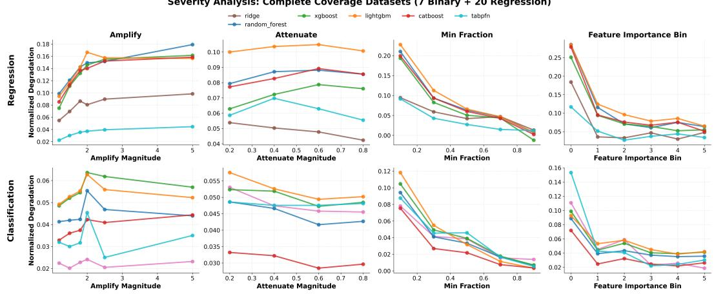
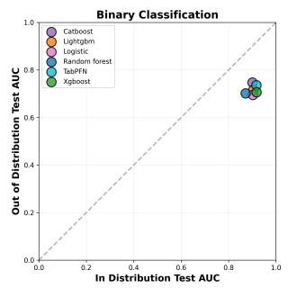
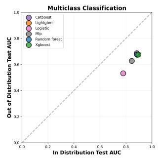
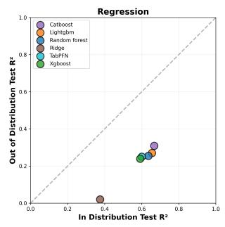
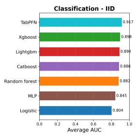
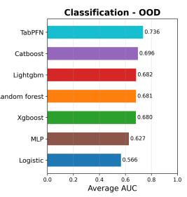
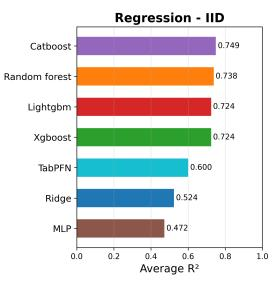
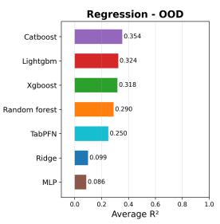

# INCONVENIENT: A BENCHMARK TO ASSESS LLM GENERALIZATION CAPABILITIES FROM CON-VENIENCE SAMPLES

Sara Rezaeimanesh Michigan State University East Lansing, MI, USA rezaeima@msu.edu

Kundan Thind, Ph.D. Henry Ford Health Detroit, MI, USA kthind1@hfhs.org

Chad Klochko, M.D. Henry Ford Health Detroit, MI, USA chadk@rad.hfh.edu

Mohammad Ghassemi Michigan State University East Lansing, MI, USA ghassem3@msu.edu

## ABSTRACT

Conventional machine learning models for tabular prediction typically assume that training data are representative of the population on which they will be deployed. In practice, however, data are often collected based on convenience, availability, accessibility, or cost, resulting in systematic sampling biases that can distort feature–target relationships and undermine real-world generalization. Existing tabular distribution-shift benchmarks primarily construct out-of-distribution (OOD) settings by partitioning observations across naturally occurring domains. While such partitions may induce changes in P(Y | X), the resulting shifts are neither explicitly controlled nor isolated, and the evaluation distributions themselves are often not representative of the broader target population. We introduce INCONVENIENT, a benchmark designed to study robustness to conveniencesample bias. Rather than relying on naturally occurring domain partitions, IN-CONVENIENT directly perturbs feature–target relationships in the training distribution while preserving the original population distribution as the deployment environment. This setting more closely reflects real-world scenarios in which models are developed from unrepresentative samples and subsequently deployed on a broader population. The distinction is particularly relevant for large language models (LLMs), whose pretraining may encode population-level knowledge that extends beyond the relationships observed in a biased training dataset. Unlike existing distribution-shift benchmarks, INCONVENIENT provides explicit control over both the direction and severity of relationship shifts, enabling a systematic assessment of robustness to convenience sampling. The benchmark comprises 200 tabular classification and regression datasets spanning diverse application domains and generates around ∼ 15,500 shifted training distributions which lead to substantial downstream performance degradation.

## 1 INTRODUCTION

Machine learning models are typically developed under the assumption that training data provide a representative sample of the population on which the model will ultimately be deployed. In practice, however, this assumption is rarely satisfied. Data are often collected based on convenience, availability, accessibility, or cost rather than through representative sampling procedures. Medical datasets may be collected from a single hospital system, consumer datasets may overrepresent users of a particular platform, and scientific datasets may be limited to populations that are easiest to recruit. As a result, the relationships observed in the training data can differ from those that hold in the broader population.

LLMs are pretrained on massive corpora that may encode broad statistical knowledge about realworld relationships. When presented with a biased or unrepresentative dataset, an LLM-based prediction system may possess prior knowledge that conflicts with the relationships observed in the training sample.

A large body of work has studied the impact of distribution shift on machine learning systems. Benchmarks such as WILDS (Koh et al., 2021) demonstrated that modern models often struggle to generalize across naturally occurring shifts in vision, language, and graph domains. In the tabular setting, TableShift (Gardner et al., 2023) and WhyShift (Liu et al., 2023) construct out-ofdistribution evaluation settings by partitioning data into distinct real-world domains, such as geographic regions, institutions, or time periods. These benchmarks therefore evaluate generalization across naturally occurring population differences that induce complex combinations of covariate, la bel, and conditional shifts; WhyShift in particular decomposes each observed shift into its covariate and concept components and finds that concept shift dominates on many real tabular tasks. However, in these benchmarks, both the training and evaluation distributions change as a consequence of the shift. As a result, poor performance may reflect difficulties adapting to a new target population rather than an inability to recover population-level relationships obscured by biased sampling. While these settings capture important real-world deployment challenges, they leave a common form of dataset bias largely unaddressed: scenarios in which the deployment population remains fixed, but the training sample is systematically unrepresentative of that population. More recently, TabFS-Bench (Cheng et al., 2025) introduced a controlled benchmark that synthetically generates feature shifts through perturbations of the observed feature space. However, it does not explicitly isolate shifts in the underlying feature–target relationship, which is the primary focus of our benchmark.

To address this limitation, we introduce INCONVENIENT, a benchmark for evaluating robustness to convenience-sample bias. Rather than constructing train and test sets from different domains, INCONVENIENT begins with a representative population dataset and systematically constructs unrepresentative training samples that distort the relationship between features and targets. Models are then evaluated on test examples drawn from the original population. INCONVENIENT generates controlled shifts by manipulating feature–target relationships in the training data through coefficient amplification, attenuation, and sign-reversal operations. By explicitly controlling both the direction and severity of these perturbations, INCONVENIENT enables the systematic study of robustness to sampling-induced relationship shifts. It also provides control over severity of shift which allows comprehensive analysis of how sever of a shift and what kind of shift is a model more robust to handle. The benchmark contains 200 tabular prediction datasets spanning diverse application domains and yields around 15,500 distribution-shift scenarios. Across these tasks, convenience-sample training distributions induce substantial degradation in downstream predictive performance, creating a challenging testbed for evaluating robustness under sampling-induced shift.

## 2 RELATED WORK

Sample selection bias and convenience sampling. The observation that non-random sampling distorts learned relationships predates machine learning. Heckman (1979) formalized selection bias in econometrics, and the learning-theoretic treatment of Zadrozny (2004) and Cortes et al. (2008) showed that selection depending on X alone (the “missing at random” or covariate-shift case) is correctable by importance weighting, whereas selection that depends on Y or on the X–Y relationship is not identifiable from the biased sample.

Distribution shift benchmarks. WILDS (Koh et al., 2021) established the now-standard recipe for evaluating OOD generalization: partition a dataset along a naturally occurring axis such as hospital, country, or time, train on some partitions, and test on others. Tabular benchmarks have largely inherited this design. TableShift (Gardner et al., 2023) assembles tasks with domain-based splits and finds that the ID–OOD gap tracks label shift, while WhyShift (Liu et al., 2023) goes further and decomposes each observed shift into its covariate (Y |X-preserving) and concept (Y |X-changing) components, finding that concept shift dominates on many real tabular tasks. TabFSBench (Cheng et al., 2025) takes a complementary, synthetic approach and removes or adds feature columns between training and test, but it does not target the feature–target relationship itself. INCONVENIENT differs from both families on two axes. First, the deployment distribution is held fixed at the population, so degradation is attributable to the training sample alone. Second, the shift is constructed by directly manipulating the coefficient of a chosen feature so its direction and severity are known and controllable.

LLMs and pretrained priors for tabular prediction. A growing body of work suggests that large language models (LLMs) encode knowledge that can improve learning under distribution shift and limited data. TabLLM (Hegselmann et al., 2023) and $\mathrm { L I F T }$ (Dinh et al., 2022) serialize tabular instances as text and demonstrate that LLMs can outperform traditional machine learning models in low-data regimes. A complementary line of research seeks to extract this knowledge as an explicit prior rather than using the LLM directly as a predictor. LLM Processes (Requeima et al., 2024) condition predictive distributions on natural-language descriptions of the task, AutoElicit (Capstick et al., 2025) elicits priors over linear-model coefficients from feature names alone, and LoID (Rezaeimanesh et al., 2026) extracts feature-wise Bayesian priors directly from model logits without relying on generated text. Across a variety of tabular prediction tasks, these approaches often match or exceed expert-derived priors and improve performance under data scarcity. Complementing these findings, Selby et al. (2024) evaluate the extent to which elicited quantities align with real-world ground truth relationships.

This literature provides evidence that LLMs encode population-level knowledge about relationships between semantically meaningful features and targets. However, existing evaluations largely focus on settings where the training data are limited, and do not address whether such knowledge remains useful when the observed data actively contradict those relationships. INCONVENIENT is designed to address this gap. By constructing training samples in which feature–target relationships are systematically weakened, amplified, or even reversed while preserving the original population as the evaluation distribution, the benchmark isolates scenarios where recovering the correct population relationship requires leveraging prior knowledge beyond the observed sample.

## 3 BENCHMARK CREATION

## 3.1 PROBLEM STATEMENT

Consider a tabular dataset composed of examples $( x , y , s ) \sim P _ { s }$ where $x \in \mathbb { R } ^ { d }$ is the input feature vector, $y$ is the prediction target (either categorical for classification or continuous for regression), and $s \in \{ 0 , 1 \}$ is the sampling indicator denoting whether the example is drawn from a random sample $( s = 1 )$ or a convenience sample $( s = 0 )$ .

We can view the overall data distribution as a mixture of two sampling distributions: the population distribution $P _ { \mathrm { p o p } }$ representing random samples from the target population, and the convenience distribution $P _ { \mathrm { c o n v } }$ representing systematically biased samples. The test distribution is always drawn from the population: $P _ { \mathrm { t e s t } } = \mathbf { \breve { \cal P } } _ { \mathrm { p o p } } .$

In the random-sampling setting, our goal is to learn a predictor $f _ { \theta } : \mathbb { R } ^ { d }  \mathcal { V }$ that accurately predicts y using examples drawn from $P _ { \mathrm { p o p } }$ . This represents the ideal scenario where training data is representative of the deployment population.

A distribution shift occurs because $P _ { \mathrm { c o n v } } \neq P _ { \mathrm { p o p } }$ . As a consequence of this shift, the joint distributions $p _ { \mathrm { c o n v } } ( x , y ) \neq p _ { \mathrm { p o p } } ( x , y )$ differ between convenience and population samples. For a fixed predictor $f _ { \theta }$ trained on a convenience sample, we define the convenience sample gap as:

$$
\Delta _ { \mathrm { p e r f } } = \mathrm { P e r f } ( f _ { \theta } ^ { \mathrm { p o p } } , P _ { \mathrm { t e s t } } ) - \mathrm { P e r f } ( f _ { \theta } ^ { \mathrm { c o n v } } , P _ { \mathrm { t e s t } } )\tag{1}
$$

where $f _ { \theta } ^ { \mathrm { p o p } }$ is trained on random samples from $P _ { \mathrm { p o p } } , \ : f _ { \theta } ^ { \mathrm { c o n v } }$ is trained on convenience samples from $P _ { \mathrm { c o n v } }$ , and $\mathrm { P e r f } ( \cdot )$ denotes the performance metric (AUC-ROC for classification, $\mathrm { R } ^ { 2 }$ for regression). Both models are evaluated on held-out test data from $P _ { \mathrm { t e s t } }$ . The gap $\Delta _ { \mathrm { p e r f } }$ quantifies the performance degradation due to training on convenience samples rather than random samples.

In our setting, we assume that no information about the specific form of distribution shift is available during trainin $\xi - \mathrm { i } . \mathrm { e } .$ , there is no knowledge of how $p ( y ) , p ( y | x ) , \mathrm { o r } p ( x )$ differ between $P _ { \mathrm { c o n v } }$ and $P _ { \mathrm { p o p } }$ , and no unlabeled data from the population distribution is accessible. This reflects the realistic scenario where practitioners train models on available convenience samples without knowing the precise nature of sampling biases.

## 3.2 DATASET SELECTION

Because the primary goal of INCONVENIENT is to evaluate methods that leverage prior knowledge encoded in large language models, we restrict our benchmark to datasets with semantically meaningful feature representations. Consequently, we exclude image and audio datasets where individual input dimensions typically lack interpretable semantic meaning and therefore provide limited opportunity for methods based on feature names, metadata, or task descriptions to exploit external knowledge.

Our benchmark comprises 200 tabular datasets spanning a diverse range of application domains. The datasets come from OpenML (Vanschoren et al., 2014), Kaggle, and TALENT (Liu et al., 2024). The collection includes 80 regression datasets, 39 binary classification datasets, and 81 multiclass classification datasets. Dataset sizes range from hundreds to tens of thousands of observations, and the number of features varies from fewer than 10 to more than 100. This diversity enables the evaluation of robustness to convenience-sample bias across a broad spectrum of prediction tasks and data regimes.

## 3.2.1 REFERENCE MODEL

For each dataset, we first split the data into a training pool (50%) and a held-out test set (50%). We fit a reference linear model on the entire training pool to obtain baseline coefficients $\beta _ { \mathrm { r e f } } =$ $( \beta _ { 1 } , \ldots , \beta _ { d } )$ , where d is the number of features after preprocessing (including one-hot encoded categorical variables). For classification tasks, we use logistic regression with $C = \infty$ (no regularization), yielding coefficients in the log-odds space. For regression tasks, we use ordinary least squares linear regression.

## 3.2.2 COEFFICIENT MANIPULATION OPERATIONS

We define three types of coefficient shifts, each creating a distinct form of distribution shift:

Amplification. Increase the magnitude of target feature coefficients by a multiplicative factor $\alpha >$ 1. The target criterion is:

$$
\beta _ { \mathrm { c a n d i d a t e } , j } > \alpha \cdot \beta _ { \mathrm { r e f } , j } , \quad \forall j \in \mathcal { F } _ { \mathrm { t a r g e t } }\tag{2}
$$

The influence weight is $w _ { j } ( \mathrm { a m p l i f y } ) = \mathrm { s i g n } ( \beta _ { \mathrm { r e f } , j } )$ , prioritizing examples that strengthen the existing coefficient direction. We test amplification factors $\alpha \in \{ \bar { 1 } . 1 5 , 1 . \bar { 3 } , 1 . 5 , 2 . 0 , 3 . \bar { 0 , } 5 . 0 \}$ , creating convenience samples where feature-target relationships are exaggerated compared to the population.

Attenuation. Decrease the magnitude of target feature coefficients by a multiplicative factor $0 <$ $\gamma < 1$ . The target criterion is:

$$
| \beta _ { \mathrm { c a n d i d a t e } , j } | < \gamma \cdot | \beta _ { \mathrm { r e f } , j } | , \quad \forall j \in \mathcal { F } _ { \mathrm { t a r g e t } }\tag{3}
$$

The influence weight is $w _ { j } ( \mathrm { a t t e n u a t e } ) = - \mathrm { s i g n } ( \beta _ { \mathrm { r e f } , j } ) \cdot \mathrm { s i g n } ( x _ { i j } )$ , prioritizing examples that weaken coefficient magnitudes. We test attenuation factors $\gamma \in \lbrace 0 . 2 , 0 . 4 , 0 . 6 , 0 . 7 , 0 . 9 \rbrace$ , creating convenience samples where feature-target relationships are diluted or noisier than in the population.

Sign flip. Reverse the direction of target feature effects by flipping coefficient signs. The target criterion is:

$$
\operatorname { s i g n } ( \beta _ { \mathrm { c a n d i d a t e } , j } ) \neq \operatorname { s i g n } ( \beta _ { \mathrm { r e f } , j } ) , \quad \forall j \in \mathcal { F } _ { \mathrm { t a r g e t } }\tag{4}
$$

The influence weight is $w _ { j } ( \mathtt { H i p } ) = - \mathrm { s i g n } ( \beta _ { \mathrm { r e f } , j } )$ , prioritizing examples that induce sign reversals. This creates extreme distribution shifts, where convenience samples exhibit reversed relationships compared to the population (e.g., marijuana use in the head-and-neck cancer data of Rezaeimanesh et al. (2026)).

## 3.2.3 GREEDY SUBSET SELECTION ALGORITHM

To create convenience training sets with specific coefficient shifts, we employ a greedy iterative algorithm that selects training examples to achieve a target coefficient configuration. The algorithm operates as follows:

1. Influence scoring: For each example $( x _ { i } , y _ { i } )$ in the training pool, compute an influence score $s _ { i }$ measuring how much including that example would push the target features’ coefficients in the desired direction. For classification, the influence is based on the gradient contribution weighted by prediction uncertainty:

$$
s _ { i } = \sum _ { j \in \mathcal { F } _ { \mathrm { t a r g e t } } } ( y _ { i } - \hat { p } _ { i } ) \cdot x _ { i j } \cdot w _ { j } ( \mathrm { d i r e c t i o n } )\tag{5}
$$

where $\hat { p } _ { i }$ is the predicted probability under the reference model, and $w _ { j } ( \mathrm { d i r e c t i o n } )$ encodes the desired direction of change. For regression, the influence uses residuals: $\begin{array} { r } { s _ { i } = \sum _ { j \in \mathcal { F } _ { \mathrm { t a r g e t } } } ( y _ { i } - \hat { y } _ { i } ) \cdot x _ { i j } \cdot w _ { j } ( \mathrm { d i r e c t i o n } ) } \end{array}$

2. Initial candidate set: Sort all training pool examples by influence score in descending order. Initialize the candidate subset with the top $n _ { \mathrm { m i n } } = \lfloor \alpha _ { \mathrm { m i n } } \cdot N _ { \mathrm { p o o l } } \rfloor$ highest-influence examples, where $\alpha _ { \mathrm { { m i n } } }$ is the minimum fraction hyperparameter and $N _ { \mathrm { p o o l } }$ is the training pool size.

3. Iterative expansion: Fit a logistic regression (or linear regression) model on the current candidate subset and compute its coefficients $\beta _ { \mathrm { c a n d i d a t e } } .$ . Check if the target criterion is met for all features in $\mathcal { F } _ { \mathrm { t a r g e t } }$ . If not met, expand the candidate set by adding the next $b = n _ { \mathrm { m i n } } / 1 0$ highest-influence examples and repeat. Continue until either the target is achieved or the entire pool is exhausted.

4. Target verification: After the final iteration, verify that the learned coefficients satisfy the shift criteria. If not achieved, raise an error indicating that the desired shift is infeasible for this dataset with the given constraints and exclude the created train set.

The greedy selection procedure induces distribution shifts across all three canonical types: $\mathrm { ( i ) } \mathrm { C o - }$ variate shift: Selecting examples based on influence scores changes $p ( x )$ , as certain regions of feature space are over- or under-represented in the convenience sample. (ii) Label shift: The selection process alters class/target prevalence, changing $p ( y )$ relative to the population distribution. (iii) Concept shift: By explicitly manipulating learned coefficients, we directly modify the conditional relationship $p ( y | x )$ between features and targets.

## 3.2.4 SHIFT SEVERITY CONTROL

Our benchmark provides several knobs for controlling the severity of the induced relationship shift:

• Minimum subset size $( \alpha _ { m i n } )$ . Smaller values of $\alpha _ { m i n }$ restrict the optimization procedure to a smaller subset of the original training data. This generally produces training samples that are less representative of the underlying population.

• Feature importance. Perturbing relationships involving highly informative features is expected to have a larger impact on downstream predictive performance than perturbing less informative features. We estimate feature importance using the absolute value of feature– target correlation.

• Coefficient magnitude. For amplification and attenuation shifts, larger coefficient modifications correspond to stronger departures from the original relationship are therefore expected to result in greater performance degradation.

These knobs allow us to evaluate model robustness across a broad spectrum of convenience-sample biases and to analyze how different forms of relationship distortion affect downstream performance. Figure 1 presents an empirical study of the impact of these severity controls on the performance of the evaluated methods.

## 4 EXPERIMENTAL SETUP

## 4.1 EVALUATION

We evaluate seven methods: XGBoost (Chen & Guestrin, 2016), LightGBM (Ke et al., 2017), CatBoost (Prokhorenkova et al., 2018), Random Forest (Breiman, 2001), Multi-Layer Perceptron (MLP), and TabPFN (Hollmann et al., 2023), plus Logistic Regression for classification and Ridge Regression for regression. Our baseline suite is deliberately narrower than the one used by TableShift (Gardner et al., 2023), the closest tabular distribution-shift benchmark to ours. In Section A.1 we state explicitly which methods we omit and why.

For each dataset, we perform the following evaluation procedure:

1. Split data into training (50%), and test (50%) sets

2. Generate convenience training variants using the perturbation strategies described above

3. For each method:

• Train on in-distribution training set, tune hyperparameters on in-distribution validation set (20% of the original in-distribution training set), evaluate on test set

• Train on convenience training set, tune hyperparameters on convenience validation set (20% of the original OOD training set), evaluate on test set

4. Compute performance metrics: AUC-ROC for classification (macro-averaged for multiclass), R² for regression

5. Calculate $\Delta _ { p e r f }$

6. Remove convenience sets where $\Delta _ { p e r f } < 0 . 1 \mathrm { o r } \left( f _ { \theta } ^ { \mathrm { c o n v } } , P _ { \mathrm { t e s t } } \right) < - 1 \mathrm { o r } \left( f _ { \theta } ^ { \mathrm { c o n v } } , P _ { \mathrm { t e s t } } \right) > 1$

Furthermore, we remove coefficient-manipulation sets whose induced downstream performance degradation is already subsumed by previously constructed OOD sets. This situation can arise when increasing the magnitude of a feature shift fails to produce additional degradation beyond that observed in an existing OOD set. Because such sets do not expose new model failure modes or provide additional discriminatory power for evaluating robustness, retaining them would introduce redundancy without increasing the benchmark’s informational value.

## 4.2 MEASURE OF COLLATERAL EFFECT

We measure the collateral effect on non-target coefficients using relative L2 change. Let $\beta _ { \mathrm { p o p } }$ and $\beta _ { \mathrm { c o n v } }$ denote the coefficient vectors obtained by fitting logistic/ridge regression on the in-distribution and convenience training sets, respectively. For a given shift targeting feature set T, we compute the relative change in non-target coefficients as:

$$
\mathrm { R e l a t i v e } \mathrm { C h a n g e } = \frac { | \beta _ { \mathrm { c o n v } } [ \mathcal { T } ^ { c } ] - \beta _ { \mathrm { p o p } } [ \mathcal { T } ^ { c } ] | _ { 2 } } { | \beta _ { \mathrm { p o p } } [ \mathcal { T } ^ { c } ] | _ { 2 } }\tag{6}
$$

where $\mathcal { T } ^ { c }$ denotes the complement of the target feature set. This metric quantifies how much the non-target coefficients change as a fraction of their original magnitude, providing a scale-invariant measure of collateral coefficient drift induced by the greedy selection process.

## 4.3 BASELINES

We evaluate seven machine learning methods representing diverse model families, all tuned using the Tree-structured Parzen Estimator (TPE) algorithm (Bergstra et al., 2011) implemented in Hyper-Opt (Bergstra et al., 2013) with a search budget of 20 evaluations per method-dataset combination. Hyperparameter selection is performed on the convenience training set’s 80/20 train-validation split, reflecting the realistic constraint that practitioners have no access to the population distribution during model selection.

Logistic Regression / Ridge Regression: Linear models with regularization. For classification, we use logistic regression; for regression, Ridge regression. Search space: $C ~ \in ~ [ 0 . 0 0 1 , 1 0 0 ]$ (log-uniform) for logistic regression, $\alpha ~ \in ~ [ 0 . 0 0 1 , 1 0 0 0 ]$ (log-uniform) for Ridge; penalty type $\in \ \bar { \left\{ \mathrm { L 1 } , \mathrm { L 2 } \right. } $ , ElasticNet, None} with corresponding L1 ratio $\in \ [ 0 , 1 ]$ for logistic regression; solver $\ r \in \{ \mathrm { a u t o } , \mathrm { s v d } .$ , cholesky, lsqr, sag, saga} for Ridge.

Random Forest: Ensemble of decision trees with bootstrap aggregation. Search space: number of $\mathrm { t r e e s } \in \{ 5 0 , 1 0 0 , 2 0 0 , 3 0 0 \}$ ; max depth $\in \{ 5 , 1 0 , 2 0 , 3 0 , \mathrm { N o n e } \}$ ; min samples split $\dot { \in } \{ 2 , 5 , 1 0 \}$ ; min samples leaf $\in \{ 1 , 2 , 4 \}$ ; max features $\in \{ \mathrm { s q r t } , \log 2 , \mathrm { N o n e } \}$

XGBoost: Gradient boosted decision trees with advanced regularization. Search space: number of trees $\in \{ 5 0 , 1 0 0 , 2 0 0 , 3 0 0 \}$ ; max depth $\in \{ 3 , 5 , 7 , 1 0 \}$ ; learning rate $\in \ [ 0 . 0 1 , 0 . 3 ]$ (log-uniform); subsample ratio $\in \ [ 0 . 6 , 1 . \dot { 0 } ]$ ; column subsample ratio $\in \ [ 0 . 6 , 1 . 0 ]$ ; min child weight $\bar { \in } \ \{ 1 , 3 , 5 \}$ ; gamma $\in [ 0 , 0 . 2 ]$

LightGBM: Histogram-based gradient boosting with leaf-wise tree growth. Search space: number of trees $\in \ \{ 5 0 , 1 0 0 , 2 0 0 , 3 0 0 \} ;$ ; num leaves $\in \{ 1 5 , 3 1 , 6 3 , 1 2 7 \}$ ; learning rate $\in \ [ 0 . 0 1 , 0 . 3 ]$ (loguniform); min child samples $\ r \in \{ 1 0 , 2 0 , 3 0 \}$ ; subsample ratio $\in [ 0 . 6 , 1 . 0 ]$ ; column subsample ratio $\in [ 0 . 6 , 1 . 0 ]$ ; L1 regularization $\in [ 0 , 1 ] ; \mathbf { L } 2$ regularization $\in [ 0 , 1 ]$

CatBoost: Gradient boosting with ordered target encoding and symmetric trees. Search space: iterations ∈ {50, 100, 200, 300}; depth $\in \{ 4 , 6 , \bar { 8 } , 1 0 \}$ ; learning rate $\in [ 0 . 0 1 , 0 . 3 ]$ (log-uniform); L2 leaf regularization $\in \{ 1 , 3 , 5 , 7 , 9 \}$ ; border count ∈ {32, 64, 128}.

MLP: Multi-layer perceptron with ReLU/tanh activations and standard feature scaling. Search space: hidden layer sizes ∈ {(32), (64), (128), (64, 32), (128, 64)}; activation ∈ {ReLU, tanh}; L2 penalty ∈ [0.0001, 0.1] (log-uniform); learning rate schedule ∈ {constant, adaptive}; initial learning rate $\in [ 0 . 0 \dot { 0 } 1 , 0 . 1 ]$ (log-uniform). Maximum 500 iterations with early stopping.

TabPFN: Transformer-based method using in-context learning. No hyperparameter tuning—uses default configuration with 4 ensemble members..

All methods are retrained on the combined train+validation split after hyperparameter selection, then evaluated on the held-out population test set.

## 4.4 LLM-BASED COEFFICIENT ANOMALY DETECTION

To assess whether large language models can identify unreasonable feature coefficients, we conducted an experiment where Claude-Haiku-4.5 was presented with OOD coefficients and asked to identify which features seemed most suspicious based on domain knowledge alone. We then calcu lated the actual coefficient changes $( | I I { \dot { D } } - O O D | )$ for all features and ranked them by magnitude of change. We evaluated whether the LLM’s suspicion rankings overlapped with the true rankings of coefficient change, measuring Recall@K as the proportion of the true top-K most-changed features that appeared in the LLM’s top-K suspicious features.

## 5 RESULTS

We use INCONVENIENT to answer three questions. First, does convenience-sample bias actually break standard tabular learners, and by how much (§5.1)? Second, is the induced shift a realistic, structure-wide shift rather than a single-coefficient artifact (§5.2)? Third, do the severity knobs of §3.2.4 behave predictably enough to serve as a difficulty axis (§5.3)? Throughout, we report performance degradation $\Delta _ { \mathrm { p e r f } }$ as defined in Eq. 1.

## 5.1 CONVENIENCE SAMPLES DEGRADE EVERY BASELINE

Figure 2 plots in-distribution against out-of-distribution test performance for every method and task type, averaged over all retained shifts (§4.1). Every baseline sits well below the diagonal, and the methods generally cluster. Averaged over 6,489 classification shifts and 8,970 regression shifts (Figure 3), convenience-sample training costs 0.18–0.24 AUC on classification, a 20–29% relative drop, and $0 . 3 5 { - } 0 . 4 5 \ : R ^ { 2 }$ on regression, a 53–82% relative drop.

Figure 3 breaks this down by method. The plot shows that the in-distribution ranking does not always survive the shift and lower in-distribution performance does not translate to robustness. Ridge regression and MLP have the weakest in-distribution performance $( R ^ { 2 } = 0 . 5 2 4$ and 0.472 respectively) yet suffer among the largest degradations $( \Delta \stackrel { \cdot } { = } 0 . 4 2 5$ and 0.386), falling to under $1 0 \% \cdot R ^ { 2 }$ While a heavily regularized linear model has less capacity to fit complex relationships, when the training data systematically distorts a feature coefficient, Ridge still learns the distortion and fails on population data. This is the central empirical claim of INCONVENIENT. When a training sample reverses or erases a feature–target relationship, nothing in the sample identifies the error. The convenience data are internally consistent, the validation split is drawn from the same biased sample,

Severity Analysis: Complete Coverage Datasets (7 Binary + 20 Regression)

  
Figure 1: Performance degradation as a function of each shift-severity control. For a given severity knob, we report the average performance of each baseline across all combinations of the remaining severity controls while holding the selected knob fixed. This marginalization isolates the effect of each severity control on downstream performance. MLP and logistic regression performances are removed because of catastrophic failures that hid the performances of other models. We calculate normalized degradation as $\frac { \dot { P } e r f _ { I I D } - P e r f _ { O O D } } { P e r f _ { I I D } }$ .Detailed performance numbers of all models are available in $\ S \mathrm { A } . 3$

  
Figure 2: In-distribution versus convenience-sample performance across binary classification, multiclass classification, and regression datasets. Each point represents a baseline. The scatter plots reveal substantial performance degradation under convenience-sample bias relative to the in-distribution setting, highlighting the challenges posed by distorted feature–target relationships.

  
Figure 3: Reported values correspond to the average performance of each method over all the shifts, generated from the classification and regression datasets in the benchmark.

and no unlabeled population data are available. Correction must therefore come from outside the data which is precisely the setting in which a model with pretrained knowledge can be useful.

## 5.2 COLLATERAL EFFECTS CONFIRM THE SHIFTS ARE STRUCTURAL

Following Equation 6, we find median relative changes of 26% (amplify), 61% (attenuate), and 55% (flip-sign) on regression tasks, and 109%, 107%, and 104% respectively on classification tasks. The perturbation propagates through the correlation structure of the feature space rather than remaining local to the targeted feature.

## 5.3 THE SEVERITY KNOBS CONTROL DIFFICULTY

Figure 1 shows the effect of varying each severity knob while marginalizing over the others. Since not all datasets produce feasible shifts at every severity level, averaging across all available shifts would result in different dataset subsets being represented at different settings, potentially biasing the comparison. Therefore, we chose seven binary classification, and 20 regression datasets that produced shifts across all shift settings for this analysis. A severity knob is useful for the benchmark if performance degradation changes monotonically with the knob value and if the resulting sweep covers a broad range of difficulty levels. We find that two of the three knobs satisfy both criteria.

Minimum fraction. $\alpha _ { \mathrm { { m i n } } }$ controls how small the initial high-influence candidate set is, and therefore how far the selected subset can drift from the population before the target criterion is met. At $\alpha _ { \mathrm { m i n } } = 0 . 1$ degradation reaches 0.09–0.23 $R ^ { 2 }$ for regression and 0.08–0.12 AUC for classification, and it decreases monotonically for every method as the fraction grows which validate $\alpha _ { m i n }$ as a severity control.

Feature importance. The fourth column of Figure 1 sweeps the feature-importance bin of the targeted feature, where bin0 contains the most important features (by correlation with the target) and bin5 the least. The trend is strongly decreasing: perturbing a top-bin feature costs $0 . 1 8 \mathrm { - } 0 . 2 9 { \overline { { R } } } ^ { 2 }$ in regression and 0.07–0.11 AUC in classification, while perturbing a bottom-bin feature costs less than 0.07 in regression and 0.04 in classification. This is the expected behavior and validates the bin as a severity control.

Amplification and attenuation magnitude. Trends are less consistent. For regression, degradation generally increases with amplification magnitude, but does not consistently decrease as attenuation approaches one and even increases in some cases. For classification, amplification shows no consistent trend, while degradation decreases more consistently as attenuation approaches one. Thus, this severity knob does not reliably control shift difficulty. This inconsistency likely arises from collateral effects: modifying one coefficient can alter the effective influence of other features, making the resulting shift severity unpredictable.

## 5.4 LLM-BASED COEFFICIENT ANOMALY DETECTION

Across 300 randomly selected shifts (100 per operation type), the LLM achieved modest performance, with an overall Recall@5 of 37.4%. Performance varied considerably across operation types. The model was most effective at identifying amplified coefficients (Recall@ $5 = 4 2 . 7 \% )$ followed by sign flips (36.7%) and attenuations (32.7%). Compared to a random baseline of 16.8%, the LLM performs approximately 2.2× better than chance, demonstrating that LLMs encode domain knowledge that enables them to assess the plausibility of feature–outcome relationships and detect coefficient perturbations that deviate from expected patterns. This capability highlights the potential of LLMs to identify and mitigate biases introduced by convenience sampling.

## 6 CONCLUSION

Tabular dataset samples are gathered because of cheapness and convenience and rarely represent the greater population. We propose a benchmark for testing model robustness to convenience sampling where the train set is a sample that is non-representative of the general population and the test set represents the general population. We also provide a systematic way to control the severity of the shift to assess model robustness. Across 200 datasets and ∼ 15,500 retained shift variants, seven standard baselines lose between 20% and 45% of their performance on average purely as a result of how the training sample was drawn, with the deployment distribution held fixed. Since the biased sample contains no signal that identifies the bias, closing this gap requires information from outside the training data, which is the capability INCONVENIENT is built to measure.

## AI USE STATEMENT

In this work, we used generative AI tools as part of our methodology: Claude-Haiku-4.5 was used in the LLM-based coefficient anomaly detection experiment (§5). We also used Claude-Sonnet-4.5 to assist with portions of the code development process and to generate tables included in the paper. Additionally, we used ChatGPT-5 to assist with editing and refining the manuscript text. We have reviewed all AI-assisted work: all AI-generated code was reviewed, validated, and, where necessary, modified by the authors. We take responsibility for the final content of this work, including text, claims or artifacts produced with the aid of generative AI, and for the accuracy and validity of all code and analyses.

We did not use AI to Generate synthetic data sets, help develop theoretical models or conceptual frameworks, formulate mathematical claims, provide critical ingredients for proving mathematical claims, assist in the writing of proofs, propose or refine hypotheses, design or provide feedback on research methodology or experiments, implement methods, assist with translation, clean and reformat dataset, support qualitative and thematic data analysis, or interpret results.

## REPRODUCIBILITY STATEMENT

We provide a command-line interface that enables users to generate shifts by specifying the minimum sample threshold $( \alpha _ { m i n } )$ , feature-importance bin, coefficient operation, and operation magnitude (for multiplication and attenuation). All preprocessing steps are applied automatically during shift creation. Users can also evaluate any of our baseline methods on a selected shift by providing the paths to the corresponding training and test sets. In addition, the interface supports downloading the complete collection of ∼ 15,500 shifts.

Using this interface, users can reproduce the results presented in Table 1 and evaluate their own models under shifts of varying types and difficulty levels. A comprehensive usage guide and documentation is included as a README file.

We provide a link to the anonymized repository with datasets and full results in addition to our supplementary material which only includes the scripts.

## REFERENCES

Martin Arjovsky, Leon Bottou, Ishaan Gulrajani, and David Lopez-Paz. Invariant risk minimization.´ arXiv preprint arXiv:1907.02893, 2019.

James Bergstra, Remi Bardenet, Yoshua Bengio, and Bal´ azs K´ egl. Algorithms for hyper-parameter´ optimization. In Advances in Neural Information Processing Systems (NeurIPS), volume 24, 2011.

James Bergstra, Daniel Yamins, and David Cox. Making a science of model search: Hyperparameter optimization in hundreds of dimensions for vision architectures. In International Conference on Machine Learning (ICML), pp. 115–123, 2013.

Leo Breiman. Random forests. Machine Learning, 45(1):5–32, 2001.

Alexander Capstick, Rahul G. Krishnan, and Payam Barnaghi. AutoElicit: Using large language models for expert prior elicitation in predictive modelling. In International Conference on Machine Learning (ICML), 2025.

Tianqi Chen and Carlos Guestrin. XGBoost: A scalable tree boosting system. In Proceedings of the 22nd ACM SIGKDD International Conference on Knowledge Discovery and Data Mining (KDD), pp. 785–794, 2016.

Zi-Jian Cheng, Zi-Yi Jia, Zhi Zhou, Yu-Feng Li, and Lan-Zhe Guo. TabFSBench: Tabular benchmark for feature shifts. In International Conference on Machine Learning (ICML), 2025.

Corinna Cortes, Mehryar Mohri, Michael Riley, and Afshin Rostamizadeh. Sample selection bias correction theory. In International Conference on Algorithmic Learning Theory (ALT), pp. 38–53. Springer, 2008.

Tuan Dinh, Yuchen Zeng, Ruisu Zhang, Ziqian Lin, Michael Gira, Shashank Rajput, Jy-yong Sohn, Dimitris Papailiopoulos, and Kangwook Lee. LIFT: Language-interfaced fine-tuning for non-language machine learning tasks. In Advances in Neural Information Processing Systems (NeurIPS), 2022.

Yaroslav Ganin, Evgeniya Ustinova, Hana Ajakan, Pascal Germain, Hugo Larochelle, Franc¸ois Laviolette, Mario Marchand, and Victor Lempitsky. Domain-adversarial training of neural networks. Journal ofMachine Learning Research, 17(59):1–35, 2016.

Josh Gardner, Zoran Popovic, and Ludwig Schmidt. Benchmarking distribution shift in tabular data´ with TableShift. In Advances in Neural Information Processing Systems (NeurIPS) Datasets and Benchmarks Track, 2023.

Yury Gorishniy, Ivan Rubachev, Valentin Khrulkov, and Artem Babenko. Revisiting deep learning models for tabular data. In Advances in Neural Information Processing Systems (NeurIPS), volume 34, pp. 18932–18943, 2021.

Leo Grinsztajn, Edouard Oyallon, and Ga´ el Varoquaux. Why do tree-based models still outperform¨ deep learning on typical tabular data? In Advances in Neural Information Processing Systems (NeurIPS) Datasets and Benchmarks Track, volume 35, pp. 507–520, 2022.

James J. Heckman. Sample selection bias as a specification error. Econometrica, 47(1):153–161, 1979.

Stefan Hegselmann, Alejandro Buendia, Hunter Lang, Monica Agrawal, Xiaoyi Jiang, and David Sontag. TabLLM: Few-shot classification of tabular data with large language models. In International Conference on Artificial Intelligence and Statistics (AISTATS), 2023.

Noah Hollmann, Samuel Muller, Katharina Eggensperger, and Frank Hutter. TabPFN: A transformer ¨ that solves small tabular classification problems in a second. In International Conference on Learning Representations (ICLR), 2023.

Xin Huang, Ashish Khetan, Milan Cvitkovic, and Zohar Karnin. TabTransformer: Tabular data modeling using contextual embeddings. arXiv preprint arXiv:2012.06678, 2020.

Guolin Ke, Qi Meng, Thomas Finley, Taifeng Wang, Wei Chen, Weidong Ma, Qiwei Ye, and Tie-Yan Liu. LightGBM: A highly efficient gradient boosting decision tree. In Advances in Neural Information Processing Systems (NeurIPS), volume 30, 2017.

Pang Wei Koh, Shiori Sagawa, Henrik Marklund, Sang Michael Xie, Marvin Zhang, Akshay Balsubramani, Weihua Hu, Michihiro Yasunaga, Richard Lanas Phillips, Irena Gao, Tony Lee, Etienne David, Ian Stavness, Wei Guo, Berton Earnshaw, Imran Haque, Sara M. Beery, Jure Leskovec, Anshul Kundaje, Emma Pierson, Sergey Levine, Chelsea Finn, and Percy Liang. WILDS: A benchmark of in-the-wild distribution shifts. In International Conference on Machine Learning (ICML), pp. 5637–5664, 2021.

David Krueger, Ethan Caballero, Joern-Henrik Jacobsen, Amy Zhang, Jonathan Binas, Dinghuai Zhang, Remi Le Priol, and Aaron Courville. Out-of-distribution generalization via risk extrapolation (REx). In International Conference on Machine Learning (ICML), pp. 5815–5826, 2021.

Daniel Levy, Yair Carmon, John C. Duchi, and Aaron Sidford. Large-scale methods for distributionally robust optimization. In Advances in Neural Information Processing Systems (NeurIPS), volume 33, pp. 8847–8860, 2020.

Haoliang Li, Sinno Jialin Pan, Shiqi Wang, and Alex C. Kot. Domain generalization with adversarial feature learning. In Proceedings of the IEEE Conference on Computer Vision and Pattern Recognition (CVPR), pp. 5400–5409, 2018.

Zachary C. Lipton, Yu-Xiang Wang, and Alexander J. Smola. Detecting and correcting for label shift with black box predictors. In International Conference on Machine Learning (ICML), pp. 3122–3130, 2018.

Jiashuo Liu, Tianyu Wang, Peng Cui, and Hongseok Namkoong. On the need for a language describing distribution shifts: Illustrations on tabular datasets. In Advances in Neural Information Processing Systems (NeurIPS) Datasets and Benchmarks Track, 2023.

Si-Yang Liu, Hao-Run Cai, Qi-Le Zhou, and Han-Jia Ye. TALENT: A tabular analytics and learning toolbox. arXiv preprint arXiv:2407.04057, 2024.

Sergei Popov, Stanislav Morozov, and Artem Babenko. Neural oblivious decision ensembles for deep learning on tabular data. In International Conference on Learning Representations (ICLR), 2020.

Liudmila Prokhorenkova, Gleb Gusev, Aleksandr Vorobev, Anna Veronika Dorogush, and Andrey Gulin. CatBoost: Unbiased boosting with categorical features. In Advances in Neural Information Processing Systems (NeurIPS), volume 31, 2018.

James Requeima, John Bronskill, Dami Choi, Richard E. Turner, and David Duvenaud. LLM processes: Numerical predictive distributions conditioned on natural language. In Advances in Neural Information Processing Systems (NeurIPS), 2024.

Sara Rezaeimanesh, Kundan Thind, Farzan Siddiqui, and Mohammad M. Ghassemi. What language models know but don’t say: Non-generative prior extraction for generalization. In Conference on Language Modeling (COLM), 2026.

Shiori Sagawa, Pang Wei Koh, Tatsunori B. Hashimoto, and Percy Liang. Distributionally robust neural networks for group shifts: On the importance of regularization for worst-case generalization. In International Conference on Learning Representations (ICLR), 2020.

David Selby, Kai Spriestersbach, Yuichiro Iwashita, Dennis Bappert, Archana Warrier, Sumantrak Mukherjee, Muhammad Nabeel Asim, Koichi Kise, and Sebastian Vollmer. Quantitative knowledge retrieval from large language models. arXiv preprint arXiv:2402.07770, 2024.

Gowthami Somepalli, Micah Goldblum, Avi Schwarzschild, C. Bayan Bruss, and Tom Goldstein. SAINT: Improved neural networks for tabular data via row attention and contrastive pre-training. arXiv preprint arXiv:2106.01342, 2021.

Baochen Sun and Kate Saenko. Deep CORAL: Correlation alignment for deep domain adaptation. In European Conference on Computer Vision (ECCV) Workshops, pp. 443–450, 2016.

Joaquin Vanschoren, Jan N. van Rijn, Bernd Bischl, and Luis Torgo. OpenML: Networked science in machine learning. ACM SIGKDD Explorations Newsletter, 15(2):49–60, 2014.

Bianca Zadrozny. Learning and evaluating classifiers under sample selection bias. In International Conference on Machine Learning (ICML), pp. 114, 2004.

Hongyi Zhang, Moustapha Cisse, Yann N. Dauphin, and David Lopez-Paz. mixup: Beyond empirical risk minimization. In International Conference on Learning Representations (ICLR), 2018.

## A APPENDIX

## A.1 INAPPLICABLE METHODS

As mentioned in §4.1, our baseline suite is narrower than TableShift. Most of the robustness and domain-generalization literature assumes access to information that the convenience-sampling setting withholds by construction, and identifying which assumptions fail is itself informative about why this setting is difficult.

Methods requiring multiple training domains. Domain generalization methods – DANN (Ganin et al., 2016), IRM (Arjovsky et al., 2019), domain MixUp (Zhang et al., 2018), VREx (Krueger et al., 2021), DeepCORAL (Sun & Saenko, 2016), and MMD (Li et al., 2018) – and group DRO over domains (Sagawa et al., 2020) all require domain labels at training time and at least two training domains from which an invariance can be inferred. INCONVENIENT provides a single convenience sample with no domain structure, which is the defining feature of the setting we model: a practitioner with one dataset from one hospital, one platform, or one recruitment pipeline.

The obstacle is more than a missing input. Suppose one partitions the convenience sample into synthetic environments and runs IRM or VREx on the result. The bias induced by our greedy selection is global – the subset is chosen to satisfy a single coefficient criterion over the whole sample $- \mathrm { \bf ~ s o }$ the distorted feature–target relationship is stable across any such partition. An invarianceseeking objective would identify the manipulated relationship as invariant and preserve it, which is the opposite of the desired behavior. Invariance is only informative when some environment exhibits the population relationship; here, none does.

Methods requiring information about the target distribution. Label-shift methods, including group DRO over class labels and adversarial label robustness, target changes in the marginal $P ( y )$ and require either target-domain label proportions or unlabeled target data to estimate them (e.g. Lipton et al., 2018). Our protocol withholds both. Label shift does occur in INCONVENIENT as a by-product of influence-based selection, but it is a side effect rather than the mechanism, and a method that corrects $P ( y )$ alone leaves the manipulated conditional $P ( y \mid x )$ untouched.

Distributionally robust optimization. DRO with $\chi ^ { 2 }$ or CVaR geometry (Levy et al., 2020) is the one omitted family that needs no side information, and it is the omission most worth justifying. These methods minimize worst-case risk over distributions within a bounded divergence ball of the empirical training distribution, which amounts to a reweighting of the observed sample. This is exactly the correction class that the sample-selection literature shows to be insufficient here: when selection depends only on X, importance weighting recovers the population risk (Zadrozny, 2004; Cortes et al., 2008), but when selection depends on $\mathbf { \bar { Y } }$ or on the $X { \bar { - } } Y$ relationship – as our residual conditioned selection does by design – the population conditional is not expressible as a reweighting of the biased sample and is not identifiable from it. No choice of weights over convenience examples restores a relationship that the selection removed.

A second, practical obstacle compounds the first. DRO’s uncertainty radius is the hyperparameter that governs how much robustness is purchased at what in-distribution cost, and our protocol permits tuning only on a validation split drawn from the convenience sample (§4.3). That split is subject to the same bias as the training data, so it systematically prefers the smallest radius, collapsing DRO toward ERM. We therefore regard DRO as a natural addition to a future version of INCONVENIENT – one that would demonstrate this failure empirically rather than by argument – but not as a baseline that could plausibly close the gap reported in §5.1.

Tabular neural architectures. SAINT (Somepalli et al., 2021), TabTransformer (Huang et al., 2020), NODE (Popov et al., 2020), and FT-Transformer and tabular ResNet (Gorishniy et al., 2021) are applicable in principle and excluded on cost and expected informativeness rather than principle. INCONVENIENT spans 200 datasets and ∼ 15,500 retained shift variants, each requiring an IID and an OOD training run with a 20-trial hyperparameter search; the marginal value of a fifth and sixth deep architecture does not justify that budget, particularly given that gradient-boosted trees remain the stronger family at this data scale (Grinsztajn et al., 2022). More importantly, none of these architectures has access to information that our included baselines lack. They observe the same anonymous feature matrix and, like every method in our suite, have no way to know what a column means. Since the only route back to the population relationship is knowledge external to the biased sample, we expect architectural variation within the data-driven family to shift the gap marginally rather than close it. The included MLP and TabPFN bracket this family: a standard deep network trained from scratch, and a pretrained in-context learner.

Implication. Taken together, nearly the entire robustness toolkit is either inapplicable or provably insufficient in the convenience-sampling regime, because each method assumes an information source – multiple environments, group labels, target-domain samples, or a correctable selection mechanism – that this setting removes. This is the gap INCONVENIENT is designed to expose, and it motivates evaluating methods whose robustness comes from pretrained knowledge of what the features mean rather than from the structure of the training sample.

## A.2 DATASETS

The following names all the datasets used in INCONVENIENT.

## A.2.1 REGRESSION (80 DATASETS)

OpenML (72 datasets): 1000 Cameras Dataset, 3d Estimation Using Rssi ofWlan Dataset, 3d Estimation Using Rssi ofWlan Dataset Complete 1 Target, Abalone, Ailerons, Airfoil SelfNoise, Analcatdata Supreme, Another Dataset on Used Fiat 500 (1538 Rows), Auction Verification, Avocado Sales, Bng(echomonths), Bng(lowbwt), Bng(stock), Boston, Brazilian Houses, Brazilian Houses Reproduced, California Housing, Cars, Concrete Compressive Strength, Cookbookreviews, Cpmp 2015 Regression, Cps1988, Cps88wages, Cpu Activity, Dataset Sales, Debutanizer, Delta Elevators, Diamonds, Elevators, Energy Efficiency, Fifa, Forest Fires, Goodreads Computer Books, Grid Stability, Health Insurance, House 16h Reg, House 8l, House Prices Nominal, House Sales, House Sales Reduced, Houses, Ieee80211aa Gats, Job Profitability, Kin8nm, Kings County, Miami Housing, Miamihousing2016, Mip 2016 Regression, Moneyball, Naval Propulsion Plant, Onlinenewspopularity, Pumadyn32nh, Qsar Fish Toxicity, Qsar Tid 10980, Qsar Tid 11, Red Wine, Santander Transaction Value, Sat11 Hand Runtime Regression, Sensory, Socmob, Solar Flare, Space Ga, Student Performance Por, Sulfur, Superconductivity, Tecator, Treasury, Us Crime, Video Transcoding, White Wine, Wind, Wine Quality.

Kaggle (1 datasets): Bike Sharing Demand Challange.

TALENT (7 datasets): Bank32nh, Cpu Act, Cpu Small, Pol Reg, Puma32h, Puma8nh.

## A.2.2 BINARY CLASSIFICATION (39 DATASETS)

OpenML (23 datasets): Adityakadiwal Water Potability, Akshaydattatraykhare Diabetes Dataset, Amirhosseinmirzaie Pistachio Types Detection, Breast W, Climate Model Simulation Crashes, Compas Two Years, Credit Approval, Deependraverma13 Diabetes Healthcare Comprehensive Dataset, Diabetes, Dresses Sales, Eishkaran Heart Disease, Fedesoriano Stroke Prediction Dataset, Gabrielsantello Cars Purchase Decision Dataset, Hashemi221022 Diabetes, Kabure German Credit Data With Risk, Kandij Diabetes Dataset, Saurabh00007 Diabetescsv, Shubhamgupta012 Titanic Dataset, Tejashvi14 Employee Future Prediction, Tejashvi14 Engineering Placements Pre diction, Tic Tac Toe, Uciml Indian Liver Patient Records, Uciml Pima Indians Diabetes Database, Whenamancodes Predict Diabities, Wilt.

Kaggle (11 datasets): Ashishkumarjayswal Diabetes Dataset, Barun2104 Telecom Churn, Bhavkaur Simplified Titanic Dataset, Chirin Africa Economic Banking and Systemic Crisis Data, Dileep070 Heart Disease Prediction Using Logistic Regression, Jillanisofttech Brain Stroke Dataset, Mathchi Diabetes Data Set, Nancyalaswad90 Review, Vstacknocopyright Blood Transfusion Service Center Data.

TALENT (4 datasets): Alirezachahardoli Bank Personal Loan 1, Mahnazarjmand Bank Personal Loan, Maryammanoochehry Bank Personal Loan, Sanjanchaudhari Bankloan.

## A.2.3 MULTICLASS CLASSIFICATION (81 DATASETS)

OpenML (78 datasets): Aakashjoshi123 Exercise and Fitness Metrics Dataset, Abalone, Abcsds Pokemon, Agirlcoding All Space Missions From 1957, Airfoil Self Noise, Alexisbcook Pakistan Intellectual Capital, Altruistdelhite04 Gold Price Data, Amirhosseinmirzaie Countries Life Expectancy, Analcatdata Dmft, Analcatdata Supreme, Ananthr1 Weather Prediction, Andrewmvd Udemy Courses, Arashnic Time Series Forecasting With Yahoo Stock Price, Arnabchaki Data Science Salaries 2023, Arnabchaki Indian Restaurants 2023, Arnavsmayan Netflix Userbase Dataset, Arslanr369 Bitcoin Price 2014 2023, Arslanr369 Roblox Stock Pricing 2021 2023, Auction Verification, Awaiskaggler Insurance Csv, Balance Scale, Bhanupratapbiswas Bollywood Actress Name and Movie List, Bhavkaur Hotel Guests Dataset, Car, Cars, Cmc, Concrete Compressive

Strength, Cpluzshrijayan Milkquality, Crxxom Manhwa Dataset, Energy Efficiency, Forest Fires, Gyanprakashkushwaha Laptop Price Prediction Cleaned Dataset, Harishkumardatalab Medical Insurance Price Prediction, Harshitshankhdhar Imdb Dataset of Top 1000 Movies and Tv Shows, Iamsumat Spotify Top 2000s Mega Dataset, Iqmansingh Company Employee Dataset, Ishadss Productivity Prediction of Garment Employees, Jainilcoder Netflix Stock Price Prediction, Kanths028 Usa Housing, Kin8nm, Kingabzpro Cosmetics Datasets, Mayankpatel14 Second Hand Used Cars Data Set Linear Regression, Mayuriawati Bangalore Chain Restaurants Ratings and Reviews, Mfeat Morphological, Mirichoi0218 Insurance, Moneyball, Nikhil1e9 Netflix Stock Price, Noordeen Insurance Premium Prediction, Oles04 Top Leagues Player, Prkhrawsthi Bitcoin Usd Daily Price With Volume 2015 2023, Qsar Fish Toxicity, Rajyellow46 Wine Quality, Receplyasolu 6k Weather Labeled Spotify Songs, Red Wine, Redwankarimsony Heart Disease Data, Rkiattisak Student Performance in Mathematics, Rpaguirre Tesla Stock Price, Ruchi798 Tv Shows on Netflix Prime Video Hulu and Disney, Sabasaeed1953 Stock Prices of2023, Saloni1712 Chatgpt App Reviews, Sanjanchaudhari Netflix Dataset, Saunakghosh Nba Players Dataset, Sbhatti Financial Sentiment Analysis, Segment, Shreyanshverma27 Imdb Horror Chilling Movie Dataset, Shreyapurohit Anime Data, Socmob, Space Ga, Sudarshan6561 Ipl 2023, Teertha Ushealthinsurancedataset, Timoboz Tesla Stock Data From 2010 to 2020, Uciml Red Wine Quality Cortez Et Al 2009, Varpit94 Tesla Stock Data Updated Till 28jun2021, Vedavyasv Usa Housing, Vehicle, Vijayvvenkitesh Microsoft Stock Time Series Analysis, Visualizing Soil, Whenamancodes Students Performance in Exams, White Wine, Wine Quality, Yasserh Wine Quality Dataset.

Kaggle (2 datasets): Awaiskaggler Insurance Csv, Bhavkaur Hotel Guests Dataset.

## A.3 DETAILED PERFORMANCE NUMBERS

3

Table 1: Mean performance across all shift configurations. Each row represents the average performance across all datasets for a specific configuration of task type, baseline method, operation, feature importance bin, and minimum fraction.
<table><tr><td>Task</td><td>Method</td><td>Operation</td><td>Bin</td><td>MinFrac</td><td>IID</td><td>OOD</td><td>Degradation</td><td>Shifts</td></tr><tr><td>Binary</td><td>catboost</td><td>amplify</td><td>0</td><td>0.1</td><td>0.808</td><td>0.634</td><td>0.174</td><td>8</td></tr><tr><td>Binary</td><td>catboost</td><td>amplify</td><td>0</td><td>0.3</td><td>0.893</td><td>0.704</td><td>0.190</td><td>5</td></tr><tr><td>Binary</td><td>catboost</td><td>amplify</td><td>1</td><td>0.1</td><td>0.834</td><td>0.697</td><td>0.138</td><td>22</td></tr><tr><td>Binary</td><td>catboost</td><td>amplify</td><td>2</td><td>0.1</td><td>0.978</td><td>0.750</td><td>0.228</td><td>2</td></tr><tr><td>Binary</td><td>catboost</td><td>amplify</td><td>3</td><td>0.1</td><td>0.767</td><td>0.627</td><td>0.140</td><td>15</td></tr><tr><td>Binary</td><td>catboost</td><td>amplify</td><td>4</td><td>0.1</td><td>1.000</td><td>0.879</td><td>0.121</td><td>4</td></tr><tr><td>Binary</td><td>catboost</td><td>attenuate</td><td>0</td><td>0.1</td><td>0.890</td><td>0.708</td><td>0.182</td><td>80</td></tr><tr><td>Binary</td><td>catboost</td><td>attenuate</td><td>0</td><td>0.3</td><td>0.924</td><td>0.772</td><td>0.152</td><td>40</td></tr><tr><td>Binary</td><td>catboost</td><td>attenuate</td><td>0</td><td>0.5</td><td>0.959</td><td>0.830</td><td>0.128</td><td>17</td></tr><tr><td>Binary</td><td>catboost</td><td>attenuate</td><td>0</td><td>0.7</td><td>0.997</td><td>0.857</td><td>0.139</td><td>4</td></tr><tr><td>Binary</td><td>catboost</td><td>attenuate</td><td>0</td><td>0.9</td><td>0.952</td><td>0.840</td><td>0.113</td><td>4</td></tr><tr><td>Binary</td><td>catboost</td><td>attenuate</td><td>1</td><td>0.1</td><td>0.810</td><td>0.688</td><td>0.122</td><td>8</td></tr><tr><td>Binary</td><td>catboost</td><td>attenuate</td><td>1</td><td>0.3</td><td>0.992</td><td>0.847</td><td>0.145</td><td>6</td></tr><tr><td>Binary</td><td>catboost</td><td>attenuate</td><td>1</td><td>0.5</td><td>1.000</td><td>0.834</td><td>0.166</td><td>4</td></tr><tr><td>Binary</td><td>catboost</td><td>attenuate</td><td>2</td><td>0.1</td><td>0.857</td><td>0.716</td><td>0.140</td><td>11</td></tr><tr><td>Binary</td><td>catboost</td><td>attenuate</td><td>2</td><td>0.3</td><td>1.000</td><td>0.875</td><td>0.124</td><td>4</td></tr><tr><td>Binary</td><td>catboost</td><td>attenuate</td><td>3</td><td>0.1</td><td>0.808</td><td>0.666</td><td>0.142</td><td>8</td></tr><tr><td>Binary</td><td>catboost</td><td>attenuate</td><td>4</td><td>0.1</td><td>0.807</td><td>0.663</td><td>0.144</td><td>10</td></tr><tr><td>Binary</td><td>catboost</td><td>attenuate</td><td>5</td><td>0.1</td><td>0.795</td><td>0.674</td><td>0.121</td><td>9</td></tr><tr><td>Binary</td><td>catboost</td><td>flip_sign</td><td>0</td><td>0.1</td><td>0.863</td><td>0.648</td><td>0.215</td><td>13</td></tr><tr><td>Binary</td><td>catboost</td><td>flip_sign</td><td>0</td><td>0.3</td><td>0.927</td><td>0.738</td><td>0.189</td><td>3</td></tr><tr><td>Binary</td><td>catboost</td><td>flip_sign</td><td>0</td><td>0.5</td><td>0.998</td><td>0.875</td><td>0.123</td><td>2</td></tr><tr><td>Binary</td><td>catboost</td><td>flip_sign</td><td>1</td><td>0.1</td><td>0.803</td><td>0.664</td><td>0.139</td><td>10</td></tr><tr><td>Binary</td><td>catboost</td><td>flip_sign</td><td>1</td><td>0.3</td><td>1.000</td><td>0.845</td><td>0.155</td><td>1</td></tr><tr><td>Binary</td><td>catboost</td><td>flip_sign</td><td>1</td><td>0.5</td><td>1.000</td><td>0.833</td><td>0.166</td><td>1</td></tr><tr><td>Binary</td><td>catboost</td><td>flip_sign</td><td>2</td><td>0.1</td><td>0.989</td><td>0.760</td><td>0.229</td><td>2</td></tr><tr><td>Binary</td><td>catboost</td><td>flip_sign</td><td>2</td><td>0.3</td><td>0.989</td><td>0.782</td><td>0.207</td><td>2</td></tr><tr><td>Binary</td><td>catboost</td><td>flip_sign</td><td>3</td><td>0.1</td><td>0.808</td><td>0.634</td><td>0.174</td><td>2</td></tr><tr><td>Binary</td><td>catboost</td><td>flip_sign</td><td>3</td><td>0.3</td><td>1.000</td><td>0.899</td><td>0.100</td><td>1</td></tr><tr><td>Binary</td><td>catboost</td><td>flip_sign</td><td>4</td><td>0.1</td><td>0.854</td><td>0.704</td><td>0.150</td><td>2</td></tr><tr><td>Binary</td><td>lightgbm</td><td>amplify</td><td>0</td><td>0.1</td><td>0.818</td><td>0.643</td><td>0.175</td><td>7</td></tr><tr><td>Binary</td><td>lightgbm</td><td>amplify</td><td>0</td><td>0.3</td><td>0.891</td><td>0.721</td><td>0.170</td><td>5</td></tr><tr><td>Binary</td><td>lightgbm</td><td>amplify</td><td>1</td><td>0.1</td><td>0.833</td><td>0.705</td><td>0.128</td><td>15</td></tr><tr><td>Binary</td><td>lightgbm</td><td>amplify</td><td>2</td><td>0.1</td><td>0.984</td><td>0.500</td><td>0.484</td><td>2</td></tr><tr><td>Binary</td><td>lightgbm</td><td>amplify</td><td>3</td><td>0.1</td><td>0.822</td><td>0.602</td><td>0.219</td><td>21</td></tr><tr><td>Binary</td><td>lightgbm</td><td>amplify</td><td>3</td><td>0.3</td><td>0.996</td><td>0.848</td><td>0.148</td><td>2</td></tr><tr><td>Binary</td><td>lightgbm</td><td>amplify</td><td>4</td><td>0.1</td><td>1.000</td><td>0.784</td><td>0.216</td><td>4</td></tr><tr><td>Binary</td><td>lightgbm</td><td>amplify</td><td>4</td><td>0.3</td><td>0.996</td><td>0.886</td><td>0.110</td><td>1</td></tr><tr><td></td><td></td><td></td><td></td><td></td><td></td><td></td><td></td><td></td></tr></table>

Continued on next page

Table 1 – Continued from previous page
<table><tr><td>Task</td><td>Method</td><td>Operation</td><td>Bin</td><td>MinFrac</td><td>IID</td><td>OOD</td><td>Degradation</td><td>Shifts</td></tr><tr><td></td><td></td><td></td><td></td><td></td><td>0.868</td><td></td><td></td><td></td></tr><tr><td>Binary</td><td>lightgbm</td><td>attenuate</td><td>0</td><td>0.1</td><td></td><td>0.661</td><td>0.206</td><td>103</td></tr><tr><td>Binary</td><td>lightgbm</td><td>attenuate</td><td>0</td><td>0.3</td><td>0.925 0.956</td><td>0.723 0.778</td><td>0.202 0.178</td><td>38 17</td></tr><tr><td>Binary</td><td>lightgbm</td><td>attenuate</td><td>0 0</td><td>0.5 0.7</td><td>0.996</td><td>0.826</td><td>0.170</td><td>4</td></tr><tr><td>Binary</td><td>lightgbm</td><td>attenuate</td><td></td><td>0.9</td><td>0.949</td><td>0.844</td><td>0.105</td><td>2</td></tr><tr><td>Binary</td><td>lightgbm</td><td>attenuate</td><td>0</td><td>0.1</td><td>0.878</td><td>0.674</td><td>0.204</td><td>28</td></tr><tr><td>Binary</td><td>lightgbm</td><td>attenuate</td><td>1</td><td></td><td>0.951</td><td>0.777</td><td>0.174</td><td>9</td></tr><tr><td>Binary</td><td>lightgbm</td><td>attenuate</td><td>1</td><td>0.3</td><td>0.964</td><td>0.798</td><td>0.165</td><td>6</td></tr><tr><td>Binary</td><td>lightgbm</td><td>attenuate</td><td>1</td><td>0.5</td><td>0.783</td><td>0.674</td><td>0.109</td><td>1</td></tr><tr><td>Binary</td><td>lightgbm</td><td>attenuate</td><td>1</td><td>0.7 0.1</td><td>0.910</td><td>0.673</td><td>0.238</td><td>19</td></tr><tr><td>Binary</td><td>lightgbm</td><td>attenuate</td><td>2 2</td><td>0.3</td><td>0.998</td><td>0.845</td><td>0.153</td><td>8</td></tr><tr><td>Binary</td><td>lightgbm</td><td>attenuate</td><td></td><td>0.5</td><td>1.000</td><td>0.852</td><td>0.148</td><td>4</td></tr><tr><td>Binary</td><td>lightgbm</td><td>attenuate</td><td>2</td><td>0.1</td><td>0.867</td><td>0.682</td><td>0.185</td><td>13</td></tr><tr><td>Binary</td><td>lightgbm</td><td>attenuate</td><td>3</td><td>0.3</td><td>0.992</td><td>0.857</td><td>0.135</td><td>2</td></tr><tr><td>Binary</td><td>lightgbm</td><td>attenuate</td><td>3</td><td>0.1</td><td>0.828</td><td>0.640</td><td>0.187</td><td>16</td></tr><tr><td>Binary</td><td>lightgbm</td><td>attenuate</td><td>4</td><td>0.1</td><td>0.873</td><td>0.706</td><td>0.167</td><td>12</td></tr><tr><td>Binary</td><td>lightgbm</td><td>attenuate</td><td>5</td><td>0.3</td><td>0.996</td><td>0.893</td><td>0.103</td><td>2</td></tr><tr><td>Binary</td><td>lightgbm</td><td>attenuate</td><td>5</td><td>0.1</td><td>0.862</td><td>0.624</td><td>0.239</td><td>13</td></tr><tr><td>Binary</td><td>lightgbm lightgbm</td><td>flip_sign</td><td>0</td><td>0.3</td><td>0.982</td><td>0.736</td><td>0.246</td><td>3</td></tr><tr><td>Binary</td><td></td><td>flip_sign</td><td>0</td><td>0.5</td><td>0.987</td><td>0.800</td><td>0.187</td><td>3</td></tr><tr><td>Binary</td><td>lightgbm</td><td>flip_sign</td><td>0 1</td><td>0.1</td><td>0.863</td><td>0.705</td><td>0.158</td><td>10</td></tr><tr><td>Binary</td><td>lightgbm lightgbm</td><td>flip_sign flip_sign</td><td>1</td><td>0.3</td><td>1.000</td><td>0.742</td><td>0.258</td><td>1</td></tr><tr><td>Binary</td><td>lightgbm</td><td>flip_sign</td><td>1</td><td>0.5</td><td>1.000</td><td>0.799</td><td>0.201</td><td>1</td></tr><tr><td>Binary</td><td>lightgbm</td><td>flip_sign</td><td>2</td><td>0.1</td><td>0.846</td><td>0.623</td><td>0.223</td><td>6</td></tr><tr><td>Binary</td><td>lightgbm</td><td>flip_sign</td><td>2</td><td>0.3</td><td>0.992</td><td>0.833</td><td>0.159</td><td>2</td></tr><tr><td>Binary</td><td>lightgbm</td><td>flip_sign</td><td>3</td><td>0.1</td><td>0.873</td><td>0.534</td><td>0.338</td><td>3</td></tr><tr><td>Binary</td><td>lightgbm</td><td>flip_sign</td><td>3</td><td>0.3</td><td>1.000</td><td>0.828</td><td>0.172</td><td>1</td></tr><tr><td>Binary</td><td>lightgbm</td><td>flip_sign</td><td>4</td><td>0.1</td><td>0.772</td><td>0.595</td><td>0.176</td><td>3</td></tr><tr><td>Binary</td><td>lightgbm</td><td>flip_sign</td><td>5</td><td>0.1</td><td>0.996</td><td>0.709</td><td>0.287</td><td>1</td></tr><tr><td>Binary</td><td>lightgbm</td><td>flip_sign</td><td>5</td><td>0.3</td><td>0.996</td><td>0.882</td><td>0.114</td><td>1</td></tr><tr><td>Binary</td><td>logistic</td><td>amplify</td><td>1</td><td>0.1</td><td>0.816</td><td>0.500</td><td>0.316</td><td>35</td></tr><tr><td>Binary</td><td>logistic</td><td>amplify</td><td>1</td><td>0.3</td><td>0.717</td><td>0.607</td><td>0.110</td><td>1</td></tr><tr><td>Binary</td><td>logistic</td><td>amplify</td><td>2</td><td>0.1</td><td>0.966</td><td>0.787</td><td>0.178</td><td>35</td></tr><tr><td>Binary</td><td>logistic</td><td>amplify</td><td>3</td><td>0.1</td><td>0.748</td><td>0.577</td><td>0.171</td><td>56</td></tr><tr><td>Binary Binary</td><td>logistic</td><td>attenuate</td><td>0</td><td>0.1</td><td>0.886</td><td>0.709</td><td>0.178</td><td>26</td></tr><tr><td>Binary</td><td>logistic</td><td>attenuate</td><td>0</td><td>0.3</td><td>0.897</td><td>0.673</td><td>0.224</td><td>12</td></tr><tr><td>Binary</td><td>logistic</td><td>attenuate</td><td>0</td><td>0.5</td><td>0.966</td><td>0.736</td><td>0.229</td><td>4</td></tr><tr><td>Binary</td><td>logistic</td><td>attenuate</td><td>0</td><td>0.7</td><td>0.963</td><td>0.638 0.638</td><td>0.325</td><td>4</td></tr><tr><td>Binary</td><td>logistic</td><td>attenuate</td><td>0</td><td>0.9</td><td>0.963</td><td></td><td>0.325</td><td>14</td></tr><tr><td>Binary</td><td>logistic</td><td>attenuate</td><td>1</td><td>0.1</td><td>0.873</td><td>0.708 0.712</td><td>0.165</td><td>6</td></tr><tr><td>Binary</td><td>logistic</td><td>attenuate</td><td>1</td><td>0.3</td><td>0.913</td><td>0.747</td><td>0.201</td><td>4</td></tr><tr><td>Binary</td><td>logistic</td><td>attenuate</td><td>1</td><td>0.5</td><td>0.995</td><td>0.648</td><td>0.248</td><td>9</td></tr><tr><td>Binary</td><td>logistic</td><td>attenuate</td><td>2</td><td>0.1</td><td>0.817 0.995</td><td>0.776</td><td>0.169</td><td>4</td></tr><tr><td>Binary</td><td>logistic</td><td>attenuate</td><td></td><td>0.3 0.5</td><td>0.995</td><td>0.770</td><td>0.220 0.226</td><td>4 18</td></tr><tr><td>Binary Binary</td><td>logistic logistic</td><td>attenuate attenuate</td><td>223</td></table>

Continued on next page

Table 1 – Continued from previous page
<table><tr><td></td><td rowspan=1 colspan=12>Task      Method       Operation  Bin  MinFrac    IID  OOD  Degradation  Shifts</td></tr><tr><td></td><td rowspan=1 colspan=12>Binary     mlp          attenuate  0        0.1  0.826  0.616       0.210    81</td></tr><tr><td></td><td rowspan=1 colspan=12>Binary     mlp          attenuate  0        0.3  0.838  0.610       0.227    49</td></tr><tr><td></td><td rowspan=1 colspan=12>Binary     mlp          attenuate  0        0.5  0.829  0.609       0.220    23</td></tr><tr><td></td><td rowspan=1 colspan=12>Binary     mlp          attenuate  0        0.7  0.854  0.614       0.240     9</td></tr><tr><td></td><td rowspan=1 colspan=10>Binary     mlp          attenuate   0        0.9  0.864  0.612       0.251</td><td rowspan=1 colspan=2>8</td></tr><tr><td></td><td rowspan=1 colspan=5>Binary     mlp          attenuate</td><td rowspan=1 colspan=5>0.1   0.860  0.651       0.209</td><td rowspan=1 colspan=2>42</td></tr><tr><td></td><td rowspan=1 colspan=5>Binary     mlp          attenuate</td><td rowspan=1 colspan=5>0.3  0.883  0.702       0.181</td><td rowspan=1 colspan=2>18</td></tr><tr><td></td><td rowspan=1 colspan=3>Binary     mlp</td><td rowspan=1 colspan=2>attenuate</td><td rowspan=1 colspan=5>0.5  0.894  0.728       0.166</td><td rowspan=1 colspan=2>12</td></tr><tr><td></td><td rowspan=1 colspan=3>Binary     mlp</td><td rowspan=1 colspan=2>attenuate</td><td rowspan=1 colspan=4>0.7  0.859  0.749</td><td rowspan=1 colspan=1>0.109</td><td rowspan=1 colspan=2>1</td></tr><tr><td></td><td rowspan=1 colspan=3>Binary     mlp</td><td rowspan=1 colspan=2>attenuate</td><td rowspan=1 colspan=3>0.1  0.829</td><td rowspan=1 colspan=1>0.663</td><td rowspan=1 colspan=1>0.166</td><td rowspan=1 colspan=2>21</td></tr><tr><td></td><td rowspan=1 colspan=2>Binary</td><td rowspan=1 colspan=1>mlp</td><td rowspan=1 colspan=2>attenuate</td><td rowspan=1 colspan=2>0.3</td><td rowspan=1 colspan=1>0.861</td><td rowspan=1 colspan=1>0.670</td><td rowspan=1 colspan=1>0.191</td><td rowspan=1 colspan=2>11</td></tr><tr><td></td><td rowspan=1 colspan=2>Binary</td><td rowspan=1 colspan=1>mlp</td><td rowspan=1 colspan=2>attenuate</td><td rowspan=1 colspan=2>0.5</td><td rowspan=1 colspan=1>0.838</td><td rowspan=1 colspan=1>0.681</td><td rowspan=1 colspan=1>0.157</td><td rowspan=1 colspan=2>10</td></tr><tr><td></td><td rowspan=1 colspan=2>Binary</td><td rowspan=1 colspan=1>mlp</td><td rowspan=1 colspan=2>attenuate</td><td rowspan=1 colspan=2>0.7</td><td rowspan=1 colspan=1>0.869</td><td rowspan=1 colspan=1>0.739</td><td rowspan=1 colspan=1>0.129</td><td rowspan=1 colspan=2>1</td></tr><tr><td></td><td rowspan=1 colspan=2>Binary</td><td rowspan=1 colspan=1>mlp</td><td rowspan=1 colspan=2>attenuate</td><td rowspan=1 colspan=2>0.9</td><td rowspan=1 colspan=1>0.689</td><td rowspan=1 colspan=1>0.514</td><td rowspan=1 colspan=1>0.175</td><td rowspan=1 colspan=2>1</td></tr><tr><td></td><td rowspan=1 colspan=2>Binary</td><td rowspan=1 colspan=1>mlp</td><td rowspan=1 colspan=2>attenuate</td><td rowspan=1 colspan=2>0.1</td><td rowspan=1 colspan=1>0.827</td><td rowspan=1 colspan=1>0.641</td><td rowspan=1 colspan=1>0.186</td><td rowspan=1 colspan=2>16</td></tr><tr><td></td><td rowspan=1 colspan=2>Binary</td><td rowspan=1 colspan=1>mlp</td><td rowspan=1 colspan=2>attenuate</td><td rowspan=1 colspan=1></td><td rowspan=1 colspan=1>0.3</td><td rowspan=1 colspan=1>0.808</td><td rowspan=1 colspan=1>0.618</td><td rowspan=1 colspan=1>0.190</td><td rowspan=1 colspan=2>11</td></tr><tr><td></td><td rowspan=1 colspan=2>Binary</td><td rowspan=1 colspan=1>mlp</td><td rowspan=1 colspan=2>attenuate</td><td rowspan=1 colspan=1></td><td rowspan=1 colspan=1>0.5</td><td rowspan=1 colspan=1>0.846</td><td rowspan=1 colspan=1>0.705</td><td rowspan=1 colspan=1>0.141</td><td rowspan=1 colspan=2>9</td></tr><tr><td></td><td rowspan=1 colspan=2>Binary</td><td rowspan=1 colspan=1>mlp</td><td rowspan=1 colspan=2>attenuate</td><td rowspan=1 colspan=1></td><td rowspan=1 colspan=1>0.1</td><td rowspan=1 colspan=1>0.865</td><td rowspan=1 colspan=1>0.697</td><td rowspan=1 colspan=1>0.168</td><td rowspan=1 colspan=2>15</td></tr><tr><td></td><td rowspan=1 colspan=3>Binary     mlp</td><td rowspan=1 colspan=2>attenuate</td><td rowspan=1 colspan=2>0.3</td><td rowspan=1 colspan=1>0.909</td><td rowspan=1 colspan=1>0.734</td><td rowspan=1 colspan=1>0.175</td><td rowspan=1 colspan=2>8</td></tr><tr><td></td><td rowspan=1 colspan=3>Binary     mlp</td><td rowspan=1 colspan=2>attenuate</td><td rowspan=1 colspan=2>0.5</td><td rowspan=1 colspan=1>0.749</td><td rowspan=1 colspan=1>0.590</td><td rowspan=1 colspan=1>0.158</td><td rowspan=1 colspan=2>3</td></tr><tr><td></td><td rowspan=1 colspan=3>Binary     mlp</td><td rowspan=1 colspan=2>attenuate</td><td rowspan=1 colspan=2>0.7</td><td rowspan=1 colspan=1>0.689</td><td rowspan=1 colspan=1>0.532</td><td rowspan=1 colspan=1>0.157</td><td rowspan=1 colspan=2>2</td></tr><tr><td></td><td rowspan=1 colspan=3>Binary     mlp</td><td rowspan=1 colspan=2>attenuate</td><td rowspan=1 colspan=2>0.1</td><td rowspan=1 colspan=1>0.933</td><td rowspan=1 colspan=1>0.728</td><td rowspan=1 colspan=1>0.205</td><td rowspan=1 colspan=2>8</td></tr><tr><td></td><td rowspan=1 colspan=3>Binary     mlp</td><td rowspan=1 colspan=2>attenuate</td><td rowspan=1 colspan=2>0.3</td><td rowspan=1 colspan=1>0.942</td><td rowspan=1 colspan=1>0.760</td><td rowspan=1 colspan=1>0.182</td><td rowspan=1 colspan=2>7</td></tr><tr><td></td><td rowspan=1 colspan=3>Binary     mlp</td><td rowspan=1 colspan=2>attenuate</td><td rowspan=1 colspan=2>0.5</td><td rowspan=1 colspan=1>0.869</td><td rowspan=1 colspan=1>0.757</td><td rowspan=1 colspan=1>0.111</td><td rowspan=1 colspan=1></td><td rowspan=1 colspan=1>1</td></tr><tr><td></td><td rowspan=1 colspan=3>Binary     mlp</td><td rowspan=1 colspan=2>flip_sign</td><td rowspan=1 colspan=3>0.1  0.904</td><td rowspan=1 colspan=1>0.569</td><td rowspan=1 colspan=1>0.334</td><td rowspan=1 colspan=1></td><td rowspan=1 colspan=1>4</td></tr><tr><td></td><td rowspan=1 colspan=3>Binary     mlp</td><td rowspan=1 colspan=2>flip_sign</td><td rowspan=1 colspan=3>0.3  0.985</td><td rowspan=1 colspan=2>0.569       0.417</td><td rowspan=1 colspan=1></td><td rowspan=1 colspan=1>2</td></tr><tr><td></td><td rowspan=1 colspan=3>Binary     mlp</td><td rowspan=1 colspan=2>flip_sign</td><td rowspan=1 colspan=4>0.5  0.933  0.626</td><td rowspan=1 colspan=1>0.306</td><td rowspan=1 colspan=2></td></tr><tr><td></td><td rowspan=1 colspan=3>Binary     mlp</td><td rowspan=1 colspan=2>flip_sign</td><td rowspan=1 colspan=2>0.1</td><td rowspan=1 colspan=2>0.797  0.603</td><td rowspan=1 colspan=1>0.194</td><td rowspan=1 colspan=2>15</td></tr><tr><td></td><td rowspan=1 colspan=2>Binary</td><td rowspan=1 colspan=1>mlp</td><td rowspan=1 colspan=2>flip_sign</td><td rowspan=1 colspan=2>0.3</td><td rowspan=1 colspan=1>0.842</td><td rowspan=1 colspan=1>0.673</td><td rowspan=1 colspan=1>0.169</td><td rowspan=1 colspan=1></td><td rowspan=1 colspan=1>4</td></tr><tr><td></td><td rowspan=1 colspan=2>Binary</td><td rowspan=1 colspan=1>mlp</td><td rowspan=1 colspan=2>flip_sign</td><td rowspan=1 colspan=3>1        0.5  0.794</td><td rowspan=1 colspan=1>0.628</td><td rowspan=1 colspan=1>0.166</td><td rowspan=1 colspan=1></td><td rowspan=1 colspan=1>5</td></tr><tr><td></td><td rowspan=1 colspan=2>Binary</td><td rowspan=1 colspan=1>mlp</td><td rowspan=1 colspan=2>flip_sign</td><td rowspan=1 colspan=3>0.7  0.689</td><td rowspan=1 colspan=1>0.502</td><td rowspan=1 colspan=1>0.187</td><td rowspan=1 colspan=1></td><td rowspan=1 colspan=1></td></tr><tr><td></td><td rowspan=1 colspan=2>Binary</td><td rowspan=1 colspan=1>mlp</td><td rowspan=1 colspan=2>flip_sign</td><td rowspan=1 colspan=1></td><td rowspan=1 colspan=1>0.9</td><td rowspan=1 colspan=1>0.689</td><td rowspan=1 colspan=1>0.533</td><td rowspan=1 colspan=1>0.156</td><td rowspan=1 colspan=1></td><td rowspan=1 colspan=1></td></tr><tr><td></td><td rowspan=1 colspan=2>Binary</td><td rowspan=1 colspan=1>mlp</td><td rowspan=1 colspan=2>flip_sign</td><td rowspan=1 colspan=1></td><td rowspan=1 colspan=1>0.1</td><td rowspan=1 colspan=1>0.895</td><td rowspan=1 colspan=1>0.621</td><td rowspan=1 colspan=1>0.274</td><td rowspan=1 colspan=1></td><td rowspan=1 colspan=1>4</td></tr><tr><td></td><td rowspan=1 colspan=2>Binary</td><td rowspan=1 colspan=1>mlp</td><td rowspan=1 colspan=2>flip_sign</td><td rowspan=1 colspan=1></td><td rowspan=1 colspan=1>0.3</td><td rowspan=1 colspan=1>0.960</td><td rowspan=1 colspan=1>0.706</td><td rowspan=1 colspan=1>0.254</td><td rowspan=1 colspan=1></td><td rowspan=1 colspan=1>2</td></tr><tr><td></td><td rowspan=1 colspan=2>Binary</td><td rowspan=1 colspan=1>mlp</td><td rowspan=1 colspan=2>flip_sign</td><td rowspan=1 colspan=1></td><td rowspan=1 colspan=1>0.5</td><td rowspan=1 colspan=1>0.752</td><td rowspan=1 colspan=1>0.585</td><td rowspan=1 colspan=1>0.167</td><td rowspan=1 colspan=1></td><td rowspan=1 colspan=1>3</td></tr><tr><td></td><td rowspan=1 colspan=2>Binary</td><td rowspan=1 colspan=1>mlp</td><td rowspan=1 colspan=1>flip_sign</td><td rowspan=1 colspan=1></td><td rowspan=1 colspan=1></td><td rowspan=1 colspan=1>0.7</td><td rowspan=1 colspan=1>0.689</td><td rowspan=1 colspan=1>0.537</td><td rowspan=1 colspan=1>0.152</td><td rowspan=1 colspan=1></td><td rowspan=1 colspan=1>1</td></tr><tr><td></td><td rowspan=1 colspan=2>Binary</td><td rowspan=1 colspan=1>mlp</td><td rowspan=1 colspan=1>flip_sign</td><td rowspan=1 colspan=1></td><td rowspan=1 colspan=1></td><td rowspan=1 colspan=1>0.9</td><td rowspan=1 colspan=1>0.689</td><td rowspan=1 colspan=1>0.525</td><td rowspan=1 colspan=1>0.164</td><td rowspan=1 colspan=1></td><td rowspan=1 colspan=1>1</td></tr><tr><td></td><td rowspan=1 colspan=2>Binary</td><td rowspan=1 colspan=1>mlp</td><td rowspan=1 colspan=1>flip_sign</td><td rowspan=1 colspan=1></td><td rowspan=1 colspan=1></td><td rowspan=1 colspan=1>0.1</td><td rowspan=1 colspan=1>0.851</td><td rowspan=1 colspan=1>0.587</td><td rowspan=1 colspan=1>0.265</td><td rowspan=1 colspan=1></td><td rowspan=1 colspan=1>3</td></tr><tr><td></td><td rowspan=1 colspan=2>Binary</td><td rowspan=1 colspan=1>mlp</td><td rowspan=1 colspan=1>flip_sign</td><td rowspan=1 colspan=1></td><td rowspan=1 colspan=1></td><td rowspan=1 colspan=1>0.3</td><td rowspan=1 colspan=1>0.843</td><td rowspan=1 colspan=1>0.648</td><td rowspan=1 colspan=1>0.195</td><td rowspan=1 colspan=1></td><td rowspan=1 colspan=1>2</td></tr><tr><td></td><td rowspan=1 colspan=2>Binary</td><td rowspan=1 colspan=1>mlp</td><td rowspan=1 colspan=1>flip_sign</td><td rowspan=1 colspan=1></td><td rowspan=1 colspan=1></td><td rowspan=1 colspan=1>0.1</td><td rowspan=1 colspan=1>0.843</td><td rowspan=1 colspan=1>0.674</td><td rowspan=1 colspan=1>0.168</td><td rowspan=1 colspan=1></td><td rowspan=1 colspan=1>2</td></tr><tr><td></td><td rowspan=1 colspan=2>Binary</td><td rowspan=1 colspan=1>mlp</td><td rowspan=1 colspan=1>flip_sign</td><td rowspan=1 colspan=1></td><td rowspan=1 colspan=1></td><td rowspan=1 colspan=1>0.3</td><td rowspan=1 colspan=1>0.997</td><td rowspan=1 colspan=1>0.781</td><td rowspan=1 colspan=1>0.216</td><td rowspan=1 colspan=1></td><td rowspan=1 colspan=1></td></tr><tr><td></td><td rowspan=1 colspan=2>Binary</td><td rowspan=1 colspan=1>mlp</td><td rowspan=1 colspan=1>flip_sign</td><td rowspan=1 colspan=1></td><td rowspan=1 colspan=1></td><td rowspan=1 colspan=1>0.5</td><td rowspan=1 colspan=1>0.869</td><td rowspan=1 colspan=1>0.716</td><td rowspan=1 colspan=1>0.153</td><td rowspan=1 colspan=1></td><td rowspan=1 colspan=1></td></tr><tr><td></td><td rowspan=1 colspan=2>Binary</td><td rowspan=1 colspan=1>mlp</td><td rowspan=1 colspan=1>flip_sign</td><td rowspan=1 colspan=1></td><td rowspan=1 colspan=1></td><td rowspan=1 colspan=1>0.1</td><td rowspan=1 colspan=1>0.869</td><td rowspan=1 colspan=1>0.618</td><td rowspan=1 colspan=1>0.250</td><td rowspan=1 colspan=1></td><td rowspan=1 colspan=1></td></tr><tr><td></td><td rowspan=1 colspan=1>Binary</td><td rowspan=1 colspan=1></td><td rowspan=1 colspan=1>_mlp</td><td rowspan=1 colspan=1>flip_sign</td><td rowspan=1 colspan=1></td><td rowspan=1 colspan=1></td><td rowspan=1 colspan=1>0.3</td><td rowspan=1 colspan=1>0.869</td><td rowspan=1 colspan=1>0.746</td><td rowspan=1 colspan=1>0.123</td><td rowspan=1 colspan=1></td><td rowspan=1 colspan=1>1</td></tr><tr><td></td><td rowspan=1 colspan=1>Binary</td><td rowspan=1 colspan=1></td><td rowspan=1 colspan=1>random_forest</td><td rowspan=1 colspan=2>amplify</td><td rowspan=1 colspan=1></td><td rowspan=1 colspan=1>0.1</td><td rowspan=1 colspan=1>0.794</td><td rowspan=1 colspan=1>0.645</td><td rowspan=1 colspan=1>0.149</td><td rowspan=1 colspan=1></td><td rowspan=2 colspan=1>5</td></tr><tr><td rowspan=1 colspan=1></td><td rowspan=1 colspan=1>Binary</td><td rowspan=1 colspan=1></td><td rowspan=1 colspan=1>random_forest</td><td rowspan=1 colspan=2>amplify</td><td rowspan=1 colspan=1></td><td rowspan=1 colspan=1>0.3</td><td rowspan=1 colspan=1>0.886</td><td rowspan=1 colspan=1>0.738</td><td rowspan=1 colspan=1>0.148</td><td rowspan=1 colspan=1></td></tr><tr><td rowspan=1 colspan=1></td><td rowspan=1 colspan=1>Binary</td><td rowspan=1 colspan=1></td><td rowspan=1 colspan=1>random_forest</td><td rowspan=1 colspan=2>amplify</td><td rowspan=1 colspan=1></td><td rowspan=1 colspan=1>0.1</td><td rowspan=1 colspan=1>0.828</td><td rowspan=1 colspan=1>0.702</td><td rowspan=1 colspan=1>0.126</td><td rowspan=1 colspan=1>20</td><td rowspan=1 colspan=1>)</td></tr><tr><td rowspan=1 colspan=1></td><td rowspan=1 colspan=1>Binary</td><td rowspan=1 colspan=1></td><td rowspan=1 colspan=1>random_forest</td><td rowspan=1 colspan=2>amplify</td><td rowspan=1 colspan=1></td><td rowspan=1 colspan=1>0.1</td><td rowspan=1 colspan=1>0.940</td><td rowspan=1 colspan=1>0.643</td><td rowspan=1 colspan=1>0.296</td><td rowspan=1 colspan=1>2</td><td rowspan=1 colspan=1>2</td></tr><tr><td rowspan=1 colspan=1></td><td rowspan=1 colspan=1>Binary</td><td rowspan=1 colspan=1></td><td rowspan=1 colspan=1>random_forest</td><td rowspan=1 colspan=2>amplify</td><td rowspan=1 colspan=1></td><td rowspan=1 colspan=1>0.1</td><td rowspan=1 colspan=1>0.758</td><td rowspan=1 colspan=1>0.630</td><td rowspan=1 colspan=1>0.128</td><td rowspan=1 colspan=1>15</td><td rowspan=1 colspan=1>5</td></tr><tr><td rowspan=1 colspan=1></td><td rowspan=1 colspan=1>Binary</td><td rowspan=1 colspan=1></td><td rowspan=1 colspan=1>random_forest</td><td rowspan=1 colspan=2>amplify</td><td rowspan=1 colspan=1></td><td rowspan=1 colspan=1>0.1</td><td rowspan=1 colspan=1>0.996</td><td rowspan=1 colspan=1>0.826</td><td rowspan=1 colspan=1>0.169</td><td rowspan=1 colspan=1></td><td rowspan=1 colspan=1>4</td></tr><tr><td rowspan=1 colspan=1></td><td rowspan=1 colspan=1>Binary</td><td rowspan=1 colspan=1></td><td rowspan=1 colspan=1>random_forest</td><td rowspan=1 colspan=2>amplify</td><td rowspan=1 colspan=1></td><td rowspan=1 colspan=1>0.3</td><td rowspan=1 colspan=1>0.815</td><td rowspan=1 colspan=1>0.708</td><td rowspan=1 colspan=1>0.107</td><td rowspan=1 colspan=1></td><td rowspan=1 colspan=1>3</td></tr><tr><td rowspan=1 colspan=1></td><td rowspan=1 colspan=1>Binary</td><td rowspan=1 colspan=1></td><td rowspan=1 colspan=1>random_forest</td><td rowspan=1 colspan=2>attenuate</td><td rowspan=1 colspan=1></td><td rowspan=1 colspan=1>0.1</td><td rowspan=1 colspan=1>0.878</td><td rowspan=1 colspan=1>0.688</td><td rowspan=1 colspan=1>0.191</td><td rowspan=1 colspan=1>87</td><td rowspan=1 colspan=1></td></tr><tr><td rowspan=1 colspan=1></td><td rowspan=1 colspan=1>Binary</td><td rowspan=1 colspan=1></td><td rowspan=1 colspan=1>random_forest</td><td rowspan=1 colspan=2>attenuate</td><td rowspan=1 colspan=1></td><td rowspan=1 colspan=1>0.3</td><td rowspan=1 colspan=1>0.922</td><td rowspan=1 colspan=1>0.749</td><td rowspan=1 colspan=1>0.173</td><td rowspan=1 colspan=1>43</td><td rowspan=1 colspan=1>3</td></tr><tr><td rowspan=1 colspan=1></td><td rowspan=1 colspan=1>Binary</td><td rowspan=1 colspan=1></td><td rowspan=1 colspan=1>random_forest</td><td rowspan=1 colspan=2>attenuate</td><td rowspan=1 colspan=1></td><td rowspan=1 colspan=1>0.5</td><td rowspan=1 colspan=1>0.952</td><td rowspan=1 colspan=1>0.803</td><td rowspan=1 colspan=1>0.149</td><td rowspan=1 colspan=1>18</td><td rowspan=1 colspan=1>3</td></tr><tr><td rowspan=1 colspan=1></td><td rowspan=1 colspan=1>Binary</td><td rowspan=1 colspan=1></td><td rowspan=1 colspan=1>random_forest</td><td rowspan=1 colspan=2>attenuate</td><td rowspan=1 colspan=1></td><td rowspan=1 colspan=1>0.7</td><td rowspan=1 colspan=1>0.951</td><td rowspan=1 colspan=1>0.802</td><td rowspan=1 colspan=1>0.149</td><td rowspan=1 colspan=1></td><td rowspan=1 colspan=1>3</td></tr><tr><td rowspan=1 colspan=1></td><td rowspan=1 colspan=1>Binary</td><td rowspan=1 colspan=1></td><td rowspan=1 colspan=1>random_forest</td><td rowspan=1 colspan=2>attenuate</td><td rowspan=1 colspan=1></td><td rowspan=1 colspan=1>0.9</td><td rowspan=1 colspan=1>0.977</td><td rowspan=1 colspan=1>0.845</td><td rowspan=1 colspan=1>0.132</td><td rowspan=1 colspan=1></td><td rowspan=1 colspan=1>5</td></tr><tr><td rowspan=1 colspan=1></td><td rowspan=1 colspan=1>Binary</td><td rowspan=1 colspan=1></td><td rowspan=1 colspan=1>random_forest</td><td rowspan=1 colspan=2>attenuate</td><td rowspan=1 colspan=1></td><td rowspan=1 colspan=1>0.1</td><td rowspan=1 colspan=1>0.807</td><td rowspan=1 colspan=1>0.648</td><td rowspan=1 colspan=1>0.160</td><td rowspan=1 colspan=1>16</td><td rowspan=1 colspan=1></td></tr><tr><td rowspan=1 colspan=1></td><td rowspan=1 colspan=1>Binary</td><td rowspan=1 colspan=1></td><td rowspan=1 colspan=1>random_forest</td><td rowspan=1 colspan=2>attenuate</td><td rowspan=1 colspan=1></td><td rowspan=1 colspan=1>0.3</td><td rowspan=1 colspan=1>0.968</td><td rowspan=1 colspan=1>0.814</td><td rowspan=1 colspan=1>0.153</td><td rowspan=1 colspan=1></td><td rowspan=1 colspan=1>3</td></tr><tr><td rowspan=1 colspan=1></td><td rowspan=1 colspan=2>Binary</td><td rowspan=1 colspan=1>random_forest</td><td rowspan=1 colspan=2>attenuate</td><td rowspan=1 colspan=1></td><td rowspan=1 colspan=1>0.5</td><td rowspan=1 colspan=1>0.996</td><td rowspan=1 colspan=1>0.816</td><td rowspan=1 colspan=1>0.179</td><td rowspan=1 colspan=1></td><td rowspan=1 colspan=1>4</td></tr><tr><td rowspan=1 colspan=1></td><td rowspan=1 colspan=1>Binary</td><td rowspan=1 colspan=1></td><td rowspan=1 colspan=1>random_forest</td><td rowspan=1 colspan=2>attenuate</td><td rowspan=1 colspan=1></td><td rowspan=1 colspan=1>0.1</td><td rowspan=1 colspan=1>0.839</td><td rowspan=1 colspan=1>0.702</td><td rowspan=1 colspan=1>0.137</td><td rowspan=1 colspan=1>20</td><td rowspan=1 colspan=1>)</td></tr><tr><td rowspan=1 colspan=1></td><td rowspan=1 colspan=1>Binary</td><td rowspan=1 colspan=1></td><td rowspan=1 colspan=1>random_forest</td><td rowspan=1 colspan=2>attenuate</td><td rowspan=1 colspan=1></td><td rowspan=1 colspan=1>0.3</td><td rowspan=1 colspan=1>0.996</td><td rowspan=1 colspan=1>0.831</td><td rowspan=1 colspan=1>0.165</td><td rowspan=1 colspan=1></td><td rowspan=1 colspan=1>4</td></tr><tr><td rowspan=1 colspan=1></td><td rowspan=1 colspan=1>Binary</td><td rowspan=1 colspan=1></td><td rowspan=1 colspan=1>random_forest</td><td rowspan=1 colspan=2>attenuate</td><td rowspan=1 colspan=1></td><td rowspan=1 colspan=1>0.5</td><td rowspan=1 colspan=1>0.996</td><td rowspan=1 colspan=1>0.861</td><td rowspan=1 colspan=1>0.135</td><td rowspan=1 colspan=1></td><td rowspan=1 colspan=1>4</td></tr><tr><td rowspan=1 colspan=1></td><td rowspan=1 colspan=1>Binary</td><td rowspan=1 colspan=1></td><td rowspan=1 colspan=1>random_forest</td><td rowspan=1 colspan=2>attenuate</td><td rowspan=1 colspan=1></td><td rowspan=1 colspan=1>0.1</td><td rowspan=1 colspan=1>0.763</td><td rowspan=1 colspan=1>0.608</td><td rowspan=1 colspan=1>0.155</td><td rowspan=1 colspan=1></td><td rowspan=1 colspan=1>2</td></tr><tr><td rowspan=1 colspan=1></td><td rowspan=1 colspan=1>Binary</td><td rowspan=1 colspan=1></td><td rowspan=1 colspan=1>random_forest</td><td rowspan=1 colspan=2>attenuate</td><td rowspan=1 colspan=1></td><td rowspan=1 colspan=1>0.3</td><td rowspan=1 colspan=1>0.984</td><td rowspan=1 colspan=1>0.855</td><td rowspan=1 colspan=1>0.129</td><td rowspan=1 colspan=1></td><td rowspan=1 colspan=1></td></tr><tr><td rowspan=1 colspan=1></td><td rowspan=1 colspan=1>Binary</td><td rowspan=1 colspan=1></td><td rowspan=1 colspan=1>random_forest</td><td rowspan=1 colspan=2>attenuate</td><td rowspan=1 colspan=1></td><td rowspan=1 colspan=1>0.5</td><td rowspan=1 colspan=1>0.996</td><td rowspan=1 colspan=1>0.889</td><td rowspan=1 colspan=1>0.107</td><td rowspan=1 colspan=2>4</td></tr><tr><td rowspan=1 colspan=1></td><td rowspan=1 colspan=1>Binary</td><td rowspan=1 colspan=1></td><td rowspan=1 colspan=1>random_forest</td><td rowspan=1 colspan=2>attenuate</td><td rowspan=1 colspan=4>0.1  0.754  0.601</td><td rowspan=1 colspan=1>0.153</td><td rowspan=1 colspan=2>16</td></tr><tr><td rowspan=1 colspan=1></td><td rowspan=1 colspan=1>Binary</td><td rowspan=1 colspan=1></td><td rowspan=1 colspan=1>random_forest</td><td rowspan=1 colspan=2>attenuate</td><td rowspan=1 colspan=4>0.1  0.789  0.637</td><td rowspan=1 colspan=1>0.152</td><td rowspan=1 colspan=2>10</td></tr><tr><td rowspan=1 colspan=1></td><td rowspan=1 colspan=1>Binary</td><td rowspan=1 colspan=1></td><td rowspan=1 colspan=1>random_forest</td><td rowspan=1 colspan=2>flip_sign</td><td rowspan=1 colspan=4>0.1  0.859  0.639</td><td rowspan=1 colspan=1>0.220</td><td rowspan=1 colspan=2>13</td></tr><tr><td rowspan=1 colspan=1></td><td rowspan=1 colspan=1>Binary</td><td rowspan=1 colspan=1></td><td rowspan=1 colspan=1>random_forest</td><td rowspan=1 colspan=2>flip_sign</td><td rowspan=1 colspan=4>0.3  0.968  0.723</td><td rowspan=1 colspan=1>0.244</td><td rowspan=1 colspan=2></td></tr><tr><td rowspan=1 colspan=1>B</td><td rowspan=1 colspan=1>inary</td><td rowspan=1 colspan=2>random_forest</td><td rowspan=1 colspan=2>flip_sign</td><td rowspan=1 colspan=1></td><td rowspan=1 colspan=3>0.5  0.995  0.800</td><td rowspan=1 colspan=1>0.195</td><td rowspan=1 colspan=2></td></tr><tr><td rowspan=1 colspan=1></td><td rowspan=1 colspan=1>Binary</td><td rowspan=1 colspan=2>random_forest</td><td rowspan=1 colspan=2>flip_sign</td><td rowspan=1 colspan=1></td><td rowspan=1 colspan=3>0.1  0.801  0.647</td><td rowspan=1 colspan=1>0.154</td><td rowspan=1 colspan=2>9</td></tr><tr><td rowspan=1 colspan=1></td><td rowspan=1 colspan=3>Binary     random_forest</td><td rowspan=1 colspan=2>flip_sign</td><td rowspan=1 colspan=1></td><td rowspan=1 colspan=3>0.3  0.996  0.801</td><td rowspan=1 colspan=1>0.195</td><td rowspan=1 colspan=1></td><td rowspan=1 colspan=1>1</td></tr><tr><td rowspan=1 colspan=1></td><td rowspan=1 colspan=1>Binary</td><td rowspan=1 colspan=2>random_forest</td><td rowspan=1 colspan=2>flip_sign</td><td rowspan=1 colspan=4>0.5  0.996  0.817</td><td rowspan=1 colspan=1>0.179</td><td rowspan=1 colspan=1></td><td rowspan=1 colspan=1>1</td></tr><tr><td rowspan=1 colspan=1></td><td rowspan=1 colspan=1>Binary</td><td rowspan=1 colspan=2>random_forest</td><td rowspan=1 colspan=2>flip_sign</td><td rowspan=1 colspan=4>0.1  0.884  0.700</td><td rowspan=1 colspan=1>0.184</td><td rowspan=1 colspan=1></td><td rowspan=1 colspan=1>4</td></tr><tr><td rowspan=1 colspan=1>B</td><td rowspan=1 colspan=3>inary     random_forest</td><td rowspan=1 colspan=2>flip_sign</td><td rowspan=1 colspan=4>0.3  0.968  0.790</td><td rowspan=1 colspan=1>0.178</td><td rowspan=1 colspan=2>2</td></tr><tr><td rowspan=1 colspan=1></td><td rowspan=1 colspan=3>Binary     random_forest</td><td rowspan=1 colspan=2>flip_sign</td><td rowspan=1 colspan=7>0.1  0.875  0.708       0.168      3</td></tr><tr><td rowspan=1 colspan=1>B</td><td rowspan=1 colspan=5>inary     random_forest  flip_sign</td><td rowspan=1 colspan=7>0.3  0.996  0.823       0.172      1</td></tr></table>

Continued on next page

Table 1 – Continued from previous page
<table><tr><td></td><td rowspan=1 colspan=13>Task      Method      Operation  Bin MinFrac    IID  OOD Degradation  Shifts</td></tr><tr><td></td><td rowspan=1 colspan=12>Binary     random_forest  flip_sign   4        0.1  0.860  0.705       0.156</td><td rowspan=1 colspan=1>2</td></tr><tr><td></td><td rowspan=1 colspan=1>Binary</td><td rowspan=1 colspan=11>random_forest  flip_sign   4       0.3  0.996  0.889      0.107</td><td rowspan=1 colspan=1>1</td></tr><tr><td></td><td rowspan=1 colspan=1>Binary</td><td rowspan=1 colspan=1></td><td rowspan=1 colspan=6>xgboost      amplify   0</td><td rowspan=1 colspan=4>0.1  0.87ī  0.692       0.179</td><td rowspan=1 colspan=1>3</td></tr><tr><td></td><td rowspan=1 colspan=1>Binary</td><td rowspan=1 colspan=1></td><td rowspan=1 colspan=6>xgboost       amplify   0</td><td rowspan=1 colspan=4>0.3  0.949  0.692      0.256</td><td rowspan=1 colspan=1>1</td></tr><tr><td></td><td rowspan=1 colspan=1>Binary</td><td rowspan=1 colspan=1></td><td rowspan=1 colspan=6>xgboost      amplify    1</td><td rowspan=1 colspan=4>0.1  0.832  0.687       0.145</td><td rowspan=1 colspan=1>20</td></tr><tr><td></td><td rowspan=1 colspan=1>Binary</td><td rowspan=1 colspan=1></td><td rowspan=1 colspan=6>xgboost       amplify    2</td><td rowspan=1 colspan=2>0.1  0.983</td><td rowspan=1 colspan=2>0.860       0.123</td><td rowspan=1 colspan=1>2</td></tr><tr><td></td><td rowspan=1 colspan=1>Binary</td><td rowspan=1 colspan=1></td><td rowspan=1 colspan=6>xgboost       amplify    3</td><td rowspan=1 colspan=2>0.1  0.823</td><td rowspan=1 colspan=2>0.681       0.141</td><td rowspan=1 colspan=1>21</td></tr><tr><td></td><td rowspan=1 colspan=1>Binary</td><td rowspan=1 colspan=1></td><td rowspan=1 colspan=1>xgboost</td><td rowspan=1 colspan=5>amplify   4</td><td rowspan=1 colspan=2>0.1  0.996</td><td rowspan=1 colspan=2>0.813       0.183</td><td rowspan=1 colspan=1>4</td></tr><tr><td></td><td rowspan=1 colspan=1>Binary</td><td rowspan=1 colspan=1></td><td rowspan=1 colspan=1>xgboost</td><td rowspan=1 colspan=7>attenuate  0       0.1  0.883</td><td rowspan=1 colspan=2>0.667       0.216</td><td rowspan=1 colspan=1>91</td></tr><tr><td></td><td rowspan=1 colspan=1>Binary</td><td rowspan=1 colspan=1></td><td rowspan=1 colspan=1>xgboost</td><td rowspan=1 colspan=7>attenuate  0       0.3  0.925</td><td rowspan=1 colspan=2>0.743       0.182</td><td rowspan=1 colspan=1>44</td></tr><tr><td></td><td rowspan=1 colspan=1>Binary</td><td rowspan=1 colspan=1></td><td rowspan=1 colspan=1>xgboost</td><td rowspan=1 colspan=3>attenuate</td><td rowspan=1 colspan=2>0</td><td rowspan=1 colspan=2>0.5  0.954</td><td rowspan=1 colspan=2>0.791       0.164</td><td rowspan=1 colspan=1>18</td></tr><tr><td></td><td rowspan=1 colspan=1>Binary</td><td rowspan=1 colspan=1></td><td rowspan=1 colspan=1>xgboost</td><td rowspan=1 colspan=3>attenuate</td><td rowspan=1 colspan=1>0</td><td rowspan=1 colspan=1></td><td rowspan=1 colspan=2>0.7  0.955</td><td rowspan=1 colspan=2>0.817       0.138</td><td rowspan=1 colspan=1>8</td></tr><tr><td></td><td rowspan=1 colspan=1>Binary</td><td rowspan=1 colspan=1></td><td rowspan=1 colspan=1>xgboost</td><td rowspan=1 colspan=3>attenuate</td><td rowspan=1 colspan=1>0</td><td rowspan=1 colspan=1></td><td rowspan=1 colspan=2>0.9  0.930</td><td rowspan=1 colspan=2>0.822       0.107</td><td rowspan=1 colspan=1>5</td></tr><tr><td></td><td rowspan=1 colspan=1>Binary</td><td rowspan=1 colspan=1></td><td rowspan=1 colspan=1>xgboost</td><td rowspan=1 colspan=3>attenuate</td><td rowspan=1 colspan=1>1</td><td rowspan=1 colspan=1></td><td rowspan=1 colspan=2>0.1  0.846</td><td rowspan=1 colspan=2>0.674       0.172</td><td rowspan=1 colspan=1>10</td></tr><tr><td></td><td rowspan=1 colspan=1>Binary</td><td rowspan=1 colspan=1></td><td rowspan=1 colspan=1>xgboost</td><td rowspan=1 colspan=3>attenuate</td><td rowspan=1 colspan=1></td><td rowspan=1 colspan=1></td><td rowspan=1 colspan=2>0.3  0.963</td><td rowspan=1 colspan=2>0.793       0.170</td><td rowspan=1 colspan=1>11</td></tr><tr><td></td><td rowspan=1 colspan=1>Binary</td><td rowspan=1 colspan=1></td><td rowspan=1 colspan=1>xgboost</td><td rowspan=1 colspan=1></td><td rowspan=1 colspan=1></td><td rowspan=1 colspan=1>attenuate</td><td rowspan=1 colspan=1>1</td><td rowspan=1 colspan=1></td><td rowspan=1 colspan=2>0.5  0.975</td><td rowspan=1 colspan=2>0.773       0.202</td><td rowspan=1 colspan=1></td></tr><tr><td></td><td rowspan=1 colspan=1>Binary</td><td rowspan=1 colspan=1></td><td rowspan=1 colspan=1>xgboost</td><td rowspan=1 colspan=1></td><td rowspan=1 colspan=1></td><td rowspan=1 colspan=1>attenuate</td><td rowspan=1 colspan=1>2</td><td rowspan=1 colspan=1></td><td rowspan=1 colspan=2>0.1  0.989</td><td rowspan=1 colspan=2>0.775       0.214</td><td rowspan=1 colspan=1></td></tr><tr><td></td><td rowspan=1 colspan=1>Binary</td><td rowspan=1 colspan=1></td><td rowspan=1 colspan=1>xgboost</td><td rowspan=1 colspan=1></td><td rowspan=1 colspan=1></td><td rowspan=1 colspan=1>attenuate</td><td rowspan=1 colspan=1>2</td><td rowspan=1 colspan=1></td><td rowspan=1 colspan=2>0.3  0.996</td><td rowspan=1 colspan=2>0.818       0.178</td><td rowspan=1 colspan=1>4</td></tr><tr><td></td><td rowspan=1 colspan=1>Binary</td><td rowspan=1 colspan=1></td><td rowspan=1 colspan=1>xgboost</td><td rowspan=1 colspan=2></td><td rowspan=1 colspan=1>attenuate</td><td rowspan=1 colspan=1>2</td><td rowspan=1 colspan=1></td><td rowspan=1 colspan=2>0.5  0.996</td><td rowspan=1 colspan=2>0.849       0.147</td><td rowspan=1 colspan=1>4</td></tr><tr><td></td><td rowspan=1 colspan=1>Binary</td><td rowspan=1 colspan=1></td><td rowspan=1 colspan=1>xgboost</td><td rowspan=1 colspan=2></td><td rowspan=1 colspan=1>attenuate</td><td rowspan=1 colspan=1></td><td rowspan=1 colspan=1></td><td rowspan=1 colspan=2>0.1  0.746</td><td rowspan=1 colspan=2>0.596       0.150</td><td rowspan=1 colspan=1>11</td></tr><tr><td></td><td rowspan=1 colspan=1>Binary</td><td rowspan=1 colspan=1></td><td rowspan=1 colspan=1>xgboost</td><td rowspan=1 colspan=2></td><td rowspan=1 colspan=1>attenuate</td><td rowspan=1 colspan=1></td><td rowspan=1 colspan=1></td><td rowspan=1 colspan=2>0.3  0.991</td><td rowspan=1 colspan=2>0.864       0.127</td><td rowspan=1 colspan=1>3</td></tr><tr><td></td><td rowspan=1 colspan=1>Binary</td><td rowspan=1 colspan=1></td><td rowspan=1 colspan=1>xgboost</td><td rowspan=1 colspan=2></td><td rowspan=1 colspan=1>attenuate</td><td rowspan=1 colspan=1>4</td><td rowspan=1 colspan=1></td><td rowspan=1 colspan=2>0.1  0.824</td><td rowspan=1 colspan=2>0.611       0.213</td><td rowspan=1 colspan=1>9</td></tr><tr><td></td><td rowspan=1 colspan=1>Binary</td><td rowspan=1 colspan=1></td><td rowspan=1 colspan=1>xgboost</td><td rowspan=1 colspan=2></td><td rowspan=1 colspan=1>attenuate</td><td rowspan=1 colspan=1>5</td><td rowspan=1 colspan=1></td><td rowspan=1 colspan=2>0.1  0.802</td><td rowspan=1 colspan=2>0.648       0.154</td><td rowspan=1 colspan=1>8</td></tr><tr><td></td><td rowspan=1 colspan=2>Binary</td><td rowspan=1 colspan=1>xgboost</td><td rowspan=1 colspan=2></td><td rowspan=1 colspan=1>flip_sign</td><td rowspan=1 colspan=1>0</td><td rowspan=1 colspan=3>0.1  0.882</td><td rowspan=1 colspan=2>0.630       0.252</td><td rowspan=1 colspan=1>12</td></tr><tr><td></td><td rowspan=1 colspan=2>Binary</td><td rowspan=1 colspan=1>xgboost</td><td rowspan=1 colspan=2></td><td rowspan=1 colspan=1>flip_sign</td><td rowspan=1 colspan=4>0       0.3  0.989</td><td rowspan=1 colspan=2>0.626       0.363</td><td rowspan=1 colspan=1>2</td></tr><tr><td></td><td rowspan=1 colspan=2>Binary</td><td rowspan=1 colspan=1>xgboost</td><td rowspan=1 colspan=2></td><td rowspan=1 colspan=1>flip_sign</td><td rowspan=1 colspan=1></td><td rowspan=1 colspan=3>0.5  0.984</td><td rowspan=1 colspan=2>0.806       0.178</td><td rowspan=1 colspan=1>3</td></tr><tr><td></td><td rowspan=1 colspan=2>Binary</td><td rowspan=1 colspan=1>xgboost</td><td rowspan=1 colspan=2></td><td rowspan=1 colspan=1>flip_sign</td><td rowspan=1 colspan=1>1</td><td rowspan=1 colspan=1></td><td rowspan=1 colspan=2>0.1  0.885</td><td rowspan=1 colspan=2>0.713       0.172</td><td rowspan=1 colspan=1>7</td></tr><tr><td></td><td rowspan=1 colspan=2>Binary</td><td rowspan=1 colspan=1>xgboost</td><td rowspan=1 colspan=2></td><td rowspan=1 colspan=1>flip_sign</td><td rowspan=1 colspan=1>1</td><td rowspan=1 colspan=1></td><td rowspan=1 colspan=2>0.3  0.996</td><td rowspan=1 colspan=2>0.747       0.248</td><td rowspan=1 colspan=1></td></tr><tr><td></td><td rowspan=1 colspan=2>Binary</td><td rowspan=1 colspan=1>xgboost</td><td rowspan=1 colspan=2></td><td rowspan=1 colspan=1>flip_sign</td><td rowspan=1 colspan=1>1</td><td rowspan=1 colspan=1></td><td rowspan=1 colspan=2>0.5  0.996</td><td rowspan=1 colspan=2>0.761       0.234</td><td rowspan=1 colspan=1></td></tr><tr><td></td><td rowspan=1 colspan=2>Binary</td><td rowspan=1 colspan=1>xgboost</td><td rowspan=1 colspan=2></td><td rowspan=1 colspan=2>flip_sign</td><td rowspan=1 colspan=1></td><td rowspan=1 colspan=2>0.1  0.996</td><td rowspan=1 colspan=2>0.685       0.311</td><td rowspan=1 colspan=1></td></tr><tr><td></td><td rowspan=1 colspan=2>Binary</td><td rowspan=1 colspan=1>xgboost</td><td rowspan=1 colspan=3>flip_sign</td><td rowspan=1 colspan=1>2</td><td rowspan=1 colspan=1></td><td rowspan=1 colspan=2>0.3  0.989</td><td rowspan=1 colspan=2>0.814       0.175</td><td rowspan=1 colspan=1></td></tr><tr><td></td><td rowspan=1 colspan=2>Binary</td><td rowspan=1 colspan=1>xgboost</td><td rowspan=1 colspan=3>flip_sign</td><td rowspan=1 colspan=1></td><td rowspan=1 colspan=1></td><td rowspan=1 colspan=2>0.1  0.863</td><td rowspan=1 colspan=2>0.561       0.302</td><td rowspan=1 colspan=1></td></tr><tr><td></td><td rowspan=1 colspan=2>Binary</td><td rowspan=1 colspan=1>xgboost</td><td rowspan=1 colspan=2></td><td rowspan=1 colspan=1>flip_sign</td><td rowspan=1 colspan=1>3</td><td rowspan=1 colspan=1></td><td rowspan=1 colspan=2>0.3  0.996</td><td rowspan=1 colspan=2>0.854       0.142</td><td rowspan=1 colspan=1>1</td></tr><tr><td></td><td rowspan=1 colspan=2>Binary</td><td rowspan=1 colspan=1>xgboost</td><td rowspan=1 colspan=2></td><td rowspan=1 colspan=1>flip_sign</td><td rowspan=1 colspan=1></td><td rowspan=1 colspan=1></td><td rowspan=1 colspan=2>0.1  0.851</td><td rowspan=1 colspan=2>0.653       0.198</td><td rowspan=1 colspan=1>2</td></tr><tr><td></td><td rowspan=1 colspan=2>Binary</td><td rowspan=1 colspan=1>xgboost</td><td rowspan=1 colspan=3>flip_sign</td><td rowspan=1 colspan=1>5</td><td rowspan=1 colspan=1></td><td rowspan=1 colspan=2>0.1  0.996</td><td rowspan=1 colspan=3>0.643       0.353      1</td></tr><tr><td></td><td rowspan=1 colspan=2>Multiclass</td><td rowspan=1 colspan=1>catboost</td><td rowspan=1 colspan=3>amplify</td><td rowspan=1 colspan=1>0</td><td rowspan=1 colspan=1></td><td rowspan=1 colspan=2>0.1  0.887</td><td rowspan=1 colspan=3>0.676       0.211    36</td></tr><tr><td></td><td rowspan=1 colspan=2>Multiclass</td><td rowspan=1 colspan=1>catboost</td><td rowspan=1 colspan=2></td><td rowspan=1 colspan=1>amplify</td><td rowspan=1 colspan=1>0</td><td rowspan=1 colspan=1></td><td rowspan=1 colspan=2>0.3  0.869</td><td rowspan=1 colspan=2>0.668       0.201</td><td rowspan=1 colspan=1>16</td></tr><tr><td></td><td rowspan=1 colspan=2>Multiclass</td><td rowspan=1 colspan=1>catboost</td><td rowspan=1 colspan=2></td><td rowspan=1 colspan=1>amplify</td><td rowspan=1 colspan=1>0</td><td rowspan=1 colspan=1></td><td rowspan=1 colspan=2>0.5  0.972</td><td rowspan=1 colspan=2>0.815       0.157</td><td rowspan=1 colspan=1>11</td></tr><tr><td></td><td rowspan=1 colspan=2>Multiclass</td><td rowspan=1 colspan=1>catboost</td><td rowspan=1 colspan=2></td><td rowspan=1 colspan=1>amplify</td><td rowspan=1 colspan=1>1</td><td rowspan=1 colspan=1></td><td rowspan=1 colspan=2>0.1  0.829</td><td rowspan=1 colspan=2>0.677       0.152</td><td rowspan=1 colspan=1>63</td></tr><tr><td></td><td rowspan=1 colspan=2>Multiclass</td><td rowspan=1 colspan=1>catboost</td><td rowspan=1 colspan=2></td><td rowspan=1 colspan=1>amplify</td><td rowspan=1 colspan=1>1</td><td rowspan=1 colspan=1></td><td rowspan=1 colspan=2>0.3  0.844</td><td rowspan=1 colspan=2>0.684       0.161</td><td rowspan=1 colspan=1>8</td></tr><tr><td></td><td rowspan=1 colspan=2>Multiclass</td><td rowspan=1 colspan=1>catboost</td><td rowspan=1 colspan=2></td><td rowspan=1 colspan=1>amplify</td><td rowspan=1 colspan=1>1</td><td rowspan=1 colspan=1></td><td rowspan=1 colspan=2>0.5  0.992</td><td rowspan=1 colspan=2>0.784       0.209</td><td rowspan=1 colspan=1>2</td></tr><tr><td></td><td rowspan=1 colspan=2>Multiclass</td><td rowspan=1 colspan=1>catboost</td><td rowspan=1 colspan=2></td><td rowspan=1 colspan=1>amplify</td><td rowspan=1 colspan=1>2</td><td rowspan=1 colspan=1></td><td rowspan=1 colspan=2>0.1  0.803</td><td rowspan=1 colspan=2>0.653       0.150</td><td rowspan=1 colspan=1>30</td></tr><tr><td></td><td rowspan=1 colspan=2>Multiclass</td><td rowspan=1 colspan=1>catboost</td><td rowspan=1 colspan=2></td><td rowspan=1 colspan=1>amplify</td><td rowspan=1 colspan=1></td><td rowspan=1 colspan=1></td><td rowspan=1 colspan=1>0.3</td><td rowspan=1 colspan=1>0.821</td><td rowspan=1 colspan=2>0.714       0.107</td><td rowspan=1 colspan=1>6</td></tr><tr><td></td><td rowspan=1 colspan=2>Multiclass</td><td rowspan=1 colspan=1>catboost</td><td rowspan=1 colspan=2></td><td rowspan=1 colspan=1>amplify</td><td rowspan=1 colspan=1></td><td rowspan=1 colspan=1></td><td rowspan=1 colspan=1>0.1</td><td rowspan=1 colspan=1>0.971</td><td rowspan=1 colspan=2>0.809       0.162</td><td rowspan=1 colspan=1>10</td></tr><tr><td></td><td rowspan=1 colspan=2>Multiclass</td><td rowspan=1 colspan=1>catboost</td><td rowspan=1 colspan=2></td><td rowspan=1 colspan=1>attenuate</td><td rowspan=1 colspan=1></td><td rowspan=1 colspan=1></td><td rowspan=1 colspan=1>0.1</td><td rowspan=1 colspan=1>0.888</td><td rowspan=1 colspan=2>0.675       0.213</td><td rowspan=1 colspan=1>193</td></tr><tr><td></td><td rowspan=1 colspan=2>Multiclass</td><td rowspan=1 colspan=1>catboost</td><td rowspan=1 colspan=2></td><td rowspan=1 colspan=1>attenuate</td><td rowspan=1 colspan=1>0</td><td rowspan=1 colspan=1></td><td rowspan=1 colspan=1>0.3</td><td rowspan=1 colspan=1>0.901</td><td rowspan=1 colspan=2>0.706       0.195</td><td rowspan=1 colspan=1>52</td></tr><tr><td></td><td rowspan=1 colspan=2>Multiclass</td><td rowspan=1 colspan=1>catboost</td><td rowspan=1 colspan=2></td><td rowspan=1 colspan=1>attenuate</td><td rowspan=1 colspan=1>0</td><td rowspan=1 colspan=1></td><td rowspan=1 colspan=1>0.5</td><td rowspan=1 colspan=1>0.901</td><td rowspan=1 colspan=2>0.624       0.278</td><td rowspan=1 colspan=1>23</td></tr><tr><td></td><td rowspan=1 colspan=2>Multiclass</td><td rowspan=1 colspan=1>catboost</td><td rowspan=1 colspan=2></td><td rowspan=1 colspan=1>attenuate</td><td rowspan=1 colspan=1></td><td rowspan=1 colspan=1></td><td rowspan=1 colspan=1>0.7</td><td rowspan=1 colspan=1>0.869</td><td rowspan=1 colspan=2>0.577       0.292</td><td rowspan=1 colspan=1>15</td></tr><tr><td></td><td rowspan=1 colspan=2>Multiclass</td><td rowspan=1 colspan=1>catboost</td><td rowspan=1 colspan=2></td><td rowspan=1 colspan=1>attenuate</td><td rowspan=1 colspan=1>1</td><td rowspan=1 colspan=1></td><td rowspan=1 colspan=1>0.1</td><td rowspan=1 colspan=1>0.890</td><td rowspan=1 colspan=1>0.728</td><td rowspan=1 colspan=1>0.163</td><td rowspan=1 colspan=1>41</td></tr><tr><td></td><td rowspan=1 colspan=2>Multiclass</td><td rowspan=1 colspan=1>catboost</td><td rowspan=1 colspan=2></td><td rowspan=1 colspan=1>attenuate</td><td rowspan=1 colspan=1>1</td><td rowspan=1 colspan=1></td><td rowspan=1 colspan=1>0.3</td><td rowspan=1 colspan=1>0.901</td><td rowspan=1 colspan=1>0.784</td><td rowspan=1 colspan=1>0.118</td><td rowspan=1 colspan=1>12</td></tr><tr><td></td><td rowspan=1 colspan=2>Multiclass</td><td rowspan=1 colspan=1>catboost</td><td rowspan=1 colspan=2></td><td rowspan=1 colspan=1>attenuate</td><td rowspan=1 colspan=1>1</td><td rowspan=1 colspan=1></td><td rowspan=1 colspan=1>0.5</td><td rowspan=1 colspan=1>0.804</td><td rowspan=1 colspan=1>0.622</td><td rowspan=1 colspan=1>0.182</td><td rowspan=1 colspan=1>6</td></tr><tr><td></td><td rowspan=1 colspan=2>Multiclass</td><td rowspan=1 colspan=1>catboost</td><td rowspan=1 colspan=2></td><td rowspan=1 colspan=1>attenuate</td><td rowspan=1 colspan=1>1</td><td rowspan=1 colspan=1></td><td rowspan=1 colspan=1>0.7</td><td rowspan=1 colspan=1>0.710</td><td rowspan=1 colspan=2>0.596       0.114</td><td rowspan=1 colspan=1>3</td></tr><tr><td></td><td rowspan=1 colspan=2>Multiclass</td><td rowspan=1 colspan=1>catboost</td><td rowspan=1 colspan=2></td><td rowspan=1 colspan=1>attenuate</td><td rowspan=1 colspan=1></td><td rowspan=1 colspan=1></td><td rowspan=1 colspan=2>0.1  0.912</td><td rowspan=1 colspan=2>0.699       0.213</td><td rowspan=1 colspan=1>21</td></tr><tr><td></td><td rowspan=1 colspan=2>Multiclass</td><td rowspan=1 colspan=1>catboost</td><td rowspan=1 colspan=2></td><td rowspan=1 colspan=1>attenuate</td><td rowspan=1 colspan=1>2</td><td rowspan=1 colspan=1></td><td rowspan=1 colspan=2>0.3  0.855</td><td rowspan=1 colspan=2>0.688       0.168</td><td rowspan=1 colspan=1>4</td></tr><tr><td></td><td rowspan=1 colspan=2>Multiclass</td><td rowspan=1 colspan=1>catboost</td><td rowspan=1 colspan=2></td><td rowspan=1 colspan=1>attenuate</td><td rowspan=1 colspan=1>3</td><td rowspan=1 colspan=1></td><td rowspan=1 colspan=2>0.1  0.952</td><td rowspan=1 colspan=2>0.728       0.224</td><td rowspan=1 colspan=1>4</td></tr><tr><td></td><td rowspan=1 colspan=2>Multiclass</td><td rowspan=1 colspan=3>catboost</td><td rowspan=1 colspan=1>flip_sign</td><td rowspan=1 colspan=1></td><td rowspan=1 colspan=1></td><td rowspan=1 colspan=2>0.1  0.884</td><td rowspan=1 colspan=2>0.637       0.247</td><td rowspan=1 colspan=1>39</td></tr><tr><td></td><td rowspan=1 colspan=2>Multiclass</td><td rowspan=1 colspan=3>catboost</td><td rowspan=1 colspan=1>flip_sign</td><td rowspan=1 colspan=1></td><td rowspan=1 colspan=1></td><td rowspan=1 colspan=2>0.3  0.934</td><td rowspan=1 colspan=2>0.688       0.246</td><td rowspan=1 colspan=1>20</td></tr><tr><td></td><td rowspan=1 colspan=2>Multiclass</td><td rowspan=1 colspan=4>catboost      flip_sign</td><td rowspan=1 colspan=1></td><td rowspan=1 colspan=1></td><td rowspan=1 colspan=2>0.5  0.910</td><td rowspan=1 colspan=2>0.699       0.210</td><td rowspan=1 colspan=1>7</td></tr><tr><td></td><td rowspan=1 colspan=2>Multiclass</td><td rowspan=1 colspan=4>catboost      flip_sign</td><td rowspan=1 colspan=1></td><td rowspan=1 colspan=1></td><td rowspan=1 colspan=2>0.7  0.902</td><td rowspan=1 colspan=2>0.802       0.100</td><td rowspan=1 colspan=1></td></tr><tr><td></td><td rowspan=1 colspan=2>Multiclass</td><td rowspan=1 colspan=4>catboost      flip_sign</td><td rowspan=1 colspan=1>1</td><td rowspan=1 colspan=1></td><td rowspan=1 colspan=2>0.1  0.895</td><td rowspan=1 colspan=2>0.730       0.164</td><td rowspan=1 colspan=1>19</td></tr><tr><td></td><td rowspan=1 colspan=2>Multiclass</td><td rowspan=1 colspan=4>catboost       flip_sign</td><td rowspan=1 colspan=1>1</td><td rowspan=1 colspan=1></td><td rowspan=1 colspan=2>0.3  0.936</td><td rowspan=1 colspan=2>0.778       0.158</td><td rowspan=1 colspan=1>11</td></tr><tr><td></td><td rowspan=1 colspan=2>Multiclass</td><td rowspan=1 colspan=4>catboost      flip_sign</td><td rowspan=1 colspan=1>1</td><td rowspan=1 colspan=1></td><td rowspan=1 colspan=2>0.5  0.998</td><td rowspan=1 colspan=2>0.885       0.113</td><td rowspan=1 colspan=1>4</td></tr><tr><td></td><td rowspan=1 colspan=2>Multiclass</td><td rowspan=1 colspan=4>catboost       flip_sign</td><td rowspan=1 colspan=1>2</td><td rowspan=1 colspan=1></td><td rowspan=1 colspan=2>0.1  0.794</td><td rowspan=1 colspan=3>0.665       0.129     2</td></tr><tr><td></td><td rowspan=1 colspan=2>Multiclass</td><td rowspan=1 colspan=5>catboost      flip_sign</td><td rowspan=1 colspan=1></td><td rowspan=1 colspan=2>0.5  0.710</td><td rowspan=1 colspan=3>0.591       0.119      1</td></tr><tr><td></td><td rowspan=1 colspan=2>Multiclass</td><td rowspan=1 colspan=5>catboost       flip_sign</td><td rowspan=1 colspan=1></td><td rowspan=1 colspan=2>0.1  0.952</td><td rowspan=1 colspan=3>0.621       0.331      1</td></tr><tr><td></td><td rowspan=1 colspan=2>Multiclass</td><td rowspan=1 colspan=3>lightgbm</td><td rowspan=1 colspan=2>amplify</td><td rowspan=1 colspan=1></td><td rowspan=1 colspan=2>0.1  0.860</td><td rowspan=1 colspan=3>0.631       0.229    36</td></tr><tr><td></td><td rowspan=1 colspan=2>Multiclass</td><td rowspan=1 colspan=3>lightgbm</td><td rowspan=1 colspan=2>amplify</td><td rowspan=1 colspan=1></td><td rowspan=1 colspan=2>0.3  0.853</td><td rowspan=1 colspan=3>0.630       0.223     15</td></tr><tr><td></td><td rowspan=1 colspan=2>Multiclass</td><td rowspan=1 colspan=3>lightgbm</td><td rowspan=1 colspan=1>amplify</td><td rowspan=1 colspan=1></td><td rowspan=1 colspan=1></td><td rowspan=1 colspan=2>0.5  0.887</td><td rowspan=1 colspan=3>0.737       0.149     9</td></tr><tr><td></td><td rowspan=1 colspan=2>Multiclass</td><td rowspan=1 colspan=3>lightgbm</td><td rowspan=1 colspan=1>amplify</td><td rowspan=1 colspan=1>1</td><td rowspan=1 colspan=1></td><td rowspan=1 colspan=2>0.1  0.826</td><td rowspan=1 colspan=3>0.670       0.156    77</td></tr><tr><td></td><td rowspan=1 colspan=2>Multiclass</td><td rowspan=1 colspan=3>lightgbm</td><td rowspan=1 colspan=1>amplify</td><td rowspan=1 colspan=1>1</td><td rowspan=1 colspan=1></td><td rowspan=1 colspan=2>0.3  0.896</td><td rowspan=1 colspan=3>0.762       0.134    13</td></tr><tr><td></td><td rowspan=1 colspan=2>Multiclass</td><td rowspan=1 colspan=3>lightgbm</td><td rowspan=1 colspan=1>amplify</td><td rowspan=1 colspan=1>1</td><td rowspan=1 colspan=1></td><td rowspan=1 colspan=2>0.5  1.000</td><td rowspan=1 colspan=3>0.828       0.172     1</td></tr><tr><td></td><td rowspan=1 colspan=2>Multiclass</td><td rowspan=1 colspan=3>lightgbm</td><td rowspan=1 colspan=1>amplify</td><td rowspan=1 colspan=1></td><td rowspan=1 colspan=1></td><td rowspan=1 colspan=2>0.1  0.827</td><td rowspan=1 colspan=3>0.670       0.157    33</td></tr><tr><td></td><td rowspan=1 colspan=2>Multiclass</td><td rowspan=1 colspan=3>lightgbm</td><td rowspan=1 colspan=1>amplify</td><td rowspan=1 colspan=1></td><td rowspan=1 colspan=1></td><td rowspan=1 colspan=5>0.3  0.807  0.675       0.132     11</td></tr><tr><td></td><td rowspan=1 colspan=2>Multiclass</td><td rowspan=1 colspan=3>lightgbm</td><td rowspan=1 colspan=1>amplify</td><td rowspan=1 colspan=1></td><td rowspan=1 colspan=1></td><td rowspan=1 colspan=5>0.5  0.730  0.622       0.108     7</td></tr><tr><td rowspan=1 colspan=3>Multiclass</td><td rowspan=1 colspan=3>lightgbm</td><td rowspan=1 colspan=2>amplify</td><td rowspan=1 colspan=1></td><td rowspan=1 colspan=5>0.1  0.965  0.772       0.193     10</td></tr><tr><td rowspan=1 colspan=3>Multiclass</td><td rowspan=1 colspan=5>lightgbm      amplify   3</td><td rowspan=1 colspan=6>0.3  0.941  0.746       0.195     4</td></tr></table>

Continued on next page

Table 1 – Continued from previous page
<table><tr><td>Task</td><td>Method</td><td>Operation</td><td>Bin</td><td>MinFrac</td><td>IID</td><td>OOD</td><td></td><td>Degradation</td></tr><tr><td></td><td></td><td></td><td></td><td></td><td></td><td></td><td></td><td>Shifts</td></tr><tr><td>Multiclass</td><td>lightgbm</td><td>attenuate</td><td>0</td><td>0.1</td><td>0.898</td><td>0.649</td><td>0.250</td><td>217</td></tr><tr><td>Multiclass</td><td>lightgbm</td><td>attenuate</td><td>0</td><td>0.3</td><td>0.918 0.910</td><td>0.722 0.646</td><td>0.196 0.263</td><td>68 24</td></tr><tr><td>Multiclass</td><td>lightgbm</td><td>attenuate attenuate</td><td>0 0</td><td>0.5 0.7</td><td>0.869</td><td>0.581</td><td>0.287</td><td>14</td></tr><tr><td>Multiclass Multiclass</td><td>lightgbm lightgbm</td><td>attenuate</td><td></td><td>0.1</td><td>0.913</td><td>0.720</td><td>0.193</td><td>56</td></tr><tr><td></td><td>lightgbm</td><td></td><td>1</td><td>0.3</td><td>0.917</td><td>0.789</td><td>0.128</td><td>19</td></tr><tr><td>Multiclass</td><td>lightgbm</td><td>attenuate</td><td>1</td><td>0.5</td><td>0.844</td><td>0.716</td><td>0.128</td><td>11</td></tr><tr><td>Multiclass</td><td></td><td>attenuate</td><td>1</td><td>0.7</td><td>0.688</td><td>0.571</td><td>0.117</td><td>3</td></tr><tr><td>Multiclass</td><td>lightgbm</td><td>attenuate</td><td>1 2</td><td></td><td>0.874</td><td>0.637</td><td>0.237</td><td>24</td></tr><tr><td>Multiclass</td><td>lightgbm lightgbm</td><td>attenuate attenuate</td><td>2</td><td>0.1 0.3</td><td>0.832</td><td>0.679</td><td>0.153</td><td>4</td></tr><tr><td>Multiclass</td><td>lightgbm</td><td>attenuate</td><td>3</td><td>0.1</td><td>0.941</td><td>0.380</td><td>0.561</td><td>4</td></tr><tr><td>Multiclass</td><td>lightgbm</td><td>attenuate</td><td>3</td><td>0.3</td><td>0.941</td><td>0.824</td><td>0.117</td><td>4</td></tr><tr><td>Multiclass Multiclass</td><td>lightgbm</td><td>flip_sign</td><td>0</td><td>0.1</td><td>0.878</td><td>0.600</td><td>0.278</td><td>42</td></tr><tr><td></td><td>lightgbm</td><td>flip_sign</td><td>0</td><td>0.3</td><td>0.933</td><td>0.667</td><td>0.266</td><td>22</td></tr><tr><td>Multiclass</td><td>lightgbm</td><td>flip_sign</td><td>0</td><td>0.5</td><td>0.907</td><td>0.706</td><td>0.201</td><td>10</td></tr><tr><td>Multiclass Multiclass</td><td>lightgbm</td><td>flip_sign</td><td>0</td><td>0.7</td><td>0.967</td><td>0.814</td><td>0.153</td><td>3</td></tr><tr><td>Multiclass</td><td>lightgbm</td><td>flip_sign</td><td>1</td><td>0.1</td><td>0.923</td><td>0.713</td><td>0.210</td><td>22</td></tr><tr><td>Multiclass</td><td>lightgbm</td><td>flip_sign</td><td>1</td><td>0.3</td><td>0.946</td><td>0.754</td><td>0.193</td><td>11</td></tr><tr><td>Multiclass</td><td>lightgbm</td><td>flip_sign</td><td>1</td><td>0.5</td><td>0.997</td><td>0.864</td><td>0.133</td><td>4</td></tr><tr><td>Multiclass</td><td>lightgbm</td><td>flip_sign</td><td>1</td><td>0.7</td><td>1.000</td><td>0.894</td><td>0.106</td><td>1</td></tr><tr><td>Multiclass</td><td>lightgbm</td><td>flip_sign</td><td>2</td><td>0.1</td><td>0.939</td><td>0.771</td><td>0.168</td><td>4</td></tr><tr><td>Multiclass</td><td>lightgbm</td><td>flip_sign</td><td>2</td><td>0.5</td><td>0.688</td><td>0.572</td><td>0.116</td><td>1</td></tr><tr><td>Multiclass</td><td>lightgbm</td><td>flip_sign</td><td>3</td><td>0.1</td><td>0.970</td><td>0.715</td><td>0.255</td><td>2</td></tr><tr><td>Multiclass</td><td>lightgbm</td><td>flip_sign</td><td>3</td><td>0.3</td><td>0.941</td><td>0.746</td><td>0.195</td><td>1</td></tr><tr><td>Multiclass</td><td>logistic</td><td>amplify</td><td>0</td><td>0.1</td><td>0.607</td><td>0.443</td><td>0.164</td><td>8</td></tr><tr><td>Multiclass</td><td>logistic</td><td>amplify</td><td>0</td><td>0.3</td><td>0.683</td><td>0.488</td><td>0.195</td><td>1</td></tr><tr><td>Multiclass</td><td>logistic</td><td>amplify</td><td>0</td><td>0.5</td><td>0.701</td><td>0.518</td><td>0.184</td><td>5</td></tr><tr><td>Multiclass</td><td>logistic</td><td>amplify</td><td>1</td><td>0.1</td><td>0.726</td><td>0.583</td><td>0.144</td><td>29</td></tr><tr><td>Multiclass</td><td>logistic</td><td>amplify</td><td>1</td><td>0.3</td><td>0.743 0.718</td><td>0.616 0.526</td><td>0.127</td><td>5</td></tr><tr><td>Multiclass</td><td>logistic</td><td>amplify</td><td>1</td><td>0.5</td><td></td><td>0.646</td><td>0.191</td><td>11</td></tr><tr><td>Multiclass</td><td>logistic</td><td>amplify</td><td>1</td><td>0.9</td><td>0.758 0.689</td><td>0.514</td><td>0.111 0.175</td><td>12 1</td></tr><tr><td>Multiclass</td><td>logistic</td><td>amplify</td><td>2</td><td>0.1</td><td>0.625</td><td>0.517</td><td>0.108</td><td>6</td></tr><tr><td>Multiclass</td><td>logistic</td><td>amplify</td><td>2</td><td>0.5</td><td>0.875</td><td>0.709</td><td>0.166</td><td>10</td></tr><tr><td>Multiclass</td><td>logistic</td><td>amplify</td><td>3</td><td>0.1</td><td>0.804</td><td>0.698</td><td>0.107</td><td>1</td></tr><tr><td>Multiclass</td><td>logistic</td><td>amplify</td><td>3</td><td>0.3</td><td>0.798</td><td>0.486</td><td>0.311</td><td>137</td></tr><tr><td>Multiclass</td><td>logistic</td><td>attenuate</td><td>0</td><td>0.1</td><td>0.837</td><td>0.582</td><td>0.255</td><td>74</td></tr><tr><td>Multiclass</td><td>logistic logistic</td><td>attenuate</td><td>0</td><td>0.3 0.5</td><td>0.805</td><td>0.554</td><td>0.251</td><td>46</td></tr><tr><td>Multiclass</td><td>logistic</td><td>attenuate</td><td>0</td><td>0.7</td><td>0.783</td><td>0.566</td><td>0.217</td><td>32</td></tr><tr><td>Multiclass</td><td>logistic</td><td>attenuate</td><td>0</td><td>0.1</td><td>0.819</td><td>0.583</td><td>0.236</td><td>20</td></tr><tr><td>Multiclass</td><td>logistic</td><td>attenuate attenuate</td><td>1</td><td>0.3</td><td>0.822</td><td>0.622</td><td>0.200</td><td>3</td></tr><tr><td>Multiclass</td><td>logistic</td><td>attenuate</td><td>1 1</td><td>0.5</td><td>0.653</td><td>0.514</td><td>0.140</td><td>8</td></tr><tr><td>Multiclass</td><td>logistic</td><td>attenuate</td><td>2</td><td>0.1</td><td>0.845</td><td>0.619</td><td>0.225</td><td>12</td></tr><tr><td>Multiclass Multiclass</td><td>logistic</td><td>attenuate</td><td></td><td>0.3</td><td>0.804</td><td>0.701</td><td>0.103</td><td>3</td></tr><tr><td>Multiclass</td><td>logistic</td><td>attenuate</td><td>23</td><td>0.1 0.1</td><td>0.804 0.761</td><td>0.698 0.456</td><td>0.107 0.304</td><td>4 34</td></tr><tr><td>Multiclass</td><td>logistic logistic</td><td>flip_sign flip_sign</td><td>0</td></table>

Continued on next page

Table 1 – Continued from previous page
<table><tr><td rowspan=1 colspan=11>Task      Method       Operation  Bin  MinFrac    IID  OOD  Degradation  Shifts</td></tr><tr><td rowspan=1 colspan=11>Multiclass  mlp          attenuate   1        0.5  0.857  0.676       0.181     21</td></tr><tr><td rowspan=1 colspan=11>Multiclass  mlp          attenuate   1        0.7  0.873  0.631       0.242     9</td></tr><tr><td rowspan=1 colspan=1>Multiclass</td><td rowspan=1 colspan=10>mlp          attenuate   1        0.9  0.969  0.830       0.138     2</td></tr><tr><td rowspan=1 colspan=1>Multiclass</td><td rowspan=1 colspan=8>mlp          attenuate  2        0.1  0.829  0.658       0.171</td><td rowspan=1 colspan=2>26</td></tr><tr><td rowspan=1 colspan=1>Multiclass</td><td rowspan=1 colspan=8>mlp          attenuate  2        0.3  0.843  0.655       0.188</td><td rowspan=1 colspan=2>15</td></tr><tr><td rowspan=1 colspan=4>Multiclass  mlp          attenuate</td><td rowspan=1 colspan=5>0.5  0.765  0.595       0.171</td><td rowspan=1 colspan=2></td></tr><tr><td rowspan=1 colspan=1>Multiclass</td><td rowspan=1 colspan=3>mlp          attenuate</td><td rowspan=1 colspan=5>0.7  0.765  0.652       0.114</td><td rowspan=1 colspan=2></td></tr><tr><td rowspan=1 colspan=1>Multiclass</td><td rowspan=1 colspan=3>mlp          attenuate</td><td rowspan=1 colspan=3>0.9  0.773</td><td rowspan=1 colspan=2>0.618       0.155</td><td rowspan=1 colspan=2>7</td></tr><tr><td rowspan=1 colspan=1>Multiclass</td><td rowspan=1 colspan=3>mlp          attenuate</td><td rowspan=1 colspan=3>0.1  0.812</td><td rowspan=1 colspan=2>0.683       0.129</td><td rowspan=1 colspan=2>3</td></tr><tr><td rowspan=1 colspan=1>Multiclass</td><td rowspan=1 colspan=6>mlp          flip_sign   0        0.1  0.840</td><td rowspan=1 colspan=2>0.603       0.237</td><td rowspan=1 colspan=2>23</td></tr><tr><td rowspan=1 colspan=1>Multiclass</td><td rowspan=1 colspan=6>mlp          flip_sign   0        0.3  0.849</td><td rowspan=1 colspan=1>0.608</td><td rowspan=1 colspan=1>0.241</td><td rowspan=1 colspan=2>11</td></tr><tr><td rowspan=1 colspan=1>Multiclass</td><td rowspan=1 colspan=1>mlp</td><td rowspan=1 colspan=2>flip_sign   0</td><td rowspan=1 colspan=3>0.5  0.827</td><td rowspan=1 colspan=1>0.589</td><td rowspan=1 colspan=1>0.238</td><td rowspan=1 colspan=2>7</td></tr><tr><td rowspan=1 colspan=1>Multiclass</td><td rowspan=1 colspan=1>mlp</td><td rowspan=1 colspan=2>flip_sign   0</td><td rowspan=1 colspan=1></td><td rowspan=1 colspan=1>0.7</td><td rowspan=1 colspan=1>0.798</td><td rowspan=1 colspan=1>0.595</td><td rowspan=1 colspan=1>0.204</td><td rowspan=1 colspan=2>5</td></tr><tr><td rowspan=1 colspan=1>Multiclass</td><td rowspan=1 colspan=1>mlp</td><td rowspan=1 colspan=2>flip_sign   1</td><td rowspan=1 colspan=1></td><td rowspan=1 colspan=1>0.1</td><td rowspan=1 colspan=1>0.813</td><td rowspan=1 colspan=1>0.613</td><td rowspan=1 colspan=1>0.199</td><td rowspan=1 colspan=2>16</td></tr><tr><td rowspan=1 colspan=1>Multiclass</td><td rowspan=1 colspan=1>mlp</td><td rowspan=1 colspan=2>flip_sign   1</td><td rowspan=1 colspan=1></td><td rowspan=1 colspan=1>0.3</td><td rowspan=1 colspan=1>0.915</td><td rowspan=1 colspan=1>0.751</td><td rowspan=1 colspan=1>0.164</td><td rowspan=1 colspan=2>5</td></tr><tr><td rowspan=1 colspan=1>Multiclass</td><td rowspan=1 colspan=1>mlp</td><td rowspan=1 colspan=2>flip_sign   1</td><td rowspan=1 colspan=1></td><td rowspan=1 colspan=1>0.5</td><td rowspan=1 colspan=1>0.826</td><td rowspan=1 colspan=1>0.709</td><td rowspan=1 colspan=1>0.117</td><td rowspan=1 colspan=2>5</td></tr><tr><td rowspan=1 colspan=1>Multiclass</td><td rowspan=1 colspan=1>mlp</td><td rowspan=1 colspan=2>flip_sign   2</td><td rowspan=1 colspan=2>0.1</td><td rowspan=1 colspan=1>0.810</td><td rowspan=1 colspan=1>0.658</td><td rowspan=1 colspan=1>0.152</td><td rowspan=1 colspan=2>8</td></tr><tr><td rowspan=1 colspan=1>Multiclass</td><td rowspan=1 colspan=1>mlp</td><td rowspan=1 colspan=2>flip_sign</td><td rowspan=1 colspan=2>0.3</td><td rowspan=1 colspan=1>0.770</td><td rowspan=1 colspan=1>0.608</td><td rowspan=1 colspan=1>0.162</td><td rowspan=1 colspan=2>3</td></tr><tr><td rowspan=1 colspan=1>Multiclass</td><td rowspan=1 colspan=1>mlp</td><td rowspan=1 colspan=2>flip_sign</td><td rowspan=1 colspan=3>0.5  0.787</td><td rowspan=1 colspan=1>0.643</td><td rowspan=1 colspan=1>0.144</td><td rowspan=1 colspan=2>3</td></tr><tr><td rowspan=1 colspan=1>Multiclass</td><td rowspan=1 colspan=1>mlp</td><td rowspan=1 colspan=2>flip_sign</td><td rowspan=1 colspan=3>0.1  0.978</td><td rowspan=1 colspan=1>0.733</td><td rowspan=1 colspan=1>0.244</td><td rowspan=1 colspan=2>1</td></tr><tr><td rowspan=1 colspan=1>Multiclass</td><td rowspan=1 colspan=1>random_forest</td><td rowspan=1 colspan=2>amplify</td><td rowspan=1 colspan=3>¯0.1  0.865</td><td rowspan=1 colspan=1>0.674</td><td rowspan=1 colspan=1>0.191</td><td rowspan=1 colspan=2>43</td></tr><tr><td rowspan=1 colspan=1>Multiclass</td><td rowspan=1 colspan=1>random_forest</td><td rowspan=1 colspan=2>amplify</td><td rowspan=1 colspan=3>0.3  0.886</td><td rowspan=1 colspan=1>0.709</td><td rowspan=1 colspan=1>0.178</td><td rowspan=1 colspan=2>22</td></tr><tr><td rowspan=1 colspan=1>Multiclass</td><td rowspan=1 colspan=1>random_forest</td><td rowspan=1 colspan=2>amplify</td><td rowspan=1 colspan=3>0.5  0.988</td><td rowspan=1 colspan=1>0.802</td><td rowspan=1 colspan=1>0.186</td><td rowspan=1 colspan=2>12</td></tr><tr><td rowspan=1 colspan=1>Multiclass</td><td rowspan=1 colspan=1>random_forest</td><td rowspan=1 colspan=2>amplify</td><td rowspan=1 colspan=3>0.7  1.000</td><td rowspan=1 colspan=1>0.884</td><td rowspan=1 colspan=1>0.116</td><td rowspan=1 colspan=2>1</td></tr><tr><td rowspan=1 colspan=1>Multiclass</td><td rowspan=1 colspan=1>random_forest</td><td rowspan=1 colspan=2>amplify    1</td><td rowspan=1 colspan=3>0.1  0.834</td><td rowspan=1 colspan=2>0.669       0.166</td><td rowspan=1 colspan=2>67</td></tr><tr><td rowspan=1 colspan=1>Multiclass</td><td rowspan=1 colspan=1>random_forest</td><td rowspan=1 colspan=2>amplify</td><td rowspan=1 colspan=3>0.3  0.822</td><td rowspan=1 colspan=2>0.679       0.143</td><td rowspan=1 colspan=2>8</td></tr><tr><td rowspan=1 colspan=1>Multiclass</td><td rowspan=1 colspan=1>random_forest</td><td rowspan=1 colspan=2>amplify    1</td><td rowspan=1 colspan=3>0.5  0.972</td><td rowspan=1 colspan=2>0.835       0.137</td><td rowspan=1 colspan=2></td></tr><tr><td rowspan=1 colspan=1>Multiclass</td><td rowspan=1 colspan=1>random_forest</td><td rowspan=1 colspan=2>amplify</td><td rowspan=1 colspan=3>0.7  1.000</td><td rowspan=1 colspan=2>0.894       0.106</td><td rowspan=1 colspan=2></td></tr><tr><td rowspan=1 colspan=1>Multiclass</td><td rowspan=1 colspan=1>random_forest</td><td rowspan=1 colspan=2>amplify</td><td rowspan=1 colspan=3>0.1  0.833</td><td rowspan=1 colspan=2>0.681       0.152</td><td rowspan=1 colspan=2>42</td></tr><tr><td rowspan=1 colspan=1>Multiclass</td><td rowspan=1 colspan=1>random_forest</td><td rowspan=1 colspan=2>amplify</td><td rowspan=1 colspan=3>0.3  0.833</td><td rowspan=1 colspan=2>0.686       0.147</td><td rowspan=1 colspan=2>11</td></tr><tr><td rowspan=1 colspan=1>Multiclass</td><td rowspan=1 colspan=1>random_forest</td><td rowspan=1 colspan=2>amplify</td><td rowspan=1 colspan=1></td><td rowspan=1 colspan=1>0.5</td><td rowspan=1 colspan=1>0.762</td><td rowspan=1 colspan=2>0.651       0.111</td><td rowspan=1 colspan=2>9</td></tr><tr><td rowspan=1 colspan=1>Multiclass</td><td rowspan=1 colspan=1>random_forest</td><td rowspan=1 colspan=2>amplify</td><td rowspan=1 colspan=1></td><td rowspan=1 colspan=1>0.1</td><td rowspan=1 colspan=1>0.964</td><td rowspan=1 colspan=1>0.773</td><td rowspan=1 colspan=1>0.190</td><td rowspan=1 colspan=2>10</td></tr><tr><td rowspan=1 colspan=1>Multiclass</td><td rowspan=1 colspan=1>random_forest</td><td rowspan=1 colspan=2>amplify</td><td rowspan=1 colspan=1></td><td rowspan=1 colspan=1>0.3</td><td rowspan=1 colspan=1>0.940</td><td rowspan=1 colspan=1>0.833</td><td rowspan=1 colspan=1>0.107</td><td rowspan=1 colspan=2>3</td></tr><tr><td rowspan=1 colspan=1>Multiclass</td><td rowspan=1 colspan=1>random_forest</td><td rowspan=1 colspan=1>attenuat</td><td rowspan=1 colspan=1>e</td><td rowspan=1 colspan=1></td><td rowspan=1 colspan=1>0.1</td><td rowspan=1 colspan=1>0.885</td><td rowspan=1 colspan=1>0.650</td><td rowspan=1 colspan=1>0.235</td><td rowspan=1 colspan=2>208</td></tr><tr><td rowspan=1 colspan=1>Multiclass</td><td rowspan=1 colspan=1>random_forest</td><td rowspan=1 colspan=1>attenuat</td><td rowspan=1 colspan=1>e</td><td rowspan=1 colspan=1></td><td rowspan=1 colspan=1>0.3</td><td rowspan=1 colspan=1>0.920</td><td rowspan=1 colspan=1>0.696</td><td rowspan=1 colspan=1>0.225</td><td rowspan=1 colspan=2>69</td></tr><tr><td rowspan=1 colspan=1>Multiclass</td><td rowspan=1 colspan=1>random_forest</td><td rowspan=1 colspan=1>attenuat</td><td rowspan=1 colspan=1>e</td><td rowspan=1 colspan=1></td><td rowspan=1 colspan=1>0.5</td><td rowspan=1 colspan=1>0.864</td><td rowspan=1 colspan=1>0.603</td><td rowspan=1 colspan=1>0.261</td><td rowspan=1 colspan=1></td><td rowspan=1 colspan=1>33</td></tr><tr><td rowspan=1 colspan=1>Multiclass</td><td rowspan=1 colspan=1>random_forest</td><td rowspan=1 colspan=1>attenuat</td><td rowspan=1 colspan=1>e</td><td rowspan=1 colspan=1></td><td rowspan=1 colspan=1>0.7</td><td rowspan=1 colspan=1>0.843</td><td rowspan=1 colspan=1>0.570</td><td rowspan=1 colspan=1>0.273</td><td rowspan=1 colspan=1></td><td rowspan=1 colspan=1>16</td></tr><tr><td rowspan=1 colspan=1>Multiclass</td><td rowspan=1 colspan=1>random_forest</td><td rowspan=1 colspan=1>attenuat</td><td rowspan=1 colspan=1>e   1</td><td rowspan=1 colspan=1></td><td rowspan=1 colspan=1>0.1</td><td rowspan=1 colspan=1>0.904</td><td rowspan=1 colspan=1>0.722</td><td rowspan=1 colspan=1>0.182</td><td rowspan=1 colspan=1></td><td rowspan=1 colspan=1>40</td></tr><tr><td rowspan=1 colspan=1>Multiclass</td><td rowspan=1 colspan=1>random_forest</td><td rowspan=1 colspan=1>attenuat</td><td rowspan=1 colspan=1>e   1</td><td rowspan=1 colspan=1></td><td rowspan=1 colspan=1>0.3</td><td rowspan=1 colspan=1>0.919</td><td rowspan=1 colspan=1>0.793</td><td rowspan=1 colspan=1>0.126</td><td rowspan=1 colspan=1></td><td rowspan=1 colspan=1>15</td></tr><tr><td rowspan=1 colspan=1>Multiclass</td><td rowspan=1 colspan=1>random_forest</td><td rowspan=1 colspan=1>attenuat</td><td rowspan=1 colspan=1>e   1</td><td rowspan=1 colspan=1></td><td rowspan=1 colspan=1>0.5</td><td rowspan=1 colspan=1>0.792</td><td rowspan=1 colspan=1>0.617</td><td rowspan=1 colspan=1>0.175</td><td rowspan=1 colspan=1></td><td rowspan=1 colspan=1>8</td></tr><tr><td rowspan=1 colspan=1>Multiclass</td><td rowspan=1 colspan=1>random_forest</td><td rowspan=1 colspan=1>attenuat</td><td rowspan=1 colspan=1>e</td><td rowspan=1 colspan=1></td><td rowspan=1 colspan=1>0.1</td><td rowspan=1 colspan=1>0.919</td><td rowspan=1 colspan=1>0.700</td><td rowspan=1 colspan=1>0.218</td><td rowspan=1 colspan=1></td><td rowspan=1 colspan=1>23</td></tr><tr><td rowspan=1 colspan=1>Multiclass</td><td rowspan=1 colspan=1>random_forest</td><td rowspan=1 colspan=1>attenuat</td><td rowspan=1 colspan=1>e</td><td rowspan=1 colspan=1></td><td rowspan=1 colspan=1>0.3</td><td rowspan=1 colspan=1>0.849</td><td rowspan=1 colspan=1>0.682</td><td rowspan=1 colspan=1>0.167</td><td rowspan=1 colspan=1></td><td rowspan=1 colspan=1>4</td></tr><tr><td rowspan=1 colspan=1>Multiclass</td><td rowspan=1 colspan=1>random_forest</td><td rowspan=1 colspan=1>attenuat</td><td rowspan=1 colspan=1>e   3</td><td rowspan=1 colspan=1></td><td rowspan=1 colspan=1>0.1</td><td rowspan=1 colspan=1>0.940</td><td rowspan=1 colspan=1>0.729</td><td rowspan=1 colspan=1>0.211</td><td rowspan=1 colspan=1></td><td rowspan=1 colspan=1>4</td></tr><tr><td rowspan=1 colspan=1>Multiclass</td><td rowspan=1 colspan=1>random_forest</td><td rowspan=1 colspan=1>flip_sign</td><td rowspan=1 colspan=1></td><td rowspan=1 colspan=1></td><td rowspan=1 colspan=1>0.1</td><td rowspan=1 colspan=1>0.877</td><td rowspan=1 colspan=1>0.606</td><td rowspan=1 colspan=1>0.271</td><td rowspan=1 colspan=1></td><td rowspan=1 colspan=1>39</td></tr><tr><td rowspan=1 colspan=1>Multiclass</td><td rowspan=1 colspan=1>random_forest</td><td rowspan=1 colspan=1>flip_sign</td><td rowspan=1 colspan=1>0</td><td rowspan=1 colspan=1></td><td rowspan=1 colspan=1>0.3</td><td rowspan=1 colspan=1>0.928</td><td rowspan=1 colspan=1>0.661</td><td rowspan=1 colspan=1>0.266</td><td rowspan=1 colspan=1></td><td rowspan=1 colspan=1>20</td></tr><tr><td rowspan=1 colspan=1>Multiclass</td><td rowspan=1 colspan=1>random_forest</td><td rowspan=1 colspan=1>flip_sign</td><td rowspan=1 colspan=1></td><td rowspan=1 colspan=1></td><td rowspan=1 colspan=1>0.5</td><td rowspan=1 colspan=1>0.916</td><td rowspan=1 colspan=1>0.720</td><td rowspan=1 colspan=1>0.196</td><td rowspan=1 colspan=2>9</td></tr><tr><td rowspan=1 colspan=1>Multiclass</td><td rowspan=1 colspan=1>random_forest</td><td rowspan=1 colspan=1>flip_sign</td><td rowspan=1 colspan=1>0</td><td rowspan=1 colspan=1></td><td rowspan=1 colspan=1>0.7</td><td rowspan=1 colspan=1>1.000</td><td rowspan=1 colspan=1>0.822</td><td rowspan=1 colspan=1>0.178</td><td rowspan=1 colspan=2>2</td></tr><tr><td rowspan=1 colspan=1>Multiclass</td><td rowspan=1 colspan=1>random_forest</td><td rowspan=1 colspan=1>flip_sign</td><td rowspan=1 colspan=1>1</td><td rowspan=1 colspan=1></td><td rowspan=1 colspan=1>0.1</td><td rowspan=1 colspan=1>0.905</td><td rowspan=1 colspan=1>0.718</td><td rowspan=1 colspan=1>0.187</td><td rowspan=1 colspan=2>21</td></tr><tr><td rowspan=1 colspan=1>Multiclass</td><td rowspan=1 colspan=1>random_forest</td><td rowspan=1 colspan=1>flip_sign</td><td rowspan=1 colspan=1></td><td rowspan=1 colspan=1></td><td rowspan=1 colspan=1>0.3</td><td rowspan=1 colspan=1>0.939</td><td rowspan=1 colspan=1>0.772</td><td rowspan=1 colspan=1>0.166</td><td rowspan=1 colspan=2>11</td></tr><tr><td rowspan=1 colspan=1>Multiclass</td><td rowspan=1 colspan=1>random_forest</td><td rowspan=1 colspan=1>flip_sign</td><td rowspan=1 colspan=1></td><td rowspan=1 colspan=1></td><td rowspan=1 colspan=1>0.5</td><td rowspan=1 colspan=1>0.932</td><td rowspan=1 colspan=1>0.796</td><td rowspan=1 colspan=1>0.136</td><td rowspan=1 colspan=2>5</td></tr><tr><td rowspan=1 colspan=1>Multiclass</td><td rowspan=1 colspan=1>random_forest</td><td rowspan=1 colspan=1>flip_sign</td><td rowspan=1 colspan=1></td><td rowspan=1 colspan=1></td><td rowspan=1 colspan=1>0.7</td><td rowspan=1 colspan=1>1.000</td><td rowspan=1 colspan=1>0.845</td><td rowspan=1 colspan=1>0.155</td><td rowspan=1 colspan=2></td></tr><tr><td rowspan=1 colspan=1>Multiclass</td><td rowspan=1 colspan=1>random_forest</td><td rowspan=1 colspan=1>flip_sign</td><td rowspan=1 colspan=1>2</td><td rowspan=1 colspan=1></td><td rowspan=1 colspan=1>0.1</td><td rowspan=1 colspan=1>0.871</td><td rowspan=1 colspan=1>0.698</td><td rowspan=1 colspan=1>0.173</td><td rowspan=1 colspan=2></td></tr><tr><td rowspan=1 colspan=1>Multiclass</td><td rowspan=1 colspan=1>random_forest</td><td rowspan=1 colspan=1>flip_sign</td><td rowspan=1 colspan=1></td><td rowspan=1 colspan=1></td><td rowspan=1 colspan=1>0.5</td><td rowspan=1 colspan=1>0.688</td><td rowspan=1 colspan=1>0.574</td><td rowspan=1 colspan=1>0.114</td><td rowspan=1 colspan=2>1</td></tr><tr><td rowspan=1 colspan=1>Multiclass</td><td rowspan=1 colspan=1>random_forest</td><td rowspan=1 colspan=1>flip_sign</td><td rowspan=1 colspan=1>3</td><td rowspan=1 colspan=1></td><td rowspan=1 colspan=1>0.1</td><td rowspan=1 colspan=1>0.969</td><td rowspan=1 colspan=1>0.731</td><td rowspan=1 colspan=1>0.238</td><td rowspan=1 colspan=2>2</td></tr><tr><td rowspan=1 colspan=1>Multiclass</td><td rowspan=1 colspan=1>random_forest</td><td rowspan=1 colspan=2>flip_sign</td><td rowspan=1 colspan=1></td><td rowspan=1 colspan=1>0.3</td><td rowspan=1 colspan=1>0.940</td><td rowspan=1 colspan=1>0.827</td><td rowspan=1 colspan=1>0.113</td><td rowspan=1 colspan=2>1</td></tr><tr><td rowspan=1 colspan=1>Multiclass</td><td rowspan=1 colspan=1>xgboost</td><td rowspan=1 colspan=2>amplify</td><td rowspan=1 colspan=1></td><td rowspan=1 colspan=1>0.1</td><td rowspan=1 colspan=1>0.833</td><td rowspan=1 colspan=1>0.629</td><td rowspan=1 colspan=1>0.203</td><td rowspan=1 colspan=1></td><td rowspan=1 colspan=1>-48</td></tr><tr><td rowspan=1 colspan=1>Multiclass</td><td rowspan=1 colspan=1>xgboost</td><td rowspan=1 colspan=2>amplify</td><td rowspan=1 colspan=1></td><td rowspan=1 colspan=1>0.3</td><td rowspan=1 colspan=1>0.896</td><td rowspan=1 colspan=1>0.691</td><td rowspan=1 colspan=1>0.205</td><td rowspan=1 colspan=1></td><td rowspan=1 colspan=1>21</td></tr><tr><td rowspan=1 colspan=1>Multiclass</td><td rowspan=1 colspan=1>xgboost</td><td rowspan=1 colspan=2>amplify    0</td><td rowspan=1 colspan=1></td><td rowspan=1 colspan=1>0.5</td><td rowspan=1 colspan=1>0.990</td><td rowspan=1 colspan=1>0.835</td><td rowspan=1 colspan=1>0.155</td><td rowspan=1 colspan=1></td><td rowspan=1 colspan=1>12</td></tr><tr><td rowspan=1 colspan=1>Multiclass</td><td rowspan=1 colspan=1>xgboost</td><td rowspan=1 colspan=2>amplify    1</td><td rowspan=1 colspan=1></td><td rowspan=1 colspan=1>0.1</td><td rowspan=1 colspan=1>0.842</td><td rowspan=1 colspan=1>0.670</td><td rowspan=1 colspan=1>0.172</td><td rowspan=1 colspan=1></td><td rowspan=1 colspan=1>80</td></tr><tr><td rowspan=1 colspan=1>Multiclass</td><td rowspan=1 colspan=1>xgboost</td><td rowspan=1 colspan=2>amplify    1</td><td rowspan=1 colspan=1></td><td rowspan=1 colspan=1>0.3</td><td rowspan=1 colspan=1>0.902</td><td rowspan=1 colspan=1>0.743</td><td rowspan=1 colspan=1>0.159</td><td rowspan=1 colspan=1></td><td rowspan=1 colspan=1>14</td></tr><tr><td rowspan=1 colspan=1>Multiclass</td><td rowspan=1 colspan=1>xgboost</td><td rowspan=1 colspan=2>amplify    1</td><td rowspan=1 colspan=1></td><td rowspan=1 colspan=1>0.5</td><td rowspan=1 colspan=1>0.980</td><td rowspan=1 colspan=1>0.851</td><td rowspan=1 colspan=1>0.129</td><td rowspan=1 colspan=2>11</td></tr><tr><td rowspan=1 colspan=1>Multiclass</td><td rowspan=1 colspan=1>xgboost</td><td rowspan=1 colspan=2>amplify    2</td><td rowspan=1 colspan=1></td><td rowspan=1 colspan=1>0.1</td><td rowspan=1 colspan=1>0.823</td><td rowspan=1 colspan=1>0.666</td><td rowspan=1 colspan=1>0.157</td><td rowspan=1 colspan=2>36</td></tr><tr><td rowspan=1 colspan=1>Multiclass</td><td rowspan=1 colspan=1>xgboost</td><td rowspan=1 colspan=2>amplify    2</td><td rowspan=1 colspan=1></td><td rowspan=1 colspan=1>0.3</td><td rowspan=1 colspan=1>0.819</td><td rowspan=1 colspan=1>0.687</td><td rowspan=1 colspan=1>0.132</td><td rowspan=1 colspan=2>11</td></tr><tr><td rowspan=1 colspan=1>Multiclass</td><td rowspan=1 colspan=1>xgboost</td><td rowspan=1 colspan=2>amplify   2</td><td rowspan=1 colspan=1></td><td rowspan=1 colspan=1>0.5</td><td rowspan=1 colspan=1>0.803</td><td rowspan=1 colspan=1>0.696</td><td rowspan=1 colspan=1>0.107</td><td rowspan=1 colspan=2>4</td></tr><tr><td rowspan=1 colspan=1>Multiclass</td><td rowspan=1 colspan=1>xgboost</td><td rowspan=1 colspan=2>amplify</td><td rowspan=1 colspan=1></td><td rowspan=1 colspan=1>0.1</td><td rowspan=1 colspan=1>0.964</td><td rowspan=1 colspan=1>0.760</td><td rowspan=1 colspan=1>0.203</td><td rowspan=1 colspan=2>10</td></tr><tr><td rowspan=1 colspan=1>Multiclass</td><td rowspan=1 colspan=1>xgboost</td><td rowspan=1 colspan=2>amplify</td><td rowspan=1 colspan=1></td><td rowspan=1 colspan=1>0.3</td><td rowspan=1 colspan=1>0.940</td><td rowspan=1 colspan=1>0.790</td><td rowspan=1 colspan=1>0.150</td><td rowspan=1 colspan=2>4</td></tr><tr><td rowspan=1 colspan=1>Multiclass</td><td rowspan=1 colspan=1>xgboost</td><td rowspan=1 colspan=2>attenuate</td><td rowspan=1 colspan=1></td><td rowspan=1 colspan=1>0.1</td><td rowspan=1 colspan=1>0.903</td><td rowspan=1 colspan=1>0.639</td><td rowspan=1 colspan=1>0.264</td><td rowspan=1 colspan=2>220</td></tr><tr><td rowspan=1 colspan=1>Multiclass</td><td rowspan=1 colspan=1>xgboost</td><td rowspan=1 colspan=2>attenuate  0</td><td rowspan=1 colspan=1></td><td rowspan=1 colspan=1>0.3</td><td rowspan=1 colspan=1>0.929</td><td rowspan=1 colspan=1>0.709</td><td rowspan=1 colspan=1>0.220</td><td rowspan=1 colspan=2>82</td></tr><tr><td rowspan=1 colspan=1>Multiclass</td><td rowspan=1 colspan=1>xgboost</td><td rowspan=1 colspan=2>attenuate  0</td><td rowspan=1 colspan=1></td><td rowspan=1 colspan=1>0.5</td><td rowspan=1 colspan=1>0.926</td><td rowspan=1 colspan=1>0.660</td><td rowspan=1 colspan=1>0.266</td><td rowspan=1 colspan=2>37</td></tr><tr><td rowspan=1 colspan=1>Multiclass</td><td rowspan=1 colspan=1>xgboost</td><td rowspan=1 colspan=2>attenuate</td><td rowspan=1 colspan=1></td><td rowspan=1 colspan=1>0.7</td><td rowspan=1 colspan=1>0.864</td><td rowspan=1 colspan=1>0.580</td><td rowspan=1 colspan=1>0.284</td><td rowspan=1 colspan=2>15</td></tr><tr><td rowspan=1 colspan=1>Multiclass</td><td rowspan=1 colspan=1>xgboost</td><td rowspan=1 colspan=2>attenuate   1</td><td rowspan=1 colspan=1></td><td rowspan=1 colspan=1>0.1</td><td rowspan=1 colspan=1>0.901</td><td rowspan=1 colspan=1>0.703</td><td rowspan=1 colspan=1>0.198</td><td rowspan=1 colspan=2>46</td></tr><tr><td rowspan=1 colspan=1>Multiclass</td><td rowspan=1 colspan=1>xgboost</td><td rowspan=1 colspan=2>attenuate   1</td><td rowspan=1 colspan=1></td><td rowspan=1 colspan=1>0.3</td><td rowspan=1 colspan=1>0.933</td><td rowspan=1 colspan=1>0.812</td><td rowspan=1 colspan=1>0.121</td><td rowspan=1 colspan=2>25</td></tr><tr><td rowspan=1 colspan=1>Multiclass</td><td rowspan=1 colspan=1>xgboost</td><td rowspan=1 colspan=2>attenuate   1</td><td rowspan=1 colspan=1></td><td rowspan=1 colspan=1>0.5</td><td rowspan=1 colspan=1>0.789</td><td rowspan=1 colspan=1>0.634</td><td rowspan=1 colspan=1>0.155</td><td rowspan=1 colspan=2>6</td></tr><tr><td rowspan=1 colspan=1>Multiclass</td><td rowspan=1 colspan=1>xgboost</td><td rowspan=1 colspan=2>attenuate   1</td><td rowspan=1 colspan=1></td><td rowspan=1 colspan=2>0.7  0.689</td><td rowspan=1 colspan=1>0.562</td><td rowspan=1 colspan=1>0.126</td><td rowspan=1 colspan=2>3</td></tr><tr><td rowspan=1 colspan=1>Multiclass</td><td rowspan=1 colspan=1>xgboost</td><td rowspan=1 colspan=2>attenuate</td><td rowspan=1 colspan=3>0.1  0.913</td><td rowspan=1 colspan=1>0.703</td><td rowspan=1 colspan=1>0.210</td><td rowspan=1 colspan=2>22</td></tr><tr><td rowspan=1 colspan=2>Multiclass   xgboost</td><td rowspan=1 colspan=2>attenuate</td><td rowspan=1 colspan=3>0.3  0.838</td><td rowspan=1 colspan=4>0.673       0.166     4</td></tr><tr><td rowspan=1 colspan=4>Multiclass  xgboost       attenuate</td><td rowspan=1 colspan=3>0.1  0.940</td><td rowspan=1 colspan=4>0.663       0.277     4</td></tr></table>

Continued on next page

Table 1 – Continued from previous page
<table><tr><td>Task</td><td>Method</td><td>Operation</td><td>Bin</td><td>MinFrac</td><td>IID</td><td>OOD</td><td>Degradation</td><td>Shifts</td></tr><tr><td>Multiclass</td><td>xgboost</td><td>attenuate</td><td>3</td><td>0.3</td><td>0.940</td><td>0.821</td><td>0.119</td><td></td></tr><tr><td></td><td>xgboost</td><td>flip_sign</td><td>0</td><td>0.1</td><td>0.884</td><td>0.604</td><td>0.280</td><td>4 42</td></tr><tr><td>Multiclass</td><td></td><td>flip_sign</td><td>0</td><td>0.3</td><td>0.933</td><td>0.659</td><td>0.274</td><td>21</td></tr><tr><td>Multiclass</td><td>xgboost xgboost</td><td>flip_sign</td><td>0</td><td>0.5</td><td>0.910</td><td>0.710</td><td>0.200</td><td>10</td></tr><tr><td>Multiclass</td><td>xgboost</td><td>flip_sign</td><td>0</td><td>0.7</td><td>0.967</td><td>0.825</td><td>0.142</td><td>3</td></tr><tr><td>Multiclass Multiclass</td><td>xgboost</td><td>flip_sign 1</td><td></td><td>0.1</td><td>0.920</td><td>0.676</td><td>0.244</td><td>20</td></tr><tr><td>Multiclass</td><td>xgboost</td><td>flip_sign</td><td></td><td>0.3</td><td>0.946</td><td>0.713</td><td>0.234</td><td>11</td></tr><tr><td>Multiclass</td><td>xgboost</td><td>flip_sign</td><td></td><td>0.5</td><td>0.935</td><td>0.730</td><td>0.205</td><td>5</td></tr><tr><td>Multiclass</td><td>xgboost</td><td>flip_sign</td><td></td><td>0.7</td><td>1.000</td><td>0.860</td><td>0.140</td><td>1</td></tr><tr><td>Multiclass</td><td>xgboost</td><td>flip_sign</td><td>1 2</td><td>0.1</td><td>0.928</td><td>0.776</td><td>0.152</td><td>6</td></tr><tr><td>Multiclass</td><td>xgboost</td><td>flip_sign</td><td>3</td><td>0.1</td><td>0.969</td><td>0.720</td><td>0.249</td><td>2</td></tr><tr><td>Multiclass</td><td>xgboost</td><td>flip_sign</td><td>3</td><td>0.3</td><td>0.940</td><td>0.792</td><td>0.148</td><td>1</td></tr><tr><td></td><td></td><td></td><td></td><td></td><td>0.857</td><td>0.167</td><td>0.690</td><td>56</td></tr><tr><td>Regression</td><td>catboost catboost</td><td>amplify amplify</td><td>0 0</td><td>0.1 0.3</td><td>0.830</td><td>0.562</td><td>0.268</td><td>30</td></tr><tr><td>Regression</td><td>catboost</td><td>amplify</td><td>0</td><td>0.5</td><td>0.882</td><td>0.574</td><td>0.308</td><td>15</td></tr><tr><td>Regression</td><td>catboost</td><td>amplify</td><td>1</td><td>0.1</td><td>0.710</td><td>0.384</td><td>0.325</td><td>87</td></tr><tr><td>Regression Regression</td><td>catboost</td><td>amplify</td><td>1</td><td>0.3</td><td>0.751</td><td>0.439</td><td>0.312</td><td>35</td></tr><tr><td></td><td>catboost</td><td>amplify</td><td>1</td><td>0.5</td><td>0.748</td><td>0.431</td><td>0.317</td><td>11</td></tr><tr><td>Regression</td><td>catboost</td><td>amplify</td><td>1</td><td>0.7</td><td>0.683</td><td>0.476</td><td>0.207</td><td>8</td></tr><tr><td>Regression</td><td>catboost</td><td>amplify</td><td>2</td><td>0.1</td><td>0.710</td><td>0.408</td><td>0.302</td><td>86</td></tr><tr><td>Regression</td><td>catboost</td><td>amplify</td><td>2</td><td>0.3</td><td>0.731</td><td>0.432</td><td>0.299</td><td>26</td></tr><tr><td>Regression</td><td>catboost</td><td>amplify</td><td></td><td>0.5</td><td>0.695</td><td>0.447</td><td>0.248</td><td>21</td></tr><tr><td>Regression</td><td>catboost</td><td>amplify</td><td>2223</td><td>0.7</td><td>0.671</td><td>0.318</td><td>0.353</td><td>13</td></tr><tr><td>Regression</td><td>catboost</td><td>amplify</td><td></td><td>0.9</td><td>0.990</td><td>0.738</td><td>0.252</td><td>4</td></tr><tr><td>Regression Regression</td><td>catboost</td><td>amplify</td><td></td><td>0.1</td><td>0.687</td><td>0.080</td><td>0.607</td><td>33</td></tr><tr><td>Regression</td><td>catboost</td><td>amplify</td><td>3</td><td>0.3</td><td>0.826</td><td>0.471</td><td>0.355</td><td>14</td></tr><tr><td>Regression</td><td>catboost</td><td>amplify</td><td>3</td><td>0.5</td><td>0.668</td><td>0.445</td><td>0.224</td><td>6</td></tr><tr><td>Regression</td><td>catboost</td><td>amplify</td><td>4</td><td>0.1</td><td>0.585</td><td>0.266</td><td>0.319</td><td>39</td></tr><tr><td>Regression</td><td>catboost</td><td>amplify</td><td>4</td><td>0.3</td><td>0.661</td><td>0.391</td><td>0.270</td><td>20</td></tr><tr><td>Regression</td><td>catboost</td><td>amplify</td><td>4</td><td>0.5</td><td>0.815</td><td>0.690</td><td>0.125</td><td>9</td></tr><tr><td>Regression</td><td>catboost</td><td>amplify</td><td>4</td><td>0.7</td><td>0.612</td><td>0.509 0.202</td><td>0.102</td><td>2</td></tr><tr><td>Regression</td><td>catboost</td><td>amplify</td><td>5</td><td>0.1</td><td>0.615</td><td>0.390</td><td>0.414</td><td>31</td></tr><tr><td>Regression</td><td>catboost</td><td>amplify</td><td>5</td><td>0.3</td><td>0.671</td><td>0.509</td><td>0.281</td><td>19</td></tr><tr><td>Regression</td><td>catboost</td><td>amplify</td><td>5</td><td>0.5</td><td>0.685</td><td>0.509</td><td>0.176</td><td>8</td></tr><tr><td>Regression</td><td>catboost</td><td>amplify</td><td>5</td><td>0.7</td><td>0.612 0.739</td><td>0.219</td><td>0.102</td><td>3</td></tr><tr><td>Regression</td><td>catboost</td><td>attenuate</td><td>0</td><td>0.1</td><td>0.743</td><td>0.232</td><td>0.521</td><td>175</td></tr><tr><td>Regression</td><td>catboost</td><td>attenuate</td><td>0</td><td>0.3</td><td>0.783</td><td>0.243</td><td>0.511</td><td>107 83</td></tr><tr><td>Regression</td><td>catboost catboost</td><td>attenuate</td><td>0</td><td>0.5</td><td>0.823</td><td>0.394</td><td>0.540 0.429</td><td>49</td></tr><tr><td>Regression</td><td></td><td>attenuate</td><td>0</td><td>0.7</td><td>0.902</td><td>0.351</td><td>0.552</td><td>18</td></tr><tr><td>Regression</td><td>catboost catboost</td><td>attenuate</td><td>0</td><td>0.9</td><td>0.720</td><td>0.467</td><td>0.253</td><td>108</td></tr><tr><td>Regression</td><td>catboost</td><td>attenuate</td><td>1</td><td>0.1</td><td>0.745</td><td>0.456</td><td>0.289</td><td>30</td></tr><tr><td>Regression</td><td>catboost</td><td>attenuate</td><td>1</td><td>0.3</td><td>0.905</td><td>0.752</td><td>0.153</td><td>15</td></tr><tr><td>Regression</td><td>catboost</td><td>attenuate</td><td>1</td><td>0.5 0.7</td><td>0.760</td><td>0.640</td><td>0.120</td><td>6</td></tr><tr><td>Regression</td><td>catboost</td><td>attenuate attenuate</td><td>1 1</td><td>0.9</td><td>0.362 0.757</td><td>0.242 0.444</td><td>0.120</td><td>1</td></tr><tr><td>Regression Regression</td><td>catboost</td><td>attenuate</td><td>2</td></table>

Continued on next page

Table 1 – Continued from previous page
<table><tr><td>Task Method</td><td></td><td>Operation Bin</td><td>MinFrac</td><td></td><td>IID</td><td>OOD</td><td>Degradation</td><td>Shifts</td></tr><tr><td>Regression</td><td>catboost</td><td>flip_sign</td><td></td><td>0.7</td><td>0.798</td><td>0.117</td><td>0.681</td><td>2</td></tr><tr><td>Regression</td><td>catboost</td><td>flip_sign</td><td>33</td><td>0.9</td><td>0.612</td><td>0.504</td><td>0.108</td><td>1</td></tr><tr><td>Regression</td><td>catboost</td><td>flip_sign</td><td>4</td><td>0.1</td><td>0.846</td><td>0.411</td><td>0.435</td><td>8</td></tr><tr><td>Regression</td><td>catboost</td><td>flip_sign</td><td>4</td><td>0.3</td><td>0.943</td><td>0.479</td><td>0.464</td><td>2</td></tr><tr><td></td><td>catboost</td><td>flip_sign</td><td>4</td><td>0.5</td><td>0.983</td><td>0.855</td><td>0.128</td><td>1</td></tr><tr><td>Regression</td><td>catboost</td><td>flip_sign</td><td>5</td><td>0.1</td><td>0.624</td><td>0.327</td><td>0.298</td><td>8</td></tr><tr><td>Regression</td><td>catboost</td><td>flip_sign</td><td></td><td>0.3</td><td>0.622</td><td>0.290</td><td>0.331</td><td>2</td></tr><tr><td>Regression</td><td>catboost</td><td>flip_sign</td><td>55</td><td>0.5</td><td>0.904</td><td>0.686</td><td>0.218</td><td>1</td></tr><tr><td>Regression</td><td></td><td>amplify</td><td>σ</td><td></td><td>0.816</td><td>0.223</td><td>0.593</td><td>-5ī</td></tr><tr><td>Regression</td><td>lightgbm</td><td>amplify</td><td>0</td><td>0.1 0.3</td><td>0.793</td><td>0.499</td><td>0.293</td><td>41</td></tr><tr><td>Regression</td><td>lightgbm lightgbm</td><td>amplify</td><td></td><td></td><td>0.974</td><td>0.583</td><td>0.391</td><td>19</td></tr><tr><td>Regression</td><td>lightgbm</td><td>amplify</td><td>0 1</td><td>0.5</td><td>0.727</td><td>0.158</td><td>0.568</td><td>85</td></tr><tr><td>Regression</td><td>lightgbm</td><td>amplify</td><td>1</td><td>0.1 0.3</td><td>0.751</td><td>0.422</td><td>0.329</td><td>48</td></tr><tr><td>Regression Regression</td><td>lightgbm</td><td>amplify</td><td>1</td><td>0.5</td><td>0.510</td><td>0.193</td><td>0.317</td><td>20</td></tr><tr><td>Regression</td><td>lightgbm</td><td>amplify</td><td>1</td><td>0.7</td><td>0.504</td><td>0.307</td><td>0.198</td><td>9</td></tr><tr><td>Regression</td><td>lightgbm</td><td>amplify</td><td>2</td><td>0.1</td><td>0.682</td><td>0.264</td><td>0.418</td><td>71</td></tr><tr><td>Regression</td><td>lightgbm</td><td>amplify</td><td>2</td><td>0.3</td><td>0.663</td><td>0.391</td><td>0.272</td><td>35</td></tr><tr><td>Regression</td><td>lightgbm</td><td>amplify</td><td>2</td><td>0.5</td><td>0.719</td><td>0.407</td><td>0.312</td><td>13</td></tr><tr><td>Regression</td><td>lightgbm</td><td>amplify</td><td>2</td><td>0.7</td><td>0.700</td><td>0.326</td><td>0.375</td><td>11</td></tr><tr><td>Regression</td><td>lightgbm</td><td>amplify</td><td>2</td><td>0.9</td><td>0.994</td><td>0.767</td><td>0.227</td><td>4</td></tr><tr><td>Regression</td><td>lightgbm</td><td>amplify</td><td>3</td><td>0.1</td><td>0.568</td><td>0.145</td><td>0.424</td><td>46</td></tr><tr><td>Regression</td><td>lightgbm</td><td>amplify</td><td>3</td><td>0.3</td><td>0.798</td><td>0.314</td><td>0.483</td><td>11</td></tr><tr><td>Regression</td><td>lightgbm</td><td>amplify</td><td>3</td><td>0.5</td><td>0.659</td><td>0.444</td><td>0.215</td><td>6</td></tr><tr><td>Regression</td><td>lightgbm</td><td>amplify</td><td>3</td><td>0.7</td><td>0.939</td><td>0.832</td><td>0.107</td><td>1</td></tr><tr><td>Regression</td><td>lightgbm</td><td>amplify</td><td>4</td><td>0.1</td><td>0.585</td><td>0.301</td><td>0.284</td><td>51</td></tr><tr><td>Regression</td><td>lightgbm</td><td>amplify</td><td>4</td><td>0.3</td><td>0.716</td><td>0.498</td><td>0.218</td><td>34</td></tr><tr><td>Regression</td><td>lightgbm</td><td>amplify</td><td>4</td><td>0.5</td><td>0.838</td><td>0.711</td><td>0.127</td><td>14</td></tr><tr><td>Regression</td><td>lightgbm</td><td>amplify</td><td>4</td><td>0.7</td><td>0.603</td><td>0.494</td><td>0.109</td><td>3</td></tr><tr><td>Regression</td><td>lightgbm</td><td>amplify</td><td>5</td><td>0.1</td><td>0.651</td><td>0.345</td><td>0.306</td><td>46</td></tr><tr><td>Regression</td><td>lightgbm</td><td>amplify</td><td>5</td><td>0.3</td><td>0.709</td><td>0.385</td><td>0.325</td><td>25</td></tr><tr><td>Regression</td><td>lightgbm</td><td>amplify</td><td>5</td><td>0.5</td><td>0.784</td><td>0.623</td><td>0.160</td><td>12</td></tr><tr><td>Regression</td><td>lightgbm</td><td>amplify</td><td>5</td><td>0.7</td><td>0.603</td><td>0.497</td><td>0.107</td><td>4</td></tr><tr><td>Regression</td><td>lightgbm</td><td>attenuate</td><td>0</td><td>0.1</td><td>0.738</td><td>0.184</td><td>0.554</td><td>172</td></tr><tr><td>Regression</td><td>lightgbm</td><td>attenuate</td><td>0</td><td>0.3</td><td>0.755</td><td>0.262</td><td>0.493</td><td>105</td></tr><tr><td>Regression</td><td>lightgbm</td><td>attenuate</td><td>0</td><td>0.5</td><td>0.774</td><td>0.310</td><td>0.465</td><td>85</td></tr><tr><td>Regression</td><td>lightgbm</td><td>attenuate</td><td>0</td><td>0.7</td><td>0.823</td><td>0.389</td><td>0.434</td><td>47</td></tr><tr><td>Regression</td><td>lightgbm</td><td>attenuate</td><td>0</td><td>0.9</td><td>0.890</td><td>0.373</td><td>0.517</td><td>19</td></tr><tr><td>Regression</td><td>lightgbm</td><td>attenuate</td><td>1</td><td>0.1</td><td>0.728</td><td>0.350 0.434</td><td>0.378</td><td>120</td></tr><tr><td>Regression</td><td>lightgbm</td><td>attenuate</td><td></td><td>0.3</td><td>0.688</td><td></td><td>0.255</td><td>56</td></tr><tr><td>Regression</td><td>lightgbm</td><td>attenuate</td><td></td><td>0.5</td><td>0.763</td><td>0.602 0.589</td><td>0.161</td><td>19</td></tr><tr><td>Regression</td><td>lightgbm</td><td>attenuate</td><td>1</td><td>0.7</td><td>0.733</td><td>0.200</td><td>0.144</td><td>9 1</td></tr><tr><td>Regression</td><td>lightgbm</td><td>attenuate</td><td>1</td><td>0.9</td><td>0.326 0.734</td><td>0.357</td><td>0.126</td><td>66</td></tr><tr><td>Regression</td><td>lightgbm</td><td>attenuate</td><td>2</td><td>0.1</td><td>0.715</td><td>0.480</td><td>0.377</td><td>43</td></tr><tr><td>Regression</td><td>lightgbm lightgbm</td><td>attenuate</td><td>2</td><td>0.3</td><td>0.687</td><td>0.546</td><td>0.234 0.141</td><td>22</td></tr><tr><td>Regression Regression</td><td>lightgbm</td><td>attenuate attenuate</td><td>2 2</td><td>0.5 0.7</td></table>

Continued on next page

Table 1 – Continued from previous page
<table><tr><td>Task</td><td>Method</td><td>Operation</td><td>Bin</td><td>MinFrac</td><td>IID</td><td>OOD</td><td>Degradation</td><td>Shifts</td></tr><tr><td>Regression</td><td>lightgbm</td><td>flip_sign</td><td>5</td><td>0.1</td><td>0.558</td><td>0.067</td><td>0.491</td><td>8</td></tr><tr><td>Regression</td><td>lightgbm</td><td>flip_sign</td><td>5</td><td>0.3</td><td>0.460</td><td>0.244</td><td>0.216</td><td>3</td></tr><tr><td></td><td>lightgbm</td><td>flip_sign</td><td>5</td><td>0.5</td><td>0.899</td><td>0.688</td><td>0.211</td><td>1</td></tr><tr><td>Regression</td><td>mlp</td><td>amplify</td><td>0</td><td>0.1</td><td>0.457</td><td>0.110</td><td>0.347</td><td>16</td></tr><tr><td>Regression</td><td>mlp</td><td>amplify</td><td>0</td><td>0.3</td><td>0.675</td><td>0.445</td><td>0.230</td><td>11</td></tr><tr><td>Regression Regression</td><td>mlp</td><td>amplify</td><td>0</td><td>0.5</td><td>0.275</td><td>-0.012</td><td>0.287</td><td>9</td></tr><tr><td></td><td>mlp</td><td>amplify</td><td>0</td><td>0.7</td><td>-0.477</td><td>-0.869</td><td>0.392</td><td>1</td></tr><tr><td>Regression</td><td>mlp</td><td>amplify</td><td>1</td><td>0.1</td><td>0.642</td><td>0.252</td><td>0.390</td><td>58</td></tr><tr><td>Regression</td><td>mlp</td><td>amplify</td><td></td><td>0.3</td><td>0.531</td><td>0.145</td><td>0.385</td><td>22</td></tr><tr><td>Regression</td><td>mlp</td><td>amplify</td><td>1</td><td>0.5</td><td>0.489</td><td>0.227</td><td>0.262</td><td>7</td></tr><tr><td>Regression</td><td>mlp</td><td>amplify</td><td></td><td>0.7</td><td>0.191</td><td>-0.034</td><td>0.226</td><td>8</td></tr><tr><td>Regression</td><td>mlp</td><td>amplify</td><td>1</td><td>0.9</td><td>-0.496</td><td>-0.766</td><td>0.270</td><td>1</td></tr><tr><td>Regression</td><td>mlp</td><td>amplify</td><td>1</td><td>0.1</td><td>0.598</td><td>0.124</td><td>0.473</td><td>36</td></tr><tr><td>Regression Regression</td><td>mlp</td><td>amplify</td><td>2 2</td><td>0.3</td><td>0.386</td><td>0.062</td><td>0.324</td><td>11</td></tr><tr><td>Regression</td><td>mlp</td><td>amplify</td><td>2</td><td>0.7</td><td>0.798</td><td>0.695</td><td>0.103</td><td>1</td></tr><tr><td>Regression</td><td>mlp</td><td>amplify</td><td>3</td><td>0.1</td><td>0.450</td><td>-0.039</td><td>0.489</td><td>20</td></tr><tr><td>Regression</td><td>mlp</td><td>amplify</td><td>3</td><td>0.3</td><td>0.445</td><td>-0.174</td><td>0.619</td><td>7</td></tr><tr><td>Regression</td><td>mlp</td><td>amplify</td><td>3</td><td>0.5</td><td>0.404</td><td>-0.104</td><td>0.509</td><td>5</td></tr><tr><td>Regression</td><td>mlp</td><td>amplify</td><td>3</td><td>0.7</td><td>0.224</td><td>0.001</td><td>0.223</td><td>5</td></tr><tr><td>Regression</td><td>mlp</td><td>amplify</td><td>4</td><td>0.1</td><td>0.582</td><td>0.350</td><td>0.231</td><td>40</td></tr><tr><td>Regression</td><td>mlp</td><td>amplify</td><td>4</td><td>0.3</td><td>0.601</td><td>0.271</td><td>0.330</td><td>22</td></tr><tr><td>Regression</td><td>mlp</td><td>amplify</td><td>4</td><td>0.5</td><td>0.479</td><td>0.310</td><td>0.169</td><td>25</td></tr><tr><td>Regression</td><td>mlp</td><td>amplify</td><td>4</td><td>0.7</td><td>0.547</td><td>0.277</td><td>0.270</td><td>7</td></tr><tr><td>Regression</td><td>mlp</td><td>amplify</td><td>5</td><td>0.1</td><td>0.466</td><td>0.174</td><td>0.292</td><td>32</td></tr><tr><td>Regression</td><td>mlp</td><td>amplify</td><td>5</td><td>0.3</td><td>0.337</td><td>0.128</td><td>0.209</td><td>15</td></tr><tr><td>Regression</td><td>mlp</td><td>amplify</td><td>5</td><td>0.5</td><td>0.127</td><td>-0.159</td><td>0.286</td><td>14</td></tr><tr><td>Regression</td><td>mlp</td><td>amplify</td><td>5</td><td>0.7</td><td>0.404</td><td>0.083</td><td>0.321</td><td>4</td></tr><tr><td>Regression</td><td>mlp</td><td>attenuate</td><td>0</td><td>0.1</td><td>0.550</td><td>0.083</td><td>0.466</td><td>96</td></tr><tr><td>Regression</td><td>mlp</td><td>attenuate</td><td>0</td><td>0.3</td><td>0.558</td><td>0.025</td><td>0.533</td><td>54</td></tr><tr><td>Regression</td><td>mlp</td><td>attenuate</td><td>0</td><td>0.5</td><td>0.553</td><td>-0.068</td><td>0.620</td><td>40</td></tr><tr><td>Regression</td><td>mlp</td><td>attenuate</td><td>0</td><td>0.7</td><td>0.609</td><td>0.149</td><td>0.460</td><td>19</td></tr><tr><td>Regression</td><td>mlp</td><td>attenuate</td><td>0</td><td>0.9</td><td>0.456</td><td>0.095</td><td>0.360</td><td>9</td></tr><tr><td>Regression</td><td>mlp</td><td>attenuate</td><td>1</td><td>0.1</td><td>0.523</td><td>0.160</td><td>0.362</td><td>90</td></tr><tr><td>Regression</td><td>mlp</td><td>attenuate</td><td>1</td><td>0.3</td><td>0.631</td><td>-0.060</td><td>0.691</td><td>29</td></tr><tr><td>Regression</td><td>mlp</td><td>attenuate</td><td>1</td><td>0.5</td><td>0.357</td><td>-0.059 0.108</td><td>0.416</td><td>19</td></tr><tr><td>Regression</td><td>mlp</td><td>attenuate</td><td>1</td><td>0.7</td><td>0.515 -0.477</td><td>-0.751</td><td>0.407</td><td>10</td></tr><tr><td>Regression</td><td>mlp</td><td>attenuate</td><td>1</td><td>0.9</td><td>0.437</td><td>0.028</td><td>0.274</td><td>1</td></tr><tr><td>Regression</td><td>mlp mlp</td><td>attenuate</td><td>2</td><td>0.1</td><td>0.535</td><td>0.073</td><td>0.409 0.462</td><td>57</td></tr><tr><td>Regression</td><td>mlp</td><td>attenuate</td><td>2</td><td>0.3</td><td>0.255</td><td>-0.176</td><td>0.431</td><td>23</td></tr><tr><td>Regression</td><td>mlp</td><td>attenuate</td><td>2</td><td>0.5</td><td>0.352</td><td>-0.178</td><td>0.529</td><td>19 11</td></tr><tr><td>Regression</td><td>mlp</td><td>attenuate attenuate</td><td>2</td><td>0.7 0.9</td><td>0.187</td><td>-0.046</td><td>0.233</td><td>4</td></tr><tr><td>Regression</td><td>mlp</td><td>attenuate</td><td>2</td><td>0.1</td><td>0.411</td><td>0.053</td><td>0.357</td><td>47</td></tr><tr><td>Regression</td><td>mlp</td><td>attenuate</td><td>3 3</td><td>0.3</td><td>0.337</td><td>-0.073</td><td>0.410</td><td>16</td></tr><tr><td>Regression Regression</td><td>mlp</td><td>attenuate</td><td>3</td><td>0.5 0.7</td><td>0.284 0.044</td><td>-0.297 -0.132</td><td>0.581</td><td>11</td></tr><tr><td>Regression</td><td>mlp mlp</td><td>attenuate</td><td>3</td></table>

Continued on next page

Table 1 – Continued from previous page
<table><tr><td>Task</td><td>Method</td><td>Operation</td><td>Bin</td><td>MinFrac</td><td>IID</td><td>OOD</td><td>Degradation</td><td>Shifts</td></tr><tr><td></td><td></td><td></td><td>4</td><td>0.7</td><td>0.404</td><td></td><td></td><td></td></tr><tr><td>Regression</td><td>mlp</td><td>flip_sign</td><td>5</td><td>0.1</td><td></td><td>0.158</td><td>0.246</td><td>1</td></tr><tr><td>Regression</td><td>mlp</td><td>flip_sign</td><td></td><td></td><td>0.315</td><td>0.002 0.173</td><td>0.313</td><td>9</td></tr><tr><td>Regression</td><td>mlp</td><td>flip_sign</td><td>5 5</td><td>0.3 0.5</td><td>0.511 0.103</td><td>-0.159</td><td>0.338 0.262</td><td>3 3</td></tr><tr><td>Regression</td><td>mlp</td><td>flip_sign</td><td></td><td></td><td>0.902</td><td>0.201</td><td>0.701</td><td>59</td></tr><tr><td>Regression</td><td>random_forest</td><td>amplify</td><td>0</td><td>0.1</td><td>0.828</td><td>0.516</td><td>0.312</td><td>24</td></tr><tr><td>Regression</td><td>random_forest</td><td>amplify</td><td>0</td><td>0.3</td><td>0.903</td><td>0.524</td><td></td><td>22</td></tr><tr><td>Regression</td><td>random_forest</td><td>amplify</td><td>0</td><td>0.5</td><td>0.675</td><td>0.434</td><td>0.379</td><td>2</td></tr><tr><td>Regression</td><td>random_forest</td><td>amplify</td><td>0</td><td>0.7</td><td>0.715</td><td>0.155</td><td>0.241</td><td>104</td></tr><tr><td>Regression</td><td>random_forest</td><td>amplify</td><td>1</td><td>0.1</td><td>0.745</td><td>0.455</td><td>0.560 0.290</td><td>40</td></tr><tr><td>Regression</td><td>random_forest</td><td>amplify</td><td>1</td><td>0.3</td><td>0.741</td><td>0.446</td><td>0.295</td><td>16</td></tr><tr><td>Regression</td><td>random_forest</td><td>amplify</td><td>1</td><td>0.5</td><td>0.758</td><td>0.525</td><td>0.233</td><td>9</td></tr><tr><td>Regression</td><td>random_forest</td><td>amplify</td><td>1</td><td>0.7</td><td>0.710</td><td>0.186</td><td>0.524</td><td>69</td></tr><tr><td>Regression</td><td>random_forest</td><td>amplify</td><td>2</td><td>0.1</td><td>0.672</td><td>0.372</td><td>0.300</td><td>40</td></tr><tr><td>Regression</td><td>random_forest</td><td>amplify</td><td>2</td><td>0.3</td><td>0.730</td><td>0.428</td><td>0.302</td><td>20</td></tr><tr><td>Regression</td><td>random_forest random_forest</td><td>amplify</td><td>2</td><td>0.5</td><td>0.707</td><td>0.314</td><td>0.393</td><td>14</td></tr><tr><td>Regression</td><td>random_forest</td><td>amplify amplify</td><td>2</td><td>0.7</td><td>0.996</td><td>0.796</td><td>0.200</td><td>4</td></tr><tr><td>Regression</td><td>random_forest</td><td>amplify</td><td>2</td><td>0.9</td><td>0.647</td><td>0.136</td><td>0.511</td><td>32</td></tr><tr><td>Regression</td><td></td><td></td><td>3</td><td>0.1</td><td>0.652</td><td>-0.045</td><td>0.696</td><td>6</td></tr><tr><td>Regression</td><td>random_forest random_forest</td><td>amplify</td><td>3</td><td>0.3</td><td>0.652</td><td>0.457</td><td>0.195</td><td>6</td></tr><tr><td>Regression</td><td>random_forest</td><td>amplify amplify</td><td>3 4</td><td>0.5 0.1</td><td>0.607</td><td>0.175</td><td>0.431</td><td>39</td></tr><tr><td>Regression</td><td>random_forest</td><td>amplify</td><td>4</td><td>0.3</td><td>0.529</td><td>0.194</td><td>0.336</td><td>17</td></tr><tr><td>Regression</td><td>random_forest</td><td>amplify</td><td>4</td><td>0.5</td><td>0.775</td><td>0.629</td><td>0.145</td><td>9</td></tr><tr><td>Regression</td><td>random_forest</td><td>amplify</td><td>4</td><td>0.7</td><td>0.595</td><td>0.481</td><td>0.114</td><td>4</td></tr><tr><td>Regression</td><td>random_forest</td><td>amplify</td><td>5</td><td>0.1</td><td>0.679</td><td>0.154</td><td>0.525</td><td>30</td></tr><tr><td>Regression</td><td>random_forest</td><td>amplify</td><td>5</td><td>0.3</td><td>0.623</td><td>0.335</td><td>0.288</td><td>17</td></tr><tr><td>Regression</td><td>random_forest</td><td>amplify</td><td>5</td><td>0.5</td><td>0.757</td><td>0.623</td><td>0.134</td><td>12</td></tr><tr><td>Regression</td><td>random_forest</td><td>amplify</td><td>5</td><td>0.7</td><td>0.595</td><td>0.490</td><td>0.105</td><td>4</td></tr><tr><td>Regression</td><td>random_forest</td><td>attenuate</td><td>0</td><td>0.1</td><td>0.727</td><td>0.183</td><td>0.545</td><td>171</td></tr><tr><td>Regression</td><td>random_forest</td><td>attenuate</td><td>0</td><td>0.3</td><td>0.749</td><td>0.195</td><td>0.554</td><td>109</td></tr><tr><td>Regression</td><td>random_forest</td><td>attenuate</td><td>0</td><td>0.5</td><td>0.788</td><td>0.194</td><td>0.594</td><td>87</td></tr><tr><td>Regression</td><td>random_forest</td><td>attenuate</td><td>0</td><td>0.7</td><td>0.804</td><td>0.352</td><td>0.452</td><td>49</td></tr><tr><td>Regression</td><td>random_forest</td><td>attenuate</td><td>0</td><td>0.9</td><td>0.882</td><td>0.336</td><td>0.545</td><td>19</td></tr><tr><td>Regression</td><td>random_forest</td><td>attenuate</td><td>1</td><td>0.1</td><td>0.733</td><td>0.455</td><td>0.278</td><td>117</td></tr><tr><td>Regression</td><td>random_forest</td><td>attenuate</td><td>1</td><td>0.3</td><td>0.697</td><td>0.402</td><td>0.296</td><td>45</td></tr><tr><td>Regression Regression</td><td>random_forest</td><td>attenuate</td><td>1</td><td>0.5</td><td>0.886</td><td>0.714</td><td>0.172</td><td>7</td></tr><tr><td>Regression</td><td>random_forest</td><td>attenuate</td><td></td><td>0.7</td><td>0.839</td><td>0.696</td><td>0.143</td><td>2</td></tr><tr><td>Regression</td><td>random_forest</td><td>attenuate</td><td>1</td><td>0.9</td><td>0.340</td><td>0.209</td><td>0.131</td><td>1</td></tr><tr><td>Regression</td><td>random_forest</td><td>attenuate</td><td>2</td><td>0.1</td><td>0.708</td><td>0.355</td><td>0.353</td><td>71</td></tr><tr><td>Regression</td><td>random_forest</td><td>attenuate</td><td>2</td><td>0.3</td><td>0.818</td><td>0.562</td><td>0.255</td><td>23</td></tr><tr><td>Regression</td><td>random_forest</td><td>attenuate</td><td>2</td><td>0.5</td><td>0.846</td><td>0.650</td><td>0.196</td><td>18</td></tr><tr><td>Regression</td><td>random_forest</td><td>attenuate</td><td>2</td><td>0.7</td><td>0.929</td><td>0.697</td><td>0.231</td><td>11</td></tr><tr><td>Regression</td><td>random_forest</td><td>attenuate</td><td>3</td><td>0.1</td><td>0.713</td><td>0.184</td><td>0.529</td><td>49 11</td></tr><tr><td>Regression</td><td>random_forest</td><td>attenuate</td><td>3</td><td>0.3 0.5</td><td>0.877 0.953</td><td>-0.302 0.181</td><td>1.179 0.772</td><td>83</td></tr><tr><td>Regression</td><td>random_forest random_forest</td><td>attenuate attenuate</td><td>3 3</td></table>

Continued on next page

Table 1 – Continued from previous page
<table><tr><td>Task</td><td>Method</td><td>Operation</td><td>Bin</td><td>MinFrac</td><td>IID</td><td>OOD</td><td></td><td>Degradation</td></tr><tr><td></td><td></td><td></td><td></td><td></td><td></td><td></td><td></td><td>Shifts</td></tr><tr><td>Regression</td><td>random_forest</td><td>flip_sign</td><td>5</td><td>0.7</td><td>0.918</td><td>0.800</td><td>0.118</td><td>1</td></tr><tr><td>Regression</td><td>¯ridge</td><td>amplify</td><td>0</td><td>-0.1</td><td>0.52T</td><td>-0.239</td><td>0.760</td><td>-43</td></tr><tr><td>Regression</td><td>ridge</td><td>amplify</td><td>0</td><td>0.3</td><td>0.560</td><td>-0.362</td><td>0.922</td><td>21</td></tr><tr><td>Regression</td><td>ridge</td><td>amplify</td><td>0</td><td>0.5</td><td>0.535</td><td>0.017</td><td>0.518</td><td>12</td></tr><tr><td>Regression</td><td>ridge</td><td>amplify</td><td>0</td><td>0.7</td><td>0.052</td><td>-0.104</td><td>0.156</td><td>1</td></tr><tr><td>Regression</td><td>ridge</td><td>amplify</td><td>1</td><td>0.1</td><td>0.549</td><td>0.237</td><td>0.312</td><td>45</td></tr><tr><td>Regression</td><td>ridge</td><td>amplify</td><td>1</td><td>0.3</td><td>0.715</td><td>0.311</td><td>0.404</td><td>11</td></tr><tr><td>Regression</td><td>ridge</td><td>amplify</td><td>1</td><td>0.5</td><td>0.552 0.234</td><td>0.054</td><td>0.498</td><td>47</td></tr><tr><td>Regression</td><td>ridge</td><td>amplify</td><td>1</td><td>0.7</td><td>0.619</td><td>-0.023 0.255</td><td>0.257</td><td>40</td></tr><tr><td>Regression</td><td>ridge</td><td>amplify amplify</td><td>2</td><td>0.1 0.5</td><td>0.727</td><td>-0.298</td><td>0.364 1.026</td><td>7</td></tr><tr><td>Regression</td><td>ridge ridge</td><td>amplify</td><td>2</td><td>0.7</td><td>0.577</td><td>0.194</td><td>0.384</td><td>9</td></tr><tr><td>Regression</td><td>ridge</td><td>amplify</td><td>2 2</td><td>0.9</td><td>0.052</td><td>-0.677</td><td>0.729</td><td>1</td></tr><tr><td>Regression</td><td>ridge</td><td>amplify</td><td></td><td>0.1</td><td>0.308</td><td>0.075</td><td>0.233</td><td>26</td></tr><tr><td>Regression</td><td>ridge</td><td>amplify</td><td>3</td><td>0.3</td><td>0.265</td><td>0.073</td><td>0.192</td><td>11</td></tr><tr><td>Regression</td><td>ridge</td><td>amplify</td><td>3</td><td>0.5</td><td>0.284</td><td>-0.054</td><td>0.338</td><td>6</td></tr><tr><td>Regression</td><td>ridge</td><td>amplify</td><td>3 3</td><td>0.7</td><td>0.284</td><td>-0.192</td><td>0.476</td><td>6</td></tr><tr><td>Regression</td><td>ridge</td><td>amplify</td><td></td><td>0.1</td><td>0.411</td><td>-0.112</td><td>0.523</td><td>15</td></tr><tr><td>Regression</td><td>ridge</td><td>amplify</td><td>4 4</td><td>0.3</td><td>0.248</td><td>-0.126</td><td>0.374</td><td>6</td></tr><tr><td>Regression</td><td>ridge</td><td>amplify</td><td>4</td><td>0.5</td><td>0.108</td><td>-0.017</td><td>0.125</td><td>1</td></tr><tr><td>Regression</td><td>ridge</td><td>amplify</td><td>5</td><td>0.1</td><td>0.177</td><td>0.036</td><td>0.141</td><td>8</td></tr><tr><td>Regression</td><td>ridge</td><td>amplify</td><td>5</td><td>0.3</td><td>0.215</td><td>-0.548</td><td>0.763</td><td>15</td></tr><tr><td>Regression</td><td>ridge</td><td>amplify</td><td>5</td><td>0.5</td><td>0.052</td><td>-0.106</td><td>0.158</td><td>6</td></tr><tr><td>Regression</td><td>ridge</td><td>amplify</td><td>5</td><td>0.7</td><td>0.052</td><td>-0.099</td><td>0.151</td><td>6</td></tr><tr><td>Regression</td><td>ridge</td><td>attenuate</td><td>0</td><td>0.1</td><td>0.564</td><td>0.158</td><td>0.406</td><td>98</td></tr><tr><td>Regression</td><td>ridge</td><td>attenuate</td><td>0</td><td>0.3</td><td>0.609</td><td>0.211</td><td>0.398</td><td>55</td></tr><tr><td>Regression</td><td>ridge</td><td>attenuate</td><td>0</td><td>0.5</td><td>0.532</td><td>0.071</td><td>0.461</td><td>44</td></tr><tr><td>Regression</td><td>ridge</td><td>attenuate</td><td>0</td><td>0.7</td><td>0.570</td><td>0.216</td><td>0.354</td><td>30</td></tr><tr><td>Regression</td><td>ridge</td><td>attenuate</td><td>0</td><td>0.9</td><td>0.546</td><td>0.143</td><td>0.402</td><td>20</td></tr><tr><td>Regression</td><td>ridge</td><td>attenuate</td><td>1</td><td>0.1</td><td>0.575</td><td>0.267</td><td>0.308</td><td>43</td></tr><tr><td>Regression</td><td>ridge</td><td>attenuate</td><td>1</td><td>0.3</td><td>0.526</td><td>0.232</td><td>0.295</td><td>29</td></tr><tr><td>Regression</td><td>ridge</td><td>attenuate</td><td>1</td><td>0.5</td><td>0.543</td><td>0.318</td><td>0.225</td><td>9</td></tr><tr><td>Regression</td><td>ridge</td><td>attenuate</td><td>1</td><td>0.7</td><td>0.530</td><td>0.382</td><td>0.148</td><td>4</td></tr><tr><td>Regression</td><td>ridge</td><td>attenuate</td><td>2</td><td>0.1</td><td>0.525</td><td>0.317</td><td>0.208</td><td>23</td></tr><tr><td>Regression</td><td>ridge</td><td>attenuate</td><td>2</td><td>0.3</td><td>0.824</td><td>0.629</td><td>0.195</td><td>8</td></tr><tr><td>Regression</td><td>ridge</td><td>attenuate</td><td></td><td>0.5</td><td>0.922</td><td>0.786</td><td>0.136</td><td>4</td></tr><tr><td>Regression</td><td>ridge</td><td>attenuate</td><td>22</td><td>0.7</td><td>0.922</td><td>0.777</td><td>0.144</td><td>4</td></tr><tr><td>Regression Regression</td><td>ridge</td><td>attenuate</td><td>3</td><td>0.1</td><td>0.501</td><td>-0.043</td><td>0.544</td><td>25</td></tr><tr><td>Regression</td><td>ridge</td><td>attenuate</td><td>3</td><td>0.3</td><td>0.519</td><td>-0.223</td><td>0.742</td><td>11</td></tr><tr><td>Regression</td><td>ridge</td><td>attenuate</td><td>3</td><td>0.5</td><td>0.519</td><td>0.134</td><td>0.385</td><td>11</td></tr><tr><td>Regression</td><td>ridge</td><td>attenuate</td><td>3</td><td>0.7</td><td>0.633</td><td>0.185</td><td>0.447</td><td>6 17</td></tr><tr><td>Regression</td><td>ridge</td><td>attenuate</td><td>4</td><td>0.1</td><td>0.617</td><td>0.340 0.418</td><td>0.276</td><td>1</td></tr><tr><td>Regression</td><td>ridge</td><td>attenuate</td><td>4</td><td>0.3</td><td>0.522</td><td>0.010</td><td>0.104</td><td>8</td></tr><tr><td>Regression</td><td>ridge</td><td>attenuate</td><td>5</td><td>0.1 0.3</td><td>0.384 0.522</td><td>0.415</td><td>0.373 0.107</td><td>3</td></tr><tr><td>Regression Regression</td><td>ridge ridge</td><td>attenuate attenuate</td><td>5 5</td></table>

Continued on next page

Table 1 – Continued from previous page
<table><tr><td>Task</td><td>Method</td><td>Operation</td><td>Bin</td><td>MinFrac</td><td>IID</td><td>OOD</td><td>Degradation</td><td>Shifts</td></tr><tr><td>Regression</td><td>xgboost</td><td>amplify</td><td>1</td><td>0.5</td><td>0.639</td><td>0.339</td><td>0.299</td><td>11</td></tr><tr><td>Regression</td><td>xgboost</td><td>amplify</td><td>1</td><td>0.7</td><td>0.585</td><td>0.364</td><td>0.222</td><td>5</td></tr><tr><td>Regression</td><td>xgboost</td><td>amplify</td><td>2</td><td>0.1</td><td>0.669</td><td>0.213</td><td>0.456</td><td>71</td></tr><tr><td>Regression</td><td>xgboost</td><td>amplify</td><td>2</td><td>0.3</td><td>0.697</td><td>0.415</td><td>0.282</td><td>31</td></tr><tr><td>Regression</td><td>xgboost</td><td>amplify</td><td>2</td><td>0.5</td><td>0.689</td><td>0.430</td><td>0.259</td><td>15</td></tr><tr><td>Regression</td><td>xgboost</td><td>amplify</td><td>2</td><td>0.7</td><td>0.656</td><td>0.297</td><td>0.359</td><td>12</td></tr><tr><td>Regression</td><td>xgboost</td><td>amplify</td><td>2</td><td>0.9</td><td>0.991</td><td>0.751</td><td>0.240</td><td>4</td></tr><tr><td>Regression</td><td>xgboost</td><td>amplify</td><td>3</td><td>0.1</td><td>0.679</td><td>0.207</td><td>0.473</td><td>38</td></tr><tr><td>Regression</td><td>xgboost</td><td>amplify</td><td>3</td><td>0.3</td><td>0.737</td><td>0.308</td><td>0.429</td><td>8</td></tr><tr><td>Regression</td><td>xgboost</td><td>amplify</td><td>3</td><td>0.5</td><td>0.655</td><td>0.471</td><td>0.185</td><td>6</td></tr><tr><td>Regression</td><td>xgboost</td><td>amplify</td><td>3</td><td>0.7</td><td>0.935</td><td>0.808</td><td>0.127</td><td>1</td></tr><tr><td>Regression</td><td>xgboost</td><td>amplify</td><td>4</td><td>0.1</td><td>0.406</td><td>0.021</td><td>0.386</td><td>25</td></tr><tr><td>Regression</td><td>xgboost</td><td>amplify</td><td>4</td><td>0.3</td><td>0.496</td><td>0.217</td><td>0.279</td><td>17</td></tr><tr><td>Regression</td><td>xgboost</td><td>amplify</td><td>4</td><td>0.5</td><td>0.705</td><td>0.574</td><td>0.131</td><td>9</td></tr><tr><td>Regression</td><td>xgboost</td><td>amplify</td><td>4</td><td>0.7</td><td>0.600</td><td>0.493</td><td>0.107</td><td>3</td></tr><tr><td>Regression</td><td>xgboost</td><td>amplify</td><td>4</td><td>0.9</td><td>-0.052</td><td>-0.172</td><td>0.120</td><td>1</td></tr><tr><td>Regression</td><td>xgboost</td><td>amplify</td><td>5</td><td>0.1</td><td>0.484</td><td>0.148</td><td>0.336</td><td>27</td></tr><tr><td>Regression</td><td>xgboost</td><td>amplify</td><td>5</td><td>0.3</td><td>0.639</td><td>0.267</td><td>0.372</td><td>17</td></tr><tr><td>Regression</td><td>xgboost</td><td>amplify</td><td>5</td><td>0.5</td><td>0.745</td><td>0.603</td><td>0.142</td><td>11</td></tr><tr><td>Regression</td><td>xgboost</td><td>amplify</td><td>5</td><td>0.7</td><td>-0.052</td><td>-0.220</td><td>0.168</td><td>1</td></tr><tr><td>Regression</td><td>xgboost</td><td>attenuate</td><td>0</td><td>0.1</td><td>0.731</td><td>0.197</td><td>0.535</td><td>174</td></tr><tr><td>Regression</td><td>xgboost</td><td>attenuate</td><td>0</td><td>0.3</td><td>0.756</td><td>0.228</td><td>0.528</td><td>104</td></tr><tr><td>Regression</td><td>xgboost</td><td>attenuate</td><td>0</td><td>0.5</td><td>0.767</td><td>0.267</td><td>0.500</td><td>80</td></tr><tr><td>Regression</td><td>xgboost</td><td>attenuate</td><td>0</td><td>0.7</td><td>0.810</td><td>0.369</td><td>0.441</td><td>47</td></tr><tr><td>Regression</td><td>xgboost</td><td>attenuate</td><td>0</td><td>0.9</td><td>0.889</td><td>0.364</td><td>0.525</td><td>19</td></tr><tr><td>Regression</td><td>xgboost</td><td>attenuate</td><td>1</td><td>0.1</td><td>0.689</td><td>0.397</td><td>0.291</td><td>113</td></tr><tr><td>Regression</td><td>xgboost</td><td>attenuate</td><td>1</td><td>0.3</td><td>0.722</td><td>0.429</td><td>0.294</td><td>34</td></tr><tr><td>Regression</td><td>xgboost</td><td>attenuate</td><td>1</td><td>0.5</td><td>0.860</td><td>0.708</td><td>0.151</td><td>16</td></tr><tr><td>Regression</td><td>xgboost</td><td>attenuate</td><td>1</td><td>0.7</td><td>0.862</td><td>0.711</td><td>0.151</td><td>8</td></tr><tr><td>Regression</td><td>xgboost</td><td>attenuate</td><td>1</td><td>0.9</td><td>0.322</td><td>0.217</td><td>0.105</td><td>1</td></tr><tr><td>Regression</td><td>xgboost</td><td>attenuate</td><td>2</td><td>0.1</td><td>0.709</td><td>0.401</td><td>0.308</td><td>72</td></tr><tr><td>Regression</td><td>xgboost</td><td>attenuate</td><td>2</td><td>0.3</td><td>0.827</td><td>0.628</td><td>0.200</td><td>24</td></tr><tr><td>Regression</td><td>xgboost</td><td>attenuate</td><td>2</td><td>0.5</td><td>0.793</td><td>0.639</td><td>0.154</td><td>18</td></tr><tr><td>Regression</td><td>xgboost</td><td>attenuate</td><td>2</td><td>0.7</td><td>0.833</td><td>0.680</td><td>0.153</td><td>13</td></tr><tr><td>Regression</td><td>xgboost</td><td>attenuate</td><td>3</td><td>0.1</td><td>0.692</td><td>0.297</td><td>0.396</td><td>47</td></tr><tr><td>Regression</td><td>xgboost</td><td>attenuate</td><td>3</td><td>0.3</td><td>0.762</td><td>-0.012</td><td>0.774</td><td>12</td></tr><tr><td>Regression</td><td>xgboost</td><td>attenuate</td><td>3</td><td>0.5</td><td>0.958</td><td>0.195</td><td>0.763</td><td>8</td></tr><tr><td>Regression</td><td>xgboost</td><td>attenuate</td><td>3</td><td>0.7</td><td>0.982</td><td>-0.203</td><td>1.185</td><td>3</td></tr><tr><td>Regression</td><td>xgboost</td><td>attenuate</td><td>4</td><td>0.1</td><td>0.746</td><td>0.514</td><td>0.231</td><td>30</td></tr><tr><td>Regression</td><td>xgboost</td><td>attenuate</td><td>4</td><td>0.3</td><td>0.666</td><td>0.524</td><td>0.142</td><td>2</td></tr><tr><td>Regression</td><td>xgboost</td><td>attenuate</td><td>4</td><td>0.5</td><td>0.028</td><td>-0.099</td><td>0.127</td><td>2</td></tr><tr><td>Regression</td><td>xgboost</td><td>attenuate</td><td>5</td><td>0.1</td><td>0.643</td><td>0.450</td><td>0.194</td><td>21</td></tr><tr><td>Regression</td><td>xgboost</td><td>attenuate</td><td>5</td><td>0.3</td><td>0.349</td><td>0.181</td><td>0.169</td><td>4</td></tr><tr><td>Regression</td><td>xgboost</td><td>attenuate</td><td>5</td><td>0.5 0.1</td><td>0.349 0.774</td><td>0.238 0.053</td><td>0.112 0.721</td><td>2 29</td></tr><tr><td>Regression Regression</td><td>xgboost xgboost</td><td>flip_sign flip_sign</td><td>0 0</td></table>