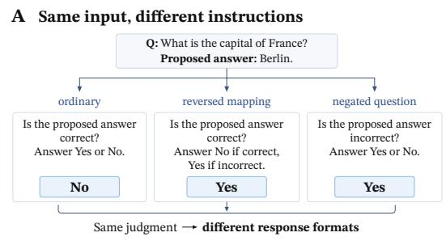
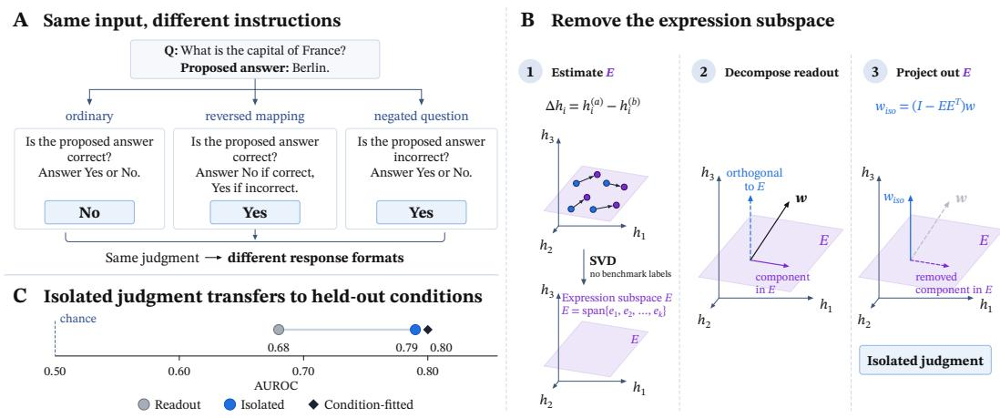
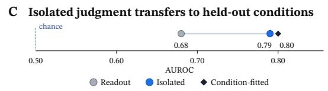
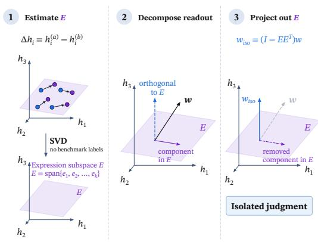
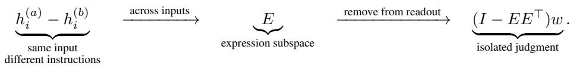
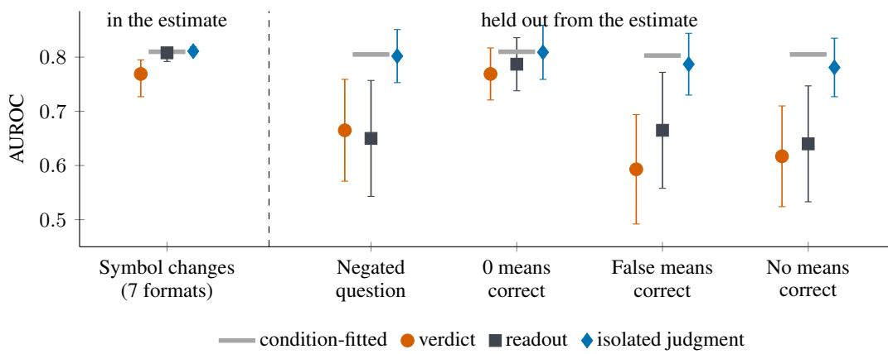
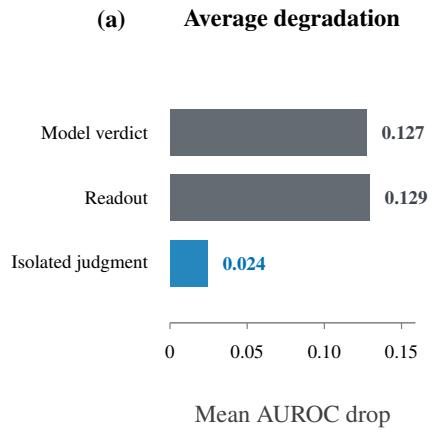
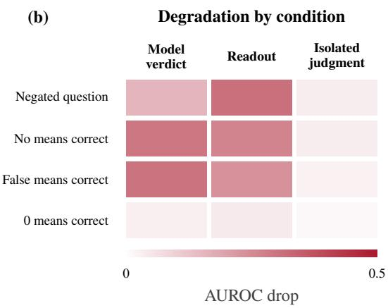
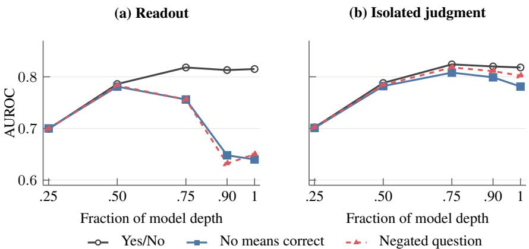

# ISOLATING A LANGUAGE MODEL’S JUDGMENT WITHA LABEL-FREE SUBSPACE

Chaemin Jang, Donggyu Lee, Jeesoo Kim, Dongman Lee†, Jihee Kim† Korea Advanced Institute of Science and Technology (KAIST) jchaemin@kaist.ac.kr

## ABSTRACT

Language models are often asked to make judgments: whether a proposed answer is correct, whether one statement follows logically from another, or whether a response is safe. Yet changing the instructions that specify how the judgment should be expressed can make the final answer less reliable, even for the same input. We ask whether this reflects a change in internal judgment or a failure to express it. Comparing hidden-state vectors for the same input under different instructions, we find that their differences concentrate in a low-dimensional expression subspace. We identify this subspace without benchmark labels and remove its contribution from a linear predictor to obtain an isolatedjudgment. Across correctness, entailment, and safety, the isolated judgment remains reliable under instructions not used to identify the subspace, even when the model’s final answer and the original predictor degrade. When the judgment question is negated, isolation raises the predictor’s AUROC from 0.504 to 0.827 for entailment and from 0.480 to 0.891 for safety. We also find that judgment is readable in earlier layers, before the expression subspace begins to disrupt the predictor. Together, these results provide a way to separate judgment from expression and recover internal judgments even when the model’s final answers are unreliable.

## 1 INTRODUCTION

Language models are often asked to make judgments: whether a proposed answer is correct, whether one statement follows logically from another, or whether a response is safe. But making an assessment and expressing it are not necessarily the same. A model that judges a proposed answer to be correct may be asked to express that judgment as “Yes,” “True,” a letter, or part of a structured response. We call the model’s internal assessment its judgment, and the response it produces its verdict. Different instructions can require different verdicts for the same judgment. This paper asks whether that judgment remains recoverable when the model fails to express it reliably under a changed instruction.

The verdict alone cannot tell us what failed: did the model change its judgment, or did it fail to express the same judgment in the requested way? Looking inside the model does not immediately solve the problem either. The hidden state used to produce the verdict may contain information both about the judgment and about how it should be expressed. A linear predictor applied to that state, which we call a readout, can therefore become less reliable even when the underlying judgment has not changed.

We separate these sources of variation by comparing hidden-state vectors for the same input under different instructions. Because the input being judged is held fixed, the paired differences capture changes associated with the instruction. Across inputs, these differences concentrate in a small set of directions. We use them to identify a low-dimensional expression subspace without benchmark labels and remove the readout’s component within it to obtain an isolatedjudgment.

On correctness tasks, a linear readout fitted with benchmark labels under the ordinary question “Is the proposed answer correct?” reaches 0.815 AUROC. When the question changes to “Is the proposed answer incorrect?”, the same readout falls to 0.650, while the isolated judgment reaches 0.802. Similar recovery occurs when the instructions reverse the response meanings: “No” means correct and “Yes” means incorrect, or “False” means correct and “True” means incorrect. Across correctness, entailment, and safety, the isolated judgment remains reliable under instructions not used to identify the subspace. When the readout is fitted to the model’s own ordinary verdicts, isolation also recovers that assessment even when the verdict under negation expresses the opposite judgment.

  
Figure 1: Separating judgment from verdict. A: The same input under three instructions: the verdict changes, the judgment does not. B: Paired differences across instructions span a low-dimensional expression subspace E, estimated without labels; removing it from the readout w leaves the isolated judgment. C: On the four held-out conditions, the readout falls to 0.68 AUROC while the isolated judgment reaches 0.79, within 0.01 on average of a readout fitted on each condition.

Examining the model’s layers shows where the readout loses reliability. Judgment is already readable at intermediate layers, while disruption appears mainly in later layers. This disruption is concentrated in directions associated with changes in response meaning, such as negating the question or reversing what “Yes” and “No” mean. Changing only the response symbols has little effect on the readout.

These findings have implications for both evaluation and the design of internal readouts. An unreliable verdict need not imply that a useful internal judgment is absent, and a readout can itself be sensitive to how that judgment must be expressed. Separating these sources of variation provides a way to recover internal judgments despite unreliable verdicts and makes readouts more robust to instruction changes.

Our contributions are:

• We show that a model’s judgment can remain readable even when its verdict changes.

• We identify a low-dimensional expression subspace that separates judgment from expression.

• We show that the disruption enters late in the network, after the judgment is already readable.

## 2 RELATED WORK

Internal representations of truth and judgment. A large literature finds that truth, correctness, and factuality are linearly readable from language-model activations (Azaria & Mitchell, 2023; Marks & Tegmark, 2024; Liu et al., 2024; Burger et al., 2024; Orgad et al., 2025; Gekhman et al., 2025;¨ Servedio et al., 2025; Han et al., 2025). Models can also evaluate their own candidate answers, and internal states can remain informative when the generated response is misleading or wrong (Kadavath et al., 2022; Halawi et al., 2024). At the same time, these signals do not always transfer cleanly across datasets, tasks, models, or logical transformations (Levinstein & Herrmann, 2025; Bao et al., 2025; Poulis et al., 2026; Cheang et al., 2026). Most closely related, Burger et al. (2024) separate a general¨ truth direction from a polarity-sensitive component under affirmation and negation. We instead study the judgment a model forms for a particular input being judged and ask whether that judgment can be separated from the way it must be expressed.

Table 1: Experimental setting. For each listed pair, the first response expresses a positive judgment. Held-out conditions are not used to identify the subspace and are introduced only when testing whether the judgment can be recovered under conditions held out from the estimate.
<table><tr><td>Component</td><td>Setting</td></tr><tr><td>Judgments</td><td>Correctness, entailment, safety</td></tr><tr><td>Datasets</td><td>GSM8K, MMLU, ARC-Challenge, TriviaQA, ANLI, BeaverTails</td></tr><tr><td>Models</td><td>Qwen2.5-7B, Llama-3.1-8B, Mistral-7B, Qwen2.5-14B, Gemma-2-9B</td></tr><tr><td>Response formats</td><td>Yes/No, True/False, A/B, B/A, 1/0, Correct/Incorrect, sentence</td></tr><tr><td>Held-out conditions</td><td>No/Yes, False/True, 0/1, negated question</td></tr></table>

From deciding to expressing a response. Model behavior is highly sensitive to prompt format, answer priors, demonstration order, label mappings, and response symbols (Zhao et al., 2021; Lu et al., 2022; Webson & Pavlick, 2022; Min et al., 2022; Sclar et al., 2024; Robinson & Wingate, 2023; Zheng et al., 2024; Wei et al., 2023). Mechanistic work increasingly suggests that selecting an answer and mapping it to the required response are distinct computations (Lieberum et al., 2023; Wiegreffe et al., 2025; Wong et al., 2026). Related work has also identified activation directions controlling instruction-specific properties such as output format and stage-like separation between content and surface form (Stolfo et al., 2025; Wendler et al., 2024). Our results identify the corresponding structure for judgments: the judgment is readable before the expression subspace begins to affect the readout, and paired changes in the instruction reveal the subspace itself.

Probing, representation removal, and intervention. Decodability alone does not establish how a representation is used, motivating controls and counterfactual interventions in probing work (Hewitt & Liang, 2019; Elazar et al., 2021; Park et al., 2024). Unsupervised methods can recover latent directions from paired or logically related examples, although such objectives need not identify the intended latent variable (Burns et al., 2023; Farquhar et al., 2023). Other work removes linearly represented concepts or steers behavior along activation directions (Ravfogel et al., 2020; Belrose et al., 2023; Subramani et al., 2022; Li et al., 2023; Zou et al., 2023). Our estimator instead uses paired states in which the input being judged is fixed and only the instruction changes. The resulting expression subspace requires no benchmark labels to estimate and can be removed to isolate a judgment that transfers to conditions held out from its estimate.

## 3 SETUP

Experimental setting. We study three binary judgments: whether a proposed answer is correct, whether a hypothesis is entailed, and whether a response is safe. Our main experiments use five instruction-tuned models across six datasets; we additionally replicate the core result prospectively on five further models up to 32B. The fourteen primary model–dataset cells in the main tables come from the first four models on the four correctness datasets; Gemma-2-9B is the prospective fifth model and is reported separately (Appendix C.2).

For correctness, each model first generates a candidate answer and is then asked whether that answer is correct. For entailment, we use ANLI and ask whether the hypothesis follows from the premise; for safety, we use BeaverTails and ask whether the response is safe. In every case, we keep the input being judged fixed and change only the instruction used to elicit the judgment.

Prompt structure. For correctness, the prompt consists of the question, the candidate answer, and the instruction. For example, under the Yes/No response format, the prompt has the following form:

[question]   
[candidate answer]   
Is the proposed answer correct? Answer Yes or No.

This ordering lets us read the hidden state before the judgment question, after the judgment question, and immediately before the verdict. In one control, we specify the response format before the judgment question to test whether the judgment is already readable before verdict generation.

The instructions for several conditions are:

<table><tr><td>Condition</td><td>Instruction</td></tr><tr><td>Yes/No</td><td>Is the proposed answer correct? Answer Yes or No.</td></tr><tr><td>A/B</td><td>Is the proposed answer correct?</td></tr><tr><td></td><td>Answer A for correct or B for incorrect.</td></tr></table>

Readout. We read the model’s final-layer hidden state immediately before it produces its verdict and fit a simple linear readout to distinguish positive from negative benchmark labels. After standardizing the hidden states, the readout direction is the difference between the mean state for positive and negative examples; we use this class mean rather than a tuned probe because tuned probes transfer worse across formats (Appendix B.1). Unless stated otherwise, we fit the readout under the Yes/No condition. When applying it to another condition or dataset, we keep its direction and scaling fixed; no benchmark labels from the target condition are used.

Evaluation. We divide questions into five disjoint groups, fitting the readout on four and evaluating it on the fifth in turn. All conditions and wordings of the same underlying question are kept in the same group, ensuring that no question appears in both training and evaluation. We report AUROC, which measures how well the readout separates positive from negative benchmark labels without requiring a fixed decision threshold. Uncertainty intervals are estimated by repeatedly resampling questions within each model–dataset pair and resampling across pairs for aggregate results.

## 4 THE READOUT IS LINKED TO THE MODEL’S JUDGMENT

The readout becomes more informative after the model is asked to judge the candidate, and intervening along its direction changes the verdict the model produces. Its AUROC rises from 0.741 before the judgment question to 0.812 after the question and 0.818 immediately before the verdict. Moreover, intervening along the readout direction systematically shifts the model toward the corresponding verdict. Together, these results connect the readout to the model’s judgment process and provide a starting point for separating the judgment from how it is expressed.

The readout becomes more informative when the model judges the candidate. At the final token of the candidate answer, before any judgment question is asked, the readout reaches 0.741 AUROC. After the judgment question, it rises to 0.812 and reaches 0.818 immediately before the verdict, with post-judgment AUROC exceeding pre-judgment AUROC in all fourteen model–dataset pairs. Thus, the signal captured by the readout becomes more predictive once the model is asked to evaluate the candidate, beyond what is already readable from the candidate answer alone. When the response format is specified before the judgment question, the same pattern remains: the readout reaches 0.808 AUROC after the judgment question and 0.823 immediately before the verdict. Full prompt-position results and per-cell values are reported in Appendix B.2.

The readout also does not depend on who wrote the candidate: fitted on the judge’s own answers and applied to another model’s answers to the same questions, it is within 0.009 of a readout fitted on those states, and it reads dataset-written candidates at 0.85–0.89 (Appendix C.8).

Intervening along the readout direction shifts the verdict. Adding the readout direction at an intermediate layer systematically shifts the model toward the verdict corresponding to a positive judgment. The logit difference between the responses meaning “correct” and “incorrect” increases by 2.39 logits per unit under Yes/No, 1.30 under A/B, and 0.46 under B/A. This effect appears in all 14 model–dataset pairs under Yes/No and A/B and in 13 of 14 under B/A, while random directions and directions fitted to shuffled benchmark labels have essentially no effect. Thus, the readout direction is not merely predictive of the verdict: intervening along it systematically changes the verdict the model produces (Appendix B.3). Table 2 summarizes these results.

Table 2: The readout is linked to the model’s judgment. The readout becomes stronger after the model is asked to judge the candidate answer, and intervening along its direction changes the model’s verdict.  
Readout across prompt position
<table><tr><td>Position</td><td>AUROC</td></tr><tr><td>Before judgment question</td><td>0.741</td></tr><tr><td>After judgment question</td><td>0.812</td></tr><tr><td>Before verdict</td><td>0.818</td></tr></table>

Intervention along the readout direction
<table><tr><td>Response format</td><td>Logit change / unit</td><td>Positive cells</td></tr><tr><td>Yes/No</td><td>2.39</td><td>14/14</td></tr><tr><td>A/B</td><td>1.30</td><td>14/14</td></tr><tr><td>B/A</td><td>0.46</td><td>13/14</td></tr></table>

## 5 A LOW-DIMENSIONAL EXPRESSION SUBSPACE SEPARATES JUDGMENT FROM EXPRESSION

Across changes in response form, the readout transfers nearly unchanged: fitted under Yes/No, it is within 0.009 AUROC on average of a readout fitted directly on A/B, B/A, or sentence responses (Appendix B.1). By contrast, the readout degrades when the instruction changes what the response means, even though the content being judged is fixed. The corresponding changes in the hidden state are concentrated in a small set of directions, which we call the expression subspace. Removing this subspace from the readout yields the isolatedjudgment, which remains reliable under held-out changes in how the judgment must be expressed.

## 5.1 IDENTIFYING THE EXPRESSION SUBSPACE

The expression subspace captures directions that change consistently when the same input is judged under different instructions. For each input, we take the difference between its hidden states under two instructions and identify the directions that recur across these paired differences:

Here, the columns of E are the leading directions of the centered paired hidden-state differences, obtained by SVD. We select the rank by split-half stability; across cells, the selected rank has a median of eight.

The expression subspace is estimated from paired states under five response forms: Yes/No, True/False, A/B, B/A, and sentence responses, together with affirmative and negated judgment pairs from entailment and safety. No benchmark labels are used to estimate the subspace. The conditions in which No, False, or 0 means correct, as well as the negated correctness question, are excluded from estimation and used only for evaluation. All subspaces are estimated on training questions and re-estimated within each fold. Full details are given in Appendix C.1.

## 5.2 THE ISOLATED JUDGMENT TRANSFERS TO HELD-OUT CONDITIONS

Held-out conditions. Under instruction changes excluded from subspace estimation, the readout degrades while the isolated judgment remains close to a readout fitted directly on each target condition. Under the negated correctness question, the readout falls to 0.650 AUROC, while the isolated judgment reaches 0.802, compared with 0.805 for the condition-fitted readout (Appendix D.1). When No, False, or 0 means correct, the readout reaches 0.640, 0.665, and 0.787, while the isolated judgment reaches 0.781, 0.787, and 0.809, respectively. Figure 2 shows the full pattern across conditions, and Table 3 reports the four designated held-out conditions.

  
Figure 2: Across conditions, the readout can degrade while the isolated judgment remains close to a readout fitted directly on the target condition. Left: the seven response formats used to identify the expression subspace, averaged, with whiskers spanning the seven format means. Right: the four held-out conditions, with 95% intervals over the fourteen model–dataset cells. Gray ticks mark the condition-fitted readout. Means over fourteen cells and five instruction wordings; the sentence format has no native verdict margin.

Table 3: Performance on the four held-out conditions. Values are AUROC against benchmark labels, averaged over fourteen model–dataset cells and five instruction wordings. The isolated judgment remains close to a readout fitted directly on each condition.
<table><tr><td>Condition</td><td>Verdict</td><td>Readout</td><td>Isolated</td><td>Condition-fitted</td></tr><tr><td>No means correct</td><td>0.617</td><td>0.640</td><td>0.781</td><td>0.805</td></tr><tr><td>False means correct</td><td>0.593</td><td>0.665</td><td>0.787</td><td>0.803</td></tr><tr><td>0 means correct</td><td>0.769</td><td>0.787</td><td>0.809</td><td>0.810</td></tr><tr><td>Negated question</td><td>0.665</td><td>0.650</td><td>0.802</td><td>0.805</td></tr></table>

Other judgment tasks. The same pattern extends to entailment and safety. For these tasks, the expression subspace is estimated from paired differences among each task’s five response forms, together with negation pairs from correctness, leaving the negated entailment and safety questions held out. Under negation, the readout falls to 0.504 AUROC on ANLI and 0.480 on BeaverTails, while the isolated judgment reaches 0.827 and 0.891, respectively, nearly matching readouts fitted directly on those conditions (0.827 and 0.881; Appendix C.6).

Comparison with supervised isolation. A supervised class-mean baseline using labeled states under both A/B and B/A reaches similar performance on the held-out conditions (Appendix C.2). The advantage of the expression subspace is therefore not higher held-out AUROC, but that it identifies the directions associated with expression from paired states alone, without requiring labels from a second response form.

Additional models. The same pattern extends beyond the models used to develop the method. Gemma-2-9B-IT was added after the method was fixed, with predictions specified in advance, and shows the same result (Appendix C.2). In Qwen2.5-32B, the readout falls to 0.42 AUROC under the negated question, while the isolated judgment comes within 0.007 of a readout fitted directly on that condition. Across five additional models spanning 7B to 32B, the isolated judgment is within 0.02 of the condition-fitted readout in every model (Appendix C.7).

## 5.3 ROBUSTNESS AND ALTERNATIVE EXPLANATIONS

Alternative explanations. The expression subspace is not simply capturing generic differences between conditions. Removing directions that best encode condition identity, the leading directions of overall hidden-state variation, or a random subspace of the same rank does not recover the readout on the held-out conditions. Moreover, the same pattern remains when the expression subspace is estimated only from pairs on which the model expresses the same judgment under both instructions. Thus, the subspace does not arise simply from examples in which changing the instruction changes the model’s judgment (Appendix C.5).

  
Figure 3: Held-out conditions can substantially degrade the model’s verdict and the readout while leaving the isolated judgment comparatively stable. Panel (a) shows the mean AUROC drop across the four held-out conditions. Panel (b) shows the drop separately for each condition.

Robustness across estimation settings. The expression subspace is not tied to the particular prompts used to estimate it. A subspace estimated from one set of prompt wordings remains effective on unseen wordings, and a subspace estimated from the original instruction family transfers to a different instruction family. These results suggest that the expression subspace captures structure that recurs across prompts, rather than a property specific to the wordings or instruction family used for estimation (Appendix C.5).

## 6 THE JUDGMENT REMAINS READABLE WHEN THE VERDICT CHANGES

A model can change its verdict under a new instruction while preserving the judgment that remains readable internally. Under the negated question and reversed response mappings, the verdict and readout degrade substantially while the isolated judgment changes little. More directly, when negation causes the model to give different verdicts for the same input, the isolated judgment remains aligned with the judgment expressed under the affirmative question. The changed verdict therefore reflects a change in expression rather than a loss of the judgment that was already present.

Across the negated question and the three reversed response mappings, AUROC drops by 0.127 for the verdict and 0.129 for the readout, but only 0.024 for the isolated judgment (Figure 3). The verdict and readout also fail on different model–dataset cells: the readout drops where the model applies the inverted mapping, whereas the verdict drops where it does not (Appendix D.2). In both cases, the isolated judgment remains within 0.03 AUROC of the condition-fitted readout.

## 6.1 THE ISOLATED JUDGMENT REMAINS READABLE WHEN VERDICTS DISAGREE

We test whether the isolated judgment stays stable when negation changes the model’s verdict. We fit the readout to the model’s own Yes/No verdicts, then evaluate the isolated readout on the same inputs under the negated question. If the isolated judgment changes with the verdict, it should track the negated verdict. If it remains stable, it should continue to track the same judgment across the instruction change.

Across cells, the isolated judgment predicts the Yes/No verdict at a median of 0.924 AUROC, while it predicts the verdict under the negated question at 0.16–0.86 by cell (median 0.675), with the Yes/No value higher in every model–dataset cell. We then restrict the comparison to examples where the two verdicts disagree. Even on these examples, the isolated judgment predicts the Yes/No verdict at 0.953 AUROC. Thus, even when the model changes its verdict, the same judgment remains readable internally (Appendix D.3).

  
Figure 4: Judgment and expression emerge at different depths. At intermediate layers, the readout is nearly identical across Yes/No, No-means-correct, and the negated question. The conditions diverge in the later layers (a), while the isolated judgment remains aligned across depth (b). Full depth-wise results are in Appendix C.3.

## 7 THE JUDGMENT IS READABLE BEFORE EXPRESSION DISRUPTS THE READOUT

The judgment is already readable before changes in how it must be expressed begin to disrupt the readout. At intermediate layers, the readout is nearly identical across the Yes/No condition, the negated question, and the condition in which No means correct, but these conditions diverge later in the network. Importantly, the isolated judgment remains closely aligned across these conditions throughout model depth. The directions responsible for the late disruption are tied to changes in response meaning rather than changes in response symbol.

## 7.1 THE EXPRESSION SUBSPACE DISRUPTS THE READOUT LATE

At half of model depth, the readout is nearly identical under Yes/No, No means correct, and the negated question, reaching 0.786, 0.781, and 0.783 AUROC, respectively. The three conditions begin to diverge by three quarters of model depth. By 0.9 of model depth, the readout remains at 0.813 under Yes/No but falls to 0.648 when No means correct and 0.632 under negation. Thus, the judgment is already readable before changes in how it must be expressed begin to disrupt the readout.

Importantly, the isolated judgment remains closely aligned across all three conditions throughout model depth. At three quarters of model depth, it reaches 0.818 AUROC under the negated question, compared with 0.802 at the final layer. The late divergence of the readout is not because the instruction becomes available only late in the network. When the response form is specified before the judgment question, condition identity is already decodable at 0.99 AUROC before any response token is produced. What appears late is specifically the part of the expression subspace that disrupts the readout. Full depth-wise results are reported in Appendix C.3.

## 7.2 RESPONSE MEANING DRIVES THE DISRUPTION

The late disruption is associated with changes in what the response means. Changing among letters, digits, or sentence responses leaves the readout largely unchanged. The readout instead degrades when “No” or “False” expresses a positive judgment, or when the judgment question is negated. The directions associated with these changes are also sufficient to recover nearly the same performance as the full expression subspace on the reversed response mappings and the negated question.

The other directions in the expression subspace capture reproducible differences across response forms, but they contribute little to the readout disruption. The three directions estimated from the negation pairs recover the negated question and reversed response mappings to within 0.005 AUROC of the full expression subspace, whereas the leading direction alone is not sufficient. Thus, the late disruption is concentrated in a small set of directions associated with changes in response meaning. Together with the depth-wise results, this shows a clear separation: the judgment remains readable across depth, while the directions that interfere with its expression become influential only later in the network (Appendix C.4).

## 8 IMPLICATIONS AND LIMITATIONS

Implications. A model can retain a readable judgment even when its verdict changes. This changes what can be inferred from behavioral failure: an incorrect verdict can arise because the model formed the wrong judgment, or because a judgment that was already present was expressed incorrectly. A readout from the hidden state does not resolve this ambiguity on its own, because the readout can also be disrupted by how the judgment must be expressed. The expression subspace provides a way to separate these two sources of variation, revealing when a judgment remains readable despite a failure in the model’s final response.

This distinction also changes how model evaluations should be interpreted. Behavioral accuracy measures only the final verdict, while a readout from the final hidden state can itself be affected by how the judgment must be expressed. As a result, neither behavior nor a standard internal readout necessarily reveals whether the judgment itself is present. Evaluating judgment separately from expression provides a more direct view of what remains represented internally when the model’s final response fails.

The distinction also has implications for intervention. A failure in judgment and a failure in expression call for different kinds of correction: the former requires changing how the model evaluates the input, while the latter may require changing how an existing judgment is translated into a response. Our results therefore suggest that locating a failure relative to the judgment can help identify which part of the computation should be targeted.

Limitations and future work. Our results establish a separation between judgment and expression in the hidden state, not a mechanistic decomposition of the model’s computation. Our experiments focus on binary judgments, single-token or short-sentence verdicts, and models from 7B to 32B parameters. An important next step is to test whether the same separation extends to open-ended judgments and longer generations, and whether targeted interventions on judgment and expression can establish distinct causal roles for the two. Moving from a representational separation to a mechanistic one would clarify when judgment and expression can be independently read and manipulated.

## AI USE STATEMENT

Generative AI tools assisted with code drafting, figures, manuscript organization and prose. The authors are responsible for verifying the numerical results, citations, code, and final text.

## ETHICS STATEMENT

This work studies how language models express correctness, entailment, and safety judgments. The safety experiment uses public, human-labeled BeaverTails examples and generates no new harmful content. No new human-subject data were collected.

## REPRODUCIBILITY STATEMENT

Code, prompts, and per-cell result files are available at an anonymous repository1. Appendix A specifies the models, datasets, prompt wordings, folds, benchmark labels, and uncertainty estimates used throughout the paper. The remaining appendices provide the estimation details, controls, and

per-cell results underlying the quantitative claims in the main text. All transfer results are evaluated on question-disjoint held-out data.

## REFERENCES

Amos Azaria and Tom Mitchell. The internal state of an llm knows when it’s lying. In Findings of the Associationfor Computational Linguistics: EMNLP 2023, pp. 967–976, 2023.

Yuntai Bao, Xuhong Zhang, Tianyu Du, Xinkui Zhao, Zhengwen Feng, Hao Peng, and Jianwei Yin. Probing the geometry of truth: Consistency and generalization of truth directions in llms across logical transformations and question answering tasks. In Findings of the Association for Computational Linguistics: ACL 2025, pp. 682–700, 2025.

Nora Belrose, David Schneider-Joseph, Shauli Ravfogel, Ryan Cotterell, Edward Raff, and Stella Biderman. LEACE: Perfect linear concept erasure in closed form. In Advances in Neural Information Processing Systems, 2023.

Lennart Burger, Fred A. Hamprecht, and Boaz Nadler. Truth is universal: Robust detection of lies in¨ LLMs. In Advances in Neural Information Processing Systems, 2024.

Collin Burns, Haotian Ye, Dan Klein, and Jacob Steinhardt. Discovering latent knowledge in language models without supervision. In International Conference on Learning Representations, 2023.

Chi Seng Cheang, Hou Pong Chan, Wenxuan Zhang, and Yang Deng. Do LLMs really know what they don’t know? internal states mainly reflect knowledge recall rather than truthfulness. In Findings of the Association for Computational Linguistics: ACL 2026, pp. 713–730, 2026.

Peter Clark, Isaac Cowhey, Oren Etzioni, Tushar Khot, Ashish Sabharwal, Carissa Schoenick, and Oyvind Tafjord. Think you have solved question answering? Try ARC, the AI2 reasoning challenge. arXiv preprint arXiv:1803.05457, 2018.

Karl Cobbe, Vineet Kosaraju, Mohammad Bavarian, Mark Chen, Heewoo Jun, Lukasz Kaiser, Matthias Plappert, Jerry Tworek, Jacob Hilton, Reiichiro Nakano, Christopher Hesse, and John Schulman. Training verifiers to solve math word problems. arXiv preprint arXiv:2110.14168, 2021.

Yanai Elazar, Shauli Ravfogel, Alon Jacovi, and Yoav Goldberg. Amnesic probing: Behavioral explanation with amnesic counterfactuals. Transactions of the Association for Computational Linguistics, 9:160–175, 2021.

Sebastian Farquhar, Vikrant Varma, Zachary Kenton, Johannes Gasteiger, Vladimir Mikulik, and Rohin Shah. Challenges with unsupervised LLM knowledge discovery. arXiv preprint arXiv:2312.10029, 2023.

Zorik Gekhman, Eyal Ben-David, Hadas Orgad, Eran Ofek, Yonatan Belinkov, Idan Szpektor, Jonathan Herzig, and Roi Reichart. Inside-out: Hidden factual knowledge in LLMs. In Conference on Language Modeling, 2025.

Gemma Team, Morgane Riviere, Shreya Pathak, Pier Giuseppe Sessa, et al. Gemma 2: Improving open language models at a practical size. arXiv preprint arXiv:2408.00118, 2024.

Aaron Grattafiori, Abhimanyu Dubey, Abhinav Jauhri, Abhinav Pandey, Abhishek Kadian, Ahmad Al-Dahle, Aiesha Letman, Akhil Mathur, et al. The Llama 3 herd of models. arXiv preprint arXiv:2407.21783, 2024.

Danny Halawi, Jean-Stanislas Denain, and Jacob Steinhardt. Overthinking the truth: Understanding how language models process false demonstrations. In International Conference on Learning Representations, volume 2024, pp. 42749–42787, 2024.

Jiatong Han, Neil Band, Muhammed Razzak, Jannik Kossen, Tim G. J. Rudner, and Yarin Gal. Simple factuality probes detect hallucinations in long-form natural language generation. In Findings of the Associationfor Computational Linguistics: EMNLP 2025, pp. 16209–16226, 2025.

Dan Hendrycks, Collin Burns, Steven Basart, Andy Zou, Mantas Mazeika, Dawn Song, and Jacob Steinhardt. Measuring massive multitask language understanding. In International Conference on Learning Representations, 2021.

John Hewitt and Percy Liang. Designing and interpreting probes with control tasks. In Proceedings of the 2019 Conference on Empirical Methods in Natural Language Processing and the 9th International Joint Conference on Natural Language Processing, pp. 2733–2743, 2019.

Jiaming Ji, Mickel Liu, Josef Dai, Xuehai Pan, Chi Zhang, Ce Bian, Boyuan Chen, Ruiyang Sun, Yizhou Wang, and Yaodong Yang. BeaverTails: Towards improved safety alignment of LLM via a human-preference dataset. In Advances in Neural Information Processing Systems, volume 36, 2023.

Albert Q. Jiang, Alexandre Sablayrolles, Arthur Mensch, Chris Bamford, Devendra Singh Chaplot, Diego de las Casas, Florian Bressand, Gianna Lengyel, Guillaume Lample, Lucile Saulnier, et al. Mistral 7B. arXiv preprint arXiv:2310.06825, 2023.

Mandar Joshi, Eunsol Choi, Daniel Weld, and Luke Zettlemoyer. TriviaQA: A large scale distantly supervised challenge dataset for reading comprehension. In Proceedings of ACL, pp. 1601–1611, 2017.

Saurav Kadavath, Tom Conerly, Amanda Askell, Tom Henighan, Dawn Drain, Ethan Perez, Nicholas Schiefer, Zac Hatfield-Dodds, Nova DasSarma, Eli Tran-Johnson, et al. Language models (mostly) know what they know. arXiv preprint arXiv:2207.05221, 2022.

B. A. Levinstein and Daniel A. Herrmann. Still no lie detector for language models: Probing empirical and conceptual roadblocks. Philosophical Studies, 182(7):1539–1565, 2025.

Kenneth Li, Oam Patel, Fernanda Viegas, Hanspeter Pfister, and Martin Wattenberg. Inference-time´ intervention: Eliciting truthful answers from a language model. In Advances in Neural Information Processing Systems, 2023.

Tom Lieberum, Matthew Rahtz, Janos Kram´ ar, Neel Nanda, Geoffrey Irving, Rohin Shah, and´ Vladimir Mikulik. Does circuit analysis interpretability scale? evidence from multiple choice capabilities in Chinchilla. arXiv preprint arXiv:2307.09458, 2023.

Junteng Liu, Shiqi Chen, Yu Cheng, and Junxian He. On the universal truthfulness hyperplane inside llms. In Proceedings ofthe 2024 Conference on Empirical Methods in Natural Language Processing, pp. 18199–18224, 2024.

Yao Lu, Max Bartolo, Alastair Moore, Sebastian Riedel, and Pontus Stenetorp. Fantastically ordered prompts and where to find them: Overcoming few-shot prompt order sensitivity. In Proceedings of the 60th Annual Meeting of the Association for Computational Linguistics, pp. 8086–8098, 2022.

Samuel Marks and Max Tegmark. The geometry of truth: Emergent linear structure in large language model representations of true/false datasets. In First Conference on Language Modeling, 2024.

Sewon Min, Xinxi Lyu, Ari Holtzman, Mikel Artetxe, Mike Lewis, Hannaneh Hajishirzi, and Luke Zettlemoyer. Rethinking the role of demonstrations: What makes in-context learning work? In Proceedings of the 2022 Conference on Empirical Methods in Natural Language Processing, pp. 11048–11064, 2022.

Yixin Nie, Adina Williams, Emily Dinan, Mohit Bansal, Jason Weston, and Douwe Kiela. Adversarial NLI: A new benchmark for natural language understanding. In Proceedings of ACL, pp. 4885–4901, 2020.

Hadas Orgad, Michael Toker, Zorik Gekhman, Roi Reichart, Idan Szpektor, Hadas Kotek, and Yonatan Belinkov. Llms know more than they show: On the intrinsic representation of llm hallucinations. In International Conference on Learning Representations, volume 2025, pp. 66880–66913, 2025.

Kiho Park, Yo Joong Choe, and Victor Veitch. The linear representation hypothesis and the geometry of large language models. In Proceedings of the 41st International Conference on Machine Learning, volume 235, pp. 39643–39666, 2024.

Angelos Poulis, Mark Crovella, and Evimaria Terzi. Testing the limits of truth directions in LLMs. arXiv preprint arXiv:2604.03754, 2026.

Shauli Ravfogel, Yanai Elazar, Hila Gonen, Michael Twiton, and Yoav Goldberg. Null it out: Guarding protected attributes by iterative nullspace projection. In Proceedings of the 58th Annual Meeting of the Association for Computational Linguistics, pp. 7237–7256, 2020.

Joshua Robinson and David Wingate. Leveraging large language models for multiple choice question answering. International Conference on Learning Representations, 2023.

Melanie Sclar, Yejin Choi, Yulia Tsvetkov, and Alane Suhr. Quantifying language models’ sensitivity to spurious features in prompt design or: How i learned to start worrying about prompt formatting. In International Conference on Learning Representations, volume 2024, pp. 25055–25083, 2024.

Giovanni Servedio, Alessandro De Bellis, Dario Di Palma, Vito Walter Anelli, and Tommaso Di Noia. Are the hidden states hiding something? testing the limits of factuality-encoding capabilities in llms. In Proceedings of the 63rd Annual Meeting of the Association for Computational Linguistics (Volume 1: Long Papers), pp. 6089–6104, 2025.

Alessandro Stolfo, Vidhisha Balachandran, Safoora Yousefi, Eric Horvitz, and Besmira Nushi. Improving instruction-following in language models through activation steering. In International Conference on Learning Representations, volume 2025, pp. 55790–55823, 2025.

Nishant Subramani, Nivedita Suresh, and Matthew E Peters. Extracting latent steering vectors from pretrained language models. In Findings ofthe Associationfor Computational Linguistics: ACL 2022, pp. 566–581, 2022.

Albert Webson and Ellie Pavlick. Do prompt-based models really understand the meaning of their prompts? In Proceedings of the 2022 Conference of the North American Chapter of the Association for Computational Linguistics: Human Language Technologies, pp. 2300–2344, 2022.

Jerry Wei, Le Hou, Andrew Lampinen, Xiangning Chen, Da Huang, Yi Tay, Xinyun Chen, Yifeng Lu, Denny Zhou, Tengyu Ma, and Quoc V. Le. Symbol tuning improves in-context learning in language models. In Proceedings of the 2023 Conference on Empirical Methods in Natural Language Processing, pp. 968–979, 2023.

Chris Wendler, Veniamin Veselovsky, Giovanni Monea, and Robert West. Do llamas work in english? on the latent language of multilingual transformers. In Proceedings of the 62nd Annual Meeting of the Associationfor Computational Linguistics (Volume 1: Long Papers), pp. 15366–15394, 2024.

Sarah Wiegreffe, Oyvind Tafjord, Yonatan Belinkov, Hannaneh Hajishirzi, and Ashish Sabharwal. Answer, assemble, ace: Understanding how lms answer multiple choice questions. In International Conference on Learning Representations, volume 2025, pp. 78293–78318, 2025.

Hugh Mee Wong, Rick Nouwen, and Albert Gatt. When models decide and when they bind: A two-stage computation for multiple-choice question answering. In Findings ofthe Associationfor Computational Linguistics: ACL 2026, pp. 22804–22821, 2026.

An Yang, Baosong Yang, Beichen Zhang, Binyuan Hui, Bo Zheng, Bowen Yu, et al. Qwen2.5 technical report. arXiv preprint arXiv:2412.15115, 2024.

Zihao Zhao, Eric Wallace, Shi Feng, Dan Klein, and Sameer Singh. Calibrate before use: Improving few-shot performance of language models. In Proceedings ofthe 38th International Conference on Machine Learning, volume 139, pp. 12697–12706, 2021.

Chujie Zheng, Hao Zhou, Fandong Meng, Jie Zhou, and Minlie Huang. Large language models are not robust multiple choice selectors. In International Conference on Learning Representations, volume 2024, pp. 19426–19454, 2024.

Andy Zou, Long Phan, Sarah Chen, James Campbell, Phillip Guo, Richard Ren, Alexander Pan, Xuwang Yin, Mantas Mazeika, Ann-Kathrin Dombrowski, et al. Representation engineering: A top-down approach to AI transparency. arXiv preprint arXiv:2310.01405, 2023.

## A PROTOCOL

Models and data. Qwen2.5-7B-Instruct and Qwen2.5-14B-Instruct (Yang et al., 2024), Llama-3.1- 8B-Instruct (Grattafiori et al., 2024), and Mistral-7B-Instruct-v0.3 (Jiang et al., 2023); Gemma-2-9B-IT (Gemma Team et al., 2024) on all four correctness datasets (ARC and GSM8K descriptive, with fewer than 100 negatives), added after the method was fixed, with its own candidate answers and folds built the same way. For correctness, each model’s own greedy answer on GSM8K (Cobbe et al., 2021), MMLU (Hendrycks et al., 2021), ARC-Challenge (Clark et al., 2018), and TriviaQA (Joshi et al., 2017) is used as the candidate answer; the model sees the question and candidate answer and produces a one-token verdict. Each model–dataset cell contains approximately 800 questions. Cells with fewer than 100 negative examples are descriptive; this marks the Qwen2.5-7B and Qwen2.5-14B ARC cells as descriptive and leaves fourteen primary cells. The rule is applied on the full cell; the five-wording analyses use the first 400 questions of each cell. Entailment uses 1,000 ANLI (Nie et al., 2020) examples restricted to entailment and contradiction and balanced; safety uses 1,000 balanced examples from the human-labeled BeaverTails (Ji et al., 2023) test split with safe as the positive class.

Conditions and wordings. The response formats are Yes/No, True/False, A/B, B/A, 1/0, Correct/Incorrect, and the two-sentence format (“The proposed answer is correct.” / “The proposed answer is incorrect.”, sharing the first four tokens in all four models; the state is read before the first response token). We additionally use the negated question and three held-out conditions in which No, False, or 0 means correct; their states were extracted after every subspace and readout had been fixed. Each condition uses the same ten instruction wordings, matched one to one and differing only in the clause specifying what each response means. In the control where the response format is specified first, that clause is moved before the question; the rows, benchmark labels, folds, and wordings are otherwise unchanged. The five-wording analyses use the first, third, fifth, seventh, and ninth wordings. The prompt-position readouts of Section B.2 and the regularization path of Section B.1 use all ten; the steering runs use the same five on the first 300 questions of each cell; Qwen2.5-32B and Gemma-2-27B use three (the first, fifth, and ninth) on all rows.

Reads, folds, uncertainty. Five outer folds grouped by question; standardization estimated on each training fold and carried frozen to held-out states; the class-mean readout is the standardized positiveminus-negative mean difference; AUROC is computed only on held-out questions. Within-cell intervals use 10,000 question-clustered bootstrap resamples shared across compared score vectors; aggregate intervals resample cells. The models are not independent units; per-model values are reported wherever an aggregate is. Main-text tables report means over cells; control tables report medians, so the same readout appears as 0.650 (mean) and 0.694 (median) under the negated question.

## B THE READOUT

## B.1 TRANSFER ACROSS RESPONSE FORMATS

Table 4 gives the per-cell transfer values across response formats.

Regularization path. The Yes/No logistic probe refitted on a fixed grid with the same frozen states and folds, held-out AUROC: $C = 1 0 ^ { - 6 }$ : source 0.82, frozen A/B 0.81, B/A 0.80; 10−5: 0.83, 0.81, $0 . 8 1 ; 1 0 ^ { - 4 } ; 0 . 8 4 , 0 . 8 2 , 0 . 8 1 ; 1 0 ^ { - 3 } ; 0 . 8 4 , 0 . 7 9 , 0 . 7 5 ; 1 0 ^ { - 2 } ; 0 . 8 2 , 0 . 7 3 , 0 . 6 6 ; 1 0 ^ { - 1 } ; 0 . 8 0 , 0 . 7 1 , 0 . 6 3$ 1: 0.79, 0.69, 0.62 (ten wordings). As C → 0 the coefficient approaches the class-mean direction; source accuracy peaks at $1 0 ^ { - 3 }$ while transfer falls from $1 0 ^ { - 4 }$ on.

## B.2 READOUT BY PROMPT POSITION

Before and after the judgment question. PRE is the final-layer state at the candidate answer’s last token, before any correctness request; STEM the state after the judgment question and before the response format is specified; POST the response-position state. Class-mean readouts fitted independently at each give 0.741, 0.812, and 0.818, with POST above PRE in all fourteen cells (paired gain 0.078, question-clustered interval [0.053, 0.104]). The PRE direction and scaler carried unchanged give 0.741, 0.703, 0.730. Ten wordings.

Table 4: Per-cell transfer of the frozen Yes/No readout (five wordings): its Yes/No AUROC, its AUROC on A/B, B/A, and sentence states, and the AUROC of a readout fitted on each of those formats.
<table><tr><td>cell</td><td>Yes/No own</td><td>frozen→A/B</td><td>A/B fitted</td><td>frozen→B/A</td><td>B/A fitted</td><td>frozen→sentence</td><td>sentence fitted</td></tr><tr><td>Llama-3.1-8B ARC</td><td>0.737</td><td>0.703</td><td>0.695</td><td>0.714</td><td>0.702</td><td>0.730</td><td>0.731</td></tr><tr><td>Llama-3.1-8B GSM8K</td><td>0.966</td><td>0.971</td><td>0.970</td><td>0.972</td><td>0.972</td><td>0.952</td><td>0.961</td></tr><tr><td>Llama-3.1-8B MMLU</td><td>0.719</td><td>0.679</td><td>0.672</td><td>0.688</td><td>0.678</td><td>0.708</td><td>0.699</td></tr><tr><td>Llama-3.1-8B TriviaQA</td><td>0.842</td><td>0.846</td><td>0.843</td><td>0.845</td><td>0.842</td><td>0.844</td><td>0.846</td></tr><tr><td>Mistral-7B ARC</td><td>0.730</td><td>0.662</td><td>0.696</td><td>0.649</td><td>0.670</td><td>0.685</td><td>0.690</td></tr><tr><td>Mistral-7B GSM8K</td><td>0.826</td><td>0.814</td><td>0.822</td><td>0.812</td><td>0.821</td><td>0.829</td><td>0.827</td></tr><tr><td>Mistral-7B MMLU</td><td>0.721</td><td>0.661</td><td>0.696</td><td>0.655</td><td>0.683</td><td>0.722</td><td>0.731</td></tr><tr><td>Mistral-7B TriviaQA</td><td>0.815</td><td>0.796</td><td>0.808</td><td>0.792</td><td>0.809</td><td>0.810</td><td>0.806</td></tr><tr><td>Qwen2.5-14B GSM8K</td><td>0.937</td><td>0.939</td><td>0.938</td><td>0.938</td><td>0.938</td><td>0.934</td><td>0.933</td></tr><tr><td>Qwen2.5-14B MMLU</td><td>0.743</td><td>0.732</td><td>0.744</td><td>0.717</td><td>0.741</td><td>0.747</td><td>0.759</td></tr><tr><td>Qwen2.5-14B TriviaQA</td><td>0.859</td><td>0.862</td><td>0.863</td><td>0.838</td><td>0.866</td><td>0.862</td><td>0.862</td></tr><tr><td>Qwen2.5-7B GSM8K</td><td>0.896</td><td>0.887</td><td>0.887</td><td>0.873</td><td>0.882</td><td>0.853</td><td>0.859</td></tr><tr><td>Qwen2.5-7B MMLU</td><td>0.779</td><td>0.774</td><td>0.776</td><td>0.767</td><td>0.764</td><td>0.795</td><td>0.797</td></tr><tr><td>Qwen2.5-7B TriviaQA</td><td>0.840</td><td>0.842</td><td>0.843</td><td>0.835</td><td>0.839</td><td>0.833</td><td>0.827</td></tr></table>

Table 5 gives the values when the response format is specified first; over the ten primary cells of the three models that follow these prompts, the means are 0.808 at the stem and 0.823 at the response position.

Table 5: Response format specified first, per cell: Yes/No AUROC of the class mean fitted at the end of the judgment question (stem, before any response token) and at the response position. Five wordings. Mistral-7B follows these prompts on few rows and is descriptive. Qwen ARC cells are descriptive.
<table><tr><td>cell</td><td>stem</td><td>response position</td></tr><tr><td>Llama-3.1-8B ARC</td><td>0.691</td><td>0.746</td></tr><tr><td>Llama-3.1-8B GSM8K</td><td>0.967</td><td>0.971</td></tr><tr><td>Llama-3.1-8B MMLU</td><td>0.683</td><td>0.710</td></tr><tr><td>Llama-3.1-8B TriviaQA</td><td>0.810</td><td>0.827</td></tr><tr><td>Mistral-7B ARC</td><td>0.694</td><td>0.717</td></tr><tr><td>Mistral-7B GSM8K</td><td>0.776</td><td>0.788</td></tr><tr><td>Mistral-7B MMLU</td><td>0.712</td><td>0.705</td></tr><tr><td>Mistral-7B TriviaQA</td><td>0.785</td><td>0.794</td></tr><tr><td>Qwen2.5-14B ARC</td><td>0.766</td><td>0.790</td></tr><tr><td>Qwen2.5-14B GSM8K</td><td>0.920</td><td>0.916</td></tr><tr><td>Qwen2.5-14B MMLU</td><td>0.717</td><td>0.756</td></tr><tr><td>Qwen2.5-14B TriviaQA</td><td>0.849</td><td>0.857</td></tr><tr><td>Qwen2.5-7B ARC</td><td>0.711</td><td>0.781</td></tr><tr><td>Qwen2.5-7B GSM8K</td><td>0.865</td><td>0.830</td></tr><tr><td>Qwen2.5-7B MMLU</td><td>0.740</td><td>0.774</td></tr><tr><td>Qwen2.5-7B TriviaQA</td><td>0.833</td><td>0.845</td></tr></table>

## B.3 STEERING

The Yes/No class-mean direction is fitted at the residual site at 0.75 of depth and added there at doses −1, −0.5, −0.25, 0, 0.25, 0.5, and 1 in units of the training states’ standard deviation along the direction; direction, sign, and scale are fixed from the Yes/No condition. The logit difference between the response that means correct and the response that means incorrect under each condition changes by 2.3895 logits per unit dose under Yes/No, 1.2955 under A/B, and 0.4553 under B/A, positive in 14/14, 14/14, and 13/14 primary cells; on rows that answer in the requested format at every dose the slopes are 2.388, 1.311, and 0.475. Directions fitted to shuffled benchmark labels give 0.0018, 0.0014, 0.0050 and matched random directions 0.0001, 0.0003, 0.0001. From dose −1 to +1 the rate of “correct” verdicts rises by 9.3, 4.3, and 2.7 percentage points. At 0.5 of depth the slopes are 0.61 (A/B) and 0.49 (B/A); at 0.9 of depth the B/A slope changes sign (−0.16), so the effect is a property of the intermediate layers. Five wordings.

## C THE EXPRESSION SUBSPACE

## C.1 ESTIMATION

Estimation. For each cell, fold, and wording, the same held-out candidate answers are judged under Yes/No, True/False, A/B, B/A, and the sentence format. On training questions only, we form every paired difference between the five response formats, and the paired difference between the affirmative and negated questions on the entailment and safety inputs of the same model, center each set, and take the leading right singular vectors of the stacked, centered differences. The rank is set per cell, fold, and wording by the split-half rule (the largest rank for which the leading subspaces estimated on two disjoint halves have every principal angle with | cos | ≥ 0.95), applied jointly to the correctness and cross-task blocks; the cell medians range from 6 to 9 and their median is 8. The subspace is re-estimated inside every fold. Under format-first prompts, condition identity is linearly decodable at 0.91 AUROC at the end of the candidate answer and 0.99 after the instruction, before any response token (means over the fourteen primary cells). Using only paired differences among the five response formats, the rule gives 6.4 dimensions; with the negation pairs only, 2.9. Table 6 gives the per-cell norm share (standardized coordinates) and the AUROC of the readout and the isolated judgment on B/A and negated-question states.

Table 6: The expression subspace per cell (paired differences among the five response formats plus entailment and safety negation pairs; rank by the split-half rule, median over folds and wordings): fraction of the Yes/No readout direction’s squared norm inside it (standardized coordinates), and the AUROC of the readout and of the isolated judgment on B/A states and on negated-question states. Five wordings.
<table><tr><td>cell</td><td>rank</td><td>direction norm in subspace</td><td>readout, B/A</td><td>isolated, B/A</td><td>readout, negated</td><td>isolated, negated</td></tr><tr><td>Llama-3.1-8B ARC</td><td>7</td><td>0.524</td><td>0.714</td><td>0.729</td><td>0.718</td><td>0.732</td></tr><tr><td>Llama-3.1-8B GSM8K</td><td>9</td><td>0.473</td><td>0.972</td><td>0.972</td><td>0.944</td><td>0.965</td></tr><tr><td>Llama-3.1-8B MMLU</td><td>6</td><td>0.277</td><td>0.688</td><td>0.692</td><td>0.664</td><td>0.703</td></tr><tr><td>Llama-3.1-8B TriviaQA</td><td>8</td><td>0.504</td><td>0.845</td><td>0.846</td><td>0.726</td><td>0.841</td></tr><tr><td>Mistral-7B ARC</td><td>8</td><td>0.569</td><td>0.649</td><td>0.695</td><td>0.646</td><td>0.687</td></tr><tr><td>Mistral-7B GSM8K</td><td>6</td><td>0.444</td><td>0.812</td><td>0.823</td><td>0.744</td><td>0.817</td></tr><tr><td>Mistral-7B MMLU</td><td>6</td><td>0.444</td><td>0.655</td><td>0.693</td><td>0.705</td><td>0.737</td></tr><tr><td>Mistral-7B TriviaQA</td><td>8</td><td>0.576</td><td>0.792</td><td>0.797</td><td>0.623</td><td>0.794</td></tr><tr><td>Qwen2.5-14B GSM8K</td><td>8</td><td>0.355</td><td>0.938</td><td>0.939</td><td>0.818</td><td>0.939</td></tr><tr><td>Qwen2.5-14B MMLU</td><td>8</td><td>0.544</td><td>0.717</td><td>0.726</td><td>0.441</td><td>0.712</td></tr><tr><td>Qwen2.5-14B TriviaQA</td><td>9</td><td>0.649</td><td>0.838</td><td>0.860</td><td>0.174</td><td>0.829</td></tr><tr><td>Qwen2.5-7B GSM8K</td><td>7 7</td><td>0.510</td><td>0.873</td><td>0.879</td><td>0.478</td><td>0.866</td></tr><tr><td>Qwen2.5-7B MMLU</td><td>8</td><td>0.660</td><td>0.767 0.835</td><td>0.779 0.837</td><td>0.733 0.684</td><td>0.767</td></tr><tr><td>Qwen2.5-7B TriviaQA</td><td></td><td>0.575</td><td></td><td></td><td></td><td>0.835</td></tr></table>

## C.2 HELD-OUT CONDITIONS

Table 7 is the main comparison on the four held-out conditions; Table 8 gives every readout on every target and Table 9 the prospective fifth model.

Held-out conditions. The median gap between the isolated judgment and the condition-fitted class mean is within 0.02 on every held-out condition and every wording.

## C.3 DEPTH

The Yes/No readout direction is fitted at each stored depth (0.25, 0.5, 0.75, 0.9, and the final layer) on the training folds of that depth and applied frozen to the other conditions; the expression subspace is re-estimated at each depth from the same pairs as Table 7. Table 10 gives the means over the fourteen primary cells at each depth.

## C.4 NEGATION AND RESPONSE SYMBOLS

Table 11 estimates the subspace from paired differences among the five response formats only, from the entailment and safety negation pairs only, and from both, and evaluates the isolated judgment on

Table 7: Held-out conditions. AUROC against benchmark labels, means over fourteen cells, five wordings. The expression subspace is estimated from the five response formats and the entailment and safety negation pairs; none of these conditions enters it. Verdict is the model’s own response margin; readout is the frozen Yes/No readout; pooled is a class mean fitted on labeled A/B and B/A states; condition-fitted is a class mean fitted on the condition itself. Cell-bootstrap intervals on the isolated-minus-condition-fitted gap: [−0.012, 0.004] (negated question), [−0.043, −0.008] (No means correct), [−0.028, −0.007] (False means correct), [−0.005, 0.003] (0 means correct).
<table><tr><td>condition</td><td>verdict</td><td>readout</td><td>pooled</td><td>isolated</td><td>condition-fitted</td></tr><tr><td>No means correct</td><td>0.617</td><td>0.640</td><td>0.789</td><td>0.781</td><td>0.805</td></tr><tr><td>False means correct</td><td>0.593</td><td>0.665</td><td>0.771</td><td>0.787</td><td>0.803</td></tr><tr><td>0 means correct</td><td>0.769</td><td>0.787</td><td>0.804</td><td>0.809</td><td>0.810</td></tr><tr><td>negated question</td><td>0.665</td><td>0.650</td><td>0.794</td><td>0.802</td><td>0.805</td></tr></table>

Table 8: Every readout on every target, means over fourteen cells, five wordings. The sentence format has no native response margin. Tuned probe: an L2-regularised logistic readout fitted under Yes/No, with the regularization strength chosen on the source folds.
<table><tr><td>target</td><td>verdict</td><td>readout</td><td>pooled</td><td>tuned probe</td><td>isolated</td><td>condition-fitted</td></tr><tr><td>Yes/No</td><td>0.788</td><td>0.815</td><td>0.809</td><td>0.824</td><td>0.818</td><td>0.815</td></tr><tr><td>True/False</td><td>0.779</td><td>0.815</td><td>0.812</td><td>0.811</td><td>0.814</td><td>0.814</td></tr><tr><td>A/B</td><td>0.744</td><td>0.798</td><td>0.803</td><td>0.774</td><td>0.808</td><td>0.804</td></tr><tr><td>sentence</td><td></td><td>0.807</td><td>0.801</td><td>0.776</td><td>0.806</td><td>0.809</td></tr><tr><td>1/0</td><td>0.794</td><td>0.815</td><td>0.806</td><td>0.784</td><td>0.810</td><td>0.814</td></tr><tr><td>correct/incorrect</td><td>0.779</td><td>0.816</td><td>0.810</td><td>0.800</td><td>0.815</td><td>0.810</td></tr><tr><td>B/A</td><td>0.726</td><td>0.792</td><td>0.799</td><td>0.756</td><td>0.805</td><td>0.801</td></tr><tr><td>negated question</td><td>0.665</td><td>0.650</td><td>0.794</td><td>0.732</td><td>0.802</td><td>0.805</td></tr><tr><td>0 means correct</td><td>0.769</td><td>0.787</td><td>0.804</td><td>0.769</td><td>0.809</td><td>0.810</td></tr><tr><td>False means correct</td><td>0.593</td><td>0.665</td><td>0.771</td><td>0.732</td><td>0.787</td><td>0.803</td></tr><tr><td>No means correct</td><td>0.617</td><td>0.640</td><td>0.789</td><td>0.706</td><td>0.781</td><td>0.805</td></tr></table>

Table 9: Gemma-2-9B-IT on all four correctness datasets, the prospective fifth model, with the expression subspace estimated from paired differences among Gemma’s five response formats and from its entailment and safety negation pairs; means over the four cells (ARC and GSM8K descriptive), five wordings. Predictions were written before any Gemma state existed. Tuned probe as in Table 8.
<table><tr><td>target</td><td>verdict</td><td>readout</td><td>pooled</td><td>tuned probe</td><td>isolated</td><td>condition-fitted</td></tr><tr><td>Yes/No</td><td>0.801</td><td>0.812</td><td>0.802</td><td>0.812</td><td>0.812</td><td>0.812</td></tr><tr><td>True/False</td><td>0.800</td><td>0.812</td><td>0.809</td><td>0.794</td><td>0.804</td><td>0.812</td></tr><tr><td>A/B</td><td>0.779</td><td>0.812</td><td>0.807</td><td>0.787</td><td>0.815</td><td>0.811</td></tr><tr><td>sentence</td><td></td><td>0.802</td><td>0.793</td><td>0.762</td><td>0.804</td><td>0.807</td></tr><tr><td>1/0</td><td>0.809</td><td>0.804</td><td>0.805</td><td>0.789</td><td>0.810</td><td>0.813</td></tr><tr><td>correct/incorrect</td><td>0.794</td><td>0.807</td><td>0.803</td><td>0.802</td><td>0.808</td><td>0.807</td></tr><tr><td>B/A</td><td>0.727</td><td>0.798</td><td>0.795</td><td>0.776</td><td>0.810</td><td>0.797</td></tr><tr><td>negated question</td><td>0.753</td><td>0.545</td><td>0.784</td><td>0.610</td><td>0.798</td><td>0.788</td></tr><tr><td>0 means correct</td><td>0.803</td><td>0.778</td><td>0.798</td><td>0.774</td><td>0.806</td><td>0.809</td></tr><tr><td>False means correct</td><td>0.709</td><td>0.776</td><td>0.794</td><td>0.768</td><td>0.796</td><td>0.798</td></tr><tr><td>No means correct</td><td>0.740</td><td>0.630</td><td>0.798</td><td>0.648</td><td>0.802</td><td>0.798</td></tr></table>

Table 10: Readout by depth: the Yes/No readout direction fitted at each depth and applied frozen, and the isolated judgment with the expression subspace estimated at that depth, under Yes/No, B/A, No-means-correct, and the negated question. Means over the fourteen primary cells, five wordings.
<table><tr><td>depth</td><td colspan="2">Yes/No</td><td colspan="2">B/A</td><td colspan="2">No means correct</td><td colspan="2">negated question</td></tr><tr><td></td><td>readout</td><td>isolated</td><td>readout</td><td>isolated</td><td>readout</td><td>isolated</td><td>readout</td><td>isolated</td></tr><tr><td>0.25</td><td>0.699</td><td>0.702</td><td>0.699</td><td>0.700</td><td>0.700</td><td>0.701</td><td>0.699</td><td>0.702</td></tr><tr><td>0.50</td><td>0.786</td><td>0.788</td><td>0.780</td><td>0.785</td><td>0.781</td><td>0.782</td><td>0.783</td><td>0.784</td></tr><tr><td>0.75</td><td>0.818</td><td>0.824</td><td>0.800</td><td>0.813</td><td>0.756</td><td>0.808</td><td>0.756</td><td>0.818</td></tr><tr><td>0.90</td><td>0.813</td><td>0.820</td><td>0.794</td><td>0.808</td><td>0.648</td><td>0.799</td><td>0.632</td><td>0.811</td></tr><tr><td>1.00</td><td>0.815</td><td>0.818</td><td>0.792</td><td>0.805</td><td>0.640</td><td>0.781</td><td>0.650</td><td>0.802</td></tr></table>

the held-out conditions. Table 12 projects off the leading direction from the negation pairs, the three directions from the negation pairs, and the full subspace.

Table 11: Which pairs each held-out condition needs: the isolated judgment with the subspace estimated from paired differences among the five response formats only, from entailment and safety negation pairs only, or from both, against the readout and the condition-fitted readout. Means over fourteen cells, five wordings.
<table><tr><td>condition</td><td>readout</td><td>five formats only</td><td>negation pairs only</td><td>both</td><td>condition-fitted</td></tr><tr><td>No means correct</td><td>0.640</td><td>0.722</td><td>0.777</td><td>0.781</td><td>0.805</td></tr><tr><td>False means correct</td><td>0.665</td><td>0.754</td><td>0.784</td><td>0.787</td><td>0.803</td></tr><tr><td>0 means correct</td><td>0.787</td><td>0.805</td><td>0.810</td><td>0.809</td><td>0.810</td></tr><tr><td>negated question</td><td>0.650</td><td>0.733</td><td>0.801</td><td>0.802</td><td>0.805</td></tr></table>

Table 12: How much of the subspace the repair needs: the Yes/No readout direction with the leading direction from the negation pairs (rank 1), the three directions from the negation pairs (rank 3), and the full subspace (rank 8) removed, against the readout and the condition-fitted readout. Medians over fourteen cells, five wordings.
<table><tr><td>condition</td><td>readout</td><td>rank 1</td><td>rank 3</td><td>rank 8</td><td>condition-fitted</td></tr><tr><td>Yes/No</td><td>0.820</td><td>0.819</td><td>0.820</td><td>0.822</td><td>0.820</td></tr><tr><td>True/False</td><td>0.819</td><td>0.819</td><td>0.820</td><td>0.821</td><td>0.819</td></tr><tr><td>A/B</td><td>0.805</td><td>0.812</td><td>0.811</td><td>0.812</td><td>0.815</td></tr><tr><td>sentence</td><td>0.819</td><td>0.808</td><td>0.817</td><td>0.817</td><td>0.816</td></tr><tr><td>1/0</td><td>0.809</td><td>0.811</td><td>0.814</td><td>0.812</td><td>0.815</td></tr><tr><td>correct/incorrect</td><td>0.821</td><td>0.813</td><td>0.818</td><td>0.820</td><td>0.816</td></tr><tr><td>B/A</td><td>0.802</td><td>0.811</td><td>0.812</td><td>0.810</td><td>0.815</td></tr><tr><td>negated question</td><td>0.694</td><td>0.792</td><td>0.806</td><td>0.805</td><td>0.811</td></tr><tr><td>0 means correct</td><td>0.766</td><td>0.814</td><td>0.820</td><td>0.815</td><td>0.819</td></tr><tr><td>False means correct</td><td>0.675</td><td>0.743</td><td>0.785</td><td>0.783</td><td>0.809</td></tr><tr><td>No means correct</td><td>0.690</td><td>0.719</td><td>0.770</td><td>0.772</td><td>0.802</td></tr></table>

## C.5 CONTROLS AND ROBUSTNESS

Verdict-free estimation, erasure, principal components, wordings. Tables 13 to 15. Principal angles between the subspace and the leading principal components of the same rank of the Yes/No states: mean absolute cosine 0.32; the overlap subspace (directions with cosine at least 0.95) is empty in every cell; the readout direction has 0.490 of its squared norm in the subspace (median) and 0.988 in the principal components. Removing the principal components changes the readout under the negated question by −0.087 (median), while removing the subspace changes it by +0.093. Rows: the readout and verdict scores of Table 7 are computed on the same rows, all held-out rows (the response-token logit difference exists on every row); the own-verdict scores of Table 23 use the rows on which the model emits a Yes/No verdict at the same wording.

Table 13: Concept erasure of condition identity against the isolation. LEACE and INLP fitted on the paired states of all conditions (condition identity one-hot), then the readout on the erased states; medians over fourteen cells, five wordings.
<table><tr><td>condition</td><td>readout</td><td>after LEACE</td><td>after INLP</td><td>isolated</td></tr><tr><td>No means correct</td><td>0.690</td><td>0.689</td><td>0.694</td><td>0.772</td></tr><tr><td>False means correct</td><td>0.675</td><td>0.674</td><td>0.688</td><td>0.783</td></tr><tr><td>0 means correct</td><td>0.766</td><td>0.760</td><td>0.743</td><td>0.815</td></tr><tr><td>negated question</td><td>0.694</td><td>0.695</td><td>0.689</td><td>0.805</td></tr></table>

Table 14: The subspace without verdict information: estimated from pairs on which the model’s verdict is identical under both conditions (identical by expressed judgment, so Yes under “correct?” and No under “incorrect?” count as identical; both prompts must be answered with one of their two response tokens; 44–74% of negation pairs are kept per model, almost all drops being disagreements); from all pairs with the model’s verdict sign regressed out of the differences before the singular decomposition; and as in Table 7. Isolated judgment, medians over fourteen cells, five wordings.
<table><tr><td>condition</td><td>readout</td><td>identical-verdict pairs</td><td>verdict sign regressed out</td><td>as in Table 7</td></tr><tr><td>No means correct</td><td>0.690</td><td>0.772</td><td>0.771</td><td>0.772</td></tr><tr><td>False means correct</td><td>0.675</td><td>0.763</td><td>0.783</td><td>0.783</td></tr><tr><td>0 means correct</td><td>0.766</td><td>0.820</td><td>0.818</td><td>0.815</td></tr><tr><td>negated question</td><td>0.694</td><td>0.784</td><td>0.782</td><td>0.805</td></tr></table>

Table 15: Held-out wordings: the subspace estimated on three instruction wordings and applied at the other two, and the reverse, against the subspace estimated at the evaluation wording; isolated judgment, medians over fourteen cells.
<table><tr><td>estimation → evaluation</td><td>condition</td><td>readout</td><td>other wordings</td><td>same wording</td><td>fitted</td></tr><tr><td>P01,P03,P05 → P07,P09</td><td>No means correct</td><td>0.680</td><td>0.745</td><td>0.760</td><td>0.804</td></tr><tr><td>P01,P03,P05 → P07,P09</td><td>False means correct</td><td>0.674</td><td>0.763</td><td>0.763</td><td>0.810</td></tr><tr><td>P01,P03,P05 → P07,P09</td><td>0 means correct</td><td>0.770</td><td>0.814</td><td>0.816</td><td>0.818</td></tr><tr><td>P01,P03,P05 → P07,P09</td><td>negated question</td><td>0.727</td><td>0.788</td><td>0.811</td><td>0.809</td></tr><tr><td>P07,P09 → P01,P03,P05</td><td>No means correct</td><td>0.704</td><td>0.760</td><td>0.780</td><td>0.801</td></tr><tr><td>P07,P09 → P01,P03,P05</td><td>False means correct</td><td>0.676</td><td>0.764</td><td>0.795</td><td>0.808</td></tr><tr><td>P07,P09 → P01,P03,P05</td><td>0 means correct</td><td>0.763</td><td>0.818</td><td>0.813</td><td>0.819</td></tr><tr><td>P07,P09 → P01,P03,P05</td><td>negated question</td><td>0.674</td><td>0.763</td><td>0.802</td><td>0.811</td></tr></table>

Table 16: A different instruction family: five new wordings unrelated to the original ten, with the readout and the expression subspace taken from the original family and applied unchanged. AUROC against benchmark labels for the original-family readout on the new family’s states, the originalfamily isolated judgment on the same states, and a readout fitted on the new family; means (medians) over fourteen cells.
<table><tr><td>condition</td><td>readout</td><td>isolated judgment</td><td>fitted on the new family</td></tr><tr><td>Yes/No</td><td>0.810 (0.819)</td><td>0.813 (0.816)</td><td>0.814 (0.820)</td></tr><tr><td>True/False</td><td>0.810 (0.815)</td><td>0.807 (0.815)</td><td>0.812 (0.818)</td></tr><tr><td>A/B</td><td>0.795 (0.814)</td><td>0.802 (0.816)</td><td>0.800 (0.813)</td></tr><tr><td>B/A</td><td>0.778 (0.779)</td><td>0.795 (0.809)</td><td>0.797 (0.812)</td></tr><tr><td>sentence</td><td>0.806 (0.817)</td><td>0.804 (0.814)</td><td>0.804 (0.815)</td></tr><tr><td>negated question</td><td>0.652 (0.695)</td><td>0.792 (0.793)</td><td>0.804 (0.801)</td></tr><tr><td>No means correct</td><td>0.595 (0.617)</td><td>0.768 (0.763)</td><td>0.798 (0.805)</td></tr></table>

Subspace controls. The Yes/No class mean has 0.507 [0.452, 0.559] of its squared norm in the expression subspace. A random subspace of the same rank leaves the readout unchanged.

## C.6 ENTAILMENT AND SAFETY AS JUDGMENT TASKS

The four primary models judge ANLI (entailment) and BeaverTails (safety) under the eleven conditions, 400 of the 1,000 rows each, five wordings, with the first listed response expressing the positive judgment (entailed, safe). The expression subspace is estimated from paired differences among the task’s five response formats and from the correctness affirmative/negated pairs, so the directions identified from negation transfer from correctness into each task; the task’s own negated question and its held-out No-means-positive, False-means-positive, and 0-means-positive conditions never enter the estimate. Predictions were written before extraction. Per model, the frozen Yes/No readout is within 0.003–0.010 of condition-fitted on entailment and 0.005–0.035 on safety; the isolated judgment is within 0.008–0.028 (entailment) and 0.009–0.028 (safety) of condition-fitted under the negated question and No-means-positive.

Table 17: Entailment (ANLI) and safety (BeaverTails) as judgment tasks: AUROC against the task label for the readout (frozen Yes/No readout), the isolated judgment, a readout fitted on the condition, and the model’s verdict. Means over the four primary models, five wordings. Conditions below the rule are held out from the subspace.
<table><tr><td></td><td colspan="4">entailment</td><td colspan="4">safety</td></tr><tr><td>condition</td><td>readout</td><td>isolated</td><td>fitted</td><td>verdict</td><td>readout</td><td>isolated</td><td>fitted</td><td>verdict</td></tr><tr><td>Yes/No</td><td>0.866</td><td>0.866</td><td>0.866</td><td>0.864</td><td>0.903</td><td>0.902</td><td>0.903</td><td>0.894</td></tr><tr><td>True/False</td><td>0.866</td><td>0.860</td><td>0.866</td><td>0.865</td><td>0.905</td><td>0.904</td><td>0.907</td><td>0.891</td></tr><tr><td>A/B</td><td>0.848</td><td>0.846</td><td>0.846</td><td>0.812</td><td>0.888</td><td>0.896</td><td>0.901</td><td>0.889</td></tr><tr><td>B/A</td><td>0.851</td><td>0.848</td><td>0.846</td><td>0.767</td><td>0.878</td><td>0.894</td><td>0.899</td><td>0.829</td></tr><tr><td>sentence</td><td>0.845</td><td>0.846</td><td>0.838</td><td></td><td>0.874</td><td>0.895</td><td>0.896</td><td></td></tr><tr><td>negated question</td><td>0.504</td><td>0.827</td><td>0.827</td><td>0.627</td><td>0.480</td><td>0.891</td><td>0.881</td><td>0.782</td></tr><tr><td>1/0</td><td>0.846</td><td>0.849</td><td>0.845</td><td>0.833</td><td>0.893</td><td>0.896</td><td>0.896</td><td>0.887</td></tr><tr><td>word pair</td><td>0.840</td><td>0.846</td><td>0.843</td><td>0.807</td><td>0.880</td><td>0.891</td><td>0.894</td><td>0.889</td></tr><tr><td>0 means positive</td><td>0.812</td><td>0.852</td><td>0.840</td><td>0.738</td><td>0.803</td><td>0.893</td><td>0.894</td><td>0.869</td></tr><tr><td>False means positive</td><td>0.781</td><td>0.858</td><td>0.854</td><td>0.510</td><td>0.756</td><td>0.890</td><td>0.884</td><td>0.702</td></tr><tr><td>No means positive</td><td>0.661</td><td>0.858</td><td>0.846</td><td>0.514</td><td>0.522</td><td>0.885</td><td>0.894</td><td>0.793</td></tr></table>

## C.7 ADDITIONAL MODELS

Every model below was run after the method was fixed, with predictions written before extraction, on the reduced protocol: TriviaQA and MMLU, 400 rows, the model’s own candidate answers, conditions Yes/No, True/False, A/B, B/A, sentence, No-means-correct, and the negated question, five wordings (three, on all rows, for the two models of 27B and above), ANLI and BeaverTails negation pairs extracted for the model, subspace by the frozen recipe. Models of 27B and above run in 4-bit (NF4). A cell with fewer than 100 negatives among its 400 rows is marked descriptive. Columns: the Yes/No readout; the largest gap between the frozen Yes/No readout and a condition-fitted readout under A/B, B/A, and True/False; the fall of the readout under the negated question; and the largest gap between the isolated judgment and a condition-fitted readout under the negated question and No-means-correct.

Table 18: Larger models, means over the two cells (TriviaQA, MMLU); three wordings, all rows, rank fixed at 8.
<table><tr><td>model</td><td>Yes/No readout</td><td>frozen vs fitted</td><td>fall under negation</td><td>isolated vs fitted</td></tr><tr><td>Qwen2.5-32B-Instruct</td><td>0.804</td><td>0.016</td><td>0.380</td><td>0.007</td></tr><tr><td>Gemma-2-27B-IT</td><td>0.750</td><td>0.016</td><td>0.140</td><td>0.006</td></tr></table>

## C.8 WHO WROTE THE CANDIDATE

Another model’s answers. Each primary model judges another model’s candidate answers to the same TriviaQA and MMLU questions (Qwen2.5-7B reads Llama-3.1-8B, Llama-3.1-8B reads Mistral-7B,

Table 19: Additional models by cell.
<table><tr><td rowspan="2">model</td><td colspan="4">TriviaQA</td><td colspan="4">MMLU</td></tr><tr><td>Yes/No</td><td>frozen vs fitted</td><td>fall</td><td>isolated vs fitted</td><td>Yes/No</td><td>frozen vs fitted</td><td>fall</td><td>isolated vs fitted</td></tr><tr><td>Mistral-Nemo-12B-Instruct</td><td>0.776</td><td>0.007</td><td>0.151</td><td>0.002</td><td>0.756</td><td>0.007</td><td>0.033</td><td>0.002</td></tr><tr><td>Ministral-8B-Instruct</td><td>0.807</td><td>0.007</td><td>0.141</td><td>0.007</td><td>0.788</td><td>0.018</td><td>0.062</td><td>0.008</td></tr><tr><td>OLMo-2-7B-Instruct</td><td>0.764</td><td>0.006</td><td>0.014</td><td>0.005</td><td>0.737</td><td>0.012</td><td>0.030</td><td>0.002</td></tr></table>

Mistral-7B reads Qwen2.5-14B, Qwen2.5-14B reads Qwen2.5-7B), 400 rows, five wordings. The Yes/No readout fitted on the judge’s own answers is applied frozen to these states and compared with a readout fitted on them. Predictions were written before extraction. Dataset-written candidates. On MMLU and ARC the candidates are the keyed option and one distractor per question, 200 of each, so no model wrote them and labels are balanced; the readout and subspace are fitted on this set.

Table 20: Another model’s answers: the judge’s own-answer readout applied to states where it judges another model’s answers, against a readout fitted on those states, under Yes/No. Descriptive: Mistral-7B reads Qwen2.5-14B MMLU (82 negatives).
<table><tr><td>judge reads candidate</td><td>negatives</td><td>own-fitted</td><td>fitted here</td></tr><tr><td>Qwen2.5-7B reads Llama-3.1-8B, TriviaQA</td><td>115</td><td>0.801</td><td>0.800</td></tr><tr><td>Qwen2.5-7B reads Llama-3.1-8B, MMLU</td><td>128</td><td>0.810</td><td>0.810</td></tr><tr><td>Llama-3.1-8B reads Mistral-7B, TriviaQA</td><td>114</td><td>0.828</td><td>0.825</td></tr><tr><td>Llama-3.1-8B reads Mistral-7B, MMLU</td><td>160</td><td>0.763</td><td>0.771</td></tr><tr><td>Mistral-7B reads Qwen2.5-14B, TriviaQA</td><td>145</td><td>0.822</td><td>0.822</td></tr><tr><td>Mistral-7B reads Qwen2.5-14B, MMLU (descr.)</td><td>82</td><td>0.706</td><td>0.716</td></tr><tr><td>Qwen2.5-14B reads Qwen2.5-7B, TriviaQA</td><td>181</td><td>0.903</td><td>0.902</td></tr><tr><td>Qwen2.5-14B reads Qwen2.5-7B, MMLU</td><td>116</td><td>0.842</td><td>0.843</td></tr></table>

Table 21: Dataset-written candidates (MMLU and ARC, keyed option and one distractor, balanced). AUROC against the label, means (medians) over eight cells; readout and subspace fitted on this candidate set.
<table><tr><td>condition</td><td>readout</td><td>isolated</td><td>fitted</td><td>verdict</td></tr><tr><td>Yes/No</td><td>0.885 (0.890)</td><td>0.880 (0.884)</td><td>0.885 (0.890)</td><td>0.881 (0.888)</td></tr><tr><td>True/False</td><td>0.881 (0.888)</td><td>0.868 (0.870)</td><td>0.881 (0.888)</td><td>0.876 (0.887)</td></tr><tr><td>A/B</td><td>0.865 (0.883)</td><td>0.863 (0.882)</td><td>0.862 (0.877)</td><td>0.793 (0.800)</td></tr><tr><td>B/A</td><td>0.848 (0.875)</td><td>0.855 (0.880)</td><td>0.854 (0.873)</td><td>0.753 (0.740)</td></tr><tr><td>sentence</td><td>0.867 (0.873)</td><td>0.865 (0.877)</td><td>0.875 (0.888)</td><td></td></tr><tr><td>negated question</td><td>0.518 (0.502)</td><td>0.827 (0.849)</td><td>0.854 (0.861)</td><td>0.574 (0.613)</td></tr><tr><td>No means correct</td><td>0.606 (0.714)</td><td>0.821 (0.825)</td><td>0.856 (0.856)</td><td>0.538 (0.486)</td></tr></table>

## D THE ISOLATED JUDGMENT AND THE MODEL’S VERDICT

## D.1 THE NEGATED QUESTION

Negation. Table 22 gives per-cell values. The directions associated with negation are estimated as in Section C.1 from the paired differences between affirmative and negated questions on ANLI and BeaverTails for the same model, and removed from the correctness Yes/No readout direction; it never sees correctness states or benchmark labels. The per-condition ablation is in Table 11.

## D.2 WHEN NO, FALSE, OR 0 MEANS CORRECT

Per model, the model’s verdict scored against the benchmark label when No, False, or 0 means correct (means over its cells, five wordings): No means correct 0.479 (Llama-3.1-8B), 0.579 (Mistral-7B), 0.665 (Qwen2.5-7B), 0.802 (Qwen2.5-14B); False means correct 0.469, 0.453, 0.787, 0.753; 0 means correct 0.754, 0.711, 0.796, 0.838. Across cells, the readout’s drop from its Yes/No value correlates with the model’s rate of emitting the token that correctly expresses the benchmark label in the corresponding condition: Spearman 0.62 for the negated question, 0.60 when No means correct,

Table 22: The negated question per cell: AUROC of the model’s verdict under “correct?” and “incorrect?”; the readout under each; the isolated judgment under “incorrect?”; and a readout fitted on the negated states. Five wordings.
<table><tr><td>cell</td><td>verdict, correct?</td><td>verdict, incorrect?</td><td>readout, correct?</td><td>readout, incorrect?</td><td>isolated, incorrect?</td><td>fitted, incorrect?</td></tr><tr><td>Llama-3.1-8B ARC</td><td>0.698</td><td>0.528</td><td>0.737</td><td>0.718</td><td>0.732</td><td>0.727</td></tr><tr><td>Llama-3.1-8B GSM8K</td><td>0.852</td><td>0.821</td><td>0.966</td><td>0.944</td><td>0.965</td><td>0.968</td></tr><tr><td>Llama-3.1-8B MMLU</td><td>0.670</td><td>0.581</td><td>0.719</td><td>0.664</td><td>0.703</td><td>0.715</td></tr><tr><td>Llama-3.1-8B TriviaQA</td><td>0.832</td><td>0.798</td><td>0.842</td><td>0.726</td><td>0.841</td><td>0.839</td></tr><tr><td>Mistral-7B ARC</td><td>0.708</td><td>0.557</td><td>0.730</td><td>0.646</td><td>0.687</td><td>0.663</td></tr><tr><td>Mistral-7B GSM8K</td><td>0.792</td><td>0.761</td><td>0.826</td><td>0.744</td><td>0.817</td><td>0.822</td></tr><tr><td>Mistral-7B MMLU</td><td>0.693</td><td>0.603</td><td>0.721</td><td>0.705</td><td>0.737</td><td>0.717</td></tr><tr><td>Mistral-7B TriviaQA</td><td>0.829</td><td>0.707</td><td>0.815</td><td>0.623</td><td>0.794</td><td>0.799</td></tr><tr><td>Qwen2.5-14B GSM8K</td><td>0.898</td><td>0.898</td><td>0.937</td><td>0.818</td><td>0.939</td><td>0.935</td></tr><tr><td>Qwen2.5-14B MMLU</td><td>0.731</td><td>0.689</td><td>0.743</td><td>0.441</td><td>0.712</td><td>0.735</td></tr><tr><td>Qwen2.5-14B TriviaQA</td><td>0.855</td><td>0.853</td><td>0.859</td><td>0.174</td><td>0.829</td><td>0.867</td></tr><tr><td>Qwen2.5-7B GSM8K</td><td>0.883</td><td>0.730</td><td>0.896</td><td>0.478</td><td>0.866</td><td>0.875</td></tr><tr><td>Qwen2.5-7B MMLU</td><td>0.757</td><td>0.351</td><td>0.779</td><td>0.733</td><td>0.767</td><td>0.767</td></tr><tr><td>Qwen2.5-7B TriviaQA</td><td>0.838</td><td>0.432</td><td>0.840</td><td>0.684</td><td>0.835</td><td>0.848</td></tr></table>

0.54 when False means correct (three wordings); for the letter and digit conditions there is no relation (the readout does not drop there).

## D.3 READOUTS FITTED TO MODEL VERDICTS

Readout fitted to model verdicts. For each cell, fold, and wording, we use the sign of the model’s native Yes/No margin on training rows where it answered Yes or No to define the two classes in the same standardized coordinates. The isolated version removes the same expression subspace.

Table 23 gives the medians over cells, Table 24 the per-cell values, and Table 25 the negated-question readout against the model’s Yes/No verdict and against its negated-prompt verdict. Rows: the readout and verdict scores of Table 7 are computed on the same rows, all held-out rows; the own-verdict scores use the rows on which the model emits a Yes/No verdict at the same wording.

Table 23: Readouts fitted to model verdicts: the class mean whose classes are the model’s own Yes/No verdicts, before and after removing the expression subspace, scored by AUROC against the model’s own Yes/No verdict on each condition’s held-out states. Medians over the cells with a defined verdict, five wordings; in parentheses, the range over cells.
<table><tr><td>condition</td><td>readout</td><td>isolated judgment</td></tr><tr><td>Yes/No</td><td>0.996 (0.98–1.00)</td><td>0.988 (0.94–1.00)</td></tr><tr><td>True/False</td><td>0.991 (0.94–1.00)</td><td>0.974 (0.89–1.00)</td></tr><tr><td>A/B</td><td>0.977 (0.87–1.00)</td><td>0.969 (0.86–0.99)</td></tr><tr><td>sentence</td><td>0.970 (0.86–0.99)</td><td>0.947 (0.84–0.99)</td></tr><tr><td>1/0</td><td>0.988 (0.93–1.00)</td><td>0.970 (0.86–1.00)</td></tr><tr><td>correct/incorrect</td><td>0.986 (0.90–1.00)</td><td>0.977 (0.89–1.00)</td></tr><tr><td>B/A</td><td>0.976 (0.85–0.99)</td><td>0.969 (0.85–1.00)</td></tr><tr><td>negated question</td><td>0.354 (0.09–0.84)</td><td>0.925 (0.71–0.97)</td></tr><tr><td>0 means correct</td><td>0.917 (0.70–0.99)</td><td>0.963 (0.85–1.00)</td></tr><tr><td>False means correct</td><td>0.727 (0.07–0.86)</td><td>0.910 (0.81–0.98)</td></tr><tr><td>No means correct</td><td>0.628 (0.06–0.88)</td><td>0.913 (0.71–0.97)</td></tr></table>

Table 24: Readouts fitted to model verdicts per cell: AUROC against the model’s own Yes/No verdict, for the readout fitted to the model’s verdicts (plain) and the same with the expression subspace removed (isolated), under the negated question and two reversed conditions. Five wordings. Thirteen cells; Mistral-7B ARC has no defined verdict class.
<table><tr><td rowspan="2">cell</td><td colspan="2">negated</td><td colspan="2">No means correct</td><td colspan="2">False means correct</td></tr><tr><td>plain</td><td>isolated</td><td>plain</td><td>isolated</td><td>plain</td><td>isolated</td></tr><tr><td>Llama-3.1-8B ARC</td><td>0.427</td><td>0.762</td><td>0.757</td><td>0.860</td><td>0.829</td><td>0.883</td></tr><tr><td>Llama-3.1-8B GSM8K</td><td>0.425</td><td>0.935</td><td>0.845</td><td>0.922</td><td>0.817</td><td>0.910</td></tr><tr><td>Llama-3.1-8B MMLU</td><td>0.488</td><td>0.708</td><td>0.797</td><td>0.790</td><td>0.798</td><td>0.806</td></tr><tr><td>Llama-3.1-8B TriviaQA</td><td>0.226</td><td>0.905</td><td>0.610</td><td>0.930</td><td>0.817</td><td>0.920</td></tr><tr><td>Mistral-7B GSM8K</td><td>0.204</td><td>0.857</td><td>0.829</td><td>0.936</td><td>0.856</td><td>0.983</td></tr><tr><td>Mistral-7B MMLU</td><td>0.354</td><td>0.820</td><td>0.878</td><td>0.890</td><td>0.727</td><td>0.832</td></tr><tr><td>Mistral-7B TriviaQA</td><td>0.353</td><td>0.951</td><td>0.628</td><td>0.962</td><td>0.692</td><td>0.878</td></tr><tr><td>Qwen2.5-14B GSM8K</td><td>0.686</td><td>0.973</td><td>0.373</td><td>0.967</td><td>0.744</td><td>0.968</td></tr><tr><td>Qwen2.5-14B MMLU</td><td>0.261</td><td>0.827</td><td>0.319</td><td>0.706</td><td>0.355</td><td>0.826</td></tr><tr><td>Qwen2.5-14B TriviaQA</td><td>0.085</td><td>0.933</td><td>0.057</td><td>0.812</td><td>0.072</td><td>0.857</td></tr><tr><td>Qwen2.5-7B GSM8K</td><td>0.255</td><td>0.941</td><td>0.318</td><td>0.944</td><td>0.214</td><td>0.934</td></tr><tr><td>Qwen2.5-7B MMLU</td><td>0.841</td><td>0.925</td><td>0.698</td><td>0.878</td><td>0.331</td><td>0.925</td></tr><tr><td>Qwen2.5-7B TriviaQA</td><td>0.759</td><td>0.938</td><td>0.431</td><td>0.913</td><td>0.286</td><td>0.959</td></tr></table>

Table 25: Under the negated question, the isolated judgment fitted to the model’s own Yes/No verdicts (with the expression subspace removed, no benchmark label) scored against the model’s Yes/No verdict and against its negated-prompt verdict, on rows where both exist; “verdicts agree” is the fraction of rows on which the two verdicts express the same judgment; the last column restricts to rows on which they disagree. Means over five wordings per cell. –: fewer than twenty disagreeing rows.
<table><tr><td>cell</td><td>verdicts agree</td><td>vs Yes/No verdict</td><td>vs negated verdict</td><td>vs Yes/No, disagreeing rows</td></tr><tr><td>Llama-3.1-8B ARC</td><td>0.219</td><td>0.762</td><td>0.287</td><td>0.967</td></tr><tr><td>Llama-3.1-8B GSM8K</td><td>0.682</td><td>0.935</td><td>0.692</td><td>0.963</td></tr><tr><td>Llama-3.1-8B MMLU</td><td>0.251</td><td>0.708</td><td>0.394</td><td>0.855</td></tr><tr><td>Llama-3.1-8B TriviaQA</td><td>0.687</td><td>0.905</td><td>0.732</td><td>0.760</td></tr><tr><td>Mistral-7B GSM8K</td><td>0.801</td><td>0.857</td><td>0.783</td><td>0.877</td></tr><tr><td>Mistral-7B MMLU</td><td>0.476</td><td>0.820</td><td>0.403</td><td>0.817</td></tr><tr><td>Mistral-7B TriviaQA</td><td>0.632</td><td>0.951</td><td>0.675</td><td>0.944</td></tr><tr><td>Qwen2.5-14B GSM8K</td><td>0.898</td><td>0.973</td><td>0.863</td><td></td></tr><tr><td>Qwen2.5-14B MMLU</td><td>0.651</td><td>0.826</td><td>0.409</td><td>0.962</td></tr><tr><td>Qwen2.5-14B TriviaQA</td><td>0.785</td><td>0.933</td><td>0.715</td><td>0.995</td></tr><tr><td>Qwen2.5-7B GSM8K</td><td>0.863</td><td>0.941</td><td>0.677</td><td>0.872</td></tr><tr><td>Qwen2.5-7B MMLU</td><td>0.288</td><td>0.924</td><td>0.162</td><td>0.977</td></tr><tr><td>Qwen2.5-7B TriviaQA</td><td>0.342</td><td>0.939</td><td>0.279</td><td>0.978</td></tr></table>