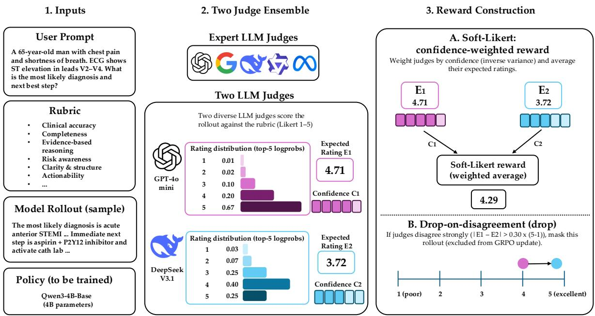
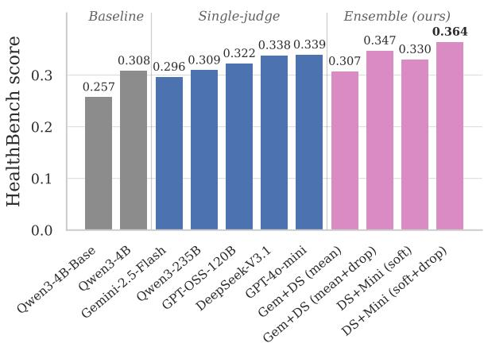
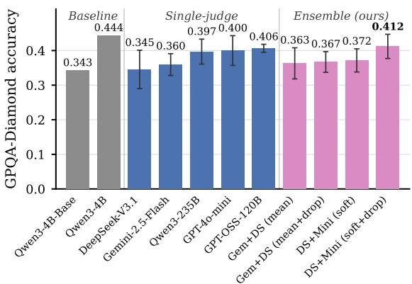
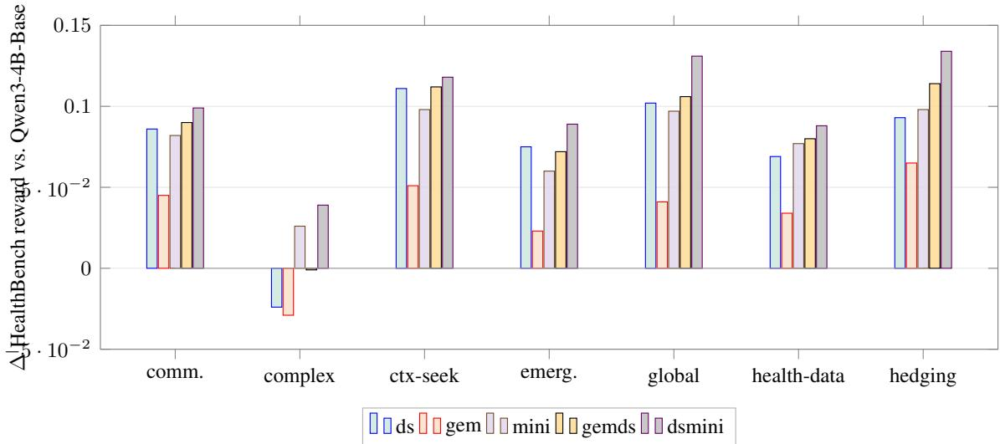
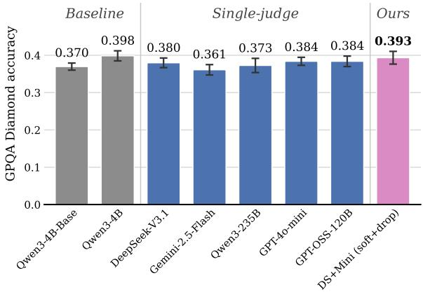
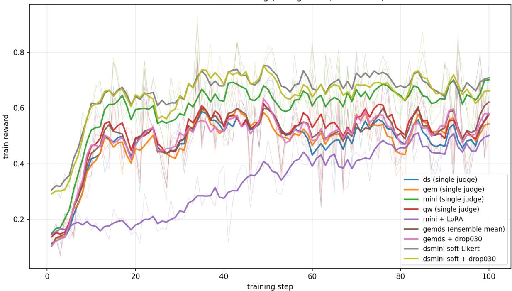
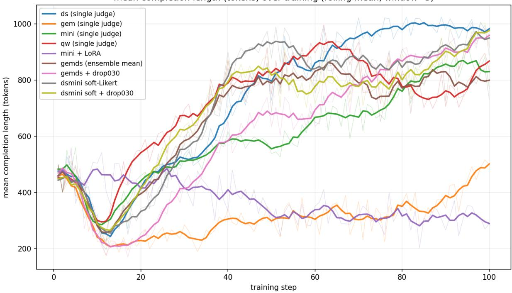

# Judging the Judges: Confidence and Disagreement in Rubrics as Rewards

Michael Tian-Yue Liu\* and Anne Harrington\* and Trevor Darrell and Yutong Bai

UC Berkeley

{liu.michael, anneko, trevordarrell, yutongbai}@berkeley.edu

## Abstract

Rubrics as Rewards (RaR) extends reinforcement learning to non-verifiable domains by using an LLM judge to score responses against a structured rubric. Prior work has focused on improving the rubric or strengthening the single judge, with comparatively little attention to how different single or multiple judges might be used during RaR training. We first show that judge identity alone produces a substantial spread in scores when training Qwen3- 4B-Base on RaR-Medicine and RaR-Science across five frontier and open-weight judges. Building on this, we propose RaRE (Rubrics as Rewards with Ensembles), a novel judge ensemble strategy for RaR with two mechanisms: a soft-Likert reward that uses judge logprobs to weight more confident judges more heavily, and a drop-on-disagreement mask that excludes high-disagreement rollouts from the GRPO update. We find that this design is critical: while a naive average of judge scores fails to outperform the best single judge, RaRE outperforms every single-judge RaR variant on both Health-Bench and GPQA Diamond, with per-theme analysis showing that it inherits the complementary strengths of its constituent judges. Our findings establish judge ensembling as a compelling axis for improving RaR.<sup>1</sup>

## 1 Introduction

Rubrics as Rewards (RaR; Gunjal et al., 2025) is increasingly used in LLM post-training for learning on non-verifiable domains. Unlike Reinforcement Learning with Verifiable Rewards (RLVR), which is standard for math and code (Lambert et al., 2024; Guo et al., 2025), RaR enables training in more realistic settings where response quality might depend on multiple criteria that are not easily checked (such as completeness, style, and safety). RaR consists of two components: a structured, instancespecific rubric that encodes relevant criteria, and an LLM judge that scores each rollout against the rubric to produce a scalar reward. Following its success, subsequent work has explored in depth how to improve rubrics themselves; these include better offline construction (Zhang et al., 2025; Liu et al., 2025), checklist-style scaffolding during rollouts (Zhou et al., 2025), and online rubric updates (Rezaei et al., 2025; Li et al., 2026). While the effect of the judge has been studied extensively at evaluation time, including work on judge ensembles (Verga et al., 2024; Chan et al., 2024; Feng et al., 2025), comparatively the impact of the judge during RaR training has been under-explored.

To fill this gap, we evaluate the role of the judge model during RaR training more broadly. We train Qwen3-4B-Base (Yang et al., 2025) on RaR-Medicine and RaR-Science with the same strategy and rubrics as Gunjal et al. (2025) across 5 open and closed weight judging models. We show that varying judge identity alone in RaR produces a substantial spread in scores across both domains.

Using our insights on the effect of the single judge model, we then develop RaRE (Rubrics as Rewards with Ensembles), a novel ensemble strategy to improve RaR. Rather than taking a naive average of judge scores, which we show fails to outperform the best single judge, RaRE targets two distinct sources of uncertainty. First, we introduce a soft-Likert reward to leverage intrajudge confidence: we use each judge’s logprobs to weight more confident judges more heavily in the ensemble. Second, we incorporate a drop-ondisagreement mask to leverage inter-judge disagreement: we exclude rollouts on which judges strongly disagree from the GRPO update. The two mechanisms can be used independently or composed.

We validate RaRE on an ensemble of two judges, testing on the medicine and science domains using HealthBench (Arora et al., 2025) and GPQA

Diamond (Rein et al., 2023) respectively. We find that our best RaRE configuration outperforms every single-judge RaR variant in both domains (0.364 vs. 0.339 best single judge on HealthBench; 0.412 vs. 0.406 best single judge on GPQA Diamond). Examining results by HealthBench theme, we find that RaRE consistently inherits the strengths of its judges, winning on all seven themes.

Together, our results suggest that the judge model is a major design choice in RaR, and that small ensembles with the right aggregation can deliver a stronger training signal than any single judge. Our main contributions are as follows:

1. A study of the judge in RaR training across five frontier and open-weight judges on RaR-Medicine and RaR-Science, showing that judge identity alone substantially shifts policy quality.

2. RaRE, a novel ensemble method for RaR with two composable mechanisms: a soft-Likert reward that reads judge logprobs to recover confidence-weighted ratings, and a dropon-disagreement mask that excludes highdisagreement rollouts from the GRPO update.

3. Empirical results showing that RaRE outperforms single-judge RaR variants in both medicine and science, with per-theme analysis revealing that it inherits complementary strengths of its judges, unlike a naive ensemble approach.

## 2 Related Work

RL with verifiable rewards. Recent gains on math and code use deterministic checks (e.g., calculators, compilers) as the reward signal (Lambert et al., 2024; Guo et al., 2025), typically optimized with GRPO (Shao et al., 2024). These checks do not exist for open-ended domains such as medical or scientific (Su et al., 2025).

Rubric-based rewards. Rubrics-as-Rewards (Gunjal et al., 2025) and similar work (Viswanathan et al., 2026) replace the binary verifier with an LLM judge that scores a candidate against a structured rubric, converting a fuzzy preference target into a scalar reward. Subsequent work has focused almost entirely on the rubric side: better offline construction (Zhang et al., 2025; Liu et al., 2025), checklist-style scaffolding during rollouts (Zhou et al., 2025), online rubric updates (Rezaei et al., 2025; Li et al., 2026), and causally grounded rubrics for robust reward modeling (Srivastava et al., 2026). Concurrent work (Mahmoud et al., 2026) also uses multiple judges in the RaR setting, but as a multi-judge evaluation panel for detecting reward hacking, while RaRE uses the judge ensemble as the training signal itself. Across these works, the training judge model is consistently treated as a fixed implementation detail, usually a single model. Our work holds the rubric fixed and treats the judge itself as the design variable, complementary to all of the above.

LLM-as-a-judge and verification. LLM-as-ajudge (Zheng et al., 2023) has become the dominant evaluation paradigm, with growing emphasis on structured or rubric-conditioned grading (Kim et al., 2024; Hashemi et al., 2024). Recent reliability studies (Lu et al., 2025; Singh et al., 2026; Kwok et al., 2026; Feng et al., 2025) show that single judges exhibit substantial position bias, length bias, and inter-seed variance. Our results in §4.2 extend this diagnosis from evaluation to optimization: judge choice meaningfully affects the trained policy even with a fixed rubric.

Judge ensembles. The closest prior work is Panel-of-LLM-evaluators (Verga et al., 2024), which mean-pools or majority-votes across a panel of smaller judges and shows that the panel outperforms a single large judge on evaluation while reducing intra-model bias. ChatEval (Chan et al., 2024) explores a debate-based variant, and similar work (Feng et al., 2025) finds that panel-based judging improves preference consistency. To our knowledge, all of this literature treats judge ensembles as an evaluation-time mechanism. RaRE instead uses a judge ensemble inside the RL training loop as the reward signal, with mechanisms (§3.1.2, §3.1.3) that use inter-judge spread as part of the training signal rather than only as a diagnostic.

## 3 Methods

Notation. Let x be a prompt, $\pi _ { \theta }$ a policy with parameters $\theta ,$ and $y \sim \pi _ { \theta } ( \cdot \mid x )$ a sampled response. Following Gunjal et al. (2025), a rubric for x is a set of $k ( x )$ weighted criteria $R ( x ) = \{ ( w _ { j } , c _ { j } ) \} _ { j = 1 } ^ { k ( x ) }$ where each $c _ { j }$ is a natural-language criterion paired with a binary correctness check $c _ { j } ( x , y ) \in \{ 0 , 1 \}$ and weight $w _ { j } \in \mathbb { R }$ . We use implicit aggregation, where the judge consumes the whole rubric and emits a single scalar, $J ( y , x , R ) \in [ 0 , 1 ]$ , typically via a Likert score that is min–max normalized (Gunjal et al., 2025), which subsumes RLVR (Gunjal et al., 2025) as the k=1, binary case.

  
Figure 1: Overview of RaRE (Rubrics as Rewards with Ensembles), instantiated with two judges. (1) Inputs: the user prompt, rubric, and a model rollout sampled from the policy (Qwen3-4B-Base) are passed to the judges. (2) Two-judge ensemble: we use an ensemble of two diverse LLM judges (selected from a pool of frontier and open-weight models). Each judge scores the rollout against the rubric on a 1–5 Likert scale, and we read its top-5 logprobs to recover an expected rating $E _ { i }$ and a per-judge confidence $C _ { i } .$ (3) Reward construction: our soft-Likert reward (A) combines the two expected ratings into a single scalar by weighting each judge by its inverse-variance confidence. Our drop-on-disagreement mask (B) excludes rollouts where the two judges’ expected ratings differ by more than τ · (5 − 1) from the GRPO update.

Single-judge RaR. Single-judge RaR optimizes the KL-regularized reward objective (Zhang et al., 2025),

$$
\begin{array} { r l } & { \mathcal { I } ( \theta ) = \mathbb { E } _ { x \sim \mathcal { D } , y \sim \pi _ { \theta } ( \cdot | x ) } \big [ J ( y , x , R ( x ) ) \big ] } \\ & { \quad \quad - \beta D _ { \mathrm { K L } } \big [ \pi _ { \theta } \big \| \pi _ { \mathrm { r e f } } \big ] . } \end{array}\tag{1}
$$

with policy updates from GRPO, following Gunjal et al. (2025) and Zhang et al. (2025).

## 3.1 Rubrics as Rewards with Ensembles

We propose RaRE (Rubrics as Rewards with Ensembles), which replaces the single training judge with an ensemble of K judges. We first describe the naive ensemble baseline (§3.1.1), then RaRE’s two composable mechanisms: the soft-Likert reward (§3.1.2) and the drop-on-disagreement mask (§3.1.3).

## 3.1.1 Naive judge ensemble

Given K judges $\{ J _ { k } \} _ { k = 1 } ^ { K }$ , the naive ensemble reward is the mean of the individual judge scores:

$$
r _ { \mathrm { n a i v e } } ( y , x , R ) = { \frac { 1 } { K } } \sum _ { k = 1 } ^ { K } J _ { k } ( y , x , R ) .\tag{2}
$$

This averages out idiosyncratic per-judge bias while keeping the training pipeline unchanged.

## 3.1.2 Soft-Likert reward via judge logprobs

The naive ensemble (§3.1.1) treats each judge’s rating as a single integer, discarding the judge’s confidence in that rating. We propose a soft-Likert reward that recovers confidence from the judge’s output distribution and uses it both as a continuous reward and as a weight for ensemble aggregation.

Setup. Following Gunjal et al. (2025), each judge j emits an integer rating on a 1, . . . , L Likert scale via strict JSON-schema decoding: {"rating": $\hat { k } \}$ , where the rating digit is a single token in the output. Standard implicit-RaR reads only the emitted integer <sup>ˆ</sup>k. Instead, we read the top- $- T$ logprobs at the rating-digit position to recover the full distribution over ratings. Because each rating must fit in one token, we use $L = T = 5$ for soft-Likert judges; the standard $L = 1 0$ scale is retained for the hard-Likert fallback described below.

Per-judge distribution. Let $\ell _ { j } ^ { ( i ) } ( k )$ be the logprobability the judge assigns to digit k at the rating-digit position for rollout i. The top- $^ { - T } =$ 5 logprobs may include non-digit tokens, so $\begin{array} { r } { \sum _ { k = 1 } ^ { L } \exp ( \ell _ { j } ^ { ( i ) } ( k ) ) < 1 } \end{array}$ in general. We exponentiate and renormalize over digits:

$$
p _ { j } ^ { ( i ) } ( k ) = \frac { \exp ( \ell _ { j } ^ { ( i ) } ( k ) ) } { \sum _ { k ^ { \prime } = 1 } ^ { L } \exp ( \ell _ { j } ^ { ( i ) } ( k ^ { \prime } ) ) } , \quad k \in \{ 1 , \ldots , L \} .\tag{3}
$$

Expected rating and confidence. From $p _ { j } ^ { ( i ) }$ we compute the expected rating and an inversevariance confidence:

$$
\begin{array} { r } { \boldsymbol { E } _ { j } ^ { ( i ) } = \sum _ { k = 1 } ^ { L } \boldsymbol { k } \cdot \boldsymbol { p } _ { j } ^ { ( i ) } ( \boldsymbol { k } ) , } \end{array}\tag{4}
$$

$$
\begin{array} { r } { \mathrm { V a r } _ { j } ^ { ( i ) } = \sum _ { k = 1 } ^ { L } ( k - E _ { j } ^ { ( i ) } ) ^ { 2 } p _ { j } ^ { ( i ) } ( k ) , } \end{array}\tag{5}
$$

$$
c _ { j } ^ { ( i ) } = \frac { 1 } { 1 + \mathrm { V a r } _ { j } ^ { ( i ) } } .\tag{6}
$$

$E _ { j } ^ { ( i ) } \in [ 1 , L ]$ is a continuous version of the integer rating; $c _ { j } ^ { ( i ) } \in ( 0 , 1 ]$ is 1 when the judge places all mass on a single digit, and decreases as the distribution spreads or bimodalizes. The +1 smoothing keeps $c _ { j } \ \leq \ 1$ and avoids division by zero. We compare alternative confidence schemes (top-logit, winner-takes-all) in §4.4 and find inverse-variance is the strongest.

Confidence-weighted ensemble. The soft-Likert ensemble reward for rollout i is the confidenceweighted average expected rating across K judges, scaled to $[ 1 / L , 1 ]$ by dividing by L:

$$
r _ { \mathrm { s o f t } } ^ { ( i ) } = \frac { 1 } { L } \cdot \frac { \sum _ { j = 1 } ^ { K } c _ { j } ^ { ( i ) } E _ { j } ^ { ( i ) } } { \sum _ { j = 1 } ^ { K } c _ { j } ^ { ( i ) } } .\tag{7}
$$

This is inspired by the maximum-likelihood combination of independent estimators under Gaussian likelihoods; for the bounded Likert distribution it is a soft approximation.

Hard-Likert fallback. If a judge endpoint does not return logprobs, we parse the integer rating $\hat { k }$ from the output and set $p _ { j } ( k ) = \mathbf { 1 } [ k = \hat { k } ]$ , giving $\mathrm { V a r } _ { j } = 0$ and $c _ { j } = 1$ . The ensemble reduces to a plain average, which we call hard-Likert.

## 3.1.3 Drop on disagreement

Rollouts where the two judges strongly disagree produce unreliable reward estimates, where averaging does not reflect either judge’s actual assessment. We propose drop-on-disagreement, a reward-substitution mechanism that removes these rollouts from the GRPO update by replacing their reward with the group mean, so that their groupnormalized advantage is zero.

Disagreement statistic. For rollout i, let $\hat { r } _ { j } ^ { ( i ) }$ denote judge j’s rating. We measure inter-judge disagreement by the normalized rating spread,

$$
d ^ { ( i ) } = \frac { \operatorname* { m a x } _ { j } \hat { r } _ { j } ^ { ( i ) } - \operatorname* { m i n } _ { j } \hat { r } _ { j } ^ { ( i ) } } { L - 1 } \in [ 0 , 1 ] .\tag{8}
$$

Group-mean substitution. For group g with rollout indices $\mathcal { T } _ { g }$ and threshold τ, let $\boldsymbol \mu ^ { ( i ) } = \mathbf 1 [ d ^ { ( i ) } >$ τ ] mask the high-disagreement rollouts, and let $r ^ { ( i ) }$ denote the per-rollout reward $( r _ { \mathrm { s o f t } } ^ { ( i ) }$ under soft-Likert, or the naive ensemble mean under hard-Likert). We replace the masked rollouts’ rewards with the unmasked group mean,

$$
\bar { r } _ { g } = \frac { \sum _ { i \in \mathcal { T } _ { g } } ( 1 - \mu ^ { ( i ) } ) r ^ { ( i ) } } { \sum _ { i \in \mathcal { T } _ { g } } ( 1 - \mu ^ { ( i ) } ) } ,\tag{9}
$$

$$
r _ { \mathrm { d r o p } } ^ { ( i ) } = \left\{ \begin{array} { l l } { \bar { r } _ { g } } & { \mathrm { i f } ~ \mu ^ { ( i ) } = 1 , } \\ { r ^ { ( i ) } } & { \mathrm { o t h e r w i s e . } } \end{array} \right.\tag{10}
$$

Under GRPO’s group-normalized advantage computed on the substituted rewards, $A ^ { ( i ) } = \big ( r _ { \mathrm { d r o p } } ^ { ( i ) } -$ $\bar { r } _ { g } ) / \sigma _ { g } ,$ so masked rollouts receive $A ^ { ( i ) } = 0$ and contribute no gradient.

Composing confidence and disagreement. Soft-Likert’s inverse-variance confidence weighting handles intra-judge uncertainty, while drop-ondisagreement handles inter-judge uncertainty. They compose orthogonally (Eqs. (7) and (10) can be applied together), and we show in §4.4 that the composition outperforms either mechanism alone.

## 4 Results

## 4.1 Experiment Setup

Policy and reference models. Our trainable policy is Qwen3-4B-Base (Yang et al., 2025); we report Qwen3-4B as a tuned reference throughout.

Judges. Five candidate single-judge configurations span proprietary, open-weight, and smallmodel regimes: gpt-4o-mini (OpenAI, 2024),

<table><tr><td colspan="4">Method Rubric Ensemble Confid. Disag.</td></tr><tr><td>RLVR</td><td>×</td><td>×</td><td>×</td></tr><tr><td>RaR</td><td>√</td><td>× ×</td><td>× ×</td></tr><tr><td>Naive ensemble</td><td>√ √</td><td>X</td><td>X</td></tr><tr><td>+ drop √</td><td>√</td><td>×</td><td>√</td></tr><tr><td>+ soft-Likert</td><td>√ √</td><td>√</td><td>×</td></tr><tr><td>RaRE (ours)</td><td>√ √</td><td>√</td><td>√</td></tr></table>

Table 1: Comparison of methods. Rubric: reward comes from an LLM judge scoring a structured rubric. Ensemble: reward aggregates ensemble of K>1 judges (§3.1.1). Confid.: soft-Likert inversevariance confidence weighting (§3.1.2). Disag.: dropon-disagreement mask (§3.1.3).

DeepSeek-V3.1 (DeepSeek-AI et al., 2025), Gemini-2.5-flash-lite (Comanici et al., 2025) , Qwen3-235B-Instruct (Yang et al., 2025), and gptoss-120b (OpenAI et al., 2025). All judges share the same rubric and same Likert-rating prompt template (Appendix J). Soft-Likert (Eq. 7) requires the endpoint to return top\_logprobs. We queried logprobs for the two judges used in our soft-Likert ensemble experiments (gpt-4o-mini and DeepSeek-V3.1); Gemini does not expose this in its API. All judges were run with no thinking or low effort reasoning when applicable.

Training. We train on RaR-Medicine and RaR-Science (Gunjal et al., 2025) with GRPO (Shao et al., 2024) using G=8 generations per prompt and per-group reward normalization. Full hyperparameters stated in Appendix P. Headline numbers use full-parameter fine-tuning; we report a brief LoRA comparison in the length-hacking discussion below.

Evaluation. We evaluate on the English-only subset of HealthBench for medicine, using gpt-4o-mini as the eval judge (Arora et al., 2025), and GPQA Diamond for science (Rein et al., 2023), with max completion tokens capped at 8192 (responses are truncated past this). Throughout, we refer to the English-only subset simply as Health-Bench. Furthermore, we split GPQA Diamond into disjoint 50/50 validation/test splits for purposes of hyperparameter tuning, with results reported on the test split. For some ablations, we evaluate on a subset of 1,000 prompts (randomly sampled, stratified by theme) which we refer to as the HealthBench 1K subset (with max completion tokens capped at 1024). We report the mean HealthBench/GPQA Diamond score (henceforth “score”) across prompts.

  
Figure 2: HealthBench scores under RaR training across baselines (Qwen3-4B-Base, Qwen3-4B), five singlejudge variants, and our RaRE ensembles. Gem+DS pairs Gemini-2.5-Flash-lite with DeepSeek-V3.1; DS+Mini pairs DeepSeek-V3.1 with GPT-4o-mini. Ensemble configurations: mean averages judge ratings; soft applies our soft-Likert reward; drop applies our drop-ondisagreement mask (τ = 0.30). Best result in bold.

For GPQA Diamond, we train models on 5 seeds and report the mean score and 95% confidence intervals. HealthBench provides bootstrapped 95% confidence intervals, stated in Appendix C.

## 4.2 Single-Judge RaR is Sensitive to Judge

Figure 2 compares RaR-trained Qwen3-4B-Base under five different judges, all sharing the same rubric (training dynamics in Fig. 9). The spread across judges (0.296–0.339 on English-only HealthBench, ∼4.3 pp) is comparable to the gap between RL and the untrained base (0.257). Furthermore, the best single-judge RaR (0.339) comfortably exceeds Qwen3-4B (0.307), while the worst single-judge RaR (0.296) does worse than Qwen3- 4B. A similar sensitivity to judge choice is observed on GPQA Diamond (Figure 3), where the singlejudge spread is 0.345–0.406. Judge identity therefore has large effects on RaR outcomes under fixed rubric, with spread comparable to the gap between RL and the untrained base. This motivates treating judge selection as a key design variable.

Per-theme breakdown. We break down performance of selected judges by HealthBench theme (Figure 4, showing each judge’s delta in mean reward vs. the Qwen3-4B-Base baseline) and find that no single judge dominates; different judges have complementary strengths across themes. The full per-category breakdown is in Appendix A.

  
Figure 3: GPQA Diamond accuracy on a 50% test split under RaR training across baselines (Qwen3-4B-Base, Qwen3-4B), five single-judge variants, and our RaRE ensembles. Error bars show the mean over five training seeds with 95% confidence intervals. Gem+DS pairs Gemini-2.5-Flash-lite with DeepSeek-V3.1; DS+Mini pairs DeepSeek-V3.1 with GPT-4o-mini. Ensemble configurations: mean averages judge ratings; soft applies our soft-Likert reward; drop applies our drop-ondisagreement mask (τ = 0.30 for Gem+DS; $\tau = 0 . 4 0$ for DS+Mini, selected on a held-out validation set). Best RaR-trained result in bold.

Length hacking. Reward models and LLM judges have been shown to favor longer responses (Singhal et al., 2023; Saito et al., 2023; Chen et al., 2024). In our experiments, Table 2 shows that RaR training under several judges inflates response length dramatically. 97% of gpt-oss-120b’s posttraining responses hit a 4k-character (∼1024-token) cap vs. ∼4% for the untrained Qwen3-4B-Base. We explore two interventions that partially recover this: (i) an explicit length penalty during training (4o-mini\_lenpen), which keeps responses short with no reward loss; (ii) LoRA fine-tuning (Hu et al., 2022), which we find empirically dampens the length expansion (mini-LoRA: 0.295 reward, 1,058 mean characters vs. full-FT mini: 0.296 reward, 2,930 mean characters). The LoRA dampening generalizes to RaRE: Gem+DS (mean+drop) scores 0.330 under full-FT vs. 0.295 under LoRA, a ∼3 pp cost for substantially shorter outputs and lower training compute (Appendix M). We use full-FT for headline numbers, but the gap is small enough that LoRA remains a useful tradeoff.

## 4.3 RaRE Outperforms Single-Judge RaR

Based on the per-theme complementarity in Figure 4, we instantiate RaRE with two judges. We use two judge pairs in our experiments: Gemini-2.5- flash-lite with DeepSeek-V3.1 (Gem+DS) for hard-Likert configurations, and DeepSeek-V3.1 with GPT-4o-mini (DS+Mini) for soft-Likert configurations, since both endpoints of the latter pair expose the token-level logprobs that soft-Likert requires. Each pair was chosen so that the two judges differ in vendor, scale, and training data.

<table><tr><td>Judge</td><td>Score</td><td>Chars</td><td>% ≥ 4k</td></tr><tr><td>No-RL baselines</td><td></td><td></td><td></td></tr><tr><td>Qwen3-4B-Base Qwen3-4B</td><td>0.266 0.308</td><td>1,610 1,340</td><td>4.2% 0.5%</td></tr><tr><td>Single-judge RaR</td><td></td><td></td><td></td></tr><tr><td>gpt-oss-120b</td><td>0.208</td><td>4,742</td><td>97.0%</td></tr><tr><td>gpt-4o-mini</td><td>0.296</td><td>3,869</td><td>42.9%</td></tr><tr><td>gemini-2.5-flash-lite</td><td>0.310</td><td>3,016</td><td>16.3%</td></tr><tr><td>deepseek-v3.1</td><td>0.317</td><td>4,260</td><td>76.4%</td></tr><tr><td></td><td></td><td></td><td></td></tr><tr><td>Length-hacking interventions</td><td></td><td></td><td></td></tr><tr><td>4o-mini + LoRA</td><td>0.295</td><td>1,629</td><td>1.4%</td></tr><tr><td>4o-mini + lenpen</td><td>0.314</td><td>1,815</td><td>0.2%</td></tr></table>

Table 2: Reward vs. response-length statistics on Health-Bench 1K subset by training judge. Chars is the mean response length in characters; $\% \geq 4 k$ is the fraction of responses that hit the 4,000-character truncation cap. Single-judge RaR uses full-parameter fine-tuning by default; the bottom block shows two interventions on the gpt-4o-mini judge that mitigate length hacking without sacrificing reward.

We evaluate the three ensemble strategies from §3 (naive mean, soft-Likert, drop-on-disagreement) and their composition. We sweep RaRE’s dropon-disagreement parameter τ and refer to the best settings per ensemble and dataset simply as drop (see Tables 3 and 4). Figures 2 and 3 report ensemble results on HealthBench and GPQA Diamond.

The HealthBench score from ensembling the naive mean of Gemini and DeepSeek’s integer ratings (0.307) sits between the two constituent judges (0.296 Gemini, 0.338 DeepSeek). Naive averaging alone does not outperform single judges; the gains we report from RaRE below come from filtering or reweighting, not averaging.

Adding drop-on-disagreement (mean + drop) to the Gemini+DeepSeek naive mean (0.347) lifts the score +0.8 pp above the best single judge by filtering the ∼5% of rollouts where the two judges disagree most. Soft-Likert on DeepSeek+GPT-4o-mini without drop (0.330) slightly hurts performance compared to the constituent judges: low-confidence disagreement rollouts get downweighted but not removed, and their residual contribution may distort the GRPO advantage estimate. Composing soft-Likert with drop on the same pair (0.364) zeroes the high-disagreement rollouts and lets the soft-Likert reward on the rest become the strongest signal we have, exceeding the best single judge by +2.5 pp. The two mechanisms therefore target different uncertainty sources and compose.

<table><tr><td></td><td rowspan=1 colspan=1>flash-lite</td><td rowspan=1 colspan=1>mini</td><td></td><td></td></tr><tr><td rowspan=1 colspan=1>+0.086</td><td rowspan=1 colspan=1>+0.045</td><td rowspan=1 colspan=1>+0.082</td><td rowspan=1 colspan=1>+0.090</td><td rowspan=1 colspan=1>+0.099</td></tr><tr><td rowspan=1 colspan=1>-0.024</td><td rowspan=1 colspan=1>-0.029</td><td rowspan=1 colspan=1>+0.026</td><td rowspan=1 colspan=1>-0.001</td><td rowspan=1 colspan=1>+0.039</td></tr><tr><td rowspan=1 colspan=1>+0.111</td><td rowspan=1 colspan=1>+0.051</td><td rowspan=1 colspan=1>+0.098</td><td rowspan=1 colspan=1>+0.112</td><td rowspan=1 colspan=1>+0.118</td></tr><tr><td rowspan=1 colspan=1>+0.075</td><td rowspan=1 colspan=1>+0.023</td><td rowspan=1 colspan=1>+0.060</td><td rowspan=1 colspan=1>+0.072</td><td rowspan=1 colspan=1>+0.089</td></tr><tr><td rowspan=1 colspan=1>+0.102</td><td rowspan=1 colspan=1>+0.041</td><td rowspan=1 colspan=1>+0.097</td><td rowspan=1 colspan=1>+0.106</td><td rowspan=1 colspan=1>+0.131</td></tr><tr><td rowspan=1 colspan=1>+0.069</td><td rowspan=1 colspan=1>+0.034</td><td rowspan=1 colspan=1>+0.077</td><td rowspan=1 colspan=1>+0.080</td><td rowspan=1 colspan=1>+0.088</td></tr><tr><td rowspan=1 colspan=1>+0.093</td><td rowspan=1 colspan=1>+0.065</td><td rowspan=1 colspan=1>+0.098</td><td rowspan=1 colspan=1>+0.114</td><td rowspan=1 colspan=1>+0.134</td></tr><tr><td rowspan=1 colspan=1></td><td rowspan=1 colspan=1></td><td rowspan=1 colspan=1></td><td rowspan=1 colspan=2>better</td></tr></table>

Figure 4: Mean-reward delta on English-only Health-Bench (n=3931) vs. Qwen3-4B-Base across themes (Comm. = communication; Emerg. = emergency referrals). Columns: single judges (DeepSeek-V3.1, Gemini-2.5-flash-lite, GPT-4o-mini) and ensembles (DeepSeek+Gemini, naive mean; DeepSeek+GPT-4omini, soft-Likert; both with drop). Bold: row winner.

On GPQA Diamond, we see that ensembling Gemini+DeepSeek naive mean (0.363) also sits close to the two constituent judges (0.360 Gemini, 0.345 DeepSeek). However, with a stronger pair of judges, DeepSeek+4o-mini (0.400 4o-mini), the soft-Likert ensemble performs better (0.372), and adding drop-on-disagreement lifts score to 0.412, exceeding the best single judge.

Complementary judge strengths. Figure 4 shows that single judges win on disjoint themes on HealthBench: DeepSeek wins communication, context\_seeking, emergency\_referrals, and global\_health; GPT-4o-mini wins complex\_responses, data\_tasks, and hedging. Furthermore, our best RaRE configuration (soft + drop on DeepSeek+GPT-4o-mini) combines the strengths of its two constituent judges and achieves the best results in each theme across the board. RaRE thus inherits, rather than averages out, the constituent judges’ theme-level strengths. In Appendix Figure 6, we similarly report per-topic accuracy on GPQA Diamond, which demonstrates the qualities of different judges.

## 4.4 Configuration Ablations

Our strongest configuration combines soft-Likert with a disagreement threshold of $\tau { = } 0 . 3 0$ on medicine and $\tau { = } 0 . 4 0$ on science. Here we show that each piece of this configuration is important: changing τ, removing the soft-Likert reward, or using alternative confidence weighting schemes all reduce the score substantially.

Threshold sweep (τ). We sweep τ on the Gemini+DeepSeek pair under the hard-Likert reward path and find $\tau { = } 0 . 3 0$ is best on the HealthBench 1K subset (Table 3), with ∼1.6 pp lift over no drop and scores dropping on either side. $\tau { = } 0 . 1 5$ is too aggressive (∼14% of rollouts masked, gradient signal too sparse), and $\tau { = } 0 . 3 5$ is too permissive (∼2% masked). $\tau { = } 0 . 3 0$ corresponds to a mean-rating gap of ∼1.2 on the [1, 5] scale: the policy benefits most from filtering rollouts where the judges fundamentally disagree, not where they differ by a small amount. Interestingly, this threshold also transfers well to the DeepSeek+4o-mini soft-Likert pair, which is our best result (Appendix L).

Similarly, we found $\tau = 0 . 4 0$ to be the best disagreement threshold for the DeepSeek+4o-mini pair under the soft-Likert reward path on GPQA by sweeping through τ and selecting the result with the best score on the validation split, with results reported in Table 4. We find that $\tau = 0 . 4 0$ is the sweet spot, filtering ∼24% of rollouts. Interestingly, RaR-Science requires filtering a greater percentage of rollouts than medicine, suggesting that there is inherently much more judge disagreement on what a good science response should be.

<table><tr><td>T</td><td>drop % Score</td><td></td><td>95% CI</td></tr><tr><td>none (mean only)</td><td>0%</td><td>0.314</td><td>[0.295, 0.335]</td></tr><tr><td>0.15</td><td>14%</td><td>0.251</td><td>[0.233, 0.271]</td></tr><tr><td>0.25</td><td>9%</td><td>0.301</td><td>[0.281, 0.323]</td></tr><tr><td>0.30</td><td>5%</td><td>0.330</td><td>[0.312, 0.351]</td></tr><tr><td>0.35</td><td>2%</td><td>0.273</td><td>[0.254, 0.294]</td></tr></table>

Table 3: Drop-on-disagreement threshold sweep on the Gemini+DeepSeek pair (hard-Likert reward path) on the HealthBench 1K subset. drop % is the mean fraction of rollouts masked across training steps; τ=0.30 achieves the best score. 95% CIs computed via bootstrap.

Soft-Likert vs. hard-Likert. On the DeepSeek+GPT-4o-mini pair with drop fixed, switching from hard-Likert (integer ratings) to soft-Likert (inverse-variance confidence weighting) lifts the score from 0.295 to 0.364 (+6.9 pp).

<table><tr><td>T</td><td>drop %</td><td>Validation score</td></tr><tr><td>none (mean only)</td><td>0%</td><td>0.349</td></tr><tr><td>0.30</td><td>29%</td><td>0.362</td></tr><tr><td>0.40</td><td>24%</td><td>0.380</td></tr><tr><td>0.45</td><td>25%</td><td>0.356</td></tr><tr><td>0.50</td><td>12%</td><td>0.374</td></tr></table>

Table 4: Drop-on-disagreement threshold sweep on the DeepSeek+GPT-4o-mini pair (soft-Likert reward) on GPQA Diamond. Scores are 5-seed means on a 50% validation split; drop % is the mean fraction of rollouts masked across training steps. τ=0.40 is selected as the best validation threshold and is evaluated on the disjoint 50% test split in the main results.
<table><tr><td>Confidence + aggregation</td><td>Score</td><td>95% CI</td></tr><tr><td>inverse-var, weighted avg</td><td>0.336</td><td>[0.316, 0.355]</td></tr><tr><td>top-logit, weighted avg</td><td>0.214</td><td>[0.195, 0.233]</td></tr><tr><td>top-logit, winner-takes-all</td><td>0.198</td><td>[0.179, 0.217]</td></tr></table>

Table 5: Confidence-aggregation ablation on the DeepSeek+GPT-4o-mini pair with drop030, evaluated on the HealthBench 1K subset. Replacing inversevariance (Eq. 6) with simpler schemes drops the score by 12–14 pp and below the untrained base (0.266). 95% CIs computed via bootstrap.

Inverse-variance confidence weighting (soft-Likert) therefore adds large lift on top of the drop mask.

Confidence-aggregation ablation. We ablate inverse-variance confidence (Eq. 6) with two aggregation schemes that also derive a per-judge weight from $p _ { j } ^ { ( i ) }$ . Top-logit uses the modal mass $c _ { j } ^ { ( i ) } = \operatorname* { m a x } _ { k } p _ { j } ^ { ( i ) } ( k )$ , which ignores how the distribution is spread. Winner-takes-all drops weighted averaging entirely and uses the rating of the single judge with the highest top-logit confidence.

Both alternatives collapse (Table 5): top-logit scores 0.214 (−12 pp), winner-takes-all scores 0.198 (−14 pp), both below the untrained base, showing that confidence aggregation must account for the distribution of the judge’s confidence.

## 5 Discussion

Judge choice matters in RaR. Varying the judge under a fixed rubric produces a ∼4.3 pp spread in HealthBench score across five judges. This spread is greater than the gap between Qwen3-4B-Base and the lowest single-judge RaR run. Prior RaR work has focused almost exclusively on improving the rubric, treating the judge as fixed. Our results suggest that the judge side carries comparable signal and deserves comparable attention.

Ensembles win by combining complementary judges, not by averaging. We might expect a judge ensemble to smooth out variance from any single judge, with the ensemble converging toward the strongest judge. We do not find this. RaRE consistently improves on HealthBench themes beyond either of its two judges individually (Figure 4), suggesting that the gain comes from combining the judges’ non-overlapping strengths, rather than from selecting the stronger judge. Naive averaging does not extract this gain: the mean of judges’ ratings averages their individual scores and does not outperform the best single judge. The gain only appears once we filter high-disagreement rollouts.

Disagreement filtering is the most impactful mechanism. Across our ablations, the drop-ondisagreement mask contributes the most. Adding it to the naive Gemini+DeepSeek mean ensemble lifts the score by +4.0 pp (0.307 to 0.347); removing it from the DeepSeek+4o-mini soft+drop configuration costs 3.4 pp (0.364 to 0.330). The soft-Likert reward provides additional gain when composed with the mask, but on its own does not outperform the best single judge on HealthBench. The broader LLM-as-a-verifier literature (Lu et al., 2025; Singh et al., 2026; Kwok et al., 2026) reports a similar finding in the evaluation setting, where explicit disagreement filtering matters more than the choice of any single judge. Our results extend this from evaluation to training.

Relation to concurrent and complementary work. Two recent directions are complementary to ours. Online rubric updates (Rezaei et al., 2025; Li et al., 2026) reduce reward-signal variance by improving rubric content during training; we reduce it by improving judge aggregation. The two operate on different parts of the RaR pipeline and should compose, though we leave that combination to future work. Concurrent work by Mahmoud et al. (2026) also uses multiple judges in the RaR setting, but in the opposite direction: they train against a single verifier and use a cross-family panel of three frontier judges to diagnose reward hacking, while we use multiple judges to produce the training signal. The two contributions are independent and could be combined, with RaRE serving as the training-time signal and their panel as the evaluation-time check.

## 6 Conclusion

We proposed RaRE (Rubrics as Rewards with Ensembles), combining a soft-Likert confidenceaggregation reward with a drop-on-disagreement mask, which outperforms every single-judge RaR variant on both HealthBench and GPQA-Diamond. Our results suggest RaRE’s gains arise from combining complementary judge strengths through confidence and disagreement aggregation.

## Limitations

Due to limited compute, our experiments are restricted to a single base policy (Qwen3-4B-Base) evaluated on two domains: HealthBench (medicine) and GPQA Diamond (science), so our findings may not transfer to other policy families, model scales, or other domains. We mitigate this with per-theme and per-category breakdowns and extensive ablations, but broader validation is left to future work.

We evaluate HealthBench with GPT-4o-mini, following the convention established by Arora et al. (2025) and Gunjal et al. (2025), which may introduce evaluation-judge bias since it is also used as a training judge. To test whether this overlap affects our results, we regrade policy responses with GLM-5.3-Flash, a judge from a different model family (Appendix D). Relative rankings remain similar, and RaRE ranks first under both judges. A larger multi-judge evaluation panel, such as the one used by Mahmoud et al. (2026), would provide additional robustness against evaluation-judge bias; our GPQA Diamond results, which use verifier-style evaluation rather than an LLM judge, partially address this concern.

RaRE’s improvement on GPQA Diamond compared to single-judge RaR is not statistically significant across 5 training seeds. Running additional seeds could help tighten confidence intervals and allow for a more definitive comparison, which we leave to future work due to compute constraints.

When applying RaRE’s drop-on-disagreement mask, we discard the dropped rollouts entirely rather than extracting any partial signal from them. Initial exploratory attempts in this direction (Appendix O) did not yield any improvement over our baseline methods, but further exploration is left to future work.

Finally, RaRE depends on inter-judge disagreement as a signal. When judges largely agree, RaRE provides little additional signal beyond a single judge; a more diverse judge pool could expand the regime where ensembling helps.

## Ethical Considerations

Our work studies how judge selection and judge ensembling affect rubric-based RL training, with the goal of making the reward signal more reliable. Because the resulting policies are trained against LLM-judge rewards, they inherit biases of the judges used: RaRE reduces idiosyncratic perjudge bias but does not eliminate biases shared across judges, and the drop-on-disagreement filter removes precisely those rollouts where judges disagree most, which could exclude cases where a single judge correctly flags a safety-relevant issue that others miss. We therefore encourage practitioners who deploy ensemble-trained policies, particularly in health or scientific contexts, to audit them separately for these biases rather than treat ensembling as a substitute for evaluation, and we treat the models in this work as research artifacts rather than clinical or scientific advisors.

## Acknowledgments

We would like to thank Harman Singh for feedback on this work and helpful discussions. AH was supported by the National Defense Science and Engineering Graduate (NDSEG) Fellowship Program. This material is based upon work supported by the Air Force Office of Scientific Research under award number FA9550-25-C-B010 in the amount of \$143,000. YB is supported by ONR MURI award N00014-21-1-2801.

## References

Rahul K Arora, Jason Wei, Rebecca Soskin Hicks, Preston Bowman, Joaquin Quiñonero-Candela, Foivos Tsimpourlas, Michael Sharman, Meghan Shah, Andrea Vallone, Alex Beutel, and 1 others. 2025. Healthbench: Evaluating large language models towards improved human health. arXiv preprint arXiv:2505.08775.

Chi-Min Chan, Weize Chen, Yusheng Su, Jianxuan Yu, Wei Xue, Shanghang Zhang, Jie Fu, and Zhiyuan Liu. 2024. Chateval: Towards better llm-based evaluators through multi-agent debate. In International Conference on Learning Representations.

Lichang Chen, Chen Zhu, Davit Soselia, Jiuhai Chen, Tianyi Zhou, Tom Goldstein, Heng Huang, Mohammad Shoeybi, and Bryan Catanzaro. 2024. Odin: Disentangled reward mitigates hacking in rlhf. arXiv preprint arXiv:2402.07319.

Gheorghe Comanici, Eric Bieber, Mike Schaekermann, Ice Pasupat, Noveen Sachdeva, Inderjit Dhillon, Marcel Blistein, Ori Ram, Dan Zhang, Evan Rosen, Luke Marris, Sam Petulla, Colin Gaffney, Asaf Aharoni, Nathan Lintz, Tiago Cardal Pais, Henrik Jacobsson, Idan Szpektor, Nan-Jiang Jiang, and 3416 others. 2025. Gemini 2.5: Pushing the frontier with advanced reasoning, multimodality, long context, and next generation agentic capabilities. Preprint, arXiv:2507.06261.

DeepSeek-AI, Aixin Liu, Bei Feng, Bing Xue, Bingxuan Wang, Bochao Wu, Chengda Lu, Chenggang Zhao, Chengqi Deng, Chenyu Zhang, Chong Ruan, Damai Dai, Daya Guo, Dejian Yang, Deli Chen, Dongjie Ji, Erhang Li, Fangyun Lin, Fucong Dai, and 181 others. 2025. Deepseek-v3 technical report. Preprint, arXiv:2412.19437.

Yuanning Feng, Sinan Wang, Zhengxiang Cheng, Yao Wan, and Dongping Chen. 2025. Are we on the right way to assessing llm-as-a-judge? arXiv preprint arXiv:2512.16041.

GLM-5-Team, Aohan Zeng, Xin Lv, Zhenyu Hou, Zhengxiao Du, Qinkai Zheng, Bin Chen, Da Yin, Chendi Ge, Chenghua Huang, Chengxing Xie, Chenzheng Zhu, Congfeng Yin, Cunxiang Wang, Gengzheng Pan, Hao Zeng, Haoke Zhang, Haoran Wang, Huilong Chen, and 167 others. 2026. Glm-5: from vibe coding to agentic engineering. Preprint, arXiv:2602.15763.

Anisha Gunjal, Anthony Wang, Elaine Lau, Vaskar Nath, Yunzhong He, Bing Liu, and Sean Hendryx. 2025. Rubrics as rewards: Reinforcement learning beyond verifiable domains. arXiv preprint arXiv:2507.17746.

Daya Guo, Dejian Yang, Haowei Zhang, Junxiao Song, Peiyi Wang, Qihao Zhu, Runxin Xu, Ruoyu Zhang, Shirong Ma, Xiao Bi, and 1 others. 2025. Deepseek-r1: Incentivizing reasoning capability in llms via reinforcement learning. arXiv preprint arXiv:2501.12948.

Helia Hashemi, Jason Eisner, Corby Rosset, Benjamin Van Durme, and Chris Kedzie. 2024. Llm-rubric: A multidimensional, calibrated approach to automated evaluation of natural language texts. In Proceedings of the 62nd Annual Meeting of the Association for Computational Linguistics (Volume 1: Long Papers), pages 13806–13834.

Shohei Hisada, Endo Sunao, Himi Yamato, Shoko Wakamiya, and Eiji Aramaki. 2026. Filling in the clinical gaps in benchmark: Case for health bench for the japanese medical system. Preprint, arXiv:2509.17444.

Edward J Hu, Yelong Shen, Phillip Wallis, Zeyuan Allen-Zhu, Yuanzhi Li, Shean Wang, Lu Wang, and Weizhu Chen. 2022. LoRA: Low-rank adaptation of large language models. In International Conference on Learning Representations.

Seungone Kim, Jamin Shin, Yejin Cho, Joel Jang, Shayne Longpre, Hwaran Lee, Sangdoo Yun, Seongjin Shin, Sungdong Kim, James Thorne, and Minjoon Seo. 2024. Prometheus: Inducing finegrained evaluation capability in language models. In The Twelfth International Conference on Learning Representations.

Jacky Kwok, Shulu Li, Pranav Atreya, Yuejiang Liu, Marco Pavone, Ion Stoica, and Azalia Mirhoseini. 2026. Llm-as-a-verifier: A general-purpose verification framework. Notion Blog.

Nathan Lambert, Jacob Morrison, Valentina Pyatkin, Shengyi Huang, Hamish Ivison, Faeze Brahman, Lester James V Miranda, Alisa Liu, Nouha Dziri, Shane Lyu, and 1 others. 2024. Tulu 3: Pushing frontiers in open language model post-training. arXiv preprint arXiv:2411.15124.

Shuyue Stella Li, Rui Xin, Teng Xiao, Yike Wang, Rulin Shao, Zoey Hao, Melanie Sclar, Sewoong Oh, Faeze Brahman, Pang Wei Koh, and 1 others. 2026. Evolm: Self-evolving language models through co-evolved discriminative rubrics. arXiv preprint arXiv:2605.03871.

Tianci Liu, Ran Xu, Tony Yu, Ilgee Hong, Carl Yang, Tuo Zhao, and Haoyu Wang. 2025. Openrubrics: Towards scalable synthetic rubric generation for reward modeling and llm alignment. arXiv preprint arXiv:2510.07743.

Jack Lu, Ryan Teehan, Jinran Jin, and Mengye Ren. 2025. When does verification pay off? a closer look at llms as solution verifiers. arXiv preprint arXiv:2512.02304.

Anas Mahmoud, MohammadHossein Rezaei, Zihao Wang, Anisha Gunjal, Bing Liu, and Yunzhong He. 2026. Reward hacking in rubric-based reinforcement learning. Preprint, arXiv:2605.12474.

OpenAI. 2024. GPT-4o mini: advancing cost-efficient intelligence. https://openai.com/index/gpt-4 o-mini-advancing-cost-efficient-intellige nce/.

OpenAI, Sandhini Agarwal, Lama Ahmad, Jason Ai, Sam Altman, Andy Applebaum, Edwin Arbus, Rahul K. Arora, Yu Bai, Bowen Baker, Haiming Bao, Boaz Barak, Ally Bennett, Tyler Bertao, Nivedita Brett, Eugene Brevdo, Greg Brockman, Sebastien Bubeck, Che Chang, and 107 others. 2025. gpt-oss-120b & gpt-oss-20b model card. Preprint, arXiv:2508.10925.

David Rein, Betty Li Hou, Asa Cooper Stickland, Jackson Petty, Richard Yuanzhe Pang, Julien Dirani, Julian Michael, and Samuel R. Bowman. 2023. GPQA: A graduate-level google-proof Q&A benchmark. Preprint, arXiv:2311.12022.

MohammadHossein Rezaei, Robert Vacareanu, Zihao Wang, Clinton Wang, Bing Liu, Yunzhong He, and

Afra Feyza Akyürek. 2025. Online rubrics elicitation from pairwise comparisons. arXiv preprint arXiv:2510.07284.

Keita Saito, Akifumi Wachi, Koki Wataoka, and Youhei Akimoto. 2023. Verbosity bias in preference labeling by large language models. arXiv preprint arXiv:2310.10076.

Zhihong Shao, Peiyi Wang, Qihao Zhu, Runxin Xu, Junxiao Song, Xiao Bi, Haowei Zhang, Mingchuan Zhang, YK Li, Yang Wu, and 1 others. 2024. Deepseekmath: Pushing the limits of mathematical reasoning in open language models. arXiv preprint arXiv:2402.03300.

Harman Singh, Xiuyu Li, Kusha Sareen, Monishwaran Maheswaran, Sijun Tan, Xiaoxia Wu, Junxiong Wang, Alpay Ariyak, Qingyang Wu, Samir Khaki, and 1 others. 2026. v\_1: Unifying generation and self-verification for parallel reasoners. arXiv preprint arXiv:2603.04304.

Prasann Singhal, Tanya Goyal, Jiacheng Xu, and Greg Durrett. 2023. A long way to go: Investigating length correlations in rlhf. arXiv preprint arXiv:2310.03716.

Pragya Srivastava, Harman Singh, Rahul Madhavan, Gandharv Patil, Sravanti Addepalli, Arun Suggala, Rengarajan Aravamudhan, Soumya Sharma, Anirban Laha, Aravindan Raghuveer, Karthikeyan Shanmugam, and Doina Precup. 2026. Robust reward modeling via causal rubrics. In International Conference on Learning Representations, volume 2026, pages 154269–154327.

Yi Su, Dian Yu, Linfeng Song, Juntao Li, Haitao Mi, Zhaopeng Tu, Min Zhang, and Dong Yu. 2025. Crossing the reward bridge: Expanding rl with verifiable rewards across diverse domains. arXiv preprint arXiv:2503.23829.

Pat Verga, Sebastian Hofstatter, Sophia Althammer, Yixuan Su, Aleksandra Piktus, Arkady Arkhangorodsky, Minjie Xu, Naomi White, and Patrick Lewis. 2024. Replacing judges with juries: Evaluating llm generations with a panel of diverse models. arXiv preprint arXiv:2404.18796.

Vijay Viswanathan, Yanchao Sun, Xiang Kong, Meng Cao, Graham Neubig, and Sherry Wu. 2026. Checklists are better than reward models for aligning language models. Advances in Neural Information Processing Systems, 38:114728–114754.

An Yang, Anfeng Li, Baosong Yang, Beichen Zhang, Binyuan Hui, Bo Zheng, Bowen Yu, Chang Gao, Chengen Huang, Chenxu Lv, and 1 others. 2025. Qwen3 technical report. arXiv preprint arXiv:2505.09388.

Junkai Zhang, Zihao Wang, Lin Gui, Swarnashree Mysore Sathyendra, Jaehwan Jeong, Victor Veitch, Wei Wang, Yunzhong He, Bing Liu, and Lifeng Jin. 2025. Chasing the tail:

Effective rubric-based reward modeling for large language model post-training. arXiv preprint arXiv:2509.21500.

Lianmin Zheng, Wei-Lin Chiang, Ying Sheng, Siyuan Zhuang, Zhanghao Wu, Yonghao Zhuang, Zi Lin, Zhuohan Li, Dacheng Li, Eric Xing, and 1 others. 2023. Judging llm-as-a-judge with mt-bench and chatbot arena. Advances in neural information processing systems, 36:46595–46623.

Yang Zhou, Sunzhu Li, Shunyu Liu, Wenkai Fang, Kongcheng Zhang, Jiale Zhao, Jingwen Yang, Yihe Zhou, Jianwei Lv, Tongya Zheng, and 1 others. 2025. Breaking the exploration bottleneck: Rubricscaffolded reinforcement learning for general llm reasoning. arXiv preprint arXiv:2508.16949.

## A Full per-category breakdown

Figure 5 and Figure 6 give the per-judge delta vs. Qwen3-4B-Base on every HealthBench category and GPQA Diamond topic, respectively, complementing the per-theme summary in Figure 4. Bold marks the per-category/topic winner. Our best RaRE configuration (dsmini) wins 12 of 17 Health-Bench categories outright. It also wins 1 GPQA topic (biology) outright, with strong performances on the other 2 topics.

## B Alternative visualizations of the per-theme breakdown

Figure 7 replots the per-theme deltas (Figure 4) as a grouped bar chart. The bar chart makes magnitude comparisons across themes within a single judge easier to read, while the main-body heatmap makes the “which-judge-wins-which-theme” pattern easier to scan.

## C HealthBench confidence intervals

We report bootstrapped 95% confidence intervals from the English-only subset of HealthBench in Table 6. Note that our best RaRE configuration’s confidence interval is fully above every single-judge confidence interval.

<table><tr><td>Judge</td><td>Score</td><td>95% CI</td></tr><tr><td>— (Qwen3-4B-Base)</td><td>0.257</td><td>[0.246, 0.267]</td></tr><tr><td>— (Qwen3-4B)</td><td>0.308</td><td>[0.297, 0.318]</td></tr><tr><td>gemini-2.5-flash-lite</td><td>0.296</td><td>[0.286, 0.307]</td></tr><tr><td>qwen3-235B-Instruct</td><td>0.309</td><td>[0.299, 0.320]</td></tr><tr><td>gpt-oss-120b</td><td>0.322</td><td>[0.312, 0.332]</td></tr><tr><td>deepseek-v3.1</td><td>0.338</td><td>[0.328, 0.349]</td></tr><tr><td>gpt-4o-mini</td><td>0.339</td><td>[0.329, 0.349]</td></tr><tr><td>ensemble (gemds, mean)</td><td>0.307</td><td>[0.297, 0.317]</td></tr><tr><td>+ drop</td><td>0.347</td><td>[0.337, 0.357]</td></tr><tr><td>ensemble (dsmini, soft-Likert)</td><td>0.330</td><td>[0.320, 0.339]</td></tr><tr><td>+ drop</td><td>0.364</td><td>[0.353, 0.374]</td></tr></table>

Table 6: Judge comparison for the RaR-trained model on HealthBench (English-only). Top block: baseline policies. Middle block: single-judge RaR. Bottom block: two-judge ensemble. HB 95% CIs computed via bootstrap. Judge pairs: gemds = Gemini-2.5-flash-lite + DeepSeek-V3.1; dsmini = DeepSeek-V3.1 + GPT-4omini. Methods: mean averages the two judges’ integer ratings (Sec. 3.1.1); soft-Likert reweights by inversevariance confidence from logprobs (Sec. 3.1.2); Best per benchmark in bold.

## D Independent HealthBench judge

GPT-4o-mini serves both as one of RaRE’s training judges and as our HealthBench evaluator. To check that this overlap does not drive our results, we regrade the saved responses of each policy with GLM-5.3-Flash (GLM-5-Team et al., 2026), a model from a different family. We use the same 3,931 English prompts and the same per-criterion grading prompt. Table 7 reports scores under both evaluators. Relative rankings remain similar, and RaRE ranks first under both. Single-judge RaR policies trained with GPT judges show the largest drops under GLM-5.3-Flash, while RaRE’s score changes little.

<table><tr><td>Training judge(s)</td><td>GPT-4o-mini</td><td>GLM-5.3-Flash</td></tr><tr><td>RaRE (dsmini, soft + drop)</td><td>36.35</td><td>35.45</td></tr><tr><td>DeepSeek-v3.1</td><td>33.81</td><td>33.15</td></tr><tr><td>GemDS mean + drop</td><td>34.68</td><td>32.18</td></tr><tr><td>GPT-4o-mini</td><td>33.89</td><td>30.80</td></tr><tr><td>Qwen3-235B-Instruct</td><td>30.95</td><td>29.00</td></tr><tr><td>GPT-40</td><td>33.54</td><td>28.47</td></tr><tr><td>Gemini-2.5-flash-lite</td><td>29.64</td><td>28.45</td></tr></table>

Table 7: HealthBench (English-only) scores (in percent) for the same saved policy responses under GPT-4o-mini and GLM-5.3-Flash evaluation. Rows are single-judge RaR policies unless marked as an ensemble. GPT-4o is an additional single-judge RaR policy (Appendix F).

## E Single-judge reward with two-judge filtering

To separate the drop-on-disagreement mask from the ensemble reward, we train a variant in which GPT-4o-mini alone supplies the reward, while both GPT-4o-mini and DeepSeek-V3.1 rate every rollout to compute the disagreement mask (Eq. 8, τ = 0.30). Both judges return integer ratings on a 1–5 scale, and masked rollouts receive the unmasked group mean (Eq. 10). All other settings follow Table 15.

Table 8 shows that this variant scores 34.2 on HealthBench, above single-judge GPT-4o-mini RaR (33.9) and below RaRE (36.4). Filtering with a second judge therefore helps even when only one judge supplies the reward, and RaRE’s soft-Likert ensemble reward adds further gains.

## F Training cost and latency

Table 9 compares RaRE with a single, more expensive judge, GPT-4o, trained as a single-judge RaR policy with the same setup. Costs are training-time judge API charges for one 100-step run (6,400 rollouts) and exclude GPU compute and evaluation. RaRE’s cost splits into \$0.99 for GPT-4o-mini and \$3.47 for DeepSeek-V3.1. RaRE scores higher than GPT-4o under both evaluators at about one quarter of the API cost.

<table><tr><td rowspan=1 colspan=2>ds   gem</td><td rowspan=1 colspan=6>mini   qw    oSS  gemds dsmini</td></tr><tr><td rowspan=1 colspan=1>+0.090</td><td rowspan=1 colspan=1>+0.059</td><td rowspan=1 colspan=1>+0.091</td><td rowspan=1 colspan=1>+0.053</td><td rowspan=1 colspan=1>+0.068</td><td rowspan=1 colspan=1>+0.109</td><td rowspan=1 colspan=1>+0.120</td><td rowspan=1 colspan=1>n=242, base 0.216</td></tr><tr><td rowspan=1 colspan=1>+0.175</td><td rowspan=1 colspan=1>+0.069</td><td rowspan=1 colspan=1>+0.151</td><td rowspan=1 colspan=1>+0.125</td><td rowspan=1 colspan=1>+0.095</td><td rowspan=1 colspan=1>+0.170</td><td rowspan=1 colspan=1>+0.182</td><td rowspan=1 colspan=1>n=168, base 0.290</td></tr><tr><td rowspan=1 colspan=1>+0.123</td><td rowspan=1 colspan=1>+0.035</td><td rowspan=1 colspan=1>+0.073</td><td rowspan=1 colspan=1>+0.068</td><td rowspan=1 colspan=1>+0.066</td><td rowspan=1 colspan=1>+0.125</td><td rowspan=1 colspan=1>+0.132</td><td rowspan=1 colspan=1>n=142, base 0.274</td></tr><tr><td rowspan=1 colspan=1>+0.080</td><td rowspan=1 colspan=1>+0.048</td><td rowspan=1 colspan=1>+0.085</td><td rowspan=1 colspan=1>+0.051</td><td rowspan=1 colspan=1>+0.068</td><td rowspan=1 colspan=1>+0.091</td><td rowspan=1 colspan=1>+0.134</td><td rowspan=1 colspan=1>n=148, base 0.155</td></tr><tr><td rowspan=1 colspan=1>+0.076</td><td rowspan=1 colspan=1>+0.027</td><td rowspan=1 colspan=1>+0.092</td><td rowspan=1 colspan=1>+0.066</td><td rowspan=1 colspan=1>+0.087</td><td rowspan=1 colspan=1>+0.079</td><td rowspan=1 colspan=1>+0.119</td><td rowspan=1 colspan=1>n=146, base 0.204</td></tr><tr><td rowspan=1 colspan=1>-0.003</td><td rowspan=1 colspan=1>-0.024</td><td rowspan=1 colspan=1>+0.044</td><td rowspan=1 colspan=1>+0.015</td><td rowspan=1 colspan=1>+0.056</td><td rowspan=1 colspan=1>+0.021</td><td rowspan=1 colspan=1>+0.025</td><td rowspan=1 colspan=1>n=122, base 0.170</td></tr><tr><td rowspan=1 colspan=1>-0.011</td><td rowspan=1 colspan=1>–0.063</td><td rowspan=1 colspan=1>-0.049</td><td rowspan=1 colspan=1>-0.036</td><td rowspan=1 colspan=1>-0.026</td><td rowspan=1 colspan=1>-0.028</td><td rowspan=1 colspan=1>-0.034</td><td rowspan=1 colspan=1>n=132, base 0.381</td></tr><tr><td rowspan=1 colspan=1>+0.101</td><td rowspan=1 colspan=1>+0.039</td><td rowspan=1 colspan=1>+0.087</td><td rowspan=1 colspan=1>+0.071</td><td rowspan=1 colspan=1>+0.054</td><td rowspan=1 colspan=1>+0.103</td><td rowspan=1 colspan=1>+0.113</td><td rowspan=1 colspan=1>n=207, base 0.295</td></tr><tr><td rowspan=1 colspan=1>+0.068</td><td rowspan=1 colspan=1>+0.050</td><td rowspan=1 colspan=1>+0.075</td><td rowspan=1 colspan=1>+0.074</td><td rowspan=1 colspan=1>+0.106</td><td rowspan=1 colspan=1>+0.076</td><td rowspan=1 colspan=1>+0.096</td><td rowspan=1 colspan=1>n=214, base 0.345</td></tr><tr><td rowspan=1 colspan=1>+0.073</td><td rowspan=1 colspan=1>+0.048</td><td rowspan=1 colspan=1>+0.079</td><td rowspan=1 colspan=1>+0.064</td><td rowspan=1 colspan=1>+0.074</td><td rowspan=1 colspan=1>+0.070</td><td rowspan=1 colspan=1>+0.070</td><td rowspan=1 colspan=1>n=297, base 0.432</td></tr><tr><td rowspan=1 colspan=1>+0.102</td><td rowspan=1 colspan=1>+0.061</td><td rowspan=1 colspan=1>+0.081</td><td rowspan=1 colspan=1>+0.078</td><td rowspan=1 colspan=1>+0.098</td><td rowspan=1 colspan=1>+0.118</td><td rowspan=1 colspan=1>+0.126</td><td rowspan=2 colspan=1>n=204, base 0.301n=123, base 0.505</td></tr><tr><td rowspan=1 colspan=1>+0.015</td><td rowspan=1 colspan=1>+0.042</td><td rowspan=1 colspan=1>+0.049</td><td rowspan=1 colspan=1>-0.014</td><td rowspan=1 colspan=1>+0.069</td><td rowspan=1 colspan=1>+0.038</td><td rowspan=1 colspan=1>+0.093</td></tr><tr><td rowspan=1 colspan=1>+0.099</td><td rowspan=1 colspan=1>+0.056</td><td rowspan=1 colspan=1>+0.092</td><td rowspan=1 colspan=1>+0.074</td><td rowspan=1 colspan=1>+0.038</td><td rowspan=1 colspan=1>+0.116</td><td rowspan=1 colspan=1>+0.138</td><td rowspan=2 colspan=1>n=158, base 0.103n=168, base 0.092</td></tr><tr><td rowspan=1 colspan=1>+0.115</td><td rowspan=1 colspan=1>+0.034</td><td rowspan=1 colspan=1>+0.123</td><td rowspan=1 colspan=1>+0.062</td><td rowspan=1 colspan=1>+0.121</td><td rowspan=1 colspan=1>+0.116</td><td rowspan=1 colspan=1>+0.103</td></tr><tr><td rowspan=1 colspan=1>+0.101</td><td rowspan=1 colspan=1>+0.050</td><td rowspan=1 colspan=1>+0.087</td><td rowspan=1 colspan=1>+0.079</td><td rowspan=1 colspan=1>+0.066</td><td rowspan=1 colspan=1>+0.115</td><td rowspan=1 colspan=1>+0.124</td><td rowspan=1 colspan=1>n=350, base 0.450</td></tr><tr><td rowspan=1 colspan=1>+0.086</td><td rowspan=1 colspan=1>+0.074</td><td rowspan=1 colspan=1>+0.094</td><td rowspan=1 colspan=1>+0.002</td><td rowspan=1 colspan=1>+0.036</td><td rowspan=1 colspan=1>+0.097</td><td rowspan=1 colspan=1>+0.139</td><td rowspan=1 colspan=1>n=182, base 0.280</td></tr><tr><td rowspan=1 colspan=1>-0.040</td><td rowspan=1 colspan=1>-0.034</td><td rowspan=1 colspan=1>-0.014</td><td rowspan=1 colspan=1>-0.014</td><td rowspan=1 colspan=1>+0.008</td><td rowspan=1 colspan=1>-0.029</td><td rowspan=1 colspan=1>+0.027</td><td rowspan=1 colspan=1>n=146, base 0.209</td></tr></table>

Figure 5: Per-category delta in English-only HealthBench mean reward vs. Qwen3-4B-Base. Single judges: ds = DeepSeek-V3.1, gem = Gemini-2.5-flash-lite, mini = GPT-4o-mini, qw = Qwen3-235B-Instruct, oss = GPT-OSS-120B. Ensembles: gemds = naive mean of Gemini+DeepSeek with drop030; dsmini = soft-Likert of DeepSeek+GPT-4o-mini with drop030. Diverging red–blue scale; bold marks the per-category winner. The dsmini ensemble wins 12 of 17 categories outright. emergent is the universal pain point: all seven RaR variants worsen relative to the no-RL base.

<table><tr><td>Reward</td><td>HealthBench</td></tr><tr><td>GPT-4o-mini (single-judge RaR)</td><td>33.9</td></tr><tr><td>GPT-4o-mini + two-judge drop</td><td>34.2</td></tr><tr><td>RaRE (soft-Likert ensemble + drop)</td><td>36.4</td></tr></table>

Table 8: Single-judge reward with two-judge disagreement filtering on HealthBench (English-only, percent, GPT-4o-mini evaluator). The filtering judges are GPT-4o-mini and DeepSeek-V3.1.

Querying two judges per rollout also lengthens

reward computation. The median per-batch reward latency is 1.01 s for a single GPT-4o-mini judge and 2.06 s for RaRE, whose two judges are queried sequentially in our implementation. Querying the judges in parallel would reduce this overhead.
<table><tr><td>Training judge(s)</td><td></td><td>API cost HealthBench</td></tr><tr><td>RaRE</td><td>$4.46</td><td>36.4</td></tr><tr><td>GPT-4o (single judge)</td><td>$18.42</td><td>33.5</td></tr></table>

Table 9: Training-time judge API cost and HealthBench score (percent).

## G Disagreement case studies

To understand why judges disagree, we inspected training rollouts that the drop mask removed. The examples below come from the training logs of additional two-judge runs that pair GPT-4o-mini with DeepSeek-V4.1-Flash, which we used because DeepSeek-V3.1 no longer returned token log-probabilities. Ratings are expected soft-Likert ratings on the 1–5 scale.

<table><tr><td></td><td>ds</td><td>gem</td><td>mini</td><td>qw</td><td>oSS</td><td></td><td>gemds dsmini</td><td></td></tr><tr><td>Chemistry</td><td>+0.013</td><td>-0.017</td><td>-0.024</td><td>-0.019</td><td>+0.017</td><td>–0.054</td><td>+0.009</td><td>n=93, base 0.312</td></tr><tr><td>Physics</td><td>+0.030</td><td>+0.047</td><td>+0.112</td><td>+0.102</td><td>+0.056</td><td>+0.047</td><td>+0.086</td><td>n=86, base 0.349</td></tr><tr><td>Biology</td><td>-0.032</td><td>+0.053</td><td>+0.063</td><td>+0.042</td><td>+0.074</td><td>+0.105</td><td>+0.116</td><td>n=19, base 0.474</td></tr><tr><td>worse ←</td><td colspan="8">→ better</td></tr></table>

Figure 6: Per-topic delta in GPQA Diamond accuracy vs. Qwen3-4B-Base, averaged over 5 seeds; gemds is a single seed. Single judges: ds = DeepSeek-V3.1, gem = Gemini-2.5-flash-lite, mini = GPT-4o-mini, qw = Qwen3-235B-Instruct, oss = GPT-OSS-120B. Ensembles: gemds = naive mean of Gemini+DeepSeek with drop030; dsmini = soft-Likert of DeepSeek+GPT-4o-mini with drop040 (the GPQA-tuned threshold). Diverging red–blue scale; bold marks the per-row winner. Note that Biology only has n=19 questions, so single-question swings move that row by ∼5pp, making comparisons relatively unreliable.

  
Figure 7: Per-theme delta in English-only HealthBench reward vs. Qwen3-4B-Base, as a grouped bar chart. Same data as Figure 4. Single judges: ds = DeepSeek-V3.1, gem = Gemini-2.5-flash-lite, mini = GPT-4o-mini. Ensembles: gemds = naive mean of Gemini+DeepSeek with drop030; dsmini = soft-Likert of DeepSeek+GPT-4omini with drop030.

Contradicting an explicit rubric item. An ethics question asks whether a child’s refusal to donate bone marrow to her mother may be overridden. The rubric includes the essential item “Includes a clear statement such as ‘The child’s refusal to donate bone marrow should not be overridden.’ ” The response instead concludes that “the ethical decision to override the child’s refusal to donate bone marrow to save her mother’s life can be justified.” GPT-4o-mini rates it 4.99 despite the violation, while DeepSeek rates it 1.96.

Incomplete explanation. A physiology question has two essential rubric items: identifying “(D) Motilin” and mentioning the “Migrating Motor Complex (MMC).” The response correctly selects “D. Motilin” but never names the MMC in its explanation, missing the second item. GPT-4o-mini rates it 4.00 and DeepSeek 2.63.

In both cases the rubric items are explicit, so the disagreement reflects how strictly each judge applies them rather than ambiguity in the rubric: direct violations can receive very different rewards, and incomplete explanations are penalized to different degrees. This pattern is systematic. Across 25,600 training rollouts from four two-judge runs, 25.35% were masked, and GPT-4o-mini gave the higher rating in 99.61% of masked rollouts, suggesting that it applies rubric items more leniently than DeepSeek.

## H GPQA answer-order evaluation

Multiple-choice accuracy on GPQA Diamond is sensitive to the order of the answer choices. Following Gunjal et al. (2025), we reevaluate each policy over ten trials, each using a different permutation of the four answer choices. Table 10 reports mean accuracy over the ten trials on all 198 questions.

This protocol differs from the main-text GPQA results (Figure 3). The main text averages five independently trained checkpoints (five training seeds). Here, each row is a single trained checkpoint evaluated ten times under different answer orders. The reported 95% intervals are the mean ± 2 standard errors.

Under this protocol, RaRE’s mean exceeds every single-judge RaR policy and is close to tuned Qwen3-4B, but the differences are not statistically significant. Tuned Qwen3-4B’s improvement over Qwen3-4B-Base is also smaller than in the singleorder evaluation, highlighting the difficulty of improving GPQA accuracy.

<table><tr><td>Policy</td><td>Mean (%)</td><td>95% interval</td></tr><tr><td>Qwen3-4B-Base Qwen3-4B</td><td>37.0 39.9</td><td>[36.0, 37.9] [38.5, 41.2]</td></tr><tr><td>RaRE</td><td>39.3</td><td>[37.6, 41.1]</td></tr><tr><td>gpt-4o-mini</td><td>38.4</td><td>[37.3, 39.5]</td></tr><tr><td>gpt-oss-120b</td><td>38.4</td><td>[37.0, 39.8]</td></tr><tr><td>deepseek-v3.1</td><td>38.0</td><td>[36.7, 39.3]</td></tr><tr><td>qwen3-235B-Instruct</td><td>37.3</td><td>[35.4, 39.2]</td></tr><tr><td>gemini-2.5-flash-lite</td><td>36.1</td><td>[34.7, 37.5]</td></tr></table>

Table 10: GPQA Diamond accuracy averaged over ten answer-order permutations (all 198 questions). Top block: baseline policies. Bottom block: RaRE and single-judge RaR, labeled by training judge. Intervals are the mean ± 2 standard errors over the ten permutations.

## I English-only HealthBench evaluation

We evaluate on English HealthBench prompts only, to remove a possible confounder in grading. All HealthBench rubrics are written in English. In exploratory checks, English responses to Spanish prompts often received higher scores than Spanish responses, and translating rubrics into Spanish increased the average grade of Spanish responses. Multilingual comparisons may therefore partly reflect alignment between rubric and response language rather than response quality. Hisada et al. (2026) report a related effect for Japanese: grading Japanese responses against English rubrics can penalize appropriate responses, and many rubric criteria require localization. Evaluating multilingual robustness with localized rubrics is left to future work.

  
Figure 8: GPQA Diamond accuracy averaged over ten answer-order permutations. Error bars show the mean ± 2 standard errors over the ten permutations. Best RaR-trained result in bold.

## J Judge prompts

We use two prompt families: a rubric-judge Likertrating prompt (§3, the primary RaR judge) and a plain pairwise-judge prompt (Appendix N baseline). Both use strict JSON- schema decoding so the judge output is constrained to a single integer rating (or single letter winner) with no rationale.

## Rubric Likert judge (scale 1–5)

## System prompt.

You are an expert evaluator. Given a user prompt, a generated response, and a list of quality rubrics, rate the overall quality of the response on a scale of 1 to 5 based on how well it satisfies the rubrics, where 1=very poor, 2=poor, 3=neutral, 4=good, 5=excellent. Respond with ONLY a valid JSON object of the form {"rating": <integer 1-5>} and nothing else (no code fences, no rationale, no additional fields).

## User prompt template.

Given the following prompt, response, and rubrics, rate the overall quality of the response on a scale of 1 to 5 (1=very poor, 5=excellent). <prompt>{question}</prompt> <response>{response}</response> <rubrics>{rubric\_text}</rubrics> Your JSON Evaluation (must be exactly {"rating": <integer 1-5>}):

## JSON schema.

```jsonl
{"type": "object",
"properties": {"rating": {"type":
"integer", "minimum": 1, "maximum":
5}},
"required": ["rating"],
"additionalProperties": false}
```

The <rubrics> field is rendered as a flat newline-separated list of criterion descriptions (no weights, no category labels — the judge weighs them holistically). For the 1–10 scale used in gemds runs the anchors generalize to “1– 2=very poor, 3–4=poor, 5–6=neutral, 7–8=good, 9–10=excellent” with the JSON schema bounded to maximum: 10.

## Pairwise (no-Likert) judge

## System prompt.

You are an expert evaluator comparing two responses to a user prompt. Given a prompt, a list of quality rubrics, and two candidate responses (A and B), decide which response better satisfies the rubrics overall. You MUST pick exactly one, even if both are similar. Respond with ONLY a valid JSON object of the form {"winner": "A"} or {"winner": "B"} and nothing else (no code fences, no rationale, no additional fields).

## User prompt template.

Given the following prompt, rubrics,   
and two responses (A and B), decide   
which response better satisfies the   
rubrics. <prompt>{question}</prompt>   
<rubrics>{rubric\_text}</rubrics>   
<response\_A>{response\_a}</response\_A>   
<response\_B>{response\_b}</response\_B>   
Your JSON evaluation (must be exactly   
{"winner": "A"} or {"winner": "B"}):

## JSON schema.

```jsonl
{"type": "object", "properties":
{"winner": {"type": "string", "enum":
["A", "B"]}}, "required": ["winner"],
"additionalProperties": false}
```

The no-rubric ablation (Table 14, “gem (no rubric)”) uses an identical prompt with the <rubrics> field and any “rubrics” wording removed; the judge then evaluates “accuracy, helpfulness, depth, and clarity” implicitly.

## K Soft-Likert rating scale ablation

We choose L = 5 (rating scale 1 through 5) for soft-Likert since L = 10 is infeasible due to querying single-token logprobs (requiring a single-digit maximum), and L = 5 is a more familiar scale than an alternative like L = 7. Although L = 5 reduces the fidelity of the rating scale, the soft-Likert logprobs averaging mechanism allows for decimal averages, restoring a significant amount of fidelity. We ablate our choice of L on DeepSeek+4o-mini (soft-Likert, no drop) and show that L = 5 (0.263) performs slightly better than L = 7 (0.254). Results reported in Table 11.

<table><tr><td>Likert scale</td><td>Score</td></tr><tr><td>L = 5</td><td>0.263</td></tr><tr><td>L = 7</td><td>0.254</td></tr></table>

Table 11: Soft-Likert scale ablation: L = 5 vs L = 7 for the dsmini ensemble (DeepSeek-V3.1 + GPT-4omini, soft-Likert weighting, no disagreement masking) evaluated on the HealthBench 1K subset. Result: no improvement; the wider scale is slightly worse on the point estimate.

## L DeepSeek+Mini soft-Likert τ sweep

<table><tr><td>T</td><td>Validation score</td></tr><tr><td>none (mean only)</td><td>0.331</td></tr><tr><td>0.25</td><td>0.235</td></tr><tr><td>0.30</td><td>0.365</td></tr><tr><td>0.35</td><td>0.337</td></tr></table>

Table 12: Drop-on-disagreement threshold sweep on the DeepSeek+GPT-4o-mini pair (soft-Likert reward) on HealthBench. Scores are means on a held-out 50% validation split. τ=0.30 is selected on validation.

Table 12 reports the disagreement-threshold sweep for the DeepSeek+4o-mini soft-Likert configuration on a 50% validation split of HealthBench. τ=0.30 improves on no filtering by roughly 3.4 points, while both a stricter threshold (τ=0.25) and a more permissive one (τ=0.35) score lower. The stricter τ=0.25 is the worst setting, falling below even no filtering, which indicates that overly aggressive masking removes too much of the training signal rather than only the genuinely contentious rollouts. The selected τ=0.30 attains a score of 0.362 on the disjoint 50% test split, consistent with its validation score and with the headline medicine number, so the methodology confirms the reported configuration.

## M LoRA vs. full-FT comparison

Table 13 compares full-parameter fine-tuning against LoRA (r=32, α=64, all attention + MLP modules) at matched compute budgets. LoRA costs ∼3 pp on the 1k subset for the best reward configuration; the gap is largest on the gemds drop030 ensemble and smaller for single-judge runs. Under LoRA, all three reward signals have nearly indistinguishable scores, suggesting that adapter capacity, not reward quality, is the binding constraint at this budget.

<table><tr><td>Reward / training</td><td>full-FT</td><td>LoRA</td></tr><tr><td>mini (single judge)</td><td>0.296</td><td>0.295 [0.275, 0.314]</td></tr><tr><td>ds (single judge)</td><td>0.317</td><td>0.295 [0.276, 0.316]</td></tr><tr><td>gemds + drop030</td><td>0.330</td><td>0.295 [0.276, 0.314]</td></tr></table>

Table 13: Full-parameter vs. LoRA at fixed budget. Numbers are HB-1k mean reward with 95% bootstrap CIs (n=1,000, judge gpt-4o-mini). LoRA also produces ∼2–4× shorter responses on average, useful when the policy is tending to length-hack.

## N Pairwise (non-rubric) baselines

Table 14 reports a pairwise LLM-as-a-judge baseline where the judge receives only the prompt + two candidate responses (no rubric) and returns a binary preference. This isolates how much of the RaR signal is attributable to the rubric versus the judge itself.

<table><tr><td>Pairwise judge</td><td>HB-1k</td></tr><tr><td>mini</td><td>0.312</td></tr><tr><td>ds</td><td>0.306</td></tr><tr><td>gem</td><td>0.172</td></tr><tr><td>gem (no rubric)</td><td>0.246</td></tr></table>

Table 14: Pairwise (non-rubric) LLM-as-a-judge reward, HB-1k. Pairwise mini/ds reach roughly the same level as their hard-Likert RaR counterparts; pairwise gem collapses, suggesting Gemini’s pairwise preference is poorly calibrated. The rubric absorbs most of the calibration burden in the RaR setting.

## O Retro-GRPO-aux

We explored a retrospective off-policy variant of GRPO that recycles dropped rollouts: rollouts masked by drop030 at step T are stashed in a buffer with their log-probabilities, and at step T+k a retrolabeling step re-scores them using the current policy’s ∆ log π and applies a PPO-clipped auxiliary loss. We tested $k \in \{ 1 0 , 2 0 , 5 0 \}$ and both LoRA and full-FT, on both dsmini and gemds judge pairs.

All variants were null or mildly negative vs. the corresponding drop030 baseline: dsmini retro k=10/20/50 LoRA reached 0.282/0.279/0.286 on HB-1k (vs. 0.336 for dsmini+drop030 without retro); gemds retro k=10/20/50 LoRA reached 0.284/0.248/0.264 (vs. 0.295 for gemds+drop030 LoRA without retro). Full-FT retro variants OOM’d before convergence at our hardware scale (80 GB H100s).

The takeaway is that, for this judge-pair × policy combination, we could not extract any reusable signal from the dropped rollouts beyond what the group-mean substitution already captures.

## P Training hyperparameters

Table 15 lists the GRPO hyperparameters shared across all runs. We implement GRPO training using TRL (v1.0.0) and serve rollouts with vLLM (v0.16.0). Settings that differ between conditions (LoRA on/off, soft-Likert vs hard-Likert reward path, drop threshold τ ) are listed inline at the corresponding subsection in the main paper. Figure 9 shows the reward during training for a selected set of runs, and Figure 10 shows the response length during training.

## Q Model size and budget

We train a 4 billion parameter LLM (Qwen3-4B-Base) using a node with 8 H100 GPUs. Our best methods on RaR-Medicine and RaR-Science require 1 hour in total to train (8 H100-hours).

## R AI use

We used AI writing assistants (e.g., Claude) for editing and proofreading. All technical content, experimental design, and conclusions are the authors’ own.

## S Artifact licenses

We use HealthBench (Arora et al., 2025), GPQA Diamond (Rein et al., 2023), Qwen3-4B-Base (Yang et al., 2025), and RaR-Medicine / RaR-Science (Gunjal et al., 2025) in accordance with their respective licenses and terms of use. Judge models were accessed via their providers’ APIs (OpenAI, Google, Together AI, Fireworks AI) under those providers’ terms of service. Our code will be released upon publication.

train reward over training (rolling mean, window=5)  
  
Figure 9: Training reward over training steps for all single-judge and ensemble configurations (rolling mean, window=5). Soft-Likert configurations (dsmini soft-Likert and dsmini soft+drop030) reach higher training reward earlier than hard-Likert configurations, since the continuous reward signal allows finer-grained credit assignment. The mini+LoRA configuration trains more slowly, which is consistent with its lower final score but also its dampened length expansion (Figure 10).

mean completion length (tokens) over training (rolling mean, window=5)  
  
Figure 10: Mean completion length (tokens) over training steps for all configurations (rolling mean, window=5). Al configurations show a brief initial drop in length, followed by sustained expansion under single-judge RaR. Gemini (gem) is the notable exception: its completion length stays low throughout training, consistent with its constituent role in the shortest-output ensemble (gemds+drop030). mini+LoRA also keeps length bounded, supporting the LoRA-as-length-dampener finding in Table 2.

<table><tr><td>Policy / model Base model Parameters fine-tuned</td><td>Qwen3-4B-Base all (full-FT) or LoRA r=32, α=64</td></tr><tr><td>Optimizer Optimizer Learning rate LR schedule Warmup ratio KL coefficient (β) Gradient checkpointing Precision</td><td>AdamW-8bit (bnb) 5×10⁻⁶ constant + warmup 0.1 0.0 on bf16</td></tr><tr><td>Generation / RL Algorithm Per-device batch size GPUs (data parallel) Effective global batch Rollouts per prompt (G) Unique prompts / step Max prompt length Max completion length Sampling temperature Reward normalization Reward scaling</td><td>GRPO (Shao et al., 2024) 8 rollouts 8 64 rollouts / step 8 8 1024 tokens 1024 tokens 1.0 per-group standardization</td></tr><tr><td>Schedule Total training steps Checkpoint interval</td><td>off (scale_rewards: false) 100 50 steps</td></tr><tr><td>Inference engine vLLM mode vLLM GPU mem fraction vLLM max model length Soft-Likert / drop variants Likert scale L Top-logprobs requested</td><td>colocate 0.12 2304 5 (soft) or 10 (hard) 5</td></tr></table>

Table 15: Full GRPO hyperparameters. Settings that vary between conditions (LoRA on/off, reward type, τ ) are listed in the soft-Likert / drop sub-block; all other settings are shared across all other runs reported in the main paper.