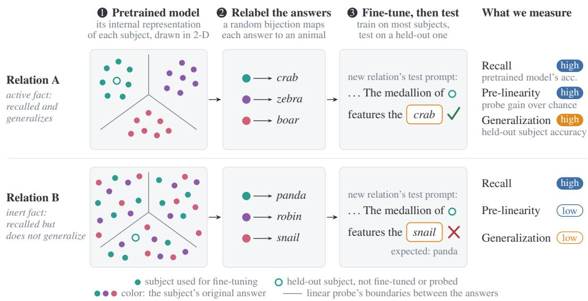
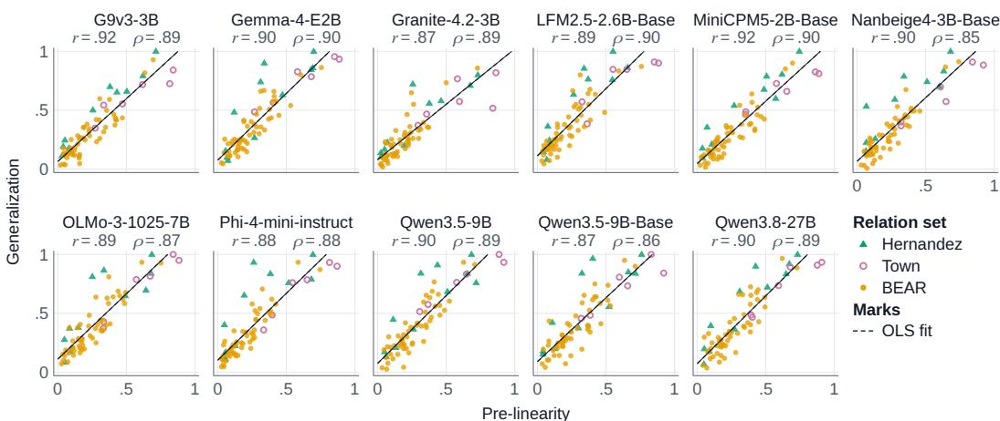
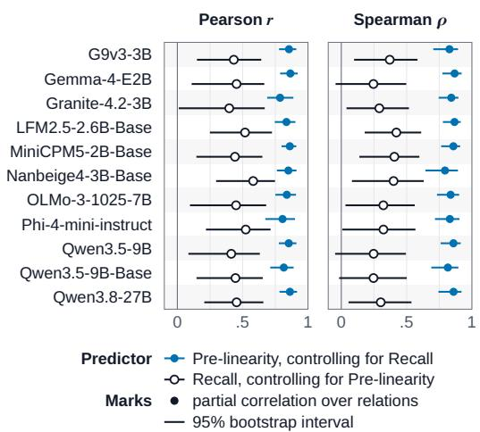
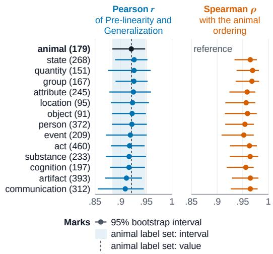
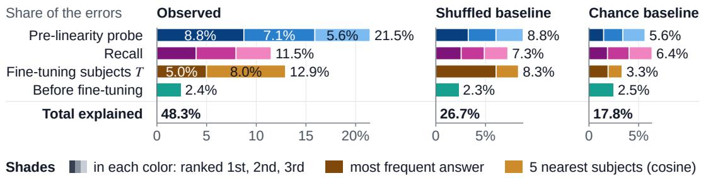
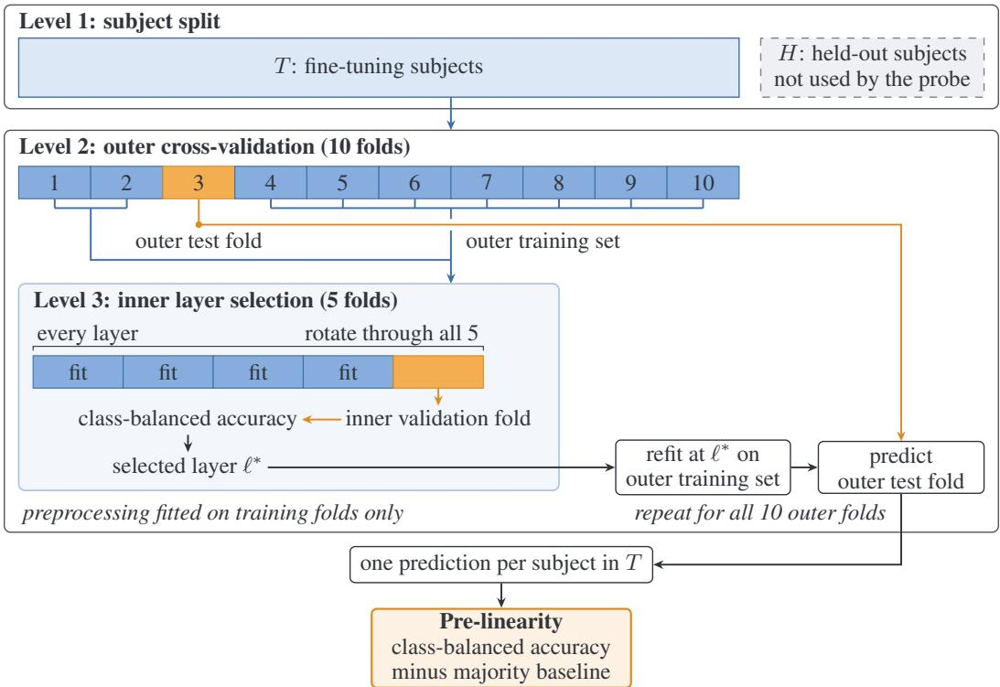
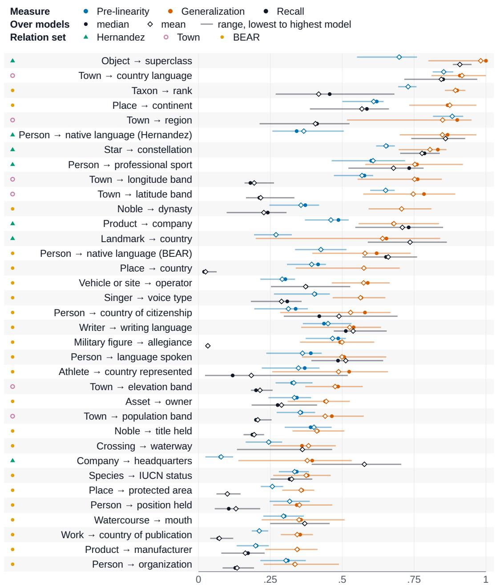
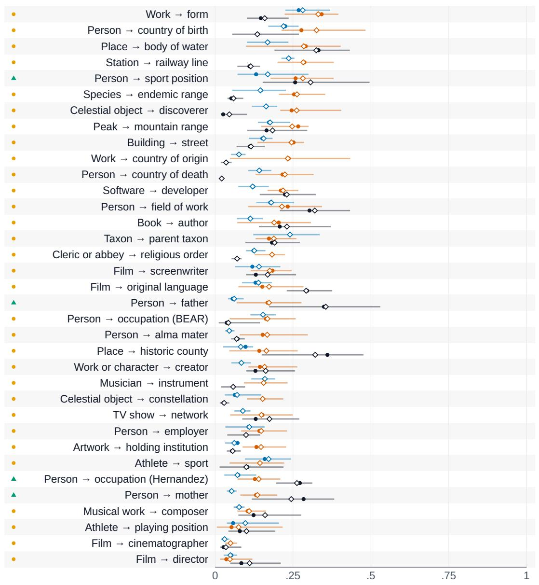
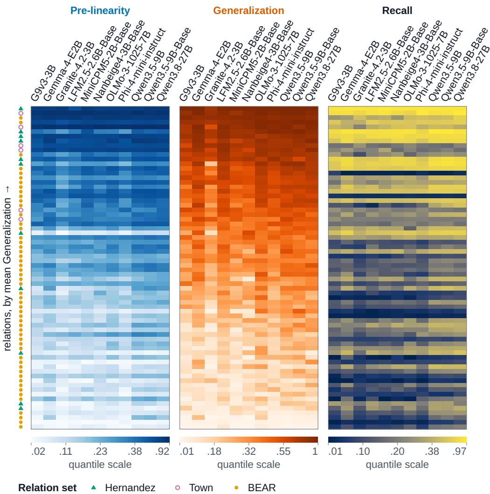
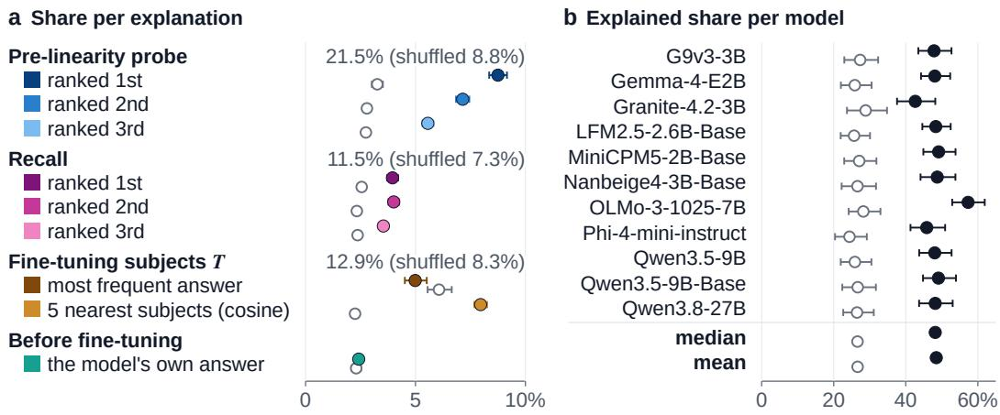

# KNOWLEDGE THAT IS LINEAR BEFORE FINE-TUNING GENERALIZES AFTER IT

Faridoun Mehri & Hinrich Schütze

Center for Information and Language Processing, LMU Munich Munich Center for Machine Learning (MCML) feraidoon@cis.lmu.de

## ABSTRACT

Not all facts a language model can recall support further learning equally well. We distinguish active facts, which support generalization beyond their own recall, from inert facts, which can be recalled but do not support such generalization in a given task. We study this distinction by constructing new relations from existing ones. Take the relation that maps a place to its continent (Paris → Europe) and assign each of its answers an arbitrary new label (Europe → crab, Asia → zebra). The new relation then maps Paris → crab. We fine-tune the model on the new relation for a subset of subjects, without telling it the original relation or the relabeling rule, and test whether it assigns the corresponding labels to held-out subjects that share an answer in the original relation. Having learned Paris → crab, does it answer Munich → crab? Across eleven language models and 70 relations, how linearly readable the original relation is in pretrained representations strongly predicts this generalization. Within each model, the two correlate across relations at Pearson r = 0.87 to 0.92. This association persists when controlling, separately and jointly, for the number of fine-tuning subjects and answers, the model’s accuracy on the original relation, and how often the subjects occur in pretraining text. It is also robust to the arbitrary choices in the construction. Re-randomizing the label assignment and fine-tuning seed, or replacing the animal labels with labels from thirteen other semantic categories, leaves it essentially unchanged. When we map a fine-tuned model’s wrong label back to the original answer it was assigned to, Munich → zebra becomes Munich → Asia. Answers recovered this way are more often among the linear probe’s top answers for the subject than among the pretrained model’s own. These findings tie the active/inert distinction to linear readability. Whether a new relation generalizes depends less on whether its facts can be recalled than on how readily their shared structure can be read out linearly.

## 1 INTRODUCTION

Imagine that the pretraining text describes Mary as having grown up in France, attending French schools, writing books in French and working in French-speaking institutions, but never states her native language. A language model should still assume that Mary is a native speaker of French. We call this statistical generalization offacts. The model infers a new fact from facts it knows, by a statistical rule that the pretraining text rarely states explicitly and that is not always true. It differs from entailment, where the new fact follows necessarily from the known ones, and from paraphrase, where the same fact is merely worded differently (§2). Statistical generalization is a large part of what makes language models useful beyond recalling what they were told. Prior work has asked whether models draw such inferences from facts they are trained on (Feng et al., 2025; Treutlein et al., 2024), but, to our knowledge, no prior work has asked which of a model’s facts support them.

Not all facts a model knows support such generalization equally well. We distinguish active facts, which support generalization beyond their own recall, from inert facts, which the model can recall but which do not support such generalization in a given task. The distinction is important because a model may state a fact reliably and still be unable to use it when learning something new. Thus, ou research question is: What property of how a pretrained model encodes its knowledge determines whether new knowledge built on it generalizes?

  
Figure 1: Facts generalize to a new relation when they are linearly readable. The pretrained model recalls relations A and B equally well, but only A’s answers are linearly readable from its representations of the subjects. A random bijection from the answers to animal labels defines a new relation. After fine-tuning on it, the model generalizes A’s labels to held-out subjects but not B’s. The fine-tuned model’s wrong label for B’s held-out subject, “snail,” is the label of the answer the linear probe picks for that subject, not of its true answer (Generalization failures). Pre-linearity predicts Generalization better than Recall does (Pre-linearity versus Recall). Section 3 defines the three measures.

We hypothesize that the answer is linear structure. Linear relational embeddings were originally proposed as a mechanism for generalizing to unseen relational facts (Paccanaro & Hinton, 2000), and many relations in modern language models are, to a good approximation, decoded linearly from the subject’s representation (Hernandez et al., 2024; Merullo et al., 2025). In a synthetic setting, knowledge that is linearly encoded on the entity is the knowledge that fine-tuning can extract (Allen-Zhu & Li, 2024). But whether the linearity of a pretrained model’s real-world knowledge affects how new knowledge built on it generalizes has not been tested. The hypothesis we investigate is that the more linearly readable a relation’s answers are in the pretrained model, which we call the relation’s Pre-linearity, the better new knowledge built on that relation generalizes after fine-tuning.

To this end, we construct new relations from existing ones (Figure 1). Take the pretrained relation that maps a place to its continent (Paris → Europe) and relabel each of its answers at random with a different arbitrary word, such as an animal name (Europe → crab, Asia → zebra). The resulting new relation maps Paris → crab. We fine-tune the model on the new relation for a subset of subjects, without telling it the original relation or the relabeling rule, and test whether it assigns the right labels to held-out subjects. Having learned Paris → crab, does it answer Munich → crab? The design directly tests for statistical generalization. The new relation is unknown to the model, but its structure is inherited from the pretrained relation, so the model can generalize only by building on what it already knows. We measure Pre-linearity with a cross-validated linear probe on the pretrained model’s subject representations, Recall as the pretrained model’s accuracy on the pretrained relation, and Generalization as the fine-tuned model’s accuracy on held-out subjects (§3).

Across eleven open-weight language models, base and post-trained, from 2B to 27B parameters, and 70 relations, Pre-linearity strongly predicts Generalization. Within each model, the two correlate across relations at Pearson r = 0.87 to 0.92 (median 0.90; §5). The association is not explained by how well the model recalls the relation, by the numbers of answers and fine-tuning subjects, or by how often the subjects occur in pretraining text. Controlling for all four jointly, r is still 0.70 to

0.82 (Table 1). So being active is not the same as being known. Finally, the probe also tells us how the models fail. When we map a fine-tuned model’s wrong label back to the original answer it was assigned to, Munich → zebra becomes Munich → Asia. Answers recovered this way are more often among the probe’s top answers for the subject than among the pretrained model’s (Figure 4).

Our contributions are: (1) We introduce the distinction between active and inert facts, and a paradigm that measures it. The paradigm builds new relations by randomly relabeling the answers of existing ones. (2) We show, across eleven models and 70 relations, that how linearly readable a relation is before fine-tuning predicts how well a new relation built on it generalizes after fine-tuning. (3) We show that Pre-linearity is a better predictor of Generalization than Recall, and that it still predicts Generalization when Recall, relation size and subject frequency are controlled for jointly. Furthermore, the probe predicts the fine-tuned models’ errors better than the other explanations we test.

## 2 RELATED WORK

Most related to our distinction between inert vs active facts is work on inference from facts that we will call “entailment.” A fact f is entailed by a set of other facts F if from accepting the truth of F, it necessarily follows that the truth of f has to be accepted. For example, {“John lives in Tokyo”, “Tokyo is in Japan”, “People in Japan speak Japanese”} entails “Where John lives, people speak Japanese” (Feng et al., 2025). This type of entailment includes transitive inference, inverse relations and kinship reasoning and it has been widely studied (e.g., Berglund et al., 2024; Mehrafarin et al., 2024; Efeoglu & Paschke, 2026; Fesser et al., 2026; Yang et al., 2024; Wang et al., 2024; Lampinen et al., 2025). There is mixed evidence on how well LMs perform on entailment (Talmor et al., 2020; Clark et al., 2021).

Statistical generalization (see §1) differs from entailment in that the underlying statistical rule is not 100% accurate. Its accuracy is a matter of degree: each of the facts given about Mary is additional evidence and decreases the probability of Mary not being a native French speaker.

Paraphrases, which can be viewed as linguistic generalization, also have been widely studied (e.g., Elazar et al., 2021; Jiang et al., 2020; Chang et al., 2024; Behnia et al., 2025; Wang et al., 2025). Similarly, there is work on the acquisition of linguistic constructions if no or little evidence is present in the pretraining corpus (e.g., Misra & Mahowald, 2024; Patil et al., 2024). Paraphrases and the acquisition of linguistic constructions concern variation in how the same underlying fact is expressed linguistically and are thus fundamentally different from statistical generalization of facts.

Statistical generalization of facts has received little attention. It is investigated by Lu et al. (2024), but their focus is scaling laws. Wu et al. (2025) make an argument similar to ours (that generalization over facts is important), but they generalize over relation tokens (e.g., from English “is” to German “ist”), which is more a form of linguistic generalization than true fact generalization in our sense. In a survey paper, Chang & Bergen (2024) report that early language models were not able to reliably infer “robins can fly” from “a robin is a bird,” a negative finding.

Linear relational embeddings (LREs) would seem to be an obvious vehicle for investigating statistical generalization of facts. Indeed, in their original work, Paccanaro & Hinton (2000) motivate LRE as a mechanism for generalizing to unseen relational facts. Recent work in language models investigates LREs as causal mechanisms, asks to what extent frequency predicts relational linearity, develops better probing mechanisms and proposes efficient estimators of LREs (Hernandez et al., 2024; Merullo et al., 2025; Marconato et al., 2025; Valer et al., 2026); but statistical generalization of facts is not considered.

In addition to the LRE literature, there has been much work on factual recall and knowledge editing (e.g., Petroni et al., 2019; Dai et al., 2022; Kandpal et al., 2023; Geva et al., 2021; 2023; Nanda et al., 2023; Meng et al., 2022; Cohen et al., 2024). In contrast to our research, this work has focused on under which circumstances facts stated in pretraining data are learned (in some cases including the impact of linguistic paraphrases) or can be edited, not on how those facts, once learned or edited, allow the model to learn new things.

Another related area is hallucinations (Rawte et al., 2023; Kalai & Vempala, 2024). By definition, hallucinations are incorrect generations and thus undesirable. Many authors make the implicit assumption that language models should not say something that has not been stated in the pretraining data (modulo the cases of entailment and paraphrasing discussed above), even if it is mathematically unavoidable (Kalai et al., 2025). This assumption may be misguided. Part of the effectiveness of language models is that they perform statistical generalization and operate on statistical inferences that are not guaranteed to be true 100%.

Finally, our setup fine-tunes a model to learn new facts. The impact of this setup on hallucinations was studied by Gekhman et al. (2024). Ovadia et al. (2024) find that models struggle to learn new facts in fine-tuning. Mecklenburg et al. (2024) investigate what composition of pretraining data leads to successful learning of new facts. Zhao et al. (2025) also show the effects of different types of pretraining data on new fact learning and that new facts are difficult to learn in composition (a case of what we call entailment). This work does not address how known facts can be leveraged for new facts.

In summary, there is much work on entailment, factual recall and linguistic generalization, but, to our knowledge, the question of which known facts a model can build new facts on has not been addressed. We address it in a fine-tuning setting and find that whether facts are active, that is, whether new relations built on them generalize, is predicted better by how linearly readable they are before fine-tuning than by whether the model can recall them. This sheds light on how facts are represented in language models and how this representation supports learning and generalization.

## 3 METHOD

We study how well a new relation generalizes when it is built on a relation the pretrained model already knows, and whether this depends on how linearly readable the known relation is. We start by giving definitions and clarifying notation.

Pretrained relation. We call the existing relations in the pretrained language models pretrained relations. These relations form the existing knowledge of the model. Concretely, take the relation C that maps entities to their continent (Paris → Europe, Tokyo → Asia). We ask the model for a pretrained-relation answer with a prompt that stops where the answer begins, the relation’s query template. For the continent relation, the model should continue “Paris is located $\mathrm { i n } ^ { \prime \prime }$ with “Europe.” In the next paragraph, we’ll describe how we construct new relations that are statistically related to these pretrained relations. Our metrics only use the first token of the answers to the relations. Thus, answers sharing their first token form one effective answer, which we shorten to answer from now on. We write $\mathcal { E }$ for the set of these answers and, for a particular pretrained relation $R ,$ write $e _ { R } ( u ) \in \mathcal { E }$ for subject u’s answer. For example, for the continent relation $C ,$ , we have $e _ { C } ( { \mathrm { P a r i s } } ) = { \mathrm { E u r o p e } }$

New relation. To study how models learn new facts that relate to their existing knowledge, we build a new relation on top of each pretrained relation R. It should depend on $R ,$ but be unknown to the model. We get both by relabeling R’s answers at random with words from a label set A; $\mathrm { e . g . }$ , animal names such as “zebra,” “crab” and “boar.” The next paragraph describes how we build these sets. For each R, we draw a subset $L \subseteq A$ with $| L | = | \mathcal { E } |$ , the number of $R \ ' \mathrm { s }$ answers, and a bijection $\pi \colon \mathcal { E }  L$ , both uniformly at random. The new relation $R ^ { \pi }$ maps each subject u to $\pi ( e _ { R } ( u ) )$ , so subjects that share a pretrained-relation answer share a label. E.g., if R maps Paris → Europe and $\mathrm { T o k y o }  \mathrm { A s i a }$ , and π(Europe) = crab and $\pi ( \mathrm { A s i a } ) = \mathrm { z e b r a }$ , then $R ^ { \pi }$ maps Paris → crab and Tokyo → zebra.

Label sets. We build a label set from one WordNet 3.0 noun category, such as noun.animal, by a deterministic algorithm, the label-set algorithm. It keeps names that truly belong to the category, are common in English and are not hyponyms of one another, so each prompt has one correct label. Each kept name’s first token must also differ from every other kept name’s under the tokenizer of every model the label set is used with, since we score only first tokens. Each relation’s labels exclude names that are taxonomic neighbors of its subjects or answers (Appendix F).

Hold-out protocol. For each relation, we split subjects into fine-tuning subjects T and held-out subjects H. The split includes at least one held-out subject and at least four fine-tuning subjects per answer. We’ll describe the fine-tuning protocol in the next paragraph. Pretrained relations are selected such that they have enough subjects to satisfy the above requirements (§4). We use T for fine-tuning and probe fitting and never use H to fit, select or tune anything.

Fine-tuning on the new relation. We teach each model the new relation by fine-tuning all of its weights on the fine-tuning subjects T. Because the new relation is arbitrary, its prompts place it in a fictional frame, so the model learns a fact about a novel rather than a false fact about the world. Each subject is trained under four fine-tuning templates that differ only in wording; a fifth, the held-out evaluation template, is kept for evaluation. The supplementary material lists every template under artifacts\_v1/prompts/. For example, if $\pi ( { \mathrm { E u r o p e } } ) = { \mathrm { c r a b } } .$ , one fine-tuning prompt of $C ^ { \pi }$ for Italy is

In the novel XYZ, each entry in the Breviary has an emblem showing one animal. The emblem of Italy shows the crab

We train for 20 epochs with the loss on the label’s first token only (Appendix B). The 20 epochs are conservatively many. Every model reaches accuracy 1 on its fine-tuning subjects (Table 3). This ensures the model is not undertrained for the new relation.

Candidate accuracy. The candidate accuracy of a model on a relation, under a given template, is its top-1 accuracy when the next token is restricted to the relation’s answers. (By construction, these answers have distinct first tokens, and each is scored by its first token. Refer back to the paragraph Pretrained relation.) It is class-balanced. We first compute the accuracy over the subjects of each answer, then average these per-answer accuracies, so an answer with many subjects counts as much as one with few. Uniform chance is one over the number of answers, $1 / | \dot { \mathcal { E } } |$

Generalization. Generalization is the fine-tuned model’s candidate accuracy on the new relation, over the held-out subjects H and under the held-out evaluation template. For example, if the model is fine-tuned on $C ^ { \pi }$ with Paris → crab and Munich is held out, it is correct on Munich when, after

In the novel XYZ, each entry in the Breviary has a medallion featuring one animal. The medallion of Munich features the

it scores “crab” above every other label (animal here) of $C ^ { \pi }$

Recall. Recall is the pretrained model’s candidate accuracy on the pretrained relation, over the fine-tuning subjects $T$ and under the query template. For $\dot { C , }$ the model is correct on Paris when, after “Paris is located in”, it scores “Europe” above every other continent. It measures how well the model states the pretrained-relation fact, and we use it as a control for Pre-linearity, explained next.

Pre-linearity. Our hypothesis is that the more linearly readable the model’s pretrained knowledge of a pretrained relation is, the better the model generalizes on the corresponding new relation. We measure how linearly readable a pretrained-relation answer is from the pretrained model with a standard cross-entropy classifier probe on the dimension-reduced activation state of the last token of the subject span in a chosen layer. (We’ll describe how we choose the layer in the next paragraph.) We compute each subject’s state in the query template. For $C ,$ , the prompt for Paris is “Paris is located in”, and the probe reads the state of $\mathrm { \bar { \cdots } } \mathrm { P a r i s } ^ { \bar { \prime } \bar { \prime } }$ . We first reduce each subject’s state $h$ to $q =$ 16 dimensions with principal component analysis (PCA) followed by whitening. We project the centered state onto its top q principal directions and rescale each coordinate to unit variance:

$$
z _ { k } = { \frac { v _ { k } ^ { \top } ( h - \mu ) } { \sigma _ { k } } } , \qquad k = 1 , \ldots , q ,
$$

where $\mu$ is the mean state, $v _ { k }$ is the k-th principal direction, and $\sigma _ { k } ^ { 2 }$ is the variance of the states along $v _ { k }$ . The probe predicts softmax $( W z + b )$ from $\boldsymbol { z } = ( z _ { 1 } , \ldots , z _ { q } )$ . We fit W and b by minimizing the cross-entropy plus $\textstyle { \frac { \lambda } { 2 } } \| W \| ^ { 2 }$ , with $\lambda = 1 0 ^ { - 2 }$ . We use the same values, $q = 1 6$ and $\lambda = 1 0 ^ { - 2 }$ , for every model and relation; we fixed them in advance and did not tune them.

We split the subjects at three levels (Figure 5). At the first level, each relation’s subjects are split into the fine-tuning subjects T and the held-out subjects H (the hold-out protocol above). The probe uses only T. At the second level, the outer loop of a nested cross-validation splits T into ten outer folds. Each outer fold serves once as the outer test fold. The other nine form the outer training set. At the third level, the inner loop splits the outer training set into five inner folds. It uses them only to choose the layer. For each layer, it fits the probe on four inner folds and predicts the fifth, five times over. The layer whose predictions have the highest class-balanced accuracy wins; ties go to the lower layer. We then fit the probe at the chosen layer on the whole outer training set and predict the outer test fold. Every fit computes $\mu , v _ { k }$ and $\sigma _ { k }$ from its own training data. After all ten outer folds are processed, each subject of $T$ has one prediction, made by a probe that never saw it. Pre-linearity is the class-balanced accuracy of these predictions, computed as for candidate accuracy. We subtract a baseline, the class-balanced candidate accuracy of always predicting the most frequent answer of the outer training set. This baseline is close to chance, one over the number of answers |E|.

  
Figure 2: In every model, relations with higher Pre-linearity tend to have higher Generalization. One point per relation, marked by its relation set.

Controls. A relation might generalize well for reasons simpler than Pre-linearity. We measure four such properties of each relation and ask whether Pre-linearity still predicts Generalization once they are taken into account. The four are (i) Recall; (ii) the log number of answers, $\ln \lvert \mathcal { E } \rvert ;$ (iii) the log number of fine-tuning subjects, ln $| T | ;$ ; and (iv) subject frequency, how often the relation’s subjects occur in pretraining text, as the mean of log $_ { 1 0 } ( 1 + \mathrm { c o u n t } )$ over its subjects. For each model, we compute the partial correlations between Pre-linearity and Generalization across its relations, given each control alone and given all jointly.

## 4 EXPERIMENTAL SETUP

This section describes the pretrained relations, models and label sets we use, and how we repeat runs to measure the effect of randomness.

Pretrained relations. A pretrained relation enters our experiments only if, on every model, (i) it has at least five answers, (ii) each answer has at least five subjects, four to fine-tune on and one to hold out, and (iii) it has at least 25 fine-tuning subjects, the fewest for which every probe fit in the nested cross-validation of Pre-linearity contains every answer and more subjects than the probe’s q = 16 principal directions. These requirements depend only on subject counts and tokenization. We screen relations from three sources against these requirements and keep 70:

• Hernandez: 13 of the 47 relations of Hernandez et al. (2024) qualify. We drop the two about spelling (a word’s first or last letter), whose answer can be read from the subject’s own letters, and keep eleven. An example is “British Railways Board is headquartered in the city of London” for Company → headquarters.

• Town: six relations of our own, all of which qualify. They share one pool of 300 towns and map a town to its region, to the official language of its country or to its band of latitude, longitude, elevation or population (Appendix E). Example: “By number of inhabitants, Kiruna falls in the lowest population (150 to 39,653)” (i.e., lowest population band).

Table 1: Pre-linearity predicts Generalization in every model, with or without controls. Each entry correlates Pre-linearity with Generalization across each model’s 70 relations (Pearson r, Spearman ρ). ±: 95% interval (Appendix H).
<table><tr><td rowspan="3">Model</td><td colspan="2"></td><td colspan="8">Partial correlation, controlling for</td></tr><tr><td colspan="2">Raw</td><td colspan="2">Recall</td><td colspan="2">Answer count</td><td colspan="2">Subject count</td><td colspan="2">Subject frequency</td><td colspan="2">All jointly</td></tr><tr><td colspan="2">r</td><td colspan="2">r ρ</td><td colspan="2">r ρ</td><td colspan="2">r</td><td colspan="2">r</td><td>r ρ</td></tr><tr><td>G9v3-3B</td><td>.92</td><td>ρ .89 ±.08</td><td>.85 ±.08</td><td>.83 ±.12</td><td>.88</td><td>.87</td><td>.89</td><td>ρ .88 ±.09</td><td>.91</td><td>ρ .88 .82</td><td>.82</td></tr><tr><td>Gemma-4-E2B</td><td>±.04 .90</td><td>.90 ±.08</td><td>.86</td><td>.87 ±.09</td><td>±.05 .84</td><td>±.10 .87 ±.09</td><td>±.05 .87</td><td>.89 ±.08</td><td>±.05 .88</td><td>±.08 ±.10 .90 .80</td><td>±.15 .85</td></tr><tr><td>Granite-4.2-3B</td><td>±.06 .87</td><td>.89 ±.07</td><td>±.08 .79 ±.10</td><td>.84 ±.10</td><td>±.09 .77</td><td>.86</td><td>±.06 .82</td><td>.88</td><td>±.07 .85</td><td>±.07 ±.12 .89 .70</td><td>±.11 .81</td></tr><tr><td>LFM2.5-2.6B-Base</td><td>±.09 .89</td><td>.90 ±.07</td><td>.84 ±.09</td><td>.87 ±.09</td><td>±.13 .82 ±.08</td><td>±.09 .87 ±.08</td><td>±.11 .85 ±.06</td><td>±.08 .89 ±.07</td><td>±.11 .87</td><td>±.08 ±.12 .90 .76</td><td>±.12 .84</td></tr><tr><td>MiniCPM5-2B-Base</td><td>±.05 .92</td><td>.90 ±.08</td><td>.86 ±.06</td><td>.86 ±.09</td><td>.87 ±.06</td><td>.88 ±.10</td><td>.89 ±.05</td><td>.89 ±.09</td><td>±.06 .91</td><td>±.06 .89</td><td>±.12 ±.12 .82 .84</td></tr><tr><td>Nanbeige4-3B-Base</td><td>±.04 .90 ±.07</td><td>.85 ±.13</td><td>.85 ±.09</td><td>.79 ±.15</td><td>.83 ±.12</td><td>.81 ±.17</td><td>.86 ±.09</td><td>.84 ±.13</td><td>±.04 .88</td><td>±.08 .85 ±.12</td><td>±.10 ±.12 .77 .75</td></tr><tr><td>OLMo-3-1025-7B</td><td>.89</td><td>.87 ±.09</td><td>.84 ±.09</td><td>.84 ±.10</td><td>.84 ±.10</td><td>.85 ±.10</td><td>.87 ±.06</td><td>.87 ±.09</td><td>±.08 .88</td><td>.88</td><td>±.15 ±.19 .80 .83</td></tr><tr><td>Phi-4-mini-instruct</td><td>±.07 .88 ±.08</td><td>.88 ±.08</td><td>.81 ±.13</td><td>.83 ±.11</td><td>.80 ±.13</td><td>±1</td><td>85</td><td>.88 ±.09</td><td>±.07 .86</td><td>±.08 .88 ±.08</td><td>±.10 ±.11 .75 .81 ±.13 ±.13</td></tr><tr><td>Qwen3.5-9B</td><td>.90</td><td>.89 ±.07</td><td>.85 ±.08</td><td>.86 ±.10</td><td>.84 ±.08</td><td>.86</td><td>.87 ±.06</td><td>.89</td><td>±.09 .88</td><td>.89 ±.08</td><td>.77 .83 ±.12 ±.12</td></tr><tr><td>Qwen3.5-9B-Base</td><td>±.05 .87</td><td>.86 ±.10</td><td>.81 ±.10</td><td>.82 ±.13</td><td>.80 ±.10</td><td>±.09 832</td><td>.84 ±.07</td><td>±.08 .85</td><td>±.06 .85 ±.08</td><td>.85 ±.10</td><td>.72 .78 ±.15 ±.14</td></tr><tr><td>Qwen3.8-27B</td><td>±.07 .90 ±.04</td><td>.89 ±.08</td><td>.86 ±.08</td><td>.86 ±.12</td><td>.84 ±.07</td><td>.86 ±.10</td><td>.87 ±.05</td><td>±.10 .88 ±.09</td><td>.88 ±.05</td><td>.88 ±.08</td><td>.79 .83 ±.12 ±.14</td></tr><tr><td>Min</td><td>.87</td><td>.85</td><td>.79</td><td>.79</td><td>.77</td><td>.81</td><td>.82</td><td>.84</td><td>.85</td><td>.85</td><td>.70 .75</td></tr><tr><td>Mean</td><td>.89</td><td>.88</td><td>.84</td><td>.84</td><td>.83</td><td>.86</td><td>.86</td><td>.88</td><td>.88</td><td>.88</td><td>.77 .82</td></tr><tr><td>Max</td><td>.92</td><td>.90</td><td>.86</td><td>.87</td><td>.88</td><td>.88</td><td>.89</td><td>.89</td><td>.91</td><td>.90</td><td>.82 .85</td></tr></table>

• BEAR: of the 78 relations of BEAR-big (Wiland et al., 2024), place of detention was excluded due to privacy concerns; fifty-three of the other 77 qualify, as in “Italy is located in Europe” for Place → continent.

Models. We use 11 open-weight models, 6 from the leaderboard of tiny open-weight models of Artificial Analysis (Appendix J): G9v3-3B, Granite-4.2-3B, LFM2.5-2.6B-Base, MiniCPM5-2B-Base, Nanbeige4-3B-Base and Phi-4-mini-instruct. The others are Gemma-4-E2B, OLMo-3-1025-7B, Qwen3.5-9B, Qwen3.5-9B-Base, and, for scale, Qwen3.8-27B. To mix base and post-trained models, we chose at random between the base and the post-trained checkpoint of each model; of Qwen3.5-9B we use both, as a direct comparison of a base model with its post-trained version.

Label sets. Unless stated otherwise, every new relation draws its labels from the animal label set, the 179 animal names that the label-set algorithm keeps. All models use this set. The label-set comparison asks whether our results depend on the labels being animals. It reruns every relation with labels from another WordNet noun category, such as artifacts (noun.artifact), and names that category instead of “animal” in the new-relation templates. We run it on MiniCPM5-2B-Base, our smallest model, once per category. Each category’s label set is similarly constructed by the label-set algorithm; since only one tokenizer is involved, every name must be a single token under it. A category takes part only if its label set has at least 86 names, enough for the relation with the most answers. (Each distinct pretrained relation answer needs a distinct label for the new relation.) Of the other 24 WordNet categories, thirteen qualify (Table 7).

Subject frequency. For the subject-frequency control, we count how often each subject occurs in Dolma v1.7 (Soldaini et al., 2024), an open corpus built for pretraining language models. We get exact counts from the public API of infini-gram (Liu et al., 2024), a search engine that provides counts of occurrences of token sequences, using its Dolma v1.7 index (v4\_dolma-v1\_7\_llama). We use these counts as a proxy for how often each model saw a subject during pretraining.

  
(a) Pre-linearity and Recall as predictors of General- (b) The label-set comparison on MiniCPM5-2B-Base. ization.  
Figure 3: Pre-linearity predicts Generalization better than Recall does (a), and its correlation with Generalization hardly depends on the label set (b). Correlations run across each model’s 70 relations; in (b), each label set’s number of labels follows its name. Intervals: Appendix H.

Re-randomization. Each new relation involves two random choices: the bijection π from answers to labels, and the fine-tuning seed. To measure how much Generalization depends on them, we train some model–relation pairs three times, each time with its own π and fine-tuning seed. The three runs share everything else: the subject split, the label subset L, the templates and the exposure per fact. We run every relation three times on MiniCPM5-2B-Base, and the Hernandez and Town relations three times on every model except Qwen3.8-27B. All other results use the first of the three runs.

## 5 RESULTS

Our main finding is that pretrained relations whose answers are linearly readable in the pretrained model give rise to new relations that, after fine-tuning, generalize better. This holds in all 11 model we test. Across models, Pre-linearity and Generalization on relations correlate at r = 0.87 to 0.92 and ρ = 0.85 to 0.90, and no 95% interval falls below 0.72 (Table 1, Figure 2). Base and posttrained models from 2B to 27B parameters land in this band. We then check three things: (i) that the association survives controls for Recall, answer count, subject count and subject frequency; (ii) that Pre-linearity is a better predictor of Generalization than Recall (Figure 3a); and (iii) that the association depends on neither the label set nor the random bijection and fine-tuning seed behind each new relation (Figure 3b; §4, Table 2). Finally, we look at the errors. When a fine-tuned model fails to generalize, its wrong answers follow the Pre-linearity probe more than Recall (Figure 4).

Controls. Several properties of a relation could raise both measures (Pre-linearity and Generalization) at once: how well the pretrained model recalls it, how many answers and subjects it has, and how frequent its subjects are in pretraining text. None of them explains the association away. Controlling for any one of the four leaves every model’s r between 0.77 and 0.91 and ρ between 0.79 and 0.90. With all four controlled jointly, r is still 0.70 to 0.82 and ρ 0.75 to 0.85, and no 95% interval falls below 0.56 (Table 1).

Pre-linearity versus Recall. Pre-linearity, not Recall, carries most of the prediction of Generalization (Figure 3a). Controlling for Recall, Pre-linearity still correlates with Generalization at r =

  
Figure 4: The Pre-linearity probe accounts for more of the fine-tuned models’ errors than Recall does. Each bar is an explanation’s Shapley share of all errors on held-out subjects, pooled over models and relations. Explanations and baselines: Generalization failures and Appendix G.

0.79 to 0.86 $( \rho = 0 . 7 9 \mathrm { t o } 0 . 8 7 )$ . Recall on its own correlates at $r = 0 . 6 3$ to 0.74, but mostly because relations the pretrained model recalls well also tend to have linearly readable answers. Controlling for Pre-linearity instead, Recall’s correlation drops to $r = 0 . 4 0$ to 0.58 $( \rho = 0 . 2 5$ to 0.42), and its ρ interval excludes zero in only eight of the eleven models.

Label sets. The association is robust to the choice of labels (Figure 3b). On MiniCPM5-2B-Base, the label-set comparison reruns every relation with labels from each of 13 other WordNet categories (Table 7). r between Pre-linearity and Generalization stays between 0.91 and 0.93 and every category orders the relations by Generalization almost as the animal set does (ρ = 0.95 to 0.97).

Re-randomization. The association is equally robust to the random bijection and fine-tuning seed. Three runs that differ only in their randomized bijection and seed give r = 0.92, 0.93 and 0.92 on MiniCPM5-2B-Base (Table 2). On the 17 Hernandez and Town relations, which we rerun on ten models, each run’s r lies between 0.78 and 0.95 (Table 4).

Generalization failures. The fine-tuned models’ wrong answers follow the Pre-linearity probe more than they follow Recall (Figure 4). We credit each error on a held-out subject to the explanations that name its wrong answer, split equally when several do. The explanations are the three answers the probe ranks highest, the three the pretrained model scores highest (the ranking behind Recall), and three others defined in Appendix G. An explanation can name a wrong answer by coincidence, so we compare each share with two baselines: the same attribution with each fine-tuned model’s wrong answers shuffled among themselves, and with each wrong answer replaced by a uniformly random wrong label of its relation. The shuffle keeps which wrong labels a model favors and breaks only their link to the subject, which makes it the stricter baseline. The probe’s three highest-ranked answers take 21.5% of the errors, against 8.8% shuffled; the pretrained model’s three highest-ranked answers take 11.5%, against 7.3%. The correlations above compare relations; this analysis looks inside them, at single subjects. There too, the fine-tuned models follow the probe, which suggests that fine-tuning builds on the structure the probe reads.

## 6 CONCLUSION

We address the question of how a pretrained model’s representation of its knowledge determines whether new knowledge built on it generalizes, and develop a new design to study it. We show, across eleven models and 70 relations, that how linearly readable a relation is before fine-tuning (i.e., how active vs inert its facts are) predicts how well a new relation built on it generalizes after finetuning. We find that Pre-linearity is a better predictor of Generalization than Recall, and survives controls for Recall, relation size and subject frequency.

Table 2: Three runs of MiniCPM5-2B-Base give almost the same correlation between Pre-linearity and Generalization. Each run draws a new random bijection for every new relation and a new fine-tuning seed (Re-randomization). ±: 95% interval (Appendix H).
<table><tr><td></td><td>Pearson r Spearman ρ</td></tr><tr><td>Repeat 0  $. 9 2 \pm . 0 4$ </td><td> $. 9 0 \pm . 0 8$ </td></tr><tr><td>Repeat 1  $. 9 3 \pm . 0 4$ </td><td> $. 8 9 \pm . 0 8$ </td></tr><tr><td>Repeat 2  $. 9 2 \pm . 0 4$ </td><td> $. 9 2 \pm . 0 6$ </td></tr><tr><td>Mean of three  $. 9 3 \pm . 0 3$ </td><td> $. 9 2 \pm . 0 7$ </td></tr></table>

## REFERENCES

Zeyuan Allen-Zhu and Yuanzhi Li. Physics of language models: Part 3.1, knowledge storage and extraction. In Proceedings of the 41st International Conference on Machine Learning, volume 235 of Proceedings of Machine Learning Research, 2024. URL https://proceedings. mlr.press/v235/allen-zhu24a.html.

Tina Behnia, Puneesh Deora, and Christos Thrampoulidis. Facts in stats: Impacts of pretraining diversity on language model generalization, 2025. URL https://arxiv.org/abs/2510. 16096.

Lukas Berglund, Meg Tong, Maximilian Kaufmann, Mikita Balesni, Asa Cooper Stickland, Tomasz Korbak, and Owain Evans. The reversal curse: LLMs trained on “a is b” fail to learn “b is a”. In The Twelfth International Conference on Learning Representations, 2024. URL https: //openreview.net/forum?id=GPKTIktA0k.

Hoyeon Chang, Jinho Park, Seonghyeon Ye, Sohee Yang, Youngkyung Seo, Du-Seong Chang, and Minjoon Seo. How do large language models acquire factual knowledge during pretraining?, 2024. URL https://arxiv.org/abs/2406.11813.

Tyler A. Chang and Benjamin K. Bergen. Language model behavior: A comprehensive survey. Computational Linguistics, 50(1):293–350, 03 2024. ISSN 0891-2017. doi: 10.1162/coli\_a\_ 00492. URL https://doi.org/10.1162/coli\_a\_00492.

Peter Clark, Oyvind Tafjord, and Kyle Richardson. Transformers as soft reasoners over language. In Proceedings of the Twenty-Ninth International Joint Conference on Artificial Intelligence, IJ-CAI’20, 2021. ISBN 9780999241165.

Roi Cohen, Eden Biran, Ori Yoran, Amir Globerson, and Mor Geva. Evaluating the ripple effects of knowledge editing in language models. Transactions of the Association for Computational Linguistics, 12:283–298, 2024. doi: 10.1162/tacl\_a\_00644. URL https://aclanthology. org/2024.tacl-1.16/.

Damai Dai, Li Dong, Yaru Hao, Zhifang Sui, Baobao Chang, and Furu Wei. Knowledge neurons in pretrained transformers. In Smaranda Muresan, Preslav Nakov, and Aline Villavicencio (eds.), Proceedings of the 60th Annual Meeting of the Association for Computational Linguistics (Volume 1: Long Papers), pp. 8493–8502, Dublin, Ireland, May 2022. Association for Computational Linguistics. doi: 10.18653/v1/2022.acl-long.581. URL https://aclanthology.org/ 2022.acl-long.581/.

Sefika Efeoglu and Adrian Paschke. Reversing arrows in large language models, 2026. URL https://arxiv.org/abs/2608.03512.

Yanai Elazar, Nora Kassner, Shauli Ravfogel, Abhilasha Ravichander, Eduard Hovy, Hinrich Schütze, and Yoav Goldberg. Measuring and improving consistency in pretrained language models. Transactions of the Association for Computational Linguistics, 9:1012–1031, 2021. doi: 10.1162/tacl\_a\_00410. URL https://aclanthology.org/2021.tacl-1.60/.

Jiahai Feng, Stuart Russell, and Jacob Steinhardt. Extractive structures learned in pretraining enable generalization on finetuned facts. In Proceedings of the International Conference on Machine Learning, 2025.

Lukas Fesser, Yasha Ektefaie, Ada Fang, Sham M. Kakade, and Marinka Zitnik. Evaluating relational reasoning in llms with REL. CoRR, abs/2604.12176, 2026. doi: 10.48550/ARXIV.2604. 12176. URL https://doi.org/10.48550/arXiv.2604.12176.

Zorik Gekhman, Gal Yona, Roee Aharoni, Matan Eyal, Amir Feder, Roi Reichart, and Jonathan Herzig. Does fine-tuning LLMs on new knowledge encourage hallucinations? In Yaser Al-Onaizan, Mohit Bansal, and Yun-Nung Chen (eds.), Proceedings ofthe 2024 Conference on Empirical Methods in Natural Language Processing, pp. 7765–7784, Miami, Florida, USA, November 2024. Association for Computational Linguistics. doi: 10.18653/v1/2024.emnlp-main.444. URL https://aclanthology.org/2024.emnlp-main.444/.

Mor Geva, Roei Schuster, Jonathan Berant, and Omer Levy. Transformer feed-forward layers are key-value memories. In Proceedings of the 2021 conference on empirical methods in natural language processing, pp. 5484–5495, 2021.

Mor Geva, Jasmijn Bastings, Katja Filippova, and Amir Globerson. Dissecting recall of factual associations in auto-regressive language models. In Houda Bouamor, Juan Pino, and Kalika Bali (eds.), Proceedings of the 2023 Conference on Empirical Methods in Natural Language Processing, pp. 12216–12235, Singapore, December 2023. Association for Computational Linguistics. doi: 10.18653/v1/2023.emnlp-main.751. URL https://aclanthology.org/2023. emnlp-main.751/.

Evan Hernandez, Arnab Sen Sharma, Tal Haklay, Kevin Meng, Martin Wattenberg, Jacob Andreas, Yonatan Belinkov, and David Bau. Linearity of relation decoding in transformer language models. In The Twelfth International Conference on Learning Representations, 2024. URL https: //openreview.net/forum?id=w7LU2s14kE.

Zhengbao Jiang, Frank F. Xu, Jun Araki, and Graham Neubig. How can we know what language models know? Transactions ofthe Associationfor Computational Linguistics, 8:423–438, 2020. doi: 10.1162/tacl\_a\_00324. URL https://aclanthology.org/2020.tacl-1.28/.

Adam Tauman Kalai and Santosh S. Vempala. Calibrated language models must hallucinate. In Proceedings of the 56th Annual ACM Symposium on Theory of Computing, STOC 2024, pp. 160–171, New York, NY, USA, 2024. Association for Computing Machinery. ISBN 9798400703836. doi: 10.1145/3618260.3649777. URL https://doi.org/10.1145/3618260.3649777.

Adam Tauman Kalai, Ofir Nachum, Santosh S. Vempala, and Edwin Zhang. Why language models hallucinate, 2025. URL https://arxiv.org/abs/2509.04664.

Nikhil Kandpal, Haikang Deng, Adam Roberts, Eric Wallace, and Colin Raffel. Large language models struggle to learn long-tail knowledge. In Proceedings of the 40th International Conference on Machine Learning, ICML’23. JMLR.org, 2023.

Andrew K. Lampinen, Arslan Chaudhry, Stephanie C. Y. Chan, Cody Wild, Diane Wan, Alex Ku, Jörg Bornschein, Razvan Pascanu, Murray Shanahan, and James L. McClelland. On the generalization of language models from in-context learning and finetuning: a controlled study, 2025. URL https://arxiv.org/abs/2505.00661.

Jiacheng Liu, Sewon Min, Luke Zettlemoyer, Yejin Choi, and Hannaneh Hajishirzi. Infini-gram: Scaling unbounded n-gram language models to a trillion tokens. In First Conference on Language Modeling, 2024.

Xingyu Lu, Xiaonan Li, Qinyuan Cheng, Kai Ding, Xuanjing Huang, and Xipeng Qiu. Scaling laws for fact memorization of large language models. In Yaser Al-Onaizan, Mohit Bansal, and Yun-Nung Chen (eds.), Findings of the Association for Computational Linguistics: EMNLP 2024, pp. 11263–11282, Miami, Florida, USA, November 2024. Association for Computational Linguistics. doi: 10.18653/v1/2024.findings-emnlp.658. URL https://aclanthology.org/ 2024.findings-emnlp.658/.

Emanuele Marconato, Sebastien Lachapelle, Sebastian Weichwald, and Luigi Gresele. All or None: Identifiable Linear Properties of Next-Token Predictors in Language Modeling. In Proceedings of The 28th International Conference on Artificial Intelligence and Statistics, volume 258, pp. 4123–4131, 2025. URL https://mlanthology.org/aistats/2025/ marconato2025aistats-all/.

Nick Mecklenburg, Yiyou Lin, Xiaoxiao Li, Daniel Holstein, Leonardo Nunes, Sara Malvar, Bruno Silva, Ranveer Chandra, Vijay Aski, Pavan Kumar Reddy Yannam, and Tolga Aktas. Injecting new knowledge into large language models via supervised fine-tuning. ArXiv, April 2024. URL https://www.microsoft.com/en-us/research/publication/ injecting-new-knowledge-into-large-language-models-via-supervised-fine-tuning/.

Houman Mehrafarin, Arash Eshghi, and Ioannis Konstas. Reasoning or a semblance of it? a diagnostic study of transitive reasoning in LLMs. In Yaser Al-Onaizan, Mohit Bansal, and Yun-Nung Chen (eds.), Proceedings of the 2024 Conference on Empirical Methods in Natural Language Processing, pp. 11647–11662, Miami, Florida, USA, November 2024. Association for Computational Linguistics. doi: 10.18653/v1/2024.emnlp-main.650. URL https: //aclanthology.org/2024.emnlp-main.650/.

Kevin Meng, David Bau, Alex Andonian, and Yonatan Belinkov. Locating and editing factual associations in GPT. Advances in Neural Information Processing Systems, 35, 2022.

Jack Merullo, Noah A. Smith, Sarah Wiegreffe, and Yanai Elazar. On linear representations and pretraining data frequency in language models. In Proceedings of the Thirteenth International Conference on Learning Representations (ICLR), 2025. URL https://arxiv.org/abs/ 2504.12459.

George A. Miller. WordNet: A lexical database for English. Communications of the ACM, 38(11): 39–41, 1995.

Kanishka Misra and Kyle Mahowald. Language models learn rare phenomena from less rare phenomena: The case of the missing aanns. In Yaser Al-Onaizan, Mohit Bansal, and Yun-Nung Chen (eds.), Proceedings of the 2024 Conference on Empirical Methods in Natural Language Processing, EMNLP 2024, Miami, FL, USA, November 12-16, 2024, pp. 913–929. Association for Computational Linguistics, 2024. doi: 10.18653/V1/2024.EMNLP-MAIN.53. URL https://doi.org/10.18653/v1/2024.emnlp-main.53.

Neel Nanda, Senthooran Rajamanoharan, János Kramár, and Rohin Shah. Fact finding: Attempting to reverse-engineer factual recall on the neuron level. Alignment forum, December 2023. URL https://www.alignmentforum.org/posts/iGuwZTHWb6DFY3sKB/ fact-finding-attempting-to-reverse-engineer-factual-recall.

Oded Ovadia, Menachem Brief, Moshik Mishaeli, and Oren Elisha. Fine-tuning or retrieval? comparing knowledge injection in LLMs. In Yaser Al-Onaizan, Mohit Bansal, and Yun-Nung Chen (eds.), Proceedings of the 2024 Conference on Empirical Methods in Natural Language Processing, pp. 237–250, Miami, Florida, USA, November 2024. Association for Computational Linguistics. doi: 10.18653/v1/2024.emnlp-main.15. URL https://aclanthology.org/ 2024.emnlp-main.15/.

Alberto Paccanaro and Geoffrey E. Hinton. Learning distributed representations by mapping concepts and relations into a linear space. In Pat Langley (ed.), Proceedings of the Seventeenth International Conference on Machine Learning (ICML 2000), Stanford University, Stanford, CA, USA, June 29 - July 2, 2000, pp. 711–718. Morgan Kaufmann, 2000.

Abhinav Patil, Jaap Jumelet, Yu Ying Chiu, Andy Lapastora, Peter Shen, Lexie Wang, Clevis Willrich, and Shane Steinert-Threlkeld. Filtered corpus training (fict) shows that language models can generalize from indirect evidence. Transactions of the Association for Computational Linguistics, 12:1597–1615, 11 2024. ISSN 2307-387X. doi: 10.1162/tacl\_a\_00720. URL https://doi.org/10.1162/tacl\_a\_00720.

Fabio Petroni, Tim Rocktäschel, Sebastian Riedel, Patrick Lewis, Anton Bakhtin, Yuxiang Wu, and Alexander Miller. Language models as knowledge bases? 2019 Conference on Empirical Methods in Natural Language Processing and the 9th International Joint Conference on Natural Language Processing (EMNLP-IJCNLP), 2019. doi: 10.18653/v1/d19-1250. URL http:// dx.doi.org/10.18653/v1/d19-1250.

Vipula Rawte, Amit P. Sheth, and Amitava Das. A survey of hallucination in large foundation models. CoRR, abs/2309.05922, 2023. doi: 10.48550/ARXIV.2309.05922. URL https:// doi.org/10.48550/arXiv.2309.05922.

Luca Soldaini, Rodney Kinney, Akshita Bhagia, Dustin Schwenk, David Atkinson, Russell Authur, Ben Bogin, Khyathi Chandu, Jennifer Dumas, Yanai Elazar, et al. Dolma: an open corpus of three trillion tokens for language model pretraining research. In Proceedings of the 62nd Annual Meeting ofthe Associationfor Computational Linguistics (Volume 1: Long Papers), 2024.

Alon Talmor, Oyvind Tafjord, Peter Clark, Yoav Goldberg, and Jonathan Berant. Leap-of-thought: teaching pre-trained models to systematically reason over implicit knowledge. In Proceedings of the 34th International Conference on Neural Information Processing Systems, NIPS ’20, Red Hook, NY, USA, 2020. Curran Associates Inc. ISBN 9781713829546.

Johannes Treutlein, Dami Choi, Jan Betley, Samuel Marks, Cem Anil, Roger Grosse, and Owain Evans. Connecting the dots: LLMs can infer and verbalize latent structure from disparate training data. In Advances in Neural Information Processing Systems, volume 37, 2024. URL https: //arxiv.org/abs/2406.14546.

Giovanni Valer, Luigi Gresele, Marco Bronzini, and Emanuele Marconato. Relational linear properties in language models: An empirical investigation. arXiv preprint arXiv:2605.22532, 2026. URL https://arxiv.org/abs/2605.22532.

Boshi Wang, Xiang Yue, Yu Su, and Huan Sun. Grokked transformers are implicit reasoners: A mechanistic journey to the edge of generalization. ArXiv, abs/2405.15071, 2024. URL https: //api.semanticscholar.org/CorpusID:270045579.

Xinyi Wang, Antonis Antoniades, Yanai Elazar, Alfonso Amayuelas, Alon Albalak, Kexun Zhang, and William Yang Wang. Generalization V.s. Memorization: Tracing Language Models’ Capabilities Back to Pretraining Data. In International Conference on Learning Representations, 2025. URL https://mlanthology.org/iclr/2025/ wang2025iclr-generalization/.

Jacek Wiland, Max Ploner, and Alan Akbik. BEAR: A unified framework for evaluating relational knowledge in causal and masked language models. In Findings of the Association for Computational Linguistics: NAACL 2024, 2024.

Qinyuan Wu, Soumi Das, Mahsa Amani, Bishwamittra Ghosh, Mohammad Aflah Khan, Krishna P. Gummadi, and Muhammad Bilal Zafar. Rote learning considered useful: Generalizing over memorized data in LLMs. In The Impact ofMemorization on Trustworthy Foundation Models: ICML 2025 Workshop, 2025. URL https://openreview.net/forum?id=vNOA396J3q.

Sohee Yang, Elena Gribovskaya, Nora Kassner, Mor Geva, and Sebastian Riedel. Do large language models latently perform multi-hop reasoning? In Lun-Wei Ku, Andre Martins, and Vivek Srikumar (eds.), Proceedings of the 62nd Annual Meeting of the Association for Computational Linguistics (Volume 1: Long Papers), ACL 2024, Bangkok, Thailand, August 11-16, 2024, pp. 10210– 10229. Association for Computational Linguistics, 2024. doi: 10.18653/V1/2024.ACL-LONG. 550. URL https://doi.org/10.18653/v1/2024.acl-long.550.

Eric Zhao, Pranjal Awasthi, and Nika Haghtalab. From style to facts: Mapping the boundaries of knowledge injection with finetuning. In D. Belgrave, C. Zhang, H. Lin, R. Pascanu, P. Koniusz, M. Ghassemi, and N. Chen (eds.), Advances in Neural Information Processing Systems, volume 38, Main Conference, pp. 99780–99809. Curran Associates, Inc., 2025. doi: 10.52202/ 085713-3335. URL https://proceedings.neurips.cc/paper\_files/paper/ 2025/file/90043ebd68500f9efe84fedf860a64f3-Paper-Conference.pdf.

## A PRE-LINEARITY CROSS-VALIDATION

Figure 5 shows the three levels of subject splitting that Pre-linearity uses, described step by step in Method.

  
Figure 5: The three levels of subject splitting behind Pre-linearity. The held-out subjects H never enter the probe. The outer loop gives every fine-tuning subject in T one prediction from a probe that did not see it; the inner loop, inside each outer training set, only chooses the layer.

## B FINE-TUNING RECIPE

Every model is fine-tuned with the same recipe, on all of its parameters. A relation has 4|T| training records, one per fine-tuning subject and template pair. A record is the prompt followed by a space and the label, and the loss is the cross-entropy at the label’s first token only. The optimizer is AdamW with $\beta = ( 0 . 9 , 0 . 9 5 ) , \epsilon = 1 0 ^ { - 8 }$ and no weight decay, and gradients are clipped to norm 1.0. The learning rate warms up linearly to $1 0 ^ { - 5 }$ over the first 10% of steps and then decays along a cosine to 10−6. Each step averages the gradient over 16 records. We run micro-batches of 4 records per device (2 for Gemma-4-E2B and Qwen3.8-27B) with gradient accumulation, and shard models that need more than one GPU with fully sharded data parallelism, on up to eight GPUs. Training runs for 20 epochs, each using every record once in a fresh order, so every fine-tuning fact is seen 80 times, 20 in each wording. Forward and backward passes run in bfloat16; the parameters and the AdamW moments are kept in float32. Generalization is read after the last epoch. Subject roles, the label subset L and the folds use one fixed seed in every run; the bijection is keyed by relation and repetition, and the optimizer seed, which also sets the record order, equals the repetition index. Table 3 gives each model’s accuracy on its fine-tuning subjects after the last epoch.

Table 3: Accuracy on the fine-tuning subjects T after fine-tuning on the new relation, per relation (row) and model (column): candidate accuracy under the four fine-tuning templates after the last epoch, averaged over the templates within each subject, then within each answer, then over answers. Relations are grouped by set and sorted within it by mean Generalization over the models, highest first. Every entry is 1.00.
<table><tr><td rowspan=1 colspan=16>L--ase  Mi-B-ase Naq--ase  OLM3---7B  Phi---uct       we-B-aseGmma-2BGrant-3BOw.-9B  e--27BG93-3BRelation</td></tr><tr><td rowspan=3 colspan=16>HernandezObject → superclass               1.001.00 1.00 1.00 1.00 1.00 1.001.001.001.001.00Person → native language (Hernandez)1.00 1.00 1.00 1.00 1.00 1.00 1.00 1.00 1.00 1.00 1.00Star → constellation               1.00 1.00 1.00 1.00 1.00 1.00 1.00 1.00 1.00 1.00 1.00Person → professional sport         1.00 1.00 1.00 1.00 1.00 1.00 1.00 1.00 1.00 1.00 1.00Product → company               1.00 1.00 1.00 1.00 1.00 1.00 1.00 1.001.00 1.00 1.00Landmark → country              1.00 1.00 1.00 1.00 1.00 1.00 1.00 1.001.00 1.00 1.001.00 1.00 1.00 1.00 1.00 1.00 1.00 1.00 1.00 1.00 1.001.00 1.00 1.00 1.00 1.00 1.00 1.00 1.00 1.00 1.00 1.001.00           1.00 1.00 1.00 1.00 1.00 1.00 1.00 1.001.00 1.00 1.00 1.00 1.00 1.00 1.00 1.001.00 1.00 1.001.00 1.00 1.00 1.00 1.00 1.00 1.00 1.00 1.00 1.00 1.00</td></tr><tr><td rowspan=2 colspan=3></td></tr><tr><td rowspan=1 colspan=3>1.0 1.0 1.0 1</td></tr><tr><td rowspan=1 colspan=3>TownTown→ country language</td><td rowspan=1 colspan=6>1.001.001.00 1.00</td><td rowspan=1 colspan=5>1.00 1.00 1.00</td><td rowspan=4 colspan=2>1.001.001.001.001.00 1.00 1.00 1.001.00 1.00 1.00 1.001.00 1.00 1.00 1.001.00      1.00 1.001.00</td></tr><tr><td rowspan=1 colspan=3>Town regionTown  longitude band            1</td><td></td><td></td><td></td><td></td><td></td><td></td><td></td><td></td><td></td><td></td><td></td></tr><tr><td></td><td></td><td></td><td rowspan=1 colspan=4>.00 1.00 1.00 1.00</td><td rowspan=1 colspan=1>1.00</td><td rowspan=1 colspan=3>1.00 1.00</td><td rowspan=1 colspan=1>1.00</td><td rowspan=1 colspan=2>1.00</td><td rowspan=1 colspan=1>1.00</td></tr><tr><td rowspan=1 colspan=7>Town elevation band             1.00 1.00 1.00 1.00Town→ population band            1.001.001.001.00</td><td rowspan=1 colspan=1>1.001.00</td><td rowspan=1 colspan=3>1.00 1.001.00 1.00</td><td rowspan=1 colspan=1>1.00</td><td rowspan=1 colspan=3>1.00 1.00</td></tr><tr><td rowspan=1 colspan=7>BEAR</td><td rowspan=1 colspan=1></td><td rowspan=1 colspan=3></td><td rowspan=4 colspan=5>1.00 1.00 1.00 1.001.00 1.00 1.00 1.001.001.00 1.00 1.001.00 1.00 1.00 1.00</td></tr><tr><td rowspan=1 colspan=3>Taxon→ rank</td><td rowspan=1 colspan=1>1.00 1.00</td><td rowspan=1 colspan=3>1.00 1.00</td><td rowspan=1 colspan=1>1.00</td><td rowspan=1 colspan=3>1.00 1.00</td><td rowspan=1 colspan=1>1.00</td><td rowspan=1 colspan=2>1.00</td><td rowspan=1 colspan=1>1.00</td></tr><tr><td rowspan=1 colspan=3>Place→ continent</td><td rowspan=1 colspan=1>1.00 1.00</td><td rowspan=1 colspan=3>1.00 1.00</td><td rowspan=1 colspan=1>1.00</td><td rowspan=1 colspan=1>1.00</td><td rowspan=1 colspan=2>1.00</td><td rowspan=1 colspan=1>1.00</td><td rowspan=1 colspan=1>1.00</td><td rowspan=1 colspan=1>1.00</td></tr><tr><td rowspan=1 colspan=3>Noble→ dynasty</td><td rowspan=1 colspan=1>1.00 1.00</td><td rowspan=1 colspan=3>1.00 1.00</td><td rowspan=1 colspan=1>1.00</td><td rowspan=1 colspan=1>1.00</td><td rowspan=1 colspan=1>1.00</td><td></td><td rowspan=1 colspan=1>1.00</td><td rowspan=1 colspan=1>1.00</td><td rowspan=1 colspan=1>1.00</td></tr><tr><td rowspan=1 colspan=3>Person → native language (BEAR)</td><td rowspan=1 colspan=1>1.00 1.00</td><td rowspan=1 colspan=1>1.00</td><td rowspan=1 colspan=2>1.00</td><td rowspan=1 colspan=1>1.00</td><td rowspan=1 colspan=1>1.00</td><td rowspan=1 colspan=1>1.00</td><td></td><td rowspan=1 colspan=1>1.00</td><td></td><td rowspan=1 colspan=1>1.00</td><td rowspan=1 colspan=1>1.00</td><td></td></tr><tr><td rowspan=2 colspan=3>Vehicle or site → operator</td><td rowspan=2 colspan=1>1.00 1.00</td><td rowspan=2 colspan=1>1.00</td><td rowspan=2 colspan=2>1.00</td><td rowspan=2 colspan=1>1.00</td><td rowspan=2 colspan=1>1.00</td><td rowspan=2 colspan=1>1.00</td><td></td><td rowspan=2 colspan=1>1.00</td><td></td><td rowspan=2 colspan=1>1.00</td><td rowspan=2 colspan=1>1.00</td><td></td></tr><tr><td></td><td></td><td rowspan=1 colspan=1>1.001.00</td></tr><tr><td rowspan=3 colspan=3>Singer→ voice typePerson→ country of citizenship</td><td rowspan=1 colspan=1>1.00 1.00</td><td rowspan=1 colspan=1>1.00</td><td rowspan=1 colspan=2>1.00</td><td rowspan=1 colspan=1>1.00</td><td rowspan=1 colspan=1>1.00</td><td rowspan=1 colspan=1>1.00</td><td></td><td rowspan=1 colspan=1>1.00</td><td></td><td rowspan=1 colspan=1>1.00</td><td rowspan=1 colspan=1>1.00</td><td></td></tr><tr><td rowspan=2 colspan=1>1.00 1.00</td><td rowspan=2 colspan=1>1.00</td><td rowspan=2 colspan=2>1.00</td><td rowspan=2 colspan=1>1.00</td><td rowspan=2 colspan=1>1.00</td><td rowspan=2 colspan=1>1.00</td><td></td><td rowspan=2 colspan=1>1.00</td><td></td><td rowspan=2 colspan=1>1.00</td><td rowspan=2 colspan=1>1.00</td><td></td></tr><tr><td></td><td></td><td rowspan=1 colspan=1>1.001.00</td></tr><tr><td rowspan=4 colspan=3>Writer→ writing languageMilitary figure → allegiancePerson → language spoken</td><td></td><td></td><td></td><td></td><td></td><td></td><td></td><td></td><td></td><td></td><td></td><td></td><td></td></tr><tr><td rowspan=2 colspan=1>1.00 1.00</td><td rowspan=2 colspan=1>1.00</td><td rowspan=2 colspan=2>1.00</td><td rowspan=2 colspan=1>1.00</td><td rowspan=2 colspan=1>1.00</td><td rowspan=2 colspan=1>1.00</td><td></td><td rowspan=2 colspan=1>1.00</td><td></td><td rowspan=2 colspan=1>1.00</td><td rowspan=2 colspan=1>1.00</td><td></td></tr><tr><td></td><td></td><td rowspan=1 colspan=1>1.001.00</td></tr><tr><td rowspan=1 colspan=1>1.00 1.00</td><td rowspan=1 colspan=1>1.00</td><td rowspan=1 colspan=2>1.00</td><td rowspan=1 colspan=1>1.00</td><td rowspan=1 colspan=1>1.00</td><td rowspan=1 colspan=1>1.00</td><td></td><td></td><td></td><td></td><td></td><td></td></tr><tr><td></td><td></td><td></td><td></td><td rowspan=2 colspan=1>1.00</td><td rowspan=2 colspan=2>1.00</td><td rowspan=2 colspan=1>1.00</td><td rowspan=2 colspan=1>1.00</td><td rowspan=2 colspan=1>1.00</td><td></td><td rowspan=2 colspan=1>1.00</td><td></td><td rowspan=2 colspan=1>1.00</td><td rowspan=2 colspan=1>1.00</td><td></td></tr><tr><td></td><td></td><td></td><td></td><td></td><td></td><td rowspan=1 colspan=1>1.001.00</td></tr><tr><td rowspan=1 colspan=3>Asset → owner</td><td rowspan=1 colspan=1>1.00 1.00</td><td rowspan=1 colspan=1>1.00</td><td rowspan=1 colspan=2>1.00</td><td rowspan=1 colspan=1>1.00</td><td></td><td></td><td></td><td></td><td></td><td></td><td></td><td></td></tr><tr><td rowspan=2 colspan=3>Noble → title held</td><td rowspan=2 colspan=1>1.00 1.00</td><td rowspan=2 colspan=1>1.00</td><td rowspan=2 colspan=2>1.00</td><td rowspan=2 colspan=1>1.00</td><td rowspan=2 colspan=1>1.00</td><td rowspan=2 colspan=1>1.00</td><td></td><td rowspan=2 colspan=1>1.00</td><td></td><td rowspan=2 colspan=1>1.00</td><td rowspan=2 colspan=1>1.00</td><td></td></tr><tr><td></td><td></td><td rowspan=1 colspan=1>1.001.00</td></tr><tr><td rowspan=1 colspan=3>Crossing → waterway              1</td><td rowspan=1 colspan=1>.001.00</td><td rowspan=1 colspan=1>1.00</td><td rowspan=1 colspan=2>1.00</td><td rowspan=1 colspan=1>1.00</td><td rowspan=1 colspan=1>1.00</td><td rowspan=1 colspan=1>1.00</td><td></td><td rowspan=1 colspan=1>1.00</td><td></td><td rowspan=1 colspan=1>1.00</td><td rowspan=1 colspan=1>1.00</td><td rowspan=1 colspan=1>1.00</td></tr><tr><td rowspan=2 colspan=3>Species → IUCN statusPlace → protected area</td><td rowspan=1 colspan=1>1.00 1.00</td><td rowspan=1 colspan=1>1.00</td><td rowspan=1 colspan=2>1.00</td><td rowspan=1 colspan=1>1.00</td><td rowspan=1 colspan=1>1.00</td><td rowspan=1 colspan=1>1.00</td><td></td><td rowspan=1 colspan=1>1.00</td><td></td><td rowspan=1 colspan=1>1.00</td><td rowspan=1 colspan=1>1.00</td><td rowspan=1 colspan=1>1.00</td></tr><tr><td rowspan=1 colspan=1>1.00 1.00</td><td rowspan=1 colspan=1>1.00</td><td rowspan=1 colspan=2>1.00</td><td rowspan=1 colspan=1>1.00</td><td rowspan=1 colspan=1>1.00</td><td rowspan=1 colspan=1>1.00</td><td></td><td rowspan=1 colspan=1>1.00</td><td></td><td rowspan=1 colspan=1>1.00</td><td rowspan=1 colspan=1>1.00</td><td></td></tr><tr><td rowspan=2 colspan=3>Person → position held</td><td rowspan=2 colspan=1>1.00 1.00</td><td rowspan=2 colspan=1>1.00</td><td rowspan=2 colspan=2>1.00</td><td rowspan=2 colspan=1>1.00</td><td rowspan=2 colspan=1>1.00</td><td rowspan=2 colspan=1>1.00</td><td></td><td rowspan=2 colspan=1>1.00</td><td></td><td rowspan=2 colspan=1>1.00</td><td rowspan=2 colspan=1>1.00</td><td></td></tr><tr><td></td><td></td><td rowspan=1 colspan=1>1.001.00</td></tr><tr><td rowspan=1 colspan=3>Watercourse → mouth</td><td></td><td></td><td></td><td></td><td></td><td></td><td></td><td></td><td></td><td></td><td></td><td></td><td></td></tr><tr><td rowspan=2 colspan=3>Work → country of publicationProduct → manufacturer</td><td rowspan=1 colspan=1>1.00 1.00</td><td rowspan=1 colspan=1>1.00</td><td rowspan=1 colspan=2>1.00</td><td rowspan=1 colspan=1>1.00</td><td rowspan=1 colspan=1>1.00</td><td rowspan=1 colspan=1>1.00</td><td></td><td rowspan=1 colspan=1>1.00</td><td></td><td rowspan=1 colspan=1>1.00</td><td rowspan=1 colspan=1>1.00</td><td rowspan=1 colspan=1>1.00</td></tr><tr><td rowspan=1 colspan=1>1.00 1.00</td><td rowspan=1 colspan=1>1.00</td><td rowspan=1 colspan=2>1.00</td><td rowspan=1 colspan=1>1.00</td><td rowspan=1 colspan=1>1.00</td><td rowspan=1 colspan=1>1.00</td><td></td><td></td><td></td><td></td><td></td><td></td></tr><tr><td rowspan=1 colspan=3>Person → organization</td><td rowspan=1 colspan=1>1.00 1.00</td><td rowspan=1 colspan=1>1.00</td><td rowspan=1 colspan=2>1.00</td><td rowspan=1 colspan=1>1.00</td><td rowspan=1 colspan=1>1.00</td><td rowspan=1 colspan=2>1.00</td><td rowspan=1 colspan=1>1.00</td><td></td><td rowspan=1 colspan=1>1.00</td><td rowspan=1 colspan=1>1.00</td><td rowspan=1 colspan=1>1.00</td></tr><tr><td rowspan=2 colspan=3>Work → formPerson → country of birth</td><td></td><td></td><td></td><td></td><td></td><td></td><td></td><td></td><td></td><td></td><td></td><td></td><td></td></tr><tr><td rowspan=1 colspan=1>1.00 1.00</td><td rowspan=1 colspan=1>1.00</td><td rowspan=1 colspan=2>1.00</td><td rowspan=1 colspan=1>1.00</td><td rowspan=1 colspan=1>1.00</td><td rowspan=1 colspan=2>1.00</td><td rowspan=1 colspan=1>1.00</td><td></td><td rowspan=1 colspan=1>1.00</td><td rowspan=1 colspan=1>1.00</td><td rowspan=1 colspan=1>1.00</td></tr><tr><td rowspan=1 colspan=3>Place → body of water</td><td rowspan=1 colspan=1>1.00 1.00</td><td rowspan=1 colspan=1>1.00</td><td rowspan=1 colspan=2>1.00</td><td rowspan=1 colspan=1>1.00</td><td rowspan=1 colspan=1>1.00</td><td rowspan=1 colspan=2>1.00</td><td rowspan=1 colspan=1>1.00</td><td></td><td rowspan=1 colspan=1>1.00</td><td rowspan=1 colspan=1>1.00</td><td rowspan=1 colspan=1>1.00</td></tr><tr><td rowspan=1 colspan=3>Station → raílway line</td><td rowspan=1 colspan=1>1.00 1.00</td><td rowspan=1 colspan=1>1.00</td><td rowspan=1 colspan=2>1.00</td><td rowspan=1 colspan=1>1.00</td><td rowspan=1 colspan=1>1.00</td><td rowspan=1 colspan=2>1.00</td><td rowspan=1 colspan=1>1.00</td><td></td><td rowspan=1 colspan=1>1.00</td><td rowspan=1 colspan=1>1.00</td><td rowspan=1 colspan=1>1.00</td></tr><tr><td rowspan=2 colspan=3>Species → endemic rangeCelestial object → discoverer</td><td rowspan=1 colspan=1>1.00 1.00</td><td rowspan=1 colspan=1>1.00</td><td rowspan=1 colspan=2>1.00</td><td rowspan=1 colspan=1>1.00</td><td rowspan=1 colspan=1>1.00</td><td rowspan=1 colspan=2>1.00</td><td rowspan=1 colspan=1>1.00</td><td></td><td rowspan=1 colspan=1>1.00</td><td rowspan=1 colspan=1>1.00</td><td rowspan=1 colspan=1>1.00</td></tr><tr><td rowspan=1 colspan=1>1.00 1.00</td><td rowspan=1 colspan=1>1.00</td><td rowspan=1 colspan=2>1.00</td><td rowspan=1 colspan=1>1.00</td><td rowspan=1 colspan=1>1.00</td><td rowspan=1 colspan=2>1.00</td><td rowspan=1 colspan=1>1.00</td><td></td><td rowspan=1 colspan=1>1.00</td><td rowspan=1 colspan=1>1.00</td><td rowspan=1 colspan=1>1.00</td></tr><tr><td rowspan=2 colspan=3>Peak → mountain rangeBuilding → street</td><td rowspan=1 colspan=1>1.00 1.00</td><td rowspan=1 colspan=1>1.00</td><td rowspan=1 colspan=2>1.00</td><td rowspan=1 colspan=1>1.00</td><td rowspan=1 colspan=1>1.00</td><td></td><td></td><td></td><td></td><td></td><td></td><td></td></tr><tr><td rowspan=1 colspan=1>1.00 1.00</td><td rowspan=1 colspan=1>1.00</td><td rowspan=1 colspan=2>1.00</td><td rowspan=1 colspan=1>1.00</td><td rowspan=1 colspan=1>1.00</td><td rowspan=1 colspan=2>1.00</td><td rowspan=1 colspan=1>1.00</td><td></td><td rowspan=1 colspan=1>1.00</td><td rowspan=1 colspan=1>1.00</td><td rowspan=1 colspan=1>1.00</td></tr><tr><td rowspan=1 colspan=3>Work → country of origin</td><td rowspan=1 colspan=1>1.00 1.00</td><td rowspan=1 colspan=1>1.00</td><td rowspan=1 colspan=2>1.00</td><td rowspan=1 colspan=1>1.00</td><td rowspan=1 colspan=1>1.00</td><td rowspan=1 colspan=2>1.00</td><td rowspan=1 colspan=1>1.00</td><td></td><td rowspan=1 colspan=1>1.00</td><td rowspan=1 colspan=1>1.00</td><td rowspan=1 colspan=1>1.00</td></tr><tr><td rowspan=1 colspan=3>Person → country of death</td><td rowspan=1 colspan=1>1.00 1.00</td><td rowspan=1 colspan=1>1.00</td><td rowspan=1 colspan=2>1.00</td><td rowspan=1 colspan=1>1.00</td><td rowspan=1 colspan=1>1.00</td><td rowspan=1 colspan=2>1.00</td><td rowspan=1 colspan=1>1.00</td><td></td><td rowspan=1 colspan=1>1.00</td><td rowspan=1 colspan=1>1.00</td><td rowspan=1 colspan=1>1.00</td></tr><tr><td rowspan=2 colspan=3>Software → developerPerson → field of work             1</td><td></td><td></td><td></td><td></td><td></td><td></td><td></td><td></td><td></td><td></td><td></td><td></td><td></td></tr><tr><td rowspan=1 colspan=1>.00 1.00</td><td rowspan=1 colspan=1>1.00</td><td rowspan=1 colspan=2>1.00</td><td rowspan=1 colspan=1>1.00</td><td rowspan=1 colspan=1>1.00</td><td rowspan=1 colspan=2>1.00</td><td rowspan=1 colspan=1>1.00</td><td></td><td rowspan=1 colspan=1>1.00</td><td rowspan=1 colspan=1>1.00</td><td rowspan=1 colspan=1>1.00</td></tr><tr><td rowspan=1 colspan=3>Book → author</td><td rowspan=1 colspan=1>1.00 1.00</td><td rowspan=1 colspan=1>1.00</td><td rowspan=1 colspan=2>1.00</td><td rowspan=1 colspan=1>1.00</td><td rowspan=1 colspan=1>1.00</td><td rowspan=1 colspan=2>1.00</td><td rowspan=1 colspan=1>1.00</td><td></td><td rowspan=1 colspan=1>1.00</td><td rowspan=1 colspan=1>1.00</td><td rowspan=1 colspan=1>1.00</td></tr><tr><td rowspan=1 colspan=3>Taxon → parent taxon</td><td rowspan=1 colspan=1>1.00 1.00</td><td rowspan=1 colspan=1>1.00</td><td rowspan=1 colspan=2>1.00</td><td rowspan=1 colspan=1>1.00</td><td rowspan=1 colspan=1>1.00</td><td rowspan=1 colspan=2>1.00</td><td rowspan=1 colspan=1>1.00</td><td></td><td rowspan=1 colspan=1>1.00</td><td rowspan=1 colspan=1>1.00</td><td rowspan=1 colspan=1>1.00</td></tr><tr><td rowspan=1 colspan=3>Cleric or abbey → religious order</td><td rowspan=1 colspan=1>1.00 1.00</td><td rowspan=1 colspan=1>1.00</td><td rowspan=1 colspan=2>1.00</td><td rowspan=1 colspan=1>1.00</td><td rowspan=1 colspan=1>1.00</td><td rowspan=1 colspan=2>1.00</td><td></td><td></td><td></td><td></td><td></td></tr><tr><td rowspan=2 colspan=3>Film → screenwriter</td><td rowspan=2 colspan=1>1.00 1.00</td><td rowspan=2 colspan=1>1.00</td><td rowspan=2 colspan=2>1.00</td><td rowspan=2 colspan=1>1.00</td><td rowspan=2 colspan=1>1.00</td><td rowspan=2 colspan=2>1.00</td><td rowspan=2 colspan=1>1.00</td><td></td><td rowspan=2 colspan=1>1.00</td><td rowspan=2 colspan=1>1.00</td><td></td></tr><tr><td></td><td rowspan=1 colspan=1>1.001.00</td></tr><tr><td rowspan=3 colspan=3>Film → original languagePerson → occupation (BEAR)</td><td rowspan=1 colspan=1>1.00 1.00</td><td rowspan=1 colspan=1>1.00</td><td></td><td></td><td></td><td></td><td></td><td></td><td></td><td></td><td></td><td></td><td></td></tr><tr><td rowspan=2 colspan=1>1.00 1.00</td><td rowspan=2 colspan=1>1.00</td><td rowspan=2 colspan=2>1.00</td><td rowspan=2 colspan=1>1.00</td><td rowspan=2 colspan=1>1.00</td><td rowspan=2 colspan=2>1.00</td><td rowspan=2 colspan=1>1.00</td><td></td><td rowspan=2 colspan=1>1.00</td><td rowspan=2 colspan=1>1.00</td><td></td></tr><tr><td></td><td rowspan=1 colspan=1>1.001.00</td></tr><tr><td rowspan=6 colspan=3>Person → alma materPlace → historic countyWork or character → creatorMusician → instrument</td><td rowspan=1 colspan=1>1.00 1.00</td><td rowspan=1 colspan=1>1.00</td><td rowspan=1 colspan=2>1.00</td><td rowspan=1 colspan=1>1.00</td><td rowspan=1 colspan=1>1.00</td><td rowspan=1 colspan=2>1.00</td><td></td><td></td><td></td><td></td><td></td></tr><tr><td rowspan=2 colspan=1>1.00 1.00</td><td rowspan=2 colspan=1>1.00</td><td rowspan=2 colspan=2>1.00</td><td rowspan=2 colspan=1>1.00</td><td rowspan=2 colspan=1>1.00</td><td rowspan=2 colspan=2>1.00</td><td rowspan=2 colspan=1>1.00</td><td></td><td rowspan=2 colspan=1>1.00</td><td rowspan=2 colspan=1>1.00</td><td></td></tr><tr><td></td><td rowspan=1 colspan=1>1.001.00</td></tr><tr><td rowspan=1 colspan=1>1.00 1.00</td><td rowspan=1 colspan=1>1.00</td><td></td><td></td><td></td><td></td><td></td><td></td><td></td><td></td><td></td><td></td><td></td></tr><tr><td rowspan=2 colspan=1>1.00 1.00</td><td rowspan=2 colspan=1>1.00</td><td rowspan=2 colspan=2>1.00</td><td rowspan=2 colspan=1>1.00</td><td rowspan=2 colspan=1>1.00</td><td rowspan=2 colspan=2>1.00</td><td rowspan=2 colspan=1>1.00</td><td></td><td rowspan=2 colspan=1>1.00</td><td rowspan=2 colspan=1>1.00</td><td></td></tr><tr><td></td><td rowspan=1 colspan=1>1.001.00</td></tr><tr><td rowspan=3 colspan=3>Celestial object → constellationTV show → network</td><td rowspan=1 colspan=1>1.00 1.00</td><td rowspan=1 colspan=1>1.00</td><td rowspan=1 colspan=2>1.00</td><td rowspan=1 colspan=1>1.00</td><td rowspan=1 colspan=1>1.00</td><td></td><td></td><td></td><td></td><td></td><td></td><td></td></tr><tr><td rowspan=2 colspan=1>1.00 1.00</td><td rowspan=2 colspan=1>1.00</td><td rowspan=2 colspan=2>1.00</td><td rowspan=2 colspan=1>1.00</td><td rowspan=2 colspan=1>1.00</td><td rowspan=2 colspan=2>1.00</td><td rowspan=2 colspan=1>1.00</td><td></td><td rowspan=2 colspan=1>1.00</td><td rowspan=2 colspan=1>1.00</td><td></td></tr><tr><td></td><td rowspan=1 colspan=1>1.001.00</td></tr><tr><td rowspan=3 colspan=3>Person → employerArtwork → holding institution</td><td></td><td></td><td></td><td></td><td></td><td></td><td></td><td></td><td></td><td></td><td></td><td></td><td></td></tr><tr><td rowspan=2 colspan=1>1.00 1.00</td><td rowspan=2 colspan=1>1.00</td><td rowspan=2 colspan=2>1.00</td><td rowspan=2 colspan=1>1.00</td><td rowspan=2 colspan=1>1.00</td><td rowspan=2 colspan=2>1.00</td><td rowspan=2 colspan=1>1.00</td><td></td><td rowspan=2 colspan=1>1.00</td><td rowspan=2 colspan=1>1.00</td><td></td></tr><tr><td></td><td rowspan=1 colspan=1>1.001.00</td></tr><tr><td rowspan=7 colspan=5>Athlete → sport                   1.00Musical work → composer          1.00 1.00 1.00Athlete → playing position          1.00 1.00 1.00Film → cinematographer            1.00 1.00 1.00Film → director                  1.00 1.001.00</td><td rowspan=1 colspan=3>1.00 1.00</td><td rowspan=1 colspan=1>1.00</td><td rowspan=1 colspan=1>1.00</td><td rowspan=1 colspan=2>1.00</td><td rowspan=1 colspan=2>1.00</td><td rowspan=1 colspan=1>1.00</td><td></td></tr><tr><td rowspan=3 colspan=1></td><td rowspan=3 colspan=1>1.00 1.00</td><td rowspan=3 colspan=1>1.00</td><td rowspan=3 colspan=2>1.00</td><td rowspan=3 colspan=1>1.00</td><td rowspan=3 colspan=1>1.00</td><td rowspan=3 colspan=2>1.00</td><td rowspan=3 colspan=1>1.00</td><td></td><td rowspan=3 colspan=1>1.00</td><td rowspan=3 colspan=1>1.00</td><td></td></tr><tr><td></td><td rowspan=2 colspan=1>1.001.00</td></tr><tr><td rowspan=1 colspan=1></td><td></td></tr><tr><td rowspan=1 colspan=1></td><td rowspan=1 colspan=1>1.00 1.00</td><td rowspan=1 colspan=1>1.00</td><td rowspan=1 colspan=2>1.00</td><td rowspan=1 colspan=1>1.00</td><td rowspan=1 colspan=1>1.00</td><td rowspan=1 colspan=2>1.00</td><td rowspan=1 colspan=1>1.00</td><td></td><td rowspan=1 colspan=1>1.00</td><td rowspan=1 colspan=1>1.00</td></tr><tr><td rowspan=1 colspan=1>1.00 1.00</td><td rowspan=1 colspan=1>1.00</td><td rowspan=1 colspan=2>1.00</td><td rowspan=1 colspan=1>1.00</td><td rowspan=1 colspan=1>1.00</td><td rowspan=1 colspan=2>1.00</td><td rowspan=1 colspan=1>1.00</td><td></td><td rowspan=1 colspan=1>1.00</td><td rowspan=1 colspan=1>1.00</td></tr><tr><td rowspan=1 colspan=2>1.00</td><td rowspan=1 colspan=1>1.00</td><td rowspan=1 colspan=1>1.00</td><td rowspan=1 colspan=2>1.00</td><td rowspan=1 colspan=2>1.00</td></tr></table>

## C PER-RELATION RESULTS

Figure 6 shows Pre-linearity, Generalization and Recall for each of the 70 relations, summarized over the eleven models.

  
Figure 6: Pre-linearity, Generalization and Recall of every relation. Relations are ordered by mean Generalization across models: the upper half of the order here, the lower half on the next page. Blue: Pre-linearity; orange: Generalization; black: the pretrained model’s Recall. For each, the dot is the median over the eleven models, the open diamond the mean, and the line the range (not a confidence interval). The mark before each name gives the relation’s set: a triangle for Hernandez, a ring for Town and a dot for BEAR.

  
Figure 6 (continued): the lower half of the relation order, with the same encoding.

  
Figure 7: Pre-linearity, Generalization and Recall of every relation on every model. Each row is one relation, ordered by its mean Generalization across models; each column is one model. The left block shows Pre-linearity, the middle block Generalization and the right block the pretrained model’s Recall. Within each block, a square’s color is its rank among the block’s squares (a quantile scale), so every color step holds the same number of squares; the ticks under each color bar give the minimum, the quartiles and the maximum. The mark before each row gives the relation’s set: a triangle for Hernandez, a ring for Town and a dot for BEAR.

## D CORRELATION PER REPEAT

Tables 4 and 5 give the correlation of Table 1 for each of the three fine-tuning runs, on the 17 Hernandez and Town relations for the ten models fine-tuned three times on them. Table 2 gives it for MiniCPM5-2B-Base on all 70 relations.

Table 4: As Table 2 (Pearson r), for every model fine-tuned three times, across the 17 Hernandez and Town relations. Mean of three: Pre-linearity against each relation’s Generalization averaged over the three runs. ±: 95% interval (Appendix H).
<table><tr><td>Model</td><td>Repeat 0</td><td>Repeat 1</td><td>Repeat 2</td><td>Mean of three runs</td></tr><tr><td>G9v3-3B</td><td>.93 ±.07</td><td>.95 ±.05</td><td>.89 ±.13</td><td>.93 ±.07</td></tr><tr><td>Gemma-4-E2B</td><td>.87 ±.15</td><td>.86 ±.19</td><td>.86 ±.17</td><td>.87 ±.16</td></tr><tr><td>Granite-4.2-3B</td><td>.85 ±.21</td><td>.85 ±.23</td><td>.78 ±.26</td><td>.86 ±.21</td></tr><tr><td>LFM2.5-2.6B-Base</td><td>.87 ±.11</td><td>.86 ±.14</td><td>.85 ±.11</td><td>.87 ±.12</td></tr><tr><td>MiniCPM5-2B-Base</td><td>.92 ±.06</td><td>.92 ±.07</td><td>.93 ±.07</td><td>.94 ±.05</td></tr><tr><td>Nanbeige4-3B-Base</td><td>.85 ±.15</td><td>.86 ±.13</td><td>.92 ±.07</td><td>.88 ±.11</td></tr><tr><td>OLMo-3-1025-7B</td><td>.86 ±.17</td><td>.82 ±.18</td><td>.82 ±.17</td><td>.85 ±.16</td></tr><tr><td>Phi-4-mini-instruct</td><td>.81 ±.20</td><td>.81 ±.21</td><td>.84 ±.20</td><td>.83 ±.20</td></tr><tr><td>Qwen3.5-9B</td><td>.87 ±.14</td><td>.87 ±.13</td><td>.83 ±.17</td><td>.86 ±.14</td></tr><tr><td>Qwen3.5-9B-Base</td><td>.84 ±.21</td><td>.84 ±.19</td><td>.84 ±.17</td><td>.85 ±.18</td></tr><tr><td>Mean over models</td><td>.87 ±.13</td><td>.86 ±.13</td><td>.86 ±.13</td><td>.87 ±.12</td></tr><tr><td>Median over models</td><td>.86 ±.13</td><td>.86 ±.14</td><td>.85 ±.13</td><td>.86 ±.13</td></tr></table>

Table 5: As Table 4, with Spearman ρ in place of Pearson r.
<table><tr><td>Model</td><td>Repeat 0</td><td>Repeat 1</td><td>Repeat 2</td><td>Mean of three runs</td></tr><tr><td>G9v3-3B</td><td>.95 ±.13</td><td>.94 ±.13</td><td>.89 ±.29</td><td>.92 ±.19</td></tr><tr><td>Gemma-4-E2B</td><td>.91 ±.21</td><td>.86 ±.30</td><td>.88 ±.24</td><td>.90 ±.22</td></tr><tr><td>Granite-4.2-3B</td><td>.85 ±.33</td><td>.86 ±.28</td><td>.75 ±.39</td><td>.83 ±.33</td></tr><tr><td>LFM2.5-2.6B-Base</td><td>.89 ±.22</td><td>.89 ±.26</td><td>.93 ±.16</td><td>.90 ±.20</td></tr><tr><td>MiniCPM5-2B-Base</td><td>.92 王16</td><td>.93 ±.15</td><td>.93 ±.14</td><td>.95 王11</td></tr><tr><td>Nanbeige4-3B-Base</td><td>.86 ±.24</td><td>.90 ±.20</td><td>.89 ±.21</td><td>.90 ±.21</td></tr><tr><td>OLMo-3-1025-7B</td><td>.88 ±.22</td><td>.82 ±.26</td><td>.86 ±.24</td><td>.87 ±.23</td></tr><tr><td>Phi-4-mini-instruct</td><td>.77 ±.34</td><td>.79 ±.33</td><td>.82 ±.31</td><td>.82 ±.29</td></tr><tr><td>Qwen3.5-9B</td><td>.85 ±.31</td><td>.88 ±.23</td><td>.79 ±.33</td><td>.81 ±.30</td></tr><tr><td>Qwen3.5-9B-Base</td><td>.86 ±.28</td><td>.85 ±.25</td><td>.80 ±.32</td><td>.86 ±.26</td></tr><tr><td>Mean over models</td><td>.87 ±.19</td><td>.87 ±.19</td><td>.85 ±.20</td><td>.88 ±.19</td></tr><tr><td>Median over models</td><td>.87 ±.17</td><td>.87 ±.19</td><td>.87 ±.21</td><td>.88 ±.20</td></tr></table>

## E TOWN RELATIONS

The six Town relations share one pool of 300 towns, 15 from each of 20 regions, each a real place with an English Wikipedia article. A fixed rule gives each town its answer; a town the rule cannot resolve has no answer in that relation and is left out of it.

Five relations read Wikidata. We match each town to a Wikidata item by its English Wikipedia title, falling back to its name. For 50 towns the match fails: 38 find no item and 12 find items with conflicting coordinates. These 50 towns have no answer in any of the five. Where Wikidata gives a town several populations or elevations, we take the preferred one, else the one with the latest point-in-time qualifier; a town whose values leave no single choice has no answer.

Four relations cut a numeric attribute into five bands. The bands are contiguous and hold roughly equal numbers of towns, and towns with equal values share a band. A band with fewer than 20 towns would be merged into its smaller neighbor; none is. A band’s answer names its position (lowest, lower, middle, upper or highest) and the range of its towns’ values, as in “lowest population (150 to 39,653).”

• Town → region: the region we chose the town from, such as “Borneo” or “Sahara.” 20 answers, 300 towns. New Guinea is named “Papua” and the South American rainforest “Amazonia,” since otherwise they would share their first token with New Zealand and South Africa.

• Town → latitude band: latitude in degrees. 5 answers, 250 towns, 50 per band. The bands span −90.0◦ to −20.7◦, −20.7◦ to −3.3◦, −3.1◦ to 25.9◦, 26.5◦ to 50.1◦ and 50.2◦ to 78.0◦.

• Town → longitude band: longitude in degrees, positive to the east. 5 answers, 250 towns, 50 per band. The bands span −97.3◦ to −53.5◦, −52.9◦ to 16.6◦, 16.9◦ to 37.7◦, 39.6◦ to 134.1◦ and 134.2◦ to 178.0◦.

• Town → elevation band: elevation above sea level in meters, with values given in feet converted. 5 answers, 195 towns, 39 per band. Besides the 50 unmatched towns, 43 have no elevation and 12 have no single value. The bands span −19 to 9 m, 10 to 48 m, 50 to 252 m, 260 to 830 m and 914.4 to 3830 m.

• Town → population band: number of inhabitants. 5 answers, 235 towns, with 48, 46, 47, 47 and 47 per band from lowest to highest. Besides the 50 unmatched towns, 11 have no population and 4 have no single value. The bands span 150 to 39,653, 42,200 to 133,024, 136,302 to 297,497, 307,990 to 741,651 and 755,732 to 20,937,757.

• Town → country language: the official language of the town’s country, named in English, such as “Japanese.” We keep only countries with exactly one official language. For a country with several, such as New Zealand (English, Maori and New Zealand Sign Language), ¯ any choice would be arbitrary and could score a correct answer as wrong. This leaves 107 towns without an answer, besides the 50 unmatched towns and 9 whose item names no country. The remaining 134 towns have 17 languages. We drop the six with fewer than five towns (§4), which keeps 11 answers and 123 towns: Danish, English, French, Greenlandic, Indonesian, Japanese, Malay, Polish, Portuguese, Putonghua and Swedish.

Under every model’s tokenizer, the answers of each relation have distinct first tokens, so no two answers merge.

## F LABEL SETS

The label-set algorithm. A name of the category is kept only if (i) its primary sense lies under the category’s root synset (animal.n.01 for animals), so the new-relation prompt’s request for “one animal” is true of it; (ii) no other kept name is its hyponym, so each prompt has one correct label; (iii) it is common in English, with wordfreq zipf frequency at least 2.32; (iv) its first token differs from every other kept name’s under the tokenizer of every model the label set is used with, since we score only first tokens; and (v) the cosine between its first token’s unembedding row and any other kept name’s is at most 0.446 under MiniCPM5-2B-Base. For each pretrained relation R, the draw of

Table 6: The animal label set A, one row per step of the label-set algorithm in the order applied, with the external artifact each threshold is pinned to and the labels left after the step. Every model uses this set: each of its 179 labels has its own first token under every model’s tokenizer, and that token is the one trained and scored.
<table><tr><td>Rule</td><td></td><td>Pinned to</td><td>Labels left</td></tr><tr><td></td><td>0 Enumerate: every lemma string of noun. animal matching ^ [a−z] +$, deduplicated</td><td>WordNet 3.0</td><td>3,048</td></tr><tr><td>1</td><td>Leaves: drop a label that is a WordNet noun ancestor of another label in the label set</td><td></td><td>2,161</td></tr><tr><td>2</td><td>Primary WordNet sense is animal . n . 01 or a hyponym of it</td><td>WordNet 3.0 sense order</td><td>1,422</td></tr><tr><td>3</td><td>Not named by a published profanity list</td><td>LDNOOBW English, commit 4638b97</td><td>1,422</td></tr><tr><td>4</td><td>Frequency floor: wordfreq zipf ≥ 2.32</td><td>wordfreq3.1.1 (1arge)</td><td>243</td></tr><tr><td></td><td>5 First token distinct from every kept label&#x27;s, under all nine tokenizers at once</td><td>tokenizer revisions of record</td><td>185</td></tr><tr><td>6</td><td>Near-duplicate: first-token 1m_head cosine to a kept label at most 0.446</td><td>MiniCPM5-2B-Base</td><td>181</td></tr><tr><td>7</td><td>Offset: in every new-relation prompt, the label&#x27;s first token is the token the trainer reads, under every roster tokenizer checked when each run is built</td><td></td><td>179</td></tr></table>

Table 7: The label sets of the label-set comparison, below the animal label set (Table 6). Each comes from one WordNet 3.0 noun lexicographer file under the same algorithm, but requires every label to be a single token under MiniCPM5-2B-Base instead of a distinct first token under every model. Root: the synset a label’s primary sense must fall under. ≥ 86: enough labels to take part. zipf med.: median wordfreq zipf frequency of the labels. NN cos: mean first-token nearest-neighbor cosine within a random 60-label draw under MiniCPM5-2B-Base.
<table><tr><td>Label set</td><td>Root</td><td>|A|</td><td>≥ 86</td><td>zipf med.</td><td>NN cos</td></tr><tr><td>animal</td><td>animal.n.01</td><td>179</td><td>yes</td><td>2.87</td><td>.145</td></tr><tr><td>act</td><td>act.n.02</td><td>460</td><td>yes</td><td>3.44</td><td>.173</td></tr><tr><td>artifact</td><td>artifact.n.01</td><td>393</td><td>yes</td><td>3.35</td><td>.164</td></tr><tr><td>attribute</td><td>attribute.n.02</td><td>245</td><td>yes</td><td>3.43</td><td>.185</td></tr><tr><td>body</td><td>body.n.01</td><td>0</td><td>no</td><td>一</td><td>一</td></tr><tr><td>cognition</td><td>cognition.n.01</td><td>197</td><td>yes</td><td>3.45</td><td>.169</td></tr><tr><td>communication</td><td>communication.n.02</td><td>312</td><td>yes</td><td>3.58</td><td>.174</td></tr><tr><td>event</td><td>event.n.01</td><td>209</td><td>yes</td><td>3.51</td><td>.194</td></tr><tr><td>feeling</td><td>feeling.n.01</td><td>67</td><td>no</td><td>3.28</td><td>.262</td></tr><tr><td>food</td><td>food.n.01</td><td>57</td><td>no</td><td>3.49</td><td>.210</td></tr><tr><td>group</td><td>group.n.01</td><td>167</td><td>yes</td><td>3.71</td><td>.178</td></tr><tr><td>location</td><td>location.n.01</td><td>95</td><td>yes</td><td>3.82</td><td>.188</td></tr><tr><td>motive</td><td>motivation.n.01</td><td>4</td><td>no</td><td>4.13</td><td>.052</td></tr><tr><td>object</td><td>object.n.01</td><td>91</td><td>yes</td><td>3.64</td><td>.181</td></tr><tr><td>person</td><td>person.n.01</td><td>372</td><td>yes</td><td>3.65</td><td>.169</td></tr><tr><td>phenomenon</td><td>phenomenon.n.01</td><td>56</td><td>no</td><td>3.42</td><td>.195</td></tr><tr><td>plant</td><td>plant.n.02</td><td>62</td><td>no</td><td>3.42</td><td>.238</td></tr><tr><td>possession</td><td>possession.n.02</td><td>57</td><td>no</td><td>3.59</td><td>.164</td></tr><tr><td>process</td><td>process.n.06</td><td>83</td><td>no</td><td>3.22</td><td>.205</td></tr><tr><td>quantity</td><td>measure.n.02</td><td>151</td><td>yes</td><td>3.59</td><td>.188</td></tr><tr><td>relation</td><td>relation.n.01</td><td>48</td><td>no</td><td>3.59</td><td>.198</td></tr><tr><td>shape</td><td>shape.n.02</td><td>52</td><td>no</td><td>3.29</td><td>.193</td></tr><tr><td>state</td><td>state.n.02</td><td>268</td><td>yes</td><td>3.37</td><td>.181</td></tr><tr><td>substance</td><td>substance.n.01</td><td>233</td><td>yes</td><td>3.13</td><td>.205</td></tr><tr><td>time</td><td>time.n.05</td><td>8</td><td>no</td><td>3.94</td><td>.232</td></tr></table>

L then excludes every name that equals a subject or answer of R, or whose primary sense lies within four WordNet hypernym steps of one, so that no label is a taxonomic neighbor of R’s subjects or answers (neighbor pruning).

Table 6 gives the number of animal labels left after each step of this algorithm, and Table 7 the category label sets of the label-set comparison. The label sets, and for each relation the labels that neighbor pruning removes from each of them, are in the supplementary material under artifacts\_v1/label-sets/.

  
Marks observed shuffled answers 95% bootstrap interval  
Figure 8: Every model’s errors are explained well above the shuffled baseline. (a) Each explanation’s observed share of all errors against its shuffled share, grouped by family; a family’s header gives its total. (b) The share of each model’s errors that some explanation accounts for, observed against shuffled, then the median and mean over models. Bars: 95% intervals (Appendix H).

## G ATTRIBUTING GENERALIZATION FAILURES

Errors. Fine-tuning each of the eleven pretrained models on each of its 70 new relations gives one fine-tuned model per pair. We analyze every wrong answer the fine-tuned models give on held-out subjects at the end of fine-tuning: 37,571 errors from the 757 fine-tuned models that make any; the others answer every held-out subject correctly. Through the bijection π, each wrong label stands for a wrong answer of the pretrained relation.

Explanations. Each explanation points at one answer the model might give instead of the correct one, for example the answer the probe ranks second. An explanation accounts for an error when the model gave exactly that answer. If an explanation points at the correct answer, it cannot account for the error.

• Pre-linearity probe, ranked 1st, 2nd or 3rd: the answer with the highest, second- or thirdhighest probability under the probe. The probe is refit on all of T at its most often selected layer and applied to the subject’s last-token state.

• Recall, ranked 1st, 2nd or 3rd: the answer the pretrained model scores highest, second or third highest for the subject, among the relation’s answers, under the pretrained relation’s template.

• Most frequent answer: the most frequent answer among the fine-tuning subjects T.

• 5 nearest subjects (cosine): the majority answer of the five subjects of T nearest to the subject by cosine similarity. The similarity is computed between last-token states at the probe’s layer, centered on the mean over T; ties go to the nearer subject’s answer.

• Answer beforefine-tuning: the model’s answer on the subject’s new relation prompt before fine-tuning.

Shapley split. Several explanations can point at the same wrong answer. The error is then shared: each explanation that accounts for it gets an equal part. This is the Shapley value of the game in which a set of explanations is worth the number of errors that at least one of them accounts for. An error that no explanation accounts for is unexplained. An explanation’s share is its credit divided by the number of errors, pooled over all fine-tuned models, so the shares and the unexplained rest sum to 100%.

Baselines. An explanation can match a wrong answer by coincidence, and the two baselines measure how often. The shuffled baseline takes the wrong answers one fine-tuned model gave and hands them out again among its errors at random. In expectation, each error receives each of those answers, its own included, with equal probability. An answer equal to the error’s correct answer is skipped, since it would not be an error. This keeps the model’s preference for some wrong labels and breaks only their link to the subject. The chance baseline instead gives each error a uniformly random wrong label: any label of its new relation except the correct one. Both baselines are computed exactly as expectations, not by sampling.

The most frequent answer is the one explanation the shuffle cannot test. It points at the same answer for every held-out subject of a fine-tuned model, so the number of wrong answers that equal it does not depend on which subject gave which answer. Shuffling leaves that number almost unchanged. Its shuffled share even rises, to 6.1% from 5.0% observed, because the other explanations match less often after the shuffle and leave it a larger part of the credit. Against chance (1.9%), the most frequent answer does account for more errors than coincidence.

Intervals are 95% percentile intervals over bootstrap resamples of the 757 fine-tuned models.

## H CONFIDENCE INTERVALS

Every interval is a 95% percentile bootstrap interval: we draw 10,000 resamples with replacement, recompute the statistic on each, and take the 2.5th and 97.5th percentiles. The resampled unit is what the statistic is computed over.

Correlations across relations. For the correlations between Pre-linearity, Recall and Generalization (Tables 1, 2, 4 and 5, Figures 3a and 3b), the unit is the relation: each model’s coefficients are recomputed on each resample of its relations. A partial correlation is recomputed from scratch on each resample, with its regressions on the controls refit and, for ρ, the ranks retaken. All coefficients of one model in a table or figure share the same resamples, and the label-set comparison applies each resample to every label set. In Tables 4 and 5, one resample serves every model, and the median and mean over models are recomputed from the models’ resampled coefficients.

Error shares. For the Shapley shares and their baselines (Figure 8), the unit is the fine-tuned model: each resample draws the 757 fine-tuned models with replacement and pools their errors. A model’s own interval resamples only its fine-tuned models.

±. Tables print an interval as ±h, where h is the larger distance from the estimate to an end of the interval, rounded to the nearest value.

## I SUPPLEMENTARY MATERIAL AND LICENSES

The supplementary material is in our repository, https://github.com/NightMachinery/ active-inert-facts. Its directory artifacts\_v1/ contains the label sets (label-sets/), every prompt template (prompts/), and every relation and new relation as run (relations/ and new-relations/, and new-relations-label-sets/ for the label-set comparison), the leaderboard behind the choice of models (models/), and our code (code/).

The BEAR relations are adapted from BEAR-big by Jacek Wiland, Max Ploner and Alan Akbik (Wiland et al., 2024), released under CC BY-SA 4.0 (https://creativecommons.org/ licenses/by-sa/4.0/). We keep a subset of its relations and rows and edit no answer. The adapted rows, in this paper and in the supplementary material, are released under the same license. The label sets are lemmas of WordNet 3.0 (Miller, 1995), copyright 2006 Princeton University, used under the WordNet 3.0 license. The Hernandez relations are from the relation dataset of Hernandez et al. (2024), copyright 2022 Evan Hernandez, released under the MIT license; the supplementary material includes its license notice.

## J SELECTION OF SIX TINY MODELS

Six models come from the leaderboard of tiny open-weight models of Artificial Analysis:

$$
\mathtt { h t t p s : } / / \mathtt { a r t i f i c i a l a n a l y s i s . a i } / \mathtt { m o d e l s } / \mathtt { o p e n \mathrm { - } s o u r c e } / \mathtt { t i n y \ s i g n a l - }
$$

inspected on 18 September 2026, when we chose the models; archived in the supplementary material. We skipped K2 Horizon 3.7B, which our code does not support.