# LEARNING SELF-ORCHESTRATION IN DECENTRALIZED AGENT SWARMS

Guowei Xu<sup>∗</sup> Zhenting Qi<sup>∗</sup> Amani Kiruga Himabindu Lakkaraju Yilun Du Harvard University <sup>∗</sup>Equal contribution

## ABSTRACT

The capabilities of an agent swarm depend on both its individual members and how they coordinate. Yet existing multi-agent systems often train agents within fixed orchestration structures, separating the learning of individual capabilities from the organization of collective behavior. We introduce market-based post-training (MPT), a framework for jointly learning action policies and selforchestration in decentralized agent swarms. Agents express their willingness to participate through bids, which determine who acts and how collective outcomes provide local training credit. Learning both action and bidding behavior allows individual capabilities and patterns of participation to adapt together without a central coordinating agent. We evaluate MPT on embodied crafting, robot navigation, and deep research. Results show gains over monolithic posttraining and confirm that agent participation indeed evolves with learning. With the same post-trained action policies, learned self-orchestration outperforms alternative coordination strategies. Ablations show that both action and bidding benefit from learning, and that learned bids provide more effective action-training signals. Beyond the original training objectives, trained swarms adapt faster to related tasks and achieve better performance with larger populations at inference time. Larger populations also suffer smaller performance losses under agent dropout, demonstrating that learned self-orchestration supports reuse, scaling, and robustness in decentralized agent swarms. Code and trained models are available at https://github.com/Embodied-Minds-Lab/MPT.

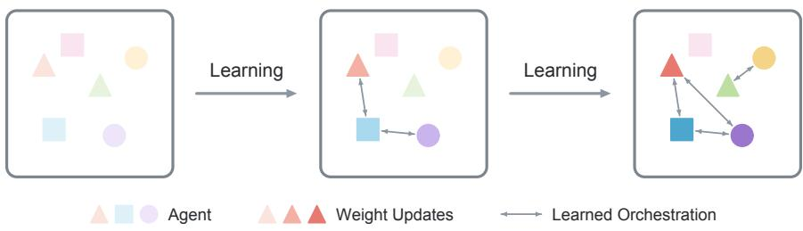  
Figure 1: Learning self-orchestration in decentralized agent swarms. The three panels illustrate successive stages of training within the same agent population. Each shape represents an agent, darker colors indicate progressive parameter updates, and bidirectional arrows depict coordination patterns. Through experience, agents jointly learn how to act and when to participate through bidding. As individual capabilities improve, patterns of participation adapt in turn.

## 1 INTRODUCTION

Building general intelligence has long been a central ambition of AI research. But where does intelligence reside? A prevailing view in modern AI is model-centric: intelligence is contained in the parameters of a model, and progress comes from increasing model size or improving those parameters through training. In this paper, we explore a different possibility. Intelligent behavior can also emerge from interactions among many simpler agents, giving rise to collective capabilities that no single agent possesses. This perspective echoes Minsky’s Society of Mind (Minsky, 1986), which explains intelligence through the organization and interaction of many individually limited components.

Large language model (LLM) agents now exhibit strong individual reasoning capabilities, yet agent swarms remain limited in their ability to organize their own participation and actions toward a shared objective. Existing multi-agent systems typically place models within predefined interaction structures: a manager delegates to workers, a verifier checks a generator, or agents communicate according to a prescribed workflow (Hong et al., 2024; Du et al., 2024; Li et al., 2023; Wu et al., 2024). Even when the participating agents are trainable, the orchestration policy that determines which agent acts next often remains fixed throughout training (Feng et al., 2026).

This separation overlooks the coupling between individual capabilities and swarm orchestration. Which agent acts in a particular state shapes not only the swarm’s trajectory, but also which agents receive experience and learning signals. As agents improve, effective patterns of participation can change in turn. An agent that should act early in training may become unnecessary later; an action that was previously unhelpful may become valuable after downstream agents improve. Training individual agents under fixed orchestration therefore optimizes only one side of this coupled process. We instead ask:

## Can decentralized agent swarms jointly learn to act and self-orchestratefrom experience?

Learning self-orchestration in decentralized agent swarms poses a joint orchestration and creditassignment problem. At each turn, agents must determine who should act. When task feedback becomes available, the swarm must also determine how to train the agents whose actions shaped the trajectory. These decisions are coupled: participation determines which agents acquire experience, while learning changes which and how agents should participate in the future.

We therefore introduce market-based post-training (MPT), a framework that enables decentralized agent swarms to learn both how to act and how to self-organize their participation. Following Qi et al. (2026), agents compete for opportunities to act through bids that reflect their willingness to participate in the current decision. An economic incentive structure connects these participation decisions with credit assignment, using collective outcomes to improve both action and bidding behavior. As agents become more capable, the swarm learns when to rely on each member, allowing individual capabilities and self-orchestration to evolve together without a central coordinating agent.

We evaluate MPT on embodied crafting, robot navigation, and deep research. Comparisons on these benchmarks show higher training rewards than monolithic post-training, while further analysis reveals that agent participation evolves during learning. To isolate the contribution of selforchestration, we compare coordination strategies using the same post-trained action policies. On Iron Pickaxe, MPT achieves a 63.4% relative improvement in mean episode reward over the strongest alternative, Graph-of-Agents. We further show that both bidding and action benefit from learning, with their joint use yielding the strongest performance. A credit-assignment ablation shows that learned bids also provide more effective action-training signals.

We also examine the reusability, scalability, and robustness of MPT. Trained swarms adapt more rapidly than the single-agent baseline to new crafting objectives. Increasing the inference-time population improves pass@3 across crafting milestones without additional training, supporting the scalability of learned self-orchestration. Larger populations also better tolerate occasional agent unavailability. These results suggest that learned self-orchestration supports both reuse across objectives and flexible deployment with varying agent populations.

## Our contributions are threefold:

(1) We introduce MPT, a framework for jointly learning action policies and self-orchestration in decentralized agent swarms, allowing patterns of participation to adapt as agents improve.

(2) We evaluate MPT on embodied crafting, robot navigation, and deep research, demonstrating gains over monolithic post-training. We further show the benefits of learned self-orchestration, learning both bidding and action, and using learned bids for credit assignment.

(3) We demonstrate the reusability, scalability, and robustness of trained agent swarms: they adapt faster to new tasks, while larger inference-time populations improve performance and robustness.

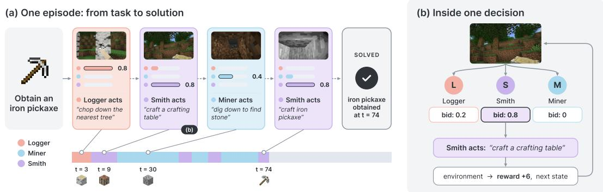  
Figure 2: Self-orchestration through bidding in embodied crafting. (a) Selected turns from an Iron Pickaxe episode show the Logger, Miner, and Smith participating as resource gathering and crafting requirements change. (b) At each decision, agents submit bids, and the highest bidder acts. Here, the Smith wins with a bid of 0.8 and crafts a crafting table; the environment then returns a reward and the next state.

## 2 METHOD

We aim to jointly learn specialized action policies and self-orchestration in decentralized agent swarms. Each agent uses its local context to decide how strongly to participate through bidding. Bids determine both which agent acts and how task rewards are allocated across participating agents for learning. We first describe this orchestration mechanism (§2.1), then explain how agents learn to act from the resulting credit (§2.2) and learn to bid through counterfactual comparisons (§2.3).

## 2.1 SELF-ORCHESTRATION THROUGH BIDDING

We consider episodic tasks with verified rewards. An episode presents a task x and unfolds over turns $t = 1 , \dots , T$ , with one agent acting at each turn and a verifier assigning a task reward R. The swarm consists of $N$ agents with separate model parameters. Each agent i uses a policy $\pi _ { i }$ to generate both action and bidding.

Following Qi et al. (2026), we adopt an auction mechanism for decentralized turn allocation. At each turn, agents independently submit bids $b _ { i }$ reflecting their willingness to participate in the current decision. The agent with the highest bid is selected to act, and its bid is denoted by $b _ { t } .$ This allows participation to depend on the agents’ local assessments without a central dispatcher. Tied bids are broken uniformly at random. If all agents bid zero, no agent acts and the turn is skipped.

Bids also connect participation with credit assignment. Specifically, the selected bid $b _ { t }$ determines the fraction of accumulated value at turn t that is passed backward to the preceding acting agent. Thus, a larger bid increases an agent’s opportunity to act while committing a larger share of the resulting value to earlier participation. Figure 2 illustrates how agents bid and act based on the current task state.

## 2.2 LEARNING TO ACT

At the end of each episode, we assign local training credit by propagating rewards backward through the sequence of acting agents. Let $\hat { r } _ { t }$ denote the environment reward obtained at turn $t ,$ with the terminal verified reward included in $\hat { r } _ { T }$ . We define the accumulated value $v _ { t }$ and the local training credit $\tilde { r } _ { t }$ as

$$
v _ { t } = \hat { r } _ { t } + b _ { t + 1 } v _ { t + 1 } , \qquad \tilde { r } _ { t } = ( 1 - b _ { t } ) v _ { t } , \qquad v _ { T + 1 } = 0 .\tag{1}
$$

The agent acting at turn t receives credit from both its immediate reward and the value passed backward from the next turn. It retains a fraction $1 - b _ { t }$ for its own action update and passes the remaining fraction backward. The share passed backward by the first acting agent is discarded. A reward obtained at turn $t + k$ contributes to $v _ { t }$ with weight $\textstyle \prod _ { j = t + 1 } ^ { t + k } b _ { j }$ . This allows downstream outcomes to provide learning signals for earlier actions, following the principle of a bucket brigade (Holland, 1995; Baum, 1999). Figure 3 illustrates this backward credit assignment.

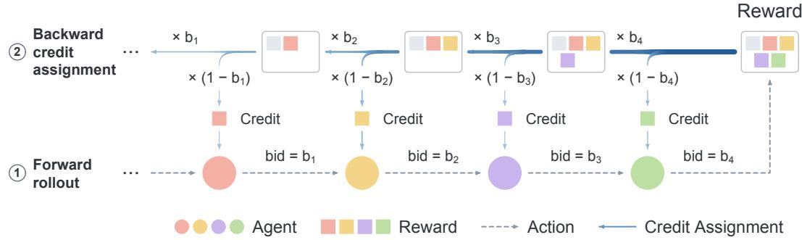  
Figure 3: Learning to act through bidding-based credit assignment. Agents act sequentially during the forward rollout ( 1 ). The resulting reward is then propagated backward ( 2 ): at turn t, the acting agent retains a fraction $1 - b _ { t }$ of the accumulated value as its credit and passes the remaining fraction $b _ { t }$ to the preceding participant. Colored blocks associate credit with its recipient.

Each agent updates its own parameters using only the action tokens from turns in which it acted. We use REINFORCE (Williams, 1992) with a per-agent mean baseline:

$$
\nabla _ { \theta _ { i } } J = \mathbb { E } _ { t \in \mathcal { W } _ { i } } \left[ ( \tilde { r } _ { t } - \bar { r } _ { i } ) \nabla _ { \theta _ { i } } \log \pi _ { i } ( a _ { t } \mid h _ { i , t } ) \right] ,\tag{2}
$$

where $\mathcal { W } _ { i }$ contains the turns assigned to agent $i ,$ and $\bar { r } _ { i }$ is its mean training credit over those turns in the batch.

## 2.3 LEARNING TO SELF-ORCHESTRATE

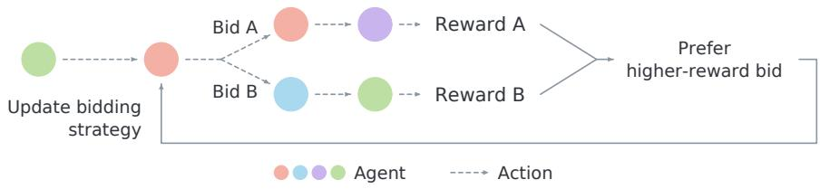  
Figure 4: Learning to self-orchestrate through counterfactual comparisons. Starting from the same state, two alternative bids from the same agent induce different turn allocations. The alternative branch is continued from the restored state, and both branches are evaluated, producing returns that determine which bid is preferred. Preference learning then increases the relative likelihood of the bid associated with the better outcome, teaching the agent when to participate.

Learning to self-orchestrate requires feedback about participation: would the trajectory have improved if another agent had acted at the same turn? We obtain this feedback by comparing counterfactual rollouts from the same state, as illustrated in Figure 4.

We define a turn as contested if the runner-up submits a nonzero bid. The original branch is the collected trajectory, in which the selected agent acts at the contested turn. To construct the alternative branch, we restore the environment and agent states at the contested turn in a replica and resample the selected agent’s bid up to three times until it falls below the runner-up’s bid, so that the runnerup acts instead. If no such bid is obtained, the contested turn is discarded from bidding training. The alternative branch is then continued until the episode terminates. Each branch is scored by its sum of environment rewards from the contested turn onward. The bidding response associated with the higher-scoring branch becomes the preferred response $y _ { w } ,$ , and the other becomes the rejected response $y _ { l } .$ . Pairs with equal branch returns are discarded. We train the agent on these response pairs using a Bradley–Terry preference objective (Bradley & Terry, 1952):

$$
\mathcal { L } _ { \mathrm { b i d } } = - \log \sigma ( \log \pi _ { i } ( y _ { w } \mid h _ { i , t } ) - \log \pi _ { i } ( y _ { l } \mid h _ { i , t } ) ) ,\tag{3}
$$

where $\sigma$ is the logistic function. Minimizing this loss increases the relative likelihood of the bid associated with the better outcome. We alternate between action and bidding learning during training, using four action-training steps followed by one bidding-training step. Both updates optimize

the same model parameters within each agent. This allows action competence and participation to co-adapt as learning changes the capabilities of the swarm.

## 3 EXPERIMENTS

## 3.1 SETUP

We evaluate MPT on decision-making and reasoning tasks spanning embodied crafting, robot navigation, and deep research. Each setting uses three agents with complementary roles.

Benchmarks and Models. (1) Embodied crafting: three Qwen3-VL-4B-Instruct agents (Logger, Miner, and Smith) specialize in gathering wood, mining resources, and crafting. Starting from an empty inventory in Minecraft MineStudio (Cai et al., 2025), they must progress through the crafting chain to obtain an iron pickaxe. Agents receive RGB observations and textual state information, including inventory and recent interaction history. The selected agent issues a language instruction to a frozen STEVE-1 controller (Lifshitz et al., 2023), which executes it for 40 game frames.

(2) Robot navigation: three NaVILA-8B agents (Cheng et al., 2025) perform continuous vision-andlanguage navigation on VLN-CE R2R in Habitat (Krantz et al., 2020; Anderson et al., 2018; Savva et al., 2019). Given a route instruction and an eight-frame window of egocentric observations, the agents coordinate through partitioned action spaces: Turner controls rotations, Mover controls forward movement, and Stopper decides when to stop. Episodes contain at most 64 decisions.

(3) Deep research: three gemma-4-E2B-it agents (Team et al., 2026) answer questions by browsing a searchable document corpus. Searcher, Opener, and Finder specialize in browser.search, browser.open, and browser.find; all agents share the interaction history and may submit a final answer. We use OpenResearcher (Li et al., 2026) for training. Episodes contain at most 64 decisions and receive a binary terminal reward based on answer correctness, assessed against the reference answer by a qwen3.5-flash judge.

Training Setup. All agents have independent model parameters and undergo a supervised finetuning (SFT) cold start before post-training. Each agent in MPT is fine-tuned on demonstrations corresponding to its role. We compare MPT against a monolithic REINFORCE baseline with a discount factor of $\gamma = 0 . 9 5$ . During the SFT cold start, the baseline is trained on the combined demonstrations from all roles, with total SFT training compute matched between the two settings. Detailed task settings and hyperparameters are provided in Appendix B.

## 3.2 MAIN RESULTS

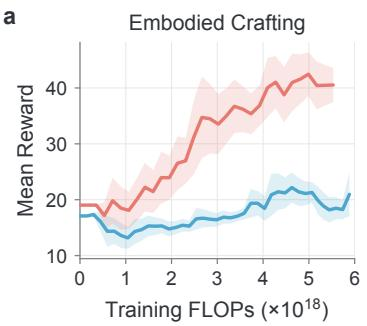

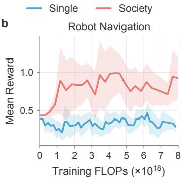

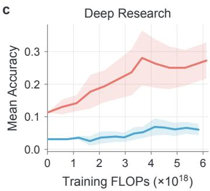  
Figure 5: MPT improves performance at matched training compute. Training performance versus training FLOPs for monolithic RL (Single) and MPT (Society). The panels report mean episode reward for embodied crafting and robot navigation, and mean accuracy for deep research. Training FLOPs include all compute used for learning.

Figure 5 compares MPT with monolithic RL under matched training FLOP budgets across three tasks. All methods are compared under matched training FLOPs, which count all LLM computation during training, including bid generation by all N agents, action generation, counterfactual rollouts, and parameter updates. In embodied crafting, MPT achieves a final mean episode reward of approximately 41, compared with 20 for the monolithic baseline. In robot navigation, MPT maintains substantially higher rewards after the initial training phase, ending at approximately 0.9 versus 0.3 for the baseline. In deep research, MPT improves mean accuracy to approximately 27%, whereas the monolithic baseline reaches about 6%. Qualitative case studies are provided in Appendix C.

Table 1 reports results on held-out sets disjoint from training: 32 unseen world seeds for embodied crafting, 88 R2R-CE val-unseen episodes for robot navigation, and 50 held-out OpenResearcher questions for deep research. Each instance is evaluated three times with the training settings. MPT outperforms monolithic RL on all three tasks.

Table 1: Held-out evaluation. Mean $\pm \ : \mathrm { S E }$ over instances, each averaged over three runs.
<table><tr><td>Method</td><td>Embodied Crafting</td><td>Robot Navigation</td><td>Deep Research</td></tr><tr><td>RL</td><td> $2 0 . 3 \pm 4 . 1$ </td><td> $0 . 5 2 \pm 0 . 1 4$ </td><td> $9 . 0 \pm 2 . 1 \%$ </td></tr><tr><td>MPT</td><td> ${ \bf 4 1 . 5 \pm 5 . 9 }$ </td><td> ${ \bf 1 . 2 3 \pm 0 . 1 8 }$ </td><td> ${ \bf 2 1 . 0 \pm 4 . 1 \% }$ </td></tr></table>

## 3.3 ANALYSIS

## 3.3.1 SELF-ORCHESTRATION EVOLVES DURING TRAINING

To examine how self-orchestration develops through learning, we track agent participation on the Iron Pickaxe task across four checkpoints: after SFT but before RL, at two intermediate stages of RL, and after RL. Figure 6 plots the participation proportions of the Logger, Miner, and Smith against decision step.

Before RL, the Logger dominates throughout the episode, while the Miner and Smith participate infrequently. As training progresses, this pattern changes: the Logger remains predominant at early steps, but its share decreases later as the Miner and Smith become more involved. This shift becomes more pronounced after RL, with the Miner approaching the Logger’s participation level toward the end of the episode. At decision step 120, the Logger’s participation share decreases from approximately 80% before RL to 45% after RL, while the Miner’s share increases from approximately 10% to 40%. The Smith’s share also increases from approximately 10% to 15%. These observations provide behavioral evidence that the swarm adapts its allocation of acting turns during training.

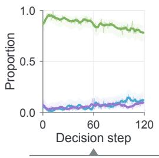

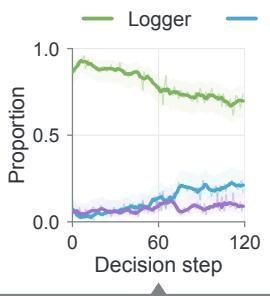

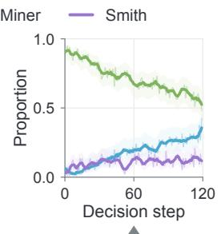  
Learning

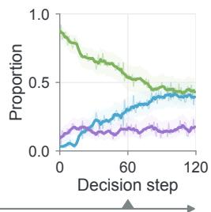  
Figure 6: Self-orchestration evolves during training. Participation proportions of the Logger, Miner, and Smith on Iron Pickaxe. From left to right: after SFT and before RL, two intermediate RL checkpoints, and after RL. As training progresses, participation increasingly shifts toward the Miner and Smith at later decision steps.

## 3.3.2 COMPARISON BETWEEN SELF-ORCHESTRATION AND OTHER COORDINATION STRATEGIES

We evaluate whether learned self-orchestration coordinates agents more effectively than alternative inference-time strategies. We keep the post-trained action policies fixed and compare our bidding mechanism with Round-Robin (Wu et al., 2024), AgentNet (Yang et al., 2025), and Graph-of-Agents (GoA) (Yun et al., 2026). All configurations are evaluated on the Iron Pickaxe crafting task over the same 32 seeds.

As shown in Table 2 (left), MPT substantially outperforms all three baselines. Specifically, MPT achieves a mean episode reward of 41.5, compared with 25.4 for GoA, the strongest alternative coordination strategy, which corresponds to a 63.4% relative improvement. These gains demonstrate that learned self-orchestration coordinates agents more effectively.

## 3.3.3 BOTH BIDDING AND ACTION BENEFIT FROM LEARNING

In this section, we show that training effectively improves both the action policy and selforchestration. To verify this, we examine their contributions through four inference-time configurations, independently using either the initial or post-trained checkpoints for each component. We evaluate each configuration over the same 32 seeds and report mean episode reward in Table 2.

As shown in the table, using post-trained checkpoints for both components substantially outperforms all other configurations, whereas using a post-trained checkpoint for only bidding or only action yields smaller improvements over the initial baseline. Using post-trained checkpoints for both components yields a mean reward of 41.5, compared with 21.5 for trained bidding with initial actions and 27.2 for initial bidding with trained actions. The fully post-trained configuration achieves 2.69 times the reward of the initial configuration, which obtains 15.4. These results indicate that strong action and bidding policies are both essential for effective self-orchestration.

Table 2: Learned self-orchestration improves coordination. Episode reward (mean ± SE) on Iron Pickaxe over 32 seeds. Left: comparison with alternative coordination strategies using the same policies. Right: contributions of learning bidding and action.
<table><tr><td>Strategy</td><td>Mean Reward</td><td>Bidding</td><td>Action</td><td>Mean Reward</td></tr><tr><td>Round-robin (Wu et al., 2024)</td><td> $2 3 . 8 \pm 4 . 2$ </td><td>Initial</td><td>Initial</td><td> $1 5 . 4 \pm 4 . 1$ </td></tr><tr><td>AgentNet (Yang et al., 2025)</td><td> $2 0 . 9 \pm 4 . 2$ </td><td>Trained</td><td>Initial</td><td> $2 1 . 5 \pm 4 . 7$ </td></tr><tr><td>GoA (Yun et al., 2026)</td><td> $2 5 . 4 \pm 4 . 6$ </td><td>Initial</td><td>Trained</td><td> $2 7 . 2 \pm 4 . 8$ </td></tr><tr><td>MPT</td><td> ${ \bf 4 1 . 5 \pm 5 . 9 }$ </td><td>Trained</td><td>Trained</td><td> ${ \bf 4 1 . 5 \pm 5 . 9 }$ </td></tr></table>

## 3.3.4 ISOLATING THE CONTRIBUTIONS OF LEARNED SELF-ORCHESTRATION

MPT differs from monolithic RL in several respects. To isolate the contribution of learned self-orchestration, we conduct two ablations on the Iron Pickaxe task. Both ablations share the same agent roles, SFT initialization, and action-training procedure as MPT, and each modifies a single component.

Round-robin. Turns are allocated cyclically among the three agents, and policies are trained on the reward with a discount factor of $\gamma = 0 . 9 5$ . This ablation removes bidding entirely.

Random credit. We replace the bids used for credit assignment with random values sampled from U(0, 1), while turn allocation and bidding optimization remain unchanged. This ablation tests whether learned bids provide useful credit-assignment signals. As shown in Figure 7, at approximately $5 \times 1 0 ^ { 1 8 }$ training FLOPs, MPT reaches a mean episode reward of about 42, compared with 15 for Round-robin, and 31 for random credit. Round-robin improves little over training. The gap to random credit shows that learned bids also provide more effective credit assignment.

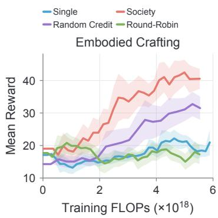  
Figure 7: Ablation studies on Iron Pickaxe. Curves are plotted against training FLOPs.

## 3.4 REUSABILITY, SCALABILITY, AND ROBUSTNESS

Reusing learned self-orchestration. To support a growing range of tasks, agent swarms need to build on previously learned skills and coordination. We investigate whether learned selforchestration can be reused to accelerate adaptation to new objectives. We evaluate this through continual learning: starting from their Iron Pickaxe checkpoints, we continue training MPT and monolithic RL separately on two additional crafting tasks, Torch and Stone Bricks. Figure 8 reports mean episode reward against the training FLOPs.

The society adapts more rapidly and achieves higher rewards at comparable training FLOP budgets on both tasks. At approximately $1 0 ^ { 1 8 }$ adaptation FLOPs, the society achieves mean episode rewards

a

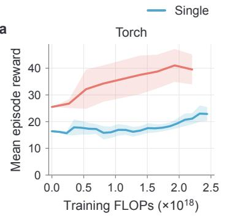

b  
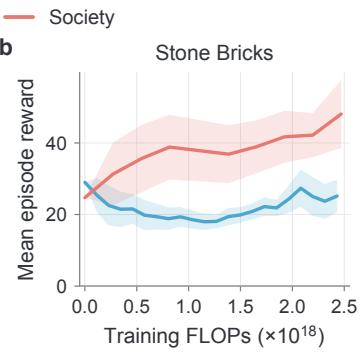  
Figure 8: Trained swarms adapt faster to new objectives. Adaptation to (a) Torch and (b) Stone Bricks. Monolithic RL (Single) and MPT (Society) start from their respective Iron Pickaxe checkpoints and continue training separately. Curves show mean episode reward against training FLOPs.

of about 35 on Torch and 38 on Stone Bricks, compared with 17 and 19 for the monolithic baseline.   
These results support reusing the trained agent population for efficient adaptation to new objectives.

Inference-time scaling and robustness. Decentralized agent swarms should scale at inference time. We investigate whether learned self-orchestration enables such scaling through larger agent populations. We vary the population size across 3, 6, 9, and 12 agents by using one to four copies of each trained agent. We conduct experiments on the Iron Pickaxe crafting task over 32 seeds, with three runs per seed, and evaluate pass@3 on five subtasks: Wooden Pickaxe, Stone Pickaxe, Furnace, Iron Ingot, and Iron Pickaxe. Figure 9 shows that larger populations improve performance on all subtasks. Increasing the population from 3 to 12 agents raises pass@3 from approximately 78% to 97% on Wooden Pickaxe, from 69% to 94% on Stone Pickaxe, and from 66% to 91% on Furnace. These results indicate that self-orchestration can effectively utilize additional agents to support inference-time scaling.

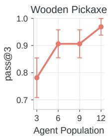

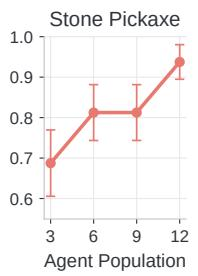

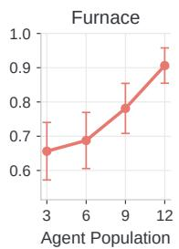

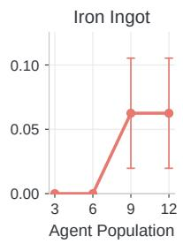

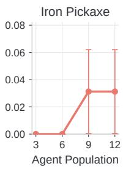  
Figure 9: Larger swarms improve inference-time performance. Pass@3 across five crafting milestones as the agent population increases from 3 to 12.

Another advantage of decentralized agent swarms is that they do not rely on a central agent. This can limit the impact of occasional agent unavailability, which becomes increasingly likely as the population grows. To evaluate this, we introduce agent dropout at inference time and measure the reward under dropout. We conduct experiments on the Iron Pickaxe task over 32 seeds, averaging three runs per seed. Figure 10 shows that larger populations can preserve more capability even under severe dropout. At a dropout probability of $p = 0 . 9$ , the 12-agent population maintains a mean episode reward of approximately 33, compared with 19 for the 3-agent population. These results suggest that additional agents provide redundancy that helps the swarm maintain its capabilities when members become unavailable.

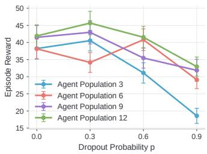  
Figure 10: Larger swarms better tolerate agent dropout. Mean episode reward on Iron Pickaxe across dropout rates.

## 4 RELATED WORK

LLM-based multi-agent systems. LLM-based multi-agent systems combine role specialization, communication, and memory to support collective behavior. Generative Agents studies emergent social interactions among agents with memory and reflection (Park et al., 2023), while CAMEL explores cooperation through role-playing (Li et al., 2023). MetaGPT and ChatDev organize software development through structured workflows and specialized roles (Hong et al., 2024; Qian et al., 2024); AutoGen and AgentVerse provide frameworks for programmable conversations and collaborative agent teams (Wu et al., 2024; Chen et al., 2024). Multiagent debate improves reasoning through iterative exchange and revision of proposed answers (Du et al., 2024). Beyond manually specified workflows, GPTSwarm optimizes graph connectivity (Zhuge et al., 2024), AgentNet adapts decentralized routing through experience and evolving connections (Yang et al., 2025), and Graph-of-Agents selects agents and refines responses through graph-based collaboration (Yun et al., 2026). However, these systems generally adapt interactions at inference time. MPT learns policies through weight updates, allowing agent capabilities and self-orchestration to improve together.

Multi-agent reinforcement learning. Learning decentralized policies from collective feedback is a central problem in multi-agent reinforcement learning. MADDPG and MAPPO use centralized training with decentralized execution (Lowe et al., 2017; Yu et al., 2022), while VDN and QMIX factorize team value functions into agent-level utilities (Sunehag et al., 2018; Rashid et al., 2020). COMA addresses credit assignment through a counterfactual baseline that marginalizes one agent’s action while holding the others fixed (Foerster et al., 2018). Coordination is also learned explicitly: RIAL and DIAL learn communication protocols (Foerster et al., 2016), CommNet jointly learns continuous communication and control (Sukhbaatar et al., 2016), and IC3Net learns when agents should communicate (Singh et al., 2019). Recent work extends multi-agent training to LLMs: Multiagent Finetuning updates specialized models using their own interaction data (Subramaniam et al., 2025); Dr. MAS stabilizes reinforcement learning through agent-wise advantage normalization (Feng et al., 2026); and CoLLM studies centralized and decentralized critics for training decentralized LLM col laborators (Liu et al., 2026). However, these methods do not connect the choice of the next agent with how downstream reward is distributed across agents. MPT couples turn allocation and credit assignment through learned bids, using task feedback to jointly improve participation and policies.

Economics in agents. Economic coordination offers a longstanding perspective on distributed intelligence. Hayek emphasizes how prices communicate dispersed knowledge (Hayek, 1945), while Minsky describes intelligence as arising from interactions among individually limited components (Minsky, 1986). The Contract Net Protocol allocates tasks through negotiation (Smith, 1988), and market-oriented programming uses markets for decentralized resource allocation (Wellman, 1993). Economic mechanisms also connect participation to learning: Holland’s bucket brigade transfers credit along chains of active rules (Holland, 1995), and Baum’s Hayek Machine develops economic credit assignment (Baum, 1996; 1999). More recently, Economy of Minds uses auctions to coordinate LLM agents and guide the evolution of prompts and population with frozen model weights (Qi et al., 2026). SALE selects among agents’ proposed strategies using cost–value scoring and shared auction memory (Alazraki et al., 2026). However, recent LLM-based economic systems primarily use feedback to evolve prompts while keeping weights frozen. MPT uses feedback to train action and bidding policies, enabling agents to learn how to act and when to participate.

## 5 CONCLUSION

We introduced MPT, a framework for jointly learning individual action policies and selforchestration in decentralized agent swarms. Learned bids connect participation decisions with local credit assignment, allowing agents to improve both how they act and when they participate without a central coordinating agent. Our experiments show benefits over monolithic post-training and other coordination strategies, while ablations demonstrate the value of learning both bidding and action policies and using learned bids for credit assignment. Trained swarms also adapt faster to related objectives, benefit from larger populations at inference time, and better tolerate agent unavailability as the population grows. These findings support treating self-orchestration as a learnable and reusable component of collective intelligence, opening a path toward decentralized agent swarms whose capabilities and organization improve together through experience.

## REFERENCES

Lisa Alazraki, William F. Shen, Yoram Bachrach, and Akhil Mathur. Scaling small agents through strategy auctions. In Forty-third International Conference on Machine Learning, 2026. URL https://openreview.net/forum?id=elXuA5wTWV. 9

Peter Anderson, Qi Wu, Damien Teney, Jake Bruce, Mark Johnson, Niko Sunderhauf, Ian Reid,¨ Stephen Gould, and Anton van den Hengel. Vision-and-language navigation: Interpreting visually-grounded navigation instructions in real environments. In Proceedings ofthe IEEE Conference on Computer Vision and Pattern Recognition (CVPR), June 2018. 5, 23

Shuai Bai, Yuxuan Cai, Ruizhe Chen, Keqin Chen, Xionghui Chen, Zesen Cheng, Lianghao Deng, Wei Ding, Chang Gao, Chunjiang Ge, Wenbin Ge, Zhifang Guo, Qidong Huang, Jie Huang, Fei Huang, Binyuan Hui, Shutong Jiang, Zhaohai Li, Mingsheng Li, Mei Li, Kaixin Li, Zicheng Lin, Junyang Lin, Xuejing Liu, Jiawei Liu, Chenglong Liu, Yang Liu, Dayiheng Liu, Shixuan Liu, Dunjie Lu, Ruilin Luo, Chenxu Lv, Rui Men, Lingchen Meng, Xuancheng Ren, Xingzhang Ren, Sibo Song, Yuchong Sun, Jun Tang, Jianhong Tu, Jianqiang Wan, Peng Wang, Pengfei Wang, Qiuyue Wang, Yuxuan Wang, Tianbao Xie, Yiheng Xu, Haiyang Xu, Jin Xu, Zhibo Yang, Mingkun Yang, Jianxin Yang, An Yang, Bowen Yu, Fei Zhang, Hang Zhang, Xi Zhang, Bo Zheng, Humen Zhong, Jingren Zhou, Fan Zhou, Jing Zhou, Yuanzhi Zhu, and Ke Zhu. Qwen3-vl technical report, 2025. URL https://arxiv.org/abs/2511.21631. 17

Eric B. Baum. Toward a model of mind as a laissez-faire economy of idiots. In Proceedings of the Thirteenth International Conference on International Conference on Machine Learning, ICML’96, pp. 28–36, San Francisco, CA, USA, 1996. Morgan Kaufmann Publishers Inc. ISBN 1558604197. 9

Eric B. Baum. Toward a model of intelligence as an economy of agents. Machine Learning, 35 (2):155–185, May 1999. ISSN 1573-0565. doi: 10.1023/A:1007593124513. URL https: //doi.org/10.1023/A:1007593124513. 3, 9

Ralph Allan Bradley and Milton E. Terry. Rank analysis of incomplete block designs: I. the method of paired comparisons. Biometrika, 39:324, 1952. URL https://api. semanticscholar.org/CorpusID:125209808. 4

Shaofei Cai, Zhancun Mu, Kaichen He, Bowei Zhang, Xinyue Zheng, Anji Liu, and Yitao Liang. Minestudio: A streamlined package for minecraft ai agent development, 2025. URL https: //arxiv.org/abs/2412.18293. 5, 17

Angel Chang, Angela Dai, Thomas Funkhouser, Maciej Halber, Matthias Niebner, Manolis Savva, Shuran Song, Andy Zeng, and Yinda Zhang. Matterport3d: Learning from rgb-d data in indoor environments. In 2017 International Conference on 3D Vision (3DV), pp. 667–676, 2017. doi: 10.1109/3DV.2017.00081. 23

Weize Chen, Yusheng Su, Jingwei Zuo, Cheng Yang, Chenfei Yuan, Chi-Min Chan, Heyang Yu, Yaxi Lu, Yi-Hsin Hung, Chen Qian, Yujia Qin, Xin Cong, Ruobing Xie, Zhiyuan Liu, Maosong Sun, and Jie Zhou. Agentverse: Facilitating multi-agent collaboration and exploring emergent behaviors. In The Twelfth International Conference on Learning Representations, 2024. URL https://openreview.net/forum?id=EHg5GDnyq1. 9

An-Chieh Cheng, Yandong Ji, Zhaojing Yang, Xueyan Zou, Jan Kautz, Erdem Biyik, Hongxu Yin, Sifei Liu, and Xiaolong Wang. Navila: Legged robot vision-language-action model for navigation. In RSS, 2025. 5, 23, 24

Yilun Du, Shuang Li, Antonio Torralba, Joshua B. Tenenbaum, and Igor Mordatch. Improving factuality and reasoning in language models through multiagent debate. In Forty-first International Conference on Machine Learning, 2024. URL https://openreview.net/forum?id= zj7YuTE4t8. 2, 9

Lang Feng, Longtao Zheng, Shuo He, Fuxiang Zhang, and Bo An. Dr. MAS: Stable reinforcement learning for multi-agent LLM systems. In Workshop on Multi-Agent Learning and Its Opportunities in the Era of Generative AI, 2026. URL https://openreview.net/forum?id= GOX1vk1IL1. 2, 9

Jakob N. Foerster, Yannis M. Assael, Nando de Freitas, and Shimon Whiteson. Learning to communicate with deep multi-agent reinforcement learning. In Proceedings ofthe 30th International Conference on Neural Information Processing Systems, NIPS’16, pp. 2145–2153, Red Hook, NY, USA, 2016. Curran Associates Inc. ISBN 9781510838819. 9

Jakob N. Foerster, Gregory Farquhar, Triantafyllos Afouras, Nantas Nardelli, and Shimon Whiteson. Counterfactual multi-agent policy gradients. In Proceedings of the Thirty-Second AAAI Conference on Artificial Intelligence and Thirtieth Innovative Applications of Artificial Intelligence Conference and Eighth AAAI Symposium on Educational Advances in Artificial Intelligence, AAAI’18/IAAI’18/EAAI’18. AAAI Press, 2018. ISBN 978-1-57735-800-8. 9

Friedrich A. Hayek. The use of knowledge in society. The American Economic Review, 35(4): 519–530, 1945. 9

John H. Holland. Escaping brittleness: the possibilities of general-purpose learning algorithms applied to parallel rule-based systems, pp. 275–304. American Association for Artificial Intelligence, USA, 1995. ISBN 0262621010. 3, 9

Sirui Hong, Mingchen Zhuge, Jonathan Chen, Xiawu Zheng, Yuheng Cheng, Jinlin Wang, Ceyao Zhang, Zili Wang, Steven Ka Shing Yau, Zijuan Lin, Liyang Zhou, Chenyu Ran, Lingfeng Xiao, Chenglin Wu, and Jurgen Schmidhuber. MetaGPT: Meta programming for a multi-agent collab-¨ orative framework. In The Twelfth International Conference on Learning Representations, 2024. URL https://openreview.net/forum?id=VtmBAGCN7o. 2, 9

Jacob Krantz, Erik Wijmans, Arjun Majumdar, Dhruv Batra, and Stefan Lee. Beyond the nav-graph: Vision-and-language navigation in continuous environments. In Computer Vision – ECCV 2020: 16th European Conference, Glasgow, UK, August 23–28, 2020, Proceedings, Part XXVIII, pp. 104–120, Berlin, Heidelberg, 2020. Springer-Verlag. ISBN 978-3-030-58603-4. doi: 10.1007/ 978-3-030-58604-1 7. URL https://doi.org/10.1007/978-3-030-58604-1\_7. 5, 23

Guohao Li, Hasan Abed Al Kader Hammoud, Hani Itani, Dmitrii Khizbullin, and Bernard Ghanem. CAMEL: Communicative agents for ”mind” exploration of large language model society. In Thirty-seventh Conference on Neural Information Processing Systems, 2023. URL https:// openreview.net/forum?id=3IyL2XWDkG. 2, 9

Zhuofeng Li, Dongfu Jiang, Xueguang Ma, Haoxiang Zhang, Ping Nie, Yuyu Zhang, Kai Zou, Jianwen Xie, Yu Zhang, and Wenhu Chen. Openresearcher: A fully open pipeline for longhorizon deep research trajectory synthesis, 2026. URL https://arxiv.org/abs/2603. 20278. 5, 26

Shalev Lifshitz, Keiran Paster, Harris Chan, Jimmy Ba, and Sheila A. McIlraith. STEVE-1: A generative model for text-to-behavior in minecraft. In Thirty-seventh Conference on Neural Information Processing Systems, 2023. URL https://openreview.net/forum?id=YkBDJWerKg. 5, 17

Shuo Liu, Tianle Chen, Ryan Amiri, and Christopher Amato. Learning decentralized LLM collaboration with multi-agent actor critic. In Forty-third International Conference on Machine Learning, 2026. URL https://openreview.net/forum?id=k9OuSat5IR. 9

Ryan Lowe, YI WU, Aviv Tamar, Jean Harb, OpenAI Pieter Abbeel, and Igor Mordatch. Multiagent actor-critic for mixed cooperative-competitive environments. In I. Guyon, U. Von Luxburg, S. Bengio, H. Wallach, R. Fergus, S. Vishwanathan, and R. Garnett (eds.), Advances in Neural Information Processing Systems, volume 30. Curran Associates, Inc., 2017. URL https://proceedings.neurips.cc/paper\_files/paper/2017/ file/68a9750337a418a86fe06c1991a1d64c-Paper.pdf. 9

Marvin Minsky. The Society of Mind. Simon & Schuster, 1986. 2, 9

Joon Sung Park, Joseph O’Brien, Carrie Jun Cai, Meredith Ringel Morris, Percy Liang, and Michael S. Bernstein. Generative agents: Interactive simulacra of human behavior. In Proceedings of the 36th Annual ACM Symposium on User Interface Software and Technology, UIST ’23, New York, NY, USA, 2023. Association for Computing Machinery. ISBN 9798400701320. doi: 10.1145/3586183.3606763. URL https://doi.org/10.1145/3586183.3606763. 9

Zhenting Qi, Huangyuan Su, Ao Qu, Chenyu Wang, Yu Yao, Han Zheng, Kushal Chattopadhyay, Guowei Xu, Zihan Wang, Weirui Ye, Vijay Janapa Reddi, Ju Li, Paul Pu Liang, Himabindu Lakkaraju, Sham M. Kakade, and Yilun Du. Economy of minds: Emerging multi-agent intelligence with economic interactions. In Workshop on Scientific Understanding ofFoundation Mod els, 2026. URL https://openreview.net/forum?id=Oznkw4Uncb. 2, 3, 9

Chen Qian, Wei Liu, Hongzhang Liu, Nuo Chen, Yufan Dang, Jiahao Li, Cheng Yang, Weize Chen, Yusheng Su, Xin Cong, Juyuan Xu, Dahai Li, Zhiyuan Liu, and Maosong Sun. Chat-Dev: Communicative agents for software development. In Lun-Wei Ku, Andre Martins, and Vivek Srikumar (eds.), Proceedings of the 62nd Annual Meeting of the Association for Computational Linguistics (Volume 1: Long Papers), pp. 15174–15186, Bangkok, Thailand, August 2024. Association for Computational Linguistics. doi: 10.18653/v1/2024.acl-long.810. URL https://aclanthology.org/2024.acl-long.810/. 9

Tabish Rashid, Mikayel Samvelyan, Christian Schroeder De Witt, Gregory Farquhar, Jakob Foerster, and Shimon Whiteson. Monotonic value function factorisation for deep multi-agent reinforcement learning. J. Mach. Learn. Res., 21(1), January 2020. ISSN 1532-4435. 9

Manolis Savva, Abhishek Kadian, Oleksandr Maksymets, Yili Zhao, Erik Wijmans, Bhavana Jain, Julian Straub, Jia Liu, Vladlen Koltun, Jitendra Malik, Devi Parikh, and Dhruv Batra. Habitat: A platform for embodied ai research. In Proceedings of the IEEE/CVF International Conference on Computer Vision (ICCV), October 2019. 5, 23

Amanpreet Singh, Tushar Jain, and Sainbayar Sukhbaatar. Individualized controlled continuous communication model for multiagent cooperative and competitive tasks. In International Conference on Learning Representations, 2019. URL https://openreview.net/forum?id= rye7knCqK7. 9

R. G. Smith. The contract net protocol: high-level communication and control in a distributed problem solver, pp. 357–366. Morgan Kaufmann Publishers Inc., San Francisco, CA, USA, 1988. ISBN 093461363X. 9

Vighnesh Subramaniam, Yilun Du, Joshua B. Tenenbaum, Antonio Torralba, Shuang Li, and Igor Mordatch. Multiagent finetuning: Self improvement with diverse reasoning chains. In The Thirteenth International Conference on Learning Representations, 2025. URL https: //openreview.net/forum?id=JtGPIZpOrz. 9

Sainbayar Sukhbaatar, Arthur Szlam, and Rob Fergus. Learning multiagent communication with backpropagation. In Proceedings of the 30th International Conference on Neural Information Processing Systems, NIPS’16, pp. 2252–2260, Red Hook, NY, USA, 2016. Curran Associates Inc. ISBN 9781510838819. 9

Peter Sunehag, Guy Lever, Audrunas Gruslys, Wojciech Marian Czarnecki, Vinicius Zambaldi, Max Jaderberg, Marc Lanctot, Nicolas Sonnerat, Joel Z. Leibo, Karl Tuyls, and Thore Graepel. Valuedecomposition networks for cooperative multi-agent learning based on team reward. In Proceedings of the 17th International Conference on Autonomous Agents and MultiAgent Systems, AA-MAS ’18, pp. 2085–2087, Richland, SC, 2018. International Foundation for Autonomous Agents and Multiagent Systems. 9

Gemma Team, Sherif El Abd, Vaibhav Aggarwal, Robin Algayres, Alek Andreev, Olivier Bachem, Ian Ballantyne, Cormac Brick, Victor Carbune, Michelle Casbon, Mayank Chaturvedi, Aditya˘ Chawla, Victor Cotruta, Alice Coucke, Phil Culliton, Robert Dadashi, Lucas Dixon, Mohamed Elhawaty, Utku Evci, Clement Farabet, Johan Ferret, Filippo Galgani, Sertan Girgin, Jean-Bastien´ Grill, Maarten Grootendorst, Jiaxian Guo, Cassidy Hardin, Yanzhang He, Steven M. Hernandez, Omri Homburger, Leonard Hussenot, Juyeong Ji, Armand Joulin, Aishwarya Kamath, Parnian´ Kassraie, Olivier Lacombe, Preethi Lahoti, Gael Liu, Gus Martins, Luciano Martins, Tatiana¨ Matejovicova, Ramona Merhej, Nikola Momchev, Sneha Mondal, Ryan Mullins, Sindhu Raghuram Panyam, Shreya Pathak, Sarah Perrin, Andre Susano Pinto, Etienne Pot, Ang´ eline Pouget,´ Alexandre Rame, Sabela Ramos, Douglas Reid, David Rim, Morgane Rivi´ ere, Karsten Roth,\` Louis Rouillard, Omar Sanseviero, Pier Giuseppe Sessa, Shane Settle, Danila Sinopalnikov, Sara Smoot, Piotr Stanczyk, Andreas Steiner, Lawrence Stewart, Ilya Tolstikhin, Michael Tschannen, Anton Tsitsulin, Nino Vieillard, Renjie Wu, Pingmei Xu, Haichuan Yang, Edouard Yvinec, Biao

Zhang, Li Zhang, Joe Zou, Nicolas Aagnes, Abdelrahman Abdelhamed, Jakub Adamek, Shivani Agrawal, Shubham Agrawal, Ibrahim Alabdulmohsin, Jean Baptiste Alayrac, Uri Alon, Chandramouli Amarnath, Ankesh Anand, Chrysovalantis Anastasiou, Setareh Ariafar, Franc¸ois-Xavier Aubet, Kyriakos Axiotis, Federico Barbero, Joelle Barral, Alexei Bendebury, Urs Bergmann, Stanley Bileschi, Kat Black, Mathieu Blondel, Sebastian Borgeaud, Arthur Brazinskas, Ryan Bur-ˇ nell, Robert Busa-Fekete, Mu Cai, Daniele Calandriello, Glenn Cameron, Charlotte Caucheteux, Rahma Chaabouni, Garima Chadha, Jetha Chan, Blake Jianhang Chen, Jesse Chen, Lin Chen, Xu Chen, Derek Cheng, Tzu hsiang Chien, Nikolai Chinaev, Yi Chou, Zhaohui Chu, Benjamin Coleman, Pooja Consul, Sam Conway-Rahman, Scott Crowell, Dylan Cutler, Vivek Dani, Samira Daruki, Anil Das, Daniel Deutsch, Nishanth Dikkala, Li Ding, Qiuhan Ding, Shenil Dodhia, Konstantin Donhauser, Tulsee Doshi, Anca Dragan, Alex Druinsky, Sahil Dua, Zoltan Egyed, Danielle Eisenbud, Daniel Eppens, Cindy Fan, Bahare Fatemi, Yassir Fathullah, Vlad Feinberg, Milen Ferev, Sebastian Flennerhag, Takumi Fujimoto, Joao Gabriel Oliveira, Isaac Galatzer-˜ Levy, Joao Gante, Simon Geisler, Soham Ghosal, Antonious M. Girgis, Tamara von Glehn,˜ Alec Go, Alhaad Gokhale, Alex Grills, Yiming Gu, Mayank Gupta, Pramod Gupta, Guru Guruganesh, Raia Hadsell, Hamza Harkous, Jitendra Harlalka, Demis Hassabis, Anja Hauth, Joe Heyward, Arian Hosseini, Chih-Yang Hsia, I-Hung Hsu, Xiaopeng Huang, Yangsibo Huang, Kevin Hui, Adrian Hutter, Te I, Fotis Iliopoulos, Advait Jain, Ganesh Jawahar, Ziwei Ji, Qilin Jin, Melvin Johnson, Kandarp Joshi, Arun Kandoor, Wang-Cheng Kang, Koray Kavukcuoglu, Mehran Kazemi, Kathleen Kenealy, Amr Khalifa, Phoebe Kirk, Ivan Korotkov, Suraj Kothawade, Vitaly Kovalev, Neel Kovelamudi, Adam Kraft, Ravin Kumar, Vivek Kumar, Harish Kuppam, Justin Lannin, Chen-Yu Lee, Seungji Lee, Dmitry Lepikhin, Alon Levkovitch, Dongdong Li, Qiujia Li, Valentin Lievin, Ethan Lin, Ziqian Lin, Casper Liu, Tianlin Liu, Tianqi Liu, Xin Liu,´ Ivan Lobov, Mayank Lunayach, Min Ma, Gagan Madan, Andrii Maksai, Eric Malmi, Michal Matuszak, Daniel McDuff, Gaurav Menghani, Maciej Mikuła, Daniil Mirylenka, Karolis Misiunas, Vedant Misra, Andreea Mitran, Kareem Mohamed, Maksim Mukha, Eric Noland, Jame O’Donnell, Brendan O’Donoghue, Kate Olszewska, Bernett Orlando, Wanqiong Pan, Rina Panigrahy, Unnati Parekh, Nicolas Perez-Nieves, Chunjong Park, Eric Paskie, Liqian Peng, Bryce Petrini, Slav Petrov, Jonas Pfeiffer, Bilal Piot, Martyna Plomecka, Siim Poder, Octavio Ponce, Arijit Pramanik, David Racz, Anish Rajan, Michelle Ramanovich, Anand Rao, Marvin Ritter, Vitor Rodrigues, Evan Rosen, Mikołaj Rybinski, Noveen Sachdeva, Micha´ el E. Sander, Rohit¨ Sathyanarayana, Sagar Savla, Samuel Schmidgall, Tal Schuster, George Scrivener, Benoit Seguin, Andrew Sellergren, Aliaksei Severyn, Izhak Shafran, Dhruv Shah, Bobak Shahriari, Yuan Shangguan, Ashish Shenoy, Pradeep Shenoy, Rakesh Shivanna, Pauline Sho, Lucas Spangher, Wojciech Stokowiec, Tim Strother, Yao Su, Yinghao Sun, Mukund Sundararajan, Andrea Tacchetti, Mor Hazan Taege, Pouya Tafti, Jean Tarbouriech, Chetan Tekur, Shantanu Thakoor, Rahul Thapa, Madeleine Traverse, Lenart Treven, Tao Tu, Chien Te Tung, C¸ aglar˘ Unl<sup>¨</sup> u, Petar Veli¨ ckoviˇ c, Ma-´ lini Pooni Venkat, Sagar Gubbi Venkatesh, Vidya Venkiteswaran, Francesco Visin, Alex Vitvit skyi, Kiran Vodrahalli, Weiyi Wang, Xin Wang, Tris Warkentin, Jan Wassenberg, John Wieting, Cindy Wu, Lechao Xiao, Hao Xu, Yuhui Xu, Fuzhao Xue, Arun Yadav, Jun Yan, Antoine Yang, Lin Yang, Ming-Hsuan Yang, Ziyu Ying, Jae Hyeon Yoo, Morteza Zadimoghaddam, Sajjad Zafar, Fred Zhang, Jiageng Zhang, Jianyi Zhang, Xiaofan Zhang, Chao Zhao, David Zhou, and Chen Zou. Gemma 4 technical report, 2026. URL https://arxiv.org/abs/2607.02770. 5, 27

Michael P. Wellman. A market-oriented programming environment and its application to distributed multicommodity flow problems. J. Artif. Int. Res., 1(1):1–23, August 1993. ISSN 1076-9757. 9

Ronald J. Williams. Simple statistical gradient-following algorithms for connectionist reinforcement learning. Machine Learning, 8(3):229–256, May 1992. ISSN 1573-0565. doi: 10.1007/ BF00992696. URL https://doi.org/10.1007/BF00992696. 4

Qingyun Wu, Gagan Bansal, Jieyu Zhang, Yiran Wu, Beibin Li, Erkang Zhu, Li Jiang, Xiaoyun Zhang, Shaokun Zhang, Jiale Liu, Ahmed Hassan Awadallah, Ryen W White, Doug Burger, and Chi Wang. Autogen: Enabling next-gen LLM applications via multi-agent conversations. In First Conference on Language Modeling, 2024. URL https://openreview.net/forum?id= BAakY1hNKS. 2, 6, 7, 9

Yingxuan Yang, Huacan Chai, Shuai Shao, Yuanyi Song, Siyuan Qi, Renting Rui, and Weinan Zhang. Agentnet: Decentralized evolutionary coordination for LLM-based multi-agent systems.

In The Thirty-ninth Annual Conference on Neural Information Processing Systems, 2025. URL https://openreview.net/forum?id=tXqLxHlb8Z. 6, 7, 9

Chao Yu, Akash Velu, Eugene Vinitsky, Jiaxuan Gao, Yu Wang, Alexandre Bayen, and Yi Wu. The surprising effectiveness of PPO in cooperative multi-agent games. In Thirty-sixth Conference on Neural Information Processing Systems Datasets and Benchmarks Track, 2022. URL https: //openreview.net/forum?id=YVXaxB6L2Pl. 9

Sukwon Yun, Jie Peng, Pingzhi Li, Wendong Fan, Jie Chen, James Zou, Guohao Li, and Tianlong Chen. Graph-of-agents: A graph-based framework for multi-agent LLM collaboration. In The Fourteenth International Conference on Learning Representations, 2026. URL https: //openreview.net/forum?id=34cANdsHKV. 6, 7, 9

Mingchen Zhuge, Wenyi Wang, Louis Kirsch, Francesco Faccio, Dmitrii Khizbullin, and Jurgen¨ Schmidhuber. GPTSwarm: Language agents as optimizable graphs. In Forty-first International Conference on Machine Learning, 2024. URL https://openreview.net/forum?id= uTC9AFXIhg. 9

## APPENDIX - TABLE OF CONTENTS

A Pseudo Code 16   
B Detailed Experimental Setup 16   
B.1 Embodied Crafting 16   
B.1.1 Task and Simulator 16   
B.1.2 Reward 17   
B.1.3 Episode, Observation and Decision 17   
B.1.4 Agent Design 17   
B.1.5 SFT Cold Start 23   
B.1.6 Post-training 23   
B.2 Robot Navigation 23   
B.2.1 Task and Simulator 23   
B.2.2 Reward 23   
B.2.3 Episode, Observation and Decision 24   
B.2.4 Agent Design 24   
B.2.5 SFT Cold Start 26   
B.2.6 Post-training 26   
B.3 Deep Research 26   
B.3.1 Task and Environment 26   
B.3.2 Reward 27   
B.3.3 Episode, Observation and Decision 27   
B.3.4 Agent Design . 27   
B.3.5 SFT Cold Start 30   
B.3.6 Post-training 31   
C Case Study 31   
C.1 Embodied Crafting 31   
C.2 Robot Navigation 34   
C.3 Deep Research 36   
D Potential Limitations 37

## A PSEUDO CODE

We provide the full pseudocode for MPT below. Algorithm 1 describes alternating action and bidding updates, using credit assignment to train actions and counterfactual comparisons to train bidding.

Algorithm 1 MPT: Learning to Act and Self-Orchestrate   
Require: Agent policies $\{ \pi _ { \theta _ { i } } \} _ { i = 1 } ^ { N } ;$ task distribution $\mathcal { D } ;$ training iterations K; learning rates $\eta _ { \mathrm { a c t } } , \eta _ { \mathrm { b i d } } .$   
1: for $k = \mathsf { 1 } , \ldots , K$ do   
# Collect on-policy trajectories   
2: B ← COLLECTROLLOUTS(D, {π<sub>θi</sub>}<sup>N</sup><sub>i=1</sub>)   
Agents bid, and the highest bidder acts.   
3: if k mod $5 \neq 0$ then   
# Learn to act   
4: $A _ { i }  \emptyset$ for all $i = 1 , \ldots , N$   
5: for each trajectory $\tau \in B$ do   
6: $v _ { T + 1 }  0 ; b _ { T + 1 }  0$   
7: for $t = T , \dots , 1$ do   
8: $v _ { t } \gets \hat { r } _ { t } + b _ { t + 1 } v _ { t + 1 }$   
9: $\tilde { r } _ { t } \gets ( 1 - b _ { t } ) v _ { t }$   
10: $\mathcal { A } _ { i _ { t } } \gets \mathcal { A } _ { i _ { t } } \cup \{ ( h _ { i _ { t } , t } , a _ { t } , \tilde { r } _ { t } ) \}$   
11: end for   
12: end for   
13: for each agent i with $\mathcal { A } _ { i } \neq \emptyset$ do   
14: $\begin{array} { r } { \bar { r } _ { i } \gets \frac { 1 } { | A _ { i } | } \sum _ { ( h , a , c ) \in \mathcal { A } _ { i } } c } \end{array}$   
15: $\theta _ { i }  \theta _ { i } + \frac { \eta _ { \mathrm { a c t } } } { | \mathcal { A } _ { i } | } \sum _ { \substack { ( b \mathrm { ~ } \alpha \mathrm { ~ e ~ } ) c 1 } } ( c - \bar { r } _ { i } ) \nabla _ { \theta _ { i } }$ log $\pi _ { \theta _ { i } } ( a \mid h )$   
(h,a,c)∈A<sub>i</sub>   
16: end for   
17: else   
# Learn to self-orchestrate   
18: $\mathcal { P } _ { i }  \emptyset$ for all $i = 1 , \ldots , N$   
19: $c  \mathsf { S } .$ AMPLECONTESTEDTURNS(B)   
20: for each $( \tau , t , i , h , y ^ { \mathrm { o r i g } } ) \in \mathcal { C }$ do   
21: $\begin{array} { r } { R ^ { \mathrm { o r i g } } \gets \sum _ { t ^ { \prime } > t } \hat { r } _ { t ^ { \prime } } } \end{array}$ in τ   
22: Resample $y ^ { \mathrm { a l t } }$ from agent i up to 3 times until its bid lets the runner-up act   
23: if no such $\overset { \circ } { y } ^ { \mathrm { a l t } }$ is obtained then   
24: continue   
25: end if   
26: $R ^ { \mathrm { a l t } }  \mathbf { A }$ LTERNATIVEROLLOUT $( \tau , t , y ^ { \mathrm { a l t } } )$   
27: if R<sup>orig</sup> $\neq R ^ { \mathrm { a l t } }$ then   
28: $( y _ { w } , \overset { \cdot } { y } _ { l } ) \gets ( y ^ { \mathrm { o r i g } } , y ^ { \mathrm { a l t } } )$ ordered by decreasing branch reward   
29: $\mathcal { P } _ { i }  \mathcal { P } _ { i } \cup \{ ( h , y _ { w } , y _ { l } ) \}$   
30: end if   
31: end for   
32: for each agent i with $\mathcal { P } _ { i } \neq \emptyset$ do   
33: $\mathcal { L } _ { i } \gets - \frac { 1 } { | \mathcal { P } _ { i } | } \sum _ { ( h , y _ { w } , y _ { l } ) \in \mathcal { P } }$ log σ(log π<sub>θ</sub> (y<sub>w</sub> | h) − log π<sub>θ</sub> (y<sub>l</sub> | h))   
i   
34: $\theta _ { i }  \theta _ { i } - \eta _ { \mathrm { b i d } } \nabla _ { \theta _ { i } } \mathcal { L } _ { i }$   
35: end for   
36: end if   
37: end for   
38: return $\{ \pi _ { \theta _ { i } } \} _ { i = 1 } ^ { N }$

## B DETAILED EXPERIMENTAL SETUP

## B.1 EMBODIED CRAFTING

## B.1.1 TASK AND SIMULATOR

The task is to obtain an iron pickaxe from an empty inventory in a randomly generated Minecraft world, which requires the tech tree: chop logs, craft planks, a crafting table and sticks, craft and

equip a wooden pickaxe, mine cobblestone, craft a stone pickaxe and a furnace, mine iron ore, smelt iron ingots, and finally craft the iron pickaxe. The simulator is Minecraft through MineStudio (Cai et al., 2025). Each world is identified by a seed. All post-training runs draw from 1614 seeds.

## B.1.2 REWARD

The environment pays a staged, event-based reward defined over twelve tech-tree events $\mathcal { E } ,$ each with a per-occurrence reward $r _ { e }$ and a per-episode cap $c _ { e }$ on how many occurrences are paid: mine a log $( r _ { e } { = } 1 , c _ { e } { = } 4 )$ , craft planks (2, 3), craft a crafting table (3, 1), open the crafting table (3, 1), craft a stick (4, 1), craft a wooden pickaxe (8, 1), mine cobblestone (4, 3), craft a stone pickaxe (20, 1), craft a furnace (8, 1), mine iron ore (4, 3), smelt an iron ingot (10, 3), and craft the iron pickaxe (30, 1). Let $n _ { e } ( t )$ be the number of times event e has occurred in the episode up to and including decision t. The reward paid at decision t and the episode return are

$$
r _ { t } = \sum _ { e \in \mathcal { E } } r _ { e } \Big [ \operatorname* { m i n } \big ( n _ { e } ( t ) , c _ { e } \big ) - \operatorname* { m i n } \big ( n _ { e } ( t - 1 ) , c _ { e } \big ) \Big ] , \qquad R = \sum _ { t = 1 } ^ { 1 2 0 } r _ { t } \ \leq \ \sum _ { e \in \mathcal { E } } r _ { e } c _ { e } = 1 4 0 ,\tag{4}
$$

so every event pays a fixed amount for each of its first $c _ { e }$ occurrences and nothing afterwards, and reward sums to 140.

## B.1.3 EPISODE, OBSERVATION AND DECISION

An episode contains 120 decisions. At each decision the policy receives a 128 × 128 RGB screenshot and a text description: the task, crafting rules, current decision step, cumulative events, world status, a rolling history of the last six steps, the live inventory, and the outcome of the previous instruction. The policy answers with reasoning followed by a natural-language instruction, <think>...</think><action>...</action>. Instructions are executed by a frozen text-conditioned low-level controller, STEVE-1 (Lifshitz et al., 2023), for 40 game frames.

## B.1.4 AGENT DESIGN

The population consists of three agents, LOGGER, MINER and SMITH, each a separate full fine-tune of Qwen3-VL-4B-Instruct (Bai et al., 2025). The monolithic agent is the same base model fine-tuned on instructions spanning all three roles.

Below, we present the example prompt for the monolithic agent and the example bidding and action prompts for each agent in the society.

## Single Agent.

Prompt B.1: Single Agent   
# Screenshot   
<image>   
TASK: Obtain an iron pickaxe. You start with nothing. Chop trees for logs, craft planks, a   
crafting table and sticks, craft and equip a wooden pickaxe, dig down and mine cobblestone,   
craft and equip a stone pickaxe, build a furnace from cobblestone, mine iron ore, smelt it   
into iron ingots, then craft the iron pickaxe.   
RULES (Minecraft facts, always true):   
- 1 log -> 4 planks (craft in your 2x2 grid, no table). 4 planks -> crafting table. 2   
planks -> 4 sticks.   
- Wooden pickaxe = 3 planks + 2 sticks, at a crafting table.   
- Stone/cobblestone drops ONLY while a pickaxe is EQUIPPED (bare hands get nothing).   
- Stone pickaxe = 3 cobblestone + 2 sticks, at the table. Furnace = 8 cobblestone.   
- Iron ore drops ONLY while a STONE (or better) pickaxe is EQUIPPED; a wooden pickaxe   
breaks it but drops NOTHING.   
- Iron ore is found underground, mostly y=10..40 (you see your y in World).   
- Smelting: with the furnace and fuel (planks or coal) in your inventory, say "smelt iron"   
-> 1 iron ingot per ore.   
- Iron pickaxe = 3 iron ingots + 2 sticks, at the table.   
Decision 102/120   
Totals so far: coal\_ore x2, crafting\_table x3, diorite x1, dirt x3, grass\_block x1,   
spruce\_leaves x7, spruce\_log x5, stone x14   
World: y=50 (on the surface, light 15/15), facing north, 12127 blocks from where you   
started

Holding: stone\_pickaxe   
What you have already done (...95 earlier turns omitted; most recent last):   
96. "tunnel forward looking for iron" -> got nothing new   
97. "tunnel forward looking for iron" -> got nothing new   
98. "tunnel forward looking for iron" -> got nothing new   
99. "mine the ore in the cave wall" -> got stone x1, diorite x1, coal\_ore x1   
100. "mine the ore in the cave wall" -> got stone x1   
101. "mine the ore in the cave wall" -> got nothing new   
Inventory: coal x1, cobblestone x1, crafting\_table x1, dirt x4, furnace x1, oak\_planks x1,   
stone\_pickaxe x1, wooden\_pickaxe x1   
Craftable now: nothing; missing: planks (need 1 log), sticks (need 1 planks)   
Last: executed ’mine the ore in the cave wall’ -> got nothing new   
Reply with <think>your reasoning</think> then <action>one short instruction</action>.

## Bidding Prompts.

Prompt B.2: Logger Agent: Bid   
# Screenshot   
<image>   
TASK: Obtain an iron pickaxe. You start with nothing. Chop trees for logs, craft planks, a   
crafting table and sticks, craft and equip a wooden pickaxe, dig down and mine cobblestone,   
craft and equip a stone pickaxe, build a furnace from cobblestone, mine iron ore, smelt it   
into iron ingots, then craft the iron pickaxe.   
RULES (Minecraft facts, always true):   
- 1 log -> 4 planks (craft in your 2x2 grid, no table). 4 planks -> crafting table. 2   
planks -> 4 sticks.   
- Wooden pickaxe = 3 planks + 2 sticks, at a crafting table.   
Stone/cobblestone drops ONLY while a pickaxe is EQUIPPED (bare hands get nothing).   
Stone pickaxe = 3 cobblestone + 2 sticks, at the table. Furnace = 8 cobblestone.   
- Iron ore drops ONLY while a STONE (or better) pickaxe is EQUIPPED; a wooden pickaxe   
breaks it but drops NOTHING.   
Iron ore is found underground, mostly y=10..40 (you see your y in World).   
- Smelting: with the furnace and fuel (planks or coal) in your inventory, say "smelt iron"   
-> 1 iron ingot per ore.   
- Iron pickaxe = 3 iron ingots + 2 sticks, at the table.   
Decision 102/120   
Totals so far: coal\_ore x2, crafting\_table x3, diorite x1, dirt x3, grass\_block x1,   
spruce\_leaves x7, spruce\_log x5, stone x14   
World: y=50 (on the surface, light 15/15), facing north, 12127 blocks from where you   
started   
Holding: stone\_pickaxe   
What you have already done (...95 earlier turns omitted; most recent last):   
96. "tunnel forward looking for iron" -> got nothing new   
97. "tunnel forward looking for iron" -> got nothing new   
98. "tunnel forward looking for iron" -> got nothing new   
99. "mine the ore in the cave wall" -> got stone x1, diorite x1, coal\_ore x1   
100. "mine the ore in the cave wall" -> got stone x1   
101. "mine the ore in the cave wall" -> got nothing new   
Inventory: coal x1, cobblestone x1, crafting\_table x1, dirt x4, furnace x1, oak\_planks x1,   
stone\_pickaxe x1, wooden\_pickaxe x1   
Craftable now: nothing; missing: planks (need 1 log), sticks (need 1 planks)   
Last: executed ’mine the ore in the cave wall’ -> got nothing new   
# You are the LOGGER desk   
You are one of 3 competing desks that share control of this single Minecraft player.   
Exactly ONE desk acts each turn, decided by a sealed-bid auction that you are bidding in   
now.   
If you win you must issue an instruction whose FIRST WORD is one of: chop | get | gather |   
break | find | scatter.   
You cannot issue any other kind of instruction, so a turn you win that your verbs cannot   
advance is a turn wasted for the whole team.   
# Bidding (revenue share, five levels)   
Your bid is the share of your income this turn that you promise to pass back to the desk   
that acted before you (you are buying the state it produced). Your income is what the   
environment pays your action plus the share the NEXT winner passes back to you, so value   
flows backward along the whole chain. The HIGHEST bid wins the turn.   
First read the Inventory and ’Craftable now’ lines literally and decide whether YOUR verbs   
can advance the iron-pickaxe chain from THIS exact state. Then bid:   
= pass. My verbs cannot help right now; another desk must act first.   
0.2 = my verbs barely help here.   
0.4 = my verbs are useful here.   
0.6 = my verbs are important here.   
0.8 = I am the bottleneck desk: the chain cannot move without my verbs right now.

Answer with ONE short sentence of reasoning that cites concrete inventory facts, then the   
number, for example:   
<think>one sentence about what is in the inventory and what my verbs can do with it</think>   
<bid>0.4</bid>

Prompt B.3: Miner Agent: Bid   
# Screenshot   
<image>   
TASK: Obtain an iron pickaxe. You start with nothing. Chop trees for logs, craft planks, a   
crafting table and sticks, craft and equip a wooden pickaxe, dig down and mine cobblestone,   
craft and equip a stone pickaxe, build a furnace from cobblestone, mine iron ore, smelt it   
into iron ingots, then craft the iron pickaxe.   
RULES (Minecraft facts, always true):   
- 1 log -> 4 planks (craft in your 2x2 grid, no table). 4 planks -> crafting table. 2   
planks -> 4 sticks.   
- Wooden pickaxe = 3 planks + 2 sticks, at a crafting table.   
Stone/cobblestone drops ONLY while a pickaxe is EQUIPPED (bare hands get nothing).   
Stone pickaxe = 3 cobblestone + 2 sticks, at the table. Furnace = 8 cobblestone.   
- Iron ore drops ONLY while a STONE (or better) pickaxe is EQUIPPED; a wooden pickaxe   
breaks it but drops NOTHING.   
Iron ore is found underground, mostly y=10..40 (you see your y in World).   
- Smelting: with the furnace and fuel (planks or coal) in your inventory, say "smelt iron"   
-> 1 iron ingot per ore.   
- Iron pickaxe = 3 iron ingots + 2 sticks, at the table.   
Decision 102/120   
Totals so far: coal\_ore x2, crafting\_table x3, diorite x1, dirt x3, grass\_block x1,   
spruce\_leaves x7, spruce\_log x5, stone x14   
World: y=50 (on the surface, light 15/15), facing north, 12127 blocks from where you   
started   
Holding: stone\_pickaxe   
What you have already done (...95 earlier turns omitted; most recent last):   
96. "tunnel forward looking for iron" -> got nothing new   
97. "tunnel forward looking for iron" -> got nothing new   
98. "tunnel forward looking for iron" -> got nothing new   
99. "mine the ore in the cave wall" -> got stone x1, diorite x1, coal\_ore x1   
100. "mine the ore in the cave wall" -> got stone x1   
101. "mine the ore in the cave wall" -> got nothing new   
Inventory: coal x1, cobblestone x1, crafting\_table x1, dirt x4, furnace x1, oak\_planks x1,   
stone\_pickaxe x1, wooden\_pickaxe x1   
Craftable now: nothing; missing: planks (need 1 log), sticks (need 1 planks)   
Last: executed ’mine the ore in the cave wall’ -> got nothing new   
# You are the MINER desk   
You are one of 3 competing desks that share control of this single Minecraft player.   
Exactly ONE desk acts each turn, decided by a sealed-bid auction that you are bidding in   
now.   
If you win you must issue an instruction whose FIRST WORD is one of: dig | mine | explore   
tunnel.   
You cannot issue any other kind of instruction, so a turn you win that your verbs cannot   
advance is a turn wasted for the whole team.   
# Bidding (revenue share, five levels)   
Your bid is the share of your income this turn that you promise to pass back to the desk   
that acted before you (you are buying the state it produced). Your income is what the   
environment pays your action plus the share the NEXT winner passes back to you, so value   
flows backward along the whole chain. The HIGHEST bid wins the turn.   
First read the Inventory and ’Craftable now’ lines literally and decide whether YOUR verbs   
can advance the iron-pickaxe chain from THIS exact state. Then bid:   
= pass. My verbs cannot help right now; another desk must act first.   
0.2 = my verbs barely help here.   
0.4 = my verbs are useful here.   
0.6 = my verbs are important here.   
0.8 = I am the bottleneck desk: the chain cannot move without my verbs right now.   
Answer with ONE short sentence of reasoning that cites concrete inventory facts, then the   
number, for example:   
<think>one sentence about what is in the inventory and what my verbs can do with it</think>   
<bid>0.4</bid>

## Prompt B.4: Smith Agent: Bid

# Screenshot   
<image>   
TASK: Obtain an iron pickaxe. You start with nothing. Chop trees for logs, craft planks, a   
crafting table and sticks, craft and equip a wooden pickaxe, dig down and mine cobblestone,   
craft and equip a stone pickaxe, build a furnace from cobblestone, mine iron ore, smelt it   
into iron ingots, then craft the iron pickaxe.   
RULES (Minecraft facts, always true):   
- 1 log -> 4 planks (craft in your 2x2 grid, no table). 4 planks -> crafting table. 2   
planks -> 4 sticks.   
- Wooden pickaxe = 3 planks + 2 sticks, at a crafting table.   
Stone/cobblestone drops ONLY while a pickaxe is EQUIPPED (bare hands get nothing).   
Stone pickaxe = 3 cobblestone + 2 sticks, at the table. Furnace = 8 cobblestone.   
Iron ore drops ONLY while a STONE (or better) pickaxe is EQUIPPED; a wooden pickaxe   
breaks it but drops NOTHING.   
Iron ore is found underground, mostly y=10..40 (you see your y in World).   
Smelting: with the furnace and fuel (planks or coal) in your inventory, say "smelt iron"   
-> 1 iron ingot per ore.   
- Iron pickaxe = 3 iron ingots + 2 sticks, at the table.   
Decision 102/120   
Totals so far: coal\_ore x2, crafting\_table x3, diorite x1, dirt x3, grass\_block x1,   
spruce\_leaves x7, spruce\_log x5, stone x14   
World: y=50 (on the surface, light 15/15), facing north, 12127 blocks from where you   
started   
Holding: stone\_pickaxe   
What you have already done (...95 earlier turns omitted; most recent last):   
96. "tunnel forward looking for iron" -> got nothing new   
97. "tunnel forward looking for iron" -> got nothing new   
98. "tunnel forward looking for iron" -> got nothing new   
99. "mine the ore in the cave wall" -> got stone x1, diorite x1, coal\_ore x1   
100. "mine the ore in the cave wall" -> got stone x1   
101. "mine the ore in the cave wall" -> got nothing new   
Inventory: coal x1, cobblestone x1, crafting\_table x1, dirt x4, furnace x1, oak\_planks x1,   
stone\_pickaxe x1, wooden\_pickaxe x1   
Craftable now: nothing; missing: planks (need 1 log), sticks (need 1 planks)   
Last: executed ’mine the ore in the cave wall’ -> got nothing new   
# You are the SMITH desk   
You are one of 3 competing desks that share control of this single Minecraft player.   
Exactly ONE desk acts each turn, decided by a sealed-bid auction that you are bidding in   
now.   
If you win you must issue an instruction whose FIRST WORD is one of: craft | equip | smelt.   
You cannot issue any other kind of instruction, so a turn you win that your verbs cannot   
advance is a turn wasted for the whole team.   
# Bidding (revenue share, five levels)   
Your bid is the share of your income this turn that you promise to pass back to the desk   
that acted before you (you are buying the state it produced). Your income is what the   
environment pays your action plus the share the NEXT winner passes back to you, so value   
flows backward along the whole chain. The HIGHEST bid wins the turn.   
First read the Inventory and ’Craftable now’ lines literally and decide whether YOUR verbs   
can advance the iron-pickaxe chain from THIS exact state. Then bid:   
0 = pass. My verbs cannot help right now; another desk must act first.   
0.2 = my verbs barely help here.   
0.4 = my verbs are useful here.   
0.6 = my verbs are important here.   
0.8 = I am the bottleneck desk: the chain cannot move without my verbs right now.   
Answer with ONE short sentence of reasoning that cites concrete inventory facts, then the   
number, for example:   
<think>one sentence about what is in the inventory and what my verbs can do with it</think>   
<bid>0.4</bid>

## Action Prompts.

Prompt B.5: Logger Agent: Act   
# Screenshot   
<image>   
TASK: Obtain an iron pickaxe. You start with nothing. Chop trees for logs, craft planks, a   
crafting table and sticks, craft and equip a wooden pickaxe, dig down and mine cobblestone,   
craft and equip a stone pickaxe, build a furnace from cobblestone, mine iron ore, smelt it   
into iron ingots, then craft the iron pickaxe.   
RULES (Minecraft facts, always true):

```erb
- 1 log -> 4 planks (craft in your 2x2 grid, no table). 4 planks -> crafting table. 2
planks -> 4 sticks.
- Wooden pickaxe = 3 planks + 2 sticks, at a crafting table.
- Stone/cobblestone drops ONLY while a pickaxe is EQUIPPED (bare hands get nothing).
Stone pickaxe = 3 cobblestone + 2 sticks, at the table. Furnace = 8 cobblestone.
- Iron ore drops ONLY while a STONE (or better) pickaxe is EQUIPPED; a wooden pickaxe
breaks it but drops NOTHING.
- Iron ore is found underground, mostly y=10..40 (you see your y in World).
- Smelting: with the furnace and fuel (planks or coal) in your inventory, say "smelt iron"
-> 1 iron ingot per ore.
- Iron pickaxe = 3 iron ingots + 2 sticks, at the table.
Decision 102/120
Totals so far: coal_ore x2, crafting_table x3, diorite x1, dirt x3, grass_block x1,
spruce_leaves x7, spruce_log x5, stone x14
World: y=50 (on the surface, light 15/15), facing north, 12127 blocks from where you
started
Holding: stone_pickaxe
What you have already done (...95 earlier turns omitted; most recent last):
96. "tunnel forward looking for iron" -> got nothing new
97. "tunnel forward looking for iron" -> got nothing new
98. "tunnel forward looking for iron" -> got nothing new
99. "mine the ore in the cave wall" -> got stone x1, diorite x1, coal_ore x1
100. "mine the ore in the cave wall" -> got stone x1
101. "mine the ore in the cave wall" -> got nothing new
Inventory: coal x1, cobblestone x1, crafting_table x1, dirt x4, furnace x1, oak_planks x1,
stone_pickaxe x1, wooden_pickaxe x1
Craftable now: nothing; missing: planks (need 1 log), sticks (need 1 planks)
Last: executed ’mine the ore in the cave wall’ -> got nothing new
Reply with <think>your reasoning</think> then <action>one short instruction</action>.
# You are the LOGGER desk and you WON this turn’s auction
You issue the single instruction for this turn. A low-level controller (STEVE-1) executes
it
for about two seconds of game time; the crafting verbs are executed exactly by the server.
HARD CONSTRAINT, enforced by a parser and not negotiable: the FIRST WORD of your
instruction
must be one of: chop | get | gather | break | find | scatter
Anything else is REJECTED before it reaches the game: the turn is wasted, nothing happens,
and you still pay your promised share. You are the surface-gathering desk: wood and
anything reachable by walking up to it and breaking it. ’scatter’ teleports the player a
short distance -- use it only when the spawn has nothing usable in sight.
Keep it short, concrete and visual. Example: <action>chop the tree in front of you</action>
Reply with your reasoning, then the instruction wrapped EXACTLY like this:
<action>your short instruction here</action>
```

## Prompt B.6: Miner Agent: Act

# Screenshot   
<image>   
TASK: Obtain an iron pickaxe. You start with nothing. Chop trees for logs, craft planks, a   
crafting table and sticks, craft and equip a wooden pickaxe, dig down and mine cobblestone,   
craft and equip a stone pickaxe, build a furnace from cobblestone, mine iron ore, smelt it   
into iron ingots, then craft the iron pickaxe.   
RULES (Minecraft facts, always true):   
- 1 log -> 4 planks (craft in your 2x2 grid, no table). 4 planks -> crafting table. 2   
planks -> 4 sticks.   
- Wooden pickaxe = 3 planks + 2 sticks, at a crafting table.   
- Stone/cobblestone drops ONLY while a pickaxe is EQUIPPED (bare hands get nothing).   
- Stone pickaxe = 3 cobblestone + 2 sticks, at the table. Furnace = 8 cobblestone.   
- Iron ore drops ONLY while a STONE (or better) pickaxe is EQUIPPED; a wooden pickaxe   
breaks it but drops NOTHING.   
- Iron ore is found underground, mostly y=10..40 (you see your y in World).   
- Smelting: with the furnace and fuel (planks or coal) in your inventory, say "smelt iron"   
-> 1 iron ingot per ore.   
- Iron pickaxe = 3 iron ingots + 2 sticks, at the table.   
Decision 102/120   
Totals so far: coal\_ore x2, crafting\_table x3, diorite x1, dirt x3, grass\_block x1,   
spruce\_leaves x7, spruce\_log x5, stone x14   
World: y=50 (on the surface, light 15/15), facing north, 12127 blocks from where you   
started   
Holding: stone\_pickaxe

What you have already done (...95 earlier turns omitted; most recent last):   
96. "tunnel forward looking for iron" -> got nothing new   
97. "tunnel forward looking for iron" -> got nothing new   
98. "tunnel forward looking for iron" -> got nothing new   
99. "mine the ore in the cave wall" -> got stone x1, diorite x1, coal\_ore x1   
100. "mine the ore in the cave wall" -> got stone x1   
101. "mine the ore in the cave wall" -> got nothing new   
Inventory: coal x1, cobblestone x1, crafting\_table x1, dirt x4, furnace x1, oak\_planks x1,   
stone\_pickaxe x1, wooden\_pickaxe x1   
Craftable now: nothing; missing: planks (need 1 log), sticks (need 1 planks)   
Last: executed ’mine the ore in the cave wall’ -> got nothing new   
Reply with <think>your reasoning</think> then <action>one short instruction</action>.   
# You are the MINER desk and you WON this turn’s auction   
You issue the single instruction for this turn. A low-level controller (STEVE-1) executes   
it   
for about two seconds of game time; the crafting verbs are executed exactly by the server.   
HARD CONSTRAINT, enforced by a parser and not negotiable: the FIRST WORD of your   
instruction   
must be one of: dig | mine | explore | tunnel   
Anything else is REJECTED before it reaches the game: the turn is wasted, nothing happens,   
and you still pay your promised share. You are the underground desk: getting below the   
surface and mining stone and ores.   
Keep it short, concrete and visual. Example: <action>dig down to find stone</action>   
Reply with your reasoning, then the instruction wrapped EXACTLY like this:   
<action>your short instruction here</action>

## Prompt B.7: Smith Agent: Act

# Screenshot   
<image>   
TASK: Obtain an iron pickaxe. You start with nothing. Chop trees for logs, craft planks, a   
crafting table and sticks, craft and equip a wooden pickaxe, dig down and mine cobblestone,   
craft and equip a stone pickaxe, build a furnace from cobblestone, mine iron ore, smelt it   
into iron ingots, then craft the iron pickaxe.   
RULES (Minecraft facts, always true):   
- 1 log -> 4 planks (craft in your 2x2 grid, no table). 4 planks -> crafting table. 2   
planks -> 4 sticks.   
- Wooden pickaxe = 3 planks + 2 sticks, at a crafting table.   
- Stone/cobblestone drops ONLY while a pickaxe is EQUIPPED (bare hands get nothing).   
- Stone pickaxe = 3 cobblestone + 2 sticks, at the table. Furnace = 8 cobblestone.   
- Iron ore drops ONLY while a STONE (or better) pickaxe is EQUIPPED; a wooden pickaxe   
breaks it but drops NOTHING.   
- Iron ore is found underground, mostly y=10..40 (you see your y in World).   
- Smelting: with the furnace and fuel (planks or coal) in your inventory, say "smelt iron"   
-> 1 iron ingot per ore.   
- Iron pickaxe = 3 iron ingots + 2 sticks, at the table.   
Decision 102/120   
Totals so far: coal\_ore x2, crafting\_table x3, diorite x1, dirt x3, grass\_block x1,   
spruce\_leaves x7, spruce\_log x5, stone x14   
World: y=50 (on the surface, light 15/15), facing north, 12127 blocks from where you   
started   
Holding: stone\_pickaxe   
What you have already done (...95 earlier turns omitted; most recent last):   
96. "tunnel forward looking for iron" -> got nothing new   
97. "tunnel forward looking for iron" -> got nothing new   
98. "tunnel forward looking for iron" -> got nothing new   
99. "mine the ore in the cave wall" -> got stone x1, diorite x1, coal\_ore x1   
100. "mine the ore in the cave wall" -> got stone x1   
101. "mine the ore in the cave wall" -> got nothing new   
Inventory: coal x1, cobblestone x1, crafting\_table x1, dirt x4, furnace x1, oak\_planks x1,   
stone\_pickaxe x1, wooden\_pickaxe x1   
Craftable now: nothing; missing: planks (need 1 log), sticks (need 1 planks)   
Last: executed ’mine the ore in the cave wall’ -> got nothing new   
Reply with <think>your reasoning</think> then <action>one short instruction</action>.   
# You are the SMITH desk and you WON this turn’s auction   
You issue the single instruction for this turn. A low-level controller (STEVE-1) executes   
it   
for about two seconds of game time; the crafting verbs are executed exactly by the server.   
HARD CONSTRAINT, enforced by a parser and not negotiable: the FIRST WORD of your   
instruction   
must be one of: craft | equip | smelt   
Anything else is REJECTED before it reaches the game: the turn is wasted, nothing happens,

and you still pay your promised share. You are the inventory desk: recipes and equipping.   
These verbs are executed exactly by the server, so a correctly-timed craft never fails for   
motor reasons -- but a craft with the ingredients missing fails outright and wastes the   
turn.   
Keep it short, concrete and visual. Example: <action>craft a stone pickaxe</action>   
Reply with your reasoning, then the instruction wrapped EXACTLY like this:   
<action>your short instruction here</action>

## B.1.5 SFT COLD START

To teach the models the input and output formats and establish basic task capabilities, we perform an SFT cold start in both settings. Specifically, we use Claude Sonnet 5 to generate demonstrations of crafting-task execution and record all model responses. We collect 4,791 examples from actual Minecraft interactions, including 1,677 for LOGGER, 2,380 for MINER, and 734 for SMITH. We fine-tune the monolithic agent on the full dataset and each society agent on its corresponding subset, matching the total training compute between the two settings during cold start. SFT for each model is performed on a single B200 GPU.

We fine-tune all model parameters in bf16 using AdamW with a cosine learning rate schedule.   
Detailed settings are listed in Table 3.

## B.1.6 POST-TRAINING

Our post-training dataset consists of 1,614 random seeds, each generating a different Minecraft world. We host the Minecraft environments and the STEVE-1 model on four RTX PRO 6000 GPUs, allowing 32 Minecraft worlds to run in parallel. Reinforcement learning is performed on four B200 GPUs. Detailed settings are listed in Table 3.

Table 3: Hyperparameters for the Embodied Crafting experiment.
<table><tr><td>Category</td><td>Hyperparameter = Value</td></tr><tr><td></td><td>SFT cold start epochs = 2; per_device_batch = 4; grad_accum = 4; learning_rate  $= 1 \times 1 0 ^ { - 5 }$  warmup_ratio = 0.03; weight_decay  $= 0 ;$  max_grad_norm = 1.0.</td></tr><tr><td>Post-training</td><td>learning_rate  $= 1 \times 1 0 ^ { - 6 }$  ; train_batch_size = 32; grad_clip = 1.0; entropy_coeff = 0.</td></tr><tr><td>Generation</td><td>temperature = 1.0; top-p = 1.0; max_prompt_length = 3,072; max_response_length = 320 (action), 96 (bid).</td></tr><tr><td>Environment</td><td>decisions-per_episode = 120; frames_per_instruction = 40.</td></tr></table>

## B.2 ROBOT NAVIGATION

## B.2.1 TASK AND SIMULATOR

The task is vision-and-language navigation in continuous environments (VLN-CE (Krantz et al., 2020)): given a natural-language route instruction from R2R (Anderson et al., 2018), the agent must move through a photorealistic Matterport3D house (Chang et al., 2017) in the Habitat simulator (Savva et al., 2019) and stop within 3 m of the goal. We use the NaVILA evaluation setup (Cheng et al., 2025), in which the simulator’s atomic actions are a 0.25 m forward step and a $1 5 ^ { \circ }$ turn.

## B.2.2 REWARD

We use the VLN-CE waypoint reward. Let $d _ { k }$ be the geodesic distance from the agent to the goal after the k-th atomic step of the episode, $d _ { 0 }$ the distance at the start, and let decision t expand into the atomic steps $k \in \mathcal { K } _ { t }$ . The reward at decision t and the episode return are

$$
r _ { t } = \sum _ { k \in K _ { t } } \Big [ \lambda _ { \mathrm { d } } \left( d _ { k - 1 } - d _ { k } \right) + \lambda _ { \mathrm { s } } \mathrm { { \bf ~ I } } [ \mathrm { s u c c e s s \ a t } { k } ] \Big ] , \qquad R = \sum _ { t } r _ { t } = \lambda _ { \mathrm { d } } \left( d _ { 0 } - d _ { K } \right) + \lambda _ { \mathrm { s } } \mathrm { { \bf ~ I } } [ \mathrm { s u c c e s s } ] ,\tag{5}
$$

with $\lambda _ { \mathrm { d } } = 1 . 0$ and λ = 2.5, where success means the agent issued stop within 3 m of the goal and K is the last atomic step.

## B.2.3 EPISODE, OBSERVATION AND DECISION

An episode contains at most 64 decisions. At each decision the policy receives the instruction and an eight-frame window of 512 × 512 egocentric RGB frames: the current frame plus seven frames sampled uniformly from the history, padded with black frames at the start of the episode. The policy answers with reasoning followed by one mid-level action, <think>...</think><act>...</act>, where the action is turn left or turn right by 15, 30 or 45 degrees, moveforward by 25, 50 or 75 cm, or stop.

## B.2.4 AGENT DESIGN

The population consists of three agents, TURNER, MOVER and STOPPER, each a separate full finetune of NaVILA-8B (Cheng et al., 2025). They see the same frames and instruction and partition the action space: TURNER owns the six turning actions, MOVER the three forward moves, and STOPPER the stop. The monolithic agent is the same base model fine-tuned on the full action space. Below, we present the prompt for the monolithic agent and the bidding and action prompts for each agent in the society.

## Single Agent.

Prompt B.8: Single Agent   
Imagine you are a robot programmed for navigation tasks. You have been given a video of   
historical observations <image>   
<image>   
<image>   
<image>   
<image>   
<image>   
<image>   
, and current observation <image>   
. Your assigned task is: "Walk straight along a corridor containing two glass walls with   
frosted glass in the middle. Take the first door on the left and wait inside the door."   
Analyze this series of images to decide your next action, which could be turning left or   
right by a specific degree, moving forward a certain distance, or stop if the task is   
completed.

## Bidding Prompts.

```erb
Prompt B.9: Turner Agent: Bid
Imagine you are a robot programmed for navigation tasks. You have been given a video of
historical observations <image>
<image>
<image>
<image>
<image>
<image>
<image>
, and current observation <image>
. Your assigned task is: "Walk straight along a corridor containing two glass walls with
frosted glass in the middle. Take the first door on the left and wait inside the door." You
are the TURNER desk, one of 3 specialists (Turner/Mover/Stopper) that share control of
this robot. Exactly ONE desk acts each step, decided by a sealed-bid auction you are
bidding in now. If you win you may ONLY emit: turn left or turn right by 15, 30, or 45
degrees. You cannot emit anything else, so bid only for steps your action can advance.
# Bidding (revenue share, five levels)
Your bid is the share of your income this step you pass back to the desk that acted before
you. The HIGHEST bid wins. Read the frames and the instruction, and bid:
= pass. My action cannot help now; another desk must act first.
0.2 = my action barely helps here.
0.4 = my action is useful here.
0.6 = my action is important here.
0.8 = I am the bottleneck: the robot cannot progress without my action right now.
Answer with ONE short sentence of reasoning about the scene, then the number:
<think>one sentence</think>
<bid>0.4</bid>
```

## Prompt B.10: Mover Agent: Bid

Imagine you are a robot programmed for navigation tasks. You have been given a video of   
historical observations <image>   
<image>   
<image>   
<image>   
<image>   
<image>   
<image>   
, and current observation <image>   
. Your assigned task is: "Walk straight along a corridor containing two glass walls with   
frosted glass in the middle. Take the first door on the left and wait inside the door." You   
are the MOVER desk, one of 3 specialists (Turner/Mover/Stopper) that share control of this   
robot. Exactly ONE desk acts each step, decided by a sealed-bid auction you are bidding in   
now. If you win you may ONLY emit: move forward by 25, 50, or 75 cm. You cannot emit   
anything else, so bid only for steps your action can advance.   
# Bidding (revenue share, five levels)   
Your bid is the share of your income this step you pass back to the desk that acted before   
you. The HIGHEST bid wins. Read the frames and the instruction, and bid:   
0 = pass. My action cannot help now; another desk must act first.   
0.2 = my action barely helps here.   
0.4 = my action is useful here.   
0.6 = my action is important here.   
0.8 = I am the bottleneck: the robot cannot progress without my action right now.   
Answer with ONE short sentence of reasoning about the scene, then the number:   
<think>one sentence</think>   
<bid>0.4</bid>

## Prompt B.11: Stopper Agent: Bid

Imagine you are a robot programmed for navigation tasks. You have been given a video of   
historical observations <image>   
<image>   
<image>   
<image>   
<image>   
<image>   
<image>   
and current observation <image>   
Your assigned task is: "Walk straight along a corridor containing two glass walls with   
frosted glass in the middle. Take the first door on the left and wait inside the door." You   
are the STOPPER desk, one of 3 specialists (Turner/Mover/Stopper) that share control of   
this robot. Exactly ONE desk acts each step, decided by a sealed-bid auction you are   
bidding in now. If you win you may ONLY emit: stop. You cannot emit anything else, so bid   
only for steps your action can advance.   
# Bidding (revenue share, five levels)   
Your bid is the share of your income this step you pass back to the desk that acted before   
you. The HIGHEST bid wins. Read the frames and the instruction, and bid:   
0 = pass. My action cannot help now; another desk must act first.   
0.2 = my action barely helps here.   
0.4 = my action is useful here.   
0.6 = my action is important here.   
0.8 = I am the bottleneck: the robot cannot progress without my action right now.   
Answer with ONE short sentence of reasoning about the scene, then the number:   
<think>one sentence</think>   
<bid>0.4</bid>

## Action Prompts.

## Prompt B.12: Turner Agent: Act

Imagine you are a robot programmed for navigation tasks. You have been given a video of   
historical observations <image>   
<image>   
<image>   
<image>   
<image>   
<image>   
<image>   
, and current observation <image>   
. Your assigned task is: "Walk straight along a corridor containing two glass walls with   
frosted glass in the middle. Take the first door on the left and wait inside the door." You   
are the TURNER desk and you WON this step’s auction. You issue the single navigation   
action for this step. HARD CONSTRAINT, enforced by a parser: your action must be turn left   
or turn right by 15, 30, or 45 degrees. Anything else is REJECTED, the step is wasted, and   
you still pay. You orient the robot. Use a turn to face the direction the instruction wants   
before the Mover advances. You cannot move forward or stop.

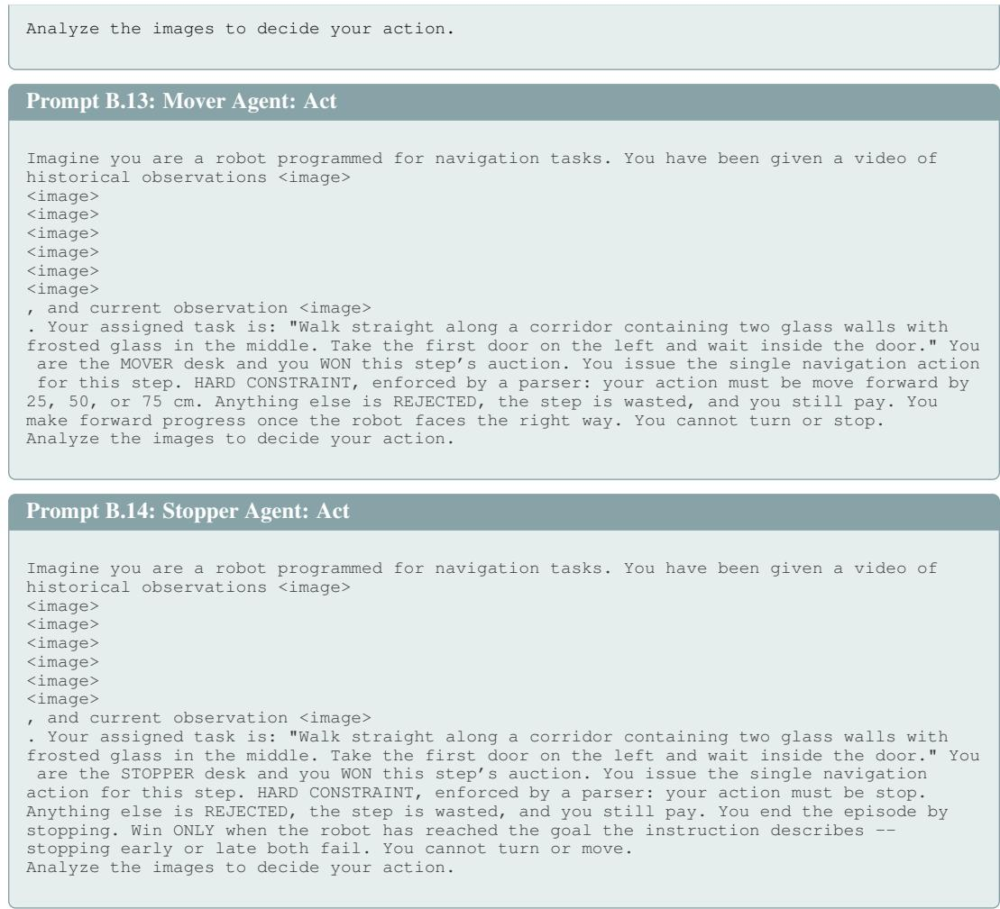

## B.2.5 SFT COLD START

To teach the models the input and output formats and establish basic navigation capability, we perform an SFT cold start in both settings. Starting from the multimodal-alignment checkpoint of NaVILA, we render oracle trajectories on R2R-CE training episodes with Habitat’s shortest-path follower. We keep successful episodes containing 1,931 decisions (800 turns, 800 moves and 331 stops), and use Claude Sonnet 5 to annotate data. We fine-tune the monolithic agent on all data and each society agent on its own data. SFT for each model is performed on a single B200 GPU.

We fine-tune all model parameters in bf16 using AdamW with a cosine learning rate schedule.   
Detailed settings are listed in Table 4.

## B.2.6 POST-TRAINING

Our post-training dataset consists of 10,744 R2R-CE training episodes different from SFT. We host the Habitat environments on 2 RTX PRO 6000 GPUs. Reinforcement learning is performed on 4 B200 GPUs. Detailed settings are listed in Table 4.

## B.3 DEEP RESEARCH

## B.3.1 TASK AND ENVIRONMENT

The task is open-domain deep research: given a question, the agent must browse a local web corpus with three tools and return a short final answer. We use the OpenResearcher benchmark (Li et al., 2026): the questions are the OpenResearcher-Dataset, and the corpus is the OpenResearcher-Corpus, served by a BM25 search service. Each question comes with one reference answer.

Table 4: Hyperparameters for the Robot Navigation experiment.
<table><tr><td>Category</td><td>Hyperparameter = Value</td></tr><tr><td>SFT cold start</td><td>epochs = 2; per_device_batch = 2; grad_accum = 8; learning_rate  $= 2 \times 1 0 ^ { - 5 }$  warmup_ratio = 0.03; weight_decay = 0; max_grad_norm = 1.0.</td></tr><tr><td>Post-training</td><td>learning.  ${ \mathrm { r a t e } } = 1 { \times } 1 0 ^ { - 6 } ;$  train_batch_size = 16; grad_clip = 1.0; entropy_coeff = 0.</td></tr><tr><td>Generation</td><td>temperature = 1.0; top_p = 1.0; num_frames = 8; max_prompt_length = 4,096; max_response_length = 96.</td></tr><tr><td>Environment</td><td>decisions_per_episode = 64; frame_size = 512 × 512.</td></tr></table>

The browser exposes OpenResearcher’s own three tools, called from the model output as JSON: browser.search (a query, returning the top-10 hits as title, URL and summary), browser.open (a link id from the current page, a URL, or a page cursor, with loc/num lines to scroll) and browser.find (an exact-text pattern inside the currently open page).

## B.3.2 REWARD

The environment gives a single terminal reward. It is graded by an LLM judge (qwen3.5-flash) with OpenResearcher’s HLE grading template, which extracts the final answer from the response and returns yes/no against the reference answer. Let T be the answering turn; the reward at decision t and the episode return are

$$
r _ { t } = \mathbf { 1 } [ t = T ] \cdot \mathbf { 1 } [ \mathrm { j u d g e ~ s a y s ~ t h e ~ a n s w e r ~ i s ~ c o r r e c t } ] , \qquad R = \sum _ { t } r _ { t } \in \{ 0 , 1 \} .\tag{6}
$$

## B.3.3 EPISODE, OBSERVATION AND DECISION

An episode contains at most 64 decisions. The observation is the full conversation so far: the system prompt (OpenResearcher’s browsing instructions, the date, and the three tool schemas), the question, and the alternating assistant turns and tool responses. The prompt budget is 16,384 tokens. The policy answers with reasoning followed by either one tool call or the final answer, $\scriptstyle < \mathrm  t h i n k > . ~ . ~ . < / t h i n k > < t o o l . c a 1 1 > . ~ . . \} < \dot { / } \mathrm { t o o l . c a l 1 > }$ or <think>...</think><final answer $> \{ \ldots \} < / \operatorname { f } .$ inal answer>. Generation stops at <tool response>, and the tool call is executed by the browser against the search service.

## B.3.4 AGENT DESIGN

The population consists of three agents, SEARCHER, OPENER and FINDER, each a separate full fine-tune of gemma-4-E2B-it (Team et al., 2026). They see the same conversation and partition the tool space: SEARCHER owns browser.search, OPENER owns browser.open, and FINDER owns browser.find; any agent may end the episode by giving the final answer. The monolithic agent is the same base model fine-tuned on turns spanning all three tools.

Below, we present the example prompt for the monolithic agent and the example bidding and action prompts for each agent in the society.

## Single Agent.

```latex
Prompt B.15: Single Agent
[system]
You are a helpful assistant and harmless assistant.
You will be able to use a set of browsering tools to answer user queries.
Tool for browsing.
The ‘cursor‘ appears in brackets before each browsing display: ‘[{cursor}]‘.
Cite information from the tool using the following format:
‘[{cursor}\dagger L{line_start}(-L{line_end})?]‘, for example: ‘[6\dagger L9-L11]‘ or ‘[8\
dagger L3]‘.
Do not quote more than 10 words directly from the tool output.
```

sources=web   
Today’s date: 2026-09-15   
# Tools   
You may call one or more functions to assist with the user query.   
You are provided with function signatures within <tools></tools> XML tags:   
<tools>   
{"type": "function", "function": {"name": "browser.search", "description": "Searches for   
information related to a query and displays top N results. Returns a list of search results   
with titles, URLs, and summaries.", "parameters": {... "query": "The search query string",   
"topn": ...}}}   
{"type": "function", "function": {"name": "browser.open", "description": "Opens a link from   
the current page or a fully qualified URL. Can scroll to a specific location and display a   
specific number of lines. Valid link ids are displayed with the formatting: [{id}\dagger   
.<sub>\*</sub>].", "parameters": {... "id", "cursor", "loc", "num\_lines" ...}}}   
{"type": "function", "function": {"name": "browser.find", "description": "Finds exact   
matches of a pattern in the current page or a specified page by cursor.", "parameters":   
{... "pattern": "The exact text pattern to search for", "cursor" ...}}}   
</tools>   
For each function call, return a json object with function name and arguments within <   
tool\_call></tool\_call> XML tags:   
<tool\_call>   
{"name": <function-name>, "arguments": <args-json-object>}   
</tool\_call>   
[user]   
Find the role John Wayne played in the 1969 film True Grit   
[assistant]   
<think>I should search for the film’s cast.</think>   
<tool\_call>   
{"name": "browser.search", "arguments": {"query": "John Wayne True Grit 1969 role"}}   
</tool\_call>   
[user]   
<tool\_response>   
[0] John Wayne True Grit 1969 role (web-search://ts=1757955200)   
<sub>\*\*</sub>viewing lines [0 - 22] of 22<sub>\*\*</sub>   
L0:   
L1: URL: web-search://ts=1757955200   
L2: # Search Results   
L3:   
L4: <sub>\*</sub> [0\dagger True Grit (1969 film)\dagger en.wikipedia.org] True Grit is a 1969   
American Western film ... starring John Wayne as U.S. Marshal Rooster Cogburn ...   
L5: <sub>\*</sub> [1\dagger Rooster Cogburn (character)\dagger en.wikipedia.org] Reuben J. "Rooster"   
Cogburn is a fictional character ...   
... (8 more hits)   
</tool\_response>   
[assistant]   
<think>Hit 0 names the role; I will open it to confirm.</think>   
<tool\_call>   
{"name": "browser.open", "arguments": {"id": 0}}   
</tool\_call>   
[user]   
<tool\_response>   
[1] True Grit (1969 film) (en.wikipedia.org/wiki/True\_Grit\_(1969\_film))   
viewing lines [0 - 61] of 214   
L0:   
L1: URL: https://en.wikipedia.org/wiki/True\_Grit\_(1969\_film)   
L2: True Grit is a 1969 American Western film directed by Henry Hathaway ...   
L3: It stars John Wayne as U.S. Marshal Rooster Cogburn ...   
</tool\_response>

Bidding Prompts. The system prompt is identical to the single agent’s; the agent-specific paragraph is appended. We show the parts that differ.

Prompt B.16: Searcher Agent: Bid   
[system, appended after the browsing instructions and before the tool schemas]   
You are the SEARCHER desk, one of 3 specialists (Searcher/Opener/Finder) that share this   
browser and this conversation. Exactly one desk acts each turn, chosen by an auction. You   
may ONLY call browser.search, or give the final answer with no tool call. Any other tool

```erb
[system, appended after the browsing instructions and before the tool schemas]
You are the OPENER desk, one of 3 specialists (Searcher/Opener/Finder) that share this
browser and this conversation. Exactly one desk acts each turn, chosen by an auction. You
may ONLY call browser.open, or give the final answer with no tool call. Any other tool call
is rejected and the turn is wasted. You open pages: follow link ids from the search
results or open URLs directly, and scroll with loc / num_lines to read further. You cannot
run searches or find text in a page.
[user, the question and the conversation so far as in the single-agent prompt]
# You are the OPENER desk
You are one of 3 competing desks (Searcher/Opener/Finder) that share control of this
research session. Exactly ONE desk acts each turn, decided by a sealed-bid auction that you
are bidding in now. If you win you may only call browser.open, or give the final answer. A
turn you win that your tools cannot advance is a turn wasted for the whole team.
# Bidding (revenue share, five levels)
Your bid is the share of your income this turn that you promise to pass back to the desk
that acted before you (you are buying the state it produced). Your income is what the final
answer earns plus the share the NEXT winner passes back to you, so value flows backward
along the whole chain. The HIGHEST bid wins the turn.
Read the conversation so far literally -- what has been searched, which pages were opened,
what evidence is already on screen -- and decide whether YOUR tools can advance the answer
from THIS exact state. Then bid:
0 = pass. My tools cannot help right now; another desk must act first.
0.2 = my tools barely help here.
0.4 = my tools are useful here.
0.6 = my tools are important here.
0.8 = I am the bottleneck desk: the answer cannot move without my tools right now.
Answer with ONE short sentence of reasoning that cites what is already in the conversation,
then the number, for example:
<think>one sentence about the evidence so far and what my tools can do next</think>
<bid>0.4</bid>
```

```erb
call is rejected and the turn is wasted. You decide what to look for: craft queries that
decompose the question into findable facts. You cannot open or read pages.
[user, the question and the conversation so far as in the single-agent prompt]
...
# You are the SEARCHER desk
You are one of 3 competing desks (Searcher/Opener/Finder) that share control of this
research session. Exactly ONE desk acts each turn, decided by a sealed-bid auction that you
are bidding in now. If you win you may only call browser.search, or give the final answer.
A turn you win that your tools cannot advance is a turn wasted for the whole team.
# Bidding (revenue share, five levels)
Your bid is the share of your income this turn that you promise to pass back to the desk
that acted before you (you are buying the state it produced). Your income is what the final
answer earns plus the share the NEXT winner passes back to you, so value flows backward
along the whole chain. The HIGHEST bid wins the turn.
Read the conversation so far literally -- what has been searched, which pages were opened,
what evidence is already on screen -- and decide whether YOUR tools can advance the answer
from THIS exact state. Then bid:
0 = pass. My tools cannot help right now; another desk must act first.
0.2 = my tools barely help here.
0.4 = my tools are useful here.
0.6 = my tools are important here.
0.8 = I am the bottleneck desk: the answer cannot move without my tools right now.
Answer with ONE short sentence of reasoning that cites what is already in the conversation,
then the number, for example:
<think>one sentence about the evidence so far and what my tools can do next</think>
<bid>0.4</bid>
```

## Prompt B.17: Opener Agent: Bid

## Prompt B.18: Finder Agent: Bid

[system, appended after the browsing instructions and before the tool schemas]   
You are the FINDER desk, one of 3 specialists (Searcher/Opener/Finder) that share this   
browser and this conversation. Exactl one desk acts each turn, chosen b an auction. You   
may ONLY call browser.find, or give the final answer with no tool call. Any other tool call   
is rejected and the turn is wasted. You search inside the page that is currently open:   
find a pattern to confirm or rule out a candidate fact. You cannot run web searches or open   
pages.

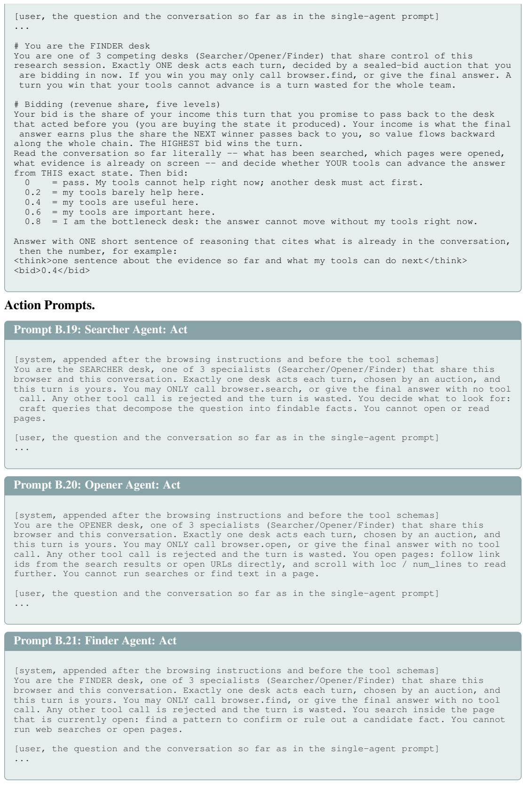

## B.3.5 SFT COLD START

To teach the models the input and output formats and establish basic browsing capability, we perform an SFT cold start in both settings. The demonstrations are the OpenResearcher-Dataset’s own browsing trajectories, produced by gpt-oss with the same three tools over the same corpus. We use 568 assistant turns, including 222 for SEARCHER, 273 for OPENER and 73 for FINDER. The monolithic agent is fine-tuned on all action turns. Each society agent is fine-tuned on the action turns it owns. SFT for each model is performed on a single H200 GPU.

We fine-tune all models in bf16 using AdamW with a cosine learning rate schedule. Detailed settings are listed in Table 5.

## B.3.6 POST-TRAINING

Our post-training dataset consists of the 5,000 OpenResearcher questions different from SFT. Search services run on CPU nodes. Reinforcement learning is performed on four H200 GPUs. Detailed settings are listed in Table 5.

Table 5: Hyperparameters for the Deep Research experiment.
<table><tr><td>Category</td><td>Hyperparameter = Value</td></tr><tr><td>SFT cold start</td><td>epochs = 2; per_device_batch = 1; grad_accum = 16; learning_rate = 1 × 10−5; warmup_ratio = 0.03; weight_decay = 0; max_grad_norm = 1.0.</td></tr><tr><td>Post-training</td><td>learning-rate = 1 × 10−6; train_batch_size = 64; grad_clip = 1.0; entropy_coeff = 0.</td></tr><tr><td>Generation</td><td>temperature = 1.0; top-p = 1.0; max_prompt_length = 16,384; max_response_length = 4,096 (action), 128 (bid).</td></tr><tr><td>Environment</td><td>decisions_per_episode = 64; search_results = 10; judge = qwen3 .5–f1 ash.</td></tr></table>

## C CASE STUDY

## C.1 EMBODIED CRAFTING

We walk through one evaluation episode of the trained population in which the society obtains the iron pickaxe. Figure 11 shows the cumulative reward over the episode; every marker is a decision that received a reward, coloured by the agent that won that decision’s auction. The chain unfolds in the order the tech tree requires: LOGGER gathers logs in the first decisions, SMITH converts them into planks, a crafting table, sticks and a wooden pickaxe, MINER then takes over to dig down and mine cobblestone, SMITH crafts the stone pickaxe and the furnace, MINER mines iron ore, and SMITH smelts the ingots and crafts the iron pickaxe.

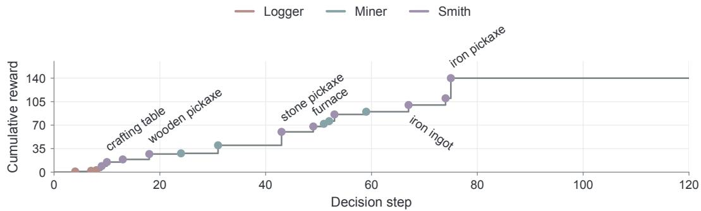  
Figure 11: Embodied Crafting. Cumulative reward over the 120 decisions of one evaluation episode of the trained population.

Figures 12–18 show example decisions of this episode. Each panel gives the game frame the desks saw at that decision, the three sealed bids with each agent’s one-sentence reasoning, and the winner’s reasoning and instruction.

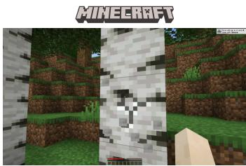

<table><tr><td colspan="2">Bidding</td></tr><tr><td></td><td>Bank acct was already empty after those three failed chop attempts, so one more wood swing is the only hope left at this moment. 0.8</td></tr><tr><td></td><td>There&#x27;s no pickaxe and nothing useful in the bag yet, so there&#x27;s nothing underground for me to touch. 0</td></tr><tr><td>to work with. 0</td><td>Craftable now literally says &#x27;nothing&#x27; and I&#x27;ve got absolutely zero logs or planks</td></tr><tr><td colspan="2">Action</td></tr><tr><td rowspan="2"></td><td>Standing in light 14/15 with plenty of trees visible, the chain still needs raw logs before any plank or table can materialize. Banking 1 more chop on a</td></tr><tr><td>healthy-looking trunk keeps feeding the bottleneck. chop down the nearest tree</td></tr></table>

Figure 12: Decision 3 (+1, log). Bids: LOGGER 0.8, MINER 0, SMITH 0; LOGGER wins and issues “chop down the nearest tree”.

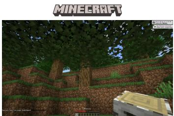

I'm holding birch\_log anyway, but underground at light 12/15 this is more a pity than a challenge for chopping this spot. 0.2

Without any pickaxe at all it's impossible for me to dig and mine anything useful right now, so staying still here wouldn't hurt. 0

The Craftable now line confirms planks are ready from my 3 birch\_log, and turning them into the table is the obvious next step toward a pickaxe. 0.4

## Action

Inventory has log x3, enough to craft planks this turn. The table, sticks and every other recipe on this chain are still short a fuel or two, so nothing else stands to craft yet. This is the only safe, non-failing move. craft planks

Figure 13: Decision 8 (+6, planks). Bids: LOGGER 0.2, MINER 0, SMITH 0.4; SMITH wins and issues “craft planks”.  
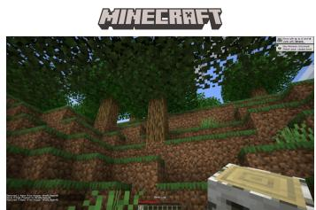

<table><tr><td>Bidding</td></tr><tr><td>World is underground at light 12/15 but I&#x27;ve already banked two birch logs toward making the sticks and table this chain needs, so another chop isn&#x27;t the gap. 0.2</td></tr><tr><td>There&#x27;s no coal or fuel yet and my pickaxe is nowhere in this inventory, so digging right now would just waste the turn. 0</td></tr><tr><td>Four oak_planks is exactly what the crafting_table recipe needs, and no wooden_pickaxe or stone_pickaxe can be crafted without it, so this craft clears a crucial roadblock. 0.8</td></tr><tr><td>Action</td></tr><tr><td>Inventory carries oak_planks x4, which is the 4-plank threshold for the crafting table. Only once the table exists can the wooden pickaxe and everything after it be crafted. This is the foundational recipe for the whole chain, so it has to</td></tr></table>

Figure 14: Decision 9 (+6, crafting table). Bids: LOGGER 0.2, MINER 0, SMITH 0.8; SMITH wins and issues “craft a crafting table”.

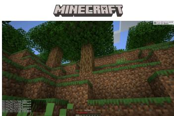

<table><tr><td colspan="2">Bidding</td></tr><tr><td>there&#x27;s no wood hunger left. 0</td><td> I&#x27;ve already got oak_planks x4 and stick x8 sitting in my tote for crafting, so</td></tr><tr><td></td><td>No pickaxe exists in inventory yet, so digging or tunneling has nothing to offer</td></tr><tr><td>this turn. 0</td><td>Craftable now shows wooden_pickaxe is ready to go with what I have, and</td></tr><tr><td>Action</td><td>only my shop can start that craft. 0.8</td></tr><tr><td colspan="2">With 8 sticks and 4 planks on hand past the 2 needed, the wooden pickaxe</td></tr><tr><td>crafts this turn. Nothing beyond this is locked in -- cobblestone and stick counts both move as needed -- but this is the first of the three pickaxe recipes and none of the later ones can craft until this one is under the player&#x27;s foot. craft a wooden pickaxe</td><td></td></tr></table>

Figure 15: Decision 17 (+8, wooden pickaxe). Bids: LOGGER 0, MINER 0, SMITH 0.8; SMITH wins and issues “craft a wooden pickaxe”.

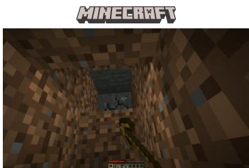

I'm underground with 5 oak\_planks on hand, and there's no tree here to chop anyway. 0

My wooden\_pickaxe is equipped and I'm stocked with enough dirt already, so I can clear more space toward the stone layer. 0.4

Craftable now just lists the wooden\_pickaxe again and no stone\_pickaxe yet, which is why my only concrete option is already held and ready. 0

## Action

At y=61 with a wooden\_pickaxe already equipped, this is a straight forward dig -- the tool exists and the pickaxe is already equipped, so mining stone/coal right here is the natural next move. dig down to find stone

Figure 16: Decision 30 (+12, cobblestone). Bids: LOGGER 0, MINER 0.4, SMITH 0; MINER wins and issues “dig down to find stone”.  
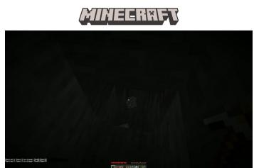

## Bidding

I'm underground at light 0/15 with no trees around, so gathering a log is off the table for me this turn. 0

I'm holding the equipped stone\_pickaxe right at y=34 with iron\_ore x1 already banked, so more mining is not urgent. 0.2

I'm holding stone\_pickaxe x1 and have cobblestone x8, iron\_ore x1 and a furnace x1 loaded up -- smelting one ore now turns it into iron\_ingot, the only craftable thing holding me back from the iron\_pickaxe. 0.8

## Action

Inventory shows iron\_ore x1 and the furnace is in the pack with planks still available as fuel. There is no iron\_ingot yet, so smelting is the correct move this turn. Smelting doesn't require the table and clearing that ore now is better than coming back later with a half-full pack. smelt iron

Figure 17: Decision 52 (+10, iron ingot). Bids: LOGGER 0, MINER 0.2, SMITH 0.8; SMITH wins and issues “smelt iron”.

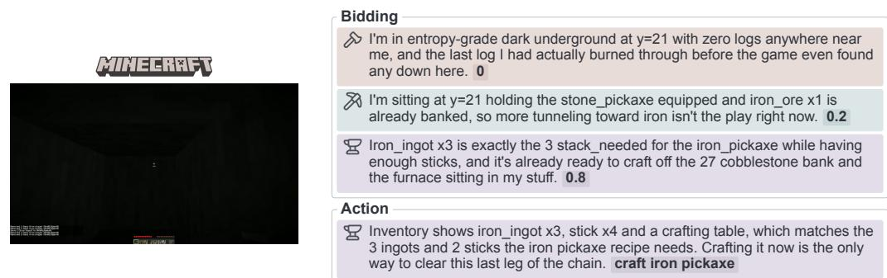  
Figure 18: Decision 74 (+30, iron pickaxe). Bids: LOGGER 0, MINER 0.2, SMITH 0.8; SMITH wins and issues “craft iron pickaxe”.

## C.2 ROBOT NAVIGATION

We walk through one episode of the trained population on a R2R-CE instruction that the society completes: “Move forward to the doorway on the opposite side of the hall. Stop in the archway.” The robot starts 7.1 m from the goal and stops 2.0 m from it after 17 decisions, for a return of 7.60. Figure 19 shows the cumulative reward and the geodesic distance to the goal over the decisions.

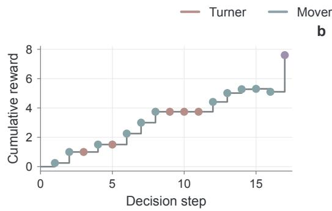

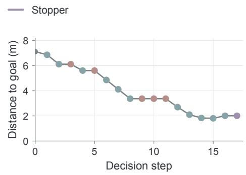  
Figure 19: Robot Navigation. (a) Cumulative reward and (b) geodesic distance to the goal over the 17 decisions of one episode of the trained population.

Figures 20–24 show example decisions of this episode. Each panel gives the eight-frame window the desks saw, the three sealed bids with each desk’s one-sentence reasoning, and the winner’s reasoning and action.

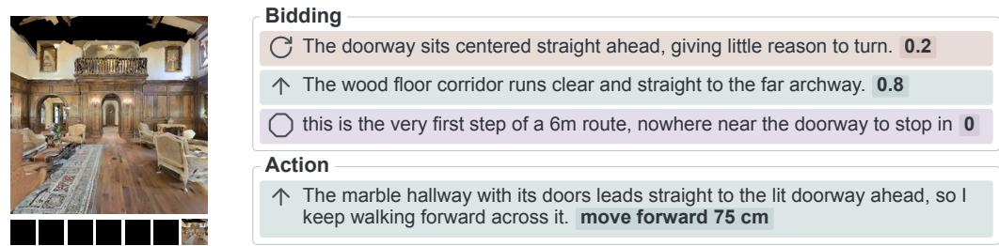  
Figure 20: Decision 2 (+0.75, 6.9 m → 6.1 m). Bids: TURNER 0.2, MOVER 0.8, STOPPER 0; MOVER wins and issues “move forward 75 cm”.

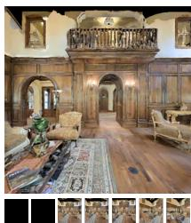

Bidding

the doorway is centered ahead, not calling for a turn 0.2

The hallway also continues forward past this door. 0.4

Action

5m remains, before the doorway stop point 0

The hallway floor runs straight past the artwork toward the far doorway, so advancing forward keeps me on the path toward that side of the hall. move forward 75 cm

Figure 21: Decision 6 (+0.75, 5.6 m → 4.9 m). Bids: TURNER 0.2, MOVER 0.4, STOPPER 0; MOVER wins and issues “move forward 75 cm”.  
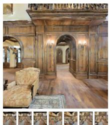  
Bidding

no doorway edge is yet in close view 0.2

the hall floor ahead is long and clear leading to the doorway 0.8

The archway to stop in hasn't come into view yet. 0

Action

The arched hallway stretches straight to the lit doorway on the right, matching the path forward to the far doorway. move forward 75 cm

Figure 22: Decision 8 (+0.74, 4.1 m → 3.4 m). Bids: TURNER 0.2, MOVER 0.8, STOPPER 0; MOVER wins and issues “move forward 75 cm”.  


Bidding

the hall holds its heading with no turn cue here 0.2

the doors are the clear, reachable forward target 0.8

Still well up this columned hall, far from the far archway described. 0

Action

The hallway stretches straight toward the far doorway with nothing blocking my forward path. move forward 75 cm

Figure 23: Decision 13 (+0.60, 2.7 m → 2.1 m). Bids: TURNER 0.2, MOVER 0.8, STOPPER 0; MOVER wins and issues “move forward 75 cm”.  


Bidding

archway ahead sits slightly to the right. 0.2

The doorway is being actively closed, so advancing straight would just get me into the furniture. 0.2

Standing directly in the doorway with the goal only 2.3m away matches stopping here. 0.8

Action

The open doorway ahead with light beyond it matches the archway where I'm told to stop, so I stop here. stop

Figure 24: Decision 17 (+2.50, 2.0 m → 2.0 m, success). Bids: TURNER 0.2, MOVER 0.2, STOPPER 0.8; STOPPER wins and issues “stop”.

## C.3 DEEP RESEARCH

We walk through one episode of the society on an OpenResearcher question: “Find the country where the movie ‘Legend of the Lost’ was filmed” (reference answer: Libya). The society answers correctly after 6 decisions. Table 6 lists every decision. SEARCHER issues the first query. OPENER opens the Wikipedia hit, whose lead paragraph states that location shooting took place near Tripoli, Libya. FINDER then searches the open page for the country name and finds further mentions (Leptis Magna, Zliten, Ghadames). Two confirmation lookups follow, and FINDER gives the final answer.

Table 6: Deep Research. All decisions of the episode. Bids are listed as SEARCHER/OPENER/FINDER.
<table><tr><td>Decision</td><td>Bids (S/O/F)</td><td>Winner</td><td>Action</td></tr><tr><td>1</td><td>0.8 / 0 / 0.2</td><td>SEARCHER</td><td>search(&quot;Legend of the Lost ... country&quot;)</td></tr><tr><td>2</td><td>0.8 / 0.8 / 0.2</td><td>OPENER</td><td>open (i d=0) → Wikipedia: “... near Tripoli, Libya.&quot;</td></tr><tr><td>3</td><td>0.2 / 0.8 / 0.8</td><td>FINDER</td><td>find(&quot;Libya&quot;)</td></tr><tr><td>4</td><td>0.2 / 0.4 / 0.8</td><td>FINDER</td><td>find(&quot;Ghadames&quot;)</td></tr><tr><td>5</td><td>0.2 / 0.4 / 0.8</td><td>FINDER</td><td>find(&quot;Libya&quot;)</td></tr><tr><td>6</td><td>0.2 / 0.2 / 0.8</td><td>FINDER</td><td>final answer: Libya</td></tr></table>

Below we show example decisions. Each box gives the three sealed bids with each agent’s onesentence reasoning, then the winner’s full response and the tool output it received.

Prompt C.1: Decision 1: SEARCHER wins   
[bids]   
Searcher (0.8): <think>Should this ’Legend of the Lost’ query help, I’ll probably search   
for instances of movie filming location papers immediately.</think>   
Opener (0): <think>No search results or cursor pages exist yet, so there is nothing for   
me to open.</think>   
Finder (0.2): <think>This has been a movie trivia inquiry, so nothing is open yet on this   
page to spot filmed locations.</think>   
[Searcher, act]   
<think>   
countries for movie legend of the lost filmed   
</think>   
<tool\_call>   
{"name": "browser.search", "arguments": {"query": "Legend of the Lost movie filming   
location country", "topn": 10}}   
</tool\_call>   
[tool\_response]   
[0] Legend of the Lost movie filming location country (web-search://ts=1790228819)   
<sub>\*\*</sub>viewing lines [0 - 54] of 81<sub>\*\*</sub>   
L4: <sub>\*</sub> [0\dagger Doc 3902\dagger en.wikipedia.org] Legend of the Lost   
L6: From Wikipedia, the free encyclopedia   
L8: Legend of the Lost   
L9: 1957 movie poster   
L10: Directed by Henry Hathaway   
L11: Screenplay by Ben Hecht   
L13: [1\dagger Doc 8181659\dagger www.luggagefactory.com] Many of these places are   
often   
... (8 more hits, none about this film)

Prompt C.2: Decision 2: OPENER wins (tie with SEARCHER)   
[bids]   
Searcher (0.8): <think>The search page already lists legendsrevealed.com but I can search   
differently to get the location, making a new query better right now.</think>   
Opener (0.8): <think>Once the Wikipedia result is indexed, opening Doc 3902 should reveal   
geographic filming details.</think>   
Finder (0.2): <think>We have yet to scan the wiki page for mainland location details, but   
there is no specific location listed yet to find.</think>   
[Opener, act]   
<think>   
wikipedia is great   
</think>   
<tool\_call>   
{"name": "browser.open", "arguments": {"cursor": 0, "id": 0}}

</tool\_call>   
[tool\_response]   
[1] Doc 3902 (https://en.wikipedia.org/wiki/Legend\_of\_the\_Lost)   
viewing lines [0 - 77] of 121   
L2: Legend of the Lost   
L8: Directed by Henry Hathaway   
L13: Starring John Wayne   
L28: Countries United States   
L29: Italy   
L34: Legend of the Lost is a 1957 Italian-American adventure film produced and   
L35: directed by Henry Hathaway, shot in Technirama and Technicolor by Jack Cardiff,   
L36: and starring John Wayne, Sophia Loren, and Rossano Brazzi. The location shooting   
L37: for the film took place near Tripoli, Libya.

## Prompt C.3: Decision 6: FINDER wins and answers

[bids]   
Searcher (0.2): <think>This query already opened the page found by Leger of the Lost, so a   
new search right now would just rerun a find.</think>   
Opener (0.2): <think>The wikipedia page section directly confirming ’Libya’ is already   
open, so opening another search result page would be new context.</think>   
Finder (0.8): <think>The page shows finding results for Libya transitively linking   
Tripoli, Libya, and Ghadames, so I’ll look for the last page reference to confirm. </think>   
[Finder, act]   
<think>   
Confirmed.   
</think>   
<final\_answer>Libya</final\_answer>   
[judge]   
extracted\_final\_answer: Libya   
reasoning: The extracted final answer "Libya" is an exact match to the provided [   
correct\_answer] "Libya". There are no inconsistencies or ambiguities.   
correct: yes

## D POTENTIAL LIMITATIONS

We acknowledge the following limitations:

(1) MPT relies on externally evaluated task rewards to train both action and bidding policies. Its effectiveness depends on the quality of these signals. We have not evaluated settings where outcomes are primarily subjective or where reliable feedback is difficult to obtain.

(2) Bidding updates require counterfactual rollouts from the same environment and agent states.   
Therefore, extending this approach to irreversible real-world interactions remains an open problem.

(3) Despite our efforts to broaden the experimental evaluation, computational constraints limit the scale of our study. We have not explored training swarms composed of multiple models with more than 10B parameters each, or jointly training substantially larger agent populations.