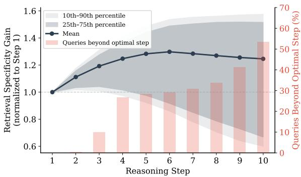
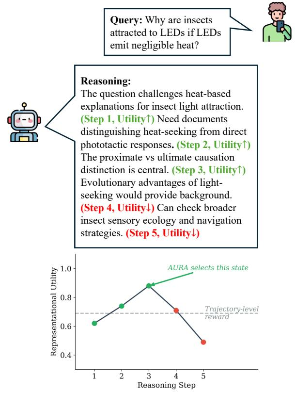
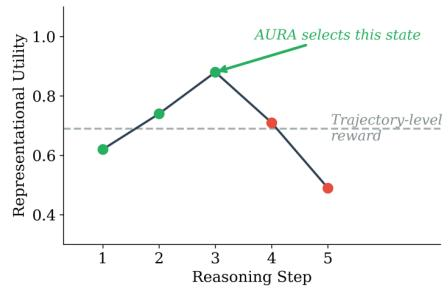
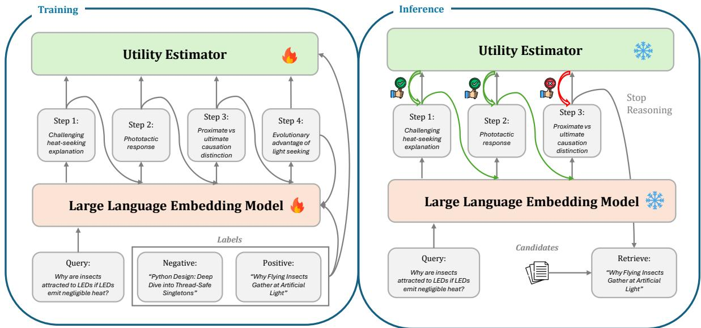
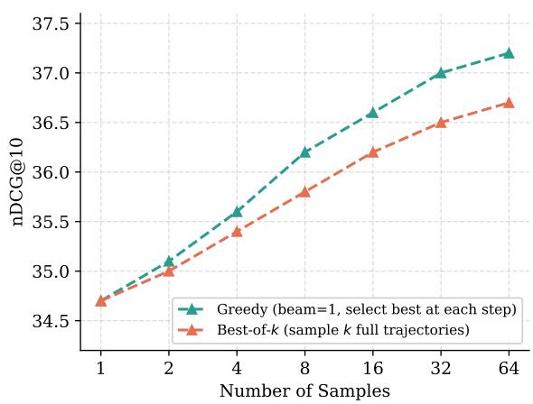

# Learning When to Think: Utility-Guided Adaptive Reasoning for Efficient Text Retrieval

Yingtao Luo1 Kangyi Zhao2 Shiyi Du1 Yubo Li1

1Carnegie Mellon University 2University of Pittsburgh {yingtaol, shiyid, yubol}@andrew.cmu.edu kaz78@pitt.edu

## Abstract

Reasoning-conditioned embeddings can improve retrieval by progressively refining semantic constraints. However, additional reasoning may introduce over-generalized or semantically noisy abstractions that weaken retrieval specificity. Existing methods largely supervise reasoning through final retrieval outcomes, providing limited guidance over the refinement process itself. We propose AURA, a framework that directly supervises intermediate reasoning states according to how well they separate relevant documents from hard distractors. AURA further trains a lightweight utility estimator over prefix-conditioned embeddings to adapt reasoning depth at inference time. On the reasoning-intensive BRIGHT benchmark, AURA-4B achieves 34.7 average nDCG@10 while using 2.8 reasoning steps and 96 generated tokens per query. Under matched deployment conditions, adaptive stopping reduces latency from 4.6 to 0.76 seconds relative to fulltrajectory reasoning. Results on MS MARCO further suggest that this specialization need not substantially degrade conventional in-domain retrieval.

## 1 Introduction

Recent dense retrieval systems increasingly incorporate reasoning through query rewriting, decomposition, reranking, and reasoning-conditioned embeddings (Qin et al., 2025; Jiang et al., 2025; Asai et al., 2024; Li et al., 2025b; Muennighoff et al., 2024; Tang et al., 2025; Lan et al., 2025), motivated by the observation that semantic refinement can improve retrieval for complex queries.

However, existing reasoning-based retrieval systems generally treat additional reasoning as beneficial, applying it without distinguishing whether further refinement helps or hurts retrieval quality. In practice, retrieval-oriented reasoning often exhibits diminishing returns. While some refinements sharpen retrieval specificity—the separation between relevant documents and hard distractors— by identifying useful constraints or disambiguating entities, others introduce semantic drift or overly abstract reformulations that weaken retrieval discrimination (Fan et al., 2026; Kotte, 2026). As a result, longer reasoning trajectories do not always improve retrieval quality, and can even harm retrieval discrimination, increase inference latency, and introduce unnecessary computational cost.

  
Figure 1: Retrieval specificity across reasoning steps on BRIGHT. Lines and shaded regions show the mean and query-level variability normalized to Step 1. Bars indicate the fraction of queries that have already passed their query-specific optimal step.

To understand how retrieval utility evolves during reasoning, we analyze retrieval specificity across intermediate reasoning steps on BRIGHT. As shown in Figure 1, retrieval specificity improves on average during early reasoning steps, suggesting that additional refinement can help construct more discriminative retrieval representations. However, this improvement is highly heterogeneous: variability increases rapidly with reasoning depth, indicating that different queries benefit from substantially different amounts of reasoning. The fraction of queries that have already passed their optimal reasoning step increases and exceeds 50% by Step 10. This evidence supports the notion that additional reasoning can be unnecessary and may even reduce the retrieval quality of many queries. Effective retrieval requires adapting the depth of the reasoning to the query-specific need.

  
Figure 2: Motivation behind AURA. Existing methods supervise only the final retrieval outcome, while AURA identifies the peak-utility reasoning state before overreasoning weakens retrieval specificity.

A key limitation of existing methods is that reasoning is typically supervised only through final retrieval performance. While effective for evaluating end-to-end success, these coarse signals provide little guidance over the reasoning process. More importantly, current retrieval systems cannot predict whether additional reasoning will improve retrieval before observing retrieval outcomes, and thus can only allocate computation reactively: they expand reasoning trajectories regardless of whether further refinement is likely to help.

In this work, we formulate retrieval-oriented reasoning as a utility-guided computation allocation problem. Rather than treating reasoning as an unconditional token expansion, we evaluate whether each intermediate refinement improves the model’s ability to distinguish relevant documents from challenging distractors (Figure 2). Under this perspective, useful reasoning is determined not by trajectory length or textual sophistication, but by its measurable effect on retrieval discrimination.

Building on this perspective, we propose AURA1 (Adaptive Utility-aware Reasoning RetrievAl), a framework for learning retrievaloriented reasoning through utility supervision over intermediate reasoning states. During training, AURA uses relevance labels and retrieval candidates to estimate whether each refinement step improves retrieval discrimination, encouraging reasoning trajectories that sharpen retrieval specificity while avoiding semantically noisy refinements.

Since retrieval specificity is unavailable at inference time, AURA additionally trains a lightweight utility estimator to predict the retrieval utility of each current reasoning state. Monitoring this estimate online allows AURA to stop when state utility ceases to improve, without exhaustively expanding the reasoning trajectory.

We evaluate AURA on the 12 reasoningintensive retrieval domains in BRIGHT (Hongjin et al., 2025) and on MS MARCO (Bajaj et al., 2016) as a conventional in-domain retrieval setting. AURA outperforms the compared reasoningconditioned retrieval methods on BRIGHT. On MS MARCO, it remains comparable to a strong reasoning-trained retriever, suggesting no substantial in-domain degradation when extensive reasoning is unnecessary. Controlled analyses further show that the gains cannot be explained by denser intermediate contrastive supervision or trajectory filtering alone, and that retrieval specificity is strongly aligned with corpus-level nDCG@10.

Our contributions are summarized as follows:

• We formulate reasoning-conditioned retrieval as an adaptive refinement process and show that reasoning utility is highly heterogeneous.

• We propose AURA, a framework that supervises intermediate reasoning states according to their retrieval specificity, and trains a lightweight utility estimator to dynamically allocate reasoning during inference.

• We demonstrate improvements over the compared methods across 12 reasoning-intensive domains, together with a substantially better performance–cost trade-off under matched inference conditions.

## 2 Related Work

## 2.1 Dense Retrieval and Embedding Models

Modern dense retrieval commonly relies on biencoder architectures that map queries and documents into a shared embedding space, where retrieval is performed through vector similarity (Karpukhin et al., 2020). Early embedding approaches such as Sentence-BERT (Reimers and Gurevych, 2019) demonstrated the effectiveness of contrastive representation learning for semantic retrieval, followed by stronger instruction-tuned and large embedding models including INSTRUC-TOR (Su et al., 2023), E5 (Wang et al., 2022), and recent LLM-based embedding systems (Muennighoff et al., 2024; Liu et al., 2024; Wang et al., 2024). Recent studies further explore using LLM hidden states directly as embeddings (Ma et al., 2024; Lee et al., 2025) or leveraging in-context learning to improve representation quality (Li et al., 2025a). Beyond supervised retrieval data, dense retrievers have also been trained using unsupervised contrastive objectives and synthetic supervision (Lee et al., 2019; Izacard et al., 2021; Chen et al., 2024; Ji et al., 2025; Yoon et al., 2025). Despite strong performance, most embedding models remain fundamentally single-pass encoders that construct representations without explicit semantic refinement or intermediate reasoning.

## 2.2 Reasoning for Retrieval

Recent work increasingly incorporates reasoning into retrieval systems through query rewriting, decomposition, iterative retrieval, and reasoningaugmented reranking (Qin et al., 2025; Jiang et al., 2025; Asai et al., 2024; Li et al., 2025b; Long et al., 2025). For example, ReasonIR (Shao et al., 2025) synthesizes reasoning trajectories and hard negatives to train retrieval models on reasoningintensive benchmarks (Hongjin et al., 2025). More recently, reasoning has been incorporated directly into embedding formation: multimodal methods such as RITE (Liu et al., 2025b), LREM (Tang et al., 2025), and UME-R1 (Lan et al., 2025) generate reasoning before constructing retrieval representations, with further gains from inference-time scaling through sampling multiple reasoning trajectories (Muennighoff et al., 2024).

However, reasoning is not uniformly beneficial for retrieval. Query expansion has long been known to suffer from query drift (Mitra et al., 1998; Carpineto and Romano, 2012), and recent work shows that LLM-based reasoning can hurt dense retrieval due to semantic drift (Fan et al., 2026; Kotte, 2026). Similar observations have emerged for chain-of-thought prompting more broadly (Liu et al., 2025a; Hassid et al., 2025; Sui et al.). Despite these findings, existing methods either supervise reasoning only through final retrieval outcomes or select among complete trajectories via best-of-k, providing no direct supervision over intermediate refinement states nor adaptive reasoning allocation at inference time. AURA addresses both gaps.

## 3 Methodology

## 3.1 Unified Reasoning Embedding

To ground reasoning-conditioned retrieval within a unified framework, AURA utilizes an autoregressive language model as its unified backbone $f _ { \theta } .$ To enable a single language model to simultaneously optimize autoregressive token generation and extract high-quality dense retrieval representations, we propose a structured sequence format. Given a query x, the format is as follows:

Unified Sequence Format:   
[User]: Input: x. Generate step-by-step reasoning.   
[Assistant]: <think> r1, r2, . . . , rT </think>

where $\boldsymbol { r } = \left( r _ { 1 } , \ldots , r _ { T } \right)$ represents the generated reasoning trajectory parsed at sentence boundaries.

Embedding extraction. At each sentence boundary t, we construct a prefix-conditioned embedding by passing the query and reasoning prefix through the backbone and extracting the final-layer hidden state at the last token position of $r _ { t } \colon$

$$
z _ { t } = \mathrm { p r o j } ( \mathrm { L a s t H i d d e n } _ { \theta } ( x , r _ { \le t } ) ) ,\tag{1}
$$

where $\mathrm { L a s t H i d d e n } _ { \theta } ( \cdot )$ returns the final layer’s hidden state at the last token of the input, and proj(·) is a linear projection to the embedding space.

Retrieval Specificity Scoring. To supervise intermediate reasoning states, AURA defines a retrieval specificity score that measures how well a given reasoning state separates relevant documents from distractors. For a training query x, let $d ^ { + }$ denote a relevant document and let D−(x) denote the set of in-batch negatives. Given $z _ { t }$ , we define its retrieval specificity score as

$$
S ( z _ { t } ) = \mathrm { s i m } ( z _ { t } , z _ { d ^ { + } } ) - \frac { 1 } { k } \sum _ { i = 1 } ^ { k } \mathrm { s i m } ( z _ { t } , z _ { d _ { i } ^ { - } } ) ,\tag{2}
$$

  
Figure 3: Overview of AURA. Training: A warm-up stage first establishes a retrieval-oriented embedding space. Specificity labels are then constructed from the warmed-up model, the utility estimator is trained on frozen embeddings, and utility-aware weighting is enabled for subsequent joint optimization. Inference: The utility estimator evaluates each state online and terminates reasoning according to the predicted utility, returning the selected embedding for retrieval.

where $d _ { 1 } ^ { - } , \ldots , d _ { k } ^ { - }$ are the top-k highest-similarity distractors from D−(x) according to sim $( \cdot , \cdot )$ as cosine similarity. $S ( z _ { t } )$ evaluates the retrieval specificity at each intermediate reasoning state. The marginal effect of a reasoning step can then be measured as $\Delta S _ { t } = S ( z _ { t } ) - S ( z _ { t - 1 } )$

Training objectives. The model is trained with a multi-task loss combining contrastive retrieval and language modeling objectives:

$$
\mathcal { L } _ { \mathrm { t o t a l } } = \mathcal { L } _ { \mathrm { I n f o N C E } } + \mathcal { L } _ { \mathrm { C E } }\tag{3}
$$

The autoregressive objective is computed over all reasoning tokens, preserving the model’s ability to generate coherent reasoning:

$$
\mathcal { L } _ { \mathrm { C E } } = - \sum _ { t = 1 } ^ { T } \log P _ { \theta } ( \boldsymbol { r } _ { t } | \boldsymbol { x } , \boldsymbol { r } _ { < t } )\tag{4}
$$

The contrastive objective optimizes the prefixconditioned embeddings to separate relevant documents from distractors. Unlike existing methods that apply InfoNCE only at the final state $z _ { T }$ , AURA optimizes at all intermediate states $z _ { 1 } , \dots , z _ { T }$ . For each intermediate embedding $z _ { t } ,$ we compute the InfoNCE loss against the relevant document embedding $z _ { d ^ { + } }$ and in-batch negatives:

$$
{ \mathcal { L } } _ { \mathrm { I n f o N C E } } = - { \frac { 1 } { T } } \sum _ { t = 1 } ^ { T } w _ { t } \log { \frac { \exp ( z _ { t } \cdot z _ { d ^ { + } } / \tau ) } { \sum _ { d \in { \mathcal { D } } } \exp ( z _ { t } \cdot z _ { d } / \tau ) } }\tag{5}
$$

where $\mathcal { D } = \{ d ^ { + } \} \cup \{ d _ { i } ^ { - } \}$ contains the relevant document and all in-batch negatives, τ is the contrastive temperature (default set to 0.02), and the weight is set as

$$
w _ { t } = \frac { \exp ( \operatorname* { m a x } ( 0 , \mathrm { s t o p g r a d } ( \Delta S _ { t } ) ) ) } { \sum _ { t ^ { \prime } } \exp ( \operatorname* { m a x } ( 0 , \mathrm { s t o p g r a d } ( \Delta S _ { t ^ { \prime } } ) ) ) } ,\tag{6}
$$

which emphasizes the learning of reasoning refinements that produce larger gains in retrieval specificity and reduces supervision on saturated or retrieval-harmful reasoning states. Here, we apply stop-gradient so that utility scores are used only to reweight contrastive updates, preventing the model from artificially increasing utility values instead of improving retrieval representations.

Gradient isolation. Since both objectives share the same backbone model and operate on overlapping reasoning positions, naive joint optimization may cause contrastive gradients to interfere with autoregressive generation. To mitigate this effect, during the contrastive optimization, we apply stopgradient to all positions preceding the embedding extraction point, such that gradients from $\mathcal { L } _ { \mathrm { { I n f o N C E } } }$ do not propagate through $( x , r _ { < t } )$

Under this design, $\mathcal { L } _ { \mathrm { C E } }$ retains full gradient flow across the reasoning sequence, while $\mathcal { L } _ { \mathrm { { I n f o N C E } } }$ only updates representations at the current reasoning step without backpropagating through earlier reasoning prefixes. This separation reduces optimization interference between generation and retrieval objectives, allowing the model to learn discriminative retrieval representations while preserving autoregressive reasoning quality.

## 3.2 Inference-Time Utility Estimation

Since retrieval specificity $S ( z _ { t } )$ depends on relevance labels and distractors, it is unavailable at inference time. To enable adaptive reasoning, AURA learns a utility estimator that predicts the retrieval specificity of the current intermediate state. For each state $z _ { t } ,$ , we define its target utility as

$$
y _ { t } = S ( z _ { t } ) ,\tag{7}
$$

which represents the observed state-level retrieval utility. The estimator

$$
V _ { \phi } ( z _ { t } )\tag{8}
$$

is trained to preserve the ordering of state utility using a pairwise ranking loss:

$$
\mathcal { L } _ { \mathrm { r a n k } } = - \log \sigma ( V _ { \phi } ( z _ { i } ) - V _ { \phi } ( z _ { j } ) ) , \qquad y _ { i } > y _ { j } .\tag{9}
$$

Since adaptive stopping and state selection depend only on the relative ordering of reasoning states within a query trajectory, this objective targets ordinal agreement rather than absolute score calibration and is less sensitive to query- and negative-setspecific shifts in the scale of retrieval specificity. At inference time, reasoning terminates when the predicted state utility has not improved for p consecutive steps, and the generated state with the highest predicted utility is used for retrieval. The utility estimator is a lightweight MLP over prefixconditioned embeddings.

## 4 Experiments

## 4.1 Training Data Construction

We build on the publicly released training data with 101K query-positive-negative samples from ReasonIR (Shao et al., 2025), which provides reasoning-intensive queries with paired positive documents and hard negatives synthesized from MS MARCO2 seed documents. To obtain reasoning trajectories for utility supervision, we sample G=8 independent trajectories per query from DeepSeek-R1 (Guo et al., 2025), each truncated to a maximum of l=2,048 tokens. Each trajectory is segmented at sentence boundaries into intermediate reasoning states. After the retrieval warm-up described below, we compute retrieval specificity $S ( z _ { t } )$ for every intermediate state using the labeled positive document and hard negatives provided by ReasonIR. Trajectories where no intermediate state improves over the initial query embedding are removed during label construction, retaining 67.5% of sampled trajectories (approximately 5.4 per query on average), for approximately 545K reasoning samples.

## 4.2 Training Procedure

Training separates label construction from utilityaware optimization. First, we warm up the unified model for one epoch with the multi-task objective but without utility-guided weighting. We freeze this warmed-up checkpoint to construct retrievalspecificity and state-utility labels. The utility estimator $V _ { \phi } ,$ a 3-layer 10M-parameter MLP with ReLU activations, is trained on these frozen embeddings with a per-GPU batch size of 256 and a learning rate of $5 \times 1 0 ^ { - 4 }$ for up to ten epochs, with early stopping based on loss convergence. We then enable utility-aware weighting and continue joint optimization of the unified model. AdamW is used throughout. This schedule avoids constructing labels from the backbone’s initial, non-retrievaladapted representations.

## 4.3 Implementation Details

Experiments are conducted on 8 NVIDIA H100 GPUs, consuming approximately 100 GPU hours to converge. We adopt Qwen3-4B-Instruct as the backbone model and use a per-GPU batch size of 128 and a learning rate of $1 \times 1 0 ^ { - 5 }$ . The embedding dimension matches the backbone hidden size. We primarily report nDCG@10, together with generated tokens, average reasoning steps, and matchedsetting wall-clock latency.

## 4.4 Baselines

We organize baselines into three categories according to whether inference-time reasoning is used and how reasoning is integrated with retrieval.

Setting I evaluates standard retrieval systems without explicit inference-time reasoning, where representations are constructed directly from the original query. Setting II evaluates retrieval augmented with external query rewriting, which follows the decoupled paradigm of recent reasoningintensive retrieval works, where reasoning is generated by an external LLM at inference time.

Table 1: nDCG@10 on BRIGHT under three inference settings.
<table><tr><td rowspan="2">Method</td><td rowspan="2">Avg.</td><td colspan="6">StackExchange Earth.</td><td colspan="2">Coding</td><td colspan="3">Theorem-based</td></tr><tr><td>Bio.</td><td></td><td>Econ.</td><td>Psy.</td><td>Rob.</td><td>Stack. Sus.</td><td>Leet.</td><td>Pony</td><td>AoPS</td><td>TheoQ.</td><td>TheoT.</td></tr><tr><td colspan="10">Setting I: Single-pass retrieval with original query</td><td></td><td></td><td></td></tr><tr><td>BM25 (Robertson et al., 2009)</td><td>14.5</td><td>18.9</td><td>27.2</td><td>14.9</td><td>12.5 13.6</td><td>18.4</td><td>15.0</td><td>24.4</td><td>7.9</td><td>6.2</td><td>10.4</td><td>4.9</td></tr><tr><td>SBERT (Reimers and Gurevych, 2019)</td><td>14.9</td><td>15.1</td><td>20.4</td><td>16.6</td><td>22.7 8.2</td><td>11.0</td><td>15.3</td><td>26.4</td><td>7.0</td><td>5.3</td><td>20.0</td><td>10.8</td></tr><tr><td>Qwen3-4B (Zhang et al., 2025)</td><td>5.6</td><td>3.5</td><td>8.0</td><td>2.3</td><td>2.0 1.6</td><td>1.0</td><td>4.4</td><td>2.1</td><td>0.1</td><td>4.9</td><td>18.0</td><td>19.2</td></tr><tr><td>OpenAI text-embedding-3-large</td><td>17.9</td><td>23.3</td><td>26.7</td><td>19.5</td><td>27.6 12.8</td><td>14.3</td><td>20.5</td><td>23.6</td><td>2.4</td><td>8.5</td><td>23.5</td><td>11.7</td></tr><tr><td>ReasonIR-8B (Shao et al., 2025)</td><td>24.4</td><td>26.2</td><td>31.4</td><td>23.3</td><td>30.0 18.0</td><td>23.9</td><td>20.5</td><td>35.0</td><td>10.5</td><td>14.7</td><td>31.9</td><td>27.2</td></tr><tr><td>RaDeR-7B (Das et al., 2025)</td><td>25.5</td><td>34.6 41.8</td><td>38.9</td><td>22.1</td><td>33.0 14.8</td><td>22.5</td><td>23.7</td><td>37.3</td><td>5.0</td><td>10.2</td><td>28.4</td><td>35.1</td></tr><tr><td>DIVER-4B (Long et al., 2025)</td><td>28.9</td><td></td><td>43.7</td><td>21.7</td><td>35.3 21.0</td><td>21.2</td><td>25.1</td><td>37.6</td><td>13.2</td><td>10.7</td><td>38.4</td><td>37.3</td></tr><tr><td colspan="10">Setting II: Retrieval with external GPT-generated query expansion</td><td colspan="3"></td></tr><tr><td></td><td>27.0</td><td>53.6</td><td>54.1</td><td>24.3</td><td>38.7</td><td></td><td></td><td></td><td></td><td></td><td></td><td>20.8</td></tr><tr><td>BM25 SBERT</td><td>17.8</td><td>18.5</td><td>26.3</td><td>17.5</td><td>18.9 27.2 8.8</td><td>27.7 11.8</td><td>26.3 17.5</td><td>19.3 24.3</td><td>17.6 10.3</td><td>3.9 5.0</td><td>19.2 22.3</td><td>23.5</td></tr><tr><td>Qwen3-4B</td><td>5.5</td><td>1.3</td><td>17.3</td><td>2.5</td><td>1.0</td><td>4.8</td><td>4.5</td><td>3.0</td><td>5.9</td><td>0.0</td><td>7.2</td><td>12.5</td></tr><tr><td>OpenAI text-embedding-3-large</td><td>23.3</td><td>35.2</td><td>40.1</td><td>25.1</td><td>6.2 38.0 13.6</td><td>18.2</td><td>24.2</td><td>24.5</td><td>6.5</td><td>7.7</td><td>23.8</td><td>22.9</td></tr><tr><td>ReasonIR-8B</td><td>29.9</td><td>43.6</td><td>42.9</td><td>32.7</td><td>38.8 20.9</td><td>25.8</td><td>27.5</td><td>31.5</td><td>19.6</td><td>7.4</td><td>33.1</td><td>35.7</td></tr><tr><td>RaDeR-7B</td><td>29.2</td><td>36.1</td><td>42.9</td><td>25.2</td><td>37.9 16.6</td><td>27.4</td><td>25.0</td><td>34.8</td><td>11.9</td><td>12.0</td><td>37.7</td><td>43.4</td></tr><tr><td>DIVER-Retriever-4B</td><td>32.1</td><td>51.9</td><td>53.5</td><td>29.5</td><td>41.2 21.4</td><td>27.5</td><td>26.1</td><td>33.5</td><td>11.7</td><td>9.5</td><td>39.3</td><td>39.7</td></tr><tr><td colspan="10">Setting III: Retrieval with adaptive internal reasoning (w/o external LLM)</td><td colspan="3"></td></tr><tr><td>AURA-4B (base)</td><td>34.7</td><td>47.5</td><td>48.6</td><td>28.3</td><td>43.5 23.8</td><td>31.2</td><td>34.6</td><td>40.9</td><td>14.2</td><td>17.0</td><td>43.2</td><td>43.3</td></tr></table>

Table 2: Effect of Qwen3-4B external query rewriting on BRIGHT (average nDCG@10).
<table><tr><td>Retriever</td><td>Original</td><td>+ Rewrite</td></tr><tr><td>BM25</td><td>14.5</td><td>12.9</td></tr><tr><td>SBERT</td><td>14.9</td><td>12.6</td></tr><tr><td>Qwen3-4B</td><td>5.6</td><td>5.5</td></tr><tr><td>OpenAI-3-large</td><td>17.9</td><td>15.2</td></tr></table>

To provide strong baselines, we intentionally adopt GPT-4 for query expansion rather than external reasoners with comparable size to our Qwen3- 4B backbone. We also evaluate Qwen3-4B-Instruct, AURA’s backbone, as an external query rewriter using a prompt comparable to the GPT-4 baseline. As shown in Table 2, it does not improve any evaluated retriever and reduces average BRIGHT nDCG@10 by 0.1–2.7 points. We therefore use GPT-4 rewriting to construct a stronger external-reasoning baseline.

Setting III evaluates endogenous reasoning, the new paradigm of AURA, where reasoning and embedding formation are performed within the same model. Our method further introduces utility estimation to adaptively allocate inference-time reasoning and avoid unnecessary refinement.

## 4.5 Main Results

Table 1 reports retrieval performance of different models measured by nDCG@10 on BRIGHT benchmark (Hongjin et al., 2025).

First, Setting II consistently outperforms Setting I across retrievers. This result is aligned with recent reasoning-intensive retrieval literature and suggests that augmenting retrieval with external query rewriting can substantially improve retrieval quality. Notably, Setting II baselines use a separate external reasoning model (GPT-4) for query expansion while keeping the retriever unchanged. Across methods, this external reasoning strategy appears to provide the largest improvements for lexical retrievers such as BM25.

AURA achieves the best overall performance among the compared systems with an average nDCG@10 of 34.7. Despite not relying on any external reasoning model, AURA outperforms all Setting II baselines that are powered by GPT-4 query expansion. The gains are especially pronounced in the theorem-based subsets, where AURA shows the largest margin over existing approaches. The strongest external reasoning baseline, DIVER-Retriever-4B, achieves 32.1 with GPT-4 expanded queries, while AURA improves this to 34.7 (+2.6) using reasoning generated entirely within the retrieval model itself.

Compared with Setting I, the advantage of adaptive reasoning is even larger. The strongest baseline without inference-time reasoning achieves 28.9, whereas AURA reaches 34.7 (+5.8 absolute, +20.1% relative).

## 4.6 Alignment with Corpus-Level Retrieval

Retrieval specificity is computed from labeled positives and hard negatives during training, whereas the final evaluation ranks the full corpus. To test whether the local signal reflects the listwise objective, we perform full-corpus BRIGHT retrieval for every available intermediate state in each naturally varying-length reasoning trajectory. For each query, we compute Spearman correlation across its states between retrieval specificity and corpus-level nDCG@10, and then average the query-level correlations. The resulting average correlation is 0.97. Moreover, the state selected by oracle specificitybased selection is also nDCG@10-optimal for 98.1% of queries. This close agreement indicates that retrieval specificity tracks corpus-level ranking quality rather than only in-batch discrimination.

## 4.7 Retrieval on Traditional IR Benchmarks

Table 3 presents results on MS MARCO passage retrieval (Bajaj et al., 2016). We evaluate on the official development set, TREC-DL’19, and TREC-DL’20, all of which use held-out queries disjoint from the training split. These splits provide an in-domain check outside the reasoning-intensive BRIGHT setting. AURA-4B is comparable to RaDeR-7B across all three splits despite using a smaller backbone. This result suggests that utilityaware reasoning supervision does not substantially degrade conventional in-domain retrieval relative to a strong reasoning-trained retriever; broader general-purpose evaluation is left to future work.

## 4.8 Ablation Study

Table 4 reports ablation results on BRIGHT. We examine five design dimensions of AURA, each targeting a specific question about the framework.

Q1: Is the specificity score robust to negative aggregation? The choice of negative aggregation in S(zt) has minimal impact: mean top-3, max, and mean all negatives yield similar performance (34.7, 34.6, 34.4). This indicates that AURA is robust to this design choice. Mean over all negatives may dilute the signal from hard negatives, while using only the hardest single negative may be susceptible to outlier noise; the default mean top-3 offers a reasonable balance.

Q2: Does utility-aware supervision improve over dense intermediate supervision? This is the central ablation: we ask whether the retrieval specificity signal provides meaningful supervision beyond simply applying contrastive training at more positions. We compare four different supervision strategies: (1) final state only, which applies InfoNCE only at zT as in prior work; (2) random utility labels, which trains the utility estimator with randomly assigned labels; (3) monotonic utility labels, which assumes reasoning quality increases monotonically with depth; and (4) uniform-weight intermediate states, which applies InfoNCE at all intermediate states with equal weight, removing utility-based differentiation.

Results show a clear ordering: final-state-only (31.2) < random (31.9) < monotonic (33.2) < uniform $( 3 3 . 6 ) < \mathrm { A U R A } ~ ( 3 4 . 7 )$ . Two findings are notable. First, uniform-weight supervision already improves substantially over final-state-only (+2.4), confirming that denser contrastive training is beneficial. However, AURA outperforms uniform weighting by a further 1.1 points, demonstrating that utility-aware differentiation among intermediate states provides supervision that cannot be achieved by simply increasing the number of contrastive training positions. Second, monotonic labels underperform uniform weighting (−0.4), indicating that the assumption of monotonically increasing reasoning quality is actively harmful—consistent with the over-reasoning phenomenon motivating this work. Random labels degrade close to final-state-only, confirming that the pairwise ranking loss requires accurate ordering signal to function effectively.

Q3: Are trajectory filtering and gradient isolation necessary? Retaining trajectories in which no intermediate state improves over the initial query changes nDCG@10 only marginally, from 34.7 to 34.6. Filtering therefore provides a small benefit by removing trajectories without a positive within-trajectory ranking signal, but does not explain AURA’s overall improvement. In contrast, removing gradient isolation causes a substantial drop to 29.8. Retrieval gradients propagated through earlier prefixes therefore interfere with stable joint generation–retrieval optimization, supporting the gradient-isolation design.

Q4: How well does the utility estimator approximate oracle selection? At inference time, ground-truth retrieval specificity is unavailable, which motivates utility estimation. The utility estimator $V _ { \phi }$ achieves 34.7, 0.3 points below the oracle upper bound (35.0), where the oracle selects the reasoning state with the highest true $S ( z _ { t } )$ using ground-truth relevance labels. Random state selection drops to 32.3. This narrow aggregate performance gap indicates that $V _ { \phi }$ provides an effective approximation of retrieval utility without access to relevance labels.

Table 3: Performance on MS MARCO passage retrieval (DEV and TREC DL19/DL20) as a standard retrieval setting rather than a reasoning-intensive one. Baseline results are from (Das et al., 2025).
<table><tr><td rowspan="2">Model</td><td colspan="2">DEV</td><td>DL19</td><td>DL20</td></tr><tr><td>MRR@10</td><td>R@1k</td><td>nDCG@10</td><td>nDCG@10</td></tr><tr><td>BM25 (Robertson et al., 2009)</td><td>18.4</td><td>85.3</td><td>50.6</td><td>48.0</td></tr><tr><td>ANCE (Xiong et al., 2020)</td><td>33.0</td><td>95.9</td><td>64.5</td><td>64.6</td></tr><tr><td>CoCondenser (Gao and Callan, 2022)</td><td>38.2</td><td>98.4</td><td>71.7</td><td>68.4</td></tr><tr><td>OpenAI Ada2</td><td>34.4</td><td>98.6</td><td>70.4</td><td>67.6</td></tr><tr><td>SimLM (Wang et al., 2023)</td><td>41.1</td><td>98.7</td><td>71.4</td><td>69.7</td></tr><tr><td>RepLLaMA (Ma et al., 2024)</td><td>41.2</td><td>99.4</td><td>74.3</td><td>72.1</td></tr><tr><td>RaDeR-7B (Das et al., 2025)</td><td>34.4</td><td>98.1</td><td>71.2</td><td>70.7</td></tr><tr><td>AURA-4B (base)</td><td>34.1</td><td>98.0</td><td>71.2</td><td>70.4</td></tr></table>

Table 4: Ablation study evaluated by average nDCG@10 on BRIGHT benchmark.
<table><tr><td>Variant</td><td>nDCG@10</td></tr><tr><td>AURA (base)</td><td>34.7</td></tr><tr><td>Specificity scoring</td><td></td></tr><tr><td>Mean top-3 negatives (default)</td><td>34.7</td></tr><tr><td>max negative</td><td>34.6</td></tr><tr><td>Mean all negatives</td><td>34.4</td></tr><tr><td>Training supervision</td><td></td></tr><tr><td>All intermediate states (default)</td><td>34.7</td></tr><tr><td>Final state only (zT)</td><td>31.2</td></tr><tr><td>Uniform-weight intermediate states</td><td>33.6</td></tr><tr><td>Monotonic utility labels</td><td>33.2</td></tr><tr><td>Random utility labels</td><td>31.9</td></tr><tr><td>Data construction and optimization</td><td></td></tr><tr><td>Retain all trajectories</td><td>34.6</td></tr><tr><td>Without gradient isolation</td><td>29.8</td></tr><tr><td>Inference-time utility estimation</td><td></td></tr><tr><td>Utility estimator (default)</td><td>34.7</td></tr><tr><td>LLM-confidence stopping (3.2 steps)</td><td>32.8</td></tr><tr><td>Random selection</td><td>32.3</td></tr><tr><td>Oracle specificity-based selection</td><td>35.0</td></tr><tr><td>Utility-aware stopping criterion</td><td></td></tr><tr><td> $V _ { \phi }$  with patience p=1 (default)</td><td>34.7</td></tr><tr><td>Greedy peak stopping (p=0)</td><td>34.6</td></tr><tr><td> $V _ { \phi }$  with patience p=3</td><td>33.7</td></tr><tr><td>No early stopping (full trajectory)</td><td>33.0</td></tr></table>

Q5: Are simple adaptive stopping rules sufficient? We compare AURA with an LLMconfidence rule based on the mean token entropy of the current reasoning step, tuning both the threshold and stopping direction on development data. Its strongest variant obtains 32.8 nDCG@10 at 3.2 average steps, compared with AURA’s 34.7 at 2.8 steps. Thus, generation confidence alone does not reliably identify the reasoning state that is most discriminative for retrieval.

Q6: When should reasoning stop? Early stopping consistently outperforms using the full reasoning trajectory (33.0), validating that over-reasoning degrades retrieval quality. Among stopping strategies, patience $p { = } 1$ (34.7) performs best; greedy peak stopping $( p { = } 0 )$ is comparable (34.6), while increasing patience to $p { = } 3$ (33.7) allows too many low-utility steps through. The performance gap between p=1 and no early stopping (+1.7) confirms that adaptive termination is essential.

## 4.9 Inference-Time Compute Efficiency

Table 5 compares inference-time reasoning cost. To isolate the effect of utility-guided stopping, we first compare AURA with and without early stopping under the same Qwen3-4B backbone, hardware, batch size, and software stack. Without early stopping, AURA generates 332 tokens (9.5 steps) per query, takes 4.6 seconds, and achieves 33.0 nDCG@10. Utility-guided stopping reduces generation to 96 tokens (2.8 steps) and latency to 0.76 seconds, corresponding to a 3.5× token reduction and approximately 6× speedup, while improving performance to 34.7 (+1.7). The utility estimator itself adds approximately 1 millisecond per query. For reference, the strongest external reasoning baseline (DIVER + GPT-4 expansion) generates 479 tokens per query using a separate reasoning model yet achieves lower performance (32.1). We do not report its wall-clock latency because externalmodel serving is not matched to our deployment.

Inference-time scaling through utility-guided reasoning search. Because AURA estimates retrieval utility at intermediate reasoning states, it naturally enables inference-time scaling by allocating additional reasoning computation only when further refinement is predicted to improve retrieval quality. We evaluate two search strategies under increasing inference budgets.

(1) Best-of-k: sample k complete reasoning trajectories independently and select the trajectory with the highest estimated utility.

Table 5: Inference-time reasoning compute on BRIGHT.
<table><tr><td>Method</td><td>Tokens</td><td>Steps</td><td>Latency (s)</td><td>nDCG@10</td></tr><tr><td>AURA (utility estimator)</td><td>96</td><td>2.8</td><td>0.76</td><td>34.7</td></tr><tr><td>AURA (full trajectory)</td><td>332</td><td>9.5</td><td>4.60</td><td>33.0</td></tr><tr><td>DIVER + GPT-4†</td><td>479</td><td>9.6</td><td>一</td><td>32.1</td></tr></table>

† Uses a separate GPT-4 model for query expansion; AURA generates reasoning within its own 4B backbone without external models.

  
Figure 4: Inference-time scaling of AURA on BRIGHT. Greedy selects the best continuation at each step using utility estimator; best-of-k samples k full trajectories and selects the one with highest estimated utility.

(2) Greedy expansion: generate multiple candidate refinements at each reasoning step and continue from the one with the highest predicted utility.

Figure 4 summarizes the performance-compute tradeoff on BRIGHT. Increasing search budget improves retrieval performance for both strategies, suggesting that additional reasoning can translate into stronger retrieval representations when guided by utility estimation. However, greedy expansion consistently achieves better compute efficiency than trajectory-level Best-of-k search. Performance improves from 34.7 (k = 1) to 37.2 (k = 64), compared to 36.7 under Best-of-k on the same search scale. These results suggest that retrieval-oriented reasoning benefits more from early utility-guided decisions than from selecting among completed reasoning trajectories. By prioritizing promising intermediate states throughout the reasoning process rather than evaluating trajectories only after completion, AURA allocates inference-time computation more effectively.

## 4.10 Qualitative Analysis

Trajectory inspection shows that discarded later steps can be semantically valid rather than incorrect. In the insects-and-LEDs example in Figure 2, early reasoning identifies the proximate-versus-ultimate causation distinction, improving separation from hard negatives. Later steps add evolutionary and sensory-ecology background. Though useful, these additions repeat encoded constraints or generalize the query toward hard negatives about evolution and insect ecology. The estimator therefore stops once the discriminative constraint is encoded. This illustrates AURA’s central distinction: informative text need not provide retrieval utility; stopping should depend on document discrimination rather than textual detail.

## 5 Conclusion

We presented AURA, a utility-guided framework that supervises intermediate reasoning states and stops generation when predicted retrieval utility ceases to improve. AURA achieves the strongest average BRIGHT performance among the compared methods while substantially reducing reasoning cost, without an external inference-time reasoner. Controlled ablations and full-corpus analysis show that the gains arise from utility-aware supervision rather than denser supervision or trajectory filtering, and that retrieval specificity closely tracks nDCG@10. Results on MS MARCO suggest limited in-domain degradation, while utilityguided greedy expansion further improves the performance–compute trade-off.

## Limitations

Despite its efficiency gains, AURA remains slower than single-pass retrieval because reasoning is generated autoregressively. Its utility labels are constructed once from a warmed-up checkpoint and may become less accurate as the embedding space evolves during subsequent optimization. Finally, our evaluation focuses primarily on reasoningintensive English retrieval; broader validation on web search, multilingual retrieval, and generation tasks is needed to establish generality and characterize the remaining retrieval–generation trade-off.

## Acknowledgments

Yingtao Luo received support from the OpenAI Researcher Access Program. Shiyi Du was partially supported by a SoftBank Group/Arm Ph.D. Fellowship. AI-assisted tools were used to improve language and presentation. The authors reviewed and take full responsibility for all technical claims and final content.

## References

Akari Asai, Zeqiu Wu, Yizhong Wang, Avirup Sil, and Hannaneh Hajishirzi. 2024. Self-rag: Learning to retrieve, generate, and critique through self-reflection.

Payal Bajaj, Daniel Campos, Nick Craswell, Li Deng, Jianfeng Gao, Xiaodong Liu, Rangan Majumder, Andrew McNamara, Bhaskar Mitra, Tri Nguyen, and 1 others. 2016. Ms marco: A human generated machine reading comprehension dataset. arXiv preprint arXiv:1611.09268.

Claudio Carpineto and Giovanni Romano. 2012. A survey of automatic query expansion in information retrieval. Acm Computing Surveys (CSUR), 44(1):1– 50.

Jianlv Chen, Shitao Xiao, Peitian Zhang, Kun Luo, Defu Lian, and Zheng Liu. 2024. Bge m3-embedding: Multi-lingual, multi-functionality, multi-granularity text embeddings through self-knowledge distillation. arXiv preprint arXiv:2402.03216, 4(5).

Debrup Das, Sam O’Nuallain, and Razieh Rahimi. 2025. Rader: Reasoning-aware dense retrieval models. In Proceedings of the 2025 Conference on Empirical Methods in Natural Language Processing, pages 19981–20008.

Yongqi Fan, Xiaoyang Chen, Dezhi Ye, Jie Liu, Haijin Liang, Jin Ma, Ben He, Yingfei Sun, and Tong Ruan. 2026. Tfrank: Think-free reasoning enables practical pointwise llm ranking. In Proceedings of the AAAI Conference on Artificial Intelligence, volume 40, pages 21020–21028.

Luyu Gao and Jamie Callan. 2022. Unsupervised corpus aware language model pre-training for dense passage retrieval. In Proceedings of the 60th Annual Meeting of the Association for Computational Linguistics (Volume 1: Long Papers), pages 2843–2853.

Daya Guo, Dejian Yang, Haowei Zhang, Junxiao Song, Peiyi Wang, Qihao Zhu, Runxin Xu, Ruoyu Zhang, Shirong Ma, Xiao Bi, and 1 others. 2025. Deepseek-r1: Incentivizing reasoning capability in llms via reinforcement learning. arXiv preprint arXiv:2501.12948.

Michael Hassid, Gabriel Synnaeve, Yossi Adi, and Roy Schwartz. 2025. Don’t overthink it. preferring shorter thinking chains for improved llm reasoning. arXiv preprint arXiv:2505.17813.

SU Hongjin, Howard Yen, Mengzhou Xia, Weijia Shi, Niklas Muennighoff, Han-yu Wang, Liu Haisu, Quan Shi, Zachary S Siegel, Michael Tang, and 1 others. 2025. Bright: A realistic and challenging benchmark for reasoning-intensive retrieval. In The Thirteenth International Conference on Learning Representations.

Gautier Izacard, Mathilde Caron, Lucas Hosseini, Sebastian Riedel, Piotr Bojanowski, Armand Joulin,

and Edouard Grave. 2021. Unsupervised dense information retrieval with contrastive learning. arXiv preprint arXiv:2112.09118.

Yifan Ji, Zhipeng Xu, Zhenghao Liu, Yukun Yan, Shi Yu, Yishan Li, Zhiyuan Liu, Yu Gu, Ge Yu, and Maosong Sun. 2025. Learning more effective representations for dense retrieval through deliberate thinking before search. arXiv preprint arXiv:2502.12974.

Pengcheng Jiang, Jiacheng Lin, Lang Cao, Runchu Tian, SeongKu Kang, Zifeng Wang, Jimeng Sun, and Jiawei Han. 2025. Deepretrieval: Hacking real search engines and retrievers with large language models via reinforcement learning. Preprint, arXiv:2503.00223.

Vladimir Karpukhin, Barlas Oguz, Sewon Min, Patrick SH Lewis, Ledell Wu, Sergey Edunov, Danqi Chen, and Wen-tau Yih. 2020. Dense passage retrieval for open-domain question answering. In EMNLP (1), pages 6769–6781.

Varun Kotte. 2026. Not all queries need rewriting: When prompt-only llm refinement helps and hurts dense retrieval. arXiv preprint arXiv:2603.13301.

Zhibin Lan, Liqiang Niu, Fandong Meng, Jie Zhou, and Jinsong Su. 2025. Ume-r1: Exploring reasoningdriven generative multimodal embeddings. arXiv preprint arXiv:2511.00405.

Chankyu Lee, Rajarshi Roy, Mengyao Xu, Jonathan Raiman, Mohammad Shoeybi, Bryan Catanzaro, and Wei Ping. 2025. NV-embed: Improved techniques for training LLMs as generalist embedding models. In The Thirteenth International Conference on Learning Representations.

Kenton Lee, Ming-Wei Chang, and Kristina Toutanova. 2019. Latent retrieval for weakly supervised open domain question answering. In Proceedings of the 57th Annual Meeting ofthe Associationfor Computational Linguistics, pages 6086–6096.

Chaofan Li, Minghao Qin, Shitao Xiao, Jianlyu Chen, Kun Luo, Defu Lian, Yingxia Shao, and Zheng Liu. 2025a. Making text embedders few-shot learners. In International Conference on Learning Representations, volume 2025, pages 38107–38124.

Yuan Li, Qi Luo, Xiaonan Li, Bufan Li, Qinyuan Cheng, Bo Wang, Yining Zheng, Yuxin Wang, Zhangyue Yin, and Xipeng Qiu. 2025b. R3-rag: Learning step-bystep reasoning and retrieval for llms via reinforcement learning. arXiv preprint arXiv:2505.23794.

Ryan Liu, Jiayi Geng, Addison J Wu, Ilia Sucholutsky, Tania Lombrozo, and Thomas L Griffiths. 2025a. Mind your step (by step): Chain-of-thought can reduce performance on tasks where thinking makes humans worse. In International Conference on Machine Learning, pages 38489–38517. PMLR.

Ye Liu, Rui Meng, Shafiq Joty, Silvio Savarese, Caiming Xiong, Yingbo Zhou, and Semih Yavuz. 2024. Codexembed: A generalist embedding model family

for multiligual and multi-task code retrieval. arXiv preprint arXiv:2411.12644.

Yuxiang Liu, Tian Wang, Gourab Kundu, Tianyu Cao, Guang Cheng, Zhen Ge, Jianshu Chen, Qingjun Cui, and Trishul Chilimbi. 2025b. Exploring reasoninginfused text embedding with large language models for zero-shot dense retrieval. In Proceedings of the 34th ACM International Conference on Information and Knowledge Management, pages 4981–4985.

Meixiu Long, Duolin Sun, Dan Yang, Junjie Wang, Yecheng Luo, Yue Shen, Jian Wang, Hualei Zhou, Chunxiao Guo, Peng Wei, Jiahai Wang, and Jinjie Gu. 2025. Diver: A multi-stage approach for reasoning-intensive information retrieval. Preprint, arXiv:2508.07995.

Xueguang Ma, Liang Wang, Nan Yang, Furu Wei, and Jimmy Lin. 2024. Fine-tuning llama for multi-stage text retrieval. In Proceedings of the 47th International ACM SIGIR Conference on Research and Development in Information Retrieval, pages 2421– 2425.

Mandar Mitra, Amit Singhal, and Chris Buckley. 1998. Improving automatic query expansion. In Proceedings of the 21st annual international ACM SIGIR conference on Research and development in information retrieval, pages 206–214.

Niklas Muennighoff, SU Hongjin, Liang Wang, Nan Yang, Furu Wei, Tao Yu, Amanpreet Singh, and Douwe Kiela. 2024. Generative representational instruction tuning. In The Thirteenth International Conference on Learning Representations.

Xubo Qin, Jun Bai, Jiaqi Li, Zixia Jia, and Zilong Zheng. 2025. Tongsearch-qr: Reinforced query reasoning for retrieval. Preprint, arXiv:2506.11603.

Nils Reimers and Iryna Gurevych. 2019. Sentence-bert: Sentence embeddings using siamese bert-networks. arXiv preprint arXiv:1908.10084.

Stephen Robertson, Hugo Zaragoza, and 1 others. 2009. The probabilistic relevance framework: Bm25 and beyond. Foundations and trends® in information retrieval, 3(4):333–389.

Rulin Shao, Rui Qiao, Varsha Kishore, Niklas Muennighoff, Xi Victoria Lin, Daniela Rus, Bryan Kian Hsiang Low, Sewon Min, Wen tau Yih, Pang Wei Koh, and Luke Zettlemoyer. 2025. Reasonir: Training retrievers for reasoning tasks. Preprint, arXiv:2504.20595.

Hongjin Su, Weijia Shi, Jungo Kasai, Yizhong Wang, Yushi Hu, Mari Ostendorf, Wen-tau Yih, Noah A Smith, Luke Zettlemoyer, and Tao Yu. 2023. One embedder, any task: Instruction-finetuned text embeddings. In Findings of the Association for Computational Linguistics: ACL 2023, pages 1102–1121.

Yang Sui, Yu-Neng Chuang, Guanchu Wang, Jiamu Zhang, Tianyi Zhang, Jiayi Yuan, Hongyi Liu, Andrew Wen, Shaochen Zhong, Na Zou, and 1 others. Stop overthinking: A survey on efficient reasoning for large language models. Transactions on Machine Learning Research.

Jianting Tang, Dongshuai Li, Tao Wen, Fuyu Lv, Dan Ou, and Linli Xu. 2025. Large reasoning embedding models: Towards next-generation dense retrieval paradigm. arXiv preprint arXiv:2510.14321.

Liang Wang, Nan Yang, Xiaolong Huang, Binxing Jiao, Linjun Yang, Daxin Jiang, Rangan Majumder, and Furu Wei. 2022. Text embeddings by weaklysupervised contrastive pre-training. arXiv preprint arXiv:2212.03533.

Liang Wang, Nan Yang, Xiaolong Huang, Binxing Jiao, Linjun Yang, Daxin Jiang, Rangan Majumder, and Furu Wei. 2023. Simlm: Pre-training with representation bottleneck for dense passage retrieval. In Proceedings of the 61st Annual Meeting of the Associationfor Computational Linguistics (Volume 1: Long Papers), pages 2244–2258.

Liang Wang, Nan Yang, Xiaolong Huang, Linjun Yang, Rangan Majumder, and Furu Wei. 2024. Improving text embeddings with large language models. In Proceedings ofthe 62nd Annual Meeting ofthe Association for Computational Linguistics (Volume 1: Long Papers), pages 11897–11916.

Lee Xiong, Chenyan Xiong, Ye Li, Kwok-Fung Tang, Jialin Liu, Paul Bennett, Junaid Ahmed, and Arnold Overwijk. 2020. Approximate nearest neighbor negative contrastive learning for dense text retrieval. arXiv preprint arXiv:2007.00808.

Jinsung Yoon, Junhao Zeng, and Sercan Ö Arık. 2025. Square: Unsupervised retrieval adaptation via synthetic data. In Findings of the Association for Computational Linguistics: EMNLP 2025, pages 7283– 7297.

Yanzhao Zhang, Mingxin Li, Dingkun Long, Xin Zhang, Huan Lin, Baosong Yang, Pengjun Xie, An Yang, Dayiheng Liu, Junyang Lin, Fei Huang, and Jingren Zhou. 2025. Qwen3 embedding: Advancing text embedding and reranking through foundation models. Preprint, arXiv:2506.05176.