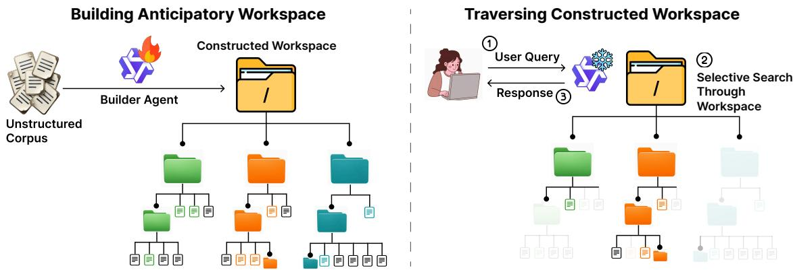
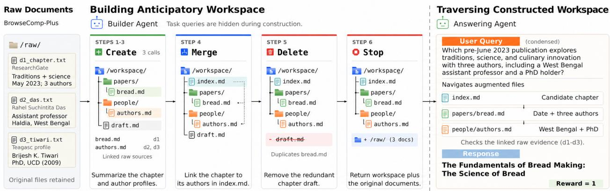
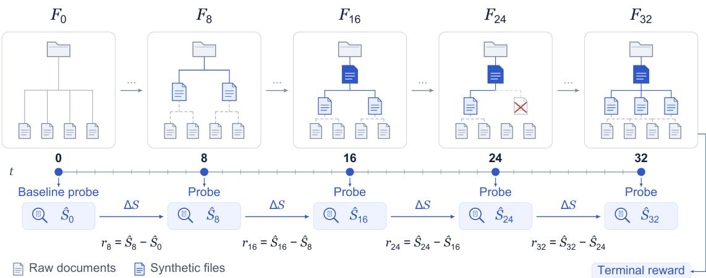
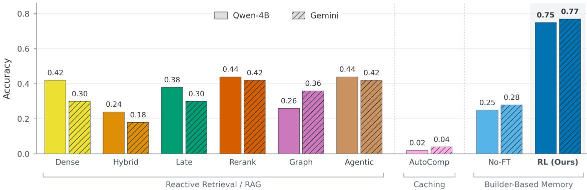
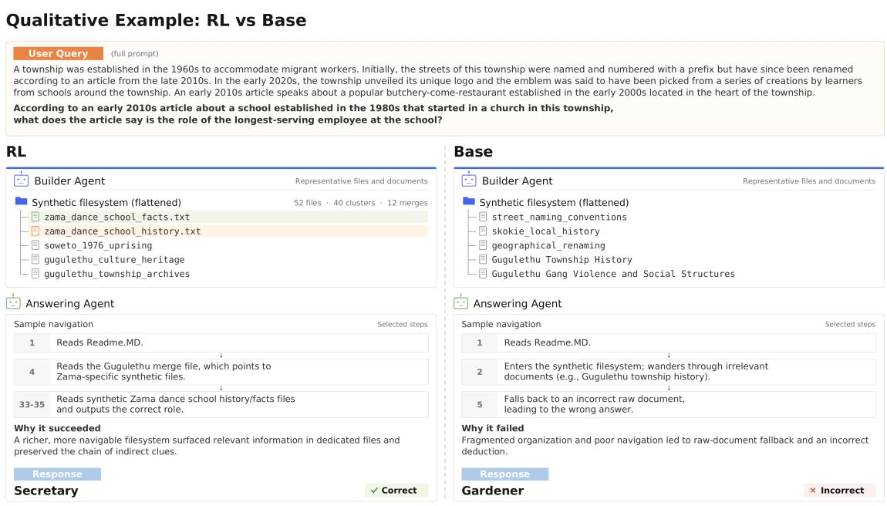
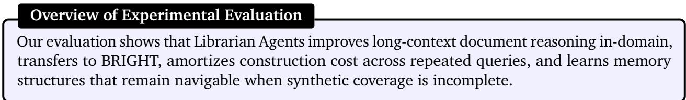
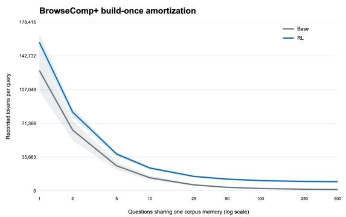
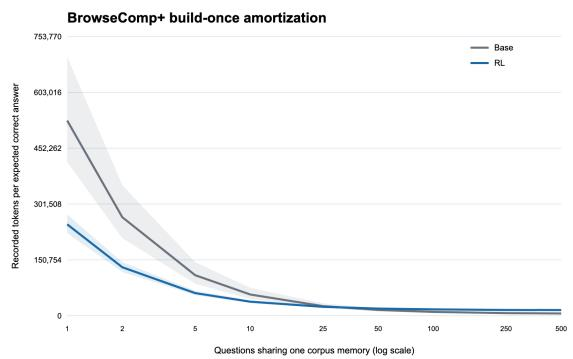
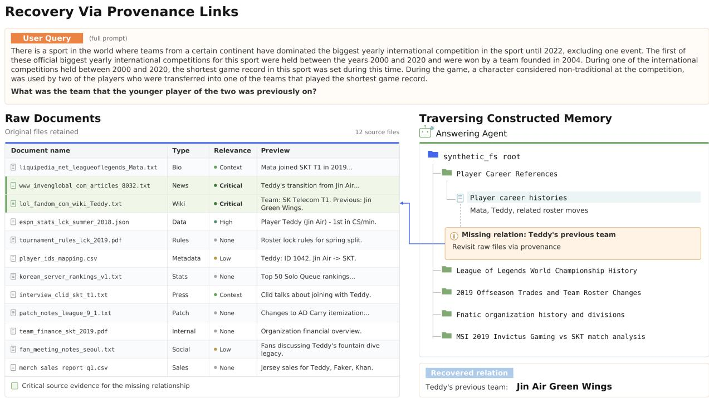
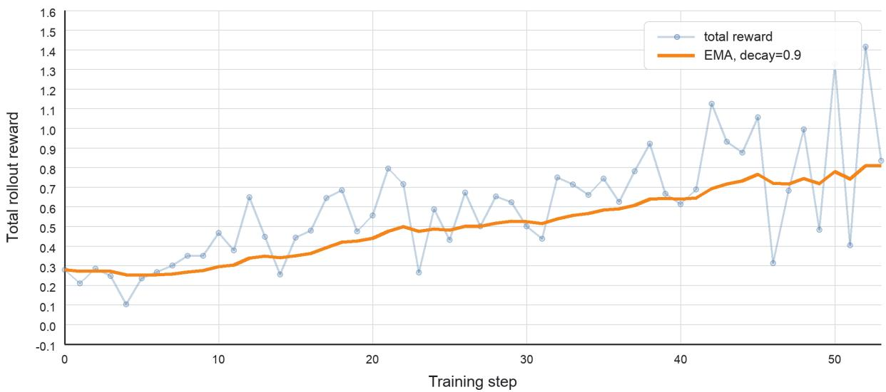

# Librarian Agents: Training LLMs to Curate Long-Context Workspaces that Anticipate Future Queries

Anikait Singh1,✸, Teresa Zhang1,✸, Yoonho Lee1,✸, Roshen Sanjay Nair1, Aviral Kumar2 and Chelsea Finn1 1Stanford University, 2Carnegie Mellon University, ✸Equal Contribution

Reasoning over long document contexts remains a challenge for large language models (LLMs). Standard retrieval methods are inherently reactive, bottlenecking agents with complex, cross-document reasoning at inference time, while precomputed structures like knowledge graphs often fall short because they rely on rigid heuristics. Instead, can we allow agents to perform anticipatory directed curation: learning to proactively reorganize unstructured corpora prior to inference to eficiently serve diverse future queries. We build on a key asymmetry in modern agentic harnesses (e.g., Claude Code): while LLM agents are adept at navigating existing filesystems to solve an immediate task, they are rarely trained to construct reusable workspaces for future use. To instantiate this capability, we introduce Librarian Agents, a framework in which a builder agent transforms raw documents into a hierarchical filesystem of synthetic files and reference links, which forms a workspace tailored for a downstream answering agent. We formulate workspace construction as a Markov decision process and optimize the builder policy via reinforcement learning to directly maximize downstream answering accuracy. Empirically, Librarian Agents outperforms the strongest retrieval and precomputation baselines by 33 percentage points on BrowseComp-Plus, amortizes upfront construction costs across repeated queries, and generalizes zero-shot to unseen domains on BRIGHT with a 31-point average accuracy improvement.

## 1. Introduction

Large language models (LLMs) are increasingly tasked with reasoning over extensive corpora of documents, often found in domains such enterprise knowledge bases, complex software repositories, and user chat histories, that exceed the context windows of today’s LLMs. In these domains, the information required to complete a given task is rarely centralized; instead, it is dispersed and disconnected across many disparate sources. Thus, for each incoming request, agents repeatedly process and revisit the corpus from scratch. Can we instead enable systems to eficiently navigate these massive context spaces without incurring high, redundant computational costs each time a user poses a new query?

A standard approach to this challenge is retrieval-augmented generation (RAG) (Gao et al., 2023), in which a system responds to a query by searching raw documents, retrieving relevant passages, and syn- thesizing an answer. Recent work has strengthened this pipeline with multi-agent frameworks (Jiang et al., 2023; Asai et al., 2023; Yan et al., 2024; Edge et al., 2024; Singh et al., 2025). However, these methods remain largely reactive: each query triggers a new round of search, requiring the model to repeatedly rediscover useful cross-document relationships at inference time. Other approaches pre-structure the search space before inference, for example, as a knowledge graph (Peng et al., 2025). These methods can improve retrieval, but they typically commit to a rigid set of abstractions such as extracting named entites (Keraghel et al., 2024). Such a structure is useful when future queries precisely align with the index, but it is less natural when queries require new task-specific intermediate artifacts. A common underlying theme of these approaches is that they impose an inductive bias of structure, which a downstream agent can utilize when answering a given query. We ask can we learn to anticipate this structure for a new set of context that we encounter, curating these documents in a form that that an answering agents can readily use. We propose to directly train an agent to reorganize a corpus into an anticipatory answer-facing workspace so that future LLM agents can eficiently find the right evidence for a query?

  
Figure 1: Overview of Librarian Agents. (Left) We train a builder agent to construct a workspace consisting of synthetic files and directories that anticipates future queries for a downstream answering agent. (Right) This workspace is built once and repeatedly used to answer diferent queries.

Motivated by approaches that shift computation across diferent aspects of the model training and deployment process (Lin et al., 2025; Wu et al., 2026; Suzgun et al., 2025; Zhang et al., 2025a), we study anticipatory workspace construction: the problem of augmenting and reorganizing a corpus before future queries arrive. The goal is to shift part of the costs from query time to a precomputation phase, thereby amortizing these costs across many downstream queries. To instantiate this setting, we introduce Librarian Agents, a framework built on a key asymmetry in current agentic systems: LLM agents are efective at navigating existing hierarchical filesystems, but are rarely trained to proactively construct such workspaces for future use. Librarian Agents addresses this gap by tasking a builder agent with transforming source documents into a multi-level workspace with references to the original corpus. An frozen answering agent then navigates this workspace to answer an individual user query. We formalize the builder agent’s operations as a Markov Decision Process (MDP) and directly optimize the workspace construction policy for downstream answering performance by posing it as a reinforcement learning (RL) problem on this MDP.

We demonstrate the eficacy of Librarian Agents on BrowseComp-Plus, Librarian Agents improves accuracy by an average of 33 percentage points over the best performing baseline. Furthermore, for BRIGHT, a domain which our builder agent is untrained on, gains persist over baselines with an average 31 point improvement over baselines.

In summary, our key contributions are:

• We formulate anticipatory workspace construction as a learnable model behavior: agents should materialize useful context as an answer-facing workspace before receiving user queries.

• We propose Librarian Agents, a framework where a builder agent synthesizes and organizes memory artifacts into a filesystem-based workspace for future queries.

• We formulate filesystem-based workspace construction as an MDP and optimize the builder agent via reinforcement learning to improve downstream query-answering performance.

• We evaluate Librarian Agents against retrieval and pre-computation baselines on BrowseComp- Plus and test zero-shot transfer on question-answering tasks derived from BRIGHT.

## 2. Librarian Agents: Agent Curated Filesystems as Anticipatory Workspaces

We introduce Librarian Agents, a framework for training an agent to construct an anticipatory workspace: a filesystem-based memory representation built before future queries arrive. Document-grounded agents can waste compute when each new query forces them to rediscover the same information across the raw corpus. In contrast, can we shift part of this computation by constructing a reusable memory in the form of an anticipatory workspace? We instantiate this by have an gent curate an augmented filesystem that exposes a long-context structure through operations that these agents already use well: using tools to navigate filesystems (Yang et al., 2024). The builder converts a flat collection of documents into a multi-level workspace whose synthetic files reduce search friction while preserving reference paths to the original corpus.

We first define the document corpus, filesystem, and augmentation operations that transform a flat collection of raw documents into an answer-facing workspace. We then articulate desiderata of an efective anticipatory memory workspace, which includes coverage with eficient navigation, fallback to raw evidence, and reuse across queries. Finally, we cast workspace construction as a finite-horizon Markov decision process in which the librarian model edits the filesystem to maximize the answering agent’s expected performance on future queries, subject to a construction-cost penalty.

## 2.1. Problem Setup.

We study long-context reasoning over a corpus of raw documents, $\mathcal { D } = \{ d _ { 1 } , d _ { 2 } , \ldots , d _ { n } \}$ , where the system must answer queries $q \sim \mathcal { Q } .$ . This setting matches retrieval-augmented generation (RAG) systems, which typically answer each query by searching over a static retrieval index over $\mathcal { D }$ and then synthesizing a response.

We represent the agent’s external memory as a filesystem-based workspace ${ \mathcal { F } } \colon$ a set of files and directories together with metadata specifying each node’s type and parent. The initial workspace $\mathcal { F } _ { 0 }$ contains the raw documents in � as files under the root. An augmentation � is an edit operation that modifies a workspace, for example by creating, rewriting, deleting, or moving files and folders. At iteration $i ,$ an augmentation $A _ { i }$ transforms the previous workspace $\mathcal { F } _ { i - 1 }$ into ${ \mathcal { F } } _ { i }$ . Applying a sequence of augmentations for horizon � produces a final workspace $\mathcal { F } _ { H }$

System performance is measured by a scoring function $\operatorname { A c c } ( \tilde { y } , y ^ { * } )$ that evaluates the correctness of the generated response $\tilde { y }$ against the ground-truth target $y ^ { * }$ . Memory construction also incurs a cost, denoted $\mathrm { C o s t } ( A _ { i } )$ , such as the number of tokens generated or modified by $A _ { i }$

## Overview of Problem Setup

Anticipatory workspace construction is the problem of transforming a large corpus into a structured filesystem-based workspace before downstream queries are observed.

## 2.2. Desiderata for Anticipatory Workspaces.

A useful memory should do more than “remember” a corpus. It should reshape the corpus into an answer-facing workspace that helps future agents quickly find relevant evidence while preserving a path back to the raw source documents. As a running example, consider an enterprise corpus containing design docs, issue threads, launch notes, and customer reports for the same product. One future query may ask for a low-level implementation detail; another may ask how a user-visible behavior changed across releases; a third may ask for the exact source that supports a disputed claim. We use these examples to motivate three key desiderata.

Coverage with Eficient Navigation. The memory should cover many plausible queries while reducing the need to search the raw corpus. In the enterprise example, the builder might create a release timeline, a component-level design index, and customer-facing behavior summaries, each linking the same underlying documents from a diferent angle. These artifacts help only if the answering agent can reach them through short, legible paths, such as directories named by abstraction level. Thus, the builder should synthesize cross-document artifacts that cover likely regions of the query distribution � and place them where an agent can discover them with shallow traversal.

Faithful Fallback. No finite memory can anticipate every query, and synthesized artifacts can omit details that are critical in hindsight. The workspace must therefore preserve reference links and raw source paths so the answering agent can verify claims or bypass the synthesized layer when needed. In the enterprise example, a rare query about a single customer may not appear in the high-level summary, but the agent should still be able to read any existing issue thread. As an extreme example, such a fallback is important for needle-in-a-haystack queries where the answer depends on a localized, very specific fact that is unlikely to survive compression (Wang et al., 2024).

Amortized Reuse. The builder’s construction cost should pay of across many downstream queries. For example, a compact release timeline written by the builder agent may help answer many questions about regressions, roadmap changes, customer messaging, and dependency updates. In contrast, a one-of answer draft may surface similar information but help only a single request. This creates a tradeof between the construction cost $\textstyle \sum _ { i = 1 } ^ { H } \operatorname { C o s t } ( \mathcal { A } _ { i } )$ and the downstream utility.

## Overview of Anticipatory Workspace Desiderata

An efective anticipatory workspace should make likely queries easy to answer, preserve fallback paths to raw documents, and pay of across many downstream queries.

## 2.3. Workspace MDP Formalization.

In Librarian Agents, anticipatory workspace construction proceeds in two phases: an upfront synthesis phase and a downstream answering phase. The synthesis phase is analogous to the ofline construction of a retrieval index or knowledge graph, but instead produces a flexible filesystem-based workspace. To instantiate this idea, we define a builder agent $\pi _ { \mathrm { b u i l d } } ( { \mathcal { A } } \mid { \mathcal { F } } )$ , which proposes augmentations given the current workspace, and an answering agent $\pi _ { \mathrm { a n s } } ( \tilde { y } \mid q , \mathcal { F } )$ , which generates an answer �˜ for a new query � using the constructed workspace.

  
Figure 2: MDP Definition of Librarian Agents. Starting from a raw list of documents, a builder agent can create a workspace with four actions: Create, Merge, Delete, and Stop. An answering agent navigates the resulting workspace through file-listing and file-reading actions, produces a response, and receives a task-specific correctness score. Here, we depict an augmented workspace from the BrowseComp-Plus dataset.

We cast the builder agent’s sequence of filesystem operations as a finite-horizon Markov Decision Process (MDP), allowing memory construction to be optimized as a policy-learning problem.

State, Action, and Transition Dynamics. At each timestep �, the state is the current filesystem Ft $\mathcal { F } _ { t }$ consisting of the original raw documents � together with the synthetic files, folders, and reference links created so far. The builder agent selects an augmentation $\mathcal { A } _ { t } \sim \pi _ { \mathrm { b u i l d } } ( \cdot \mid \mathcal { F } _ { t } )$ , which is applied to the filesystem to produce $\mathcal { F } _ { t + 1 }$ . We constrain the builder to the following discrete action types that can each be applied to diferent files:

• CreateFile: Creates a new synthetic file by consolidating information from a subset of raw documents and/or existing synthetic files. The file has reference links to the set of sources used to construct it.

• MergeFiles: Aggregates a set of related synthetic files into a higher-level summary or directory- like artifact. This action introduces hierarchy, linking to child files.

• Delete: Removes redundant/unhelpful synthetic files from the active answer-facing workspace. This operation never deletes raw documents in �, preserving fallback access.

• Stop: Terminates memory construction, returning the current workspace $\mathcal { F } _ { t }$ as the final memory artifact to use for the downstream answering agent.

The action types here is intentionally constrained to reduce the horizon for optimization. In principle, this interface can be generalized to a broader set of atomic filesystem commands (e.g., touch, mkdir, mv, rm, etc). We describe the instantiation of these actions in the filesystem in Appendix A.8.

Reward Function. The reward should incentivize the builder to construct a memory artifact that improves both downstream answer accuracy and navigation eficiency over the query distribution �. We first define the expected answering success of a filesystem $\mathcal { F }$ as

$$
S ( \mathcal { F } ) : = \mathbb { E } _ { q \sim \mathcal { Q } } \mathbb { E } _ { \tilde { y } \sim \pi _ { \mathrm { a n s } } ( \cdot \vert q , \mathcal { F } ) } \big [ \operatorname { A c c } \big ( \tilde { y } , y ^ { * } ( q ) \big ) \big ] ,
$$

where $y ^ { * } ( q )$ is the ground-truth answer to query � and $\operatorname { A c c } ( \tilde { y } , y ^ { * } ( q ) ) \in \{ 0 , 1 \}$ indicates whether the answer �˜ is correct. To account for navigation eficiency, we define the downstream utility

$$
\begin{array} { r } { U ( \mathcal { F } ) : = S ( \mathcal { F } ) - \lambda _ { \mathrm { t o k } } C _ { \mathrm { t o k } } ( \mathcal { F } ) - \lambda _ { \mathrm { r e a d } } C _ { \mathrm { r e a d } } ( \mathcal { F } ) , } \end{array}\tag{1}
$$

where $C _ { \mathrm { t o k } }$ and $C _ { \mathrm { r e a d } }$ denote the expected normalized synthetic-memory token cost and file-read cost, respectively. Before averaging over queries and answering rollouts, each rollout’s cost is multiplied by its correctness indicator. Navigation penalties therefore apply only to correct answers: an incorrect answer receives zero utility regardless of its navigation cost. Setting $\lambda _ { \mathrm { t o k } } = \lambda _ { \mathrm { r e a d } } = 0$ recovers the accuracy-only utility $U ( \mathcal { F } ) = S ( \mathcal { F } )$ .

The sparse construction objective scores the final filesystem while penalizing the total cost of building it:

$$
r ^ { \mathrm { s p a r s e } } : = U ( \mathcal { F } _ { H } ) - \alpha \sum _ { t = 1 } ^ { H } \mathrm { C o s t } _ { \mathrm { b u i l d } } ( \mathcal { A } _ { t } ) ,\tag{2}
$$

where $\alpha \geq 0$ weights construction-time expenditure. Although this objective captures the desired outcome, it provides only coarse credit assignment over a potentially long sequence of edits. An ideal dense reward instead credits each augmentation with its marginal contribution to downstream utility, net of its construction cost:

$$
r _ { t } ^ { \mathrm { d e n s e } } : = U ( \mathcal { F } _ { t } ) - U ( \mathcal { F } _ { t - 1 } ) - \alpha \mathrm { C o s t } _ { \mathrm { b u i l d } } ( \mathcal { A } _ { t } ) .\tag{3}
$$

Under undiscounted returns $( \gamma = 1 )$ , these rewards telescope:

$$
\sum _ { t = 1 } ^ { H } r _ { t } ^ { \mathrm { d e n s e } } = r ^ { \mathrm { s p a r s e } } - U ( \mathcal { F } _ { 0 } ) .\tag{4}
$$

  
Figure 3: Dense Rewards via Probes. We train the builder agent with RL to directly maximize performance of answering agent. To densify the reward, the builder agent operates over workspace augmentations and is rewarded for change in accuracy. Probes to the answering agent are done at regular intervals (8 turns) up to the maximum horizon �.

Because $U ( \mathcal { F } _ { 0 } )$ is fixed for a given initial filesystem, maximizing the cumulative dense reward is equivalent to maximizing the sparse objective, following potential-based reward shaping (Ng et al., 1999). Advantages are computed at each step, following multi-turn GRPO implementations (Baronio et al., 2025), thereby allowing earlier builder turns to receive a denser learning signal.

Evaluating downstream utility after every edit can be expensive, so we train with a practical surrogate objective. We probe answerability every eight turns as seen in Figure 3 and combine changes between consecutive probes with a terminal downstream-answer reward. In the primary experiment, we use $\gamma = 1$ and optimize answerability and terminal correctness without explicit navigation-cost, filesystem-structure, or construction-cost shaping; equivalently, $\lambda _ { \mathrm { t o k } } = \lambda _ { \mathrm { r e a d } } = \alpha = 0$ . During training, all downstream quantities are estimated on minibatches of training queries that are hidden from the builder; evaluation queries are never used to construct a filesystem or select the reported checkpoint. Appendix A.7 provides the complete configuration.

## Overview of MDP Formulation

We formulate memory construction as an MDP in which periodic answerability changes and terminal answer correctness provide credit for useful filesystem edits; the general objective can additionally incorporate navigation and construction costs.

## 2.4. Workspace Augmentations via RL.

The MDP formulation above enables direct optimization of the workspace construction process with reinforcement learning. In each rollout, the builder iteratively edits the workspace for up to � steps, producing a trajectory

$$
\tau = ( \mathcal { F } _ { 0 } , \boldsymbol { A } _ { 1 } , \mathcal { F } _ { 1 } , \ldots , \boldsymbol { A } _ { T } , \mathcal { F } _ { T } ) ,\tag{5}
$$

where $T \leq H$ is determined either by the horizon or the Stop action.

The resulting workspace is then evaluated by the answering agent on a minibatch of queries sampled from �. These queries are used only for reward estimation and are not provided to the builder during construction. In the primary configuration, the builder receives periodic answerability-delta rewards together with the terminal answer score. This hybrid signal approximates the dense objective while avoiding an expensive answering evaluation after every workspace edit. This training signal encourages the builder to discover workspace edits that are not merely locally coherent but also useful for improving downstream question answering. When $\alpha > 0 _ { z }$ , the objective additionally trades these improvements against construction cost. We optimize the builder policy with GRPO (Shao et al., 2024), a policy-gradient method used for RL-based fine-tuning of language models.

By default, we treat the answering agent $\pi _ { \tt a n s }$ as fixed during builder optimization. This isolates the learning problem: the builder learns to construct memories that are useful to the answering agent, which may be a language model or another long-context reasoning system such as RLM (Zhang et al., 2025a). We can also consider an alternative joint-training variant in which the answering agent is adapted using the same downstream correctness signal. In this setting, optimization can alternate between updating the builder and updating the answerer via a cooperative multi-agent RL framework, followin methods such as RLAD (Qu et al., 2025a). The full o timization rocess is outlined in Algorithm 1.

## Overview of RL Optimization

We optimize the builder as an LLM policy over filesystem edits. Each rollout constructs a memory, evaluates it with a fixed answering agent, and updates the builder with GRPO using periodic answerability changes and terminal answer correctness.

Having formulated anticipatory workspace construction as an MDP in Section 2, we evaluate whether Librarian Agents improves the reasoning performance and inference eficiency of downstream an- swering agents on long-context document reasoning tasks. We compare Librarian Agents with prior reactive retrieval and pre-computation methods to address four questions: (1) Does Librarian Agents improve in-distribution long-context reasoning performance? (2) What amortization benefits do Librarian Agents provide when serving multiple queries over a shared document set? (3) Does the builder agent’s anticipatory construction capability generalize zero-shot to out-of-distribution retrieval settings? (4) Qualitatively, how do the builder and answering agents behave during the construction and answering phases, and do these behaviors reflect the intended anticipatory capability? We examine each question in turn below.

Task Definition. The main domain we consider for long-document reasoning is BrowseComp-Plus (Chen et al., 2025), a curated corpus of deep-research web tasks. We split this dataset into two sets for training and evaluation: 680 tasks for training and 50 held-out tasks for all evaluations (sampled at random). For training $\pi _ { \mathrm { b u i l d } }$ , each task consists of an independent set of raw documents and a downstream query to be answered based on the set of documents. We additionally evaluate the performance of Librarian Agents on the BRIGHT Benchmark (Su et al., 2025), which comprises tasks from diverse domains (StackExchange, LeetCode, and math competitions), to assess the builder agent’s eficacy on unseen distributions.

Comparisons and baselines. We evaluate our a roach a ainst several re resentative baselines. First, we compare with standard reactive retrieval methods: an Embedding with optional Reranker baseline (Zhan et al., 2025c) and Late Interaction Embedding (Chafin & Sourt , 2025), which represent conventional retrieve-and-read RAG systems that process each query from scratch. Second, we compare with Graph RAG (Peng et al., 2025), a knowledge graph baseline that uses precomputation. Third, we include Agentic RAG (Singh et al., 2025), which represents multi-agent approaches that dynamically interleave retrieval and reasoning at query time. Next, we compare autocompaction methods such as those that periodically summarize the computation performed, such as RC (Wu et al., 2026). These baselines cover both ends of the design space, with some doing all cross-document reasoning per query and others doing it once up front. We also include an ablation of our own framework: a builder agent without RLfine-tuning. This isolates the contribution of our MDP-based policy optimization. For all methods, the downstream answering agents, Qwen3.5-4B and Gemini 3.1 Flash lite, are kept frozen so that performance diferences reflect only the quality of the resulting memory artifacts. More details on the baselines and hyperparameters are available in Appendix A.7.

  
Figure 4: Results on BrowseComp-Plus. We compare Librarian Agents against RAG, Caching and Builder-Based Memory baselines using two answering agent models (Qwen 3.5 4B and Gemini 3.1 Flash Lite). We find that Librarian Agents significantly outperforms all methods for both answering agents.

Table 1: Construction Cost, BrowseComp-Plus. We com-pare the accuracy and cost of Librarian Agents with indexing based baselines in tokens.
<table><tr><td>Memory / Retrieval</td><td>Acc.</td><td>Construction Cost (tokens)</td></tr><tr><td>GraphRAG</td><td>0.36</td><td>11,923</td></tr><tr><td>AutoCompaction</td><td>0.04</td><td>501,637</td></tr><tr><td>Builder (No FT)</td><td>0.28</td><td>127,683</td></tr><tr><td>Librarian Agents (ours)</td><td>0.77</td><td>178,926</td></tr></table>

Table 2: Performance on amortized BrowseComp-Plus (base vs. fine-tuned). The fine-tuned builder improves accuracy from 0.24 to 0.64 on the amortized variant of browsecomp. The resulting answering agent reads 26.9 files and 9,346 tokens per query on average.
<table><tr><td>Model</td><td>Accuracy</td><td>Answer tokens per query</td><td>Files per query</td></tr><tr><td></td><td>0.242</td><td>1,238</td><td>2.72</td></tr><tr><td>Qwen 3.5 4B Builder</td><td>± 0.036</td><td>± 155</td><td>± 0.35</td></tr><tr><td></td><td>0.637</td><td>9,346</td><td>26.90</td></tr><tr><td>Ours</td><td>± 0.029</td><td>± 596</td><td>± 1.70</td></tr></table>

(1) In Distribution Performance of Librarian Agents on BrowseComp-Plus. We evaluate the performance of Librarian Agents on the BrowseComp-Plus domain in Figure 4. Here we find that Librarian Agents with RL fine-tuning significantly outperforms all reactive and pre-computation baselines. When using the frozen Qwen3.5-4B answering agent, Librarian Agents achieves an accuracy of 0.75, representing a substantial improvement over the Embedding (0.42) and Reranker (0.44) baselines. A similar trend is observed with Gemini 3.1 Flash Lite, where Librarian Agents reaches 0.77, compared with baseline scores of 0.30 and 0.42. Crucially, the ablation without RL fine- tuning (No FT) additionally underperforms below Librarian Agents, highlights that policy optimization with RL is essential for teaching the builder agent to structure memories efectively for downstream consumption, a task the base model was not trained for.

(2) Memory reuse and cost per correct answer. Filesystem construction is a one-time cost that helps all queries using the same document set. We therefore measure the amortized cost in a dataset we extend so that each document set serves multiple queries. As shown in Table 1, Librarian Agents incurs an upfront construction cost of 179K tokens and achieves an accuracy of 0.77, compared with 0.36 and 0.04, res ectivel . To examine how this cost is distributed when a files stem is reused, we evaluate 443 frozen synthetic queries across 50 document sets, with 7–10 queries per document set, generated by Gemini 3.1 Flash Lite few-shot prompted with sample DeepDive (Lu et al., 2025) questions. On these queries, the same evaluation filesystems yield an accuracy of 0.64 versus 0.24 for the base builder at an answer-time cost of 9.3K tokens per query. At a hypothetical reuse load of 20 queries per document set, spreading the reported construction cost across those queries gives a projected total of roughly 18K tokens per query (Table 2). Because the answering agent reads a richer filesystem, raw per-query token counts remain higher than with the base builder. After normalizing for accuracy, Librarian Agents uses 33.8% fewer recorded tokens per expected correct answer at ten questions per corpus (RL/Base ratio 0.662, 95% CI [0.504, 0.836]) as shown in Appendix A.4.

Table 3: Zero-Shot Transfer to BRIGHT. The builder agent, trained only on DeepResearch tasks (BrowseComp) is evaluated on BRIGHT without task-specific training, testing whether Librarian Agents learns a transferable capability of anticipation across diferent query and document sources. Librarian Agents outperforms baselines on 3 sub-tasks within BRIGHT (AOPS, Biology, and Stack Overflow) achieving an average a pass@1 accuracy of 52% and pass@3 accuracy of 67% with the Qwen3.5-4B model.
<table><tr><td></td><td colspan="2">AOPS</td><td colspan="2">Biology</td><td colspan="2">Stack Overflow</td><td colspan="2">Average</td></tr><tr><td>Method</td><td>pass@1</td><td>pass@3</td><td>pass@1</td><td>pass@3</td><td>pass@1</td><td>pass@3</td><td>pass@1</td><td>pass@3</td></tr><tr><td>BM25</td><td> $3 0 . 5 \pm 5 . 9$ </td><td> $3 7 . 0 \pm 6 . 8$ </td><td> $1 7 . 5 \pm 4 . 6$ </td><td> $2 6 . 0 \pm 6 . 0$ </td><td> $9 . 0 \pm 3 . 3$ </td><td> $1 5 . 5 \pm 4 . 8$ </td><td> $1 9 . 0 \pm 2 . 7$ </td><td> $2 6 . 2 \pm 3 . 4$ </td></tr><tr><td>Dense</td><td> $3 1 . 5 \pm 6 . 0$ </td><td> $3 8 . 0 \pm 6 . 9$ </td><td> $1 9 . 5 \pm 4 . 8$ </td><td> $2 9 . 0 \pm 6 . 1$ </td><td> $1 1 . 5 \pm 3 . 9$ </td><td> $1 7 . 0 \pm 5 . 2$ </td><td> $2 0 . 8 \pm 2 . 9$ </td><td> $2 8 . 0 \pm 3 . 5$ </td></tr><tr><td>Hybrid</td><td> $3 3 . 0 \pm 6 . 4$ </td><td> $3 7 . 0 \pm 6 . 8$ </td><td> $1 4 . 0 \pm 4 . 3$ </td><td> $2 0 . 5 \pm 5 . 6$ </td><td> $7 . 0 \pm 2 . 4$ </td><td> $1 5 . 5 \pm 4 . 8$ </td><td> $1 8 . 0 \pm 2 . 7$ </td><td> $2 4 . 3 \pm 3 . 3$ </td></tr><tr><td>Rerank</td><td> $3 2 . 0 \pm 6 . 1$ </td><td> $3 7 . 5 \pm 6 . 9$ </td><td> $1 4 . 0 \pm 4 . 1$ </td><td> $2 3 . 0 \pm 5 . 6$ </td><td> $6 . 0 \pm 2 . 6$ </td><td> $1 1 . 0 \pm 4 . 3$ </td><td> $1 7 . 3 \pm 2 . 6$ </td><td> $2 3 . 8 \pm 3 . 3$ </td></tr><tr><td>Agentic</td><td> $2 8 . 5 \pm 5 . 6$ </td><td> $3 7 . 0 \pm 6 . 8$ </td><td> $1 7 . 0 \pm 4 . 5$ </td><td> $2 5 . 5 \pm 5 . 9$ </td><td> $6 . 5 \pm 2 . 5$ </td><td> $1 4 . 5 \pm 4 . 5$ </td><td> $1 7 . 3 \pm 2 . 5$ </td><td> $2 5 . 7 \pm 3 . 3$ </td></tr><tr><td>Late interaction</td><td> $2 8 . 5 \pm 5 . 5$ </td><td> $3 7 . 5 \pm 6 . 9$ </td><td> $1 8 . 0 \pm 4 . 9$ </td><td> $2 4 . 5 \pm 6 . 0$ </td><td> $7 . 0 \pm 2 . 5$ </td><td> $1 4 . 5 \pm 4 . 8$ </td><td> $1 7 . 8 \pm 2 . 6$ </td><td> $2 5 . 5 \pm 3 . 4$ </td></tr><tr><td>Graph</td><td> $1 2 . 5 \pm 4 . 4$ </td><td> $1 5 . 5 \pm 5 . 1$ </td><td> $5 . 0 \pm 2 . 9$ </td><td> $6 . 0 \pm 3 . 4$ </td><td> $1 . 5 \pm 1 . 1$ </td><td> $3 . 5 \pm 2 . 5$ </td><td> $6 . 3 \pm 1 . 8$ </td><td> $8 . 3 \pm 2 . 2$ </td></tr><tr><td>AutoCompaction</td><td> $6 . 0 \pm 3 . 4$ </td><td> $6 . 0 \pm 3 . 4$ </td><td> $6 . 0 \pm 3 . 4$ </td><td> $6 . 0 \pm 3 . 4$ </td><td> $1 . 5 \pm 1 . 5$ </td><td> $2 . 0 \pm 2 . 0$ </td><td> $4 . 5 \pm 1 . 7$ </td><td> $4 . 7 \pm 1 . 7$ </td></tr><tr><td>Librarian</td><td> ${ \bf 3 6 . 0 \pm 5 . 6 }$ </td><td> ${ \bf 5 0 . 0 \pm 6 . 9 }$ </td><td> $3 4 . 5 \pm 4 . 9$ </td><td> ${ \pm } 7 . 0 \pm 6 . 5$ </td><td> ${ \pm } 5 . 5 \pm 3 . 9$ </td><td> $9 3 . 5 \pm 3 . 4$ </td><td> ${ \pm 2 . 0 \pm 2 . 8 }$ </td><td> ${ \bf 6 6 . 8 \pm 3 . 4 }$ </td></tr></table>

(3) Transfer of Builder Agent to novel long-context document reasoning setting. To assess whether the builder agent learns a generalized anticipatory capability rather than simply overfitting to the DeepResearch training distribution, we evaluate Librarian Agents zero-shot on the BRIGHT benchmark. Here, we study 150 questions spanning 3 domains with 50 per domain, with one filesystem per domain (also studying amortization). As detailed in Table 3, the RL-finetuned builder agent successfully transfers to highly out-of-distribution domains such as biology and math problem solving. Librarian Agents achieves an average pass@1 accuracy of 0.52 and pass@3 accuracy of 0.67 across the 3 BRIGHT datasets, outperforming baselines. These results confirm that framing memory construction as an MDP enables the builder to learn fundamental, transferable heuristics for organizing information, which remain robust even when encountering novel, unseen documents.

The structural statistics on BRIGHT further show that RL substantially changes construction behavior. Across the 3 sub-domains, the trained builder produces richer hierarchical memories, averaging 53.4 active synthetic files organized into 45.4 clusters and 8.0 merged artifacts, compared with 4.8 files, 4.2 clusters, and 0.6 merges for the base builder.

(4) Analysis of Librarian Agents and capability of anticipation. We next examine the filesystems that Librarian Agents constructs and how the answering agent uses them. Figure 2 illustrates that the trained builder combines broad topical coverage with hierarchical organization. Tables 4 and 5 complement this view by distinguishing answering-agent retrieval (the synthetic files and tokens read) from builder structure (the active files, clusters, and merges it produces). Broad coverage expands the range of future queries the memory can support, while hierarchical organization makes fine-grained evidence easier to locate.

The first qualitative case examines robustness when anticipatory coverage is incomplete. In Figure 7, a BrowseComp+ query requires a detail omitted from the synthetic layer. The answering agent follows a provenance link to the relevant raw file and recovers the answer without enumerating the full unstructured corpus.

The second case isolates the changes that reinforcement learning makes in the constructed memory. Figure 5 compares the trained builder with the base policy on the same BrowseComp+ document set. The trained builder creates a broader, more coherent set of query-relevant artifacts, while the base policy leaves a fragmented organization that is harder for the answering agent to navigate.

  
Figure 5: Qualitative comparison of RL and base building. On BrowseCom -Plus, the base model creates a fra mented filesystem that is dificult for the answering agent to navigate, whereas the RL-trained builder surfaces relevant information in dedicated files and produces a richer, more ergonomic organization.

## 3. Related Work

Retrieval-Augmented Generation. RAG grounds language model outputs in external evidence, mitigating the limitations of purely parametric memory (Lewis et al., 2020; Gao et al., 2023; Li et al., 2025; Oche et al., 2025). Recent innovations have evolved this pipeline into agentic systems capable of multi-step reasoning (Xu et al., 2024; Zhang et al., 2025b; Singh et al., 2025). For instance, models can now predict upcoming content to trigger searches (Jiang et al., 2023), use reflection tokens for self-critique (Asai et al., 2023; Yan et al., 2024), or execute planned searches to navigate multi-hop questions (Li et al., 2026b). However, these approaches initiate complex, iterative retrieval only after receiving a user query. In contrast, Librarian Agents front-loads this computational burden by proactively synthesizing a structured, query-agnostic filesystem prior to inference, amortizing the cost of corpus-level reasoning.

Structured Indexes and Corpus-Level Organization. Prior systems precompute corpus structure: RAPTOR builds hierarchical summaries (Sarthi et al., 2024); GraphRAG and related methods construct entity graphs and community summaries (Edge et al., 2024; Li et al., 2024; Guo et al., 2025); and HippoRAG builds graph-structured memory (Jiménez Gutiérrez et al., 2024). Although valuable, these preprocessing methods rely heavily on rigid, rule-based extraction pipelines or predefined schemas. In contrast, Librarian Agents make anticipatory memory construction fully agentic and optimizable. Librarian Agents treats the structure itself as a learned decision, with a builder that chooses its own files and hierarchy and is rewarded by how well a later agent answers.

Long-Term Memory for Language Agents. Prior work explores endowing language models with persistent, stateful memory to support continuous operation. For instance, recent works propose to cache conversational histories (Wang et al., 2023; Zhong et al., 2023; Uddin et al., 2026), manage virtual context windows via memory tiers (Packer et al., 2023), and unify short- and long-term memory directly within the agent’s policy (Yu et al., 2026b; Xu et al., 2025). However, these approaches primarily focus on an agent retaining its own historical context. Librarian Agents addresses a diferent setting, in which the memory is written over an external corpus ahead of time and judged by how well another agent answers from it.

Compute Reallocation. Our approach aligns with emerging literature on reallocating computation across time to improve test-time scaling (Lin et al., 2025; Wu et al., 2026; Yan et al., 2026; Yu et al., 2026a; Li et al., 2026a). Other approaches formalize test-time compute optimization as metareinforcement learning optimization to adaptively allocate tokens (Qu et al., 2025b) or utilize selfcurated test-time curricula to reinforce successful strategies (Hübotter et al., 2025). To our knowledge, Librarian Agents is the first to treat corpus organization as a policy optimized for downstream answers, training a builder to do once what an answering agent would otherwise repeat for every query. Our hyperparameters explicitly control how construction cost and query-time cost are weighed against answer accuracy.

## 4. Discussion, Limitations, and Future Work

We study the capability of anticipatory directed curation, in which agents can proactively reorganize their context into a memory artifact optimized for future queries they encounter. To instantiate this capability, we rely on an asymmetry for agents today, where agents are trained to navigate a filesystem for a given task, yet do not pre-construct workspaces for future queries that they might encounter. Our novel framework, Librarian Agents, introduces a builder agent that creates a synthetic filesystem that an answering agent can navigate. Librarian Agents yields consistent improvements on BrowseComp-Plus and BRIGHT, outperforming existing retrieval methods on both in-domain and out-of-distribution evaluations.

Our evaluation is limited to question answering over static corpora, and maintaining anticipatory memories as documents change remains an open problem. The builder agent also operates over a large file context, which may limit scalability, though pairing Librarian Models with clustering or retrieval could extend the framework to larger domains. Since no finite set of synthesized artifacts can anticipate every query, compression may discard details needed for needle-in-a-haystack tasks; we preserve reference links for fallback access, but deciding when to bypass the synthetic filesystem remains a challenge. A natural extension is a filesystem that updates from its own trafic, treating each answered query as evidence of what the next reader will need. Future work could also let the builder compose atomic filesystem commands, of which its current four actions are special cases.

## 5. Acknowledgements

We would like to thank Apurva Gandhi, Jack Hao Bai, Violet Xiang, Rulin Shao and others in the Stanford IRIS Lab and CMU AIRE Lab for discussions. We thank Simon Guo, Rafael Rafailov, and Charles Frye for their support via the Tinker Research Program and the Modal Academic Research Program. This work was supported by the Schmidt Sciences AI2050, NSF GRFP and an Amazon gift.

## References

Akari Asai, Zeqiu Wu, Yizhong Wang, Avirup Sil, and Hannaneh Hajishirzi. Self-RAG: Learning to retrieve, generate, and critique through self-reflection. arXiv preprint arXiv:2310.11511, 2023. URL https://arxiv.org/abs/2310.11511.

Carlo Baronio, Pietro Marsella, Ben Pan, Simon Guo, and Silas Alberti. Kevin: Multi-turn rl for generating cuda kernels, 2025. URL https://arxiv.org/abs/2507.11948.

Antoine Chafin and Raphaël Sourty. Pylate: Flexible training and retrieval for late interaction models, 2025. URL https://arxiv.org/abs/2508.03555.

Mark Chen, Jerry Tworek, Heewoo Jun, Qiming Yuan, Henrique Ponde de Oliveira Pinto, Jared Kaplan, Harri Edwards, Yuri Burda, Nicholas Joseph, Greg Brockman, Alex Ray, Raul Puri, Gretchen Krueger, Michael Petrov, Heidy Khlaaf, Girish Sastry, Pamela Mishkin, Brooke Chan, Scott Gray, Nick Ryder, Mikhail Pavlov, Alethea Power, Lukasz Kaiser, Mohammad Bavarian, Clemens Winter, Philippe Tillet, Felipe Petroski Such, Dave Cummings, Matthias Plappert, Fotios Chantzis, Elizabeth Barnes, Ariel Herbert-Voss, William Hebgen Guss, Alex Nichol, Alex Paino, Nikolas Tezak, Jie Tang, Igor Babuschkin, Suchir Balaji, Shantanu Jain, William Saunders, Christopher Hesse, Andrew N. Carr, Jan Leike, Josh Achiam, Vedant Misra, Evan Morikawa, Alec Radford, Matthew Knight, Miles Brundage, Mira Murati, Katie Mayer, Peter Welinder, Bob McGrew, Dario Amodei, Sam McCandlish, Ilya Sutskever, and Wojciech Zaremba. Evaluating large language models trained on code, 2021. URL https://arxiv.org/abs/2107.03374.

Zijian Chen, Xueguang Ma, Shengyao Zhuang, Ping Nie, Kai Zou, Andrew Liu, Joshua Green, Kshama Patel, Ruoxi Meng, Mingyi Su, et al. Browsecomp-plus: A more fair and transparent evaluation benchmark of deep-research agent. arXiv preprint arXiv:2508.06600, 2025.

Darren Edge, Ha Trinh, Newman Cheng, Joshua Bradley, Alex Chao, Apurva Mody, Steven Truitt, Dasha Metropolitansky, Robert Osazuwa Ness, and Jonathan Larson. From local to global: A graph RAG approach to query-focused summarization. arXiv preprint arXiv:2404.16130, 2024. URL https://arxiv.org/abs/2404.16130.

Yunfan Gao, Yun Xiong, Xinyu Gao, Kangxiang Jia, Jinliu Pan, Yuxi Bi, Yi Dai, Jiawei Sun, Meng Wang, and Haofen Wang. Retrieval-augmented generation for large language models: A survey. arXiv preprint arXiv:2312.10997, 2023. URL https://arxiv.org/abs/2312.10997.

Kai Guo, Harry Shomer, Shenglai Zeng, Haoyu Han, Yu Wang, and Jiliang Tang. Empowering GraphRAG with Knowledge Filtering and Integration, 2025. URL https://arxiv.org/abs/2503. 13804.

Jonas Hübotter, Leander Diaz-Bone, Ido Hakimi, Andreas Krause, and Moritz Hardt. Learning on the Job: Test-Time Curricula for Targeted Reinforcement Learning, 2025. URL https://arxiv.org/ abs/2510.04786.

Zhengbao Jiang, Frank F. Xu, Luyu Gao, Zhiqing Sun, Qian Liu, Jane Dwivedi-Yu, Yiming Yang, Jamie Callan, and Graham Neubig. Active retrieval augmented generation. arXiv preprint arXiv:2305.06983, 2023. URL https://arxiv.org/abs/2305.06983.

Bernal Jiménez Gutiérrez, Yiheng Shu, Yu Gu, Michihiro Yasunaga, and Yu Su. HippoRAG: Neurobiologically inspired long-term memory for large language models. arXiv preprint arXiv:2405.14831, 2024. URL https://arxiv.org/abs/2405.14831.

Imed Keraghel, Stanislas Morbieu, and Mohamed Nadif. Recent advances in named entity recognition: A comprehensive survey and comparative study, 2024. URL https://arxiv.org/abs/2401.10825.

Patrick Lewis, Ethan Perez, Aleksandra Piktus, Fabio Petroni, Vladimir Karpukhin, Naman Goyal, Heinrich Küttler, Mike Lewis, Wen-tau Yih, Tim Rocktäschel, Sebastian Riedel, and Douwe Kiela. Retrieval-augmented generation for knowledge-intensive nlp tasks. arXiv preprint arXiv:2005.11401, 2020. URL https://arxiv.org/abs/2005.11401.

Jacob Xiaochen Li, Rick Battle, and Omar Khattab. Machine studying: A system-level reframing of continual adaptation from declarative corpora. In Continual Adaptation at Scale: Towards Sustainable AI Workshop, 2026a. URL https://openreview.net/forum?id=e7duOnFgL7.

Mufei Li, Siqi Miao, and Pan Li. Simple Is Efective: The Roles of Graphs and Large Language Models in Knowledge-Graph-Based Retrieval-Augmented Generation, 2024. URL https://arxiv.org/abs/ 2410.20724.

Siran Li, Linus Stenzel, Carsten Eickhof, and Seyed Ali Bahrainian. Enhancing Retrieval-Augmented Generation: A Study of Best Practices, 2025. URL https://arxiv.org/abs/2501.07391.

Xingyu Li, Rongguang Wang, Yuying Wang, Mengqing Guo, Chenyang Li, Tao Sheng, Sujith Ravi, and Dan Roth. PAR2-RAG: Planned Active Retrieval and Reasoning for Multi-Hop Question Answering, 2026b. URL https://arxiv.org/abs/2603.29085.

Kevin Lin, Charlie Snell, Yu Wang, Charles Packer, Sarah Wooders, Ion Stoica, and Joseph E. Gonzalez. Sleep-time compute: Beyond inference scaling at test-time. arXiv preprint arXiv:2504.13171, 2025. URL https://arxiv.org/abs/2504.13171.

Rui Lu, Zhenyu Hou, Zihan Wang, Hanchen Zhang, Xiao Liu, Yujiang Li, Shi Feng, Jie Tang, and Yuxiao Dong. Deepdive: Advancing deep search agents with knowledge graphs and multi-turn rl. arXiv preprint arXiv:2509.10446, 2025.

Andrew Y Ng, Daishi Harada, and Stuart Russell. Policy invariance under reward transformations: Theory and application to reward shaping. In Icml, volume 99, pp. 278–287. Citeseer, 1999.

Agada Joseph Oche, Ademola Glory Folashade, Tirthankar Ghosal, and Arpan Biswas. A Systematic Review of Key Retrieval-Augmented Generation (RAG) Systems: Progress, Gaps, and Future Directions, 2025. URL https://arxiv.org/abs/2507.18910.

Charles Packer, Sarah Wooders, Kevin Lin, Vivian Fang, Shishir G. Patil, Ion Stoica, and Joseph E. Gonzalez. MemGPT: Towards LLMs as operating systems. arXiv preprint arXiv:2310.08560, 2023. URL https://arxiv.org/abs/2310.08560.

Boci Peng, Yun Zhu, Yongchao Liu, Xiaohe Bo, Haizhou Shi, Chuntao Hong, Yan Zhang, and Siliang Tang. Graph retrieval-augmented generation: A survey. ACM Transactions on Information Systems, 44(2):1–52, 2025.

Yuxiao Qu, Anikait Singh, Yoonho Lee, Amrith Setlur, Ruslan Salakhutdinov, Chelsea Finn, and Aviral Kumar. Rlad: Training llms to discover abstractions for solving reasoning problems, 2025a. URL https://arxiv.org/abs/2510.02263.

Yuxiao Qu, Matthew Y. R. Yang, Amrith Setlur, Lewis Tunstall, Edward Emanuel Beeching, Ruslan Salakhutdinov, and Aviral Kumar. Optimizing Test-Time Compute via Meta Reinforcement Fine- Tuning, 2025b. URL https://arxiv.org/abs/2503.07572.

Parth Sarthi, Salman Abdullah, Aditi Tuli, Shubh Khanna, Anna Goldie, and Christopher D. Man- ning. RAPTOR: Recursive abstractive processing for tree-organized retrieval. arXiv preprint arXiv:2401.18059, 2024. URL https://arxiv.org/abs/2401.18059.

Zhihong Shao, Peiyi Wang, Qihao Zhu, Runxin Xu, Junxiao Song, Xiao Bi, Haowei Zhang, Mingchuan Zhang, YK Li, Yang Wu, et al. Deepseekmath: Pushing the limits of mathematical reasoning in open language models. arXiv preprint arXiv:2402.03300, 2024.

Aditi Singh, Abul Ehtesham, Saket Kumar, Tala Talaei Khoei, and Athanasios V. Vasilakos. Agentic retrieval-augmented generation: A survey on agentic RAG. arXiv preprint arXiv:2501.09136, 2025. URL https://arxiv.org/abs/2501.09136.

Hongjin Su, Howard Yen, Mengzhou Xia, Weijia Shi, Niklas Muennighof, Han yu Wang, Haisu Liu, Quan Shi, Zachary S. Siegel, Michael Tang, Ruoxi Sun, Jinsung Yoon, Sercan O. Arik, Danqi Chen, and Tao Yu. Bright: A realistic and challenging benchmark for reasoning-intensive retrieval, 2025. URL https://arxiv.org/abs/2407.12883.

Mirac Suzgun, Mert Yuksekgonul, Federico Bianchi, Dan Jurafsky, and James Zou. Dynamic cheatsheet: Test-time learning with adaptive memory, 2025. URL https://arxiv.org/abs/2504.07952.

Md Nayem Uddin, Kumar Shubham, Eduardo Blanco, Chitta Baral, and Gengyu Wang. From Recall to Forgetting: Benchmarking Long-Term Memory for Personalized Agents, 2026. URL https: //arxiv.org/abs/2604.20006.

Weiyun Wang, Shuibo Zhang, Yiming Ren, Yuchen Duan, Tiantong Li, Shuo Liu, Mengkang Hu, Zhe Chen, Kaipeng Zhang, Lewei Lu, Xizhou Zhu, Ping Luo, Yu Qiao, Jifeng Dai, Wenqi Shao, and Wenhai Wang. Needle in a multimodal haystack, 2024. URL https://arxiv.org/abs/2406.07230.

Weizhi Wang, Li Dong, Hao Cheng, Xiaodong Liu, Xifeng Yan, Jianfeng Gao, and Furu Wei. Augmenting language models with long-term memory. arXiv preprint arXiv:2306.07174, 2023. URL https: //arxiv.org/abs/2306.07174.

Ian Wu, Yuxiao Qu, Amrith Setlur, and Aviral Kumar. Reasoning cache: Continual improvement over long horizons via short-horizon RL. arXiv preprint arXiv:2602.03773, 2026. URL https: //arxiv.org/abs/2602.03773.

Wujiang Xu, Zujie Liang, Kai Mei, Hang Gao, Juntao Tan, and Yongfeng Zhang. A-MEM: Agentic Memory for LLM Agents, 2025. URL https://arxiv.org/abs/2502.12110.

Zhi en Xu, Zhen hao Liu, Yibin Liu, Chen an Xion , Yukun Yan, Shuo Wan , Shi Yu, Zhi uan Liu, and Ge Yu. ActiveRAG: Revealing the Treasures of Knowledge via Active Learning, 2024. URL https://arxiv.org/abs/2402.13547v1.

Shi-Qi Yan, Jia-Chen Gu, Yun Zhu, and Zhen-Hua Ling. Corrective retrieval augmented generation. arXiv preprint arXiv:2401.15884, 2024. URL https://arxiv.org/abs/2401.15884.

Sikuan Yan, Xiufeng Yang, Zuchao Huang, Ercong Nie, Zifeng Ding, Zonggen Li, Xiaowen Ma, Jinhe Bi, Kristian Kersting, Jef Z. Pan, Hinrich Schuetze, Volker Tresp, and Yunpu Ma. Memory-r1: Enhancing large language model agents to manage and utilize memories via reinforcement learning. In Maria Liakata, Viviane P. Moreira, Jiajun Zhang, and David Jurgens (eds.), Proceedings ofthe 64th Annual Meeting of the Associationfor Computational Linguistics (Volume 1: Long Papers), pp. 12805– 12825, San Diego, California, United States, July 2026. Association for Computational Linguistics. ISBN 979-8-89176-390-6. doi: 10.18653/v1/2026.acl-long.583. URL https://aclanthology.org/ 2026.acl-long.583/.

John Yang, Carlos E Jimenez, Alexander Wettig, Kilian Lieret, Shunyu Yao, Karthik R Narasimhan, and Ofir Press. SWE-agent: Agent-computer interfaces enable automated software engineering. In The Thirty-eighth Annual Conference on Neural Information Processing Systems, 2024. URL https://arxiv.org/abs/2405.15793.

Hongli Yu, Tinghong Chen, Jiangtao Feng, Jiangjie Chen, Weinan Dai, Qiying Yu, Ya-Qin Zhang, Wei-Ying Ma, Jingjing Liu, Mingxuan Wang, and Hao Zhou. Memagent: Reshaping long-context llm with multi-conv rl-based memory agent, 2026a. URL https://arxiv.org/abs/2507.02259.

Yi Yu, Liuyi Yao, Yuexiang Xie, Qingquan Tan, Jiaqi Feng, Yaliang Li, and Libing Wu. Agentic Memory: Learning Unified Long-Term and Short-Term Memory Management for Large Language Model Agents, 2026b. URL https://arxiv.org/abs/2601.01885.

Alex L. Zhang, Tim Kraska, and Omar Khattab. Recursive language models. arXiv preprint arXiv:2512.24601, 2025a. URL https://arxiv.org/abs/2512.24601.

Chao Zhang, Yuhao Wang, Derong Xu, Haoxin Zhang, Yuanjie Lyu, Yuhao Chen, Shuochen Liu, Tong Xu, Xiangyu Zhao, Yan Gao, Yao Hu, and Enhong Chen. TeaRAG: A Token-Eficient Agentic Retrieval-Augmented Generation Framework, 2025b. URL https://arxiv.org/abs/2511.05385.

Yanzhao Zhang, Mingxin Li, Dingkun Long, Xin Zhang, Huan Lin, Baosong Yang, Pengjun Xie, An Yang, Dayiheng Liu, Junyang Lin, et al. Qwen3 embedding: Advancing text embedding and reranking through foundation models. arXiv preprint arXiv:2506.05176, 2025c.

Wanjun Zhong, Lianghong Guo, Qiqi Gao, He Ye, and Yanlin Wang. MemoryBank: Enhancing large language models with long-term memory. arXiv preprint arXiv:2305.10250, 2023. URL https://arxiv.org/abs/2305.10250.

## A. Appendix

## A.1. Algorithm Overview of Librarian Agents

Algorithm 1 RL Training of Librarian Agents   
Require: Documents �, query distribution �, builder �b ild, answerer $\pi _ { \mathrm { a n s } } ,$ horizon �   
Ensure: Optimized builder policy �build   
1: for $k \stackrel { - } { = } 1 , \ldots , K$ do   
2: Sample hidden reward-query batch $\boldsymbol { B } _ { k } \sim \boldsymbol { \mathcal { Q } }$   
3: Initialize $\mathcal { F } _ { 0 } \gets ( \mathcal { D } , \emptyset ) , \dot { \tau } \gets \dot { \emptyset }$   
4: for $t = 1 , \dots , H$ do   
5: Sample edit �� ∼ � (· | ℱ�−1)   
6: Initialize $\widehat { r } _ { t } \gets 0$   
7: if $\boldsymbol { A } _ { t } = \boldsymbol { S } ^ { \prime }$ top then   
8: $\mathcal { F } _ { t } \gets \mathcal { F } _ { t - }$ 1   
9: Append $( \mathcal { F } _ { t - 1 } , \mathcal { A } _ { t } , \widehat { r _ { t } } , \mathcal { F } _ { t } )$ to �   
10: break   
11: Apply edit: $\mathcal { F } _ { t }  \mathcal { A } _ { t } ( \mathcal { F } _ { t - 1 } )$   
12: if � is an answerability-probe step then   
13: Estimate $\widehat { S } ( \mathcal { F } _ { t } )$ on $\boldsymbol { B } _ { k }$   
14: Assign answerability-delta reward $\widehat { \boldsymbol { r } _ { t } }$   
15: Append $( \mathcal { F } _ { t - 1 } , \mathcal { A } _ { t } , \widehat { r } _ { t } , \mathcal { F } _ { t } )$ to �   
16: Evaluate terminal answer score on $\boldsymbol { B } _ { k }$   
17: Add the terminal score to the rollout reward   
18: Update $\pi _ { \mathrm { b u i l d } }$ with GRPO on rollout �   
19: return $\pi _ { \mathrm { b u i l d } }$

## A.2. More details on experimental setup

BrowseComp-Plus. BrowseComp-Plus (Chen et al., 2025) pairs document collections with questions that require locating and combining information distributed across those collections. We train the filesystem builder on 680 corpus-level tasks and reserve 50 previously unseen corpus-level tasks, for evaluation. We use a mixture of evidence, gold, and negative docs for each representative task, following the composition in the original dataset. During construction, the builder receives only the documents and never observes the evaluation questions. The completed filesystem is then reused for every question associated with its corpus. We report failure-inclusive binary semantic answer correctness against the fixed reference answers, so unsuccessful constructions and failed generations remain in the denominator. In addition, for the Base-versus-RL comparison, both builders receive identical construction limits, and we report realized construction tokens separately because equal limits do not imply equal consumption.

BRIGHT-derived question answering. BRIGHT spans technical, scientific, mathematical, and programming domains with substantially diferent document and query distributions (Su et al., 2025). We convert its retrieval instances into a generation task by associating each query with a fixed reference answer and scoring generated responses for semantic correctness. For the primary matched-baseline evaluation, we use 150 questions spanning three domains, with 50 questions each from AOPS, Biology, and Stack Overflow. To test cross-benchmark transfer, we apply the BrowseComp- trained Librarian zero-shot: it constructs one reusable filesystem per domain without observing any evaluation question, and this single shared filesystem supports all questions in that domain. We compare the Librarian against matched retrieval baselines, generating four independent responses per question and reporting both mean per-response accuracy, which estimates pass@1, and unbiased pass@3 estimated from the four generated responses, which we compute using the numerically stable estimator from Codex (Chen et al., 2021).

## A.3. Additional Results

First, we list statistics on the number of synthetic files and tokens created by the builder agent. We also include details about the breadth and depth of the constructed filesystems from the builder.

Table 4: BRIGHT statistics by domain. We report answerer retrieval behavior and final filesystem-structure statistics for BRIGHT. Syn. Files, Syn. Tok., and Tot. Tok. measure files and tokens read by the answering agent, while Act. Files, Clusters, and Merges summarize the active synthetic filesystem produced by the builder.
<table><tr><td>Domain</td><td>Model</td><td>Syn. Files</td><td>Syn. Tok.</td><td>Tot. Tok.</td><td>Act. Files</td><td>Clusters</td><td>Merges</td></tr><tr><td>Bio.</td><td>Base</td><td>2.7</td><td>1064</td><td>1189</td><td>5.4</td><td>4.9</td><td>0.5</td></tr><tr><td rowspan="2">StackOv.</td><td>RL</td><td>30.4</td><td>9883</td><td>10091</td><td>54.0</td><td>45.8</td><td>8.2</td></tr><tr><td>Base</td><td>3.3</td><td>1075</td><td>1250</td><td>4.5</td><td>4.0</td><td>0.5</td></tr><tr><td rowspan="3">AoPS</td><td>RL</td><td>32.0</td><td>9246</td><td>9511</td><td>49.5</td><td>40.6</td><td>8.8</td></tr><tr><td>Base</td><td>3.9</td><td>879</td><td>1023</td><td>4.5</td><td>3.8</td><td>0.7</td></tr><tr><td>RL</td><td>36.2</td><td>7309</td><td>7544</td><td>56.7</td><td>49.7</td><td>7.0</td></tr><tr><td rowspan="2">Macro avg.</td><td>Base</td><td>3.3</td><td>1006</td><td>1154</td><td>4.8</td><td>4.2</td><td>0.6</td></tr><tr><td>RL</td><td>32.9</td><td>8813</td><td>9049</td><td>53.4</td><td>45.4</td><td>8.0</td></tr></table>

Table 5: BrowseComp+ statistics. We report the same statistics on the amortized BrowseComp+ evaluation. Syn. Files, Syn. Tok., and Tot. Tok. again measure answering-agent retrieval behavior, while Act. Files, Clusters, and Merges summarize the active s nthetic files stem roduced b the builder.
<table><tr><td>Dataset</td><td></td><td>Model Syn. Files</td><td>Syn. Tok.</td><td>Tot. Tok.</td><td>Act. Files</td><td>Clusters</td><td>Merges</td></tr><tr><td>BrowseComp+</td><td>Base</td><td>2.7</td><td>1069</td><td>1235</td><td>3.2</td><td>2.7</td><td>0.6</td></tr><tr><td></td><td>RL</td><td>26.9</td><td>9040</td><td>9309</td><td>42.2</td><td>34.4</td><td>7.8</td></tr></table>

Finally, we include additional bright transfer results comparing Librarian Agents against the base model in Table 6. We see consistent improvement across the nine additional domains within the Bright dataset, using $n = 2 0$ questions per domain.

Table 6: Comparison with the Base Model on Additional BRIGHT Domains. Librarian Agents outperforms the base model across all nine additional domains. Results are reported as percentages.
<table><tr><td colspan="3">Earth</td><td colspan="5">Sustainable</td><td rowspan="2">TheoremQA Questions</td><td rowspan="2">TheoremQA Theorems</td></tr><tr><td>Method</td><td>Science</td><td>Economics</td><td>Psychology</td><td>Robotics</td><td>Living</td><td>LeetCode</td><td>Pony</td></tr><tr><td>Base Model</td><td>26.3%</td><td>16.3%</td><td>32.5%</td><td>23.7%</td><td>12.5%</td><td>28.7%</td><td>48.7%</td><td>35.0%</td><td>38.8%</td></tr><tr><td>Librarian</td><td>73.8%</td><td>72.5%</td><td>72.5%</td><td>55.0%</td><td>43.8%</td><td>56.2%</td><td>72.5%</td><td>63.7%</td><td>56.2%</td></tr></table>

## A.4. BrowseComp-Plus Reuse and Break-Even Analysis

We compute reuse curves directly from the frozen BrowseComp-Plus rollout logs. For method � and � questions per corpus, recorded tokens per query are

$$
T _ { m } ( q ) = \frac { B _ { m } } { q } + A _ { m } ,
$$

where $B _ { m }$ is the observed construction-token cost per corpus and $A _ { m }$ is the observed answer-time workspace-token cost per question. To account for diferences in answer quality, we additionally report $T _ { m } ( q ) / p _ { m }$ , where $p _ { m }$ is full-denominator accuracy.

At ten questions per corpus, RL uses 33.8% fewer recorded tokens per expected correct answer than the base builder (RL/Base ratio 0.662, paired-bootstrap 95% CI [0.504, 0.836]). The point crossover occurs at 31 questions per corpus, with a paired-bootstrap interval of 18–54 questions. Because the RL

  
Figure 6: BrowseComp-Plus reuse curves. Left: recorded construction and navigation tokens per query. Right: recorded tokens per expected correct answer after normalization by observed full- denominator accuracy. Shaded regions show paired corpus-bootstrap 95% confidence intervals.

answerer explores a richer workspace, its raw recorded tokens per query remain higher; we therefore report raw and accuracy-normalized curves together rather than treating token count independently of answer quality.

## A.5. Filesystem-structure ablation.

To isolate the efect of filesystem organization, we evaluate the 49 corpora with completed filesystem snapshots, comprising 435 questions from the expanded amortization set. Unlike the original one- question-per-corpus BrowseComp+ evaluation reported in Figure 3, this analysis uses the expanded questions and a fresh matched answering run. Accordingly, comparisons are made within this run across the original, flattened, and shufled conditions. We apply two content-preserving interventions to the same memories. Flattening preserves comparable answer accuracy but increases navigation cost, while shufling semantic placement reduces accuracy without reducing navigation cost.

Table 7: Filesystem-structure ablation on BrowseComp+. Accuracy and answering-agent navigation-token cost are evaluated on 435 expanded amortization questions across the 49 corpora with completed filesystem snapshots. All three conditions use the same matched answering protocol. Standard errors use a corpus-cluster bootstrap.
<table><tr><td>Memory organization Accuracy (%) Navigation tokens</td><td></td><td></td></tr><tr><td>Original</td><td> $5 5 . 8 6 \pm 2 . 5 8$ </td><td> $^ { 3 , 6 3 5 \pm 2 1 6 }$ </td></tr><tr><td>Flattened</td><td> $5 7 . 7 0 \pm 2 . 8 1$ </td><td> $5 , 4 9 7 \pm 3 5 6$ </td></tr><tr><td>Shuffled</td><td> $5 1 . 7 2 \pm 2 . 8 7$ </td><td> $3 , 6 1 2 \pm 2 2 1$ </td></tr></table>

## A.6. Qualitative Example of Recovery Using Reference Information

We also showcase a qualitative example of an agent recovering using Reference Information, when the synthesized documents didn’t have the complete information to answer a question in Figure 7.

## A.7. Librarian Agents Training and Evaluation Configuration

For the primary BrowseComp-Plus experiment, we optimize a Qwen3.5-4B builder with GRPO on the 680-task training split. We use LoRA rank 32, a learning rate of $4 \times 1 0 ^ { - 5 }$ , batch size 8, rollout-group size 4, and a maximum construction horizon of 32 builder turns. Builder generations are limited to 1,024 tokens and complete construction trajectories to 60,000 tokens. The CreateFile and MergeFiles operations use a fixed Qwen3.5-35B-A3B content executor, and long builder histories are compacted by a fixed Gemini 3.1 Flash Lite model. The answering agent and evaluator also remain fixed throughout builder optimization.

  
Figure 7: Recovery on BrowseComp-Plus using provenance information. When the synthetic filesystem omitted a re uired detail the answerin a ent followed rovenance links to the relevant raw source and recovered the correct answer.

The training reward measures the downstream usefulness of the evolving filesystem. We probe answerability every eight builder turns, with at most four probes per construction trajectory, and assign reward according to the change in answerability between consecutive probes. A terminal reward evaluates the final filesystem using downstream answer correctness. We use � = 1 and no explicit filesystem-structure reward, navigation-cost reward, or construction-cost shaping in the primary run (� = 0). Filesystem maturity, organization, and navigation measurements reported in the analysis are therefore diagnostic statistics rather than direct components of the optimization objective.

The matched BRIGHT evaluation uses temperature 0.7 and top-� = 1 for answer sampling, while single-answer evaluations use deterministic decoding. Within each comparison, all methods use the same source corpus, answering model, response count, answer-generation budget, and scoring procedure. Evaluation questions are never shown to the builder during construction or used to select the reported checkpoint.

## A.8. Tool Definitions for Filesystem Action Space

The builder agent interacts with the filesystem by delegating a limited set of discrete operations to specialized tool-calling agents. These tools are made available to the builder LLM through structured JSON schemas and can be invoked as needed. We follow the Qwen Tool Calling Format: https: //qwen.readthedocs.io/en/latest/framework/function\_call.html.

The CREATEFILE tool creates a new synthetic file by consolidating information from selected raw documents and/or existing synthetic files. The resulting file is added to the hierarchy and includes provenance links to the sources used to generate it. The MERGEFILES tool combines related synthetic files into a higher-level artifact, such as a summary, index, or directory-like file. This operation introduces hierarchical structure while preserving links to the underlying child files, which become nested under the new summary file.

The DELETE tool removes redundant or unhelpful synthetic files from the active, answer-facing filesystem. It never deletes raw documents in ${ \mathcal { D } } ,$ ensuring that the original corpus remains available as a fallback. Finally, the STOP tool ends the memory-construction process and returns the current filesystem $\mathcal { F } _ { t }$ as the final memory artifact.

We use the agent’s function-calling capability to invoke these specialized subagents, each of which implements one of the individual tools.

## A.9. Librarian Agents and Baseline Prompts

To initialize the builder agent, we utilize a detailed system prompt that establishes its task and action space constraints:

## Prompt Prompt

You are building a synthetic filesystem for a later answering agent.   
Use the provided filesystem tools to inspect files under:   
- raw\_docs/   
synthetic\_fs/   
- history/   
Your job is to leave behind a final active synthetic filesystem that helps later agents answer as   
˓→ many plausible future questions about this corpus as possible.   
Do not optimize for one guessed target question; build broad, reusable knowledge structure over the   
˓→ corpus.   
The later answering agent will start with root-level synthetic entries, browse deeper synthetic files   
if needed, and use raw\_docs/ only as fallback.

## Here is the prompt for the answering agent.

## Prompt

You are the answering agent for a read-only workspace.   
You have filesystem tools over a final workspace that contains:   
README.md explaining the workspace conventions and navigation only   
root-level synthetic entries that are already loaded into context as the primary entry points   
nested synthetic folders and summary files for more detail   
Use this order:   
1. start from the already-loaded README.md and root-level synthetic entries   
2. browse deeper synthetic files if needed   
Do not guess. If the synthetic files you have read so far do not contain enough evidence to uniquely   
˓→ identify the answer, continue exploring the synthetic filesystem before answering. README.md only   
˓→ explains the workspace and is not sufficient evidence by itself. Answer only when the synthetic   
workspace contains enough evidence.   
At each step, either:   
return exactly one compact JSON action:   
{"action":"list\_files","path":"."}   
{"action":"read\_file","path":"some/path.txt","start\_line":1,"num\_lines":80}   
or return exactly one non-empty line:

FINAL ANSWER: <final answer>   
Do not include explanation outside the JSON action or final answer line.

We use the following prompt for Judging with the Gemini 3.1 Flash Lite model as a judge for our method and baselines.

## Prompt

You are given a question, sampled response, and gold answer.   
Decide whether the sampled response is semantically equivalent to the gold answer.   
Minor formatting, capitalization, punctuation, and unit-format differences are acceptable   
when the answer means the same thing.   
Return only valid JSON with this shape:   
{{"correctness": 0 or 1}}   
QUESTION:   
{question}   
SAMPLED RESPONSE:   
{response}   
GOLD ANSWER:   
{gold\_answer}

For baselines, the common answering agent prompt was:

## Prompt

You are a grounded question-answering assistant.   
Answer the question using the retrieved documents below.   
Instructions:   
1. Treat the retrieved documents as a source of truth.   
2. Some documents may be irrelevant, incomplete, duplicated, or conflicting.   
3. Ignore any document content that does not directly help answer the question.   
4. Do not use outside knowledge or make assumptions.   
5. If documents conflict, use the answer best supported by the most direct evidence.   
6. Return only the final short answer. Do not include explanation, citations, markdown, or extra text.   
QUESTION:   
{question}   
RETRIEVED DOCUMENTS:   
{documents}   
FINAL ANSWER:

We also list the prompts for the GraphRag baseline, following the microsoft graph rag system: https://github.com/microsoft/graphrag.

Here is the graph extraction prompt.

## Prompt

You are building a knowledge graph for retrieval-augmented question answering.   
Goal:

Given one text unit, extract the salient entities and relationships needed to build a reusable   
˓→ corpus-level   
knowledge graph for retrieval-augmented question answering.   
Keep specific entities, bridge entities, dates, quantities, events, works, and facts that could   
˓→ support   
future multi-hop questions over this corpus.   
Entity types to consider:   
{entity\_types}   
Output format:   
Use "{record\_delimiter}" between records and finish with "{completion\_delimiter}".   
For each entity:   
("entity"<|>ENTITY\_NAME<|>ENTITY\_TYPE<|>ENTITY\_DESCRIPTION)   
For each relationship:   
("relationship"<|>SOURCE\_ENTITY\_NAME<|>TARGET\_ENTITY\_NAME<|>RELATIONSHIP\_DESCRIPTION<|>RELATIONSHIP   
˓→ \_STRENGTH)   
Rules:   
- Use canonical, specific entity names.   
Descriptions must be concise and grounded in the text unit.   
Relationship strength is a number from 1 to 10.   
Do not infer facts beyond the text unit.   
If there are no useful records, output only "{completion\_delimiter}".   
Text unit metadata:   
path: {path}   
text\_unit\_id: {text\_unit\_id}   
Text unit:   
{text}

Here is the summarization description prompt:

## Prompt

You are reconciling extracted knowledge graph descriptions.   
Given one entity or relationship name and several source descriptions, write one concise, faithful   
˓→ summary.   
Preserve specific names, dates, quantities, and qualifications that may matter for question   
˓→ answering.   
Do not add facts that are not present in the descriptions.   
Name:   
{name}   
Descriptions:   
{descriptions}   
Return only the merged summary.   
{text}

## Here is the community report prompt:

## Prompt

You are writing a GraphRAG community report for retrieval-augmented question answering.   
Use only the provided entity and relationship tables. The report should summarize what this community   
˓→ contains

so it can be reused for later retrieval-augmented question answering.   
Return only valid JSON with this shape:   
{{   
"title": "short community title",   
"summary": "one paragraph summary grounded in the tables",   
"rating": 0-10,   
"findings": [   
{{"summary": "specific finding", "explanation": "brief explanation with entity or relationship   
˓→ ids"}}   
]   
}}   
Maximum report words: {max\_report\_words}   
Community tables:   
{community\_context}

For autocompaction, we use the following prompt for summarization:

## Prompt

Compress a document stream into query-independent notes for later QA.   
Rules:   
- The future question is hidden. Do not tailor the notes to any query.   
- Keep only grounded facts: names, dates, numbers, identifiers, titles, events, relationships,   
˓→ claims, and caveats.   
Prefer dense bullet notes or compact clauses. Remove filler, repeated wording, and low-value prose.   
If facts conflict, keep the conflict and source path instead of resolving it.   
Use at most {summary\_max\_tokens} tokens.   
Return only the updated notes. Do not include reasoning, analysis, preambles, or markdown fences.   
CURRENT SUMMARY:   
{current\_summary}   
NEXT DOCUMENT:   
path: {path}   
stream\_position: {stream\_position}   
fragment: {fragment\_index}/{num\_fragments}   
content:   
{document\_text}

For agentic rag, we use the following prompt, based on the smolagents implementation: https: //huggingface.co/docs/smolagents/en/examples/rag.

## Prompt

Use the retrieval history below to decide the next tool call.   
Available tools:   
1. search: retrieve documents for one new query.   
2. final\_results: stop and choose the final document paths.   
Return only valid JSON, with one of these shapes:   
{{"thought": "brief reason", "action": "search", "query": "new dense-retrieval query"}}   
{{"thought": "brief reason", "action": "final\_results", "document\_paths": ["path/a.txt",   
˓→ "path/b.txt"]}}

Do not answer the question. Search queries should be specific, diverse, and useful for finding   
˓→ missing evidence.   
If agent\_searches\_remaining is 0, return final\_results.   
PAYLOAD:

## A.10. Training Curve for Librarian Agents

Figure 8 reports the aggregate rollout reward during GRPO optimization on the BrowseComp-Plus training split. Reward increases over training as the builder learns construction decisions that produce more answerable downstream memories.

  
Figure 8: Training curve for the BrowseComp-Plus builder. Aggregate rollout reward during GRPO training, smoothed with an exponential moving average.

## A.11. License for Artifacts

The code, training scripts, and evaluation framework for Librarian Agents will be released under the MIT License. Synthesized filesystem artifacts, logs, and evaluation results generated during our experiments will be released under the Creative Commons Attribution 4.0 International (CC BY 4.0) license. The models used as answering agents, namely Qwen3.5-4B and Gemini 3.1 Flash Lite, are subject to their respective licensing agreements (e.g., the Tongyi Qianwen LICENSE agreement and Google’s terms of service). BrowseComp-Plus, BRIGHT, and DeepDive datasets are subject to their creators’ respective data licensing terms.