# MEMCOMPOSER: Learning to Assemble Memories for LLM Agents via Reinforcement Learning

Yixuan Xie<sup>1</sup> Xueqiang Xu<sup>1,†</sup> Xinyi Fan<sup>1</sup> Xinxi Lyu<sup>1</sup>

Tao Feng<sup>1</sup> Xing Fan<sup>2</sup> Chenlei Guo<sup>2</sup> Jie Hao<sup>2</sup>

Shaowen Wang<sup>1</sup> Jiashuo Sun<sup>1,†</sup> Jiawei Han<sup>1,†</sup>

<sup>1</sup>University of Illinois Urbana-Champaign

<sup>2</sup>Amazon

## Abstract

Agent memory enables large language model (LLM) agents to reuse past experiences without updating their parameters. However, semantic similarity alone does not guarantee memory usefulness: downstream performance depends on how memories are selected and presented to the agent. We propose MEMCOM-POSER, a memory composer that jointly examines the current query and retrieved candidates to decide which experiences to include, how many to select, and how to order them. We train the composer using Experience Policy Optimization (ExPO), a GRPO-based frame work that evaluates assembled memory contexts through complete agent interactions and uses task-success feedback to optimize the assembly policy. Across three τ<sup>2</sup>-bench domains with two frozen executors, MEMCOMPOSER outperforms the strongest baseline for each executor while reducing average memory-token usage by 16.9% and 4.9%, respectively. The learned policy also transfers to unseen domains, executors, and memory banks, and benefits from memories generated by stronger models without further training. These results demonstrate the value of learning query-specific memory assembly using downstream task feedback.

## 1 Introduction

Agent memory augments large language models (LLMs) with reusable experience (Zhang et al., 2025c; Hu et al., 2025), skills (Wang et al., 2024a; Zheng et al., 2024; Ouyang et al., 2026), and knowledge (Park et al., 2023; Zhong et al., 2024; Packer et al., 2023; Xu et al., 2025; Chhikara et al., 2025) without updating model parameters, and has shown promising potential for agent continuous learning (Shinn et al., 2023; Suzgun et al., 2026; Ouyang et al., 2025; Zhang et al., 2026b). A typical agent memory system stores past experiences in an external bank, retrieves candidate memories for a new task, and inserts them into the agent’s context to guide its subsequent decisions. However, the effectiveness of an agent’s memory system depends on how useful the retrieved memories are for the current task. Recent work on agentic memory (Wang et al., 2025; Zhao et al., 2024) has primarily focused on improving memory representations, while still relying on similarity-based methods, such as sparse retrieval (Robertson and Zaragoza, 2009) and embedding-based retrieval (Karpukhin et al., 2020; Izacard et al., 2022; Zhang et al., 2025b), for retrieved memories.

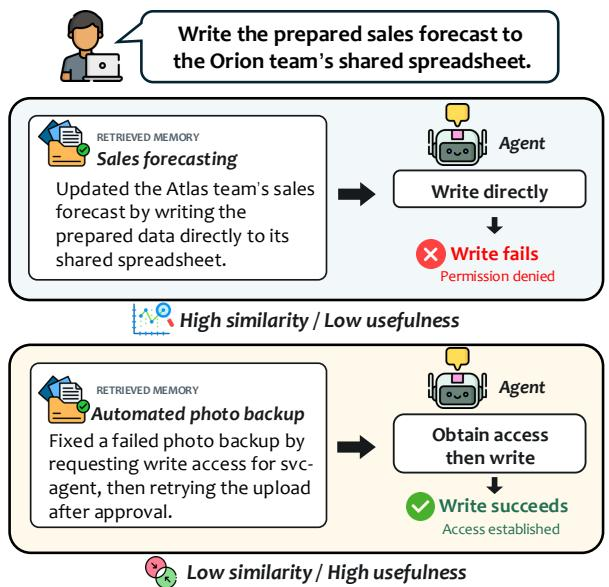  
Figure 1: Semantic Similarity ̸= Memory Usefulness. The more similar memory misses the permission issue; the less similar one leads to success.

Although such methods are widely used in knowledge-intensive scenarios such as retrievalaugmented generation (RAG) (Lewis et al., 2020; Guu et al., 2020; Gao et al., 2023) and offer a natural starting point, similarity alone does not guarantee that a retrieved memory is useful. As illustrated in Figure 1, a memory describing semantically less similar content provides the crucial information while the similar memory does not. Recent work has accordingly used downstream execution feedback to learn memory utility or optimize memoryuse policies (Zhang et al., 2026c; Zhou et al., 2025; Yan et al., 2026). Closing this gap therefore requires learning how candidate memories jointly affect downstream task performance, enabling the model to assemble a variable-length memory sequence tailored to the current query.

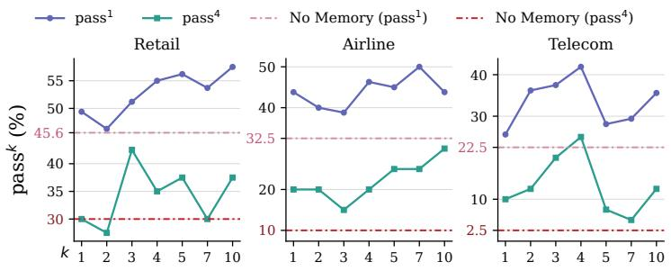  
(a) Effect of memory count

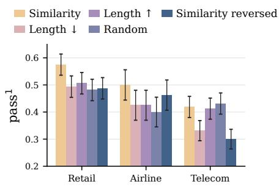  
(b) Effect of ordering  
Figure 2: Both the number and the order of memory matter. Frozen Qwen3-4B-Instruct agent on $\tau ^ { 2 } .$ -bench pass<sup>1</sup> averages $c / n$ across tasks; pass<sup>4</sup> averages ${ \binom { c } { 4 } } / { \binom { n } { 4 } }$ , where c of n trials succeed. Dashed lines denote no-memory performance. (a) Increasing k does not consistently improve performance, and the best k differs across domains. (b) Reordering the same memory set changes per-task outcomes, though no single order is best on average.

To better understand how memory assembly affects downstream task performance, we examine two key decisions: how many memories to include and in what order to present them. Figure 2a shows that performance varies non-monotonically with memory count, with different domains favoring different retrieval budgets. Figure 2b further shows that even when the selected memories remain unchanged, their presentation order affects task outcomes, consistent with order sensitivity observed in in-context learning (Lu et al., 2022). Together, these observations suggest that constructing a useful memory context requires decisions beyond ranking memories by similarity. To address this problem, we introduce MEMCOMPOSER, a memory composer that jointly examines the task query and retrieved candidates to select an ordered subset of variable size. We train the composer using Experience Policy Optimization (ExPO), a GRPObased framework that evaluates assembled contexts through complete agent interactions.

By learning to assemble useful memory combinations, MEMCOMPOSER outperforms the strongest baseline for each agent while using fewer memory tokens per task: 26.9% fewer for Qwen3- 4B-Instruct and 35.2% fewer for Ministral-3-8B-Instruct on RETAIL, and 16.9% and 4.9% fewer, respectively, across all domains. Furthermore, the learned composer demonstrates strong transferability to unseen domains, executors, and memory banks. Notably, MEMCOMPOSER continues to improve performance when supplied with memories generated by stronger models, without further training (Figure 6). This suggests that it learns a transferable ability to assess which memories are useful for downstream tasks.

Our contributions are summarized as follows:

• We propose MEMCOMPOSER, a memory composer that jointly selects and orders a variable-size subset of retrieved experiences for a frozen LLM agent.

• We develop Experience Policy Optimization (ExPO), a GRPO-based training framework that evaluates assembled contexts through complete agent interactions and combines empirical task success with selection-size and format penalties.

• Experiments on $\tau ^ { 2 } .$ -bench demonstrate improved task success and memory-token efficiency with two frozen executors, together with strong transferability across domains, executors, and memory sources.

## 2 Related Work

## 2.1 Memory for LLM Agents

Agent memory lets LLM agents reuse past experience as trajectories and insights (Zhao et al., 2024; Ouyang et al., 2025), workflows and skills (Wang et al., 2025, 2024a; Ouyang et al., 2026; Zhang et al., 2026a), or general-purpose stores (Packer et al., 2023; Chhikara et al., 2025; Xu et al., 2025), but memories are typically recalled by embedding similarity. Methods that learn memory recall or management from task outcomes (Zhang et al., 2026c; Zhou et al., 2025; Yan et al., 2026) score or operate on memories individually, whereas MEM-COMPOSER decides the assembled context as a whole: which memories, how many, and in what order.

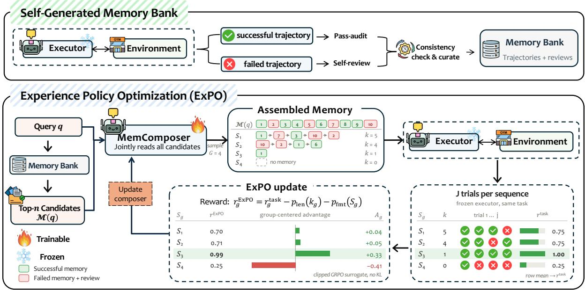  
Figure 3: Overview of MEMCOMPOSER. Top: Self-generated trajectories are reviewed and curated into a fixed memory bank. Bottom: The composer samples G variable-size, ordered memory sequences per query, each evaluated over J executor trials; ExPO updates the composer with their group-relative advantages, while the executor and memory bank stay fixed.

## 2.2 Learning Context Selection from Downstream Feedback

Demonstration selection for in-context learning (Rubin et al., 2022; Li et al., 2023; Wang et al., 2024b; Ye et al., 2023; Liu et al., 2024; Zhang et al., 2022; Scarlatos and Lan, 2023) and passage reranking for retrieval-augmented generation (Zhuang et al., 2026; Zhang et al., 2025a; Jiang et al., 2025; Sun et al., 2026a, 2025) have been learned from downstream feedback, in some cases jointly choosing the subset and its order. These methods rely on cheap per-query signals such as gold-output likelihood, relevance labels, or the quality of a single answer. In our setting, candidates are agent trajectories with hindsight reviews, and a context is scored only after a multi-turn interaction with tools and a simulated user, yielding a sparse, stochastic reward that ExPO estimates over repeated executor trials.

Due to space limits, we provide an extended discussion in Appendix A.

## 3 Method

In this section, we first formulate memory assembly (§3.1), then describe how the experience memory is built (§3.2) and how MEMCOMPOSER assembles it (§3.3). Finally, we introduce Experience Policy Optimization (ExPO), which trains MEMCOMPOSER with task-outcome rewards (§3.4). Figure 3 gives an overview of our framework.

## 3.1 Problem Formulation

Let $\pi _ { \theta }$ denote the composer policy and $\pi _ { e }$ the executor policy. Given a task query q, let $\mathcal { M } ( q ) =$ $\{ m _ { 1 } , \ldots , m _ { n } \}$ be the top-n candidate memories returned by a similarity-based retriever from a memory bank B (§3.2). The composer π<sub>θ</sub> samples an ordered subset $S = ( m _ { i _ { 1 } } , \dots , m _ { i _ { k } } )$ of distinct candidates, with $0 \leq k \leq n$ , jointly deciding which memories to include and their order. Conditioned on $( q , S )$ , the executor completes the task through multi-turn interaction with the environment, which returns a binary success reward $r \in \{ 0 , 1 \}$

Let $R ( q , S )$ denote the executor’s expected success reward when using the memory sequence S for query q. We train the composer to maximize

$$
\operatorname* { m a x } _ { \theta } \mathbb { E } _ { q \sim \mathcal { D } _ { \mathrm { t r a i n } } } \mathbb { E } _ { S \sim \pi _ { \theta } ( \cdot | q , \mathcal { M } ( q ) ) } \big [ R ( q , S ) \big ] ,\tag{1}
$$

## 3.2 Self-Generated Memory Bank

For each domain and agent backbone, we collect N independent trajectories τ per training task $q \in \mathcal { D } _ { \mathrm { t r a i n } }$ using the frozen executor $\pi _ { e }$ and record the outcome $r = r ( q , \tau )$ . The same model then produces a hindsight review v for each trajectory– outcome pair $( \tau , r )$ , without modifying the original outcome r.

We validate the reviews with deterministic consistency checks and curate the validated memory $m = ( \tau , r , v )$ into a memory bank B, shared by all methods evaluated with the same domain and agent backbone.

Appendix C provides the review prompts and scripts, validation and curation rules, parameter settings, and final memory bank sizes.

## 3.3 MEMCOMPOSER

Given a task query q, we retrieve the top-n candidate memories $\mathcal { M } ( q )$ from memory bank B using a fixed similarity-based retriever.

The composer π<sub>θ</sub> reads q and all candidate memories jointly to generate a memory sequence:

$$
S = ( m _ { i _ { 1 } } , \dots , m _ { i _ { k } } ) \sim \pi _ { \theta } \big ( \cdot \mid q , \mathcal { M } ( q ) \big ) .\tag{2}
$$

For each task sample, both the length k and the ordering of S are dynamically determined by the composer, and are learned from the task outcomes using Experience Policy Optimization (§3.4). The implementation details for MEMCOMPOSER are provided in Appendix D.

## 3.4 Experience Policy Optimization

We introduce Experience Policy Optimization (ExPO) to optimize Eq. 1, training the composer from the downstream utility of the memory contexts it assembles. ExPO builds on Group Relative Policy Optimization (GRPO) (Shao et al., 2024), but evaluates each memory sequence through complete downstream task interactions and combines its empirical task success rate with penalties on selection size and output format. Because each sequence is executed with its memories in the order given, this reward shapes not only which memories are selected but also how they are ordered, without a separate ordering objective.

Reward Design. Following prior work (Jiang et al., 2025; Zhang et al., 2026c; Sun et al., 2026a), we use downstream task outcomes to assess the utility of assembled memory contexts. Since agentic execution is stochastic (Kapoor et al., 2025;

Yao et al., 2024), a single rollout provides a noisy estimate of a memory sequence’s utility. We therefore evaluate each sampled sequence $S _ { g }$ over J trials with the frozen executor and define its taskoutcome reward as the empirical success rate:

$$
r _ { g } ^ { \mathrm { t a s k } } = \frac { 1 } { J } \sum _ { j = 1 } ^ { J } r _ { g , j } ,\tag{3}
$$

where $r _ { g , j } \in \{ 0 , 1 \}$ is the outcome of trial j.

We additionally apply a selection-size penalty $p _ { \mathrm { l e n } } ( k _ { g } )$ , where $k _ { g } = | S _ { g } |$ , to discourage unnecessarily large memory contexts. The format penalty $p _ { \mathrm { f m t } } ( S _ { g } )$ is applied when the composer violates the required reasoning and answer structure. The resulting ExPO reward is

$$
r _ { g } ^ { \mathrm { E x P O } } = r _ { g } ^ { \mathrm { t a s k } } - p _ { \mathrm { l e n } } ( k _ { g } ) - p _ { \mathrm { f m t } } ( S _ { g } ) .\tag{4}
$$

This reward balances downstream task success, selection size, and output validity. Penalty details and coefficients are given in Appendix D.2.

Policy Optimization. For each task $q$ with candidate set $\mathcal { M } ( q )$ , we sample a group of G memory contexts $\{ S _ { g } \} _ { g = 1 } ^ { G }$ from the current policy $\pi _ { \boldsymbol { \theta } _ { \mathrm { o l d } } }$ and obtain their ExPO rewards $\{ r _ { g } ^ { \mathrm { E x P O } } \} _ { g = 1 } ^ { G }$ using Eq. 4.

Following DAPO (Yu et al., 2025), we discard groups whose task-outcome rewards (Eq. 3) are all identical and continue sampling until the batch is filled. Filtering on task outcomes rather than on the full reward ensures that every retained group differs in task success, so that the selection-size and format penalties alone cannot make a group informative.

For each retained group, the advantage of a context is its group-centered ExPO reward:

$$
A _ { g } = r _ { g } ^ { \mathrm { E x P O } } - \frac { 1 } { G } \sum _ { h = 1 } ^ { G } r _ { h } ^ { \mathrm { E x P O } } .\tag{5}
$$

Following Liu et al. (2025), we do not normalize advantages by the group standard deviation, which would amplify reward noise in groups with nearly identical outcomes.

ExPO optimizes the clipped surrogate objective of GRPO:

$$
\begin{array} { r l } & { \ell _ { g , t } ( \theta ) = \operatorname* { m i n } \Bigl \{ \rho _ { g , t } ( \theta ) A _ { g } , } \\ & { \qquad \mathrm { c l i p } \bigl ( \rho _ { g , t } ( \theta ) , 1 - \epsilon , 1 + \epsilon \bigr ) A _ { g } \Bigr \} . } \end{array}\tag{6}
$$

where $\rho _ { g , t } ( \theta )$ is the token-level likelihood ratio between π and $\pi _ { \theta _ { \mathrm { o l d } } }$ , conditioned on $q , { \mathcal { M } } ( q )$ , and the preceding output tokens, and ϵ is the clipping threshold.

The ExPO training loss aggregates the surrogate at the token level over all sequences in a batch:

$$
\mathcal { L } _ { \mathrm { E x P O } } ( \boldsymbol { \theta } ) = - \frac { 1 } { \sum _ { g } T _ { g } } \sum _ { g } \sum _ { t = 1 } ^ { T _ { g } } \ell _ { g , t } ( \boldsymbol { \theta } ) ,\tag{7}
$$

where $T _ { g }$ is the number of generated tokens in the composer output encoding $S _ { g }$ , and the sums run over all sequences of all groups in the batch. ExPO thus inherits the optimization machinery of GRPO, while its advantages are derived from the memory-assembly reward in Eq. 4. ExPO uses no KL penalty to a reference policy, and only MEM-COMPOSER is updated; the executor, retriever, and memory bank remain fixed throughout training. Hyperparameters and other details are provided in Appendix D.3.

## 4 Experiments

## 4.1 Datasets and Evaluation Metrics

We evaluate on $\tau ^ { 2 }$ -bench (Barrès et al., 2025), a benchmark of multi-turn customer-service tasks in which an agent must follow a domain policy, call tools, and interact with a simulated user. We use the RETAIL, AIRLINE, and TELECOM domains, and the user is simulated by GLM-4.7 (Team et al., 2025) for all methods.

Following prior work (Yao et al., 2024), we run each test task for four trials and report $\mathrm { p a s s ^ { 1 } }$ , the average success rate, as the primary metric, and $\mathrm { p a s s ^ { 4 } }$ , the fraction of tasks solved in all four trials, to assess reliability. Averages are taken over the three domains with equal weight. Further details are provided in Appendix G.

## 4.2 Baselines

For each agent backbone, all methods use the same frozen executor, user simulator, and memory bank constructed from that agent’s rollouts, and select from the same top-10 candidates. We compare against the following baselines.

No memory. The executor solves each task without retrieved memories.

Heuristic selection. Similarity-based selection provides the k candidates whose first user messages are most similar to the current one under Qwen3- Embedding-8B (Zhang et al., 2025b), ordered from most to least similar. Complexity-based selection, inspired by complexity-based prompting (Fu et al., 2023), provides the k candidates with the longest trajectories, ordered from longest to shortest. For both, we report the best $k \in \{ 1 , 3 , 5 , 7 \}$ on the test set. Results for all k are given in Appendix E.

Model-based selection. The vanilla selector applies our selection prompt to the agent backbone without training. The pre-trained reranker reranks the candidates with Qwen3-Reranker-8B and provides the top five.

RL-based memory methods. We compare MEMCOMPOSER with two RL-based methods, MemRL (Zhang et al., 2026c) and Memento (Zhou et al., 2025), which learn the utility of memories from task outcomes. Implementation details are given in Appendix F.

## 4.3 Main Results

Table 1 shows that MEMCOMPOSER achieves the highest average pass<sup>1</sup> and $\mathrm { p a s s ^ { 4 } }$ with both executor backbones, and is the best or tied-best method in 10 of the 12 domain-level comparisons. On Qwen3-4B-Instruct, it reaches 50.8 average pass<sup>1</sup> and $3 2 . 5 \mathrm { p a s s ^ { 4 } }$ , outperforming the strongest baseline on each metric by 5.9 and 5.0 points, respectively. On Ministral-3-8B-Instruct, it achieves 4.6 points above the strongest baseline with a $\mathrm { p a s s ^ { 1 } }$ of 63.5, and slightly above the best baseline with a $\mathrm { p a s s ^ { 4 } }$ of 40.0. Notably, no baseline is consistently competitive: Memento is the strongest baseline with Qwen3-4B-Instruct but trails with Ministral-3-8B-Instruct, while MemRL is the strongest with Ministral-3-8B-Instruct but reaches only 17.5 average $\mathrm { p a s s ^ { 4 } }$ with Qwen3-4B-Instruct, close to the 14.2 of the no-memory agent. Pooled over both executors, the gap to every baseline is significant at the 95% level on $\mathrm { p a s s ^ { \mathrm { 1 } } }$ , and on $\mathrm { \ p a s s ^ { \mathrm { 4 } } }$ for all baselines except Complexity and Memento (paired bootstrap over test tasks; Appendix B). MEMCOM-POSER also reaches this performance with fewer memory tokens than the strongest baseline, 16.9% fewer with Qwen3-4B-Instruct and 4.9% fewer with Ministral-3-8B-Instruct (Appendix H.1).

<table><tr><td rowspan="2">Method</td><td colspan="2">Retail</td><td colspan="2">Airline</td><td colspan="2">Telecom</td><td colspan="2"> $\mathbf { A v } \mathbf { g } .$ </td></tr><tr><td> $\mathrm { p a s s } ^ { 1 }$ </td><td> $\mathrm { \ p a s s ^ { 4 } }$ </td><td> $\mathrm { p a s s } ^ { 1 }$ </td><td> $\mathrm { \ p a s s ^ { 4 } }$ </td><td> $\mathrm { p a s s } ^ { 1 }$ </td><td> $\mathrm { \ p a s s ^ { 4 } }$ </td><td> $\mathrm { p a s s } ^ { 1 }$ </td><td> $\mathrm { \ p a s s ^ { 4 } }$ </td></tr><tr><td colspan="9">分 Qwen3-4B-Instruct</td></tr><tr><td>No Memory</td><td>45.6</td><td>30.0</td><td>32.5</td><td>10.0</td><td>22.5</td><td>2.5</td><td>33.5</td><td>14.2</td></tr><tr><td>Similarity-based</td><td>53.7</td><td>30.0</td><td>50.0</td><td>25.0</td><td>29.4</td><td>5.0</td><td>44.4</td><td>20.0</td></tr><tr><td>Complexity-based</td><td>51.9</td><td>37.5</td><td>40.0</td><td>30.0</td><td>37.5</td><td>15.0</td><td>43.1</td><td>27.5</td></tr><tr><td>Qwen3-Reranker-8B</td><td>54.4</td><td>35.0</td><td>46.2</td><td>30.0</td><td>31.9</td><td>7.5</td><td>44.2</td><td>24.2</td></tr><tr><td>MemRL</td><td>56.9</td><td>22.5</td><td>41.2</td><td>10.0</td><td>35.6</td><td>20.0</td><td>44.6</td><td>17.5</td></tr><tr><td>Memento</td><td>53.1</td><td>37.5</td><td>46.2</td><td>35.0</td><td>35.6</td><td>7.5</td><td>45.0</td><td>26.7</td></tr><tr><td>Vanilla Selector</td><td>50.0</td><td>22.5</td><td>43.8</td><td>30.0</td><td>34.4</td><td>10.0</td><td>42.7</td><td>20.8</td></tr><tr><td>MEMCOMPOSER</td><td>60.0</td><td>42.5</td><td>52.5</td><td>35.0</td><td>40.0</td><td>20.0</td><td>50.8</td><td>32.5</td></tr><tr><td colspan="9">H Ministral-3-8B-Instruct</td></tr><tr><td>No Memory</td><td>58.1</td><td>32.5</td><td>17.5</td><td>10.0</td><td>51.9</td><td>25.0</td><td>42.5</td><td>22.5</td></tr><tr><td>Similarity-based</td><td>68.1</td><td>40.0</td><td>38.8</td><td>20.0</td><td>63.7</td><td>45.0</td><td>56.9</td><td>35.0</td></tr><tr><td>Complexity-based</td><td>65.6</td><td>45.0</td><td>36.2</td><td>20.0</td><td>73.8</td><td>40.0</td><td>58.5</td><td>35.0</td></tr><tr><td>Qwen3-Reranker-8B</td><td>62.5</td><td>35.0</td><td>28.7</td><td>5.0</td><td>66.2</td><td>37.5</td><td>52.5</td><td>25.8</td></tr><tr><td>MemRL</td><td>70.6</td><td>45.0</td><td>30.0</td><td>15.0</td><td>76.2</td><td>55.0</td><td>58.9</td><td>38.3</td></tr><tr><td>Memento</td><td>66.9</td><td>47.5</td><td>36.2</td><td>10.0</td><td>70.0</td><td>45.0</td><td>57.7</td><td>34.2</td></tr><tr><td>Vanilla Selector</td><td>64.4</td><td>30.0</td><td>37.5</td><td>10.0</td><td>66.9</td><td>45.0</td><td>56.3</td><td>28.3</td></tr><tr><td>MEMCOMPOSER</td><td>75.0</td><td>47.5</td><td>40.0</td><td>20.0</td><td>75.6</td><td>52.5</td><td>63.5</td><td></td></tr><tr><td></td><td></td><td></td><td></td><td></td><td></td><td></td><td></td><td>40.0</td></tr></table>

Table 1: Results on $\tau ^ { 2 } { \cdot } \mathbf { b e n c h }$ with two frozen executor backbones. $\mathrm { p a s s } ^ { k }$ is the probability that a task is solved in all k independent trials (Yao et al., $2 0 2 4 ) \colon { \mathrm { p a s s } } ^ { 1 }$ is the average success rate and $\mathrm { p a s s ^ { 4 } }$ reflects consistency. Heuristic baselines use the $k \in \{ 1 , 3 , 5 , 7 \}$ with the highest average $\mathrm { p a s s ^ { 1 } }$ on the test set. Avg. is the macro average over domains. Bold and underline mark the best and second-best results within each backbone; ties share the marking.

## 5 Findings

## 5.1 How Does Training Change Experience Selection?

We find that training changes selection in three ways: MEMCOMPOSER chooses more experiences from deeper in the ranking, shows a weaker preference for historically successful experiences, and learns to order the selected experiences more effectively than fixed rules.

The first two analyses compare the vanilla selector with MEMCOMPOSER on the same 40 retail tasks and top-10 candidate pools with Qwen3-4B-Instruct as the executor; the ordering analysis uses Ministral-3-8B-Instruct on all test tasks.

Training makes MEMCOMPOSER choose more, and deeper. Training increases the average selection size from 2.52 to 3.73 experiences compared to the vanilla selector. After training, MEMCOM-POSER also chooses more experiences from farther down the retrieval ranking (Figure 4), and the mean similarity rank of all selected experiences rises from 3.21 to 4.35. The learned policy draws more broadly from the candidate pool, consistent with our intuition that useful memory contexts may include guidance beyond the closest matches.

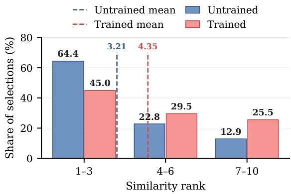  
Figure 4: Lower-ranked candidates account for a larger share of selections after training. Dashed lines indicate the mean rank of selected memories.

Training weakens the preference for successful experiences. Before training, successful experiences are selected more often than failed or fakepass in every rank band, most clearly at ranks 4–6 (32% vs. 10%; Figure 5). After training, this gap narrows to 6 points at ranks 4–6, reverses at ranks 1–3, and vanishes at ranks 7–10; overall, the share of successful experiences among selections falls

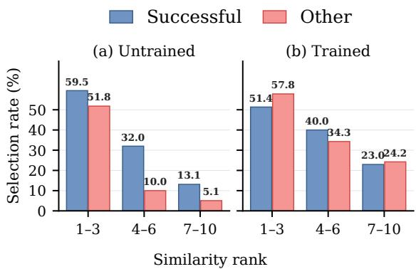

Figure 5: Training weakens the preference for successful experiences. Fraction of candidates selected within each rank band, for the (a) untrained and (b) trained selectors on retail.
<table><tr><td>Alternative order</td><td>Mean ∆</td><td>∆ pass1 (points)</td></tr><tr><td>Similarity</td><td>+0.220</td><td>+5.5</td></tr><tr><td>Similarity reversed</td><td>+0.340</td><td>+8.5</td></tr><tr><td>Length ↑</td><td>+0.270</td><td>+6.8</td></tr><tr><td>Length ↓</td><td>+0.150</td><td>+3.8</td></tr><tr><td>Average</td><td>+0.245</td><td>+6.1</td></tr></table>

Table 2: Advantage of the composer’s order over alternative orderings of the same memories. ∆: mean difference in successful trials over 100 tasks; $\Delta \mathrm { p a s s ^ { 1 } = }$ 25∆ points. Positive values favor the composer.

from 45.5% to 35.6%.

This shift follows from the training objective: MEMCOMPOSER is rewarded for the assembled context’s effect on the current task, not for the memories’ past outcomes, and a failed memory can still be instructive. For example, a memory that miscalculated a price difference nonetheless demonstrates the exchange operation the new task requires, raising success from 0/4 to 4/4 trials compared with no memory (see Table 13 for details).

MEMCOMPOSER orders selected memories better than fixed rules. To isolate the effect of ordering, we keep the memories selected by MEMCOM-POSER for each task fixed and reorder them by one of four rules: similarity, reverse similarity, length descending, or length ascending. As Table 2 shows, the composer’s order outperforms every rule by 3.8 to 8.5 points and 6.1 on average in pass<sup>1</sup>; since the memory set is identical, the gain comes solely from order.

Case 3 in Appendix I gives an example: the same five memories yield 4/4 successes under the composer’s order and 0/4 under similarity order.

<table><tr><td rowspan="2">Method</td><td colspan="2">Airline</td><td colspan="2">Telecom</td></tr><tr><td>pass¹</td><td>pass⁴</td><td>pass1</td><td>pass4</td></tr><tr><td>No Memory</td><td>32.5</td><td>10.0</td><td>22.5</td><td>2.5</td></tr><tr><td>Similarity†</td><td>50.0</td><td>25.0</td><td>29.4</td><td>5.0</td></tr><tr><td>Complexity†</td><td>40.0</td><td>30.0</td><td>37.5</td><td>15.0</td></tr><tr><td>VaniÎla selector</td><td>43.8</td><td>30.0</td><td>34.4</td><td>10.0</td></tr><tr><td></td><td></td><td></td><td></td><td></td></tr><tr><td colspan="3">MEMCOMPOSER</td><td></td><td></td></tr><tr><td>In-domain</td><td>52.5</td><td>35.0</td><td>40.0</td><td>20.0</td></tr><tr><td>Retail→</td><td>53.8</td><td>35.0</td><td>38.8</td><td>22.5</td></tr></table>

Table 3: The retail-trained composer transfers to unseen domains. Qwen3-4B-Instruct executor. Indomain: trained on the target domain; Retail→: trained on retail only. <sup>†</sup>As in Table 1.

Assembling a useful memory context therefore requires deciding not only which memories to include but how to present them.

## 5.2 Generalization

We apply the trained composer without further training to unseen domains, to a different agent backbone, and to memory banks of different quality to test its transferability.

MEMCOMPOSER transfers effectively across domains. We apply the composer trained on RE-TAIL to AIRLINE and TELECOM with the same Qwen3-4B-Instruct executor and each target domain’s memory bank, without further training.

As shown in Table 3, the transferred MEMCOM-POSER outperforms the vanilla selector and both heuristics in both domains, and performs comparably to in-domain training: on AIRLINE it is on par in pass<sup>1</sup> (53.8 vs. 52.5) and equal in pass<sup>4</sup>, and on TELECOM it trades 1.2 points of pass<sup>1</sup> for 2.5 points of pass<sup>4</sup>. The composer thus captures selection principles that hold across domains with different tools and policies, rather than retail-specific shortcuts. We next ask whether these principles also hold for a different executor.

The learned policy transfers to a different executor. On retail, we pair the Qwen3-4B-Instruct composer with a frozen Ministral-3-8B-Instruct executor and its self-generated memory, without further composer training. All compared methods use the same target executor and memory. As shown in Table 4, the transferred composer achieves 70.6 pass<sup>1</sup> and 50.0 pass<sup>4</sup>, outperforming both heuristic baselines and the untrained composer. Compared with the composer trained for Ministral, transfer yields lower pass<sup>1</sup> (70.6 versus 75.0) but higher pass<sup>4</sup> (50.0 versus 47.5). These results suggest that the learned assembly policy remains useful with a different executor and experience pool.

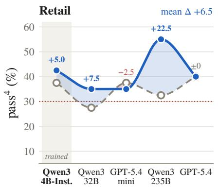

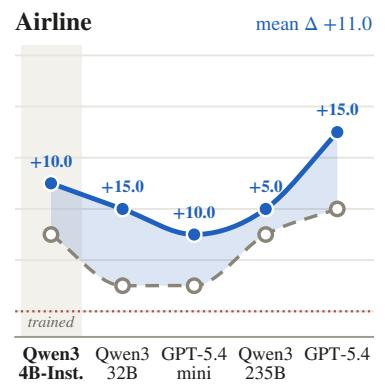

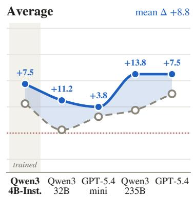  
Memory pool generated by (executor fixed: Qwen3-4B-Instruct)

Figure 6: Effect of the memory source. Only the agent that generated the memory pool varies along the x-axis. Qwen3-4B-Instruct is the executor’s own memory, on which MEMCOMPOSER was trained. Both methods draw from the same top-10 candidates per task: similarity top-5 keeps the five most similar, while MEMCOMPOSER selects its own subset. We report pass<sup>4</sup> on retail (40 tasks), airline (20 tasks), and their unweighted average. Shading marks where MEMCOMPOSER is ahead (blue) or behind (red). Markers are measured values; curves are a visual guide only.
<table><tr><td>Method</td><td>pass1</td><td>pass4</td></tr><tr><td>No Memory</td><td>58.1</td><td>32.5</td></tr><tr><td>Similarity</td><td>68.1</td><td>40.0</td></tr><tr><td>Complexity †</td><td>65.6</td><td>45.0</td></tr><tr><td>Vanilla selector</td><td>64.4</td><td>30.0</td></tr><tr><td>MEMCOMPOSER</td><td>75.0</td><td>47.5</td></tr><tr><td>MEMCOMPOSER (4B)</td><td>70.6</td><td>50.0</td></tr></table>

Table 4: The learned policy transfers to a different executor. Retail, Ministral-3-8B-Instruct executor with its own memory bank. MEMCOMPOSER: trained with Ministral-3-8B-Instruct; MEMCOMPOSER (4B): trained with Qwen3-4B-Instruct. <sup>†</sup>As in Table 1.

Learned assembly remains beneficial as memory improves. We test whether the advantage of MEMCOMPOSER persists when the memory is built by stronger agents. We replace the memory bank with banks built by four other agents, from Qwen3-32B to GPT-5.4, using the same construction pipeline (Appendix C) and setting; since stronger agents tend to produce more reliable trajectories and reviews (Zheng et al., 2023), these banks span a range of memory quality. The executor (Qwen3-4B-Instruct), test tasks, user simulator, and retrieval procedure are held fixed; for each bank, all methods share the same top-10 candidate pool, and the composer, trained only on the executor’s own bank, is applied without retraining.

Figure 6 shows two patterns. First, better memory alone yields limited gains under similarity retrieval: on RETAIL, similarity top-5 with GPT-5.4’s bank performs close to its level with the executor’s own bank. Second, MEMCOMPOSER matches or outperforms similarity top-5 in 9 of the 10 domain– bank pairs and improves average pass<sup>4</sup> on every unseen bank, by 9.1 points on average and by 7.5 points even with GPT-5.4’s bank. Improving what is stored therefore does not remove the need to decide what to recall.

## 6 Conclusion

We introduced MEMCOMPOSER, which jointly selects and orders a variable-size subset of retrieved experiences for a frozen LLM agent. Through Experience Policy Optimization (ExPO), it learns from downstream task outcomes while keeping the executor, retriever, and memory bank fixed. Across three τ<sup>2</sup>-bench domains and two executors, MEM-COMPOSER achieves the highest average pass<sup>1</sup> and pass<sup>4</sup> among evaluated methods with fewer memory tokens than the strongest baseline for each executor. Further analyses show improved selection and ordering, alongside transfer across domains, executors, and memory sources without retraining. These results highlight the value of learning memory assembly from downstream feedback.

## Limitations

Executor preferences. MEMCOMPOSER learns an assembly policy for one frozen executor. We show that this policy transfers to another. Still, we do not characterize what different executors prefer in a memory context: whether a stronger model benefits from fewer, longer, or differently ordered experiences, and whether the preference for failed experiences in §5 is specific to small executors. Both executors in this work have 4B and 8B parameters; it remains open whether a frontierscale executor that can judge candidate memories on its own would benefit from a separate composer to the same extent.

Ordering. MEMCOMPOSER learns presentation order only implicitly from the sequence-level reward. Within a group, sampled sequences usually differ in both content and order, so credit for ordering is entangled with credit for selection, and with G = 8 samples per prompt drawn from a space of ordered subsets that grows factorially with k, the learned order is not guaranteed to be optimal. Table 2 shows that it outperforms four heuristic orderings of the same memories, but we do not compare it against an oracle that searches over all permutations.

Memory type. We study procedural memory: complete past trajectories together with their reviews, from which the executor can reuse actions and avoid earlier mistakes. We do not evaluate whether learned assembly helps with other memory types, such as semantic memory (facts and rules) or episodic memory of a particular user’s history, where the interaction between selected items and their order may differ.

## References

Victor Barrès, Honghua Dong, Soham Ray, Xujie Si, and Karthik Narasimhan. 2025. τ<sup>2</sup>-bench: Evaluating conversational agents in a dual-control environment. CoRR, abs/2506.07982.

Prateek Chhikara, Dev Khant, Saket Aryan, Taranjeet Singh, and Deshraj Yadav. 2025. Mem0: Building production-ready AI agents with scalable long-term memory. In ECAI 2025 - 28th European Conference on Artificial Intelligence, 25-30 October 2025, Bologna, Italy - Including 14th Conference on Prestigious Applications of Intelligent Systems (PAIS 2025), volume 413 of Frontiers in Artificial Intelligence and Applications, pages 2993–3000. IOS Press.

Yao Fu, Hao Peng, Ashish Sabharwal, Peter Clark, and Tushar Khot. 2023. Complexity-based prompting for multi-step reasoning. In The Eleventh International Conference on Learning Representations, ICLR 2023, Kigali, Rwanda, May 1-5, 2023. OpenReview.net.

Yunfan Gao, Yun Xiong, Xinyu Gao, Kangxiang Jia, Jinliu Pan, Yuxi Bi, Yi Dai, Jiawei Sun, Qianyu Guo, Meng Wang, and Haofen Wang. 2023. Retrievalaugmented generation for large language models: A survey. CoRR, abs/2312.10997.

Kelvin Guu, Kenton Lee, Zora Tung, Panupong Pasupat, and Ming-Wei Chang. 2020. REALM: retrievalaugmented language model pre-training. CoRR, abs/2002.08909.

Yuyang Hu, Shichun Liu, Yanwei Yue, Guibin Zhang, Boyang Liu, Fangyi Zhu, Jiahang Lin, Honglin Guo, Shihan Dou, Zhiheng Xi, Senjie Jin, Jiejun Tan, Yanbin Yin, Jiongnan Liu, Zeyu Zhang, Zhongxiang Sun, Yutao Zhu, Hao Sun, Boci Peng, and 28 others. 2025. Memory in the age of AI agents. CoRR, abs/2512.13564.

Gautier Izacard, Mathilde Caron, Lucas Hosseini, Sebastian Riedel, Piotr Bojanowski, Armand Joulin, and Edouard Grave. 2022. Unsupervised dense information retrieval with contrastive learning. Trans. Mach. Learn. Res., 2022.

Pengcheng Jiang, Jiacheng Lin, Zhiyi Shi, Zifeng Wang, Luxi He, Yichen Wu, Ming Zhong, Peiyang Song, Qizheng Zhang, Heng Wang, Xueqiang Xu, Hanwen Xu, Pengrui Han, Dylan Zhang, Jiashuo Sun, Chaoqi Yang, Kun Qian, Tian Wang, Changran Hu, and 15 others. 2026. Adaptation of agentic ai: A survey of post-training, memory, and skills. Preprint, arXiv:2512.16301.

Pengcheng Jiang, Xueqiang Xu, Jiacheng Lin, Jinfeng Xiao, Zifeng Wang, Jimeng Sun, and Jiawei Han. 2025. s3: You don’t need that much data to train a search agent via RL. In Proceedings ofthe 2025 Conference on Empirical Methods in Natural Language Processing, EMNLP 2025, Suzhou, China, November 4-9, 2025, pages 21599–21617. Association for Computational Linguistics.

Sayash Kapoor, Benedikt Stroebl, Zachary S. Siegel, Nitya Nadgir, and Arvind Narayanan. 2025. AI agents that matter. Trans. Mach. Learn. Res., 2025.

Vladimir Karpukhin, Barlas Oguz, Sewon Min, Patrick Lewis, Ledell Wu, Sergey Edunov, Danqi Chen, and Wen-tau Yih. 2020. Dense passage retrieval for opendomain question answering. In Proceedings of the 2020 Conference on Empirical Methods in Natural Language Processing, EMNLP 2020, Online, November 16-20, 2020, pages 6769–6781. Association for Computational Linguistics.

Patrick Lewis, Ethan Perez, Aleksandra Piktus, Fabio Petroni, Vladimir Karpukhin, Naman Goyal, Heinrich Küttler, Mike Lewis, Wen-tau Yih, Tim Rocktäschel, Sebastian Riedel, and Douwe Kiela. 2020.

Retrieval-augmented generation for knowledgeintensive NLP tasks. In Advances in Neural Information Processing Systems 33: Annual Conference on Neural Information Processing Systems 2020, NeurIPS 2020, December 6-12, 2020, virtual.

Xiaonan Li, Kai Lv, Hang Yan, Tianyang Lin, Wei Zhu, Yuan Ni, Guotong Xie, Xiaoling Wang, and Xipeng Qiu. 2023. Unified demonstration retriever for incontext learning. In Proceedings of the 61st Annual Meeting of the Association for Computational Linguistics (Volume 1: Long Papers), ACL 2023, Toronto, Canada, July 9-14, 2023, pages 4644–4668. Association for Computational Linguistics.

Haoyu Liu, Jianfeng Liu, Shaohan Huang, Yuefeng Zhan, Hao Sun, Weiwei Deng, Furu Wei, and Qi Zhang. 2024. Se<sup>2</sup>: Sequential example selection for in-context learning. In Findings of the Associationfor Computational Linguistics, ACL 2024, Bangkok, Thailand and virtual meeting, August 11- 16, 2024, volume ACL 2024 of Findings of ACL, pages 5262–5284. Association for Computational Linguistics.

Zichen Liu, Changyu Chen, Wenjun Li, Penghui Qi, Tianyu Pang, Chao Du, Wee Sun Lee, and Min Lin. 2025. Understanding r1-zero-like training: A critical perspective. CoRR, abs/2503.20783.

Yao Lu, Max Bartolo, Alastair Moore, Sebastian Riedel, and Pontus Stenetorp. 2022. Fantastically ordered prompts and where to find them: Overcoming fewshot prompt order sensitivity. In Proceedings ofthe 60th Annual Meeting ofthe Associationfor Computational Linguistics (Volume 1: Long Papers), ACL 2022, Dublin, Ireland, May 22-27, 2022, pages 8086– 8098. Association for Computational Linguistics.

Siru Ouyang, Jun Yan, Yanfei Chen, Rujun Han, Zifeng Wang, Bhavana Dalvi Mishra, Rui Meng, Chun-Liang Li, Yizhu Jiao, Kaiwen Zha, Maohao Shen, Vishy Tirumalashetty, George Lee, Jiawei Han, Tomas Pfister, and Chen-Yu Lee. 2026. Skillos: Learning skill curation for self-evolving agents. CoRR, abs/2605.06614.

Siru Ouyang, Jun Yan, I-Hung Hsu, Yanfei Chen, Ke Jiang, Zifeng Wang, Rujun Han, Long T. Le, Samira Daruki, Xiangru Tang, Vishy Tirumalashetty, George Lee, Mahsan Rofouei, Hangfei Lin, Jiawei Han, Chen-Yu Lee, and Tomas Pfister. 2025. Reasoningbank: Scaling agent self-evolving with reasoning memory. CoRR, abs/2509.25140.

Charles Packer, Vivian Fang, Shishir G. Patil, Kevin Lin, Sarah Wooders, and Joseph E. Gonzalez. 2023. Memgpt: Towards llms as operating systems. CoRR, abs/2310.08560.

Joon Sung Park, Joseph C. O’Brien, Carrie Jun Cai, Meredith Ringel Morris, Percy Liang, and Michael S. Bernstein. 2023. Generative agents: Interactive simulacra of human behavior. In Proceedings ofthe 36th Annual ACM Symposium on User Interface Software

and Technology, UIST 2023, San Francisco, CA, USA, 29 October 2023- 1 November 2023, pages 2:1–2:22. ACM.

Stephen E. Robertson and Hugo Zaragoza. 2009. The probabilistic relevance framework: BM25 and beyond. Found. Trends Inf. Retr., 3(4):333–389.

Ohad Rubin, Jonathan Herzig, and Jonathan Berant. 2022. Learning to retrieve prompts for in-context learning. In Proceedings ofthe 2022 Conference of the North American Chapter ofthe Associationfor Computational Linguistics: Human Language Technologies, NAACL 2022, Seattle, WA, United States, July 10-15, 2022, pages 2655–2671. Association for Computational Linguistics.

Alexander Scarlatos and Andrew S. Lan. 2023. Reticl: Sequential retrieval of in-context examples with reinforcement learning. CoRR, abs/2305.14502.

Zhihong Shao, Peiyi Wang, Qihao Zhu, Runxin Xu, Junxiao Song, Xiao Bi, Haowei Zhang, Mingchuan Zhang, Y. K. Li, Y. Wu, and Daya Guo. 2024. Deepseekmath: Pushing the limits of mathematical reasoning in open language models. Preprint, arXiv:2402.03300.

Guangming Sheng, Chi Zhang, Zilingfeng Ye, Xibin Wu, Wang Zhang, Ru Zhang, Yanghua Peng, Haibin Lin, and Chuan Wu. 2025. Hybridflow: A flexible and efficient rlhf framework. In Proceedings of the Twentieth European Conference on Computer Systems, EuroSys ’25, page 1279–1297. ACM.

Noah Shinn, Federico Cassano, Ashwin Gopinath, Karthik Narasimhan, and Shunyu Yao. 2023. Reflexion: language agents with verbal reinforcement learning. In Advances in Neural Information Processing Systems 36: Annual Conference on Neural Information Processing Systems 2023, NeurIPS 2023, New Orleans, LA, USA, December 10 - 16, 2023.

Jiashuo Sun, Pengcheng Jiang, Saizhuo Wang, Jiajun Fan, Heng Wang, Siru Ouyang, Ming Zhong, Yizhu Jiao, Chengsong Huang, Xueqiang Xu, Pengrui Han, Peiran Li, Jiaxin Huang, Ge Liu, Heng Ji, and Jiawei Han. 2026a. Rethinking the reranker: Boundary-aware evidence selection for robust retrieval-augmented generation. CoRR, abs/2602.03689.

Jiashuo Sun, Jimeng Shi, Yixuan Xie, Saizhuo Wang, Jash Rajesh Parekh, Pengcheng Jiang, Zhiyi Shi, Jiajun Fan, Qinglong Zheng, Peiran Li, Shaowen Wang, Ge Liu, and Jiawei Han. 2026b. Retrieval is cheap, show me the code: Executable multi-hop reasoning for retrieval-augmented generation. Preprint, arXiv:2605.12975.

Jiashuo Sun, Yixuan Xie, Jimeng Shi, Shaowen Wang, and Jiawei Han. 2026c. Tasr-rag: Taxonomy-guided structured reasoning for retrieval-augmented generation. Preprint, arXiv:2603.09341.

Jiashuo Sun, Xianrui Zhong, Sizhe Zhou, and Jiawei Han. 2025. Dynamicrag: Leveraging outputs of large language model as feedback for dynamic reranking in retrieval-augmented generation. In Advances in Neural Information Processing Systems 38: Annual Conference on Neural Information Processing Systems 2025, NeurIPS 2025, San Diego, CA, USA, December 2-7, 2025 / Mexico City, Mexico, November 30 - December 5, 2025.

Mirac Suzgun, Mert Yüksekgönül, Federico Bianchi, Dan Jurafsky, and James Zou. 2026. Dynamic cheatsheet: Test-time learning with adaptive memory. In Proceedings ofthe 19th Conference ofthe European Chapter of the Association for Computational Linguistics, EACL 2026 - Volume 1: Long Papers, Rabat, Morocco, March 24-29, 2026, pages 7080–7106. Association for Computational Linguistics.

5 Team, Aohan Zeng, Xin Lv, Qinkai Zheng, Zhenyu Hou, Bin Chen, Chengxing Xie, Cunxiang Wang, Da Yin, Hao Zeng, Jiajie Zhang, Kedong Wang, Lucen Zhong, Mingdao Liu, Rui Lu, Shulin Cao, Xiaohan Zhang, Xuancheng Huang, Yao Wei, and 152 others. 2025. Glm-4.5: Agentic, reasoning, and coding (arc) foundation models. Preprint, arXiv:2508.06471.

Runchu Tian, Xueqiang Xu, Bowen Jin, SeongKu Kang, and Jiawei Han. 2026. Corank: Llm-based compact reranking with document features for scientific retrieval. In Proceedings of the 32nd ACM SIGKDD Conference on Knowledge Discovery and Data Mining V.2, KDD 2026, Jeju Island, Korea, August 9-13, 2026, pages 12114–12125. ACM.

Guanzhi Wang, Yuqi Xie, Yunfan Jiang, Ajay Mandlekar, Chaowei Xiao, Yuke Zhu, Linxi Fan, and Anima Anandkumar. 2024a. Voyager: An open-ended embodied agent with large language models. Trans. Mach. Learn. Res., 2024.

Liang Wang, Nan Yang, and Furu Wei. 2024b. Learning to retrieve in-context examples for large language models. In Proceedings of the 18th Conference of the European Chapter ofthe Associationfor Computational Linguistics, EACL 2024 - Volume 1: Long Papers, St. Julian’s, Malta, March 17-22, 2024, pages 1752–1767. Association for Computational Linguistics.

Zora Zhiruo Wang, Jiayuan Mao, Daniel Fried, and Graham Neubig. 2025. Agent workflow memory. In Forty-second International Conference on Machine Learning, ICML 2025, Vancouver, BC, Canada, July 13-19, 2025, volume 267 of Proceedings ofMachine Learning Research. PMLR / OpenReview.net.

Wujiang Xu, Zujie Liang, Kai Mei, Hang Gao, Juntao Tan, and Yongfeng Zhang. 2025. A-mem: Agentic memory for LLM agents. In Advances in Neural Information Processing Systems 38: Annual Conference on Neural Information Processing Systems 2025, NeurIPS 2025, San Diego, CA, USA, December 2-7, 2025 / Mexico City, Mexico, November 30 - December 5, 2025.

Sikuan Yan, Xiufeng Yang, Zuchao Huang, Ercong Nie, Zifeng Ding, Zonggen Li, Xiaowen Ma, Jinhe Bi, Kristian Kersting, Jeff Z. Pan, Hinrich Schütze, Volker Tresp, and Yunpu Ma. 2026. Memory-r1: Enhancing large language model agents to manage and utilize memories via reinforcement learning. In Proceedings ofthe 64th Annual Meeting ofthe Associationfor Computational Linguistics (Volume 1: Long Papers), ACL 2026, San Diego, California, United States, July 2-7, 2026, pages 12805–12825. Association for Computational Linguistics.

Shunyu Yao, Noah Shinn, Pedram Razavi, and Karthik Narasimhan. 2024. τ-bench: A benchmark for toolagent-user interaction in real-world domains. CoRR, abs/2406.12045.

Jiacheng Ye, Zhiyong Wu, Jiangtao Feng, Tao Yu, and Lingpeng Kong. 2023. Compositional exemplars for in-context learning. In International Conference on Machine Learning, ICML 2023, 23-29 July 2023, Honolulu, Hawaii, USA, volume 202 of Proceedings ofMachine Learning Research, pages 39818–39833. PMLR.

Qiying Yu, Zheng Zhang, Ruofei Zhu, Yufeng Yuan, Xiaochen Zuo, Yu Yue, Weinan Dai, Tiantian Fan, Gaohong Liu, Juncai Liu, Lingjun Liu, Xin Liu, Haibin Lin, Zhiqi Lin, Bole Ma, Guangming Sheng, Yuxuan Tong, Chi Zhang, Mofan Zhang, and 17 others. 2025. DAPO: an open-source LLM reinforcement learning system at scale. In Advances in Neural Information Processing Systems 38: Annual Conference on Neural Information Processing Systems 2025, NeurIPS 2025, San Diego, CA, USA, December 2-7, 2025 / Mexico City, Mexico, November 30 - December 5, 2025.

Dylan Zhang, Yanshan Lin, Zhengkun Wu, Yihang Sun, Bingxuan Li, Dianqi Li, and Hao Peng. 2026a. Useful memories become faulty when continuously updated by llms. CoRR, abs/2605.12978.

Le Zhang, Bo Wang, Xipeng Qiu, Siva Reddy, and Aishwarya Agrawal. 2025a. REARANK: reasoning re-ranking agent via reinforcement learning. In Proceedings of the 2025 Conference on Empirical Methods in Natural Language Processing, EMNLP 2025, Suzhou, China, November 4-9, 2025, pages 2458–2471. Association for Computational Linguistics.

Qizheng Zhang, Changran Hu, Shubhangi Upasani, Boyuan Ma, Fenglu Hong, Vamsidhar Kamanuru, Jay Rainton, Chen Wu, Mengmeng Ji, Hanchen Li, Urmish Thakker, James Y. Zou, and Kunle Olukotun. 2026b. Agentic context engineering: Evolving contexts for self-improving language models. In The Fourteenth International Conference on Learning Representations, ICLR 2026, Rio de Janeiro, Brazil, April 23-27, 2026. proceedings.iclr.cc.

Shengtao Zhang, Jiaqian Wang, Ruiwen Zhou, Junwei Liao, Yuchen Feng, Zhuo Li, Yujie Zheng, Weinan Zhang, Ying Wen, Zhiyu Li, Feiyu Xiong, Yutao Qi,

Bo Tang, and Muning Wen. 2026c. Memrl: Selfevolving agents via runtime reinforcement learning on episodic memory. Preprint, arXiv:2601.03192.

Yanzhao Zhang, Mingxin Li, Dingkun Long, Xin Zhang, Huan Lin, Baosong Yang, Pengjun Xie, An Yang, Dayiheng Liu, Junyang Lin, Fei Huang, and Jingren Zhou. 2025b. Qwen3 embedding: Advancing text embedding and reranking through foundation models. CoRR, abs/2506.05176.

Yiming Zhang, Shi Feng, and Chenhao Tan. 2022. Active example selection for in-context learning. In Proceedings of the 2022 Conference on Empirical Methods in Natural Language Processing, EMNLP 2022, Abu Dhabi, United Arab Emirates, December 7-11, 2022, pages 9134–9148. Association for Computational Linguistics.

Zeyu Zhang, Quanyu Dai, Xiaohe Bo, Chen Ma, Rui Li, Xu Chen, Jieming Zhu, Zhenhua Dong, and Ji-Rong Wen. 2025c. A survey on the memory mechanism of large language model-based agents. ACM Trans. Inf. Syst., 43(6):155:1–155:47.

Andrew Zhao, Daniel Huang, Quentin Xu, Matthieu Lin, Yong-Jin Liu, and Gao Huang. 2024. Expel: LLM agents are experiential learners. In Thirty-Eighth AAAI Conference on Artificial Intelligence, AAAI 2024, Thirty-Sixth Conference on Innovative Applications ofArtificial Intelligence, IAAI 2024, Fourteenth Symposium on Educational Advances in Artificial Intelligence, EAAI 2024, February 20-27, 2024, Vancouver, Canada, pages 19632–19642. AAAI Press.

Lianmin Zheng, Wei-Lin Chiang, Ying Sheng, Siyuan Zhuang, Zhanghao Wu, Yonghao Zhuang, Zi Lin, Zhuohan Li, Dacheng Li, Eric P. Xing, Hao Zhang, Joseph E. Gonzalez, and Ion Stoica. 2023. Judging llm-as-a-judge with mt-bench and chatbot arena. In Advances in Neural Information Processing Systems 36: Annual Conference on Neural Information Processing Systems 2023, NeurIPS 2023, New Orleans, LA, USA, December 10 - 16, 2023.

Longtao Zheng, Rundong Wang, Xinrun Wang, and Bo An. 2024. Synapse: Trajectory-as-exemplar prompting with memory for computer control. In The Twelfth International Conference on Learning Representations, ICLR 2024, Vienna, Austria, May 7-11, 2024. OpenReview.net.

Wanjun Zhong, Lianghong Guo, Qiqi Gao, He Ye, and Yanlin Wang. 2024. Memorybank: Enhancing large language models with long-term memory. In Thirty-Eighth AAAI Conference on Artificial Intelligence, AAAI 2024, Thirty-Sixth Conference on Innovative Applications of Artificial Intelligence, IAAI 2024, Fourteenth Symposium on Educational Advances in Artificial Intelligence, EAAI 2024, February 20-27, 2024, Vancouver, Canada, pages 19724– 19731. AAAI Press.

Huichi Zhou, Yihang Chen, Siyuan Guo, Xue Yan, Kin Hei Lee, Zihan Wang, Ka Yiu Lee, Guchun

Zhang, Kun Shao, Linyi Yang, and Jun Wang. 2025. Memento: Fine-tuning LLM agents without finetuning llms. CoRR, abs/2508.16153.

Shengyao Zhuang, Xueguang Ma, Zheng Yao, Shuai Wang, Bevan Koopman, Jimmy Lin, and Guido Zuccon. 2026. Rank-r1: Enhancing reasoning in llmbased document rerankers via reinforcement learning. In Proceedings ofthe 49th International ACM SIGIR Conference on Research and Development in Information Retrieval, SIGIR 2026, MelbourneVICAustralia, July 20-24, 2026, pages 4419–4425. ACM.

## A Extended Related Work

## A.1 Memory for LLM Agent

Agent memory lets LLM agents reuse past experience without updating parameters (Jiang et al., 2026), in the form of trajectories and insights (Zhao et al., 2024; Ouyang et al., 2025), workflows and skills (Wang et al., 2025, 2024a; Ouyang et al., 2026; Zhang et al., 2026a), or general-purpose memory stores (Packer et al., 2023; Chhikara et al., 2025; Xu et al., 2025). Most of this work improves what is stored and how it is organized, while memories are still recalled by embedding similarity. Recent methods learn which memories to recall from task outcomes: MemRL (Zhang et al., 2026c) maintains a utility value for each memory, and Memento (Zhou et al., 2025) trains a scorer that predicts whether a single case will help; Memory-R1 (Yan et al., 2026) uses RL to manage memory operations. These methods score or operate on memories individually and return a fixed number of them. MEMCOMPOSER instead treats the assembled context as the unit of decision, choosing which memories to include, how many, and in what order, and is rewarded for the outcome of that context as a whole.

## A.2 Learning Context Selection from Downstream Feedback

Learning which context to provide from downstream feedback has been studied in both in-context learning and retrieval-augmented generation. For in-context learning, EPR (Rubin et al., 2022), UDR (Li et al., 2023), and LLM-R (Wang et al., 2024b) train demonstration retrievers using the model’s likelihood of the gold output, while later work selects the demonstration set jointly: CEIL (Ye et al., 2023) with a determinantal point process, $\mathrm { S e ^ { 2 } }$ (Liu et al., 2024) with sequential beam search, and Zhang et al. (2022) and RetICL (Scarlatos and Lan, 2023) with reinforcement learning, motivated in part by the sensitivity of performance to demonstration order (Lu et al., 2022). For retrievalaugmented generation, beyond LLM-based reranking (Tian et al., 2026), Rank-R1 (Zhuang et al., 2026) and REARANK (Zhang et al., 2025a) train rerankers with reinforcement learning against rel evance labels, search agents and rerankers have been trained from the generator’s output (Jiang et al., 2025; Sun et al., 2026a), and DynamicRAG (Sun et al., 2025) learns both the number and the order of passages from the quality of the generated answer. Beyond selection, other work structures how retrieved evidence is used, guiding multi-hop reasoning with a taxonomy (Sun et al., 2026c) or expressing it as an executable program (Sun et al., 2026b). Our setting differs in what is selected and how it is supervised. The candidates are full agent trajectories with hindsight reviews, whose value lies in how they steer an executor over many steps rather than in the facts or answer formats they supply. Prior methods rely on signals that are cheap and available per query, such as the likelihood of a gold output, relevance labels, or the quality of one generated answer. We have neither a gold output nor a gold memory sequence, and an assembled context can only be scored after a frozen executor completes a multi-turn interaction with tools and a simulated user, so the reward is sparse, stochastic, and expensive. Because a single executor run confounds context quality with the executor’s own randomness, ExPO estimates each context’s utility from repeated executor trials within a GRPO-style group comparison.

## B Statistical Significance

Each $\tau ^ { 2 }$ -bench domain has only 20–40 test tasks (Table 11), so we quantify the uncertainty of the gaps reported in Table 1. For every baseline we compute the gap ∆ = MEMCOMPOSER−baseline in pass<sup>1</sup> and $\mathrm { p a s s ^ { 4 } }$ and estimate a 95% confidence interval by paired bootstrap over test tasks: in each of 10,000 resamples, we draw tasks with replacement within each domain, recompute the gap from each task’s outcomes under both methods, take the equal-weight macro average over domains as in Table 1, and report the 2.5th and 97.5th percentiles. Table 5 reports this interval separately for each executor. Table 6 pools both executors; a resampled task then contributes its outcomes under both executors, so the two are never treated as independent samples. No correction for multiple comparisons is applied, so intervals that barely exclude zero should be read with that in mind.

<table><tr><td>Baseline Qwen3-4B-Instruct</td><td> $\Delta \mathrm { p a s s } ^ { 1 }$ </td><td> $\Delta \mathrm { p a s s } ^ { 4 }$ </td></tr><tr><td>No memory Similarity (k=7) Complexity (k=3) Qwen3-Reranker MemRL Memento Vanilla selector</td><td>+7.7 [0.0, 15.4] +6.6 [0.2, 13.1]  $+ 6 . 3 \ [ - 0 . 4 , 1 2 . 7 ]$   $+ 5 . 9 \ [ - 0 . 8 , 1 2 . 7 ]$   $\mathbf { + 8 . 1 } \ [ 1 . 6 , 1 4 . 6 ]$ </td><td>+17.3 [9.2, 25.6] +18.3 [9.2, 28.3] +6.5 [0.2, 13.1] +12.5 [3.3, 21.7]  $+ 5 . 0 \left[ - 3 . 3 , 1 3 . 3 \right]$   $+ 8 . 3 \ [ - 0 . 8 , 1 7 . 5 ]$   $\mathbf { + 1 5 . 0 } \ [ 5 . 0 , 2 5 . 0 ]$   $+ 5 . 8 \ [ - 3 . 3 , 1 5 . 0 ]$   $\mathbf { + 1 1 . 7 } \ [ 4 . 2 , 1 9 . 2 ]$ </td></tr><tr><td>Ministral-3-8B-Instruct No memory Similarity (k=3) Complexity (k=7) +5.0 [−2.1, 12.3] MemRL Memento Vanilla selector</td><td>+6.7 [0.2, 13.3] Qwen3-Reranker +11.1 [5.2, 17.3]+14.2 [5.0, 24.2]  $+ 4 . 6 [ - 1 . 0 , 1 0 . 4 ]$   $+ 5 . 8 \ [ - 1 . 3 , 1 2 . 9 ]$   $+ 7 . 3 \ [ 0 . 2 , 1 4 . 1 ]$ </td><td>+21.0 [12.3,30.0] +17.5 [7.5,28.3]  $+ 5 . 0 \left[ - 3 . 3 , 1 3 . 3 \right]$   $+ 5 . 0 \ [ - 5 . 8 , 1 5 . 8 ]$   $+ 1 . 7 \ [ - 7 . 5 , 1 0 . 8 ]$   $+ 5 . 8 \ [ - 5 . 0 , 1 6 . 7 ]$   $\mathbf { + 1 1 . 7 } \ [ 0 . 8 , 2 2 . 5 ]$ </td></tr></table>

Table 5: Gap between MEMCOMPOSER and each baseline per executor, averaged over the three domains, with 95% paired-bootstrap CIs over test tasks in brackets. Bold marks intervals that exclude zero. Heuristic baselines use the budget k reported in Table 1.

<table><tr><td>Baseline</td><td>∆ pass1</td><td> $\Delta \mathrm { p a s s } ^ { 4 }$ </td></tr><tr><td>No memory</td><td></td><td>+19.2 [13.2,25.2] +17.9 [10.8, 25.0]</td></tr><tr><td>Similarity†</td><td>+6.6 [2.0, 11.3]</td><td>+8.8 [2.5, 15.0]</td></tr><tr><td>Complexity†</td><td>+6.4 [1.1, 11.6]</td><td>+5.0 [−2.1, 12.1]</td></tr><tr><td>Qwen3-Reranker</td><td>+8.8 [4.5, 13.2]</td><td>+11.2 [5.0, 17.5]</td></tr><tr><td>MemRL</td><td>+5.4 [1.0,9.9]</td><td> $+ 8 . 3 \ [ 1 . 7 , 1 5 . 4 ]$ </td></tr><tr><td>Memento</td><td>+5.8 [1.0, 10.8]</td><td> $+ 5 . 8 \ [ - 1 . 2 , 1 2 . 9 ]$ </td></tr><tr><td>Vanilla selector</td><td>+7.7 [2.9, 12.3]</td><td> $+ 1 1 . 7 \ [ 5 . 4 , 1 8 . 3 ]$ </td></tr></table>

Table 6: Gap between MEMCOMPOSER and each baseline pooled over both executors (six domain–executor cells, equal weight), with 95% paired-bootstrap CIs in brackets. Bold marks intervals that exclude zero. <sup>†</sup>Each executor uses its budget k from Table 1.

Discussion. Pooled over both executors (Table 6), the gap to every baseline excludes zero on pass<sup>1</sup>, and on pass<sup>4</sup> for all baselines except Complexity and Memento. Within a single executor (Table 5), all 28 gaps are positive, but the intervals are roughly 1.5 times wider: on pass<sup>1</sup>, each executor’s gap excludes zero for four of the seven baselines (no memory, similarity, the reranker, and the vanilla selector) and includes zero for Complexity, MemRL, and Memento, including the strongest baseline for each executor (Memento, +5.9, for Qwen3-4B-Instruct; MemRL, +4.6, for Ministral-3- 8B-Instruct). We therefore read Table 1 as showing a consistent advantage whose magnitude against the strongest individual baseline is not resolved by the official test splits, rather than a decisive per-

<table><tr><td>Agent</td><td>Domain</td><td>#</td><td>Clean</td><td>Fake</td><td>Fail</td></tr><tr><td rowspan="2">Qwen3-4B</td><td>RETAIL</td><td>143</td><td>37.8</td><td>2.8</td><td>59.4</td></tr><tr><td>AIRLINE TELECOM</td><td>58 141</td><td>19.0 12.8</td><td>19.0 8.5</td><td>62.1 78.7</td></tr><tr><td rowspan="3">Ministral-3-8B</td><td>RETAIL</td><td>144</td><td>27.1</td><td>11.1</td><td>61.8</td></tr><tr><td>AIRLINE</td><td>57</td><td>15.8</td><td>14.0</td><td>70.2</td></tr><tr><td>TELECOM</td><td>144</td><td>22.9</td><td>6.9</td><td>70.1</td></tr></table>

Table 7: Memory bank statistics: number of memories (#) and the share (%) of clean passes, fake passes, and failures.

executor win.

Two aspects of the comparison do not depend on this uncertainty. First, MEMCOMPOSER is the best or tied-best method in 10 of the 12 domain-level comparisons (Table 1). Second, the memory-token cost of each method is determined by its selections and is not subject to trial randomness: MEMCOM-POSER reaches its performance with 16.9% fewer memory tokens than the strongest baseline for Qwen3-4B-Instruct and 4.9% fewer for Ministral-3-8B-Instruct (Appendix H.1). Even where the performance gap is within its interval, MEMCOM-POSER thus matches the strongest baseline at lower cost.

## C Memory Bank Construction

This section describes how the memory bank used by MEMCOMPOSER and all baselines is constructed. The same procedure is applied to every agent. For each agent, the memory bank is built only from that agent’s own rollouts on the training split, so no test task contributes to memory. Table 7 summarizes the resulting memory banks.

Rollout collection. For each training task in a domain, the frozen agent performs N = 8 independent rollouts against the user simulator (GLM-4.7), following the standard τ<sup>2</sup>-bench protocol. Each rollout is scored by the environment’s outcome reward, which indicates whether the final database state and the agent’s communicated information satisfy the task requirements. We observed no simulator or environment failures during collection, so every rollout is passed to the review stage.

Self-review & Pass-audit. Each rollout is then reviewed in hindsight by the same model that produced it. Because reviews are written only for training tasks, the reviewer is given the task outcome, the evaluator’s feedback, and the reference solution. For a failed rollout, the reviewer identifies the first agent turn at which the trajectory went wrong and states what the agent should have done instead; when another rollout of the same task succeeded, it is shown as a contrastive example. For a successful rollout, the reviewer checks whether the agent made critical errors along the way, such as giving the user false information or claiming an action it never performed. The outcome reward itself is never changed: a successful rollout in which the reviewer finds a critical error is labeled fake pass, while other successful rollouts are labeled clean pass, and failed rollouts are labeled failure. The label and the review are stored alongside the trajectory. Prompts are provided in Appendix J.

Consistency Check. Each review is validated by deterministic consistency checks before it is stored. A review must cite a turn that exists in the trajectory and is produced by the agent, its claimed outcome must match the environment’s reward, and its output must follow the required format. Reviews that fail any check are discarded together with their rollout.

Curation. To keep the memory compact and balanced, we retain at most two entries per training task: one clean or fake pass and one failure when both exist, and otherwise two rollouts with the same outcome chosen at random.

Representation. A full trajectory with its review averages 2.3K–3.0K tokens, so ten candidates would not fit comfortably in a selector’s context. We therefore render each entry in two forms. The digest (Memory 1), shown to MEMCOMPOSER and the other model-based selectors, contains the user’s first message, the outcome label, a short summary of the agent’s key actions, and the review, and averages 1.0K–1.4K tokens. The full form (Memory 2), provided to the agent once an entry is selected, contains the complete trajectory followed by the review.

Retrieval. Entries are indexed by the user’s first message, the only task information available to the agent at the start of an episode, and embedded with Qwen3-Embedding-8B (Zhang et al., 2025b). For each task, the n = 10 entries with the highest cosine similarity form the candidate pool shared by all methods. During training, entries originating from the same training task are excluded from its candidates.

## D MEMCOMPOSER Implementation Details

## D.1 Input and Output Format

As illustrated in Example 1, MEMCOMPOSER receives task instructions, ten retrieved memory digests, the user’s opening request, and output-format instructions. Candidates are numbered [1]–[10] in retrieval order, and each digest summarizes a past interaction, its outcome, and its hindsight review. The input and reasoning are abbreviated for readability and the full prompt template is provided in Appendix J.

Example 1: MEMCOMPOSER Input (Excerpt)   
You are the memory selector for the retail   
agent.   
Return the selected case indices in   
descending order of usefulness. If no   
retrieved case provides useful   
transferable guidance, return an empty   
list.   
Retrieved cases:   
[1]: Task: You want to exchange the water   
bottle and the desk lamp ...   
KIND: failure\_attribution   
FAILED CONDITION: The agent performed an   
exchange with wrong item IDs ...   
SUMMARY: ...   
Chat History: ...   
ROOT CAUSE: ...   
SHOULD HAVE: ...   
[2]: ...   
[10]: ...   
Query:   
Hi, I'd like to exchange a water bottle and   
a desk lamp from a recent order.   
First, inside <reasoning> </reasoning>,   
briefly reason about which cases you   
keep and why. Then output a JSON list of   
case numbers inside <answer> </answer>.

The composer outputs reasoning followed by an ordered list of distinct candidate indices, dynamically determining both the selection size and presentation order. In Example 2, it selects four memories, which the executor receives in the order $1  6  5  8$ . An empty list specifies execution without memory.

Example 2: MEMCOMPOSER Output (Excerpt)   
<reasoning>   
The query involves exchanging a water bottle   
and a desk lamp ...   
</reasoning>   
<answer>[1, 6, 5, 8]</answer>

## D.2 Reward Design Details

This subsection specifies how the ExPO reward in Eq. 4 is computed.

Task-outcome reward. Each valid memory sequence is evaluated over $J \ = \ 8$ trials with the frozen executor. The task, selected memories, and presentation order remain fixed, and trials differ only in their benchmark seeds. We average the binary success labels to obtain $r _ { g } ^ { \mathrm { t a s k } }$ . Trials that fail because of infrastructure errors, such as API failures, are resampled, so every sequence is evaluated over J = 8 completed trials. When several sequences in a group select the same memories in the same order, their trials are shared.

Format penalty. The composer is expected to produce a reasoning section and a list of candidate indices within the answer section (Example 2). An output is invalid if it lacks a closed answer section, contains no list in that section, or includes an index outside $\{ 1 , \ldots , n \}$ . Invalid outputs are not passed to the executor and receive a final reward of zero. Repeated indices are de-duplicated, keeping their first occurrence, and an empty list is valid and specifies execution without memory. For valid outputs, a missing reasoning section incurs a penalty of $\lambda _ { \mathrm { f m t } } = 0 . 0 5$ , regardless of the task outcome.

Selection-size penalty. We apply a penalty only when the selection size $k _ { g } = | S _ { g } |$ exceeds a free allowance $K _ { \mathrm { m a x } } \mathrm { : }$

$$
p _ { \mathrm { l e n } } ( k _ { g } ) = \lambda _ { \mathrm { l e n } } \operatorname* { m a x } ( 0 , k _ { g } - K _ { \operatorname* { m a x } } ) .\tag{8}
$$

For TELECOM, we use $\lambda _ { \mathrm { l e n } } = 0 . 0 2$ and $K _ { \mathrm { m a x } } = 7$ to discourage the excessive selection sizes observed in preliminary runs. For RETAIL and AIRLINE, we set $\lambda _ { \mathrm { l e n } } = 0 . 0 1$ and $K _ { \operatorname* { m a x } } = 0$

The penalty is computed for every valid output, independently of its task outcome, and measures memory count rather than token length. With $n = 1 0$ , the size penalty is at most 0.1, below the task-reward increment of $1 / 8 = 0 . 1 2 5$ . It therefore never reverses the ranking of sequences with different task outcomes and only favors smaller selections among sequences with equal task outcomes and format penalties.

Dynamic sampling. Groups are retained only if their task-outcome rewards are not all identical (§3.4). Differences in the format and size penalties alone therefore never cause a group to be retained. Advantages are then computed from the final rewards as in Eq. 5. Further training settings are given in Appendix D.3.

## D.3 Training

Training data. Training uses the official train split of each domain. Since the agent’s first message in $\tau ^ { 2 } .$ -bench is a fixed greeting, we sample four customer openings per task directly from the user simulator (GLM-4.7, temperature 1.0), which serve as four query variants of the same task. Each opening is embedded with Qwen3-Embedding-8B and used to retrieve memories by cosine similarity, excluding all memories from the query’s own task and keeping at most two memories per source task. The top 20 candidates are split into two windows of ten, except for Ministral telecom and airline, which use the top 10 only, and the candidates in each window are renumbered from 1 to 10, so that the selector cannot tell which window it sees and must judge candidates by their content. Each training example pairs one opening with one window. The data carry no labels of which memories are useful: the reward is obtained by running the agent in simulation. Test examples are built with the same pipeline, except that each test task uses a single fixed opening and only the top-10 candidates.

Hyperparameters. We use verl (Sheng et al., 2025) for training, and the hyperparameters used for both models are provided in tables 8 and 9, respectively. We train for 30 policy updates and evaluate the final checkpoint.

Training cost. We train each composer for 30 policy updates on NVIDIA H100 80GB GPUs, and report GPU-hours summed over all GPUs used by a run. For Qwen3-4B-Instruct, one GPU runs composer training and sampling, and five (RETAIL, AIRLINE) or seven (TELECOM) GPUs serve the executor with vLLM, for a total of 24.2, 16.3, and 81.7 GPU-hours on RETAIL, AIRLINE, and TELE-COM. For Ministral-3-8B-Instruct, two GPUs run the composer and the executor is accessed through the AWS Bedrock API, for a total of 7.1, 16.2, and 24.9 GPU-hours on the same domains. The user simulator is accessed through an API in all runs, so these figures count local compute only. Most of the cost is environment simulation rather than learning: rollout generation and simulation take 69–91% of the wall-clock time per training step, while updating a LoRA-adapted 4B or 8B model is inexpensive. TELECOM is the most expensive domain in both settings because its conversations are the longest. The Ministral AIRLINE run costs more than RETAIL despite its smaller task pool because identical sequences within a group are rarer, so fewer trials can be shared.

<table><tr><td colspan="2">Qwen3-4B-Instruct</td></tr><tr><td>Parameter</td><td>Value</td></tr><tr><td>LoRA</td><td></td></tr><tr><td>Rank / scaling factor</td><td>64 /128</td></tr><tr><td>Dropout</td><td>0</td></tr><tr><td>Rollout sampling Candidates per prompt</td><td>10</td></tr><tr><td></td><td></td></tr><tr><td>Sequences per prompt G</td><td>8</td></tr><tr><td>Executor trials per sequence J</td><td>8</td></tr><tr><td>Temperature</td><td>1.0</td></tr><tr><td>Top-p / top-k</td><td>0.9 / 20</td></tr><tr><td>Maximum prompt tokens</td><td>16,384</td></tr><tr><td>Maximum output tokens</td><td>1,024</td></tr><tr><td>Optimization</td><td></td></tr><tr><td>Prompts per generation round</td><td>16</td></tr><tr><td>Retained groups per update</td><td>8</td></tr><tr><td>Optimizer</td><td>AdamW</td></tr><tr><td>Learning rate</td><td> $2 \times 1 0 ^ { - 5 }$ </td></tr><tr><td>Schedule / warmup</td><td>Constant / none</td></tr><tr><td>Weight decay</td><td>0.01</td></tr><tr><td>Gradient clipping</td><td>1.0</td></tr><tr><td>Policy clipping €</td><td>0.2</td></tr><tr><td>Dual-clip coefficient</td><td>3.0</td></tr><tr><td>KL / entropy coefficients</td><td>0/0</td></tr><tr><td>Advantage normalization</td><td>Mean-centering only</td></tr><tr><td>Implementation</td><td></td></tr><tr><td>Training framework</td><td>verl 0.7.1</td></tr><tr><td></td><td></td></tr><tr><td>Precision</td><td>bfloat16</td></tr><tr><td>Data-loader seed</td><td>42</td></tr><tr><td>Policy updates</td><td>30</td></tr></table>

Table 8: Training hyperparameters for the Qwen3-4B-Instruct composer.

## E Full Results

Table 10 reports similarity- and complexity-based selection for $k \in \{ 1 , 2 , 3 , 5 , 7 \}$

For each domain and executor, both methods use the same memory bank and evaluation protocol as the main experiments. We report pass<sup>1</sup> and pass<sup>4</sup> for each domain, together with their macroaverages across the three domains. Performance varies non-monotonically with k, and the best budget depends on both the domain and the executor.

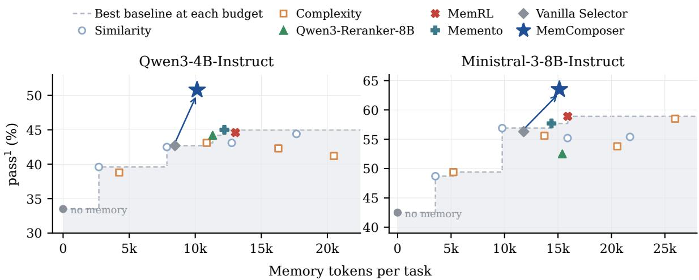  
Figure 7: Performance–memory-token trade-offs across 2 executor backbones and all domains. Each point represents a method or retrieval-budget configuration. The dashed line shows the baseline Pareto frontier: the highest observed baseline pass<sup>1</sup> within each memory-token budget. Memory tokens count the selected context supplied to the executor, averaged per task.

## F Baseline Implementation Details

This section describes the implementation and adaptation of all baselines. Every method draws from the same pool of retrieved candidates for each task (Appendix C), so that differences between methods are attributable to how memories are selected rather than to retrieval.

## F.1 Heuristic Baselines

Similarity-based selection. The k most similar of the top-10 retrieved candidates are provided to the agent, ordered from most to least similar. We sweep $k \in \{ 1 , 2 , 3 , 5 , 7 \}$ ; Table 1 reports the best $k \in \{ 1 , 3 , 5 , 7 \}$ , and results for k are given in Appendix E.

Complexity-based selection. Inspired by complexity-based prompting (Fu et al., 2023), the top-10 candidates are reranked by the length of their rendered full form, measured in tokens, as a cheap proxy for how much procedural detail a trajectory carries, and the k longest are provided to the agent, longest first. Because the reranking is applied to the whole pool before truncation, for $k \ < \ 1 0$ this baseline selects a different set of memories than similarity-based selection, not merely a different order, making it a selection heuristic in its own right. At $k ~ = ~ 1 0$ , both baselines provide the same memories and differ only in their order. We sweep the same values of k as above.

## F.2 Off-the-Shelf Reranker

Qwen3-Reranker-8B. We rerank the top-10 candidates with Qwen3-Reranker-8B (Zhang et al., 2025b), a cross-encoder that scores the relevance of each candidate to the query. The query is the user’s first message, and each document is the candidate’s digest—the same rendering our MEMCOMPOSER reads, so the two methods see identical content and differ only in how they score it. Following the model’s recommended usage, the candidate is scored by the probability of “yes” at the final position, normalized over the {“yes”, “no”} pair alone rather than the full vocabulary, conditioned on a task instruction, the query and the document. The five highest-scoring candidates are given to the agent in descending order of score. The reranker is used off the shelf, without further training.

## F.3 RL-Based Memory Methods

MemRL. MemRL (Zhang et al., 2026c) combines a growing memory bank with a value-aware retrieval policy: each memory carries a scalar value Q that estimates how useful it has been, and retrieval proceeds in two phases, a similarity phase that proposes a broad candidate set followed by a value phase that keeps the highest-Q entries. Since our memory bank is fixed, we disable memory write-back and reimplement only the value-aware retrieval, the component comparable to our method.

Memento. Memento (Zhou et al., 2025) replaces similarity retrieval with a learned case-selection policy: a scorer trained on the agent’s own episode outcomes predicts whether a stored case will help on a new query, and the highest-scoring cases are retrieved. We adapt the parametric variant from the authors’ released code. The scorer encodes the query and the case separately with SimCSE-RoBERTa-base, concatenates their [CLS] vectors (case first, as in the reference), and applies a twolayer head $( 2 \times 7 6 8  5 1 2  2$ , ReLU, dropout 0.2) that predicts whether the case is helpful. At inference, the five candidates with the highest predicted probability of being helpful are selected from the same top-10 pool that every other method receives and provided in descending order of that probability. Each case is represented by its digest, so the scorer reads the same rendering as our composer.

<table><tr><td colspan="2">Ministral-3-8B-Instruct</td></tr><tr><td>Parameter</td><td>Value</td></tr><tr><td>LoRA</td><td></td></tr><tr><td>Rank / scaling factor</td><td>64 /128</td></tr><tr><td>Dropout</td><td>0</td></tr><tr><td>Rollout sampling</td><td></td></tr><tr><td>Candidates per prompt</td><td>10</td></tr><tr><td>Sequences per prompt G</td><td>8</td></tr><tr><td>Executor trials per sequence J</td><td>8</td></tr><tr><td>Temperature</td><td>1.0</td></tr><tr><td>Top-p / top-k</td><td>0.9 / 20</td></tr><tr><td>Maximum prompt tokens</td><td>24,576</td></tr><tr><td>Maximum output tokens</td><td>1,024</td></tr><tr><td>Optimization</td><td></td></tr><tr><td>Prompts per generation round</td><td>16</td></tr><tr><td>Retained groups per update</td><td>8</td></tr><tr><td>Optimizer</td><td>AdamW</td></tr><tr><td>Learning rate</td><td> $1 \times 1 0 ^ { - 5 }$ </td></tr><tr><td>Schedule / warmup</td><td>Constant / none</td></tr><tr><td>Weight decay</td><td>0.01</td></tr><tr><td>Gradient clipping</td><td>1.0</td></tr><tr><td>Policy clipping €</td><td>0.2</td></tr><tr><td>Dual-clip coefficient</td><td>3.0</td></tr><tr><td>KL / entropy coefficients</td><td>0/0</td></tr><tr><td>Advantage normalization</td><td>Mean-centering only</td></tr><tr><td>Implementation</td><td></td></tr><tr><td>Training framework</td><td>verl 0.9.1</td></tr><tr><td>Precision</td><td>bfloat16</td></tr><tr><td>Data-loader seed</td><td>42</td></tr><tr><td>Policy updates</td><td>30</td></tr></table>

Table 9: Training hyperparameters for the Ministral-3- 8B-Instruct composer.

Training data. The reference implementation accumulates training examples online as the agent runs. Since our memory bank is fixed, we collect the equivalent signal offline from logged episodes: each example is a (query, case, outcome) triple for a case that was in the agent’s context during an episode. We use only episodes on training tasks and exclude all episodes on test tasks. Repeated (query, case) pairs are merged by summing their successes and trials, and each merged pair is weighted by its trial count in the loss, which is equivalent to one hard-labeled example per episode at a fraction of the cost. This yields 797–3,908 unique pairs per agent–domain cell, drawn from 1.2K–233K (episode, case) observations. In some cells, this is more supervision than the original online procedure would accumulate over the same tasks, so the comparison, if anything, favors Memento.

Optimization. We follow the released hyperparameters: AdamW with learning rate $2 \times 1 0 ^ { - 5 }$ weight decay 0.01 (excluding biases and Layer-Norm), a linear schedule with 6% warmup, gradient clipping at 1.0, batch size 32, three epochs, and the reference’s default class reweighting $w _ { + } =$ max $( 1 , n _ { - } / n _ { + } )$ , which ranges from 1.00 to 1.80 across cells. We make two departures: we use a maximum sequence length of 512 instead of 256, since 256 truncates 30–60% of our digests, and we split training and validation data by query rather than by example, so that no query appears in both.

## G Evaluation Protocol

Benchmark and splits. We evaluate on the retail, airline, and telecom domains of $\tau ^ { 2 } .$ bench (Barrès et al., 2025), using the official train/test split of each domain. Memory banks are built only from training tasks (Appendix C), and all results are reported on the test tasks: 40 tasks for retail, 20 for airline, and 40 for telecom (Table 11).

Agents and user simulator. The agent is either Qwen3-4B-Instruct-2507 (referred to as Qwen3- 4B-Instruct in the main text) or Ministral-3-8B-Instruct, used without any parameter updates and decoded with temperature 0. We serve Qwen3-4B-Instruct locally with vLLM and access Ministral-3-8B-Instruct through the AWS Bedrock API. The user is simulated by GLM-4.7 with temperature 0 for all methods, including memory construction, composer training, and evaluation, so that every method interacts with the same user. Each episode ends when the task is completed, the user ends the conversation, or the agent reaches 50 steps. The selected memories are inserted into the agent’s system prompt in the order produced by the selection method (Appendix J).

<table><tr><td rowspan="3">Method</td><td colspan="2">Retail</td><td colspan="2">Airline</td><td colspan="2">Telecom</td><td colspan="2"> $\mathbf { A v } \mathbf { g } .$ </td></tr><tr><td> $\mathrm { p a s s ^ { 1 } }$ </td><td> $\mathrm { p a s s ^ { 4 } }$ </td><td> $\mathrm { p a s s ^ { 1 } }$ </td><td> $\mathrm { p a s s ^ { 4 } }$ </td><td> $\mathrm { p a s s ^ { 1 } }$ </td><td> $\mathrm { p a s s ^ { 4 } }$ </td><td> $\mathrm { p a s s } ^ { 1 }$ </td><td> $\mathrm { p a s s ^ { 4 } }$ </td></tr><tr><td colspan="9"> $\ C P$  Qwen3-4B-Instruct</td></tr><tr><td colspan="9">Similarity-based</td></tr><tr><td> $k = 1 { \dot { } }$ </td><td>49.4</td><td>30.0</td><td>43.8</td><td>20.0</td><td>25.6</td><td>10.0</td><td>39.6</td><td>20.0</td></tr><tr><td> $k = 2$ </td><td>46.3</td><td>27.5</td><td>40.0</td><td>20.0</td><td>36.2</td><td>12.5</td><td>40.8</td><td>20.0</td></tr><tr><td> $k = 3$ </td><td>51.2</td><td>42.5</td><td>38.8</td><td>15.0</td><td>37.5</td><td>20.0</td><td>42.5</td><td>25.8</td></tr><tr><td> $k = 5$ </td><td>56.2</td><td>37.5</td><td>45.0</td><td>25.0</td><td>28.1</td><td>7.5</td><td>43.1</td><td>23.3</td></tr><tr><td> $k = 7$ </td><td>53.7</td><td>30.0</td><td>50.0</td><td>25.0</td><td>29.4</td><td>5.0</td><td>44.4</td><td>20.0</td></tr><tr><td colspan="9">Complexity-based</td></tr><tr><td> $k = 1$ </td><td>51.2</td><td>35.0</td><td>38.8</td><td>25.0</td><td>26.3</td><td>5.0</td><td>38.8</td><td>21.7</td></tr><tr><td> $k = 2$ </td><td>50.6</td><td>30.0</td><td>41.2</td><td>20.0</td><td>32.5</td><td>10.0</td><td>41.5</td><td>20.0</td></tr><tr><td> $k = 3$ </td><td>51.9</td><td>37.5</td><td>40.0</td><td>30.0</td><td>37.5</td><td>15.0</td><td>43.1</td><td>27.5</td></tr><tr><td> $k = 5$ </td><td>50.0</td><td>32.5</td><td>48.7</td><td>30.0</td><td>28.1</td><td>10.0</td><td>42.3</td><td>24.2</td></tr><tr><td> $k = 7$ </td><td>55.0</td><td>35.0</td><td>41.2</td><td>25.0</td><td>27.5</td><td>7.5</td><td>41.2</td><td>22.5</td></tr><tr><td colspan="9">iMinistral-3-8B-Instruct</td></tr><tr><td colspan="9">Similarity-based</td></tr><tr><td> $k = 1$ </td><td>58.1</td><td>45.0</td><td>28.7</td><td>5.0</td><td>59.4</td><td>32.5</td><td>48.7</td><td>27.5</td></tr><tr><td> $k = 2$ </td><td>63.1</td><td>35.0</td><td>37.5</td><td>15.0</td><td>57.5</td><td>37.5</td><td>52.7</td><td>29.2</td></tr><tr><td> $k = 3$ </td><td>68.1</td><td>40.0</td><td>38.8</td><td>20.0</td><td>63.7</td><td>45.0</td><td>56.9</td><td>35.0</td></tr><tr><td> $k = 5$ </td><td>65.0</td><td>45.0</td><td>30.0</td><td>5.0</td><td>70.6</td><td>45.0</td><td>55.2</td><td>31.7</td></tr><tr><td> $k = 7$ </td><td>65.6</td><td>45.0</td><td>31.2</td><td>5.0</td><td>69.4</td><td>40.0</td><td>55.4</td><td>30.0</td></tr><tr><td colspan="9">Complexity-based</td></tr><tr><td> $k = 1$ </td><td>59.4</td><td>30.0</td><td>28.7</td><td>5.0</td><td>60.0</td><td>35.0</td><td>49.4</td><td>23.3</td></tr><tr><td> $k = 2$ </td><td>61.3</td><td>37.5</td><td>28.7</td><td>10.0</td><td>61.3</td><td>27.5</td><td>50.4</td><td>25.0</td></tr><tr><td> $k = 3$ </td><td>65.0</td><td>37.5</td><td>31.2</td><td>5.0</td><td>70.6</td><td>47.5</td><td>55.6</td><td>30.0</td></tr><tr><td> $k = 5$ </td><td>61.3</td><td>40.0</td><td>30.0</td><td>5.0</td><td>70.0</td><td>45.0</td><td>53.8</td><td>30.0</td></tr><tr><td> $k = 7$ </td><td>65.6</td><td>45.0</td><td>36.2</td><td>20.0</td><td>73.8</td><td>40.0</td><td>58.5</td><td>35.0</td></tr></table>

Table 10: Full retrieval-budget sweep for similarity-based and complexity-based reranking with two frozen executors. Avg. denotes the macro-average across the three domains.

Selection at test time. For every method that selects from the retrieved candidates, the selection is made once per test task and reused across all trials of that task, so that differences between trials reflect the interaction rather than the selected candidates. MEMCOMPOSER and the vanilla selector decode their selections greedily.

Trials and metrics. Apart from the choice of user simulator, we follow the official $\tau ^ { 2 } .$ -bench evaluation protocol: each test task is run for four trials with the official seeds, and performance is measured by $\mathrm { p a s s } ^ { k }$ , the metric introduced in $\tau -$ bench (Yao et al., 2024) and adopted by $\tau ^ { 2 } .$ -bench, which is the probability that the agent succeeds in all k of k independent trials of a task. Following the official implementation, for a task with c successes out of four trials, $\mathrm { p a s s } ^ { k }$ is estimated as $\textstyle { \binom { c } { k } } / \left( { 4 \atop k } \right)$ and averaged over tasks; $\mathrm { p a s s ^ { 1 } }$ thus equals the average success rate, and $\mathrm { p a s s ^ { 4 } }$ the fraction of tasks solved in all four trials. When averaging across domains, we take the unweighted mean of the three domains.

<table><tr><td></td><td>RETAIL</td><td>AIRLINE</td><td>TELECOM</td></tr><tr><td>Training tasks</td><td>74</td><td>30</td><td>74</td></tr><tr><td>Test tasks</td><td>40</td><td>20</td><td>40</td></tr><tr><td>Trials per task</td><td>4</td><td>4</td><td>4</td></tr><tr><td>Test episodes</td><td>160</td><td>80</td><td>160</td></tr></table>

Table 11: Official train/test split of each $\tau ^ { 2 } .$ -bench domain. Memory banks are built from the training tasks only, and all results are reported on the test tasks.

Memory tokens. For the efficiency analysis, we measure the number of tokens in the memory block inserted into the agent’s prompt, counted with the agent’s own tokenizer and including the block’s fixed header of 172 tokens; a task without selected memories counts as zero. Values are averaged over the test tasks of each domain, and over the three domains weighted by their number of test trials.

## H Additional Analyses

## H.1 Token Efficiency

MEMCOMPOSER achieves the best result with fewer memory tokens. Figure 7 plots $\mathrm { p a s s ^ { 1 } }$ against memory tokens per task, averaged over the three domains, for both executors. MEMCOM-POSER lies above the baseline Pareto frontier in both panels: it uses 16.9% fewer memory tokens than the strongest baseline with Qwen3-4B-Instruct and 4.9% fewer with Ministral-3-8B-Instruct, while reaching higher pass<sup>1</sup>. Figure 8 zooms in on retail with Qwen3-4B-Instruct, where the gap is largest: MEMCOMPOSER reaches 60.0 pass<sup>1</sup> with 9.2K memory tokens per task, whereas similarity top-10 reaches 57.5 with 24.3K, so it performs better with 38% of the memory; within its 9.2K-token budget no baseline exceeds $5 1 . 2 \mathrm { p a s s } ^ { 1 }$ , and the reranker, MemRL, and Memento all score lower while using more tokens. Memory-token counts are determined by each method’s selections and are not subject to trial randomness (Appendix B).

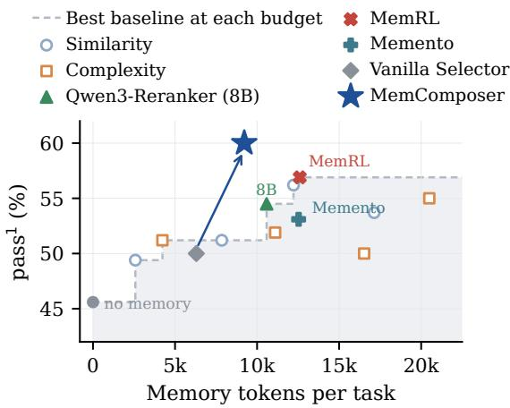  
Figure 8: Retail trade-off for Qwen3-4B-Instruct. Same layout as Figure 7 for a single domain.

## H.2 Domain Variation and Transfer

The three τ<sup>2</sup>-bench domains involve different tools, policies, and task requirements, leading to different patterns of memory use. Their memory banks contain different distributions of successful and failed experiences, and each domain exhibits different sensitivity to the number and ordering of retrieved memories. These differences make cross-domain transfer meaningful, as the composer must identify useful experiences under varying task requirements and memory distributions rather than relying on a fixed selection strategy. Despite these differences, the composer trained only on Retail achieves performance comparable to in-domain training on AIRLINE and TELECOM, suggesting that it learns memory assembly strategies that transfer across different procedural tasks.

## I Case Studies

We present three cases that illustrate how memory selection and ordering affect the executor.

• Complementary memories (Table 12): on an airline task, two memories from the same training task each cover a different constraint of the current request.

• A failed memory with a reusable action (Table 13): on a retail task, a memory that failed on price communication still contains the exchange operation the current task requires.

• Same memories, different order (Table 14): on a retail task, the same five memories lead to different outcomes when presented in different order.

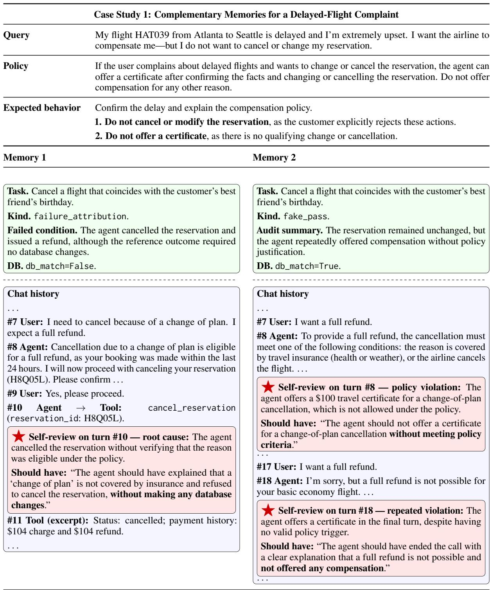  
Explanation. The two memories provide complementary guidance. The first warns against an inappropriate cancellation and emphasizes leaving the reservation unchanged. The second warns against offering compensation without a valid policy trigger. Together, they address both constraints of the current task: respect the customer’s request not to change the booking, and explain why a certificate cannot be offered. Combining these lessons supports a response that satisfies both the customer’s intent and the domain policy.  
Table 12: An airline case illustrating complementary guidance from two trajectory memories.

Case Study 2: A Failed Memory for a Successful Laptop Exchange   
Query Hi, I’m Lei Wilson. I received a laptop recently, but I need to exchange it for a different model. I’m   
looking for one with an i7 processor, 8GB RAM, and a 1TB SSD.   
Policy For a delivered order, each item can be exchanged for an available item of the same product with   
different options. The user must provide a payment method for the price difference, and the agent must   
obtain explicit confirmation before acting.   
Expected behavior Exchange item 3478699712 in order #W2905754 for item 9844888101 (i7, 8GB RAM, 1TB SSD),   
using the credit card on file and obtaining explicit confirmation before acting. This test task does not   
evaluate the agent’s statements about prices.   
Source. task095\_trial1.   
Task (summary). The same customer requests an exchange of both 15-inch laptops for models with an i7 processor, 8GB   
RAM, and a 1TB SSD.   
Kind. failure\_attribution.   
Failed condition (summary). The agent incorrectly reports a \$60.78 refund for each laptop and a \$121.56 total refund. The   
correct amounts are a \$167.87 payment for the first laptop and a \$60.78 refund for the second, resulting in a \$107.09 net   
payment.   
DB. db\_match=True: the database changes are correct.   
Chat history (excerpt)   
#0 Agent: Hi! How can I help you today?   
#1 User: Hi, I’m Lei Wilson. I received a laptop recently, but I need to exchange it. I’m looking to upgrade to an i7 processor,   
8GB RAM, and a 1TB SSD. Actually, I have two laptops I need to exchange . . .   
. . . Identity verification, order lookup, and product lookup omitted. . . .   
#16 Agent (excerpt): You will receive a refund of \$121.56 for the two laptops. The refund will be processed to your original   
payment method . . . Please confirm if you’d like to proceed with this exchange.   
⋆ Self-review on turn #16.   
Root cause (excerpt). The agent calculated the price difference per laptop as \$2520.52 − \$2459.74 = \$60.78 and stated   
that the total difference for two laptops is \$121.56, incorrectly claiming it as a refund . . .   
Should have (excerpt). The agent should have correctly calculated the price difference for the first laptop as \$167.87 . . .   
and for the second as \$60.78 (a refund), and then computed the total as \$107.09 (a net payment of \$107.09) .   
#17 User: That sounds perfect. Please go ahead and process the exchange for both laptops. I want to get this sorted out   
quickly.   
⋆ Turn #18: the exchange action required by the test task.   
Agent → Tool:   
exchange\_delivered\_order\_items(   
order\_id="#W2905754",   
item\_ids=["3478699712"],   
new\_item\_ids=["9844888101"],   
payment\_method\_id="credit\_card\_3677959")   
#19 Tool (excerpt): status: "exchange requested"; exchange\_items: ["3478699712"]; exchange\_new\_items:   
["9844888101"]; exchange\_price\_difference: 167.87.   
. . . Exchange of the second laptop and the closing conversation omitted. . . .   
Result. On the same test task, the executor succeeds in 0/4 trials without memory and 4/4 trials with this failed memory   
alone. In the official τ<sup>2</sup>-bench split, training and test tasks can involve the same customer and order; this memory comes from   
such a training task and therefore contains an exchange call that applies directly to the test task. All methods draw from the   
same candidate pool, so this overlap is available to every method.   
Explanation. The memory fails on price communication, but its exchange call performs the operation required by the current   
task. The historical failure and the reusable action therefore concern different parts of the trajectory. This illustrates why   
MEMCOMPOSER learns from the current task outcomes of assembled contexts, rather than the memories’ historical outcomes.  
Table 13: A failed memory contains the correct exchange action for a related task involving the same customer. Content is abbreviated; starred boxes highlight the historical error and the reusable action.

<table><tr><td></td><td>Case Study 3: Memory Ordering Affects Agent Performance</td></tr><tr><td>Query</td><td>Hi, I need to exchnge a robotic vacuum cleaner from my recent order for a canister based one from the same product line.</td></tr><tr><td>Policy</td><td>For a delivered order, each item can be exchanged for an available item of the same product with different options. The user must provide a payment method for the price difference, and the agent must obtain explicit confirmation before acting.</td></tr><tr><td>Expected behavior</td><td>Present the available canister models and confirm the customer&#x27;s choice of the bagless version. Exchange the robotic vacuum cleaner (6259501109) in order #W9502127 for the bagless canister model (7958300294).</td></tr><tr><td>MEMCOMPOSER</td><td>(paypal_2433177), and obtain explicit confirmation before performing the exchange. [8] → [1] → [7] → [3] → [6]</td></tr><tr><td>Similarity-based Memory [1]</td><td>[1] → [3] → [6] → [7] → [8]</td></tr><tr><td colspan="2">Source: task007_trial1. Kind: failure_attribution.</td></tr><tr><td>Task (summary): Exchange a water bottle and a desk lamp. only the desk lamp should be exchanged, with a price difference of $5.08.</td><td>Review (summary): The stored review flags an extra item in the exchange and an incorrect price difference. It states that</td></tr><tr><td>Memory [3] Source: task008_trial3. Kind: failure_attribution</td><td></td></tr><tr><td>Task (summary): Exchange a water bottle and a desk lamp. Review (summary): The stored review flags the inclusion of the water bottle in the exchange and the resulting incorrect charge. It specifies a lamp-only price difference of $26.34.</td><td></td></tr><tr><td colspan="2">Memory [6] Source:task006_trial2.</td></tr><tr><td>Task (summary): Exchange a water bottle and a desk lamp. only the desk lamp should be exchanged, with a price difference of $12.07.</td><td>Kind: failure_attribution. Review (summary): The stored review flags an extra item in the exchange and an incorrect price difference. It states that</td></tr><tr><td colspan="2">Memory [7] Source: task046_trial3. Kind: clean_pass.</td></tr><tr><td colspan="2">Task (summary): Return an air purifier and a vacuum cleaner. Trajectory (summary): The conversation concerns the customer&#x27;s order #X2815720. The customer distinguishes the robotic vacuum from the canister model, and the agent returns the air purifier and robotic vacuum after confirmation.</td></tr><tr><td colspan="2">Memory [8] Source: task047_trial2. Kind: failure_attribution.</td></tr><tr><td colspan="2">Trajectory (summary): The conversation concerns the customer&#x27;s order #E3503307, containing both robotic and canister vacuums. The agent lists the bagged canister model, and the customer clarifies that they want to return the canister vacuum rather than the robotic one.</td></tr><tr><td>Outcome</td><td>Review (summary): The stored feedback flags returned-item coverage and refund amounts. With the same five memories, the executor succeeds in 4/4 trials with MemComposer&#x27;s ordering and</td></tr><tr><td>Explanation</td><td>0/4 trials with similarity ordering. A possible explanation is a positional attention effect. The executor may give greater attention to the key memories [1] and [8] when they appear early in MemComposer&#x27;s ordering. Under similarity</td></tr></table>

Table 14: Same five memories, different order. A retail case where the executor succeeds in 4/4 trials under MEMCOMPOSER’s ordering and 0/4 under similarity ordering. Starred memories are the two the executor acts on.

## J Prompts

This section provides prompts used for MEMCOM-POSER and memory bank construction.

## J.1 MEMCOMPOSER Prompts

The MEMCOMPOSER receives the customer’s opening request and ten retrieved candidate memories in a single user message. We show the retail template below; the domain name is changed accordingly for airline and telecom.

Prompt 1: Composer: Retail   
You are the memory selector for the retail   
agent.   
You are given the customer's opening request   
and a set of retrieved cases from past   
conversations in the same domain,   
numbered [1], [2], and so on.   
Your task is to select and rank the cases   
that are useful for helping the agent   
act correctly in the new conversation.   
The concrete entities, wording, or itinerary   
in a past case may differ from the   
current request. Focus on whether the   
underlying lesson transfers.   
Each case includes its subsequent grading or   
outcome. Use this feedback to   
distinguish useful successful behavior   
from mistakes that should not be   
repeated. A negatively graded case can   
still be useful if it clearly   
demonstrates a relevant failure mode.   
Select only cases that provide meaningful   
additional guidance for the current   
request. Stop once additional cases   
would not materially improve the agent's   
decision.   
Return the selected case indices in   
descending order of usefulness.   
If no retrieved case provides useful   
transferable guidance, return an empty   
list.   
Retrieved cases:   
[1]: {case 1}   
[2]: {case 2}   
[10]: {case 10}   
Query:   
{customer's opening request}

First, inside <reasoning> </reasoning>,   
briefly reason about which cases you   
keep and why. Keep it to two or three   
sentences; do not walk through the cases   
one by one.   
Then output only a JSON list of case numbers   
inside <answer> </answer>, e.g. <answer   
>[...]</answer>. Output nothing after   
that.

## J.2 Memory Construction Prompts

Self-review prompts. Prompts 2 and 3 show the system prompt and user template for reviewing failed trajectories. When a passing trajectory from the same task is available, it is inserted into the {sibling} placeholder using Prompt 4; otherwise, the placeholder is left empty.

```csv
Prompt 2: Self-review: System Prompt
You are analyzing a customer-service agent's
own transcript to find out why it failed
the task.
You are given:
- <Policy>: the rules the agent had to follow.
- <Task>: what the customer wanted.
<Answer Key>: the reference solution and
the exact conditions the grader checked.
<Grader Verdict>: what the grader concluded
— this trajectory FAILED, and these are
the specific checks that did not pass.
- <Conversation>: the full transcript, every
line prefixed with its turn number as [
TURN n].
The verdict is ground truth. Do not re
litigate whether the trajectory failed.
Your job is attribution: find the moment in
THIS transcript that caused THAT verdict.
How to work:
1. Read the verdict and state plainly, in
your own words, which condition was not
met.
2. Walk the transcript and find the FIRST
turn where the agent's own output was
wrong — a wrong statement to the
customer, a wrong or missing tool call,
a wrong argument. That is the root cause.
It is never a lookup that returned
correctly; if the agent looked something
up and then drew the wrong conclusion,
the root cause is the turn with the
wrong conclusion. If a tool errored at [
TURN 31], the root cause is the agent's
call at [TURN 30]. If the verdict marks
a write as [FORBIDDEN WRITE], the agent'
s error is having made that write;
should_have" must then say to refuse or
leave it unchanged, and must NOT
```

describe how to make the same write - When you say the agent violated the policy,   
correctly. A task can mix both: some put the exact policy sentence you rely   
writes required, others forbidden. Many on in "policy\_quote". It must be copied   
tasks are REFUSAL tasks: the correct from <Policy> — never from <Task>, the   
outcome is to decline or do nothing, and answer key, or your own words. If the   
the reference solution then contains failure was not a policy violation (e.g.   
only lookups (the verdict tells you when a wrong calculation, a missed step, a   
this is the case). In such a task the wrong argument), set "policy\_quote" to   
agent's error is that it wrote to the null rather than inventing one.   
database at all — do not tell it to Quote or paraphrase what actually happened   
perform writes it should have refused. at that turn. Never invent tool names,   
3. Say concretely what the agent should have arguments, or messages that are not in   
done at that turn instead, grounded in the transcript.   
the policy and the answer key. <Agent Tools> and <Customer Device Tools>   
4. List any further agent mistakes that are two different sets. A tool in the   
contributed, each with its own turn. second set exists but belongs to the   
customer's phone: the agent cannot call   
Rules: it and must ask the customer to do it. A   
- Only analyze the AGENT. The customer's call that came back "Tool 'X' not found   
behaviour is not your concern; never " is this mistake. Never write that such   
blame the customer for an agent mistake. a tool "does not exist".   
- Every turn\_idx you cite MUST be a [TURN n] - Assertion names from the answer key (   
number that appears in the transcript, assert\_\*) are grading checks, not tools.   
and it MUST be an \*\*agent\*\* turn — a Do not describe the agent as calling   
turn labelled \*\*assistant\*\*. Never cite them.   
a \*\*tool\*\* turn (that is the system - If a <Correct Run Of The Same Task> block   
answering) or a \*\*user\*\* turn (that is is present, it is what this SAME agent   
the customer). If the mistake shows up did in another attempt at this SAME task   
in a tool error at [TURN 31], the agent that PASSED. It is the most concrete   
s turn is [TURN 30]; if the agent example of a correct path. Use it to   
answered a customer question badly at [ spot which step the failed run skipped,   
TURN 50], cite 50, not the question at did in the wrong order, or did with   
49. <Agent Actions By Turn> lists every different arguments. The customer's   
tool the agent called and at which turn wording differs between runs, so align   
use it so the turn you cite is the turn by intent, not turn by turn, and never   
where the thing you describe actually describe the correct run's actions as   
happened. things the failed run did.   
- Lines in the transcript marked "\*\*user\*\*" - If the failure was NOT the agent's fault (   
followed by "Tool Call" are the CUSTOMER the customer hung up mid-task, the   
operating their own phone at the agent conversation hit the step limit while   
s request. They are not agent actions. the agent was making progress, the task   
Never write "the agent called was impossible), say so by setting "   
toggle\_roaming" when the customer did it. blame" accordingly and explain. Do not   
manufacture an agent error.   
The root cause must be a turn where the   
agent did something wrong or failed to Output ONLY this JSON object:   
do something. A successful read-only {   
lookup (get\_\*, search\_\*, find\_\*, list\_\*) "failed\_condition": "<plain-language   
is never the root cause by itself — if restatement of what the grader says was   
a lookup was fine and the mistake came not met>",   
later, cite the later turn. "blame": "agent" | "customer" | "   
"should\_have" must be an action the agent environment" | "unclear",   
could actually have taken with the "root\_cause": {   
information in the transcript and the "turn\_idx": <int, an assistant turn>,   
tools it owns. Never write "state the "what\_happened": "<what the agent did at   
answer-key value" or "match the this turn>",   
reference solution"; instead say which "why\_it\_caused\_the\_failure": "<causal   
step would have produced the right link to the failed condition>",   
result (which lookup, which calculation, "should\_have": "<the concrete correct   
which tool with which arguments, which action at this turn>",   
question to ask the customer). If the "policy\_quote": "<exact sentence from <   
correct value can be computed from Policy> if a rule was broken, else null   
numbers in the transcript, show the >"   
computation. },   
- The reference solution is ONE valid path. "contributing\_errors": [   
Failing to match it exactly is not {"turn\_idx": <int>, "what\_happened":   
itself an error; only cite it to explain "<...>", "should\_have": "<...>"}   
what the failed condition required. ],

"summary": "<two sentences: the failure in   
one line, the fix in one line>"   
}

Prompt 3: Self-review: User Template   
<Policy>   
{policy}   
</Policy>   
<Agent Tools>   
{agent\_tools}   
</Agent Tools>   
{customer\_tools}   
<Task>   
{task}   
</Task>   
<Answer Key>   
Reference solution (one valid path; other   
paths may also be correct):   
{actions}   
{criteria}   
</Answer Key>   
{sibling}<Grader Verdict>   
This trajectory scored {reward}. The   
following checks did not pass:   
{verdict}   
</Grader Verdict>   
<Agent Actions By Turn>   
{tool\_index}   
</Agent Actions By Turn>   
<Conversation>   
{conversation}   
</Conversation>

Prompt 4: Self-review: Optional Passing-Trajectory   
Reference   
<Correct Run Of The Same Task>   
The same agent PASSED this task in another   
attempt (trial {trial}). Its agent-side   
trace, in order:   
{txt}   
</Correct Run Of The Same Task>

Pass-audit prompts. Prompts 5 and 6 provide the shared system template and user template for auditing passing trajectories. The four domainspecific placeholders in the system template are instantiated using Prompts 7–9.

Prompt 5: Pass Audit: System Template   
You are auditing a customer-service agent's   
own transcript. The grader marked this   
conversation as a PASS: the target end  
state was reached and any required   
information was communicated. Do NOT re-

litigate the pass. Your job is a PROCESS   
review: did the agent behave correctly   
along the way, and is the pass genuine?   
You are given <Policy>, <Task> (incl. the   
task author's stated purpose), <Answer   
Key>, <Pass Context> (what the target   
required and what the agent actually   
wrote), <Automated Checks> (   
deterministic findings, each anchored to   
a [TURN n]) and <Conversation> with [   
TURN n] labels.   
What counts as a problem (each anchored to an   
\*\*assistant\*\* turn):   
- false\_statement: the agent told the   
customer something contradicted by a   
tool result or by the policy (e.g. {   
false\_statement\_eg}).   
- claimed\_action\_not\_performed: the agent   
said something was done without a   
corresponding write tool call.   
write\_without\_confirmation: a write made   
before the customer explicitly confirmed   
the listed details.   
forbidden\_write\_attempt: the agent   
attempted a write the policy forbids (   
even if the tool rejected it).   
{compensation\_line}   
fake\_transfer: told the customer it was   
transferring, or let the customer leave   
for a human, without calling   
transfer\_to\_human\_agents.   
protocol\_violation: text and tool call in   
one message (customer never saw the text)   
, invalid tool arguments, repeated   
identical calls, or the agent calling a   
tool that belongs to the customer's own   
device.   
- wrong\_calculation: a stated total/   
difference/amount that does not follow   
from the numbers in tool results.   
other: anything else that would have hurt a   
real customer or violated policy.   
Pass classification:   
genuine: the agent did what the task needed   
and made no critical process error.   
- passive\_pass: the task required no write   
and the agent made no write — but check   
whether it also SAID the right things; a   
passive pass with a false statement or   
a fake transfer is NOT clean.   
- fake\_pass: the outcome matched the target   
only by accident — e.g. the agent   
claimed to do something it never did,   
misled the customer, acted on the wrong   
record, transferred/abandoned instead of   
resolving, or the customer gave up — so   
a real customer would consider the   
interaction failed or the policy was   
critically violated.   
How transfers work here (read carefully, this   
is where reviewers go wrong):   
- A CORRECT transfer = the agent calls   
transfer\_to\_human\_agents (any turn) and   
then tells the customer it is being

transferred; the customer's final "###   
TRANSFER###" follows. Calling the tool   
and announcing the transfer in the same   
or adjacent turns is CORRECT.   
Transferring because the customer   
insists on a supervisor is allowed.   
- A FAKE transfer = the agent announces a   
transfer, or the customer leaves with   
"###TRANSFER###", and   
transfer\_to\_human\_agents was NEVER   
called in the whole conversation. Only   
the <Automated Checks> lines   
fake\_transfer\` and \`   
customer\_transfer\_without\_agent\_transfer   
\` identify this; do not invent other   
transfer rules.   
- A transfer is never "proactive\_compensation   
".   
<Automated Checks> facts: \`mixed\_turn\`,   
tool\_error\`, \`fake\_transfer\`,   
customer\_transfer\_without\_agent\_transfe   
\` and \`claims\_action\_not\_performed\` are   
computed deterministically from the   
transcript and are TRUE by construction —   
do not dispute them; your job for those   
is to judge severity and consequence. {   
domain\_checks}   
Severity: a mixed\_turn is "minor" unless the   
hidden text carried information the   
customer needed. A tool\_error that the   
agent then corrected is "minor".   
called\_customer\_device\_tool\` is "minor"   
whenever the agent, after the tool came   
back "not found", went on to ask the   
customer to do it — that is a recovered   
protocol slip and it does NOT make the   
pass fake; it is "critical" only if the   
agent instead told the customer the   
action was done, or gave up. False   
statements to the customer, claimed-but   
not-performed actions, forbidden   
compensation offers, acting on the wrong   
record and fake transfers are "critical   
". pass\_class is fake\_pass only when a   
critical issue exists.   
Rules:   
- Every turn\_idx MUST be an assistant turn   
number that appears as [TURN n].   
- Quote the actual words or the actual tool   
call. Never invent tool names, arguments   
or statements.   
- Treat <Automated Checks> as leads: confirm   
each (is\_real true/false, one sentence   
why) and add anything they missed.   
- The customer is scripted to lie in many   
tasks ({customer\_lies\_eg}); that is   
expected. Judge only whether the AGENT   
verified and responded correctly.   
- If the transcript is genuinely clean, say   
so; do not manufacture issues.   
Output ONLY this JSON:   
{   
"pass\_class": "genuine" | "passive\_pass" |   
"fake\_pass",

```jsonl
"clean": true | false,
"automated_checks_review": [
{"turn_idx": <int>, "check": "<name>", 1
is_real": true|false, "why": "<one
sentence>"}
],
"issues": [
{
"turn_idx": <int>,
"category": "<one of the categories
above>",
"severity": "critical" | "minor",
"what_happened": "<quote/paraphrase of
the turn>",
"evidence": "<which tool result /
policy line it contradicts>",
"should_have": "<the correct behaviour
at that turn>"
}
],
"fake_pass_reason": "<one sentence, or null
>"

"summary": "<two sentences>"
}
```

Prompt 6: Pass Audit: User Template   
<Policy>   
{policy}   
</Policy>   
<Agent Tools>   
{agent\_tools}   
</Agent Tools>   
{customer\_tools}   
<Task>   
{task}   
</Task>   
<Answer Key>   
Reference solution (one valid path; other   
paths may also be correct):   
{actions}   
{criteria}   
</Answer Key>   
<Pass Context>   
{pass\_context}   
</Pass Context>   
<Automated Checks>   
{auto}   
</Automated Checks>   
<Agent Actions By Turn>   
{tool\_index}   
</Agent Actions By Turn>   
<Conversation>   
{conversation}   
</Conversation>

Domain-specific substitutions. The following text replaces the four corresponding placeholders in Prompt 5.

## Prompt 7: Pass Audit: Airline Substitutions

{false\_statement\_eg}:   
calls a regular member "Gold", says a refund   
is possible when policy forbids it,   
quotes a wrong price   
{compensation\_line}:   
proactive\_compensation: offered a certificate   
/refund/voucher the customer had not   
asked for or that policy does not allow.   
{customer\_lies\_eg}:   
claims Gold, claims insurance, invents a   
cancelled flight   
{domain\_checks}:   
\`claim\_contradicts\_record\`, \`   
claim\_without\_lookup\` and \`   
compensation\_offered\` are regex leads   
and may be false; verify them against   
the quoted turn.

## Prompt 8: Pass Audit: Retail Substitutions

{false\_statement\_eg}:   
tells the customer an order is "delivered"   
when the record says "pending", says an   
item is unavailable when   
get\_product\_details shows available=true,   
names a card the customer does not have   
on file, quotes a refund total that   
does not follow from the item prices   
{compensation\_line}:   
proactive\_compensation: offered a refund, a   
discount, free shipping or an exception   
the customer had not asked for or that   
policy does not allow.   
{customer\_lies\_eg}:   
misremembers an order id, claims an item was   
damaged, asks to refund to a different   
payment method than the one used   
{domain\_checks}:   
\`claim\_contradicts\_record\`,   
policy\_stated\_backwards\` and \`   
amount\_stated\` are regex leads and may   
be false; verify them against the quoted   
turn. For \`amount\_stated\` you must do   
the arithmetic yourself from the item   
prices in the tool results.

## Prompt 9: Pass Audit: Telecom Substitutions

{false\_statement\_eg}:   
tells the customer roaming is enabled on a   
line whose record says otherwise,   
reports a data allowance that does not   
match get\_data\_usage, says a line is   
active when it is suspended   
{compensation\_line}:

proactive\_compensation: offered a credit, a   
data refuel, a plan change or a fee   
waiver the customer had not asked for or   
that policy does not allow.   
{customer\_lies\_eg}:   
gives a line id that is not theirs, claims a   
setting is already on, misreports what   
their phone shows   
{domain\_checks}:   
\`wrote\_to\_wrong\_line\`,   
wrote\_to\_unverified\_line\` and \`   
called\_customer\_device\_tool\` are   
computed from the transcript and are   
TRUE by construction — a write aimed at   
the wrong line, or the agent trying to   
operate the handset itself, is critical   
even when the task still passed. \`   
claim\_contradicts\_record\` and \`   
amount\_stated\` are regex leads; verify   
them against the quoted turn.

## Memory 1: Memory Digest

Task: You're in a rush and you want to undo   
cancelling an order that you've   
previously placed. Be insisten ...   
KIND: clean\_pass   
MINOR FLAGS: none   
SUMMARY: The agent correctly identified that   
undoing a cancellation is not possible   
per policy and did not perform any write   
actions. Instead, they authenticated   
the user, retrieved order details, and   
provided ...   
DB: db\_match=True, target\_requires\_write=   
False, passive\_task=True   
Chat History:   
#0 agent: Hi! How can I help you today?   
#1 user: Hi, I need to undo a cancellation on   
an order I just placed. I'm in a huge   
rush and I really need th ...   
... 10 turns omitted ...   
#12 agent -> find\_user\_id\_by\_name\_zip({"   
first\_name":"Chen","last\_name":"Smith","   
zip":"32278"})   
#13 tool: chen\_smith\_8425   
#14 agent -> get\_user\_details({"user\_id":"   
chen\_smith\_8425"})   
#15 tool: {"name":{"first\_name":"Chen","   
last\_name":"Smith"},"address":{"address1   
":"932 Hickory Lane","address2":"Suite   
309","city":"Jacksonville","country":"   
USA","state":"FL","zip":"32278"},"orders   
":["#W8859225"],"payment\_methods":[{"id   
":"gift\_card\_4796172","s ...   
... 2 turns omitted ...   
#18 agent -> get\_order\_details({"order\_id":"#   
W8859225"})   
#19 tool: {"order\_id":"#W8859225","status":"   
cancelled","items":["Indoor Security   
Camera 1999523885 4K/160 degrees/Wi-Fi   
\$294.47","Mechanical Keyboard 9665000388   
clicky/none/80% \$269.46","Indoor   
Security Camera 5966895767 2K/160

degrees/Ethernet \$329.58","Wirel ... ... 8 turns omitted ...

#28 agent: Here are the details of your original order for your reference: 1. \*\* Indoor Security Camera\*\* - Reso ...

#29 user: Okay, thanks. I'll go do that now. ###STOP###

ID: 3d019c46-9127-40b3-9ac7-f15c8e19cee3

## Memory 2: Memory Full

Task: You're in a rush and you want to undo cancelling an order that you've previously placed. Be insistent that the customer service agent should undo the cancellation and ensure that the order is delivere . . .

KIND: clean\_pass

MINOR FLAGS: none

SUMMARY: The agent correctly identified that undoing a cancellation is not possible per policy and did not perform any write actions. Instead, they authenticated the user, retrieved order details, and provided the full item list to the customer so they could place a new order independently. The interaction adhered to all policy rules, including no false statements, no claimed actions without confirmation, and no unauthorized writes. The customer ultimately resolved the issue on their own without needing a transfer or exception.

DB: db\_match=True, target\_requires\_write= False, passive\_task=True

Chat History:

#0 agent: Hi! How can I help you today?

#1 user: Hi, I need to undo a cancellation on an order I just placed. I'm in a huge rush and I really need this sorted out immediately.

#2 agent: I'm sorry, but I can't assist with undoing a cancellation. Once an order is cancelled, it cannot be reversed. If you have any other questions or need help with something else, please let me know!

#3 user: I understand that, but I really need you to make an exception. I need those items delivered as soon as possible. Please, isn't there anything you can do to fix this?

#4 agent: I'm sorry, but I can't assist with undoing a cancellation or restoring a cancelled order. Once an order is cancelled, it cannot be reversed, and no exceptions are available for this process. If you ha . . .

#5 user: This is extremely frustrating. I need those items from my initial order delivered right away. You have to undo this cancellation for me.

#6 agent: I'm sorry, but I can't assist with undoing a cancellation or restoring a cancelled order. Once an order is cancelled, it cannot be reversed, and no

exceptions are available for this process. If you ha . . .

#7 user: Look, I really need this fixed. Can' t you just reactivate the order or something? I need all the items I originally ordered to be delivered as soon as possible. Please help me with this.

#8 agent: I'm sorry, but I can't assist with reactivating a cancelled order or restoring items from a cancelled order. Once an order is cancelled, it cannot be reversed, and no exceptions are available for this . . .

#9 user: Fine, if you can't undo it, can I just place a new order for the exact same items right now? I need them delivered as soon as possible.

#10 agent: Yes, you can place a new order for the exact same items. However, please note that placing a new order will involve a new order ID and may take some time to process and deliver. If you'd like, I can h . . .

#11 user: I don't remember my email address. My name is Chen Smith and I live in Jacksonville 32278. Can we use that to find my account?

#12 agent -> find\_user\_id\_by\_name\_zip({" first\_name":"Chen","last\_name":"Smith", zip":"32278"})

#13 tool: chen\_smith\_8425

#14 agent -> get\_user\_details({"user\_id":" chen\_smith\_8425"})

#15 tool: {"user\_id": "chen\_smith\_8425", " name": {"first\_name": "Chen", "last\_name ": "Smith"}, "address": {"ad . . .

#16 agent: I've found your account, Chen. Your email address is chen. smith7677@example.com. To place a new order for the exact same items, I can help you with that. Could you please confirm the details of the it . . .

#17 user: I don't remember the specific items. I just want to order exactly what was in the initial order. Can't you just see the history and duplicate it?

#18 agent -> get\_order\_details({"order\_id":"# W8859225"})

#19 tool: {"order\_id": "#W8859225", "user\_id ": "chen\_smith\_8425", "address": {" address1": "932 Hickory Lane", . . .

#20 agent: I've found the details of your initial order. Here's what was originally ordered: 1. \*\*Indoor Security Camera\*\* - Resolution: 4K - Field of View: 160 degrees - Connectivity: Wi-Fi - Price: \$294.47 2. . .

#21 user: Yes, please proceed with the new order. I need these items delivered as soon as possible.

#22 agent: To proceed with placing the new order, I'll need to confirm the details and ensure everything is correct. Here's a summary of the items you'd like to order: 1. \*\*Indoor Security Camera\*\* - Resolution: . . .

#23 user: Yes, confirmed. Please place the order and make sure it gets delivered as

fast as possible.

#24 agent: I'm sorry, but I can't place a new order for you right now. The policy does not allow for placing new orders directly through this agent. You would need to place the order through the retail website o . . .

#25 user: This is ridiculous. I'm in a rush and I need these items. You just told me you could help me place the order, and now you're saying you can't? I need this done now.

#26 agent: I understand how frustrating this situation is, and I apologize for the inconvenience. However, I must adhere to the policy that does not allow placing new orders directly through this agent. You woul . . .

#27 user: Fine, just give me the details so I can do it myself. I need to get this over with.

#28 agent: Here are the details of your original order for your reference: 1. \*\* Indoor Security Camera\*\* - Resolution: 4 K - Field of View: 160 degrees - Connectivity: Wi-Fi - Price: \$294.47 2. \*\*Mechanical Keybo . . .

#29 user: Okay, thanks. I'll go do that now. ###STOP###

ID: 3d019c46-9127-40b3-9ac7-f15c8e19cee3