# Multi-Target Few-Shot Prompting with Difusion Language Models

Anton Xue, Alan Li, and Rahul Saha

University of Texas at Austin

anton.xue@utexas.edu alan.li@cs.utexas.edu rahul.saha@utexas.edu

github.com/AntonXue/fewshot-dlms

## Abstract

Few-shot prompting is useful when instructions and rewards are hard to specify. One such application is editing by example, where a demonstrated formatting change or API migration may need to be applied across multiple sites. However, such edits often depend on both left and right context, making generation with causal autoregressive models awkward. We therefore introduce multi-target few-shot prompting with difusion language models, where examples guide the infilling of multiple masked regions within a shared canvas. To address the known challenge of reliably following demonstrations in few-shot prompting, we further leverage selective masking of the canvas to derive a likelihood-ratio reward that favors example-supported infills. Across few-shot prompting benchmarks and software refactoring case studies, we find that demonstrations improve infilling accuracy, with example guidance yielding further gains in several settings.

<table><tr><td colspan="4">Initial canvas</td></tr><tr><td>Follow the examples:</td><td></td><td></td><td></td></tr><tr><td>Meeting January 5:</td><td>M</td><td>5</td><td>Jan</td></tr><tr><td>Review March 3:</td><td>R</td><td>3</td><td>Mar</td></tr><tr><td>Workshop April 7:</td><td>[M]]</td><td>[M]</td><td>[M]</td></tr><tr><td>Deadline June 30:</td><td>[M]]</td><td>[M]</td><td>[M]</td></tr></table>

<table><tr><td colspan="4">After round 1</td></tr><tr><td>Follow the examples:</td><td></td><td></td><td></td></tr><tr><td>Meeting January 5:</td><td>M</td><td>5 Jan</td><td></td></tr><tr><td>Review March 3:</td><td>R</td><td>3</td><td>Mar</td></tr><tr><td>Workshop April 7:</td><td>[M]</td><td>7</td><td>Apr</td></tr><tr><td>Deadline June 30:</td><td>D</td><td>[M]</td><td>Jun</td></tr></table>

<table><tr><td colspan="4">After round 2</td></tr><tr><td>Follow the examples:</td><td></td><td></td><td></td></tr><tr><td>Meeting January 5:</td><td>M</td><td></td><td>5 Jan</td></tr><tr><td>Review March 3:</td><td>R</td><td>3</td><td>Mar</td></tr><tr><td>Workshop April 7:</td><td>W</td><td>7</td><td>Apr</td></tr><tr><td>Deadline June 30:</td><td>D</td><td>30</td><td>Jun</td></tr></table>

Figure 1: Multi-target few-shot prompting with a DLM. Demonstrations map event names and dates to initials, days, and abbreviated months. The DLM progressively fills two masked outputs within a shared canvas; tokens revealed at one site can inform subsequent predictions at the other.

## 1 Introduction

Few-shot prompting lets users specify model behavior through demonstrations, without updating model parameters (Brown et al., 2020; Garg et al., 2022). This is useful for test-time guidance, especially when instructions or rewards are dificult to specify (Kwon et al., 2023; Zamfirescu-Pereira et al., 2023; Zhou et al., 2023). For instance, in editing by example, a demonstrated formatting change or API migration can illustrate a transformation to apply elsewhere (Gupta et al., 2023; Wei et al., 2024). When a demonstrated edit must be applied at multiple sites, a natural approach is to generate the tokens in place within a shared canvas containing all demonstrations and relevant context. We call this multi-target few-shot prompting.

However, causal autoregressive models generate outputs as continuations, making it awkward to infill a target site using right-hand-side context. Incorporating such context requires rearranging the prompt or using specialized infilling formats (Bavarian et al., 2022; Fried et al., 2022), a process that becomes more cumbersome when editing multiple sites. Moreover, pretrained associations and sensitivity to prompt design can interfere with the model’s adherence to demonstrations (Min et al., 2022; Wei et al., 2023; Zhao et al., 2021). Although guidance methods have been developed to mitigate these issues, they are primarily designed for autoregressive models and do not directly apply to in-place editing (Peng et al., 2025; Shi et al., 2024b).

Difusion language models (DLMs) ofer a natural interface for these tasks because they are not restricted to next-token prediction and can generate tokens anywhere on the shared canvas (Austin et al., 2021; Sahoo et al., 2024; Shi et al., 2024a). As illustrated in Figure 1, the missing output regions are initially masked and progressively filled, while demonstrations and surrounding context remain visible. Each generated token can therefore condition on both left and right context, avoiding the specialized prompting harnesses often needed in causal autoregressive generation (Ou et al., 2025). Moreover, jointly infilling multiple sites allows tokens revealed at one site to inform subsequent predictions at others, helping maintain consistency (Kim et al., 2026).

Yet several challenges remain in using DLMs for multi-target few-shot prompting. First, infilling requires allocating masked positions before generation, even though the required output lengths are generally unknown (Xu et al., 2026a; Zhang et al., 2025). Second, although DLMs condition on demonstrations, they may still fail to follow them reliably. Context-aware decoding suggests that contrasting predictions across contexts could strengthen adherence to demonstrations (Shi et al., 2024b; Whitammer et al., 2022), but extending such guidance to complete DLM infills requires joint likelihoods that are often intractable or decoder-specific (Turok et al., 2026).

In this work, we study how to overcome such challenges. We state our contributions next.

## 1.1 Contributions

Multi-target few-shot prompting. We formulate this task as infilling multiple masked regions of a shared canvas containing demonstrations and surrounding context. We show that frozen DLMs can generate the missing outputs in place using the visible canvas directly, avoiding the specialized prompting harnesses often needed for causal autoregressive infilling.

Example-guided sampling. We construct a tractable distribution over complete multi-site infills by revealing one token at a time, allowing us to compare candidate likelihoods with and without demonstrations. The resulting likelihood-ratio reward enables inference-time importance resampling to favor example-supported completions, ofering an additional way to encourage adherence to demonstrations without retraining the generator.

Empirical evaluation. We evaluate the efects of demonstrations, target counts, example guidance, and learned length prediction across repurposed few-shot prompting benchmarks and software refactoring case studies. We find that demonstrations generally improve infilling accuracy and guidance provides additional gains in some settings, but accurate length prediction remains a challenge.

## 1.2 Related Work

Few-shot prompting. Few-shot prompting specifies tasks through demonstrations (Brown et al., 2020), but mappings and placement can afect model behavior (Li et al., 2026; Min et al., 2022; Wei et al., 2023). Applications include information extraction and semantic parsing (Pang et al., 2023; Shin and Van Durme, 2022), as well as programming by example and code editing, where demonstrations or prior edits guide subsequent transformations (Gulwani, 2011; Gupta et al., 2023; Meng et al., 2011; Wei et al., 2024). Prior work also explores batching multiple inputs into a single prompt, allowing their answers to be generated in one model call (Cheng et al., 2023; Lin et al., 2024). We instead study joint infilling of multiple unresolved regions in place within a shared canvas containing demonstrations and surrounding context.

Test-time guidance. Beyond few-shot prompting, various test-time guidance methods have been developed to steer model generation. Contrastive decoding compares predictions from diferent models (Li et al., 2023; O’Brien and Lewis, 2023), while context-aware methods compare predictions under diferent conditioning contexts to strengthen the influence of supplied evidence or demonstrations (Peng et al., 2025; Shi et al., 2024b; Song et al., 2025; Whitammer et al., 2022). In difusion models, classifier-free guidance adjusts the influence of conditioning information (Ho and Salimans, 2021), while KL-regularized reward tilting (Korbak et al., 2022; Rafailov et al., 2023) and inference-time resampling (Singhal et al., 2025) provide mechanisms for reweighting candidate generations. However, extending likelihood-based comparisons to complete DLM infills requires tractable sequence-level likelihoods under a specified decoding procedure.

Difusion language models. Masked difusion language models iteratively unmask positions within a shared canvas, supporting flexible generation orders and parallel decoding (Austin et al., 2021; Sahoo et al., 2024; Shi et al., 2024a). Recent models include LLaDA (Nie et al., 2025), Dream (Ye et al., 2025), Nemotron-Labs-Difusion (Fu et al., 2026), and dQwen3.5 (Xue et al., 2026), alongside difusion-augmented autoregressive approaches such as Uno (Sahoo et al., 2026). Standard masked infilling also requires allocating output lengths in advance, motivating work on flexible-length generation and length prediction (Ding et al., 2026; Xu et al., 2026a; Zhang et al., 2025). Prior work shows that decoding strategies afect generation quality and eficiency (Arriola et al., 2025; Kim et al., 2026; Wu et al., 2026), while the tractability of complete-sequence likelihoods depends on the decoding procedure (Turok et al., 2026).

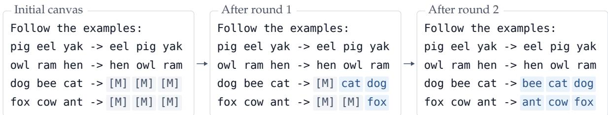  
Figure 2: Further examples of multi-target few-shot prompting. Two input–output demonstrations illustrate alphabetical sorting of word lists, which a DLM applies to two missing outputs.

## 2 Background

## 2.1 Few-Shot Prompting on a Shared Canvas

We consider a partially observed canvas containing D demonstrations, J target sites, and relevant surrounding context. Let $z \in ( V \cup \{ m \} ) ^ { N }$ denote this canvas, where V is the vocabulary, m is a mask token, and N is the canvas length. The original target positions are $T = M ( z ) = \{ i \in [ N ]$ : $z _ { i } = m \}$ , where $[ N ] = \{ 1 , \dots , N \}$ ; these positions form J masked output regions. The task is to fill these regions while preserving the visible content of the canvas.

In Figure 2, D = 2 demonstrations illustrate alphabetical sorting, while J = 2 missing outputs occupy six masked positions in total $( | T | = 6$ in the schematic). At the target sites, the original word lists remain visible, while their sorted versions must be generated. More generally, demonstrations and targets may be interleaved with surrounding context; conventional few-shot prompting is recovered when a single target follows the demonstrations. For now, we assume the target sites are specified and their output lengths are given by an oracle, fixing the mask allocation before generation.

## 2.2 Masked Difusion Language Models

Like BERT-style masked language modeling (Devlin et al., 2019), masked DLMs predict missing tokens using visible context on both sides of each masked position (Austin et al., 2021; Sahoo et al., 2024; Shi et al., 2024a). At each masked position $i \in M ( z )$ , the model predicts a distribution $P _ { \mathrm { D L M } } ( v _ { i } \mid z )$ over candidate tokens $v _ { i } \in V$ . Turning these predictions into complete infills requires a decoding algorithm that determines which masked positions to reveal and when. Common strategies select positions by prediction confidence or a prescribed order, potentially revealing multiple tokens in parallel (Fruytier et al., 2026; Kim et al., 2026; Wu et al., 2026). As illustrated in Figure 2, newly revealed tokens become visible context for subsequent predictions, including those at other target sites. Diferent decoding procedures can induce diferent distributions over complete infills, so we seek a decoder that permits exact sampling and scoring.

## 3 Multi-Target Few-Shot Prompting and Reward Guidance

While Section 2 assumes known output lengths, practical multi-target few-shot prompting must generally determine both the lengths and contents of missing outputs. We formulate this joint generation problem using a shared canvas with one placeholder per target site. To characterize the

complete infills produced by a DLM, we construct tractable likelihoods under one-token-at-a-time decoding. These likelihoods additionally enable reward guidance to encourage adherence to the demonstrations.

## 3.1 Length Allocation and Joint Infilling

We begin with a compact canvas in which each missing output is represented by a single placeholder. Let $\widetilde { z }$ denote this canvas, containing J target placeholders together with the visible demonstrations and surrounding context. For a proposed length vector $L = ( L _ { 1 } , \dots , L _ { J } )$ , where each $L _ { j } \geq 1$ specifies the token length of target $j ,$ , we expand each placeholder into $L _ { j }$ mask tokens. This produces an expanded canvas $z _ { L }$ with target positions $T _ { L } = M ( z _ { L } )$ , on which the DLM can generate the missing contents.

We model joint generation of output lengths and contents by first allocating lengths and then infilling the resulting canvas. Let $\pi _ { \psi } ( L \mid \widetilde { z } )$ be a distribution over length allocations, with each $L _ { j }$ ranging over a prescribed finite set of positive integers. For a given allocation, let $u = ( u _ { i } ) _ { i \in T _ { L } } \in V ^ { T _ { L } }$ denote a complete infill, assigning a vocabulary token $u _ { i } \in V$ to each target position. We define the joint distribution

$$
P ( L , u \mid \widetilde { z } ) : = \pi _ { \psi } ( L \mid \widetilde { z } ) P ( u \mid z _ { L } ) .\tag{1}
$$

The allocator may be a point mass at oracle lengths or a learned predictor, as investigated in Section 4. To complete this formulation, we next characterize the distribution $P ( u \mid z _ { L } )$ induced by DLM decoding.

## 3.2 Tractable DLM Infilling

A DLM provides predictions at individual masked positions, but diferent decoding procedures can induce diferent distributions over complete infills (Section 2). To obtain tractable likelihoods, we focus on decoders that reveal one token at a time, including prescribed orders and deterministic confidence-based selection.

Fix an expanded canvas $z = z _ { L }$ with target positions $T = M ( z )$ , and let $u = ( u _ { i } ) _ { i \in T } \in V ^ { T }$ be a candidate completion. At step s, the decoder selects an unrevealed target position $i _ { s }$ based on the current canvas, then samples its token from the DLM. Let $z ^ { ( s ) }$ denote the canvas after revealing the first s tokens of $u ,$ with $z ^ { ( 0 ) } = z$ . For deterministic position selection, replaying the policy on u determines the reveal order and yields the complete-infill likelihood

$$
P ( u \mid z ) : = \prod _ { s = 1 } ^ { | T | } P _ { \mathrm { D L M } } ( u _ { i _ { s } } \mid z ^ { ( s - 1 ) } ) .\tag{2}
$$

The following lemma establishes the properties of this construction.

Lemma 3.1 (One-token-at-a-time decoding). For any deterministic one-token-at-a-time positionselection policy, Equation (2) defines a normalized distribution $P ( u \mid z )$ that can be sampled and scored exactly. If the DLM predicts exact data conditionals, then $P ( u \mid z )$ recovers the conditional data distribution wherever defined, independently of the reveal policy (Ou et al., 2025).

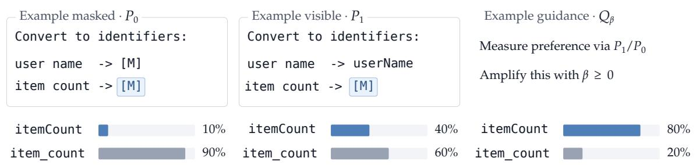  
Figure 3: Example guidance strengthens a demonstrated naming convention. With the demonstration output masked $( P _ { 0 } )$ , the model favors item\_count; revealing it $( P _ { 1 } )$ increases support for itemCount, but does not change the ranking. At an illustrative $\beta = 1$ , example guidance $\left( Q _ { \beta } \right)$ amplifies this shift and favors itemCount. Probabilities are schematic and normalized over the two completions of the blue mask; [M] denotes a masked span.

Exact sampling and scoring hold for the induced distribution regardless of whether the DLM matches the data conditionals. Recovery of the data distribution requires exact conditional predictions; learned DLMs need not satisfy this assumption, and their induced distributions may depend on the decoding policy. While our construction excludes parallel token revelation, it permits generating and scoring only the designated targets T while other masked positions remain unresolved.

## 3.3 Reward Guidance

Even with demonstrations visible, a DLM may favor completions that do not follow their demonstrated patterns, as illustrated in Figure 3. The tractable likelihoods above allow us to measure how strongly the demonstrations support each candidate and use this signal for additional reward guidance. Let $E \subseteq [ N ] \backslash T$ denote selected demonstration-output positions, and write $z \setminus E$ for the canvas with these positions additionally masked. We compare the likelihood of the same candidate with and without these demonstration outputs visible:

$$
P _ { 1 } ( u ) : = P ( u \mid z ) , \qquad P _ { 0 } ( u ) : = P ( u \mid z \backslash E ) .
$$

Both distributions use the same decoding policy over the original target positions T, leaving the additional masks in $E$ unresolved. Their log-likelihood ratio defines the reward

$$
R ( u ) : = \log \frac { P _ { 1 } ( u ) } { P _ { 0 } ( u ) } .\tag{3}
$$

A higher reward indicates greater relative support from the demonstrations, rather than necessarily greater correctness. We incorporate this reward into generation by defining the guided distribution

$$
Q _ { \beta } ( u ) : = \frac { P _ { 1 } ( u ) \exp ( \beta R ( u ) ) } { Z _ { \beta } } ,\tag{4}
$$

where $\beta \geq 0$ controls guidance strength and $Z _ { \beta }$ is the normalizing constant <sup>1</sup>. At $\beta = 0 .$ , we recover unguided sampling from $P _ { 1 }$ , which already conditions on the demonstrations. Increasing $\beta$ favors candidates with higher rewards, potentially counteracting a pretrained model’s preference for familiar but demonstration-inconsistent completions.

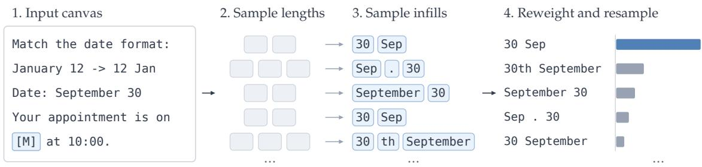  
Figure 4: Inference with unknown target lengths. A length predictor runs once on the compact canvas; each sample then draws a length allocation and generates a DLM infill over the expanded masks. Samples receive reward-guidance weights $w _ { k } = ( P _ { 1 } ( \hat { L } ^ { ( k ) } , u ^ { ( k ) } ) / P _ { 0 } ( L ^ { ( k ) } , u ^ { ( k ) } ) ) ^ { \beta }$ , comparing their likelihoods with demonstration outputs visible $( P _ { 1 } )$ and masked $( P _ { 0 } )$ . Resampling according to these weights approximates $Q _ { \beta }$ . Bars aggregate normalized weights over identical completions; tokens, samples, and weights are schematic.

However, direct sampling from $Q _ { \beta }$ is generally intractable because its sequence-level reward does not yield tractable token-level conditionals. Instead, we approximate reward-guided generation using importance resampling from $P _ { 1 }$ . We draw K independent candidates $u ^ { ( k ) } \sim P _ { 1 }$ , evaluate their likelihoods under $P _ { 0 } .$ , and resample an index I according to

$$
\operatorname* { P r } ( I = k \mid \operatorname { p o o l } ) = \frac { w _ { k } } { \sum _ { h = 1 } ^ { K } w _ { h } } , \qquad w _ { k } = \exp ( \beta R ( u ^ { ( k ) } ) ) .\tag{5}
$$

These weights are proportional to $Q _ { \beta } / P _ { 1 }$ , allowing finite-pool resampling to approximate the guided distribution without modifying the DLM. The following proposition formalizes the KL-regularized interpretation of reward guidance and the consistency of its approximation.

Proposition 3.2 (Reward guidance and importance sampling). Let $P _ { 0 }$ and $P _ { 1 }$ be positive distributions on a common finite candidate space, and let $\beta \geq 0$ . The distribution $Q _ { \beta }$ defined by Equation (4) uniquely solves

$$
Q _ { \beta } = \underset { Q } { \arg \operatorname* { m a x } } \left\{ \beta \mathbb { E } _ { U \sim Q } R ( U ) - D _ { \mathrm { K L } } ( Q \| P _ { 1 } ) \right\} .\tag{6}
$$

Moreover, the weighted empirical distribution obtained from independent samples of $P _ { 1 }$ using Equation (5) converges almost surely to $Q _ { \beta }$ in total variation as $K  \infty$

Extension to unknown lengths. Reward guidance also applies to joint assignments of output lengths and contents. Let $E _ { L }$ denote the selected demonstration-output positions in the expanded canvas $z _ { L }$ . Using the factorization from Equation (1), we define

$$
\begin{array} { r } { P _ { 1 } ( L , u ) : = \pi _ { \psi } ( L \mid \tilde { z } ) P ( u \mid z _ { L } ) , \qquad P _ { 0 } ( L , u ) : = \pi _ { \psi } ( L \mid \tilde { z } ) P ( u \mid z _ { L } \setminus E _ { L } ) . } \end{array}\tag{7}
$$

Since both contexts use the same allocator, its contribution cancels from the reward $R ( L , u ) =$ $\log [ P _ { 1 } ( L , u ) / P _ { 0 } ( L , u ) ]$ , although resampling joint candidates can still change the marginal distribution over lengths. The same guidance procedure and Theorem 3.2 apply to these joint candidates (see Section A.3). Figure 4 summarizes the complete procedure, from length allocation and DLM infilling to optional reward-guided resampling.

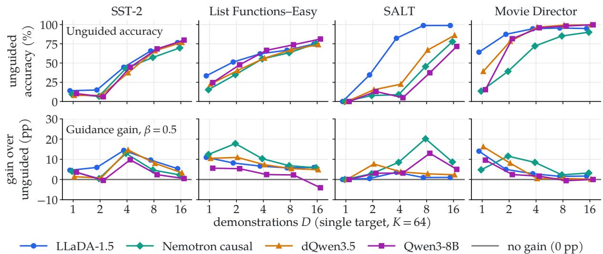  
Figure 5: Single-target prompting as the number of demonstrations grows. The top row shows unguided answer accuracy (β = 0), while the bottom row shows the accuracy gain from example guidance $( \beta = 0 . 5 )$ , obtained by reweighting the same K = 64 samples per canvas. Four benchmarks and four model interfaces, with 64 prompt families per benchmark; DLMs use oracle target lengths, while Qwen3 generates freely.

## 4 Few-Shot Prompting Experiments with Standard Benchmarks

We first quantify the efects of demonstrations and example guidance in single-target infilling (Section 4.1). We then investigate how these efects change when multiple targets are infilled jointly (Section 4.2). Finally, we evaluate the impact of predicting target lengths rather than supplying them through an oracle (Section 4.3). We defer additional experiments to Section B, such as on guidance strength (Section B.5) and likelihood sharpening (Section B.6).

Experimental setup. We evaluate four benchmarks spanning diferent few-shot transformations: SST-2 (Socher et al., 2013; Wang et al., 2018) with demonstration-defined sentiment codes, List Functions–Easy (BIG-bench authors, 2023; Rule, 2020) for list transformations, SALT repetition (Zheng et al., 2025a,b) for artificial-language transformations, and Movie Director (Liu et al., 2012; Zhao et al., 2021) for information extraction. We use three DLMs: LLaDA-1.5 (Zhu et al., 2026), Nemotron-Labs-Difusion-8B (Fu et al., 2026), and dQwen3.5-9B-Base (Xue et al., 2026), together with Qwen3-8B (Yang et al., 2025) as an autoregressive single-target comparison.

Throughout, D and J denote the numbers of demonstrations and targets, respectively. We refer to generation without additional guidance $( \beta = 0 )$ as standard infilling for DLMs, or equivalently unguided sampling, and compare this with example guidance at $\beta = 0 . 5$ by default. Outputs are graded by task-specific exact or parsed matching, and the DLM experiments reveal one target token at a time in ascending canvas order. Further experimental details appear in Section B.1.

## 4.1 Single-Target Few-Shot Prompting

We begin with single-target infilling, which closely resembles conventional autoregressive few-shot prompting, except that DLMs generate a masked output rather than a continuation. Since few-shot prompting is sensitive to demonstration selection and ordering (Zhao et al., 2021), we hold the target fixed when comparing diferent demonstration counts. We first randomly draw a sequence of 16 demonstrations from the benchmark, followed by one target. For each $D \in \{ 1 , 2 , 4 , 8 , 1 6 \}$ , we construct a prompt by retaining only the first D demonstrations while keeping the target unchanged. These five related prompts form a prompt family, allowing us to vary the demonstration count without changing the target or previously included demonstrations. We evaluate 64 families per benchmark across four tasks and four model interfaces, drawing K = 64 samples for each prompt. Figure 5 reports standard infilling accuracy and the gain from guidance.

Increasing the demonstration count from D = 1 to D = 16 improves accuracy without additional guidance in all 16 model–task series (Figure 5, top). For LLaDA, unguided accuracy rises from 14.0% to 76.5% on SST-2, from 33.3% to 74.7% on List Functions–Easy, from 0.0% to 98.8% on SALT repetition, and from 64.1% to 94.9% on Movie Director. This shows that demonstrations provide useful conditioning information even before applying reward guidance. Consistent with this observation, the reference answer’s example reward generally increases with D, indicating stronger relative likelihood support from the demonstrations (Section B.2).

Beyond these improvements from demonstration conditioning, example guidance yields further accuracy gains in several settings, particularly SST-2 at intermediate demonstration counts (Figure 5, bottom). At D = 4, guidance improves LLaDA’s accuracy by 14.4 percentage points on SST-2, 6.6 on List Functions–Easy, 3.6 on SALT repetition, and 2.9 on Movie Director, where unguided accuracy already exceeds 94%. These gains tend to shrink as standard infilling accuracy saturates, and depend on whether the reward favors correct samples.

## 4.2 Multi-Target Few-Shot Prompting

We next examine how demonstration conditioning and example guidance behave when multiple targets are infilled jointly. For each prompt family, we randomly draw 16 demonstrations and 8 targets from List Functions–Easy, then interleave them into a shared sequence. For each configuration $D \in \{ 2 , 4 , 8 , 1 6 \}$ and $J \in \{ 1 , 2 , 4 , 8 \}$ , we construct a canvas by removing all but the first D demonstrations and first J targets from this sequence. The retained items preserve their relative order, allowing us to vary demonstration and target counts without independently reshufling the canvas. For each resulting canvas, the DLM draws K = 16 joint samples using oracle target lengths, which we evaluate under standard infilling and additional example guidance.

With multiple targets, we distinguish between completing every target correctly and maintaining accuracy at individual sites. Let $c _ { k j } \in \{ 0 , 1 \}$ indicate whether target $j$ is correct in sample $k ,$ and let $\widetilde { w } _ { k }$ denote its normalized resampling weight. We define all-target accuracy $A _ { \mathrm { a l l } }$ and average per-target accuracy $A _ { \mathrm { a v g } }$ by

$$
A _ { \mathrm { a l l } } : = \sum _ { k = 1 } ^ { K } \widetilde { w } _ { k } \prod _ { j = 1 } ^ { J } c _ { k j } , \qquad A _ { \mathrm { a v g } } : = \sum _ { k = 1 } ^ { K } \widetilde { w } _ { k } \left( \frac { 1 } { J } \sum _ { j = 1 } ^ { J } c _ { k j } \right) .
$$

For each sample pool, $A _ { \mathrm { a l l } }$ is the probability that resampling selects an infill with every target correct, whereas $A _ { \mathrm { a v g } }$ is the expected fraction of correct targets. We average these quantities across prompt families; they coincide when J = 1. Figure 6 reports both under standard infilling and the guidance gain in $A _ { \mathrm { a l l } }$ at $\beta = 0 . 5$ (Section B.1).

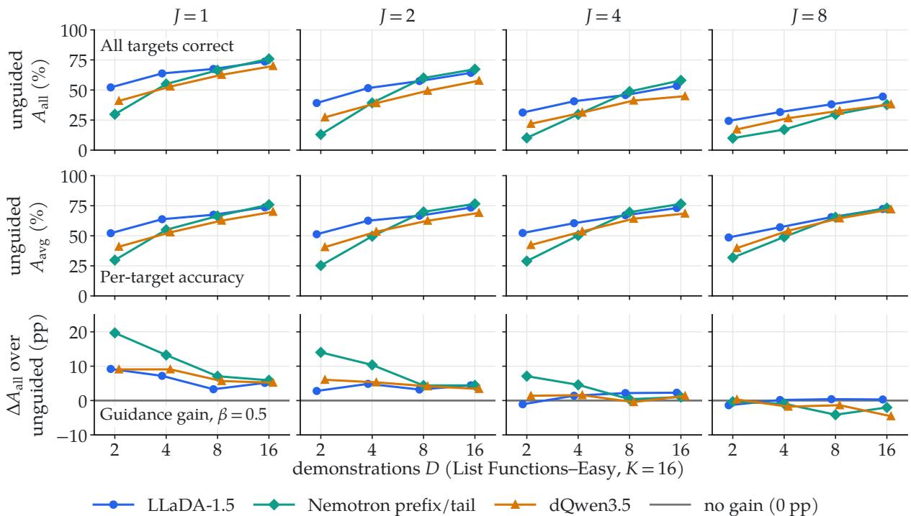  
Figure 6: Demonstrations and target count on List Functions–Easy. Each column fixes the number of jointly infilled targets $^ { J , }$ while the horizontal axis varies the number of demonstrations D. The rows show all-target accuracy $A _ { \mathrm { a l l } }$ and average per-target accuracy $A _ { \mathrm { a v g } }$ under unguided sampling $( \beta = 0 )$ , followed by the gain in $A _ { \mathrm { a l l } }$ from example guidance $( \beta = 0 . 5 )$ using the same samples. Three DLMs, oracle target lengths, and $K = 1 6$ samples per canvas.

Demonstrations continue to improve joint infilling, with standard all-target accuracy increasing at every successive demonstration count (Figure 6, top). For LLaDA with $J = 8 , A _ { \mathrm { a l l } }$ rises from 24.3% at D = 2 to 44.5% at $D = 1 6$ . Increasing the number of targets, however, afects all-target and per-target accuracy diferently. At D = 16, LLaDA maintains nearly the same $A _ { \mathrm { a v g } }$ as J grows from 1 to 8 (73.6% versus 72.3%), despite a decline in all-target accuracy (Figure 6, top and middle). Thus, lower joint success need not imply a comparable decline in accuracy at individual target sites.

The benefits of additional example guidance, however, are less consistent as the number of targets grows. On List Functions–Easy, guidance at $\beta = 0 . 5$ yields positive gains with confidence intervals above zero in every J = 1 condition, but in none of the J = 8 conditions (Figure $6 ,$ bottom). This pattern is not universal across tasks: a separate cross-benchmark study at $D = 4$ $K = 6 4$ , and $J = 8$ finds guidance gains on SST-2 but losses on Movie Director (Section B.3). Together, these results indicate that guidance efectiveness depends on both the task and the number of jointly infilled targets.

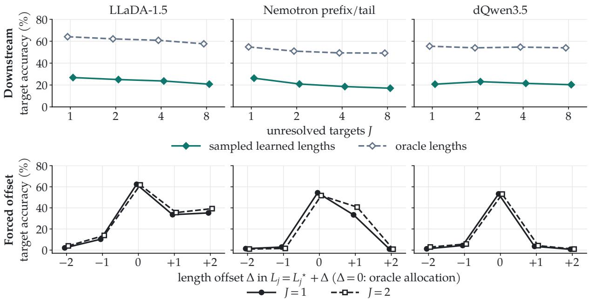  
Figure 7: Length allocation and downstream infilling accuracy. On List Functions–Easy $( D = 4 ,$ $\beta = 0 )$ , the top row compares per-target accuracy $A _ { \mathrm { a v g } }$ under oracle and sampled learned lengths as the number of targets J increases. The bottom row measures sensitivity to length errors, setting each target length to $L _ { j } = L _ { j } ^ { \star } + \Delta$ for $J \in \{ 1 , 2 \}$ , where $L _ { j } ^ { \star }$ is the reference length and $\Delta = 0$ recovers oracle allocation. These forced ofsets are distinct from the predictor’s own error distribution. Results cover three DLMs; additional length-prediction diagnostics appear in Section B.4.

## 4.3 Predicting Target Lengths

The preceding experiments assume oracle target lengths, whereas infilling in practice generally requires predicting them. To evaluate the learned-allocation setting of Section 3.1, we train length predictors on structured few-shot tasks and Java edits (Section B.4). On List Functions–Easy, we fix D = 4 and vary $J \in \{ 1 , 2 , 4 , 8 \}$ across three DLMs, comparing oracle lengths against sampled predictions with the same content generator and standard infilling (β = 0). Figure 7 reports downstream accuracy and sensitivity to length errors.

The learned predictors capture useful information about the required output lengths. They assign 40–46% probability mass to the reference length, compared with approximately 27% for a prior constructed from visible demonstration lengths (Section B.4). This indicates that the compact canvas contains useful predictive information about the missing output lengths.

Despite this improvement over the length prior, learned allocation remains a gap for reliable downstream infilling. Sampling predicted lengths retains only 35–48% of oracle-length per-target accuracy (Figure 7, top). To examine this sensitivity directly, we impose ofsets $L _ { j } = L _ { j } ^ { \star } + \Delta .$ where $L _ { j } ^ { \star }$ is the reference token length. One-token underallocation harms LLaDA and Nemotron more than overallocation, while dQwen3.5 is sensitive to errors in either direction (Figure $^ { 7 , }$ bottom). These findings identify accurate length allocation as a remaining challenge for practical multi-target infilling.

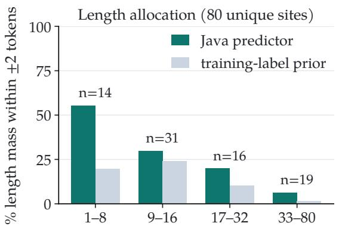  
reference replacement length (LLaDA tokens)

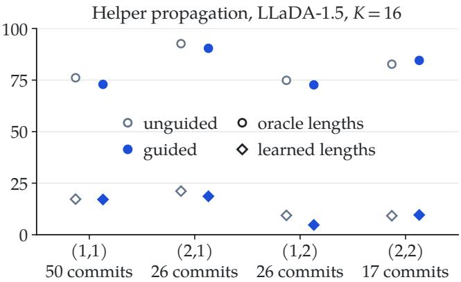  
(D demonstrations, J targets)  
Figure 8: Java helper refactoring with LLaDA-1.5 $( K = 1 6 )$ $L e f t { \mathrm { : } }$ mass of the Java length predictor within two tokens of the reference length versus a training-label prior, by reference length. Right: joint LLM-judged success by $( D , J )$ , oracle or learned lengths, and unguided $( \beta = 0 )$ , hollow) or example-guided $( \beta = 0 . 5$ , filled) evaluation of the same sample pools. Pooled contrasts are in Table 1.

## 5 Case Studies in Software Refactoring

Software refactoring often requires applying a demonstrated transformation at multiple sites. For example, updating callers after extracting a helper requires adapting receivers, arguments, and surrounding code rather than copying an accepted edit.

## 5.1 Helper Refactoring Experiments

We construct multi-site editing tasks from Extract Method commits in SWE-Refactor (Xu et al., 2026b). Each task includes the extracted helper, D accepted <old>/<new> demonstrations, and J masked replacement sites. We evaluate 127 tasks from 50 commits across 14 repositories, with $( D , J ) \in \{ 1 , 2 \} ^ { 2 }$ ; diferent configurations have diferent eligible commits (Section C.1). Frozen LLaDA-1.5 (Zhu et al., 2026) generates $K = 1 6$ rewrites per task using either oracle lengths or lengths sampled from a separately trained Java predictor. We compare unguided sampling $( \beta = 0 )$ with example guidance $( \beta = 0 . 5 )$ on the same samples. We assess joint correctness using Claude Sonnet 5.5, without executing the generated code.

A separate post-hoc ablation on 80 tasks compares generation with and without one visible accepted edit, holding the other prompt components and oracle lengths fixed. Adding the demonstration improves joint LLM-judged success by 14.7 and 17.5 percentage points for $J = 1$ and $J = 2$ , respectively (Section C.2). These gains indicate that the DLM can use a demonstrated refactoring to guide edits at other sites. Under unguided sampling, pooled joint success reaches 74.4% with oracle lengths but only 15.8% with predicted lengths (Table 1). This gap identifies length allocation as a major opportunity for improvement, even though the predictor outperforms a simple length prior (Figure 8, left). Example guidance at $\beta = 0 . 5$ reduces success to 71.5% and 14.5%, respectively (Table 1). Thus, demonstrations help the DLM generate appropriate rewrites, but the additional likelihood-ratio reward does not improve their selection in this experiment.

## 5.2 Qualitative Analysis

The limited benefits of guidance may arise because the sampled rewrites ofer little room for improvement, or because the reward fails to identify correct candidates. With oracle lengths, only 23 of 127 sample pools contain both judged-correct and judged-incorrect rewrites, so even a perfect selector could improve pooled success by at most 8.3 percentage points. With learned lengths, 72 of 127 pools contain both outcomes, and the corresponding upper bound rises to 45.2 points (Section C.3). Thus, limited selection opportunities help explain the oracle-length results, whereas learned-length sampling leaves substantial room for better selection.

A post-hoc Checkstyle example illustrates how the reward can favor an incorrect rewrite. An incorrect edit to logMessage changes the logged line number and message type, yet receives a higher example reward than the developer-consistent rewrite (8.69 versus 2.05 nats). At $\beta = 0 . 5$ , this gives the incorrect rewrite approximately 28 times the resampling weight of each correct occurrence. Despite appearing only once among K = 16 samples, compared with seven occurrences of the correct rewrite, it receives 61.8% of the total weight, reducing expected LLM-judged success from 43.8% to 15.7%. Here, correct rewrites are available, but the reward disproportionately favors an incorrect one (Section C.3).

## 6 Conclusion

We introduce and study multi-target few-shot prompting with masked DLMs, where demonstrations guide the infilling of multiple regions within a shared canvas. One-token-at-a-time decoding with deterministic position selection defines a normalized distribution over complete infills, enabling exact sampling, scoring, and likelihood-based example guidance. Across few-shot prompting benchmarks and Java refactoring, we find that demonstrations improve infilling accuracy, with example guidance providing further gains in several settings. Our experiments further investigate the benefits of example guidance relative to likelihood sharpening, while identifying opportunities to improve target-length allocation for practical editing. Together, these findings provide a foundation for more efective example-guided multi-site infilling.

Limitations. Our framework assumes that target sites and demonstration-output positions E are specified in advance, leaving their automatic identification for future work. The deterministic, one-token-at-a-time decoding used for exact sampling and scoring does not exploit parallel generation, while the induced distribution may depend on the reveal order and model interface for learned DLMs. Moreover, target lengths must be allocated before infilling, making improved length prediction an important direction for practical use. Example guidance measures relative support from demonstrations rather than correctness, so its efectiveness depends on how the reward ranks sampled infills. Increasing guidance strength can also concentrate resampling weights without necessarily improving accuracy (Section B.5). Our experiments include an autoregressive comparison for single-target prompting, while systematic comparison for multitarget infilling remains future work. Finally, the Java refactoring study uses an LLM judge rather than code execution, includes commits examined during development, and contains some prompts in which reference text appears elsewhere in the context.

## References

Marianne Arriola, Aaron Gokaslan, Justin T. Chiu, Zhihan Yang, Zhixuan Qi, Jiaqi Han, Subham Sekhar Sahoo, and Volodymyr Kuleshov. Block difusion: Interpolating between autoregressive and difusion language models. In International Conference on Learning Representations (ICLR), 2025.

Jacob Austin, Daniel D. Johnson, Jonathan Ho, Daniel Tarlow, and Rianne van den Berg. Structured denoising difusion models in discrete state-spaces. In Advances in Neural Information Processing Systems (NeurIPS), 2021.

Mohammad Bavarian, Heewoo Jun, Nikolas Tezak, John Schulman, Christine McLeavey, Jerry Tworek, and Mark Chen. Eficient training of language models to fill in the middle. arXiv preprint arXiv:2207.14255, 2022.

BIG-bench authors. Beyond the imitation game: Quantifying and extrapolating the capabilities of language models. Transactions on Machine Learning Research, 2023.

Tom B. Brown, Benjamin Mann, Nick Ryder, Melanie Subbiah, Jared Kaplan, Prafulla Dhariwal, Arvind Neelakantan, Pranav Shyam, Girish Sastry, Amanda Askell, Sandhini Agarwal, Ariel Herbert-Voss, Gretchen Krueger, Tom Henighan, Rewon Child, Aditya Ramesh, Daniel M. Ziegler, Jefrey Wu, Clemens Winter, Christopher Hesse, Mark Chen, Eric Sigler, Mateusz Litwin, Scott Gray, Benjamin Chess, Jack Clark, Christopher Berner, Sam McCandlish, Alec Radford, Ilya Sutskever, and Dario Amodei. Language models are few-shot learners. In Advances in Neural Information Processing Systems (NeurIPS), 2020.

Zhoujun Cheng, Jungo Kasai, and Tao Yu. Batch prompting: Eficient inference with large language model APIs. In Conference on Empirical Methods in Natural Language Processing (EMNLP), Industry Track, 2023.

Jacob Devlin, Ming-Wei Chang, Kenton Lee, and Kristina Toutanova. BERT: Pre-training of deep bidirectional transformers for language understanding. In Proceedings of the 2019 conference of the North American chapter of the association for computational linguistics: human language technologies, volume 1 (long and short papers), pages 4171–4186, 2019.

Fangyu Ding, Ding Ding, Sijin Chen, Kaibo Wang, Peng Xu, Zijin Feng, Haoli Bai, Kai Han, Youliang Yan, Binhang Yuan, and Jiacheng Sun. Beyond masks: Eficient, flexible difusion language models via deletion-insertion processes. In International Conference on Learning Representations (ICLR), 2026.

Daniel Fried, Armen Aghajanyan, Jessy Lin, Sida Wang, Eric Wallace, Freda Shi, Ruiqi Zhong, Wen-tau Yih, Luke Zettlemoyer, and Mike Lewis. InCoder: A generative model for code infilling and synthesis. arXiv preprint arXiv:2204.05999, 2022.

Quentin Fruytier, Anton Xue, Sanjay Shakkottai, and Sujay Sanghavi. PIG: Parallel inconsistency guidance for accelerating difusion language models. arXiv preprint arXiv:2610.17375, 2026.

Yonggan Fu, Lexington Whalen, Abhinav Garg, Chengyue Wu, Maksim Khadkevich, Nicolai Oswald, Enze Xie, Daniel Egert, Sharath Turuvekere Sreenivas, Shizhe Diao, Chenhan Yu, Ye Yu, Weijia Chen, Sajad Norouzi, Jingyu Liu, Shiyi Lan, Ligeng Zhu, Jin Wang, Jindong

Jiang, Morteza Mardani, Mehran Maghoumi, Song Han, Ante Jukić, Nima Tajbakhsh, Jan Kautz, and Pavlo Molchanov. Nemotron-Labs-Difusion: A tri-mode language model unifying autoregressive, difusion, and self-speculation decoding. arXiv preprint arXiv:2607.05722, 2026.

Shivam Garg, Dimitris Tsipras, Percy Liang, and Gregory Valiant. What can transformers learn in-context? a case study of simple function classes. In Advances in Neural Information Processing Systems (NeurIPS), 2022.

Sumit Gulwani. Automating string processing in spreadsheets using input-output examples. In ACM SIGPLAN-SIGACT Symposium on Principles of Programming Languages (POPL), 2011.

Priyanshu Gupta, Avishree Khare, Yasharth Bajpai, Saikat Chakraborty, Sumit Gulwani, Aditya Kanade, Arjun Radhakrishna, Gustavo Soares, and Ashish Tiwari. Grace: Language models meet code edits. In Proceedings of the 31st ACM Joint European Software Engineering Conference and Symposium on the Foundations of Software Engineering, pages 1483–1495, 2023.

Jonathan Ho and Tim Salimans. Classifier-free difusion guidance. In NeurIPS 2021 Workshop on Deep Generative Models and Downstream Applications, 2021.

Bumjun Kim, Dongjae Jeon, Moongyu Jeon, and Albert No. DAPD: Dependency-aware parallel decoding via attention for difusion LLMs. In International Conference on Machine Learning (ICML), 2026.

Tomasz Korbak, Ethan Perez, and Christopher Buckley. RL with KL penalties is better viewed as Bayesian inference. In Findings of the Association for Computational Linguistics: EMNLP 2022, 2022.

Minae Kwon, Sang Michael Xie, Kalesha Bullard, and Dorsa Sadigh. Reward design with language models. In International Conference on Learning Representations (ICLR), 2023.

Xiang Lisa Li, Ari Holtzman, Daniel Fried, Percy Liang, Jason Eisner, Tatsunori Hashimoto, Luke Zettlemoyer, and Mike Lewis. Contrastive decoding: Open-ended text generation as optimization. In Annual Meeting of the Association for Computational Linguistics (ACL), 2023.

Zhengheng Li, Panrui Li, Xuyang Liu, and Puzhi Xia. Where to place the query? unveiling and mitigating positional bias in in-context learning for difusion LLMs via decoding dynamics. arXiv preprint arXiv:2606.19349, 2026.

Jianzhe Lin, Maurice Diesendruck, Liang Du, and Robin Abraham. Batchprompt: Accomplish more with less. In International Conference on Learning Representations, volume 2024, pages 21590–21612, 2024.

Jingjing Liu, Scott Cyphers, Panupong Pasupat, Ian McGraw, and Jim Glass. A conversational movie search system based on conditional random fields. In Proceedings of INTERSPEECH, 2012.

Na Meng, Miryung Kim, and Kathryn S. McKinley. Systematic editing: Generating program

transformations from an example. In ACM SIGPLAN Conference on Programming Language Design and Implementation (PLDI), 2011.

Sewon Min, Xinxi Lyu, Ari Holtzman, Mikel Artetxe, Mike Lewis, Hannaneh Hajishirzi, and Luke Zettlemoyer. Rethinking the role of demonstrations: What makes in-context learning work? In Conference on Empirical Methods in Natural Language Processing (EMNLP), 2022.

Shen Nie, Fengqi Zhu, Zebin You, Xiaolu Zhang, Jingyang Ou, Jun Hu, Jun Zhou, Yankai Lin, Ji-Rong Wen, and Chongxuan Li. Large language difusion models. In Advances in Neural Information Processing Systems (NeurIPS), 2025.

Sean O’Brien and Mike Lewis. Contrastive decoding improves reasoning in large language models. arXiv preprint arXiv:2309.09117, 2023.

Jingyang Ou, Shen Nie, Kaiwen Xue, Fengqi Zhu, Jiacheng Sun, Zhenguo Li, and Chongxuan Li. Your absorbing discrete difusion secretly models the conditional distributions of clean data. In International Conference on Learning Representations (ICLR), 2025.

Chaoxu Pang, Yixuan Cao, Qiang Ding, and Ping Luo. Guideline learning for in-context information extraction. In Conference on Empirical Methods in Natural Language Processing (EMNLP), 2023.

Keqin Peng, Liang Ding, Yuanxin Ouyang, Meng Fang, Yancheng Yuan, and Dacheng Tao. Enhancing input-label mapping in in-context learning with contrastive decoding. In Annual Meeting of the Association for Computational Linguistics (ACL), 2025.

Rafael Rafailov, Archit Sharma, Eric Mitchell, Christopher D Manning, Stefano Ermon, and Chelsea Finn. Direct preference optimization: Your language model is secretly a reward model. Advances in neural information processing systems, 36:53728–53741, 2023.

Joshua S. Rule. The child as hacker: Building more human-like models of learning. PhD thesis, Massachusetts Institute of Technology, 2020.

Subham Sekhar Sahoo, Marianne Arriola, Yair Schif, Aaron Gokaslan, Edgar Marroquin, Justin T Chiu, Alexander Rush, and Volodymyr Kuleshov. Simple and efective masked difusion language models. In Advances in Neural Information Processing Systems (NeurIPS), 2024.

Subham Sekhar Sahoo, Lingjie Chen, Khiem Pham, Jonathan Geuter, Chaitanya Dwivedi, Varad Pimpalkhute, Yash Akhauri, Alexander Moreno, Mikhail Yurochkin, Zhenting Wang, Mostafa Elhoushi, Nolan Dey, Shane Bergsma, Joel Hestness, John Thickstun, Eric Xing, and Zhengzhong Liu. Unlocking lossless speedups in LLMs via discrete difusion. arXiv preprint arXiv:2609.04010, 2026.

Jiaxin Shi, Kehang Han, Zhe Wang, Arnaud Doucet, and Michalis K. Titsias. Simplified and generalized masked difusion for discrete data. In Advances in Neural Information Processing Systems (NeurIPS), 2024a.

Weijia Shi, Xiaochuang Han, Mike Lewis, Yulia Tsvetkov, Luke Zettlemoyer, and Wen-tau Yih.

Trusting your evidence: Hallucinate less with context-aware decoding. In Conference of the North American Chapter of the Association for Computational Linguistics (NAACL), 2024b.

Richard Shin and Benjamin Van Durme. Few-shot semantic parsing with language models trained on code. In Conference of the North American Chapter of the Association for Computational Linguistics (NAACL), 2022.

Raghav Singhal, Zachary Horvitz, Ryan Teehan, Mengye Ren, Zhou Yu, Kathleen McKeown, and Rajesh Ranganath. A general framework for inference-time scaling and steering of difusion models. In International Conference on Machine Learning (ICML), 2025.

Richard Socher, Alex Perelygin, Jean Wu, Jason Chuang, Christopher D. Manning, Andrew Ng, and Christopher Potts. Recursive deep models for semantic compositionality over a sentiment treebank. In Proceedings of the 2013 Conference on Empirical Methods in Natural Language Processing (EMNLP), pages 1631–1642, 2013.

Feifan Song, Yuxuan Fan, Xin Zhang, Peiyi Wang, and Houfeng Wang. Instantly learning preference alignment via in-context DPO. In Conference of the North American Chapter of the Association for Computational Linguistics (NAACL), 2025.

Gilad Turok, Chris De Sa, and Volodymyr Kuleshov. DUEL: Exact likelihood for masked difusion via deterministic unmasking. arXiv preprint arXiv:2603.01367, 2026.

Alex Wang, Amanpreet Singh, Julian Michael, Felix Hill, Omer Levy, and Samuel R. Bowman. GLUE: A multi-task benchmark and analysis platform for natural language understanding. In Proceedings of the 2018 EMNLP Workshop BlackboxNLP: Analyzing and Interpreting Neural Networks for NLP, pages 353–355, 2018.

Jerry Wei, Jason Wei, Yi Tay, Dustin Tran, Albert Webson, Yifeng Lu, Xinyun Chen, Hanxiao Liu, Da Huang, Denny Zhou, and Tengyu Ma. Larger language models do in-context learning diferently. arXiv preprint arXiv:2303.03846, 2023.

Jiayi Wei, Greg Durrett, and Isil Dillig. Coeditor: Leveraging repo-level difs for code auto-editing. In International Conference on Learning Representations, volume 2024, pages 28103–28125, 2024.

Esmeralda S. Whitammer, Zhen Wang, and Nebojsa Jojic. Coherence boosting: When your pretrained language model is not paying enough attention. In Proceedings of the 60th Annual Meeting of the Association for Computational Linguistics (Volume 1: Long Papers), pages 8214–8236, 2022.

Chengyue Wu, Hao Zhang, Shuchen Xue, Zhijian Liu, Shizhe Diao, Ligeng Zhu, Ping Luo, Song Han, and Enze Xie. Fast-dLLM: Training-free acceleration of difusion LLM by enabling KV cache and parallel decoding. In International Conference on Learning Representations (ICLR), 2026.

Haobo Xu, Sirui Chen, Yuanchen Bei, Lingjie Chen, Yuchen Yan, Dongqi Fu, Jingrui He, and Hanghang Tong. Predict, don’t iterate: Eficient adaptive-length infilling for difusion language models. arXiv preprint arXiv:2609.02108, 2026a.

Yisen Xu, Jinqiu Yang, and Tse-Hsun Chen. SWE-Refactor: A repository-level benchmark for real-world LLM-based code refactoring. arXiv preprint arXiv:2602.03712, 2026b.

Anton Xue, Litu Rout, Aditya Akella, Adam Klivans, Sujay Sanghavi, and Sanjay Shakkottai. dQwen3.5: Hybrid-attention difusion language models. arXiv preprint arXiv:2609.20751, 2026.

An Yang, Anfeng Li, Baosong Yang, Beichen Zhang, Binyuan Hui, Bo Zheng, Bowen Yu, Chang Gao, Chengen Huang, Chenxu Lv, Chujie Zheng, Dayiheng Liu, Fan Zhou, Fei Huang, Feng Hu, Hao Ge, Haoran Wei, Huan Lin, Jialong Tang, Jian Yang, Jianhong Tu, Jianwei Zhang, Jianxin Yang, Jiaxi Yang, Jing Zhou, Jingren Zhou, Junyang Lin, Kai Dang, Keqin Bao, Kexin Yang, Le Yu, Lianghao Deng, Mei Li, Mingfeng Xue, Mingze Li, Pei Zhang, Peng Wang, Qin Zhu, Rui Men, Ruize Gao, Shixuan Liu, Shuang Luo, Tianhao Li, Tianyi Tang, Wenbiao Yin, Xingzhang Ren, Xinyu Wang, Xinyu Zhang, Xuancheng Ren, Yang Fan, Yang Su, Yichang Zhang, Yinger Zhang, Yu Wan, Yuqiong Liu, Zekun Wang, Zeyu Cui, Zhenru Zhang, Zhipeng Zhou, and Zihan Qiu. Qwen3 technical report. arXiv preprint arXiv:2505.09388, 2025.

Jiacheng Ye, Zhihui Xie, Lin Zheng, Jiahui Gao, Zirui Wu, Xin Jiang, Zhenguo Li, and Lingpeng Kong. Dream 7B: Difusion large language models. arXiv preprint arXiv:2508.15487, 2025.

J.D. Zamfirescu-Pereira, Richmond Y. Wong, Bjoern Hartmann, and Qian Yang. Why Johnny can’t prompt: How non-AI experts try (and fail) to design LLM prompts. In ACM CHI Conference on Human Factors in Computing Systems (CHI), 2023.

Andrew Zhang, Anushka Sivakumar, Chia-Wei Tang, and Chris Thomas. Flexible-length text infilling for discrete difusion models. In Proceedings of the 2025 Conference on Empirical Methods in Natural Language Processing (EMNLP), pages 31344–31359, 2025.

Zihao Zhao, Eric Wallace, Shi Feng, Dan Klein, and Sameer Singh. Calibrate before use: Improving few-shot performance of language models. In International Conference on Machine Learning (ICML), 2021.

Tianshi Zheng, Yixiang Chen, Chengxi Li, Chunyang Li, Qing Zong, Haochen Shi, Baixuan Xu, Yangqiu Song, Ginny Y. Wong, and Simon See. The curse of CoT: On the limitations of chain-of-thought in in-context learning. Transactions on Machine Learning Research, 2025a.

Tianshi Zheng, Jiayang Cheng, Chunyang Li, Haochen Shi, Zihao Wang, Jiaxin Bai, Yangqiu Song, Ginny Y. Wong, and Simon See. LogiDynamics: Unraveling the dynamics of inductive, abductive and deductive logical inferences in LLM reasoning. In Proceedings of the 2025 Conference on Empirical Methods in Natural Language Processing (EMNLP), 2025b.

Yongchao Zhou, Andrei Ioan Muresanu, Ziwen Han, Keiran Paster, Silviu Pitis, Harris Chan, and Jimmy Ba. Large language models are human-level prompt engineers. In International Conference on Learning Representations (ICLR), 2023.

Fengqi Zhu, Rongzhen Wang, Shen Nie, Xiaolu Zhang, Chunwei Wu, Jun Zhou, Yankai Lin, Ji-Rong Wen, and Chongxuan Li. LLaDA 1.5: Variance-reduced preference optimization for large language difusion models. In Proceedings of the 64th Annual Meeting of the Association for Computational Linguistics (Volume 1: Long Papers), pages 11425–11460, 2026.

## A Proofs

We prove the one-token-at-a-time decoding and reward-guidance results of Section 3, then extend the construction to unknown target lengths.

## A.1 One-Token-at-a-Time Decoding

Lemma A.1 (One-token-at-a-time decoding). For any deterministic one-token-at-a-time positionselection policy, Equation (2) defines a normalized distribution $P ( u \mid z )$ that can be sampled and scored exactly. If the DLM predicts exact data conditionals, then $P ( u \mid z )$ recovers the conditional data distribution wherever defined, independently of the reveal policy (Ou et al., 2025).

Proof of Theorem 3.1. Fix a canvas z and a designated set $T \subseteq M ( z )$ of masked target positions. Let $O = \{ i \in [ N ] : z _ { i } \in V \}$ denote the initially visible positions, so that any masked positions outside $T$ remain unresolved. We consider a deterministic decoding policy that selects one unrevealed target position based on the current canvas, then samples its token from the DLM. For any complete assignment $u \in V ^ { T }$ , replaying this policy determines a unique sequence of selected positions $i _ { 1 } , \dots , i _ { | T | }$ , which may depend on previously revealed tokens.

Normalization and exact sampling. Consider a decision tree representing all possible decoding trajectories. Each node corresponds to a partially revealed canvas, and the decoding policy selects the next target position to reveal. The outgoing edges correspond to the possible tokens at that position, with probabilities given by the DLM that sum to one. Since the policy is deterministic and eventually reveals every target position, each complete assignment $u \in V ^ { T }$ corresponds to exactly one leaf. The probability of reaching that leaf is the product of its edge probabilities, precisely $P ( u \mid z )$ in Equation (2). Summing the probabilities of all leaves therefore gives

$$
\sum _ { u \in V ^ { T } } P ( u \mid z ) = 1 .
$$

Thus, $P ( \cdot \mid z )$ is a normalized distribution, and sequential decoding samples exactly from it. Moreover, replaying the policy on any candidate u recovers its reveal trajectory and permits exact evaluation of $P ( u \mid z )$

Recovery of the data conditional distribution. Now suppose the DLM predicts exact data conditionals, and let $X \sim P _ { \mathrm { d a t a } }$ be a clean sequence. We assume that the initially visible context has positive probability, $P _ { \mathrm { d a t a } } ( X _ { O } = z _ { O } ) > 0$ . For a fixed candidate u, define the agreement events $A _ { s }$ as follows:

$$
A _ { 0 } : = \{ X _ { O } = z _ { O } \} , \qquad A _ { s } : = A _ { s - 1 } \cap \{ X _ { i _ { s } } = u _ { i _ { s } } \} .
$$

Thus, $A _ { s }$ is the event that a clean data sample agrees with the visible context and the first s revealed tokens of u. Because the reveal policy selects $i _ { s }$ using only previously revealed information, the exact-conditional assumption implies

$$
P _ { \mathrm { D L M } } ( u _ { i _ { s } } \mid z ^ { ( s - 1 ) } ) = P _ { \mathrm { d a t a } } ( A _ { s } \mid A _ { s - 1 } ) = \frac { P _ { \mathrm { d a t a } } ( A _ { s } ) } { P _ { \mathrm { d a t a } } ( A _ { s - 1 } ) } ,
$$

whenever $P _ { \mathrm { d a t a } } ( A _ { s - 1 } ) > 0$

If $P _ { \mathrm { d a t a } } ( A _ { | T | } ) > 0$ , multiplying these conditional probabilities yields a telescoping product:

$$
P ( u \mid z ) = \prod _ { s = 1 } ^ { \vert T \vert } \frac { P _ { \mathrm { d a t a } } ( A _ { s } ) } { P _ { \mathrm { d a t a } } ( A _ { s - 1 } ) } = \frac { P _ { \mathrm { d a t a } } ( A _ { \vert T \vert } ) } { P _ { \mathrm { d a t a } } ( A _ { 0 } ) } = P _ { \mathrm { d a t a } } ( X _ { T } = u \mid X _ { O } = z _ { O } ) .
$$

The final equality holds because $A _ { | T | }$ specifies every target token in addition to the initially visible context.

If instead $P _ { \mathrm { d a t a } } ( A _ { | T | } ) = 0$ , let $s ^ { \star }$ be the first step at which $P _ { \mathrm { d a t a } } ( A _ { s ^ { \star } } ) = 0$ . The preceding event has positive probability, so the corresponding DLM conditional assigns probability zero to $u _ { i _ { s } \star }$ Consequently, $P ( u \mid z ) = 0$ , matching the data conditional. Thus, the equality holds for every complete assignment $u ,$ independently of the reveal policy. □

The argument covers prescribed orders and deterministic adaptive policies, including confidencebased position selection performed before sampling each token. It also allows masked positions outside the designated targets $T$ to remain unresolved, as in the demonstration-masked likelihood $P _ { 0 }$ . Randomized position selection may require marginalizing over multiple reveal trajectories, while parallel token revelation is outside the present construction.

## A.2 Reward Guidance and Importance Resampling

Proposition A.2 (Reward guidance and importance sampling). Let $P _ { 0 }$ and $P _ { 1 }$ be positive distributions on a common finite candidate space, and let $\beta \geq 0$ . The distribution $Q _ { \beta }$ defined by Equation (4) uniquely solves

$$
Q _ { \beta } = \underset { Q } { \arg \operatorname* { m a x } } \left\{ \beta \mathbb { E } _ { U \sim Q } R ( U ) - D _ { \mathrm { K L } } ( Q \| P _ { 1 } ) \right\} .\tag{6}
$$

Moreover, the weighted empirical distribution obtained from independent samples of $P _ { 1 }$ using Equation (5) converges almost surely to $Q _ { \beta }$ in total variation as $K  \infty$

Proof of Theorem 3.2. Variational characterization. Since $P _ { 0 }$ and $P _ { 1 }$ are positive distributions on the finite candidate space $u ,$ , the reward R is finite and the normalizing constant satisfies

$$
Z _ { \beta } = \mathbb { E } _ { U \sim P _ { 1 } } e ^ { \beta R ( U ) } \in ( 0 , \infty ) .
$$

For any distribution $Q$ on $u ,$ substituting log $Q _ { \beta } ( u ) = \log P _ { 1 } ( u ) + \beta R ( u ) - \log Z _ { \beta }$ into the definition of KL divergence gives

$$
\beta \operatorname { \mathbb { E } } _ { U \sim Q } R ( U ) - D _ { \operatorname { K L } } ( Q \parallel P _ { 1 } ) = \log Z _ { \beta } - D _ { \operatorname { K L } } ( Q \parallel Q _ { \beta } ) .
$$

Since $\mathrm { K L }$ divergence is nonnegative and vanishes only when its arguments agree, the objective in Equation (6) is uniquely maximized by $Q = Q _ { \beta }$ . In particular, setting $\beta = 0$ recovers $Q _ { 0 } = P _ { 1 }$

Importance-resampling consistency. Let $U _ { 1 } , \dots , U _ { K }$ be independent candidates sampled from $P _ { 1 }$ Given this proposal pool, the resampling procedure in Equation (5) induces a weighted empirical distribution $\widehat { Q } _ { \beta , K }$ . For any completion $v \in \mathcal { U }$ , its probability of being selected is

$$
\begin{array} { r } { { \widehat { Q } } _ { \beta , K } ( v ) = \frac { \frac { 1 } { K } \sum _ { k = 1 } ^ { K } \mathbf { 1 } \left\{ U _ { k } = v \right\} e ^ { \beta R ( U _ { k } ) } } { \frac { 1 } { K } \sum _ { k = 1 } ^ { K } e ^ { \beta R ( U _ { k } ) } } . } \end{array}
$$

The numerator accumulates the weights of all proposals equal to v, including repeated occurrences, while the denominator normalizes the weights across the pool.

By the strong law of large numbers, the numerator converges almost surely to $P _ { 1 } ( v ) e ^ { \beta R ( v ) }$ , while the denominator converges almost surely to $Z _ { \beta } > 0$ . Their ratio therefore converges to

$$
\widehat { Q } _ { \beta , K } ( v ) \longrightarrow \frac { P _ { 1 } ( v ) e ^ { \beta R ( v ) } } { Z _ { \beta } } = Q _ { \beta } ( v ) \qquad \mathrm { a l m o s t ~ s u r e l y } .
$$

Since the candidate space U is finite, this convergence holds simultaneously for every completion. Consequently,

$$
{ \frac { 1 } { 2 } } \sum _ { v \in \cal U } | \widehat { Q } _ { \beta , { \cal K } } ( v ) - Q _ { \beta } ( v ) | \longrightarrow 0 \qquad \mathrm { a l m o s t ~ s u r e l y } ,
$$

which establishes convergence in total variation.

This guarantee is asymptotic and provides no finite-K error bound. It also does not imply that higher example reward corresponds to greater correctness.

## A.3 Extension to Unknown Lengths

With unknown target lengths, each complete candidate consists of a length allocation L and an assignment $u \in V ^ { T _ { L } }$ to its expanded target positions. Let $\mathcal { L }$ denote the finite support of the length allocator $\pi _ { \psi } ( \cdot \mid \widetilde { z } )$ . For every $L \in { \mathcal { L } } .$ , Theorem 3.1 ensures that the conditional infill distributions $\boldsymbol { P } ( \cdot \mid z _ { L } )$ and $P ( \cdot \mid z _ { L } \mid E _ { L } )$ are normalized over $V ^ { T _ { L } }$ . Since the length allocator is also normalized, both joint distributions in Equation (7) are normalized. Assuming their conditional infill probabilities are positive, the joint distributions satisfy the assumptions of Theorem 3.2 on their common support. Moreover, the shared allocator cancels from the likelihood ratio, giving

$$
R ( L , u ) = \log \frac { P ( u \mid z _ { L } ) } { P ( u \mid z _ { L } \setminus E _ { L } ) } .
$$

Thus, reward guidance and importance resampling extend directly to joint length-content candidates.

Although the allocator cancels from each candidate’s reward, guidance can still change the distribution over selected lengths. To see this, define the length-specific normalizing constant

$$
Z _ { \beta } ( L ) : = \mathbb { E } _ { u \sim P ( \cdot | z _ { L } ) } e ^ { \beta R ( L , u ) } .
$$

The overall normalizer and the marginal guided length distribution then satisfy

$$
\begin{array} { r l } & { \displaystyle Z _ { \beta } = \sum _ { L \in \mathcal { L } } \pi _ { \psi } ( L \mid \widetilde { z } ) Z _ { \beta } ( L ) , } \\ & { \displaystyle Q _ { \beta } ( L ) = \sum _ { u \in V ^ { T _ { L } } } Q _ { \beta } ( L , u ) = \frac { \pi _ { \psi } ( L \mid \widetilde { z } ) Z _ { \beta } ( L ) } { Z _ { \beta } } . } \end{array}
$$

Hence, length allocations with larger $Z _ { \beta } ( L )$ receive greater relative probability under guidance, even though the allocator itself is unchanged. The argument does not require $\pi _ { \psi }$ to match the data length distribution or to factorize across target sites; oracle lengths correspond to a single supported allocation.

## B Few-Shot Prompting Experiments

This appendix documents the experiments of Section 4 and provides additional analyses of demonstration conditioning, example guidance, and length allocation.

## B.1 Experimental Setup

Benchmarks. We study four types of few-shot transformations: classification, list transformation, artificial-language transformation, and information extraction. For SST-2 (Socher et al., 2013; Wang et al., 2018), sentiment labels are replaced by two resampled single-token capital-letter codes; the first two demonstrations cover both classes, and answers are graded by exact code match. List Functions–Easy (BIG-bench authors, 2023; Rule, 2020) uses 85 unconditional functions adapted from BIG-bench List Functions; the transformation rule is hidden, and parsed integer lists are matched exactly. SALT repetition (Zheng et al., 2025a,b) uses categories 5–6 with a separate dictionary for each example to translate words and repeat each verb or adjective; generated pairs pass an executable-rule check, and outputs are matched exactly. Movie Director (Liu et al., 2012; Zhao et al., 2021) extracts the Director field from audited MIT Movie queries without naming the field in the instruction; labels are fixed, and outputs are graded by exact string match.

Experimental studies. We use three separately sampled studies with frozen models: a single-target demonstration sweep across four benchmarks and four model interfaces $( J = 1$ $K = 6 4 )$ ; a List Functions–Easy $D \times J$ grid across three DLMs $( K = 1 6 )$ ; and a cross-benchmark target-count sweep across four benchmarks and three DLMs $( D = 4 , K = 6 4 )$ . Each K specifies the number of samples per canvas, and the studies are analyzed separately.

Prompt families. For single-target prompting, we draw 16 demonstrations followed by one target, then retain the first $D \in \{ 1 , 2 , 4 , 8 , 1 6 \}$ demonstrations to construct five canvases with the same target. For multi-target prompting, we draw 16 demonstrations and eight targets. We first randomly interleave four demonstrations and eight targets (12 items), then extend this sequence with the remaining 12 demonstrations (24 items), preserving the relative order of the original items. Each $( D , J )$ canvas retains the first D demonstrations and first J targets in that order. The canvases from one draw form a prompt family; all evaluation examples come from sources disjoint from development.

Model interfaces and decoding. LLaDA-1.5 (Zhu et al., 2026) and dQwen3.5-9B-Base (Xue et al., 2026) directly infill masked canvases. Nemotron-Labs-Difusion-8B (Fu et al., 2026) was trained with limited bidirectional difusion blocks, so we use a fixed-length causal sufix for the single-target sweep and a causal prefix with a bidirectional tail for both target-count studies, including $J = 1$ Qwen3-8B (Yang et al., 2025) provides a free-length causal-continuation comparison for single targets only. DLMs reveal one target token at a time in ascending canvas order for both generation and likelihood scoring, using oracle lengths except in Section 4.3.

Sampling, scoring, and statistics. We sample at token temperature one, retain duplicate infills, and reuse each sample pool for unguided and guidance-weighted evaluation. The $P _ { 1 }$ scores keep demonstration outputs visible, while $P _ { 0 }$ masks them for DLMs or removes them from causal prompts; sampled contents, target lengths, and reveal orders are unchanged. Malformed outputs count as incorrect, and we average $A _ { \mathrm { a l l } }$ and $A _ { \mathrm { a v g } }$ across prompt families with unadjusted 95% paired family-bootstrap intervals from 10,000 resamples. Main guidance comparisons use $\beta = 0 . 5$ while length-allocation experiments use $\beta = 0$

Example prompts. The following show one D = 2, J = 1 logical prompt per benchmark, omitting model-specific chat tokens. [MASKED TARGET] denotes an oracle-length mask span for DLMs, while causal generation starts after the target’s Output:; reference answers are shown only to the reader.

SST-2 with demonstration-defined codes D=2, J=1   
User:   
Each input is followed by its output code. Produce the output code for the final input.   
Assistant:   
Input: an uninspired preachy and clichéd war   
Output: F   
Input: miraculous as its dreamworks makers   
Output: E   
Input: a skillful filmmaker can impart a message without bludgeoning the audience over the head   
Output: [MASKED TARGET]   
E Reference (hidden from model)   
List Functions–Easy D=2, J=1   
User:   
Apply the transformation illustrated by the examples.   
Assistant:   
Input: [7, 8, 4, 9, 6, 0, 5]   
Output: [5, 0, 6, 9, 4, 8, 7]   
Input: [9, 3, 5, 1, 6, 2, 4]   
Output: [4, 2, 6, 1, 5, 3, 9]   
Input: [2, 7, 8]   
Output: [MASKED TARGET]   
[8, 7, 2] Reference (hidden from model)   
SALT repetition: repeat every verb D=2, J=1   
User:   
Below are several examples that convert english sentence into an output sequence based on specific   
,→ rules.   
Each word in the input sequence either corresponds to a translated word in the output,   
or indicates a syntactic rule (e.g., repeating or reordering semantic units) for forming the output   
,→ sequence.   
Assistant:   
Input: flower bloom bee

Output: ngq mqh mqh owx   
Input: bee pollinate seed colorful   
Output: owx zkl zkl qqn yil   
Input: pollinate colorful seed   
Output: [MASKED TARGET]   
zkl zkl yil qqn Reference (hidden from model)   
Movie Director extraction D=2, J=1   
User:   
Extract the same kind of information as in the examples.   
Copy the answer exactly from the input. Return only the answer.   
Assistant:   
Input: barbara stanwyck played a wicked scheming woman duping an insurance company in cahoots with   
,→ fred macmurray in this classic 1944 film noir directed by billy wilder   
Output: billy wilder   
Input: what s the woody allen movie where owen wilson finds himself going back in time and meeting   
,→ famous people   
Output: woody allen   
Input: what 2005 ron howard biopic tells the story of james braddock a washed up boxer who came   
,→ back to become a champion   
Output: [MASKED TARGET]   
ron howard Reference (hidden from model)

## B.2 Single-Target Experiments

To examine why additional demonstrations improve unguided accuracy in Section 4.1, we measure how their presence changes the likelihood of the reference answer. For each prompt family, we retain the same target as D grows and evaluate the reference completion u<sup>⋆</sup> under both demonstration contexts. We report its example reward per target token:

$$
\frac { R ( u ^ { \star } ) } { | T | } = \frac { \log P _ { 1 } ( u ^ { \star } ) - \log P _ { 0 } ( u ^ { \star } ) } { | T | } .
$$

This is equivalently the reduction in reference-answer negative log likelihood per token when demonstration outputs become visible. The reward generally increases with D, indicating that additional demonstrations provide greater relative support for the reference answer. Because P<sub>0</sub> masks demonstration outputs for DLMs but removes them from causal prompts, reward magnitudes are not directly comparable across these interfaces.

Greater support for a reference answer does not, however, guarantee a larger gain from guidance. At D = 1, SST-2 exposes only one class code, while a single List Functions or SALT demonstration may be compatible with several rules. At larger D, unguided accuracy can approach saturation, leaving less room for additional improvement. Moreover, guidance depends on how the reward ranks the sampled alternatives, not only on its value for the reference answer.

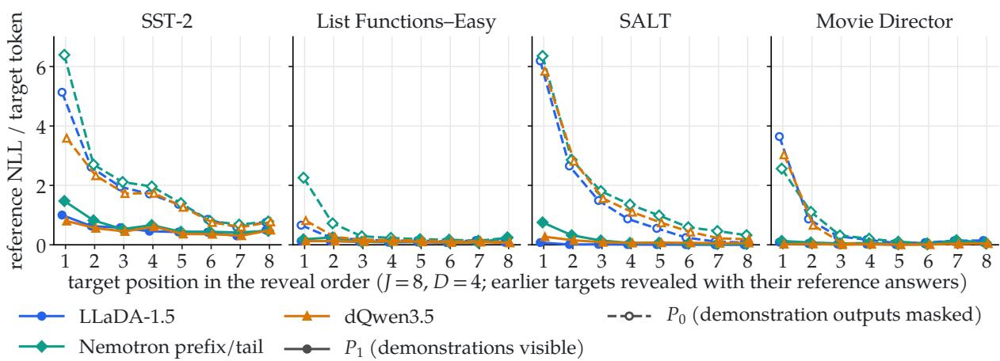  
Figure 9: Reference-token NLL under $P _ { 1 }$ and $P _ { 0 }$ by reveal position (cross-benchmark study, $J = 8 )$ . Previously revealed reference targets are visible in both contexts, and the gap between their subsequent reference-token scores generally narrows. This diagnostic follows reference assignments, not sampled decoding trajectories.

## B.3 Multi-Target Experiments

Section 4.2 shows that the efects of example guidance vary with the number of jointly infilled targets. We investigate this behavior with two additional analyses: a reference-likelihood diagnostic that follows successive targets, and a separate cross-benchmark target-count study. The latter uses D = 4 and $K = 6 4$ samples per canvas, rather than the K = 16 pools of the main List Functions–Easy D × J grid.

Reference-likelihood diagnostic. Previously revealed targets may supply information that would otherwise come from the demonstrations. To examine this possibility, we evaluate the reference tokens in reveal order with D = 4 and J = 8, making each preceding reference target visible under both $P _ { 1 }$ and $P _ { 0 }$ while keeping demonstration outputs masked under $P _ { 0 }$ . In Figure 9, the gap between subsequent reference-token negative log likelihoods generally narrows as more targets are revealed.

Cross-benchmark target-count study. The main $D \times J$ study uses only List Functions– Easy, so we also examine whether its guidance trends hold across other tasks. In this separate experiment, three DLMs are evaluated on four benchmarks at $D = 4 , J \in \{ 1 , 2 , 4 , 8 \}$ , and $K = 6 4$ (Figure 10). At J = 8, guidance at $\beta = 0 . 5$ improves $A _ { \mathrm { a l l } }$ on SST-2, decreases it on Movie Director, is nearly neutral on List Functions–Easy, and varies by model on SALT. Thus, the reduced guidance benefits observed on List Functions–Easy do not hold uniformly across tasks.

## B.4 Length Allocation

Predictor architecture. To evaluate infilling without oracle target lengths, we train length predictors using frozen DLM representations, following Xu et al. (2026a). Each compact prompt ze contains one placeholder per target, whose hidden state before the final transformer block is passed through a trainable copy of that block and its final normalization. For LLaDA-1.5 this is block 31 of 32 with ln\_f; for Nemotron it is layer 33 of 34 with encoder.norm; and for dQwen3.5 it is layer 31 of 32 with model.norm. A categorical head predicts lengths in $\{ 1 , \ldots , 2 5 6 \}$ independently across sites, conditional on the compact prompt. Only the length predictor is trained, using prompt-normalized cross-entropy on the reference token lengths under each backbone’s tokenizer; the original DLM remains frozen and jointly infills the allocated targets.

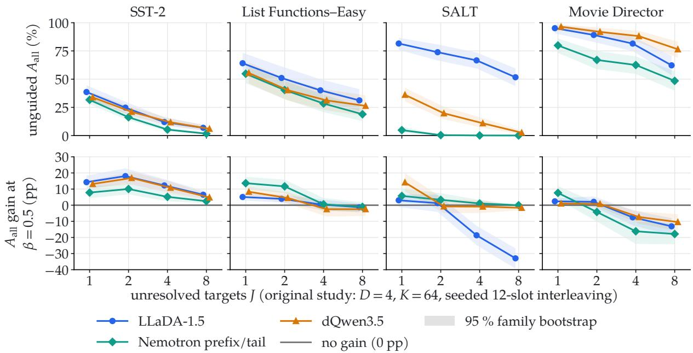  
Figure 10: Cross-benchmark target-count study at the common guidance strength. Top: unguided all-target accuracy $A _ { \mathrm { a l l } } ;$ bottom: its change under example guidance at $\beta = 0 . 5$ , which varies by task at $J = 8 . \ D = 4 , \ K = 6 4$ samples per canvas, oracle lengths, three DLMs, and 64 prompt families per cell; bands are unadjusted 95% family-bootstrap intervals.

Training protocol. Training draws from a 70/30 mixture of structured few-shot prompts (100,000 from MIT-Movie, ATIS, List Functions, and SALT) and Java editing episodes (22,128 from 28 repositories, split 21/4/3 by repository). We exclude evaluation source units, all 85 List Functions–Easy rules, SALT categories 5–6, the MIT-Movie Director field, and all 18 SWE-Refactor repositories. The Java predictor used in Section 5 is trained separately (Section C.2). For optimization, we use AdamW with weight decay 0.01, learning rates $3 \times 1 0 ^ { - 5 }$ for the copied block and normalization and $3 \times 1 0 ^ { - 4 }$ for the categorical head. We train for 1,563 steps with 64 draws per update, 5% warm-up, cosine decay, evaluating the final checkpoint.

Length fidelity. For a target with reference length $L _ { j } ^ { \star }$ , we measure the predictor’s probability mass within r tokens of that length:

$$
F _ { r } ( \widetilde { z } , j ) : = \sum _ { \ell : | \ell - L _ { j } ^ { \star } | \leq r } \pi _ { \psi , j } ( \ell \mid \widetilde { z } ) .
$$

We average over evaluation targets and prompt families; $F _ { 0 }$ measures probability assigned to the reference length, not the accuracy of the most likely prediction. Across backbones and target counts, $F _ { 0 } = 4 0 – 4 6 \%$ and $F _ { 2 } = 5 3 – 6 1 \%$ , versus approximately 27% exact-length mass from a prior based on four demonstration-output lengths.

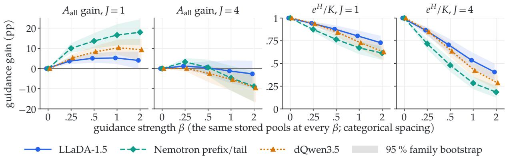  
Figure 11: Guidance-strength sensitivity on List Functions–Easy (cross-benchmark study). Change in $A _ { \mathrm { a l l } }$ from $\beta = 0$ at J = 1 and J = 4 (left), and mean $\rho _ { \mathrm { e f f } }$ , the entropy-based efective fraction of sampled draws (right). Each strength reweights the same $D = 4 , K = 6 4$ sample pools, with duplicates retained and oracle lengths; Nemotron uses a causal prefix and bidirectional tail even at $J = 1$ . Bands are unadjusted 95% paired family-bootstrap intervals from 10,000 resamples.

Downstream evaluation. On List Functions–Easy, we fix $D = 4$ , vary $J \in \{ 1 , 2 , 4 , 8 \}$ , and compare oracle lengths with sampled predictor lengths using the same content decoder and $K = 6 4 / J$ samples per canvas at $\beta = 0$ . Predicted lengths retain 35–48% of oracle-length per-target accuracy (Figure 7, top). To assess sensitivity separately from the predictor’s own errors, we impose $L _ { j } = L _ { i } ^ { \star } + \Delta$ for $J \in \{ 1 , 2 \}$ (Figure 7, bottom), skipping a prompt family at any $\Delta$ for which some $L _ { j } ^ { \star } + \Delta < 1$ ; these forced ofsets do not represent lengths sampled from the predictor.

## B.5 Guidance-Strength Sensitivity

We examine whether increasing the guidance strength $\beta$ improves accuracy or instead concentrates resampling weights on fewer samples. Using stored cross-benchmark List Functions–Easy pools with $D = 4$ , we compare $J \in \{ 1 , 4 \}$ at $K = 6 4$ over 64 prompt families per cell, reweighting the same samples for $\beta \in \{ 0 , 0 . 2 5 , 0 . 5 , 1 , 2 \}$ . To describe weight concentration, define the entropy and entropy-based efective fraction of the normalized sample weights $\widetilde { w } _ { k } ( \beta )$ :

$$
H _ { \beta } : = - \sum _ { k = 1 } ^ { K } \widetilde { w } _ { k } ( \beta ) \log \widetilde { w } _ { k } ( \beta ) , \qquad \rho _ { \mathrm { e f f } } ( \beta ) : = \frac { \exp ( H _ { \beta } ) } { K } .
$$

The fraction $\rho _ { \mathrm { e f f } }$ measures concentration over sampled draws, counting duplicates separately, rather than diversity among distinct completions. Figure 11 compares its mean against gains in $A _ { \mathrm { a l l } }$ relative to $\beta = 0$

For a single target, every tested $\beta > 0$ improves mean $A _ { \mathrm { a l l } }$ for all three DLMs (intervals exclude zero except for LLaDA at $\beta = 2 )$ . Gains peak near $\beta = 1$ for $\mathrm { L L a D A }$ and dQwen3.5 (+5.2 and +10.3 percentage points), while Nemotron reaches +18.0 points at $\beta = 2$ . With four targets, however, gains reach at most +3.3 points at $\beta = 0 . 2 5$ and then diminish or reverse, reaching $- 2 . 6$ to −9.6 points at $\beta = 2$ (intervals exclude zero for Nemotron and dQwen3.5).

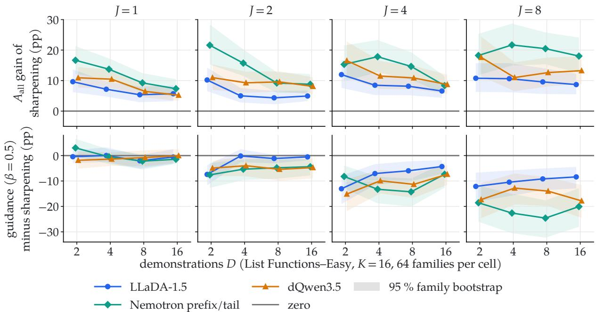  
Figure 12: Likelihood sharpening with the same total $P _ { 1 }$ exponent in the $D \times J$ grid. Top: gain in $A _ { \mathrm { a l l } }$ from sharpening alone (sample weights ∝ $P _ { 1 } ^ { 1 / 2 }$ , resulting distribution ∝ $P _ { 1 } ^ { 3 / 2 } )$ ; bottom: example guidance minus sharpening (negative values favor sharpening). Both reweight the $K = 1 6$ sample pools of Figure $6 ;$ bands are unadjusted 95% family-bootstrap intervals.

Weight concentration alone does not appear to explain these accuracy trends. When accuracy deteriorates at $J = 4 , \rho _ { \mathrm { e f f } }$ remains 0.48–0.71, whereas single-target accuracy still improves at comparable fractions (0.62–0.73 at $\beta = 2 )$ ). Four-target rewards also span roughly four times as many tokens and are more dispersed, so this comparison does not isolate target count as the cause.

## B.6 Likelihood Sharpening

Some gains from example guidance could reflect sharpening of the demonstration-conditioned likelihood $P _ { 1 }$ , rather than the additional information in the $P _ { 1 } / P _ { 0 }$ reward. To separate these efects, we compare example guidance with likelihood sharpening that uses the same total exponent on $P _ { 1 } . { \mathrm { ~ A t ~ } } \beta = 0 . 5$ , the guided distribution, the sharpening distribution, and the sample weights for sharpening are

$$
Q _ { 0 . 5 } ( u ) \propto P _ { 1 } ( u ) ^ { 3 / 2 } P _ { 0 } ( u ) ^ { - 1 / 2 } , \qquad Q _ { \mathrm { s h a r p } } ( u ) \propto P _ { 1 } ( u ) ^ { 3 / 2 } , \qquad w _ { \mathrm { s h a r p } } ( u ) \propto P _ { 1 } ( u ) ^ { 1 / 2 } .
$$

Both methods reweight the same samples without additional sampling or tuning. The comparison matches the $P _ { 1 }$ exponent, but not necessarily weight concentration or a separately tuned decoding temperature.

Likelihood sharpening explains much of the improvement from guidance, although the exampledependent reward provides an additional gain in one setting. For LLaDA with a single target at $D = 4$ , guidance improves over sharpening by +3.6 percentage points $( [ + 0 . 4 , ~ + 6 . 9 ] )$ on SST-2; no other single-target task shows a positive residual. In the List Functions–Easy $D \times J$ grid, sharpening improves $A _ { \mathrm { a l l } }$ for every J and outperforms guidance in every cell with $J \ge 4$ (Figure 12). These comparisons distinguish the gains attributable to likelihood sharpening from the additional contribution of the example-dependent reward.

## C Software Editing Experiments

We describe the Java refactoring benchmark and evaluation, then analyze demonstration conditioning, length allocation, and example guidance.

## C.1 Benchmark Construction and Evaluation Setup

We derive multi-site editing tasks from Extract Method commits in SWE-Refactor (Xu et al., 2026b), which provide before-and-after snapshots and extracted helpers. For each (repository, commit, file, helper) group, we identify updated callers and represent each minimal changed region as a <old>/<new> pair. A seeded file-order rule assigns D accepted edits as demonstrations and J remaining sites as targets. Eligibility rules fixed before inspecting outcomes exclude edits requiring identifiers or literals absent from the prompt or changing asserted values. We also limit replacements to 80 LLaDA tokens and enclosing methods to 200 lines, retain one helper per commit and file, and collapse mirrored commits. The resulting benchmark contains 127 tasks from 50 commits across 14 repositories, with $( D , J ) \in \{ 1 , 2 \} ^ { 2 }$ and at most one task per group and configuration. Because eligible commits difer across configurations, comparisons across $( D , J )$ in Table 1 do not isolate the efect of demonstration or target count; results are aggregated and bootstrapped by commit.

The figure is an excerpt: actual prompts include instructions, chat framing, and additional context from the accepted after-file, with target edits reverted and context cropped to the helper and enclosing methods. For $P _ { 0 }$ , only changed-line tokens of demonstration outputs are masked.

Evaluation procedure. Frozen LLaDA-1.5 (Zhu et al., 2026) generates $K = 1 6$ rewrites per task under each length setting; unguided sampling and example guidance use the same stored samples. We use Claude Sonnet 5.5 (claude-sonnet-5-5) as a Claude Code sub-agent, with a fixed judging rubric and fresh context per call. Each judging packet contains the helper and its Javadoc, accepted demonstrations, and target methods with candidate rewrites inserted, but excludes developer references, generation settings, length allocations, and model scores. The judge assesses whether the edits adapt receivers, arguments, and control flow while plausibly preserving behavior; equivalent rewrites may pass, while incomplete or erroneous edits fail. Joint success requires every target to be judged correct; uncertain judgments count as failures, and ill-posed packets remain in the evaluation. Duplicate candidate texts are judged once per task, but duplicate draws remain in the sample pools; we report unadjusted 95% paired commit-bootstrap intervals. We do not compile or execute the generated code.

Judge checks and limitations. The 4,064 generated draws yielded 2,089 distinct judging packets after deduplication within tasks, including across length settings. The judge classified all 46 blinded validation cases as expected, and ten repeated judgments agreed, although these checks do not replace execution-based evaluation. Its inherited agent context contained brief summaries of earlier Section 5 results, but no packet-specific labels; judge sampling parameters were not explicitly set or recorded. All 50 source commits were examined during development, and some prompts contain target-reference text elsewhere in the helper or demonstrations, so this study is not a held-out evaluation.

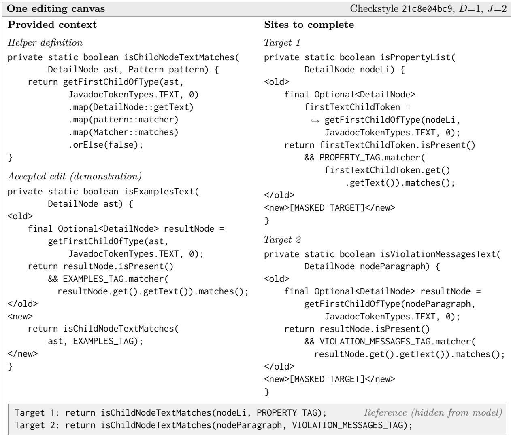  
Figure 13: One editing canvas from a Checkstyle refactoring. An accepted edit introduces a helper call, and two masked targets must adapt it to their local arguments. Both columns belong to the same prompt; hook arrows indicate visual line wraps.

## C.2 Demonstration Conditioning and Length Allocation

Demonstration ablation. To measure the efect of demonstration conditioning, we compare D = 0 and D = 1 on the same 80 editing tasks (52 with J = 1, 28 with J = 2) in a post-hoc ablation. Both conditions share the helper, target sites, oracle lengths, chat framing, K = 16, and unguided sampling (β = 0). They use the instruction: “Complete each target <new> span by applying the intended refactoring using the helper shown in the source context; use any accepted before/after edits if provided.” Only demonstration visibility changes during generation; the judge sees the accepted edit in both conditions.

Adding one demonstration improves joint LLM-judged success by 14.7 percentage points for $J = 1 \ ( [ + 5 . 8 , + 2 4 . 5 ] )$ and 17.5 points for $J = 2 \ ( [ + 4 . 7 , + 3 2 . 5 ] )$ . The estimated gain is smaller on commits outside the narrower LLaDA development subset (+5.3 points, $\left[ - 1 . 0 , + 1 3 . 9 \right] )$ . The ablation was designed after inspecting the main results but fixed before collecting its own outcomes; its instruction difers from the main experiment, so absolute success rates are not directly comparable.

Java length predictor. We train a Java-specific length predictor using the LLaDA-1.5 architecture and objective of Section B.4, with edits from 21 training and four development repositories in the 28-repository corpus; the remaining three repositories and all SWE-Refactor repositories are excluded. Training prompts contain an optional helper declaration, D accepted <old>/<new> demonstrations, and J targets with visible <old> spans and one placeholder per missing <new> span. We use seeded, disjoint site assignments, retain up to 20 context lines before and 12 after each edit, and exclude empty replacements, lengths above 256 tokens, and prompts exceeding 2,048 tokens. Reference lengths are withheld from the inputs, with prompt-invariance checks to detect leakage. This yields helper-only and all-multi-site corpora with 1,887/370 and 13,543/3,598 training/development prompts, respectively, where the latter includes the former. Training alternates between the corpora equally for 313 updates (batch size 64, 16 warm-up updates, cosine decay), with other settings following Section B.4. We also train an alternative on the all-multi-site corpus alone and select by exact-length probability mass $F _ { 0 }$ on 488 helper-only development targets (0.0664 versus 0.0660), although within-two-token mass $F _ { 2 }$ would favor the alternative (0.317 versus 0.328); SWE-Refactor outcomes are not used for selection.

Length evaluation. At evaluation, the selected predictor runs once per task and independently samples target lengths for each of K = 16 rewrites, without temperature adjustment or truncation. Oracle lengths equal the developer-reference token counts; 3.3% of predicted per-target lengths exceed the benchmark’s 80-token reference-length eligibility limit. We compare length fidelity against the empirical distribution of 2,467 replacement lengths in the helper-only training corpus, distinct from the demonstration-length prior in Section 4.3. Across 80 unique target sites, the predictor assigns 26.7% probability mass within two tokens of the reference length ([20.1, 33.8]), compared with 15.2% for this prior; exact-length mass is 6.8% versus 3.1%. However, only 6.2% of learned-length joint samples allocate every target exactly. Among learned-length samples, 95% with exact joint allocations are judged correct, compared with 13% for near-but-incorrect allocations and 8% otherwise. These descriptive associations help explain the large oracle-versuslearned accuracy gap in Table 1, while highlighting the importance of accurate joint length allocation.

## C.3 Example Guidance and Failure Analysis

Example guidance at $\beta = 0 . 5$ reduces pooled LLM-judged joint success by 2.9 percentage points with oracle lengths $( [ - 5 . 4 , - 0 . 6 ] )$ and 1.3 points with learned lengths ([−3.8, +1.6]); Table 1 reports the configuration-specific results. The oracle-length decline also persists in the prespecified sensitivity population (−3.3 points, [−6.1, −1.1]) and among 30 commits outside the narrower LLaDA development subset (−3.1 points, [−6.7, −0.1]).

Table 1: Joint LLM-judged success (%) by configuration, with K = 16 samples per editing task and length setting and learned lengths sampled from the Java predictor. Diferences are in percentage points, with unadjusted 95% paired commit-bootstrap intervals. The pooled row weights 50 commits equally and is not the mean of the four configuration rows.
<table><tr><td></td><td></td><td colspan="4">Oracle lengths</td><td colspan="4">Learned lengths</td><td colspan="2">Learned-oracle</td></tr><tr><td></td><td>(D, J) Commits/tasks β = 0 β = 0.5 Difference</td><td></td><td></td><td></td><td></td><td></td><td></td><td>β = 0 β = 0.5 Difference</td><td></td><td>at β = 0</td><td></td></tr><tr><td>(1,1)</td><td>50/52</td><td>76.1</td><td></td><td></td><td>72.9 −3.2 [−5.9, −0.8]</td><td>17.3</td><td></td><td></td><td></td><td></td><td>17.1 −0.2 [−3.4, +3.9] −58.9 [−68.1, -49.5]</td></tr><tr><td>(1,2)</td><td>26/28</td><td>74.9</td><td></td><td>72.7 -2.2 [−4.7, −0.2]</td><td></td><td>9.4</td><td></td><td></td><td></td><td></td><td>4.7 −4.6 [−8.9, −1.3] −65.5 [−79.8, −50.5]</td></tr><tr><td>(2,1)</td><td>26/28</td><td>92.7</td><td></td><td>90.4 −2.2 [−6.9, +0.9]</td><td></td><td>21.2</td><td></td><td></td><td></td><td></td><td>18.6 −2.5 [−9.3, +5.9] −71.5 [−82.6, −59.1]</td></tr><tr><td>(2,2)</td><td>17/19</td><td>82.7</td><td></td><td>84.5 +1.8 [0.0, +5.2]</td><td></td><td>9.2</td><td></td><td></td><td></td><td></td><td>9.6 +0.4 [−5.2, +8.0] −73.5 [−88.4, −56.6]</td></tr><tr><td>Pooled</td><td>50/127</td><td>74.4</td><td></td><td>71.5 −2.9 [−5.4, −0.6]</td><td></td><td>15.8</td><td></td><td></td><td>14.5 −1.3 [−3.8, +1.6] −58.6 [−67.4, −49.6]</td><td></td><td></td></tr></table>

Selection helps only when a sample pool contains both correct and incorrect rewrites. Among 127 oracle-length pools, $8 7$ contain only judged-correct samples, 17 only incorrect samples, and 23 both; the corresponding counts with learned lengths are 0, 55, and 72. Selecting a correct rewrite whenever one is available could therefore improve pooled success by at most 8.3 points with oracle lengths, versus 45.2 points with learned lengths. Even within the 23 mixed oracle-length pools, guidance lowers expected success from 62.0% to 50.5% (−11.5 points, [−19.7, −3.1]); this is a post-hoc comparison on an outcome-selected subset.

A post-hoc Checkstyle example (commit b142dda472, distinct from Figure 13) illustrates how the reward can favor an incorrect rewrite. The developer-consistent rewrite $u _ { + }$ of logMessage preserves the logged line number and MSG\_DUPLICATE\_REGEXP, whereas an incorrect rewrite u<sub>−</sub> changes both, yet receives a higher reward (8.69 versus 2.05 nats). The following code excerpts omit the enclosing method’s closing braces.

```c
Developer’s rewrite u<sub>+</sub> 7 of 16 draws
final String msg = getMessage();
if (illegalPattern) {
log(lineNumber, MSG_ILLEGAL_REGEXP, msg);
}
else {
log(lineNumber, MSG_DUPLICATE_REGEXP, msg);
Incorrect rewrite u<sub>−</sub> 1 of 16 draws
final String msg = getMessage();
if (illegalPattern) {
log(lineNumber - 1, MSG_ILLEGAL_REGEXP, msg);
}
else {
log(lineNumber, MSG_REQUIRED_REGEXP, msg);
```

At $\beta = 0 . 5$ , the reward diference gives each occurrence of u<sub>−</sub> approximately 28 times the resampling weight of an occurrence of $u _ { + }$ . The single incorrect draw consequently receives 61.8% of the total weight, compared with 15.7% across the seven correct draws, lowering expected LLM-judged success from 43.8% to 15.7%. Nevertheless, the ideal guided distribution favors $u _ { + }$

over $u _ { - }$ in their pairwise comparison:

$$
\frac { Q _ { 0 . 5 } ( u _ { - } ) } { Q _ { 0 . 5 } ( u _ { + } ) } = \exp ( - 3 . 5 9 7 + 3 . 3 1 9 ) \approx 0 . 7 6 , \qquad \frac { \widehat { Q } _ { 0 . 5 , 1 6 } ( u _ { - } ) } { \widehat { Q } _ { 0 . 5 , 1 6 } ( u _ { + } ) } = \frac { \exp ( 3 . 3 1 9 ) } { 7 } \approx 3 . 9 5 .
$$

The original sampling distribution favors $u _ { + }$ by a much larger margin than the observed sevento-one draw count; finite-pool resampling therefore reverses this pairwise preference. These ratios compare only the two displayed rewrites, not the total probability of a correct edit.

## D Additional Discussion

Broader impacts. Multi-target few-shot prompting could enable example-guided document and code editing across multiple sites. Practical use will require more reliable adherence to demonstrations and better prediction of output lengths. With these improvements, users could specify transformations through a few examples rather than editing each site manually.

Potential risks. Incorrect transformations can propagate across sites, altering document meaning or introducing software defects. Our Checkstyle case study shows that example guidance can favor an incorrect edit even when demonstrations support the intended transformation. Practical use requires review, including compilation and testing for code; our evaluation instead relies on an LLM judge without execution.

Artifacts and licensing. The models are released under MIT (LLaDA 1.5), Apache 2.0 (dQwen3.5 and Qwen3), and the NVIDIA Open Model License (Nemotron-Labs-Difusion). The BIG-bench and SALT repositories use Apache 2.0 and MIT, respectively; SWE-Refactor is marked CC BY 4.0, but its underlying Java files retain their upstream licenses. We could not verify uniform redistribution terms for SST-2 or MIT Movie, so we do not assume unrestricted redistribution rights.

Compute. All experiments use 8–9B-parameter models on NVIDIA H100 NVL (96 GB) GPUs, one model per GPU; only the length predictors are trained. Run logs suggest fewer than 100 H100 GPU-hours, although cumulative GPU time was not tracked separately.

AI usage. We used generative AI assistants for literature exploration, manuscript drafting and revision, and code and figure preparation. The authors remain responsible for the methods, citations, results, and final text. Separately, Claude Sonnet 5.5 was used to judge software edits under the experimental protocol of Section 5.1.