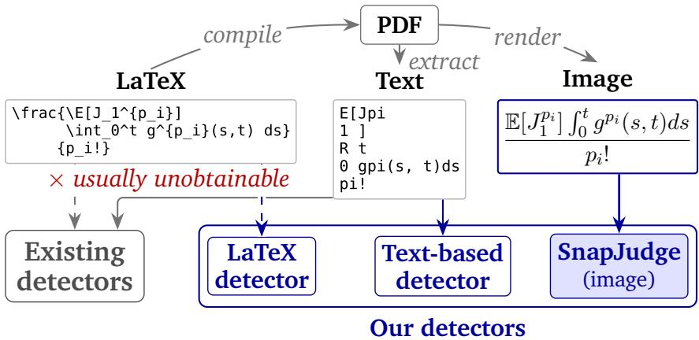
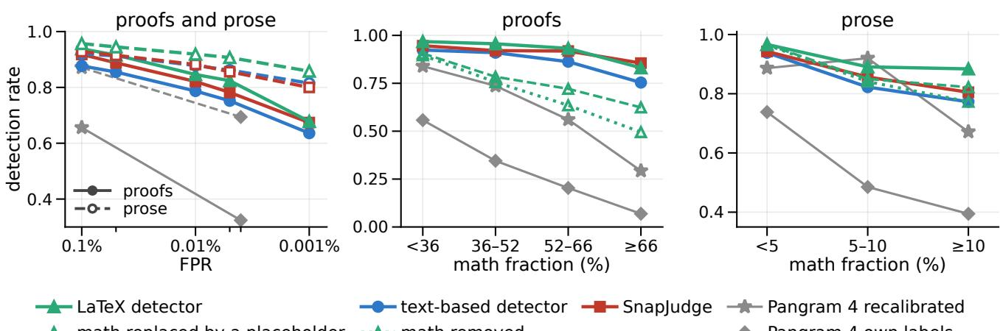
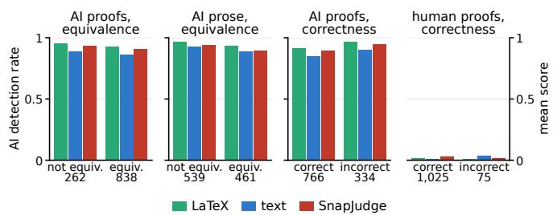
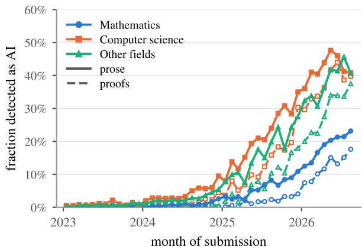
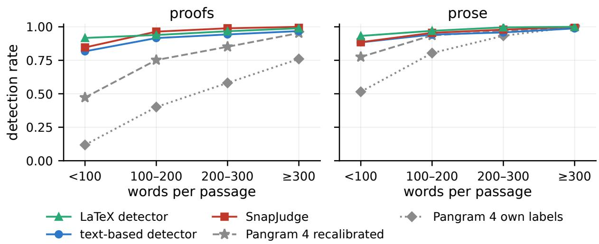
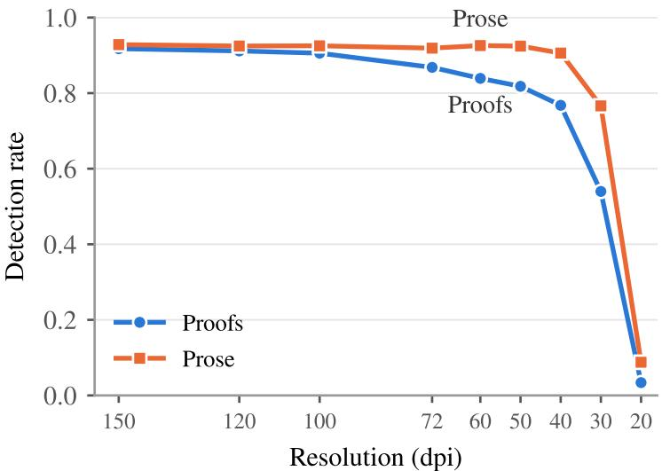
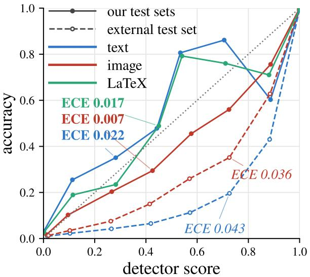

# Multimodal AI Detection for Math-Heavy Scientific Text

Yixuan Huang<sup>1</sup>, Danish Pruthi<sup>2</sup>, Bhuwan Dhingra<sup>1</sup>

<sup>1</sup>D<sub>u</sub>k<sub>e</sub> U<sub>n</sub>i<sub>vers</sub>it<sub>y,</sub> <sup>2</sup>I<sub>n</sub>di<sub>an</sub> I<sub>ns</sub>tit<sub>u</sub>t<sub>e o</sub>f S<sub>c</sub>i<sub>ence</sub>

yixuan.huang@duke.edu, bdhingra@cs.duke.edu

A<sub>s</sub> l<sub>arge</sub> l<sub>anguage mo</sub>d<sub>e</sub>l<sub>s</sub> b<sub>ecome</sub> i<sub>ncreas</sub>i<sub>ng</sub>l<sub>y capa</sub>bl<sub>e o</sub>f <sub>genera</sub>ti<sub>ng, an</sub>d <sub>ass</sub>i<sub>s</sub>ti<sub>ng w</sub>ith<sub>, sc</sub>i<sub>en</sub>tifi<sub>c wr</sub>iti<sub>ng,</sub> th<sub>ere</sub> i<sub>s</sub> <sub>a nee</sub>d f<sub>or grea</sub>t<sub>er</sub> t<sub>ransparency an</sub>d di<sub>sc</sub>l<sub>osure aroun</sub>d th<sub>e use o</sub>f AI i<sub>n researc</sub>h<sub>.</sub> C<sub>onsequen</sub>tl<sub>y, a ver</sub>it<sub>a</sub>bl<sub>e su</sub>bfi<sub>e</sub>ld <sub>o</sub>f <sub>researc</sub>h <sub>an</sub>d <sub>a num</sub>b<sub>er o</sub>f <sub>commerc</sub>i<sub>a</sub>l <sub>serv</sub>i<sub>ces a</sub>i<sub>m</sub> t<sub>o</sub> fl<sub>ag</sub> AI<sub>-genera</sub>t<sub>e</sub>d <sub>con</sub>t<sub>en</sub>t <sub>au</sub>t<sub>oma</sub>ti<sub>ca</sub>ll<sub>y.</sub> H<sub>owever, ex</sub>i<sub>s</sub>ti<sub>ng</sub> d<sub>e</sub>t<sub>ec</sub>t<sub>ors w</sub>hi<sub>c</sub>h <sub>re</sub>l<sub>y on</sub>l<sub>y on</sub> t<sub>ex</sub>t <sub>ex</sub>t<sub>rac</sub>t<sub>e</sub>d f<sub>rom</sub> PDF<sub>s</sub> f<sub>a</sub>il t<sub>o</sub> b<sub>ene</sub>fit f<sub>rom</sub> th<sub>e r</sub>i<sub>c</sub>h <sub>v</sub>i<sub>sua</sub>l i<sub>n</sub>f<sub>orma</sub>ti<sub>on con</sub>t<sub>a</sub>i<sub>ne</sub>d i<sub>n</sub> the formatting of math-heavy scientific content. To study this, we select human-written proof and prose passages from pre-2022 arXiv LaTeX sources and re-generate them using 15 modern LLMs within the context of the same <sub>paper.</sub> Thi<sub>s</sub> l<sub>eaves us w</sub>ith <sub>coup</sub>l<sub>e</sub>d h<sub>uman an</sub>d AI <sub>ou</sub>t<sub>pu</sub>t<sub>s</sub> i<sub>n</sub> th<sub>ree</sub> dif<sub>eren</sub>t <sub>represen</sub>t<sub>a</sub>ti<sub>ons:</sub> th<sub>e</sub> L<sub>a</sub>T<sub>e</sub>X <sub>source, a</sub> <sub>ren</sub>d<sub>ere</sub>d i<sub>mage o</sub>f th<sub>e</sub> PDF<sub>, an</sub>d th<sub>e</sub> t<sub>ex</sub>t <sub>ex</sub>t<sub>rac</sub>t<sub>e</sub>d f<sub>rom</sub> th<sub>e</sub> PDF<sub>.</sub> W<sub>e</sub> fi<sub>n</sub>d th<sub>a</sub>t th<sub>e accuracy o</sub>f th<sub>e s</sub>t<sub>a</sub>t<sub>e-o</sub>f<sub>-</sub>th<sub>e-ar</sub>t P<sub>angram</sub> 4 d<sub>rops s</sub>i<sub>gn</sub>ifi<sub>can</sub>tl<sub>y as</sub> th<sub>e ma</sub>th<sub>ema</sub>ti<sub>ca</sub>l <sub>con</sub>t<sub>en</sub>t i<sub>n a passage</sub> i<sub>ncreases, espec</sub>i<sub>a</sub>ll<sub>y w</sub>h<sub>en eva</sub>l<sub>ua</sub>t<sub>e</sub>d <sub>on</sub> t<sub>ex</sub>t <sub>as</sub> <sub>oppose</sub>d t<sub>o</sub> L<sub>a</sub>T<sub>e</sub>X<sub>.</sub> H<sub>owever,</sub> thi<sub>s</sub> i<sub>s</sub> <sub>no</sub>t <sub>an</sub> i<sub>n</sub>h<sub>eren</sub>t li<sub>m</sub>it<sub>a</sub>ti<sub>on</sub> <sub>o</sub>f d<sub>e</sub>t<sub>ec</sub>ti<sub>ng</sub> AI<sub>-genera</sub>t<sub>e</sub>d <sub>ma</sub>th<sub>:</sub> fi<sub>ne</sub>t<sub>un</sub>i<sub>ng</sub> Qwen-3.5-27B based detectors on this domain recovers the gap, with LaTeX inputs performing significantly better th<sub>an</sub> t<sub>ex</sub>t <sub>s</sub>i<sub>nce</sub> th<sub>ey preserve more</sub> f<sub>orma</sub>tti<sub>ng</sub> i<sub>n</sub>f<sub>orma</sub>ti<sub>on.</sub> Si<sub>nce</sub> L<sub>a</sub>T<sub>e</sub>X <sub>sources are rare</sub>l<sub>y ava</sub>il<sub>a</sub>bl<sub>e</sub> i<sub>n prac</sub>ti<sub>ce, we</sub> <sub>a</sub>l<sub>so</sub> t<sub>ra</sub>i<sub>n</sub> S<sub>n</sub>a<sub>p</sub>J<sub>ud</sub>g<sub>e: an</sub> i<sub>mage-</sub>b<sub>ase</sub>d d<sub>e</sub>t<sub>ec</sub>t<sub>or opera</sub>ti<sub>ng on screens</sub>h<sub>o</sub>t<sub>s o</sub>f b<sub>o</sub>th <sub>prose an</sub>d <sub>proo</sub>f<sub>s</sub> f<sub>rom papers.</sub> At 0.1% false positive rate, SnapJudge achieves a detection rate of 92% on proofs and 93% on prose generated by f<sub>ron</sub>ti<sub>er mo</sub>d<sub>e</sub>l<sub>s, su</sub>b<sub>s</sub>t<sub>an</sub>ti<sub>a</sub>ll<sub>y ou</sub>t<sub>per</sub>f<sub>orm</sub>i<sub>ng</sub> b<sub>o</sub>th P<sub>angram</sub> 4 <sub>an</sub>d <sub>our</sub> t<sub>ex</sub>t<sub>-</sub>b<sub>ase</sub>d d<sub>e</sub>t<sub>ec</sub>t<sub>or.</sub> W<sub>e re</sub>l<sub>ease our</sub> d<sub>a</sub>t<sub>a,</sub> mo<sup>d</sup>e<sup>l</sup>s an<sup>d</sup> co<sup>d</sup>e at https://nlplab.cs.duke.edu/snapjudge.

## 1. Introduction

Mathematical ca<sub>p</sub>abilities of LLMs have risen from solvin<sub>g</sub> middle-school math <sub>p</sub>roblems (Cobbe et al., 2021) to winnin<sub>g</sub> math ol<sub>y</sub>m<sub>p</sub>iads (Luon<sub>g</sub> & Lockhart, 2025), and now tacklin<sub>g</sub> lon<sub>g</sub>standin<sub>g</sub> o<sub>p</sub>en <sub>p</sub>roblems, such as the Jacobian conjecture (Tao, 2026) and (alle<sub>g</sub>edl<sub>y</sub>) the Navier–Stokes Millennium Prize <sub>p</sub>roblem (O<sub>p</sub>enAI, 2026b). Th<sub>ese a</sub>d<sub>vances</sub> hi<sub>g</sub>hli<sub>g</sub>ht th<sub>e urgen</sub>t <sub>nee</sub>d f<sub>or</sub> i<sub>mprov</sub>i<sub>ng</sub> t<sub>ransparency a</sub>b<sub>ou</sub>t th<sub>e use o</sub>f AI <sub>w</sub>h<sub>en pu</sub>bli<sub>s</sub>hi<sub>ng sc</sub>i<sub>en</sub>tifi<sub>c</sub> <sub>papers,</sub> i<sub>nc</sub>l<sub>u</sub>di<sub>ng</sub> th<sub>e</sub> t<sub>ec</sub>h<sub>n</sub>i<sub>ca</sub>l <sub>con</sub>t<sub>en</sub>t <sub>suc</sub>h <sub>as proo</sub>f<sub>s an</sub>d d<sub>er</sub>i<sub>va</sub>ti<sub>ons</sub> th<sub>a</sub>t <sub>suppor</sub>t th<sub>e</sub>i<sub>r c</sub>l<sub>a</sub>i<sub>ms.</sub> E<sub>ven w</sub>h<sub>en</sub> th<sub>e</sub> <sub>c</sub>l<sub>a</sub>i<sub>ms</sub> i<sub>n a paper are correc</sub>t<sub>, un</sub>d<sub>ers</sub>t<sub>an</sub>di<sub>ng</sub> h<sub>ow</sub> th<sub>ey were pro</sub>d<sub>uce</sub>d <sub>s</sub>till <sub>ma</sub>tt<sub>ers</sub> f<sub>or eva</sub>l<sub>ua</sub>ti<sub>ng researc</sub>h<sub>ers</sub>’ <sub>con</sub>t<sub>r</sub>ib<sub>u</sub>ti<sub>ons an</sub>d <sub>ass</sub>i<sub>gn</sub>i<sub>ng cre</sub>dit<sub>.</sub> Thi<sub>s nee</sub>d i<sub>s re</sub>fl<sub>ec</sub>t<sub>e</sub>d i<sub>n pu</sub>bli<sub>ca</sub>ti<sub>on po</sub>li<sub>c</sub>i<sub>es: many con</sub>f<sub>erences an</sub>d <sub>pu</sub>bli<sub>s</sub>h<sub>ers</sub> now re<sub>q</sub>uire authors to disclose their use of AI (NeurIPS, 2025; ICLR, 2025; NeurIPS, 2026; Nature Portfolio, S<sub>p</sub>rin<sub>g</sub>er Nature, 2026; Moha<sub>p</sub>atra & Pruthi, 2026). Such <sub>p</sub>olicies rest on honest disclosure, which can onl<sub>y</sub> be <sub>ver</sub>ifi<sub>e</sub>d<sub>, an</sub>d th<sub>ere</sub>f<sub>ore en</sub>f<sub>orce</sub>d<sub>, w</sub>h<sub>en accura</sub>t<sub>e</sub> d<sub>e</sub>t<sub>ec</sub>ti<sub>on</sub> i<sub>s ava</sub>il<sub>a</sub>bl<sub>e.</sub> Alth<sub>oug</sub>h th<sub>e s</sub>t<sub>a</sub>t<sub>e-o</sub>f<sub>-</sub>th<sub>e-ar</sub>t <sub>commerc</sub>i<sub>a</sub>l detector, Pan<sub>g</sub>ram 4 (Glickenhaus et al., 2026), is hi<sub>g</sub>hl<sub>y</sub> accurate at fla<sub>gg</sub>in<sub>g g</sub>eneral-<sub>p</sub>ur<sub>p</sub>ose AI content, we find th<sub>a</sub>t it<sub>s e</sub>f<sub>ec</sub>ti<sub>veness</sub> d<sub>egra</sub>d<sub>es s</sub>i<sub>gn</sub>ifi<sub>can</sub>tl<sub>y on sc</sub>i<sub>en</sub>tifi<sub>c</sub> t<sub>ex</sub>t<sub>, espec</sub>i<sub>a</sub>ll<sub>y ma</sub>th<sub>-</sub>h<sub>eavy</sub> t<sub>ex</sub>t<sub>, w</sub>hi<sub>c</sub>h <sub>comes w</sub>ith <sub>r</sub>i<sub>c</sub>h <sub>v</sub>i<sub>sua</sub>l f<sub>orma</sub>tti<sub>ng.</sub><sup>1</sup>

F<sub>or</sub> <sub>or</sub>di<sub>nary</sub> <sub>prose,</sub> <sub>we</sub> <sub>can</sub> <sub>expec</sub>t th<sub>a</sub>t <sub>any</sub> <sub>g</sub>i<sub>ven</sub> id<sub>ea</sub> <sub>can</sub> b<sub>e</sub> <sub>expresse</sub>d i<sub>n</sub> <sub>many</sub> dif<sub>eren</sub>t <sub>ways,</sub> <sub>an</sub>d th<sub>e</sub> <sub>c</sub>h<sub>o</sub>i<sub>ces</sub> an LLM makes amon them leave traces that can be detected (Mitchell et al., 2023; Hans et al., 2024; Lian et al., 2025). However, it is unclear whether such detectable si ns remain in the much more constrained and formal <sub>se</sub>tti<sub>ng o</sub>f <sub>ma</sub>th<sub>-</sub>h<sub>eavy sc</sub>i<sub>en</sub>tifi<sub>c wr</sub>iti<sub>ng.</sub> I<sub>n</sub> thi<sub>s wor</sub>k<sub>, we presen</sub>t th<sub>e</sub> fi<sub>rs</sub>t <sub>sys</sub>t<sub>ema</sub>ti<sub>c s</sub>t<sub>u</sub>d<sub>y o</sub>f AI t<sub>ex</sub>t d<sub>e</sub>t<sub>ec</sub>ti<sub>on on</sub> math-heavy scientific writing under 3 diferent representations: LaTeX, text and rendered images of PDF pages (Figure 1). We find that AI-generated math remains highly detectable under all three representations.

LaTeX is the dominant lan<sub>g</sub>ua<sub>g</sub>e for t<sub>yp</sub>esettin<sub>g</sub> math in scientific <sub>p</sub>a<sub>p</sub>ers (Ginev et al., 2026), however, in <sub>prac</sub>ti<sub>ce rea</sub>d<sub>ers se</sub>ld<sub>om</sub> h<sub>ave access</sub> t<sub>o</sub> th<sub>e un</sub>d<sub>er</sub>l<sub>y</sub>i<sub>ng</sub> L<sub>a</sub>T<sub>e</sub>X <sub>source o</sub>f <sub>a paper</sub> th<sub>ey are rea</sub>di<sub>ng.</sub> P<sub>r</sub>i<sub>or</sub> d<sub>e</sub>t<sub>ec</sub>t<sub>ors</sub> d<sub>ea</sub>l with PDFs b<sub>y</sub> either: (i) extractin<sub>g</sub> text from the PDF, usin<sub>g</sub> tools such as P<sub>y</sub>MuPDF (Artifex Software, 2026), which severel<sub>y</sub> dama<sub>g</sub>es formattin<sub>g</sub> of the mathematical content and, as we show, reduces detection accurac<sub>y</sub> (Section 4); or (ii) runnin<sub>g</sub> OCR on the <sub>p</sub>a<sub>g</sub>e ima<sub>g</sub>es usin<sub>g</sub> s<sub>p</sub>ecialized tools such as Marker and Tesseract (Paruchuri, 2023; Smith, 2007), which <sub>p</sub>reserve math but introduce additional formattin<sub>g</sub> si<sub>g</sub>nals that im<sub>p</sub>ede detection (Emi, 2025).

  
Figure 1: The same mathematical expression shown as LaTeX source, PDF-extracted text, and a rendered image. We study AI detection across three representations and find that rendered images generally yield higher d<sub>e</sub>t<sub>ec</sub>ti<sub>on ra</sub>t<sub>es</sub> th<sub>an ex</sub>t<sub>rac</sub>t<sub>e</sub>d t<sub>ex</sub>t <sub>an</sub>d <sub>approac</sub>h th<sub>e per</sub>f<sub>ormance o</sub>bt<sub>a</sub>i<sub>ne</sub>d <sub>w</sub>ith th<sub>e or</sub>i<sub>g</sub>i<sub>na</sub>l L<sub>a</sub>T<sub>e</sub>X <sub>source.</sub>

H<sub>ence, we</sub> d<sub>eve</sub>l<sub>op</sub> S<sub>n</sub>a<sub>p</sub>J<sub>ud</sub>g<sub>e, an</sub> i<sub>mage-</sub>b<sub>ase</sub>d d<sub>e</sub>t<sub>ec</sub>t<sub>or</sub> th<sub>a</sub>t id<sub>en</sub>tifi<sub>es</sub> AI<sub>-genera</sub>t<sub>e</sub>d <sub>wr</sub>iti<sub>ng</sub> di<sub>rec</sub>tl<sub>y</sub> f<sub>rom</sub> <sub>ren</sub>d<sub>ere</sub>d <sub>sc</sub>i<sub>en</sub>tifi<sub>c passages.</sub> Thi<sub>s requ</sub>i<sub>res m</sub>i<sub>n</sub>i<sub>ma</sub>l <sub>preprocess</sub>i<sub>ng an</sub>d <sub>preserves</sub> th<sub>e s</sub>t<sub>y</sub>li<sub>s</sub>ti<sub>c c</sub>h<sub>o</sub>i<sub>ces</sub> b<sub>e</sub>hi<sub>n</sub>d <sub>ma</sub>th <sub>wr</sub>iti<sub>ng w</sub>hi<sub>c</sub>h <sub>can a</sub>id d<sub>e</sub>t<sub>ec</sub>ti<sub>on.</sub> S<sub>pec</sub>ifi<sub>ca</sub>ll<sub>y, we cons</sub>t<sub>ruc</sub>t <sub>our</sub> d<sub>a</sub>t<sub>a</sub> b<sub>y ex</sub>t<sub>rac</sub>ti<sub>ng</sub> th<sub>e proo</sub>f <sub>an</sub>d <sub>prose passages</sub> from LaTeX sources of <sub>p</sub>re-2022 arXiv <sub>p</sub>a<sub>p</sub>ers, and re-<sub>g</sub>eneratin<sub>g</sub> them usin<sub>g</sub> modern LLMs (conditioned on the rest of the <sub>p</sub>a<sub>p</sub>er). Usin<sub>g</sub> the resultin<sub>g</sub> data, we finetune three Qwen3.5-based detectors (Qwen Team, 2026), <sub>one per represen</sub>t<sub>a</sub>ti<sub>on, an</sub>d <sub>s</sub>h<sub>ow</sub> th<sub>a</sub>t <sub>w</sub>hil<sub>e</sub> th<sub>e</sub> L<sub>a</sub>T<sub>e</sub>X d<sub>e</sub>t<sub>ec</sub>t<sub>or per</sub>f<sub>orms</sub> b<sub>es</sub>t<sub>,</sub> th<sub>e</sub> i<sub>mage-</sub>b<sub>ase</sub>d d<sub>e</sub>t<sub>ec</sub>t<sub>or</sub> h<sub>as</sub> com arable accurac and also out erforms the text-based detector (Section 4). On the same test data, we find that Pangram 4 only detects 36% of the AI-generated proofs when tested on the LaTeX source, with even worse performance upon using the extracted text. Overall, our detectors lead to a >90% detection rate at a relatively strict threshold of 0.1% false positive rate, and also hold up outside mathematics. Despite concerns that supervised detectors colla<sub>p</sub>se on unfamiliar domains (Shen et al., 2026), SnapJudge <sub>p</sub>erforms excellentl<sub>y</sub> on MIRAGE (Fu et al., 2025), RAID (Du<sub>g</sub>an et al., 2024), AI-written <sub>p</sub>eer reviews (Yu et al., 2026), and the EditLens dataset (Thai et al., 2026) (Section 4.3).

When we reduce the false-positive rate to 0.01%, SnapJudge still detects more than 82% of the AI-written <sub>p</sub>assa<sub>g</sub>es (Fi<sub>g</sub>ure 2), hi<sub>g</sub>hli<sub>g</sub>htin<sub>g</sub> the viabilit<sub>y</sub> of our tool for <sub>p</sub>ractical use. We further anal<sub>y</sub>ze what makes AI-generated math detectable, and invalidate explanations that conjecture that AI-generated math is qualitatively diferent or ma<sub>y</sub> contain more errors, and therefore is detectable (Section 4.2). We also investi<sub>g</sub>ate if <sub>p</sub>rose around th<sub>e ma</sub>th<sub>ema</sub>ti<sub>ca</sub>l f<sub>ormu</sub>l<sub>as g</sub>i<sub>ves away s</sub>i<sub>gns o</sub>f AI <sub>wr</sub>iti<sub>ng, an</sub>d fi<sub>n</sub>d th<sub>a</sub>t <sub>passages</sub> d<sub>o</sub> b<sub>ecome</sub> h<sub>ar</sub>d<sub>er</sub> t<sub>o</sub> d<sub>e</sub>t<sub>ec</sub>t <sub>as</sub> the percentage of formulas in them increases, but we are still able to detect over 80% proofs which are composed <sub>pr</sub>i<sub>mar</sub>il<sub>y o</sub>f f<sub>ormu</sub>l<sub>as an</sub>d <sub>equa</sub>ti<sub>ons.</sub>

T<sub>o</sub> <sub>summar</sub>i<sub>ze,</sub> <sub>our</sub> <sub>con</sub>t<sub>r</sub>ib<sub>u</sub>ti<sub>ons</sub> <sub>are</sub> th<sub>e</sub> f<sub>o</sub>ll<sub>ow</sub>i<sub>ng:</sub>

1. We contribute a dataset containin<sub>g</sub> math-heav<sub>y</sub> text<sub>,</sub> consistin<sub>g</sub> of 47K human-AI <sub>p</sub>aired <sub>p</sub>roofs and 45K <sub>pa</sub>i<sub>re</sub>d <sub>prose passages, w</sub>h<sub>ere eac</sub>h <sub>pa</sub>i<sub>r</sub> i<sub>nc</sub>l<sub>u</sub>d<sub>es</sub> th<sub>ree represen</sub>t<sub>a</sub>ti<sub>ons, name</sub>l<sub>y</sub> th<sub>e</sub> L<sub>a</sub>T<sub>e</sub>X <sub>source,</sub> th<sub>e</sub> t<sub>ex</sub>t <sub>ex</sub>t<sub>rac</sub>t<sub>e</sub>d f<sub>rom</sub> th<sub>e</sub> PDF<sub>, an</sub>d th<sub>e ren</sub>d<sub>ere</sub>d i<sub>mage.</sub>

2<sub>.</sub> W<sub>e s</sub>h<sub>ow</sub> th<sub>a</sub>t <sub>ex</sub>i<sub>s</sub>ti<sub>ng zero-s</sub>h<sub>o</sub>t <sub>an</sub>d <sub>open-source</sub> d<sub>e</sub>t<sub>ec</sub>t<sub>ors</sub> f<sub>a</sub>il t<sub>o</sub> d<sub>e</sub>t<sub>ec</sub>t <sub>proo</sub>f<sub>s</sub> f<sub>rom</sub> f<sub>ron</sub>ti<sub>er mo</sub>d<sub>e</sub>l<sub>s, an</sub>d <sub>even</sub> the state-of-the-art Pan<sub>g</sub>ram 4 detects onl<sub>y</sub> 32.4% of them (from extracted text), or 65.6% u<sub>p</sub>on recalibration.

3<sub>.</sub> W<sub>e s s</sub>t<sub>ema</sub>ti<sub>ca</sub>ll <sub>s</sub>t<sub>u</sub>d th<sub>e</sub> d<sub>e</sub>t<sub>ec</sub>ti<sub>on er</sub>f<sub>ormance un</sub>d<sub>er</sub> th<sub>ree</sub> dif<sub>eren</sub>t <sub>re resen</sub>t<sub>a</sub>ti<sub>ons, an</sub>d fi<sub>n</sub>d th<sub>a</sub>t d<sub>e</sub>t<sub>ec</sub>t<sub>ors opera</sub>ti<sub>ng on</sub> th<sub>e</sub> L<sub>a</sub>T<sub>e</sub>X <sub>source per</sub>f<sub>orm</sub> b<sub>es</sub>t<sub>, w</sub>h<sub>ereas</sub> t<sub>ex</sub>t<sub>-</sub>b<sub>ase</sub>d d<sub>e</sub>t<sub>ec</sub>t<sub>ors s</sub>t<sub>rugg</sub>l<sub>e w</sub>ith <sub>ma</sub>th<sub>-</sub>h<sub>eavy</sub> t<sub>ex</sub>t<sub>.</sub> I<sub>mage-</sub>b<sub>ase</sub>d d<sub>e</sub>t<sub>ec</sub>t<sub>ors are compara</sub>bl<sub>e</sub> t<sub>o</sub> th<sub>e per</sub>f<sub>ormance o</sub>f d<sub>e</sub>t<sub>ec</sub>t<sub>ors</sub> th<sub>a</sub>t <sub>use</sub> L<sub>a</sub>T<sub>e</sub>X <sub>source.</sub>

4<sub>.</sub> W<sub>e propose</sub> S<sub>n</sub>a<sub>p</sub>J<sub>ud</sub>g<sub>e, an</sub> i<sub>mage-</sub>b<sub>ase</sub>d t<sub>ex</sub>t d<sub>e</sub>t<sub>ec</sub>t<sub>or, w</sub>hi<sub>c</sub>h <sub>a</sub>l<sub>so suppor</sub>t<sub>s es</sub>ti<sub>ma</sub>ti<sub>ng</sub> th<sub>e propor</sub>ti<sub>on o</sub>f th<sub>e</sub> t<sub>ex</sub>t i<sub>n an</sub> i<sub>mage</sub> th<sub>a</sub>t <sub>was</sub> AI<sub>-genera</sub>t<sub>e</sub>d<sub>.</sub> It i<sub>s</sub> th<sub>e mos</sub>t <sub>e</sub>f<sub>ec</sub>ti<sub>ve prac</sub>ti<sub>ca</sub>l d<sub>e</sub>t<sub>ec</sub>t<sub>or</sub> f<sub>or ma</sub>th<sub>-</sub>h<sub>eavy</sub> t<sub>ex</sub>t<sub>,</sub> outperforming the text-based Pangram 4 by 26.2 percentage points on frontier-model proofs.

5<sub>.</sub> W<sub>e ana</sub>l<sub>yze</sub> AI <sub>usage</sub> t<sub>ren</sub>d<sub>s</sub> i<sub>n ar</sub>Xi<sub>v papers across</sub> fi<sub>e</sub>ld<sub>s an</sub>d fi<sub>n</sub>d th<sub>a</sub>t AI <sub>en</sub>t<sub>ere</sub>d <sub>ma</sub>th<sub>ema</sub>ti<sub>cs re</sub>l<sub>a</sub>ti<sub>ve</sub>l<sub>y</sub> l<sub>a</sub>t<sub>e,</sub> b<sub>u</sub>t it<sub>s use</sub> i<sub>n ma</sub>th<sub>ema</sub>ti<sub>cs</sub> i<sub>s now grow</sub>i<sub>ng</sub> f<sub>as</sub>t<sub>er an</sub>d f<sub>as</sub>t<sub>er, w</sub>ith th<sub>e s</sub>h<sub>are o</sub>f <sub>ma</sub>th<sub>ema</sub>ti<sub>cs passages</sub> d<sub>e</sub>t<sub>ec</sub>t<sub>e</sub>d as AI-generated rising from essentially zero before 2023 to 23.1% of prose and 17.6% of proofs in August 2026<sub>.</sub> P<sub>roo</sub>f<sub>s</sub> <sub>s</sub>till l<sub>ag</sub> b<sub>e</sub>hi<sub>n</sub>d <sub>prose</sub> b<sub>u</sub>t <sub>are</sub> <sub>ca</sub>t<sub>c</sub>hi<sub>ng</sub> <sub>up</sub> <sub>qu</sub>i<sub>c</sub>kl<sub>y.</sub>

## 2. Related Work

AI-Generated Text Detection. Post-hoc detectors of AI-generated text either score a text using statistics from a a lan<sub>g</sub>ua<sub>g</sub>e model, such as its likelihood or <sub>p</sub>er<sub>p</sub>lexit<sub>y</sub> (Mitchell et al., 2023; Bao et al., 2024; Hans et al., 2024), or train a classifier usin<sub>g</sub> labeled human-written and AI-<sub>g</sub>enerated exam<sub>p</sub>les (Thai et al., 2026; Glickenhaus et al., 2026). The commercial Pan<sub>g</sub>ram 4 is the stron<sub>g</sub>est and most widel<sub>y</sub> used detector of the second kind, with a detection rate above 99% at a false-positive rate of 0.004% on its evaluation (Glickenhaus et al., 2026). Pangram, <sub>a</sub>l<sub>ong w</sub>ith EditL<sub>ens, go</sub> b<sub>eyon</sub>d <sub>a</sub> bi<sub>nary</sub> l<sub>a</sub>b<sub>e</sub>l b<sub>y</sub> l<sub>oca</sub>ti<sub>ng</sub> AI<sub>-wr</sub>itt<sub>en wor</sub>d<sub>s or es</sub>ti<sub>ma</sub>ti<sub>ng</sub> th<sub>e ex</sub>t<sub>en</sub>t <sub>o</sub>f AI <sub>e</sub>diti<sub>ng</sub> (Glickenhaus et al., 2026; Thai et al., 2026). These detectors take text as in<sub>p</sub>ut and are <sub>p</sub>rimaril<sub>y</sub> develo<sub>p</sub>ed and <sub>eva</sub>l<sub>ua</sub>t<sub>e</sub>d <sub>on na</sub>t<sub>ura</sub>l<sub>-</sub>l<sub>anguage prose.</sub> I<sub>n ma</sub>th<sub>-</sub>h<sub>eavy sc</sub>i<sub>en</sub>tifi<sub>c wr</sub>iti<sub>ng,</sub> h<sub>owever, muc</sub>h <sub>o</sub>f th<sub>e</sub> i<sub>n</sub>f<sub>orma</sub>ti<sub>on</sub> li<sub>es</sub> i<sub>n</sub> th<sub>e</sub> f<sub>orma</sub>tti<sub>ng o</sub>f f<sub>ormu</sub>l<sub>as, w</sub>hi<sub>c</sub>h <sub>may pose a c</sub>h<sub>a</sub>ll<sub>enge</sub> t<sub>o suc</sub>h d<sub>e</sub>t<sub>ec</sub>t<sub>ors.</sub> W<sub>e eva</sub>l<sub>ua</sub>t<sub>e</sub> th<sub>e o</sub>f<sub>-</sub>th<sub>e-s</sub>h<sub>e</sub>lf d<sub>e</sub>t<sub>ec</sub>t<sub>ors an</sub>d find their <sub>p</sub>erformance to be limited, most markedl<sub>y</sub> on <sub>p</sub>roofs (Section 4.1).

Documents as Images. Our work builds on the recent trend of using vision-language models to process rendered ima es of text a ca abilit which has been steadil im rovin (Bai et al. 2025 Liu et al. 2024). PIXEL showed that lan<sub>g</sub>ua<sub>g</sub>e modelin<sub>g</sub> can be built directl<sub>y</sub> on the <sub>p</sub>ixels of rendered text (Rust et al., 2022), ColPali retrieves documents from their <sub>p</sub>a<sub>g</sub>e ima<sub>g</sub>es without an<sub>y</sub> text extraction (Fa<sub>y</sub>sse et al., 2025), and Gl<sub>yp</sub>h and LensVLM render lon<sub>g</sub> text into ima<sub>g</sub>es to com<sub>p</sub>ress the context of a model (Chen<sub>g</sub> et al., 2026; Xie et al., 2026). For scientific document retrieval, Khali<sub>g</sub>hinejad et al. (2026) find that whole-<sub>p</sub>a<sub>g</sub>e ima<sub>g</sub>e re<sub>p</sub>resentations under<sub>p</sub>erform the L<sub>a</sub>T<sub>e</sub>X<sub>-source</sub> f<sub>orm o</sub>f th<sub>e</sub> t<sub>ex</sub>t <sub>an</sub>d d<sub>egra</sub>d<sub>e more s</sub>h<sub>arp</sub>l<sub>y as</sub> d<sub>ocumen</sub>t<sub>s grow</sub> l<sub>onger, w</sub>hi<sub>c</sub>h i<sub>s cons</sub>i<sub>s</sub>t<sub>en</sub>t <sub>w</sub>ith <sub>our</sub> <sub>conc</sub>l<sub>us</sub>i<sub>on</sub> th<sub>a</sub>t th<sub>e</sub> L<sub>a</sub>T<sub>e</sub>X <sub>source</sub> i<sub>s</sub> th<sub>e eas</sub>i<sub>es</sub>t <sub>represen</sub>t<sub>a</sub>ti<sub>on</sub> t<sub>o</sub> d<sub>e</sub>t<sub>ec</sub>t<sub>.</sub>

AI Detection from Images. Existing image-based detectors target whether the image itself was synthesized usin<sub>g</sub> AI, rather than whether the text shown in an ima<sub>g</sub>e was written b<sub>y</sub> AI (Wan<sub>g</sub> et al., 2020; Gushchin et al., 2026; Stajduhar & Emi, 2026; Zhang et al., 2026; Wang et al., 2026). To our knowledge, the only other approach stud<sub>y</sub>in<sub>g</sub> the latter setu<sub>p</sub> is the concurrent work AIDoc (DeAlcala et al., 2026). However, its evaluation is limited to earlier open-weight generators, with reported AUROC scores of only 0.81-0.87, and does not establish efective d<sub>e</sub>t<sub>ec</sub>ti<sub>on a</sub>t th<sub>e</sub> l<sub>ow</sub> f<sub>a</sub>l<sub>se-pos</sub>iti<sub>ve ra</sub>t<sub>es nee</sub>d<sub>e</sub>d f<sub>or prac</sub>ti<sub>ca</sub>l d<sub>ep</sub>l<sub>oymen</sub>t<sub>.</sub> O<sub>ur wor</sub>k f<sub>ocuses on ma</sub>th<sub>-</sub>h<sub>eavy sc</sub>i<sub>en</sub>tifi<sub>c</sub> <sub>con</sub>t<sub>en</sub>t<sub>, compar</sub>i<sub>sons across</sub> i<sub>npu</sub>t <sub>mo</sub>d<sub>a</sub>liti<sub>es, an</sub>d d<sub>e</sub>t<sub>ec</sub>ti<sub>ng</sub> t<sub>ex</sub>t <sub>genera</sub>t<sub>e</sub>d b<sub>y</sub> f<sub>ron</sub>ti<sub>er mo</sub>d<sub>e</sub>l<sub>s a</sub>t <sub>ex</sub>t<sub>reme</sub>l<sub>y</sub> l<sub>ow</sub> f<sub>a</sub>l<sub>se-pos</sub>iti<sub>ve</sub> <sub>ra</sub>t<sub>es.</sub> A<sub>no</sub>th<sub>er</sub> <sub>ex</sub>i<sub>s</sub>ti<sub>ng</sub> <sub>prac</sub>ti<sub>ce</sub> i<sub>nvo</sub>l<sub>ves</sub> <sub>us</sub>i<sub>ng</sub> OCR t<sub>o</sub> <sub>recover</sub> t<sub>ex</sub>t f<sub>rom</sub> i<sub>mages</sub> <sub>an</sub>d th<sub>en</sub> <sub>runn</sub>i<sub>ng</sub> d<sub>e</sub>t<sub>ec</sub>ti<sub>on on</sub> th<sub>e resu</sub>lt<sub>.</sub> O<sub>ur exper</sub>i<sub>men</sub>t<sub>s s</sub>h<sub>ow</sub> th<sub>a</sub>t <sub>suc</sub>h OCR<sub>-recovere</sub>d t<sub>ex</sub>t <sub>em</sub>b<sub>e</sub>d<sub>s</sub> it<sub>s own s</sub>i<sub>gna</sub>t<sub>ures an</sub>d i<sub>s</sub> dificult to detect for math-heav<sub>y</sub> content (Section 4.1).

## 3. Setup & Methods

## 3.1. Dataset

Source material. We extract texts from the LaTeX source of arXiv a ers submitted between 2019 and 2021 (before ChatGPT was released) and never revised afterwards. This <sub>p</sub>ool serves as our “Human” reference set and <sub>con</sub>t<sub>a</sub>i<sub>ns</sub> t<sub>wo</sub> ki<sub>n</sub>d<sub>s o</sub>f t<sub>ex</sub>t<sub>s: proo</sub>f<sub>s an</sub>d <sub>prose.</sub> A <sub>proo</sub>f <sub>passage</sub> i<sub>s</sub> th<sub>e</sub> b<sub>o</sub>d<sub>y o</sub>f th<sub>e proo</sub>f <sub>o</sub>f <sub>a</sub> th<sub>eorem,</sub> l<sub>emma,</sub> proposition or coro<sup>ll</sup>ary, ta<sup>k</sup>en <sup>f</sup>rom t<sup>h</sup>e LaTeX source as t<sup>h</sup>e text <sup>b</sup>etween \begin{proof} an<sup>d</sup> \end{proof}. P<sub>rose</sub> i<sub>s a paragrap</sub>h th<sub>a</sub>t <sub>may con</sub>t<sub>a</sub>i<sub>n</sub> i<sub>n</sub>li<sub>ne ma</sub>th<sub>ema</sub>ti<sub>cs an</sub>d <sub>o</sub>th<sub>er</sub> L<sub>a</sub>T<sub>e</sub>X <sub>con</sub>t<sub>en</sub>t <sub>suc</sub>h <sub>as re</sub>f<sub>erences,</sub> b<sub>u</sub>t <sub>no</sub> th<sub>eorem, proo</sub>f<sub>,</sub> fi<sub>gure or</sub> t<sub>a</sub>bl<sub>e.</sub>

Paired regeneration. We flatten all LaTeX files of each paper into a single file that contains the complete LaTeX source. For each <sub>p</sub>roof or <sub>p</sub>rose <sub>p</sub>assa<sub>g</sub>e<sub>,</sub> we <sub>p</sub>rom<sub>p</sub>t an LLM with the entire source of the <sub>p</sub>a<sub>p</sub>er exce<sub>p</sub>t the tar<sub>g</sub>et <sub>passage, an</sub>d <sub>as</sub>k it t<sub>o pro</sub>d<sub>uce</sub> th<sub>e</sub> L<sub>a</sub>T<sub>e</sub>X <sub>source o</sub>f th<sub>e m</sub>i<sub>ss</sub>i<sub>ng passage</sub> i<sub>n</sub> th<sub>e s</sub>t<sub>y</sub>l<sub>e o</sub>f th<sub>e or</sub>i<sub>g</sub>i<sub>na</sub>l <sub>paper.</sub> E<sub>ac</sub>h <sub>p</sub>assa<sub>g</sub>e is re<sub>g</sub>enerated b<sub>y</sub> one of 15 LLMs: ten o<sub>p</sub>en-source models run locall<sub>y</sub> with vLLM (Kwon et al., 2023) and five frontier models accessed throu<sub>g</sub>h APIs (A<sub>pp</sub>endix K). This results in a <sub>p</sub>aired dataset of <sub>p</sub>assa<sub>g</sub>es, where each <sub>p</sub>assa<sub>g</sub>e has three modalities or re<sub>p</sub>resentations: (1) the LaTeX source; (2) the PDF-extracted text, where each <sub>passage</sub> i<sub>s</sub> <sub>comp</sub>il<sub>e</sub>d i<sub>n</sub>t<sub>o</sub> it<sub>s</sub> <sub>own</sub> PDF <sub>w</sub>ith th<sub>e</sub> <sub>pream</sub>bl<sub>e</sub> <sub>an</sub>d th<sub>e</sub> <sub>macro</sub> d<sub>e</sub>fi<sub>n</sub>iti<sub>ons</sub> <sub>com</sub>i<sub>ng</sub> f<sub>rom</sub> th<sub>e</sub> <sub>source</sub> <sub>paper,</sub> and the text is then extracted with PyMuPDF; and (3) the rendered image of the same PDF. We discard 2.4% of AI-generated proofs that are shorter than 50 words. Compiling each passage on its own with the preamble of its source paper succeeds for 94% of the pairs, which constitute the text and image versions of the dataset.

Real pages. We construct a variant that, we believe, is closer to real-world use. For each target passage, we place th<sub>e</sub> <sub>mo</sub>d<sub>e</sub>l<sub>-genera</sub>t<sub>e</sub>d <sub>con</sub>t<sub>en</sub>t b<sub>ac</sub>k <sub>a</sub>t it<sub>s</sub> <sub>or</sub>i<sub>g</sub>i<sub>na</sub>l <sub>pos</sub>iti<sub>on</sub> i<sub>n</sub> th<sub>e</sub> fl<sub>a</sub>tt<sub>ene</sub>d <sub>source</sub> <sub>an</sub>d <sub>recomp</sub>il<sub>e</sub> th<sub>e</sub> <sub>w</sub>h<sub>o</sub>l<sub>e</sub> <sub>paper.</sub> This <sub>y</sub>ields a real <sub>p</sub>a<sub>g</sub>e on which the AI-<sub>g</sub>enerated <sub>p</sub>assa<sub>g</sub>e is surrounded b<sub>y</sub> human-written ones (an exam<sub>p</sub>le is shown in Fi<sub>g</sub>ure 8 in A<sub>pp</sub>endix O). On these <sub>p</sub>a<sub>g</sub>es we cro<sub>p</sub> windows that are as wide as the column and full<sub>y</sub> cover the target passage together with portions of human-written context. The AI fraction � of a window is defined as the <sub>ra</sub>ti<sub>o o</sub>f th<sub>e</sub> h<sub>e</sub>i<sub>g</sub>ht <sub>o</sub>f th<sub>e</sub> t<sub>arge</sub>t<sub>-passage</sub> t<sub>ex</sub>t t<sub>o</sub> th<sub>e</sub> t<sub>o</sub>t<sub>a</sub>l h<sub>e</sub>i<sub>g</sub>ht <sub>o</sub>f th<sub>e</sub> t<sub>ex</sub>t <sub>w</sub>ithi<sub>n</sub> th<sub>e w</sub>i<sub>n</sub>d<sub>ow.</sub> A <sub>crop</sub> th<sub>a</sub>t <sub>covers</sub> exactly the target passage has � = 1 on the page with the AI-generated version and $p = 0$ <sub>on</sub> th<sub>e page w</sub>ith th<sub>e</sub> human-written original, and for the remaining windows � is continuously distributed in (0, 1). We use this data to further train a fraction estimator, i.e., a model that predicts how much text in a window is AI (Appendix O). Those that contain onl<sub>y</sub> AI-<sub>g</sub>enerated text $( p = 1 )$ <sub>or on</sub>l<sub>y</sub> h<sub>uman-wr</sub>itt<sub>en</sub> t<sub>ex</sub>t $\left( p = 0 \right)$ <sub>are a</sub>l<sub>so a</sub>dd<sub>e</sub>d t<sub>o</sub> th<sub>e</sub> t<sub>ra</sub>i<sub>n</sub>i<sub>ng</sub> d<sub>a</sub>t<sub>a</sub> <sub>o</sub>f th<sub>e</sub> t<sub>ex</sub>t<sub>-</sub>b<sub>ase</sub>d d<sub>e</sub>t<sub>ec</sub>t<sub>or an</sub>d S<sub>nap</sub>J<sub>udge, so</sub> th<sub>a</sub>t th<sub>e</sub> d<sub>e</sub>t<sub>ec</sub>t<sub>ors</sub> b<sub>ecome more ro</sub>b<sub>us</sub>t t<sub>o rea</sub>l<sub>-page ar</sub>tif<sub>ac</sub>t<sub>s suc</sub>h <sub>as</sub> li<sub>ne num</sub>b<sub>ers an</sub>d <sub>wa</sub>t<sub>ermar</sub>k<sub>s.</sub>

Multi-level AI-editing test set. To evaluate detection under varying degrees of AI editing, we construct a multi-level AI<sub>-e</sub>diti<sub>ng</sub> t<sub>es</sub>t <sub>se</sub>t f<sub>rom</sub> 1<sub>,</sub>500 h<sub>uman-wr</sub>itt<sub>en proo</sub>f<sub>s an</sub>d <sub>prose passages eac</sub>h<sub>,</sub> di<sub>v</sub>id<sub>e</sub>d <sub>equa</sub>ll<sub>y among</sub> th<sub>e</sub> t<sub>en</sub> <sub>open-source genera</sub>t<sub>ors.</sub> E<sub>ac</sub>h <sub>passage un</sub>d<sub>ergoes</sub> th<sub>ree e</sub>diti<sub>ng exerc</sub>i<sub>ses: sen</sub>t<sub>ence-</sub>l<sub>eve</sub>l <sub>e</sub>diti<sub>ng, w</sub>h<sub>o</sub>l<sub>e-passage</sub> <sub>rewr</sub>iti<sub>ng, an</sub>d <sub>regenera</sub>ti<sub>on</sub> f<sub>rom an ou</sub>tli<sub>ne o</sub>f it<sub>s</sub> l<sub>og</sub>i<sub>ca</sub>l <sub>s</sub>t<sub>eps.</sub> P<sub>romp</sub>t<sub>s are prov</sub>id<sub>e</sub>d i<sub>n</sub> A<sub>ppen</sub>di<sub>x</sub> K<sub>.</sub>

Splits and calibration pool. We split training, validation and t<sub>es</sub>t d<sub>a</sub>t<sub>a</sub> b<sub>y paper, an</sub>d T<sub>a</sub>bl<sub>e</sub> 1 li<sub>s</sub>t<sub>s</sub> th<sub>e</sub>i<sub>r s</sub>i<sub>zes.</sub> All <sub>va</sub>lid<sub>a</sub>ti<sub>on</sub> <sub>p</sub>airs and 98.6% of the trainin<sub>g</sub> <sub>p</sub>airs come from <sub>p</sub>a<sub>p</sub>ers of 2019 <sub>an</sub>d 2020<sub>, w</sub>hil<sub>e a</sub>ll t<sub>es</sub>t <sub>pa</sub>i<sub>rs an</sub>d th<sub>e rema</sub>i<sub>n</sub>i<sub>ng</sub> 1<sub>.</sub>4% <sub>o</sub>f th<sub>e</sub> trainin<sub>g p</sub>airs come from <sub>p</sub>a<sub>p</sub>ers of 2021. For most <sub>p</sub>assa<sub>g</sub>es<sub>,</sub> th<sub>e</sub> t<sub>ra</sub>i<sub>n</sub>i<sub>ng se</sub>t<sub>s o</sub>f th<sub>e</sub> t<sub>ex</sub>t<sub>-</sub>b<sub>ase</sub>d d<sub>e</sub>t<sub>ec</sub>t<sub>or an</sub>d S<sub>nap</sub>J<sub>udge</sub> <sub>a</sub>dditi<sub>ona</sub>ll<sub>y</sub> i<sub>nc</sub>l<sub>u</sub>d<sub>e</sub> th<sub>e</sub> <sub>rea</sub>l<sub>-page</sub> <sub>vers</sub>i<sub>ons</sub> d<sub>escr</sub>ib<sub>e</sub>d <sub>a</sub>b<sub>ove.</sub> T<sub>o</sub> <sub>se</sub>t th<sub>res</sub>h<sub>o</sub>ld<sub>s a</sub>t l<sub>ow</sub> f<sub>a</sub>l<sub>se-pos</sub>iti<sub>ve ra</sub>t<sub>es, we</sub> b<sub>u</sub>ild <sub>ca</sub>lib<sub>ra</sub>ti<sub>on</sub>

<table><tr><td></td><td>Train</td><td>Val</td><td>Test</td><td>Calib.</td></tr><tr><td></td><td>LaTeX34.1k/30.2k1.3k/2.2k 11.5k/12.2k357.4k Text 32.3k/30.1k 1.1k/1.9k 9.9k/11.9k 354.0k</td><td></td><td>Image 31.6k/30.0k 1.1k/1.7k 9.9k/11.8k 351.6k</td><td></td></tr></table>

Table 1: Dataset size: AI–human <sub>p</sub>airs (<sub>p</sub>roofs / <sub>p</sub>rose) <sub>p</sub>er s<sub>p</sub>lit, and human-written <sub>passages</sub> i<sub>n</sub> th<sub>e</sub> <sub>ca</sub>lib<sub>ra</sub>ti<sub>on</sub> <sub>poo</sub>l<sub>s.</sub>

<sub>p</sub>ools of about 350K human-written <sub>p</sub>assa<sub>g</sub>es from <sub>p</sub>a<sub>p</sub>ers of 2018 to 2020 (Table 1), one <sub>p</sub>ool <sub>p</sub>er re<sub>p</sub>resentation. E<sub>ac</sub>h <sub>poo</sub>l <sub>cons</sub>i<sub>s</sub>t<sub>s mos</sub>tl<sub>y o</sub>f <sub>passages</sub> d<sub>rawn</sub> f<sub>rom</sub> th<sub>e</sub> b<sub>o</sub>d<sub>y o</sub>f <sub>papers, avo</sub>idi<sub>ng re</sub>f<sub>erences,</sub> fi<sub>gures,</sub> t<sub>a</sub>bl<sub>es,</sub> h<sub>ea</sub>d<sub>ers</sub> <sub>an</sub>d f<sub>oo</sub>t<sub>ers,</sub> t<sub>oge</sub>th<sub>er</sub> <sub>w</sub>ith <sub>aroun</sub>d 30K <sub>proo</sub>f<sub>s.</sub>

Note on contamination. We acknowledge that source papers are likely included in LLM pretraining corpora, creatin<sub>g</sub> a risk of data contamination durin<sub>g</sub> both <sub>g</sub>eneration and subse<sub>q</sub>uent detection (Ma<sub>g</sub>ar & Schwartz, 2022). S<sub>p</sub>ecificall<sub>y</sub>, there are two concerns: first, it is <sub>p</sub>ossible that AI models <sub>g</sub>enerate <sub>p</sub>roofs that are verbatim <sub>repro</sub>d<sub>uc</sub>ti<sub>ons o</sub>f h<sub>uman-wr</sub>itt<sub>en ones, or are</sub> hi<sub>g</sub>hl<sub>y s</sub>i<sub>m</sub>il<sub>ar</sub> t<sub>o</sub> th<sub>em.</sub> T<sub>o avo</sub>id <sub>suc</sub>h <sub>concerns</sub> d<sub>ur</sub>i<sub>ng genera</sub>ti<sub>on, we</sub> remove the 0.3% of AI-generated passages whose LaTeX source has more than 10% word-level 8-gram overlap with th<sub>a</sub>t <sub>o</sub>f th<sub>e</sub> <sub>or</sub>i<sub>g</sub>i<sub>na</sub>l <sub>passage.</sub> S<sub>econ</sub>d<sub>,</sub> it i<sub>s</sub> <sub>poss</sub>ibl<sub>e</sub> th<sub>a</sub>t <sub>any</sub> d<sub>e</sub>t<sub>ec</sub>t<sub>or</sub> fi<sub>ne</sub>t<sub>une</sub>d t<sub>o</sub> fl<sub>ag</sub> AI<sub>-genera</sub>t<sub>e</sub>d <sub>con</sub>t<sub>en</sub>t <sub>may</sub> <sub>par</sub>tl<sub>y</sub> <sub>re</sub>l<sub>y</sub> <sub>on</sub> <sub>w</sub>h<sub>e</sub>th<sub>er</sub> it<sub>s</sub> b<sub>ac</sub>kb<sub>one</sub> <sub>encoun</sub>t<sub>ere</sub>d th<sub>e</sub> t<sub>ex</sub>t d<sub>ur</sub>i<sub>ng</sub> <sub>pre</sub>t<sub>ra</sub>i<sub>n</sub>i<sub>ng.</sub> U<sub>n</sub>f<sub>or</sub>t<sub>una</sub>t<sub>e</sub>l<sub>y,</sub> thi<sub>s</sub> <sub>con</sub>t<sub>am</sub>i<sub>na</sub>ti<sub>on</sub> risk is shared b<sub>y</sub> all su<sub>p</sub>ervised detectors (includin<sub>g</sub> the baselines we com<sub>p</sub>are a<sub>g</sub>ainst). Further, unlike other <sub>app</sub>li<sub>ca</sub>ti<sub>ons, con</sub>t<sub>am</sub>i<sub>na</sub>ti<sub>on concerns are</sub> h<sub>ar</sub>d<sub>er</sub> t<sub>o a</sub>ll<sub>ev</sub>i<sub>a</sub>t<sub>e</sub> f<sub>or</sub> AI t<sub>ex</sub>t d<sub>e</sub>t<sub>ec</sub>ti<sub>on, as</sub> th<sub>ere</sub> i<sub>s s</sub>i<sub>mp</sub>l<sub>y no guaran</sub>t<sub>ee</sub> that an<sub>y</sub> online text <sub>p</sub>roduced since 2022 is com<sub>p</sub>letel<sub>y</sub> human written<sub>,</sub> so most detectors rel<sub>y</sub> on <sub>p</sub>re-2022 content.

## 3.2. Detectors

W<sub>e</sub> t<sub>ra</sub>i<sub>n a separa</sub>t<sub>e</sub> d<sub>e</sub>t<sub>ec</sub>t<sub>or</sub> f<sub>or eac</sub>h <sub>o</sub>f th<sub>e</sub> th<sub>ree represen</sub>t<sub>a</sub>ti<sub>ons, re</sub>f<sub>erre</sub>d t<sub>o as</sub> th<sub>e</sub> L<sub>a</sub>T<sub>e</sub>X d<sub>e</sub>t<sub>ec</sub>t<sub>or,</sub> th<sub>e</sub> t<sub>ex</sub>t<sub>-</sub> b<sub>ase</sub>d d<sub>e</sub>t<sub>ec</sub>t<sub>or an</sub>d th<sub>e</sub> i<sub>mage-</sub>b<sub>ase</sub>d d<sub>e</sub>t<sub>ec</sub>t<sub>or, w</sub>hi<sub>c</sub>h <sub>we ca</sub>ll S<sub>nap</sub>J<sub>udge, as we</sub>ll <sub>as an</sub> AI<sub>-</sub>f<sub>rac</sub>ti<sub>on es</sub>ti<sub>ma</sub>t<sub>or</sub> th<sub>a</sub>t com<sub>p</sub>lements SnapJudge on <sub>p</sub>a<sub>g</sub>e ima<sub>g</sub>es b<sub>y p</sub>redictin<sub>g</sub> how much of an ima<sub>g</sub>e is AI-<sub>g</sub>enerated (A<sub>pp</sub>endix O). Each d<sub>e</sub>t<sub>ec</sub>t<sub>or</sub> t<sub>rea</sub>t<sub>s</sub> d<sub>e</sub>t<sub>ec</sub>ti<sub>on as</sub> bi<sub>nary c</sub>l<sub>ass</sub>ifi<sub>ca</sub>ti<sub>on a</sub>t th<sub>e passage</sub> l<sub>eve</sub>l<sub>.</sub> Gi<sub>ven one passage,</sub> it <sub>ou</sub>t<sub>pu</sub>t<sub>s</sub> th<sub>e pro</sub>b<sub>a</sub>bilit<sub>y</sub> th<sub>a</sub>t th<sub>e passage was genera</sub>t<sub>e</sub>d b<sub>y an</sub> LLM<sub>, an</sub>d th<sub>e passage</sub> i<sub>s</sub> fl<sub>agge</sub>d <sub>as</sub> AI<sub>-genera</sub>t<sub>e</sub>d <sub>w</sub>h<sub>en</sub> thi<sub>s score excee</sub>d<sub>s a</sub> th<sub>res</sub>h<sub>o</sub>ld<sub>.</sub>

Backbone and training. The detectors use Qwen3.5 (Qwen Team, 2026) as the backbone. We fine-tune the attention and feed-forward <sub>p</sub>rojection matrices with LoRA (Hu et al., 2021) (the h<sub>yp</sub>er<sub>p</sub>arameters are <sub>g</sub>iven in A<sub>pp</sub>endix A), and attach a linear classification head to the hidden state of the last token of the se<sub>q</sub>uence. Trainin<sub>g</sub> i<sub>s</sub> d<sub>one w</sub>ith th<sub>e cross-en</sub>t<sub>ropy</sub> l<sub>oss.</sub> Th<sub>e</sub> L<sub>a</sub>T<sub>e</sub>X d<sub>e</sub>t<sub>ec</sub>t<sub>or an</sub>d th<sub>e</sub> t<sub>ex</sub>t<sub>-</sub>b<sub>ase</sub>d d<sub>e</sub>t<sub>ec</sub>t<sub>or cu</sub>t th<sub>e</sub> i<sub>npu</sub>t i<sub>n</sub>t<sub>o over</sub>l<sub>app</sub>i<sub>ng</sub> windows of 512 tokens with a stride of 256 tokens, each window is one training example and inherits the label of th<sub>e w</sub>h<sub>o</sub>l<sub>e passage.</sub> S<sub>n</sub>a<sub>p</sub>J<sub>ud</sub>g<sub>e</sub> t<sub>a</sub>k<sub>es</sub> th<sub>e w</sub>h<sub>o</sub>l<sub>e ren</sub>d<sub>ere</sub>d i<sub>mage as</sub> i<sub>npu</sub>t<sub>.</sub> A<sub>n</sub> i<sub>mage</sub> i<sub>s enco</sub>d<sub>e</sub>d i<sub>n</sub>t<sub>o v</sub>i<sub>sua</sub>l t<sub>o</sub>k<sub>ens</sub> that each cover a 32×32 pixel patch, with a budget of about 1.25 megapixels in total. Around 6% of the images <sub>excee</sub>d thi<sub>s</sub> b<sub>u</sub>d<sub>ge</sub>t <sub>an</sub>d <sub>are</sub> d<sub>own-sca</sub>l<sub>e</sub>d <sub>propor</sub>ti<sub>ona</sub>ll<sub>y</sub> b<sub>e</sub>f<sub>ore</sub> b<sub>e</sub>i<sub>ng</sub> f<sub>e</sub>d t<sub>o</sub> th<sub>e mo</sub>d<sub>e</sub>l<sub>.</sub> E<sub>ac</sub>h d<sub>e</sub>t<sub>ec</sub>t<sub>or</sub> i<sub>s</sub> t<sub>ra</sub>i<sub>ne</sub>d t<sub>w</sub>i<sub>ce w</sub>ith dif<sub>eren</sub>t <sub>ran</sub>d<sub>om see</sub>d<sub>s</sub> b<sub>u</sub>t <sub>o</sub>th<sub>erw</sub>i<sub>se</sub> id<sub>en</sub>ti<sub>ca</sub>l <sub>se</sub>tti<sub>ngs.</sub> R<sub>epor</sub>t<sub>e</sub>d d<sub>e</sub>t<sub>ec</sub>ti<sub>on ra</sub>t<sub>es are average</sub>d <sub>across</sub> th<sub>e</sub> t<sub>wo</sub> i<sub>n</sub>d<sub>epen</sub>d<sub>en</sub>tl<sub>y ca</sub>lib<sub>ra</sub>t<sub>e</sub>d <sub>runs.</sub>

Scoring. At detection time, the LaTeX detector and the text-based detector divide the input into windows in the <sub>same</sub> <sub>way</sub> <sub>as</sub> i<sub>n</sub> t<sub>ra</sub>i<sub>n</sub>i<sub>ng.</sub> Th<sub>e</sub> <sub>passage</sub> <sub>score</sub> i<sub>s</sub> th<sub>e</sub> <sub>mean</sub> AI<sub>-c</sub>l<sub>ass</sub> <sub>pro</sub>b<sub>a</sub>bilit<sub>y</sub> <sub>over</sub> it<sub>s</sub> t<sub>ex</sub>t <sub>w</sub>i<sub>n</sub>d<sub>ows</sub> <sub>or</sub> <sub>page</sub> i<sub>mages.</sub> All d<sub>e</sub>t<sub>ec</sub>ti<sub>on ra</sub>t<sub>es are o</sub>bt<sub>a</sub>i<sub>ne</sub>d b<sub>y</sub> th<sub>res</sub>h<sub>o</sub>ldi<sub>ng</sub> th<sub>e scores o</sub>f th<sub>e</sub> d<sub>e</sub>t<sub>ec</sub>t<sub>or a</sub>t <sub>a common</sub> f<sub>a</sub>l<sub>se-pos</sub>iti<sub>ve ra</sub>t<sub>e on</sub> th<sub>e</sub> h<sub>uman ca</sub>lib<sub>ra</sub>ti<sub>on poo</sub>l d<sub>escr</sub>ib<sub>e</sub>d i<sub>n</sub> S<sub>ec</sub>ti<sub>on</sub> 3<sub>.</sub>1<sub>.</sub> W<sub>e assess score ca</sub>lib<sub>ra</sub>ti<sub>on</sub> i<sub>n</sub> A<sub>ppen</sub>di<sub>x</sub> N<sub>.</sub>

## 3.3. Baselines

F<sub>or compar</sub>i<sub>son, we se</sub>l<sub>ec</sub>t <sub>severa</sub>l <sub>o</sub>f<sub>-</sub>th<sub>e-s</sub>h<sub>e</sub>lf d<sub>e</sub>t<sub>ec</sub>t<sub>ors an</sub>d t<sub>ra</sub>i<sub>n our own s</sub>h<sub>a</sub>ll<sub>ow</sub> b<sub>ase</sub>li<sub>nes.</sub> Th<sub>e s</sub>h<sub>a</sub>ll<sub>ow</sub> b<sub>ase</sub>li<sub>nes are</sub> l<sub>og</sub>i<sub>s</sub>ti<sub>c-regress</sub>i<sub>on c</sub>l<sub>ass</sub>ifi<sub>ers</sub> t<sub>ra</sub>i<sub>ne</sub>d <sub>on</sub> th<sub>e same examp</sub>l<sub>es as our o</sub>th<sub>er</sub> d<sub>e</sub>t<sub>ec</sub>t<sub>ors, separa</sub>t<sub>e</sub>l<sub>y</sub> f<sub>or eac</sub>h re<sub>p</sub>resentation and for <sub>p</sub>roofs and <sub>p</sub>rose. We train three of them, usin<sub>g</sub> st<sub>y</sub>lometric features (includin<sub>g</sub> sentence len<sub>g</sub>th, the fre<sub>q</sub>uenc<sub>y</sub> of <sub>p</sub>unctuation and s<sub>y</sub>mbols, and vocabular<sub>y</sub> richness), TF-IDF features of character 3- to 5<sub>-grams, an</sub>d TF<sub>-</sub>IDF f<sub>ea</sub>t<sub>ures o</sub>f <sub>wor</sub>d <sub>un</sub>i<sub>grams an</sub>d bi<sub>grams, respec</sub>ti<sub>ve</sub>l<sub>y.</sub> A<sub>mong</sub> th<sub>e o</sub>f<sub>-</sub>th<sub>e-s</sub>h<sub>e</sub>lf d<sub>e</sub>t<sub>ec</sub>t<sub>ors,</sub> we select Binoculars (Hans et al., 2024) and Fast-DetectGPT (Bao et al., 2024) to re<sub>p</sub>resent zero-shot methods, <sub>w</sub>hi<sub>c</sub>h <sub>score a</sub> t<sub>ex</sub>t b<sub>y</sub> th<sub>e</sub> dif<sub>erence</sub> i<sub>n</sub> it<sub>s</sub> lik<sub>e</sub>lih<sub>oo</sub>d <sub>un</sub>d<sub>er</sub> dif<sub>eren</sub>t l<sub>anguage mo</sub>d<sub>e</sub>l<sub>s.</sub> A<sub>s superv</sub>i<sub>se</sub>d d<sub>e</sub>t<sub>ec</sub>t<sub>ors, we</sub> choose the o<sub>p</sub>en-source EditLens (Thai et al., 2026) and the state-of-the-art Pan<sub>g</sub>ram 4 (Glickenhaus et al., 2026). P<sub>angram</sub> i<sub>s regar</sub>d<sub>e</sub>d <sub>as</sub> th<sub>e mos</sub>t <sub>accura</sub>t<sub>e</sub> d<sub>e</sub>t<sub>ec</sub>t<sub>or ava</sub>il<sub>a</sub>bl<sub>e an</sub>d i<sub>s w</sub>id<sub>e</sub>l<sub>y use</sub>d t<sub>o measure</sub> AI <sub>use</sub> i<sub>n</sub> th<sub>e w</sub>ild<sub>,</sub> f<sub>or</sub> exam<sub>p</sub>le in news<sub>p</sub>a<sub>p</sub>er articles (Russell et al., 2026), arXiv <sub>p</sub>a<sub>p</sub>ers (Elazar & Antoniak, 2026) and self-<sub>p</sub>ublished books (Chakrabart<sub>y</sub> et al., 2026).

## 4. Results

## 4.1. Detection rates under the three representations

In Table 2, we report the detection rates at a low false positive rate of 0.1% computed on a test set. For every d<sub>e</sub>t<sub>ec</sub>t<sub>or, excep</sub>t P<sub>angram, we se</sub>t th<sub>e</sub> th<sub>res</sub>h<sub>o</sub>ld <sub>us</sub>i<sub>ng</sub> th<sub>e ca</sub>lib<sub>ra</sub>ti<sub>on poo</sub>l <sub>o</sub>f S<sub>ec</sub>ti<sub>on</sub> 3<sub>.</sub>1<sub>.</sub> F<sub>or</sub> P<sub>angram</sub> 4 <sub>we repor</sub>t both its own returned labels (AI and mixed are both counted as AI) and the results obtained b<sub>y</sub> re-thresholdin<sub>g</sub> its returned AI assistance score at a 0.1% false-positive rate. Owing to the Pangram API budget, we score only 2,500 proof pairs and 500 prose pairs, and its threshold for the 0.1% false-positive rate is determined on these 3,000 <sup>h</sup>uman-wr<sup>i</sup>tten <sub>p</sub>assa<sub>g</sub>es.

<table><tr><td></td><td colspan="4">LaTeX</td><td colspan="4"></td></tr><tr><td></td><td colspan="2">Open avg.</td><td colspan="2">Frontier avg.</td><td colspan="2">Open avg.</td><td colspan="2">Frontier avg.</td></tr><tr><td>Prose</td><td></td><td>Proofs</td><td>Prose</td><td>Proofs</td><td>Prose</td><td>Proofs</td><td>Prose</td><td>Proofs</td></tr><tr><td colspan="9">Shallow baselines (features + logistic regression)</td></tr><tr><td>stylometric</td><td>0.030</td><td>0.003</td><td>0.014</td><td>0.000</td><td>0.014</td><td>0.002</td><td>0.006</td><td>0.000</td></tr><tr><td>char TF-IDF</td><td>0.558</td><td>0.394</td><td>0.288</td><td>0.100</td><td>0.480</td><td>0.317</td><td>0.238</td><td>0.145</td></tr><tr><td>word TF-IDF</td><td>0.664</td><td>0.584</td><td>0.359</td><td>0.308</td><td>0.559</td><td>0.485</td><td>0.247</td><td>0.238</td></tr><tr><td colspan="9">Off-the-shelf detectors</td></tr><tr><td>Binoculars</td><td>0.101</td><td>0.093</td><td>0.002</td><td>0.006</td><td>0.002</td><td>0.037</td><td>0.001</td><td>0.001</td></tr><tr><td>Fast-DetectGPT</td><td>0.154</td><td>0.122</td><td>0.011</td><td>0.013</td><td>0.094</td><td>0.008</td><td>0.006</td><td>0.001</td></tr><tr><td>EditLens-Llama</td><td>0.657</td><td>0.086</td><td>0.340</td><td>0.007</td><td>0.525</td><td>0.014</td><td>0.245</td><td>0.000</td></tr><tr><td>EditLens-RoBERTa</td><td>0.268</td><td>0.093</td><td>0.116</td><td>0.022</td><td>0.191</td><td>0.021</td><td>0.082</td><td>0.008</td></tr><tr><td>Pangram v3.3.2</td><td></td><td></td><td>0.581</td><td>0.134</td><td></td><td></td><td>一</td><td></td></tr><tr><td>recalibrated</td><td></td><td></td><td>0.742</td><td>0.368</td><td></td><td></td><td></td><td></td></tr><tr><td>Pangram 4</td><td></td><td></td><td>0.797</td><td>0.363</td><td></td><td></td><td>0.694</td><td>0.324</td></tr><tr><td>recalibrated</td><td></td><td></td><td>0.908</td><td>0.875</td><td></td><td></td><td>0.871</td><td>0.656</td></tr><tr><td>OCR</td><td></td><td></td><td>一</td><td>一</td><td></td><td></td><td>0.660</td><td>0.250</td></tr><tr><td>OCR, recalibrated</td><td></td><td></td><td>一</td><td>一</td><td></td><td></td><td>0.860</td><td>0.500</td></tr><tr><td colspan="9">Ours, 27B</td></tr><tr><td>LaTeX / text-based</td><td>0.943</td><td>0.920</td><td>0.957</td><td>0.938</td><td>0.921</td><td>0.889</td><td>0.920</td><td>0.877</td></tr><tr><td>OCR (Tesseract)</td><td></td><td></td><td>一</td><td></td><td>0.892</td><td>0.867</td><td>0.885</td><td>0.861</td></tr><tr><td>SNAPJUDGE</td><td></td><td></td><td></td><td></td><td>0.932</td><td>0.933</td><td>0.928</td><td>0.918</td></tr></table>

Table 2: Detection rate at 0.1% FPR on the LaTeX source (left) and on in<sub>p</sub>uts derived from the PDF (ri<sub>g</sub>ht), i.e, extracted text, OCR text (OCR) or the rendered page (SnapJudge). Open avg. and Frontier avg. average over the t<sub>en</sub> <sub>open-source</sub> <sub>an</sub>d th<sub>e</sub> fi<sub>ve</sub> f<sub>ron</sub>ti<sub>er</sub> <sub>mo</sub>d<sub>e</sub>l<sub>s.</sub> Wh<sub>en</sub> th<sub>e</sub> L<sub>a</sub>T<sub>e</sub>X <sub>source</sub> i<sub>s</sub> <sub>no</sub>t <sub>ava</sub>il<sub>a</sub>bl<sub>e,</sub> S<sub>nap</sub>J<sub>udge</sub> i<sub>s</sub> th<sub>e</sub> <sub>mos</sub>t <sub>accura</sub>t<sub>e</sub> d<sub>e</sub>t<sub>ec</sub>t<sub>or, espec</sub>i<sub>a</sub>ll<sub>y on</sub> f<sub>ron</sub>ti<sub>er proo</sub>f<sub>s.</sub> O<sub>w</sub>i<sub>ng</sub> t<sub>o</sub> API <sub>cos</sub>t<sub>, we eva</sub>l<sub>ua</sub>t<sub>e</sub> P<sub>angram on</sub> f<sub>ron</sub>ti<sub>er mo</sub>d<sub>e</sub>l<sub>s an</sub>d it<sub>s</sub> v3.3.2 onl<sub>y</sub> on LaTeX source.

Th<sub>e s</sub>h<sub>a</sub>ll<sub>ow</sub> b<sub>ase</sub>li<sub>nes per</sub>f<sub>orm poor</sub>l<sub>y, espec</sub>i<sub>a</sub>ll<sub>y on proo</sub>f<sub>s, w</sub>h<sub>ere</sub> th<sub>ey s</sub>till <sub>re</sub>l<sub>y mos</sub>tl<sub>y on</sub> th<sub>e</sub> t<sub>ex</sub>t <sub>o</sub>f <sub>a proo</sub>f rather than mathematical s<sub>y</sub>mbols. Removin<sub>g</sub> all mathematical s<sub>y</sub>mbols (inline and otherwise) from the texts and retraining the shallow baselines lowers their detection rate by only about 2% on proofs and 1% on prose, whereas k<sub>eep</sub>i<sub>ng on</sub>l<sub>y</sub> th<sub>ese ma</sub>th<sub>ema</sub>ti<sub>ca</sub>l <sub>sym</sub>b<sub>o</sub>l<sub>s ma</sub>k<sub>es</sub> th<sub>em</sub> f<sub>a</sub>il <sub>a</sub>l<sub>mos</sub>t <sub>comp</sub>l<sub>e</sub>t<sub>e</sub>l<sub>y, sugges</sub>ti<sub>ng</sub> th<sub>a</sub>t th<sub>ese</sub> b<sub>ase</sub>li<sub>nes</sub> d<sub>o</sub> <sub>no</sub>t <sub>re</sub>l<sub>y on</sub> th<sub>e ma</sub>th<sub>ema</sub>ti<sub>ca</sub>l <sub>con</sub>t<sub>en</sub>t<sub>.</sub> Th<sub>ese s</sub>h<sub>a</sub>ll<sub>ow c</sub>l<sub>ass</sub>ifi<sub>ers are no</sub>t <sub>v</sub>i<sub>a</sub>bl<sub>e</sub> f<sub>or</sub> d<sub>e</sub>t<sub>ec</sub>ti<sub>on, as</sub> th<sub>e</sub> b<sub>es</sub>t <sub>o</sub>f th<sub>em</sub> detect only 0.308 of frontier proofs at a 0.1% false-positive rate.

A<sub>mong</sub> th<sub>e</sub> <sub>o</sub>f<sub>-</sub>th<sub>e-s</sub>h<sub>e</sub>lf d<sub>e</sub>t<sub>ec</sub>t<sub>ors,</sub> <sub>on</sub>l<sub>y</sub> P<sub>angram</sub> 4 <sub>c</sub>l<sub>ear</sub>l<sub>y</sub> <sub>ou</sub>t<sub>per</sub>f<sub>orms</sub> th<sub>e</sub> <sub>s</sub>h<sub>a</sub>ll<sub>ow</sub> b<sub>ase</sub>li<sub>nes.</sub> Th<sub>e</sub> t<sub>wo</sub> <sub>zero-s</sub>h<sub>o</sub>t detectors, Binoculars and Fast-DetectGPT, fail almost completely. EditLens detects part of the prose (0.245 on the text) but fails to detect proofs accurately. The state of the art, Pangram 4, detects only 0.324 of the proofs when given the text extracted from the PDF according to its own labels returned from the API, and even classifies 1 human-written passage as AI-assisted. After threshold recalibration, it’s performance is 0.656, far below the >0.99 accurac<sub>y</sub> that it re<sub>p</sub>orts in other domains (Glickenhaus et al., 2026).

Of <sub>our own</sub> d<sub>e</sub>t<sub>ec</sub>t<sub>ors,</sub> th<sub>e</sub> L<sub>a</sub>T<sub>e</sub>X d<sub>e</sub>t<sub>ec</sub>t<sub>or per</sub>f<sub>orms</sub> b<sub>es</sub>t<sub>,</sub> S<sub>nap</sub>J<sub>udge comes c</sub>l<sub>ose</sub> t<sub>o</sub> it<sub>, an</sub>d th<sub>e</sub> t<sub>ex</sub>t<sub>-</sub>b<sub>ase</sub>d d<sub>e</sub>t<sub>ec</sub>t<sub>or er</sub>f<sub>orms wors</sub>t<sub>.</sub> Thi<sub>s</sub> i<sub>s</sub> i<sub>n</sub> li<sub>ne w</sub>ith <sub>our ex ec</sub>t<sub>a</sub>ti<sub>on</sub> th<sub>a</sub>t L<sub>a</sub>T<sub>e</sub>X <sub>reserves</sub> th<sub>e mos</sub>t f<sub>orma</sub>tti<sub>n an</sub>d t<sub>ex</sub>t th<sub>e</sub> l<sub>eas</sub>t<sub>.</sub> W<sub>e</sub> <sub>a</sub>l<sub>so</sub> <sub>exper</sub>i<sub>men</sub>t <sub>w</sub>ith <sub>an</sub> OCR<sub>-</sub>b<sub>ase</sub>d <sub>approac</sub>h<sub>,</sub> <sub>w</sub>h<sub>ere</sub> <sub>we</sub> t<sub>a</sub>k<sub>e</sub> th<sub>e</sub> i<sub>mage</sub> <sub>represen</sub>t<sub>a</sub>ti<sub>ons</sub> <sub>o</sub>f th<sub>e</sub> <sub>passages</sub> and extract the text with two OCR tools, Tesseract (Smith, 2007) and Marker (Paruchuri, 2023). Neither too works well, because OCR can add s<sub>y</sub>mbols that AI models commonl<sub>y</sub> use to human-written text (Emi, 2025), <sub>w</sub>hi<sub>c</sub>h <sub>ra</sub>i<sub>ses</sub> th<sub>e</sub> d<sub>e</sub>t<sub>ec</sub>ti<sub>on</sub> th<sub>res</sub>h<sub>o</sub>ld <sub>an</sub>d th<sub>us</sub> l<sub>owers</sub> th<sub>e</sub> d<sub>e</sub>t<sub>ec</sub>ti<sub>on</sub> <sub>ra</sub>t<sub>e.</sub> T<sub>a</sub>bl<sub>e</sub> 2 <sub>repor</sub>t<sub>s</sub> th<sub>e</sub> <sub>resu</sub>lt<sub>s</sub> <sub>o</sub>f T<sub>esserac</sub>t<sub>,</sub> <sub>w</sub>hi<sub>c</sub>h <sub>per</sub>f<sub>orms somew</sub>h<sub>a</sub>t b<sub>e</sub>tt<sub>er.</sub> O<sub>n</sub> th<sub>e represen</sub>t<sub>a</sub>ti<sub>ons ava</sub>il<sub>a</sub>bl<sub>e</sub> i<sub>n prac</sub>ti<sub>ce, name</sub>l<sub>y</sub> th<sub>e</sub> t<sub>ex</sub>t <sub>an</sub>d th<sub>e</sub> i<sub>mage,</sub> th<sub>e</sub> frontier-family average of SnapJudge (0.918 and 0.928) is far above the 0.656 and 0.871 that Pangram 4 reaches <sub>a</sub>ft<sub>er ca</sub>lib<sub>ra</sub>ti<sub>on.</sub> P<sub>angram</sub> 4 i<sub>s espec</sub>i<sub>a</sub>ll<sub>y wea</sub>k <sub>on s</sub>h<sub>or</sub>t <sub>passages, w</sub>h<sub>ereas our</sub> d<sub>e</sub>t<sub>ec</sub>t<sub>ors rema</sub>i<sub>n accura</sub>t<sub>e even</sub> below 100 words (A<sub>pp</sub>endix C).

  
Figure 2: Detection rate of our 27B detectors on frontier passages. The left panel tightens the FPR from 0.1% to 0.001% for proofs (solid) and prose (dashed), and Table 8 lists the values. Pangram 4 is shown after recalibration at 0.1% and with its own labels at 0.004%, the FPR reported in its technical report. The right two panels split the passages by math fraction at 0.1% FPR, where the dashed and dotted green lines show the LaTeX detector on the <sub>same</sub> <sub>passages</sub> <sub>w</sub>ith <sub>every</sub> <sub>ma</sub>th <sub>segmen</sub>t <sub>rep</sub>l<sub>ace</sub>d b<sub>y</sub> <sub>a</sub> <sub>p</sub>l<sub>ace</sub>h<sub>o</sub>ld<sub>er</sub> <sub>or</sub> <sub>w</sub>ith th<sub>e</sub> <sub>ma</sub>th <sub>remove</sub>d<sub>.</sub> P<sub>angram</sub> 4 i<sub>s</sub> <sub>score</sub>d <sub>on</sub> th<sub>e</sub> t<sub>ex</sub>t <sub>as</sub> <sub>wr</sub>itt<sub>en.</sub>

In Figure 2, we additionally report the results of our detectors at FPRs going as low as 0.001%. Pangram 4 reports a false-positive rate of 0.004% in its technical report (Glickenhaus et al., 2026), and we accordingly mark th<sub>e va</sub>l<sub>ues o</sub>f P<sub>angram</sub> i<sub>n</sub> th<sub>e</sub> fi<sub>gure as we</sub>ll<sub>.</sub> E<sub>ven a</sub>t th<sub>ese s</sub>t<sub>r</sub>i<sub>c</sub>t<sub>er opera</sub>ti<sub>ng po</sub>i<sub>n</sub>t<sub>s, w</sub>hi<sub>c</sub>h <sub>are o</sub>ft<sub>en nee</sub>d<sub>e</sub>d f<sub>or</sub> large-scale commercial deployment, we find that SnapJudge still detects above 0.67 of proofs and 0.80 of prose <sub>passages,</sub> f<sub>ar a</sub>b<sub>ove</sub> th<sub>e</sub> d<sub>e</sub>t<sub>ec</sub>ti<sub>on ra</sub>t<sub>e o</sub>f P<sub>angram.</sub> I<sub>n a</sub>dditi<sub>on,</sub> S<sub>nap</sub>J<sub>udge s</sub>till <sub>per</sub>f<sub>orms we</sub>ll <sub>a</sub>t l<sub>ow reso</sub>l<sub>u</sub>ti<sub>on.</sub> A<sub>ppen</sub>di<sub>x</sub> I <sub>s</sub>h<sub>ows</sub> th<sub>a</sub>t <sub>a</sub>ft<sub>er</sub> th<sub>e</sub> i<sub>mages are</sub> d<sub>own-sca</sub>l<sub>e</sub>d th<sub>ree</sub>f<sub>o</sub>ld<sub>,</sub> S<sub>nap</sub>J<sub>udge s</sub>till <sub>reac</sub>h<sub>es a</sub> d<sub>e</sub>t<sub>ec</sub>ti<sub>on ra</sub>t<sub>e a</sub>b<sub>ove</sub> 80%. Overall these results establish that: (i) AI-<sub>g</sub>enerated math-heav<sub>y</sub> writin<sub>g</sub>, even from frontier models, can be detected with a hi<sub>g</sub>h de<sub>g</sub>ree of accurac<sub>y</sub>; and (ii) ima<sub>g</sub>e-based detection of text is a viable alternative to <sub>p</sub>ure t<sub>ex</sub>t<sub>-</sub>b<sub>ase</sub>d d<sub>e</sub>t<sub>ec</sub>ti<sub>on</sub> <sub>w</sub>h<sub>en</sub> f<sub>orma</sub>tti<sub>ng</sub> <sub>may</sub> <sub>carry</sub> <sub>au</sub>th<sub>ors</sub>hi<sub>p</sub> <sub>s</sub>i<sub>gna</sub>l<sub>s.</sub>

## 4.2. Detection across mathematical density and proof quality

D<sub>esp</sub>it<sub>e</sub> th<sub>e</sub> hi<sub>g</sub>h <sub>accuracy o</sub>f <sub>our</sub> d<sub>e</sub>t<sub>ec</sub>t<sub>ors, a na</sub>t<sub>ura</sub>l <sub>ques</sub>ti<sub>on</sub> t<sub>o as</sub>k i<sub>s: w</sub>h<sub>a</sub>t <sub>causes</sub> AI<sub>-genera</sub>t<sub>e</sub>d <sub>ma</sub>th t<sub>o</sub> b<sub>e</sub> detectable? Our hypothesis is that, just like AI-generated prose carries signals based on word and phrase choices, <sub>ma</sub>th<sub>ema</sub>ti<sub>ca</sub>l <sub>wr</sub>iti<sub>ng a</sub>l<sub>so</sub> i<sub>nvo</sub>l<sub>ves s</sub>t<sub>y</sub>li<sub>s</sub>ti<sub>c c</sub>h<sub>o</sub>i<sub>ces w</sub>hi<sub>c</sub>h d<sub>o no</sub>t i<sub>mpac</sub>t th<sub>e va</sub>lidit<sub>y or correc</sub>t<sub>ness o</sub>f th<sub>e</sub> fi<sub>na</sub>l <sub>ou</sub>t<sub>pu</sub>t<sub>.</sub> I<sub>n</sub> thi<sub>s sec</sub>ti<sub>on we ru</sub>l<sub>e ou</sub>t t<sub>wo a</sub>lt<sub>erna</sub>ti<sub>ve exp</sub>l<sub>ana</sub>ti<sub>ons.</sub>

Fi<sub>rs</sub>t<sub>, we measure</sub> th<sub>e amoun</sub>t <sub>o</sub>f <sub>ma</sub>th<sub>ema</sub>ti<sub>cs</sub> i<sub>n a passage, w</sub>hi<sub>c</sub>h <sub>we</sub> d<sub>e</sub>fi<sub>ne as</sub> th<sub>e s</sub>h<sub>are o</sub>f <sub>c</sub>h<sub>arac</sub>t<sub>ers o</sub>f th<sub>e</sub> <sub>passage</sub>’<sub>s</sub> L<sub>a</sub>T<sub>e</sub>X <sub>source</sub> th<sub>a</sub>t li<sub>e</sub> i<sub>ns</sub>id<sub>e ma</sub>th <sub>mo</sub>d<sub>e.</sub> Fi<sub>gure</sub> 2 <sub>g</sub>i<sub>ves</sub> th<sub>e</sub> d<sub>e</sub>t<sub>ec</sub>ti<sub>on ra</sub>t<sub>es across ma</sub>th<sub>-</sub>f<sub>rac</sub>ti<sub>on</sub> bi<sub>ns,</sub> with proofs split at the quartiles of the test set and prose split at 5% and 10% (most prose passages have <20% math fraction). We find that, while the detectors all degrade as the math fraction rises, they remain above a 75% d<sub>e</sub>t<sub>ec</sub>ti<sub>on ra</sub>t<sub>e across</sub> th<sub>e en</sub>ti<sub>re range.</sub> M<sub>oreover, remov</sub>i<sub>ng</sub> th<sub>e ma</sub>th <sub>con</sub>t<sub>en</sub>t <sub>a</sub>lt<sub>oge</sub>th<sub>er or rep</sub>l<sub>ac</sub>i<sub>ng</sub> it <sub>w</sub>ith <sub>a</sub> <sub>p</sub>l<sub>ace</sub>h<sub>o</sub>ld<sub>er</sub> f<sub>or</sub> th<sub>e</sub> L<sub>a</sub>T<sub>e</sub>X <sub>represen</sub>t<sub>a</sub>ti<sub>on,</sub> l<sub>ea</sub>d<sub>s</sub> t<sub>o s</sub>h<sub>arp</sub> d<sub>rop</sub> i<sub>n</sub> d<sub>e</sub>t<sub>ec</sub>ti<sub>on ra</sub>t<sub>e.</sub> T<sub>oge</sub>th<sub>er</sub> th<sub>ese resu</sub>lt<sub>s sugges</sub>t th<sub>a</sub>t<sub>,</sub> i<sub>n a</sub>dditi<sub>on</sub> t<sub>o</sub> t<sub>ex</sub>t<sub>, ma</sub>th <sub>equa</sub>ti<sub>ons an</sub>d f<sub>ormu</sub>l<sub>as a</sub>l<sub>so carry va</sub>l<sub>ua</sub>bl<sub>e s</sub>i<sub>gna</sub>l <sub>w</sub>hi<sub>c</sub>h <sub>can</sub> h<sub>e</sub>l<sub>p</sub> d<sub>e</sub>t<sub>ec</sub>t AI <sub>au</sub>th<sub>ors</sub>hi<sub>p.</sub>

N<sub>ex</sub>t<sub>, we exam</sub>i<sub>ne w</sub>h<sub>e</sub>th<sub>er our</sub> d<sub>e</sub>t<sub>ec</sub>t<sub>ors re</sub>l<sub>y on seman</sub>ti<sub>c s</sub>i<sub>gna</sub>l<sub>s w</sub>hi<sub>c</sub>h <sub>may</sub> b<sub>e a</sub>f<sub>ec</sub>t<sub>e</sub>d b<sub>y</sub> th<sub>e qua</sub>lit<sub>y o</sub>f th<sub>e mo</sub>d<sub>e</sub>l<sub>s</sub> i<sub>nvo</sub>l<sub>ve</sub>d<sub>, suc</sub>h <sub>as correc</sub>t<sub>ness or equ</sub>i<sub>va</sub>l<sub>ence</sub> t<sub>o</sub> h<sub>uman wr</sub>iti<sub>ng.</sub> W<sub>e samp</sub>l<sub>e</sub> 1<sub>,</sub>100 <sub>proo</sub>f <sub>pa</sub>i<sub>rs an</sub>d 1,000 <sub>p</sub>rose <sub>p</sub>airs <sub>g</sub>enerated b<sub>y</sub> the five frontier models and <sub>p</sub>resent each <sub>p</sub>air to GPT-5.6 Sol (O<sub>p</sub>enAI, 2026a) to rate their similarity on a scale from 1 to 10. A pair comprises one human and one AI-generated proof (or prose, depending on the condition). We classify pairs with scores of 1–5 as non-equivalent and those with scores of 6–10 as equivalent. For proof pairs, the judge is additionally asked to judge whether each proof is correct or not. We show in A<sub>pp</sub>endix M that GPT-5.6 Sol can distin<sub>g</sub>uish correct <sub>p</sub>roofs from incorrect ones (Table 19).

A<sub>s</sub> Fi<sub>gure</sub> 3 <sub>s</sub>h<sub>ows, a</sub>ll th<sub>ree</sub> d<sub>e</sub>t<sub>ec</sub>t<sub>ors s</sub>till d<sub>e</sub>t<sub>ec</sub>t most AI-generated proofs that are judged to be correct and most AI passages that are judged to be equival<sub>en</sub>t t<sub>o</sub> th<sub>e or</sub>i<sub>g</sub>i<sub>na</sub>l h<sub>uman-wr</sub>itt<sub>en proo</sub>f<sub>, w</sub>ith <sub>ra</sub>t<sub>es</sub> <sub>on</sub>l<sub>y</sub> <sub>a</sub> f<sub>ew</sub> <sub>po</sub>i<sub>n</sub>t<sub>s</sub> b<sub>e</sub>l<sub>ow</sub> th<sub>ose</sub> <sub>on</sub> i<sub>ncorrec</sub>t <sub>proo</sub>f<sub>s</sub> <sub>or</sub> non-e<sub>q</sub>uivalent <sub>p</sub>assa<sub>g</sub>es. This small <sub>g</sub>a<sub>p</sub> ma<sub>y</sub> arise b<sub>ecause</sub> LLM<sub>s, w</sub>h<sub>en uncer</sub>t<sub>a</sub>i<sub>n</sub> h<sub>ow</sub> t<sub>o procee</sub>d<sub>,</sub> b<sub>e-</sub> <sub>come</sub> l<sub>ess cons</sub>t<sub>ra</sub>i<sub>ne</sub>d b<sub>y</sub> th<sub>e con</sub>t<sub>en</sub>t <sub>an</sub>d f<sub>a</sub>ll b<sub>ac</sub>k <sub>on</sub> <sub>c</sub>h<sub>arac</sub>t<sub>er</sub>i<sub>s</sub>ti<sub>c s</sub>t<sub>y</sub>li<sub>s</sub>ti<sub>c pa</sub>tt<sub>erns.</sub> O<sub>n</sub> th<sub>e</sub> h<sub>uman s</sub>id<sub>e,</sub> <sub>errors a</sub>l<sub>one</sub> d<sub>o no</sub>t <sub>ma</sub>k<sub>e a proo</sub>f l<sub>oo</sub>k AI<sub>-genera</sub>t<sub>e</sub>d<sub>:</sub> human-written proofs that are judged to be incorrect <sub>are no</sub>t fl<sub>agge</sub>d <sub>as</sub> AI b<sub>y any o</sub>f th<sub>e</sub> th<sub>ree</sub> d<sub>e</sub>t<sub>ec</sub>t<sub>ors a</sub>t 0.1% FPR. Taken together, these results show that the d<sub>e</sub>t<sub>ec</sub>t<sub>ors respon</sub>d t<sub>o</sub> h<sub>ow a passage</sub> i<sub>s wr</sub>itt<sub>en ra</sub>th<sub>er</sub> th<sub>an</sub> t<sub>o</sub> it<sub>s correc</sub>t<sub>ness or con</sub>t<sub>en</sub>t<sub>.</sub>

  
Figure 3: Detection rate at 0.1% FPR on subsets defined b<sub>y</sub> GPT-5.6 (left three <sub>p</sub>anels) and mean score of humanwritten <sub>p</sub>roofs (ri<sub>g</sub>ht). Numbers below bars count the passages.

## 4.3. Generalization to unseen generators and domains

We hold out each of GPT-5.1<sub>,</sub> o4-mini<sub>,</sub> Claude Sonnet 5 and Gemini 3.1 P<sub>ro</sub> i<sub>n</sub> t<sub>urn,</sub> t<sub>ra</sub>i<sub>n a</sub> d<sub>e</sub>t<sub>ec</sub>t<sub>or on</sub> th<sub>e rema</sub>i<sub>n</sub>i<sub>ng</sub> f<sub>our</sub>t<sub>een mo</sub>d<sub>e</sub>l<sub>s an</sub>d t<sub>es</sub>t it on the held-out model, using the Qwen3.5-9B backbone to keep the t<sub>ra</sub>i<sub>n</sub>i<sub>ng cos</sub>t <sub>managea</sub>bl<sub>e.</sub> T<sub>a</sub>bl<sub>e</sub> 3 <sub>s</sub>h<sub>ows</sub> th<sub>a</sub>t <sub>our</sub> d<sub>e</sub>t<sub>ec</sub>t<sub>ors s</sub>till <sub>per</sub>f<sub>orm</sub> well on these held-out models. The LaTeX detector loses the most, 11.0 points on proofs and 6.9 on prose against 6.8 and 4.1 for SnapJudge. We conjecture that the LaTeX detector partly relies on markup patterns that difer amon<sub>g</sub> models<sub>,</sub> such as the choice between \( and \$ for inline mathematics (Section 4.1), and such <sub>p</sub>atterns do not <sub>g</sub>eneralize t<sub>o an unseen mo</sub>d<sub>e</sub>l<sub>.</sub> C<sub>omp</sub>il<sub>a</sub>ti<sub>on ren</sub>d<sub>ers</sub> th<sub>ese var</sub>i<sub>an</sub>t<sub>s</sub> id<sub>en</sub>ti<sub>ca</sub>ll<sub>y, so</sub>

<table><tr><td></td><td>all 15 models in training</td><td>leave-one- model-out</td></tr><tr><td>9B detector</td><td>Proofs Prose</td><td>Proofs Prose</td></tr><tr><td>LaTeX</td><td>0.855 0.889</td><td>0.745 0.820</td></tr><tr><td>text</td><td>0.754 0.849</td><td>0.669 0.808</td></tr><tr><td>SnapJudge</td><td>0.880 0.847</td><td>0.812 0.806</td></tr></table>

T<sub>a</sub>bl<sub>e</sub> 3<sub>:</sub> G<sub>e</sub>n<sub>e</sub>r<sub>a</sub>liz<sub>a</sub>ti<sub>o</sub>n <sub>o</sub>f th<sub>e</sub> 9B d<sub>e</sub>t<sub>ec</sub>- tors at 0.1% FPR.

S<sub>nap</sub>J<sub>udge re</sub>li<sub>es on w</sub>h<sub>a</sub>t <sub>rema</sub>i<sub>ns v</sub>i<sub>s</sub>ibl<sub>e, suc</sub>h <sub>as</sub> th<sub>e wor</sub>di<sub>ng an</sub>d th<sub>e</sub> t<sub>ypese</sub>t f<sub>ormu</sub>l<sub>as, w</sub>hi<sub>c</sub>h <sub>var</sub>i<sub>es</sub> l<sub>ess across</sub> <sub>mo</sub>d<sub>e</sub>l<sub>s an</sub>d th<sub>ere</sub>f<sub>ore, we specu</sub>l<sub>a</sub>t<sub>e,</sub> it <sub>genera</sub>li<sub>zes</sub> b<sub>e</sub>tt<sub>er.</sub>

T<sub>o</sub> t<sub>es</sub>t <sub>ro</sub>b<sub>us</sub>t<sub>ness aga</sub>i<sub>ns</sub>t di<sub>s</sub>t<sub>r</sub>ib<sub>u</sub>ti<sub>on s</sub>hift<sub>—w</sub>h<sub>ere</sub> it i<sub>s</sub> <sub>conce</sub>i<sub>va</sub>bl<sub>e</sub> th<sub>a</sub>t h<sub>uman-wr</sub>itt<sub>en</sub> t<sub>ex</sub>t <sub>m</sub>i<sub>g</sub>ht b<sub>e con</sub>fid<sub>en</sub>tl<sub>y m</sub>i<sub>s-</sub> classified as AI (Shen et al., 2026)—we test our detectors on <sub>o</sub>th<sub>er pu</sub>bli<sub>c</sub> d<sub>a</sub>t<sub>ase</sub>t<sub>s</sub> t<sub>o s</sub>h<sub>ow</sub> th<sub>a</sub>t th<sub>ey per</sub>f<sub>orm equa</sub>ll<sub>y we</sub>ll <sub>on</sub> unfamiliar domains. Table 4 re<sub>p</sub>orts the results on MIRAGE (Fu et al., 2025), the <sub>p</sub>eer-review data of ICLR and NeurIPS (Yu et al., 2026), the subset of RAID <sub>g</sub>enerated b<sub>y</sub> six chat models (Du<sub>g</sub>an et al., 2024), and the AI-<sub>g</sub>enerated <sub>p</sub>art of the EditLens dataset (Thai et al., 2026). Under our own default thresholds,

<table><tr><td>TPR at 0.1% FPR</td><td>MIRAGE</td><td>Peer review</td><td>RAID</td><td>EditLens</td></tr><tr><td>Binoculars</td><td>0.242</td><td>0.540</td><td>0.771</td><td>0.194</td></tr><tr><td>Fast-DetectGPT</td><td>0.033</td><td>0.459</td><td>0.479</td><td>0.332</td></tr><tr><td>EditLens-Llama</td><td>0.995</td><td>0.964</td><td>0.849</td><td>1.000</td></tr><tr><td>EditLens-RoBERTa</td><td>0.851</td><td>0.684</td><td>0.537</td><td>0.995</td></tr><tr><td>Benchmark paper</td><td>0.777</td><td>0.765</td><td>0.927‡</td><td>1.000</td></tr><tr><td>Ours (text)</td><td>0.997</td><td>1.000</td><td>0.823</td><td>0.998</td></tr><tr><td>SnapJudge</td><td>0.995</td><td>1.000</td><td>0.842</td><td>1.000</td></tr></table>

T<sub>a</sub>bl<sub>e</sub> 4<sub>:</sub> C<sub>ross-</sub>d<sub>oma</sub>i<sub>n eva</sub>l<sub>ua</sub>ti<sub>on on</sub> f<sub>our pu</sub>bli<sub>c</sub> benchmarks. <sup>‡</sup>: at 5% FPR.

the false-positive rate is very low on every test set, no higher than 0.02%, and the detection rates are generally <sub>on-par w</sub>ith th<sub>e</sub> b<sub>es</sub>t <sub>me</sub>th<sub>o</sub>d<sub>s</sub> f<sub>rom</sub> th<sub>e respec</sub>ti<sub>ve papers.</sub>

W<sub>e a</sub>l<sub>so c</sub>h<sub>ec</sub>k <sub>w</sub>h<sub>e</sub>th<sub>er</sub> th<sub>e scores o</sub>f <sub>our</sub> d<sub>e</sub>t<sub>ec</sub>t<sub>ors are we</sub>ll <sub>ca</sub>lib<sub>ra</sub>t<sub>e</sub>d <sub>an</sub>d fi<sub>n</sub>d th<sub>a</sub>t S<sub>nap</sub>J<sub>udge per</sub>f<sub>orms</sub> best, with the lowest ex<sub>p</sub>ected calibration error (Guo et al., 2017) on both our own test sets and the four external benchmarks of Table 4 (A<sub>pp</sub>endix N).

## 4.4. Detection of AI-edited passages

W<sub>e</sub> t<sub>es</sub>t <sub>our</sub> d<sub>e</sub>t<sub>ec</sub>t<sub>ors on</sub> h<sub>uman-wr</sub>itt<sub>en</sub> t<sub>ex</sub>t<sub>s w</sub>ith <sub>vary</sub>i<sub>ng</sub> d<sub>egrees o</sub>f AI <sub>e</sub>diti<sub>ng, us</sub>i<sub>ng</sub> th<sub>ree pu</sub>bli<sub>c genera</sub>l<sub>-</sub>d<sub>oma</sub>i<sub>n</sub> datasets, EditLens (Thai et al., 2026), MIRAGE (Fu et al., 2025) and APT-Eval (Saha & Feizi, 2025), to<sub>g</sub>ether with

our own multi-level AI-editin<sub>g</sub> test set (Section 3.1).

T<sub>a</sub>bl<sub>e</sub> 5 <sub>repor</sub>t<sub>s</sub> th<sub>e</sub> S<sub>pearman corre</sub>l<sub>a</sub>ti<sub>on</sub> b<sub>e</sub>t<sub>ween</sub> th<sub>e</sub> d<sub>e</sub>t<sub>ec</sub>t<sub>or scores an</sub>d th<sub>e</sub> d<sub>egree o</sub>f AI <sub>e</sub>diti<sub>ng, compu</sub>t<sub>e</sub>d <sub>on eac</sub>h <sub>o</sub>f th<sub>e</sub> d<sub>a</sub>t<sub>ase</sub>t<sub>s a</sub>b<sub>ove separa</sub>t<sub>e</sub>l<sub>y an</sub>d th<sub>en</sub> avera<sub>g</sub>ed. We use the same <sub>p</sub>rocedure as EditLens (Thai et al., 2026) for measurin<sub>g</sub> editin<sub>g</sub> de<sub>g</sub>ree, based on the cosine distance between the Lin<sub>q</sub>-Embed-Mistral (Choi et al., 2024) embeddin<sub>g</sub>s of the human-written ori<sub>g</sub>inal and the edited <sub>p</sub>assa<sub>g</sub>e. A cosine distance below 0.03 is recorded as 0, one above 0.15 as 1, and values between 0.03 and 0.15 are interpolated linearly, which gives the editing degree. The detection rate on each dataset and editin<sub>g</sub> condition is listed in Table 9 (A<sub>pp</sub>endix D).

<table><tr><td>Detector</td><td>Spearman ρ</td></tr><tr><td>Binoculars Fast-DetectGPT</td><td>0.420 0.345</td></tr><tr><td>EditLens-Llama</td><td>0.651</td></tr><tr><td>EditLens-RoBERTa</td><td>0.561</td></tr><tr><td>Ours (text)</td><td>0.624</td></tr><tr><td>SnapJudge</td><td>0.649</td></tr></table>

O<sub>n</sub> th<sub>ese m</sub>i<sub>xe</sub>d d<sub>a</sub>t<sub>ase</sub>t<sub>s</sub> th<sub>ere</sub> i<sub>s no</sub> fi<sub>xe</sub>d b<sub>oun</sub>d<sub>ary</sub> b<sub>e</sub>t<sub>ween pos</sub>iti<sub>ves an</sub>d <sub>nega</sub>ti<sub>ves, an</sub>d <sub>w</sub>h<sub>ere</sub> t<sub>o</sub> d<sub>raw</sub> it d<sub>epen</sub>d<sub>s on</sub> h<sub>ow muc</sub>h AI <sub>e</sub>diti<sub>ng one</sub> i<sub>s w</sub>illi<sub>ng</sub> t<sub>o accep</sub>t<sub>.</sub> Alth<sub>oug</sub>h S<sub>n</sub>a<sub>p</sub>J<sub>ud</sub>g<sub>e</sub> i<sub>s</sub> t<sub>ra</sub>i<sub>ne</sub>d <sub>on</sub>l<sub>y on</sub> bi<sub>nary</sub> l<sub>a</sub>b<sub>e</sub>l<sub>s,</sub> th<sub>e</sub> S<sub>pearman</sub>

Table 5: S<sub>p</sub>earman $\rho$ <sub>w</sub>ith th<sub>e</sub> d<sub>egree</sub> <sub>o</sub>f AI <sub>e</sub>diti<sub>ng.</sub>

<sub>corre</sub>l<sub>a</sub>ti<sub>on</sub> b<sub>e</sub>t<sub>ween</sub> it<sub>s scores an</sub>d th<sub>e</sub> d<sub>egree o</sub>f AI <sub>e</sub>diti<sub>ng</sub> i<sub>s a</sub>b<sub>ou</sub>t <sub>as</sub> hi<sub>g</sub>h <sub>as</sub> th<sub>a</sub>t <sub>o</sub>f EditL<sub>ens, w</sub>hi<sub>c</sub>h i<sub>s</sub> t<sub>ra</sub>i<sub>ne</sub>d t<sub>o</sub> <sub>pre</sub>di<sub>c</sub>t thi<sub>s</sub> d<sub>egree, an</sub>d f<sub>ar</sub> hi<sub>g</sub>h<sub>er</sub> th<sub>an</sub> th<sub>ose o</sub>f th<sub>e zero-s</sub>h<sub>o</sub>t d<sub>e</sub>t<sub>ec</sub>t<sub>ors.</sub> A <sub>user can</sub> th<sub>ere</sub>f<sub>ore se</sub>t th<sub>e</sub>i<sub>r</sub> th<sub>res</sub>h<sub>o</sub>ld <sub>accor</sub>di<sub>ng</sub>l<sub>y</sub> b<sub>ase</sub>d <sub>on</sub> h<sub>ow muc</sub>h AI <sub>e</sub>diti<sub>ng</sub> th<sub>ey are w</sub>illi<sub>ng</sub> t<sub>o accep</sub>t<sub>.</sub>

## 4.5. AI-generated text on arXiv over time

As a concrete a<sub>pp</sub>lication<sub>,</sub> we use the LaTeX detector to stud<sub>y</sub> the share of AI-<sub>g</sub>enerated text in arXiv <sub>p</sub>a<sub>p</sub>ers over ti<sub>me.</sub> W<sub>e</sub> <sub>samp</sub>l<sub>e</sub> <sub>ar</sub>Xi<sub>v</sub> <sub>papers</sub> <sub>w</sub>ith th<sub>eorem</sub> <sub>proo</sub>f<sub>s</sub> f<sub>rom</sub> ever<sub>y</sub> month between 2018 and 2026 and take one randoml<sub>y</sub> sam<sub>p</sub><sup>l</sup>e<sup>d</sup> <sub>p</sub>roo<sup>f</sup> an<sup>d</sup> <sub>p</sub>rose <sub>p</sub>assa<sub>g</sub>e <sup>f</sup>rom eac<sup>h</sup>, <sub>g</sub>rou<sub>p</sub><sup>i</sup>n<sub>g</sub> t<sup>h</sup>e <sub>papers</sub> i<sub>n</sub>t<sub>o ma</sub>th<sub>ema</sub>ti<sub>cs, compu</sub>t<sub>er sc</sub>i<sub>ence an</sub>d <sub>o</sub>th<sub>er</sub> fi<sub>e</sub>ld<sub>s</sub> (A<sub>pp</sub>endix H). The detector uses the threshold for a falsepositive rate of 0.01% on the calibration pool (Section 3.1). D<sub>e</sub>t<sub>ec</sub>ti<sub>on ra</sub>t<sub>es on</sub> t<sub>ex</sub>t b<sub>e</sub>f<sub>ore</sub> Ch<sub>a</sub>tGPT <sub>re</sub>l<sub>ease con</sub>fi<sub>rms</sub> th<sub>a</sub>t FPR i<sub>s</sub> <sub>ex</sub>t<sub>reme</sub>l<sub>y</sub> l<sub>ow</sub> i<sub>n</sub> <sub>prac</sub>ti<sub>ce.</sub> A<sub>mong</sub> th<sub>e</sub> <sub>proo</sub>f<sub>s</sub> <sub>an</sub>d prose passages of 2018, 2019 and 2021, only 0.008% of the proofs and 0.003% of the prose are falsely flagged.

Fi<sub>gure</sub> 4 <sub>s</sub>h<sub>ows</sub> th<sub>a</sub>t AI <sub>en</sub>t<sub>ere</sub>d <sub>ma</sub>th<sub>ema</sub>ti<sub>cs re</sub>l<sub>a</sub>ti<sub>ve</sub>l<sub>y</sub> l<sub>a</sub>t<sub>e.</sub> It<sub>s</sub> <sub>use</sub> i<sub>n</sub> <sub>ma</sub>th<sub>ema</sub>ti<sub>cs</sub> i<sub>s</sub> <sub>never</sub>th<sub>e</sub>l<sub>ess</sub> <sub>grow</sub>i<sub>ng</sub> <sub>rap</sub>idl<sub>y,</sub> <sub>a</sub>nd <sub>s</sub>in<sub>ce</sub> th<sub>e</sub> b<sub>eg</sub>innin<sub>g o</sub>f 2026 th<sub>e cu</sub>rv<sub>es</sub> f<sub>o</sub>r b<sub>o</sub>th <sub>p</sub>r<sub>ose</sub>

  
Figure 4: Share of arXiv passages flagged as AI by the LaTeX detector (tuned to have a 0.01% FPR).

and proofs have become markedly steeper. By August 2026, 17.6% of proofs are detected as AI-generated. AI-<sub>genera</sub>t<sub>e</sub>d <sub>ma</sub>th<sub>-</sub>h<sub>eavy</sub> t<sub>ex</sub>t i<sub>s</sub> th<sub>ere</sub>f<sub>ore no</sub> l<sub>onger a rare case, w</sub>hi<sub>c</sub>h <sub>un</sub>d<sub>erscores</sub> th<sub>e nee</sub>d f<sub>or</sub> d<sub>e</sub>t<sub>ec</sub>t<sub>ors</sub> th<sub>a</sub>t <sub>wor</sub>k <sub>re</sub>li<sub>a</sub>bl<sub>y on ma</sub>th<sub>-</sub>h<sub>eavy con</sub>t<sub>en</sub>t<sub>.</sub>

## 5. Conclusion

I<sub>n</sub> thi<sub>s wor</sub>k<sub>, we cura</sub>t<sub>e</sub>d <sub>a</sub> d<sub>a</sub>t<sub>ase</sub>t <sub>compr</sub>i<sub>s</sub>i<sub>ng coup</sub>l<sub>e</sub>d h<sub>uman-wr</sub>itt<sub>en an</sub>d AI<sub>-genera</sub>t<sub>e</sub>d <sub>proo</sub>f<sub>s an</sub>d <sub>prose.</sub> W<sub>e</sub> <sub>exp</sub>l<sub>ore</sub>d t<sub>ra</sub>i<sub>n</sub>i<sub>ng</sub> d<sub>e</sub>t<sub>ec</sub>t<sub>ors us</sub>i<sub>ng</sub> th<sub>ree</sub> dif<sub>eren</sub>t i<sub>npu</sub>t <sub>represen</sub>t<sub>a</sub>ti<sub>ons:</sub> L<sub>a</sub>T<sub>e</sub>X<sub>,</sub> t<sub>ex</sub>t <sub>ex</sub>t<sub>rac</sub>t<sub>e</sub>d f<sub>rom</sub> PDF<sub>, an</sub>d <sub>ren</sub>d<sub>ere</sub>d i<sub>ma es.</sub> Alth<sub>ou</sub> h it <sub>was unc</sub>l<sub>ear a r</sub>i<sub>or</sub>i if AI<sub>- enera</sub>t<sub>e</sub>d <sub>ma</sub>th<sub>-</sub>h<sub>eav</sub> t<sub>ex</sub>t <sub>wou</sub>ld b<sub>e</sub> d<sub>e</sub>t<sub>ec</sub>t<sub>a</sub>bl<sub>e our</sub> <sub>exper</sub>i<sub>men</sub>t<sub>s cons</sub>i<sub>s</sub>t<sub>en</sub>tl<sub>y s</sub>h<sub>ow</sub> th<sub>a</sub>t it i<sub>s.</sub> I<sub>n</sub> f<sub>ac</sub>t<sub>, our</sub> d<sub>e</sub>t<sub>ec</sub>t<sub>ors are v</sub>i<sub>a</sub>bl<sub>e</sub> f<sub>or prac</sub>ti<sub>ca</sub>l <sub>use an</sub>d <sub>ou</sub>t<sub>per</sub>f<sub>orm</sub> th<sub>e</sub> <sub>commerc</sub>i<sub>a</sub>l <sub>s</sub>t<sub>a</sub>t<sub>e-o</sub>f<sub>-</sub>th<sub>e-ar</sub>t d<sub>e</sub>t<sub>ec</sub>t<sub>or,</sub> P<sub>angram</sub> 4<sub>, on sc</sub>i<sub>en</sub>tifi<sub>c</sub> t<sub>ex</sub>t<sub>.</sub> F<sub>ur</sub>th<sub>er, we</sub> d<sub>emons</sub>t<sub>ra</sub>t<sub>e</sub>d th<sub>a</sub>t <sub>our</sub> d<sub>e</sub>t<sub>ec</sub>t<sub>ors</sub> <sub>genera</sub>li<sub>ze</sub> t<sub>o unseen mo</sub>d<sub>e</sub>l<sub>s an</sub>d d<sub>oma</sub>i<sub>ns, an</sub>d it<sub>s scores are corre</sub>l<sub>a</sub>t<sub>e</sub>d <sub>w</sub>ith th<sub>e ex</sub>t<sub>en</sub>t <sub>o</sub>f AI <sub>e</sub>diti<sub>ng.</sub> L<sub>as</sub>tl<sub>y, we</sub> <sub>ana</sub>l<sub>yze</sub>d <sub>recen</sub>t t<sub>ren</sub>d<sub>s re</sub>l<sub>a</sub>t<sub>e</sub>d t<sub>o</sub> AI<sub>-use</sub> i<sub>n ar</sub>Xi<sub>v papers, an</sub>d fi<sub>n</sub>d AI <sub>use</sub> i<sub>n ma</sub>th<sub>ema</sub>ti<sub>ca</sub>l <sub>con</sub>t<sub>en</sub>t t<sub>o</sub> b<sub>e rap</sub>idl<sub>y</sub> <sub>r</sub>i<sub>s</sub>i<sub>ng.</sub> O<sub>ur</sub> <sub>wor</sub>k l<sub>ays</sub> th<sub>e</sub> f<sub>oun</sub>d<sub>a</sub>ti<sub>on</sub> f<sub>or</sub> i<sub>n</sub>t<sub>eres</sub>ti<sub>ng</sub> f<sub>u</sub>t<sub>ure</sub> <sub>wor</sub>k <sub>aroun</sub>d b<sub>u</sub>ildi<sub>ng</sub> d<sub>e</sub>t<sub>ec</sub>t<sub>ors</sub> th<sub>a</sub>t <sub>use</sub> <sub>mu</sub>lti<sub>p</sub>l<sub>e</sub> <sub>represen</sub>t<sub>a</sub>ti<sub>ons, an</sub>d d<sub>ev</sub>i<sub>s</sub>i<sub>ng mec</sub>h<sub>an</sub>i<sub>sms</sub> t<sub>o quan</sub>tif<sub>y</sub> AI <sub>con</sub>t<sub>r</sub>ib<sub>u</sub>ti<sub>ons a</sub>t <sub>a</sub> fi<sub>ner-</sub>l<sub>eve</sub>l <sub>o</sub>f d<sub>e</sub>t<sub>a</sub>il<sub>.</sub>

## 6. Limitations

Whil<sub>e</sub> thi<sub>s wor</sub>k <sub>s</sub>h<sub>ows</sub> th<sub>a</sub>t AI<sub>-wr</sub>itt<sub>en ma</sub>th<sub>ema</sub>ti<sub>cs rema</sub>i<sub>ns</sub> d<sub>e</sub>t<sub>ec</sub>t<sub>a</sub>bl<sub>e an</sub>d th<sub>a</sub>t <sub>our</sub> d<sub>e</sub>t<sub>ec</sub>t<sub>ors per</sub>f<sub>orm very we</sub>ll <sub>a</sub>t di<sub>s</sub>ti<sub>ngu</sub>i<sub>s</sub>hi<sub>ng</sub> <sub>pure</sub>l<sub>y</sub> h<sub>uman-wr</sub>itt<sub>en</sub> f<sub>rom</sub> <sub>pure</sub>l<sub>y</sub> AI<sub>-genera</sub>t<sub>e</sub>d t<sub>ex</sub>t<sub>,</sub> <sub>our</sub> <sub>wor</sub>k <sub>s</sub>till h<sub>as</sub> <sub>some</sub> li<sub>m</sub>it<sub>a</sub>ti<sub>ons.</sub> Fi<sub>rs</sub>t<sub>,</sub> <sub>our</sub> d<sub>e</sub>t<sub>ec</sub>t<sub>ors canno</sub>t <sub>ye</sub>t <sub>re</sub>li<sub>a</sub>bl<sub>y separa</sub>t<sub>e</sub> AI<sub>-po</sub>li<sub>s</sub>h<sub>e</sub>d t<sub>ex</sub>t f<sub>rom</sub> f<sub>u</sub>ll<sub>y</sub> AI<sub>-genera</sub>t<sub>e</sub>d t<sub>ex</sub>t<sub>.</sub> O<sub>n</sub> th<sub>e</sub> h<sub>uman-wr</sub>itt<sub>en,</sub> but AI-<sub>p</sub>olished (H-AI) subset of the <sub>p</sub>eer-review data from Saha et al. (2026), even with the threshold set at an extremely low false-positive rate of 0.005%, we flag about 17% to 42% of the reviews as AI (Table 10 in Appendix E). W<sub>e</sub> fi<sub>n</sub>d th<sub>a</sub>t ti<sub>g</sub>ht<sub>en</sub>i<sub>ng</sub> th<sub>e</sub> f<sub>a</sub>l<sub>se-pos</sub>iti<sub>ve</sub> th<sub>res</sub>h<sub>o</sub>ld f<sub>ur</sub>th<sub>er</sub> l<sub>ea</sub>d<sub>s</sub> t<sub>o</sub> <sub>a</sub> l<sub>arge</sub> d<sub>rop</sub> i<sub>n</sub> d<sub>e</sub>t<sub>ec</sub>ti<sub>on</sub> <sub>ra</sub>t<sub>es</sub> f<sub>or</sub> th<sub>e</sub> <sub>pure</sub>l<sub>y</sub> AI<sub>-</sub> <sub>g</sub>enerated cate<sub>g</sub>ories (Table 11). Hence, distin<sub>g</sub>uishin<sub>g</sub> AI-<sub>p</sub>olished text from both human-written and AI-<sub>g</sub>enerated t<sub>ex</sub>t <sub>rema</sub>i<sub>ns a c</sub>h<sub>a</sub>ll<sub>enge, an</sub>d <sub>we</sub> l<sub>eave</sub> it <sub>as a</sub> di<sub>rec</sub>ti<sub>on</sub> f<sub>or</sub> f<sub>u</sub>t<sub>ure wor</sub>k<sub>.</sub>

I<sub>n a</sub>dditi<sub>on, a</sub>lth<sub>oug</sub>h S<sub>n</sub>a<sub>p</sub>J<sub>ud</sub>g<sub>e</sub> di<sub>rec</sub>tl<sub>y rea</sub>d<sub>s</sub> th<sub>e ren</sub>d<sub>ere</sub>d <sub>page</sub> i<sub>mages,</sub> it i<sub>s so</sub> f<sub>ar</sub> t<sub>ra</sub>i<sub>ne</sub>d <sub>on</sub>l<sub>y on</sub> t<sub>ex</sub>t passages of proofs or prose and cannot yet make judgments on more multimodal content such as figures and tables. Combining the judgment of figures and tables with that of text is another direction for future work.

## 7. AI Use Statement

Th<sub>e researc</sub>h <sub>ques</sub>ti<sub>ons an</sub>d id<sub>eas o</sub>f thi<sub>s paper were propose</sub>d b<sub>y</sub> th<sub>e au</sub>th<sub>ors, an</sub>d <sub>some o</sub>f th<sub>e</sub> id<sub>eas emerge</sub>d f<sub>rom</sub> di<sub>scuss</sub>i<sub>ons w</sub>ith AI<sub>.</sub> Th<sub>e exper</sub>i<sub>men</sub>t<sub>s were</sub> d<sub>es</sub>i<sub>gne</sub>d <sub>an</sub>d <sub>propose</sub>d b<sub>y</sub> th<sub>e au</sub>th<sub>ors, an</sub>d Cl<sub>au</sub>d<sub>e</sub> O<sub>pus</sub> 5<sub>,</sub> F<sub>a</sub>bl<sub>e</sub> 5 <sub>an</sub>d Opus 5.5 helped write the code, schedule the training jobs and compute the experimental results. All results were <sub>manua</sub>ll<sub>y rev</sub>i<sub>ewe</sub>d <sub>an</sub>d <sub>c</sub>h<sub>ec</sub>k<sub>e</sub>d<sub>.</sub> Th<sub>e searc</sub>h f<sub>or an</sub>d <sub>organ</sub>i<sub>za</sub>ti<sub>on o</sub>f <sub>re</sub>l<sub>a</sub>t<sub>e</sub>d <sub>wor</sub>k <sub>were</sub> d<sub>one w</sub>ith th<sub>e</sub> h<sub>e</sub>l<sub>p o</sub>f O<sub>pus</sub> 5. For the vast majorit of the main text, the authors wrote the first draft, which was olished b O us 5 and O us 5<sub>.</sub>5 <sub>an</sub>d th<sub>en</sub> f<sub>ur</sub>th<sub>er rev</sub>i<sub>se</sub>d b<sub>y</sub> th<sub>e au</sub>th<sub>ors.</sub> S<sub>ome passages were wr</sub>itt<sub>en</sub> i<sub>n</sub> Chi<sub>nese,</sub> t<sub>rans</sub>l<sub>a</sub>t<sub>e</sub>d i<sub>n</sub>t<sub>o</sub> E<sub>ng</sub>li<sub>s</sub>h b<sub>y</sub> O<sub>p</sub>us 5 and O<sub>p</sub>us 5.5<sub>,</sub> and then revised. All fi<sub>g</sub>ures and tables in the <sub>p</sub>a<sub>p</sub>er were <sub>g</sub>enerated b<sub>y</sub> O<sub>p</sub>us 5 and O<sub>p</sub>us 5.5 <sub>an</sub>d th<sub>en rev</sub>i<sub>ewe</sub>d b<sub>y</sub> th<sub>e au</sub>th<sub>ors.</sub> Th<sub>e</sub> fi<sub>rs</sub>t d<sub>ra</sub>ft <sub>o</sub>f th<sub>e appen</sub>di<sub>x was ma</sub>i<sub>n</sub>l<sub>y genera</sub>t<sub>e</sub>d b<sub>y</sub> O<sub>pus</sub> 5 <sub>an</sub>d O<sub>pus</sub> 5<sub>.</sub>5<sub>,</sub> <sub>an</sub>d th<sub>e au</sub>th<sub>ors rev</sub>i<sub>ewe</sub>d <sub>an</sub>d <sub>rev</sub>i<sub>se</sub>d it<sub>.</sub> All <sub>promp</sub>t<sub>s use</sub>d i<sub>n</sub> th<sub>e exper</sub>i<sub>men</sub>t<sub>s were genera</sub>t<sub>e</sub>d b<sub>y</sub> O<sub>pus</sub> 5 <sub>an</sub>d F<sub>a</sub>bl<sub>e</sub> 5 f<sub>rom</sub> k<sub>ey po</sub>i<sub>n</sub>t<sub>s prov</sub>id<sub>e</sub>d b<sub>y</sub> th<sub>e au</sub>th<sub>ors, w</sub>h<sub>o a</sub>l<sub>so rev</sub>i<sub>ewe</sub>d th<sub>em.</sub> R<sub>e</sub>f<sub>erences were</sub> i<sub>mpor</sub>t<sub>e</sub>d i<sub>n</sub>t<sub>o</sub> th<sub>e</sub> bib fil<sub>e</sub> b<sub>y</sub> th<sub>e au</sub>th<sub>ors.</sub> W<sub>e</sub> t<sub>a</sub>k<sub>e</sub> f<sub>u</sub>ll <sub>respons</sub>ibilit<sub>y</sub> f<sub>or</sub> th<sub>e</sub> fi<sub>na</sub>l <sub>con</sub>t<sub>en</sub>t <sub>o</sub>f thi<sub>s wor</sub>k<sub>,</sub> i<sub>nc</sub>l<sub>u</sub>di<sub>ng</sub> t<sub>ex</sub>t<sub>, c</sub>l<sub>a</sub>i<sub>ms an</sub>d <sub>ar</sub>tif<sub>ac</sub>t<sub>s</sub> <sub>pro</sub>d<sub>uce</sub>d <sub>w</sub>ith th<sub>e a</sub>id <sub>o</sub>f <sub>genera</sub>ti<sub>ve</sub> AI<sub>.</sub>

## Acknowledgements

Thi<sub>s wor</sub>k <sub>was par</sub>ti<sub>a</sub>ll<sub>y suppor</sub>t<sub>e</sub>d b<sub>y a gran</sub>t f<sub>rom</sub> th<sub>e</sub> C<sub>osmos</sub> I<sub>ns</sub>tit<sub>u</sub>t<sub>e.</sub> W<sub>e</sub> th<sub>an</sub>k K<sub>ev</sub>i<sub>n</sub> G<sub>uo,</sub> R<sub>ouna</sub>k S<sub>a</sub>h<sub>a,</sub> B<sub>ruce</sub> D<sub>ona</sub>ld<sub>,</sub> P<sub>a</sub>t<sub>r</sub>i<sub>c</sub>k L<sub>opa</sub>tt<sub>o an</sub>d <sub>mem</sub>b<sub>ers o</sub>f th<sub>e</sub> D<sub>u</sub>k<sub>e</sub>NLP <sub>group</sub> f<sub>or</sub> di<sub>scuss</sub>i<sub>ons an</sub>d <sub>prov</sub>idi<sub>ng</sub> f<sub>ee</sub>db<sub>ac</sub>k <sub>on</sub> the detector. The ex<sub>p</sub>eriments with Pan<sub>g</sub>ram were carried out usin<sub>g</sub> a Pan<sub>g</sub>ram Research Award of \$5K credits to Bh<sub>uwan</sub> Dhi<sub>ngra, an</sub>d <sub>we</sub> th<sub>an</sub>k P<sub>angram</sub> f<sub>or</sub> th<sub>e</sub>i<sub>r suppor</sub>t<sub>.</sub> Th<sub>e</sub> fi<sub>n</sub>di<sub>ngs an</sub>d <sub>conc</sub>l<sub>us</sub>i<sub>ons presen</sub>t<sub>e</sub>d h<sub>ere are o</sub>f th<sub>e</sub> <sub>au</sub>th<sub>ors a</sub>l<sub>one an</sub>d d<sub>o no</sub>t <sub>necessar</sub>il<sub>y re</sub>fl<sub>ec</sub>t th<sub>e v</sub>i<sub>ews o</sub>f <sub>our sponsors.</sub>

## References

Marah Abdin, Jyoti Aneja, Harkirat Behl, Sébastien Bubeck, Ronen Eldan, Suriya Gunasekar, Michael Harrison, Russell J Hewett, Mojan Javaheripi, Piero Kaufmann, et al. Phi-4 technical report. arXiv preprint arXiv:2412.08905, 2024.

Sandhini A<sub>g</sub>arwal<sub>,</sub> Lama Ahmad<sub>,</sub> Jason Ai<sub>,</sub> Sam Altman<sub>,</sub> And<sub>y</sub> A<sub>pp</sub>lebaum<sub>,</sub> Edwin Arbus<sub>,</sub> Rahul K Arora<sub>,</sub> Yu Bai<sub>,</sub> Bowen Baker, Haiming Bao, et al. gpt-oss-120b & gpt-oss-20b model card. arXiv preprint arXiv:2508.10925, 2025.

Ant<sup>h</sup>ropic. Intro<sup>d</sup>ucing C<sup>l</sup>au<sup>d</sup>e Sonnet 5. https://www.anthropic.com/news/claude-sonnet-5, 2026.

Arti<sup>f</sup>ex So<sup>f</sup>tware. PyMuPDF: Pyt<sup>h</sup>on <sup>b</sup>in<sup>d</sup>ings <sup>f</sup>or MuPDF. https://github.com/pymupdf/PyMuPDF, 2026. Version 1.28.0<sub>,</sub> accessed 2026-09-06.

Shuai Bai, Keqin Chen, Xuejing Liu, Jialin Wang, Wenbin Ge, Sibo Song, Kai Dang, Peng Wang, et al. Qwen2.5-VL technical report. arXiv preprint arXiv:2502.13923, 2025.

Guan<sub>g</sub>shen<sub>g</sub> Bao<sub>,</sub> Yanbin Zhao<sub>,</sub> Zhi<sub>y</sub>an<sub>g</sub> Ten<sub>g,</sub> Lin<sub>y</sub>i Yan<sub>g,</sub> and Yue Zhan<sub>g</sub>. Fast-detect<sub>gp</sub>t: Eficient zero-shot detection of machine-generated text via conditional probability curvature. In International Conference on Learning Representations, volume 2024, pp. 24814–24836, 2024.

T<sub>u</sub>hi<sub>n</sub> Ch<sub>a</sub>k<sub>ra</sub>b<sub>ar</sub>t<sub>y,</sub> Xi<sub>nyue</sub> Li<sub>u,</sub> J<sub>ane</sub> C Gi<sub>ns</sub>b<sub>urg, an</sub>d P<sub>aramveer</sub> Dhill<sub>on.</sub> G<sub>enera</sub>ti<sub>ve a</sub>i fl<sub>oo</sub>d<sub>s an</sub>d dil<sub>u</sub>t<sub>es</sub> th<sub>e</sub> market for books. arXiv preprint arXiv:2607.20349, 2026.

Jiale Chen<sub>g,</sub> Yusen Liu<sub>,</sub> Xin<sub>y</sub>u Zhan<sub>g,</sub> Yulin Fei<sub>,</sub> Wen<sub>y</sub>i Hon<sub>g,</sub> Ruilian<sub>g</sub> L<sub>y</sub>u<sub>,</sub> Weihan Wan<sub>g,</sub> Zhe Su<sub>,</sub> Xiaotao Gu<sub>,</sub> Xiao Liu, et al. Glyph: Scaling context windows via visual-text compression. In Proceedings of the 64th Annual Meeting of the Association for Computational Linguistics (Volume 1: Long Papers), pp. 37145–37158, 2026.

Chanyeol Choi, Junseong Kim, Seolhwa Lee, Jihoon Kwon, Sangmo Gu, Yejin Kim, Minkyung Cho, and Jy-yong Sohn. Linq-embed-mistral technical report. arXiv preprint arXiv:2412.03223, 2024.

Karl Cobbe, Vineet Kosaraju, Mohammad Bavarian, Mark Chen, Heewoo Jun, Lukasz Kaiser, Matthias Plappert, Jerry Tworek, Jacob Hilton, Reiichiro Nakano, et al. Training verifiers to solve math word problems. arXiv preprint arXiv:2110.14168, 2021.

Daniel DeAlcala<sub>,</sub> Chin<sub>g</sub>-Yun Ko<sub>,</sub> A<sub>y</sub>thami Morales<sub>,</sub> Julian Fierrez<sub>,</sub> Ruben Tolosana<sub>,</sub> and Pin-Yu Chen. AIDoc: A <sup>f</sup>ramewor<sup>k f</sup>or generating an<sup>d</sup> i<sup>d</sup>enti<sup>f</sup>ying AI-e<sup>d</sup>ite<sup>d d</sup>ocuments. https://danieldealcala.github.io/a ssets/pdf/DocAI.pdf, 2026. Manuscri t.

Liam Du<sub>g</sub>an<sub>,</sub> Al<sub>y</sub>ssa Hwan<sub>g,</sub> Fili<sub>p</sub> Trhlík<sub>,</sub> Andrew Zhu<sub>,</sub> Josh Ma<sub>g</sub>nus Ludan<sub>,</sub> Hainiu Xu<sub>,</sub> Da<sub>p</sub>hne I<sub>pp</sub>olito<sub>,</sub> and Ch<sub>r</sub>i<sub>s</sub> C<sub>a</sub>lli<sub>son-</sub>B<sub>urc</sub>h<sub>.</sub> R<sub>a</sub>id<sub>:</sub> A <sub>s</sub>h<sub>are</sub>d b<sub>enc</sub>h<sub>mar</sub>k f<sub>or ro</sub>b<sub>us</sub>t <sub>eva</sub>l<sub>ua</sub>ti<sub>on o</sub>f <sub>mac</sub>hi<sub>ne-genera</sub>t<sub>e</sub>d t<sub>ex</sub>t d<sub>e</sub>t<sub>ec</sub>t<sub>ors.</sub> I<sub>n</sub> Proceedings of the 62nd Annual Meeting of the Association for Computational Linguistics (Volume 1: Long Papers), <sub>pp</sub>. 12463–12492<sub>,</sub> 2024.

Y<sub>ana</sub>i El<sub>azar</sub> <sub>an</sub>d M<sub>ar</sub>i<sub>a</sub> A<sub>n</sub>t<sub>on</sub>i<sub>a</sub>k<sub>.</sub> Ll<sub>m-genera</sub>t<sub>e</sub>d <sub>or</sub> h<sub>uman-wr</sub>itt<sub>en</sub>? <sub>compar</sub>i<sub>ng</sub> <sub>rev</sub>i<sub>ew</sub> <sub>an</sub>d <sub>non-rev</sub>i<sub>ew</sub> <sub>papers</sub> <sub>on</sub> arxiv. arXiv preprint arXiv:2601.17036, 2026.

Bra<sup>dl</sup>ey Emi. Pangram pre<sup>d</sup>icts 21% o<sup>f</sup> ICLR reviews are AI-generate<sup>d</sup>. https://www.pangram.com/blog/p angram-predicts-21-of-iclr-reviews-are-ai-generated, 2025. Pangram La<sup>b</sup>s <sup>bl</sup>og, Novem<sup>b</sup>er 18<sub>,</sub> 2025.

M<sub>anue</sub>l F<sub>aysse,</sub> H<sub>ugues</sub> Sibill<sub>e,</sub> T<sub>ony</sub> W<sub>u,</sub> Bil<sub>e</sub>l O<sub>mran</sub>i<sub>,</sub> G<sub>au</sub>ti<sub>er</sub> Vi<sub>au</sub>d<sub>,</sub> Céli<sub>ne</sub> H<sub>u</sub>d<sub>e</sub>l<sub>o</sub>t<sub>, an</sub>d Pi<sub>erre</sub> C<sub>o</sub>l<sub>om</sub>b<sub>o.</sub> C<sub>o</sub>l<sub>pa</sub>li<sub>:</sub> Eficient document retrieval with vision language models. In International Conference on Learning Representations, volume 2025<sub>, pp</sub>. 61424–61449<sub>,</sub> 2025.

Ji<sub>ac</sub>h<sub>en</sub> F<sub>u,</sub> Ch<sub>un-</sub>L<sub>e</sub> G<sub>uo, an</sub>d Ch<sub>ongy</sub>i Li<sub>.</sub> D<sub>e</sub>t<sub>ec</sub>t<sub>any</sub>ll<sub>m:</sub> t<sub>owar</sub>d<sub>s genera</sub>li<sub>za</sub>bl<sub>e an</sub>d <sub>ro</sub>b<sub>us</sub>t d<sub>e</sub>t<sub>ec</sub>ti<sub>on o</sub>f <sub>mac</sub>hi<sub>ne-</sub> generated text across domains and models. In Proceedings ofthe 33rd ACM International Conference on Multimedia, <sub>pp</sub>. 11229–11238<sub>,</sub> 2025.

D<sub>eyan</sub> Gi<sub>nev,</sub> B<sub>r</sub>i<sub>an</sub> C<sub>aruso,</sub> B<sub>ruce</sub> Mill<sub>er,</sub> J<sub>e</sub>f S<sub>an</sub>k<sub>, an</sub>d J<sub>aco</sub>b W<sub>e</sub>i<sub>s</sub>k<sub>o</sub>f<sub>.</sub> S<sub>ca</sub>li<sub>ng access</sub>ibl<sub>e ma</sub>th<sub>ema</sub>ti<sub>cs on arx</sub>i<sub>v:</sub> Html <sub>co</sub>nv<sub>e</sub>r<sub>s</sub>i<sub>o</sub>n <sub>a</sub>nd m<sub>a</sub>thml 4<sub>.</sub> 2026<sub>.</sub>

Ben Glickenhaus<sub>,</sub> Katherine Thai<sub>,</sub> Jenna Russell<sub>,</sub> El<sub>y</sub>as Masrour<sub>,</sub> Yue Han<sub>,</sub> Max S<sub>p</sub>ero<sub>,</sub> and Bradle<sub>y</sub> Emi. Pan<sub>g</sub>ram 4 technical report. arXiv preprint arXiv:2607.27183, 2026.

Goog<sup>l</sup>e DeepMin<sup>d</sup>. Gemini 3.1 Pro mo<sup>d</sup>e<sup>l</sup> car<sup>d</sup>. https://deepmind.google/models/model-cards/gem ini-3-1-pro/, 2026.

A<sub>aron</sub> G<sub>ra</sub>tt<sub>a</sub>fi<sub>or</sub>i<sub>,</sub> Abhi<sub>manyu</sub> D<sub>u</sub>b<sub>ey,</sub> Abhi<sub>nav</sub> J<sub>au</sub>h<sub>r</sub>i<sub>,</sub> Abhi<sub>nav</sub> P<sub>an</sub>d<sub>ey,</sub> Abhi<sub>s</sub>h<sub>e</sub>k K<sub>a</sub>di<sub>an,</sub> Ah<sub>ma</sub>d Al<sub>-</sub>D<sub>a</sub>hl<sub>e,</sub> Ai<sub>es</sub>h<sub>a</sub> Letman, Akhil Mathur, Alan Schelten, Alex Vaughan, et al. The llama 3 herd of models. arXiv preprint arXiv:2407.21783, 2024.

Chuan Guo, Geof Pleiss, Yu Sun, and Kilian Q Weinberger. On calibration of modern neural networks. In International conference on machine learning, pp. 1321–1330. PMLR, 2017.

Daya Guo, Dejian Yang, Haowei Zhang, Junxiao Song, Peiyi Wang, Qihao Zhu, Runxin Xu, Ruoyu Zhang, Shirong Ma, Xiao Bi, et al. Deepseek-r1 incentivizes reasoning in llms through reinforcement learning. Nature, 645 (8081):633–638, 2025.

Al<sub>e</sub>k<sub>san</sub>d<sub>r</sub> G<sub>us</sub>h<sub>c</sub>hi<sub>n,</sub> Kh<sub>a</sub>l<sub>e</sub>d Ab<sub>u</sub>d<sub>,</sub> Ek<sub>a</sub>t<sub>er</sub>i<sub>na</sub> Sh<sub>um</sub>it<sub>s</sub>k<sub>aya,</sub> A<sub>r</sub>t<sub>em</sub> Fili<sub>ppov,</sub> G<sub>eorg</sub>ii B<sub>yc</sub>hk<sub>ov,</sub> S<sub>ergey</sub> L<sub>avrus</sub>hki<sub>n,</sub> Mikh<sub>a</sub>il E<sub>ro</sub>f<sub>eev,</sub> A<sub>nas</sub>t<sub>as</sub>i<sub>a</sub> A<sub>n</sub>t<sub>s</sub>if<sub>erova,</sub> Ch<sub>angs</sub>h<sub>eng</sub> Ch<sub>en,</sub> Sh<sub>unquan</sub> T<sub>an, e</sub>t <sub>a</sub>l<sub>.</sub> Nti<sub>re</sub> 2026 <sub>c</sub>h<sub>a</sub>ll<sub>enge on ro</sub>b<sub>us</sub>t ai-generated image detection in the wild. In Proceedings of the IEEE/CVF Conference on Computer Vision and Pattern Recognition, pp. 1895–1913, 2026.

Abhi<sub>manyu</sub> H<sub>ans,</sub> A<sub>v</sub>i S<sub>c</sub>h<sub>warzsc</sub>hild<sub>,</sub> V<sub>a</sub>l<sub>er</sub>ii<sub>a</sub> Ch<sub>erepanova,</sub> H<sub>am</sub>id K<sub>azem</sub>i<sub>,</sub> A<sub>n</sub>i<sub>ru</sub>ddh<sub>a</sub> S<sub>a</sub>h<sub>a,</sub> Mi<sub>ca</sub>h G<sub>o</sub>ldbl<sub>um,</sub> J<sub>onas</sub> G<sub>e</sub>i<sub>p</sub>i<sub>ng, an</sub>d T<sub>om</sub> G<sub>o</sub>ld<sub>s</sub>t<sub>e</sub>i<sub>n.</sub> S<sub>po</sub>tti<sub>ng</sub> ll<sub>ms w</sub>ith bi<sub>nocu</sub>l<sub>ars:</sub> Z<sub>ero-s</sub>h<sub>o</sub>t d<sub>e</sub>t<sub>ec</sub>ti<sub>on o</sub>f <sub>mac</sub>hi<sub>ne-genera</sub>t<sub>e</sub>d text. 2024.

Edward J Hu<sub>,</sub> Yelon<sub>g</sub> Shen<sub>,</sub> Philli<sub>p</sub> Wallis<sub>,</sub> Ze<sub>y</sub>uan Allen-Zhu<sub>,</sub> Yuanzhi Li<sub>,</sub> Shean Wan<sub>g,</sub> Lu Wan<sub>g,</sub> and Weizhu Chen. Lora: Low-rank ada<sub>p</sub>tation of lar<sub>g</sub>e lan<sub>g</sub>ua<sub>g</sub>e models. 2021.

ICLR. Po<sup>l</sup>icies on <sup>l</sup>arge <sup>l</sup>anguage mo<sup>d</sup>e<sup>l</sup> usage at ICLR 2026. https://iclr.cc/FAQ/LLM, 2025.

Ghazal Khalighinejad, Raghuveer Thirukovalluru, Alexander H Oh, and Bhuwan Dhingra. Document-as-image representations fall short for scientific retrieval. arXiv preprint arXiv:2604.18508, 2026.

Woosuk Kwon<sub>,</sub> Zhuohan Li<sub>,</sub> Si<sub>y</sub>uan Zhuan<sub>g,</sub> Yin<sub>g</sub> Shen<sub>g,</sub> Lianmin Zhen<sub>g,</sub> Cod<sub>y</sub> Hao Yu<sub>,</sub> Jose<sub>p</sub>h Gonzalez<sub>,</sub> Hao Zh<sub>ang, an</sub>d I<sub>on</sub> St<sub>o</sub>i<sub>ca.</sub> Efi<sub>c</sub>i<sub>en</sub>t <sub>memory managemen</sub>t f<sub>or</sub> l<sub>arge</sub> l<sub>anguage mo</sub>d<sub>e</sub>l <sub>serv</sub>i<sub>ng w</sub>ith <sub>page</sub>d<sub>a</sub>tt<sub>en</sub>ti<sub>on.</sub> I<sub>n</sub> Proceedings of the 29th symposium on operating systems principles, pp. 611–626, 2023.

Ouxian<sub>g</sub> Li<sub>,</sub> Jia<sub>y</sub>in Cai<sub>,</sub> Yanbin Hao<sub>,</sub> Xiaolon<sub>g</sub> Jian<sub>g,</sub> Yao Hu<sub>,</sub> and Fuli Fen<sub>g</sub>. Im<sub>p</sub>rovin<sub>g</sub> s<sub>y</sub>nthetic ima<sub>g</sub>e detection towards generalization: An image transformation perspective. In Proceedings of the 31st ACM SIGKDD conference on knowledge discovery and data mining v. 1, pp. 2405–2414, 2025.

Weixin Lian<sub>g,</sub> Yaohui Zhan<sub>g,</sub> Zhen<sub>g</sub>xuan Wu<sub>,</sub> Hale<sub>y</sub> Le<sub>pp,</sub> Wenlon<sub>g</sub> Ji<sub>,</sub> Xuandon<sub>g</sub> Zhao<sub>,</sub> Hanchen<sub>g</sub> Cao<sub>,</sub> Shen<sub>g</sub> Liu, Siyu He, Zhi Huang, et al. Quantifying large language model usage in scientific papers. Nature Human Behaviour, 9(12):2599–2609, 2025.

Yulian<sub>g</sub> Liu<sub>,</sub> Zhan<sub>g</sub> Li<sub>,</sub> Min<sub>g</sub>xin Huan<sub>g,</sub> Biao Yan<sub>g,</sub> Wenwen Yu<sub>,</sub> Chun<sub>y</sub>uan Li<sub>,</sub> Xu-Chen<sub>g</sub> Yin<sub>,</sub> Chen<sub>g</sub>-Lin Liu<sub>,</sub> Lianwen Jin, and Xiang Bai. Ocrbench: on the hidden mystery of ocr in large multimodal models. Science China Information Sciences, 67(12):220102, 2024.

Th<sub>ang</sub> L<sub>uong an</sub>d Ed<sub>war</sub>d L<sub>oc</sub>kh<sub>ar</sub>t<sub>.</sub> Ad<sub>vance</sub>d <sub>vers</sub>i<sub>on o</sub>f G<sub>em</sub>i<sub>n</sub>i <sub>w</sub>ith D<sub>eep</sub> Thi<sub>n</sub>k <sub>o</sub>fi<sub>c</sub>i<sub>a</sub>ll<sub>y ac</sub>hi<sub>eves go</sub>ld<sub>-me</sub>d<sub>a</sub>l stan<sup>d</sup>ar<sup>d</sup> at t<sup>h</sup>e Internationa<sup>l</sup> Mat<sup>h</sup>ematica<sup>l</sup> O<sup>l</sup>ympia<sup>d</sup>. https://deepmind.google/blog/advanced-v ersion-of-gemini-with-deep-think-officially-achieves-gold-medal-standard-at-t he-international-mathematical-olympiad/, 2025. Goog<sup>l</sup>e DeepMin<sup>d bl</sup>og, Ju<sup>l</sup>y 21, 2025.

Inbal Magar and Roy Schwartz. Data contamination: From memorization to exploitation. In Proceedings of the 60th Annual Meeting of the Association for Computational Linguistics (Volume 2: Short Papers), pp. 157–165, 2022.

Meta. Llama 4 Scout model card (Llama-4-Scout-17B-16E). https://huggingface.co/meta-llama/Lla ma-4-Scout-17B-16E, 2025. Mo<sup>d</sup>e<sup>l</sup> car<sup>d</sup>, re<sup>l</sup>ease<sup>d</sup> Apri<sup>l</sup> 5, 2025.

E<sub>r</sub>i<sub>c</sub> Mit<sub>c</sub>h<sub>e</sub>ll<sub>,</sub> Y<sub>oon</sub>h<sub>o</sub> L<sub>ee,</sub> Al<sub>exan</sub>d<sub>er</sub> Kh<sub>aza</sub>t<sub>s</sub>k<sub>y,</sub> Ch<sub>r</sub>i<sub>s</sub>t<sub>op</sub>h<sub>er</sub> D M<sub>ann</sub>i<sub>ng, an</sub>d Ch<sub>e</sub>l<sub>sea</sub> Fi<sub>nn.</sub> D<sub>e</sub>t<sub>ec</sub>t<sub>gp</sub>t<sub>:</sub> Z<sub>ero-s</sub>h<sub>o</sub>t machine-generated text detection using probability curvature. In International conference on machine learning, <sub>pp</sub>. 24950–24962. PMLR<sub>,</sub> 2023.

Arati Mohapatra and Danish Pruthi. Expectations and practices around ai disclosure in cs research. arXiv preprint arXiv:2608.23271, 2026.

Nature Portfolio, Springer Nature. Artificial intelligence (AI): Editorial policies. https://www.nature.com/n ature-portfolio/editorial-policies/ai, 2026. Accesse<sup>d</sup> 2026-09-06.

NeurIPS. NeurIPS 2025 po<sup>l</sup>icy on t<sup>h</sup>e use o<sup>f l</sup>arge <sup>l</sup>anguage mo<sup>d</sup>e<sup>l</sup>s. https://neurips.cc/Conferences/2 025/LLM, 2025.

NeurIPS. AI-generate<sup>d</sup> papers in t<sup>h</sup>e NeurIPS 2026 position paper trac<sup>k</sup>. https://blog.neurips.cc/2026 /06/02/ai-generated-papers-in-the-neurips-2026-position-paper-track/, 2026.

Utkarsh Ojha, Yuheng Li, and Yong Jae Lee. Towards universal fake image detectors that generalize across generative models. In 2023 IEEE/CVF Conference on Computer Vision and Pattern Recognition (CVPR), pp. 24480–24489. IEEE 2023.

OpenAI. Intro<sup>d</sup>ucing GPT-4.1 in t<sup>h</sup>e API. https://openai.com/index/gpt-4-1/, 2025a. B<sup>l</sup>og post, Apri<sup>l</sup> 14<sub>,</sub> 2025.

OpenAI. GPT-5.1 Instant an<sup>d</sup> GPT-5.1 T<sup>h</sup>in<sup>k</sup>ing system car<sup>d</sup> a<sup>dd</sup>en<sup>d</sup>um. https://openai.com/index/gpt-5 -system-card-addendum-gpt-5-1/, 2025<sup>b</sup>. System car<sup>d</sup> a<sup>dd</sup>en<sup>d</sup>um, Novem<sup>b</sup>er 13, 2025.

OpenAI. OpenAI o3 an<sup>d</sup> o4-mini system car<sup>d</sup>. https://openai.com/index/o3-o4-mini-system-card/, 2025c. S<sub>y</sub>stem card<sub>,</sub> A<sub>p</sub>ril 16<sub>,</sub> 2025.

OpenAI. GPT-5.6 system car<sup>d</sup>. https://deploymentsafety.openai.com/gpt-5-6/gpt-5-6.pdf, 2026a.

OpenAI. On t<sup>h</sup>e Navier–Sto<sup>k</sup>es Mi<sup>ll</sup>ennium Prize Pro<sup>bl</sup>em. https://openai.com/index/navier-stoke s-solution/, 2026<sup>b</sup>. Announcement, Septem<sup>b</sup>er 8, 2026; 166-page manuscript wit<sup>h</sup> accompanying Lean <sub>proo</sub>f fil<sub>es,</sub> i<sub>n</sub>d<sub>epen</sub>d<sub>en</sub>t <sub>ver</sub>ifi<sub>ca</sub>ti<sub>on</sub> <sub>pen</sub>di<sub>ng.</sub>

J<sub>eongsoo</sub> P<sub>ar</sub>k <sub>an</sub>d A<sub>n</sub>d<sub>rew</sub> O<sub>wens.</sub> C<sub>ommun</sub>it<sub>y</sub> f<sub>orens</sub>i<sub>cs:</sub> U<sub>s</sub>i<sub>ng</sub> th<sub>ousan</sub>d<sub>s o</sub>f <sub>genera</sub>t<sub>ors</sub> t<sub>o</sub> t<sub>ra</sub>i<sub>n</sub> f<sub>a</sub>k<sub>e</sub> i<sub>mage</sub> detectors. In 2025 IEEE/CVF Conference on Computer Vision and Pattern Recognition (CVPR), pp. 8245–8257. IEEE<sub>,</sub> 2025.

Vi<sup>k</sup> Paruc<sup>h</sup>uri. Mar<sup>k</sup>er. https://github.com/datalab-to/marker, 2023. So<sup>f</sup>tware repository. Accesse<sup>d</sup> 2026-09-15.

Qwen, :, An Yang, Baosong Yang, Beichen Zhang, Binyuan Hui, Bo Zheng, Bowen Yu, Chengyuan Li, Dayiheng Liu, Fei Huan<sub>g,</sub> Haoran Wei<sub>,</sub> Huan Lin<sub>,</sub> Jian Yan<sub>g,</sub> Jianhon<sub>g</sub> Tu<sub>,</sub> Jianwei Zhan<sub>g,</sub> Jianxin Yan<sub>g,</sub> Jiaxi Yan<sub>g,</sub> Jin<sub>g</sub>ren Zhou, Junyang Lin, Kai Dang, Keming Lu, Keqin Bao, Kexin Yang, Le Yu, Mei Li, Mingfeng Xue, Pei Zhang, Qin Zhu, Rui Men, Runji Lin, Tianhao Li, Tianyi Tang, Tingyu Xia, Xingzhang Ren, Xuancheng Ren, Yang Fan, Yang Su, Yichang Zhang, Yu Wan, Yuqiong Liu, Zeyu Cui, Zhenru Zhang, and Zihan Qiu. Qwen2.5 technical report. 2025. URL https://arxiv.org/abs/2412.15115.

Qwen Team. Qwen3.5: Towards native multimodal agents. https://qwen.ai/blog?id=qwen3.5, February 2026.

Jenna Russell<sub>,</sub> Marzena Kar<sub>p</sub>inska<sub>,</sub> Destin<sub>y</sub> Akinode<sub>,</sub> James Zhou<sub>,</sub> Katherine Thai<sub>,</sub> Bradle<sub>y</sub> Emi<sub>,</sub> Max S<sub>p</sub>ero<sub>,</sub> and Mohit Iyyer. Ai use in american newspapers is widespread, uneven, and rarely disclosed. In Proceedings of the 64th Annual Meeting of the Association for Computational Linguistics (Volume 1: Long Papers), pp. 14554–14580, 2026.

Philli<sub>p</sub> R<sub>us</sub>t<sub>,</sub> J<sub>onas</sub> F L<sub>o</sub>t<sub>z,</sub> E<sub>manue</sub>l<sub>e</sub> B<sub>ug</sub>li<sub>are</sub>ll<sub>o,</sub> Eli<sub>za</sub>b<sub>e</sub>th S<sub>a</sub>l<sub>es</sub>k<sub>y,</sub> Mi<sub>ryam</sub> d<sub>e</sub> Lh<sub>oneux,</sub> <sub>an</sub>d D<sub>esmon</sub>d Elli<sub>o</sub>tt<sub>.</sub> Lan<sub>g</sub>ua<sub>g</sub>e modellin<sub>g</sub> with <sub>p</sub>ixels. 2022.

Rounak Saha, Gurusha Juneja, Dayita Chaudhuri, Naveeja Sajeevan, Nihar B Shah, and Danish Pruthi. Policies permitting <sup>ll</sup>m use <sup>f</sup>or po<sup>l</sup>is<sup>h</sup>ing peer reviews are current<sup>l</sup>y not en<sup>f</sup>orcea<sup>bl</sup>e, 2026. URL https://arxiv.org/ abs/2603.20450.

Sh<sub>oum</sub>ik S<sub>a</sub>h<sub>a an</sub>d S<sub>o</sub>h<sub>e</sub>il F<sub>e</sub>i<sub>z</sub>i<sub>.</sub> Al<sub>mos</sub>t <sub>a</sub>i<sub>, a</sub>l<sub>mos</sub>t h<sub>uman:</sub> Th<sub>e c</sub>h<sub>a</sub>ll<sub>enge o</sub>f d<sub>e</sub>t<sub>ec</sub>ti<sub>ng a</sub>i<sub>-po</sub>li<sub>s</sub>h<sub>e</sub>d <sub>wr</sub>iti<sub>ng.</sub> I<sub>n</sub> Findings of the Associationfor Computational Linguistics: ACL 2025, pp. 25414–25431, 2025.

Zhuoer Shen<sub>,</sub> Min<sub>gy</sub>i Wan<sub>g,</sub> Shaofen<sub>g</sub> Zou<sub>,</sub> and Yuhen<sub>g</sub> Bu. Rethinkin<sub>g</sub> ai-<sub>g</sub>enerated text detection: A stron<sub>g</sub> baseline and the distribution-shift problem that remains. arXiv preprint arXiv:2607.03680, 2026.

Ray Smith. An overview of the tesseract ocr engine. In Ninth international conference on document analysis and recognition (ICDAR 2007), volume 2, pp. 629–633. IEEE, 2007.

Rachel Stajduhar and Bradle<sub>y</sub> Emi. Introducin<sub>g</sub> Pan<sub>g</sub>ram Ima<sub>g</sub>e detection (research <sub>p</sub>review). https://www. pangram.com/blog/introducing-pangram-image-detection, 2026. Pangram La<sup>b</sup>s <sup>bl</sup>og, Ju<sup>l</sup>y 29, 2026.

Chuan<sub>g</sub>chuan<sub>g</sub> Tan<sub>,</sub> Yao Zhao<sub>,</sub> Shikui Wei<sub>,</sub> Guan<sub>g</sub>hua Gu<sub>,</sub> Pin<sub>g</sub> Liu<sub>,</sub> and Yunchao Wei. Rethinkin<sub>g</sub> the u<sub>p</sub>-sam<sub>p</sub>lin<sub>g</sub> operations in cnn-based generative network for generalizable deepfake detection. In Proceedings of the IEEE/CVF conference on computer vision and pattern recognition, pp. 28130–28139, 2024.

Terence Tao. A digestion of the Jacobian conjecture counterexample. https://terrytao.wordpress.com /2026/07/21/a-digestion-of-the-jacobian-conjecture-counterexample/, 2026. B<sup>l</sup>og post, What’s new<sub>,</sub> Jul<sub>y</sub> 21<sub>,</sub> 2026. Discusses the three-variable counterexam<sub>p</sub>le <sub>p</sub>resented b<sub>y</sub> Levent Al<sub>p</sub>ö<sub>g</sub>e on Jul<sub>y</sub> 19<sub>,</sub> 2026 <sub>a</sub>nd <sub>c</sub>r<sub>e</sub>dit<sub>e</sub>d t<sub>o</sub> Cl<sub>au</sub>d<sub>e</sub> F<sub>a</sub>bl<sub>e</sub> 5<sub>.</sub>

Katherine Thai, Bradley Emi, Elyas Masrour, and Mohit Iyyer. Editlens: Quantifying the extent of ai editing in text. In International Conference on Learning Representations, volume 2026, pp. 122997–123024, 2026.

Shen<sub>g</sub>-Yu Wan<sub>g,</sub> Oliver Wan<sub>g,</sub> Richard Zhan<sub>g,</sub> Andrew Owens<sub>,</sub> and Alexei A Efros. Cnn-<sub>g</sub>enerated ima<sub>g</sub>es are surprisingly easy to spot. . . for now. In 2020 IEEE/CVF Conference on Computer Vision and Pattern Recognition (CVPR), pp. 8692–8701. IEEE, 2020.

Yijin Wang, Shuyi Wang, Wenhan Zhang, and Yuqi Ouyang. A multi-domain benchmark for detecting ai-generated text-rich images from gpt-image-2. arXiv preprint arXiv:2606.19259, 2026.

Ro<sub>y</sub> Xie<sub>,</sub> Dan Friedman<sub>,</sub> Don<sub>g</sub>han Yu<sub>,</sub> Bowen Pan<sub>,</sub> Christo<sub>p</sub>her Fift<sub>y,</sub> Jan<sub>g</sub>-H<sub>y</sub>un Kim<sub>,</sub> Xianzhi Du<sub>,</sub> Zhe Gan<sub>,</sub> Vivek R<sub>a</sub>th<sub>o</sub>d<sub>, an</sub>d Bh<sub>uwan</sub> Dhi<sub>ngra.</sub> L<sub>ensv</sub>l<sub>m:</sub> S<sub>e</sub>l<sub>ec</sub>ti<sub>ve con</sub>t<sub>ex</sub>t <sub>expans</sub>i<sub>on</sub> f<sub>or compresse</sub>d <sub>v</sub>i<sub>sua</sub>l <sub>represen</sub>t<sub>a</sub>ti<sub>on o</sub>f text. arXiv preprint arXiv:2605.07019, 2026.

An Yan<sub>g,</sub> Anfen<sub>g</sub> Li<sub>,</sub> Baoson<sub>g</sub> Yan<sub>g,</sub> Beichen Zhan<sub>g,</sub> Bin<sub>y</sub>uan Hui<sub>,</sub> Bo Zhen<sub>g,</sub> Bowen Yu<sub>,</sub> Chan<sub>g</sub> Gao<sub>,</sub> Chen<sub>g</sub>en Huang, Chenxu Lv, et al. Qwen3 technical report. arXiv preprint arXiv:2505.09388, 2025.

S<sub>ung</sub>d<sub>u</sub>k Y<sub>u,</sub> M<sub>an</sub> L<sub>uo,</sub> A<sub>v</sub>i<sub>nas</sub>h M<sub>a</sub>d<sub>asu,</sub> V<sub>asu</sub>d<sub>ev</sub> L<sub>a</sub>l<sub>, an</sub>d Philli<sub>p</sub> H<sub>owar</sub>d<sub>.</sub> I<sub>s your paper</sub> b<sub>e</sub>i<sub>ng rev</sub>i<sub>ewe</sub>d b<sub>y an</sub> ll<sub>m</sub>? benchmarking ai text detection in peer review. In International Conference on Learning Representations, volume 2026<sub>, pp</sub>. 61517–61553<sub>,</sub> 2026.

Aohan Zeng, Xin Lv, Qinkai Zheng, Zhenyu Hou, Bin Chen, Chengxing Xie, Cunxiang Wang, Da Yin, Hao Zeng, Jiajie Zhang, et al. Glm-4.5: Agentic, reasoning, and coding (arc) foundation models. arXiv preprint arXiv:2508.06471, 2025.

Yuning Zhang, Changtao Miao, Mingyu Liao, Tingyu Liu, Xinghao Wang, Tao Gong, Qi Chu, and Nenghai Yu. Textfake: Benchmarking ai-generated image detection on text-rich images. arXiv preprint arXiv:2606.01050, 2026.

## A. Training Details and Hyperparameters

<table><tr><td>27B models</td><td>LaTeX</td><td>Text</td><td>SNAPJUDGE</td><td>OCR</td><td>AI-fraction estimator</td></tr><tr><td>backbone input</td><td>Qwen3.5-27B LaTeX source,</td><td>Qwen3.5-27B PyMuPDF text,</td><td>Qwen3.5-27B rendered image</td><td>Qwen3.5-27B OCR text of the</td><td>Qwen3.5-27B rendered image</td></tr><tr><td></td><td>stride 256</td><td>512-token windows, 512-token windows, visual tokens of stride 256</td><td>32 × 32 pixels</td><td>rendered image, 512-token windows, stride 256</td><td></td></tr><tr><td></td><td>none</td><td>none</td><td>&quot;Determine whether none this mathematical proof was written by a human or generated by AI.&quot;</td><td></td><td>of this scientific page excerpt was written by AI.&quot;</td></tr><tr><td>head output LoRA rank r</td><td>2 classes</td><td>2 classes</td><td>2 classes</td><td>2 classes</td><td>5 buckets</td></tr><tr><td>learning rate</td><td>8</td><td>8 10⁻4</td><td>16</td><td>8 10⁻4</td><td>16</td></tr><tr><td>effective batch size</td><td>10⁻4 16</td><td>16</td><td> $2 \times 1 0 ^ { - 4 }$  64</td><td>16</td><td>2 × 10−4 64</td></tr><tr><td>epochs</td><td>up to 3, best on</td><td>up to 3, best on</td><td>up to 3, best on</td><td>up to 3, best on</td><td>up to 3, best on</td></tr><tr><td></td><td>validation</td><td>validation</td><td>validation</td><td>validation</td><td>validation</td></tr><tr><td>seeds</td><td>42,7</td><td>42,7</td><td>42,7</td><td>42</td><td>42</td></tr><tr><td></td><td>hardware, wall-clock 4 RTX Pro 6000, 18 h</td><td>4 H200, 12 h</td><td>4 H200, 10 h</td><td>4 H200, 5 h</td><td>8 H200, 4.3 h</td></tr><tr><td></td><td>9B models LaTeX</td><td></td><td>Text</td><td></td><td></td></tr><tr><td></td><td></td><td colspan="2">Qwen3.5-9B</td><td>Image</td><td colspan="2"></td></tr><tr><td></td><td colspan="2">backbone</td><td colspan="2"></td><td colspan="2">Qwen3.5-9B</td></tr><tr><td></td><td colspan="2">input</td><td colspan="2">LaTeX source, 512-token</td><td colspan="2">PyMuPDF text, 512-token rendered image, visual</td></tr><tr><td></td><td colspan="2"></td><td colspan="2">windows, stride 256 none</td><td colspan="2">tokens of 32 × 32 pixels</td></tr><tr><td></td><td colspan="2">instruction head output</td><td colspan="2">2 classes</td><td colspan="2">as SNAPJUDGE 27B 2 classes</td></tr><tr><td></td><td colspan="2">LoRA rank r</td><td colspan="2"></td><td colspan="2">16</td></tr><tr><td></td><td colspan="2">learning rate</td><td colspan="2"></td><td colspan="2">2 × 10−4</td></tr><tr><td>epochs</td><td colspan="2">effective batch size</td><td colspan="2">10-4</td><td colspan="2">64</td></tr><tr><td>seeds</td><td colspan="2"></td><td colspan="2">16 up to 3, best on validation up to 3, best on validation</td><td colspan="2">up to 3, best on validation</td></tr><tr><td>hardware, wall-clock 2 H200, ≈5h</td><td colspan="2"></td><td colspan="2">7 (all 15 models), 42 and 7 7 (all 15 models), 42 and 7 (held out) 2 H200, ≈5h</td><td colspan="2">7</td></tr></table>

Table 6: Trainin<sub>g</sub> settin<sub>g</sub>s of the 27B models behind our main results (to<sub>p</sub>) and of the 9B detectors of Section 4.3 (bottom).

## B. Detection Rates by Generator Family

T<sub>a</sub>bl<sub>e</sub> 7 <sub>expan</sub>d<sub>s</sub> T<sub>a</sub>bl<sub>e</sub> 2<sub>:</sub> it li<sub>s</sub>t<sub>s,</sub> f<sub>or every</sub> d<sub>e</sub>t<sub>ec</sub>t<sub>or,</sub> th<sub>e</sub> d<sub>e</sub>t<sub>ec</sub>ti<sub>on ra</sub>t<sub>e on eac</sub>h <sub>o</sub>f th<sub>e</sub> fi<sub>ve</sub> f<sub>ron</sub>ti<sub>er</sub> f<sub>am</sub>ili<sub>es</sub> th<sub>a</sub>t th<sub>e</sub> <sub>ma</sub>i<sub>n</sub> t<sub>a</sub>bl<sub>e averages</sub> i<sub>n</sub>t<sub>o</sub> it<sub>s</sub> l<sub>as</sub>t <sub>co</sub>l<sub>umn.</sub>

<table><tr><td rowspan="2">GPT-4.1</td><td rowspan="2"></td><td colspan="4">Proofs</td><td colspan="4">Prose</td><td></td></tr><tr><td>rep.</td><td>GPT-5.1 o4-mini Claude Gemini</td><td></td><td></td><td></td><td>GPT-4.1 GPT-5.1 o4-mini Claude Gemini</td><td></td><td></td><td></td></tr><tr><td colspan="10">LaTeX</td></tr><tr><td></td><td></td><td>Shallow baselines (features + logistic regression) 0.000</td><td></td><td></td><td></td><td></td><td></td><td></td><td></td><td></td></tr><tr><td>stylometric char TF-IDF</td><td>LaTeX LaTeX</td><td>0.000 0.227</td><td>0.000 0.030</td><td>0.000 0.065</td><td>0.000 0.088</td><td>0.026 0.661</td><td>0.002 0.119</td><td>0.001 0.145</td><td>0.008</td><td>0.030 0.418</td></tr><tr><td>word TF-IDF</td><td>LaTeX</td><td>0.404</td><td>0.093 0.333</td><td>0.292</td><td>0.243</td><td>0.729</td><td>0.229</td><td>0.211</td><td>0.098 0.164</td><td>0.460</td></tr><tr><td>0.268</td><td></td><td colspan="8">Off-the-shelf detectors</td></tr><tr><td colspan="10"></td></tr><tr><td>Binoculars</td><td>LaTeX</td><td>0.014</td><td>0.000 0.000</td><td>0.000</td><td>0.014</td><td>0.004</td><td>0.000</td><td>0.000</td><td>0.000</td><td>0.006</td></tr><tr><td>Fast-DetectGPT</td><td>LaTeX</td><td>0.035</td><td>0.012</td><td>0.000 0.000</td><td>0.016 0.024</td><td>0.020</td><td>0.002</td><td>0.000</td><td>0.008</td><td>0.026</td></tr><tr><td>EditLens-Llama</td><td>LaTeX</td><td>0.004</td><td>0.004</td><td>0.000</td><td>0.004</td><td>0.814</td><td>0.119</td><td>0.105</td><td>0.194</td><td>0.471</td></tr><tr><td>EditLens-RoBERTa</td><td>LaTeX</td><td>0.039</td><td>0.004</td><td>0.011</td><td>0.019</td><td>0.039 0.285</td><td>0.035</td><td>0.019</td><td>0.041</td><td>0.199</td></tr><tr><td>Pangram v3.3.2</td><td>LaTeX</td><td>0.098</td><td>0.043</td><td>0.389</td><td>0.095</td><td>0.045 0.860</td><td>0.546</td><td>0.716</td><td>0.333</td><td>0.450</td></tr><tr><td>calibrated</td><td>LaTeX</td><td>0.339</td><td>0.226</td><td>0.719</td><td>0.339</td><td>0.220 0.946</td><td>0.695</td><td>0.936</td><td>0.485</td><td>0.649</td></tr><tr><td>Pangram 4</td><td>LaTeX</td><td>0.355</td><td>0.307</td><td>0.527</td><td>0.307</td><td>0.319 0.950</td><td>0.814</td><td>0.929</td><td>0.546</td><td>0.747</td></tr><tr><td>calibrated</td><td>LaTeX</td><td>0.876</td><td>0.890</td><td>0.957</td><td>0.898</td><td>0.756 0.990</td><td>0.938</td><td>0.990</td><td>0.773</td><td>0.848</td></tr><tr><td colspan="10">Ours, 9B</td></tr><tr><td>leave-one-model-out</td><td>LaTeX</td><td>一</td><td>0.736 0.944</td><td>0.763</td><td>0.536</td><td></td><td>0.908</td><td>0.976</td><td>0.639</td><td>0.755</td></tr><tr><td>all 15 models</td><td>LaTeX</td><td>0.920</td><td>0.907</td><td></td><td>0.702</td><td>0.990</td><td>0.936</td><td>0.985</td><td></td><td>0.845</td></tr><tr><td>all 15 models, 0.01% FPR</td><td>LaTeX</td><td>0.790</td><td>0.730</td><td>0.959 0.842</td><td>0.851 0.691</td><td>0.545 0.982</td><td>0.884</td><td>0.962</td><td>0.792 0.702</td><td>0.744</td></tr><tr><td colspan="10"></td></tr><tr><td>all 15 models</td><td></td><td></td><td></td><td>Ours, 27B</td><td></td><td></td><td></td><td></td><td></td><td></td></tr><tr><td>all 15 models, 0.01% FPR</td><td>LaTeX</td><td>0.962</td><td>0.966</td><td>0.989</td><td>0.935 0.835</td><td>0.995</td><td>0.978</td><td>0.997</td><td>0.885</td><td>0.930</td></tr><tr><td>all 15 models, 0.001% FPR LaTeX</td><td>LaTeX</td><td>0.845 0.639</td><td>0.912</td><td>0.952</td><td>0.856</td><td>0.666 0.991</td><td>0.951 0.876</td><td>0.990</td><td>0.819</td><td>0.844 0.757</td></tr><tr><td colspan="10">0.745 0.835 0.689 0.485 0.977 Text and image</td></tr><tr><td colspan="10">Shallow baselines (features + logistic regression)</td></tr><tr><td>stylometric</td><td>text</td><td>0.000</td><td>0.000 0.000</td><td>0.000</td><td>0.000</td><td>0.010</td><td>0.002</td><td>0.002</td><td>0.006</td><td>0.011</td></tr><tr><td>char TF-IDF word TF-IDF</td><td>text</td><td>0.202</td><td>0.087</td><td>0.032</td><td>0.183 0.220</td><td>0.596</td><td>0.094</td><td>0.107</td><td>0.088</td><td>0.305</td></tr><tr><td></td><td>text</td><td>0.343</td><td>0.240</td><td>0.081</td><td>0.252</td><td>0.272 0.578</td><td>0.121</td><td>0.130</td><td>0.107</td><td>0.297</td></tr><tr><td colspan="10">Off-the-shelf detectors</td></tr><tr><td>Binoculars</td><td>text</td><td>0.000</td><td>0.000</td><td>0.000</td><td>0.000</td><td>0.005 0.002</td><td>0.002</td><td>0.001</td><td>0.002</td><td>0.000</td></tr><tr><td>Fast-DetectGPT</td><td>text</td><td>0.002</td><td>0.002</td><td>0.000</td><td>0.000 0.000</td><td>0.016</td><td>0.000</td><td>0.001</td><td>0.004</td><td>0.011</td></tr><tr><td>EditLens-Llama</td><td>text</td><td>0.000</td><td>0.000</td><td>0.000</td><td>0.002 0.000</td><td>0.611</td><td>0.077</td><td>0.079</td><td>0.120</td><td>0.341</td></tr><tr><td>EditLens-RoBERTa</td><td>text</td><td>0.009</td><td>0.002</td><td>0.005</td><td>0.017 0.007</td><td>0.217</td><td>0.028</td><td>0.024</td><td>0.034</td><td>0.106</td></tr><tr><td>Pangram 4</td><td>text</td><td>0.278</td><td>0.347 0.387</td><td></td><td>0.351 0.259</td><td>0.870</td><td>0.763</td><td>0.745</td><td>0.443</td><td>0.646</td></tr><tr><td>calibrated</td><td>text</td><td>0.628</td><td>0.628 0.663</td><td>0.757</td><td>0.604</td><td>0.950</td><td>0.907</td><td>0.949</td><td>0.711</td><td>0.838</td></tr><tr><td colspan="10">Ours, 9B, text</td></tr><tr><td>leave-one-model-out</td><td>text</td><td></td><td>0.775 0.658</td><td>0.679</td><td>0.564</td><td></td><td>0.893</td><td>0.898</td><td>0.676</td><td>0.765</td></tr><tr><td>all 15 models</td><td>text</td><td>0.877</td><td>0.780</td><td>0.742</td><td>0.774 0.718</td><td>0.992</td><td>0.896</td><td>0.898</td><td>0.766</td><td>0.835</td></tr><tr><td>all 15 models, 0.01% FPR</td><td>text</td><td>0.693</td><td>0.561</td><td>0.456</td><td>0.568 0.557</td><td>0.964</td><td>0.787</td><td>0.806</td><td>0.675</td><td>0.693</td></tr><tr><td colspan="10">SnapJudge, 9B</td></tr><tr><td>leave-one-model-out</td><td>SnapJudge</td><td></td><td>0.944</td><td>0.775</td><td>0.859 0.668</td><td></td><td>0.893</td><td>0.920</td><td>0.660</td><td>0.752</td></tr><tr><td>all 15 models all 15 models, 0.01% FPR</td><td>SnapJudge</td><td>0.933 0.861</td><td>0.943 0.869 0.729</td><td>0.866</td><td>0.926 0.784 0.633</td><td>0.980 0.969</td><td>0.893 0.834</td><td>0.950 0.891</td><td>0.726 0.599</td><td>0.818 0.719</td></tr><tr><td></td><td>SnapJudge</td></table>

Table 7: Detection rate for each frontier family at 0.1% FPR on proofs and narrative prose; rows marked 0.01% and 0.001% FPR repeat our detectors at those FPRs.  
T<sub>a</sub>bl<sub>e</sub> 8 li<sub>s</sub>t<sub>s</sub> th<sub>e</sub> <sub>va</sub>l<sub>ues</sub> <sub>p</sub>l<sub>o</sub>tt<sub>e</sub>d i<sub>n</sub> Fi<sub>gure</sub> 2<sub>.</sub>

<table><tr><td></td><td></td><td colspan="2">Proofs</td><td colspan="2">Prose</td></tr><tr><td>Detector</td><td>FPR</td><td>Frontier avg.</td><td>Open avg.</td><td>Frontier avg.</td><td>Open avg.</td></tr><tr><td>LaTeX</td><td>0.1%</td><td>0.938</td><td>0.920</td><td>0.957</td><td>0.943</td></tr><tr><td></td><td>0.05%</td><td>0.916</td><td>0.900</td><td>0.945</td><td>0.938</td></tr><tr><td></td><td>0.01%</td><td>0.846</td><td>0.849</td><td>0.919</td><td>0.924</td></tr><tr><td></td><td>0.005%</td><td>0.824</td><td>0.832</td><td>0.907</td><td>0.918</td></tr><tr><td></td><td>0.001%</td><td>0.678</td><td>0.745</td><td>0.858</td><td>0.893</td></tr><tr><td>text</td><td>0.1%</td><td>0.877</td><td>0.889</td><td>0.920</td><td>0.921</td></tr><tr><td></td><td>0.05%</td><td>0.855</td><td>0.873</td><td>0.913</td><td>0.916</td></tr><tr><td></td><td>0.01%</td><td>0.787</td><td>0.828</td><td>0.878</td><td>0.901</td></tr><tr><td></td><td>0.005%</td><td>0.752</td><td>0.811</td><td>0.862</td><td>0.894</td></tr><tr><td></td><td>0.001%</td><td>0.636</td><td>0.747</td><td>0.815</td><td>0.871</td></tr><tr><td>SnapJudge</td><td>0.1%</td><td>0.918</td><td>0.933</td><td>0.928</td><td>0.932</td></tr><tr><td></td><td>0.05%</td><td>0.888</td><td>0.918</td><td>0.915</td><td>0.926</td></tr><tr><td></td><td>0.01%</td><td>0.821</td><td>0.876</td><td>0.882</td><td>0.910</td></tr><tr><td></td><td>0.005%</td><td>0.782</td><td>0.852</td><td>0.856</td><td>0.903</td></tr><tr><td></td><td>0.001%</td><td>0.674</td><td>0.800</td><td>0.800</td><td>0.883</td></tr><tr><td>Pangram 4, LaTeX</td><td>0.1% (recalibrated)</td><td>0.875</td><td>一</td><td>0.908</td><td>一</td></tr><tr><td></td><td>0.004% (own labels)</td><td>0.363</td><td>一</td><td>0.797</td><td>一</td></tr><tr><td>Pangram 4, text</td><td>0.1% (recalibrated)</td><td>0.656</td><td>一</td><td>0.871</td><td>一</td></tr><tr><td></td><td>0.004% (own labels)</td><td>0.324</td><td>一</td><td>0.694</td><td>一</td></tr></table>

T<sub>a</sub>bl<sub>e</sub> 8<sub>:</sub> V<sub>a</sub>l<sub>ues</sub> b<sub>e</sub>hi<sub>n</sub>d Fi<sub>gure</sub> 2<sub>:</sub> d<sub>e</sub>t<sub>ec</sub>ti<sub>on ra</sub>t<sub>e o</sub>f th<sub>e</sub> 27B d<sub>e</sub>t<sub>ec</sub>t<sub>ors a</sub>t fi<sub>ve</sub> f<sub>a</sub>l<sub>se-pos</sub>iti<sub>ve ra</sub>t<sub>es, as</sub> th<sub>e</sub> f<sub>ron</sub>ti<sub>er mo</sub>d<sub>e</sub>l<sub>s</sub> <sub>average p</sub>l<sub>o</sub>tt<sub>e</sub>d i<sub>n</sub> th<sub>e</sub> fi<sub>gure an</sub>d <sub>as</sub> th<sub>e average over</sub> th<sub>e</sub> t<sub>en open-source mo</sub>d<sub>e</sub>l<sub>s,</sub> t<sub>oge</sub>th<sub>er w</sub>ith th<sub>e</sub> P<sub>angram</sub> 4 values on the text layer plotted in the figure and the corresponding values on the LaTeX source; 0.004% is the f<sub>a</sub>l<sub>se-pos</sub>iti<sub>ve ra</sub>t<sub>e</sub> th<sub>a</sub>t P<sub>angram</sub> 4 <sub>repor</sub>t<sub>s</sub> f<sub>or</sub> it<sub>s own</sub> l<sub>a</sub>b<sub>e</sub>l<sub>s.</sub>

## C. Detection Rates by Passage Length

Fi<sub>gure</sub> 5 <sub>sp</sub>lit<sub>s</sub> th<sub>e</sub> f<sub>ron</sub>ti<sub>er</sub> t<sub>es</sub>t <sub>passages o</sub>f T<sub>a</sub>bl<sub>e</sub> 2 b<sub>y</sub> th<sub>e</sub> l<sub>eng</sub>th <sub>o</sub>f th<sub>e</sub> AI<sub>-genera</sub>t<sub>e</sub>d <sub>passage, an</sub>d k<sub>eeps</sub> th<sub>e</sub> thresholds of Table 2. Our detectors lose some accuracy on short passages but still detect more than 80% of proofs and 88% of prose below 100 words. Pangram 4 depends much more on length.

  
Figure 5: Detection rate at 0.1% FPR by passage length in words, frontier models average; Pangram 4 on the text <sup>i</sup>n<sub>p</sub>ut.

## D. Detection Rates on AI-Edited Datasets

T<sub>a</sub>bl<sub>e</sub> 9 li<sub>s</sub>t<sub>s</sub> th<sub>e</sub> d<sub>e</sub>t<sub>ec</sub>ti<sub>on</sub> <sub>ra</sub>t<sub>es</sub> <sub>o</sub>f <sub>a</sub>ll d<sub>e</sub>t<sub>ec</sub>t<sub>ors</sub> f<sub>or</sub> <sub>every</sub> d<sub>a</sub>t<sub>ase</sub>t <sub>an</sub>d <sub>e</sub>diti<sub>ng</sub> <sub>con</sub>diti<sub>on.</sub>

<table><tr><td></td><td>EditLens EditLens Llama</td><td>RoBERTa DetectGPT Binoculars</td><td>Fast-</td><td></td><td>Ours, text</td><td>SnapJudge</td></tr><tr><td colspan="7">EditLens test set</td></tr><tr><td>AI-edited</td><td>0.593</td><td>0.382</td><td>0.025</td><td>0.009</td><td>0.204</td><td>0.249</td></tr><tr><td colspan="7">MIRAGE</td></tr><tr><td>polish</td><td>0.706</td><td>0.254</td><td>0.002</td><td>0.015</td><td>0.439</td><td>0.393</td></tr><tr><td>rewrite</td><td>0.757</td><td>0.248</td><td>0.002</td><td>0.013</td><td>0.398</td><td>0.354</td></tr><tr><td colspan="7">APT-Eval</td></tr><tr><td>polish, extreme minor</td><td>0.078</td><td>0.026</td><td>0.015</td><td>0.046</td><td>0.030</td><td>0.029</td></tr><tr><td>10% of sentences polished</td><td>0.061</td><td>0.026</td><td>0.006</td><td>0.034</td><td>0.020</td><td>0.019</td></tr><tr><td>polish, minor</td><td>0.129</td><td>0.030</td><td>0.013</td><td>0.064</td><td>0.044</td><td>0.032</td></tr><tr><td>50% of sentences polished</td><td>0.260</td><td>0.066</td><td>0.003</td><td>0.043</td><td>0.074</td><td>0.052</td></tr><tr><td>polish, slight major</td><td>0.456</td><td>0.104</td><td>0.011</td><td>0.091</td><td>0.162</td><td>0.142</td></tr><tr><td>polish, major</td><td>0.651</td><td>0.260</td><td>0.014</td><td>0.182</td><td>0.440</td><td>0.408</td></tr><tr><td colspan="7">Our multi-level AI-editing test set, proofs</td></tr><tr><td>sentence-level rewrite</td><td>0.011</td><td>0.020</td><td>0.000</td><td>0.002</td><td>0.005</td><td>0.007</td></tr><tr><td>paragraph rewrite</td><td>0.015</td><td>0.018</td><td>0.008</td><td>0.010</td><td>0.076</td><td>0.077</td></tr><tr><td>two-stage generation</td><td>0.192</td><td>0.222</td><td>0.232</td><td>0.145</td><td>0.891</td><td>0.937</td></tr><tr><td colspan="7">Our multi-level AI-editing test set, prose</td></tr><tr><td>sentence-level rewrite</td><td>0.051</td><td>0.015</td><td>0.004</td><td>0.001</td><td>0.036</td><td>0.017</td></tr><tr><td>paragraph rewrite</td><td>0.071</td><td>0.014</td><td>0.008</td><td>0.005</td><td>0.131</td><td>0.067</td></tr><tr><td>two-stage generation</td><td>0.659</td><td>0.209</td><td>0.048</td><td>0.027</td><td>0.956</td><td>0.946</td></tr></table>

Table 9: Detection rate on AI-edited passages. Of-the-shelf detectors are held at 0.1% FPR; our detectors are at 0.01% FPR.

## E. Detection of AI-Polished Peer Reviews

We test our detectors on the <sub>p</sub>eer-review benchmark of Saha et al. (2026), which contains human-written reviews (H), reviews written b<sub>y</sub> an LLM from the <sub>p</sub>a<sub>p</sub>er and the reviewin<sub>g g</sub>uidelines (AI-BP), from the same in<sub>p</sub>uts <sub>p</sub>lus reviewin advice (AI-EP) or from ke oints extracted from a human review (AI-HI), and human-written reviews <sub>p</sub>olished b<sub>y</sub> an LLM that sees onl<sub>y</sub> the review (H-AI). The eas<sub>y</sub> subset is <sub>g</sub>enerated with GPT-4o and Llama-3.3-70B, and the hard subset with GPT-5, Gemini 2.5 Pro, Gemma-3-27B, Llama-3.1-70B and Qwen3-30B. All three detectors <sub>rea</sub>d th<sub>e p</sub>l<sub>a</sub>i<sub>n</sub> t<sub>ex</sub>t <sub>o</sub>f <sub>eac</sub>h <sub>rev</sub>i<sub>ew, an</sub>d S<sub>nap</sub>J<sub>udge rea</sub>d<sub>s</sub> it <sub>ren</sub>d<sub>ere</sub>d <sub>on a s</sub>i<sub>ng</sub>l<sub>e page.</sub> Th<sub>e</sub> th<sub>res</sub>h<sub>o</sub>ld<sub>s are</sub> th<sub>ose a</sub>t a 0.005% false-positive rate on our calibration pools.

We find that our detectors have no false positives on the human-written subset and generally close to 100% detection rate on the AI-<sup>\*</sup> s<sub>p</sub>lit of the test data (Table 10). The one cate<sub>g</sub>or<sub>y</sub> where our detector stru<sub>gg</sub>les is the H<sub>-</sub>AI <sub>sp</sub>lit<sub>, w</sub>h<sub>ere</sub> h<sub>uman-wr</sub>itt<sub>en rev</sub>i<sub>ews are po</sub>li<sub>s</sub>h<sub>e</sub>d <sub>us</sub>i<sub>ng an</sub> LLM<sub>,</sub> f<sub>or w</sub>hi<sub>c</sub>h th<sub>e expec</sub>t<sub>e</sub>d l<sub>a</sub>b<sub>e</sub>l i<sub>s</sub> “H<sub>uman</sub>” b<sub>u</sub>t are frequently labeled as “AI” by our detector. The labeling of such passages is inherently subjective, and dependent on the extent of <sub>p</sub>olishin<sub>g p</sub>erformed b<sub>y</sub> the LLM; Saha et al. (2026) marked them as “Human” to conform with th<sub>e po</sub>li<sub>c</sub>i<sub>es a</sub>d<sub>op</sub>t<sub>e</sub>d b<sub>y severa</sub>l <sub>pu</sub>bli<sub>s</sub>hi<sub>ng venues w</sub>hi<sub>c</sub>h <sub>res</sub>t<sub>r</sub>i<sub>c</sub>t LLM <sub>use</sub> d<sub>ur</sub>i<sub>ng rev</sub>i<sub>ew</sub>i<sub>ng</sub> t<sub>o po</sub>li<sub>s</sub>hi<sub>ng on</sub>l<sub>y.</sub> I<sub>n</sub>

T<sub>a</sub>bl<sub>e</sub> 11<sub>, we</sub> f<sub>ur</sub>th<sub>er exper</sub>i<sub>men</sub>t <sub>w</sub>ith ti<sub>g</sub>ht<sub>en</sub>i<sub>ng</sub> th<sub>e</sub> th<sub>res</sub>h<sub>o</sub>ld f<sub>or</sub> fl<sub>agg</sub>i<sub>ng rev</sub>i<sub>ews as</sub> AI<sub>: we</sub> fi<sub>n</sub>d th<sub>a</sub>t <sub>as</sub> th<sub>e</sub> f<sub>rac</sub>ti<sub>on</sub> of flagged H-AI reviews drops to 0, there is also a catastrophic drop in the detection rate of AI-<sup>\*</sup> reviews, suggesting th<sub>a</sub>t <sub>our</sub> d<sub>e</sub>t<sub>ec</sub>t<sub>ors s</sub>t<sub>rugg</sub>l<sub>e a</sub>t <sub>separa</sub>ti<sub>ng</sub> th<sub>ese ca</sub>t<sub>egor</sub>i<sub>es.</sub>
<table><tr><td></td><td colspan="4">Easy</td><td colspan="4">Hard</td><td></td></tr><tr><td></td><td>AI-BP</td><td>AI-EP</td><td>AI-HI</td><td>H-AI</td><td>AI-BP</td><td>AI-EP</td><td>AI-HI</td><td>H-AI</td><td>H</td></tr><tr><td>Pangram 3.0† †</td><td>100.0</td><td>100.0</td><td>100.0</td><td>3.0</td><td>97.0</td><td>99.3</td><td>92.6</td><td>3.1</td><td>0.0</td></tr><tr><td>GPTZero†</td><td>96.7</td><td>93.3</td><td>91.0</td><td>3.0</td><td>96.0</td><td>95.8</td><td>89.4</td><td>3.4</td><td>1.0</td></tr><tr><td>Ours, LaTeX</td><td>100.0</td><td>100.0</td><td>99.9</td><td>44.3</td><td>99.9</td><td>100.0</td><td>99.95</td><td>35.6</td><td>0.0</td></tr><tr><td>Ours, text</td><td>100.0</td><td>100.0</td><td>100.0</td><td>45.9</td><td>100.0</td><td>100.0</td><td>99.95</td><td>40.4</td><td>0.0</td></tr><tr><td>SNAPJUDGE</td><td>100.0</td><td>99.6</td><td>99.9</td><td>21.7</td><td>98.3</td><td>98.3</td><td>96.0</td><td>15.0</td><td>0.0</td></tr></table>

Table 10: Percenta<sub>g</sub>e of reviews classified as AI on the test s<sub>p</sub>lit of the <sub>p</sub>eer-review benchmark of Saha et al. (2026). AI-BP<sub>,</sub> AI-EP and AI-HI are reviews written b<sub>y</sub> an LLM<sub>,</sub> H-AI are human-written reviews <sub>p</sub>olished b<sub>y</sub> an LLM<sub>,</sub> and H are human-written reviews. Our detectors use the thresholds at a 0.005% false-positive rate on our calibration <sub>p</sub>ools. <sup>†</sup>Re<sub>p</sub>orted b<sub>y</sub> Saha et al. (2026),where a review counts as <sub>p</sub>ositive onl<sub>y</sub> when the entire review is labelled as AI-<sub>g</sub>enerated.

<table><tr><td rowspan="2">H-AI flagged</td><td colspan="3">Easy</td><td colspan="3">Hard</td></tr><tr><td>LaTeX</td><td>Text</td><td>SNAPJUDGE</td><td>LaTeX</td><td>Text</td><td>SNAPJUDGE</td></tr><tr><td>≤ 20%</td><td>98.6</td><td>99.0</td><td>100.0</td><td>97.1</td><td>98.7</td><td>98.0</td></tr><tr><td>≤ 10%</td><td>92.9</td><td>90.2</td><td>98.8</td><td>67.2</td><td>65.5</td><td>87.6</td></tr><tr><td>≤ 5%</td><td>74.5</td><td>50.3</td><td>92.0</td><td>29.9</td><td>16.9</td><td>66.1</td></tr><tr><td>≤ 1%</td><td>8.1</td><td>0.8</td><td>56.6</td><td>5.1</td><td>1.9</td><td>12.0</td></tr><tr><td>0%</td><td>0.1</td><td>0.0</td><td>12.3</td><td>0.4</td><td>0.1</td><td>0.5</td></tr></table>

Table 11: Detection rate of reviews written b<sub>y</sub> an LLM (AI-BP, AI-EP and AI-HI <sub>p</sub>ooled) on the test s<sub>p</sub>lit of the benchmark of Saha et al. (2026), when the threshold of each detector is raised until at most the <sub>g</sub>iven share of the 2,802 polished reviews (H-AI, easy and hard pooled) is flagged.

## F. Detection of Newer Models

While we were <sub>p</sub>re<sub>p</sub>arin<sub>g</sub> this <sub>p</sub>a<sub>p</sub>er<sub>,</sub> two stron<sub>g</sub>er models<sub>,</sub> GPT-6 and Claude O<sub>p</sub>us 5.5<sub>,</sub> were released<sub>,</sub> and we therefore also test our detectors on them. For GPT-6 astra and Claude O<sub>p</sub>us 5.5 we <sub>g</sub>enerate 100 <sub>p</sub>roof <sub>p</sub>airs and 100 <sub>p</sub>rose <sub>p</sub>airs each from arXiv <sub>p</sub>a<sub>p</sub>ers of 2021<sub>,</sub> followin<sub>g</sub> the <sub>p</sub>rocedure of Section 3.1. To com<sub>p</sub>are with the performance of Pangram 4, we use the thresholds at a 0.005% false-positive rate on our calibration pools, which is close to the 0.004% that Pangram 4 reports for its own labels (Glickenhaus et al., 2026). Table 12 shows two main fi<sub>n</sub>di<sub>ngs.</sub> Fi<sub>rs</sub>t<sub>,</sub> P<sub>angram</sub> 4 <sub>per</sub>f<sub>orms very poor</sub>l<sub>y on</sub> b<sub>o</sub>th <sub>mo</sub>d<sub>e</sub>l<sub>s an</sub>d l<sub>a</sub>b<sub>e</sub>l<sub>s a</sub>t <sub>mos</sub>t <sub>a quar</sub>t<sub>er o</sub>f th<sub>e passages as</sub> AI or mixed and the detection rates of our detectors also dro clearl com ared with other models (Table 8). Second <sub>re</sub>t<sub>ra</sub>i<sub>n</sub>i<sub>ng w</sub>ith <sub>on</sub>l<sub>y a sma</sub>ll <sub>amoun</sub>t <sub>o</sub>f d<sub>a</sub>t<sub>a</sub> f<sub>rom</sub> th<sub>ese mo</sub>d<sub>e</sub>l<sub>s a</sub>l<sub>rea</sub>d<sub>y m</sub>iti<sub>ga</sub>t<sub>es</sub> thi<sub>s</sub> difi<sub>cu</sub>lt<sub>y.</sub> Li<sub>m</sub>it<sub>e</sub>d b<sub>y our</sub> API bud<sub>g</sub>et<sub>,</sub> we add onl<sub>y</sub> 269 <sub>p</sub>assa<sub>g</sub>es <sub>g</sub>enerated b<sub>y</sub> GPT-6 astra and 881 <sub>g</sub>enerated b<sub>y</sub> Claude O<sub>p</sub>us 5.5 to the trainin<sub>g</sub> data of the LaTeX detector and slightly fewer to the other two detectors, which is only 1.5% of the training data of <sub>eac</sub>h d<sub>e</sub>t<sub>ec</sub>t<sub>or.</sub> Aft<sub>er re</sub>t<sub>ra</sub>i<sub>n</sub>i<sub>ng w</sub>ith th<sub>ese</sub> d<sub>a</sub>t<sub>a,</sub> th<sub>e</sub> d<sub>e</sub>t<sub>ec</sub>ti<sub>on ra</sub>t<sub>e a</sub>l<sub>rea</sub>d<sub>y</sub> i<sub>mproves c</sub>l<sub>ear</sub>l<sub>y.</sub> At thi<sub>s</sub> th<sub>res</sub>h<sub>o</sub>ld <sub>none</sub> <sub>o</sub>f th<sub>e</sub> h<sub>uman-wr</sub>itt<sub>en</sub> <sub>passages</sub> <sub>o</sub>f th<sub>ese</sub> t<sub>es</sub>t <sub>se</sub>t<sub>s</sub> i<sub>s</sub> fl<sub>agge</sub>d<sub>,</sub> <sub>e</sub>ith<sub>er</sub> b<sub>e</sub>f<sub>ore</sub> <sub>or</sub> <sub>a</sub>ft<sub>er</sub> <sub>re</sub>t<sub>ra</sub>i<sub>n</sub>i<sub>ng.</sub>

<table><tr><td>Input</td><td>Passage</td><td>Model</td><td>Before</td><td>After</td><td>Pangram 4</td></tr><tr><td>LaTeX</td><td>Proofs</td><td>GPT-6 astra</td><td>0.395</td><td>0.789</td><td>0.084 (0.011)</td></tr><tr><td></td><td></td><td>Claude Opus 5.5</td><td>0.429</td><td>0.684</td><td>0.122 (0.000)</td></tr><tr><td></td><td>Prose</td><td>GPT-6 astra</td><td>0.465</td><td>0.530</td><td>0.230 (0.120)</td></tr><tr><td></td><td></td><td>Claude Opus 5.5</td><td>0.415</td><td>0.420</td><td>0.250 (0.120)</td></tr><tr><td>Text</td><td>Proofs</td><td>GPT-6 astra</td><td>0.274</td><td>0.645</td><td>0.108 (0.022)</td></tr><tr><td></td><td></td><td>Claude Opus 5.5</td><td>0.391</td><td>0.615</td><td>0.146 (0.021)</td></tr><tr><td></td><td>Prose</td><td>GPT-6 astra</td><td>0.405</td><td>0.547</td><td>0.211 (0.116)</td></tr><tr><td></td><td></td><td>Claude Opus 5.5</td><td>0.422</td><td>0.469</td><td>0.219 (0.115)</td></tr><tr><td>SNAPJUDGE</td><td>Proofs</td><td>GPT-6 astra</td><td>0.199</td><td>0.753</td><td>一</td></tr><tr><td></td><td></td><td>Claude Opus 5.5</td><td>0.427</td><td>0.594</td><td>一</td></tr><tr><td></td><td>Prose</td><td>GPT-6 astra</td><td>0.221</td><td>0.642</td><td>一</td></tr><tr><td></td><td></td><td>Claude Opus 5.5</td><td>0.271</td><td>0.604</td><td>一</td></tr></table>

Table 12: Detection rate on the two newest models at a 0.005% false-positive rate on our calibration pools. Before is the detector of the main paper, which has seen no data from these models (mean of two seeds), and After is the detector retrained with data from the new models added (one seed). For Pan<sub>g</sub>ram 4 we count a <sub>p</sub>assa<sub>g</sub>e as d<sub>e</sub>t<sub>ec</sub>t<sub>e</sub>d <sub>w</sub>h<sub>en</sub> it<sub>s own</sub> l<sub>a</sub>b<sub>e</sub>l i<sub>s</sub> AI <sub>or m</sub>i<sub>xe</sub>d <sub>an</sub>d <sub>g</sub>i<sub>ve</sub> th<sub>e s</sub>h<sub>are</sub> l<sub>a</sub>b<sub>e</sub>ll<sub>e</sub>d AI i<sub>n paren</sub>th<sub>eses.</sub> P<sub>angram</sub> 4 <sub>was run on</sub>l<sub>y</sub> on the AI-<sub>g</sub>enerated <sub>p</sub>assa<sub>g</sub>es.

## G. AI-Generated Image Detectors on Rendered Pages

E<sub>x</sub>i<sub>s</sub>ti<sub>ng</sub> i<sub>mage</sub> d<sub>e</sub>t<sub>ec</sub>t<sub>ors as</sub>k <sub>w</sub>h<sub>e</sub>th<sub>er an</sub> i<sub>mage was syn</sub>th<sub>es</sub>i<sub>ze</sub>d b<sub>y an</sub> i<sub>mage genera</sub>ti<sub>on mo</sub>d<sub>e</sub>l<sub>.</sub> O<sub>ur ren</sub>d<sub>ere</sub>d <sub>pages</sub> <sub>are</sub> <sub>a</sub>ll <sub>rea</sub>l <sub>comp</sub>il<sub>er</sub> <sub>ou</sub>t<sub>pu</sub>t<sub>,</sub> <sub>an</sub>d th<sub>e</sub> t<sub>wo</sub> <sub>s</sub>id<sub>es</sub> dif<sub>er</sub> <sub>on</sub>l<sub>y</sub> i<sub>n</sub> <sub>w</sub>h<sub>o</sub> <sub>wro</sub>t<sub>e</sub> th<sub>e</sub> t<sub>ex</sub>t<sub>,</sub> <sub>so</sub> th<sub>ese</sub> d<sub>e</sub>t<sub>ec</sub>t<sub>ors</sub> <sub>s</sub>h<sub>ou</sub>ld <sub>carry no s</sub>i<sub>gna</sub>l <sub>on our</sub> t<sub>as</sub>k<sub>.</sub> T<sub>a</sub>bl<sub>e</sub> 13 <sub>con</sub>fi<sub>rms</sub> thi<sub>s.</sub> W<sub>e score every page o</sub>f b<sub>o</sub>th b<sub>a</sub>tt<sub>er</sub>i<sub>es w</sub>ith fi<sub>ve open-source</sub> d<sub>e</sub>t<sub>ec</sub>t<sub>ors,</sub> <sub>averag</sub>i<sub>ng</sub> <sub>over</sub> th<sub>e</sub> <sub>crops</sub> <sub>o</sub>f <sub>eac</sub>h d<sub>ocumen</sub>t<sub>.</sub> All <sub>o</sub>f th<sub>em</sub> <sub>s</sub>it <sub>a</sub>t <sub>c</sub>h<sub>ance</sub> l<sub>eve</sub>l<sub>.</sub>

<table><tr><td>Detector</td><td>Proof</td><td>Prose</td></tr><tr><td>CNNDetection (Wang et al., 2020)</td><td>0.55</td><td>0.54</td></tr><tr><td>UnivFD (Ojha et al., 2023)</td><td>0.49</td><td>0.54</td></tr><tr><td>NPR (Tan et al., 2024)</td><td>0.42</td><td>0.47</td></tr><tr><td>SAFE (Li et al., 2025)</td><td>0.53</td><td>0.48</td></tr><tr><td>Community Forensics (Park &amp; Owens, 2025)</td><td>0.51</td><td>0.49</td></tr><tr><td>SnapJudge (ours)</td><td>0.99</td><td>0.99</td></tr></table>

Table 13: AUROC of AI-<sub>g</sub>enerated ima<sub>g</sub>e detectors and of our detector on the rendered ima<sub>g</sub>es.

## H. Monthly Data of the arXiv Trend

For each month from 2018 to 2026 we sam<sub>p</sub>le arXiv <sub>p</sub>a<sub>p</sub>ers that contain a theorem <sub>p</sub>roof and take one <sub>p</sub>roof and one <sub>p</sub>rose <sub>p</sub>assa<sub>g</sub>e from each <sub>p</sub>a<sub>p</sub>er. We ski<sub>p</sub> 2020<sub>,</sub> because most of our trainin<sub>g</sub> data come from <sub>p</sub>a<sub>p</sub>ers of that <sub>year, an</sub>d <sub>use</sub> th<sub>e mon</sub>th<sub>s o</sub>f 2018<sub>,</sub> 2019 <sub>an</sub>d 2021 t<sub>o c</sub>h<sub>ec</sub>k h<sub>ow o</sub>ft<sub>en</sub> th<sub>e</sub> d<sub>e</sub>t<sub>ec</sub>t<sub>or</sub> fl<sub>ags</sub> t<sub>ex</sub>t <sub>wr</sub>itt<sub>en</sub> b<sub>e</sub>f<sub>ore</sub> th<sub>e</sub> release of ChatGPT. Pa<sub>p</sub>ers are assi<sub>g</sub>ned to mathematics, com<sub>p</sub>uter science (includin<sub>g</sub> eess and stat.ML) or other fields b<sub>y</sub> their <sub>p</sub>rimar<sub>y</sub> arXiv cate<sub>g</sub>or<sub>y</sub>. U<sub>p</sub> to 2022<sub>,</sub> each month contains about 1<sub>,</sub>000 <sub>p</sub>a<sub>p</sub>ers<sub>,</sub> most of them from <sub>ma</sub>th<sub>ema</sub>ti<sub>cs.</sub> F<sub>rom</sub> 2023 <sub>on, we a</sub>dd <sub>papers</sub> f<sub>rom compu</sub>t<sub>er sc</sub>i<sub>ence an</sub>d <sub>o</sub>th<sub>er</sub> fi<sub>e</sub>ld<sub>s, so</sub> th<sub>a</sub>t <sub>eac</sub>h fi<sub>e</sub>ld <sub>con</sub>t<sub>r</sub>ib<sub>u</sub>t<sub>es</sub> <sub>a</sub>t l<sub>eas</sub>t <sub>a</sub>b<sub>ou</sub>t 300 <sub>papers per mon</sub>th<sub>, an</sub>d th<sub>e mon</sub>th<sub>s o</sub>f 2026 <sub>con</sub>t<sub>a</sub>i<sub>n more papers</sub> f<sub>rom every</sub> fi<sub>e</sub>ld<sub>.</sub> T<sub>a</sub>bl<sub>e</sub> 14 li<sub>s</sub>t<sub>s,</sub> f<sub>or eac</sub>h <sub>mon</sub>th f<sub>rom</sub> 2023 t<sub>o</sub> 2026<sub>,</sub> th<sub>e num</sub>b<sub>er o</sub>f <sub>papers an</sub>d th<sub>e s</sub>h<sub>ares o</sub>f <sub>prose an</sub>d <sub>proo</sub>f<sub>s</sub> d<sub>e</sub>t<sub>ec</sub>t<sub>e</sub>d <sub>as</sub> AI i<sub>n eac</sub>h fi<sub>e</sub>ld<sub>, an</sub>d T<sub>a</sub>bl<sub>e</sub> 15 <sub>summar</sub>i<sub>zes a</sub>ll <sub>mon</sub>th<sub>s</sub> b<sub>y year.</sub>

<table><tr><td></td><td colspan="3">Mathematics</td><td colspan="3">Computer science</td><td colspan="3">Other fields</td></tr><tr><td>month</td><td>n</td><td>prose</td><td>proofs</td><td>n</td><td>prose</td><td>proofs</td><td>n</td><td>prose</td><td>proofs</td></tr><tr><td>2023-01</td><td>626</td><td>0.0</td><td>0.2</td><td>600</td><td>0.5</td><td>0.0</td><td>322</td><td>0.3</td><td>0.0</td></tr><tr><td>2023-02</td><td>583</td><td>0.0</td><td>0.2</td><td>600</td><td>0.5</td><td>0.0</td><td>304</td><td>0.0</td><td>0.0</td></tr><tr><td>2023-03</td><td>638</td><td>0.0</td><td>0.0</td><td>600</td><td>0.8</td><td>0.0</td><td>381</td><td>0.5</td><td>0.0</td></tr><tr><td>2023-04</td><td>645</td><td>0.2</td><td>0.2</td><td>600</td><td>0.7</td><td>0.2</td><td>299</td><td>0.7</td><td>0.3</td></tr><tr><td>2023-05</td><td>566</td><td>0.2</td><td>0.2</td><td>600</td><td>0.8</td><td>0.0</td><td>367</td><td>0.3</td><td>0.0</td></tr><tr><td>2023-06</td><td>613</td><td>0.2</td><td>0.0</td><td>600</td><td>1.2</td><td>0.2</td><td>349</td><td>0.9</td><td>0.0</td></tr><tr><td>2023-07</td><td>611</td><td>0.0</td><td>0.0</td><td>600</td><td>1.0</td><td>0.2</td><td>370</td><td>0.5</td><td>0.0</td></tr><tr><td>2023-08</td><td>692</td><td>0.7</td><td>0.0</td><td>600</td><td>2.2</td><td>0.2</td><td>308</td><td>0.6</td><td>0.0</td></tr><tr><td>2023-09</td><td>653</td><td>0.3</td><td>0.2</td><td>600</td><td>1.0</td><td>0.3</td><td>353</td><td>0.6</td><td>0.0</td></tr><tr><td>2023-10</td><td>616</td><td>0.3</td><td>0.0</td><td>600</td><td>0.7</td><td>0.2</td><td>397</td><td>0.5</td><td>0.0</td></tr><tr><td>2023-11</td><td>652</td><td>0.6</td><td>0.0</td><td>600</td><td>1.5</td><td>0.0</td><td>373</td><td>1.3</td><td>0.0</td></tr><tr><td>2023-12</td><td>648</td><td>0.5</td><td>0.0</td><td>600</td><td>0.7</td><td>0.5</td><td>366</td><td>1.1</td><td>0.0</td></tr><tr><td>2024-01</td><td>676</td><td>0.0</td><td>0.0</td><td>600</td><td>2.0</td><td>0.5</td><td>353</td><td>1.1</td><td>0.0</td></tr><tr><td>2024-02</td><td>583</td><td>0.5</td><td>0.0</td><td>600</td><td>2.8</td><td>0.0</td><td>405</td><td>1.7</td><td>0.0</td></tr><tr><td>2024-03</td><td>642</td><td>0.3</td><td>0.2</td><td>600</td><td>2.8</td><td>0.5</td><td>378</td><td>2.1</td><td>0.3</td></tr><tr><td>2024-04</td><td>674</td><td>0.6</td><td>0.0</td><td>600</td><td>2.7</td><td>1.0</td><td>381</td><td>1.6</td><td>0.3</td></tr><tr><td>2024-05</td><td>594</td><td>0.8</td><td>0.0</td><td>600</td><td>2.8</td><td>0.5</td><td>432</td><td>2.3</td><td>0.0</td></tr><tr><td>2024-06</td><td>595</td><td>0.5</td><td>0.0</td><td>600</td><td>2.7</td><td>0.3</td><td>382</td><td>1.8</td><td>0.0</td></tr><tr><td>2024-07</td><td>622</td><td>1.3</td><td>0.0</td><td>600</td><td>3.3</td><td>0.8</td><td>460</td><td>2.2</td><td>0.2</td></tr><tr><td>2024-08</td><td>654</td><td>0.5</td><td>0.2</td><td>600</td><td>5.0</td><td>1.0</td><td>387</td><td>2.8</td><td>0.3</td></tr><tr><td>2024-09</td><td>662</td><td>0.9</td><td>0.2</td><td>600</td><td>5.8</td><td>1.5</td><td>374</td><td>2.7</td><td>0.0</td></tr><tr><td>2024-10</td><td>550</td><td>0.9</td><td>0.0</td><td>600</td><td>5.7</td><td>2.5</td><td>560</td><td>3.6</td><td>0.2</td></tr><tr><td>2024-11</td><td>636</td><td>1.7</td><td>0.6</td><td>600</td><td>6.0</td><td>2.3</td><td>461</td><td>4.6</td><td>0.9</td></tr><tr><td>2024-12</td><td>666</td><td>2.6</td><td>0.3</td><td>600</td><td>9.5</td><td>4.5</td><td>409</td><td>5.4</td><td>0.5</td></tr><tr><td>2025-01</td><td>639</td><td>3.3</td><td>0.2</td><td>600</td><td>8.0</td><td>3.7</td><td>388</td><td>7.7</td><td>1.8</td></tr><tr><td>2025-02</td><td>531</td><td>2.4</td><td>0.6</td><td>600</td><td>13.8</td><td>8.0</td><td>323</td><td>9.9</td><td>4.0</td></tr><tr><td>2025-03</td><td>583</td><td>3.3</td><td>0.2</td><td>600</td><td>11.7</td><td>5.2</td><td>388</td><td>10.6</td><td>1.8</td></tr><tr><td>2025-04</td><td>628</td><td>2.2</td><td>2.1</td><td>600</td><td>15.2</td><td>6.8</td><td>336</td><td>7.4</td><td>2.7</td></tr><tr><td>2025-05</td><td>637</td><td>5.2</td><td>1.1</td><td>600</td><td>19.3</td><td>9.8</td><td>351</td><td>13.4</td><td>6.8</td></tr><tr><td>2025-06</td><td>534</td><td>5.2</td><td>1.7</td><td>600</td><td>21.0</td><td>9.2</td><td>358</td><td>17.6</td><td>7.8</td></tr><tr><td>2025-07</td><td>637</td><td>6.9</td><td>1.7</td><td>600</td><td>20.5</td><td>12.3</td><td>426</td><td>15.0</td><td>5.6</td></tr><tr><td>2025-08</td><td>644</td><td>8.2</td><td>2.3</td><td>600</td><td>24.0</td><td>15.8</td><td>348</td><td>19.8</td><td>10.3</td></tr><tr><td>2025-09</td><td>643</td><td>6.7</td><td>1.9</td><td>600</td><td>28.5</td><td>18.3</td><td>435</td><td>24.4</td><td>12.2</td></tr><tr><td>2025-10</td><td>546</td><td>8.4</td><td>3.3</td><td>600</td><td>30.8</td><td>17.3</td><td>547</td><td>17.7</td><td>10.4</td></tr><tr><td>2025-11</td><td>593</td><td>8.9</td><td>3.2</td><td>600</td><td>28.3</td><td>19.7</td><td>420</td><td>24.3</td><td>16.7</td></tr><tr><td>2025-12</td><td>615</td><td>10.9</td><td>4.1</td><td>600</td><td>35.0</td><td>30.3</td><td>484</td><td>27.5</td><td>18.0</td></tr><tr><td>2026-01</td><td>2,462</td><td>12.5</td><td>7.4</td><td>1,091</td><td>36.0</td><td>29.6</td><td>516</td><td>32.4</td><td>20.0</td></tr><tr><td>2026-02</td><td>2,264</td><td>13.5</td><td>7.8</td><td>1,741</td><td>41.0</td><td>32.9</td><td>520</td><td>33.8</td><td>22.7</td></tr><tr><td>2026-03</td><td>2,200</td><td>16.6 19.0</td><td>10.1 11.6</td><td>1,184 1,343</td><td>40.5 43.9</td><td>33.7 36.3</td><td>534 568</td><td>30.7 36.3</td><td>22.5 27.5</td></tr><tr><td>2026-04 2026-05</td><td>2,404 2,293</td></table>

Table 14: Monthly data behind Figure 4. For each field, � is the number of papers, and the prose and proof columns give the share (%) of passages detected as AI by the LaTeX detector at 0.01% FPR.

<table><tr><td rowspan="2"></td><td colspan="3">Prose</td><td colspan="3">Proofs</td></tr><tr><td>year math</td><td>CS</td><td>other</td><td>math</td><td>CS</td><td>other</td></tr><tr><td>2018</td><td>0.0</td><td>0.0</td><td>0.0</td><td>0.0</td><td>0.0</td><td>0.0</td></tr><tr><td>2019</td><td>0.0</td><td>0.0</td><td>0.0</td><td>0.0</td><td>0.0</td><td>0.0</td></tr><tr><td>2021</td><td>0.0</td><td>0.0</td><td>0.0</td><td>0.0</td><td>0.0</td><td>0.0</td></tr><tr><td>2022</td><td>0.0</td><td>0.1</td><td>0.1</td><td>0.0</td><td>0.0</td><td>0.0</td></tr><tr><td>2023</td><td>0.3</td><td>1.0</td><td>0.6</td><td>0.1</td><td>0.1</td><td>0.0</td></tr><tr><td>2024</td><td>0.9</td><td>4.3</td><td>2.7</td><td>0.1</td><td>1.3</td><td>0.2</td></tr><tr><td>2025</td><td>6.0</td><td>21.3</td><td>16.8</td><td>1.9</td><td>13.0</td><td>8.6</td></tr><tr><td>2026</td><td>18.8</td><td>42.5</td><td>38.1</td><td>12.5</td><td>37.3</td><td>29.3</td></tr></table>

Table 15: Share (%) of passages detected as AI by the LaTeX detector at 0.01% FPR, by year and field.

## I. SnapJudge at Lower Resolution

T<sub>o</sub> t<sub>es</sub>t h<sub>ow</sub> S<sub>n</sub>a<sub>p</sub>J<sub>ud</sub>g<sub>e copes w</sub>ith l<sub>ow-qua</sub>lit<sub>y screens</sub>h<sub>o</sub>t<sub>s, we ren</sub>d<sub>er</sub> th<sub>e</sub> f<sub>ron</sub>ti<sub>er</sub> t<sub>es</sub>t <sub>passages o</sub>f T<sub>a</sub>bl<sub>e</sub> 2 <sub>a</sub>t <sub>reso</sub>l<sub>u</sub>ti<sub>ons</sub> f<sub>rom</sub> 150 d<sub>p</sub>i<sub>,</sub> th<sub>e reso</sub>l<sub>u</sub>ti<sub>on use</sub>d i<sub>n</sub> t<sub>ra</sub>i<sub>n</sub>i<sub>ng,</sub> d<sub>own</sub> t<sub>o</sub> 20 d<sub>p</sub>i<sub>, an</sub>d <sub>score</sub> th<sub>em w</sub>ith th<sub>e</sub> th<sub>res</sub>h<sub>o</sub>ld <sub>o</sub>f T<sub>a</sub>bl<sub>e</sub> 2 <sub>u</sub>n<sub>c</sub>h<sub>a</sub>n<sub>ge</sub>d<sub>.</sub> Fi<sub>gu</sub>r<sub>e</sub> 6 <sub>s</sub>h<sub>o</sub>w<sub>s</sub> th<sub>a</sub>t d<sub>e</sub>t<sub>ec</sub>ti<sub>o</sub>n <sub>o</sub>n <sub>p</sub>r<sub>ose</sub> b<sub>a</sub>r<sub>e</sub>l<sub>y c</sub>h<sub>a</sub>n<sub>ges</sub> d<sub>o</sub>wn t<sub>o</sub> 40 d<sub>p</sub>i<sub>,</sub> whil<sub>e</sub> d<sub>e</sub>t<sub>ec</sub>ti<sub>o</sub>n <sub>o</sub>n proofs declines gradually, from 91.8% at 150 dpi to 81.8% at 50 dpi. Proofs are presumably more sensitive because <sub>su</sub>b<sub>scr</sub>i<sub>p</sub>t<sub>s an</sub>d <sub>sma</sub>ll <sub>sym</sub>b<sub>o</sub>l<sub>s</sub> i<sub>n</sub> th<sub>e</sub> f<sub>ormu</sub>l<sub>as</sub> b<sub>ecome</sub> ill<sub>eg</sub>ibl<sub>e</sub> fi<sub>rs</sub>t<sub>.</sub> B<sub>e</sub>l<sub>ow</sub> 40 d<sub>p</sub>i<sub>,</sub> d<sub>e</sub>t<sub>ec</sub>ti<sub>on</sub> d<sub>rops s</sub>h<sub>arp</sub>l<sub>y</sub> f<sub>or</sub> b<sub>o</sub>th <sub>reg</sub>i<sub>s</sub>t<sub>ers, as</sub> th<sub>e</sub> t<sub>ex</sub>t it<sub>se</sub>lf b<sub>ecomes</sub> h<sub>ar</sub>d t<sub>o rea</sub>d<sub>.</sub>

  
Figure 6: Detection rate of SnapJudge on frontier-model test passages rendered at decreasing resolution.

## J. Proof-Carrying Submissions at ICLR

Th<sub>e s</sub>t<sub>a</sub>ti<sub>s</sub>ti<sub>cs quo</sub>t<sub>e</sub>d i<sub>n</sub> th<sub>e</sub> i<sub>n</sub>t<sub>ro</sub>d<sub>uc</sub>ti<sub>on come</sub> f<sub>rom</sub> th<sub>e pu</sub>bli<sub>c</sub> O<sub>pen</sub>R<sub>ev</sub>i<sub>ew recor</sub>d<sub>s o</sub>f th<sub>e seven</sub> ICLR <sub>e</sub>diti<sub>ons</sub> from 2020 to 2026. A submission counts as <sub>p</sub>roof-carr<sub>y</sub>in<sub>g</sub> if its PDF contains at least one <sub>p</sub>assa<sub>g</sub>e that o<sub>p</sub>ens with a <sub>p</sub>roof marker (“Proof.” or “Proof of . . . ”) and is closed b<sub>y</sub> an end-of-<sub>p</sub>roof mark. Table 16 <sub>g</sub>ives, <sub>p</sub>er <sub>y</sub>ear, the <sub>mean rev</sub>i<sub>ew score an</sub>d th<sub>e accep</sub>t<sub>ance ra</sub>t<sub>e o</sub>f <sub>suc</sub>h <sub>su</sub>b<sub>m</sub>i<sub>ss</sub>i<sub>ons aga</sub>i<sub>ns</sub>t th<sub>e o</sub>th<sub>er su</sub>b<sub>m</sub>i<sub>ss</sub>i<sub>ons o</sub>f th<sub>e same year.</sub> Proof-carrying submissions receive higher review scores in every year, with all seven diferences significant (� from 3.8 to 16.7), and higher acceptance rates in every year, significant in six of the seven years (2021: � = 1.8).

Moreover, the share of <sub>p</sub>a<sub>p</sub>ers that carr<sub>y p</sub>roofs kee<sub>p</sub>s risin<sub>g</sub>, es<sub>p</sub>eciall<sub>y</sub> amon<sub>g</sub> theor<sub>y</sub>-oriented <sub>p</sub>a<sub>p</sub>ers (Table 17). The acceptance premium of carrying proofs is likewise concentrated in the nine areas, at 11 to 15 percentage points <sup>in</sup> e<sup>v</sup>e<sup>r</sup>y yea<sup>r</sup> $( p < 2 \times 1 0 ^ { - 1 3 } )$ .
<table><tr><td></td><td></td><td colspan="3">mean review score</td><td colspan="3">acceptance rate (%)</td></tr><tr><td>Year</td><td>submissions</td><td>with proofs</td><td>without</td><td>∆(z)</td><td>with proofs</td><td>without</td><td>∆(z)</td></tr><tr><td>2020</td><td>2,213</td><td>4.64</td><td>4.34</td><td>+0.30 (3.8)</td><td>36.5</td><td>29.1</td><td>+7.4 (3.3)</td></tr><tr><td>2021</td><td>2,594</td><td>5.65</td><td>5.46</td><td>+0.19 (4.4)</td><td>35.9</td><td>32.1</td><td>+3.8 (1.8)</td></tr><tr><td>2022</td><td>2,617</td><td>5.77</td><td>5.41</td><td>+0.36 (7.0)</td><td>47.2</td><td>39.3</td><td>+7.9 (3.8)</td></tr><tr><td>2023</td><td>3,792</td><td>5.68</td><td>5.42</td><td>+0.26 (5.4)</td><td>46.7</td><td>40.1</td><td>+6.6 (3.4)</td></tr><tr><td>2024</td><td>7,404</td><td>5.44</td><td>5.05</td><td>+0.39 (11.8)</td><td>46.0</td><td>36.2</td><td>+9.8 (6.7)</td></tr><tr><td>2025</td><td>11,672</td><td>5.45</td><td>5.06</td><td>+0.39 (14.8)</td><td>47.2</td><td>40.4</td><td>+6.8 (5.6)</td></tr><tr><td>2026</td><td>19,814</td><td>4.46</td><td>4.13</td><td>+0.33 (16.7)</td><td>39.6</td><td>34.2</td><td>+5.4 (6.0)</td></tr></table>

Table 16: Review scores and acceptance rates of proof-carrying versus other ICLR submissions, 2020–2026. ∆ is the diference between proof-carrying and other submissions, with the two-sample � statistic in parentheses; |�| > 1.96 corresponds to significance at the 5% level (two-sided).

<table><tr><td></td><td colspan="3">share of submissions with proofs</td></tr><tr><td>Primary area</td><td>2024</td><td>2025</td><td>2026</td></tr><tr><td>The nine high-proof areas (share ≥ 25% in 2026)</td><td></td><td></td><td></td></tr><tr><td>learning theory</td><td>69.0%</td><td>71.5%</td><td>78.4%</td></tr><tr><td>causal reasoning</td><td>49.5%</td><td>56.3%</td><td>58.5%</td></tr><tr><td>optimization</td><td>50.6%</td><td>57.8%</td><td>57.2%</td></tr><tr><td>probabilistic methods (Bayesian methods, sampling, UQ)</td><td>40.6%</td><td>42.4%</td><td>51.6%</td></tr><tr><td>learning on graphs and other geometries</td><td>45.6%</td><td>45.9%</td><td>44.0%</td></tr><tr><td>reinforcement learning</td><td>36.6%</td><td>41.6%</td><td>39.9%</td></tr><tr><td>other topics in machine learning</td><td></td><td>29.0%</td><td>29.8%</td></tr><tr><td>transfer, meta and lifelong learning unsupervised, self-supervised, semi-supervised and supervised representation</td><td>18.4%</td><td>17.4%</td><td>25.6%</td></tr><tr><td>learning</td><td>23.6%</td><td>25.2%</td><td>25.5%</td></tr><tr><td>the nine areas together</td><td>33.1%</td><td>39.9%</td><td>41.5%</td></tr><tr><td>All other areas</td><td>13.3%</td><td>13.6%</td><td>14.2%</td></tr><tr><td>Acceptance gap of carrying proofs (percentage points)</td><td></td><td></td><td></td></tr><tr><td>the nine areas together</td><td>+15.4</td><td>+13.0</td><td>+11.1</td></tr><tr><td>all other areas</td><td>+4.2</td><td>+4.4</td><td>+4.9</td></tr></table>

Table 17: Proof-carr<sub>y</sub>in<sub>g</sub> submissions b<sub>y</sub> research area<sub>,</sub> 2024–2026.

## K. Generator Models and Generation Prompts

Generator models. The ten open-source generators are Qwen3-32B and Qwen3-235B (Yang et al., 2025), Qwen2.5-72B (Qwen et al., 2025), Llama-3.3-70B (Grattafiori et al., 2024), Llama-4-Scout (Meta, 2025), Dee<sub>p</sub>Seek-R1-Distill-Qwen-32B and Dee<sub>p</sub>Seek-R1-Distill-Llama-70B (Guo et al., 2025), GLM-4.5-Air (Zen<sub>g</sub> et al., 2025), Phi-4 (Abdin et al., 2024) and <sub>gp</sub>t-oss-120B (A<sub>g</sub>arwal et al., 2025), all run locall<sub>y</sub> with vLLM (Kwon et al., 2023). The five frontier <sub>g</sub>enerators are GPT-4.1 (O<sub>p</sub>enAI, 2025a), GPT-5.1 (O<sub>p</sub>enAI, 2025b), o4-mini (O<sub>p</sub>enAI, 2025c), Claude Sonnet 5 (Anthro ic 2026) and Gemini 3.1 Pro (Goo le Dee Mind 2026) accessed throu h their APIs. Each tar<sub>g</sub>et <sub>p</sub>assa<sub>g</sub>e is <sub>g</sub>enerated b<sub>y</sub> exactl<sub>y</sub> one model.

Generation cost. Table 18 lists the number of passages from each frontier API that are used in the training, <sub>va</sub>lid<sub>a</sub>ti<sub>on an</sub>d t<sub>es</sub>t <sub>sp</sub>lit<sub>s, an</sub>d th<sub>e correspon</sub>di<sub>ng cos</sub>t<sub>.</sub> E<sub>very reques</sub>t <sub>carr</sub>i<sub>es</sub> th<sub>e</sub> f<sub>u</sub>ll L<sub>a</sub>T<sub>e</sub>X <sub>source o</sub>f th<sub>e paper as</sub> context<sub>,</sub> so the cost is dominated b<sub>y</sub> in<sub>p</sub>ut tokens and comes to about \$0.03 <sub>p</sub>er <sub>p</sub>assa<sub>g</sub>e<sub>;</sub> the whole frontier half of the dataset cost about \$390. The ten o<sub>p</sub>en-source <sub>g</sub>enerators ran on our own GPUs and incurred no API cost.

Judging cost. The LLM judge of Section 4.2 (GPT-5.6 Sol (OpenAI, 2026a), reasoning efort set to high) read 1<sub>,</sub>100 <sub>p</sub>roof <sub>p</sub>airs and 1<sub>,</sub>000 <sub>p</sub>rose <sub>p</sub>airs<sub>,</sub> about 3.3M in<sub>p</sub>ut tokens and 0.7M out<sub>p</sub>ut tokens includin<sub>g</sub> reasonin<sub>g</sub> tokens<sub>,</sub> for about \$40.

<table><tr><td>Generator</td><td>Proof passages</td><td>Prose passages</td><td>Cost (USD)</td></tr><tr><td>GPT-4.1</td><td>1,477</td><td>1,244</td><td>≈90</td></tr><tr><td>GPT-5.1</td><td>1,487</td><td>1,600</td><td>≈85</td></tr><tr><td>04-mini</td><td>801</td><td>1,600</td><td>≈60</td></tr><tr><td>Claude Sonnet 5</td><td>1,053</td><td>1,147</td><td>≈70</td></tr><tr><td>Gemini 3.1 Pro</td><td>1,040</td><td>1,045</td><td>≈95</td></tr><tr><td>Total</td><td>5,858</td><td>6,636</td><td>≈390</td></tr><tr><td>GPT-5.6 Sol (judge, Sec. 4.2)</td><td>1,100 pairs</td><td>1,000 pairs</td><td>≈40</td></tr></table>

Table 18: API cost of the frontier-model passages used in the dataset, and of the LLM judge.

## System prompt for proofs.

You are an expert mathematician completing the LaTeX source of a research paper. You will be given the paper’s title, abstract, macro definitions, and the full LaTeX source of the paper with one proof removed and its position marked; the theorem statement remains in place immediately before the marker. Your task is to write the missing proof.

Rules:

1. Write a complete, rigorous proof of the stated theorem.

2. Write the proof so that it reads as a seamless continuation of the paper’s own source. Follow the excerpt’s writing style, notation, phrasing, and LaTeX conventions as closely as you can: use the same inline/display math delimiters, the same environment names, and the paper’s macros where their meaning is clear from the excerpt.

3. Output ONLY the proof body in raw LaTeX. Do NOT include \begin{proof} or \end{proof}, do not restate the theorem, and do not add headings, greetings, or commentary of any kind.

4. Aim for approximately � words.

## System prompt for prose.

You are an expert academic writer completing the LaTeX source of a research paper. ONE paragraph of running text has been removed from the body and replaced with a marker. You are given the paper’s title, abstract, macro definitions, optionally its references, and the FULL LaTeX source with that one paragraph missing. Write the missing paragraph.

Rules:

1. Write a single paragraph that fits seamlessly at the marker: it must follow from the text before it and lead into the text after it.

2. Match the paper’s own writing style, notation, terminology, phrasing, and LaTeX conventions: the same inline math delimiters, the same custom macros, the same citation commands (cite using keys that appear elsewhere in the paper), and the same register.

4. Aim for approximately � words.

3. Output ONLY the missing paragraph as raw LaTeX running text. Do NOT add a section heading, list, theorem/proof environment, figure, table, or display-math block; do not restate the surrounding text; and do not add any greeting, label, or commentary.

## Prompts for the multi-level AI-editing test set.

Sentence-level rewrite.   
Rewrite this sentence from an academic paper to improve fluency and clarity.   
Keep the meaning of the sentence unchanged. Output only the rewritten sentence   
in Latex, nothing else.   
Sentence: {s}

## Paragraph rewrite.

Rewrite the following passage from a mathematical paper to improve its fluency and clarity. Keep the meaning and all mathematical content unchanged. Output only the rewritten passage in LaTeX, nothing else.   
Passage: {s}

## Two-stage free generation, stage 1 (outline).

List every logical step and key point of the following passage as a concise   
bullet outline, in your own words. You may use mathematical symbols. Do not   
copy phrases from the original text. Output only the outline.   
Passage: {s}

Two-stage free generation, stage 2 (writing; proofs).   
Write a complete, rigorous mathematical proof in standard LaTeX that follows this   
outline. Output only the proof body, no preamble.   
Outline: {s}

Two-stage free generation, stage 2 (writing; prose).   
Write a well-structured paragraph of an academic mathematics paper in LaTeX that   
covers exactly the following points. Output only the paragraph.   
Points: {s}

## L. Prompts of the Equivalence Judge

## System prompt for proofs.

You are an expert research mathematician acting as a referee. You will be given a theorem statement taken from a mathematics paper and two proofs of it, labelled Proof A and Proof B. The material is an excerpt: definitions, notation and results cited from elsewhere in the paper are not shown, and you should assume that such cited facts exist and are as the authors say.

## Your task has two parts.

1. Validity. For each proof, judge whether it is a correct and complete proof of the statement as written. Answer "yes" if the argument is correct and no essential step is missing, "partial" if the strategy is sound but a genuine gap or error remains, and "no" if the argument does not establish the statement. Do not penalise brevity, informality, omitted routine verifications or reliance on cited results.

```jsonl
2. Similarity of mathematical content. Compare what the two proofs actually do,
not how they are written. Ignore wording, sentence order, verbosity, the names
of variables and the LaTeX formatting. Focus on the overall strategy, the key
steps, the intermediate claims and the results invoked. Rate the similarity on a
scale from 1 to 10. Be generous: two proofs that reach the conclusion by the
same overall route deserve a high score even if they differ in details, in the
amount of detail shown, or in the order of the steps. Reserve low scores for
proofs whose mathematical strategies genuinely differ. Use the following
anchors:
10 = the same proof, the same argument with the same key steps, differing only in
presentation;
8-9 = the same argument with small differences of content, such as an extra or
omitted routine step, a different order of the same steps, a different but
equivalent computation, or a different choice of which routine facts to spell
out;
6-7 = the same overall strategy and mostly the same key steps, but one key step
is carried out differently or a different intermediate result is invoked;
4-5 = the strategies overlap only in part, such as sharing the main idea but
reaching it through substantially different intermediate steps;
2-3 = different strategies or different key steps, although both arguments are
plausible;
1 = fundamentally different arguments, or one of the proofs is not a proof of the
statement at all.
Do not try to guess who wrote either proof and do not let style, polish or length
influence the similarity rating. Reply with one JSON object and nothing else, in
a fenced ```json block, with exactly these fields:
{"A_valid": "yes|partial|no", "B_valid": "yes|partial|no", "similarity":
<integer 1-10>, "same_strategy": <true|false>, "key_difference": "<one sentence
naming the most important difference in content, or ’none’ if the proofs are
essentially the same>"}
```

## User message for proofs.

THEOREM ({thm\_kind}):   
{statement}   
PROOF A:   
{proof\_a}   
PROOF B:   
{proof\_b}

## System prompt for prose.

You are an expert academic reviewer. You will be given two versions of one   
paragraph from a mathematics paper, labelled Paragraph A and Paragraph B. Both   
are meant to occupy the same position in the paper, and the material is an   
excerpt: the rest of the paper, its definitions and its cited results are not   
shown, and you should assume that such cited facts exist and are as the authors   
say.

Your task is to judge how similar the two paragraphs are in content. Compare what the paragraphs say, not how they say it. Ignore wording, sentence order, verbosity, the choice of words, citation commands and LaTeX formatting. Focus on the claims made, the facts and results stated, the objects and quantities discussed, and the arguments or motivations given. Rate the similarity on a

scale from 1 to 10. Be generous: two paragraphs that make the same points   
deserve a high score even if they differ in detail, in emphasis, in the amount of   
detail given, or in the order in which the points are made. Reserve low scores   
for paragraphs whose content genuinely differs. Use the following anchors:   
10 = the same content, the same points made in the same way, differing only in   
presentation;   
8-9 = the same points with small differences of content, such as an extra or   
omitted minor detail, a different order of the same points, or a different but   
equivalent way of stating a fact;   
6-7 = mostly the same points, but one substantive point is added, dropped or   
stated differently;   
4-5 = the paragraphs overlap only in part, such as sharing the main point but   
otherwise discussing different things;   
2-3 = largely different content, although both paragraphs are plausible at this   
position in the paper;   
1 = essentially unrelated content, or one of the paragraphs does not fit the   
position at all.   
Do not try to guess who wrote either paragraph and do not let style, polish or   
length influence the rating. Reply with one JSON object and nothing else, in a   
fenced \`\`\`json block, with exactly these fields:   
{"similarity": <integer 1-10>, "key\_difference": "<one sentence naming the most   
important difference in content, or ’none’ if the paragraphs are essentially the   
same>"}

## User message for prose.

```asm
PARAGRAPH A:
{para_a}
PARAGRAPH B:
{para_b}
```

## M. Validation of the Proof Judge

<table><tr><td></td><td>Flawed proofs (17)</td><td>Control proofs (13)</td></tr><tr><td>Mean severity</td><td>7.08</td><td>4.23</td></tr><tr><td>Standard deviation</td><td>2.46</td><td>2.20</td></tr><tr><td>Median</td><td>8.0</td><td>4.0</td></tr><tr><td>Severity ≥ 5</td><td>12/17 (71%)</td><td>2/13 (15%)</td></tr></table>

Table 19: Severit<sub>y</sub> scores from 0 to 10 that GPT-5.6 Sol assi<sub>g</sub>ns to <sub>p</sub>roofs from withdrawn ICLR 2026 submissions <sub>w</sub>h<sub>ose rev</sub>i<sub>ewers po</sub>i<sub>n</sub>t<sub>e</sub>d <sub>ou</sub>t <sub>a</sub> fl<sub>aw, an</sub>d t<sub>o con</sub>t<sub>ro</sub>l <sub>proo</sub>f<sub>s</sub> th<sub>a</sub>t <sub>rev</sub>i<sub>ewers</sub> d<sub>escr</sub>ib<sub>e</sub>d <sub>as correc</sub>t<sub>, average</sub>d <sub>over</sub> th<sub>e</sub> judge’s samples for each proof. For this check the judge uses the scoring prompt given below. A flawed proof receives a higher score than a control proof with probability 0.81 (one-sided Mann-Whitney test, � = 0.0016).

## System prompt.

You are verifying a single mathematical result taken from a machine learning   
paper. You will be shown the problem setting, the statements of results the   
proof relies on, and one statement together with its proof.   
Your task is NOT to decide whether the proof "has a problem." It does. They all   
do. Every published proof contains steps that are compressed, hypotheses left

implicit, and constants left unnamed. Asking whether a defect exists is a   
question whose answer is always yes, and it carries no information. What we need   
from you is a measurement of CONSEQUENCE: how much work would it take to make   
this proof correct?   
WHAT YOU MUST DO, IN THIS ORDER   
Step 1 - Re-derive. Work through the proof line by line. Check each inference   
rather than reading for plausibility. Where the algebra is checkable   
numerically, check it numerically. For every inequality, limit, expectation, or   
asymptotic claim, ask what happens at the boundary of the stated parameter range.   
Step 2 - Enumerate, including trivia. List every imperfection you can find, from   
notational slips upward. Finding things is free here and proves nothing; we want   
the list so that we can see you looked. Three findings is a reasonable number.   
Do not stop at the first one and do not pad the list with restatements of the   
same issue.   
Step 3 - Rank, then score ONLY the worst. Severity does not accumulate. Three   
cosmetic slips are still cosmetic. The count of findings is never the score. If   
your top three findings all look serious, you have almost certainly split one   
issue into three; merge them.   
Step 4 - Attempt the repair. This is the step that determines your score, and it   
is the reason this task is not a matter of opinion.   
THE PRIMARY SCORE: repair   
none\_needed - You searched and found only cosmetic or notational issues. A   
referee would not raise them.   
one\_line - There is a real gap, and you can close it. You MUST actually write   
the missing step or the missing hypothesis in the repair\_attempt field. If you   
cannot write it out, this is not the right level.   
nontrivial - You tried the one-line repair and it does not work. You MUST   
state in repair\_attempt what new argument is required AND why the short route   
fails. "It needs more detail" is not an answer.   
unfixable - The statement itself is false, or the proof’s central construction   
cannot exist. You MUST exhibit or sketch a counterexample to the STATEMENT in   
repair\_attempt - concrete values, or a family of instances, and what goes wrong.   
A counterexample to one STEP is not enough; a step can be replaced. If you   
cannot produce a counterexample to the statement, you are at nontrivial, not   
here.   
Each level costs you something we can check. Do not claim a level whose price   
you have not paid.   
THE SECONDARY SCORE: severity, 0 to 10   
0 no defect found after genuine effort   
1-2 cosmetic, notational, or pedantic; a referee would not mention it   
3-4 a real gap that a careful reader repairs in one line while reading   
5-6 a genuine hole needing a nontrivial new argument; the claim is still likely   
true   
7-8 the proof as written does not establish the claim, and the repair route is   
unclear   
9-10 the claim as stated is false, and you can exhibit or sketch a   
counterexample   
Scoring 1 to 4 is the normal, expected, respectable outcome for a competently   
written proof. Do not inflate. But do not reflexively assign a low score either   
- a low score must be earned by a genuine search that turned up only minor things,   
and your enumeration in step 2 must show that search.   
WHAT YOU ARE NOT ASKED FOR

Do not report how confident you feel. We have measured self-reported confidence   
on this task and it carries no information; it will be discarded. Ground your   
answer in the mathematics and in the repair you did or could not do.

## ON MATERIAL YOU WERE NOT GIVEN

You are shown an excerpt, not the whole paper. If a quantity looks undefined or   
a hypothesis looks missing, consider first that it is probably established   
elsewhere in the paper. Treat that as the default. Only count it as a defect   
when the proof’s own logic requires something that could not plausibly be   
supplied elsewhere - for example when the step is false under any reading, or   
when the proof itself asserts the missing fact rather than citing it. Do not   
build an objection on a hostile choice of parameters that the paper’s setting   
would rule out.

## EVIDENCE RULES

Every claimed defect must be anchored in text you COPY VERBATIM from the proof   
you were shown. Copy the substring exactly, including LaTeX. Do not paraphrase,   
do not reconstruct, do not normalise the notation. If you cannot copy a real   
substring, you do not have a defect to report.

OUTPUT   
Return one JSON object and nothing else, inside a fenced code block marked json.   
Escape backslashes correctly so the object parses; LaTeX in your quotes must   
survive.

```jsonl
{
"findings": [
{"quote": "<verbatim substring from the proof>", "what_is_wrong": "<one
sentence>"}
```

"severity": <integer 0-10>,   
"conclusion\_status": "true\_as\_stated" | "true\_after\_restatement" |   
"probably\_true\_unproven" | "false",   
"reasoning": "<why the worst finding sits at that repair level, in a few   
sentences>"   
}

## User message.

Problem setting.   
{setup}   
Statements this proof relies on.   
- {dependency 1}   
- {dependency 2}   
...   
Statement and proof to evaluate.   
{statement and proof}

## N. Calibration of the Detector Scores

Fi<sub>gure</sub> 7 <sub>s</sub>h<sub>ows</sub> th<sub>e re</sub>li<sub>a</sub>bilit<sub>y</sub> di<sub>agrams o</sub>f th<sub>e</sub> th<sub>ree</sub> 27B d<sub>e</sub>t<sub>ec</sub>t<sub>ors.</sub> W<sub>e</sub> di<sub>v</sub>id<sub>e</sub> th<sub>e scores repor</sub>t<sub>e</sub>d b<sub>y a</sub> d<sub>e</sub>t<sub>ec</sub>t<sub>or</sub> into ei<sub>g</sub>ht ran<sub>g</sub>es (the detailed values are <sub>g</sub>iven in Table 20). The horizontal coordinate of each <sub>p</sub>oint is the mean <sub>score o</sub>f th<sub>e</sub> t<sub>ex</sub>t<sub>s</sub> i<sub>n</sub> th<sub>a</sub>t <sub>range an</sub>d th<sub>e ver</sub>ti<sub>ca</sub>l <sub>coor</sub>di<sub>na</sub>t<sub>e</sub> i<sub>s</sub> th<sub>e s</sub>h<sub>are o</sub>f AI <sub>samp</sub>l<sub>es among</sub> th<sub>em.</sub> Withi<sub>n every</sub> d<sub>a</sub>t<sub>ase</sub>t th<sub>e</sub> AI <sub>samp</sub>l<sub>es are</sub> fi<sub>rs</sub>t <sub>we</sub>i<sub>g</sub>ht<sub>e</sub>d t<sub>o coun</sub>t <sub>as muc</sub>h <sub>as</sub> th<sub>e</sub> h<sub>uman-wr</sub>itt<sub>en samp</sub>l<sub>es, so as</sub> t<sub>o avo</sub>id th<sub>e e</sub>f<sub>ec</sub>t <sub>o</sub>f <sub>unequa</sub>l <sub>samp</sub>l<sub>e s</sub>i<sub>zes.</sub> Th<sub>e</sub> fi<sub>gure s</sub>h<sub>ows</sub> th<sub>a</sub>t S<sub>nap</sub>J<sub>u</sub>d<sub>ge</sub> i<sub>s</sub> l<sub>ess m</sub>i<sub>sca</sub>lib<sub>ra</sub>t<sub>e</sub>d th<sub>an</sub> th<sub>e</sub> t<sub>ex</sub>t<sub>-</sub>b<sub>ase</sub>d d<sub>e</sub>t<sub>ec</sub>t<sub>or on</sub> b<sub>o</sub>th th<sub>e</sub> i<sub>n-</sub>d<sub>oma</sub>i<sub>n an</sub>d th<sub>e ex</sub>t<sub>erna</sub>l t<sub>es</sub>t <sub>se</sub>t<sub>s, an</sub>d th<sub>a</sub>t it <sub>a</sub>ll<sub>ev</sub>i<sub>a</sub>t<sub>es</sub> th<sub>e pro</sub>bl<sub>em o</sub>f th<sub>e mo</sub>d<sub>e</sub>l b<sub>e</sub>i<sub>ng over-con</sub>fid<sub>en</sub>t <sub>on un</sub>f<sub>am</sub>ili<sub>ar</sub> h<sub>uman-wr</sub>itt<sub>en</sub> t<sub>ex</sub>t<sub>.</sub>

We use the ex<sub>p</sub>ected calibration error (ECE) (Guo et al., 2017) to ex<sub>p</sub>ress the de<sub>g</sub>ree of miscalibration of a d<sub>e</sub>t<sub>ec</sub>t<sub>or.</sub> It i<sub>s compu</sub>t<sub>e</sub>d <sub>as</sub>

$$
\mathrm { E C E } = \sum _ { b = 1 } ^ { 8 } \frac { n _ { b } } { N } | y _ { b } - x _ { b } | ,\tag{1}
$$

<sub>w</sub>h<sub>ere</sub> $x _ { b }$ <sub>an</sub>d $y _ { b }$ <sub>are</sub> th<sub>e</sub> h<sub>or</sub>i<sub>zon</sub>t<sub>a</sub>l <sub>an</sub>d <sub>ver</sub>ti<sub>ca</sub>l <sub>coor</sub>di<sub>na</sub>t<sub>es o</sub>f <sub>range</sub> $b , n _ { b }$ i<sub>s</sub> th<sub>e we</sub>i<sub>g</sub>ht<sub>e</sub>d <sub>num</sub>b<sub>er o</sub>f t<sub>ex</sub>t<sub>s</sub> i<sub>n</sub> it <sub>an</sub>d � is the total number of texts.

  
Figure 7: Reliability of the 27B detectors.

<table><tr><td rowspan="2">Score range</td><td colspan="2">Text</td><td colspan="2">SnapJudge</td><td colspan="2">LaTeX</td></tr><tr><td>score</td><td>AI share</td><td>score</td><td>AI share</td><td>score</td><td>AI share</td></tr><tr><td>Our test sets</td><td></td><td></td><td></td><td></td><td></td><td></td></tr><tr><td>0-0.05</td><td>0.001</td><td>0.032 0.255</td><td>0.012 0.096</td><td>0.017 0.102</td><td>0.001 0.115</td><td>0.026</td></tr><tr><td>0.05-0.2 0.2-0.35</td><td>0.113 0.282</td><td>0.351</td><td>0.267</td><td>0.203</td><td>0.282</td><td>0.189 0.234</td></tr><tr><td>0.35-0.5</td><td>0.443</td><td>0.478</td><td>0.426</td><td>0.295</td><td>0.450</td><td>0.489</td></tr><tr><td>0.5-0.65</td><td>0.534</td><td>0.806</td><td>0.577</td><td>0.455</td><td>0.541</td><td>0.792</td></tr><tr><td>0.65-0.8</td><td>0.706</td><td>0.861</td><td>0.724</td><td>0.560</td><td>0.711</td><td>0.760</td></tr><tr><td>0.8-0.95</td><td>0.887</td><td>0.603</td><td>0.887</td><td>0.756</td><td>0.881</td><td>0.710</td></tr><tr><td>0.95-1</td><td>1.000</td><td>0.992</td><td>0.999</td><td>0.998</td><td>1.000</td><td>0.995</td></tr><tr><td>ECE</td><td>0.022</td><td></td><td></td><td>0.007</td><td>0.017</td><td></td></tr><tr><td></td><td></td><td></td><td></td><td></td><td></td><td></td></tr><tr><td>External test set</td><td></td><td></td><td></td><td></td><td></td><td></td></tr><tr><td>0-0.05</td><td>0.015</td><td>0.010</td><td>0.019</td><td>0.013</td><td></td><td></td></tr><tr><td>0.05-0.2</td><td>0.103</td><td>0.022</td><td>0.103</td><td>0.035</td><td></td><td></td></tr><tr><td>0.2-0.35</td><td>0.265</td><td>0.042</td><td>0.263</td><td>0.075</td><td></td><td></td></tr><tr><td>0.35-0.5</td><td>0.419</td><td>0.065</td><td>0.415</td><td>0.150</td><td></td><td></td></tr><tr><td>0.5-0.65</td><td>0.572</td><td>0.113</td><td>0.570</td><td>0.260</td><td></td><td></td></tr><tr><td>0.65-0.8</td><td>0.726</td><td>0.196</td><td>0.726</td><td>0.351</td><td></td><td></td></tr><tr><td>0.8-0.95</td><td>0.883</td><td>0.430</td><td>0.885</td><td>0.628</td><td></td><td></td></tr><tr><td>0.95-1</td><td>0.999</td><td>0.991</td><td>0.999</td><td>0.995</td><td></td><td></td></tr><tr><td></td><td></td><td></td><td></td><td></td><td></td><td></td></tr><tr><td>ECE</td><td></td><td></td><td></td><td></td><td></td><td></td></tr><tr><td></td><td>0.043</td><td></td><td></td><td>0.036</td><td></td><td>一</td></tr></table>

T<sub>a</sub>bl<sub>e</sub> 20<sub>:</sub> V<sub>a</sub>l<sub>ues</sub> b<sub>e</sub>hi<sub>n</sub>d Fi<sub>gure</sub> 7<sub>.</sub>

## O. AI-Fraction Estimator

To make SnapJudge more practical, we separately train a Qwen3.5-27B estimator to predict the fraction of th<sub>e</sub> t<sub>ex</sub>t i<sub>n an</sub> i<sub>mage, measure</sub>d b<sub>y</sub> h<sub>e</sub>i<sub>g</sub>ht<sub>,</sub> th<sub>a</sub>t i<sub>s</sub> AI<sub>-genera</sub>t<sub>e</sub>d<sub>, us</sub>i<sub>ng</sub> th<sub>e same</sub> fi<sub>ne-</sub>t<sub>un</sub>i<sub>ng proce</sub>d<sub>ure as</sub> f<sub>or</sub> th<sub>e</sub> detectors and a cross-entropy loss over five buckets. Its bucket accuracy on the test set is 0.885. The fraction <sub>es</sub>ti<sub>ma</sub>t<sub>or</sub> i<sub>s</sub> t<sub>ra</sub>i<sub>ne</sub>d <sub>on</sub> th<sub>e rea</sub>l<sub>-page w</sub>i<sub>n</sub>d<sub>ows o</sub>f S<sub>ec</sub>ti<sub>on</sub> 3<sub>.</sub>1<sub>, groupe</sub>d b<sub>y</sub> th<sub>e</sub>i<sub>r</sub> AI f<sub>rac</sub>ti<sub>on</sub> $p$ i<sub>n</sub>t<sub>o</sub> th<sub>e</sub> fi<sub>ve</sub> b<sub>uc</sub>k<sub>e</sub>t<sub>s</sub> (0, 0.25), [0.25, 0.5), [0.5, 0.75), [0.75, 1) and {1}. It outputs bucket probabilities $p _ { 1 } , \ldots , p _ { 5 } ,$ th<sub>e repor</sub>t<sub>e</sub>d b<sub>uc</sub>k<sub>e</sub>t i<sub>s</sub> th<sub>e mos</sub>t <sub>pro</sub>b<sub>a</sub>bl<sub>e one, an</sub>d th<sub>e</sub> f<sub>rac</sub>ti<sub>on es</sub>ti<sub>ma</sub>t<sub>e</sub> i<sub>s</sub> $\begin{array} { r } { \hat { \rho } = \sum _ { j } p _ { j } m _ { j } } \end{array}$ with � = (0.125, 0.375, 0.625, 0.875, 1). It is only ever applied to passages that SnapJudge has already judged AI-generated.

Table 21 evaluates it on 5,000 framed windows from the 2021 test <sub>p</sub>a<sub>p</sub>ers, 1,000 <sub>p</sub>er true bucket. Part (a) shows the estimator alone. Part (b) shows the de lo ed cascade in which Sna Jud e first decides at its 0.1% f<sub>a</sub>l<sub>se-pos</sub>iti<sub>ve</sub> th<sub>res</sub>h<sub>o</sub>ld <sub>w</sub>h<sub>e</sub>th<sub>er a w</sub>i<sub>n</sub>d<sub>ow con</sub>t<sub>a</sub>i<sub>ns</sub> AI t<sub>ex</sub>t<sub>, an</sub>d <sub>on</sub>l<sub>y</sub> th<sub>e w</sub>i<sub>n</sub>d<sub>ows</sub> it <sub>passes on are ass</sub>i<sub>gne</sub>d <sub>a</sub> b<sub>uc</sub>k<sub>e</sub>t<sub>.</sub> B<sub>es</sub>id<sub>es</sub> th<sub>e</sub> b<sub>uc</sub>k<sub>e</sub>t d<sub>ec</sub>i<sub>s</sub>i<sub>on, we measure</sub> th<sub>e error o</sub>f th<sub>e</sub> f<sub>rac</sub>ti<sub>on es</sub>ti<sub>ma</sub>t<sub>e</sub> $\hat { \rho }$ <sub>as</sub> th<sub>e mean a</sub>b<sub>so</sub>l<sub>u</sub>t<sub>e error</sub> $| \hat { \rho } - \rho |$ <sub>aga</sub>i<sub>ns</sub>t th<sub>e</sub> AI f<sub>rac</sub>ti<sub>on</sub> $\rho$ <sub>o</sub>f th<sub>e w</sub>i<sub>n</sub>d<sub>ow, repor</sub>t<sub>e</sub>d <sub>per</sub> t<sub>rue</sub> b<sub>uc</sub>k<sub>e</sub>t i<sub>n</sub> th<sub>e</sub> l<sub>as</sub>t <sub>co</sub>l<sub>umn o</sub>f <sub>eac</sub>h <sub>par</sub>t<sub>.</sub> Th<sub>e</sub> estimator alone is of by 0.055 on average and the cascade by 0.051 on the windows it passes.

(a) estimator alone, all AI-containing windows
<table><tr><td>true \pred.</td><td>1</td><td>2</td><td>3</td><td>4</td><td>5</td><td>MAE</td></tr><tr><td>1 (0, .25)</td><td>91.4</td><td>6.5</td><td>1.1</td><td>0.2</td><td>0.8</td><td>0.077</td></tr><tr><td>2 [.25, .5)</td><td>2.8</td><td>91.6</td><td>4.8</td><td>0.2</td><td>0.6</td><td>0.058</td></tr><tr><td>3 [.5, .75)</td><td>0.5</td><td>5.1</td><td>89.0</td><td>3.8</td><td>1.6</td><td>0.062</td></tr><tr><td>4 [.75, 1)</td><td>0.5</td><td>0.5</td><td>4.8</td><td>72.4</td><td>21.8</td><td>0.055</td></tr><tr><td>5 (AI)</td><td>0.1</td><td>0.2</td><td>1.0</td><td>0.6</td><td>98.1</td><td>0.023</td></tr><tr><td>all</td><td></td><td></td><td></td><td></td><td></td><td>0.055</td></tr></table>

(b) cascade: image-detector gate at 0.1% FPR, then the estimator
<table><tr><td>true \ pred. passed</td><td></td><td>1</td><td>2</td><td>3</td><td>4</td><td>5</td><td>MAE</td></tr><tr><td>1 (0, .25)</td><td>66.1</td><td>93.4</td><td>5.3</td><td>0.9</td><td>0.0</td><td>0.4</td><td>0.072</td></tr><tr><td>2 [.25, .5)</td><td>81.2</td><td>2.2</td><td>93.1</td><td>4.2</td><td>0.1</td><td>0.4</td><td>0.057</td></tr><tr><td>3 [.5, .75)</td><td>86.9</td><td>0.1</td><td>5.2</td><td>90.3</td><td>3.6</td><td>0.7</td><td>0.059</td></tr><tr><td>4 [.75, 1)</td><td>88.5</td><td>0.2</td><td>0.5</td><td>4.8</td><td>73.8</td><td>20.7</td><td>0.053</td></tr><tr><td>5 (AI)</td><td>88.4</td><td>0.1</td><td>0.2</td><td>0.9</td><td>0.6</td><td>98.2</td><td>0.021</td></tr><tr><td>all</td><td>82.2</td><td></td><td></td><td></td><td></td><td></td><td>0.051</td></tr></table>

Table 21: The AI-fraction estimator on 5<sub>,</sub>000 framed test windows.

where $\Delta _ { j } ^ { N } \Psi _ { t - s , g } ^ { N } \left( \kappa , x \right) \triangleq \Psi _ { t - s , g } ^ { N } \left( \kappa , x + \Lambda ^ { N } \zeta _ { j } \right) - \Psi _ { t - s , g } ^ { N } \left( \kappa , x \right)$ . Similarly, by mathematical induction, we can show that the parameter sensitivity for the tau-leaping model (with a deterministic time-discretization scheme) can be computed $\mathrm { b y \ ^ { 2 } }$

$$
\begin{array} { r l } & { \frac { \partial \Psi _ { t , g } ^ { N , \tau } ( \kappa , x ) } { \partial \kappa } } \\ & { = \displaystyle \sum _ { j = 1 } ^ { r } \mathbb { E } \left[ \displaystyle \sum _ { \tau _ { i } < t } ( \tau _ { i + 1 } \wedge t - \tau _ { i } ) \frac { \partial \lambda _ { j } ^ { N } \left( \kappa , X _ { \tau } ^ { N , \gamma _ { 1 } } ( \tau _ { i } ) \right) } { \partial \kappa } \Delta _ { j } ^ { N } \Psi _ { t - s , g } ^ { N } \left( \kappa , X _ { \tau } ^ { N , \gamma _ { 1 } } ( \tau _ { i + 1 } ) \right) \right. } \\ & { \qquad \left. \middle | \kappa = \kappa , X _ { \tau } ^ { N , \gamma _ { 1 } } ( 0 ) = x \right] . } \end{array}\tag{A.5}
$$

Finally, the literature [28] tells that under Assumption 2.3, Assumption 3.6, and Assumption 3.7, the parameter sensitivity for the PDMP satisfies

$$
\frac { \partial \Psi _ { t , g } ( \kappa , x ) } { \partial \kappa } = \operatorname* { l i m } _ { N  \infty } \frac { \partial \Psi _ { t , g } ^ { N } ( \kappa , x ) } { \partial \kappa } ,\tag{A.6}
$$

ifg ie bounded, eontinueusly differentiable. Using these resulte, we can further preve thatthe parameter sensitivity for the transition kernel is at most polynomially growing with respect to the state argument (see Proposition A.2).

PROPOsITION A.2. (Polynomially growing rate of the parameter sensitivity for the tran-sition kernel) For any measurable function φ, we denote

$$
\begin{array} { r l } & { \left( K _ { t } ^ { N , \gamma _ { 1 } } \phi \right) \left( \kappa , x \right) \triangleq \mathbb { E } _ { \mathbb { P } } \left[ \phi \left( K , X ^ { N , \gamma _ { 1 } } ( t ) \right) \Big | \ K = \kappa , X ^ { N } ( 0 ) = x \right] , } \\ & { \left( K _ { t } ^ { N , \gamma _ { 1 } , \tau } \phi \right) \left( \kappa , x \right) \triangleq \mathbb { E } _ { \mathbb { P } } \left[ \phi \left( K , X _ { \tau } ^ { N , \gamma _ { 1 } } ( t ) \right) \Big | \ K = \kappa , X ^ { N } ( 0 ) = x \right] , } \\ & { \qquad \left( K _ { t } ^ { \gamma _ { 1 } } \phi \right) \left( \kappa , x \right) \triangleq \mathbb { E } _ { \mathbb { P } } \left[ \phi \left( K , X ^ { \gamma _ { 1 } } ( t ) \right) \big | \ K = \kappa , X ^ { \gamma _ { 1 } } ( 0 ) = x \right] . } \end{array}
$$

$I f \phi : \Theta \times \mathbb { R } _ { \ge 0 } ^ { n } $ R satisfies the requirement in Theorem 3.8, then the following results hold. • If Assumption 3.6 holds, then for any $t > 0$ there exists a constant $C _ { t , \phi }$ such that $\begin{array} { r } { \bigg \| \frac { \partial \big ( K _ { t } ^ { N , \gamma _ { 1 } } \phi \big ) ( \kappa , x ) } { \partial \kappa } \bigg \| _ { \infty } \leq C _ { t , \phi } \big ( 1 + \| x \| _ { 2 } ^ { q } \big ) \ f o r \ a l l \ ( \kappa , x ) \in \Theta \times \mathbb { R } _ { \geq 0 } ^ { n } . } \end{array}$

• If Assumption 2.1 and Assumption 3.6 hold, then for any $t \ > \ 0$ there exists a constant ,such that $\left\| \frac { \partial \big ( \hat { K _ { t } ^ { N , \gamma _ { 1 } , \tau } } \phi \big ) ( \kappa , x ) } { - \overline { { \theta \kappa } } } \right\| _ { 2 } \leq \underline { { \mathbf { C } } }$ ,(1+ |2)for all(, ) ∈

$$
\Theta \times \mathbb { R } _ { > 0 } ^ { n }
$$

• If Assumption 2.3, Assumption 3.6, and Assumption 3.7 hold, then for any $t > 0$ and $( \kappa , x ) \in \Theta \times \mathbb { R } _ { \geq 0 } ^ { n }$ there holds $\begin{array} { r } { \left. \frac { \partial \big ( K _ { t } ^ { \gamma _ { 1 } } \phi \big ) ( \kappa , x ) } { \partial \kappa } \right. _ { 2 } \leq C _ { t , \phi } \left( 1 + \lVert x \rVert _ { 2 } ^ { q } \right) } \end{array}$ , where $C _ { t , \phi } \ i s$

Proof. For notational simplicity, we drop the superscripts $N , \gamma _ { 1 } , \tau , H$ and write $K _ { t } \phi ( \kappa , x )$ $\left[ \phi ( \kappa , X ( t ) ) \mid \kappa , X ( 0 ) = x \right]$ , with the understanding that $X ( \cdot )$ is the relevant process (CTMC, 1-leap or PDMP). Since φ is $C ^ { 1 }$ in κ and bounded, with $\begin{array} { r } { \| \partial _ { \kappa } \phi ( \kappa , x ) \| \le C _ { \phi } ( 1 + \| x \| ^ { q } ) } \end{array}$ , we may interchange differentiation and expectation to obtain for the CTMC case

$$
\partial _ { \kappa } K _ { t } \phi ( \kappa , x ) = \partial _ { \kappa } [ \phi ( \kappa , X ( t ) ) ] = \Big [ \partial _ { \kappa } \phi ( \kappa , X ( t ) ) \Big ] + \Big [ \phi ( \kappa , X ( t ) ) \partial _ { \kappa } \ln p _ { t } ( \kappa , x ; X ( t ) ) \Big ] ,
$$

1where $p _ { t } ( \kappa , x ; y )$ is the transition probability of the CTMC. By (A.4), one shows as in [27] Ithat

$$
\partial _ { \kappa } \ln p _ { t } ( \kappa , x ; y ) = \sum _ { j = 1 } ^ { r } \int _ { 0 } ^ { t } \frac { \partial _ { \kappa } \lambda _ { j } ( \kappa , X ( s ) ) } { \lambda _ { j } ( \kappa , X ( s ) ) } \Delta _ { j } \ln p _ { t - s } ( \kappa , X ( s ) ; y ) \mathrm { d } s ,
$$

2Note that $\frac { \partial \Psi _ { t , g } ^ { N , \tau } ( \kappa , x ) } { \partial \kappa }$ computes the parameter sensitivity when the tau-leaping model is viewed as the ground truth. It is not necessarily equal or even close to $\frac { \partial \Psi _ { t , g } ^ { N } ( \kappa , x ) } { \partial \kappa }$ , the parameter sensitivity for the full model.

Figure 8: A recompiled page of a 2021 test paper in which an AI-generated proof (dashed red box, $p = 1 )$ i<sub>s32</sub> <sub>surroun</sub>d<sub>e</sub>d b<sub>y</sub> th<sub>e</sub> h<sub>uman-wr</sub>itt<sub>en</sub> t<sub>ex</sub>t <sub>o</sub>f th<sub>e paper.</sub> Th<sub>e</sub> d<sub>as</sub>h<sub>e</sub>d bl<sub>ue</sub> b<sub>oxes are</sub> t<sub>wo w</sub>i<sub>n</sub>d<sub>ows opene</sub>d b<sub>y</sub> th<sub>e samp</sub>l<sub>er</sub> <sub>on</sub> thi<sub>s page, eac</sub>h f<sub>u</sub>ll<sub>y cover</sub>i<sub>ng</sub> th<sub>e</sub> AI <sub>passage</sub> t<sub>oge</sub>th<sub>er w</sub>ith <sub>par</sub>t <sub>o</sub>f th<sub>e</sub> h<sub>uman-wr</sub>itt<sub>en con</sub>t<sub>ex</sub>t<sub>;</sub> th<sub>e</sub>i<sub>r</sub> AI f<sub>rac</sub>ti<sub>on</sub> $p$ i<sub>s</sub> th<sub>e</sub> h<sub>e</sub>i<sub>g</sub>ht <sub>o</sub>f th<sub>e</sub> AI t<sub>ex</sub>t di<sub>v</sub>id<sub>e</sub>d b<sub>y</sub> th<sub>e</sub> h<sub>e</sub>i<sub>g</sub>ht <sub>o</sub>f <sub>a</sub>ll t<sub>ex</sub>t i<sub>ns</sub>id<sub>e</sub> th<sub>e w</sub>i<sub>n</sub>d<sub>ow.</sub>