# No Single Tokenizer Feature Reliably Predicts Downstream Language Model Performance

Antonio Lopardo1,5, Luis Frentzen Salim1,2,3, Shikhar Srivastava1,4, Kevin Jiang1, Mridul Sharma1, Catherine Arnett1

1EleutherAI, 2National Taiwan University of Science and Technology,

3Academia Sinica, 4University of Rochester, 5University of Basel

Correspondence: catherine@eleuther.ai

## Abstract

Tokenization is a critical component of the language modeling pipeline, but it is poorly understood. Tokenizers can impact downstream performance, but there is currently mixed evidence about which tokenizer features predict a better language model without requiring a full training run. In this paper, we analyze approximately 200 language models trained on nine different languages. We evaluate both models and their tokenizers and test whether there is a relationship between any proposed intrinsic tokenizer evaluations and model performance, as measured by a wide variety of benchmarks. Despite the quantity and variety of proposed intrinsic tokenizer metrics, we find that none consistently predicts downstream performance across model families, tasks, and languages. This motivates the need for novel tokenizer evaluation metrics and approaches. We propose novel linguistically grounded metric introduced in this work shows that new metrics can capture aspects of tokenizer quality that existing metrics miss, though their predictive power is likely to vary across model families, languages, and tasks.

## VISTA 130M VISTA 350M ‡ Code and Data

## 1 Introduction

Tokenization is one of the earliest steps in the language modeling pipeline and it affects many aspects of the language model, including performance. Several studies have shown performance differences between models trained otherwise identically, varying only the tokenizer (Ali et al., 2024; Goldman et al., 2024; Schmidt et al., 2024; Lotz et al., 2025). However, it is not currently well understood which properties of a tokenizer generally lead to better performance. This prevents language model developers from making principled design decisions for selecting tokenization algorithm, pretokenizer, vocabulary size, etc.

Reliable intrinsic tokenizer evaluations, i.e. metrics derived directly from the tokenizer, would be valuable if they allow researchers to identify more optimal tokenizers before training any language models. Many intrinsic metrics have been proposed, ranging from statistical (e.g. Zipfianness; Lotz et al., 2025), compression (e.g. fertility; Rust et al., 2021), information theoretic (e.g. Rényi entropy; Zouhar et al., 2023), and linguistic (e.g. MorphScore; Arnett and Bergen, 2025; Arnett et al., 2025b) metrics. However, some of these have later been shown to correlate poorly with downstream performance (Schmidt et al., 2024; Cognetta et al., 2024; Arnett and Bergen, 2025; Arnett et al., 2025b).

In the current work, we conduct a comprehensive analysis of proposed intrinsic tokenizer metrics across nine languages and a wide variety of tasks. We use three model suites: two existing suites and a new suite of monolingual models we trained from scratch, which differ only in their tokenizers. We address three related high-level questions:

RQ1: Are there any intrinsic tokenizer metrics that reliably predict downstream model performance? Given the mixed evidence about which tokenizer metrics correlate with better downstream performance, we calculate the correlation between most proposed tokenizer metrics and downstream language model performance for three different model suites. Many of these tokenizer metrics have been proposed based on empirical evidence from a single language or a small number of languages. We ask whether any of these metrics reliably correlate with downstream performance across tasks, languages, and model suites (Section 6). We also propose and test a novel intrinsic tokenizer metric, which we adapt from prior work on entropy-guided segmentation (Section 3).

RQ2: What is the relationship between different tokenizer metrics? Several proposed intrinsic tokenizer metrics are in apparent conflict with one another. For example, MorphScore measures the extent to which a tokenizer preserves meaningful linguistic boundaries in a word. One way tokenizers can achieve higher MorphScore is by segmenting words into more tokens, so that token boundaries are more likely to overlap with linguistic boundaries. This would affect compression, and it is thought segmenting a word into more tokens (i.e. having worse compression) is associated with worse performance. We ask: are there tradeoffs between features like MorphScore and compression that an optimal tokenizer should balance? In Section 7, we characterize the relationships between different intrinsic evaluations. We can then ask whether identifying these tradeoffs helps us understand which combinations of metrics might be more useful for predicting downstream performance. We then test whether any combination of intrinsic metrics may more reliably predict downstream performance.

RQ3: Do orthographic tasks correlate with better performance? It has been asserted that there are certain undesirable language model behaviors that are caused by tokenization. One of these is the lack of orthographic awareness, including the so-called “strawberry problem” (Silberling, 2024; Cosma et al., 2025). This refers to the fact that even highly performant language models may not have orthographic awareness of their tokens and, as a result, cannot count the number of rs in ‘strawberry.’ Partially in response to this observed behavior, there have been a number of proposed orthographic knowledge and string manipulation tasks, e.g. LMEntry (Efrat et al., 2023) and CUTE (Edman et al., 2024), which aim to measure how much awareness language models have of the characters in their tokens and their ability to manipulate strings based on that awareness. However, there is minimal theoretical motivation behind these tasks. Do these tasks measure desirable properties of a tokenizer? To address this question, we ask whether performance on orthographic tasks correlates with better performance on other tasks.

Our main findings are:

• RQ1: No intrinsic tokenizer metric reliably predicts downstream performance across model suites, languages, and tasks. While idiosyncratic correlations exist, they do not generalize.

• RQ2: Intrinsic metrics are highly redundant, metrics within the same category are strongly correlated, and combining metrics does not improve prediction.

• RQ3: Orthographic tasks are only weakly correlated with general downstream performance, raising questions about their role in guiding tokenizer design.

Tokenizers are a critical aspect of language model design (Alqahtani et al., 2026), but it is still not known how to measure whether a tokenizer is suitable for a particular model. Our results motivate new approaches to tokenizer design and evaluation.

## 2 Related Work

Most researchers evaluate tokenizers through intrinsic evaluation: evaluating the tokenizer itself, independent of any model. Reliable intrinsic evaluation would be valuable because experiments involving training models while varying only the tokenizer can be prohibitively expensive. Here we introduce the most widely used intrinsic tokenizer metrics that have been proposed.

Compression metrics. One of the most commonly studied dimensions of tokenizer quality is compression. Compression is measured in a variety of ways, most often fertility (tokens per word; Rust et al., 2021) or bytes per token (Liu et al., 2025). Higher compression on the test set is associated with better performance in machine translation (Gallé, 2019). Delétang et al. (2024) show that minimizing a language model’s cross-entropy loss is equivalent to minimizing the number of bits required to compress the data, establishing a direct connection between compression and modeling quality. But in controlled studies where comparable models are trained with different tokenizers, results generally have not supported this link between compression and performance (Ali et al., 2024; Schmidt et al., 2024).

Information-theoretic metrics. Informationtheoretic measures have been proposed to characterize the distributional properties of tokenizer vocabularies. Rényi entropy (Zouhar et al., 2023) generalizes Shannon entropy and penalizes unbalanced token distributions, particularly those dominated by a few high-frequency tokens. Other related metrics include unigram and bigram entropy, which measure the diversity of token usage and contextual variety where, similarly, higher entropy may be more desirable. However, Cognetta et al. (2024) showed that while Rényi entropy captures some desirable properties of a tokenizer, it is not a holistic measure of tokenizer quality. Furthermore, Dagan et al. (2024) find that higher Rényi entropy in fact is correlated with lower performance in code generation. Beyond vocabulary characterization, entropy at character boundaries can identify meaningful linguistic units, a principle used by the Byte Latent Transformer to dynamically segment byte sequences (Pagnoni et al., 2025), and may help preserve multi-word expressions, an important aspect of tokenizer quality (Gow-Smith et al., 2022, inter alia).

Linguistic metrics. Tokenizers that preserve the internal structure of words and segment along morphological boundaries are argued to lead to better performance (Klein and Tsarfaty, 2020; Park et al., 2020; Vasiu and Potolea, 2020; Hofmann et al., 2020; Nzeyimana and Niyongabo Rubungo, 2022; Libovický and Helcl, 2024; Bauwens and Delobelle, 2024). For example, Bostrom and Durrett (2020) proposed evaluating tokenizers based on their alignment with morphological structure. Subsequent work has further developed morphologybased evaluation criteria, showing, for instance, that derivational segmentation improves model interpretations of complex words (Hofmann et al., 2021). But, there are also a number of studies which have failed to find benefits of morphologically aligned tokenization (Machácek et al.ˇ , 2018; Saleva and Lignos, 2021; Choo and Kim, 2023; Toraman et al., 2023; Arnett et al., 2024b; Arnett and Bergen, 2025; Arnett et al., 2025b).

Statistical metrics. Statistical approaches evaluate how effectively tokenizers use their vocabularies and how token usage is distributed. Measures like vocabulary utilization (the proportion of vocabulary items actually used when encoding a corpus) and type-token ratio (the ratio of unique tokens to total tokens) capture basic aspects of vocabulary coverage and lexical diversity. Other metrics capture how token usage is distributed across the vocabulary: average (token) rank is the expected rank of a token sampled from a corpus when vocabulary items are sorted by frequency. Limisiewicz et al. (2023) show that vocabulary allocation, which they measure via average token rank and characters per token, has nuanced effects on multilingual performance: higher allocation benefits word-level tasks but harms masked language modeling scores. Also examining vocabulary frequency distributions, Lotz et al. (2025) propose metrics based on Zipf’s law, which assess whether token frequencies follow the power-law patterns observed in natural language. In these studies, these metrics correlate more strongly with downstream performance than compression-based metrics, particularly in multilingual settings.

## 3 U-Statistic

Here we introduce a novel intrinsic tokenizer metric. We adopt the U-statistic of Hu et al. (2025), a per-token score that formalizes ideas from unsupervised word segmentation (Harris, 1955; Jin and Tanaka-Ishii, 2006), and aggregate it over a tokenizer’s vocabulary as an intrinsic evaluation asking: does this token correspond to a natural linguistic unit? The score, for each token w, combines two signals from corpus character statistics:

$$
\begin{array} { r l } & { U _ { \mathrm { s t a t } } ( w ) = \underbrace { \mathrm { P M I } _ { \mathrm { m i n } } ( w ) } _ { \mathrm { i n t e r n a l \ c o h e s i o n } } } \\ & { + \ \lambda \cdot \underbrace { \mathrm { m i n } \big ( H _ { \mathrm { l e f t } } ( w ) , \ H _ { \mathrm { r i g h t } } ( w ) \big ) } _ { \mathrm { c o n t e x t u a l \ s e p a r a b i l i t y } } } \end{array}\tag{1}
$$

The first term takes the minimum pointwise mutual information (PMI) over adjacent character pairs inside the token, so a single weak pair flags the token as crossing a natural boundary. The second takes the minimum branching entropy at the token’s edges; high entropy signals a natural break point (Harris, 1955). We report mean (u\_mean), median (u\_median), frequency-weighted mean (u\_mean\_weighted), and log-frequency-weighted mean (u\_mean\_log\_weighted) of $U _ { \mathrm { s t a t } } ;$ full definitions and illustrative examples are in Appendix A.

## 4 Materials

## 4.1 Models

We use three suites of models: the models from TokSuite (Altınta¸s et al., 2025); the models in the paper “Tokenization Is More Than Compression” (Schmidt et al., 2024; henceforth TIMTC); and a suite of models we train ourselves, VISTA.

TokSuite models. The TokSuite models (Altınta¸s et al., 2025) consist of 14 1B-parameter Llama architecture models with identical training budget and initialization, which differ only in their tokenizers. These models enable us to attribute performance differences to tokenizer characteristics.

The tokenizers are drawn from existing models and feature various vocabulary construction algorithms (BPE, Unigram, WordPiece), as well as both byte-level and subword tokenizers. Among these models, vocabulary sizes vary substantially, from a byte-level vocabulary of 259 tokens to approximately 250k (most are between 30k–130k).

The models were trained on a multilingual corpus consisting of 40B tokens of English data from FineWeb-Edu (Penedo et al., 2024) and 15B tokens each of Turkish, Chinese, Italian, and Farsi data from FineWeb-2 (Penedo et al., 2025).

TIMTC models. In Schmidt et al. (2024), the authors investigate the hypothesis that the effectiveness of BPE arises primarily from its text compression capabilities. They release a suite of 541 350M-parameter models that differ only in their tokenizers, and which vary systematically in their: (1) vocabulary construction, how the vocabulary is built; (2) initial vocabulary, the token set used to seed vocabulary construction; (3) pre-tokenization, rules that restrict or enforce token boundaries; and (4) segmentation, the algorithm that assigns segmented text into tokens given a vocabulary (see Appendix B.1 for details). The models are trained only on English data.

This carefully controlled suite—where models differ only in their tokenization choices while sharing identical architecture, training data, and hyperparameters—allows us to isolate the effects of tokenization on downstream performance.

VISTA Models. We introduce VISTA (Vocabulary-size Investigation Suite for Tokenizer Analysis), a suite of monolingual models for five languages (English, Thai, Urdu, Amharic, and Vietnamese), which systematically varies vocabulary size using both BPE and Unigram tokenizers. For each language and vocabulary size, we pre-train a language model based on the LLAMA 1 architecture (Touvron et al., 2023). The language models are pre-trained using a standard auto-regressive cross-entropy loss. We train monolingual models with corresponding language-specific tokenizers, with varying vocabulary sizes. Varying vocabulary size is one way to systematically manipulate tokenizer characteristics like compression (Arnett et al., 2025a) and has been shown to impact model performance (Toraman et al., 2023).

We train two model sizes: 130M and 350M parameters. We detail the hyperparameters and training design decisions in Appendix B.3. We release these models on Hugging Face23 along with their training pipeline4.

Training Data For the 130M parameter models, we used data from fish-food5 (Chang et al., 2026), with each language’s training corpus sized to approximately 1 GB × its byte premium (or ‘BP’, as discussed below). Each tokenizer is trained on the equivalent of 300 MB of English data in the corresponding language (Arnett et al., 2025a). For the larger 350M models, we use FineWeb and FineWeb-2 (Penedo et al., 2024, 2025), with a Chinchilla optimal (Hoffmann et al., 2022) 7 billion tokens (∼31 GiB tokenized) for English. We control for character-encoding efficiency, following Chang et al. (2026), by normalizing the corpus size according to the byte premium (BP), i.e. the ratio of UTF-8 bytes required to encode contentmatched text in a language L vs. English (Arnett et al., 2024a). Each non-English language’s training data is further byte premium (BP)-scaled to match: target\_bytes = BP × (English ref. bytes), yielding 42–85 GiB of tokenized data depending on the language and vocabulary size (see Table 4). The 130M models are trained for 10 epochs over their BP-scaled sets, matching the multi-epoch regime advocated for smaller monolingual budgets (Muennighoff et al., 2023; Chang et al., 2026). The 350M models are trained for 1 epoch on their BP-scaled Chinchilla-optimal sets, except Urdu which uses 3–4 epochs to compensate for limited FineWeb-2 availability (∼24% of the BP-scaled target). We do not train an Amharic 350M model, because FineWeb-2 contains less than 5% of the data necessary to optimally train a model of that scale. VISTA architecture and training details are discussed in detail in Appendix B.3.

Tokenizer Manipulations For each language, we train tokenizers from two families: (i) BPE and (ii) Unigram. For each language and tokenizer family, we train tokenizers with vocabulary sizes v ∈{8192, 16384, 32768, 49152, 65536, 81920,

98304, 114688}, following Arnett et al. (2025a). The language modeling head dimensions are adjusted to v, with all other architectural and optimization hyperparameters held fixed (see Appendix Table 7). This design isolates the effect of language and vocabulary size on compression while controlling for compute and model capacity. For each language, we train a model for each combination of tokenizer type and vocabulary size. Due to computational resource constraints, at the larger scale, we train only on two of the vocabulary sizes: 8192 and 98304.

## 4.2 Intrinsic Tokenizer Metrics

We use 27 previously proposed intrinsic tokenizer metrics from the different categories discussed in Section 2 and the two U-statistic metrics we introduced in Section 3. We list the metrics used in Appendix A and provide additional description of each. To compute these metrics, we use the tokenizer-intrinsic-evals (TokEval)6 suite (Meister, 2026), a unified framework for tokenizer evaluation that provides implementations of information-theoretic, morphological, and statistical metrics, among others. For metrics not in the evaluation suite, we implemented them in our own fork (marked with † in Table 2, Appendix A). The fork is available online, linked from our main repository.7 For test data we use samples from the OSCAR corpus (Abadji et al., 2022).

## 4.3 Model Evaluations

To quantify the performance impact of different tokenization processes, we carefully selected a group of downstream task benchmarks. In total, we use 48 distinct benchmarks spanning linguistic acceptability, natural language understanding, commonsense reasoning, world knowledge and question answering, multi-task suites, token-level (orthographic) tasks, and perplexity, across nine languages; the per-suite lists are given in Tables 8, 9, and 10. We use the LM Evaluation Harness (Gao et al., 2024; Biderman et al., 2024) for evaluation. For the tasks not implemented in the harness, we implemented them ourselves. This also enabled us to adapt the harness to support custom models, especially the TIMTC models which use non-standardized tokenizers. We selected the benchmarks using a few criteria: first, we chose tasks that were appropriate for the scale of models we evaluate in these experiments (100M-1B parameters). Second, we selected tasks that we expect to show sensitivity to tokenization variation, particularly linguistic benchmarks like BLiMP and other NLU tasks. Finally, we select an additional set of common tasks such as commonsense reasoning and question answering. The full list of benchmark tasks is provided in Appendix C.

## 5 Tokenizers Do Affect Model Performance

Before addressing our research questions, we describe the results from the tokenizer and model evaluation. We release the raw tokenizer evaluation metrics and language model benchmark scores on GitHub8 and the full model evaluation results are presented in Appendix D.

TokSuite models. Consistent with previous work, we find that across multiple model suites, many evaluations, and several languages, the tokenizer used to train a model significantly impacts performance. The range of aggregate performance was 4% with individual task performance differing by up to 50% (for ANALOGICAL, Wijesiriwardene et al., 2023; the lowest performance was 37% and the highest was 89%).

Some of these differences may be driven by the vocabulary size, which also impacts the number of embedding parameters, and therefore model size. We find a moderate positive correlation between vocabulary size and average performance for these models $( \rho = 0 . 6 4 , p < 0 . 0 1 )$ . But vocab size doesn’t account for all differences. XGLM, BLOOM, and Gemma all have vocab sizes of around 256,000. The XGLM tokenizer yields some of the best performance, while Gemma leads to more average performance in aggregate. While these models differ in many aspects, this suggests that other tokenize features besides vocabulary size may drive model performance more.

TIMTC models. After evaluating TIMTC on our own set of evaluations, we find that there are differences in performance between the models in the suite, as found in Schmidt et al. (2024). Across the different tokenizer conditions, average performance differed by up to 6.5% across models. The maximum range in performance per task was 37%.

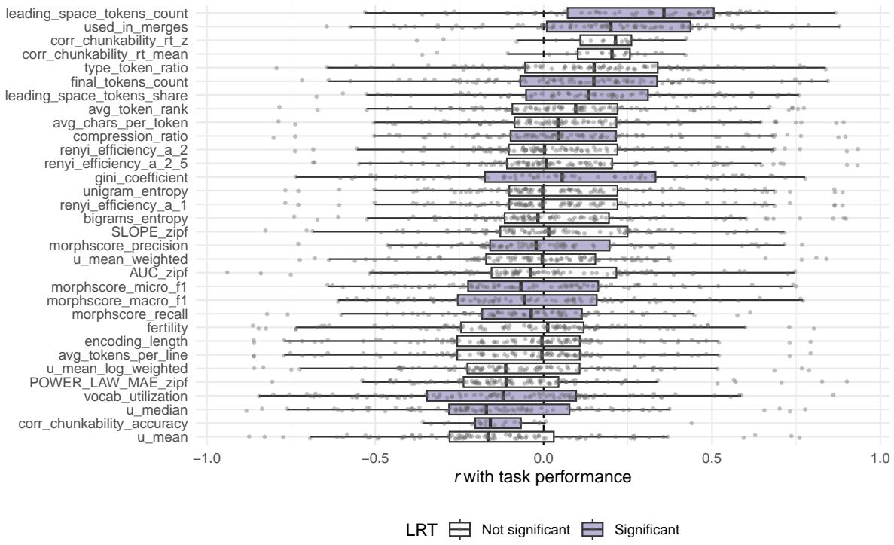  
Figure 1: Each row represents the distribution of correlation coefficients (x-axis) between a tokenizer metric (y-axis) and individual tasks. The color of the box plot represents whether the overall correlation between the tokenizer metric and aggregate performance is significant.

VISTA models. The VISTA models also exhibit differences in performance depending on tokenizer, with differences in aggregate performance of 4%- 26%, depending on the language. Unlike the Tok-Suite models, however, we do not find any significant relationship between vocabulary size and model performance $( p \ : = \ : 0 . 4 0 7$ ; results in Appendix D.3.1). One reason for this difference could be that while TokSuite tokenizers differ in many aspects, VISTA tokenizers only differ in vocabulary size.

## 6 No Intrinsic Tokenizer Metric Reliably Predicts Downstream Performance

Analysis method. To answer this question, we test for a correlation between model performance and individual intrinsic tokenizer metrics, following Ali et al. (2024). In the main analysis, we test correlation with task performance, which we normalized by first z-scoring the accuracy scores within each language-task combination (e.g. the Turkish subset of Global MMLU). We test for a correlation across all task scores. We report all correlations between individual metrics and tasks in Appendix E.

We find that for several of the tasks that we evaluate our models on, a large number of models perform at- or near-chance, especially the smaller models. We conduct an additional analysis after excluding these tasks, which we describe in Appendix F. The results are qualitatively the same.

Main results. We find that 13 of the 29 tokenizer metrics are significantly correlated with z-scored model performance, across all tasks, languages, and model suites. The metrics with the strongest correlations are leading\_space\_tokens\_count $( r = 0 . 2 7 , p <$ $0 . 0 0 1 ) ^ { 9 }$ , used\_in\_merges (r = 0.24, p < 0.001), and leading\_space\_tokens\_share (r = 0.22, $p < 0 . 0 0 1 )$ . These are relatively weak correlations.

We found that each metric had a wide range of correlation strengths and directions across all tasks and languages. While there are instances where there are strong correlations between a metric and an individual task, no patterns hold across all languages, tasks, and model suites. In Figure 1, we plot the distribution of correlations between each tokenizer metric and individual tasks. We note that almost all tokenizer metrics (including the three metrics with the strongest overall correlations) have at least one task for which there is a moderate $( r > 0 . 5 )$ positive correlation and another task for which there is a moderate negative correlation. Not only do the magnitude of the correlations vary by task, but also the direction.

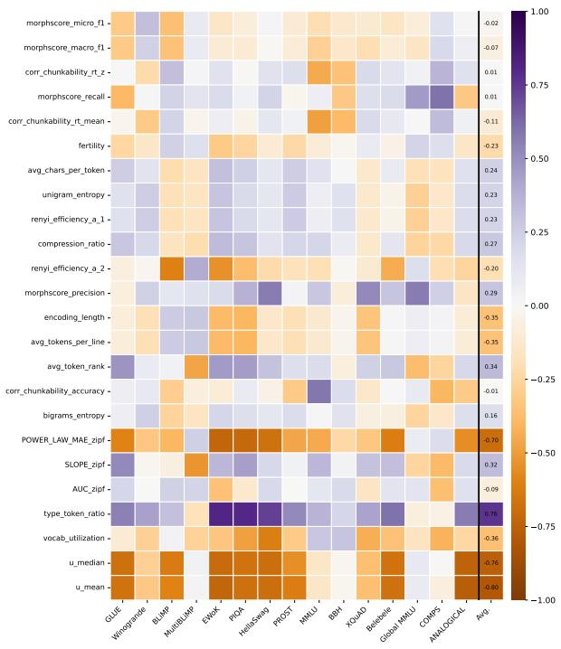  
(a) TokSuite

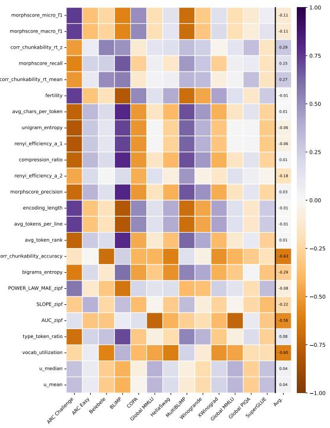  
(b) VISTA  
Figure 2: Correlations between intrinsic metric and English model performance for two model suites, including aggregated performance (Avg.). The color of each cell corresponds to direction of correlation and the shade corresponds to the strength. Results for other languages are reported in Appendix E.

We test how much of the variance can be accounted for simply by model size (in number of total parameters), and find that while for 23 of the metrics, it significantly improves model fit for a linear regression above and beyond model size, the maximum increased variance explained is negligible $( R ^ { 2 } = 0 . 0 2 1 , p < 0 . 0 0 1 )$ . The full results of this analysis can be found in Table 27

If we look at the correlations between metrics and tasks within a single language and a single model suite, there are some trends. Figure 2 shows the correlations between each tokenizer metric and both individual and aggregated English tasks for the TokSuite and English VISTA models. For example, U-statistic metrics are strongly positively correlated with downstream performance in English for the TokSuite models across most tasks.

Comparing within model suite but across languages (cf. Figure 2, left, and Figure 3), the strength of the correlations varies greatly but the direction of the correlation largely holds in aggregate. Considering individual tasks, the correlations are not consitent. For example SLOPE\_zipf is positively correlated with MultiBLiMP in English, but negatively correlated in Italian for the TokSuite models. Comparing across model suites, the correlations can change again, e.g. SLOPE\_zipf is negatively correlated with MultiBLiMP in English with the VISTA models (Figure 2, right). This supports the aggregate analysis that the correlations are unstable across models, tasks, and languages.

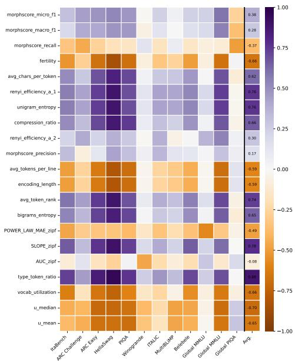  
Figure 3: Correlation between each tokenizer metric and the Italian downstream evaluations, individually and in aggregate (Avg.) for the TokSuite models.

We report the by-language, by-task correlations for each model suite in Figures 8, 9, and 10 in the Appendix.

## 6.1 U-statistic

Among TokSuite models, u\_mean and u\_median are the top-correlated metrics with aggregate English and Turkish performance (Figure 2 and Figure 8c), outperforming all previously proposed intrinsic metrics. For TIMTC, boundary statistics remain among the more strongly correlated metrics, though with weaker effect sizes. However, for VISTA, U-statistics show almost no relationship with performance. All three suites control for architecture, yet the U-statistic’s predictive power varies substantially across them, suggesting that the relationship between linguistic alignment and downstream performance depends on other properties of training.

The metric is also language-dependent (Table 1). Alphabetic languages cluster around u¯ ≈ 2.4, while Chinese and Farsi are ∼2.7× higher $( \bar { u } \approx 6 . 4 )$ and show no correlation with performance. Decomposing the U-statistic into its components explains this gap. The $\mathrm { P M I } _ { \operatorname* { m i n } }$ component varies more across languages than across tokenizers: cross-tokenizer standard deviations are small across all languages (0.09–0.34), but the mean values diverge sharply, alphabetic languages have negative $\mathrm { P M I _ { m i n } ~ ( - 1 . 0 6 ~ t o ~ - 1 . 7 0 ) }$ , while Farsi and Chinese have positive $\mathrm { P M I } _ { \operatorname* { m i n } }$ (3.09 and 1.93). In alphabetic scripts, most adjacent character pairs within tokens have moderate cohesion, so the $\mathrm { P M I } _ { \operatorname* { m i n } }$ bottleneck is sensitive to tokenization quality: a bad split produces a low-PMI pair that drags the score down. In Chinese, characters are meaning-bearing units that combine productively, yielding uniformly high character-pair PMI; the bottleneck rarely binds, so all tokenizers score similarly. Boundary entropy (BE) is more variable across tokenizers (std 0.26–0.50). Hu et al. (2025) originally developed these signals for Chinese pre-tokenization, where local contrasts in PMI and entropy effectively identify word boundaries, but aggregated across a tokenizer’s full vocabulary, these contrasts wash out. Token frequencies-weighted variants (u\_mean\_weighted, u\_mean\_log\_weighted) do not resolve this, as the issue lies in the underlying character statistics rather than the aggregation; language-specific tuning of λ could help if the two components degrade unevenly across scripts, but we leave this to future work.

Table 1: U-statistic components by language for the TokSuite models (mean and std across the 13 TokSuite tokenizers, excluding $\mathrm { B y T 5 , }$ , whose byte-level vocabulary has no character statistics). $\mathrm { P M I } _ { \operatorname* { m i n } }$ shows minimal cross-tokenizer variation, especially for Chinese (std 0.09), confirming it reflects script properties rather than tokenizer quality.
<table><tr><td>Language</td><td> $\mathbf { P M } _ { \operatorname* { m i n } { \mathbf { \theta } } } ( \mathbf { s t d } )$ </td><td>BE (std)</td><td>ū</td></tr><tr><td>English Italian</td><td>-1.06 (0.22) −1.42 (0.20)</td><td>0.77 (0.30) 0.81 (0.26)</td><td>2.44 2.42</td></tr><tr><td>Turkish</td><td>−1.70 (0.21)</td><td>0.84 (0.30)</td><td>2.35</td></tr><tr><td>Farsi</td><td>3.09 (0.34)</td><td>0.76 (0.41)</td><td>6.31</td></tr><tr><td>Chinese</td><td>1.93 (0.09)</td><td>1.11 (0.50)</td><td>6.51</td></tr></table>

The U-statistic captures a complementary dimension of morphological alignment, whether tokens correspond to coherent character sequences with natural boundaries, using only unsupervised character statistics, without requiring morphological annotations. In settings where it has discriminative power, it outperforms previously proposed metrics. However, its predictive power varies across model suites and breaks down for writing systems where character-level co-occurrence statistics lack the structure the metric relies on. These results suggest that linguistically grounded metrics are a promising direction for tokenizer evaluation, but that their effectiveness is likely to depend on model family and language.

## 6.2 Summary

Together these results show the lack of consistency of the tokenizer metrics to reliably predict model performance across different model suites, tasks, and languages. Because the results are not only different between languages but also between models, we argue that none of the intrinsic tokenizer evaluations is able to reliably predict model performance.

## 7 Combining Metrics Does Not Improve Prediction

Here we ask whether combining multiple metrics can better predict downstream performance. We find that many of the metrics are correlated with each other, which suggests that many of the metrics may be identifying similar or related tokenizer features. We test whether any combination of metrics better predicts performance across all languages. We fit linear regressions with all combinations of two metrics. We find that although combinations significantly improve model fit, the joint $\mathbb { R } ^ { 2 }$ never exceeds 0.09, and the gain in $\mathbf { R } ^ { 2 }$ never exceeds 0.01. Therefore, combining two intrinsic tokenizer evaluations does not seem to meaningfully help predict model performance. Additional results and statistical tests are reported in Appendix E.2.

## 8 Orthographic Tasks Are Weak Predictors

Here we analyze whether there is a relationship between orthographic tasks and general model performance. In this analysis, we focus on the TokSuite models, as the other models achieve near-zero performance at most of these tasks. We test whether the orthographic tasks are correlated with any of the downstream tasks or aggregated model performance. Only TokSuite (English) shows a significant correlation with downstream task performance $( r = 0 . 3 4 1 , p = 0 . 0 2 9 )$ , though the correlation is relatively weak. The other tasks are all not significantly correlated. We report the results in Appendix E.1. These results call into question whether these tasks should be used to shape tokenizer selection and design.

## 9 Discussion

Lack of Robust Correlations. While some tokenizer metrics correlate with individual tasks for some models, there is no clear pattern. We demonstrated that tokenizers affect model performance (Section 5), but none of the proposed tokenizer evaluations correlates with performance. We find that using two metrics instead of one does not improve predictive power. Based on these results, we would predict that testing for a correlation between a tokenizer metric and performance on a small number of tasks—especially in a single language or in one family of models—may often result in a significant result. However, our analysis suggests that those results are unlikely to generalize to additional tasks, languages, and model families.

The current approach to intrinsic tokenizer evaluation currently does not allow us to determine which tokenizer will result in a better model. More work is needed to be able to determine what an optimal tokenizer looks like and how to identify it.

Different Approaches To Tokenizer Evaluation. We have focused on the impact of tokenization on model performance. There are other ways in which tokenizers affect language models. Tokenizers in part determine the speed and cost of model training (Ahia et al., 2023; Petrov et al., 2023; Dagan et al., 2024; Ali et al., 2024; Asgari et al., 2025), because they determine how many computations are needed for a model to process a given text. Therefore compression may be a useful metric, even if it does not correlate with downstream performance. Relatedly, tokenizer evaluation could help identify unused or under-used tokens in the vocabulary that may lead to undertrained tokens and subsequently undesirable model behavior (Land and Bartolo, 2024).

Another dimension is multilingual parity. Ideally, tokenizers can contribute to more balanced multilingual performance (Petrov et al., 2023; Ahia et al., 2023). By better understanding how tokenization impacts languages differently (e.g. Arnett et al., 2025a), we can find ways to develop more balanced tokenizers (e.g. Limisiewicz et al., 2024; Foroutan et al., 2026).

The Impact of Tokenizer Design Decisions. We do not exhaustively analyze the effect of different tokenizer design decisions, but we do discuss the effect of vocabulary size in Section 5. Vocabulary size is one of the parameters that can be set for a tokenizer, but which is usually chosen with little rationale (Alqahtani et al., 2026). Tao et al. (2024) find that most model scales benefit from increased vocabulary, suggesting a bigger-is-better principle for vocabulary size. However, for the small models used in this study, at a scale where changes in vocabulary size have a large proportional impact on the number of trainable parameters, we do not find a robust effect across our model suites. Alongside developing better tokenizer evaluations, we need to develop a better understanding of how different design decisions impact model performance.

## 10 Conclusion

We have conducted, to the best of our knowledge, the most comprehensive study about the relationship between intrinsic tokenizer metrics and downstream model performance. We find that none of these intrinsic measures reliably predicts model performance and we call for a novel approach to

tokenizer evaluation.

## Limitations

Each of the model suites we use has its own limitations. TokSuite was trained on tokenizers from existing models, which vary in a number of dimensions: each was trained on a different mix of data, the tokenizers vary in vocabulary size, and many aspects of the tokenization algorithm are different including pretokenization and normalization. Therefore in our analyses, we are unable to completely account for each of these variables which may influence the resulting model’s performance. The TIMTC models include only models trained on English, therefore we are unable to determine to what extent any patterns may generalize to other languages. Finally, the VISTA models are trained in a controlled way and are trained for multiple languages. However, they are much smaller than the models in the other suites. None of these model suites is able to definitively address the research questions because of these limitations. However, putting these models together and comparing across suites helps us to address some of the weaknesses of the models.

In our study, we studied models of a variety of sizes, including models up to 1B parameters. That said, our smaller models are generally not very strong. They achieved near-chance performance at several tasks. Analyzing models with poor performance may not provide the same signal as larger models trained on more tokens may provide. We address the effects of poor task performance on our results in Appendix F. Additionally, we highlight that small differences in performance at smaller scales still represent differences in performance that intrinsic tokenizer evaluation should seek to predict and explain.

The benchmarks we used to evaluate model performance varied across languages. Some languages had more available benchmarks than others, and these benchmarks vary in size and quality. Additionally, some of the intrinsic tokenizer evaluations relied on annotated data. The chunkability data from Beinborn and Pinter (2023) is only available in English. There is also not sufficient labeled data to calculate MorphScore for Vietnamese. The lack of evaluations in languages other than English is a widespread issue in the field and limits our analyses.

## Acknowledgements

We thank the Center for Integrated Research Computing (CIRC) at the University of Rochester and CoreWeave for providing the computational resources used in this work. We would like to thank Craig Schmidt for making the TIMTC model checkpoints freely available and for his assistance in setting up the PathPiece library.

## Ethical Considerations

This work aims to improve the understanding of the impact of tokenization across multiple settings, including multiple languages. We are not aware of any potential risks or negative impacts of this work. In fact, we hope this work improves the understanding of how design decisions may not affect all languages equally.

## References

Julien Abadji, Pedro Ortiz Suarez, Laurent Romary, and Benoît Sagot. 2022. Towards a cleaner documentoriented multilingual crawled corpus. In Proceedings of the Thirteenth Language Resources and Evaluation Conference, pages 4344–4355, Marseille, France. European Language Resources Association.

Orevaoghene Ahia, Sachin Kumar, Hila Gonen, Jungo Kasai, David Mortensen, Noah Smith, and Yulia Tsvetkov. 2023. Do All Languages Cost the Same? Tokenization in the Era of Commercial Language Models. In Proceedings ofthe 2023 Conference on Empirical Methods in Natural Language Processing, pages 9904–9923, Singapore. Association for Computational Linguistics.

Mehdi Ali, Michael Fromm, Klaudia Thellmann, Richard Rutmann, Max Lübbering, Johannes Leveling, Katrin Klug, Jan Ebert, Niclas Doll, Jasper Buschhoff, Charvi Jain, Alexander Weber, Lena Jurkschat, Hammam Abdelwahab, Chelsea John, Pedro Ortiz Suarez, Malte Ostendorff, Samuel Weinbach, Rafet Sifa, and 2 others. 2024. Tokenizer Choice For LLM Training: Negligible or Crucial? In Findings of the Association for Computational Linguistics: NAACL 2024, pages 3907–3924, Mexico City, Mexico. Association for Computational Linguistics.

Sawsan Alqahtani, Mir Tafseer Nayeem, Md Tahmid Rahman Laskar, Tasnim Mohiuddin, and M Saiful Bari. 2026. Stop Taking Tokenizers for Granted: They Are Core Design Decisions in Large Language Models. arXiv preprint arXiv:2601.13260.

Gül Sena Altınta¸s, Malikeh Ehghaghi, Brian Lester, Fengyuan Liu, Wanru Zhao, Marco Ciccone, and Colin Raffel. 2025. TokSuite: Measuring the Impact of Tokenizer Choice on Language Model Behavior.

arXiv preprint arXiv:2512.20757. Under review at ICLR 2026.

Hossein Amirkhani, Mohammad AzariJafari, Zohreh Pourjafari, Soroush Faridan-Jahromi, Zeinab Kouhkan, and Azadeh Amirak. 2020. FarsTail: A Persian Natural Language Inference Dataset. arXiv preprint arXiv:2009.08820.

Catherine Arnett and Benjamin Bergen. 2025. Why do language models perform worse for morphologically complex languages? In Proceedings ofthe 31st International Conference on Computational Linguistics, pages 6607–6623, Abu Dhabi, UAE. Association for Computational Linguistics.

Catherine Arnett, Tyler A. Chang, and Benjamin Bergen. 2024a. A bit of a problem: Measurement disparities in dataset sizes across languages. In Proceedings of the 3rd Annual Meeting ofthe Special Interest Group on Under-resourced Languages @ LREC-COLING 2024, pages 1–9, Torino, Italia. ELRA and ICCL.

Catherine Arnett, Tyler A. Chang, Stella Biderman, and Benjamin K. Bergen. 2025a. Explaining and mitigating crosslingual tokenizer inequities. In Proceedings of the Thirty-Ninth Annual Conference on Neural Information Processing Systems (NeurIPS).

Catherine Arnett, Marisa Hudspeth, and Brendan O’Connor. 2025b. Evaluating morphological alignment of tokenizers in 70 languages. In Proceedings of the ICML 2025 Workshop on Tokenization (Tok-Shop).

Catherine Arnett, Pamela D. Rivière, Tyler A. Chang, and Sean Trott. 2024b. Different tokenization schemes lead to comparable performance in Spanish number agreement. In Proceedings ofthe 21st SIG-MORPHON workshop on Computational Research in Phonetics, Phonology, and Morphology, pages 32–38, Mexico City, Mexico. Association for Computational Linguistics.

Stéphane Aroca-Ouellette, Cory Paik, Alessandro Roncone, and Katharina Kann. 2021. PROST: Physical reasoning about objects through space and time. In Findings of the Association for Computational Linguistics: ACL-IJCNLP 2021, pages 4597–4608, Online. Association for Computational Linguistics.

Mikel Artetxe, Sebastian Ruder, and Dani Yogatama. 2020. On the Cross-lingual Transferability of Monolingual Representations. In Proceedings of the 58th Annual Meeting of the Association for Computational Linguistics, pages 4623–4637, Online. Association for Computational Linguistics.

Ehsaneddin Asgari, Yassine El Kheir, and Mohammad Ali Sadraei Javaheri. 2025. MorphBPE: A Morpho-Aware Tokenizer Bridging Linguistic Complexity for Efficient LLM Training Across Morphologies. arXiv preprint arXiv:2502.00894.

Sajjad Ayoubi and Mohammad Yasin Davoodeh. 2021. PersianQA: a dataset for Persian Question Answering. https://github.com/SajjjadAyobi/PersianQA.

Lucas Bandarkar, Davis Liang, Benjamin Muller, Mikel Artetxe, Satya Narayan Shukla, Donald Husa, Naman Goyal, Abhinandan Krishnan, Luke Zettlemoyer, and Madian Khabsa. 2024. The Belebele Benchmark: a Parallel Reading Comprehension Dataset in 122 Language Variants. In Proceedings ofthe 62nd Annual Meeting ofthe Associationfor Computational Linguistics (Volume 1: Long Papers), pages 749–775, Bangkok, Thailand. Association for Computational Linguistics.

Ezgi Ba¸sar, Francesca Padovani, Jaap Jumelet, and Arianna Bisazza. 2025. TurBLiMP: A Turkish benchmark of linguistic minimal pairs. In Proceedings of the 2025 Conference on Empirical Methods in Natural Language Processing, pages 16495–16510, Suzhou, China. Association for Computational Linguistics.

Thomas Bauwens and Pieter Delobelle. 2024. BPEknockout: Pruning Pre-existing BPE Tokenisers with Backwards-compatible Morphological Semisupervision. In Proceedings ofthe 2024 Conference ofthe North American Chapter ofthe Associationfor Computational Linguistics: Human Language Technologies (Volume 1: Long Papers), pages 5810–5832, Mexico City, Mexico. Association for Computational Linguistics.

Lisa Beinborn and Yuval Pinter. 2023. Analyzing cognitive plausibility of subword tokenization. In Proceedings ofthe 2023 Conference on Empirical Methods in Natural Language Processing, pages 4478–4486, Singapore. Association for Computational Linguistics.

Stella Biderman, Hailey Schoelkopf, Lintang Sutawika, Leo Gao, Jonathan Tow, Baber Abbasi, Alham Fikri Aji, Pawan Sasanka Ammanamanchi, Sidney Black, Jordan Clive, and 1 others. 2024. Lessons from the trenches on reproducible evaluation of language models. arXiv preprint arXiv:2405.14782.

Yonatan Bisk, Rowan Zellers, Ronan Le Bras, Jianfeng Gao, and Yejin Choi. 2020. PIQA: Reasoning about physical commonsense in natural language. In Proceedings of the AAAI Conference on Artificial Intelligence, volume 34, pages 7432–7439. AAAI Press.

Kaj Bostrom and Greg Durrett. 2020. Byte pair encoding is suboptimal for language model pretraining. In Findings ofthe Associationfor Computational Linguistics: EMNLP 2020, pages 4617–4624, Online. Association for Computational Linguistics.

Emrah Budur, Rıza Özçelik, Tunga Gungor, and Christopher Potts. 2020. Data and Representation for Turkish Natural Language Inference. In Proceedings of the 2020 Conference on Empirical Methods in Natural Language Processing (EMNLP), pages 8253– 8267, Online. Association for Computational Linguistics.

Tyler A. Chang, Catherine Arnett, Zhuowen Tu, and Benjamin K. Bergen. 2026. Goldfish: Monolingual

language models for 350 languages. In Proceedings of the 15th Language Resources and Evaluation Conference (LREC).

Tyler A. Chang, Catherine Arnett, and 1 others. 2025. Global PIQA: Evaluating Physical Commonsense Reasoning Across 100+ Languages and Cultures. Preprint, arXiv:2510.24081.

Sanghyun Choo and Wonjoon Kim. 2023. A study on the evaluation of tokenizer performance in natural language processing. Applied Artificial Intelligence, 37(1):2175112.

Peter Clark, Isaac Cowhey, Oren Etzioni, Tushar Khot, Ashish Sabharwal, Carissa Schoenick, and Oyvind Tafjord. 2018. Think you have Solved Question Answering? Try ARC, the AI2 Reasoning Challenge. arXiv:1803.05457v1.

Aaron Clauset, Cosma Rohilla Shalizi, and M. E. J. Newman. 2009. Power-law distributions in empirical data. SIAM Review, 51(4):661–703.

Marco Cognetta, Vilém Zouhar, Sangwhan Moon, and Naoaki Okazaki. 2024. Two Counterexamples to Tokenization and the Noiseless Channel. In Proceedings of the 2024 Joint International Conference on Computational Linguistics, Language Resources and Evaluation (LREC-COLING 2024), pages 16897– 16906, Torino, Italia. ELRA and ICCL.

Alexis Conneau, Ruty Rinott, Guillaume Lample, Adina Williams, Samuel Bowman, Holger Schwenk, and Veselin Stoyanov. 2018. XNLI: Evaluating Crosslingual Sentence Representations. In Proceedings of the 2018 Conference on Empirical Methods in Natural Language Processing, pages 2475–2485, Brussels, Belgium. Association for Computational Linguistics.

Adrian Cosma, Stefan Ruseti, Emilian Radoi, and Mihai Dascalu. 2025. The Strawberry Problem: Emergence of Character-level Understanding in Tokenized Language Models. In Proceedings ofthe 2025 Conference on Empirical Methods in Natural Language Processing, pages 28252–28263, Suzhou, China. Association for Computational Linguistics.

Gautier Dagan, Gabriel Synnaeve, and Baptiste Rozière. 2024. Getting the Most out of Your Tokenizer for Pre-Training and Domain Adaptation. In Proceedings of the 41st International Conference on Machine Learning, volume 235 of Proceedings of Machine Learning Research, pages 9784–9805. PMLR.

Grégoire Delétang, Anian Ruoss, Paul-Ambroise Duquenne, Elliot Catt, Tim Genewein, Christopher Mattern, Jordi Grau-Moya, Li Kevin Wenliang, Matthew Aitchison, Laurent Orseau, Marcus Hutter, and Joel Veness. 2024. Language Modeling Is Compression. In The Twelfth International Conference on Learning Representations (ICLR).

Lukas Edman, Helmut Schmid, and Alexander Fraser. 2024. CUTE: Measuring LLMs’ Understanding of

Their Tokens. In Proceedings of the 2024 Conference on Empirical Methods in Natural Language Processing, pages 3017–3026, Miami, Florida, USA. Association for Computational Linguistics.

Lukas Edman, Helmut Schmid, and Alexander Fraser. 2025. EXECUTE: A Multilingual Benchmark for LLM Token Understanding. In Findings of the Associationfor Computational Linguistics: ACL 2025, pages 1878–1887, Vienna, Austria. Association for Computational Linguistics.

Avia Efrat, Or Honovich, and Omer Levy. 2023. LMentry: A Language Model Benchmark of Elementary Language Tasks. In Findings ofthe Associationfor Computational Linguistics: ACL 2023, pages 10476– 10501, Toronto, Canada. Association for Computational Linguistics.

Farhan Farsi, Sadra Sabouri, Kian Kashfipour, Soroush Gooran, Hossein Sameti, and Ehsaneddin Asgari. 2024. SynTran-fa: Generating Comprehensive Answers for Farsi QA Pairs via Syntactic Transformation. Preprint.

Negar Foroutan, Clara Meister, Debjit Paul, Joel Niklaus, Sina Ahmadi, Antoine Bosselut, and Rico Sennrich. 2026. Parity-aware byte-pair encoding: Improving cross-lingual fairness in tokenization. In Proceedings ofthe 64th Annual Meeting ofthe Associationfor Computational Linguistics (Volume 1: Long Papers), pages 7514–7538. Association for Computational Linguistics.

Matthias Gallé. 2019. Investigating the Effectiveness of BPE: The Power of Shorter Sequences. In Proceedings ofthe 2019 Conference on Empirical Methods in Natural Language Processing and the 9th International Joint Conference on Natural Language Processing (EMNLP-IJCNLP), pages 1375–1381, Hong Kong, China. Association for Computational Linguistics.

Leo Gao, Jonathan Tow, Baber Abbasi, Stella Biderman, Sid Black, Anthony DiPofi, Charles Foster, Laurence Golding, Jeffrey Hsu, Alain Le Noac’h, Haonan Li, Kyle McDonell, Niklas Muennighoff, Chris Ociepa, Jason Phang, Laria Reynolds, Hailey Schoelkopf, Aviya Skowron, Lintang Sutawika, and 5 others. 2024. The Language Model Evaluation Harness.

Omer Goldman, Avi Caciularu, Matan Eyal, Kris Cao, Idan Szpektor, and Reut Tsarfaty. 2024. Unpacking Tokenization: Evaluating Text Compression and its Correlation with Model Performance. In Findings of the Associationfor Computational Linguistics: ACL 2024, pages 2274–2286, Bangkok, Thailand. Association for Computational Linguistics.

Edward Gow-Smith, Harish Tayyar Madabushi, Carolina Scarton, and Aline Villavicencio. 2022. Improving Tokenisation by Alternative Treatment of Spaces. In Proceedings of the 2022 Conference on Empirical Methods in Natural Language Processing,

pages 11430–11443, Abu Dhabi, United Arab Emirates. Association for Computational Linguistics.

Zellig S Harris. 1955. From phoneme to morpheme. Language, 31(2):190–222.

Linyang He, Ercong Nie, Sukru Samet Dindar, Arsalan Firoozi, Adrian Florea, Van Nguyen, Corentin Puffay, Riki Shimizu, Haotian Ye, Jonathan Brennan, Helmut Schmid, Hinrich Schütze, and Nima Mesgarani. 2025. XCOMPS: A Multilingual Benchmark of Conceptual Minimal Pairs. In Proceedings ofthe 7th Workshop on Research in Computational Linguistic Typology and Multilingual NLP (SIGTYP 2025), pages 75–81, Vienna, Austria. Association for Computational Linguistics.

Dan Hendrycks, Collin Burns, Steven Basart, Andy Zou, Mantas Mazeika, Dawn Song, and Jacob Steinhardt. 2021. Measuring Massive Multitask Language Understanding. In The Ninth International Conference on Learning Representations (ICLR). ArXiv:2009.03300.

Jordan Hoffmann, Sebastian Borgeaud, Arthur Mensch, Elena Buchatskaya, Trevor Cai, Eliza Rutherford, Diego de Las Casas, Lisa Anne Hendricks, Johannes Welbl, Aidan Clark, and 1 others. 2022. Training compute-optimal large language models. arXiv preprint arXiv:2203.15556.

Valentin Hofmann, Janet Pierrehumbert, and Hinrich Schütze. 2020. DagoBERT: Generating Derivational Morphology with a Pretrained Language Model. In Proceedings of the 2020 Conference on Empirical Methods in Natural Language Processing (EMNLP), pages 3848–3861, Online. Association for Computational Linguistics.

Valentin Hofmann, Janet Pierrehumbert, and Hinrich Schütze. 2021. Superbizarre Is Not Superb: Derivational Morphology Improves BERT’s Interpretation of Complex Words. In Proceedings ofthe 59th Annual Meeting of the Association for Computational Linguistics and the 11th International Joint Conference on Natural Language Processing (Volume 1: Long Papers), pages 3594–3608, Online. Association for Computational Linguistics.

Yifan Hu, Ningyue Liang, Dachuan Zhao, Jonathan Geuter, Varshini Reddy, Craig W Schmidt, and Chris Tanner. 2025. Entropy-Driven Pre-Tokenization for Byte-Pair Encoding. In Tokenization Workshop.

Dieuwke Hupkes and Nikolay Bogoychev. 2025. MultiLoKo: A Multilingual Local Knowledge Benchmark for LLMs Spanning 31 Languages. Preprint, arXiv:2504.10356.

Anna A. Ivanova, Aalok Sathe, Benjamin Lipkin, Unnathi Kumar, Setayesh Radkani, Thomas H. Clark, Carina Kauf, Jennifer Hu, R.T. Pramod, Gabriel Grand, Vivian Paulun, Maria Ryskina, Ekin Akyürek, Ethan Wilcox, Nafisa Rashid, Leshem Choshen, Roger Levy, Evelina Fedorenko, Joshua Tenenbaum,

and Jacob Andreas. 2025. Elements of World Knowledge (EWoK): A Cognition-Inspired Framework for Evaluating Basic World Knowledge in Language Models. Transactions ofthe Associationfor Computational Linguistics, 13:1245–1270.

Zhihui Jin and Kumiko Tanaka-Ishii. 2006. Unsupervised Segmentation of Chinese Text by Use of Branching Entropy. In Proceedings of the COL-ING/ACL 2006 Main Conference Poster Sessions, pages 428–435, Sydney, Australia. Association for Computational Linguistics.

Jaap Jumelet, Leonie Weissweiler, Joakim Nivre, and Arianna Bisazza. 2026. MultiBLiMP 1.0: A massively multilingual benchmark of linguistic minimal pairs. Transactions ofthe Associationfor Computational Linguistics, 14:193–216.

Emmanuel Keuleers, Paula Lacey, Kathleen Rastle, and Marc Brysbaert. 2012. The British Lexicon Project: Lexical decision data for 28,730 monosyllabic and disyllabic English words. Behavior Research Methods, 44(1):287–304.

Stav Klein and Reut Tsarfaty. 2020. Getting the ##life out of living: How Adequate Are Word-Pieces for Modelling Complex Morphology? In Proceedings ofthe 17th SIGMORPHON Workshop on Computational Research in Phonetics, Phonology, and Morphology, pages 204–209, Online. Association for Computational Linguistics.

Sander Land and Max Bartolo. 2024. Fishing for Magikarp: Automatically Detecting Under-trained Tokens in Large Language Models. In Proceedings of the 2024 Conference on Empirical Methods in Natural Language Processing, pages 11631–11646, Miami, Florida, USA. Association for Computational Linguistics.

Haonan Li, Yixuan Zhang, Fajri Koto, Yifei Yang, Hai Zhao, Yeyun Gong, Nan Duan, and Timothy Baldwin. 2024. CMMLU: Measuring Massive Multitask Language Understanding in Chinese. In Findings of the Associationfor Computational Linguistics: ACL 2024, pages 11260–11285, Bangkok, Thailand. Association for Computational Linguistics.

Jindˇrich Libovický and Jindˇrich Helcl. 2024. Lexically Grounded Subword Segmentation. In Proceedings of the 2024 Conference on Empirical Methods in Natural Language Processing, pages 7403–7420, Miami, Florida, USA. Association for Computational Linguistics.

Tomasz Limisiewicz, Jiˇrí Balhar, and David Marecek.ˇ 2023. Tokenization Impacts Multilingual Language Modeling: Assessing Vocabulary Allocation and Overlap Across Languages. In Findings of the Associationfor Computational Linguistics: ACL 2023, pages 5661–5681, Toronto, Canada. Association for Computational Linguistics.

Tomasz Limisiewicz, Terra Blevins, Hila Gonen, Orevaoghene Ahia, and Luke Zettlemoyer. 2024. MYTE:

Morphology-Driven Byte Encoding for Better and Fairer Multilingual Language Modeling. In Proceedings ofthe 62nd Annual Meeting ofthe Association for Computational Linguistics (Volume 1: Long Papers), pages 15059–15076, Bangkok, Thailand. Association for Computational Linguistics.

Xi Victoria Lin, Todor Mihaylov, Mikel Artetxe, Tianlu Wang, Shuohui Chen, Daniel Simig, Myle Ott, Naman Goyal, Shruti Bhosale, Jingfei Du, Ramakanth Pasunuru, Sam Shleifer, Punit Singh Koura, Vishrav Chaudhary, Brian O’Horo, Jeff Wang, Luke Zettlemoyer, Zornitsa Kozareva, Mona Diab, and 2 others. 2022. Few-shot learning with multilingual generative language models. In Proceedings ofthe 2022 Conference on Empirical Methods in Natural Language Processing, pages 9019–9052, Abu Dhabi, United Arab Emirates. Association for Computational Linguistics.

Alisa Liu, Jonathan Hayase, Valentin Hofmann, Sewoong Oh, Noah A. Smith, and Yejin Choi. 2025. SuperBPE: Space Travel for Language Models. In Proceedings ofthe Conference on Language Modeling (COLM).

Yikang Liu, Yeting Shen, Hongao Zhu, Lilong Xu, Zhiheng Qian, Siyuan Song, Kejia Zhang, Jialong Tang, Pei Zhang, Baosong Yang, Rui Wang, and Hai Hu. 2024. ZhoBLiMP: A Systematic Assessment of Language Models with Linguistic Minimal Pairs in Chinese. Preprint, arXiv:2411.06096.

Jonas F. Lotz, António V. Lopes, Stephan Peitz, Hendra Setiawan, and Leonardo Emili. 2025. Beyond Text Compression: Evaluating Tokenizers Across Scales. In Proceedings of the 63rd Annual Meeting of the Association for Computational Linguistics (Volume 1: Long Papers), pages 32155–32173, Vienna, Austria. Association for Computational Linguistics.

Dominik Machácek, Jonáš Vidra, and Ond ˇ ˇrej Bojar. 2018. Morphological and Language-Agnostic Word Segmentation for NMT. In Text, Speech, and Dialogue, pages 277–284, Cham. Springer International Publishing.

Clara Meister. 2026. TokEval: A Tokenizer Evaluation Suite. Preprint, arXiv:2608.18062.

Kanishka Misra, Julia Rayz, and Allyson Ettinger. 2023. COMPS: Conceptual Minimal Pair Sentences for testing Robust Property Knowledge and its Inheritance in Pre-trained Language Models. In Proceedings ofthe 17th Conference ofthe European Chapter ofthe Associationfor Computational Linguistics, pages 2928– 2949, Dubrovnik, Croatia. Association for Computational Linguistics.

Luca Moroni, Simone Conia, Federico Martelli, and Roberto Navigli. 2024. Towards a more comprehensive evaluation for Italian LLMs. In Proceedings of the Tenth Italian Conference on Computational Linguistics (CLiC-it 2024), pages 584–599, Pisa, Italy. CEUR Workshop Proceedings.

Mosaic Research. 2023. Introducing MPT-7B: A New Standard for Open-Source, Commercially Usable LLMs. Accessed: 2026-01-28.

Niklas Muennighoff, Alexander Rush, Boaz Barak, Teven Le Scao, Nouamane Tazi, Aleksandra Piktus, Sampo Pyysalo, Thomas Wolf, and Colin A. Raffel. 2023. Scaling Data-Constrained Language Models. In Advances in Neural Information Processing Systems, volume 36, pages 50358–50376. Curran Associates, Inc.

NLLB Team, Marta R. Costa-jussà, James Cross, Onur Çelebi, Maha Elbayad, Kenneth Heafield, Kevin Heffernan, Elahe Kalbassi, Janice Lam, Daniel Licht, Jean Maillard, Anna Sun, Skyler Wang, Guillaume Wenzek, Al Youngblood, Bapi Akula, Loïc Barrault, Gabriel Mejia Gonzalez, Prangthip Hansanti, and 20 others. 2022. No Language Left Behind: Scaling Human-Centered Machine Translation. Preprint, arXiv:2207.04672.

Antoine Nzeyimana and Andre Niyongabo Rubungo. 2022. KinyaBERT: a Morphology-aware Kinyarwanda Language Model. In Proceedings of the 60th Annual Meeting ofthe Associationfor Computational Linguistics (Volume 1: Long Papers), pages 5347–5363, Dublin, Ireland. Association for Computational Linguistics.

Artidoro Pagnoni, Ramakanth Pasunuru, Pedro Rodriguez, John Nguyen, Benjamin Muller, Margaret Li, Chunting Zhou, Lili Yu, Jason E Weston, Luke Zettlemoyer, Gargi Ghosh, Mike Lewis, Ari Holtzman, and Srini Iyer. 2025. Byte Latent Transformer: Patches Scale Better Than Tokens. In Proceedings of the 63rd Annual Meeting of the Association for Computational Linguistics (Volume 1: Long Papers), pages 9238–9258, Vienna, Austria. Association for Computational Linguistics.

Kyubyong Park, Joohong Lee, Seongbo Jang, and Dawoon Jung. 2020. An Empirical Study of Tokenization Strategies for Various Korean NLP Tasks. In Proceedings ofthe 1st Conference ofthe Asia-Pacific Chapter of the Association for Computational Linguistics and the 10th International Joint Conference on Natural Language Processing, pages 133–142, Suzhou, China. Association for Computational Linguistics.

Guilherme Penedo, Hynek Kydlícek, Loubna Ben al-ˇ lal, Anton Lozhkov, Margaret Mitchell, Colin Raffel, Leandro Von Werra, and Thomas Wolf. 2024. The FineWeb Datasets: Decanting the Web for the Finest Text Data at Scale. In The Thirty-eight Conference on Neural Information Processing Systems Datasets and Benchmarks Track.

Guilherme Penedo, Hynek Kydlícek, Vinko Sabol ˇ cec,ˇ Bettina Messmer, Negar Foroutan, Amir Hossein Kargaran, Colin Raffel, Martin Jaggi, Leandro Von Werra, and Thomas Wolf. 2025. FineWeb2: One Pipeline to Scale Them All—Adapting Pre-Training Data Processing to Every Language. In Proceedings

of the Second Conference on Language Modeling, Montreal, Canada. ArXiv:2506.20920.

Aleksandar Petrov, Emanuele La Malfa, Philip H.S. Torr, and Adel Bibi. 2023. Language Model Tokenizers Introduce Unfairness Between Languages. In Advances in Neural Information Processing Systems, volume 36, pages 36963–36990.

Steven T. Piantadosi. 2014. Zipf’s word frequency law in natural language: A critical review and future directions. Psychonomic Bulletin & Review, 21(5):1112–1130.

Edoardo Maria Ponti, Goran Glavaš, Olga Majewska, Qianchu Liu, Ivan Vulic, and Anna Korhonen. 2020.´ XCOPA: A Multilingual Dataset for Causal Commonsense Reasoning. In Proceedings of the 2020 Conference on Empirical Methods in Natural Language Processing (EMNLP), pages 2362–2376, Online. Association for Computational Linguistics.

Alec Radford, Karthik Narasimhan, Tim Salimans, and Ilya Sutskever. 2018. Improving Language Understanding by Generative Pre-Training. OpenAI Blog.

Angelika Romanou, Negar Foroutan, Anna Sotnikova, Zeming Chen, Sree Harsha Nelaturu, Shivalika Singh, Rishabh Maheshwary, Micol Altomare, Mohamed A. Haggag, A. Snegha, Alfonso Amayuelas, Azril Hafizi Amirudin, Viraat Aryabumi, Danylo Boiko, Michael Chang, Jenny Chim, Gal Cohen, Aditya Kumar Dalmia, Abraham Diress, and 40 others. 2025. IN-CLUDE: Evaluating multilingual language understanding with regional knowledge. In The Thirteenth International Conference on Learning Representations (ICLR).

Phillip Rust, Jonas Pfeiffer, Ivan Vulic, Sebastian Ruder,´ and Iryna Gurevych. 2021. How good is your tokenizer? on the monolingual performance of multilingual language models. In Proceedings of the 59th Annual Meeting ofthe Associationfor Computational Linguistics and the 11th International Joint Conference on Natural Language Processing (Volume 1: Long Papers), pages 3118–3135, Online. Association for Computational Linguistics.

Keisuke Sakaguchi, Ronan Le Bras, Chandra Bhagavatula, and Yejin Choi. 2020. WinoGrande: An Adversarial Winograd Schema Challenge at Scale. In Proceedings of the AAAI Conference on Artificial Intelligence, volume 34, pages 8732–8740. AAAI Press.

Jonne Saleva and Constantine Lignos. 2021. The Effectiveness of Morphology-aware Segmentation in Low-Resource Neural Machine Translation. In Proceedings ofthe 16th Conference ofthe European Chapter ofthe Associationfor Computational Linguistics: Student Research Workshop, pages 164–174, Online. Association for Computational Linguistics.

Craig W Schmidt, Varshini Reddy, Haoran Zhang, Alec Alameddine, Omri Uzan, Yuval Pinter, and Chris

Tanner. 2024. Tokenization Is More Than Compression. In Proceedings of the 2024 Conference on Empirical Methods in Natural Language Processing, pages 678–702, Miami, Florida, USA. Association for Computational Linguistics.

Andrea Seveso, Daniele Potertì, Edoardo Federici, Mario Mezzanzanica, and Fabio Mercorio. 2025. ITALIC: An Italian Culture-Aware Natural Language Benchmark. In Proceedings ofthe 2025 Conference ofthe Nations ofthe Americas Chapter ofthe Associationfor Computational Linguistics: Human Language Technologies (Volume 1: Long Papers), pages 1469–1478, Albuquerque, New Mexico. Association for Computational Linguistics.

Amanda Silberling. 2024. Why AI Can’t Spell ‘Strawberry’. TechCrunch. Accessed: 2026-01-26.

Shivalika Singh, Angelika Romanou, Clémentine Fourrier, David Ifeoluwa Adelani, Jian Gang Ngui, Daniel Vila-Suero, Peerat Limkonchotiwat, Kelly Marchisio, Wei Qi Leong, Yosephine Susanto, Raymond Ng, Shayne Longpre, Sebastian Ruder, Wei-Yin Ko, Antoine Bosselut, Alice Oh, Andre Martins, Leshem Choshen, Daphne Ippolito, and 4 others. 2025. Global MMLU: Understanding and Addressing Cultural and Linguistic Biases in Multilingual Evaluation. In Proceedings ofthe 63rd Annual Meeting ofthe Associationfor Computational Linguistics (Volume 1: Long Papers), pages 18761–18799, Vienna, Austria. Association for Computational Linguistics.

Wenfang Sun, Xinyuan Song, Pengxiang Li, Lu Yin, Yefeng Zheng, and Shiwei Liu. 2025. The curse of depth in large language models. In The Thirty-ninth Annual Conference on Neural Information Processing Systems.

Mirac Suzgun, Nathan Scales, Nathanael Schärli, Sebastian Gehrmann, Yi Tay, Hyung Won Chung, Aakanksha Chowdhery, Quoc Le, Ed Chi, Denny Zhou, and Jason Wei. 2023. Challenging BIG-Bench Tasks and Whether Chain-of-Thought Can Solve Them. In Findings of the Association for Computational Linguistics: ACL 2023, pages 13003–13051, Toronto, Canada. Association for Computational Linguistics.

Chaofan Tao, Qian Liu, Longxu Dou, Niklas Muennighoff, Zhongwei Wan, Ping Luo, Min Lin, and Ngai Wong. 2024. Scaling Laws with Vocabulary: Larger Models Deserve Larger Vocabularies. In Advances in Neural Information Processing Systems, volume 37, pages 114147–114179. Curran Associates, Inc.

Alexey Tikhonov and Max Ryabinin. 2021. It’s All in the Heads: Using Attention Heads as a Baseline for Cross-Lingual Transfer in Commonsense Reasoning. In Findings of the Association for Computational Linguistics: ACL-IJCNLP 2021, pages 3534–3546, Online. Association for Computational Linguistics.

Cagri Toraman, Eyup Halit Yilmaz, Furkan ¸Sahinuç, and Oguzhan Ozcelik. 2023. Impact of Tokenization on Language Models: An Analysis for Turkish. ACM Trans. Asian Low-Resour. Lang. Inf. Process., 22(4).

Hugo Touvron, Thibaut Lavril, Gautier Izacard, Xavier Martinet, Marie-Anne Lachaux, Timothée Lacroix, Baptiste Rozière, Naman Goyal, Eric Hambro, Faisal Azhar, and 1 others. 2023. LLaMA: Open and Efficient Foundation Language Models. arXiv preprint arXiv:2302.13971.

Omri Uzan and Yuval Pinter. 2026. Charbench: Evaluating the role of tokenization in character-level tasks. In Proceedings ofthe AAAI Conference on Artificial Intelligence, volume 40, pages 33296–33304.

Mihaela Alexandra Vasiu and Rodica Potolea. 2020. Enhancing Tokenization by Embedding Romanian Language Specific Morphology. In 2020 IEEE 16th International Conference on Intelligent Computer Communication and Processing (ICCP), pages 243– 250.

Alex Wang, Yada Pruksachatkun, Nikita Nangia, Amanpreet Singh, Julian Michael, Felix Hill, Omer Levy, and Samuel Bowman. 2019. SuperGLUE: A Stickier Benchmark for General-Purpose Language Understanding Systems. In Advances in Neural Information Processing Systems, volume 32. Curran Associates, Inc.

Xilong Wang, Hao Fu, Jindong Wang, and Neil Zhenqiang Gong. 2025. StringLLM: Understanding the String Processing Capability of Large Language Models. In The Thirteenth International Conference on Learning Representations (ICLR). ArXiv:2410.01208.

Alex Warstadt, Alicia Parrish, Haokun Liu, Anhad Mohananey, Wei Peng, Sheng-Fu Wang, and Samuel R. Bowman. 2020. BLiMP: The Benchmark of Linguistic Minimal Pairs for English. Transactions of the Association for Computational Linguistics, 8:377– 392.

Alex Warstadt, Amanpreet Singh, and Samuel R. Bowman. 2019. Neural Network Acceptability Judgments. Transactions of the Association for Computational Linguistics, 7:625–641.

Thilini Wijesiriwardene, Ruwan Wickramarachchi, Bimal Gajera, Shreeyash Gowaikar, Chandan Gupta, Aman Chadha, Aishwarya Naresh Reganti, Amit Sheth, and Amitava Das. 2023. ANALOGICAL - A Novel Benchmark for Long Text Analogy Evaluation in Large Language Models. In Findings of the Associationfor Computational Linguistics: ACL 2023, pages 3534–3549, Toronto, Canada. Association for Computational Linguistics.

Thomas Wolf, Lysandre Debut, Victor Sanh, Julien Chaumond, Clement Delangue, Anthony Moi, Pierric Cistac, Tim Rault, Rémi Louf, Morgan Funtowicz, Joe Davison, Sam Shleifer, Patrick von Platen, Clara Ma, Yacine Jernite, Julien Plu, Canwen Xu, Teven

Le Scao, Sylvain Gugger, and 3 others. 2020. Transformers: State-of-the-Art Natural Language Processing. In Proceedings ofthe 2020 Conference on Empirical Methods in Natural Language Processing: System Demonstrations, pages 38–45, Online. Association for Computational Linguistics.

Liang Xu, Hai Hu, Xuanwei Zhang, Lu Li, Chenjie Cao, Yudong Li, Yechen Xu, Kai Sun, Dian Yu, Cong Yu, Yin Tian, Qianqian Dong, Weitang Liu, Bo Shi, Yiming Cui, Junyi Li, Jun Zeng, Rongzhao Wang, Weijian Xie, and 13 others. 2020. CLUE: A Chinese Language Understanding Evaluation Benchmark. In Proceedings ofthe 28th International Conference on Computational Linguistics, pages 4762– 4772, Barcelona, Spain (Online). International Committee on Computational Linguistics.

Rowan Zellers, Ari Holtzman, Yonatan Bisk, Ali Farhadi, and Yejin Choi. 2019. HellaSwag: Can a Machine Really Finish Your Sentence? In Proceedings of the 57th Annual Meeting of the Association for Computational Linguistics, pages 4791–4800, Florence, Italy. Association for Computational Linguistics.

George K. Zipf. 1949. Human Behavior and the Principle of Least Effort. Addison-Wesley.

Vilém Zouhar, Clara Meister, Juan Gastaldi, Li Du, Mrinmaya Sachan, and Ryan Cotterell. 2023. Tokenization and the Noiseless Channel. In Proceedings of the 61st Annual Meeting of the Association for Computational Linguistics (Volume 1: Long Papers), pages 5184–5207, Toronto, Canada. Association for Computational Linguistics.

## A Intrinsic Tokenizer Metrics

We evaluate tokenizers using a comprehensive suite of intrinsic metrics spanning information-theoretic, linguistic, statistical, and cognitive dimensions. Unless otherwise specified, we use implementations from the tokenizer-intrinsic-evals (TokEval) suite (Meister, 2026), which we extended with additional metrics for this study. Metrics are computed on samples from the OSCAR 23.01 corpus (Abadji et al., 2022), a large-scale multilingual web corpus derived from Common Crawl. Table 2 provides a summary of all metrics computed.

## A.1 Information Theoretic Metrics

Information-theoretic metrics have traditionally served as the primary tool for evaluating compression-based hypotheses of tokenizer intrinsic performance.

Rényi Entropy. The Rényi entropy of order α generalizes Shannon entropy and is defined as:

$$
H _ { \alpha } ( X ) = \frac { 1 } { 1 - \alpha } \log _ { 2 } \left( \sum _ { i } p _ { i } ^ { \alpha } \right)
$$

where X is the token distribution and $p _ { i }$ is the probability of token i. For $\alpha = 1$ , this reduces to Shannon entropy. Higher-order Rényi entropy $( \mathbf { e . g . } , \alpha = 2 )$ penalizes token distributions that are too unbalanced, particularly those with very high-frequency tokens (Zouhar et al., 2023). We compute Rényi entropy for $\alpha \in \{ 1 . 0 , 2 . 0 , 2 . 5 \}$

Compression Ratio and Fertility. Compression ratio is the ratio of words to the number of tokens needed to represent a corpus:

$$
\mathrm { C o m p r e s s i o n R a t i o } = { \frac { \# \mathrm { w o r d s } } { \# \mathrm { t o k e n s } } }
$$

Higher values indicate better compression. Fertility is the inverse: the average number of tokens produced per word. Lower fertility indicates more aggressive compression.

N-gram Entropy. Shannon entropy computed over token bigram (or higher-order n-gram) distributions:

$$
H ( X _ { n } ) = - \sum _ { g \in { \mathcal { G } } _ { n } } p ( g ) \log _ { 2 } p ( g )
$$

where $X _ { n }$ is the n-gram distribution, ${ \mathcal { G } } _ { n }$ is the set of all observed n-grams, and $p ( g )$ is the empirical probability of n-gram $g .$ Higher values indicate that tokens appear in more diverse contexts, which may correlate with more informative tokenization.

Unigram Distribution Entropy. Shannon entropy of the token frequency distribution, measuring the diversity of the unigram token distribution. Higher values indicate a more uniform usage of the vocabulary.

Encoding Length. The total number of tokens required to encode a corpus. This raw count provides an absolute measure of tokenization efficiency for a fixed text.

Token Length (Average Characters per Token). The average number of characters per token when encoding a given corpus. Longer tokens indicate more aggressive merging during vocabulary construction.

Average Tokens per Line. The mean number of tokens produced per line of text. This provides a coarse measure of tokenization granularity relative to natural text structure.

## A.2 Zipfianness Metrics

Word frequency distributions in natural language follow Zipf’s law (Zipf, 1949), which states that the frequency of a word is inversely proportional to its rank: $f ( r ) \propto r ^ { - \alpha }$ where r is the rank and $\alpha \approx 1$ . This pattern holds across languages (Piantadosi, 2014). On a log-log plot, a perfect Zipfian distribution appears as a straight line with slope −1.

Recent work has shown that tokenizers whose frequency distributions adhere more closely to Zipf’s law tend to yield better downstream model performance, particularly in multilingual settings (Lotz et al., 2025). The intuition is that tokenizers yielding token distributions closely aligned with a Zipfian power law may be better suited for modeling natural language. Following Lotz et al. (2025), we compute three metrics on the loglog rank-frequency curve. Following evidence that power laws only apply above some minimum rank (Clauset et al., 2009), we restrict our analysis to tokens with log(rank) ≤ 6.

Figure 4 illustrates token frequencies against frequency rank on log-log scales for English and three non-English languages. Rank-frequency patterns for English differ minimally across tokenizers, while non-Latin scripts like Russian and Chinese exhibit the largest distributional differences across tokenizers.

Rank-Frequency AUC. The area under the curve of sorted token frequency against frequency rank in log-log scale, computed using Simpson’s rule. This captures the overall shape of the rankfrequency distribution, summarizing how token frequencies decay with rank.

Table 2: Summary of intrinsic tokenizer metrics computed in this study. Metrics marked with † were implemented in our fork of tokenizer-intrinsic-evals. Arrows indicate the direction proposed in the literature to correlate with better downstream performance; blank cells indicate metrics without a clear proposed direction.
<table><tr><td>Category</td><td>Metric</td><td>Description</td></tr><tr><td rowspan="6">Information Theoretic</td><td>renyi_efficiency_a_* unigram_entropy</td><td>Rényi entropy (α ∈ {1, 2, 2.5})</td></tr><tr><td></td><td>Shannon entropy of token distribution</td></tr><tr><td>compression_ratio</td><td>Normalization units per token</td></tr><tr><td>bigrams_entropy</td><td>Entropy over token bigrams</td></tr><tr><td>fertility</td><td>Tokens per normalization unit</td></tr><tr><td>encoding_length†</td><td>Total tokens to encode corpus</td></tr><tr><td rowspan="3"></td><td>avg_chars_per_token</td><td>Average character length per token</td></tr><tr><td>avg_tokens_per_line</td><td>Average tokens per line of text</td></tr><tr><td>AUC_zipf†</td><td>Area under log-log rank-frequency curve</td></tr><tr><td rowspan="3">Zipfianness</td><td>SLOPE_zipf†</td><td>≈-1 Slope of linear fit on log-log</td></tr><tr><td> $\mathsf { P O W E R \_ L A W \_ M A E \_ Z i p f } ^ { \dagger }$ </td><td>Deviation from Zipf&#x27;s law</td></tr><tr><td>morphscore_precision</td><td>Precision of morpheme boundary detection</td></tr><tr><td rowspan="3">Morphological</td><td>morphscore_recall</td><td>↑个个个 Recall of morpheme boundary detection</td></tr><tr><td>morphscore_micro_f1</td><td>Micro-averaged F1 score</td></tr><tr><td>morphscore_macro_f1</td><td>Macro-averaged F1 score</td></tr><tr><td rowspan="9">Token Statistics</td><td>vocab_size</td><td>Size of tokenizer vocabulary Proportion of vocabulary used</td></tr><tr><td>vocab_utilization type_token_ratio</td><td>Ratio of unique to total tokens</td></tr><tr><td>gini_coefficient</td><td>Inequality of tokens-per-line across lan-</td></tr><tr><td></td><td>guages</td></tr><tr><td>final_tokens_count†</td><td>Tokens not used in merges</td></tr><tr><td>used_in_merges†</td><td>Tokens used as merge components</td></tr><tr><td> $\mathsf { l e a d i n g \_ s p a c e \_ t o k e n s \_ t ^ { \dagger } }$ </td><td>Tokens with leading space marker</td></tr><tr><td>average_token_rank</td><td>Mean frequency rank of tokens</td></tr><tr><td>corr_chunkability_rt_mean</td><td>Correlation with reaction time</td></tr><tr><td rowspan="3">Cognitive Plausibility</td><td> $\mathsf { c o r r \_ c h u n k a b i l i t y \_ r t \_ z } ^ { \dagger }$ </td><td>Correlation with z-scored RT</td></tr><tr><td>corr_chunkability_accuracy†</td><td>Correlation with accuracy</td></tr><tr><td>u_mean†</td><td>Mean U-statistic (PMI + entropy)</td></tr><tr><td rowspan="4">Boundary Statistics</td><td>u_median†</td><td>Median U-statistic</td></tr><tr><td></td><td></td></tr><tr><td>u_mean_weighted†</td><td>Frequency-weighted mean U-statistic</td></tr><tr><td>u_mean_log_weighted†</td><td>Log-frequency-weighted mean U-statistic</td></tr></table>

Slope (SLOPE). The slope $\beta _ { 1 }$ from fitting a linear function $f ( x ) = \beta _ { 0 } + \beta _ { 1 } x$ on the log-log points (where x = log(rank) and $y = \log ( \mathrm { c o u n t } ) )$ ), approximating Zipf’s law. For a perfect Zipfian distribution, the slope would be approximately −1. Deviations from −1 indicate that the tokenizer’s frequency distribution differs from natural language patterns.

Power Law Deviation (POWER\_LAW\_MAE). The mean absolute error from the fitted linear function:

$$
\mathrm { M A E } = \frac { 1 } { n } \sum _ { i = 1 } ^ { n } \left| \beta _ { 0 } + \beta _ { 1 } x _ { i } - y _ { i } \right|
$$

This metric quantifies how closely the token distribution aligns with a Zipfian power law. Lower values indicate closer adherence; high MAE suggests the token frequency distribution deviates substantially from a power law, which may indicate suboptimal vocabulary construction.

## A.3 Linguistic and Morphological Metrics

MorphScore. Assesses the extent to which a tokenizer segments words along morpheme boundaries (Arnett and Bergen, 2025; Arnett et al., 2025b). If tokens follow morphological boundaries, they are more likely to be linguistically meaningful rather than arbitrary statistical artifacts. We report both precision (proportion of predicted boundaries that are correct) and recall (proportion of true boundaries that are recovered), as well as micro and macro F1 scores across languages.

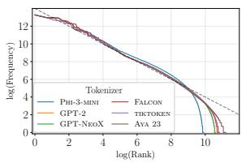  
(a) English

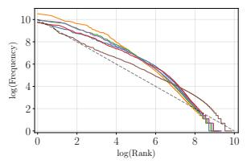  
(b) Czech

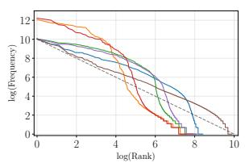  
(c) Russian

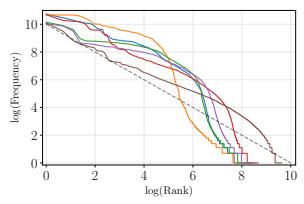  
(d) Chinese  
Figure 4: Token frequency vs. frequency rank in log-log scale. Dashed lines (slope −1) reference Zipfian distributions. Figure from Lotz et al. (2025).

## A.4 Token Statistics Metrics

We include metrics based on shallow token statistics that may capture phenomena complementary to information-theoretic measures.

Vocabulary Utilization. The proportion of the vocabulary actually used when encoding a corpus:

$$
\mathrm { U t i l i z a t i o n } = { \frac { \# \ u n i q u e \ t o k e n s \ u s e d } { \ v o c a b u l a r y \ s i z e } }
$$

Higher utilization suggests more efficient use of the available vocabulary.

Type-Token Ratio (TTR). The ratio of unique tokens (types) to total tokens in the corpus, measuring lexical diversity:

$$
\mathrm { T T R } = \frac { \# \mathrm { u n i q u e } \mathrm { t o k e n s } } { \# \mathrm { t o t a l } \mathrm { t o k e n s } }
$$

Higher values indicate more diverse token usage.

Gini Coefficient (Tokenizer Fairness). A measure of how equitably a tokenizer distributes encoding costs across languages (Ahia et al., 2023; Petrov et al., 2023). For each language ℓ, the token cost $c _ { \ell }$ is the number of tokens required per line of a content-matched corpus. The metric is the Gini coefficient of these per-language costs:

$$
G = \frac { \sum _ { i = 1 } ^ { n } \sum _ { j = 1 } ^ { n } | c _ { i } - c _ { j } | } { 2 n ^ { 2 } \mu }
$$

where $n$ is the number of languages and $\mu$ is the mean cost. Values range from 0 (all languages equally costly) upward, with higher values indicating that some languages require disproportionately more tokens than others for equivalent content. The metric is only defined across multiple languages; for the monolingual TIMTC and VISTA runs it is degenerate.

Average Token Rank. The expected rank of a token sampled from a corpus, where tokens are ranked by their frequency:

$$
\mathbf { A R } = \sum _ { v \in \mathcal { V } } \operatorname { r a n k } ( v ) \cdot p ( v )
$$

where V is the vocabulary, rank(v) is the position of token v when vocabulary items are sorted by frequency (most frequent = rank 1), and $p ( v ) =$ $\frac { f ( v ) } { \sum _ { u \in \mathcal { V } } f ( u ) }$ is the empirical probability of token v in the corpus, with $f ( v )$ being the frequency count of token v. Lower values indicate that the tokenizer relies more heavily on frequent tokens (Limisiewicz et al., 2023).

## A.5 Cognitive Plausibility

Chunkability Correlation. Following Beinborn and Pinter (2023), we evaluate tokenizers through the lens of cognitive plausibility by correlating tokenizer behavior with human lexical decision performance. We use the British Lexicon Project (Keuleers et al., 2012), which contains lexical decision data (reaction time and accuracy) for 28,730 English words. Chunkability measures how aggressively a tokenizer segments a word:

$$
\operatorname { C h u n k a b i l i t y } ( w ) = 1 - { \frac { \# \operatorname { t o k e n s } \operatorname { f o r } \operatorname { w o r d } w } { \# \operatorname { c h a r a c t e r s } \operatorname { i n } w } }
$$

Chunkability ranges from 0 (each character is a separate token) to values approaching 1 (the word is kept as a single token). Higher chunkability indicates that the tokenizer treats the word as a more cohesive unit. We compute Pearson correlations between chunkability and three human performance measures: (1) mean reaction time (RT), the average time in milliseconds participants take to decide whether a letter string is a valid word—faster responses indicate easier processing; (2) z-scored reaction time, which normalizes RT within each participant to control for individual differences in baseline speed, providing a more reliable measure of relative processing difficulty; and (3) accuracy percentage, the proportion of correct responses for each word.

Cognitively plausible tokenization should show positive correlation with accuracy (words kept intact are recognized more accurately) and negative correlation with reaction time (words kept intact are recognized faster). Prior work has shown that the Unigram algorithm yields less cognitively plausible tokenization behavior than BPE and WordPiece, and also exhibits worse coverage of derivational morphemes (Beinborn and Pinter, 2023).

## A.6 Boundary Statistics (U-Statistics)

The U-statistic evaluates whether a token’s boundaries align with natural linguistic boundaries by combining two signals from unsupervised segmentation: internal cohesion and contextual separability (Hu et al., 2025). The combined score for a token w is defined in Equation 1 (Section 3). Here we detail each component.

Internal cohesion: minimum adjacent-character PMI. For a token w consisting of characters $c _ { 1 } , c _ { 2 } , \ldots , c _ { n } ,$ we compute the pointwise mutual information for each adjacent character pair:

$$
\operatorname { P M I } ( c _ { i } , c _ { i + 1 } ) = \log { \frac { f ( c _ { i } c _ { i + 1 } ) \cdot T } { f ( c _ { i } ) \cdot f ( c _ { i + 1 } ) } }
$$

where $f ( \cdot )$ denotes corpus frequency and $T$ is the total number of character bigrams in the corpus. High PMI means the two characters co-occur far more often than expected by chance, indicating they are part of the same linguistic unit (e.g., “t” and $\mathbf { \ddot { h } } ^ { \prime \prime }$ in English, or “qu” in French).

We take the minimum PMI across all adjacent pairs within the token:

$$
\mathrm { P M I } _ { \operatorname* { m i n } } ( w ) = \operatorname* { m i n } _ { ( c _ { i } , c _ { i + 1 } ) \subset w } \mathrm { P M I } ( c _ { i } , c _ { i + 1 } )
$$

This acts as a bottleneck: a single weak link—a character pair with low PMI—lowers the overall cohesion score, preventing loosely connected parts from being treated as a single unit (Hu et al., 2025). A token like “the” has uniformly high internal PMI, while a poorly segmented token like “e\_of” would have a low-PMI pair at the boundary it straddles.

Contextual separability: branching entropy. The second component measures whether the token’s edges coincide with natural segmentation points. We compute the Shannon entropy over the distribution of characters observed at each boundary:

$$
\begin{array} { l } { { \displaystyle H _ { \mathrm { l e f t } } ( w ) = - \sum _ { l } P ( l \mid w ) \log P ( l \mid w ) } } \\ { { \displaystyle H _ { \mathrm { r i g h t } } ( w ) = - \sum _ { r } P ( r \mid w ) \log P ( r \mid w ) } } \end{array}
$$

where l and r index the set of distinct characters that can occur immediately to the left and right of w in the corpus, respectively.

The intuition comes from Harris (1955): at natural linguistic boundaries (e.g., between words or morphemes), many different characters can appear, leading to high entropy. Mid-morpheme, the set of possible continuations is constrained (e.g., after “qu” in English, “e”, “i”, “a” are likely but few others), yielding low entropy. A token whose boundaries both have high branching entropy is likely to start and end at natural break points. We take the minimum of $H _ { \mathrm { l e f t } }$ and $H _ { \mathrm { r i g h t } }$ , so that a single side with low diversity keeps the token from being split prematurely.

Combining the signals and aggregation. The U-statistic combines internal cohesion and contextual separability as in Equation 1. The two terms are complementary: PMI captures whether the token’s interior is coherent, while branching entropy captures whether the token’s edges are well-placed. A high U-statistic requires both—the token must be internally cohesive and its boundaries must fall at positions with diverse continuations. The weighting $\lambda = 4 . 0$ balances the two terms, as PMI values span a wider range than branching entropy; we adopt the optimal value found by Hu et al. (2025) for Chinese word segmentation on the PKU benchmark. We compute $U _ { \mathrm { s t a t } }$ for every token in the tokenizer’s vocabulary using character statistics estimated from a corpus, then report the mean (u\_mean) and median (u\_median) across the vocabulary. We also report two frequency-weighted variants designed to dampen the relationship between U-statistic values and vocabulary size, by giving more weight to tokens the model encounters more often. Let f(w) denote the corpus frequency of token w and let V be the set of vocabulary items with a valid U-statistic. The frequency-weighted mean is:

$$
{ \mathsf { u } } _ { - } { \mathsf { m e a n } } _ { - } { \mathsf { w e i g h t e d } } = { \frac { \sum _ { w \in \mathcal { V } } f ( w ) \cdot U _ { \mathrm { s t a t } } ( w ) } { \sum _ { w \in \mathcal { V } } f ( w ) } }
$$

The log-frequency-weighted mean dampens the influence of extremely frequent tokens:

$$
\begin{array} { r } { \mathsf { u } _ { - } \mathsf { m e a n } _ { - } \mathsf { l o g } _ { - } \mathsf { w e i g h t e d } = \frac { \sum _ { w \in \mathcal { V } } \log \left( 1 + f ( w ) \right) \cdot U _ { \mathrm { s t a t } } ( w ) } { \sum _ { w \in \mathcal { V } } \log \left( 1 + f ( w ) \right) } } \end{array}
$$

## B Model Details

We use three model suites in this work: TIMTC, TokSuite, and VISTA. The TIMTC models from Schmidt et al. (2024) are released under the AI Pubs Open RAIL-M license.10 The TokSuite models from Altınta¸s et al. (2025) are released under the MIT license. Our VISTA models are released under the Apache 2.0 license.

## B.1 TIMTC

The TIMTC (Tokenization Is More Than Compression) models from Schmidt et al. (2024) consist of 350M parameter decoder-only language models trained on the Pile corpus. The suite includes 54 models at this scale, plus additional 1.3B and 2.4B parameter models for select configurations. Models were trained with three vocabulary sizes (32,768, 40,960, and 49,152 tokens) across 18 different tokenizer configurations. Table 3 summarizes these conditions, which vary along four dimensions: The models use an MPT (MosaicML Pretrained Transformer; Mosaic Research, 2023) decoder-only architecture and were trained on the Pile corpus, with tokenizer vocabularies constructed over MiniPile, a 6GB subset of English-only data.

Vocabulary Construction (Vocab Constr) The algorithm used to build the vocabulary. BPE iteratively merges the most frequent byte pairs; Unigram starts from a large vocabulary and prunes tokens that minimally decrease corpus likelihood; WordPiece merges pairs based on pointwise mutual information; SaGe incorporates contextual information via a skip-gram objective; and PathPiece minimizes the total token count via shortest-path segmentation (with PathPieceL breaking ties by longest token and PathPieceR breaking ties randomly).

Initial Vocabulary (Init Voc) PathPiece and SaGe require a large starting vocabulary from which tokens are iteratively pruned. Options include a vocabulary pre-trained with BPE or Unigram, or the most frequent byte n-grams from the corpus. This column is empty for methods like BPE and WordPiece, which build vocabularies bottom-up by merging smaller units.

Pre-tokenization (Pre-tok) Rules that restrict token boundaries before vocabulary construction. “FirstSpace” requires spaces to appear only at the start of tokens; “SpaceDigit” treats each space and digit as its own token; “FirstSpDigit” combines both constraints; “None” allows unrestricted token boundaries.

Segmentation (Segment) The algorithm for splitting text into tokens at inference time. “Merge” applies BPE merge rules; “Likelihood” maximizes unigram probability; “Greedy” takes the longest matching token left-to-right; “PathPieceL/R” finds the minimum-token segmentation.

Table 3: Summary of 350M parameter model vocabulary construction methods, showing initialization, pretokenization, and segmentation strategies. All models have been trained with different vocab sizes, specifically 32,768, 40,960 and 49,152 tokens.
<table><tr><td>Vocab Constr</td><td>Init Voc</td><td>Pre-tok</td><td>Segment</td></tr><tr><td rowspan="2">PathPieceL</td><td>BPE Unigram</td><td>FirstSpace FirstSpace</td><td rowspan="2">PathPieceL</td></tr><tr><td>n-gram n-gram</td><td>FirstSpDigit FirstSpace</td></tr><tr><td>Unigram</td><td></td><td>FirstSpace</td><td>Likelihood Greedy PathPieceL</td></tr><tr><td>BPE</td><td></td><td>FirstSpace</td><td>Merge Greedy PathPieceL</td></tr><tr><td>WordPiece</td><td></td><td>FirstSpace</td><td>Greedy</td></tr><tr><td rowspan="2">SaGe</td><td>BPE n-gram</td><td>FirstSpace FirstSpace</td><td rowspan="2">Greedy</td></tr><tr><td>Unigram n-gram</td><td>FirstSpace FirstSpDigit</td></tr><tr><td>PathPieceR</td><td>n-gram</td><td>SpaceDigit FirstSpDigit None</td><td>PathPieceR</td></tr></table>

## B.2 TokSuite

The TokSuite models from Altınta¸s et al. (2025) are designed to isolate the impact of tokenizer choice on language model behavior. The suite consists of 14 models sharing identical architecture, training data, compute budget, and initialization, differing only in their tokenizer. Tokenizers are drawn from popular open-source models including GPT-2, BERT, Llama, Qwen, Gemma, Phi, Aya, BLOOM, XGLM, Tekken, GPT-4o, Comma, and TokenMonster, as well as the byte-level ByT5 tokenizer. This controlled setup enables direct comparison of tokenizer effects on downstream performance across English and multilingual tasks.

## B.3 VISTA Models

## B.3.1 Model Architecture

We train two families of LLAMA 1 (Touvron et al., 2023) language models:

• VISTA-130M (∼130M parameters, comparable to GPT-1 (Radford et al., 2018)): 12 layers, hidden size 768, 12 attention heads.

• VISTA-350M (∼350M parameters): 24 layers, hidden size 1024, 16 attention heads.

Both architectures use SiLU activations, RoPE positional embeddings, a maximum sequence length of 1024, and RMS normalization (ϵ=10−6). The embedding and language modeling head dimensions are adjusted to match each vocabulary size; all other hyperparameters are held fixed across tokenizers. Our implementation is built on the codebase of Sun et al. (2025) using the Hugging Face Transformers library (Wolf et al., 2020). Table 7 details the full model and training configurations for the 130M and 350M scales, respectively. Note that the parameter sizes for both families vary significantly with the vocabulary sizes.

## B.3.2 Hyperparameters

For the 130M models, we closely follow the pretraining protocol from Chang et al. (2026). All 130M models are trained for 10 epochs on their respective BP-scaled monolingual training data, following evidence that multiple-epoch pre-training is beneficial for smaller datasets (Muennighoff et al., 2023). We use a global batch size of 512 and apply attention dropout (0.1) to mitigate overfitting, with gradient clipping disabled (following (Chang et al., 2026)).

For the 350M models, we train on substantially larger data: the English models are trained for 1 epoch on the Chinchilla-optimal 7 billion tokens from FineWeb (Penedo et al., 2024), while non-English models are trained on equivalent bytes of FineWeb-2 (Penedo et al., 2025) data scaled by the language-specific byte premium. The global batch size remains at 512, with gradient clipping enabled, and attention dropout removed. For fair comparison, all configurations within each model scale are held constant across languages and vocabulary sizes.

## B.3.3 Data

VISTA 130M. We utilize monolingual datasets from Chang et al. (2026), covering five languages: English (eng\_latn), Thai (tha\_thai), Urdu (urd\_arab), Amharic (amh\_ethi), and Vietnamese (vie\_latn). Training splits are defined by Byte Premium (BP) scaling, such that each language contributes an information-theoretically equivalent amount of data (approximately 1 GB × the Byte Premium). The BP multipliers are derived from Arnett et al. (2024a) and detailed in Table 6. Evaluation splits consist of the disjoint last (BPscaled) 8,000 lines of each monolingual dataset.

VISTA 350M. At the 350M scale, we follow a Chinchilla-optimal data regime. English models are trained on 7 billion tokens from FineWeb’s 10 Billion token sample (Penedo et al., 2024), yielding approximately 31 GiB of tokenized training data (for vocab size 32,768). For non-English languages, we source data from FineWeb-2 (Penedo et al., 2025) and define each language’s training data target as:

$$
{ \mathsf { t a r g e t \_ b y t e s } } = { \mathsf { B P } } \times { \mathsf { e n g \_ r e f \_ b y t e s } }
$$

where eng\_ref\_bytes is the byte size of the 7Btoken, tokenized English training file, for that corresponding tokenizer type and vocabulary size. Table 4 details the data budget for the BPE tokenizer at vocabulary size 32,768 (this is representative; the same BP-scaling procedure is applied per tokenizer/vocabulary combination with respect to the corresponding English reference).

Not all languages have sufficient data in FineWeb-2 to meet the BP-scaled target. Amharic has only 2.69 GiB of raw text—less than 5% of the required ∼54 GiB (tokenized)—and was excluded from 350M training to avoid severe overfitting. Urdu has approximately 25% of the required data; we compensate with multi-epoch training (3–4× depending on tokenizer/vocabulary), which converged well empirically. Thai and Vietnamese have ample data in FineWeb-2 and are trained for a single epoch.

## B.3.4 Compute Costs

All VISTA models are trained on 4 or 8 NVIDIA H100/A100 GPUs in bfloat16 mixed precision.

VISTA 130M. Each 130M model is trained for 10 epochs on the BP-scaled datasets (∼1–2.7 GB per language). Wall-clock time per run ranges between 2 and 3 hours (∼8–12 GPU-hours). The full

130M experimental suite comprises 80 runs (5 languages × 2 tokenizers × 8 vocabulary sizes), for a total of 640–960 GPU-hours.

VISTA 350M. Each 350M model is trained for 1 epoch on the Chinchilla-optimal data (31–85 GiB tokenized per language), except Urdu which trains for 3–4 epochs to compensate for data scarcity. The full 350M suite comprises 16 runs (4 languages × 2 tokenizers $\times 2$ vocabulary sizes), as detailed in Table 5.

## B.3.5 Language Specific Tokenization

For both BPE and Unigram variants, tokenizers trained on the corresponding Arnett et al. (2025a) monolingual corpus with varying vocabulary sizes from Arnett et al. (2025a) are used. At the 350M scale, we reuse the same monolingual tokenizers for the FineWeb-2 languages (Thai, Urdu, Vietnamese), as for the 130M experiments (e.g., FineWeb-2 Thai data is tokenized with the same tha\_thai tokenizer). All text data is pre-tokenized into integer IDs before training. Each line in the training file corresponds to a sequence of spaceseparated token integers. Consecutive non-empty lines from the source text are concatenated and packed to fill the maximum sequence length of 1024 tokens. We prepend a CLS token to each packed sequence and append a SEP token after every individual text segment within that sequence. This packing is performed offline with no padding tokens written to disk, ensuring the model sees a continuous stream of data at high throughput. For the 350M English models, the tokenized data is truncated to get the first 7 billion tokens. For non-English 350M models, the split is defined by the target byte count (BP × eng\_ref\_bytes), with the evaluation set taken from the disjoint tail of the tokenized corpus.

Table 4: FineWeb-2 data budget for VISTA 350M models (for the BPE, vocab = 32,768 case). The BP-scaled target is the Chinchilla-optimal tokenized data size scaled by each language’s byte premium. Tokenized Data Size is the actual tokenized data after processing downloaded FineWeb-2 text using the pre-trained language specific tokenizers.
<table><tr><td></td><td>English</td><td>Thai</td><td>Urdu</td><td>Amharic†</td><td>Vietnamese</td></tr><tr><td>Byte Premium</td><td>1.00</td><td>2.74</td><td>1.71</td><td>1.72</td><td>1.35</td></tr><tr><td>English reference (7B tokens)</td><td></td><td></td><td>31.11 GiB</td><td></td><td></td></tr><tr><td>BP-scaled target</td><td>31.11 GiB</td><td>85.25 GiB</td><td>53.20 GiB</td><td>53.52 GiB</td><td>42.00 GiB</td></tr><tr><td>FineWeb2 Raw Available</td><td></td><td>321.88 GiB</td><td>22.48 GiB</td><td>2.69 GiB</td><td>402.69 GiB</td></tr><tr><td>Tokenized Data Size</td><td>31.11 GiB</td><td>&gt;85 GiB</td><td>12.54 GiB</td><td></td><td>38.27 GiB</td></tr><tr><td>Coverage</td><td>100%</td><td>&gt;100%</td><td>~24%</td><td>&lt;5%</td><td>~91%</td></tr><tr><td>Compute-matched Training epochs</td><td>1</td><td>1</td><td>3-4</td><td> ${ \sim } 2 0 \times ^ { \dagger }$ </td><td>1</td></tr></table>

†Amharic was excluded from 350M training: <5% data coverage would require ∼20× epoch repetition, causing severe overfitting. ‡Urdu uses 3–4× epoch compensation across configs, which converged well empirically.

Table 5: VISTA Pre-training Variations.
<table><tr><td>VISTA-130M</td><td></td><td>VISTA-350M</td></tr><tr><td>Languages</td><td>English, Thai, Urdu, Amharic, Vietnamese</td><td>English, Thai, Urdu, Vietnamese</td></tr><tr><td>Tokenizers</td><td>BPE, Unigram</td><td>BPE, Unigram</td></tr><tr><td>Vocabulary sizes</td><td>8192, 16384, 32768, 49152,</td><td>8192,98304</td></tr><tr><td></td><td>65536, 81920, 98304, 114688</td><td></td></tr><tr><td>Total runs</td><td> $5 \times 2 \times 8$  = 80</td><td> $4 \times 2 \times 2$  = 16</td></tr></table>

Table 6: Monolingual corpora and byte-premium (BP) statistics used in our experiments. The left column shows the BP-scaled data size (in GB), and the right column shows the raw UTF-8 byte size. BP multipliers are derived from Arnett et al. (2024a); BP scaling ensures languages with less information-dense scripts are allocated proportionately more raw text data.
<table><tr><td>Language (tag)</td><td>BP-scaled GB</td><td>Raw GB</td></tr><tr><td>English (eng_latn)</td><td>1</td><td>1.00</td></tr><tr><td>Thai (tha_thai)</td><td>1</td><td>2.74</td></tr><tr><td>Urdu (urd_arab)</td><td>1</td><td>1.71</td></tr><tr><td>Amharic (amh_ethi)</td><td>1</td><td>1.72</td></tr><tr><td>Vietnamese (vie_latn)</td><td>1</td><td>1.35</td></tr></table>

Table 7: Model architecture and training hyperparameters for VISTA-130M and VISTA-350M. Where the two scales differ, both values are shown; shared values appear once spanning both columns.
<table><tr><td>Configuration</td><td>VISTA-130M</td><td>VISTA-350M</td></tr><tr><td colspan="3">Model Architecture</td></tr><tr><td>Model Type</td><td>LLaMA 1</td><td>1024</td></tr><tr><td>Hidden Size  $( d _ { \mathrm { m o d e l } } )$ </td><td>768</td><td></td></tr><tr><td>Intermediate Size  $( d _ { \mathrm { f f } } )$ </td><td>2048</td><td>2736</td></tr><tr><td>Number of Hidden Layers</td><td>12</td><td>24</td></tr><tr><td>Number of Attention Heads Max Sequence Length</td><td>12 1024</td><td>16</td></tr><tr><td>Vocabulary Size Activation Function</td><td>Varying SiLU</td><td></td></tr><tr><td>RMS Norm Epsilon Initializer Range</td><td> $1 \times 1 0 ^ { - 6 }$  0.02</td><td></td></tr><tr><td>Positional Embeddings</td><td>RoPE Training Hyperparameters</td><td></td></tr><tr><td>Learning Rate (Max)</td><td> $1 \times 1 0 ^ { - 3 }$   $1 \times 1 0 ^ { - 4 }$  (min_lr_ratio = 0.1) Cosine with Warmup</td><td></td></tr><tr><td>Learning Rate (Min) LR Scheduler Warmup Steps Ratio Attention Dropout</td><td>0.10 0.1</td><td>0.0 (Disabled)</td></tr><tr><td>Adam  $\beta _ { 1 } , \beta _ { 2 }$  Adam Epsilon</td><td>0.9, 0.999  $1 \times 1 0 ^ { - 6 }$ </td><td></td></tr><tr><td>Weight Decay</td><td>0.0</td><td></td></tr><tr><td>Precision</td><td>bfloat16</td><td></td></tr><tr><td></td><td></td><td></td></tr><tr><td>Gradient Clipping</td><td></td><td></td></tr><tr><td></td><td>0.0 (Disabled)</td><td>1.0</td></tr><tr><td>Epochs</td><td>10</td><td>1*</td></tr><tr><td></td><td></td><td></td></tr><tr><td></td><td>Batch Configuration</td><td></td></tr><tr><td>World Size</td><td>4 GPUs (H100/A100)</td><td></td></tr><tr><td></td><td></td><td>16</td></tr><tr><td>Per-GPU Micro-batch Size</td><td>32</td><td></td></tr><tr><td>Gradient Accumulation Steps</td><td>4</td><td>8</td></tr><tr><td>Global Batch Size</td><td>512</td><td></td></tr><tr><td></td><td>Data</td><td></td></tr><tr><td></td><td></td><td></td></tr><tr><td>Training data source</td><td>Goldfish (Chang et al., 2026)</td><td>FineWeb/FineWeb-2</td></tr><tr><td>Training data size</td><td> ${ \sim } 1 \mathbf G \mathbf { B } \times \mathbf B \mathbf { P }$ </td><td>7B tokens (Eng); BP × Eng ref bytes</td></tr></table>

∗Urdu: 3–4 epochs to compensate for limited FineWeb-2 data (∼24% of BP-scaled target).

## C Eval Dataset Details

We list the benchmarks we used to evaluate each model suite: TokSuite (Table 8), TIMTC (Table 9), and VISTA (Table 10). All benchmarks are released under permissive open-source licenses, suitable for this work. FLORES, Global PIQA, ARC, and Belebele are released under CC-BY-SA-4.0 licenses. BLiMP, MultiBLiMP, Winograd\_th, XWinograd, and XCOPA are released under CC-BY-4.0 licenses. HellaSwag and MultiLoko are released under MIT licenses. Global MMLU, AfriMMLU, and INCLUDE are released under Apache-2.0 licenses.

Table 8: List of language model evaluations used for TokSuite models. Tasks marked with † were implemented in our fork of the LM evaluation harness.
<table><tr><td>Task Type</td><td>Benchmark</td><td>Language(s)</td></tr><tr><td>Linguistic</td><td>CoLA (Warstadt et al., 2019) BLiMP (Warstadt et al., 2020) ZhoBLiMP (Liu et al., 2024) TurBLiMP (Başar et al., 2025) MultiBLiMP (Jumelet et al., 2026)</td><td>English English Chinese Turkish</td></tr><tr><td>NLU</td><td>SuperGLUE (Wang et al., 2019) Winogrande (Sakaguchi et al., 2020) ANALOGICAL † (Wijesiriwardene et al., 2023) XWinograd (Tikhonov and Ryabinin, 2021) CLUE † (Xu et al., 2020) FarsTail † (Amirkhani et al., 2020) Turkish NLI † (Budur et al., 2020)</td><td>English English, Turkish English Chinese Chinese Farsi Turkish</td></tr><tr><td>Commonsense Reasoning</td><td>HellaSwag (Zellers et al., 2019) PIQA (Bisk et al., 2020) PROST (Aroca-Ouellette et al., 2021) XCOPA (Ponti et al., 2020) Global PIQA (Chang et al., 2025) XStoryCloze (Lin et al., 2022)</td><td>English English English Chinese, Turkish Italian, Turkish, Chinese Chinese</td></tr><tr><td>World Knowledge/ QA</td><td>COMPS † (Misra et al., 2023) MMLU (Hendrycks et al., 2021) EWoK † (Ivanova et al., 2025) XCOMPS † (He et al., 2025) XQuAD (Artetxe et al., 2020) CMMLU (Li et al., 2024) Global MMLU (Singh et al., 2025) Belebele (Bandarkar et al., 2024) INCLUDE (Romanou et al., 2025) MultiLoKo † (Hupkes and Bogoychev, 2025) PersianQA † (Ayoubi and Davoodeh, 2021)</td><td>English English English Farsi, Turkish, Chinese English, Turkish, Chinese Chinese English, Italian, Farsi, Turkish, Chinese English, Italian, Farsi, Turkish, Chinese Chinese, Farsi, Turkish Farsi, Chinese, Turkish Farsi</td></tr><tr><td>Multi-Task</td><td>SynTran-fa † (Farsi et al., 2024) BBH (Suzgun et al., 2023) ITALIC † (Seveso et al., 2025) ITA-Bench † (Moroni et al., 2024)</td><td>Farsi English Italian Italian</td></tr><tr><td>Token-Level</td><td>CUTE † (Edman et al., 2024) CharBench † (Uzan and Pinter, 2026) LMentry † (Efrat et al., 2023) stringbench † (Wang et al., 2025) EXECUTE † (Edman et al., 2025) TokSuite (Altıntaş et al., 2025)</td><td>English English English English English, Chinese English, Chinese, Farsi, Italian</td></tr><tr><td>Perplexity</td><td>FLORES † (NLLB Team et al., 2022)</td><td>English, Italian, Farsi, Turkish, Chinese</td></tr></table>

Table 9: List of English language model evaluations used for “Tokenization is More Than Compression” models. Tasks marked with † were implemented in our fork of the LM evaluation harness.
<table><tr><td>Task Type</td><td>Benchmark</td></tr><tr><td>Linguistic</td><td>SuperGLUE (Wang et al., 2019) Winogrande (Sakaguchi et al., 2020) BLiMP (Warstadt et al., 2020)</td></tr><tr><td>World Knowledge/ Semantics</td><td>COMPS † (Misra et al., 2023) ANALOGICAL † (Wijesiriwardene et al., 2023) EWoK † (Ivanova et al., 2025) MMLU (Hendrycks et al., 2021) Global MMLU (Singh et al., 2025)</td></tr><tr><td>Commonsense Reasoning</td><td>PIQA (Bisk et al., 2020) HellaSwag (Zellers et al., 2019) PROST (Aroca-Ouellette et al., 2021)</td></tr><tr><td>QA / Reading</td><td>XQuAD (Artetxe et al., 2020) Belebele (Bandarkar et al., 2024)</td></tr><tr><td>Multi-Task</td><td>BBH (Suzgun et al., 2023)</td></tr><tr><td>Token-Level</td><td>CUTE † (Edman et al., 2024) EXECUTE † (Edman et al., 2025) CharBench † (Uzan and Pinter, 2026) stringbench † (Wang et al., 2025) LMentry † (Efrat et al., 2023)</td></tr><tr><td>Perplexity</td><td>FLORES † (NLLB Team et al., 2022)</td></tr></table>

Table 10: List of language model evaluations used for VISTA. Tasks marked with † were implemented in our fork of LM evaluation harness.
<table><tr><td>Task Type</td><td>Benchmark</td><td>Language(s)</td></tr><tr><td>Perplexity</td><td>FLORES † (NLLB Team et al., 2022)</td><td>Amharic, English, Thai, Urdu, Vietnamese</td></tr><tr><td>Linguistic</td><td>BLiMP (Warstadt et al., 2020) MultiBLiMP (Jumelet et al., 2026)</td><td>English Amharic, English, Urdu</td></tr><tr><td>NLU</td><td>SuperGLUE (Wang et al., 2019) Winograd_th † Winogrande (Sakaguchi et al., 2020) XNLI (Conneau et al., 2018)</td><td>English Thai English Vietnamese</td></tr><tr><td>Commonsense Reasoning</td><td>HellaSwag (Zellers et al., 2019) PIQA (Bisk et al., 2020) PROST (Aroca-Ouellette et al., 2021) Global PIQA (Chang et al., 2025) XCOPA (Ponti et al., 2020) ARC (Clark et al., 2018)</td><td>English, Vietnamese English English Amharic, English, Thai, Urdu, Vietnamese Thai, Vietnamese Vietnamese English</td></tr><tr><td>World Knowledge/ QA</td><td>ANALOGICAL † (Wijesiriwardene et al., 2023) EWoK † (Ivanova et al., 2025) MMLU (Hendrycks et al., 2021) XQuAD (Artetxe et al., 2020) Global MMLU (Singh et al., 2025) MMLU Prox † AfriMMLU † Belebele (Bandarkar et al., 2024) MultiLoKo † (Hupkes and Bogoychev, 2025) INCLUDE (Romanou et al., 2025) Amharic QA †</td><td>English English English English, Thai, Vietnamese Amharic, English, Vietnamese Thai, Urdu Amharic Amharic, English, Thai, Urdu, Vietnamese Thai, Urdu, Vietnamese Urdu, Vietnamese Amharic Vietnamese</td></tr><tr><td>Multi-Task</td><td>VMLU ↑ BBH (Suzgun et al., 2023)</td><td>Vietnamese English</td></tr><tr><td>Token-Level</td><td>CUTE † (Edman et al., 2024) EXECUTE † (Edman et al., 2025) CharBench † (Uzan and Pinter, 2026) stringbench † (Wang et al., 2025) LMentry † (Efrat et al., 2023)</td><td>English English English English English</td></tr></table>

## D Full Eval Results

## D.1 TokSuite

The evaluation results of the TokSuite models for each of the languages the models are trained on: English (Table 11), Chinese (Table 12), Turkish (Table 13), Farsi (Table 14), and Italian (Table 15).

Fig. 5 shows the model performance for each of the TokSuite models by language and macro averaged across language.

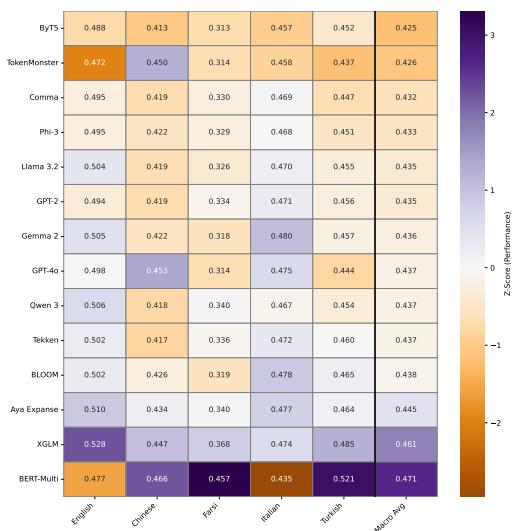  
Figure 5: Downstream performance for TokSuite models aggregated by language and macro average across language. Each cell value shows mean performance. The color of each cell corresponds to the z-scored performance, where the darker the green the better the performance.

Table 11: Evaluation scores for TokSuite models on English tasks.
<table><tr><td>Tokenizer</td><td>Aya</td><td>Qwen</td><td>BLOOM</td><td>Comma</td><td>XGLM</td><td>BERT</td><td>ByT5</td><td>Gemma</td><td>GPT-2</td><td>Llama</td><td>Phi</td><td>Tekken</td><td>GPT-40</td><td>TokenMonster</td><td>Chance</td></tr><tr><td>GLUE</td><td>0.448</td><td>0.446</td><td>0.420</td><td>0.430</td><td>0.397</td><td>0.402</td><td>0.394</td><td>0.459</td><td>0.418</td><td>0.394</td><td>0.414</td><td>0.451</td><td>0.429</td><td>0.418</td><td>0.45</td></tr><tr><td>Winogrande</td><td>0.584</td><td>0.579</td><td>0.586</td><td>0.560</td><td>0.577</td><td>0.525</td><td>0.553</td><td>0.568</td><td>0.542</td><td>0.593</td><td>0.586</td><td>0.576</td><td>0.582</td><td>0.539</td><td>0.50</td></tr><tr><td>BLiMP</td><td>0.835</td><td>0.836</td><td>0.833</td><td>0.843</td><td>0.835</td><td>0.833</td><td>0.838</td><td>0.838</td><td>0.827</td><td>0.844</td><td>0.836</td><td>0.837</td><td>0.844</td><td>0.787</td><td>0.50</td></tr><tr><td>MultiBLiMP</td><td>0.990</td><td>0.992</td><td>0.992</td><td>0.984</td><td>0.988</td><td>0.994</td><td>0.990</td><td>0.988</td><td>0.990</td><td>0.988</td><td>0.994</td><td>0.992</td><td>0.990</td><td>0.982</td><td>0.50</td></tr><tr><td>EWoK</td><td>0.629</td><td>0.623</td><td>0.622</td><td>0.608</td><td>0.615</td><td>0.563</td><td>0.619</td><td>0.627</td><td>0.615</td><td>0.632</td><td>0.614</td><td>0.614</td><td>0.623</td><td>0.600</td><td>0.50</td></tr><tr><td>PIQA</td><td>0.729</td><td>0.724</td><td>0.726</td><td>0.722</td><td>0.726</td><td>0.669</td><td>0.696</td><td>0.739</td><td>0.716</td><td>0.724</td><td>0.711</td><td>0.712</td><td>0.721</td><td>0.702</td><td>0.50</td></tr><tr><td>HellaSwag</td><td>0.437</td><td>0.427</td><td>0.426</td><td>0.412</td><td>0.441</td><td>0.408</td><td>0.403</td><td>0.435</td><td>0.412</td><td>0.430</td><td>0.414</td><td>0.427</td><td>0.431</td><td>0.387</td><td>0.25</td></tr><tr><td>PROST</td><td>0.285</td><td>0.282</td><td>0.260</td><td>0.229</td><td>0.228</td><td>0.253</td><td>0.250</td><td>0.236</td><td>0.244</td><td>0.264</td><td>0.244</td><td>0.256</td><td>0.262</td><td>0.214</td><td>0.25</td></tr><tr><td>MMLU</td><td>0.236</td><td>0.257</td><td>0.234</td><td>0.242</td><td>0.246</td><td>0.229</td><td>0.235</td><td>0.253</td><td>0.260</td><td>0.251</td><td>0.252</td><td>0.240</td><td>0.246</td><td>0.235</td><td>0.25</td></tr><tr><td>BBH XQuAD</td><td>0.233</td><td>0.225</td><td>0.236</td><td>0.228</td><td>0.200</td><td>0.203</td><td>0.210</td><td>0.211</td><td>0.242</td><td>0.237</td><td>0.240</td><td>0.234</td><td>0.223</td><td>0.173</td><td>0.33</td></tr><tr><td>Belebele</td><td>0.105 0.402</td><td>0.056 0.407</td><td>0.082</td><td>0.065</td><td>0.000 0.422</td><td>0.000</td><td>0.025</td><td>0.105</td><td>0.048</td><td>0.075</td><td>0.064</td><td>0.056</td><td>0.013 0.401</td><td>0.056</td><td>0.00 0.25</td></tr><tr><td>COMPS</td><td>0.682</td><td>0.670</td><td>0.386</td><td>0.394 0.651</td><td>0.679</td><td>0.288 0.679</td><td>0.390 0.689</td><td>0.416 0.660</td><td>0.392 0.669</td><td>0.389 0.679</td><td>0.378 0.672</td><td>0.398 0.660</td><td>0.673</td><td>0.378 0.668</td><td>0.50</td></tr><tr><td>ANALOGICAL</td><td>0.816</td><td>0.816</td><td>0.674 0.810</td><td>0.809</td><td>0.789</td><td>0.359</td><td>0.781</td><td>0.792</td><td>0.768</td><td>0.799</td><td>0.751</td><td>0.821</td><td>0.794</td><td>0.699</td><td>0.25</td></tr><tr><td></td><td></td><td></td><td></td><td></td><td></td><td></td><td></td><td></td><td></td><td></td><td></td><td></td><td></td><td></td><td></td></tr><tr><td>Avg.</td><td>0.502</td><td>0.498</td><td>0.486</td><td>0.480</td><td>0.475</td><td>0.395</td><td>0.465</td><td>0.488</td><td>0.470</td><td>0.487</td><td>0.473</td><td>0.485</td><td>0.482</td><td>0.461</td><td>0.38</td></tr></table>

Table 12: Evaluation scores for TokSuite models on Chinese tasks.
<table><tr><td>Tokenizer</td><td>Aya</td><td>Qwen</td><td>BLOOM</td><td>Comma</td><td>XGLM</td><td>BERT</td><td>ByT5</td><td>Gemma</td><td>GPT-2</td><td>Llama</td><td>Phi</td><td>Tekken</td><td>GPT-40</td><td>TokenMonster</td><td>Chance</td></tr><tr><td>ZhoBLiMP</td><td>0.872</td><td>0.872</td><td>0.876</td><td>0.879</td><td>0.871</td><td>0.871</td><td>0.860</td><td>0.876</td><td>0.879</td><td>0.879</td><td>0.882</td><td>0.874</td><td>0.871</td><td>0.891</td><td>0.50</td></tr><tr><td>XWinograd</td><td>0.724</td><td>0.708</td><td>0.690</td><td>0.738</td><td>0.712</td><td>0.687</td><td>0.716</td><td>0.732</td><td>0.730</td><td>0.722</td><td>0.732</td><td>0.690</td><td>0.744</td><td>0.702</td><td>0.50</td></tr><tr><td>XCOMPS</td><td>0.667</td><td>0.675</td><td>0.703</td><td>0.670</td><td>0.668</td><td>0.702</td><td>0.686</td><td>0.635</td><td>0.686</td><td>0.665</td><td>0.690</td><td>0.676</td><td>0.667</td><td>0.690</td><td>0.50</td></tr><tr><td>XCOPA</td><td>0.642</td><td>0.634</td><td>0.630</td><td>0.620</td><td>0.624</td><td>0.610</td><td>0.596</td><td>0.644</td><td>0.616</td><td>0.648</td><td>0.634</td><td>0.644</td><td>0.642</td><td>0.624</td><td>0.50</td></tr><tr><td>XStoryCloze</td><td>0.592</td><td>0.592</td><td>0.595</td><td>0.578</td><td>0.600</td><td>0.567</td><td>0.561</td><td>0.592</td><td>0.567</td><td>0.587</td><td>0.572</td><td>0.590</td><td>0.584</td><td>0.568</td><td>0.50</td></tr><tr><td>XQuAD</td><td>0.057</td><td>0.007</td><td>0.034</td><td>0.006</td><td>0.000</td><td>0.000</td><td>0.051</td><td>0.013</td><td>0.035</td><td>0.020</td><td>0.011</td><td>0.015</td><td>0.000</td><td>0.003</td><td>0.00</td></tr><tr><td>Global PIQA</td><td>0.510</td><td>0.520</td><td>0.560</td><td>0.540</td><td>0.510</td><td>0.480</td><td>0.510</td><td>0.500</td><td>0.480</td><td>0.480</td><td>0.540</td><td>0.480</td><td>0.540</td><td>0.540</td><td>0.50</td></tr><tr><td>Belebele</td><td>0.383</td><td>0.337</td><td>0.358</td><td>0.364</td><td>0.386</td><td>0.327</td><td>0.360</td><td>0.361</td><td>0.359</td><td>0.368</td><td>0.379</td><td>0.356</td><td>0.376</td><td>0.368</td><td>0.25</td></tr><tr><td>Global MMLU</td><td>0.273</td><td>0.250</td><td>0.253</td><td>0.260</td><td>0.223</td><td>0.225</td><td>0.263</td><td>0.253</td><td>0.275</td><td>0.265</td><td>0.242</td><td>0.230</td><td>0.260</td><td>0.275</td><td>0.25</td></tr><tr><td>CMMLU MultiLoKo</td><td>0.247 0.116</td><td>0.251</td><td>0.245</td><td>0.249</td><td>0.249</td><td>0.253</td><td>0.251</td><td>0.250</td><td>0.249</td><td>0.246</td><td>0.249</td><td>0.250</td><td>0.247</td><td>0.247</td><td>0.25 0.00</td></tr><tr><td>INCLUDE</td><td>0.290</td><td>0.064 0.229</td><td>0.052 0.250</td><td>0.012 0.229</td><td>0.004 0.253</td><td>0.000 0.246</td><td>0.008 0.224</td><td>0.096 0.244</td><td>0.020 0.259</td><td>0.028 0.250</td><td>0.044 0.226</td><td>0.072 0.250</td><td>0.020 0.224</td><td>0.000 0.240</td><td>0.25</td></tr><tr><td>CLUE</td><td>0.419</td><td>0.435</td><td>0.438</td><td>0.441</td><td>0.439</td><td>0.345</td><td>0.435</td><td>0.434</td><td>0.435</td><td>0.435</td><td>0.435</td><td>0.432</td><td>0.435</td><td>0.435</td><td>0.39</td></tr><tr><td></td><td></td><td></td><td></td><td></td><td></td><td></td><td></td><td></td><td></td><td></td><td></td><td></td><td></td><td></td><td></td></tr><tr><td>Avg.</td><td>0.472</td><td>0.447</td><td>0.456</td><td>0.459</td><td>0.463</td><td>0.373</td><td>0.458</td><td>0.464</td><td>0.460</td><td>0.454</td><td>0.469</td><td>0.459</td><td>0.449</td><td>0.456</td><td>0.34</td></tr></table>

Table 13: Evaluation scores for TokSuite models on Turkish tasks.
<table><tr><td>Tokenizer</td><td>Aya</td><td>Qwen</td><td>BLOOM</td><td>Comma</td><td>XGLM</td><td>BERT</td><td>ByT5</td><td>Gemma</td><td>GPT-2</td><td>Llama</td><td>Phi</td><td>Tekken</td><td>GPT-40</td><td>TokenMonster</td><td>Chance</td></tr><tr><td>Winogrande</td><td>0.533</td><td>0.519</td><td>0.547</td><td>0.488</td><td>0.509</td><td>0.483</td><td>0.516</td><td>0.511</td><td>0.506</td><td>0.500</td><td>0.516</td><td>0.501</td><td>0.501</td><td>0.502</td><td>0.50</td></tr><tr><td>MultiBLiMP</td><td>0.959</td><td>0.950</td><td>0.958</td><td>0.964</td><td>0.962</td><td>0.961</td><td>0.960</td><td>0.954</td><td>0.952</td><td>0.943</td><td>0.945</td><td>0.947</td><td>0.949</td><td>0.959</td><td>0.50</td></tr><tr><td>TurBLiMP</td><td>0.831</td><td>0.840</td><td>0.827</td><td>0.840</td><td>0.836</td><td>0.843</td><td>0.831</td><td>0.835</td><td>0.841</td><td>0.835</td><td>0.833</td><td>0.835</td><td>0.829</td><td>0.805</td><td>0.50</td></tr><tr><td>XCOMPS</td><td>0.656</td><td>0.662</td><td>0.651</td><td>0.654</td><td>0.680</td><td>0.675</td><td>0.655</td><td>0.644</td><td>0.662</td><td>0.666</td><td>0.641</td><td>0.662</td><td>0.660</td><td>0.612</td><td>0.50</td></tr><tr><td>XCOPA</td><td>0.632</td><td>0.642</td><td>0.610</td><td>0.614</td><td>0.638</td><td>0.596</td><td>0.616</td><td>0.622</td><td>0.636</td><td>0.642</td><td>0.610</td><td>0.630</td><td>0.626</td><td>0.622</td><td>0.50</td></tr><tr><td>Global PIQA</td><td>0.510</td><td>0.550</td><td>0.530</td><td>0.510</td><td>0.480</td><td>0.500</td><td>0.520</td><td>0.530</td><td>0.530</td><td>0.470</td><td>0.520</td><td>0.520</td><td>0.530</td><td>0.510</td><td>0.50</td></tr><tr><td>Belebele</td><td>0.371</td><td>0.364</td><td>0.357</td><td>0.357</td><td>0.373</td><td>0.273</td><td>0.363</td><td>0.361</td><td>0.368</td><td>0.383</td><td>0.349</td><td>0.383</td><td>0.376</td><td>0.354</td><td>0.25</td></tr><tr><td>MultiLoKo</td><td>0.124</td><td>0.060</td><td>0.068</td><td>0.080</td><td>0.016</td><td>0.000</td><td>0.072</td><td>0.064</td><td>0.092</td><td>0.092</td><td>0.100</td><td>0.132</td><td>0.008</td><td>0.008</td><td>0.00</td></tr><tr><td>INCLUDE</td><td>0.261</td><td>0.248</td><td>0.308</td><td>0.226</td><td>0.226</td><td>0.290</td><td>0.277</td><td>0.252</td><td>0.241</td><td>0.272</td><td>0.254</td><td>0.254</td><td>0.223</td><td>0.224</td><td>0.25</td></tr><tr><td>XQuAD NLI</td><td>0.076 0.342</td><td>0.025</td><td>0.092</td><td>0.027</td><td>0.000</td><td>0.000</td><td>0.016</td><td>0.087</td><td>0.029</td><td>0.066</td><td>0.048</td><td>0.037</td><td>0.006</td><td>0.043</td><td>0.00</td></tr><tr><td></td><td></td><td>0.317</td><td>0.358</td><td>0.332</td><td>0.342</td><td>0.317</td><td>0.341</td><td>0.342</td><td>0.346</td><td>0.314</td><td>0.325</td><td>0.347</td><td>0.350</td><td>0.344</td><td>0.33</td></tr><tr><td>Avg.</td><td>0.481</td><td>0.471</td><td>0.482</td><td>0.463</td><td>0.460</td><td>0.449</td><td>0.470</td><td>0.473</td><td>0.473</td><td>0.471</td><td>0.467</td><td>0.477</td><td>0.460</td><td>0.453</td><td>0.35</td></tr></table>

## D.1.1 Correlation Between Vocab Size and Performance

Figure 6 plots the relationship between vocabulary size (log-scaled; x-axis) and aggregate performance (mean for each subset, and macro average across language; y-axis) for the TokSuite models. For each facet, Spearman’s ρ and p-value are reported.

Table 14: Evaluation scores for TokSuite models on Farsi tasks.
<table><tr><td>Tokenizer</td><td>Aya</td><td>Qwen</td><td>BLOOM</td><td>Comma</td><td>XGLM</td><td>BERT</td><td>ByT5</td><td>Gemma</td><td>GPT-2</td><td>Llama</td><td>Phi</td><td>Tekken</td><td>GPT-40</td><td>TokenMonster</td><td>Chance</td></tr><tr><td>MultiBLiMP</td><td>0.930</td><td>0.941</td><td>0.929</td><td>0.948</td><td>0.974</td><td>0.968</td><td>0.926</td><td>0.876</td><td>0.944</td><td>0.899</td><td>0.942</td><td>0.908</td><td>0.900</td><td>0.946</td><td>0.50</td></tr><tr><td>XCOMPS</td><td>0.659</td><td>0.665</td><td>0.628</td><td>0.643</td><td>0.677</td><td>0.674</td><td>0.660</td><td>0.653</td><td>0.663</td><td>0.656</td><td>0.655</td><td>0.655</td><td>0.655</td><td>0.673</td><td>0.50</td></tr><tr><td>FarsTail</td><td>0.338</td><td>0.336</td><td>0.331</td><td>0.347</td><td>0.348</td><td>0.332</td><td>0.337</td><td>0.325</td><td>0.333</td><td>0.336</td><td>0.325</td><td>0.362</td><td>0.328</td><td>0.332</td><td>0.33</td></tr><tr><td>MultiLoKo</td><td>0.136</td><td>0.128</td><td>0.064</td><td>0.076</td><td>0.024</td><td>0.000</td><td>0.008</td><td>0.040</td><td>0.080</td><td>0.096</td><td>0.108</td><td>0.124</td><td>0.008</td><td>0.004</td><td>0.00</td></tr><tr><td>INCLUDE</td><td>0.223</td><td>0.276</td><td>0.217</td><td>0.268</td><td>0.241</td><td>0.221</td><td>0.230</td><td>0.276</td><td>0.276</td><td>0.246</td><td>0.261</td><td>0.228</td><td>0.276</td><td>0.241</td><td>0.25</td></tr><tr><td>SynTran</td><td>0.018</td><td>0.013</td><td>0.007</td><td>0.007</td><td>0.000</td><td>0.000</td><td>0.008</td><td>0.006</td><td>0.006</td><td>0.007</td><td>0.010</td><td>0.012</td><td>0.007</td><td>0.002</td><td>0.00</td></tr><tr><td>Persian QA Belebele</td><td>0.114 0.376</td><td>0.069</td><td>0.051</td><td>0.038</td><td>0.021</td><td>0.000</td><td>0.026</td><td>0.049</td><td>0.068</td><td>0.044</td><td>0.026</td><td>0.086</td><td>0.002</td><td>0.003</td><td>0.00 0.25</td></tr><tr><td></td><td></td><td>0.366</td><td>0.373</td><td>0.381</td><td>0.388</td><td>0.282</td><td>0.366</td><td>0.369</td><td>0.374</td><td>0.379</td><td>0.370</td><td>0.384</td><td>0.378</td><td>0.362</td><td></td></tr><tr><td>Avg.</td><td>0.397</td><td>0.391</td><td>0.372</td><td>0.379</td><td>0.380</td><td>0.309</td><td>0.365</td><td>0.371</td><td>0.385</td><td>0.377</td><td>0.386</td><td>0.390</td><td>0.367</td><td>0.357</td><td>0.23</td></tr></table>

Table 15: Evaluation scores for TokSuite models on Italian tasks.
<table><tr><td>Tokenizer</td><td>Aya</td><td>Qwen</td><td>BLOOM</td><td>Comma</td><td>XGLM</td><td>BERT</td><td>ByT5</td><td>Gemma</td><td>GPT-2</td><td>Llama</td><td>Phi</td><td>Tekken</td><td>GPT-40</td><td>TokenMonster</td><td>Chance</td></tr><tr><td>ITA-Bench</td><td>0.329</td><td>0.318</td><td>0.327</td><td>0.323</td><td>0.338</td><td>0.307</td><td>0.308</td><td>0.338</td><td>0.322</td><td>0.334</td><td>0.318</td><td>0.316</td><td>0.324</td><td>0.316</td><td>0.35</td></tr><tr><td>ARC Challenge</td><td>0.283</td><td>0.277</td><td>0.284</td><td>0.292</td><td>0.284</td><td>0.245</td><td>0.257</td><td>0.289</td><td>0.266</td><td>0.285</td><td>0.285</td><td>0.297</td><td>0.297</td><td>0.260</td><td>0.25</td></tr><tr><td>ARC Easy</td><td>0.560</td><td>0.544</td><td>0.547</td><td>0.542</td><td>0.564</td><td>0.385</td><td>0.538</td><td>0.564</td><td>0.538</td><td>0.556</td><td>0.509</td><td>0.554</td><td>0.567</td><td>0.523</td><td>0.25</td></tr><tr><td>HellaSwag</td><td>0.395</td><td>0.390</td><td>0.393</td><td>0.378</td><td>0.396</td><td>0.375</td><td>0.373</td><td>0.399</td><td>0.382</td><td>0.393</td><td>0.381</td><td>0.394</td><td>0.394</td><td>0.357</td><td>0.25</td></tr><tr><td>PIQA</td><td>0.654</td><td>0.652</td><td>0.639</td><td>0.637</td><td>0.654</td><td>0.633</td><td>0.619</td><td>0.642</td><td>0.642</td><td>0.640</td><td>0.631</td><td>0.657</td><td>0.650</td><td>0.633</td><td>0.50</td></tr><tr><td>Winogrande</td><td>0.610</td><td>0.604</td><td>0.609</td><td>0.599</td><td>0.606</td><td>0.553</td><td>0.613</td><td>0.612</td><td>0.607</td><td>0.605</td><td>0.606</td><td>0.593</td><td>0.601</td><td>0.581</td><td>0.50</td></tr><tr><td>ITALIC</td><td>0.295</td><td>0.281</td><td>0.294</td><td>0.287</td><td>0.288</td><td>0.266</td><td>0.283</td><td>0.297</td><td>0.294</td><td>0.288</td><td>0.297</td><td>0.287</td><td>0.290</td><td>0.278</td><td>0.25</td></tr><tr><td>MultiBLiMP</td><td>0.979</td><td>0.977</td><td>0.976</td><td>0.978</td><td>0.974</td><td>0.981</td><td>0.979</td><td>0.981</td><td>0.979</td><td>0.979</td><td>0.976</td><td>0.977</td><td>0.983</td><td>0.973</td><td>0.50</td></tr><tr><td>Belebele Global MMLU</td><td>0.368</td><td>0.354</td><td>0.369</td><td>0.361</td><td>0.377</td><td>0.297</td><td>0.366</td><td>0.377</td><td>0.366</td><td>0.370</td><td>0.343</td><td>0.363</td><td>0.368</td><td>0.354</td><td>0.25</td></tr><tr><td></td><td>0.225</td><td>0.217</td><td>0.273</td><td>0.237</td><td>0.230</td><td>0.235</td><td>0.228</td><td>0.250</td><td>0.263</td><td>0.268</td><td>0.240</td><td>0.258</td><td>0.240</td><td>0.210</td><td>0.25</td></tr><tr><td>Avg.</td><td>0.509</td><td>0.501</td><td>0.508</td><td>0.496</td><td>0.512</td><td>0.409</td><td>0.492</td><td>0.516</td><td>0.505</td><td>0.518</td><td>0.501</td><td>0.497</td><td>0.508</td><td>0.492</td><td>0.37</td></tr></table>

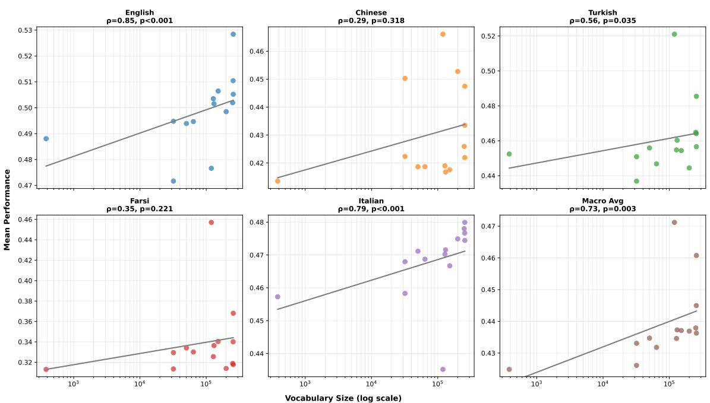  
Figure 6: Correlation between vocab size and model performance for the TokSuite models. Facets represent evaluation language.

The evaluation results for the TIMTC models are shown in Tables 16–18, one per vocabulary size. Column labels abbreviate the tokenizer configurations described in Table 3.

## D.2 TIMTC

Table 16: Evaluation scores for TIMTC models (vocab size 32,768) on English tasks.
<table><tr><td></td><td>BPE</td><td>PPL- ng-fs</td><td>PPL-  $\mathrm { n g \mathrm { - } f s d }$ </td><td>PPL- uni-fs</td><td>PPR- fsd</td><td>PPR- none</td><td>PPR- sd</td><td>SAGE- bpe</td><td>SAGE- ng-fs</td><td>SAGE- ng-fsd</td><td>SAGE- uni</td><td>UNI- gr</td><td>UNI- lk</td><td>UNI- ppl</td><td>WP</td><td>Chance</td></tr><tr><td>GLUE</td><td>0.478</td><td>0.452</td><td>0.475</td><td>0.463</td><td>0.457</td><td>0.468</td><td>0.480</td><td>0.461</td><td>0.482</td><td>0.458</td><td>0.451</td><td>0.471</td><td>0.462</td><td>0.463</td><td>0.466</td><td>0.45</td></tr><tr><td>Winogrande</td><td>0.505</td><td>0.507</td><td>0.507</td><td>0.507</td><td>0.529</td><td>0.507</td><td>0.515</td><td>0.522</td><td>0.530</td><td>0.541</td><td>0.515</td><td>0.507</td><td>0.524</td><td>0.522</td><td>0.521</td><td>0.50</td></tr><tr><td>BLiMP</td><td>0.824</td><td>0.711</td><td>0.730</td><td>0.757</td><td>0.741</td><td>0.758</td><td>0.790</td><td>0.817</td><td>0.811</td><td>0.799</td><td>0.814</td><td>0.822</td><td>0.823</td><td>0.739</td><td>0.829</td><td>0.50</td></tr><tr><td>MultiBLiMP</td><td>0.983</td><td>0.916</td><td>0.919</td><td>0.899</td><td>0.917</td><td>0.951</td><td>0.983</td><td>0.988</td><td>0.986</td><td>0.981</td><td>0.975</td><td>0.987</td><td>0.981</td><td>0.887</td><td>0.979</td><td>0.50</td></tr><tr><td>EWoK</td><td>0.569</td><td>0.518</td><td>0.519</td><td>0.538</td><td>0.515</td><td>0.525</td><td>0.556</td><td>0.570</td><td>0.565</td><td>0.564</td><td>0.569</td><td>0.564</td><td>0.568</td><td>0.535</td><td>0.568</td><td>0.50</td></tr><tr><td>PIQA</td><td>0.653</td><td>0.607</td><td>0.611</td><td>0.616</td><td>0.607</td><td>0.612</td><td>0.641</td><td>0.658</td><td>0.653</td><td>0.657</td><td>0.655</td><td>0.657</td><td>0.658</td><td>0.614</td><td>0.649</td><td>0.50</td></tr><tr><td>HellaSwag</td><td>0.327</td><td>0.294</td><td>0.292</td><td>0.296</td><td>0.296</td><td>0.306</td><td>0.320</td><td>0.320</td><td>0.322</td><td>0.320</td><td>0.325</td><td>0.325</td><td>0.325</td><td>0.301</td><td>0.324</td><td>0.25</td></tr><tr><td>PROST</td><td>0.192</td><td>0.223</td><td>0.227</td><td>0.248</td><td>0.229</td><td>0.248</td><td>0.213</td><td>0.211</td><td>0.230</td><td>0.235</td><td>0.222</td><td>0.230</td><td>0.228</td><td>0.243</td><td>0.219</td><td>0.25</td></tr><tr><td>MMLU</td><td>0.233</td><td>0.248</td><td>0.240</td><td>0.234</td><td>0.240</td><td>0.240</td><td>0.235</td><td>0.239</td><td>0.240</td><td>0.230</td><td>0.231</td><td>0.233</td><td>0.232</td><td>0.231</td><td>0.231</td><td>0.25</td></tr><tr><td>BBH</td><td>0.003</td><td>0.000</td><td>0.000</td><td>0.000</td><td>0.000</td><td>0.006</td><td>0.000</td><td>0.000</td><td>0.000</td><td>0.000</td><td>0.000</td><td>0.000</td><td>0.000</td><td>0.000</td><td>0.000</td><td>0.33</td></tr><tr><td>XQuAD</td><td>0.000</td><td>0.000</td><td>0.001</td><td>0.000</td><td>0.000</td><td>0.000</td><td>0.001</td><td>0.000</td><td>0.000</td><td>0.000</td><td>0.006</td><td>0.000</td><td>0.000</td><td>0.004</td><td>0.000</td><td>0.00</td></tr><tr><td>Belebele</td><td>0.339</td><td>0.329</td><td>0.327</td><td>0.320</td><td>0.340</td><td>0.287</td><td>0.340</td><td>0.333</td><td>0.342</td><td>0.343</td><td>0.353</td><td>0.342</td><td>0.337</td><td>0.330</td><td>0.359</td><td>0.25</td></tr><tr><td>COMPS</td><td>0.601</td><td>0.520</td><td>0.527</td><td>0.558</td><td>0.519</td><td>0.560</td><td>0.564</td><td>0.589</td><td>0.588</td><td>0.582</td><td>0.595</td><td>0.582</td><td>0.598</td><td>0.552</td><td>0.601</td><td>0.50</td></tr><tr><td>ANALOGICAL</td><td>0.647</td><td>0.445</td><td>0.427</td><td>0.429</td><td>0.449</td><td>0.413</td><td>0.609</td><td>0.627</td><td>0.563</td><td>0.585</td><td>0.582</td><td>0.585</td><td>0.572</td><td>0.382</td><td>0.610</td><td>0.25</td></tr><tr><td>Avg.</td><td>0.454</td><td>0.412</td><td>0.414</td><td>0.419</td><td>0.417</td><td>0.420</td><td>0.446</td><td>0.453</td><td>0.451</td><td>0.450</td><td>0.450</td><td>0.450</td><td>0.451</td><td>0.415</td><td>0.454</td><td>0.36</td></tr></table>

Table 17: Evaluation scores for TIMTC models (vocab size 40,960) on English tasks.
<table><tr><td></td><td>BPE</td><td>PPL- ng-fs</td><td> $\mathrm { P P L } _ { - }$   $\mathrm { n g \mathrm { - } f s d }$ </td><td>PPL- uni-fs</td><td>PPR- fsd</td><td>PPR- none</td><td>PPR- sd</td><td>SAGE- bpe</td><td>SAGE- ng-fs</td><td>SAGE- ng-fsd</td><td>SAGE- uni</td><td>UNI- gr</td><td>UNI- lk</td><td>UNI- ppl</td><td>WP</td><td>Chance</td></tr><tr><td>GLUE</td><td>0.474</td><td>0.456</td><td>0.458</td><td>0.456</td><td>0.466</td><td>0.458</td><td>0.479</td><td>0.462</td><td>0.478</td><td>0.469</td><td>0.459</td><td>0.455</td><td>0.470</td><td>0.455</td><td>0.460</td><td>0.45</td></tr><tr><td>Winogrande</td><td>0.536</td><td>0.507</td><td>0.497</td><td>0.507</td><td>0.527</td><td>0.513</td><td>0.488</td><td>0.522</td><td>0.503</td><td>0.507</td><td>0.517</td><td>0.524</td><td>0.496</td><td>0.496</td><td>0.520</td><td>0.50</td></tr><tr><td>BLiMP</td><td>0.825</td><td>0.750</td><td>0.732</td><td>0.748</td><td>0.736</td><td>0.748</td><td>0.738</td><td>0.819</td><td>0.802</td><td>0.793</td><td>0.814</td><td>0.821</td><td>0.822</td><td>0.735</td><td>0.822</td><td>0.50</td></tr><tr><td>MultiBLiMP</td><td>0.977</td><td>0.919</td><td>0.922</td><td>0.865</td><td>0.918</td><td>0.951</td><td>0.927</td><td>0.990</td><td>0.984</td><td>0.974</td><td>0.984</td><td>0.983</td><td>0.982</td><td>0.869</td><td>0.982</td><td>0.50</td></tr><tr><td>EWoK</td><td>0.570</td><td>0.518</td><td>0.524</td><td>0.533</td><td>0.527</td><td>0.536</td><td>0.530</td><td>0.575</td><td>0.574</td><td>0.557</td><td>0.560</td><td>0.572</td><td>0.571</td><td>0.530</td><td>0.577</td><td>0.50</td></tr><tr><td>PIQA</td><td>0.659</td><td>0.602</td><td>0.604</td><td>0.615</td><td>0.602</td><td>0.609</td><td>0.600</td><td>0.668</td><td>0.659</td><td>0.645</td><td>0.657</td><td>0.655</td><td>0.655</td><td>0.608</td><td>0.665</td><td>0.50</td></tr><tr><td>HellaSwag</td><td>0.324</td><td>0.294</td><td>0.295</td><td>0.296</td><td>0.290</td><td>0.303</td><td>0.297</td><td>0.324</td><td>0.322</td><td>0.315</td><td>0.327</td><td>0.325</td><td>0.326</td><td>0.299</td><td>0.327</td><td>0.25</td></tr><tr><td>PROST</td><td>0.189</td><td>0.238</td><td>0.203</td><td>0.220</td><td>0.236</td><td>0.252</td><td>0.232</td><td>0.224</td><td>0.234</td><td>0.233</td><td>0.239</td><td>0.195</td><td>0.231</td><td>0.240</td><td>0.220</td><td>0.25</td></tr><tr><td>MMLU</td><td>0.240</td><td>0.229</td><td>0.235</td><td>0.248</td><td>0.229</td><td>0.243</td><td>0.231</td><td>0.229</td><td>0.247</td><td>0.231</td><td>0.231</td><td>0.231</td><td>0.231</td><td>0.236</td><td>0.241</td><td>0.25</td></tr><tr><td>BBH</td><td>0.002</td><td>0.005</td><td>0.002</td><td>0.000</td><td>0.000</td><td>0.002</td><td>0.000</td><td>0.002</td><td>0.000</td><td>0.002</td><td>0.000</td><td>0.000</td><td>0.000</td><td>0.000</td><td>0.000</td><td>0.33</td></tr><tr><td>XQuAD</td><td>0.000</td><td>0.000</td><td>0.000</td><td>0.002</td><td>0.000</td><td>0.000</td><td>0.001</td><td>0.000</td><td>0.000</td><td>0.001</td><td>0.005</td><td>0.000</td><td>0.000</td><td>0.000</td><td>0.000</td><td>0.00</td></tr><tr><td>Belebele</td><td>0.337</td><td>0.333</td><td>0.324</td><td>0.312</td><td>0.330</td><td>0.286</td><td>0.339</td><td>0.346</td><td>0.348</td><td>0.360</td><td>0.357</td><td>0.334</td><td>0.333</td><td>0.328</td><td>0.349</td><td>0.25</td></tr><tr><td>COMPS</td><td>0.603</td><td>0.515</td><td>0.519</td><td>0.557</td><td>0.519</td><td>0.563</td><td>0.522</td><td>0.604</td><td>0.578</td><td>0.552</td><td>0.592</td><td>0.588</td><td>0.604</td><td>0.555</td><td>0.599</td><td>0.50</td></tr><tr><td>ANALOGICAL</td><td>0.659</td><td>0.456</td><td>0.468</td><td>0.424</td><td>0.502</td><td>0.387</td><td>0.470</td><td>0.651</td><td>0.569</td><td>0.501</td><td>0.588</td><td>0.566</td><td>0.596</td><td>0.409</td><td>0.660</td><td>0.25</td></tr><tr><td>Avg.</td><td>0.457</td><td>0.416</td><td>0.413</td><td>0.413</td><td>0.420</td><td>0.418</td><td>0.418</td><td>0.458</td><td>0.450</td><td>0.439</td><td>0.452</td><td>0.446</td><td>0.451</td><td>0.411</td><td>0.459</td><td>0.36</td></tr></table>

Table 18: Evaluation scores for TIMTC models (vocab size 49,152) on English tasks.
<table><tr><td></td><td>BPE</td><td>PPL- ng-fs</td><td>PPL- ng-fsd</td><td>PPL- uni-fs</td><td>PPR- fsd</td><td>PPR- none</td><td>PPR- sd</td><td>SAGE- bpe</td><td>SAGE- ng-fs</td><td>SAGE- ng-fsd</td><td>SAGE- uni</td><td>UNI- gr</td><td>UNI- lk</td><td>UNI-</td><td>WP ppl</td><td>Chance</td></tr><tr><td>GLUE</td><td>0.474</td><td>0.455</td><td>0.455</td><td>0.463</td><td>0.461</td><td>0.459</td><td>0.456</td><td>0.451</td><td>0.460</td><td>0.436</td><td>0.459</td><td>0.444</td><td>0.462</td><td>0.467</td><td>0.464</td><td>0.45</td></tr><tr><td>Winogrande</td><td>0.522</td><td>0.501</td><td>0.510</td><td>0.503</td><td>0.508</td><td>0.525</td><td>0.520</td><td>0.515</td><td>0.512</td><td>0.519</td><td>0.508</td><td>0.500</td><td>0.512</td><td>0.505</td><td>0.510</td><td>0.50</td></tr><tr><td>BLiMP</td><td>0.810</td><td>0.727</td><td>0.738</td><td>0.746</td><td>0.748</td><td>0.749</td><td>0.802</td><td>0.814</td><td>0.809</td><td>0.779</td><td>0.821</td><td>0.817</td><td>0.822</td><td>0.738</td><td>0.826</td><td>0.50</td></tr><tr><td>MultiBLiMP</td><td>0.971</td><td>0.919</td><td>0.910</td><td>0.856</td><td>0.925</td><td>0.927</td><td>0.975</td><td>0.987</td><td>0.982</td><td>0.969</td><td>0.987</td><td>0.978</td><td>0.983</td><td>0.869</td><td>0.982</td><td>0.50</td></tr><tr><td>EWoK</td><td>0.566</td><td>0.518</td><td>0.518</td><td>0.537</td><td>0.522</td><td>0.527</td><td>0.556</td><td>0.566</td><td>0.574</td><td>0.544</td><td>0.575</td><td>0.583</td><td>0.557</td><td>0.543</td><td>0.563</td><td>0.50</td></tr><tr><td>PIQA</td><td>0.661</td><td>0.596</td><td>0.597</td><td>0.613</td><td>0.608</td><td>0.611</td><td>0.641</td><td>0.653</td><td>0.655</td><td>0.640</td><td>0.655</td><td>0.665</td><td>0.666</td><td>0.609</td><td>0.661</td><td>0.50</td></tr><tr><td>HellaSwag</td><td>0.327</td><td>0.293</td><td>0.291</td><td>0.295</td><td>0.293</td><td>0.300</td><td>0.320</td><td>0.325</td><td>0.321</td><td>0.311</td><td>0.322</td><td>0.324</td><td>0.328</td><td>0.298</td><td>0.327</td><td>0.25</td></tr><tr><td>PROST</td><td>0.207</td><td>0.240</td><td>0.225</td><td>0.239</td><td>0.221</td><td>0.252</td><td>0.212</td><td>0.234</td><td>0.232</td><td>0.218</td><td>0.218</td><td>0.218</td><td>0.209</td><td>0.249</td><td>0.208</td><td>0.25</td></tr><tr><td>MMLU</td><td>0.234</td><td>0.232</td><td>0.230</td><td>0.233</td><td>0.233</td><td>0.237</td><td>0.235</td><td>0.248</td><td>0.237</td><td>0.233</td><td>0.237</td><td>0.232</td><td>0.238</td><td>0.231</td><td>0.232</td><td>0.25</td></tr><tr><td>BBH</td><td>0.000</td><td>0.000</td><td>0.000</td><td>0.002</td><td>0.000</td><td>0.002</td><td>0.002</td><td>0.000</td><td>0.005</td><td>0.000</td><td>0.000</td><td>0.002</td><td>0.001</td><td>0.000</td><td>0.000</td><td>0.33</td></tr><tr><td>XQuAD</td><td>0.000</td><td>0.000</td><td>0.000</td><td>0.010</td><td>0.000</td><td>0.000</td><td>0.001</td><td>0.000</td><td>0.000</td><td>0.000</td><td>0.019</td><td>0.002</td><td>0.000</td><td>0.000</td><td>0.000</td><td>0.00</td></tr><tr><td>Belebele</td><td>0.334</td><td>0.322</td><td>0.314</td><td>0.313</td><td>0.324</td><td>0.283</td><td>0.329</td><td>0.364</td><td>0.330</td><td>0.343</td><td>0.334</td><td>0.344</td><td>0.334</td><td>0.328</td><td>0.337</td><td>0.25</td></tr><tr><td>COMPS</td><td>0.599</td><td>0.519</td><td>0.519</td><td>0.551</td><td>0.519</td><td>0.559</td><td>0.562</td><td>0.599</td><td>0.594</td><td>0.549</td><td>0.596</td><td>0.596</td><td>0.602</td><td>0.553</td><td>0.601</td><td>0.50</td></tr><tr><td>ANALOGICAL</td><td>0.619</td><td>0.445</td><td>0.492</td><td>0.410</td><td>0.511</td><td>0.364</td><td>0.629</td><td>0.632</td><td>0.590</td><td>0.447</td><td>0.644</td><td>0.590</td><td>0.587</td><td>0.414</td><td>0.652</td><td>0.25</td></tr><tr><td>Avg.</td><td>0.452</td><td>0.412</td><td>0.414</td><td>0.412</td><td>0.420</td><td>0.414</td><td>0.446</td><td>0.456</td><td>0.450</td><td>0.428</td><td>0.455</td><td>0.450</td><td>0.450</td><td>0.415</td><td>0.454</td><td>0.36</td></tr></table>

The results for each of the VISTA models are presented by language: Amharic (Table 19), English 130M (Table 20), English 350M (Table 21), Vietnamese (Table 22), Thai (Table 23), and Urdu (Table 24).

## D.3 VISTA

Table 19: Evaluation scores for Amharic VISTA models on Amharic tasks.
<table><tr><td>Tokenizer Type</td><td>Vocab Size</td><td>AfriMMLU</td><td>Belebele</td><td>Global MMLU</td><td>MultiBLiMP</td><td>Global PIQA</td><td> $\operatorname { A v g } .$ </td></tr><tr><td rowspan="8">BPE</td><td>8192</td><td>0.222</td><td>0.253</td><td>0.236</td><td>0.946</td><td>0.520</td><td>0.402</td></tr><tr><td>16384</td><td>0.232</td><td>0.254</td><td>0.249</td><td>0.955</td><td>0.470</td><td>0.402</td></tr><tr><td>32768</td><td>0.230</td><td>0.268</td><td>0.251</td><td>0.893</td><td>0.500</td><td>0.399</td></tr><tr><td>49152</td><td>0.240</td><td>0.253</td><td>0.253</td><td>1.000</td><td>0.450</td><td>0.408</td></tr><tr><td>65536</td><td>0.228</td><td>0.260</td><td>0.260</td><td>0.973</td><td>0.480</td><td>0.410</td></tr><tr><td>81920</td><td>0.248</td><td>0.257</td><td>0.248</td><td>0.973</td><td>0.470</td><td>0.407</td></tr><tr><td>98304</td><td>0.222</td><td>0.262</td><td>0.255</td><td>0.964</td><td>0.450</td><td>0.401</td></tr><tr><td>114688</td><td>0.240</td><td>0.271</td><td>0.239</td><td>0.964</td><td>0.420</td><td>0.396</td></tr><tr><td rowspan="8">Unigram</td><td>8192</td><td>0.240</td><td>0.257</td><td>0.230</td><td>0.982</td><td>0.450</td><td>0.398</td></tr><tr><td>16384</td><td>0.232</td><td>0.260</td><td>0.232</td><td>0.920</td><td>0.450</td><td>0.387</td></tr><tr><td>32768</td><td>0.224</td><td>0.258</td><td>0.243</td><td>0.955</td><td>0.450</td><td>0.396</td></tr><tr><td>49152</td><td>0.232</td><td>0.262</td><td>0.239</td><td>0.982</td><td>0.430</td><td>0.398</td></tr><tr><td>65536</td><td>0.228</td><td>0.249</td><td>0.230</td><td>0.973</td><td>0.430</td><td>0.390</td></tr><tr><td>81920</td><td>0.226</td><td>0.260</td><td>0.230</td><td>0.991</td><td>0.380</td><td>0.386</td></tr><tr><td>98304</td><td>0.226</td><td>0.257</td><td>0.229</td><td>0.982</td><td>0.410</td><td>0.389</td></tr><tr><td>114688</td><td>0.228</td><td>0.253</td><td>0.230</td><td>0.938</td><td>0.400</td><td>0.380</td></tr><tr><td>Chance</td><td></td><td>0.25</td><td>0.25</td><td>0.25</td><td>0.50</td><td>0.50</td><td>0.33</td></tr></table>

Table 20: Evaluation scores for English VISTA models on English tasks. ARC Challenge and ARC Easy are abbreviated to ARC-C and ARC-E.
<table><tr><td>Tokenizer Type</td><td>Vocab Size</td><td>ARC-C</td><td>ARC-E</td><td>Belebele</td><td>BLiMP</td><td>COPA</td><td>Global MMLU</td><td>Hella Swag</td><td>Multi BLiMP</td><td>Winogrande</td><td>XWinograd</td><td>Global PIQA</td><td>Super GLUE</td><td>Avg.</td></tr><tr><td rowspan="8">BPE</td><td>8192</td><td>0.191</td><td>0.277</td><td>0.273</td><td>0.586</td><td>0.580</td><td>0.232</td><td>0.266</td><td>0.818</td><td>0.488</td><td>0.523</td><td>0.520</td><td>0.463 0.434</td><td>0.419</td></tr><tr><td>16384</td><td>0.182</td><td>0.269</td><td>0.252</td><td>0.600</td><td>0.580</td><td>0.230</td><td>0.259</td><td>0.783</td><td>0.479</td><td>0.514</td><td>0.450</td><td></td><td>0.405</td></tr><tr><td>32768</td><td>0.188</td><td>0.280</td><td>0.258</td><td>0.613</td><td>0.520</td><td>0.229</td><td>0.255</td><td>0.832</td><td>0.511</td><td>0.505</td><td>0.550</td><td>0.439</td><td>0.416</td></tr><tr><td>49152</td><td>0.181</td><td>0.270</td><td>0.248</td><td>0.654</td><td>0.550</td><td>0.229</td><td>0.255</td><td>0.810</td><td>0.503</td><td>0.508</td><td>0.480</td><td>0.435</td><td>0.412</td></tr><tr><td>65536</td><td>0.177</td><td>0.275</td><td>0.251</td><td>0.640</td><td>0.540</td><td>0.230</td><td>0.255</td><td>0.838</td><td>0.505</td><td>0.497</td><td>0.470</td><td>0.447</td><td>0.412</td></tr><tr><td>81920</td><td>0.178</td><td>0.277</td><td>0.257</td><td>0.645</td><td>0.510</td><td>0.230</td><td>0.258</td><td>0.847</td><td>0.503</td><td>0.511</td><td>0.510</td><td>0.434</td><td>0.415</td></tr><tr><td>98304</td><td>0.171</td><td>0.279</td><td>0.260</td><td>0.661</td><td>0.510</td><td>0.231</td><td>0.260</td><td>0.842</td><td>0.507</td><td>0.512</td><td>0.510</td><td>0.438</td><td>0.416</td></tr><tr><td>114688</td><td>0.176</td><td>0.281</td><td>0.266</td><td>0.658</td><td>0.540</td><td>0.230</td><td>0.258</td><td>0.836</td><td>0.494</td><td>0.509</td><td>0.500</td><td>0.442</td><td>0.417</td></tr><tr><td rowspan="9">Unigram</td><td>8192</td><td>0.200</td><td>0.270</td><td>0.256</td><td>0.587</td><td>0.580</td><td>0.231</td><td>0.265</td><td>0.769</td><td>0.507</td><td>0.519</td><td>0.490</td><td>0.452</td><td>0.412</td></tr><tr><td>16384</td><td>0.201</td><td>0.287</td><td>0.252</td><td>0.602</td><td>0.590</td><td>0.230</td><td>0.257</td><td>0.806</td><td>0.486</td><td>0.513</td><td>0.490</td><td>0.446</td><td>0.415</td></tr><tr><td>32768</td><td>0.187</td><td>0.268</td><td>0.253</td><td>0.618</td><td>0.480</td><td>0.230</td><td>0.259</td><td>0.804</td><td>0.486</td><td>0.493</td><td>0.500</td><td>0.403</td><td>0.401</td></tr><tr><td>49152</td><td>0.186 0.179</td><td>0.274 0.271</td><td>0.254 0.258</td><td>0.640</td><td>0.630</td><td>0.229 0.230</td><td>0.258</td><td>0.797 0.805</td><td>0.497 0.502</td><td>0.517</td><td>0.500</td><td>0.441</td><td>0.420</td></tr><tr><td>65536</td><td>0.186</td><td>0.272</td><td>0.258</td><td>0.626 0.602</td><td>0.570 0.560</td><td>0.229</td><td>0.257 0.257</td><td>0.812</td><td>0.502</td><td>0.505 0.503</td><td>0.510</td><td>0.444</td><td>0.414</td></tr><tr><td>81920</td><td>0.189</td><td>0.266</td><td>0.254</td><td>0.639</td><td>0.600</td><td>0.229</td><td>0.258</td><td>0.786</td><td>0.487</td><td>0.521</td><td>0.510 0.520</td><td>0.453 0.424</td><td>0.413 0.416</td></tr><tr><td>98304 114688</td><td>0.199</td><td>0.274</td><td>0.259</td><td>0.592</td><td>0.600</td><td>0.230</td><td>0.259</td><td>0.796</td><td>0.537</td><td>0.513</td><td>0.500</td><td>0.433</td><td></td></tr><tr><td></td><td></td><td></td><td></td><td></td><td></td><td></td><td></td><td></td><td></td><td></td><td></td><td></td><td>0.417</td></tr><tr><td>Chance</td><td>0.25</td><td>0.25</td><td>0.25</td><td>0.50</td><td>0.50</td><td>0.25</td><td>0.25</td><td>0.50</td><td>0.50</td><td>0.50</td><td>0.50</td><td>0.48</td><td>0.38</td></tr></table>

Table 21: Evaluation scores for English VISTA 350M models on English tasks.
<table><tr><td>Tokenizer Type</td><td>Vocab Size</td><td>GLUE</td><td>Wino- grande</td><td>BLiMP</td><td>Multi BLiMP</td><td>EWoK</td><td>PIQA</td><td>Hella Swag</td><td>PROST</td><td>MMLU</td><td>BBH</td><td>XQuAD</td><td>Bele- bele</td><td>COMPS</td><td>LOGICAL</td><td>ANA- Avg.</td></tr><tr><td></td><td>8192</td><td>0.469</td><td>0.499</td><td>0.593</td><td>0.861</td><td>0.525</td><td>0.612</td><td>0.289</td><td>0.269</td><td>0.233</td><td>0.059</td><td>0.000</td><td>0.288</td><td>0.540</td><td>0.398</td><td>0.402</td></tr><tr><td>BPE</td><td>32768</td><td>0.456</td><td>0.501</td><td>0.624</td><td>0.825</td><td>0.530</td><td>0.595</td><td>0.294</td><td>0.217</td><td>0.231</td><td>0.144</td><td>0.005</td><td>0.301</td><td>0.526</td><td>0.368</td><td>0.401</td></tr><tr><td></td><td>65536</td><td>0.466</td><td>0.516</td><td>0.579</td><td>0.792</td><td>0.535</td><td>0.606</td><td>0.292</td><td>0.252</td><td>0.229</td><td>0.163</td><td>0.008</td><td>0.321</td><td>0.551</td><td>0.377</td><td>0.406</td></tr><tr><td></td><td>98304</td><td>0.469</td><td>0.497</td><td>0.629</td><td>0.855</td><td>0.540</td><td>0.630</td><td>0.301</td><td>0.272</td><td>0.230</td><td>0.181</td><td>0.001</td><td>0.293</td><td>0.575</td><td>0.448</td><td>0.423</td></tr><tr><td></td><td>8192</td><td>0.413</td><td>0.490</td><td>0.582</td><td>0.852</td><td>0.512</td><td>0.582</td><td>0.283</td><td>0.244</td><td>0.230</td><td>0.090</td><td>0.000</td><td>0.298</td><td>0.512</td><td>0.362</td><td>0.389</td></tr><tr><td></td><td>32768</td><td>0.444</td><td>0.511</td><td>0.595</td><td>0.816</td><td>0.524</td><td>0.611</td><td>0.294</td><td>0.260</td><td>0.232</td><td>0.134</td><td>0.000</td><td>0.278</td><td>0.542</td><td>0.371</td><td>0.401</td></tr><tr><td>Unigram</td><td>65536</td><td>0.462</td><td>0.509</td><td>0.584</td><td>0.810</td><td>0.543</td><td>0.616</td><td>0.291</td><td>0.260</td><td>0.230</td><td>0.134</td><td>0.008</td><td>0.290</td><td>0.544</td><td>0.445</td><td>0.409</td></tr><tr><td></td><td>98304</td><td>0.396</td><td>0.506</td><td>0.633</td><td>0.848</td><td>0.546</td><td>0.604</td><td>0.299</td><td>0.267</td><td>0.228</td><td>0.127</td><td>0.007</td><td>0.294</td><td>0.569</td><td>0.436</td><td>0.411</td></tr><tr><td>Chance</td><td></td><td>0.45</td><td>0.50</td><td>0.50</td><td>0.50</td><td>0.50</td><td>0.50</td><td>0.25</td><td>0.25</td><td>0.25</td><td>0.33</td><td>0.00</td><td>0.25</td><td>0.50</td><td>0.25</td><td>0.36</td></tr></table>

Table 22: Evaluation scores for Vietnamese VISTA models on Vietnamese tasks.
<table><tr><td>Tokenizer Type</td><td>Vocab Size</td><td>ARC</td><td>Belebele</td><td>Global MMLU</td><td>HellaSwag</td><td>INCLUDE</td><td>ViQuAD</td><td>VMLU</td><td>XCOPA</td><td>XNLI</td><td>Global PIQA</td><td>Avg.</td></tr><tr><td rowspan="9">bpe</td><td>8192</td><td>0.209</td><td>0.256</td><td>0.245</td><td>0.266</td><td>0.255</td><td>0.006</td><td>0.249</td><td>0.544</td><td>0.343</td><td>0.520</td><td>0.285</td></tr><tr><td>16384</td><td>0.206</td><td>0.228</td><td>0.248</td><td>0.260</td><td>0.253</td><td>0.016</td><td>0.270</td><td>0.540</td><td>0.341</td><td>0.560</td><td>0.288</td></tr><tr><td>32768</td><td>0.206</td><td>0.239</td><td>0.246</td><td>0.262</td><td>0.260</td><td>0.031</td><td>0.277</td><td>0.532</td><td>0.356</td><td>0.580</td><td>0.294</td></tr><tr><td>49152</td><td>0.220</td><td>0.239</td><td>0.249</td><td>0.259</td><td>0.253</td><td>0.021</td><td>0.263</td><td>0.530</td><td>0.337</td><td>0.600</td><td>0.293</td></tr><tr><td>65536</td><td>0.214</td><td>0.246</td><td>0.241</td><td>0.259</td><td>0.273</td><td>0.001</td><td>0.290</td><td>0.534</td><td>0.341</td><td>0.550</td><td>0.290</td></tr><tr><td>81920</td><td>0.212</td><td>0.232</td><td>0.242</td><td>0.257</td><td>0.267</td><td>0.056</td><td>0.267</td><td>0.506</td><td>0.330</td><td>0.590</td><td>0.291</td></tr><tr><td>98304</td><td>0.215</td><td>0.241</td><td>0.238</td><td>0.258</td><td>0.275</td><td>0.038</td><td>0.250</td><td>0.526</td><td>0.334</td><td>0.570</td><td>0.289</td></tr><tr><td>114688</td><td>0.213</td><td>0.247</td><td>0.240</td><td>0.259</td><td>0.278</td><td>0.062</td><td>0.282</td><td>0.532</td><td>0.337</td><td>0.610</td><td>0.300</td></tr><tr><td>8192</td><td>0.199</td><td>0.240</td><td>0.242</td><td>0.265</td><td>0.276</td><td>0.024</td><td>0.262</td><td>0.532</td><td>0.333</td><td></td><td>0.286</td></tr><tr><td rowspan="8">unigram</td><td>16384</td><td>0.203</td><td>0.244</td><td>0.249</td><td>0.262</td><td>0.236</td><td>0.195</td><td>0.273</td><td>0.540</td><td>0.353</td><td>0.530 0.490</td><td>0.299</td></tr><tr><td>32768</td><td>0.209</td><td>0.244</td><td>0.250</td><td>0.259</td><td>0.249</td><td>0.037</td><td>0.253</td><td>0.540</td><td>0.367</td><td>0.540</td><td>0.291</td></tr><tr><td>49152</td><td>0.209</td><td>0.243</td><td>0.252</td><td>0.260</td><td>0.238</td><td>0.040</td><td>0.265</td><td>0.548</td><td>0.361</td><td></td><td>0.293</td></tr><tr><td>65536</td><td>0.212</td><td>0.242</td><td>0.243</td><td>0.258</td><td>0.233</td><td>0.035</td><td>0.246</td><td>0.536</td><td>0.340</td><td>0.560 0.540</td><td>0.284</td></tr><tr><td>81920</td><td>0.205</td><td>0.242</td><td>0.254</td><td>0.262</td><td>0.227</td><td>0.047</td><td>0.270</td><td>0.548</td><td>0.345</td><td>0.580</td><td>0.294</td></tr><tr><td>98304</td><td>0.205</td><td>0.249</td><td>0.252</td><td>0.262</td><td>0.225</td><td>0.031</td><td>0.265</td><td>0.540</td><td>0.334</td><td>0.530</td><td>0.286</td></tr><tr><td>114688</td><td>0.207</td><td>0.238</td><td>0.254</td><td>0.259</td><td>0.231</td><td>0.084</td><td>0.273</td><td>0.538</td><td>0.341</td><td>0.530</td><td>0.292</td></tr><tr><td></td><td>0.25</td><td>0.25</td><td>0.25</td><td>0.25</td><td>0.25</td><td>0.00</td><td>0.25</td><td>0.50</td><td>0.33</td><td>0.50</td><td>0.28</td></tr></table>

Table 23: Evaluation scores for Thai VISTA models on Thai tasks.
<table><tr><td>Tokenizer Type</td><td>Vocab Size</td><td>Belebele</td><td>Winograd</td><td>XCOPA</td><td>MMLU</td><td>Global PIQA</td><td> $\operatorname { A v g } .$ </td></tr><tr><td rowspan="9">BPE</td><td>8192</td><td>0.259</td><td>0.470</td><td>0.536</td><td>0.082</td><td>0.540</td><td>0.377</td></tr><tr><td>16384</td><td>0.261</td><td>0.540</td><td>0.556</td><td>0.083</td><td>0.500</td><td>0.388</td></tr><tr><td>32768</td><td>0.251</td><td>0.530</td><td>0.544</td><td>0.080</td><td>0.540</td><td>0.389</td></tr><tr><td>49152</td><td>0.246</td><td>0.540</td><td>0.540</td><td>0.084</td><td>0.530</td><td>0.388</td></tr><tr><td>65536</td><td>0.254</td><td>0.516</td><td>0.562</td><td>0.082</td><td>0.510</td><td>0.385</td></tr><tr><td>81920</td><td>0.256</td><td>0.509</td><td>0.550</td><td>0.083</td><td>0.510</td><td>0.381</td></tr><tr><td>98304</td><td>0.253</td><td>0.498</td><td>0.550</td><td>0.082</td><td>0.500</td><td>0.377</td></tr><tr><td>114688</td><td>0.247</td><td>0.519</td><td>0.540</td><td>0.084</td><td>0.490</td><td>0.376</td></tr><tr><td>8192</td><td>0.278</td><td>0.474</td><td>0.564</td><td>0.081</td><td>0.490</td><td>0.377</td></tr><tr><td rowspan="8">Unigram</td><td>16384</td><td>0.263</td><td>0.495</td><td>0.528</td><td>0.085</td><td>0.510</td><td>0.376</td></tr><tr><td>32768</td><td>0.259</td><td>0.526</td><td>0.544</td><td>0.083</td><td>0.510</td><td>0.384</td></tr><tr><td>49152</td><td>0.247</td><td>0.519</td><td>0.554</td><td>0.085</td><td>0.550</td><td>0.391</td></tr><tr><td>65536</td><td>0.259</td><td>0.456</td><td>0.564</td><td>0.084</td><td>0.500</td><td>0.373</td></tr><tr><td>81920</td><td>0.247</td><td>0.533</td><td>0.562</td><td>0.081</td><td>0.530</td><td>0.391</td></tr><tr><td>98304</td><td>0.252</td><td>0.512</td><td>0.576</td><td>0.083</td><td>0.490</td><td>0.383</td></tr><tr><td>114688</td><td>0.248</td><td>0.512</td><td>0.570</td><td>0.082</td><td>0.520</td><td>0.387</td></tr><tr><td></td><td>0.25</td><td>0.50</td><td>0.50</td><td>0.25</td><td>0.50</td><td></td></tr></table>

Table 24: Evaluation scores for Urdu VISTA models on Urdu tasks.
<table><tr><td>Tokenizer  $\mathrm { T y p e }$ </td><td> $\mathrm { V o c a b ~ S i z e }$ </td><td>Belebele</td><td> $\mathbf { M M L U } \mathbf { P r o X }$ </td><td> $\mathrm { G l o b a l P I Q A }$ </td><td> $\mathbf { A v } \mathbf { g } .$ </td></tr><tr><td rowspan="9">BPE</td><td>8192</td><td>0.249</td><td>0.085</td><td>0.590</td><td>0.308</td></tr><tr><td>16384</td><td>0.259</td><td>0.083</td><td>0.620</td><td>0.321</td></tr><tr><td>32768</td><td>0.254</td><td>0.086</td><td>0.620</td><td>0.320</td></tr><tr><td>49152</td><td>0.254</td><td>0.086</td><td>0.610</td><td>0.317</td></tr><tr><td>65536</td><td>0.262</td><td>0.086</td><td>0.610</td><td>0.319</td></tr><tr><td>81920</td><td>0.244</td><td>0.087</td><td>0.580</td><td>0.304</td></tr><tr><td>98304</td><td>0.253</td><td>0.087</td><td>0.620</td><td>0.320</td></tr><tr><td>114688</td><td>0.253</td><td>0.086</td><td>0.600</td><td>0.313</td></tr><tr><td>8192</td><td></td><td>0.088</td><td>0.560</td><td>0.297</td></tr><tr><td rowspan="8">Unigram</td><td></td><td>0.242</td><td></td><td></td><td></td></tr><tr><td>16384</td><td>0.242</td><td>0.088</td><td>0.550</td><td>0.293</td></tr><tr><td>32768</td><td>0.248</td><td>0.087</td><td>0.560</td><td>0.298</td></tr><tr><td>49152</td><td>0.254</td><td>0.087</td><td>0.530</td><td>0.290</td></tr><tr><td>65536</td><td>0.249</td><td>0.088</td><td>0.550</td><td>0.296</td></tr><tr><td>81920</td><td>0.252</td><td>0.087</td><td>0.530</td><td>0.290</td></tr><tr><td>98304</td><td>0.247</td><td>0.086</td><td>0.530</td><td>0.287</td></tr><tr><td>114688</td><td>0.247</td><td>0.088</td><td>0.560</td><td>0.298</td></tr><tr><td>Chance</td><td></td><td>0.25</td><td>0.10</td><td>0.50</td><td>0.28</td></tr></table>

## D.3.1 Correlation Between Vocab Size and Performance

Figure 7 plots the relationship between vocabulary size (log-scaled; x-axis) and aggregate performance (mean for each subset, and macro average across language; y-axis) for the VISTA models. For each facet, Spearman’s ρ and p-value are reported.

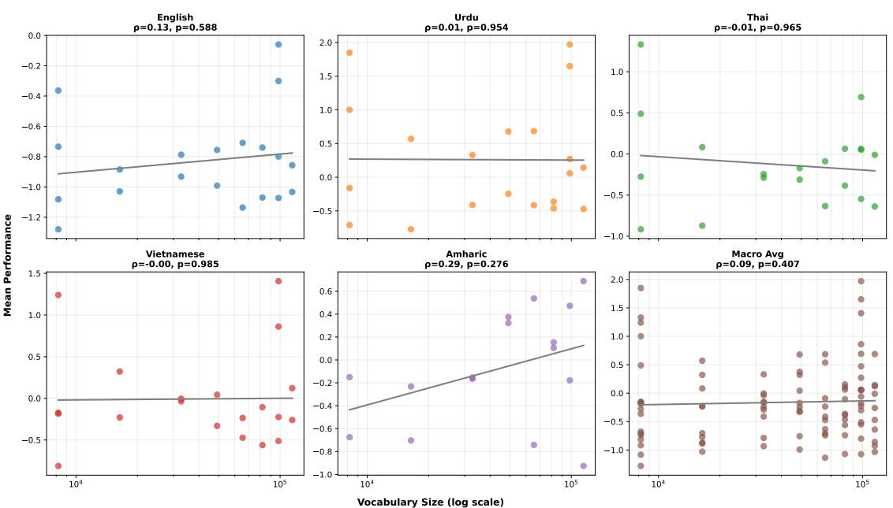  
Figure 7: Correlation between vocabulary size (x-axis) and aggregated (z-scored) model performance by language and macro-averaged over language (bottom right facet). Each facet also reports correlation coefficient and p-value.

## E Full Metric-Performance Correlation Results

Here we show the correlation results for all of the model suites and all of the languages. Figure 8 shows the correlations for the TokSuite models. Figure 9 shows the correlations for the TIMTC models. Figure 10 shows the correlations for the VISTA models.

In Table 25, we report the by-metric correlation reports over all tasks (left) and tasks for which the 130M parameter models scored above chance (right; see Section F).

Table 25: Correlation between tokenizer metrics and model performance, with and without task exclusions (for tasks where performance was near chance). Significance markers (\*) indicate $p _ { \mathrm { c o r r e c t e d } } < 0 . 0 5$
<table><tr><td rowspan="2">Metric</td><td colspan="4">All Tasks</td><td colspan="4">With Exclusions</td></tr><tr><td>r</td><td>p</td><td>Pcorr</td><td>sig</td><td>r</td><td>p</td><td>Pcorr</td><td>sig</td></tr><tr><td>AUC_zipf</td><td>0.03</td><td>0.17</td><td>0.26</td><td></td><td>-0.10</td><td>0.23</td><td>0.44</td><td></td></tr><tr><td></td><td>-0.00</td><td>0.83</td><td>0.98</td><td></td><td>-0.24</td><td>0.00</td><td>0.02</td><td>*</td></tr><tr><td>avg_chars_per_token avg_token_rank</td><td>0.03</td><td>0.16</td><td>0.26</td><td></td><td>-0.03</td><td>0.70</td><td>0.94</td><td></td></tr><tr><td>avg_tokens_per_line</td><td>0.02</td><td>0.36</td><td>0.45</td><td></td><td>0.05</td><td>0.53</td><td>0.84</td><td></td></tr><tr><td>bigrams_entropy</td><td>0.00</td><td>0.89</td><td>0.98</td><td></td><td>-0.10</td><td>0.23</td><td>0.44</td><td></td></tr><tr><td>compression_ratio</td><td>-0.05</td><td>0.02</td><td>0.04</td><td>*</td><td></td><td></td><td></td><td></td></tr><tr><td>corr_chunkability_accuracy</td><td>-0.08</td><td>0.00</td><td>0.00</td><td>*</td><td>-0.25</td><td>0.00</td><td>0.02</td><td>*</td></tr><tr><td>corr_chunkability_rt_mean</td><td>0.02</td><td>0.23</td><td>0.31</td><td></td><td>0.14</td><td>0.09</td><td>0.25</td><td></td></tr><tr><td>corr_chunkability_rt_z</td><td>0.03</td><td>0.07</td><td>0.15</td><td></td><td>0.15</td><td>0.06</td><td>0.17</td><td></td></tr><tr><td>encoding_length</td><td>0.03</td><td>0.12</td><td>0.21</td><td></td><td></td><td></td><td></td><td></td></tr><tr><td>fertility</td><td>0.02</td><td>0.23</td><td>0.31</td><td></td><td>0.04</td><td>0.61</td><td>0.92</td><td></td></tr><tr><td>final_tokens_count</td><td>0.18</td><td>0.00</td><td>0.00</td><td>*</td><td>0.17</td><td>0.03</td><td>0.10</td><td></td></tr><tr><td>gini_coefficient</td><td>0.19</td><td>0.00</td><td>0.00</td><td>*</td><td>0.19</td><td>0.02</td><td>0.08</td><td></td></tr><tr><td>leading_space_tokens_count</td><td>0.27</td><td>0.00</td><td>0.00</td><td>*</td><td>0.27</td><td>0.00</td><td>0.02</td><td>*</td></tr><tr><td>leading_space_tokens_share</td><td>0.22</td><td>0.00</td><td>0.00</td><td>*</td><td>0.19</td><td>0.02</td><td>0.08</td><td></td></tr><tr><td>morphscore_macro_f1</td><td>-0.09</td><td>0.00</td><td>0.00</td><td>*</td><td>0.00</td><td>0.96</td><td>1.00</td><td></td></tr><tr><td>morphscore_micro_f1</td><td>-0.09</td><td>0.00</td><td>0.00</td><td>*</td><td>0.00</td><td>1.00</td><td>1.00</td><td></td></tr><tr><td>morphscore_precision</td><td>-0.07</td><td>0.00</td><td>0.00</td><td>*</td><td>-0.13</td><td>0.14</td><td>0.33</td><td></td></tr><tr><td>morphscore_recall</td><td>-0.12</td><td>0.00</td><td>0.00</td><td>*</td><td>-0.09</td><td>0.28</td><td>0.49</td><td></td></tr><tr><td>POWER_LAW_MAE_zipf</td><td>-0.03</td><td>0.09</td><td>0.18</td><td></td><td>-0.00</td><td>0.99</td><td>1.00</td><td></td></tr><tr><td>renyi_efficiency_a_1</td><td>0.02</td><td>0.24</td><td>0.31</td><td></td><td>-0.03</td><td>0.75</td><td>0.94</td><td></td></tr><tr><td>renyi_efficiency_a_2</td><td>0.00</td><td>1.00</td><td>1.00</td><td></td><td>0.00</td><td>0.98</td><td>1.00</td><td></td></tr><tr><td>renyi_efficiency_a_2_5</td><td>-0.00</td><td>0.88</td><td>0.98</td><td></td><td>-0.01</td><td>0.95</td><td>1.00</td><td></td></tr><tr><td>SLOPE_zipf</td><td>-0.04</td><td>0.06</td><td>0.12</td><td></td><td>-0.18</td><td>0.02</td><td>0.09</td><td></td></tr><tr><td>type_token_ratio</td><td>0.03</td><td>0.15</td><td>0.25</td><td></td><td>0.06</td><td>0.49</td><td>0.82</td><td></td></tr><tr><td>u_mean</td><td>-0.04</td><td>0.02</td><td>0.05</td><td></td><td>0.04</td><td>0.66</td><td>0.94</td><td></td></tr><tr><td>u_mean_log_weighted</td><td>-0.00</td><td>0.97</td><td>1.00</td><td></td><td>0.12</td><td>0.14</td><td>0.33</td><td></td></tr><tr><td>u_mean_weighted</td><td>0.00</td><td>0.96</td><td>1.00</td><td></td><td>0.11</td><td>0.19</td><td>0.41</td><td></td></tr><tr><td>u_median</td><td>-0.05</td><td>0.01</td><td>0.04</td><td>*</td><td>0.00</td><td>0.96</td><td>1.00</td><td></td></tr><tr><td>unigram_entropy</td><td>0.02</td><td>0.24</td><td>0.31</td><td></td><td>-0.03</td><td>0.75</td><td>0.94</td><td></td></tr><tr><td>used_in_merges</td><td>0.24</td><td>0.00</td><td>0.00</td><td>*</td><td>0.25</td><td>0.00</td><td>0.02</td><td>*</td></tr><tr><td>vocab_utilization</td><td>-0.14</td><td>0.00</td><td>0.00</td><td>*</td><td>-0.20</td><td>0.01</td><td>0.07</td><td></td></tr></table>

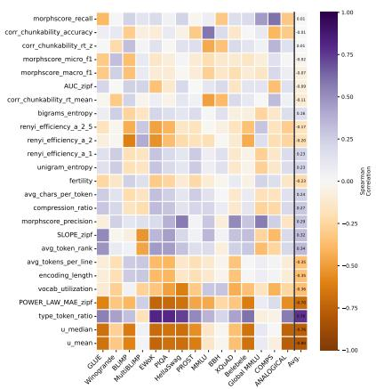  
(a) English

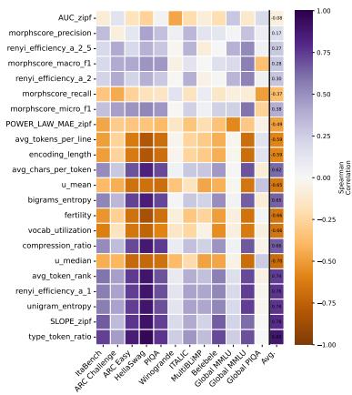  
(b) Italian

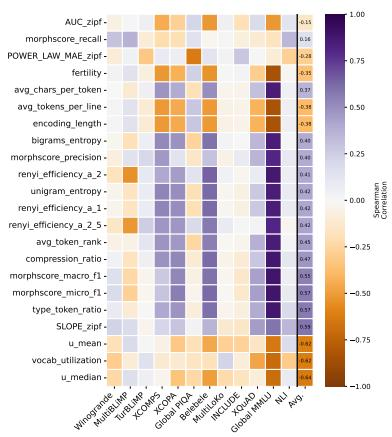  
(c) Turkish

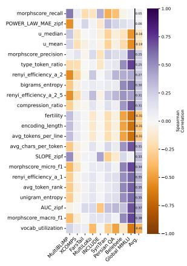  
(d) Farsi

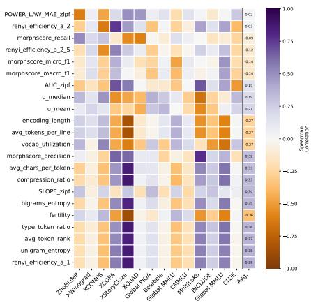  
(e) Chinese  
Figure 8: Correlations between intrinsic metric and model performance for TokSuite models for each of the five languages covered. Each column represents an individual task, with the final column representing aggregated performance. The color of each cell corresponds to direction of correlation and the shade corresponds to the strength.

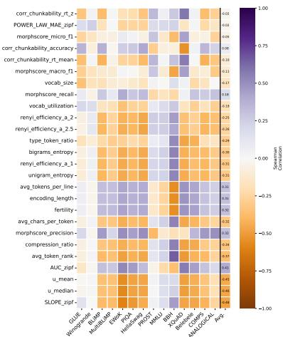  
Figure 9: Correlations between intrinsic metric and model performance for the TIMTC models for English. Each column represents an individual task, with the final column representing aggregated performance. The color of each cell corresponds to direction of correlation and the shade corresponds to the strength.

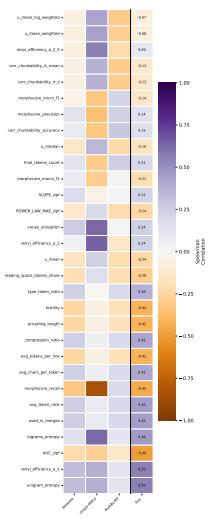  
(a) Amharic

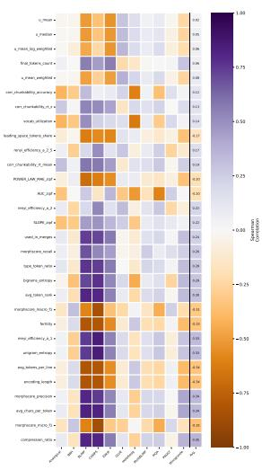  
(b) English

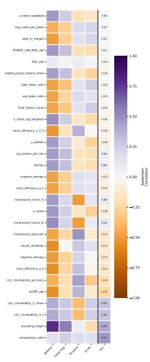  
(c) Thai

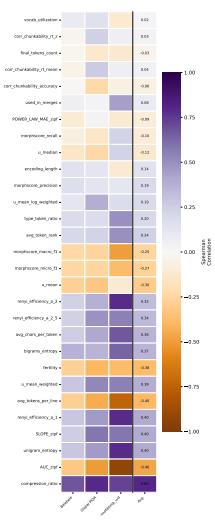  
(d) Urdu

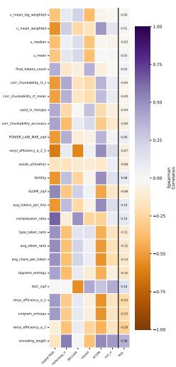  
(e) Vietnamese  
Figure 10: Correlations between intrinsic metric and model performance for VISTA models for each of the five languages. Each column represents an individual task, with the final column representing aggregated performance. The color of each cell corresponds to direction of correlation and the shade corresponds to the strength.

## E.1 Correlation with Orthographic Awareness Tasks

Results in Figure 11 show performance on the orthographic tasks. The ByT5 tokenizer model performs best on a subset of the orthographic tasks (namely, CUTE and EXECUTE), though, in aggregate, it does not outperform other models. As all the orthographic tasks are similar and are composed of heterogeneous subtasks, it is not clear why the byte-level model outperforms the other models on some tasks but not others.

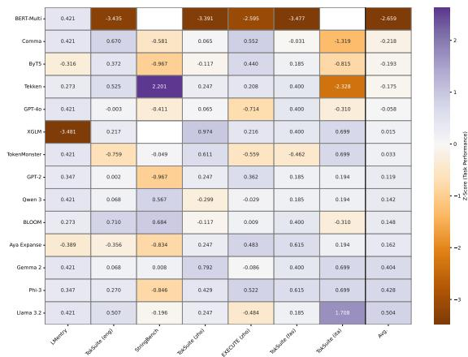  
Figure 11: Performance for each of the TokSuite models for the English orthographic awareness tasks. Color corresponds to the z-scored performance, where darker green indicates better performance.

Table 26 presents the correlations between performance on each of the orthographic tasks and downstream tasks in the corresponding language.
<table><tr><td>Task Group</td><td>Language</td><td>ρ</td><td>p-value</td></tr><tr><td>LMentry</td><td>English</td><td>-0.179</td><td>0.5408</td></tr><tr><td>TokSuite</td><td>English</td><td>0.341</td><td>0.0292</td></tr><tr><td>StringBench</td><td>English</td><td>0.163</td><td>0.4806</td></tr><tr><td>TokSuite</td><td>Chinese</td><td>0.114</td><td>0.6990</td></tr><tr><td>EXECUTE</td><td>Chinese</td><td>0.267</td><td>0.0663</td></tr><tr><td>TokSuite</td><td>Farsi</td><td>0.433</td><td>0.1224</td></tr><tr><td>TokSuite</td><td>Italian</td><td>-0.070</td><td>0.8199</td></tr></table>

Table 26: Correlation between orthographic tasks and downstream tasks.

## E.2 Multiple Predictor Correlations

Figure 12 shows the correlations between each of the intrinsic tokenizer metrics. Within each type of tokenizer evaluation (indicated with black boxes), many metrics are strongly correlated with each other. Outside of those types, there are several other strong correlations. For example both unigram and bigram entropy are strongly correlated with compression metrics, and MorphScore is somewhat correlated with worse compression, as predicted. Many potential relationships emerge in this analysis. So, in the next section, we test whether combining any of these metrics can better predict downstream performance.

We test whether a combination of two intrinsic tokenizer metrics better predicts model performance. Table 27 shows the variance explained (adjusted $R ^ { 2 } )$ by linear regressions with individual metrics (adj\_r2\_m1 and adj\_r2\_m2) as predictors and both metrics as predictors (adj\_r2\_joint) for the top ten combinations. r2\_gain shows the increased explained variance with the two predictors together. The p-value was corrected for multiple comparisons.

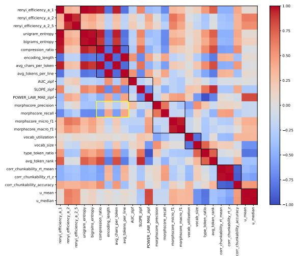  
Figure 12: The boxes highlight comparisons between metrics that index similar things. Yellow highlights correlation between MorphScore and compression metrics.

## F Exclusion Analysis

In this section, we compare the results with and without the exclusion of tasks where most models did not perform above chance. We excluded tasks for which there was not more than one model from each of the model families that achieved abovechance performance. Table 25 compares the bymetric correlations with task performance with and without the exclusions. Table 28 shows the results for the correlations with two predictors (cf. Table 27).

Table 27: Variance explained by combinations of two metrics, shown for the ten best combinations.
<table><tr><td>Metric 1</td><td></td><td>Metric 2</td><td>adj_r2_m1</td><td>adj_r2_m2</td><td>adj_r2_joint</td><td>r2_gain</td><td>p-value</td></tr><tr><td>1</td><td>leading_space_tokens_count</td><td>u_mean_log_weighted</td><td>0.158</td><td>-0.000</td><td>0.170</td><td>0.012</td><td>&lt; 0.001</td></tr><tr><td>2</td><td>final_tokens_count</td><td>used_in_merges</td><td>0.053</td><td>0.110</td><td>0.168</td><td>0.058</td><td>&lt; 0.001</td></tr><tr><td>3</td><td>leading_space_tokens_count</td><td>u_mean</td><td>0.158</td><td>0.002</td><td>0.167</td><td>0.009</td><td>&lt; 0.001</td></tr><tr><td>4</td><td>leading_space_tokens_count</td><td>u_median</td><td>0.158</td><td>0.003</td><td>0.165</td><td>0.007</td><td>&lt; 0.001</td></tr><tr><td>5</td><td>leading_space_tokens_count</td><td>u_mean_weighted</td><td>0.158</td><td>0.001</td><td>0.165</td><td>0.007</td><td>&lt; 0.001</td></tr><tr><td>6</td><td>leading_space_tokens_count</td><td>AUC_zipf</td><td>0.124</td><td>0.011</td><td>0.157</td><td>0.033</td><td>&lt; 0.001</td></tr><tr><td>7</td><td>used_in_merges</td><td>u_mean_log_weighted</td><td>0.147</td><td>-0.000</td><td>0.154</td><td>0.007</td><td>&lt; 0.001</td></tr><tr><td>8</td><td>used_in_merges</td><td>u_mean_weighted</td><td>0.147</td><td>0.001</td><td>0.152</td><td>0.005</td><td>&lt; 0.001</td></tr><tr><td>9</td><td>used_in_merges</td><td>u_mean</td><td>0.147</td><td>0.002</td><td>0.151</td><td>0.004</td><td>&lt; 0.001</td></tr><tr><td>10</td><td>used_in_merges</td><td>u_median</td><td>0.147</td><td>0.003</td><td>0.149</td><td>0.002</td><td>&lt; 0.001</td></tr></table>

Table 28: Variance explained by combinations of two metrics, shown for the ten best combinations. These results exclude any of the tasks where the small models performed near chance.
<table><tr><td>Metric 1</td><td></td><td>Metric 2</td><td>adj_r2_m1</td><td>adj_r2_m2</td><td>adj_r2_joint</td><td>r2_gain</td><td>p-value</td></tr><tr><td>1</td><td>leading_space_tokens_count</td><td>u_mean_log_weighted</td><td>0.074</td><td>-0.000</td><td>0.085</td><td>0.012</td><td>&lt; 0.001</td></tr><tr><td>2</td><td>leading_space_tokens_count</td><td>u_mean_weighted</td><td>0.074</td><td>0.000</td><td>0.084</td><td>0.010</td><td>&lt; 0.001</td></tr><tr><td>3</td><td>leading_space_tokens_count</td><td>u_mean</td><td>0.074</td><td>0.002</td><td>0.083</td><td>0.009</td><td>&lt; 0.001</td></tr><tr><td>4</td><td>leading_space_tokens_count</td><td>u_median</td><td>0.074</td><td>0.003</td><td>0.082</td><td>0.008</td><td>&lt; 0.001</td></tr><tr><td>5</td><td>leading_space_tokens_count</td><td>compression_ratio</td><td>0.072</td><td>0.000</td><td>0.073</td><td>0.000</td><td>&lt; 0.001</td></tr><tr><td>6</td><td>leading_space_tokens_count</td><td>encoding_length</td><td>0.072</td><td>0.000</td><td>0.072</td><td>0.000</td><td>&lt; 0.001</td></tr><tr><td>7</td><td>leading_space_tokens_count</td><td>morphscore_macro_f1</td><td>0.065</td><td>0.004</td><td>0.070</td><td>0.004</td><td>&lt; 0.001</td></tr><tr><td>8</td><td>leading_space_tokens_count</td><td>morphscore_micro_f1</td><td>0.065</td><td>0.004</td><td>0.069</td><td>0.004</td><td>&lt; 0.001</td></tr><tr><td>9</td><td>used_in_merges</td><td>u_mean_weighted</td><td>0.062</td><td>0.000</td><td>0.068</td><td>0.007</td><td>&lt; 0.001</td></tr><tr><td>10</td><td>used_in_merges</td><td>u_mean_log_weighted</td><td>0.062</td><td>-0.000</td><td>0.068</td><td>0.006</td><td>&lt; 0.001</td></tr></table>

## G AI Use

The authors used AI to aid in code generation for figure and table creation and to edit the text of this paper. The authors take full responsibility for the content of the paper and any associated artifacts.