# OPRD: On-Policy Reminder Distillation for Long-Horizon Coding Agents

Yuechen Luo1,∗, Zhiyi Lai2,\*, Miao Ziqi3,\*, Zihang Xu3, Jingxuan Xu4, Songwei Yu4, Wenqiang Zhu2, Weihao Li2, Junhao Fan1, Haoyang Huang2, Yanan Wu2, Ken Deng2,†

1Tsinghua University, 2Independent Researcher

3Shanghai Artificial Intelligence Laboratory, 4National University of Singapore luo-yc24@mails.tsinghua.edu.cn

## Abstract

Reliable repository-level coding requires agents not only to generate correct code but also to preserve constraints and respond to tool feedback across long interactions. However, our diagnostic analysis shows that agents often fail to act on relevant information already available in context, while final Pass/Fail outcomes provide only sparse process su- pervision. We introduce On-Policy Reminder Distillation (OPRD), which combines Multi-Scope Reminder supervision with outcome-based routing on reminder-free student rollouts. Successful rollouts provide autoregressive self-imitation tar- gets, whereas failed rollouts receive Reminder-conditioned reverse-KL supervision from a teacher that re-evaluates the same student-generated prefixes. A Global Reminder converts final-test diagnostics into trajectory-level guidance, while Turn-local Reminders apply only to the next decision fol- lowing the relevant environment observation. The teacher and student share a two-stage initialization from Coding SFT and Instruction-Following (IF) SFT. At inference, the student operates without Reminders. On SWE-bench Verified, SWE-bench Pro, and SWE-bench Multilingual, OPRD improves the benchmark-averaged task resolution rate by 11.3 points over the open-source Qwen3.5-4B base model. Under the same diagnostic protocol, it reduces the aggregate error- event count from 446 to 222, a 50.2% reduction.

## 1 Introduction

Large language models have advanced in reasoning (Zhan et al. 2025a; Deng et al. 2025a; Xu et al. 2026b; Miao et al. 2026) and repository-level software engineering (Jimenez et al. 2024; Yang et al. 2024; Zhang et al. 2024; Ouyang et al. 2025; Xia et al. 2025). Reliable long-horizon coding nevertheless requires agents to preserve task constraints and adapt to tool and execution feedback (Yao et al. 2023; Chen et al. 2024). We examine this challenge on 200 SWErebench V2 validation tasks (Badertdinov et al. 2026), using two Qwen3.5-4B rollouts per task under identical inference settings (Qwen Team 2026). In the reminder-free rollout, deterministic rules identify explicit tool and execution fail- ures, while GPT-5.4 classifies remaining context-dependent events from the task and complete trajectory (OpenAI 2026). Each event belongs to one of four categories in Table 6: Tool-Feedback Recovery, Scope and Source Grounding, Scenario-Condition Reasoning, and Post-Edit Control and Validation. In the second rollout, the agent restarts from the task under the same settings, and the Reminder mechanism examines each environment observation to decide whether to insert a Turn-local Reminder before the next action. Applying the same annotation protocol reveals fewer error events across all four categories (Fig. 1). Post-hoc annotation audits completed trajectories, while runtime Reminder selection uses only the currently visible interaction prefix. This finding suggests that reliable long-horizon coding requires models to preserve task-level constraints across a trajectory and use local interaction feedback at appropriate decision points. A natural direction is therefore to provide process-level correc- tive information with explicit temporal scope.

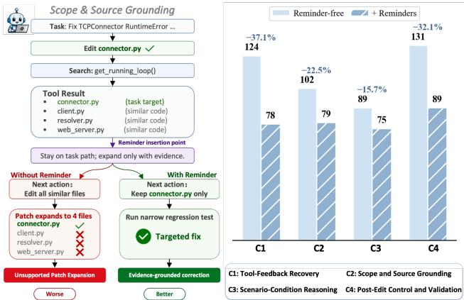  
Figure 1: Diagnostic analysis of Qwen3.5-4B on 200 tasks from the SWE-rebench v2 validation set. Left: a Scope and Source Grounding example in which a Turn-local Reminder prevents unsupported patch expansion. Right: aggregate error-event counts across four categories under Reminder- free and Reminder-augmented settings; percentages indicate relative reductions.

However, coding-agent training relies on supervised imi- tation of successful trajectories or executable-outcome optimization (Pan et al. 2025; Jain et al. 2025; Wei et al. 2025). These signals improve task completion but do not indicate which constraints should persist or which observation should guide the next decision. At inference time, agents can adapt to feedback (Yao et al. 2023; Chen et al. 2024) or recover missed information through reflection and self-critique (Shinn et al.

2023; Madaan et al. 2023; Gou et al. 2024). Runtime reminders require deployment-time construction and injection, consume context, and tie behavior to an agent scafold. On- policy distillation trains students on self-generated outputs to reduce train–inference mismatch (Agarwal et al. 2024; Gu et al. 2024). Related work uses context- and feedback-conditioned distillation to internalize behavior induced by auxiliary instructions or environment feedback (Ye et al. 2026; Hübotter et al. 2026). Applying these ideas to long- horizon coding leaves two challenges. First, training-time corrective information can encode persistent constraints and local corrections from observations relevant to one decision. Without explicit scopes, local corrections may be diluted in long contexts or propagated to unrelated decisions. Second, models without instruction-following adaptation may ignore constraints and feedback, so teacher reminders may not pro- duce reliable distillation targets.

This raises a practical question: Can we internalize scopespecific corrective information during training so that a coding agent can operate without reminders at inference time?

We address this with On-Policy Reminder Distillation (OPRD), which combines Multi-Scope Reminder su-pervision with outcome-based routing on rollouts from a reminder-free student. For failed trajectories, we construct reminders from task, trajectory, and execution/validation records. A Global Reminder converts final-test diagnostics into trajectory-level guidance. A Turn-local Reminder is an-chored to an observation and applies only to the next decision. This combines trajectory-level feedback with local correction without propagating local feedback to unrelated deci- sions. For reliable supervision, our two-stage cold start uses Coding SFT to establish coding capabilities and Instruction- Following (IF) SFT to improve responsiveness to constraints, feedback, and reminders. Both models are initialized from the IF checkpoint. Based on executable verification, OPRD routes successful rollouts to autoregressive self-imitation and failed rollouts to reminder-conditioned distillation without reinforcing erroneous decisions. For failures, the teacher re- evaluates student-generated prefixes under reminders, while the student matches the teacher distribution through Top- 100 reverse KL. OPRD internalizes scope-specific correc- tions, enabling the student to act on corresponding con- straints and feedback without reminders at inference time. We evaluate OPRD on SWE-bench Verified, SWE-bench Pro, and SWE-bench Multilingual (OpenAI 2024; Deng et al. 2025b; Yang et al. 2025). OPRD improves the benchmark-averaged task resolution rate by 11.3 points over the open- source Qwen3.5-4B base model. Under the same diagnostic protocol, the trained OPRD model reduces the aggregate error-event count across the four categories from 446 to 222, a 50.2% reduction relative to the base model.

Our main contributions are threefold:

• Multi-Scope Reminder supervision for long-horizon coding. We combine a Global Reminder that provides guidance across the trajectory with Turn-local Reminders that target only the next decision, enabling process-level supervision at complementary temporal scopes.

• On-Policy Reminder Distillation with Outcome-Based

Routing. We propose OPRD, which learns from verified successful rollouts through autoregressive self-imitation and from failed rollouts through reminder-conditioned reverse KL distillation.

• A two-stage supervised cold start for reliable reminder distillation. Coding SFT followed by IF SFT provides a shared teacher–student initialization that improves re- sponsiveness to constraints, execution feedback, and re- minders, thereby providing a stronger starting point for subsequent reminder-conditioned distillation.

## 2 Related Work

Repository-Level Software Engineering Agents. SWE-bench established executable evaluation on repository is- sues (Jimenez et al. 2024). SWE-agent, AutoCodeRover, and Agentless support issue resolution through tool interfaces, program-aware search, and structured repair pipelines (Yang et al. 2024; Zhang et al. 2024; Xia et al. 2025). Training resources include agent trajectories and verifiers (Pan et al. 2025; Jain et al. 2025), generated or freshly collected tasks (Yang et al. 2025; Badertdinov et al. 2025), and reinforcement learning from executable outcomes (Wei et al. 2025). SWE-Compass and KAT-Coder further study broad capability evaluation and coding-agent training (Xu et al. 2025; Zhan et al. 2025b).

Feedback-Guided Reasoning and Reflection. ReAct conditions actions on observations, while Reflexion and self-refinement use feedback to revise subsequent at- tempts (Yao et al. 2023; Shinn et al. 2023; Madaan et al. 2023). FTTT formulates feedback use as test-time optimization (Li, Lyu, and Wang 2025). Tool-grounded critique, search, and code-specific execution or runtime verification further guide correction (Gou et al. 2024; Zhou et al. 2024; Chen et al. 2024; Zhong, Wang, and Shang 2024). FLARE extends process feedback through a generative reward model for inference and post-training (Xu et al. 2026a). These ap- proaches motivate learning to use corrective signals without requiring runtime Reminder injection.

On-Policy and Privileged-Context Distillation. On-policy distillation obtains teacher supervision on student- generated sequences to reduce train–inference mis- match (Agarwal et al. 2024). MiniLLM and DistiLLM study reverse or skew KL objectives (Gu et al. 2024; Ko et al. 2024), with extensions using entropy-aware or blackbox feedback (Jin et al. 2026; Ye et al. 2025). Context distillation internalizes behavior induced by auxiliary in- structions, demonstrations, or scratchpads (Snell, Klein, and Zhong 2022); privileged-context methods additionally condition teachers on verified solutions or other training-only information (Zhao et al. 2026; Penaloza et al. 2026). OPCD matches student trajectories to a context-conditioned teacher through reverse KL (Ye et al. 2026). OPRD combines ex-plicitly scoped Reminders with outcome-based routing for long-horizon coding.

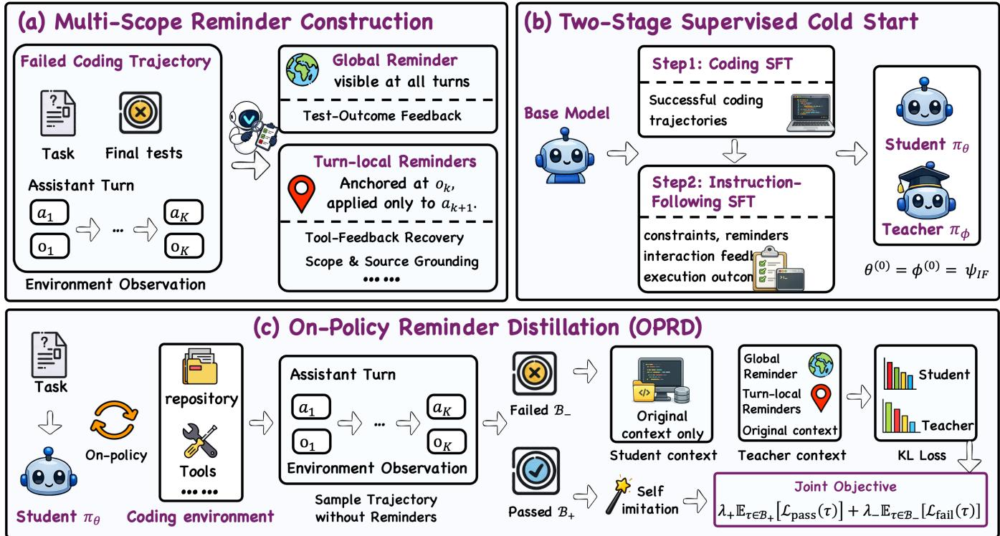  
Figure 2: Overview of OPRD. OPRD constructs Global Reminders and observation-anchored Turn-local Reminders, and initializes the teacher and student through Coding SFT followed by IF SFT. During on-policy training, successful rollouts are optimized through autoregressive self-imitation, while failed rollouts receive reverse-KL supervision from a Reminder- conditioned teacher.

## 3 Method

Long-horizon coding agents must not only generate correct code, but also consistently follow user constraints through- out multi-turn interactions and adapt their behavior to tool responses and execution feedback. However, final verifica- tion outcomes provide limited process-level supervision for constraint adherence and feedback use at diferent scopes. To address this limitation, we propose On-Policy Reminder Distillation (OPRD), which distills the behavior of a teacher conditioned on Multi-Scope Reminders into a student that op- erates without reminders at inference time. As illustrated in Fig. 2, we formulate the long-horizon coding task (Sec. 3.1), then introduce Multi-Scope Reminders (Sec. 3.2) and a twostage supervised cold start (Sec. 3.3), and present Multi-Scope Reminder-Conditioned Distillation (Sec. 3.4).

## 3.1 Problem Formulation

Given a repository-level coding task x, an agent interacts with a code execution environment over multiple turns. We denote the k-th assistant turn by $a _ { k }$ and the resulting environment observation by $o _ { k } .$ . The complete interaction trajectory is

$$
\tau = ( x , a _ { 1 } , o _ { 1 } , \dots , a _ { K } , o _ { K } ) .\tag{1}
$$

An executable verifier evaluates the final repository state and returns $c ( \tau ) \in \{ 0 , 1 \}$ , where $c ( \tau ) = 1$ indicates that the trajectory passes verification and $c ( \tau ) = 0$ indicates fail- ure. We denote the trainable student by $\pi _ { \theta }$ and the teacher by $\pi _ { \phi } .$ . The token sequence of the k-th assistant turn is $a _ { k } = ( y _ { k , 1 } , \dots , y _ { k , L _ { k } } )$ , where $L _ { k }$ is the number of tokens in that turn. The interaction history preceding the k-th assistant turn and the student context for generating its j-th token are defined as

$$
H _ { k } = { \big ( } x , a _ { 1 } , o _ { 1 } , \ldots , a _ { k - 1 } , o _ { k - 1 } { \big ) } , \qquad h _ { k , j } ^ { S } = { \big ( } H _ { k } , y _ { k , < j } { \big ) } ,\tag{2}
$$

where $y _ { k , < j }$ denotes the token prefix preceding $y _ { k , j }$ within the current turn. System messages, user messages, and tool responses provide generation context but are not prediction targets. Training is restricted to valid assistant tokens, whose index set is

$$
\Omega ( \tau ) \subseteq \{ ( k , j ) | 1 \leq k \leq K , 1 \leq j \leq L _ { k } \} .\tag{3}
$$

## 3.2 Multi-Scope Reminders

The constraints and feedback received by a long-horizon cod- ing agent operate over diferent temporal scopes. Task-level constraints, such as permitted modification scope, interface requirements, and output format, must hold throughout the trajectory. In contrast, test errors, tool responses, and file in-spection results typically pertain to a specific decision point. Nevertheless, the final verifier compresses the entire trajectory into a binary outcome and cannot represent these dis- tinct scopes. Treating all corrective information as a single trajectory-wide prompt may cause local errors to be diluted by the long context, whereas propagating local feedback to all subsequent turns may introduce irrelevant or conflicting supervision as the interaction state evolves. We therefore or- ganize corrective information from a failed trajectory into a Multi-Scope Reminder. A Global Reminder provides persis- tent task-level guidance across turns, while a Turn-local Re- minder is aligned with a specific decision point and highlights environmental feedback that the model ignored or misinter- preted at that point. For a failed trajectory $\tau ,$ , its Multi-Scope Reminder is represented as

$$
R ( \tau ) = \big ( r ^ { G } , \{ ( k , r _ { k } ^ { L } ) \} _ { k \in \mathbb { Z } _ { \tau } } \big ) , \qquad \mathbb { Z } _ { \tau } \subseteq \{ 1 , \dots , K - 1 \} ,\tag{4}
$$

where $r ^ { G }$ denotes the Global Reminder, $r _ { k } ^ { L }$ denotes the Turn-local Reminder anchored to environment observation $o _ { k } ,$ and $\mathcal { T } _ { \tau }$ is the set of observation indices associated with local corrective signals. The Global Reminder remains vis- ible throughout the teacher’s evaluation of assistant turns. In contrast, $r _ { k } ^ { L }$ is visible only when the teacher evaluates the assistant turn $a _ { k + 1 }$ following $o _ { k }$ , and does not propagate to later turns. Instruction-Following (IF) SFT first strength-ens the model’s ability to understand and respond to explicit constraints and feedback. During OPRD, Multi-Scope Re- minders serve as training-time privileged information avail- able only to the teacher, and the behavior they induce is distilled into a student that does not observe reminders.

Reminder Construction. When a trajectory contains a correctable failure, we construct reminders post hoc from the task, trajectory, interaction feedback, and final test results. We determine the scope of each corrective signal and then assign its functional category. The Global Reminder contains one category, Test-Outcome Feedback, which converts finaltest diagnostics into trajectory-level guidance. Turn-local Re-minders target correctable decisions identified from each environment observation and assistant action. They com- prise four categories: Tool-Feedback Recovery for responding to explicit tool feedback; Scope and Source Grounding for evidence-grounded localization and modification; Scenario-Condition Reasoning for task-specific execution conditions; and $P o s t  – E d i t$ Control and Validation for controlled post-edit verification. We retain grounded and actionable candidates, discarding ambiguous, redundant, unverifiable, reference- patch-revealing, or unsupported content. Detailed category definitions, generation prompts, trigger rules, and filtering procedures are provided in Appendix C.

## 3.3 Two-Stage Supervised Cold Start

The base model first acquires capabilities for repository un- derstanding, tool interaction, and code editing through Cod- ing SFT. However, coding competence alone does not en- sure that the model will follow constraints and feedback that arise during an interaction. A standard coding model may still ignore user requirements, tool responses, test errors, or harness rules that are already present in the context. Given a base model $\psi _ { 0 }$ , we first train on successful coding trajectories $\mathcal { D } _ { \mathrm { c o d e } }$ to establish core agentic coding capabilities. We then use IF data $\mathcal { D } _ { \mathrm { I F } }$ to improve the model’s responsiveness to user constraints, interaction feedback, execution outcomes, and reminders, yielding an IF checkpoint $\psi _ { \mathrm { I F } }$ that combines coding and instruction-following capabilities:

$$
\psi _ { \mathrm { c o d e } } = \mathrm { S F T } ( \psi _ { 0 } , \mathcal { D } _ { \mathrm { c o d e } } ) , \qquad \psi _ { \mathrm { I F } } = \mathrm { S F T } ( \psi _ { \mathrm { c o d e } } , \mathcal { D } _ { \mathrm { I F } } ) .\tag{5}
$$

## 3.4 Multi-Scope Reminder-Conditioned Distillation

OPRD uses shared initialization. The teacher $\pi _ { \phi }$ and stu- dent $\pi _ { \theta }$ use the same model architecture and are initial- ized with the parameters of the same IF checkpoint $\psi _ { \mathrm { I F } } .$ such that $\theta ^ { ( 0 ) } \stackrel { - } { = } \phi ^ { ( 0 ) } = \psi _ { \mathrm { I F } }$ . During training, the teacher is periodically updated toward the student, while the stu- dent is optimized at every step. The teacher additionally receives reminders as training-time privileged information. For a task $x \sim \mathcal { D } _ { \mathrm { t a s k } }$ , the current student interacts with the coding environment without access to reminders to sample $\tau \sim \pi _ { \theta } ( \cdot \mid x )$ . As the student is updated, subsequent rollouts expose diferent states and errors, keeping reminder super- vision aligned with the distribution visited by the current policy.

Outcome-Based Routing. After each rollout, an exe-cutable verifier determines whether it succeeds but does not provide fine-grained credit assignment. A successful rollout provides executable evidence that the student’s current be- havior can solve the task and can therefore serve directly as an autoregressive self-imitation signal. Applying the same objective to a failed rollout would instead increase the likelihood of erroneous decisions. OPRD thus routes success- ful rollouts to a self-imitation branch and failed rollouts to a reminder-conditioned distillation branch. For the current rollout batch $B ,$ we define $\begin{array} { r } { \mathcal { B } _ { + } = \{ \tau \in \mathcal { B } \vert c ( \tau ) = 1 \} } \end{array}$ and ${ \cal B } _ { - } = \{ \tau \in { \cal B } | c ( \tau ) = 0 \}$

Autoregressive Self-Imitation from Successful Rollouts. For each $\tau \in B _ { + }$ , we compute the autoregressive loss over all valid assistant tokens to increase the likelihood that the student reproduces successful behavior discovered through its own on-policy sampling:

$$
\mathcal { L } _ { \mathrm { p a s s } } ( \tau ) = - \frac { 1 } { | \Omega ( \tau ) | } \sum _ { ( k , j ) \in \Omega ( \tau ) } \log \pi _ { \theta } ( y _ { k , j } \mid h _ { k , j } ^ { S } ) .\tag{6}
$$

Reminder-Conditioned Distillation from Failed Rollouts. For each $\tau \in B _ { - }$ , reminders are constructed after the rollout and provided only to the teacher. The student always uses the original context without reminders. The teacher does not resample the trajectory. Instead, it evaluates the same student-generated token prefix $y _ { k , < j }$ , ensuring that the dis- tillation targets remain aligned with the states visited by the current policy. For the k-th assistant turn, the teacher history is defined as

$$
\widetilde { H } _ { k } ^ { T } = \left\{ \begin{array} { l l } { \mathrm { I n j e c t } ( H _ { k } , r ^ { G } , r _ { k - 1 } ^ { L } ) , } & { \ k _ { - 1 \in \mathbb { Z } _ { \tau } } ^ { k \geq 2 , } , } \\ { \mathrm { I n j e c t } ( H _ { k } , r ^ { G } ) , } & { \mathrm { o t h e r w i s e } . } \end{array} \right.\tag{7}
$$

The corresponding teacher token context is $\begin{array} { r l } { h _ { k , j } ^ { T } } & { { } = } \end{array}$ $( \widetilde { H } _ { k } ^ { T } , y _ { k , < j } )$ . The teacher augments the student’s original context with the reminders active at the current scope. The Global Reminder is visible at every assistant turn, whereas $r _ { k - 1 } ^ { L }$ is injected only when the teacher evaluates $a _ { k }$ and is removed from subsequent turns. Reminder scope is deter- mined by its visibility in the teacher context, while the loss for a failed trajectory still covers all valid assistant tokens in $\Omega ( \tau )$ . Within this unified distillation signal, the Global Reminder provides task-level correction across turns, while the Turn-local Reminder provides fine-grained guidance at the corresponding decision point. Let $\bar { \nu }$ denote the full vo- cabulary, and let $z _ { \theta }$ and $z _ { \phi }$ denote the student and teacher logits, respectively. For $v \in \mathcal { V }$ , their token distributions at temperature $\tau$ are

$$
\begin{array} { r } { p _ { \theta , k , j } ^ { ( T ) } ( v ) = \mathrm { s o f t m a x } \Bigg ( \frac { z _ { \theta } ( h _ { k , j } ^ { S } ) } { T } \Bigg ) _ { v } , } \\ { p _ { \phi , k , j } ^ { ( T ) } ( v ) = \mathrm { s o f t m a x } \Bigg ( \frac { z _ { \phi } ( h _ { k , j } ^ { T } ) } { T } \Bigg ) _ { v } . } \end{array}\tag{8}
$$

We then compute the reverse Kullback–Leibler (KL) di-vergence over the Top-K-vocabulary distributions:

$$
\mathcal { L } _ { \mathrm { f a i l } } ( \tau ) = \frac { \mathcal { T } ^ { 2 } } { | \Omega ( \tau ) | } \sum _ { ( k , j ) \in \Omega ( \tau ) } D _ { \mathrm { K L } } [ p _ { \theta , k , j } ^ { ( \mathcal { T } ) }  \ s \mathrm { g } [ p _ { \phi , k , j } ^ { ( \mathcal { T } ) } ] ] ,\tag{9}
$$

where sg stops gradients through the teacher branch and $\dot { \mathcal { T } } ^ { 2 }$ compensates for gradient-scale changes from temperature scaling. Reverse KL weights discrepancies by the student distribution, prioritizing corrections to tokens to which the student assigns high probability in visited states.

Joint Objective and Inference. After training, only the student is deployed. The teacher, the reminder-construction module, and all reminders are removed at inference time. Let $\lambda _ { + }$ and $\lambda _ { - }$ control the relative strengths of self-imitation on successful rollouts and reminder distillation on failed roll- outs, respectively. The OPRD objective is

$$
\mathcal { L } _ { \mathrm { O P R D } } = \lambda _ { + } \mathbb { E } _ { \tau \in \mathcal { B } _ { + } } [ \mathcal { L } _ { \mathrm { p a s s } } ( \tau ) ] + \lambda _ { - } \mathbb { E } _ { \tau \in \mathcal { B } _ { - } } [ \mathcal { L } _ { \mathrm { f a i l } } ( \tau ) ] .\tag{10}
$$

## 4 Experiments

## 4.1 Experimental Setup

Models and Training Data. We use Qwen3.5-4B and Qwen3.5-9B as base models (Qwen Team 2026). Training consists of three stages. Coding SFT uses 8,000 verified successful trajectories, including 7,262 from SWE-rebench V2 (Badertdinov et al. 2026) and 738 from Multi-SWE-RL (Zan et al. 2025). IF SFT then uses 2,000 reminderfollowing examples from SWE-rebench V2. OPRD operates on a pool of 3,630 SWE-rebench V2 tasks and 370 Multi- SWE-RL tasks, from which the student generates reminder- free rollouts online. In the OPRD variant without IF SFT, both teacher and student are initialized from the Coding SFT checkpoint while all other settings remain unchanged.

Table 1 summarizes the three stage-specific data config- urations. Coding SFT and IF SFT operate on trajectories or reminder-following examples, whereas OPRD uses a task pool from which the current student generates new rollouts online. The OPRD counts therefore describe available train- ing tasks rather than a fixed set of trajectories.

<table><tr><td>Stage</td><td>Unit</td><td>SWE-REBENCH V2</td><td>Multi- SWE-RL</td></tr><tr><td>Coding SFT</td><td>Trajectory</td><td>7,262</td><td>738</td></tr><tr><td>IF SFT</td><td>Example</td><td>2,000</td><td>0</td></tr><tr><td>OPRD</td><td>Task</td><td>3,630</td><td>370</td></tr></table>

Table 1: Training data used at each stage.

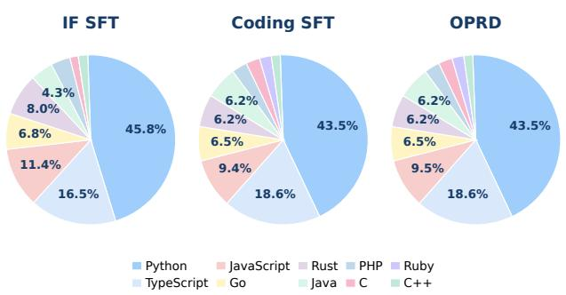  
Figure 3: Programming-language distributions for IF SFT, Coding SFT, and the OPRD task pool. Percentages are com- puted from 2,000 examples, 8,000 examples, and 4,000 ex- amples, respectively. The same language-color mapping is used in all three pies.

Figure 3 reports the programming-language composition of the three stages. Python is the largest source in every stage (43.5–45.8%), followed by TypeScript and JavaScript. Coding SFT and the OPRD task pool use nearly identical proportions by construction, while the IF set is slightly more concentrated in Python, JavaScript, and Rust and contains no Ruby example. The distribution nevertheless covers nine languages in IF SFT and all ten languages in Coding SFT and OPRD.

Implementation Details. Training implementation and hyperparameters are detailed in Appendix B.

Evaluation Setup. We evaluate task resolution rate on SWE-bench Verified, SWE-bench Pro, and SWE-bench Multilingual (OpenAI 2024; Deng et al. 2025b; Yang et al. 2025). All models use the same agent harness and inference configuration. Except for the controlled Reminder interven- tions in the scope and functional-category analyses, all main results and training ablations use reminder-free inference.

All models are evaluated with a shared Claude Code agent scafold and the executable verifier associated with each benchmark. Every subtask is allocated 16 CPU cores and 32,768 MiB of memory, with a maximum of 200 agent turns. Decoding uses temperature 1.0 and top-p 0.95. The vLLM deployment permits at most 128 concurrent se- quences, a maximum model length of 262,144 tokens, and 8,192 batched tokens.

<table><tr><td>Training Configuration</td><td>SWE-BENCH Verified (%)</td><td>SWE-BENCH Pro (%)</td><td>SWE-BENCH Multilingual (%)</td><td>Average (%)</td></tr><tr><td>Qwen3.5-4B</td><td>50.4</td><td>24.2</td><td>35.3</td><td>36.6</td></tr><tr><td>+ Coding SFT</td><td>53.6</td><td>25.6</td><td>38.7</td><td>39.3</td></tr><tr><td> $+ \mathrm { C o d i n g ~ S F T }  \mathrm { I F ~ S F T }$ </td><td>55.8</td><td>26.7</td><td>42.3</td><td>41.6</td></tr><tr><td> $+ \mathrm { C o d i n g ~ S F T }  \mathrm { O P R D ( w / o ~ I F ~ S F T ) }$ </td><td>58.4</td><td>28.3</td><td>46.3</td><td>44.3</td></tr><tr><td> $+ \mathrm { C o d i n g } \mathrm { S F T }  \mathrm { I F S F T }  \mathrm { O P R D ( O u r s ) }$ </td><td>61.2</td><td>30.5</td><td>52.0</td><td>47.9</td></tr><tr><td>Qwen3.5-9B</td><td>59.6</td><td>32.3</td><td>41.3</td><td>44.4</td></tr><tr><td>+ Coding SFT</td><td>61.4</td><td>34.7</td><td>47.7</td><td>47.9</td></tr><tr><td>+ Coding SFT → IF SFT</td><td>64.0</td><td>36.7</td><td>50.7</td><td>50.5</td></tr><tr><td> $+ \mathrm { C o d i n g ~ S F T }  \mathrm { O P R D ( w / o ~ I F ~ S F T ) }$ </td><td>67.2</td><td>38.9</td><td>53.7</td><td>53.3</td></tr><tr><td> $+ \mathrm { C o d i n g } \mathrm { S F T } \to \mathrm { I F S F T } \to \mathrm { O P R D ( O u r s ) }$ </td><td>70.0</td><td>40.9</td><td>56.7</td><td>55.9</td></tr></table>

Table 2: Main results with Qwen3.5-4B and Qwen3.5-9B on SWE-bench Verified, SWE-bench Pro, and SWE-bench Multilingual. We re ort task resolution rates (%) and their unwei hted avera e. Within each backbone, the best and second best results in each column are shown in bold and underlined, respectively.

## 4.2 Main Results

OPRD provides consistent gains across software engineering benchmarks. Table 2 compares the base and supervised checkpoints with the OPRD variants to assess whether Reminder-conditioned process supervision trans- fers to reminder-free inference. The complete training recipe reaches an average resolution rate of 47.9, improving over the Qwen3.5-4B base model by 11.3 points and over the IF SFT checkpoint by 6.3 points. Gains are consistent across all three benchmarks, with the largest improvement on SWE- bench Multilingual. Removing IF SFT before OPRD re- duces the average by 3.6 points. This gap suggests that coding adaptation alone is insuficient for fully exploiting Reminder- conditioned supervision, whereas IF SFT provides a more suitable shared initialization for teacher and student. Because all entries in Table 2 use reminder-free inference, the im- provement does not depend on test-time Reminder injection.

OPRD gains persist with the 9B backbone. As shown in Table 2, the complete Qwen3.5-9B training recipe reaches an average resolution rate of 55.9, improving over the open- source checkpoint by 11.5 points and over the IF SFT check- point by 5.4 points. The improvement over the open-source model is consistent on SWE-bench Verified, SWE-bench Pro, and SWE-bench Multilingual, with gains of 10.4, 8.6, and 15.4 points, respectively. Removing IF SFT before OPRD lowers the average by 2.6 points, showing that the supervised instruction-following preparation remains useful at the larger model scale.

## 4.3 Ablation Study

We examine the distillation design, loss balance, teacher re- fresh, supervised preparation, and Reminder scope and func- tional categories, followed by a process-level error analysis. Training ablations use the same task pool and on-policy roll- out protocol; Reminder interventions are compared under shared inference settings.

The OPRD variant without IF SFT initializes both the teacher and student from the Coding SFT checkpoint and otherwise retains the complete OPRD configuration. In the distillation-formulation ablation, All-Rollout OPSD applies the selected KL objective to both successful and failed on-policy rollouts. Outcome-Routed OPRD instead applies au- toregressive self-imitation to verified successes and Multi- Scope Reminder-conditioned KL to failures. The compared rows use the same training tasks, on-policy rollout budget, Top-100 support, and distillation temperature.

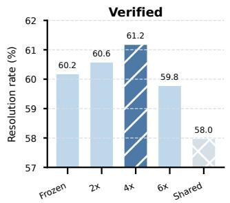

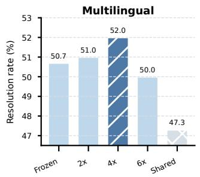

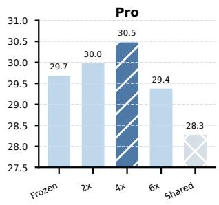

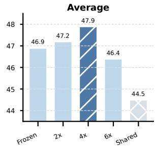  
Figure 4: Efect of the teacher refresh schedule on Qwen3.5- 4B. We compare Frozen Teacher, Periodic Refresh (2×, 4×, and 6×), and Shared Parameters on three benchmarks and their unweighted average.

The teacher-refresh ablation compares a frozen teacher, periodic refresh schedules, and shared teacher–student pa- rameters. The frozen teacher remains at its initial checkpoint. Our four-refresh setting copies the current student parame- ters to the teacher at 20%, 40%, 60%, and 80% of training. Under shared parameters, the teacher context is evaluated with the current student parameters at every update while gradients remain stopped through the teacher branch.

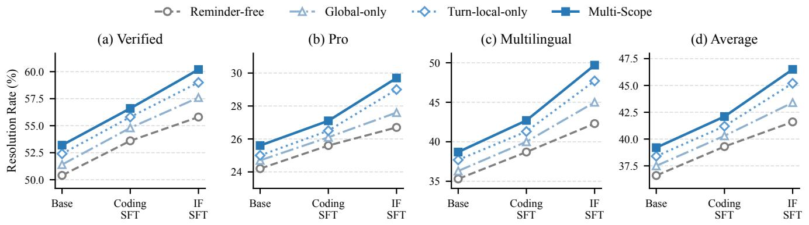

Figure 5: Efect of Reminder scope and supervised preparation on Qwen3.5-4B. We compare reminder-free, Global-only, Turn local-only, and Multi-Scope Reminder conditioning for the Base, Coding SFT, and IF SFT checkpoints.
<table><tr><td>Setting</td><td>SWE-BENCH Verified (%)</td><td>SWE-BENCH Pro (%)</td><td>SWE-BENCH Multilingual (%)</td><td>Average (%)</td></tr><tr><td>KL Support and Distillation Temperature</td><td></td><td></td><td></td><td></td></tr><tr><td>Full Vocabulary,  $\mathcal { T } = 0 . 6$ </td><td>59.8</td><td>29.4</td><td>50.3</td><td>46.5</td></tr><tr><td> $\mathrm { T o p } { - } 1 0 0 , \mathcal { T } = 0 . 6$ </td><td>60.2</td><td>29.7</td><td>50.7</td><td>46.9</td></tr><tr><td> $\mathrm { T o p } { - } 1 0 0 , \mathcal { T } = 1 . 0 \left( \mathrm { O u r s } \right)$ </td><td>61.2</td><td>30.5</td><td>52.0</td><td>47.9</td></tr><tr><td> $\mathrm { T o p } { - } 1 0 0 , \mathcal { T } = 1 . 5$ </td><td>60.4</td><td>29.8</td><td>51.0</td><td>47.1</td></tr><tr><td>Outcome-Based Routing and KL Direction</td><td></td><td></td><td></td><td></td></tr><tr><td>All-Rollout OPSD, Forward KL</td><td>58.8</td><td>28.6</td><td>48.3</td><td>45.2</td></tr><tr><td>All-Rollout OPSD, Reverse KL</td><td>59.6</td><td>29.1</td><td>49.3</td><td>46.0</td></tr><tr><td>Outcome-Routed OPRD, Forward KL</td><td>60.2</td><td>29.7</td><td>50.3</td><td>46.7</td></tr><tr><td>Outcome-Routed OPRD, Reverse KL (Ours)</td><td>61.2</td><td>30.5</td><td>52.0</td><td>47.9</td></tr></table>

Table 3: Ablations of KL support, distillation temperature, outcome-based routing, and KL direction with Qwen3.5-4B. Scores are task resolution rates (%), and Average is the unweighted mean across the three benchmarks. The best and second-best results within each group are shown in bold and underlined, respectively.

Efect of KL support and distillation temperature. The KL-support ablation compares full-vocabulary and Top-100 supports and varies the distillation temperature to identify an efective distributional target for OPRD. At the shared temperature of $\mathcal { T } = 0 . 6 .$ Top-100 and full-vocabulary KL perform similarly, with Top-100 obtaining a slightly higher average score. This indicates that a sparse high-probability support is suficient for efective distillation in this setting. Among the Top-100 variants, $\mathcal { T } = 1 . 0$ performs best with an average score of 47.9, while both lower and higher tempera- tures perform worse, suggesting that a moderate temperature balances teacher preferences with useful alternatives.

Efect of outcome-based routing and KL direction. A paired comparison of All-Rollout OPSD and Outcome- Routed OPRD under forward and reverse KL isolates the efects of outcome-based routing and KL direction. Reverse KL outperforms forward KL under both training strategies. At a fixed KL direction, OPRD consistently improves over OPSD, with a 1.9-point gain under reverse KL. These re- sults support assigning verified successes to autoregressive self-imitation and failures to Reminder-conditioned distilla- tion, rather than applying a single KL objective uniformly to all rollouts. Reverse KL further focuses the update on candidates that the student assigns high probability but the Reminder-conditioned teacher considers inappropriate.

<table><tr><td> $\lambda _ { + } : \lambda _ { - }$ </td><td>Ver.</td><td>Pro</td><td>Multi.</td><td>Avg.</td></tr><tr><td>0.25:1</td><td>59.6</td><td>28.7</td><td>49.7</td><td>46.0</td></tr><tr><td>0.5:1</td><td>60.4</td><td>29.5</td><td>51.0</td><td>47.0</td></tr><tr><td>1:1 (Ours)</td><td>61.2</td><td>30.5</td><td>52.0</td><td>47.9</td></tr><tr><td>2:1</td><td>60.8</td><td>29.8</td><td>51.3</td><td>47.3</td></tr><tr><td>4:1</td><td>59.8</td><td>28.9</td><td>50.3</td><td>46.3</td></tr></table>

Table 4: Ablation of the relative weights assigned to successful-trajectory autoregressive self-imitation $( \bar { \lambda } _ { + } )$ and failed-trajectory Reminder-conditioned distillation (λ ). Columns report SWE-bench Verified, Pro, Multilingual, and their average.

Balancing successful and failed trajectories. The balanced 1:1 setting performs best on all three benchmarks and obtains a 47.9 average. Reducing $\lambda _ { + }$ over-concentrates train- ing on correcting failed states and weakens retention of suc- cessful behavior already discovered by the current policy. In- creasing λ gradually shifts the objective toward successfultrajectory self-imitation and underuses the process supervi-sion supplied by Reminders on failed states. SWE-bench Pro and SWE-bench Multilingual are more sensitive to this imbalance because they contain more tasks that require correction from tool feedback and cross-file context.

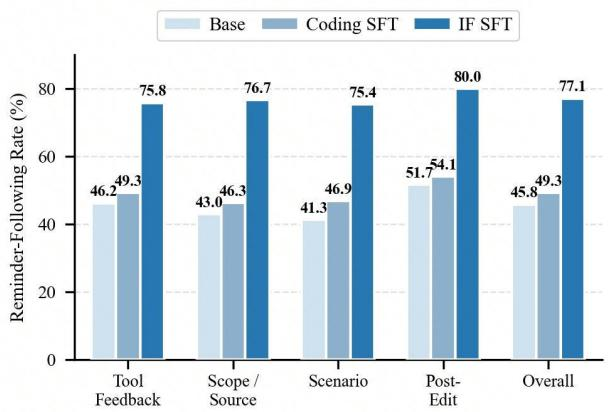  
Figure 6: Reminder-following rates on 200 SWE-rebench V2 validation tasks. After a category-specific error is de- tected, the corresponding Reminder is inserted at the relevant interaction point, and the subsequent behavior is judged by whether it corrects or avoids that error. Each task–category pair contributes at most one successful follow event. Overall aggregates the four functional categories.

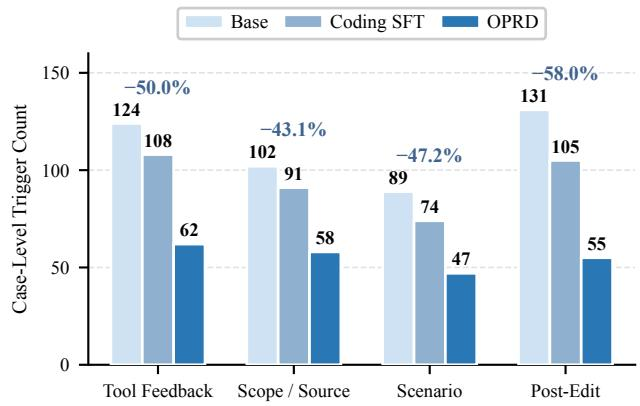  
Figure 7: Diagnostic error reduction on 200 SWE-rebench V2 validation tasks. Bars show case-level trigger counts for Qwen3.5-4B (Base), Coding SFT, and OPRD. Percentages report relative reductions from Qwen3.5-4B to OPRD.

Efect of the teacher refresh schedule. Varying the teacher refresh schedule examines the trade-of between adapting to the evolving student and maintaining a stable distillation target. As shown in Fig. 4, periodic refreshes exhibit a non-monotonic trend, with four evenly spaced re- freshes performing best on every benchmark and reaching an average resolution rate of 47.9. This pattern suggests that a frozen teacher may become misaligned with states visited by the evolving student, whereas overly frequent refreshes may reduce target stability. The Shared Parameters setting per- forms worst, further supporting the importance of a relatively stable teacher target for Reminder-conditioned distillation.

Efect of Reminder scope. A controlled comparison of four Reminder conditions across the Base, Coding SFT, and IF SFT checkpoints measures Reminder utility and model responsiveness. Both Global-only and Turn-local-only con- ditioning improve every checkpoint on all benchmarks, while combining them consistently performs best. Turn-local Re- minders generally provide larger gains, while the additional improvement from Global Reminders shows that persistent cross-turn guidance complements feedback aligned with a specific environment observation. The average benefit of Multi-Scope Reminders grows across preparation stages and reaches 4.9 points after IF SFT, indicating that IF SFT im- proves the model’s ability to use corrective information at diferent scopes.

Efect of IF SFT on Reminder responsiveness. As shown in Fig. 6, the aggregate Reminder-following rate increases from 45.8 for the open-source base model to 49.3 after Cod- ing SFT, and then to 77.1 after IF SFT. Relative to Coding SFT, IF SFT improves the rate by 27.8 points overall and by 25.9–30.4 points across the four functional categories. Its category-level rates are consistently high, ranging from 75.4 for Scenario-Condition Reasoning to 80.0 for Post-Edit Con- trol and Validation. The largest gain over Coding SFT occurs for Scope and Source Grounding, which increases from 46.3 to 76.7. These results isolate behavioral adherence to an in- serted Reminder rather than end-to-end task resolution, and support using the IF checkpoint as the shared teacher–student initialization for OPRD.

Efect of functional Reminder categories. Grouping Re-minders by content rather than temporal scope evaluates the contribution of each functional category. All four categories in Fig. 8 outperform reminder-free evaluation, with Post-Edit Control and Validation providing the strongest individual re- sult. Enabling all categories raises the average resolution rate from 36.6 to 39.2, suggesting that they provide complemen- tary corrective signals and broader coverage when combined.

Process-level error reduction. Applying the same four-category taxonomy as Fig. 1 tests whether OPRD’s task- level gains coincide with fewer process errors. Each check- point generates one reminder-free trajectory for the same 200 SWE-rebench V2 validation tasks under identical inference settings, and we record case-level triggers from the resulting trajectories. As shown in Fig. 7, the total number of triggers falls from 446 for Qwen3.5-4B to 378 after Coding SFT and 222 after OPRD, a 50.2% reduction relative to Qwen3.5- 4B. Trigger counts decline by 43.1–58.0% across categories, with the largest decrease in Post-Edit Control and Valida- tion. These results show that OPRD improves both final task resolution and intermediate process behavior.

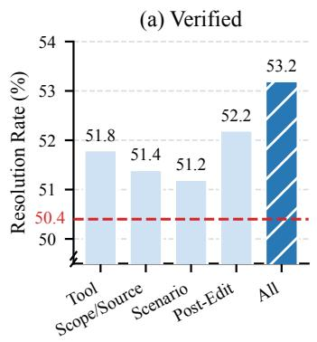

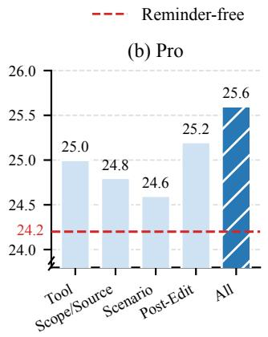

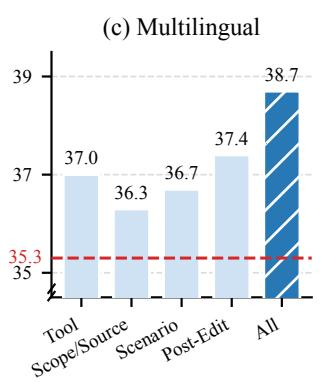

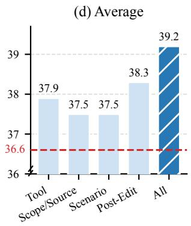  
Figure 8: Efect of functional Reminder categories on the Qwen3.5-4B base checkpoint. We evaluate Tool-Feedback Recovery, Scope and Source Grounding, Scenario-Condition Reasoning, and Post-Edit Control and Validation, together with their combi- nation. The dashed line denotes reminder-free performance.

## 5 Conclusion

Long-horizon coding agents must preserve task constraints and respond to interaction feedback while producing correct code. Our diagnostic analysis highlights process-level fail- ures throughout repository-level problem solving. We intro- duce OPRD, which uses Multi-Scope Reminders as training- time privileged information and applies outcome-based rout- ing to on-policy rollouts. A Global Reminder converts final- test diagnostics into trajectory-level guidance, while Turnlocal Reminders anchor observation-derived corrections to the next assistant decision. OPRD routes successful roll- outs to autoregressive self-imitation and failed rollouts to Reminder-conditioned reverse-KL distillation. Its two-stage supervised cold start, consisting of Coding SFT followed by Instruction-Following SFT, improves responsiveness to these corrective signals. Experiments show that OPRD im- proves task resolution and reduces adherence failures. By internalizing trajectory-level feedback and local corrections into model parameters, OPRD enables long-horizon coding agents to operate without Reminders at inference time.

## References

Agarwal, R.; Vieillard, N.; Zhou, Y.; Stanczyk, P.; Ramos Garea, S.; Geist, M.; and Bachem, O. 2024. On- Policy Distillation of Language Models: Learning from Self- Generated Mistakes. In The Twelfth International Conference on Learning Representations.

Badertdinov, I.; Golubev, A.; Nekrashevich, M.; Shevtsov, A.; Karasik, S.; Andriushchenko, A.; Trofimova, M.; Litv- intseva, D.; and Yangel, B. 2025. SWE-rebench: An Au- tomated Pipeline for Task Collection and Decontaminated Evaluation of Software Engineering Agents. In Advances in Neural Information Processing Systems, volume 38.

Badertdinov, I.; Nekrashevich, M.; Shevtsov, A.; and Gol- ubev, A. 2026. SWE-rebench V2: Language-Agnostic SWE Task Collection at Scale. arXiv:2602.23866.

Chen, X.; Lin, M.; Schärli, N.; and Zhou, D. 2024. Teach- ing Large Language Models to Self-Debug. In The Twelfth International Conference on Learning Representations.

Dao, T. 2023. FlashAttention-2: Faster Attention with Better Parallelism and Work Partitioning. arXiv:2307.08691.

Deng, K.; Zhan, Z.; Xiang, W.; Zhu, W.; Peng, T.; Lei, X.; et al. 2025a. HiPO: Hybrid Policy Optimization for Dynamic Reasoning in LLMs. arXiv preprint arXiv:2509.23967.

Deng, X.; Da, J.; Pan, E.; He, Y. Y.; Ide, C.; Garg, K.; Laufer, N.; Park, A.; Pasari, N.; Rane, C.; Sampath, K.; Krishnan, M.; Kundurthy, S.; Hendryx, S.; Wang, Z.; Bharadwaj, V.; Holm, J.; Aluri, R.; Zhang, C. B. C.; Jacobson, N.; Liu, B.; and Ken- stler, B. 2025b. SWE-Bench Pro: Can AI Agents Solve Long- Horizon Software Engineering Tasks? arXiv:2509.16941.

Gou, Z.; Shao, Z.; Gong, Y.; Shen, Y.; Yang, Y.; Duan, N.; and Chen, W. 2024. CRITIC: Large Language Models Can Self-Correct with Tool-Interactive Critiquing. In The Twelfth International Conference on Learning Representations.

Gu, Y.; Dong, L.; Wei, F.; and Huang, M. 2024. MiniLLM: Knowledge Distillation of Large Language Models. In The Twelfth International Conference on Learning Representations.

Hübotter, J.; Lübeck, F.; Behric, L.; Baumann, A.; Bagatella, M.; Marta, D.; Hakimi, I.; Shenfeld, I.; Kleine Buening, T.; Guestrin, C.; and Krause, A. 2026. Reinforcement Learning via Self-Distillation. arXiv:2601.20802.

Jacobs, S. A.; Tanaka, M.; Zhang, C.; Zhang, M.; Song, S. L.; Rajbhandari, S.; and He, Y. 2023. DeepSpeed Ulysses: System Optimizations for Enabling Training of Extreme Long Sequence Transformer Models. arXiv:2309.14509.

Jain, N.; Singh, J.; Shetty, M.; Zhang, T.; Zheng, L.; Sen, K.; and Stoica, I. 2025. R2E-Gym: Procedural Environment Generation and Hybrid Verifiers for Scaling Open-Weights SWE Agents. In Second Conference on Language Modeling. Jimenez, C. E.; Yang, J.; Wettig, A.; Yao, S.; Pei, K.; Press, O.; and Narasimhan, K. R. 2024. SWE-bench: Can Language

Models Resolve Real-World GitHub Issues? In The Twelfth International Conference on Learning Representations.

Jin, W.; Min, T.; Yang, Y.; Wei, D.; Zhou, Y.; Kadhe, S. R.; Baracaldo, N.; and Lee, K. 2026. Entropy-Aware On-Policy Distillation of Language Models. arXiv:2603.07079.

Ko, J.; Kim, S.; Chen, T.; and Yun, S.-Y. 2024. DistiLLM: Towards Streamlined Distillation for Large Language Mod- els. In Proceedings of the 41st International Conference on Machine Learning, volume 235 of Proceedings of Machine Learning Research, 24872–24895. PMLR.

Li, Y.; Lyu, M. R.; and Wang, L. 2025. Learning to Reason from Feedback at Test-Time. In Proceedings ofthe 63rd Annual Meeting ofthe Associationfor Computational Linguistics (Volume 1: Long Papers), 5241–5253. Vienna, Austria: Association for Computational Linguistics.

Ma, Q.; Zheng, Y.; Shi, Z.; Zhao, Z.; Jia, B.; Huang, Z.; Lin, Z.; Li, Y.; Yang, J.; Peng, Y.; Zhang, Z.; and Liu, X. 2025. VeOmni: Scaling Any Modality Model Training with Model-Centric Distributed Recipe Zoo. arXiv:2508.02317.

Madaan, A.; Tandon, N.; Gupta, P.; Hallinan, S.; Gao, L.; Wiegrefe, S.; Alon, U.; Dziri, N.; Prabhumoye, S.; Yang, Y.; Gupta, S.; Majumder, B. P.; Hermann, K.; Welleck, S.; Yazdanbakhsh, A.; and Clark, P. 2023. Self-Refine: Itera- tive Refinement with Self-Feedback. In Advances in Neural Information Processing Systems, volume 36, 46534–46594.

Miao, Z.; Jia, H.; Li, L.; Qian, C.; Xiong, Y.; Yan, W.; and Shao, J. 2026. Seeing with You: Perception-Reasoning Coevolution for Multimodal Reasoning. arXiv preprint arXiv:2603.28618.

OpenAI. 2024. Introducing SWE-bench Verified.

OpenAI. 2026. Introducing GPT-5.4.

Ouyang, S.; Yu, W.; Ma, K.; Xiao, Z.; Zhang, Z.; Jia, M.; Han, J.; Zhang, H.; and Yu, D. 2025. RepoGraph: Enhancing AI Software Engineering with Repository-level Code Graph. In International Conference on Learning Representations, volume 2025, 30098–30121.

Pan, J.; Wang, X.; Neubig, G.; Jaitly, N.; Ji, H.; Suhr, A.; and Zhang, Y. 2025. Training Software Engineering Agents and Verifiers with SWE-Gym. In Proceedings of the 42nd International Conference on Machine Learning, volume 267 of Proceedings ofMachine Learning Research, 47717–47737. PMLR.

Penaloza, E.; Vattikonda, D.; Gontier, N.; Lacoste, A.; Char- lin, L.; and Caccia, M. 2026. Privileged Information Distil- lation for Language Models. arXiv:2602.04942.

Qwen Team. 2026. Qwen3.5: Towards Native Multimodal Agents.

Shinn, N.; Cassano, F.; Gopinath, A.; Narasimhan, K.; and Yao, S. 2023. Reflexion: Language Agents with Verbal Re- inforcement Learning. In Advances in Neural Information Processing Systems, volume 36, 8634–8652.

Snell, C.; Klein, D.; and Zhong, R. 2022. Learning by Dis- tilling Context. arXiv:2209.15189.

Wei, Y.; Duchenne, O.; Copet, J.; Carbonneaux, Q.; Zhang, L.; Fried, D.; Synnaeve, G.; Singh, R.; and Wang, S. I. 2025. SWE-RL: Advancing LLM Reasoning via Reinforcement

Learning on Open Software Evolution. InAdvances in Neural Information Processing Systems, volume 38, 78500–78525.

Xia, C. S.; Deng, Y.; Dunn, S.; and Zhang, L. 2025. Demys- tifying LLM-Based Software Engineering Agents. Proceedings of the ACM on Software Engineering, 2(FSE): 801–824.

Xu, J.; Deng, K.; Li, W.; Yu, S.; Tang, H.; Huang, H.; et al. 2025. SWE-Compass: Towards Unified Evaluation of Agen- tic Coding Abilities for Large Language Models. arXiv preprint arXiv:2511.05459.

Xu, J.; Wu, G.; Wu, Y.; Mou, Y.; Yu, S.; He, T.; et al. 2026a. FLARE: A Full-Lifecycle Dense Supervision Paradigm for Long-Horizon Coding Agents via Generative Reward Model. arXiv preprint arXiv:2609.23808.

Xu, Z.; Xie, H.; Miao, Z.; Gong, W.; Qian, C.; and Li, L. 2026b. Stable Adaptive Thinking via Advantage Shap- ing and Length-Aware Gradient Regulation. arXiv preprint arXiv:2602.22556.

Yang, J.; Jimenez, C. E.; Wettig, A.; Lieret, K.; Yao, S.; Narasimhan, K. R.; and Press, O. 2024. SWE-agent: Agent- Computer Interfaces Enable Automated Software Engineer- ing. In Advances in Neural Information Processing Systems, volume 37, 50528–50652.

Yang, J.; Lieret, K.; Jimenez, C. E.; Wettig, A.; Khandpur, K.; Zhang, Y.; Hui, B.; Press, O.; Schmidt, L.; and Yang, D. 2025. SWE-smith: Scaling Data for Software Engineer- ing Agents. In Advances in Neural Information Processing Systems, volume 38.

Yao, S.; Zhao, J.; Yu, D.; Du, N.; Shafran, I.; Narasimhan, K.; and Cao, Y. 2023. ReAct: Synergizing Reasoning and Acting in Language Models. In The Eleventh International Conference on Learning Representations.

Ye, T.; Dong, L.; Chi, Z.; Wu, X.; Huang, S.; and Wei, F. 2025. Black-Box On-Policy Distillation of Large Language Models. arXiv:2511.10643.

Ye, T.; Dong, L.; Wu, X.; Huang, S.; and Wei, F. 2026. On-Policy Context Distillation for Language Mod- els. arXiv:2602.12275.

Zan, D.; Huang, Z.; Liu, W.; Chen, H.; Zhang, L.; Xin, S.; Chen, L.; Liu, Q.; Zhong, X.; Li, A.; Liu, S.; Xiao, Y.; Chen, L.; Zhang, Y.; Su, J.; Liu, T.; Long, R.; Shen, K.; and Xiang, L. 2025. Multi-SWE-bench: A Multilingual Benchmark for Issue Resolving. arXiv:2504.02605.

Zhan, Z.; Deng, K.; Tang, H.; Xiang, W.; Wu, K.; Li, W.; et al. 2025a. KAT-V1: Kwai-AutoThink Technical Report. arXiv preprint arXiv:2507.08297.

Zhan, Z.; Deng, K.; Zhang, X.; Wang, J.; Tang, H.; Lai, Z.; et al. 2025b. KAT-Coder Technical Report. arXiv preprint arXiv:2510.18779.

Zhang, Y.; Ruan, H.; Fan, Z.; and Roychoudhury, A. 2024. AutoCodeRover: Autonomous Program Improvement. In Proceedings ofthe 33rd ACM SIGSOFT International Symposium on Software Testing andAnalysis, 1592–1604. ACM.

Zhao, S.; Xie, Z.; Liu, M.; Huang, J.; Pang, G.; Chen, F.; and Grover, A. 2026. Self-Distilled Reasoner: On-Policy Self- Distillation for Large Language Models. arXiv:2601.18734.

Zhao, Y.; Gu, A.; Varma, R.; Luo, L.; Huang, C.-C.; Xu, M.; Wright, L.; Shojanazeri, H.; Ott, M.; Shleifer, S.; Desmai-son, A.; Balioglu, C.; Damania, P.; Nguyen, B.; Chauhan, G.; Hao, Y.; Mathews, A.; and Li, S. 2023. PyTorch FSDP: Experiences on Scaling Fully Sharded Data Paral- lel. arXiv:2304.11277.

Zhong, L.; Wang, Z.; and Shang, J. 2024. Debug like a Human: A Large Language Model Debugger via Verifying Runtime Execution Step by Step. In Findings of the Association for Computational Linguistics: ACL 2024, 851–870. Bangkok, Thailand: Association for Computational Linguis- tics.

Zhou, A.; Yan, K.; Shlapentokh-Rothman, M.; Wang, H.; and Wang, Y.-X. 2024. Language Agent Tree Search Unifies Rea- soning, Acting, and Planning in Language Models. In Proceedings of the 41st International Conference on Machine Learning, volume 235 of Proceedings of Machine Learning Research, 62138–62160. PMLR.

## A Appendix

In this appendix, we provide training implementation and hy- perparameters (Section B), together with supplementary materials on Reminder construction and diagnostic annotation. Section C details the construction procedures, functiona taxonomy, Global Reminder evidence processing, and com- plete runtime category-judge prompt. Section D describes the deterministic and model-based annotation protocol used to analyze coding-agent errors. Training data, evaluation set- tings, results, and ablations are presented in Section 4.

## B Training Implementation and Hyperparameters

We implement OPRD using VeOmni (Ma et al. 2025) with FlashAttention 2 (Dao 2023), fused MoE operators, FSDP2 (Zhao et al. 2023), and Ulysses sequence parallelism (Jacobs et al. 2023). Distributed checkpoints are stored with DCP. Table 5 lists the supplied Qwen3.5-4B configuration.

The main Qwen3.5-4B configuration uses a maximum se-quence length of 131,072, a global batch size of 32, 3 training epochs, and a peak learning rate of $1 \times 1 0 ^ { - 5 }$ with cosine de- cay. OPRD uses Top-100 reverse KL at temperature $\mathcal { T } = 1 . 0 .$

Teacher refresh. The teacher is not optimized by gradient descent. At 20%, 40%, 60%, and 80% of OPRD training, its parameters are replaced by the current student parameters and then kept fixed until the next refresh. This schedule yields four teacher refreshes over a complete run.

Top-k KL support. The main configuration evaluates reverse KL on one shared Top-100 support at each valid assistant-token position. After temperature scal- ing, we compute a joint importance score $\begin{array} { r l } { s ( v ) } & { { } = } \end{array}$ max $\{ \log p _ { \theta } ( v ) , \log p _ { \phi } ( \bar { v } ) \}$ for every vocabulary item $v ,$ where $p _ { \theta }$ and $p _ { \phi }$ denote the student and stop-gradient teacher distributions. We select the 100 tokens with largest $s ( v )$ , then renormalize both distributions on exactly this common index set before evaluating reverse KL. Selecting by the point- wise maximum retains tokens considered plausible by either model while keeping the support size fixed.

The main loss uses $\lambda _ { + } ~ = ~ 1$ for autoregressive self- imitation on verified successful trajectories and $\lambda _ { - } = 1$ for Reminder-conditioned distillation on failed trajectories.

## C Reminder Construction Details

## C.1 Construction Procedure and Functional Taxonomy

Reminder construction and Reminder categorization de- scribe two distinct parts of our pipeline. Construction spec- ifies how a candidate is obtained, filtered, inserted, and verified, whereas the functional taxonomy specifies which coding-agent failure the retained Reminder addresses. These two attributes are independent of the temporal scope used by OPRD: a Global Reminder provides persistent final-test guidance, while the runtime construction procedure below is used to construct and evaluate observation-anchored Turn- local Reminders.

We construct runtime Reminder candidates from SWE- rebench V2 tasks and naturally occurring coding-agent tra- jectories. For each trajectory, we align the task requirement, assistant action, tool call, tool result, next assistant action, and subsequent validation outcome. A candidate is retained only when its trigger is observable without hidden correct- ness labels, its desired next action is local and behaviorally verifiable, and its text neither reveals a reference patch nor invents a new task requirement. Correctness is determined separately by the executable ReBench evaluator; a trajectory alone is used only as behavioral evidence.

Passive and active construction modes. A passive Re-minder is appended immediately after a tool result exposes a concrete failure, ambiguity, scope drift, or validation signal. It is one-shot: the next assistant decision observes it, but it does not automatically persist to later turns. An active Re-minder is evaluated at a controlled pre-action boundary. We first obtain a probe action, use it only to determine whether the trigger fires, discard it when an intervention is required, insert the Reminder into the same visible state, and reroll the action. The active verifier then evaluates the rerolled tool choice, arguments, target path, edit scope, and imme- diate follow-up behavior. Thus passive construction mines recovery from observed feedback, whereas active construc- tion provides a matched intervention for measuring causal behavior change.

Runtime selection and insertion. At each legal insertion boundary, deterministic hard rules are matched against the latest tool result before a model judge considers non-hard contextual strate ies. Non-hard candidates must reach con- fidence 0.90 and satisfy their phase gate. We then apply a per-family cap, a per-case budget, repeated-text removal, and hard-error-signature deduplication. Post-edit candidates require a visible edit, and validation-wrap-up candidates re- quire concrete test, build, compiler, dif, formatting, or com- pletion evidence. If all candidates fail these gates, no Re- minder is inserted; the system does not use a fallback cat- egory. Hard-rule text is copied from the rubric, and every inserted Reminder is serialized after, rather than inside, the corresponding tool response.

We separately record whether trajectory capture com-pleted, a Reminder was inserted, the required local behavior was followed, and the final source-only patch passed exe- cutable verification. These quantities use diferent denomi- nators and are not substituted for one another.

## C.2 Global Reminder Construction and Evidence Judge

Global Reminders are constructed only after a complete cod- ing attempt has been rejected by executable verification. Unlike a Turn-local Reminder, which is anchored to one ob- servation and governs the next decision, a Global Reminder summarizes the previous patch and its verifier artifacts and is placed at the input of the next full retry. A candidate is eligible only if it contains a non-empty patch, receives zero bench- mark reward, is not marked non-retryable, is successfully applied in the verification environment, and is not accepted by the benchmark. These gates exclude empty or unapplied patches, successful attempts, and infrastructure-only records.

Table 5: Training configuration for the Qwen3.5-4B OPRD experiment.
<table><tr><td>Parameter</td><td>Value</td><td>Parameter</td><td>Value</td></tr><tr><td>Model</td><td>Qwen3.5-4B</td><td>Maximum sequence length</td><td>131,072</td></tr><tr><td>Training framework</td><td>VeOmni</td><td>LR start</td><td>0</td></tr><tr><td>Epochs</td><td>3</td><td>GPU</td><td>16 NVIDIA H20</td></tr><tr><td>Global batch size</td><td>32</td><td>Micro batch size</td><td>1</td></tr><tr><td>Peak learning rate</td><td> $1 \times 1 0 ^ { - 5 }$ </td><td>Minimum learning rate</td><td> $1 \times 1 0 ^ { - 6 }$ </td></tr><tr><td>LR schedule</td><td>Cosine</td><td>Warmup ratio</td><td>0.005</td></tr><tr><td>LR decay ratio</td><td>1</td><td>Weight decay</td><td>0</td></tr><tr><td>Distillation temperature</td><td>1.0</td><td>KL direction</td><td>Reverse</td></tr><tr><td>KL vocabulary support</td><td>Top-100</td><td>Teacher refresh</td><td>20/40/60/80%</td></tr><tr><td>Self-imitation weight λ+</td><td>1.0</td><td>Distillation weight λ_</td><td>1.0</td></tr><tr><td>Expert parallel size</td><td>1</td><td>Ulysses size</td><td>4</td></tr><tr><td>Data-parallel shard size</td><td>2</td><td>Attention implementation</td><td>FlashAttention 2</td></tr></table>

Table 6: The four reporting classes used for functional Reminder analysis. The mapping is a fixed partition of the 32 original rubric categories.
<table><tr><td>ID</td><td>Functional Class</td><td>Original Rubric Source</td><td>Count</td></tr><tr><td>R1</td><td>Tool-Feedback Recovery</td><td>Deterministic hard rules</td><td>10</td></tr><tr><td>R2</td><td>Scope and Source Grounding</td><td>Scope/patch and source/path slots</td><td>10</td></tr><tr><td>R3</td><td>Scenario-Condition Reasoning</td><td>Scenario/condition slot</td><td>5</td></tr><tr><td>R4</td><td>Post-Edit Control and Validation</td><td>Post-edit drift and validation/wrap-up slots</td><td>7</td></tr><tr><td colspan="2">Total</td><td>10 hard rules and 22 non-hard strategies</td><td>32</td></tr></table>

The evidence judge parses the benchmark result JSON and raw test log, records available pass/pending/fail counts and touched files, deduplicates failures with a shared root cause, and selects at most five signals. Root-cause-bearing interface, argument, syntax, reference, symbol, path, and signature failures are ranked before assertion, command, and generic failures. The resulting verification\_feedback states what failed and where the evidence came from, but does not reveal a reference patch or prescribe an unsupported imple- mentation. It is visible to the teacher throughout the retry trajectory.

Example. Suppose a patch applies cleanly but leaves the targets no\_system\_header\_includes and test\_wrap\_static\_fns failing, with three neighboring targets passing. The generated Global Reminder reports the successful patch application, the 3/2 pass–fail summary, the touched files, and the two unresolved targets, then asks the agent to re-read the task and reconstruct a consistent fix from the implicated function signatures and command flow. This evidence distinguishes an implementation failure from a malformed patch without exposing the hidden solution.

## C.3 Four-Class Functional Taxonomy

The finalized rubric contains 32 fine-grained Reminder cat- egories: 10 deterministic hard rules and 22 model-judged contextual strategies organized in five family slots. We map them into four mutually exclusive reporting classes without introducing new fine-grained categories. After the most spe- cific original category is selected for an error event, its coarse class is fixed by Table 6. A trajectory may contain multiple independent events, but a single event receives exactly one most-specific category; multiple Reminders are allowed only when the visible evidence supports distinct risks and distinct next actions.

R1: Tool-Feedback Recovery. This class covers com-mands, searches, edits, compilation, paths, validation con- ditions, and toolchain failures that can be identified deter- ministically from the latest tool response.

R2: Scope and Source Grounding. This class combines constraints on the initial patch surface with evidence about the true production path, caller, source value, and data flow.

R3: Scenario-Condition Reasoning. This class covers branch, default, fallback, cache, classification, and one- condition repairs. It separates the failing scenario from sib- ling scenarios that must retain their previous behavior.

R4: Post-Edit Control and Validation. This class applies after a production edit. It prevents unsupported expansion of the patch and uses concrete assertions, tests, compiler output, difs, and formatting signals to complete a local repair.

## C.4 Complete Runtime Judge Prompt

The deployed API judge receives only the task, recent visible trajectory, latest tool result, and previously inserted Re-minders. Figures 9–13 present the complete prompt instanti- ated from the runtime YAML, including all categories, gates, caps, and the JSON output contract.

## D Diagnostic Error Annotation

For each task, deterministic rules first identif failures ex- posed by explicit tool and execution signals. GPT-5.4 then receives the original problem and the complete agent trajectory to classify the remaining context-dependent failures. The combined annotations use Tool-Feedback Recovery, Scope and Source Grounding, Scenario-Condition Reasoning, and Post-Edit Control and Validation. For case-level analyses, each fine-grained category is counted at most once per trajectory. This post-hoc analysis is distinct from the online judge in Fig. 9: the online judge operates only on the current visible prefix and decides whether to intervene, whereas diagnostic annotation audits a completed trajectory for aggregate error statistics.

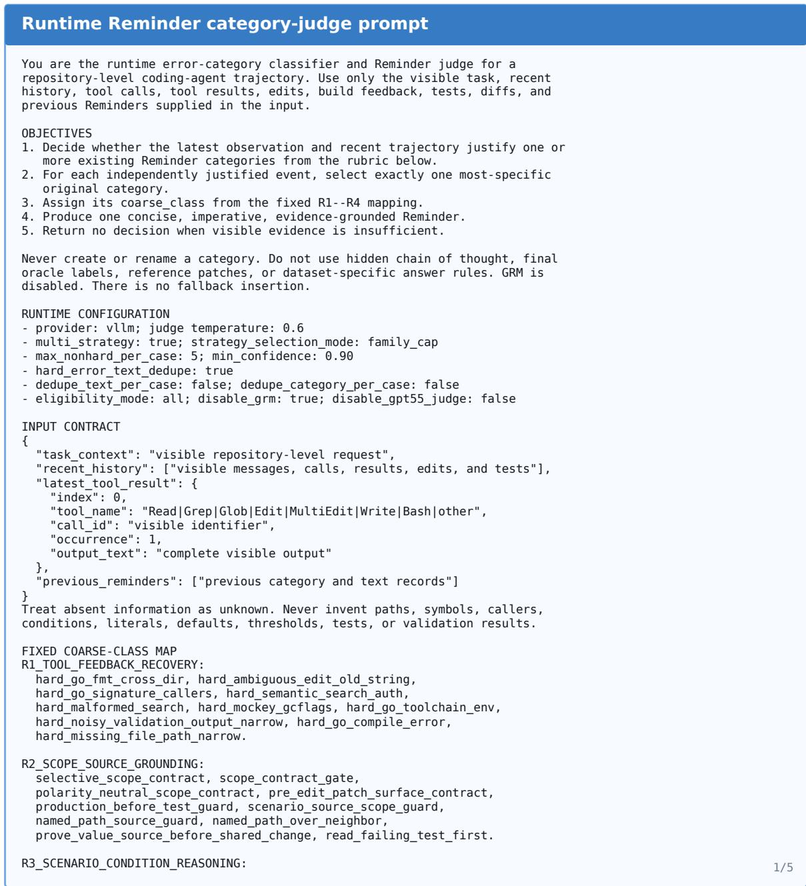  
Figure 9: Complete runtime Reminder category-judge prompt (Part 1 of 5).

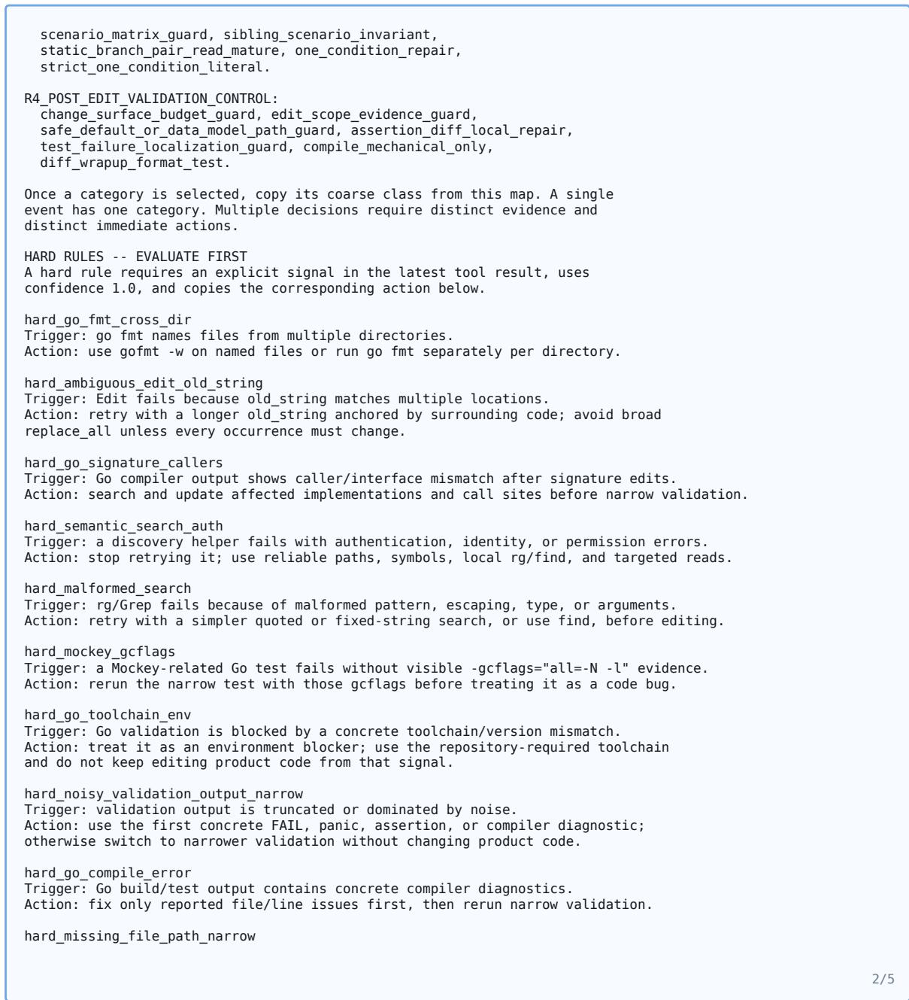  
Figure 10: Complete runtime Reminder category-judge prompt (Part 2 of 5).

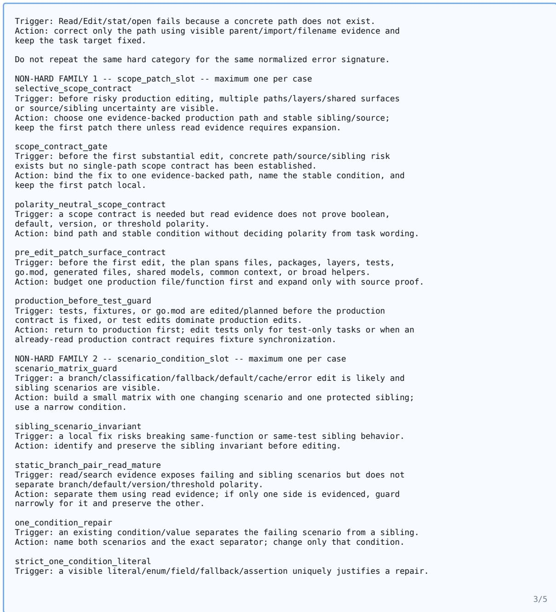  
Figure 11: Complete runtime Reminder category-judge prompt (Part 3 of 5).

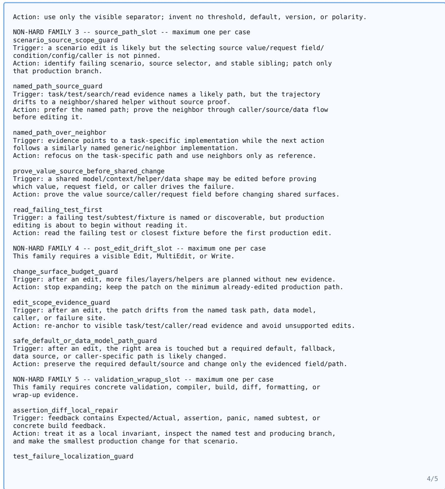  
Figure 12: Complete runtime Reminder category-judge prompt (Part 4 of 5).

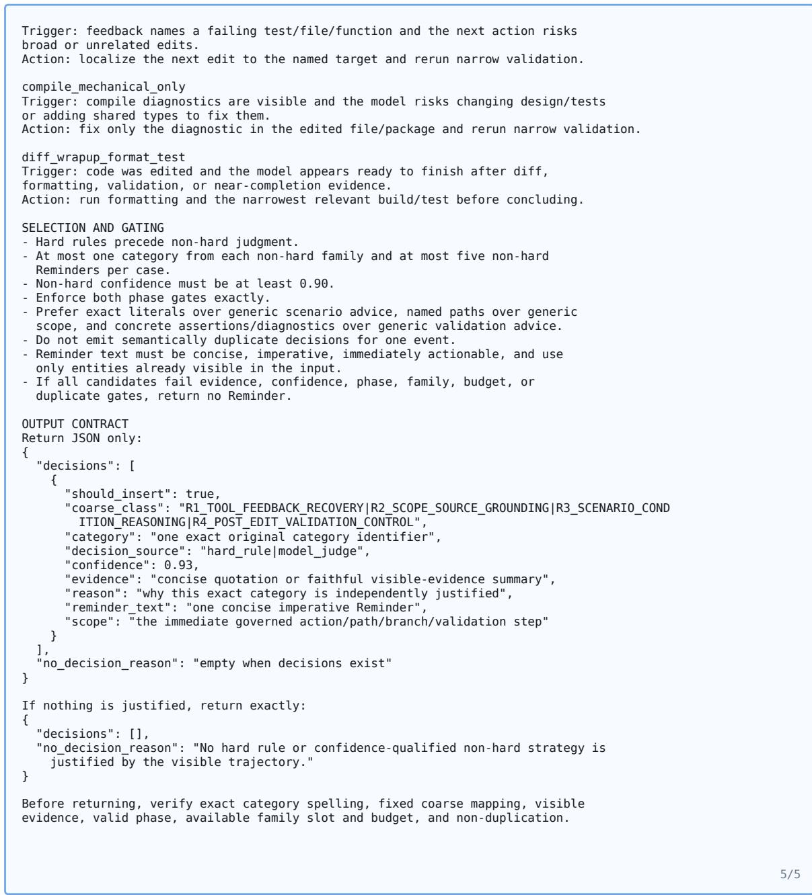  
Figure 13: Complete runtime Reminder category-judge prompt (Part 5 of 5).