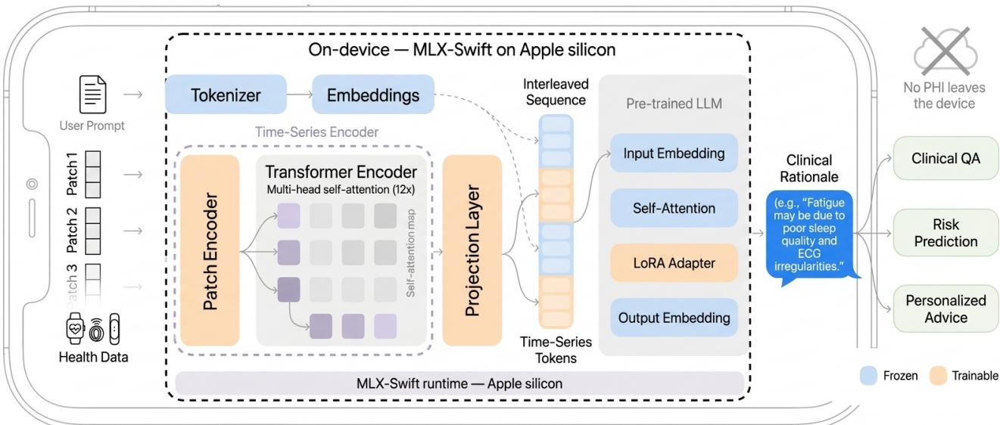
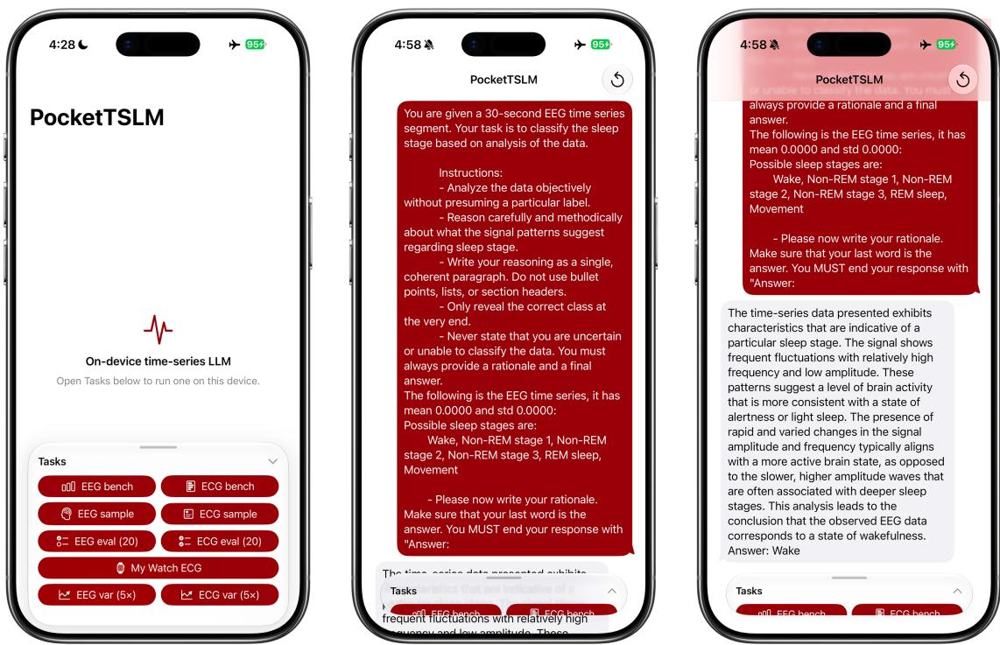
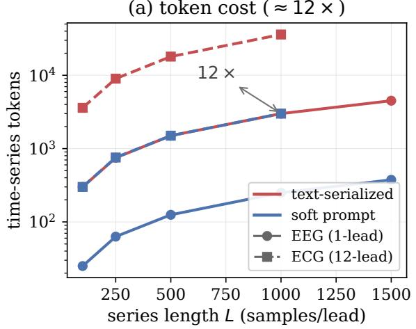
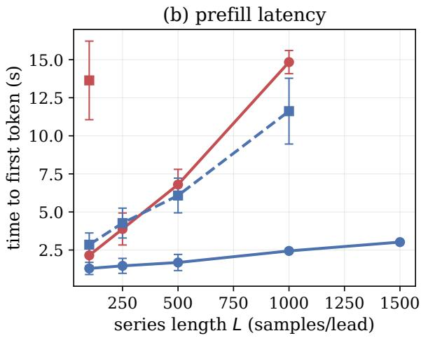

# PocketTSLM: Deploying an On-Device Soft-Prompt Time-Series Language Model for Privacy-Preserving Smartphone Reasoning

Max Rosenblattl 1, Nikhil Krishnaswamy1, Leon Nissen 1, Manuel Milling 2, Nicolas Zumarraga4, Ning Wang4, Thomas Kaar 1,3,4, Robert Jakob 3,4, Björn W. Schuller 2,5, Elgar Fleisch 4,6, Patrick Langer 1,3,4, and Paul Schmiedmayer 1

1Stanford University, USA; 2CHI, Technical University of Munich University Hospital, Germany; 3Aionic Labs, Switzerland; 4ETH Zurich, Switzerland; 5GLAM, Imperial College London, UK; 6Centre for Digital Health Interventions (CDHI), University of St. Gallen, Switzerland

Correspondence mrosenbl@stanford.edu · Code github.com/SchmiedmayerLab/PocketTSLM · Code license MIT

## Abstract

Consumer phones and wearables increasingly collect physiological time-series data, yet most mobile systems treat these streams as summaries or text rather than as temporal evidence. This representation is poorly matched to personal health systems that need to retrieve, route, or summarize sensor evidence while preserving temporal structure. Cloud-hosted time-series language models avoid smartphone limits, but they repeatedly move sensitive physiology of the device and add latency and per-query compute cost. Mobile model alternatives that aggregate time-series data into statistical features or serialize raw samples as text either compress temporal structure or exhaust the context and memory budgets of small on-device models. We present PocketTSLM, a mobile-native deployment of OpenTSLM SoftPrompt, the soft-prompt variant of the OpenTSLM time-series language model. PocketTSLM runs fully on a consumer smartphone by injecting encoded time-series windows as embeddings instead of tokenizing time series as text. A numerical parity protocol verifies identical greedydecoded token sequences between the Swift port and a Python reference using Apple’s MLX machine-learning framework. Answers also match the PyTorch reference, although rationale wording can difer. An on-device context-economics benchmark compares the soft-prompt path with a text-serialized baseline on the same backbone. In our benchmark format, soft-prompting uses approximately 12× fewer time-series tokens and reduces prompt-prefill cost. PocketTSLM processes 30-second Sleep-EDF electroencephalography clips for sleep staging and a 1,000-sample (10 s) 12-lead electrocardiogram clip from ECG-QA. In comparison, text-serialized baselines exceed the phone’s context or memory budget at longer time-series windows. All inference runs entirely on the device, with no health data transmitted during inference.

## 1 Introduction

Consumer devices now collect physiological time-series data that were previously limited to clinical or research environments [1, 2]. Smartwatch irregular-pulse notifications have been evaluated for atrial fibrillation screening in large cohorts [3], phone-connected systems make electroencephalography (EEG) acquisition more accessible [4], and passive wearable streams such as heart rate, sleep, and activity have been used for infectious-disease surveillance, COVID-19 detection, and prospective health-risk assessment [5–7]. In each case, measurements are captured close to the patient, but the interpretation delivered to a patient or downstream system is often a label, score, or study endpoint. Digital biomarker pipelines make this pattern explicit: continuous measurements are translated into digital endpoints or biomarkers for evaluation and decision support [8]. Those outputs support screening, monitoring, and study endpoints, but they do not explain the source time-series window itself. Recent personal-health large language model (LLM) systems interpret wearable-derived sleep, activity, and fitness data through natural-language coaching or insight generation [9, 10]. Therefore, patientfacing assistants, clinician review tools, and supervised health agents need descriptions grounded in source time-series windows that can be retrieved, routed, summarized, or used to defer a response when the evidence is insuficient.

Time-series language models (TSLMs) are designed for this time-series-to-language interface. They couple time-series encoders to language models and generate natural-language descriptions or rationales from raw physiological time-series data such as electrocardiogram (ECG), EEG, and accelerometry [11, 12]. These outputs give software a text interface to sensor evidence while preserving the temporal structure in the model input [11]. Time Series Language Models may enable systems that reason over sensor windows rather than only aggregate features.

Personal-health LLM systems are important reference points, but they do not solve the deployment problem addressed here: they reason over derived wearable data with large language models rather than running a time-series-native model on the phone [9, 10]. When interpretation is served remotely, personal physiological streams or derived sensor evidence must leave the device, making privacy and secondary-use risks part of the inference pathway [13]. Server-side inference also adds a network dependency and per-query compute cost. General on-device LLM work identifies limited device memory as a central inference bottleneck [14]. Medical LLM benchmarks show the same tradeof: local inference improves the privacy and cost posture, while memory and eficiency become the limiting constraints [15]. For physiological time-series data, moving inference onto the phone shifts the system boundary: raw data can remain local, ofline analysis becomes possible, and cloud storage is no longer required for each query.

The main obstacle is representation rather than model size. Mobile LLM runtimes are built around token-identifier input and do not expose a path for injecting precomputed embeddings, so a timeseries encoder’s output cannot be fed to the model directly. If the runtime cannot accept encoder embeddings, the time-series data must be serialized as text. Text serialization reuses an unchanged language-model interface and can cast time series as next-token prediction [16], but it expands each sample into multiple vocabulary tokens, formats or rounds numeric values, and spends the same limited context window needed for instructions and generated text. OpenTSLM soft-prompt (OpenTSLM-SP) avoids that prompt-level bottleneck by using representation-level fusion: a time-series encoder projects time-series windows into soft-prompt embeddings that are injected directly into the LLM’s embedding sequence [11]. That design is better matched to physiological time-series data, but it requires embedding-level access to the forward pass and cannot be expressed through token-only generation interfaces.

We present PocketTSLM, an on-device port of OpenTSLM-SP to MLX-Swift that evaluates whether the soft-prompt pathway can run on a consumer smartphone without changing the reference model’s greedy-decoding behavior. The port preserves the encoder-projector-LLM architecture while modifying the on-device generation path to accept projected time-series embeddings. PocketTSLM is scoped as a deployment and evaluation of on-device soft-prompt physiological time-series reasoning, not clinical validation, autonomous medical action, or behavior-change eficacy. We contribute: (1) a method for migrating soft-prompt TSLMs to MLX-Swift; (2) a numerical parity protocol that compares the on-device implementation against the reference under greedy decoding; (3) an on-device contexteconomics benchmark comparing soft-prompt encoding with a text-serialized baseline on the same backbone; and (4) a HealthKit-enabled iPhone demo that runs ECG and EEG reasoning locally without sending health data of-device.

## 2 Related Work

Time-series interfaces for language models. Integrating time-series data into LLMs is an active research area [17], with approaches spanning text serialization, model reprogramming, soft prompting, and cross-attention fusion [18]. Text serialization preserves the ordinary token interface and has been used for forecasting and wearable-health prediction [16, 19], but language models often struggle to reason over numbers presented this way [20]. Since every serialized sample consumes vocabulary tokens, long time-series windows can spend the same context window needed for instructions and generated text. Reprogramming methods keep the language-model backbone frozen while aligning time-series patches or text prototypes to the model input space [21, 22]. These methods show that representation choice matters, but they primarily target prediction, classification, or forecasting rather than natural-language rationales grounded in raw time-series data [16, 19, 21, 22]. Representationlevel fusion instead learns a time-series encoder whose embeddings are injected into the model as soft prompts or cross-attention inputs, preserving free-form generation [23, 24]. OpenTSLM [11] uses this approach for chain-of-thought (CoT) reasoning [25], coupling a time-series encoder to a frozen LLM through soft prompts and generating rationales for clinical time-series tasks. We port its soft-prompt variant fully onto a smartphone and quantify the token, memory, and latency cost of soft prompts against text serialization on the same backbone (§4).

Wearable and physiological time-series language systems. In personal-health and wearable sensing, recent LLM systems often reason over derived variables, contextual summaries, or tool-generated features rather than raw physiological time-series windows [10, 19]. SensorLLM and LLaSA align inertial measurements with language outputs for human activity recognition and sensor question answering, but they focus on motion sensing rather than physiological ECG or EEG interpretation [26, 27]. ECG-QA provides a benchmark for ECG question answering, and ECG-Chat trains an ECG-language model for report generation and dialogue [28, 29]. These systems expand time-series language modeling for health and wearables, but they do not establish whether a soft-prompt physiological TSLM can run fully on a consumer smartphone.

Deployment settings for health time-series inference. Most time-series-to-language and wearablehealth language models are developed and evaluated in server-side or ofline research settings [10, 11, 19, 29], so privacy, latency, and per-query cost remain deployment constraints rather than solved properties of the model. On-device LLM inference is an emerging direction, but it is tightly constrained by memory and eficiency, including for clinical models [14, 15]. For privacy, federated learning decentralizes training rather than inference [30], and fog execution keeps inference within a trusted local network [31]. On-device, ODCSIS [32] runs a small language model on a phone for human activity recognition, but injects sensors by serializing statistical features into text rather than encoding the raw time-series data. PocketTSLM therefore targets a remaining deployment constraint: soft-prompt TSLMs require embedding-level input and enough context headroom for raw time-series windows, whereas text serialization preserves an unchanged token-level generation path at the cost measured in §4. Prior work therefore covers time-series-to-language modeling, wearable and physiological language systems, privacy-preserving inference, and on-device language models, but not soft-prompt physiological TSLM inference fully on a consumer smartphone.

## 3 Methods

Reference model and migration strategy. PocketTSLM ports OpenTSLM-SP, the soft-prompt variant of OpenTSLM, from PyTorch into an iOS/MLX-Swift runtime. The PyTorch reference does not run in the target environment without reimplementation, as the model depends on framework-specific modules and a generation path that accepts projected input embeddings. We migrate the model in two stages: first from PyTorch to Python MLX, then from Python MLX to Swift MLX. This staging separates framework-level parity from Swift runtime parity and provides a Python MLX reference for the final port.

Soft-prompt architecture. The architecture receives channel- or lead-wise physiological time-series windows, including the single-channel EEG (Sleep-EDF sleep staging) and 12-lead ECG (ECG-QA) inputs evaluated in §4. A raw physiological time series is split by temporal position into fixed-length patches and fed to a time-series encoder: a CNN patch encoder followed by a Transformer that produces one embedding per patch (Fig. 1). Patch length, stride, z-normalization, and lead ordering follow the OpenTSLM reference without modification.

A learned multilayer perceptron (MLP) projector maps the encoder outputs into the input space of a frozen pre-trained LLM, Llama-3.2-1B in our deployment. The projected embeddings are interleaved with the embedded text prompt as soft-prompt tokens, meaning continuous vectors are injected directly into the model’s embedding sequence rather than vocabulary tokens. [11] Diferent LoRA adapters [33], each roughly 1% of the model’s parameters, adapt the frozen backbone to the ECG and EEG tasks. The selected adapter determines the modality-specific mapping used at inference. This representation-level pathway reduces prompt length, as each time-series patch becomes one embedding, but it requires the decoder forward pass to accept precomputed embeddings rather than only token identifiers.

Migration implementation. The first migration stage reimplements three OpenTSLM-SP components in Python MLX: the TransformerCNNEncoder, the MLPProjector, and the interleave logic that inserts projected time-series embeddings between text-token embeddings before the LLM forward pass. The trained encoder, projector, and LoRA adapter weights are loaded directly from the original PyTorch checkpoints and converted to the MLX format. Conversion applies layout transforms where the two frameworks use diferent weight conventions, including Conv1d kernel transposition and fused querykey-value (QKV) splitting. The LLM backbone uses Llama-3.2-1B with bfloat16 (bf16) base weights, matching the adapted checkpoint format.

  
Figure 1. The OpenTSLM-SP pipeline running fully on-device. Health time-series data are split into patches and encoded by a convolutional neural network (CNN) patch encoder and transformer (the timeseries encoder), projected into the LLM embedding space, and interleaved with the embedded text prompt. The combined sequence is decoded by a frozen pre-trained LLM with a low-rank adaptation (LoRA) adapter into a natural-language model rationale. The entire pipeline executes on the device through the MLX-Swift runtime on Apple silicon, with no health data leaving the phone. Figure adapted from Langer et al. [11].

The second migration stage ports the Python MLX reference module by module to Swift MLX, targeting Apple’s MLX-Swift framework. Since both stages share MLX operator semantics, discrepancies introduced in the Swift port can be separated from discrepancies introduced during the PyTorch-to-MLX conversion. MLX-Swift’s high-level generation path could not be used directly, as it accepts token identifiers rather than precomputed input embeddings. MLX-Swift exposes the lower-level tensor operations needed to rebuild the pipeline, so we adapted its Llama implementation and forward pass to accept input embeddings. Since the Swift modules use the same parameter keys as the Python MLX reference, the encoder and projector weights load from safetensors without further remapping.

Three implementation details afect reproducibility. Several NumPy-style convenience functions available in Python MLX have no direct Swift counterpart and were reconstructed from lower-level MLXArray operations. MLX’s lazy-evaluation model requires explicit evaluation barriers during the encoderprojector hand-of so intermediate tensors are materialized before generation. Certain operations dispatch to Metal graphics processing unit (GPU) kernels unavailable in headless continuous integration (CI) environments, so parity tests are pinned to the central processing unit (CPU) backend for deterministic comparison.

Evaluation data and benchmark protocol. The reported benchmarks use fixed, public, de-identified research samples from Sleep-EDF [34, 35] and ECG-QA [28]; they do not use prospective HealthKit records from patients. We evaluate two OpenTSLM tasks: single-channel Sleep-EDF sleep staging and 12-lead ECG-QA. Both tasks run with a Llama-3.2-1B backbone, bf16 base weights, and the original LoRA checkpoints without retraining.

The benchmark has two components. First, a numerical parity protocol compares the Swift MLX port with the reference implementation under greedy decoding. For each evaluated prompt, the protocol compares the full greedy-decoded token sequence from the Swift port against the Python MLX and PyTorch references.

Second, a context-economics benchmark compares two encodings of the same raw time series with the same backbone and generation loop. Text serialization is the natural baseline for soft prompting on device: it preserves an unmodified token-level generation interface and is the established method for feeding raw time series to a language model as tokens [16, 19].

The soft-prompt arm injects representation-level embeddings and produces ⌈�/4⌉ temporal tokens per channel or lead, where � is the length of the time-series. The text-serialized arm uses OpenTSLM’s prompt-level format [11], a fixed-precision encoding in the style of LLMTime [16]: each z-normalized sample is rounded to two decimals, its decimal point dropped, and the result rendered as "012"-style text fed as vocabulary tokens. For the zero-padded sample format used here, the text arm costs 3 byte-pair encoding (BPE) tokens per raw sample per channel or lead, measured with the backbone tokenizer. Both arms decode greedily with a maximum of 80 new tokens, so diferences in prompt tokens, time to first token (TTFT), and peak memory are attributable to the input encoding rather than the decoder policy.

We sweep series length � and report, per encoding, time-series tokens, full-prompt feasibility, TTFT, peak memory, and the context-window ceiling. We report TTFT rather than end-to-end latency, as truncating below the training window can change the generated-token count, while the prefill cost is directly driven by the input encoding. The theoretical capacity estimates use the backbone’s 8192-token context window, whereas the measured on-device sweep uses a lower 4,300-token prompt budget to preserve runtime memory headroom during generation. The two arms share the same LoRA-adapted backbone. LoRA changes generated content but not prefill cost or memory, so the reported context economics are unafected by the adapter choice. All on-device measurements were collected on an iPhone Air running iOS 26.4.1 with MLX-Swift 0.21.3. The reported TTFT and peak memory values are means over five repeated sweeps of the same configuration, given as mean ± standard deviation. TTFT is measured from the start of prompt prefill to the emission of the first generated token. Peak memory is the high-water mark of MLX’s unified-memory allocator, reset immediately before each arm, so it covers the resident model weights plus that arm’s prefill activations and KV cache but excludes allocations made outside the MLX allocator.

App integration. The on-device executable is embedded in a demo iOS app for local physiological time-series interpretation (Fig. 2). The demo runs the pipeline on bundled evaluation samples, the same fixed samples used in the benchmark (§4), included in the app bundle, and on request on the most recent ECG recorded by a paired Apple Watch and read from HealthKit on the device. All inference runs locally: the encoder, projector, and LLM execute in-process through MLX-Swift, and no health data leaves the device. Network access is unused during inference; the app makes no outgoing connections while running the pipeline.

## 4 Results

These results are scoped to implementation parity and on-device context economics. They do not test clinical performance or patient-facing deployment.

The benchmark protocol is defined in §3; the results below report the observed token, latency, and memory consequences of the two encodings. Prior clinician review of ECG rationales from the OpenTSLM model family supports the underlying task [11], but the present study only tests the mobile port and benchmark behavior.

Implementation parity. Four components (encoder, projector, fused encoder-projector pipeline, and rotary embedding) match the Python MLX reference within a maximum element-wise tolerance of $1 0 ^ { - 4 }$ and mean $1 0 ^ { - 5 } \ ( 1 0 ^ { - 3 }$ for the rotary embedding), checked on the CPU backend. The tokenizer reproduces the reference token IDs exactly, and the text-serialization baseline is byte-identical to the OpenTSLM format. End-to-end, the Python MLX and Swift implementations produce identical greedy-decoded token sequences. Against the PyTorch reference the decoded answers agree, while the intervening rationale wording can difer under bf16 arithmetic.

On-device task performance. The parity result above concerns implementation equivalence rather than task accuracy, so we also measure accuracy directly on device. We pinned the first 20 samples of the Sleep-EDF CoT test split as a fixed export, so that index � denotes the same recording in every implementation, and ran them under greedy decoding through the PyTorch reference, our Python MLX reference, and the Swift port on the iPhone. All three score 17/20 and agree on every prediction, including the same three errors with the same incorrect labels, and the on-device prompt length matched the PyTorch reference at every sample. Agreement on the errors is the stronger signal, since a port that only approximated the reference would diverge first where the model is least confident; it anchors the parity claim above to the original PyTorch implementation rather than only to our intermediate MLX reference. The measured 85% is consistent with the 81.08% Langer et al. [11] report on the full test split, but 20 samples give a 95% interval of roughly ±16 points, so this corroborates the deployment rather than estimating accuracy. Soft prompting also does not trade quality for context economy: on this task the reference reports 69.88 F1 against 9.05 for the same backbone fine-tuned on a text serialization of the same signal [11]. The compression ratio is fixed rather than tuned: patch length and stride follow the OpenTSLM reference, as the encoder, projector, and LoRA adapters are loaded from its checkpoints, so varying it would require retraining all three, which is a change to the model rather than to its deployment.

Context economics. Soft prompts produce one token per four-sample patch, rounding up partial patches, compared with 3 BPE tokens per raw sample for text serialization in the benchmark format (Tables 1, 2; Fig. 3a). This yields an approximately 12× token advantage across evaluated lengths and both tasks, with rounding to whole patches giving 11.9× at �=250. Both encodings are charged per lead, so channel count preserves the per-lead token ratio. A 12-lead ECG window of � samples costs 36� text tokens versus 12⌈�/4⌉ soft-prompt tokens. Channel count grows the absolute token saving (12 leads × the per-lead gap). Extrapolated to the backbone’s 8192-token context window, text supports ∼2,659 single-channel EEG samples (∼53 s of 50 Hz time-series data) but only ∼212 samples per ECG lead, whereas soft prompts support ∼31,912 and ∼2,553 respectively under the same budget.

  
Figure 2. On-device EEG sleep staging in the demo app, running on an iPhone Air in airplane mode. The app’s task menu (left), the Sleep-EDF prompt with its EEG input summary (center), and the model-generated rationale and answer (right).

In the measured sweep, the lower 4,300-token on-device prompt budget is the practical cutof used to preserve runtime memory headroom during generation.

Latency and memory. The token gap dominates on-device cost, and the decisive case is 12-lead ECG. There, text serialization is infeasible beyond the shortest window. At �=100 it already needs 4,133 prompt tokens and 4.3 GiB, and every window extension $( L \ge 2 5 0 , \ge 9 , 5 3 3$ tokens) is skipped to avoid an uncatchable operating system (OS) memory termination. Soft prompts run the full evaluated 1,000-sample clip with TTFT ≤ 11.6 s and peak memory ≤ 4.2 GiB (Table 2, Fig. 3b). The bf16 backbone weights alone account for about 2.3 GiB of peak memory, and the remainder grows with prompt length. At truncated lengths the soft-prompt arm’s generated text degenerates, since a window shorter than the 1,000-sample training clip is out of distribution; the reported token, latency, and memory costs are unafected, as they depend on the input encoding rather than on the decoded content. TTFT and peak memory are means over five repeated sweeps. For EEG, the spread is under 6% of the mean at $L \ge 1 0 0 0$ but reaches roughly 30% at $L \le 5 0 0 _ { \mathrm { : } }$ , where short prefills are dominated by fixed overhead rather than by compute. For ECG, it is 19–27% at every length, driven by a faster first run. For EEG, the reported thermal state rises from nominal to serious within the first sweep and remains there. For ECG, it reads nominal at each run start, although the first run is 1.6× faster than the last. Thermal throttling is a possible explanation for the ECG slowdown, but was not directly established. The reported means include all five sweeps, including the faster first run, and therefore describe repeated-run performance rather than an isolated cold start or a verified steady state. We do not report energy consumption.

Single-channel EEG shows the same mechanism more gently: text survives to �=1000, but it prefills $\mathrm { \sim } 7 \times$ the tokens of the soft-prompt arm, so its TTFT is roughly 6× larger $( 1 4 . 8 \pm 0 . 8 \mathrm { s } \mathrm { v s . } 2 . 4 \pm 0 . 1 \mathrm { s }$ at $L { = } 1 0 0 0 )$ , and it still exceeds the budget at the full original 1,500-sample window; soft-prompt TTFT stays $\leq 3 . 0$ s and peak memory $\leq 3 . 9$ GiB at every length.

(a) token cost ( ≈ 12 × )  

  
Figure 3. On-device context economics (iPhone, Llama-3.2-1B, greedy decoding), for single-channel EEG (Sleep-EDF [34, 35]) and 12-lead ECG (ECG-QA [28]). (a) Time-series tokens vs. series length: text serialization costs approximately 12× as many tokens as soft prompts across evaluated lengths and both tasks (soft-prompt tokens are injected embeddings, not vocabulary tokens). (b) TTFT: soft-prompt TTFT is lower across the evaluated sweep, while the text arm grows steeply and drops out once its full prompt exceeds the 4,300-token on-device budget $\left( L \geq 2 5 0 \right)$ for ECG, $L \ge 1 5 0 0$ for EEG). Error bars show $\pm \mathrm { \ S D }$ over five sweeps. Peak memory (Tables 1, 2) tracks the same token count.

Table 1. On-device context economics, EEG sleep staging (Sleep-EDF [34, 35], fixed raw sample, greedy, max 80 new tokens). The text and soft columns report only the time-series tokens. The full prompt adds a fixed ∼211-token pre/post scafold shared by both arms. $ { { } ^ { * } \mathrm { n } /  { \mathrm { a } } ^ { \prime } }$ marks a series whose full prompt exceeds the $4 { , } 3 0 0$ -token on-device budget and is skipped to avoid an uncatchable OS memory termination. TTFT is mean ± SD over five sweeps; peak memory varied by $\leq 3  { \mathrm { M i B } }$ across runs and is reported as the mean; soft-prompt tokens are injected embeddings, not vocabulary tokens.
<table><tr><td rowspan="2">L</td><td colspan="2">time-series tokens</td><td rowspan="2"></td><td colspan="2">TTFT (s)</td><td colspan="2">peak mem (MiB)</td></tr><tr><td>text</td><td>soft</td><td>ratio</td><td>text soft</td><td>text</td><td>soft</td></tr><tr><td>100</td><td>300</td><td>25</td><td>12.0×</td><td> $2 . 1 5 \pm 0 . 6 9$ </td><td> $1 . 2 9 \pm 0 . 4 0$ </td><td>3878</td><td>3621</td></tr><tr><td>250</td><td>750</td><td>63</td><td>11.9×</td><td> $3 . 8 8 \pm 1 . 0 5$ </td><td> $1 . 4 6 \pm 0 . 4 9$ </td><td>3890</td><td>3668</td></tr><tr><td>500</td><td>1500</td><td>125</td><td>12.0×</td><td> $6 . 8 0 \pm 1 . 0 0 $ </td><td> $1 . 6 8 \pm 0 . 5 3$ </td><td>4023</td><td>3722</td></tr><tr><td>1000</td><td>3000</td><td>250</td><td>12.0×</td><td> $1 4 . 8 4 \pm 0 . 7 6$ </td><td> $2 . 4 4 \pm 0 . 1 1$ </td><td>4232</td><td>3836</td></tr><tr><td>1500</td><td>4500</td><td>375</td><td>12.0×</td><td>n/a</td><td> $3 . 0 2 \pm 0 . 1 0$ </td><td>n/a</td><td>3885</td></tr></table>

Table 2. On-device context economics, 12-lead ECG (ECG-QA CoT [28], fixed bundled sample, greedy, max 80 new tokens). Columns as in Table 1 (time-series tokens; full prompt adds a fixed ∼533-token scafold).
<table><tr><td rowspan="2">L</td><td colspan="2">time-series tokens</td><td rowspan="2">ratio</td><td colspan="2">TTFT (s)</td><td colspan="2">peak mem (MiB)</td></tr><tr><td>text</td><td>soft</td><td></td><td>text soft</td><td>text</td><td>soft</td></tr><tr><td>100</td><td>3600</td><td>300</td><td>12.0×</td><td> $1 3 . 6 4 \pm 2 . 5 8$ </td><td> $2 . 8 5 \pm 0 . 7 7$ </td><td>4372</td><td>3885</td></tr><tr><td>250</td><td>9000</td><td>756</td><td>11.9×</td><td>n/a</td><td> $4 . 2 7 \pm 0 . 9 8$ </td><td>n/a</td><td>3959</td></tr><tr><td>500</td><td>18000</td><td>1500</td><td>12.0x</td><td>n/a</td><td> $6 . 0 8 \pm 1 . 1 4$ </td><td>n/a</td><td>4087</td></tr><tr><td>1000</td><td>36000</td><td>3000</td><td>12.0×</td><td>n/a</td><td> $1 1 . 6 2 \pm 2 . 1 6$ </td><td>n/a</td><td>4256</td></tr></table>

## 5 Limitations and Future Evaluation

The present evaluation establishes implementation parity and on-device context economics. The OpenTSLM study included clinician review of ECG rationales from its model family [11], and our numerical parity protocol (§3) confirms identical greedy-decoded token sequences between the Swift port and the Python MLX reference. Decoded answers also agree with the PyTorch reference, although rationale wording can difer under bf16 arithmetic. This supports implementation equivalence for the evaluated prompts, but it does not constitute new clinical validation. The benchmarks use fixed Sleep-EDF sleep-staging samples [34, 35] and ECG-QA samples [28] rather than prospective HealthKit data from patients. Consumer wearable time-series data may include sensor noise, lower or variable resolution, missing data, device-specific preprocessing, and population shift not captured by these samples. Prospective studies with real-world wearable time-series data, clinical review, institutional review board (IRB) approval, and predefined safety boundaries are needed before patient-facing or clinical use.

On-device deployment remains bounded by measured memory and efective prompt budget. We use Llama-3.2-1B, as it fits the target device while supporting the adapted OpenTSLM-SP pipeline. Larger backbones were not evaluated and may exceed the memory budget of current smartphones in this architecture. Quantization and future hardware may increase feasible model and input size, but the present claim is limited to the 1B backbone, the evaluated device class, and the soft-prompt path tested here. Tablets such as the iPad Pro may relax the thermal and memory constraints observed on the phone. The evaluation also covers only the soft-prompt fusion pathway. Cross-attention fusion, as in Flamingo [18] and OpenTSLM-Flamingo [11], is an alternative embedding-level interface, but it modifies the decoder’s internal attention layers rather than only the input-embedding sequence adapted here; porting and benchmarking it on device is left to future work.

Local inference reduces exposure from routine cloud inference, but it does not remove governance obligations. In the current demo, inference runs on the device and HealthKit data are not transmitted during inference. Whether Health Insurance Portability and Accountability Act (HIPAA), General Data Protection Regulation (GDPR), or other privacy requirements apply depends on the deployment context, data controller or covered-entity role, consent model, logging, export behavior, and downstream data flows. The local design also changes monitoring trade-ofs. If deployed without central telemetry, performance surveillance and drift detection would require privacy-preserving reporting, local audit mechanisms, or supervised clinical review rather than server-side logs. Pre-deployment parity testing can confirm that the port preserves reference behavior before evaluation, but it is not a substitute for real-world monitoring.

## 6 Conclusion

PocketTSLM demonstrates that a soft-prompt physiological TSLM can run fully on a consumer smartphone in the evaluated setting. By porting OpenTSLM-SP to MLX-Swift and integrating it into a HealthKit-enabled demo app, the encoder, projector, and LLM execute locally rather than through cloud inference. The evaluation compares the Swift MLX port with the reference implementation under greedy decoding and benchmarks soft prompts against text serialization on fixed Sleep-EDF [34, 35] and ECG-QA samples [28]. Soft prompts use approximately 12× fewer time-series tokens than the text-serialized baseline, reducing prompt-prefill cost and allowing longer physiological timeseries windows to fit within the measured on-device budget. These results support PocketTSLM as an implementation and deployment contribution, not as evidence of clinical performance in new settings. The main remaining step is a prospective evaluation on real-world wearable time-series data with predefined review, safety, monitoring, and governance procedures.

## Ethics Statement

This study uses public, de-identified research datasets and does not introduce new protected health information collection. No IRB approval was obtained for this deployment and benchmarking study, as the reported evaluation did not involve prospective recruitment, participant interaction, intervention, or collection of identifiable private information.

## Acknowledgments

This manuscript was prepared using A Reproducible Workflow for Evidence-Centered Scientific Papers [36].

## References

[1] Steven R. Steinhubl, Evan D. Muse, and Eric J. Topol. The emerging field of mobile health. Science Translational Medicine, 7(283):283rv3, 2015. doi:10.1126/scitranslmed.aaa3487.

[2] Xiao Li, Jessilyn Dunn, Denis Salins, Gao Zhou, Wenyu Zhou, Sophia M. Schüssler-Fiorenza Rose, Dalia Perelman, Earl Colbert, Ryan Runge, Shana Rego, Rajesh Sonecha, Suchismita Datta, Tracey McLaughlin, and Michael P. Snyder. Digital health: Tracking physiomes and activity using wearable biosensors reveals useful health-related information. PLoS Biology, 15(1):e2001402, 2017. doi:10.1371/journal.pbio.2001402.

[3] Marco V. Perez, Kenneth W. Mahafey, Haley Hedlin, et al. Large-scale assessment of a smartwatch to identify atrial fibrillation. New England Journal of Medicine, 381(20):1909–1917, 2019. doi:10.1056/NEJMoa1901183.

[4] Andreas Bauer, William Bosl, Oliver Aalami, and Paul Schmiedmayer. Toward scalable access to neurodevelopmental screening: Insights, implementation, and challenges, 2025. URL https: //arxiv.org/abs/2503.13472.

[5] Jennifer M. Radin, Nathan E. Wineinger, Eric J. Topol, and Steven R. Steinhubl. Harnessing wearable device data to improve state-level real-time surveillance of influenza-like illness in the USA: a population-based study. The Lancet Digital Health, 2(2):e85–e93, 2020. doi:10.1016/S2589- 7500(19)30222-5.

[6] Giorgio Quer, Jennifer M. Radin, Matteo Gadaleta, Katie Baca-Motes, Lauren Ariniello, Edward Ramos, Vik Kheterpal, Eric J. Topol, and Steven R. Steinhubl. Wearable sensor data and self-reported symptoms for COVID-19 detection. Nature Medicine, 27(1):73–77, 2021. doi:10.1038/s41591-020-1123-x.

[7] Tessa Strain, Katrien Wijndaele, Paddy C. Dempsey, Stephen J. Sharp, Matthew Pearce, Justin Jeon, Tom Lindsay, Nicholas Wareham, and Søren Brage. Wearable-device-measured physical activity and future health risk. Nature Medicine, 26(9):1385–1391, 2020. doi:10.1038/s41591- 020-1012-3.

[8] Andrea Coravos, Sean Khozin, and Kenneth D. Mandl. Developing and adopting safe and efective digital biomarkers to improve patient outcomes. npj Digital Medicine, 2:14, 2019. doi:10.1038/s41746-019-0090-4.

[9] Justin Khasentino et al. A personal health large language model for sleep and fitness coaching. Nature Medicine, 31(10):3394–3403, 2025. doi:10.1038/s41591-025-03888-0.

[10] Mike A. Merrill, Akshay Paruchuri, Naghmeh Rezaei, Geza Kovacs, Javier Perez, Yun Liu, Erik Schenck, Nova Hammerquist, Jake Sunshine, Shyam Tailor, Kumar Ayush, Hao-Wei Su, Qian He, Cory Y. McLean, Mark Malhotra, Shwetak Patel, Jiening Zhan, Tim Althof, Daniel McDuf, and Xin Liu. Transforming wearable data into personal health insights using large language model agents. Nature Communications, 17:1143, 2026. doi:10.1038/s41467-025-67922-y.

[11] Patrick Langer, Thomas Kaar, Max Rosenblattl, Maxwell A. Xu, Winnie Chow, Martin Maritsch, Robert Jakob, Ning Wang, Juncheng Liu, Aradhana Verma, Brian Han, Daniel Seung Kim, Henry Chubb, Scott R. Ceresnak, Aydin Zahedivash, Alexander T. Sandhu, Fatima Rodriguez, Daniel McDuf, Elgar Fleisch, Oliver Oppers Aalami, Filipe Barata, and Paul Schmiedmayer. OpenTSLM: Time-series language models for reasoning over multivariate medical text- and time-series data. In Proceedings of the 43rd International Conference on Machine Learning, volume 306 of Proceedings ofMachine Learning Research, pages 62642–62676. PMLR, 2026. URL https://proceedings.mlr.press/v306/langer26a.html.

[12] Maxwell A. Xu, Harish Haresamudram, Catherine W. Liu, Patrick Langer, Jathurshan Pradeepkumar, Wanting Mao, Sunita J. Ferns, Aradhana Verma, Jimeng Sun, Paul Schmiedmayer, Xin Liu, Daniel McDuf, Emily B. Fox, and James M. Rehg. How well do multimodal models reason on ECG signals?, 2026. URL https://arxiv.org/abs/2603.00312.

[13] W. Nicholson Price and I. Glenn Cohen. Privacy in the age of medical big data. Nature Medicine, 25(1):37–43, 2019. doi:10.1038/s41591-018-0272-7.

[14] Keivan Alizadeh, Seyed Iman Mirzadeh, Dmitry Belenko, S. Khatamifard, Minsik Cho, Carlo C Del Mundo, Mohammad Rastegari, and Mehrdad Farajtabar. LLM in a flash: Eficient large language model inference with limited memory. In Lun-Wei Ku, Andre Martins, and Vivek Srikumar, editors, Proceedings of the 62nd Annual Meeting of the Association for Computational Linguistics (Volume 1: Long Papers), pages 12562–12584, Bangkok, Thailand, August 2024. Association for Computational Linguistics. doi:10.18653/v1/2024.acl-long.678. URL https: //aclanthology.org/2024.acl-long.678/.

[15] Leon Nissen, Philipp Zagar, Vishnu Ravi, Aydin Zahedivash, Lara Marie Reimer, Stephan Jonas, Oliver Aalami, and Paul Schmiedmayer. Medicine on the edge: Comparative performance analysis of on-device LLMs for clinical reasoning, 2025. URL https://arxiv.org/abs/2502.08954.

[16] Nate Gruver, Marc Finzi, Shikai Qiu, and Andrew Gordon Wilson. Large language models are zero-shot time series forecasters. In Advances in Neural Information Processing Systems (NeurIPS), 2023. URL https://arxiv.org/abs/2310.07820.

[17] Xiyuan Zhang, Ranak Roy Chowdhury, Rajesh K. Gupta, and Jingbo Shang. Large language models for time series: A survey. In Proceedings of the Thirty-Third International Joint Conference on Artificial Intelligence (IJCAI), pages 8335–8343. International Joint Conferences on Artificial Intelligence Organization, August 2024. doi:10.24963/ijcai.2024/921.

[18] Jean-Baptiste Alayrac, Jef Donahue, Pauline Luc, Antoine Miech, et al. Flamingo: a visual language model for few-shot learning. In Advances in Neural Information Processing Systems (NeurIPS), 2022. URL https://arxiv.org/abs/2204.14198.

[19] Yubin Kim, Xuhai Xu, Daniel McDuf, Cynthia Breazeal, and Hae Won Park. Health-LLM: Large language models for health prediction via wearable sensor data. In Proceedings of the Fifth Conference on Health, Inference, and Learning, volume 248 of Proceedings of Machine Learning Research, pages 522–539. PMLR, 2024. URL https://proceedings.mlr.press/v248/kim24b.html.

[20] Mike A Merrill, Mingtian Tan, Vinayak Gupta, Thomas Hartvigsen, and Tim Althof. Language models still struggle to zero-shot reason about time series. In Yaser Al-Onaizan, Mohit Bansal, and Yun-Nung Chen, editors, Findings of the Associationfor Computational Linguistics: EMNLP 2024, pages 3512–3533, Miami, Florida, USA, November 2024. Association for Computational Linguistics. doi:10.18653/v1/2024.findings-emnlp.201. URL https://aclanthology.org/2024.fin dings-emnlp.201/.

[21] Ming Jin, Shiyu Wang, Lintao Ma, Zhixuan Chu, James Y. Zhang, Xiaoming Shi, Pin-Yu Chen, Yuxuan Liang, Yuan-Fang Li, Shirui Pan, and Qingsong Wen. Time-LLM: Time series forecasting by reprogramming large language models. In International Conference on Learning Representations, 2024. URL https://arxiv.org/abs/2310.01728.

[22] Chenxi Sun, Hongyan Li, Yaliang Li, and Shenda Hong. TEST: Text prototype aligned embedding to activate LLM’s ability for time series. In International Conference on Learning Representations, 2024. URL https://openreview.net/forum?id=Tuh4nZVb0g.

[23] Winnie Chow, Lauren Gardiner, Haraldur T. Hallgrímsson, Maxwell A. Xu, and Shirley You Ren. Towards time series reasoning with LLMs, 2024. URL https://arxiv.org/abs/2409.11376.

[24] Zhe Xie, Zeyan Li, Xiao He, Longlong Xu, Xidao Wen, Tieying Zhang, Jianjun Chen, Rui Shi, and Dan Pei. ChatTS: Aligning time series with LLMs via synthetic data for enhanced understanding and reasoning. Proceedings of the VLDB Endowment, 18(8):2385–2398, 2025. doi:10.14778/3742728.3742735. URL https://arxiv.org/abs/2412.03104.

[25] Jason Wei, Xuezhi Wang, Dale Schuurmans, Maarten Bosma, Brian Ichter, Fei Xia, Ed Chi, Quoc V. Le, and Denny Zhou. Chain-of-thought prompting elicits reasoning in large language models. In Advances in Neural Information Processing Systems, 2022. URL https://arxiv.org/abs/2201.11903.

[26] Zechen Li, Shohreh Deldari, Linyao Chen, Hao Xue, and Flora D. Salim. SensorLLM: Aligning large language models with motion sensors for human activity recognition. In Proceedings of the 2025 Conference on Empirical Methods in Natural Language Processing, pages 354–379. Association for Computational Linguistics, 2025. doi:10.18653/v1/2025.emnlp-main.19.

[27] Sheikh Asif Imran Shouborno, Mohammad Nur Hossain Khan, Subrata Biswas, and Bashima Islam. LLaSA: A sensor-aware LLM for natural language reasoning of human activity from IMU data. In Companion of the 2025 ACM International Joint Conference on Pervasive and Ubiquitous Computing, pages 893–899. ACM, October 2025. doi:10.1145/3714394.3756187.

[28] Jungwoo Oh, Gyubok Lee, Seongsu Bae, Joon-myoung Kwon, and Edward Choi. ECG-QA: A comprehensive question answering dataset combined with electrocardiogram. In Advances in Neural Information Processing Systems Datasets and Benchmarks Track, 2023. URL https: //arxiv.org/abs/2306.15681.

[29] Yubao Zhao, Jiaju Kang, Tian Zhang, Puyu Han, and Tong Chen. ECG-Chat: A large ECG-language model for cardiac disease diagnosis. In 2025 IEEE International Conference on Multimedia and Expo (ICME), pages 1–6. IEEE, 2025. doi:10.1109/ICME59968.2025.11209476.

[30] H. Brendan McMahan, Eider Moore, Daniel Ramage, Seth Hampson, and Blaise Agüera y Arcas. Communication-eficient learning of deep networks from decentralized data. In Proceedings of the 20th International Conference on Artificial Intelligence and Statistics, volume 54 of Proceedings of Machine Learning Research, pages 1273–1282. PMLR, 2017. URL https://proceedings.mlr.pr ess/v54/mcmahan17a.html.

[31] Philipp Zagar, Vishnu Ravi, Lauren Aalami, Stephan Krusche, Oliver Aalami, and Paul Schmiedmayer. Dynamic fog computing for enhanced LLM execution in medical applications. Smart Health, 36:100577, June 2025. doi:10.1016/j.smhl.2025.100577.

[32] Minhyoung An, Wataru Sasaki, Yuto Shimmyo, and Keiichi Yasumoto. Privacy-preserving realtime human activity recognition using on-device small language models. In Companion of the 2025 ACM International Joint Conference on Pervasive and Ubiquitous Computing (UbiComp Companion ’25), pages 1658–1664, Espoo, Finland, 2025. ACM. doi:10.1145/3714394.3756346.

[33] Edward J. Hu, Yelong Shen, Phillip Wallis, Zeyuan Allen-Zhu, Yuanzhi Li, Shean Wang, Lu Wang, and Weizhu Chen. LoRA: Low-rank adaptation of large language models. In International Conference on Learning Representations, 2022. URL https://openreview.net/forum?id=nZeVKe eFYf9.

[34] Bob Kemp, A. H. Zwinderman, B. Tuk, H. A. C. Kamphuisen, and J. J. L. Oberyé. Analysis of a sleep-dependent neuronal feedback loop: the slow-wave microcontinuity of the EEG. IEEE Transactions on Biomedical Engineering, 47(9):1185–1194, 2000. doi:10.1109/10.867928.

[35] Ary L. Goldberger, Luis A. N. Amaral, Leon Glass, Jefrey M. Hausdorf, Plamen Ch. Ivanov, Roger G. Mark, Joseph E. Mietus, George B. Moody, Chung-Kang Peng, and H. Eugene Stanley. Physiobank, physiotoolkit, and physionet: Components of a new research resource for complex physiologic signals. Circulation, 101(23):e215–e220, 2000. doi:10.1161/01.CIR.101.23.e215.

[36] Paul Schmiedmayer. A Reproducible Workflow for Evidence-Centered Scientific Papers, 2026. URL https://doi.org/10.5281/zenodo.23361126.