# PremiseCheck: Efficient Fact-Checking of Human and AI Peer Reviews

Dingjie Song<sup>1</sup>, Zhiling Yan<sup>1</sup>, Ziqian Zhang<sup>1</sup>, Yuxuan Zhang<sup>2,3</sup>, Lichao Sun<sup>1,†</sup>

<sup>1</sup>Lehigh University, <sup>2</sup>University of British Columbia, <sup>3</sup>Vector Institute <sup>†</sup>Corresponding author

Peer review is under strain from the growth of submissions, and review comments written by humans or AI can misstate what a paper says. We introduce ReviewFact, a benchmark that labels such factual errors in review comments under one definition across NLP, machine learning, and the natural sciences, and that measures cost and latency alongside accuracy. A frontier LLM checks comments well but must read the whole paper for each check, while cheap decision models, which score whether a statement holds in a text, fall far short on whole comments that mix several implicit assertions. PremiseCheck is a framework that combines the two. An LLM rewrites each comment as explicit premises without reading the paper, and a decision model checks each premise against the paper. When each comment is checked on its own, PremiseCheck reaches accuracy comparable to GPT-5.5 across all three fields at about half its cost, and on NLP reviews at a quarter of its cost and less than half its latency.

Code: https://github.com/OpenLAIR/PremiseCheck Data: https://huggingface.co/datasets/songdj/ReviewFact Website: https://openlair.github.io/premisecheck/


## 1 Introduction

The number of research papers has grown explosively in recent years, and reviewing them now places a heavy burden on the scientific community (Shah, 2022; Kuznetsov et al., 2024; Kim et al., 2025). A review comment is useful only if what it says about the paper is true, yet factual errors appear regularly in both human-written and AI-written comments (Du et al., 2024; Ryu et al., 2025; Kim et al., 2026), and AI systems now help write a growing share of reviews (Liang et al., 2024a; Thakkar et al., 2025; Biswas et al., 2026). Such errors mislead authors and distort decisions, and at the present scale they can no longer be caught by hand. An area chair cannot reread each paper to check every comment, and an author can correct an error only in the rebuttal.

We therefore study the fact-checking of review comments as a task of its own. Given a paper and one comment from a review of it, a system scores how likely the comment says something that the paper does not support. Errors of judgment, such as whether a concern matters, are out of scope. Existing expert annotations of review comments label factual errors inconsistently, if at all. Our benchmark, ReviewFact, builds on them (Du et al., 2024; Ryu et al., 2025; Kim et al., 2026) and labels every comment under one definition of factual error. Because a system would run on every comment of every review, ReviewFact evaluates cost and latency together with accuracy. The task is hard because each error is something an expert reviewer overlooked or misread, and the evidence against it may lie anywhere in a long paper. A comment also rarely states its claim directly, as a question such as “Did the authors test other models?” presupposes that the paper does not test them.

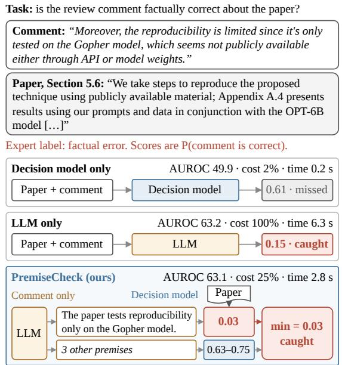  
Figure 1 Three ways to check a review comment, shown on a real comment from ReviewFact. AUROC, cost, and time are measured on the NLP reviews of ReviewFact, with cost relative to the LLM-only row, which is the reference in our experiments. The LLM is GPT-5.5 and the decision model is Jev.

When each comment is checked on its own, existing systems are either accurate or cheap, but not both. A frontier LLM that judges each comment on its own (Zheng et al., 2023; Ryu et al., 2025; Thakkar et al., 2025) must reread the full paper for every comment, a cost that multiplies across tens of thousands of reviews. Instead of generating text, a decision model such as Jev returns the probability that a statement holds in a document, typically within a fraction of a second and at negligible cost (Almeida, 2026; TypeSafe AI, 2026). Yet on whole comments, Jev performs at chance level on the NLP reviews and well below an LLM on the other two parts. A review comment mixes several assertions, many implicit, whereas a decision model, like single-claim fact-checkers (Laban et al., 2022; Zha et al., 2023; Tang et al., 2024), is reliable only on explicit, self-contained claims. On single premises that human annotators wrote out from review comments, however, Jev is as accurate as GPT-5.5 (Appendix D.1). Our key insight is that understanding what a comment asserts needs an LLM but not the paper, whereas reading the paper is the expensive part and a decision model can do it once the assertions are explicit.

PremiseCheck is a framework that combines the two kinds of models. An LLM rewrites each comment as a few explicit premises without reading the paper (Min et al., 2023; Wei et al., 2024; Ryu et al., 2025). A decision model then decides how to check each premise and verifies it against the paper, and the comment receives the score of its weakest premise. Figure 1 contrasts PremiseCheck with either kind of model alone. With a medium-reasoning decomposer, PremiseCheck stays within 0.3 AUROC points of holistic GPT-5.5 or above it on every part of ReviewFact at about half its cost, and on the NLP reviews a decomposer without reasoning cuts the cost to a quarter while remaining non-inferior. The accuracy comes from decomposition rather than from one model, since four decision models from diferent providers, including the open-weight Kev-27B, come within one point of holistic GPT-5.5 as verifiers.

Our contributions are as follows.

• We propose PremiseCheck, a framework that turns the verification of a review comment into decision problems, combining the flexibility of an LLM with the eficiency of a decision model. A decision model checks each premise against the paper or against general knowledge and asks several phrasings of its question in one call.

• We define the task of fact-checking single review comments and build ReviewFact, a benchmark that labels factual errors in human-written and AI-written review comments across NLP, machine learning, and the natural sciences and measures cost and latency alongside accuracy. ReviewFact holds 9,267 comments on 217 papers.

• We validate PremiseCheck on all three parts of ReviewFact, where it checks each comment on its own with accuracy comparable to GPT-5.5 at a fraction of its cost. A cascade costs more than PremiseCheck yet is less accurate on every part.

## 2 Related Work

## 2.1 Factual Errors in Review Comments

As LLMs write reviews and critique human ones (Liang et al., 2024b; D’Arcy et al., 2024; Zhu et al., 2025; Thakkar et al., 2025; Zhuang et al., 2025), checking what a review says about a paper matters more. Unlike benchmarks of errors in papers (Son et al., 2025; Zhang and Abernethy, 2025), ReviewCritique (Du et al., 2024), ReviewScore (Ryu et al., 2025), PeerReview Bench (Kim et al., 2026), and ClaimCheck (Ou et al., 2025) annotate review comments against the paper. These datasets serve broader goals and label factual errors inconsistently, if at all, whereas ReviewFact applies one definition across three fields and also scores cost and latency. Systems that generate reviews aim to write better comments, whereas PremiseCheck checks comments that have already been written.

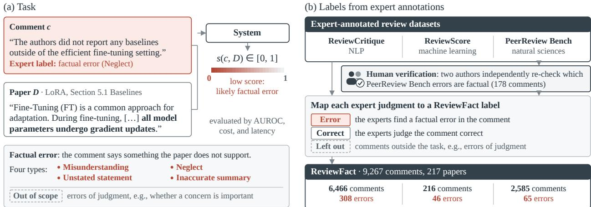  
Figure 2 (a) The task on a real ReviewFact comment that claims a baseline is missing although the paper reports it. (b) ReviewFact labels from the expert annotations of three datasets. For PeerReview Bench, two authors independently re-check which errors are factual on 178 comments and agree with the GPT-5.5 labels with κ of 0.76 and 0.77.

## 2.2 Claim Decomposition and Grounded Checking

Fact verification commonly splits a text into atomic claims and checks each one against a source (Min et al., 2023; Wei et al., 2024), often with a small trained fact-checking model (Tang et al., 2024). ReviewScore and Peerispect (Ghorbanpour et al., 2026) bring this recipe to peer review with an LLM as the verifier. When an LLM reads the paper to verify each premise, decomposition multiplies the number of expensive calls instead of reducing it. PremiseCheck instead has an LLM write premises without reading the paper and a decision model check them. Unlike a trained fact-checking model, a decision model such as Jev (Almeida, 2026; TypeSafe AI, 2026) takes a question as input, so PremiseCheck can route each premise and phrase its check in several ways.

## 2.3 Cost-Aware Inference

Cascades and routers send each query to a cheap or an expensive LLM (Chen et al., 2024; Ong et al., 2025; Dekoninck et al., 2025; Jung et al., 2025), and compound AI systems and agents are now optimized and evaluated for cost (Zaharia et al., 2024; Khattab et al., 2024; Kapoor et al., 2025; Erol et al., 2026). Test-time scaling instead spends more output tokens and time to gain accuracy (Wang et al., 2023; Snell et al., 2025). Unlike a cascade, which still sends most comments and their papers to an expensive LLM, PremiseCheck gives the paper only to the decision model. PremiseCheck also runs counter to test-time scaling, since its decomposer needs no reasoning.

## 3 The ReviewFact Benchmark

## 3.1 Task

Given a paper D and one comment c from a review of $D ,$ a system outputs a score $s ( c , D ) \in [ 0 , 1 ]$ , written s(c) for short, where a low score means that c likely contains a factual error about D. A comment contains a factual error when it says something about the paper that the paper does not support. We adopt the set T of four types of factual error of ReviewCritique (Du et al., 2024), in which the comment misreads the paper (Misunderstanding), claims that the paper lacks something it contains (Neglect), asserts something with no basis in the paper (Unstated statement), or misstates its content (Inaccurate summary). Errors of judgment, such as whether a concern is important, are outside the task. Figure 2a shows the task on a real comment.

A dataset for the task is a set of labeled comments $\mathcal { D } = \{ ( D _ { j } , c _ { j } , y _ { j } ) \} _ { j = 1 } ^ { N }$ , where $y _ { j } = 1$ if comment $c _ { j }$ contains a factual error about paper $D _ { j }$ and $y _ { j } = 0$ otherwise. When the source annotations provide ${ \mathrm { i t } } ,$ an error also has a type $t _ { j } \in \tau$ . Systems are evaluated by AUROC with factual errors as the class to detect,

$$
\mathrm { A U R O C } = \mathrm { P r } \left[ s ( c ^ { + } ) < s ( c ^ { - } ) \right] ,\tag{1}
$$

where $c ^ { + }$ is a random comment with $y = 1 , c ^ { - }$ a random comment with $y = 0 ,$ , and ties count one half. We report AUROC multiplied by 100. Because a system runs on every comment, we also measure its cost $C ( c )$ in US dollars and its latency $T ( c )$ in seconds per comment, and we report their means relative to the reference system of $\ S 5$

## 3.2 Labels from Expert Annotations

ReviewFact adds no new comments or papers. It reuses expert judgments of review comments from one dataset per field, ReviewCritique for NLP, ReviewScore for machine learning, and PeerReview Bench for the natural sciences (Du et al., 2024; Ryu et al., 2025; Kim et al., 2026). Human reviewers wrote comments in all three parts, which we call the NLP, machine learning, and natural-science reviews, and AI reviewers also wrote comments in the NLP and natural-science reviews. Each dataset was built for a broader goal, so we map its annotations to our label and leave out comments outside the task, following the rules in Appendix A.1. Figure 2b outlines this process. Figure 4 shows a labeled sample.

Human verification. Many comments that the PeerReview Bench experts judged incorrect are errors of judgment rather than factual errors, so GPT-5.5 decides from the expert’s rationale whether the error is factual. Two of the authors independently repeat this decision on the 178 comments that have a rationale, without seeing the GPT-5.5 labels or each other’s labels (Appendix A.2). The two annotators agree with a Cohen’s κ of 0.70, and GPT-5.5 agrees with them with κ of 0.76 and 0.77, so we keep the GPT-5.5 labels. With the labels of the annotators instead, the diference between PremiseCheck and holistic GPT-5.5 on these reviews ranges from −3.7 to +2.7 and is never significant, so the GPT-5.5 labels do not favor the GPT-5.5 reference.

## 3.3 Statistics

Figure 3 summarizes the 9,267 comments on 217 papers. Factual errors are rare, 4.8% of the NLP comments and 2.5% of the natural-science comments, so a system spends most of its calls on correct comments and its cost matters. The machine learning reviews have a higher share of errors because they keep only arguments, that is, comments that give reasons for a conclusion. ReviewScore rates the premises of arguments only, so we leave out its claims and questions (Appendix A.1). The median comment has 17, 48, and 70 words, and the median paper has 8.5k, 9.1k, and 14.4k tokens in the NLP, machine learning, and natural-science reviews. A comment is thus short compared with the paper it refers to, so a system that reads the paper for every comment spends almost all of its input on the paper.

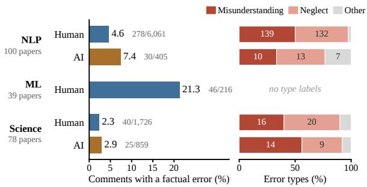  
Figure 3 ReviewFact by part and reviewer type. The left panel shows the share of comments with a factual error, next to the counts of errors and comments. The right panel shows the types of these errors, where Other is Unstated statement or Inaccurate summary.

## 4 Method

Overview. PremiseCheck is a framework that scores a comment c on a paper D for the task of §3 in four steps (Figure 4). An LLM decomposes the comment into premises. A decision model routes each premise and then verifies it. The premise scores are aggregated into one comment score. Only the decomposer is an LLM, and it never sees the paper. A decision model f maps an input text x and a question a, phrased as a declarative sentence, to the probability $f ( x , a ) \in [ 0 , 1 ]$ that a holds for x. Any LLM and any decision model can fill the two roles, and $\ S 5$ gives the models we use.

Decompose. The LLM reconstructs the comment as an argument with a conclusion and premises $\{ q _ { 1 } , . . . , q _ { k } \} = \mathrm { L L M } ( c )$ , where $1 \leq k \leq 6$ . Each premise is one self-contained declarative sentence that names the method, table, or section it refers to. The prompt asks for both explicit and implicit premises, including what a question presupposes about the paper, and it asks the model not to add facts that the reviewer did not assert or imply (Appendix B.1). The input is only the comment, which averages 24 tokens on the NLP reviews, and the decomposer prompt averages about 256 tokens.

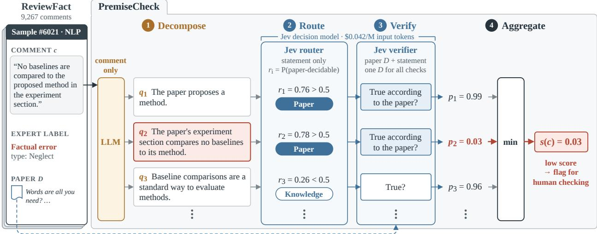  
Figure 4 PremiseCheck on a ReviewFact sample that experts labeled as a factual error, with premises shortened for display. Only the verifier reads the paper, and the lowest premise score, shown in red, is the comment score.

Route. Some premises are about the paper, such as “the paper does not report results on dataset $\mathrm { X . } ^ { \mathfrak { s } }$ Others rely on general knowledge, such as “method Y is a standard baseline for this task.” Asking whether such a knowledge premise is true “according to the paper” would wrongly push its probability down. The decision model therefore first estimates the probability $r _ { i } = f ( q _ { i } , a _ { \mathrm { r o u t e } } )$ that premise $q _ { i }$ can be decided from the paper alone, where $a _ { \mathrm { r o u t e } }$ is the routing question of Appendix B.2. This routing call receives only the premise, without the paper. With $g _ { i } = \mathbf { 1 } [ r _ { i } \geq 0 . 5 ]$ , premises with $g _ { i } = 1$ are treated as paper-grounded, and the rest as knowledge premises.

Verify. The decision model then reads the paper together with the premise and answers the question that matches its route,

$$
p _ { i } = { \left\{ \begin{array} { l l } { f { \big ( } ( D , q _ { i } ) , a _ { \mathrm { p a p e r } } { \big ) } } & { { \mathrm { i f ~ } } g _ { i } = 1 , } \\ { f { \big ( } ( D , q _ { i } ) , a _ { \mathrm { k n o w } } { \big ) } } & { { \mathrm { i f ~ } } g _ { i } = 0 , } \end{array} \right. }\tag{2}
$$

where $a _ { \mathrm { p a p e r } }$ is “The proposition is true according to the paper,” $a _ { \mathrm { k n o w } }$ is “The proposition is true,” and the proposition is $q _ { i }$ . On the natural-science reviews, the decomposer marks which premises to verify in place of routing, and a contradiction question replaces $a _ { \mathrm { p a p e r } }$ (Appendices B.1 and B.2).

Aggregate. A comment that rests on a false premise contains a factual error, so the comment score is the lowest premise score,

$$
s ( c ) = \operatorname* { m i n } _ { 1 \leq i \leq k } p _ { i } .\tag{3}
$$

If the decomposer returns no premise, which happens for fewer than 1% of the comments in the NLP reviews, we fall back to the holistic judgment of the decision model.

Why it is cheap. The cost of PremiseCheck for one comment is that of one LLM call on the comment plus a routing call and a verification call per premise,

$$
C ( c ) = C _ { \mathrm { L L M } } ( c ) + \sum _ { i = 1 } ^ { k } \left[ C _ { f } ( q _ { i } ) + C _ { f } ( D , q _ { i } ) \right] .\tag{4}
$$

<table><tr><td rowspan="3"></td><td rowspan="3"></td><td colspan="3">NLP</td><td colspan="3">Machine learning</td><td colspan="3">Natural science</td></tr><tr><td rowspan="2"></td><td colspan="2">Efficiency (%)</td><td rowspan="2"></td><td colspan="2">Efficiency (%)</td><td rowspan="2"></td><td colspan="2">Efficiency (%)</td></tr><tr><td>Cost</td><td>Time AUROC</td><td>Cost</td><td>Time AUROC</td><td>Cost</td><td>Time</td></tr><tr><td colspan="10">Holistic judgment</td></tr><tr><td>GPT-5.5 (ref.) medium</td><td></td><td>63.2</td><td>100.0</td><td>100.0</td><td>66.9</td><td>100.0</td><td>100.0</td><td>67.8</td><td>100.0</td><td>100.0</td></tr><tr><td>GPT-5.5</td><td>low</td><td> $6 1 . 2 _ { - 2 . 1 }$ </td><td>76.1</td><td>67.6</td><td> $6 4 . 3 _ { - 2 . 6 }$ </td><td>120.5</td><td>67.9</td><td> $6 7 . 4 \mathrm { - } 0 . 4$ </td><td>75.5</td><td>46.0</td></tr><tr><td>GPT-5.5</td><td>none</td><td> $4 9 . 3 _ { - 1 4 . 0 }$ </td><td>49.9</td><td>28.4</td><td> $6 6 . 5 _ { - 0 . 4 }$ </td><td>95.7</td><td>26.1</td><td> $6 3 . 7 _ { - 4 . 1 }$ </td><td>54.2</td><td>13.7</td></tr><tr><td>GPT-5.4-mini</td><td>low</td><td> $5 3 . 7 _ { - 9 . 5 }$ </td><td>9.8</td><td>31.1</td><td> $5 8 . 7 _ { - 8 . 2 }$ </td><td>13.5</td><td>36.6</td><td> $6 1 . 4 _ { - 6 . 4 }$ </td><td>13.8</td><td>34.4</td></tr><tr><td>Jev</td><td></td><td> $4 9 . 9 _ { - 1 3 . 4 }$ </td><td>2.1</td><td>3.6</td><td> $6 1 . 2 _ { - 5 . 7 }$ </td><td>1.6</td><td>3.6</td><td> $5 8 . 7 _ { - 9 . 1 }$ </td><td>1.6</td><td>1.9</td></tr><tr><td colspan="10">Cascade</td></tr><tr><td> $\mathrm { J e v {  } G P T { - } 5 . 5 }$ </td><td>medium</td><td> $5 9 . 1 _ { - 4 . 2 }$ </td><td>74.0</td><td></td><td> $6 5 . 7 _ { - 1 . 1 }$ </td><td>76.4</td><td></td><td> $6 6 . 7 _ { - 1 . 1 }$ </td><td>69.2</td><td></td></tr><tr><td colspan="10">PremiseCheck (decomposer:</td></tr><tr><td>PremiseCheck</td><td>medium</td><td> $G P T _ { - } 5 . 5 ,$   $6 3 . 0 \mathrm { ^ { \dagger } - 0 . 3 }$ </td><td>verifier: Jev) 51.2</td><td>81.6</td><td> $_ { 6 8 . 7 _ { + 1 . 8 } }$ </td><td>46.6</td><td>95.7</td><td> $6 7 . 5 _ { - 0 . 3 }$ </td><td>47.4</td><td>60.6</td></tr><tr><td>PremiseCheck</td><td>low</td><td> $6 4 . 1 ^ { \dagger } + 0 . 8$ </td><td>34.3</td><td>60.1</td><td> $6 3 . 9 _ { - 3 . 0 }$ </td><td>29.2</td><td>52.9</td><td> $6 5 . 7 _ { - 2 . 1 }$ </td><td>26.2</td><td>28.1</td></tr><tr><td>PremiseCheck</td><td>none</td><td> $6 3 . 1  { \mathrm { ~ \textrm ~ { ~ ~ } ~ } } _ { - 0 . 2 }$ </td><td>24.6</td><td>45.0</td><td> $6 3 . 7 _ { - 3 . 2 }$ </td><td>19.5</td><td>37.5</td><td> $6 6 . 0 _ { - 1 . 7 }$ </td><td>22.3</td><td>21.9</td></tr></table>

Table 1 Results on ReviewFact with each comment checked on its own. Subscripts give the paired AUROC diference to the reference, computed before rounding, <sup>†</sup> marks non-inferiority, and cost and time are relative to the reference. Reasoning refers to the GPT-5.5 or GPT-5.4-mini call, which for PremiseCheck is the decomposer.

The LLM call is short because it excludes the paper. A decision model generates no text, so each $C _ { f }$ grows only with the length of its input, and asking several questions about the same input adds almost no cost. Each verification call reads the paper again, yet in our implementation all decision-model calls together cost \$0.0015 per comment on the NLP reviews (Figure 8). In holistic judgment, by contrast, the LLM reads the paper and reasons about it for every comment, so its cost $C _ { \mathrm { L L M } } ( D , c )$ grows with the length of the paper at LLM prices.

## 5 Experimental Setup

Models. Our implementation of PremiseCheck uses GPT-5.5 as the decomposer and Jev as the decision model, which reads the paper truncated to 24k tokens.<sup>1</sup> On the machine learning and natural-science reviews, the decomposer uses the prompt variants of Appendix B.1. Our main setting scores each comment on its own, as an assistant would check a comment as soon as the reviewer writes it, before the rest of the review exists. Checking all comments of a finished review together is a diferent setting, which we evaluate in §8.1. Appendix B.3 gives the prices of the LLMs.

Baselines. Holistic judgment gives a model the paper and the comment and asks for the probability that the comment’s main criticism is factually correct. We run it with GPT-5.5 at medium, low, and no reasoning, with GPT-5.4-mini, and with Jev. The reference system is holistic GPT-5.5 at medium reasoning. A cascade scores all comments with holistic Jev and sends the 70% it finds most suspicious to holistic GPT-5.5.

Metrics. We call a system non-inferior to the reference when the lower bound of the 95% interval for the paired AUROC diference, from a bootstrap over papers with 2,000 resamples, is above −3, a margin we fixed before running the experiments. Holistic judgment reads the same paper for every comment, so we count its repeated input at the cached price, which favors the baseline.

## 6 Main Results

## 6.1 Accuracy, cost, and latency

<sup>1</sup>We use gpt-5.5-2026-04-23, gpt-5.4-mini-2026-03-17, and jev-1.13-20260917. The LLMs run with their default sampling and give each probability as an integer from 0 to 100, and Jev is billed only for input tokens, at \$0.042 per million.

Table 1 and Figure 5a compare PremiseCheck with holistic judgment and a cascade when each comment is checked on its own. (1) PremiseCheck matches holistic GPT-5.5 at about half the cost. With a mediumreasoning decomposer, it is within 0.3 of the reference or above it on all three parts of ReviewFact, non-inferior on the NLP reviews, and not significantly diferent on the other two (Appendix C.5). (2) Without reasoning, the cost falls to a quarter on the NLP reviews, where PremiseCheck remains non-inferior (§7.2), while on the other two parts it loses 1.7 to 3.2 points, not significantly. (3) Without reasoning, PremiseCheck takes less than half the time. It needs 45% of the time of holistic GPT-5.5 on the NLP reviews and 37% and 22% on the other parts (Appendix C.3). (4) Cheaper per-comment baselines lose accuracy. Holistic Jev and GPT-5.4-mini fall 5.7 to 13.4 below the reference, holistic GPT-5.5 without reasoning falls 14.0 on the NLP

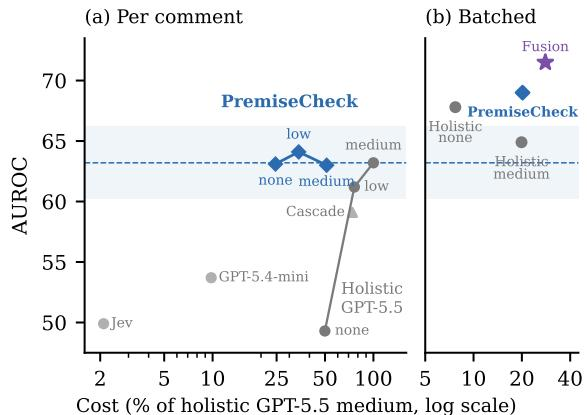  
Figure 5 Cost and AUROC on the NLP reviews, (a) per comment and (b) batched per review (§8.1), where PremiseCheck uses 16 phrasings. Labels give the reasoning of the LLM, and the line and band mark the per-comment reference and ±3.

reviews at twice the cost of PremiseCheck, and the cascade costs about three quarters of the reference yet stays below PremiseCheck with the medium-reasoning decomposer on every part.

## 6.2 Robustness

Figure 6 repeats the comparison with holistic GPT-5.5 on the NLP reviews in two further settings (Appendix C.4). (1) An open-weight decision model works as well. With Kev-27B (Palmer, 2026) as router and verifier, PremiseCheck reaches the same AUROC as with Jev, although with the medium-reasoning decomposer its interval falls just short of non-inferiority. With the no-reasoning decomposer, it is non-inferior at an API cost of 17.8% of the reference, not counting the GPU time of Kev-27B. (2) PremiseCheck is not a proxy for comment length, although longer comments are more often factual errors. Within groups of similar length and

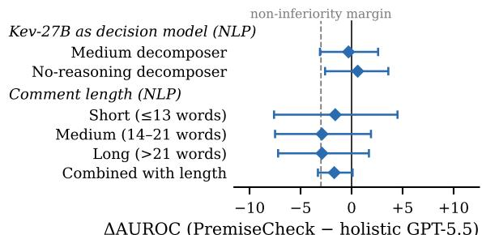  
Figure 6 AUROC of PremiseCheck minus holistic GPT-5.5 on the NLP reviews, with 95% intervals.

after combining each score with length, PremiseCheck stays within 3 points of holistic GPT-5.5 without a significant diference, though none of these comparisons reaches non-inferiority, and adding PremiseCheck to length raises AUROC significantly, by 3.3.

## 7 What Makes PremiseCheck Work

## 7.1 Decomposition makes decision models useful

PremiseCheck difers from holistic GPT-5.5 in two ways: it decomposes the comment, and a decision model reads the paper. Figure 7 separates the two by scoring each model as a holistic judge and inside PremiseCheck on the NLP reviews. (1) Decomposition lets a cheap verifier match a frontier LLM. On the same premises, GPT-5.5 as the verifier is no more accurate than Jev but makes the pipeline cost 3.1 times as much as holistic judgment, and the GPT-5.4-mini verifier makes it cost 1.4 times as much as with Jev. (2) Every decision model gains from decomposition. Jev, Kev-27B, Microsoft Decision-1, and Perplexity Decider score 50 to 57 as holistic judges but come within one point of holistic GPT-5.5 as verifiers, although the intervals of Kev-27B and Perplexity Decider fall just short of non-inferiority, whereas the fact-checking model MiniCheck-7B (Tang et al., 2024) falls below its holistic score because it rejects many correct premises (Appendix D.2). (3) Much cheaper LLMs can decompose. With Kev-27B as the verifier, GPT-5.6 Sol, GPT-5.6 Luna, and Nemotron Super 3 as decomposers are non-inferior to holistic GPT-5.5 at 6% to 17% of the cost of their holistic judgment, while weaker decomposers lose 2 to 6 points.

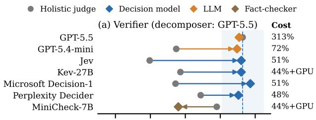

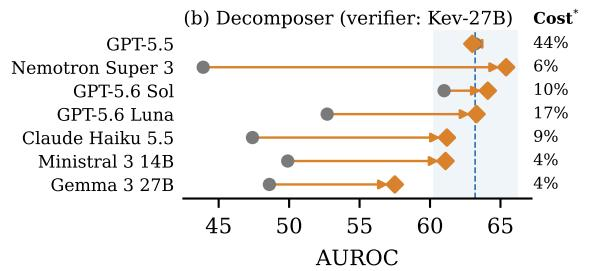

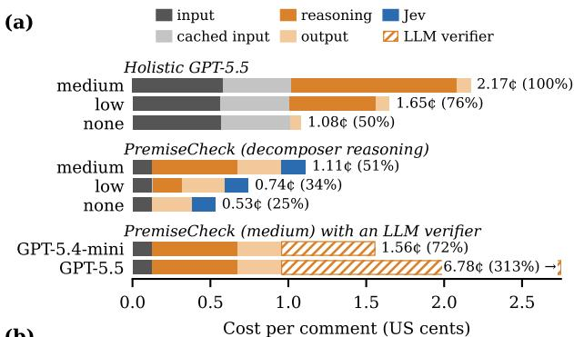  
(b)

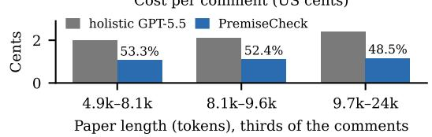  
Figure 7 AUROC on the NLP reviews of each model as a holistic judge and inside PremiseCheck. Cost is relative to holistic GPT-5.5 in (a) and to the same LLM in (b), where marks API cost. The band marks holistic GPT-5.5 ±3 (Appendices D.2, D.4).  
Figure 8 Cost per comment on the NLP reviews (a) by GPT-5.5 token type and verifier and (b) by paper length at medium reasoning (Appendix D.3).

## 7.2 Where the savings come from

Figure 8 breaks down the cost on the NLP reviews. (1) The decomposer needs no reasoning. Reasoning makes up about half the cost of holistic GPT-5.5, and without it per-comment holistic judgment falls to chance level on the NLP reviews. PremiseCheck keeps its accuracy there without reasoning, because the LLM only rewrites the comment, while Jev decides whether the paper supports each premise. At low or no reasoning, PremiseCheck is thus more accurate than per-comment holistic judgment on the NLP reviews at less than half its cost. (2) Longer papers yield larger savings. Only Jev reads the paper, so the relative cost of PremiseCheck falls from 53% for the shortest third of the papers to 49% for the longest third.

## 7.3 Design choices

(1) Routing is needed, but the exact route is not. Kev-27B agrees with Jev on only 65% of the routes yet gives the same AUROC, whereas skipping routing lowers AUROC from 61.8 to 58.8 on a common set of machine learning premises, because knowledge premises then receive low probabilities (Appendix D.5). (2) The weakest premise decides. Taking the mean over premises instead of the minimum lowers AUROC to 59.4, although the mean is slightly better on a label that also counts errors of judgment (Appendix D.5). (3) Contradiction questions add accuracy at no cost. Because Jev is billed only for its input, we ask 16 phrasings of the verification question in one call and average them, eight asking whether the paper supports the premise and eight whether it contradicts the premise (Appendix B.2). Figure 9 shows that AUROC levels of after four phrasings and rises from 63.1 to 65.7 with all 16, a significant gain over the original question. The gain comes from the contradiction questions, since a supporting question also penalizes a premise that the paper does not mention. Without development data on which to select a subset, we keep all 16.

## 7.4 Error types and scope

(1) PremiseCheck catches both main types of factual error. On Misunderstanding and Neglect, which make up almost all errors in the NLP reviews, PremiseCheck with 16 phrasings scores above holistic GPT-5.5, though not significantly (Appendix D.6). For 79% of the Neglect errors, its lowest premise claims an omission, compared with 36% for correct comments. (2) PremiseCheck targets facts, not judgment. It treats a comment as wrong when one premise is false, which does not hold for errors of judgment. On labels from PeerReview Bench and ReviewScore that also count unimportant concerns or unreasonable requests, PremiseCheck falls behind holistic GPT-5.5, significantly on PeerReview Bench and by a wide margin on the few such errors of ReviewScore, but on factual errors alone the gap disappears. Appendix F shows scored comments with their premises.

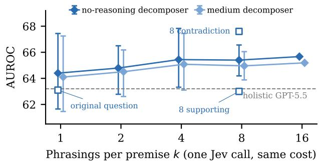  
Figure 9 AUROC on the NLP reviews by number of phrasings, as means over 50 random subsets of the 16 phrasings with 5–95% ranges. Squares are fixed sets.

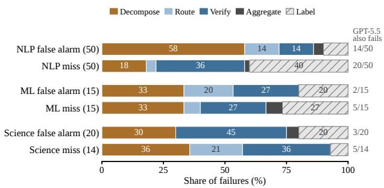  
Figure 10 Stage that causes each sampled failure of PremiseCheck. False alarms are correct comments in the lowest 10% of scores, and misses are errors above the median.

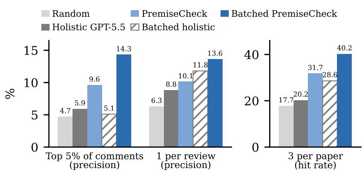  
Figure 11 Flagging factual errors on the NLP reviews. Hit rate is the share of papers with an error that one of the three flags hits. PremiseCheck uses 16 phrasings, and ties are broken at random.

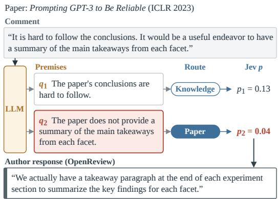  
Figure 12 A flagged comment from the machine learning reviews with the authors’ OpenReview response, quoted verbatim.

## 7.5 Where PremiseCheck fails

Three annotators assign 164 sampled failures to the stage that causes them (Appendix D.7). Figure 10 shows that false alarms come mostly from decomposition on the NLP reviews (58%), where a premise adds to, redirects, or blurs what the reviewer said, and mostly from verification on the natural-science reviews (45%). Holistic GPT-5.5 fails on only 13% and 15% of the machine learning and natural-science false alarms, so these are largely specific to PremiseCheck. Misses on the NLP reviews split between questionable labels (40%) and verification (36%), and holistic GPT-5.5 also fails on 12 of the 20 comments with a questionable label.

## 8 Using PremiseCheck in Practice

## 8.1 Batching and fusion

When a review is finished, as for an area chair or an author, all its comments can be checked in one call, as in the original ReviewCritique study (Du et al., 2024). We batch both approaches per review and fuse them by averaging the percentile ranks of their scores. Figure 5b shows these systems, and Appendix E gives the details. (1) Batching helps both approaches. Batched holistic GPT-5.5 without reasoning reaches 67.8 at 7.7% of the reference cost, and batched PremiseCheck reaches 69.0 at 20%. The two do not difer significantly, so holistic GPT-5.5 is the cheaper choice here, while PremiseCheck also returns the premises. (2) Fusion gives the best result. The two scores have a rank correlation of only 0.56, and batched fusion reaches 71.5 at 28% of the reference cost, significantly above batched holistic GPT-5.5.

## 8.2 Flagging comments for a person to check

A deployed system would flag a few comments for a person to check, each with the premise that Jev finds false. Figure 11 simulates three flagging policies on the NLP reviews, where 4.8% of the comments contain a factual error. (1) Flags of PremiseCheck hit errors two to three times as often as random. This holds for PremiseCheck and batched PremiseCheck among the 5% most suspicious comments, whereas holistic GPT-5.5, per comment or batched, does little better than random despite a similar AUROC. (2) An area chair sees more errors. Reading the three most suspicious comments of each paper finds an error for 40% of the papers that contain one with batched PremiseCheck, compared with 29% with batched holistic GPT-5.5. (3) A flag points to the premise that the paper refutes. In Figure 12, Jev gives the premise that the paper has no summary of its takeaways a probability of 0.04, and the authors reply that each experiment section ends with one. Appendix F.2 explains how we chose this comment and shows a second example and a false alarm.

## 9 Conclusion

Fact-checking review comments does not require a frontier LLM to read the paper for every comment. ReviewFact labels factual errors in review comments under one definition across three fields. In PremiseCheck, an LLM only rewrites each comment as explicit premises, and a cheap decision model checks them against the paper. When each comment is checked on its own, this division of labor reaches accuracy comparable to GPT-5.5 on every part of ReviewFact at a fraction of its cost. This result does not hinge on one model. Decision models from several providers can verify the premises, and on the NLP reviews, LLMs much cheaper than GPT-5.5, or GPT-5.5 without reasoning, can write them.

PremiseCheck can support peer review at two points. While a reviewer writes, it can check each comment as soon as the comment is written, which is the setting of our main experiments. Once a review is finished, an area chair or an author can check all its comments together, where fusing PremiseCheck with holistic GPT-5.5 gives the best accuracy. In both cases, PremiseCheck is meant to flag a few comments for a person and show the premise that the paper appears to refute, so that the person can check that one claim instead of rereading the paper.

Several directions remain open. Most false alarms on the NLP reviews arise in decomposition, so a decomposer that stays closer to what the reviewer said is a natural next step. Errors of judgment, such as an unimportant concern or an unreasonable request, lie outside PremiseCheck and call for diferent methods. Finally, ReviewFact can measure future checkers on accuracy, cost, and latency together, and further open-weight decision models can be tested within the same framework.

## Limitations

PremiseCheck targets factual errors about the paper, that is, comments that can be checked against what the paper states. A comment can also be wrong in its judgment, for example about the importance of a concern or the novelty of the work (§7.4). Detecting such errors of judgment is a direction for future work.

Our main decision model, Jev, is served through an API. With the open-weight Kev-27B as the decision model, PremiseCheck reaches the same AUROC on the NLP reviews of ReviewFact (§6.2). Testing further open decision models is left for future work.

Jaehun Jung, Faeze Brahman, and Yejin Choi. 2025. Trust or escalate: LLM judges with provable guarantees for human agreement. In International Conference on Learning Representations (ICLR). ArXiv:2407.18370.

## Ethical Considerations

We use ReviewCritique, ReviewScore, and PeerReview Bench for research evaluation only. The license of ReviewCritique restricts it to research and evaluation, and we do not train any model on it. We release our code under the MIT license and the NLP and natural-science parts of ReviewFact under the licenses of ReviewCritique and PeerReview Bench, which allow evaluation but not training. ReviewScore states no license, so for the machine-learning part we release a script that rebuilds it from the original data instead of the data itself. A verifier that wrongly flags a correct comment could unfairly discredit a reviewer, and one that misses an error could lend false authority to a wrong comment. PremiseCheck is meant to direct human attention to comments that may misstate the paper, not to replace the judgment of reviewers, area chairs, or authors.

## References

Diogo Almeida. 2026. Introducing system one models & jev. TypeSafe AI Blog.

Joydeep Biswas, Sheila Schoepp, Gautham Vasan, Anthony Opipari, Arthur Zhang, Zichao Hu, Sebastian Joseph, Matthew Lease, Junyi Jessy Li, Peter Stone, Kiri L. Wagstaf, Matthew E. Taylor, and Odest Chadwicke Jenkins. 2026. AI-Assisted Peer Review at Scale: The AAAI-26 AI Review Pilot. arXiv preprint arXiv:2604.13940.

Lingjiao Chen, Matei Zaharia, and James Zou. 2024. FrugalGPT: How to use large language models while reducing cost and improving performance. Transactions on Machine Learning Research. ArXiv:2305.05176.

Mike D’Arcy, Tom Hope, Larry Birnbaum, and Doug Downey. 2024. MARG: Multi-agent review generation fo scientific papers. arXiv preprint arXiv:2401.04259.

Jasper Dekoninck, Maximilian Baader, and Martin Vechev. 2025. A unified approach to routing and cascading for LLMs. In International Conference on Machine Learning (ICML). ArXiv:2410.10347.

Jiangshu Du, Yibo Wang, Wenting Zhao, Zhongfen Deng, Shuaiqi Liu, Renze Lou, Henry Peng Zou, Pranav Narayanan Venkit, Nan Zhang, Mukund Srinath, Haoran Ranran Zhang, Vipul Gupta, Yinghui Li, Tao Li, Fei Wang, Qin Liu, Tianlin Liu, Pengzhi Gao, Congying Xia, and 21 others. 2024. LLMs assist NLP researchers: Critique paper (meta-)reviewing. In Proceedings of EMNLP 2024, pages 5081–5099.

Mehmet Hamza Erol, Batu El, Mirac Suzgun, Mert Yuksekgönül, and James Zou. 2026. Cost-of-pass: An economic framework for evaluating language models. In International Conference on Learning Representations (ICLR). ArXiv:2504.13359.

Ali Ghorbanpour, Soroush Sadeghian, Alireza Daghighfarsoodeh, Sajad Ebrahimi, Negar Arabzadeh, Seyed Mohammad Hosseini, and Ebrahim Bagheri. 2026. Peerispect: Claim verification in scientific peer reviews. In Proceedings of the 49th International ACM SIGIR Conference on Research and Development in Information Retrieval, pages 5161–5165.

Sayash Kapoor, Benedikt Stroebl, Zachary S. Siegel, Nitya Nadgir, and Arvind Narayanan. 2025. AI agents tha matter. Transactions on Machine Learning Research. ArXiv:2407.01502.

Omar Khattab, Arnav Singhvi, Paridhi Maheshwari, Zhiyuan Zhang, Keshav Santhanam, Sri Vardhamanan, Saiful Haq, Ashutosh Sharma, Thomas T. Joshi, Hanna Moazam, Heather Miller, Matei Zaharia, and Christopher Potts. 2024. DSPy: Compiling declarative language model calls into state-of-the-art pipelines. In International Conference on Learning Representations (ICLR). ArXiv:2310.03714.

Jaeho Kim, Yunseok Lee, and Seulki Lee. 2025. Position: The AI conference peer review crisis demands author feedback and reviewer rewards. In International Conference on Machine Learning (ICML), Position Paper Track. ArXiv:2505.04966.

Seungone Kim, Dongkeun Yoon, Kiril Gashteovski, Juyoung Suk, Jinheon Baek, Pranjal Aggarwal, Ian Wu, Viktor Zaverkin, Spase Petkoski, Daniel R. Schrider, Ilija Dukovski, Francesco Santini, Biljana Mitreska, Yong Jeong, Kyeongha Kwon, Young Min Sim, Dragana Manasova, Arthur Porto, Biljana Mojsoska, and 39 others. 2026. On the limits and opportunities of AI reviewers: Reviewing the reviews of Nature-family papers with 45 expert scientists. arXiv preprint arXiv:2605.20668.

Ilia Kuznetsov, Osama Mohammed Afzal, Koen Dercksen, Nils Dycke, Alexander Goldberg, Tom Hope, Dirk Hovy, Jonathan K. Kummerfeld, Anne Lauscher, Kevin Leyton-Brown, Sheng Lu, Mausam, Margot Mieskes, Aurélie Névéol, Danish Pruthi, Lizhen Qu, Roy Schwartz, Noah A. Smith, Thamar Solorio, and 5 others. 2024. What can natural language processing do for peer review? arXiv preprint arXiv:2405.06563.

Philippe Laban, Tobias Schnabel, Paul N. Bennett, and Marti A. Hearst. 2022. SummaC: Re-visiting NLI-based models for inconsistency detection in summarization. Transactions of the Association for Computational Linguistics, 10:163–177.

Weixin Liang, Zachary Izzo, Yaohui Zhang, Haley Lepp, Hancheng Cao, Xuandong Zhao, Lingjiao Chen, Haotian Ye, Sheng Liu, Zhi Huang, Daniel A. McFarland, and James Y. Zou. 2024a. Monitoring AI-modified content at scale: A case study on the impact of ChatGPT on AI conference peer reviews. In International Conference on Machine Learning (ICML). ArXiv:2403.07183.

Weixin Liang, Yuhui Zhang, Hancheng Cao, Binglu Wang, Daisy Ding, Xinyu Yang, Kailas Vodrahalli, Siyu He, Daniel Smith, Yian Yin, Daniel McFarland, and James Zou. 2024b. Can large language models provide useful feedback on research papers? A large-scale empirical analysis. NEJM AI, 1(8). ArXiv:2310.01783.

Sewon Min, Kalpesh Krishna, Xinxi Lyu, Mike Lewis, Wen-tau Yih, Pang Wei Koh, Mohit Iyyer, Luke Zettlemoyer, and Hannaneh Hajishirzi. 2023. FActScore: Fine-grained atomic evaluation of factual precision in long form tex generation. In Proceedings of the 2023 Conference on Empirical Methods in Natural Language Processing.

Isaac Ong, Amjad Almahairi, Vincent Wu, Wei-Lin Chiang, Tianhao Wu, Joseph E. Gonzalez, M Waleed Kadous, and Ion Stoica. 2025. RouteLLM: Learning to route LLMs from preference data. In International Conference on Learning Representations (ICLR). ArXiv:2406.18665.

Jiefu Ou, William Walden, Kate Sanders, Zhengping Jiang, Kaiser Sun, Jefrey Cheng, William Jurayj, Miriam Wanner, Shaobo Liang, Candice Morgan, Seunghoon Han, Weiqi Wang, Chandler May, Hannah Recknor, Daniel Khashabi, and Benjamin Van Durme. 2025. CLAIMCHECK: How grounded are LLM critiques of scientific papers? In Findings of the Association for Computational Linguistics: EMNLP 2025, pages 21712–21735.

Jared Palmer. 2026. Kev-27B. https://huggingface.co/jaredpalmer/kev-27b. Hugging Face model card, Kev 1.0, fine-tuned from Qwen3.8-27B (Hub commit af0e6d5).

Hyun Ryu, Doohyuk Jang, Hyemin S. Lee, Joonhyun Jeong, Gyeongman Kim, Donghyeon Cho, Gyouk Chu, Minyeong Hwang, Hyeongwon Jang, Changhun Kim, Haechan Kim, Jina Kim, Joowon Kim, Yoonjeon Kim, Kwanhyung Lee, Chanjae Park, Heecheol Yun, Gregor Betz, and Eunho Yang. 2025. ReviewScore: Misinformed peer review detection with large language models. arXiv preprint arXiv:2509.21679.

Nihar B. Shah. 2022. Challenges, experiments, and computational solutions in peer review. Communications of the ACM, 65(6):76–87.

Charlie Snell, Jaehoon Lee, Kelvin Xu, and Aviral Kumar. 2025. Scaling LLM test-time compute optimally can be more efective than scaling parameters for reasoning. In International Conference on Learning Representations (ICLR). ArXiv:2408.03314.

Guijin Son, Jiwoo Hong, Honglu Fan, Heejeong Nam, Hyunwoo Ko, Seungwon Lim, Jinyeop Song, Jinha Choi, Gonçalo Paulo, Youngjae Yu, and Stella Biderman. 2025. When AI co-scientists fail: SPOT—a benchmark for automated verification of scientific research. arXiv preprint arXiv:2505.11855.

Liyan Tang, Philippe Laban, and Greg Durrett. 2024. MiniCheck: Eficient fact-checking of LLMs on grounding documents. In Proceedings of EMNLP.

Nitya Thakkar, Mert Yuksekgonul, Jake Silberg, Animesh Garg, Nanyun Peng, Fei Sha, Rose Yu, Carl Vondrick, and James Zou. 2025. Can LLM feedback enhance review quality? A randomized study of 20K reviews at ICLR 2025. arXiv preprint arXiv:2504.09737.

TypeSafe AI. 2026. TypeSafe AI documentation: Models (Jev 1.13), primitives, and model jaggedness. https: //docs.typesafe.ai/. Model documentation for Jev 1.13.

Xuezhi Wang, Jason Wei, Dale Schuurmans, Quoc Le, Ed Chi, Sharan Narang, Aakanksha Chowdhery, and Denny Zhou. 2023. Self-consistency improves chain of thought reasoning in language models. In International Conference on Learning Representations (ICLR). ArXiv:2203.11171.

Jerry Wei, Chengrun Yang, Xinying Song, Yifeng Lu, Nathan Hu, Jie Huang, Dustin Tran, Daiyi Peng, Ruibo Liu, Da Huang, Cosmo Du, and Quoc V. Le. 2024. Long-form factuality in large language models. In Advances in Neural Information Processing Systems.

Matei Zaharia, Omar Khattab, Lingjiao Chen, Jared Quincy Davis, Heather Miller, Chris Potts, James Zou, Michael Carbin, Jonathan Frankle, Naveen Rao, and Ali Ghodsi. 2024. The shift from models to compound AI systems. Berkeley Artificial Intelligence Research (BAIR) Blog.

Yuheng Zha, Yichi Yang, Ruichen Li, and Zhiting Hu. 2023. AlignScore: Evaluating factual consistency with a unified alignment function. In Proceedings of ACL.

Tianmai M. Zhang and Neil F. Abernethy. 2025. Reviewing scientific papers for critical problems with reasoning LLMs: Baseline approaches and automatic evaluation. In NeurIPS 2025 Workshop on AI for Science. ArXiv:2505.23824.

Lianmin Zheng, Wei-Lin Chiang, Ying Sheng, Siyuan Zhuang, Zhanghao Wu, Yonghao Zhuang, Zi Lin, Zhuohan Li, Dacheng Li, Eric P. Xing, Hao Zhang, Joseph E. Gonzalez, and Ion Stoica. 2023. Judging LLM-as-a-judge with MT-Bench and Chatbot Arena. In Advances in Neural Information Processing Systems (NeurIPS), Datasets and Benchmarks Track. ArXiv:2306.05685.

Minjun Zhu, Yixuan Weng, Linyi Yang, and Yue Zhang. 2025. DeepReview: Improving LLM-based paper review with human-like deep thinking process. In Proceedings of the 63rd Annual Meeting of the Association for Computational Linguistics (ACL). ArXiv:2503.08569.

Zhenzhen Zhuang, Jiandong Chen, Hongfeng Xu, Yuwen Jiang, and Jialiang Lin. 2025. Large language models for automated scholarly paper review: A survey. Information Fusion, 124:103332.

## Appendix Contents

A Benchmark Details 14   
A.1 Source Annotations 14   
A.2 Label Verification . 15   
B Implementation Details 16   
B.1 Prompts . 16   
B.2 Decision-Model Questions 18   
B.3 Paper Input, Cost, and Latency . 18   
C Additional Main Results 18   
C.1 Full Results on the NLP Reviews 19   
C.2 Subsets 19   
C.3 Latency 19   
C.4 Robustness 19   
C.5 Machine Learning and Natural-Science Reviews 19   
D Additional Analysis 20   
D.1 Capability Map of the Decision Model 20   
D.2 Verifiers . 21   
D.3 Cost Breakdown and Paper Length . 22   
D.4 Other Decision Models and Other LLMs 23   
D.5 Design Choices 23   
D.6 Error Types and Scope . 23   
D.7 Failure Analysis . 23   
E Batching and Fusion 25   
F Examples 26   
F.1 Scored Comments 26   
F.2 Flagged Comments with Author Responses 28

## A Benchmark Details

## A.1 Source Annotations

All labels of ReviewFact start from expert judgments in the three source datasets (§3.2).

ReviewCritique (NLP reviews). In ReviewCritique (Du et al., 2024), 40 members of the NLP community, each with multiple first-authored papers at top NLP venues, label every sentence of a review as reliable or deficient and explain each deficiency. They read the paper, all reviews, the meta-review, and the author rebuttal before labeling. Two of them label each paper independently, and an expert with area-chair experience resolves disagreements. Each labeled unit of a review is one comment in ReviewFact. Deficient comments carry fine-grained error types, four of which are the factual types of ReviewFact. Reliable comments are correct, and deficient comments with one of these four types are errors. We leave out other deficiencies, such as an unconvincing argument, comments that only summarize the paper or list its strengths, and comments of fewer than four words, mostly headers such as “Weaknesses:”.

ReviewScore (machine learning reviews). In ReviewScore (Ryu et al., 2025), 15 graduate students in AI rate each premise of an automatically reconstructed argument on a five-point factuality scale, and the median of three annotators is the final score. Following ReviewScore, an argument is an error when its lowest premise rating is below 3 and correct when it is above 3. We leave out arguments at exactly 3, as well as claims and questions, which have no premise ratings.

PeerReview Bench (natural-science reviews). In PeerReview Bench (Kim et al., 2026), 45 scientists in the physical, biological, and health sciences judge whether each comment on a Nature-family paper is correct and may add a written rationale. Comments judged correct are correct. Comments judged incorrect are errors only when the error is factual, as decided in Appendix A.2.

## A.2 Label Verification

Human verification. Two of the authors repeat the GPT-5.5 decision of §3.2 on the 178 comments that PeerReview Bench experts judged incorrect with a rationale. Each annotator sees the comment, the expert rationale, and the paper text, but not the GPT-5.5 label, and the two annotators see the comments in diferent random orders. The guidelines in Figure 13 define the three labels with the error types of ReviewCritique. Table 2 reports the agreement. Of the 38 comments with diferent labels, 17 are labeled factual by one annotator and judgment by the other, and 21 involve the unclear label.

Each row is a review comment that an expert annotator of PeerReview Bench judged Not Correct, with the expert’s rationale. Decide   
why the expert judged it incorrect, using the comment and the rationale. Open the paper only when the rationale is not enough to   
decide. Work alone, and do not discuss rows with the other annotator before both sheets are done. Choose exactly one label.   
• factual: the comment says something about this paper that the paper does not support. Give the subtype.   
Misunderstanding: misreads what the paper does or claims.   
Neglect: says the paper lacks something that it clearly contains (an experiment, a detail, a discussion).   
– Unstated statement: asserts something about the paper that has no basis in it.   
– Inaccurate summary: misstates the content or contribution of the paper.   
• judgment: the comment is wrong in its judgment, not its facts, for example about importance, scope, or novelty, an unreasonable   
request, being too harsh or overstated, or a disagreement about field knowledge. An error about a cited paper rather than this   
paper also counts as judgment.   
• unclear: the rationale does not let you decide.   
When the rationale mainly says that the comment is too harsh or overstated but also mentions the paper’s content, choose judgment.

Figure 13 Guidelines for the human verification of the natural-science labels.
<table><tr><td></td><td colspan="3">Annotator 2</td><td></td></tr><tr><td>Annotator 1</td><td>Factual</td><td>Judgment</td><td>Unclear</td><td>Total</td></tr><tr><td>Factual</td><td>47</td><td>12</td><td>6</td><td>65</td></tr><tr><td>Judgment</td><td>5</td><td>70</td><td>5</td><td>80</td></tr><tr><td>Unclear</td><td>1</td><td>9</td><td>23</td><td>33</td></tr><tr><td>Total</td><td>53</td><td>91</td><td>34</td><td>178</td></tr><tr><td>Cohen&#x27;s κ</td><td></td><td></td><td>Binary</td><td>Three-way</td></tr><tr><td>Annotator 1 vs. Annotator 2</td><td></td><td></td><td>0.70</td><td>0.66</td></tr><tr><td>Annotator 1 vs. GPT-5.5</td><td></td><td></td><td>0.76</td><td>0.72</td></tr><tr><td>Annotator 2 vs. GPT-5.5</td><td></td><td></td><td>0.77</td><td>0.77</td></tr></table>

<table><tr><td>Labels</td><td>Errors</td><td>Holistic Premise- GPT-5.5</td><td>Check</td><td>∆ [95% CI]</td></tr><tr><td>GPT-5.5 (main)</td><td>65</td><td>67.8</td><td>67.5</td><td>−0.3 [-8.9, +7.6]</td></tr><tr><td>Annotator 1</td><td>65</td><td>64.6</td><td>62.4</td><td>−2.2 [−12.3, +7.2]</td></tr><tr><td>Annotator 2</td><td>53</td><td>69.0</td><td>69.1</td><td>+0.2 [−9.4, +9.0]</td></tr><tr><td>Both annotators</td><td>47</td><td>67.1</td><td>69.8</td><td>+2.7 [−6.9, +11.6]</td></tr><tr><td>Either annotator</td><td>71</td><td>66.2</td><td>62.5</td><td>-3.7 [−13.8, +5.4]</td></tr></table>

Table 3 AUROC on the natural-science reviews with factual labels from GPT-5.5 or from the annotators. “Both” and “Either” count a comment as a factual error when both or either annotator labels it factual. PremiseCheck uses the medium-reasoning decomposer, and ∆ is the paired diference to holistic GPT-5.5.  
Table 2 Human verification of the natural-science labels on 178 comments. Top: labels of the two annotators, with agreement shaded. Bottom: Cohen’s κ for factual vs. other (binary) and for the three labels. GPT-5.5 labels 65 comments as factual, 92 as judgment, and 21 as unclear.

Results with human labels. Table 3 scores the natural-science reviews with the labels of the annotators in place of the GPT-5.5 labels on these 178 comments. As with the GPT-5.5 labels, comments labeled judgment or unclear are left out. The diference between PremiseCheck and holistic GPT-5.5 ranges from −3.7 to +2.7, and no interval excludes zero. PremiseCheck is 2.7 above holistic GPT-5.5 on the 47 errors that both annotators label factual.

Automatic labels. GPT-5.5 at medium reasoning labels these comments with the following system prompt. The prompt uses the definitions of Figure 13 but shows only the comment and the expert rationale, not the paper. The user message gives the comment, the rationale of the primary PeerReview Bench expert, and the rationale of a second expert when that expert also judged the comment incorrect.

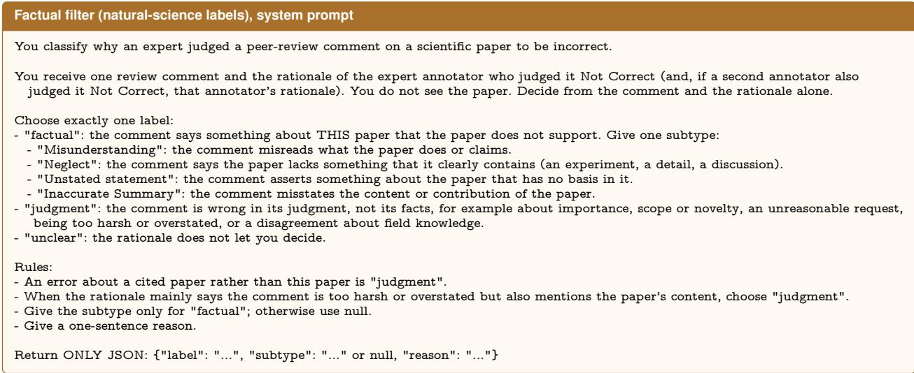

## B Implementation Details

## B.1 Prompts

Decomposition prompt. On the NLP reviews, the decomposer uses the following system prompt, and the user message is the review comment

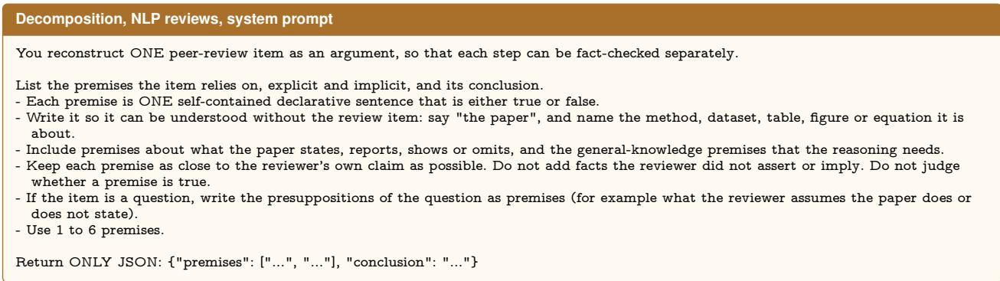

Variant for the machine learning reviews. On the machine learning reviews, the decomposer keeps fewer premises.

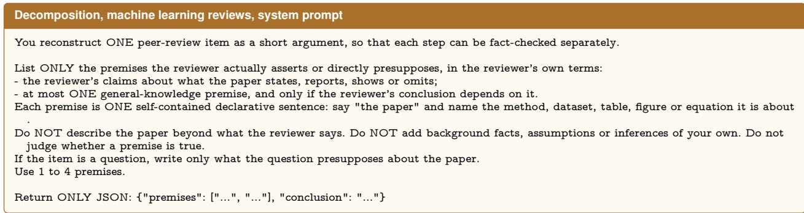  
Variant for the natural-science reviews. On the natural-science reviews, the decomposer labels each premise as paper, knowledge, or opinion. Only paper premises are verified, or all premises when none is labeled paper.

<table><tr><td>Step</td><td>Question</td></tr><tr><td>Route</td><td>Whether this statement is true can be decided from the content of the paper it refers to alone, without outside knowledge.</td></tr><tr><td>Verify (paper)</td><td>The proposition is true according to the paper.</td></tr><tr><td>Verify (knowledge)</td><td>The proposition is true.</td></tr><tr><td>Verify (natural science)*</td><td>The paper contains information that contradicts the proposition.</td></tr><tr><td>Holistic</td><td>The review item&#x27;s main criticism is factually correct about the paper.</td></tr></table>

Table 4 Questions given to the decision model. <sup>∗</sup>: inverted (one minus the probability), for paper-grounded premises on the natural-science reviews.
<table><tr><td></td><td>i Paper-grounded premise</td><td>Knowledge premise</td></tr><tr><td></td><td>0 The proposition is true according to the paper.</td><td>The proposition is true.</td></tr><tr><td></td><td>1 The paper states or clearly implies the proposition.</td><td>The proposition is correct.</td></tr><tr><td></td><td>2 A careful reader of the paper would accept the proposition as an The proposition is a true statement accurate description of the paper.</td><td></td></tr><tr><td></td><td>3 The proposition accurately describes the paper.</td><td>An expert in the field would agree with the</td></tr><tr><td></td><td>4 The paper supports the proposition.</td><td>proposition. The proposition is accurate.</td></tr><tr><td></td><td>5 The proposition is consistent with what the paper reports.</td><td>The proposition is factually correct.</td></tr><tr><td></td><td>6 Someone who has read the paper closely would agree with the proposition.</td><td>The proposition reflects established knowledge in the field.</td></tr><tr><td></td><td>7 The proposition is a faithful statement about the content of the The proposition is a well-supported claim. paper.</td><td></td></tr><tr><td></td><td>8* The paper contains information that contradicts the proposition. The proposition is false.</td><td></td></tr><tr><td></td><td>9* The proposition misrepresents the paper.</td><td>The proposition is incorrect.</td></tr><tr><td></td><td>10* The proposition is false according to the paper.</td><td>An expert in the field would reject the proposition.</td></tr><tr><td></td><td>11* The proposition misreads or overlooks something that the paper The proposition contains a factual error. states.</td><td></td></tr><tr><td></td><td>12* The paper reports something that shows the proposition is wrong. The proposition is inaccurate.</td><td></td></tr><tr><td></td><td>13* A careful reader of the paper would reject the proposition.</td><td>The proposition is misleading.</td></tr><tr><td></td><td>14* The proposition is inaccurate as a description of the paper.</td><td>The proposition contradicts established knowledge in the field.</td></tr><tr><td></td><td>15* The proposition conflicts with the content of the paper.</td><td>The proposition is wrong.</td></tr></table>

Table 5 The 16 phrasings of the verification question. <sup>∗</sup>: inverted (one minus the probability).
<table><tr><td></td><td></td><td></td><td>Cost /</td><td>comment</td><td></td><td></td><td></td></tr><tr><td>System</td><td>Reasoning</td><td>AUROC</td><td>$</td><td>%</td><td></td><td>Latency (s) ∆ AUROC [95% CI]</td><td></td></tr><tr><td colspan="8">Holistic judgment</td></tr><tr><td>GPT-5.5 (ref.)</td><td>medium</td><td>63.2</td><td>$0.0217</td><td>100.0</td><td>6.27</td><td></td><td></td></tr><tr><td>GPT-5.5</td><td>low</td><td>61.2</td><td>$0.0165</td><td>76.1</td><td>4.23</td><td></td><td>-2.1 [−3.1, −0.9]</td></tr><tr><td>GPT-5.5</td><td>none</td><td>49.3</td><td>$0.0108</td><td>49.9</td><td>1.78</td><td></td><td>-14.0 [−16.7, −11.1]</td></tr><tr><td>GPT-5.4-mini</td><td>low</td><td>53.7</td><td>$0.0021</td><td>9.8</td><td>1.95</td><td></td><td>−9.5 [−12.1, −7.0]</td></tr><tr><td>Jev</td><td></td><td>49.9</td><td>$0.0005</td><td>2.1</td><td>0.23</td><td></td><td>-13.4 [−16.8, −9.7]</td></tr><tr><td colspan="8">Cascade</td></tr><tr><td>Jev→GPT-5.5</td><td>medium</td><td>59.1</td><td>$0.0161</td><td>74.0</td><td></td><td></td><td>−4.2 [−6.5, −2.1]</td></tr><tr><td colspan="8">PremiseCheck (decomposer: GPT-5.5, verifier: Jev)</td></tr><tr><td>PremiseCheck</td><td>medium</td><td>63.0</td><td>$0.0111</td><td>51.2</td><td>5.11</td><td></td><td>−0.3 [−2.9, +2.3]</td></tr><tr><td>PremiseCheck</td><td>low</td><td>64.1</td><td>$0.0075</td><td>34.3</td><td>3.77</td><td></td><td>+0.8 [−1.6, +3.2]</td></tr><tr><td>PremiseCheck</td><td>none</td><td>63.1</td><td>$0.0053</td><td>24.6</td><td>2.82</td><td></td><td>−0.2 [−2.8, +2.6]</td></tr></table>

Table 6 Full results on the NLP reviews of ReviewFact (6,466 comments, 308 factual errors). Reasoning refers to the GPT-5.5 or GPT-5.4-mini call (for PremiseCheck, the decomposer). Cost (%) and ∆, the paired AUROC diference, are relative to the reference. The cascade escalates 70% of comments. Bold marks the best AUROC.

<table><tr><td>Decomposition, natural-science reviews, system prompt</td></tr><tr><td>You reconstruct ONE peer-review item as a short argument, so that each step can be fact-checked separately.</td></tr></table>

```jsonl
List the premises the reviewer asserts or directly presupposes, and give each premise a type:
"paper": a claim about what the paper states, reports, shows, cites or omits.
"knowledge": a factual claim about the world or about other work that does not depend on this paper (for example what a standard
method does, or what another paper introduced).
"opinion": an evaluation, norm or recommendation (for example "X is limited", "Y is unconvincing", "the paper should do Z", "a good
paper would ...").
Rules:
- Each premise is ONE self-contained declarative sentence. Say "the paper" and name the method, dataset, table, figure, section or equation
it is about.
Make "paper" and "knowledge" premises concrete and checkable. Do not use vague or evaluative words in them (little, limited, clearly,
severe, suficient, convincing, well). Put such evaluations in "opinion" premises.
For an omission, state exactly what is missing (for example "The paper does not report results on dataset D"), not how much is missing.
- Keep each premise as close to the reviewer’s own claim as possible. Do not add facts the reviewer did not assert or imply. Do not describe
the paper beyond what the reviewer says. Do not judge whether a premise is true.
- If the item is a question, write only what the question presupposes about the paper.
- Use 1 to 5 premises in total.
Return ONLY JSON: {"premises": [{"text": "...", "type": "paper"}, ...], "conclusion": "..."}
```

LLM judge prompt. Holistic GPT-5.5, holistic GPT-5.4-mini, and the LLM verifiers on paper-grounded premises use the following system prompt.

LLM judge, system prompt   
You judge whether statements are true according to a given evidence text from a scientific paper. Judge each statement only from the   
evidence text. For each statement, give the probability (integer 0-100) that it is true according to the evidence. Return ONLY JSON: {"p   
": {"<id>": <int>, ...}}.

For knowledge premises, the LLM verifiers use a neutral prompt that allows general knowledge.

## B.2 Decision-Model Questions

Questions per step. Table 4 lists the questions for Jev. On the natural-science reviews, the contradiction question replaces the paper-grounded question, and we use one minus its probability.

Phrasings of the verification question. Table 5 lists the 16 phrasings of §7.3, which go into a single Jev call per premise. Paper-grounded premises use the left column and knowledge premises the right column. The random subsets of Figure 9 take the i-th phrasings of both columns together.

## B.3 Paper Input, Cost, and Latency

Paper input. On the NLP reviews, all LLM systems see the same paper as Jev, truncated to 24k tokens. On the natural-science reviews, holistic GPT-5.5 and GPT-5.4-mini read the full paper with the judgment prompt of PeerReview Bench.

Cost. Cost converts the token usage of each call into dollars at public list prices. GPT-5.5 costs \$5.00 per million input tokens, \$0.50 per million cached input tokens, and \$30.00 per million output tokens, with reasoning tokens billed as output. GPT-5.4-mini costs \$0.75, \$0.075, and \$4.50 for the same three categories. For Jev we use the cost reported by the API. Kev-27B runs on our own GPUs, so we report its GPU time in addition to the API cost of the decomposer. We report cost per comment and as a percentage of the reference.

Latency. Latency is the mean wall-clock time to score one comment. We measure it from the recorded API calls, with the premises of one comment checked in parallel. On the natural-science reviews, we average over 300 random comments.

## C Additional Main Results

This section gives the full numbers behind §6.

<table><tr><td></td><td></td><td></td><td colspan="2">AUROC</td><td colspan="4">∆ AUROC [95% CI]</td></tr><tr><td>Subset</td><td>n</td><td></td><td></td><td></td><td colspan="2">Errors Holistic GPT-5.5 PremiseCheck PremiseCheck - holistic</td><td></td><td>Verifier</td></tr><tr><td colspan="9">PremiseCheck with Jev; verifier ∆: Jev − GPT-5.5 verifier</td></tr><tr><td>All</td><td>6,466</td><td>308</td><td>63.2</td><td>63.0</td><td></td><td>−0.3 [−2.9, +2.3]</td><td></td><td>+0.3 [−1.4, +1.9]</td></tr><tr><td>Human-written</td><td>6,061</td><td>278</td><td>63.8</td><td>63.5</td><td></td><td>−0.2 [−3.1, +2.4]</td><td></td><td>+0.5 [−1.3, +2.3]</td></tr><tr><td>AI-written</td><td>405</td><td>30</td><td>64.9</td><td>63.1</td><td></td><td>-1.7 [−13.1, +8.5]</td><td></td><td>−1.6 [−7.9, +4.0]</td></tr><tr><td>Without pilot sample 6,272</td><td></td><td>208</td><td>62.1</td><td>63.3</td><td></td><td>+1.2 [−2.2, +4.3]</td><td></td><td>+1.1 [−0.9, +3.0]</td></tr><tr><td colspan="9">PremiseCheck with Kev-27B; verifier ∆: Kev-27B − Jev</td></tr><tr><td>All</td><td>6,466</td><td>308</td><td>63.2</td><td>63.0</td><td></td><td>−0.3 [−3.1, +2.6]</td><td></td><td>+0.0 [−2.0, +1.9]</td></tr><tr><td>Human-written</td><td>6,061</td><td>278</td><td>63.8</td><td>63.2</td><td></td><td>−0.5 [−3.6, +2.6]</td><td></td><td>−0.3 [−2.6, +1.8]</td></tr><tr><td>AI-written</td><td>405</td><td>30</td><td>64.9</td><td>67.8</td><td></td><td>+2.9 [−8.6, +12.9]</td><td></td><td>+4.6 [−1.1, +11.5]</td></tr><tr><td>Without pilot sample</td><td>6,272</td><td>208</td><td>62.1</td><td>63.5</td><td></td><td>+1.4 [−1.7, +4.6]</td><td></td><td>+0.2 [−2.1, +2.5]</td></tr><tr><td colspan="9">PremiseCheck with the GPT-5.4-mini verifier; verifier ∆: GPT-5.4-mini − Jev</td></tr><tr><td>All</td><td>6,466</td><td>308</td><td>63.2</td><td>62.4</td><td></td><td>−0.8 [−3.5, +2.2]</td><td></td><td>−0.5 [−2.4, +1.6]</td></tr><tr><td>Human-written</td><td>6,061</td><td>278</td><td>63.8</td><td>62.4</td><td></td><td>−1.3 [−4.1, +1.8]</td><td></td><td>-1.1 [−3.0, +0.9]</td></tr><tr><td>AI-written</td><td>405</td><td>30</td><td>64.9</td><td>67.4</td><td></td><td>+2.5 [−7.8, +12.3]</td><td></td><td>+4.3 [−1.5, +9.7]</td></tr><tr><td>Without pilot sample 6,272</td><td></td><td>208</td><td>62.1</td><td>62.5</td><td></td><td>+0.4 [−2.7, +3.8]</td><td></td><td>−0.7 [−3.0, +1.8]</td></tr><tr><td colspan="9">Equal reasoning effort: PremiseCheck with the low decomposer vs. holistic GPT-5.5 at low</td></tr><tr><td>All</td><td>6,466</td><td>308</td><td>61.2</td><td>64.1</td><td></td><td>+2.9 [+0.3, +5.3]</td><td></td><td></td></tr><tr><td>Human-written</td><td>6,061</td><td>278</td><td></td><td></td><td></td><td>+3.2 [+0.8, +5.7]</td><td></td><td></td></tr><tr><td>AI-written</td><td>405</td><td>30</td><td></td><td></td><td></td><td>+1.9 [−12.9, +14.7]</td><td></td><td></td></tr><tr><td>Without pilot sample 6,272</td><td></td><td>208</td><td></td><td></td><td></td><td>+3.3 [−0.0, +6.2]</td><td></td><td></td></tr></table>

Table 7 Subset results on the NLP reviews. PremiseCheck uses the medium-reasoning decomposer in the upper three blocks. Verifier ∆ compares two verifiers on the same premises. Intervals use a paired bootstrap over papers.

## C.1 Full Results on the NLP Reviews

Table 6 extends the NLP part of Table 1 with the absolute cost and latency per comment and the 95% interval of each AUROC diference.

## C.2 Subsets

Table 7 repeats the main comparisons on human-written reviews, AI-written reviews, and the evaluation set without the pilot sample. The pilot sample is a stratified random sample of 200 comments, 100 of them factual errors, that we scored before the full evaluation, and 194 of these comments remain after short comments are removed. It covers PremiseCheck with Jev, with Kev-27B as the decision model, and with GPT-5.4-mini as the verifier, as well as a comparison at equal reasoning efort.

## C.3 Latency

Table 8 gives the latency measurements of §6.1. The upper block splits the recorded time of PremiseCheck by step and compares verifiers, and the lower block gives the controlled run.

## C.4 Robustness

Table 9 gives the numbers behind Figure 6.

## C.5 Machine Learning and Natural-Science Reviews

Table 10 gives the results on the machine learning and natural-science reviews and compares decomposition prompts and verification questions on them. On the machine learning reviews, the machine learning prompt yields a shorter premise list. It leaves out premises that the reviewer did not state and so reduces false alarms on correct comments. On the natural-science reviews, the choice of verification question matters most. Asking

<table><tr><td>System</td><td>Mean Median p90 Ratio [95% CI]</td><td></td><td></td><td></td></tr><tr><td>Recorded API calls</td><td></td><td></td><td></td><td></td></tr><tr><td>PremiseCheck (none)</td><td>2.82</td><td></td><td></td><td></td></tr><tr><td>decomposer</td><td>2.33</td><td></td><td></td><td></td></tr><tr><td>Jev</td><td>0.49</td><td></td><td></td><td></td></tr><tr><td>Verifier on the medium-decomposer premises</td><td></td><td></td><td></td><td></td></tr><tr><td>Jev</td><td>0.44</td><td></td><td></td><td></td></tr><tr><td>GPT-5.4-mini</td><td>2.21</td><td></td><td></td><td></td></tr><tr><td>GPT-5.5</td><td>7.38</td><td></td><td></td><td></td></tr><tr><td>Controlled run, 113 comments</td><td></td><td></td><td></td><td></td></tr><tr><td>Holistic GPT-5.5</td><td>7.50</td><td>6.33</td><td>9.17</td><td>1.00</td></tr><tr><td>PremiseCheck (none)</td><td>3.18</td><td>2.69</td><td></td><td>3.32 0.42 [0.30, 0.64]</td></tr><tr><td>PremiseCheck (medium)</td><td>5.62</td><td>4.82</td><td></td><td>8.38 0.75 [0.58, 0.96]</td></tr><tr><td>Batched, review</td><td>2.85</td><td>2.50</td><td></td><td>3.65 0.38 [0.28, 0.48]</td></tr><tr><td>Batched, comment</td><td>0.17</td><td>0.13</td><td></td><td>0.27 0.02 [0.02, 0.03]</td></tr></table>

Table 8 Latency in seconds on the NLP reviews. Parentheses give the reasoning of the decomposer. In the upper block, the Jev rows include routing, and the GPT-5.4-mini and GPT-5.5 rows check the same premises instead. The ratio compares mean latency with holistic GPT-5.5. The batched rows give batched holistic GPT-5.5 without reasoning per review and per comment.

<table><tr><td rowspan="2">Setting</td><td colspan="2">AUROC</td><td rowspan="2" colspan="2">∆ [95% CI]</td><td rowspan="2">Cost (%)</td></tr><tr><td>Holistic GPT-5.5</td><td>Premise- Check</td></tr><tr><td>Open-weight decision model Kev-27B</td><td></td><td></td><td></td><td></td><td></td></tr><tr><td>Medium decomposer</td><td>63.2</td><td>63.0</td><td></td><td></td><td>−0.3 [−3.1, +2.6] 44.1 + GPU</td></tr><tr><td>No-reasoning decomposer</td><td>63.2</td><td>63.8</td><td></td><td></td><td>+0.6 [−2.6, +3.6] 17.8 + GPU</td></tr><tr><td>Comment length (words)</td><td></td><td></td><td></td><td></td><td></td></tr><tr><td>Short (≤13)</td><td>61.3</td><td>59.8</td><td></td><td>−1.6 [−7.6, +4.5]</td><td>20.9</td></tr><tr><td>Medium (14–21)</td><td>67.1</td><td>64.2</td><td></td><td>-2.9 [−7.5, +1.9]</td><td>24.7</td></tr><tr><td>Long (&gt;21)</td><td>65.6</td><td>62.7</td><td></td><td>-2.9 [−7.2, +1.7]</td><td>28.0</td></tr><tr><td>Combined with length</td><td>71.9</td><td>70.2</td><td></td><td>−1.7 [−3.3, +0.1]</td><td>24.6</td></tr></table>

Table 9 Holistic GPT-5.5 (medium reasoning) and PremiseCheck on the NLP reviews in further settings. ∆ is the paired diference. The length groups split the comments at the tertiles of comment length, and the last row averages the percentile ranks of each score and of comment length. Cost is that of PremiseCheck relative to holistic GPT-5.5, plus GPU time for Kev-27B, which has no API price.

<table><tr><td>System</td><td>AUROC</td><td>Cost (%)</td><td>∆ [95% CI]</td><td></td></tr><tr><td colspan="5">Machine learning reviews (216 comments, 46 errors)</td></tr><tr><td>Holistic GPT-5.5</td><td>66.9</td><td>100.0</td><td></td><td></td></tr><tr><td>Holistic Jev</td><td>61.2</td><td>1.6</td><td></td><td>-5.7 [−14.7, +2.0]</td></tr><tr><td>PremiseCheck, NLP prompt</td><td>60.8</td><td>49.5</td><td></td><td>-6.0 [−16.2, +3.1]</td></tr><tr><td>PremiseCheck, ML prompt</td><td>68.7</td><td>46.6</td><td></td><td>+1.8 [−9.4, +11.7]</td></tr><tr><td colspan="5">Natural-science reviews (2,585 comments, 65 errors)</td></tr><tr><td>Holistic GPT-5.5</td><td>67.8</td><td>100.0</td><td></td><td></td></tr><tr><td>PremiseCheck, supports question</td><td>63.3</td><td></td><td></td><td>-4.4</td></tr><tr><td>PremiseCheck, contradicts question</td><td>67.5</td><td>47.4</td><td></td><td>−0.3 [−8.9, +7.6]</td></tr><tr><td>human-written (40 errors)</td><td>66.8</td><td></td><td></td><td>+1.2 [−10.3, +11.7]</td></tr><tr><td>AI-written (25 errors)</td><td>69.1</td><td></td><td></td><td>-2.9 [−16.0, +10.6]</td></tr></table>

Table 10 Results on the machine learning and natural-science reviews. ∆ is the paired AUROC diference to holistic GPT-5.5 on the same comments, and cost is relative to it. Both natural-science PremiseCheck rows use the naturalscience decomposition prompt.  
whether the paper supports a premise treats details that the paper does not mention as false. Asking whether the paper contradicts the premise avoids this.

## D Additional Analysis

This section gives the full numbers behind §7.

## D.1 Capability Map of the Decision Model

Table 11 measures Jev on individual operations of review verification, and Figure 14 plots the results. For each operation, Jev, GPT-5.4-mini (low reasoning), and GPT-5.5 (medium reasoning) receive the same input and questions, and the two LLMs return a probability as an integer from 0 to 100. Premise checking and routing use ReviewScore (Ryu et al., 2025): 452 human-reconstructed premises about the paper, 33 of them false, and the grounding source annotators gave for 972 premises. Comment-type classification uses ReviewScore comments. Duplicate detection and all judgments use PeerReview Bench (Kim et al., 2026).

On the operations that PremiseCheck uses, Jev is as accurate as GPT-5.5: it checks a single premise against the full paper at least as well, and it routes premises equally well. On classifying the type of a comment, it is significantly better at recognizing arguments but significantly worse at recognizing claims and questions. On judgments about a whole comment, Jev falls behind, and on whether a comment is correct, all models are close to chance. A premise check that reads the full paper costs \$0.00044 with Jev, and its median latency is 216 ms compared with 5.1 s for GPT-5.5.

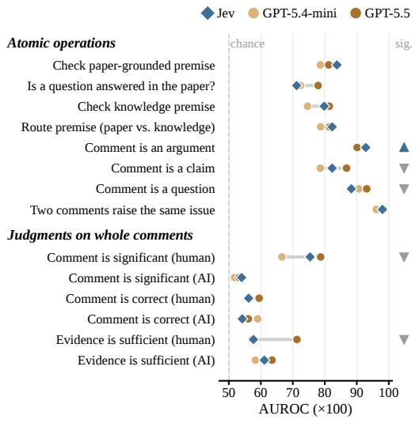  
Figure 14 AUROC of Jev, GPT-5.4-mini, and GPT-5.5 on each verification operation. Triangles mark operations on which Jev is significantly better (▲) or worse (▼) than GPT-5.5.

<table><tr><td rowspan="2">Operation</td><td rowspan="2">n Neg.</td><td rowspan="2"></td><td colspan="3">AUROC</td><td rowspan="2">Jev – GPT-5.5 [95% CI]</td></tr><tr><td>Jev</td><td>GPT-5.4-mini</td><td>GPT-5.5</td></tr><tr><td>Atomic operations</td><td></td><td></td><td></td><td></td><td></td><td></td></tr><tr><td>Check paper-grounded premise</td><td>452</td><td>33</td><td>83.8</td><td>78.6</td><td>81.2</td><td>+2.6 [−1.0, +6.0]</td></tr><tr><td>Is a question answered in the paper?</td><td>117</td><td>83</td><td>71.2</td><td>72.4</td><td>77.9</td><td>−6.7 [−14.8, +1.2]</td></tr><tr><td>Check knowledge premise</td><td>481</td><td>21</td><td>79.8</td><td>74.6</td><td>81.4</td><td>−1.6 [−10.8, +9.4]</td></tr><tr><td>Route premise (paper vs. knowledge)</td><td>972</td><td>499</td><td>82.3</td><td>78.7</td><td>81.5</td><td>+0.8 [−2.1, +4.1]</td></tr><tr><td>Comment is an argument</td><td>467</td><td>178</td><td>92.8</td><td>90.2</td><td>90.1</td><td>+2.7 [+0.2, +5.0]</td></tr><tr><td>Comment is a claim</td><td>467</td><td>387</td><td>82.3</td><td>78.6</td><td>86.8</td><td>−4.5 [−8.2, −0.7]</td></tr><tr><td>Comment is a question</td><td>467</td><td>369</td><td>88.3</td><td>90.6</td><td>93.1</td><td>−4.8 [−7.1, −2.7]</td></tr><tr><td>Two comments raise the same issue</td><td>164</td><td>94</td><td>98.0</td><td>96.1</td><td>98.4</td><td>−0.5 [−1.6, +0.5]</td></tr><tr><td>Judgments on whole comments</td><td></td><td></td><td></td><td></td><td></td><td></td></tr><tr><td>Comment is significant (human)</td><td>1,748</td><td>908</td><td>75.4</td><td>66.6</td><td>78.7</td><td>-3.3 [−5.8, −0.9]</td></tr><tr><td>Comment is significant (AI)</td><td>869</td><td>299</td><td>54.0</td><td>51.8</td><td>53.2</td><td>+0.8 [−4.1, +5.7]</td></tr><tr><td>Comment is correct (human)</td><td>1,930</td><td>182</td><td>56.2</td><td>56.2</td><td>59.5</td><td>−3.2 [−7.8, +1.1]</td></tr><tr><td>Comment is correct (AI)</td><td>1,029</td><td>160</td><td>54.2</td><td>59.0</td><td>56.1</td><td>−1.9 [−6.8, +2.3]</td></tr><tr><td>Evidence is sufficient (human)</td><td>1,360</td><td>135</td><td>57.7</td><td>57.2</td><td>71.3</td><td>-13.7 [−19.5, −8.1]</td></tr><tr><td>Evidence is sufficient (AI)</td><td>793</td><td>38</td><td>61.1</td><td>58.3</td><td>63.5</td><td>-2.4 [−11.2, +6.7]</td></tr></table>

Table 11 AUROC of three models on verification operations with identical inputs. n is the number of items and Neg. the number of negative items. Bold marks the best model in each row.

## D.2 Verifiers

Table 12 gives the AUROC of each model as a holistic judge and as the verifier of PremiseCheck, together with the paired diferences and the latency, and Table 13 adds MiniCheck. As a holistic judge, Kev-27B difers from holistic GPT-5.5 by −8.9 [−11.8, −6.0].

Of-the-shelf fact-checking models. We replace Jev with MiniCheck (Tang et al., 2024), a family of small models trained to test whether a document supports a claim. The main variant is Bespoke-MiniCheck-7B (MiniCheck-7B), and we also run MiniCheck-Flan-T5-Large (MiniCheck-T5). Both read the same truncated paper as Jev and use the default chunking and aggregation of the MiniCheck library. The premises are those of PremiseCheck with the medium-reasoning and the no-reasoning decomposer, and the comment score is again the minimum over premises. MiniCheck takes no question, so every premise is checked against the paper. In the hybrid variant, Jev checks the knowledge premises instead. GPU time is the wall-clock time of each stage on eight H200 GPUs divided by the number of comments, as for Kev-27B. Table 13 gives the results.

<table><tr><td></td><td colspan="2">AUROC</td><td colspan="4">Verifier ∆ [95% CI]</td><td colspan="2">Cost comment</td><td colspan="2">Latency (s)</td></tr><tr><td>Model</td><td>Holistic</td><td>Verifier</td><td></td><td>to reference</td><td></td><td>to Jev verifier</td><td>$</td><td>%</td><td>Total</td><td>Verify</td></tr><tr><td>GPT-5.5</td><td>63.2</td><td>62.7</td><td></td><td>−0.6 [−3.1, +2.1]</td><td></td><td>−0.3 [−1.9, +1.4]</td><td>0.0678</td><td>312.7</td><td>12.06</td><td>7.38</td></tr><tr><td>GPT-5.4-mini</td><td>53.7</td><td>62.4</td><td></td><td>−0.8 [−3.5, +2.2]</td><td></td><td>−0.5 [−2.4, +1.6]</td><td>0.0156</td><td>71.9</td><td>6.90</td><td>2.21</td></tr><tr><td>Jev</td><td>49.9</td><td>63.0</td><td></td><td>-0.3 [-2.9, +2.3]</td><td></td><td></td><td>0.0111</td><td>51.2</td><td>5.11</td><td>0.44</td></tr><tr><td>Kev-27B</td><td>54.3</td><td>63.0</td><td></td><td>−0.3 [−3.1, +2.6]</td><td></td><td>+0.0 [−2.0, +1.9]</td><td>0.0096 + GPU</td><td>44.1</td><td></td><td></td></tr></table>

Table 12 AUROC on the NLP reviews of each model as a holistic judge and as the verifier of PremiseCheck. All verifiers receive the same premises from the medium-reasoning decomposer and the same routing. The reference is holistic GPT-5.5 at medium reasoning, and cost (%) is relative to it. Cost and total latency cover the whole pipeline, and verification latency covers only the verification step. Holistic GPT-5.4-mini uses low reasoning.
<table><tr><td></td><td></td><td></td><td>API cost GPU</td><td></td><td colspan="5">∆ [95% CI]</td></tr><tr><td>System</td><td>Reasoning AUROC</td><td></td><td>(%)</td><td>(s)</td><td colspan="2">to reference</td><td></td><td colspan="2">to Jev verifier</td></tr><tr><td colspan="9">Holistic judgment</td></tr><tr><td>GPT-5.5 (ref.)</td><td>medium</td><td>63.2</td><td>100.0</td><td></td><td></td><td></td><td></td><td colspan="2"></td></tr><tr><td>MiniCheck-7B</td><td></td><td>59.5</td><td>0</td><td>0.03</td><td></td><td>-3.7 [−6.9, −0.3]</td><td></td><td></td><td></td></tr><tr><td>MiniCheck-T5</td><td></td><td>56.6</td><td>0</td><td>0.69</td><td></td><td>−6.7 [−9.8, −3.4]</td><td></td><td></td><td></td></tr><tr><td colspan="10">PremiseCheck with different verifiers</td></tr><tr><td>Jev</td><td>medium</td><td>63.0</td><td>51.2</td><td></td><td></td><td>-0.3 [-2.9, +2.3]</td><td></td><td></td><td></td></tr><tr><td>Kev-27B</td><td>medium</td><td>63.0</td><td>44.1</td><td>3.7</td><td></td><td>-0.3 [−3.1, +2.6]</td><td></td><td>+0.0 [−2.0, +1.9]</td><td></td></tr><tr><td>MiniCheck-7B</td><td>medium</td><td>54.0</td><td>44.1</td><td>0.06</td><td></td><td>−9.2 [−12.9, −5.6]</td><td></td><td></td><td>-8.9 [−12.3, −5.5]</td></tr><tr><td>MiniCheck-7B</td><td>none</td><td>53.9</td><td>17.8</td><td>0.06</td><td></td><td>−9.3 [−13.2, −5.4]</td><td></td><td></td><td>−9.1 [−12.3, −6.0]</td></tr><tr><td>MiniCheck-T5</td><td>medium</td><td>52.7</td><td>44.1</td><td>2.18</td><td></td><td>−10.5 [−14.2, −6.7]</td><td></td><td></td><td>-10.3 [−13.8, −6.6]</td></tr><tr><td>MiniCheck-T5</td><td>none</td><td>53.6</td><td>17.8</td><td>2.04</td><td></td><td>−9.7 [−13.1, −6.0]</td><td></td><td></td><td>−9.5 [−12.5, −6.2]</td></tr><tr><td>MiniCheck-7B, Jev for knowledge</td><td> medium</td><td>56.8</td><td>47.3</td><td></td><td></td><td></td><td></td><td>−6.2 [−8.9, −3.4]</td><td></td></tr></table>

Table 13 Of-the-shelf fact-checking models on the NLP reviews (6,466 comments, 308 factual errors). Reasoning refers to the GPT-5.5 call (for PremiseCheck, the decomposer). API cost is relative to the reference, and for Kev-27B and MiniCheck it covers only the decomposer. GPU is H200 GPU seconds per comment, an upper bound that includes idle time. The last column compares with PremiseCheck using Jev on the same premises.

MiniCheck-7B lowers PremiseCheck from 63.0 to 54.0, and MiniCheck-T5 behaves the same. The cause is false alarms on correct premises. Among premises that do not claim an omission, MiniCheck-7B gives 25.5% a probability below 0.3, compared with 11.2% for Jev. A comment has 3.3 premises on average, so with the minimum a single false alarm marks the whole comment as wrong. Using Jev for the knowledge premises recovers only 2.8, so most of the gap lies on premises that are checked against the paper.

Holistic MiniCheck-7B, which scores the whole comment against the paper, reaches 59.5 at no API cost. PremiseCheck with a single question is +3.4 [−0.0, +6.9] above it. With the 16 phrasings per premise of §7.3, PremiseCheck is +6.1 [+3.0, +9.0] above it.

## D.3 Cost Breakdown and Paper Length

Table 14 gives the per-comment costs on the NLP reviews behind Figure 8. The first block splits the cost of holistic GPT-5.5 and of the GPT-5.5 decomposer by token type. At medium reasoning, holistic judgment reads on average 9,991 input tokens per comment, of which 8,831 hit the prompt cache, and produces 383 output tokens, of which 353 are reasoning tokens. The decomposer reads only the comment.

The second block gives the cost of the two stages of PremiseCheck, the decomposer and Jev. Jev costs \$0.0015 per comment with the low- and no-reasoning decomposers as well. The GPT-5.4-mini and GPT-5.5 rows give the cost of the verifiers that replace Jev in §7.1. The last block gives the saving of PremiseCheck with the no-reasoning decomposer over holistic GPT-5.5 at medium and at low reasoning.

<table><tr><td rowspan="2">Call</td><td rowspan="2">Cost</td><td colspan="4">Share of cost (%)</td></tr><tr><td>Input</td><td></td><td>Cached Reasoning</td><td>Output</td></tr><tr><td colspan="6">GPT-5.5 calls by token type</td></tr><tr><td>Holistic</td><td></td><td></td><td></td><td></td><td></td></tr><tr><td>medium</td><td>$0.0217</td><td>27</td><td>20</td><td>49</td><td>4 5</td></tr><tr><td>low</td><td>$0.0165</td><td>34</td><td>27</td><td>34</td><td></td></tr><tr><td>none</td><td>$0.0108</td><td>53</td><td>41</td><td>0</td><td>6</td></tr><tr><td>Decomposer</td><td></td><td></td><td></td><td></td><td></td></tr><tr><td>medium</td><td>$0.0096</td><td>13</td><td>0</td><td>57</td><td>30</td></tr><tr><td>low</td><td>$0.0060</td><td>22</td><td>0</td><td>32</td><td>46</td></tr><tr><td>none</td><td>$0.0039</td><td>33</td><td>0</td><td>0</td><td>67</td></tr><tr><td>PremiseCheck (medium) by stage</td><td></td><td></td><td></td><td>Share (%)</td><td></td></tr><tr><td>Decomposer</td><td>$0.0096</td><td></td><td></td><td>86</td><td></td></tr><tr><td>Jev</td><td>$0.0015</td><td></td><td></td><td>14</td><td></td></tr><tr><td>GPT-5.4-mini</td><td>$0.0060</td><td></td><td></td><td></td><td></td></tr><tr><td>GPT-5.5</td><td>$0.058</td><td></td><td></td><td></td><td></td></tr><tr><td>Saving of PremiseCheck (none) vs. holistic GPT-5.5 medium</td><td>75.4%</td><td></td><td></td><td></td><td></td></tr></table>

<table><tr><td rowspan="2">Paper length (tokens)</td><td colspan="2">Cost / comment</td><td rowspan="2">Cost (%)</td></tr><tr><td>Holistic GPT-5.5</td><td>Premise- Check</td></tr><tr><td>4.9k-8.1k</td><td>$0.0200</td><td>$0.0107</td><td>53.3</td></tr><tr><td>8.1k-9.6k</td><td>$0.0211</td><td>$0.0111</td><td>52.4</td></tr><tr><td>9.7k-24k</td><td>$0.0240</td><td>$0.0116</td><td>48.5</td></tr></table>

Table 15 Cost per comment on the NLP reviews by paper length. Holistic GPT-5.5 and the decomposer use medium reasoning. Each length group holds one third of the comments, and the median paper length is about 8.5k tokens. Cost (%) is relative to holistic GPT-5.5.  
Table 14 Per-comment cost on the NLP reviews. Shares split the cost of each GPT-5.5 call by token type and the cost of PremiseCheck by stage. The Jev row includes routing, and the dimmed GPT-5.4-mini and GPT-5.5 rows give the approximate cost of checking with these models instead.

Table 15 gives the cost per comment by paper length behind Figure 8.

## D.4 Other Decision Models and Other LLMs

Table 16 gives the full results of §7.1. The decision models receive the same requests as Jev through the same API, and all other settings follow §5. The LLMs receive the decomposition and holistic prompts of GPT-5.5 unchanged. GPT-5.6 Sol and GPT-5.6 Luna use medium reasoning, like GPT-5.5. The other LLMs do not reason and use temperature 0, except Nemotron Super 3, which uses its default sampling because it produces malformed output at temperature 0. A holistic answer from which no probability can be read is scored 0.5, which afects 2.1% of the comments for Nemotron Super 3, 0.6% for Ministral 3 14B, and fewer than 0.1% for the other LLMs. API costs use public prices, and Kev-27B runs on our own GPUs, so its checks add no API cost.

## D.5 Design Choices

Table 17 gives the decomposition statistics and design choices of §7.3.

Table 18 compares the sets of Jev phrasings of §7.3 with the single question.

## D.6 Error Types and Scope

Table 19 and Table 20 give the full numbers behind §7.4. Table 19 breaks down AUROC by error type, and Figure 15 plots it.

Table 20 compares PremiseCheck with holistic GPT-5.5 on factual and judgment labels.

## D.7 Failure Analysis

§7.5 analyzes where PremiseCheck fails. For each part of ReviewFact, we sample false alarms, which are correct comments among the 10% lowest PremiseCheck scores of that part, and misses, which are factual errors scored above the median, with a fixed seed. The targets are 50 of each on the NLP reviews, 15 of each on the machine learning reviews, and 20 of each on the natural-science reviews, where only 14 misses qualify and we take all of them. Each annotator sees the comment, the expert label and rationale, the premises with their types, routes, and probabilities, and the paper text that Jev reads, and assigns the earliest stage that explains the failure with one code of Table 21. Three annotators label all 164 comments independently. Fleiss κ is 0.45 for the stage and 0.47 for the code. We take the code chosen by at least two annotators and settle the other 26 comments by discussion. A comment counts as a failure of holistic GPT-5.5 under the same rule when GPT-5.5 scores a correct comment within its own lowest 10% or a factual error above its own median. Table 22 gives the counts behind Figure 10.

<table><tr><td></td><td colspan="2">AUROC</td><td colspan="2">Cost (%)</td><td colspan="2">PremiseCheck minus [95% CI]</td></tr><tr><td>Model</td><td></td><td>Holistic PremiseCheck own GPT-5.5</td><td></td><td>own holistic</td><td>holistic GPT-5.5</td><td>default</td></tr><tr><td>Other decision models, with the medium-reasoning GPT-5.5 decomposer (6,394 comments, 304 errors)</td><td></td><td></td><td></td><td></td><td></td><td></td></tr><tr><td>Jev (default)</td><td>49.9</td><td>63.1</td><td>51.3</td><td></td><td>-0.2</td><td></td></tr><tr><td>Microsoft Decision-1</td><td>53.6</td><td>64.3</td><td>50.9</td><td></td><td> $+ 1 . 0 \ [ - 2 . 2 , + 4 . 3 ] ^ { \dagger }$ </td><td> $+ 1 . 2 \ [ - 0 . 9 , + 3 . 5 ] ^ { \dagger }$ </td></tr><tr><td>Perplexity Decider</td><td>57.2</td><td>62.6</td><td>47.5</td><td></td><td> $- 0 . 7 \ [ - 3 . 6 , \ : + 2 . 5 ]$ </td><td> $- 0 . 5 \ [ - 2 . 5 , + 1 . 6 ] ^ { \dagger }$ </td></tr></table>

<table><tr><td colspan="12">Other LLMs as decomposer and holistic judge, with Kev-27B as router and verifier (6,466 comments, 308 errors)</td></tr><tr><td>GPT-5.5 (default)</td><td>63.2</td><td>63.0</td><td>44.1</td><td>44.1</td><td></td><td></td><td></td><td></td><td>-0.3</td><td></td><td></td></tr><tr><td>Nemotron Super 3</td><td>43.9</td><td>65.4</td><td>6.0</td><td>0.4</td><td>+21.6</td><td> $[ + 1 7 . 3 , + 2 5 . 6 ] ^ { \dagger }$ </td><td></td><td> $+ 2 . 2 \ [ - 0 . 8 , + 4 . 9 ] ^ { \dagger }$ </td><td></td><td></td><td> $+ 2 . 4 \ [ - 0 . 5 , + 5 . 4 ] ^ { \dagger }$ </td></tr><tr><td>GPT-5.6 Sol</td><td>61.0</td><td>64.1</td><td>9.6</td><td>9.4</td><td>+3.1</td><td> $[ - 0 . 4 , + 6 . 5 ] ^ { \dagger }$ </td><td></td><td> $+ 0 . 9 \ [ - 2 . 2 , + 3 . 8 ] ^ { \dagger }$ </td><td></td><td></td><td> $+ 1 . 1 \ [ - 1 . 2 , + 3 . 4 ] ^ { \dagger }$ </td></tr><tr><td>GPT-5.6 Luna</td><td>52.7</td><td>63.3</td><td>17.1</td><td>1.7</td><td>+10.7</td><td> $[ + 7 . 1 , + 1 3 . 7 ] ^ { \dagger }$ </td><td></td><td> $+ 0 . 1 \ [ - 2 . 8 , + 2 . 7 ] ^ { \dagger }$ </td><td></td><td></td><td> $+ 0 . 4 \ [ - 2 . 0 , + 2 . 7 ] ^ { \dagger }$ </td></tr><tr><td>Claude Haiku 5.5</td><td>47.4</td><td>61.2</td><td>8.8</td><td>0.7</td><td>+13.9</td><td> $[ + 9 . 3 , + 1 8 . 4 ] ^ { \dagger }$ </td><td></td><td> $- 2 . 0 \ [ - 5 . 5 , + 1 . 4 ]$ </td><td></td><td></td><td> $- 1 . 8 \ [ - 4 . 1 , \ + 0 . 6 ]$ </td></tr><tr><td>Ministral 3 14B</td><td>49.9</td><td>61.1</td><td>3.9</td><td>0.4</td><td>+11.2</td><td> $[ + 6 . 8 , + 1 5 . 2 ] ^ { \dagger }$ </td><td></td><td> $- 2 . 2 \ [ - 4 . 9 , + 0 . 7 ]$ </td><td></td><td></td><td> $- 1 . 9 \ [ - 4 . 5 , \ + 0 . 6 ]$ </td></tr><tr><td>Gemma 3 27B</td><td>48.6</td><td>57.5</td><td>4.1</td><td>0.4</td><td>+8.9</td><td> $[ + 4 . 8 , + 1 2 . 8 ] ^ { \dagger }$ </td><td></td><td> $- 5 . 8 \ [ - 8 . 8 , \ - 2 . 7 ]$ </td><td></td><td></td><td> $- 5 . 5 \ [ - 8 . 1 , \ - 2 . 9 ]$ </td></tr></table>

Table 16 Other decision models and other LLMs on the NLP reviews of ReviewFact. The upper block leaves out one paper that Microsoft Decision-1 cannot read within its context window. Cost is the API cost of PremiseCheck relative to the holistic judgment of GPT-5.5 and, in the lower block, of the LLM in the row (own). The last column compares with the default configuration of each block. Diferences are in AUROC points with paired 95% intervals from a bootstrap over papers, and <sup>†</sup> marks non-inferiority with a margin of −3.
<table><tr><td>Decomposition on the NLP reviews Premises per comment routed as knowledge premises by Jev Premises in total Routing agreement of Kev-27B with Jev (%)</td><td>3.28 1.42 21,228 65.2</td></tr><tr><td>Design choices (AUROC)</td><td>ML Overall</td></tr><tr><td>Jev routing, minimum</td><td>61.8 53.3</td></tr><tr><td>all premises checked against the paper</td><td>58.8 50.1</td></tr><tr><td>mean instead of minimum</td><td>59.4 54.7</td></tr></table>

Table 17 Decomposition statistics and design choices of PremiseCheck. On the NLP reviews, the decomposer uses medium reasoning. Design choices are scored on the premises of an earlier version of the NLP decomposition prompt, so ML difers from Table 1, by AUROC on the machine learning reviews (ML) and on the overall factuality rating of ReviewScore (Overall), which also counts errors of judgment. Each indented row changes one choice of the first row.

<table><tr><td>Jev phrasings</td><td>AUROC</td><td>∆ [95% CI]</td></tr><tr><td>Decomposer: Single question</td><td> $G P T _ { \bf - } 5 . 5 ,$  no reasoning 63.1</td><td></td></tr><tr><td>8 supporting</td><td>63.0</td><td> $- 0 . 0 \ [ - 0 . 4 , + 0 . 4 ]$ </td></tr><tr><td>8 contradiction</td><td>67.6</td><td> $+ 4 . 5 \ [ + 2 . 7 , + 6 . 3 ]$ </td></tr><tr><td>All 16</td><td>65.7</td><td> $+ 2 . 6 \ [ + 1 . 7 , + 3 . 5 ]$ </td></tr><tr><td>Decomposer:</td><td> $G P T _ { \bf - } 5 . 5 ,$ </td><td>medium reasoning</td></tr><tr><td>Single question</td><td>63.0</td><td></td></tr><tr><td>8 contradiction</td><td></td><td></td></tr><tr><td></td><td>67.5</td><td></td></tr><tr><td></td><td></td><td></td></tr><tr><td></td><td></td><td></td></tr><tr><td></td><td></td><td></td></tr><tr><td></td><td></td><td></td></tr><tr><td></td><td></td><td></td></tr><tr><td></td><td></td><td></td></tr><tr><td></td><td></td><td></td></tr><tr><td></td><td></td><td></td></tr><tr><td></td><td></td><td></td></tr><tr><td>All 16</td><td>65.2</td><td></td></tr><tr><td></td><td></td><td></td></tr><tr><td></td><td></td><td>+2.2 [+1.3, +3.1]</td></tr><tr><td></td><td></td><td></td></tr><tr><td></td><td></td><td></td></tr><tr><td></td><td></td><td></td></tr><tr><td></td><td></td><td></td></tr><tr><td></td><td></td><td></td></tr><tr><td></td><td></td><td></td></tr><tr><td></td><td></td><td></td></tr><tr><td></td><td></td><td></td></tr><tr><td></td><td></td><td></td></tr><tr><td></td><td></td><td></td></tr><tr><td></td><td></td><td></td></tr><tr><td></td><td></td><td></td></tr><tr><td></td><td></td><td></td></tr><tr><td></td><td></td><td></td></tr><tr><td></td><td></td><td></td></tr><tr><td></td><td></td><td></td></tr><tr><td></td><td></td><td></td></tr><tr><td></td><td></td><td></td></tr><tr><td></td><td></td><td></td></tr><tr><td></td><td></td><td></td></tr><tr><td></td><td></td><td></td></tr><tr><td></td><td></td><td></td></tr><tr><td></td><td></td><td></td></tr><tr><td></td><td></td><td></td></tr><tr><td></td><td></td><td></td></tr><tr><td></td><td></td><td></td></tr></table>

Table 18 AUROC of PremiseCheck on the NLP reviews with diferent sets of Jev phrasings per premise. All sets have the same cost. ∆ is the paired diference to the first row of each block.

Holistic GPT-5.5 PremiseCheck (k = 16)  
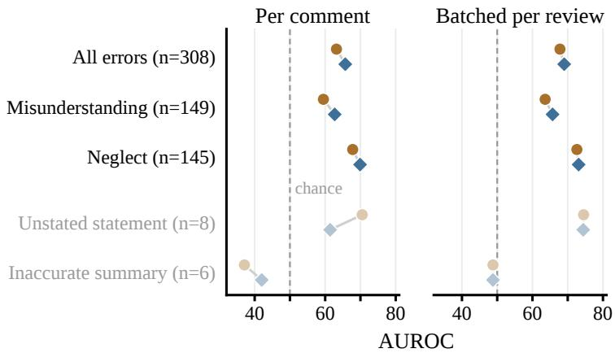  
Figure 15 AUROC by error type on the NLP reviews for holistic GPT-5.5 and PremiseCheck (k=16), per comment (holistic at medium reasoning) and batched per review (holistic without reasoning). Gray types have too few errors to interpret.

<table><tr><td></td><td></td><td colspan="5">Per comment</td><td colspan="5">Batched per review</td><td></td></tr><tr><td></td><td></td><td></td><td colspan="2">Holistic PremiseCheck</td><td></td><td></td><td>Holistic</td><td>Premise- Check</td><td></td><td colspan="2"></td><td>Omission</td></tr><tr><td>Error type</td><td></td><td></td><td>n medium medium</td><td>k=16</td><td></td><td>∆ [95% CI]</td><td>none</td><td></td><td>k=16</td><td>∆ [95% CI]</td><td></td><td>(%)</td></tr><tr><td>All errors</td><td>308</td><td>63.2</td><td>63.0</td><td>65.7</td><td></td><td>+2.4 [−0.3, +5.3]</td><td>67.8</td><td>69.0</td><td></td><td></td><td>+1.2 [−1.2, +4.0]</td><td>56.5</td></tr><tr><td>Misunderstanding</td><td>149</td><td>59.5</td><td>61.0</td><td>62.7</td><td></td><td>+3.2 [−1.2, +7.3]</td><td>63.6</td><td></td><td>65.7</td><td></td><td>+2.1 [−1.6, +6.0]</td><td>39.2</td></tr><tr><td>Neglect</td><td>145</td><td>67.8</td><td>65.2</td><td>69.9</td><td></td><td>+2.1 [−1.1, +5.4]</td><td>72.6</td><td>73.1</td><td></td><td></td><td>+0.5 [−3.8, +5.0]</td><td>78.5</td></tr><tr><td>Unstated statement</td><td>8</td><td>70.5</td><td>78.4</td><td>61.4</td><td></td><td>-9.0 [−20.9, +7.7]</td><td>74.5</td><td>74.4 48.8</td><td></td><td></td><td>−0.1 [−12.8, +19.6]</td><td>12.5</td></tr><tr><td>Inaccurate summary</td><td>6</td><td>37.1</td><td>35.5</td><td>42.0</td><td></td><td>+4.9 [−13.3, +22.3]</td><td>48.8</td><td></td><td></td><td></td><td>−0.0 [−15.6, +17.1]</td><td>16.7</td></tr><tr><td>Correct comments</td><td>6,158</td><td></td><td></td><td></td><td></td><td></td><td></td><td></td><td></td><td></td><td></td><td>35.9</td></tr></table>

Table 19 AUROC on the NLP reviews by error type. Each row compares the errors of one type with all correct comments. Holistic is GPT-5.5 at the given reasoning, and PremiseCheck uses the medium-reasoning decomposer or, with k=16, the no-reasoning decomposer with 16 phrasings per premise. Each ∆ compares PremiseCheck (k=16) with the holistic column of its block. Omission is the share of comments whose lowest premise under PremiseCheck (medium) claims an omission.
<table><tr><td rowspan="2">System</td><td colspan="2">Factual label</td><td colspan="2">Judgment label</td></tr><tr><td>AUROC</td><td>∆ [95% CI]</td><td>AUROC</td><td>∆ [95% CI]</td></tr><tr><td>Natural-science reviews (factual: 65 errors; judgment: 315 errors) Holistic GPT-5.5</td><td></td><td></td><td>57.8</td><td></td></tr><tr><td>PremiseCheck</td><td>67.8 67.5</td><td>-0.3 [-8.9, +7.6]</td><td>53.5</td><td>−4.4 [−8.4, −0.2]</td></tr><tr><td></td><td></td><td>Machine learning reviews (factual: 46 of 216 comments; judgment: 16 of 296 comments)</td><td></td><td></td></tr><tr><td>Holistic GPT-5.5 PremiseCheck</td><td>66.9 68.7</td><td>+1.8 [−9.4, +11.7]</td><td>81.5 59.9</td><td></td></tr></table>

Table 20 AUROC of holistic GPT-5.5 and PremiseCheck on factual and judgment labels. The factual label is the ReviewFact label. The judgment label is the full PeerReview Bench correctness label on the natural-science reviews and the ReviewScore overall factuality rating on the machine learning reviews. ∆ is the paired diference to holistic GPT-5.5. PremiseCheck uses the prompt variant of each part (Appendix B.1), as in Table 1.

Figure 16 shows one case for each stage, chosen by a fixed rule: among comments whose final code was chosen by at least two annotators, all of them with the highest confidence, we take the shortest comment. No aggregation failure meets this rule.

## E Batching and Fusion

Table 23 compares per-comment and batched systems and their fusion. Batched holistic judgment uses the prompt and question of holistic GPT-5.5, with all comments of one review numbered in the evidence and one question per comment. Batched PremiseCheck uses the decomposition prompt of Appendix B.1, changed only so that it returns one premise list per numbered comment. Both batched systems see the same comments of each review. When an answer misses comments, we ask once more for the missing ones, after which no comment remained missing. The cost of one call is divided evenly among the comments of the review. In the row “Jev batched”, Jev also reads the paper once for up to eight premises, with two questions per premise. Latency is per comment, computed as the time for the whole review divided by its number of comments.

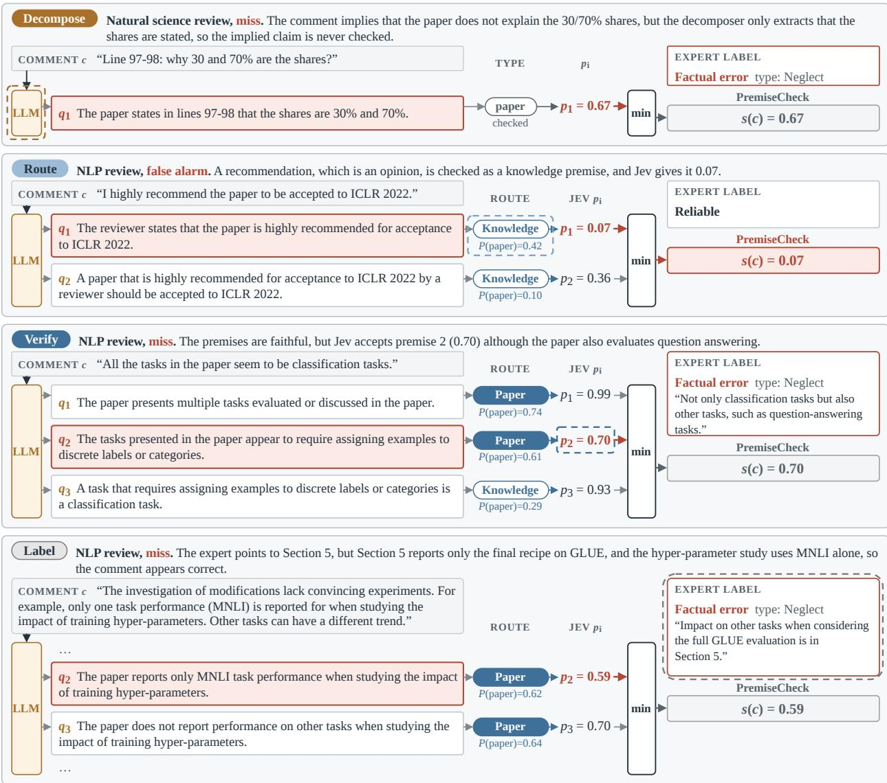  
Figure 16 Four failures of PremiseCheck, one for each stage. A dashed ring marks the failing component, the lowest premise is framed in red, and the comment, premises, and expert text are verbatim.

## F Examples

## F.1 Scored Comments

Figure 17 shows two comments from the NLP reviews with the premises of PremiseCheck (medium-reasoning decomposer) and the probabilities that Jev assigns to them.

The first comment is a factual error. We drew it at random from short factual errors in human-written reviews that both systems flag, that is, errors in the lowest 10% of PremiseCheck scores that holistic GPT-5.5 also scores at or below its median. The reviewer claims that the motivation of the paper is unclear. The expert disagrees, because the authors state a motivation for their analysis. PremiseCheck splits the comment into two premises. Jev checks the second premise, that the paper does not make its motivation clear, against the paper and gives it a probability of 0.04. This premise states the point that the expert disputes, and it sets the comment score. Holistic GPT-5.5 also flags the comment, with a probability of 0.15.

The second comment is correct, but PremiseCheck flags it. We drew it at random from short correct comments of human-written reviews in the lowest 10% of PremiseCheck scores. The comment describes evidence from representational similarity analysis and linear mappings, but the paper text contains neither. The comment therefore likely refers to another paper. The decomposer rewrote “paper” as “the paper”, so premises 1 and 2 are false as written, and Jev gives both a probability of 0.03. Holistic GPT-5.5 also gives the comment a very low score.

<table><tr><td>Code Failure</td><td></td><td>FA Miss</td></tr><tr><td colspan="3">Decompose</td></tr><tr><td></td><td>D1 Adds a claim the reviewer did not make</td><td>19 0</td></tr><tr><td></td><td>D2 Refers to the wrong object</td><td>12</td></tr><tr><td></td><td>D3 Hinges on a vague quantifier</td><td></td></tr><tr><td></td><td>D4 Erroneous claim not extracted or weakened</td><td>7 0 19</td></tr><tr><td colspan="3">■ Route</td></tr><tr><td>R1 Opinion or request checked as a fact</td><td>10</td><td>6</td></tr><tr><td>R2 Paper premise routed to knowledge</td><td>2 3</td><td>0 3</td></tr><tr><td>R3 Knowledge premise routed to paper</td><td>5</td><td>0</td></tr><tr><td>R4 Erroneous premise not checked</td><td>0</td><td>3</td></tr><tr><td colspan="3">I Verify</td></tr><tr><td>V1 A named location misleads Jev</td><td>20 4</td><td>27</td></tr><tr><td>V2 Evidence lies outside the paper text</td><td>10</td><td>1 8</td></tr><tr><td>V3 Evidence lies after the truncation</td><td>0</td><td>0</td></tr><tr><td>V4 Jev errs on a clear, faithful premise</td><td>6</td><td>18</td></tr><tr><td colspan="3">Aggregate</td></tr><tr><td>A1 A side premise sets the minimum</td><td>3 3</td><td>2</td></tr><tr><td>A2 Error lies in no single premise</td><td>0</td><td>0 2</td></tr><tr><td>Label</td><td>12</td><td></td></tr><tr><td>L1 Expert label questionable</td><td>10</td><td>25 24</td></tr><tr><td>L2 Undecidable without the full review</td><td>2</td><td>1</td></tr><tr><td>Total</td><td>85</td><td>79</td></tr></table>

<table><tr><td></td><td colspan="2">NLP</td><td colspan="2">ML</td><td colspan="2">Science</td></tr><tr><td>Stage</td><td>FA</td><td>Miss</td><td>FA</td><td>Miss</td><td>FA</td><td>Miss</td></tr><tr><td>Decompose</td><td>29 (58)</td><td>9 (18)</td><td>5 (33)</td><td>5 (33)</td><td></td><td>6(30) 5(36)</td></tr><tr><td>Route</td><td>7(14)</td><td>2 (4)</td><td>3 (20)</td><td>1(7)</td><td></td><td>3 (21)</td></tr><tr><td>Verify</td><td>7(14)</td><td>18 (36)</td><td>4(27)</td><td>4(27)</td><td>9 (45)</td><td>5 (36)</td></tr><tr><td>Aggregate</td><td>2(4)</td><td>1(2)</td><td></td><td>1(7)</td><td>1(5)</td><td></td></tr><tr><td>Label</td><td>5 (10)</td><td>20 (40)</td><td>3 (20)</td><td>4(27)</td><td>4(20)</td><td>1(7)</td></tr><tr><td>Sampled</td><td>50</td><td>50</td><td>15</td><td>15</td><td>20</td><td>14</td></tr><tr><td>GPT-5.5 also fails</td><td>14</td><td>20</td><td>2</td><td>5</td><td>3</td><td>5</td></tr></table>

Table 22 Final stage of each sampled failure by part and case, with the share of the cell in percent in parentheses. Shading grows with the share, and bold marks a stage with at least 40% of a cell. The last row counts comments that holistic GPT-5.5 also gets wrong under the same rule.

Table 21 Failure codes and their final counts over all three parts, grouped by stage with the colors of Figure 10. Each code describes the premise, the route, or the check at fault. FA is false alarm, italic numbers are stage totals, and bold marks the three most frequent codes of each case. No comment received the code Other.
<table><tr><td rowspan="2">System</td><td rowspan="2">AUROC</td><td rowspan="2">Cost (%)</td><td rowspan="2">Latency (s)</td><td colspan="3">∆ [95% CI]</td></tr><tr><td>to reference</td><td></td><td>to batched holistic (none)</td></tr><tr><td colspan="7">Per comment</td></tr><tr><td>Holistic GPT-5.5 (medium, ref.)</td><td>63.2</td><td>100.0</td><td>6.27</td><td></td><td></td><td>−4.6 [−6.7, −2.3]</td></tr><tr><td>PremiseCheck (none, k=16)</td><td>65.7</td><td>24.7</td><td>2.80</td><td></td><td>+2.4 [−0.3, +5.3]</td><td>-2.1</td></tr><tr><td>Fusion: holistic + PremiseCheck (medium)</td><td>64.9</td><td>151.2</td><td>6.27</td><td></td><td>+1.6 [+0.2, +3.0]</td><td></td></tr><tr><td>Fusion: holistic + PremiseCheck (low)</td><td>65.5</td><td>134.3</td><td>6.27</td><td></td><td>+2.3 [+0.9, +3.5]</td><td></td></tr><tr><td>Fusion: holistic + PremiseCheck (none)</td><td>64.9</td><td>124.6</td><td>6.27</td><td></td><td>+1.7 [+0.2, +3.2]</td><td></td></tr><tr><td colspan="7">Batched per review</td></tr><tr><td>Holistic GPT-5.5 (medium)</td><td>64.9</td><td>19.9</td><td>1.40</td><td>+1.7 [−0.2, +3.5]</td><td></td><td>-2.9</td></tr><tr><td>Holistic GPT-5.5 (none)</td><td>67.8</td><td>7.7</td><td>0.14</td><td>+4.6 [+2.3, +6.7]</td><td></td><td></td></tr><tr><td>PremiseCheck (none, k=16)</td><td>69.0</td><td>20.2</td><td>0.92</td><td>+5.8 [+3.1, +8.6]</td><td></td><td>+1.2 [−1.2, +4.0]</td></tr><tr><td>PremiseCheck (none, k=1)</td><td>66.9</td><td>20.2</td><td>一</td><td></td><td></td><td>-0.9 [−3.4, +1.8]</td></tr><tr><td>PremiseCheck (k=16), Jev batched</td><td>68.4</td><td>14.5</td><td></td><td>+5.2</td><td></td><td>+0.6 [−2.1, +3.4]</td></tr><tr><td>Fusion: holistic (none) + PremiseCheck</td><td>71.5</td><td>28.0</td><td>0.92</td><td>+8.3</td><td></td><td>+3.7 [+2.4, +5.1]</td></tr><tr><td colspan="7">Batched PremiseCheck (k=16) minus</td></tr><tr><td>batched holistic (medium) per-comment PremiseCheck</td><td>+4.1 [+1.5, +6.9]</td><td></td><td></td><td></td><td></td><td></td></tr></table>

Table 23 Batched and fused systems on the NLP reviews (6,466 comments, 308 factual errors). Bold marks the best AUROC in each block. Cost is relative to per-comment holistic GPT-5.5 at medium reasoning. Reasoning in parentheses refers to the holistic call or to the decomposer. Per-comment fusion combines holistic GPT-5.5 (medium) with PremiseCheck using a single question per premise. Fusion runs both systems in parallel.

Figure 18 shows a further factual error, for which PremiseCheck gives a much lower score than holistic Jev.

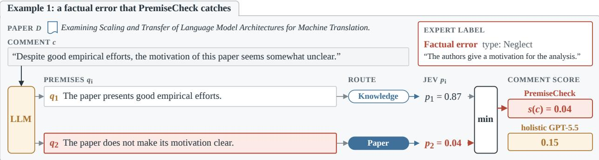

Example 2: a correct comment that PremiseCheck flags  
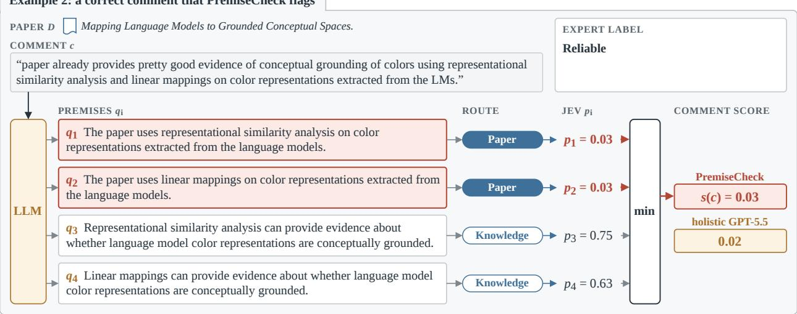  
Figure 17 Two comments from the NLP reviews scored by PremiseCheck with the medium-reasoning decomposer. Route and p are the decision and probability of Jev, red marks the premise with the lowest probability, which gives the comment score, and the comment, premises, and expert text are verbatim.

We chose it among NLP factual errors with a PremiseCheck score at or below 0.10 and a holistic Jev score at or above 0.60. The comment implies that the paper does not test other large-scale language models such as OPT and GPT-3.

## F.2 Flagged Comments with Author Responses

We choose the examples by a fixed rule among the 10% of machine learning comments that PremiseCheck finds most suspicious. The two caught errors are the shortest comments that the ReviewScore annotators label as misinformed and whose authors reply that the paper contains what the comment asks for. Example 1 is Figure 12, and Example 2 in Figure 19 is the second. The false alarm is the shortest comment that the annotators label as correct and whose authors accept it. In Example 3, the reviewer says that Section 1 does not cite CLIP, and the authors confirm this by adding the citation. Jev still gives the premise a probability of 0.04, probably because the paper cites CLIP in Section 4 and Jev reads the whole paper, so it cannot tell in which section a citation appears.

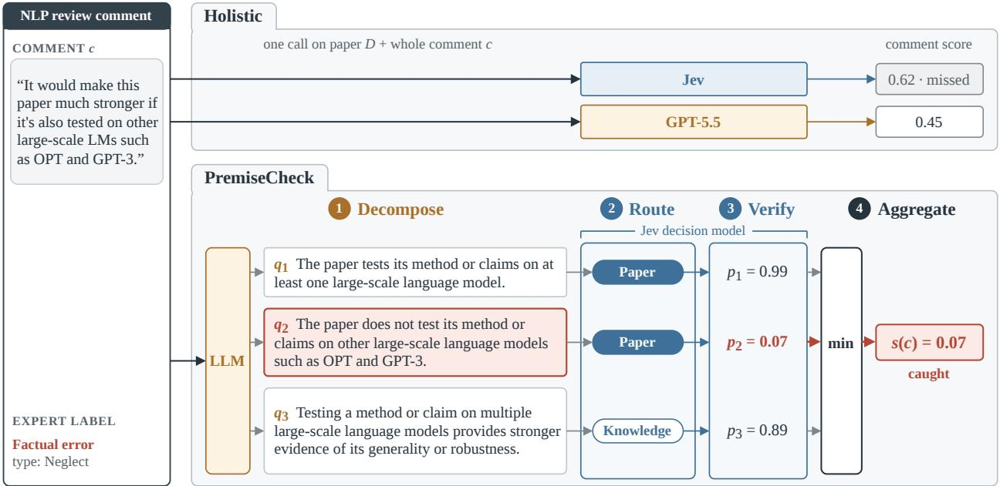  
Figure 18 A factual error from the NLP reviews, chosen as an illustration because its holistic and decomposed scores difer strongly. Holistic Jev gives the comment 0.62, whereas PremiseCheck with the no-reasoning decomposer gives premise 2 a probability of 0.07, which sets the comment score. Comment and premises are verbatim.

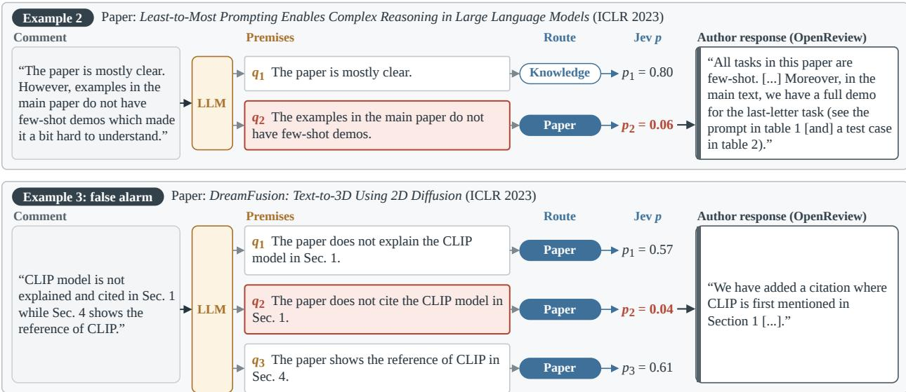  
Figure 19 Two more comments from the machine learning reviews flagged by PremiseCheck, with the authors’ OpenReview responses. Route and p are the decision and probability of Jev, red marks the premise with the lowest probability, and quotes are verbatim except for omissions marked [. . . ] and a typo corrected in brackets.