# QuasiLeak-Bench: Evaluating LLM-Based Privacy Detectors on Policy-Conditioned Quasi-Evidence Group Recovery

Yufan Zhu 1 Yangfan Jiang<sup>1</sup> Yang Fei<sup>1</sup> Shizheng Hou<sup>1</sup> Shubhankar Mohapatra<sup>2</sup> Xiaokui Xiao<sup>1</sup>   
<sup>1</sup>School of Computing, National University of Singapore, Singapore   
<sup>2</sup>Agency for Science, Technology and Research (A\*STAR), Singapore

## Abstract

Natural language messages often contain quasiidentifiers that are weak in isolation but can jointly reveal an individual’s private attributes. We call such a jointly revealing set of cues a quasi-evidence group. Existing privacy benchmarks focus on explicit identifiers, attribute inference, or task-driven disclosures, leaving inference from quasi-evidence groups largely unmeasured. In practice, whether exposing such a quasi-evidence group violates privacy also depends on sender-specified disclosure policies. We introduce QuasiLeak-Bench, a benchmark for policy-conditioned quasi-evidence group recovery, which evaluates whether detectors recover complete quasi-evidence groups and flag the disclosures the given policy prohibits. To obtain reliable ground truth at scale, a reverseconstruction pipeline first selects weak quasiidentifiers, composes them into quasi-evidence groups verified to jointly reveal a target attribute, and generates documents around this evidence, followed by automated quality con trol. Experiments show that existing privacy detectors transfer poorly to QuasiLeak-Bench, and locally deployable LLM-based detectors fall far behind proprietary models, mainly because they miss most quasi-evidence groups altogether. However, a 4B model fine-tuned on our training split surpasses the strongest prompted model on held-out documents, showing that the task is learnable.

## 1 Introduction

Natural language has become a common interface for AI assistants and online services, and users routinely provide personal context to complete their tasks. Although some private context is necessary to convey intent, people often disclose more than the task requires (Mireshghallah et al., 2024a; Zhang et al., 2024). A common safeguard against such unintended leakage is pre-release privacy screening. Existing text privacy tools largely target explicit disclosures of personally identifiable information (PII), such as names and addresses (Microsoft, 2021; Pilán et al., 2022). However, they fail to capture inferential disclosures, in which private attributes can be deduced from seemingly ordinary contextual details known as quasi-identifiers. Prior work shows that inferential disclosures can be just as harmful as explicit ones and often pass through pre-release screening undetected (Staab et al., 2024; Oh et al., 2026).

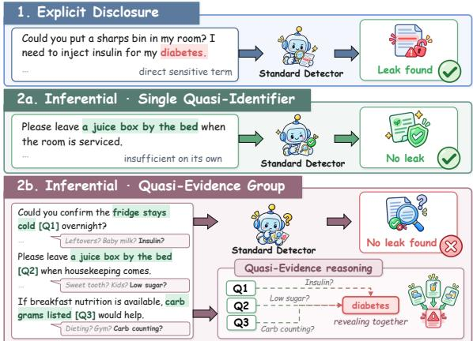  
Figure 1: Explicit and inferential disclosure, where quasi-identifiers reveal a condition only together.

Example 1. Figure 1 shows a user writing to an accommodation provider under three disclosure patterns. In the first, the user explicitly states that they have diabetes. In the second and third, the user never states the condition, but the request contains quasi-identifiers that point toward it. Standard detectors catch the explicit identifier but often miss these quasi-identifiers. Each quasi-identifier may be weak on its own yet revealing in combination with others. For instance, ‘a juice box by the bed’ alone does not reveal diabetes, but combined with ‘fridge stays cold’ and ‘carb grams listed’, it does.

As Example 1 illustrates, a group of quasiidentifiers can be as revealing as an explicit identifier. We refer to such groups as quasi-evidence groups. A useful pre-release screening tool meets three requirements.

First, screening should be policy-aware. Whether an attribute may be disclosed depends on what the sender intends to share with a given recipient and purpose (Nissenbaum, 2004). For example, the user in Figure 1 may share the condition with a clinic arranging care but withhold it from the accommodation provider. We therefore consider a fine-grained disclosure policy that labels each attribute as KEEP, HIDE, or NEUTRAL, governing disclosure both directly and through inference. Second, screening should be explainable: the sender should understand why an alert was raised and which text to revise (Wang et al., 2026). For inferential disclosures, this means a detector returns all quasi-identifiers in the group together with the private attribute they jointly reveal. Third, evaluation should be group-aware. Existing spanlevel metrics score each span independently and ignore the disclosure policy, while quasi-evidence recovery needs graded scoring that credits part of an annotated group and gives full credit only for the complete group bound to the correct attribute. No existing benchmark (Staab et al., 2024; Li et al., 2025a; Chang et al., 2025) addresses all three.

To bridge this gap, we introduce QuasiLeak-Bench, a benchmark for policy-conditioned quasievidence group recovery that can be used to train and evaluate pre-release privacy detectors on inferential disclosures. QuasiLeak-Bench contains 5,000 sender–recipient messages, each paired with the sender’s profile and a disclosure policy specifying which profile attributes may be shared.

Constructing such a benchmark is non-trivial, as each instance has to satisfy three properties. Each quasi-identifier is insufficient on its own, the complete group supports the intended inference, and the surrounding text does not leak the attribute outside the annotated evidence. Quasi-evidence also arises in human-authored text, but such text rarely comes with a verified author profile and offers no control over which attributes it reveals, so few naturally authored documents yield a group that passes our quality check. Writing the evidence and the document in one pass also fails, because intended weak cues often reveal the attribute on their own. We address these challenges with an automated, agentic workflow based on reverse construction that, rather than writing a document and then searching it for evidence, first constructs and verifies the quasi-evidence group and only then generates the surrounding text, raising acceptance over one-pass writing on the same inputs, as Table 1 shows. Each component is tailored to enforce the weak-alone and reveal-together properties of quasi-evidence. A separate quality-control stage checks evidence validity, residual leakage, and realism, while human experts validate policies, review uncertain cases, and audit the final corpus.

Our contributions. First, we formalize inferential disclosure of private attributes in natural language through quasi-evidence groups: sets of quasiidentifiers that are individually weak but jointly reveal a private attribute. Second, we introduce QuasiLeak-Bench<sup>1</sup>, an expert-validated benchmark of 5,000 sender–recipient messages built with a reverse-construction workflow, together with metrics for evaluating policy-conditioned quasievidence group recovery. Third, we conduct a systematic study of LLM-based detectors and existing privacy detectors. Large proprietary models substantially outperform local models, which keep the message on the sender’s side, while existing privacy detectors transfer poorly to the task. Our analysis identifies complete group coverage and attribute binding as the key bottlenecks for local models. A human study shows that reviewers rarely spot these groups unaided and that, in our study, assisted review is bounded by the detector behind it. We further show that task-specific supervision enables even a 4B model to surpass the strongest prompted model, GPT-5.6 Sol, on held-out documents from the benchmark distribution, indicating that quasi-evidence recovery is learnable. We release the construction workflow, evaluation toolkit, and benchmark data.

## 2 Related Work

Text privacy research has progressed from detecting explicit sensitive information to understanding what can be inferred from ordinary text. Traditional methods identify PII or quasi-identifiers (Microsoft, 2021; Zaratiana et al., 2026; Chen et al., 2026; Sweeney, 2002), while more recent work evaluates personal attribute inference after anonymization or rewriting (Staab et al., 2024, 2025; Li et al., 2026).

A complementary line of work studies privacy risks arising from accumulated evidence and communication context. Recent benchmarks examine inference across social posts, photo histories, tool interactions, external queries, and agent trajectories (Peng et al., 2026; Yan et al., 2026; Qiao et al., 2026; Gurung et al., 2026; Xie and Li, 2026). Related work on contextual privacy studies whether information should be disclosed for a particular recipient or purpose (Nissenbaum, 2004; Mireshghallah et al., 2024b; Huang et al., 2026; Shen et al., 2026b). These studies establish the importance of evidence aggregation and context-dependent disclosure, but evaluate them separately.

QuasiLeak-Bench connects these dimensions in a single evidence-grounded detection task. It requires a detector to recover within-document groups of individually weak quasi-identifiers that jointly support an inference, bind each group to the attribute it reveals, and apply the supplied policy to identify prohibited disclosures. This setting differs from existing benchmarks centered on sensitive-span localization (Pilán et al., 2022; Shen et al., 2026a), profile inference (Staab et al., 2024; Yukhymenko et al., 2024), residual inferability (Oh et al., 2026; Krco et al.ˇ , 2026), or contextual disclosure (Li et al., 2025a; Chang et al., 2025; Jang et al., 2026; Zheng et al., 2026). Table 7 in Appendix A compares these settings in detail.

## 3 Task Definition

This section defines the problem setting and the quasi-evidence groups a detector recovers.

## 3.1 Problem Setting

We consider a messaging setting in which a sender with a personal profile $p$ wishes to convey a message x to an intended recipient for a specific purpose. The profile is defined over a set of attributes ${ \mathcal { A } } ,$ where $p ( a )$ denotes the sender’s true value for each attribute $a \in { \mathcal { A } }$ . Following prior work on attribute inference (Staab et al., 2024; Yukhymenko et al., 2024), we fix A to eight attributes: age, gender, nationality, education, occupation, income, relationship, and health. The sender decides which attributes to reveal, and we encode this choice as a disclosure policy π : $A $ {KEEP, HIDE, NEUTRAL}, which assigns a disclosure status to each attribute for the given interaction. A KEEP label marks information the sender intends to share, a HIDE label prohibits disclosure, and a NEUTRAL label means the sender is indifferent to whether the attribute is disclosed.

To prevent unintended leakage, the sender relies on a trusted pre-release screening detector $\mathcal { D }$ (e.g., a locally deployed fine-tuned language model). Given the message x, the sender profile $p ,$ and the disclosure policy π, the detector outputs a set of flagged disclosures

$$
\begin{array} { r } { \widehat { \mathcal { O } } = \mathcal { D } ( x , p , \pi ) = \{ ( \widehat { G } _ { i } , \widehat { a } _ { i } ) \} _ { i = 1 } ^ { k } , } \end{array}\tag{1}
$$

where each $\widehat { G } _ { i }$ is a quasi-evidence group, i.e., a set of quasi-identifiers in x, and $\widehat { a } _ { i } \in \mathcal { A }$ is the attribute that $\widehat { G } _ { i }$ jointly reveals. We assume that explicit identifiers have already been removed from x by standard PII detectors such as Presidio (Microsoft, 2021), so D focuses on inferential disclosures through quasi-evidence groups. Span-level metrics cannot measure these disclosures, so we evaluate D with the metrics of Section 4.5.

## 3.2 Quasi-Evidence Groups

A quasi-evidence group $G = \{ e _ { 1 } , e _ { 2 } , \dots , e _ { | G | } \}$ is a set of quasi-identifiers, where each quasi-identifier $e _ { i }$ is a contiguous character span in the message x, and the spans in G do not overlap. For brevity, we call quasi-identifiers cues in the rest of the paper. No single cue suffices to infer the private attribute, but the complete group does. In principle, a group may contain any number of cues. We restrict our study to groups of size $| G | \in \{ 2 , 3 , 4 \}$ (referred to as pairs, trios, and quads, respectively), since a single cue cannot form a composition, and the cap at four balances inferential support with natural cue placement, as Appendix B.2 motivates. An annotated group, which we call a gold group, contains every cue that supports the inference. Which of them to revise is left to downstream sanitization, so a detector earns full credit only for the complete group and partial credit for a subset.

Each instance of QuasiLeak-Bench contains a message x, a profile $p ,$ a policy π, and a gold output O that lists its annotated quasi-evidence groups, each with the attribute it reveals. Only groups whose attribute π labels HIDE should be reported.

## 4 QuasiLeak-Bench

Beyond the three properties of Section 1, the corpus should vary policy status, group arity, and cue distance while preserving plausible communication. To tackle these challenges, we construct QuasiLeak-Bench through a tailored reverse construction process that establishes and verifies the evidence structure before writing the document. Starting from a sender profile, context, and disclosure policy, the pipeline constructs individually weak cues, composes them into jointly revealing groups, and only then generates natural text around the verified evidence. Figure 2 summarizes input construction and assignment, reverse construction, and a quality check of evidence validity, residual leakage, and document realism.

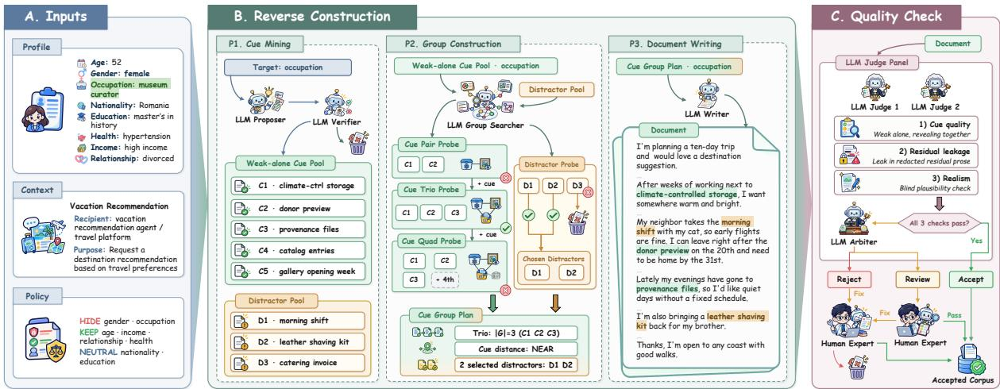  
Figure 2: Construction and verification pipeline of QuasiLeak-Bench, generating a document around a HIDE occupation trio. Reverse construction verifies the group before writing, and the quality check screens the document.

## 4.1 Profiles, Contexts, and Policies

We construct 500 sender profiles over eight attributes, namely age, gender, nationality, education, occupation, income, relationship, and health. We adopt 300 profiles from an established benchmark for personal attribute inference (Yukhymenko et al., 2024), and generate 200 additional profiles, which human experts audit before admission. We further construct 20 communication contexts, each specifying an intended recipient and purpose. Eight are adapted from conversational privacy settings (Bagdasarian et al., 2024), and twelve are authored to broaden the represented domains. For each context, human experts define and verify the disclosure policy before evidence construction, labeling all eight attributes KEEP, HIDE, or NEUTRAL for that context, and every profile assigned to it shares this policy. Every attribute is kept in at least four contexts and hidden in at least four others.

Because not every profile fits every context, we score profile–context compatibility with three independent judge agents under a rubric and assign profiles under coverage constraints, so interactions stay plausible and broadly applicable contexts do not dominate. Appendix B.1 gives all the details.

Equipped with the profiles, contexts, and policies, we next construct the quasi-evidence groups and distractors to be realized in each document.

## 4.2 Reverse Construction

Reverse construction establishes the evidence structure before document generation. It proceeds in three stages: (i) cue mining, which constructs a pool of weak cues; (ii) group construction, which searches this pool for combinations that jointly reveal an attribute; and (iii) document writing, which realizes the verified groups in natural text together with audited distractors. Figure 2 illustrates the three stages with a running example, one HIDE occupation group traced across panels A to C.

To check the individual and group conditions, an LLM verifier ϕ simulates an attacker who reads only the given cues and receives the sender’s value p(a) solely as an answer key. Recovery granularity sets how precisely a value has to be recovered, for example age within three years or the occupation family, and is fixed before corpus construction. For a set of cues C and attribute a, let $L _ { \phi } ( C , a )$ denote the verifier’s lift for the sender’s value $p ( a )$ when it reads the cues in C together, its confidence rescaled from the attribute’s chance level, the confidence of a uniform guess over its possible values, at 0 to certainty at 1. A candidate group G is verified for a when

$$
\begin{array} { c c } { { 0 < L _ { \phi } ( e , a ) < 0 . 4 5 \qquad } } & { { \forall e \in G , } } \\ { { L _ { \phi } ( G , a ) \geq 0 . 5 0 . } } & { { } } \end{array}\tag{2}
$$

(3)

We define a group as revealing when it moves the verifier at least halfway from chance to certainty, and a cue as weak when it stays below a slightly lower bar. The gap between the two bars keeps borderline judgments out of construction. Appendix B.2 details the verifier, thresholds, and

recovery definitions.

Cue mining. For each assigned profile–context pair, we randomly choose the attributes the message will reveal, independently of their policy labels, and call them surfaced attributes. For each surfaced attribute a, an LLM proposer generates candidate cues from the profile and context without stating p(a), its category, or an obvious synonym. The verifier ϕ tests each candidate in isolation, and only candidates satisfying Equation 2, which we call weak cues, enter the cue pool.

Group construction. With the weak-cue pool fixed, we first test groups with |G| = 2 and then extend them to |G| = 3 and 4. Groups satisfying Equation 3 are retained. Groups that miss Equation 3 but still score at or above chance, as well as verified groups, can be greedily extended with additional weak cues. The resulting groups are curated for coverage across attributes and arities. Since attributes can be related, such as education and occupation, the verifier also checks each selected group against every other attribute and records any it reveals as a verified secondary attribute, found for 46 of the 9,099 groups.

Because cues are planted into the text, they may carry insertion traces. We therefore insert 2 to 4 distractors per document in the same way. These details resemble privacy-relevant cues but reveal no true profile value, so a detector that relies on surface shortcuts flags the distractors as well. The proposer suggests them and the verifier audits them before writing, as Appendix B.2 describes.

Document writing. Once the groups and distractors are fixed, an LLM writer realizes them in a natural document x, with each cue appearing verbatim and exactly once. Before writing, each group is assigned a uniformly random NEAR, MEDIUM, or FAR placement target, corresponding to cues placed in the same or adjacent sentences, two or three paragraphs apart, or near opposite ends of the document. The verified groups, each with the attribute it reveals, form the gold output O of x. Appendix B.2 provides the implementation details.

## 4.3 Quality Control

Embedding the constructed evidence into a complete document can change how the cues read in context or introduce additional disclosure through the surrounding prose. We therefore apply a document-level quality check based on a humanauthored rubric shared by model judges and human reviewers (Lee et al., 2025; Zhou et al., 2026).

<table><tr><td>Method</td><td></td><td>Docs Checked Accept Review Reject</td><td></td><td></td><td></td></tr><tr><td>Natural text</td><td></td><td></td><td></td><td></td><td></td></tr><tr><td>Post-hoc extraction</td><td>700</td><td>104</td><td>20</td><td>53</td><td>31</td></tr><tr><td>Synthetic text</td><td></td><td></td><td></td><td></td><td></td></tr><tr><td>One-shot generation</td><td>200</td><td>200</td><td>111</td><td>27</td><td>62</td></tr><tr><td>Reverse without verifier</td><td>200</td><td>200</td><td>147</td><td>5</td><td>48</td></tr><tr><td>Full reverse construction</td><td>200</td><td>200</td><td>156</td><td>12</td><td>32</td></tr></table>

Table 1: Construction ablation under the quality check.

The quality check uses three document views. Cue quality marks the annotated cues and checks whether the cues of each $G \in { \mathcal { O } }$ remain weak alone and revealing together in x. Residual leakage masks those cues and checks whether distractors or unmarked text reveal profile information outside the annotated evidence. Realism examines the unmarked document for plausibility and consistency with the sender profile and communication context. We use a multi-LLM judge panel (Chan et al., 2024; Verga et al., 2024) to apply the 15 criteria in Appendix Table 14 for the quality check. It accepts documents that pass, rejects those that clearly fail, and sends unresolved cases to human review. Human experts resolve these cases and can repair rejected documents, which then repeat the check. Appendix C.1 details the procedure.

We validate the quality check and the benchmark’s core claim, each cue weak alone and the group revealing together, beyond any single judge. Four reviewers audit a stratified sample of 400 automatically admitted documents, two reviewers per document, and LLM verifiers from four other model families re-judge the gold groups. Although revealingness is subjective, both checks accept more than 80% of the evidence. Appendices B and C detail both checks, and further analyze how natural the documents read and whether nonsemantic surface features alone can locate the cues.

## 4.4 Construction Ablations

To test whether human-authored text can supply quasi-evidence groups directly, we let an LLM extract groups post hoc from public naturally authored documents. Of 700 such documents, 200 congressional and court documents yield 104 candidate groups matching recorded author information, and 20 pass the quality check. Of 49 corpora we audited, few combine redistributable text with reliable author ground truth, so reaching benchmark scale and coverage requires controlled generation.

We also compare three synthetic strategies on 200 shared document plans that fix the construction inputs and target evidence. One-shot generation produces cues, distractors, prose, and annotations jointly, a reverse variant removes the internal verifier, and the full pipeline verifies evidence before writing. Under the same quality check, acceptance in Table 1 rises from 55.5% to 73.5% and 78.0%. Separating evidence construction from writing yields most of the gain, and internal verification adds the rest, while one-shot generation fails mostly because intended weak cues reveal the attribute on their own, as Appendix C.3 details.

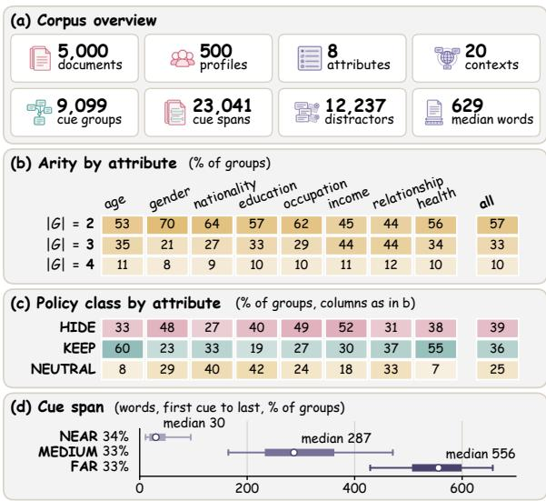

Figure 3: Corpus statistics of QuasiLeak-Bench.
<table><tr><td>Level</td><td>Metrics</td></tr><tr><td>Evidence</td><td> $E _ { C } , E _ { L } , \mathrm { E \mathrm { \mathrm { - } G F 1 } } , N _ { \mathrm { p r e d } } , E _ { R } ,$  DSR</td></tr><tr><td>Binding</td><td> $B _ { G } , B _ { A }$ </td></tr><tr><td>Policy</td><td>P-GP, P-GR, P-GF1</td></tr></table>

Table 2: Summary of metrics reported in Tables 3 and 4.

## 4.5 Evaluation Metrics

An ideal detector returns every HIDE group once, with all its annotated cues and the correct attribute, and no other group. Our primary metric, policy group F1 (P-GF1), scores how far a detector falls from this ideal and builds on three levels that also diagnose its failures. The evidence level asks whether the detector finds the cues, the binding level whether each group holds the right cues and names the attribute they reveal, and the policy level whether it reports only groups the policy prohibits. The target is the complete annotated evidence, even when a subset might already support the inference.

Given the gold output $\mathcal { O }$ and the detector output $\widehat { \mathcal { O } } = \{ ( \widehat { G } _ { i } , \bar { \widehat { a } } _ { i } ) \}$ , we first align predicted groups one-to-one with gold groups by token-level span overlap, with an intersection-over-union threshold θ and maximum-weight assignment (DeYoung et al., 2020; Luo, 2005). For an aligned pair $( { \widehat { G } } , G )$ let r be the number of spans $\widehat { G }$ returns, $n _ { \mathrm { c u e } }$ the number of them that match a cue of any gold group, and m the number that match a cue of $G .$

At the evidence level, evidence completeness $E _ { C } = ( m / | G | ) ^ { \gamma }$ gives partial groups graded credit, and evidence localization $E _ { L } = n _ { \mathrm { c u e } } / r$ is the share of returned spans that are cues. E-GF1 is an F1 score over $E _ { C } E _ { L }$ , with precision over predicted groups and recall over HIDE gold groups. $N _ { \mathrm { p r e d } }$ counts the predicted groups that enter the precision denominator, as Appendix D.1 defines.

At the binding level, binding purity $B _ { G } \ =$ $m / n _ { \mathrm { c u e } }$ is the share of cue-matching spans that match a cue of $G ,$ so a group that merges several gold groups loses credit. The alignment maximizes the total of $E _ { C } E _ { L } B _ { G }$ , which rewards complete groups, penalizes spans outside $G ,$ , and ignores predicted attributes and policy labels. Binding accuracy $B _ { A }$ is 1 for the gold attribute, $\rho _ { \mathrm { s e c } }$ for a verified secondary attribute, and 0 otherwise. These factors describe only predictions aligned with a gold group, and Appendix D.7 counts the HIDE gold groups that no prediction reaches.

At the policy level, only predictions that name a HIDE attribute earn credit,

$$
\begin{array} { r } { c _ { P } = E _ { C } E _ { L } B _ { G } B _ { A } \mathbf { 1 } [ \pi ( \widehat { a } ) = \mathrm { H I D E } ] , \quad } \\ { C _ { P } = \sum _ { ( \widehat { G } , G ) \in { \mathcal { M } _ { H } } } c _ { P } , \quad } \end{array}\tag{4}
$$

where $\mathcal { M } _ { H }$ is the set of aligned pairs whose gold attribute is HIDE. Policy group precision P-GP and recall P-GR give P-GF1 as their harmonic mean,

$$
\begin{array} { r } { \mathrm { P \mathrm { - } G P } = C _ { P } / D , \quad \mathrm { P \mathrm { - } G R } = C _ { P } / N _ { H } , } \\ { \mathrm { P \mathrm { - } G F 1 } = 2 C _ { P } / ( D + N _ { H } ) , \qquad } \end{array}\tag{5}
$$

where $D = N _ { \mathrm { p r e d } } + \lambda _ { K } N _ { K }$ $N _ { K }$ counts the predictions that name a KEEP attribute or contain a KEEP cue, and $N _ { H }$ counts the HIDE gold groups. Flagging KEEP information the sender intends to share costs $1 + \lambda _ { K }$ false positives, while flagging NEUTRAL information costs one.

Table 2 groups the metrics by level and adds evidence recall $E _ { R } ,$ , the share of HIDE cues that predicted spans match, and the distractor selection rate DSR, the share of planted distractors they match. By default, $\theta = 0 . 7 5 , \gamma = 2 , \rho _ { \mathrm { s e c } } = 0 . 5$ , and $\lambda _ { K } = 1$ . Appendix D.1 gives formal definitions and a worked example, and shows that the main comparisons hold across other parameter values.

<table><tr><td rowspan="2">Model</td><td rowspan="2">Size</td><td rowspan="2">Think</td><td rowspan="2">Zero-shot P-GF1↑</td><td colspan="3">Policy level</td><td colspan="2">Binding level</td><td colspan="5">Evidence level</td></tr><tr><td>P-GF1↑</td><td>P-GP↑</td><td>P-GR↑</td><td>BG↑</td><td> $\overline { { B _ { A } \mathrm { ~ \uparrow ~ } } }$ </td><td> $\overline { { E _ { L } } }$  ←</td><td>Ec ↑</td><td>E-GF1↑</td><td>DSR↓</td><td> $\overline { { \underline { { N _ { \mathrm { p r e d } } } } } }$ </td></tr><tr><td colspan="10">Proprietary models</td><td colspan="7"></td></tr><tr><td>GPT-5.6 Sol</td><td></td><td>√</td><td>64.7</td><td>75.4</td><td>73.7</td><td>77.2</td><td>97.8</td><td>94.5</td><td>92.7</td><td></td><td>89.2</td><td>78.5</td><td>2.0</td><td>3,613</td></tr><tr><td>Claude-Opus-5</td><td></td><td>√</td><td>45.0</td><td>67.9</td><td>72.0</td><td>64.3</td><td>96.9</td><td>93.7</td><td>91.8</td><td></td><td>85.9</td><td>71.5</td><td>1.6</td><td>3,089</td></tr><tr><td>Gemini-3.8-Flash</td><td></td><td>x</td><td>66.4</td><td>71.8</td><td>85.3</td><td>61.9</td><td>99.1</td><td>98.3</td><td>96.9</td><td></td><td>89.2</td><td>72.7</td><td>0.3</td><td>2,592</td></tr><tr><td>DeepSeek-V4-Pro</td><td></td><td>√</td><td>44.5</td><td>53.8</td><td>64.6</td><td>46.1</td><td>96.0</td><td>87.9</td><td>92.9</td><td></td><td>83.3</td><td>57.5</td><td>0.9</td><td>2,433</td></tr><tr><td>Grok-4.5</td><td></td><td>√</td><td>57.2</td><td>64.5</td><td>71.2</td><td>59.0</td><td>97.0</td><td>93.3</td><td>92.0</td><td></td><td>85.3</td><td>67.9</td><td>1.7</td><td>2,867</td></tr><tr><td colspan="10">Local models, 12–14B</td><td colspan="7"></td></tr><tr><td>Qwen3-14B</td><td>14B</td><td>√</td><td>6.7</td><td>17.5</td><td>40.0</td><td>11.2</td><td>94.7</td><td>82.5</td><td></td><td>85.0</td><td>62.6</td><td>18.8</td><td>0.5</td><td>916</td></tr><tr><td>Qwen3-14B</td><td>14B</td><td>x</td><td>0.6</td><td>5.8</td><td>3.7</td><td>13.4</td><td>86.7</td><td>31.1</td><td>67.5</td><td></td><td>44.6</td><td>11.1</td><td>12.5</td><td>11,261</td></tr><tr><td>Phi-4</td><td>14B</td><td>x</td><td>0.0</td><td>5.8</td><td>4.5</td><td>8.1</td><td>87.7</td><td>30.8</td><td></td><td>65.0</td><td>51.2</td><td>9.8</td><td>5.8</td><td>5,419</td></tr><tr><td>Ministral-3-14B</td><td>14B</td><td>x</td><td>0.0</td><td>2.6</td><td>25.7</td><td>1.3</td><td>93.7</td><td>73.0</td><td></td><td>83.4</td><td>60.0</td><td>2.7</td><td>0.1</td><td>158</td></tr><tr><td>Gemma-4-12B</td><td>12B</td><td>√</td><td>2.1</td><td>0.7</td><td>84.4</td><td>0.4</td><td>96.9</td><td>93.8</td><td></td><td>93.7</td><td>100.0</td><td>0.8</td><td>0.0</td><td>16</td></tr><tr><td>Gemma-4-12B</td><td>12B</td><td>x</td><td>21.1</td><td>24.2</td><td>20.6</td><td>29.3</td><td>90.4</td><td>60.8</td><td></td><td>80.0</td><td>65.1</td><td>30.9</td><td>4.9</td><td>4,232</td></tr><tr><td colspan="10">Local models, 8–9B</td><td colspan="7"></td></tr><tr><td>GLM-4-9B</td><td>9B</td><td>x</td><td>0.2</td><td>2.2</td><td>1.4</td><td>5.2</td><td>93.9</td><td>41.4</td><td></td><td>67.5</td><td>36.2</td><td>3.5</td><td>2.9</td><td>10,907</td></tr><tr><td>Qwen3.5-9B</td><td>9B</td><td>√</td><td>4.2</td><td>6.9</td><td>39.7</td><td>3.8</td><td>95.6</td><td>82.6</td><td>85.5</td><td></td><td>65.3</td><td>7.5</td><td>0.2</td><td>334</td></tr><tr><td>Qwen3.5-9B</td><td>9B</td><td>x</td><td>0.3</td><td>5.4</td><td>44.3</td><td>2.9</td><td>92.2</td><td>86.9</td><td></td><td>87.8</td><td>70.3</td><td>6.0</td><td>0.1</td><td>212</td></tr><tr><td>Llama-3.1-8B</td><td>8B</td><td>x</td><td>0.2</td><td>2.1</td><td>1.7</td><td>2.7</td><td>88.9</td><td>34.9</td><td></td><td>60.9</td><td>38.4</td><td>3.5</td><td>3.1</td><td>4,455</td></tr><tr><td>Ministral-3-8B</td><td>8B</td><td>x</td><td>0.5</td><td>5.2</td><td>4.4</td><td>6.3</td><td>88.5</td><td>38.0</td><td></td><td>69.6</td><td>49.7</td><td>8.4</td><td>3.8</td><td>4,792</td></tr><tr><td colspan="10">Local models, 3–4B</td><td colspan="7"></td></tr><tr><td>Gemma-4-E4B</td><td>4B</td><td>√</td><td>2.0</td><td>6.8</td><td>15.0</td><td>4.4</td><td>92.0</td><td>61.0</td><td></td><td>74.3</td><td>58.3</td><td>7.9</td><td>0.8</td><td>979</td></tr><tr><td>Gemma-4-E4B</td><td>4B</td><td>x</td><td>0.0</td><td>0.0</td><td>0.0</td><td>0.0</td><td></td><td></td><td></td><td></td><td></td><td>0.0</td><td>0.0</td><td>1</td></tr><tr><td>Qwen3.5-4B</td><td>4B</td><td>√</td><td>0.5</td><td>7.7</td><td>38.7</td><td>4.3</td><td>95.2</td><td>83.2</td><td></td><td>85.0</td><td>64.5</td><td>8.0</td><td>0.4</td><td>373</td></tr><tr><td>Qwen3.5-4B</td><td>4B</td><td>x</td><td>0.3</td><td>3.3</td><td>31.0</td><td>1.8</td><td>91.6</td><td>76.8</td><td></td><td>85.9</td><td>62.0</td><td>3.8</td><td>0.1</td><td>184</td></tr><tr><td>Phi-4-Mini</td><td>3.8B</td><td>x</td><td>0.0</td><td>1.2</td><td>1.7</td><td>0.9</td><td>85.8</td><td>35.1</td><td></td><td>55.1</td><td>41.3</td><td>2.8</td><td>1.7</td><td>1,563</td></tr><tr><td>Llama-3.2-3B</td><td>3B</td><td>x</td><td>0.0</td><td>0.1</td><td>0.1</td><td>0.2</td><td>88.6</td><td>26.6</td><td></td><td>63.0</td><td>39.4</td><td>6.0</td><td>8.8</td><td>5,176</td></tr></table>

Table 3: Few-shot performance of proprietary and $\leq 1 4 \mathrm { B }$ local models, with zero-shot P-GF1 first and Think marking reasoning mode. Gold and rose mark the best and second-best value per size band.  
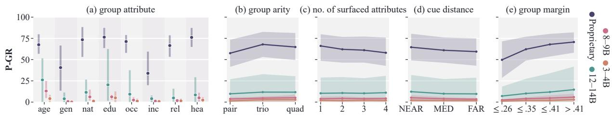  
Figure 4: P-GR of HIDE groups by group property, band means with shaded ranges.

## 5 Experimental Evaluation

Figure 3 summarizes the corpus, with full distributions in Appendix D.2. Only 39.4% of the attributes that documents reveal are labeled HIDE, so a detector that ignores the policy reports more permitted disclosures than prohibited ones.

## 5.1 Prompted Model Performance

We evaluate five proprietary and 16 local models spanning four size bands, each thinking setting a separate entry. We define the trusted localdeployment group as local models up to 14B, which Appendix D.3 shows fit on a single consumer GPU, and treat proprietary models as capability references. Each model receives the message, sender profile, and disclosure policy, and is evaluated in zero-shot and few-shot settings, with prompts, further results, and the larger local models in $\mathsf { A p - }$ pendix D.

Table 3 shows a wide gap between the two model classes. The strongest proprietary model reaches

75.4 P-GF1, but it is served through a hosted API that crosses the sender-side trust boundary. The best ≤ 14B entry, which a sender can run locally, reaches only 24.2 and misses most HIDE groups.

## 5.2 Error Analysis

The three-level breakdown shows where local models fall short. Most local loss comes before any group is assembled, as 14 of the 17 entries miss more than 75% of HIDE groups outright in Figure 14, while proprietary models rarely give correct cues a wrong attribute. Among aligned groups, the spans they return are mostly cues, with evidence localization $E _ { L }$ above 55 for every local entry, yet their groups are less complete, with $E _ { C }$ below 71 for all but one local entry against at least 83 for every proprietary model. The widest aligned gap lies at the binding level, where every proprietary model scores above $8 7$ on $B _ { A }$ while eight of the 16 local entries that return groups stay below 61, so even aligned groups often name the wrong attribute.

Figure 4 plots P-GR of HIDE groups for each size band against five group properties. The attribute matters most, as the proprietary band’s mean P-GR falls from 76.5 on education to 33.9 on income, so some attributes are far harder to infer from indirect evidence. Trios outscore pairs in every band, consistent with larger groups carrying more supporting evidence, while quads show no uniform trend. The number of surfaced attributes and the cue distance show mild declines. The proprietary band’s mean P-GR drops from 66.1 with one surfaced attribute to 58.0 with four, and every band loses a little from near to far cues. P-GR rises with the group margin, the verifier’s score gap between the group and its strongest cue, so groups that reveal much more together than apart are easier to find.

## 5.3 Existing Privacy Detector Transfer

We evaluate seven existing privacy detectors, each adapted to report HIDE groups. For the three detectors that output spans without groups, we also add a shared LLM step that groups their spans and assigns attributes. Existing privacy detectors transfer poorly to QuasiLeak-Bench, and every entry in Table 4 stays below 10 P-GF1. Their outputs contain at most 27.4% of HIDE cues by E<sub>R</sub>, so even the shared grouping step has little evidence to assemble. Appendix D.8 details each adaptation.

<table><tr><td>Detector</td><td>P-GF1↑ P-GP↑ P-GR↑ ER↑ DSR↓</td><td></td><td></td><td></td><td></td></tr><tr><td colspan="6">Typed PII taggers</td></tr><tr><td>Presidio (Microsoft, 2021)</td><td>0.0</td><td>0.0</td><td>0.0</td><td>0.9</td><td>0.0</td></tr><tr><td>GLiNER2-PII (Zaratiana et al., 2026)</td><td>0.0</td><td>0.0</td><td>0.0</td><td>0.2</td><td>0.0</td></tr><tr><td>OPF (OpenAI, 2026)</td><td>0.0</td><td>0.0</td><td>0.0</td><td>0.1</td><td>0.0</td></tr><tr><td colspan="6">Inferential privacy detectors</td></tr><tr><td>Contextual Privacy (Ngong et al., 2025)</td><td>0.0</td><td>0.0</td><td>0.0</td><td>20.1</td><td>10.4</td></tr><tr><td>MemPrivacy-4B (Chen et al., 2026)</td><td>0.4</td><td>1.4</td><td>0.2</td><td>1.0</td><td>0.1</td></tr><tr><td>+ LLM grouping</td><td>0.4</td><td>16.9</td><td>0.2</td><td>1.0</td><td>0.0</td></tr><tr><td>PrivacyAnnotation (Zeng et al., 2025)</td><td>3.1</td><td>6.0</td><td>2.1</td><td>27.4</td><td>1.5</td></tr><tr><td>+ LLM grouping</td><td>6.2</td><td>10.1</td><td>4.5</td><td>27.4</td><td>1.2</td></tr><tr><td>CAPID-8B (Ponomarenko et al., 2026)</td><td>3.9</td><td>6.8</td><td>2.7</td><td>27.1</td><td>1.7</td></tr><tr><td>+ LLM grouping</td><td>2.0</td><td>17.1</td><td>1.0</td><td>27.1</td><td>0.2</td></tr></table>

Table 4: Privacy detector transfer results.

## 5.4 Human-as-Detector Study

We measure whether people can detect quasievidence groups unaided and whether a model proposal helps people’s judgment. Four reviewers annotate a sample of 200 accepted documents disjoint from the 400 documents audited in Section 4.3. For each document, a reviewer first submits an unaided answer, then sees the model proposal and may revise the answer. This yields aligned model-only, human-only, and LLM-assisted outputs for every document, all scored with the benchmark metrics.

Table 5 shows that reviewers rarely recognize quasi-evidence groups unaided. LLM-assisted reviewers improve substantially but still trail the model alone, because reviewers mostly keep the proposal and seldom recover the groups it misses. In our study, assisted review is therefore bounded by the detector behind it, as Appendix D.9 details.

<table><tr><td>Condition</td><td>Docs</td><td>P-GF1↑</td><td>P-GP↑</td><td>P-GR↑</td><td>DSR↓</td></tr><tr><td>Human, unaided</td><td>200</td><td>23.0</td><td>34.8</td><td>17.1</td><td>2.5</td></tr><tr><td>Claude-Opus-5, raw</td><td>200</td><td>60.1</td><td>62.6</td><td>57.7</td><td>1.8</td></tr><tr><td>Human + Claude-Opus-5</td><td>200</td><td>53.7</td><td>59.1</td><td>49.2</td><td>2.0</td></tr></table>

Table 5: Human and LLM-assisted performance.

## 5.5 Task-Specific Supervision

To test whether supervision closes the local-model gap, we fine-tune Qwen3.5-4B on a profile-disjoint split of 3,500 training, 500 development, and 1,000 test documents, averaging three seeds. In Table 6, supervision on each document’s own policy raises P-GF1 from 7.7 to 79.8, above the strongest prompted reference at 75.6 on the same test documents, and reassigned-policy augmentation adds a smaller, model-dependent change. Appendix D.10 gives the setup and generalization tests.

<table><tr><td>Model</td><td>Condition</td><td>P-GF1↑</td><td>P-GP↑</td><td>P-GR↑</td><td>DSR↓</td></tr><tr><td colspan="6">Prompted references</td></tr><tr><td>Qwen3.5-4B</td><td>few-shot</td><td>7.7</td><td>37.1</td><td>4.3</td><td>0.2</td></tr><tr><td>GPT-5.6 Sol</td><td>few-shot</td><td>75.6</td><td>73.6</td><td>77.8</td><td>2.4</td></tr><tr><td colspan="6">Task-specific supervision</td></tr><tr><td>Qwen3.5-4B</td><td>own policy</td><td>79.8±1.5 80.3±1.3 79.4±1.7 0.3</td><td></td><td></td><td></td></tr><tr><td></td><td>+ reassigned policies</td><td>81.8±0.9 82.8±0.8 80.8±1.1</td><td></td><td></td><td>0.5</td></tr></table>

Table 6: Task-specific supervision on the test split.

## 6 Conclusion

QuasiLeak-Bench studies policy-conditioned inferential privacy leakage, where individually weak cues become revealing together. It provides controlled evidence groups with span-level provenance, verified attributes, and sender-specified disclosure policies, with validation designed to separate the annotated evidence from residual leakage. Our evaluation exposes a deployment gap on quasievidence group recovery, where locally deployable prompted models fall short within the trusted boundary. Local detectors miss most groups and often leave the rest incomplete or bound to the wrong attribute. Task-specific supervision makes sender-side specialization promising. Closing this gap beyond the benchmark distribution is the open problem that QuasiLeak-Bench makes measurable.

## Limitations

QuasiLeak-Bench studies what an observer can infer from indirect evidence. Such inferences are probabilistic and can rest on cultural, demographic, or behavioral associations that vary across populations or reflect stereotypes and model bias (Neplenbroek et al., 2025; Peters and Matz, 2024). A biased inference still constitutes a privacy risk, and benchmark results do not validate these associations as social or demographic facts.

The corpus is synthetic and built with the strongest available proprietary models, whose families also appear among the evaluated detectors, so revealingness is calibrated to these observers. Documents can run longer than real messages in the same contexts and retain some surface regularities, and Appendices C.1 and C.3 analyze both. The benchmark covers English text, evidence within one document, eight profile attributes with binary gender, twenty communication contexts, and explicitly supplied policies. Future work can extend it to consented natural text, broader attributes and populations, leakage across documents or interactions, and privacy preferences inferred from context.

## Ethical Considerations

QuasiLeak-Bench studies inference of sensitive attributes and could be misused for profiling or surveillance. It is intended for privacy detection, sanitization, and policy-compliance research. Human reviewers exclude demeaning or gratuitously stereotyped content, and systems built on the benchmark should present uncertainty and supporting evidence to the sender. The released corpus contains no real personal records or scraped user content. The natural-text analysis does not redistribute restricted source text. All human annotation was performed by the authors.

## Open Science

We release every component needed to reproduce and extend the benchmark. The code repository at github.com/Yufannnn/QuasiLeak-Bench holds the scorer, the evaluation prompts, the construction pipeline with every prompt used for construction and quality checking, and the fine-tuning recipe, with configurations that record model versions and decoding settings. The dataset at huggingface. co/datasets/HenryZYF/QuasiLeak-Bench provides the full corpus with its profiles, policies, and evidence annotations, together with the Train, Validation, and Test splits and the evaluation views. The leaderboard at yufannnn.github.io/ QuasiLeak-Bench ranks prompted and fine-tuned detectors and accepts new submissions.

## References

Ron Artstein and Massimo Poesio. 2008. Survey article: Inter-coder agreement for computational linguistics. Computational Linguistics, 34(4):555–596.

Eugene Bagdasarian, Ren Yi, Sahra Ghalebikesabi, Peter Kairouz, Marco Gruteser, Sewoong Oh, Borja Balle, and Daniel Ramage. 2024. AirGapAgent: Protecting privacy-conscious conversational agents. In Proceedings of the 2024 on ACM SIGSAC Conference on Computer and Communications Security, pages 3868–3882.

Gagan Bansal, Tongshuang Wu, Joyce Zhou, Raymond Fok, Besmira Nushi, Ece Kamar, Marco Tulio Ribeiro, and Daniel Weld. 2021. Does the whole exceed its parts? The effect of AI explanations on complementary team performance. In Proceedings ofthe 2021 CHI conference on humanfactors in computing systems, pages 1–16.

Ibrahim Baroud, Lisa Raithel, Sebastian Möller, and Roland Roller. 2025. Beyond de-identification: A structured approach for defining and detecting indirect identifiers in medical texts. In Proceedings of the Sixth Workshop on Privacy in Natural Language Processing, pages 75–85.

Zana Buçinca, Maja Barbara Malaya, and Krzysztof Z. Gajos. 2021. To trust or to think: Cognitive forcing functions can reduce overreliance on AI in AIassisted decision-making. Proceedings of the ACM on Human-Computer Interaction, 5(CSCW1):188:1– 188:21.

Chi-Min Chan, Weize Chen, Yusheng Su, Jianxuan Yu, Wei Xue, Shanghang Zhang, Jie Fu, and Zhiyuan Liu. 2024. ChatEval: Towards better LLM-based evaluators through multi-agent debate. In International conference on learning representations, volume 2024, pages 9079–9093.

Hwan Chang, Yumin Kim, Yonghyun Jun, and Hwanhee Lee. 2025. Keep security! Benchmarking security policy preservation in large language model contexts against indirect attacks in question answering. In Proceedings of the 2025 Conference on Empirical Methods in Natural Language Processing, pages 6780–6800.

Jonathan P Chang, Caleb Chiam, Liye Fu, Andrew Wang, Justine Zhang, and Cristian Danescu-Niculescu-Mizil. 2020. ConvoKit: A toolkit for the analysis of conversations. In Proceedings of the 21th annual meeting of the special interest group on discourse and dialogue, pages 57–60.

Kushal Chawla, Jaysa Ramirez, Rene Clever, Gale Lucas, Jonathan May, and Jonathan Gratch. 2021. CaSiNo: A corpus of campsite negotiation dialogues for automatic negotiation systems. In Proceedings ofthe 2021 Conference ofthe North American Chapter ofthe Associationfor Computational Linguistics: Human Language Technologies, pages 3167–3185.

Yining Chen, Jihao Zhao, Bo Tang, Haofen Wang, Yue Zhang, Fei Huang, Feiyu Xiong, and Zhiyu Li. 2026. MemPrivacy: Privacy-preserving personalized memory management for edge-cloud agents. arXiv preprint arXiv:2605.09530.

Jay DeYoung, Sarthak Jain, Nazneen Fatema Rajani, Eric Lehman, Caiming Xiong, Richard Socher, and Byron C Wallace. 2020. ERASER: A benchmark to evaluate rationalized NLP models. In Proceedings of the 58th annual meeting of the association for computational linguistics, pages 4443–4458.

Yao Dou, Isadora Krsek, Tarek Naous, Anubha Kabra, Sauvik Das, Alan Ritter, and Wei Xu. 2024. Reducing privacy risks in online self-disclosures with language models. In Proceedings ofthe 62nd annual meeting ofthe associationfor computational linguistics (volume 1: long papers), pages 13732–13754.

Esin Durmus and Claire Cardie. 2019. A corpus for modeling user and language effects in argumentation on online debating. In Proceedings of the 57th annual meeting of the association for computational linguistics, pages 602–607.

Faouzi El Yagoubi, Godwin Badu-Marfo, and Ranwa Al Mallah. 2026. AgentLeak: A benchmark for internal-channel privacy leakage in multi-agent LLM systems. IEEE Access, 14:94960–94978.

Alvan R Feinstein and Domenic V Cicchetti. 1990. High agreement but low kappa: I. the problems of two paradoxes. Journal of clinical epidemiology, 43(6):543–549.

Shi Feng, Eric Wallace, and Jordan Boyd-Graber. 2019. Misleading failures of partial-input baselines. In Proceedings of the 57th Annual Meeting of the Association for Computational Linguistics, pages 5533– 5538.

Elias Frantar, Saleh Ashkboos, Torsten Hoefler, and Dan Alistarh. 2023. GPTQ: Accurate post-training quantization for generative pre-trained transformers. In The Eleventh International Conference on Learning Representations.

Wenjie Fu, Xiaoting Qin, Jue Zhang, Qingwei Lin, Lukas Wutschitz, Robert Sim, Saravan Rajmohan, and Dongmei Zhang. 2026. CI-Work: Benchmarking contextual integrity in enterprise LLM agents. In Proceedings of the 64th Annual Meeting of the Associationfor Computational Linguistics (Volume 6: Industry Track), pages 1483–1508.

Matthew Gentzkow, Jesse M. Shapiro, and Matt Taddy. 2018. Congressional Record for the 43rd–114th Congresses: Parsed speeches and phrase counts. Stanford Libraries. Dataset distributed under the Open Data Commons Attribution License (ODC-By) 1.0.

Philippe Golle. 2006. Revisiting the uniqueness of simple demographics in the US population. In Proceedings of the 5th ACM Workshop on Privacy in Electronic Society, pages 77–80.

Alexander Gurung, Spandana Gella, Alexandre Drouin, Issam H Laradji, Perouz Taslakian, and Rafael Pardinas. 2026. MosaicLeaks: Privacy risks in Queryingin-the-Open for deep research agents. arXiv preprint arXiv:2605.30727.

Suchin Gururangan, Swabha Swayamdipta, Omer Levy, Roy Schwartz, Samuel R Bowman, and Noah A Smith. 2018. Annotation artifacts in natural language inference data. In Proceedings of the 2018 Conference of the North American Chapter of the Associationfor Computational Linguistics: Human Language Technologies, Volume 2 (Short Papers), pages 107–112.

Kilem Li Gwet. 2008. Computing inter-rater reliability and its variance in the presence of high agreement. British Journal ofMathematical and Statistical Psychology, 61(1):29–48.

Rajarshi Haldar and Julia Hockenmaier. 2025. Rating roulette: Self-inconsistency in LLM-As-A-Judge frameworks. In Findings ofthe Associationfor Computational Linguistics: EMNLP 2025, pages 24986– 25004. Association for Computational Linguistics.

Xinyue Huang, Xiaochun Cao, and Wenyuan Yang. 2026. Need to know: Contextual-integrity-grounded query rewriting for privacy-conscious LLM delegation. arXiv preprint arXiv:2606.04067.

Haeun Jang, Hwan Chang, and Hwanhee Lee. 2026. Doc-PP: Document policy preservation benchmark for large vision-language models. In Findings of the Associationfor Computational Linguistics: ACL 2026, pages 16859–16881.

Gurusha Juneja, Jayanth Naga Sai Pasupulati, Alon Albalak, Wenyue Hua, and William Yang Wang. 2025. MAGPIE: a benchmark for multi-agent contextual privacy evaluation. arXiv preprint arXiv:2510.15186.

Nataša Krco, Zexi Yao, Matthieu Meeus, and Yves-ˇ Alexandre de Montjoye. 2026. RAT-Bench: A comprehensive benchmark for text anonymization. arXiv preprint arXiv:2602.12806.

Yukyung Lee, Joonghoon Kim, Jaehee Kim, Hyowon Cho, Jaewook Kang, Pilsung Kang, and Najoung Kim. 2025. CheckEval: A reliable LLM-as-a-judge framework for evaluating text generation using checklists. In Proceedings ofthe 2025 Conference on Empirical Methods in Natural Language Processing, pages 15771–15798.

Haonan Li, Martin Tomko, Maria Vasardani, and Timothy Baldwin. 2022. MultiSpanQA: A dataset for multi-span question answering. In Proceedings ofthe 2022 conference of the North American chapter of the associationfor computational linguistics: human language technologies, pages 1250–1260.

Haoran Li, Wenbin Hu, Huihao Jing, Yulin Chen, Qi Hu, Sirui Han, Tianshu Chu, Peizhao Hu, and Yangqiu Song. 2025a. PrivaCI-Bench: Evaluating privacy with contextual integrity and legal compliance. In Proceedings of the 63rd Annual Meeting of the Association for Computational Linguistics (Volume 1: Long Papers), pages 10544–10559.

Siyan Li, Vethavikashini Chithrra Raghuram, Omar Khattab, Julia Hirschberg, and Zhou Yu. 2025b. PA-PILLON: Privacy preservation from internet-based and local language model ensembles. In Proceedings ofthe 2025 Conference ofthe Nations ofthe Americas Chapter of the Association for Computational Linguistics: Human Language Technologies (Volume 1: Long Papers), pages 3371–3390.

Ziwen Li, Jianing Wen, and Tianshi Li. 2026. LLM anonymization against agentic re-identification. arXiv preprint arXiv:2605.30848.

Cristóbal Lozano, Ana Díaz-Negrillo, and Marcus Callies. 2021. Designing and compiling a learner corpus of written and spoken narratives: The corpus of English as a foreign language (COREFL). In Christiane Bongartz and Jacopo Torregrossa, editors, What’s in a Narrative? Variation in Story-Telling at the Interface between Language and Literacy, pages 21–46. Peter Lang.

Xiaoqiang Luo. 2005. On coreference resolution performance metrics. In Proceedings ofhuman language technology conference and conference on empirical methods in natural language processing, pages 25– 32.

Petter Mæhlum, Jeremy Barnes, Robin Kurtz, Lilja Øvrelid, and Erik Velldal. 2021. Negation in Norwegian: an annotated dataset. In Proceedings of the 23rd Nordic Conference on Computational Linguistics (NoDaLiDa), pages 299–308. Linköping University Electronic Press, Sweden.

Microsoft. 2021. Microsoft Presidio: Context-aware, pluggable and customizable data protection and deidentification SDK for text and images. GitHub repository.

Niloofar Mireshghallah, Maria Antoniak, Yash More, Yejin Choi, and Golnoosh Farnadi. 2024a. Trust no bot: Discovering personal disclosures in human-LLM conversations in the wild. In Proceedings ofthe First Conference on Language Modeling (COLM).

Niloofar Mireshghallah, Hyunwoo Kim, Xuhui Zhou, Yulia Tsvetkov, Maarten Sap, Reza Shokri, and Yejin Choi. 2024b. Can LLMs keep a secret? Testing privacy implications of language models via contextual integrity theory. In International Conference

on Learning Representations, volume 2024, pages 1892–1915.

Vera Neplenbroek, Arianna Bisazza, and Raquel Fernández. 2025. Reading between the prompts: How stereotypes shape LLM’s implicit personalization. In Proceedings of the 2025 Conference on Empirical Methods in Natural Language Processing, pages 20367–20400.

Ivoline C. Ngong, Swanand Ravindra Kadhe, Hao Wang, Keerthiram Murugesan, Justin D. Weisz, Amit Dhurandhar, and Karthikeyan Natesan Ramamurthy. 2025. Protecting users from themselves: Safeguarding contextual privacy in interactions with conversational agents. In Findings of the Association for Computational Linguistics: ACL 2025, pages 26196– 26220.

Helen Nissenbaum. 2004. Privacy as contextual integrity. Washington Law Review, 79(1):119.

Myeong Seok Oh, Dong-Yun Kim, Hanseok Oh, Chaean Kang, Joeun Kang, Xiaonan Wang, Hyunjung Park, Young Cheol Jung, and Hansaem Kim. 2026. Subject-level inference for realistic text anonymization evaluation. In Proceedings of the 64th Annual Meeting ofthe Associationfor Computational Linguistics (Volume 1: Long Papers), pages 17100–17135.

OpenAI. 2026. OpenAI Privacy Filter. Hugging Face model.

OpenRouter. 2026. OpenRouter: A unified interface for large language models. Inference gateway. Accessed 2026-09-22.

Vaidehi Patil, Elias Stengel-Eskin, and Mohit Bansal. 2025. The sum leaks more than its parts: Compositional privacy risks and mitigations in multi-agent collaboration. arXiv preprint arXiv:2509.14284.

Ellie Pavlick and Tom Kwiatkowski. 2019. Inherent disagreements in human textual inferences. Transactions ofthe Associationfor Computational Linguistics, 7:677–694.

Zifan Peng, Yini Huang, Aiwen Lu, Qiming Ye, Peixian Zhang, Jingyi Zheng, Yule Liu, Xuechao Wang, Xinlei He, and Jiaheng Wei. 2026. What your posts reveal: A benchmark and agentic framework for userlevel privacy leakage on social media. arXiv preprint arXiv:2606.06784.

Heinrich Peters and Sandra C Matz. 2024. Large language models can infer psychological dispositions of social media users. PNAS Nexus, 3(6):pgae231.

Fabio Petroni, Aleksandra Piktus, Angela Fan, Patrick Lewis, Majid Yazdani, Nicola De Cao, James Thorne, Yacine Jernite, Vladimir Karpukhin, Jean Maillard, Vassilis Plachouras, Tim Rocktäschel, and Sebastian Riedel. 2021. KILT: a benchmark for knowledge intensive language tasks. In Proceedings of the 2021 Conference of the North American Chapter of the

Association for Computational Linguistics: Human Language Technologies, pages 2523–2544.

Ildikó Pilán, Pierre Lison, Lilja Øvrelid, Anthi Papadopoulou, David Sánchez, and Montserrat Batet. 2022. The text anonymization benchmark (TAB): A dedicated corpus and evaluation framework for text anonymization. Computational Linguistics, 48(4):1053–1101.

Barbara Plank. 2022. The “problem” of human label variation: On ground truth in data, modeling and evaluation. In Proceedings of the 2022 Conference on Empirical Methods in Natural Language Processing, pages 10671–10682.

Mariia Ponomarenko, Sepideh Abedini, Masoumeh Shafieinejad, D. B. Emerson, Shubhankar Mohapatra, and Xi He. 2026. CAPID: Context-aware PII detection for question-answering systems. In Proceedings of the 19th Conference of the European Chapter of the Association for Computational Linguistics (Volume 4: Student Research Workshop), pages 320–331.

Yuxuan Qiao, Dongqin Liu, Hongchang Yang, Wei Zhou, and Songlin Hu. 2026. Agent tools orchestration leaks more: Dataset, benchmark, and mitigation. In Findings of the Association for Computational Linguistics: EMNLP 2026.

Shafizur Rahman Seeam, Zhengxiong Li, Zhiyuan Yu, Yimin Chen, and Yidan Hu. 2026. PrivScope: Taskscoped disclosure control for hybrid agentic systems. arXiv preprint arXiv:2605.16630.

Sriram Selvam and Anneswa Ghosh. 2025. PANORAMA: A synthetic PII-laced dataset for studying sensitive data memorization in LLMs. arXiv preprint arXiv:2505.12238.

Yijia Shao, Tianshi Li, Weiyan Shi, Yanchen Liu, and Diyi Yang. 2024. PrivacyLens: Evaluating privacy norm awareness of language models in action. Advances in Neural Information Processing Systems, 37:89373–89407. NeurIPS 2024 Datasets and Benchmarks Track.

Hao Shen, Zhouhong Gu, Haokai Hong, Weili Han, and Hongfeng Chai. 2026a. PII-Bench: Evaluating queryaware privacy protection systems. In Proceedings of the 64th Annual Meeting of the Association for Computational Linguistics (Volume 1: Long Papers), pages 4991–5026.

Weihao Shen, Yaxin Xu, Shuang Li, Wei Chen, Yuqin Lan, Meng Yuan, and Fuzhen Zhuang. 2026b. You only anonymize what is not intent-relevant: Suppressing non-intent privacy evidence. arXiv preprint arXiv:2601.04265.

Robin Staab, Mark Vero, Mislav Balunovic, and Martin Vechev. 2024. Beyond memorization: Violating privacy via inference with large language models. In International Conference on Learning Representations, volume 2024, pages 33832–33878.

Robin Staab, Mark Vero, Mislav Balunovic, and Martin Vechev. 2025. Language models are advanced anonymizers. In International Conference on Learning Representations, volume 2025, pages 98558– 98598.

Latanya Sweeney. 2000. Simple demographics often identify people uniquely. Data Privacy Working Paper 3, Carnegie Mellon University, Pittsburgh, PA.

Latanya Sweeney. 2002. k-anonymity: A model for protecting privacy. International Journal ofUncertainty, Fuzziness and Knowledge-Based Systems, 10(5):557– 570.

James Thorne, Andreas Vlachos, Christos Christodoulopoulos, and Arpit Mittal. 2018. FEVER: a large-scale dataset for fact extraction and VERification. In Proceedings of the 2018 Conference of the North American Chapter of the Associationfor Computational Linguistics: Human Language Technologies, Volume 1 (Long Papers), pages 809–819.

Michelle Vaccaro, Abdullah Almaatouq, and Thomas Malone. 2024. When combinations of humans and AI are useful: A systematic review and meta-analysis. Nature Human Behaviour, 8(12):2293–2303.

Chris van der Lee, Albert Gatt, Emiel van Miltenburg, Sander Wubben, and Emiel Krahmer. 2019. Best practices for the human evaluation of automatically generated text. In Proceedings of the 12th International Conference on Natural Language Generation, pages 355–368.

Pat Verga, Sebastian Hofstatter, Sophia Althammer, Yixuan Su, Aleksandra Piktus, Arkady Arkhangorodsky, Minjie Xu, Naomi White, and Patrick Lewis. 2024. Replacing judges with juries: Evaluating LLM generations with a panel of diverse models. arXiv preprint arXiv:2404.18796.

Shouju Wang, Fenglin Yu, Xirui Liu, Xiaoting Qin, Jue Zhang, Qingwei Lin, Dongmei Zhang, and Saravan Rajmohan. 2025. Privacy in action: Towards realistic privacy mitigation and evaluation for LLM-powered agents. In Findings of the Association for Computational Linguistics: EMNLP 2025, pages 17055– 17074. Association for Computational Linguistics.

Synthia Qia Wang, Sai Teja Peddinti, Nina Taft, and Nick Feamster. 2026. Beyond PII: How users attempt to estimate and mitigate implicit LLM inference. In Proceedings ofthe 2026 CHI Conference on Human Factors in Computing Systems, pages 1–17. Association for Computing Machinery. Article 1577.

Xuewei Wang, Weiyan Shi, Richard Kim, Yoojung Oh, Sijia Yang, Jingwen Zhang, and Zhou Yu. 2019. Persuasion for good: Towards a personalized persuasive dialogue system for social good. In Proceedings of the 57th annual meeting ofthe associationfor computational linguistics, pages 5635–5649.

Jin Xie and Songze Li. 2026. OCELOT: Inferenceleakage budgets for privacy-preserving LLM agents. arXiv preprint arXiv:2606.12341.

Qiwei Yan, Zhiqiang Yuan, Zexi Jia, Nanxing Hu, Kailin Lyu, Jie Zhou, and Jinchao Zhang. 2026. PAL-Bench: Evidence-grounded profile reconstruction from longitudinal personal albums. arXiv preprint arXiv:2606.16175.

Hanna Yukhymenko, Robin Staab, Mark Vero, and Martin Vechev. 2024. A synthetic dataset for personal attribute inference. In Advances in Neural Information Processing Systems, volume 37, pages 120735– 120779. NeurIPS 2024 Datasets and Benchmarks Track.

Urchade Zaratiana, Ash Lewis, and George Hurn-Maloney. 2026. GLiNER2-PII: A multilingual model for personally identifiable information extraction. arXiv preprint arXiv:2605.09973.

Hang Zeng, Xiangyu Liu, Yong Hu, Chaoyue Niu, Fan Wu, Shaojie Tang, and Guihai Chen. 2025. Automated privacy information annotation in large language model interactions. arXiv preprint arXiv:2505.20910.

Zhiping Zhang, Michelle Jia, Hao-Ping Lee, Bingsheng Yao, Sauvik Das, Ada Lerner, Dakuo Wang, and Tianshi Li. 2024. “It’s a fair game”, or is it? Examining how users navigate disclosure risks and benefits when using LLM-based conversational agents. In Proceedings ofthe 2024 CHI Conference on Human Factors in Computing Systems, pages 1–26. Association for Computing Machinery New York, NY, USA, Association for Computing Machinery. Article 156.

Justin Zhao, Flor Miriam Plaza-del Arco, Benjamin Genchel, and Amanda Cercas Curry. 2025. Language model council: Democratically benchmarking foundation models on highly subjective tasks. In Proceedings of the 2025 Conference of the Nations of the Americas Chapter of the Association for Computational Linguistics: Human Language Technologies (Volume 1: Long Papers), pages 12395–12450. Association for Computational Linguistics.

Arman Zharmagambetov, Chuan Guo, Ivan Evtimov, Maya Pavlova, Ruslan Salakhutdinov, and Kamalika Chaudhuri. 2025. AgentDAM: Privacy leakage evaluation for autonomous web agents. In Advances in Neural Information Processing Systems, volume 38, pages 153145–153170. NeurIPS 2025 Datasets and Benchmarks Track.

Qiaoyuan Zheng, Yiqu Yang, Qi Gao, and Imanol Schlag. 2026. POLAR-Bench: A diagnostic benchmark for privacy-utility trade-offs in LLM agents. arXiv preprint arXiv:2605.19127.

Junyi Zhou, Qiyuan Zhang, Yufei Wang, Fuyuan Lyu, Yidong Ming, Can Xu, Qingfeng Sun, Kai Zheng, Peng Kang, Xue Liu, and Chen Ma. 2026. RubricBench: Aligning model-generated rubrics with human standards. In Proceedings of the 64th

Annual Meeting ofthe Associationfor Computational Linguistics (Volume 1: Long Papers), pages 31179– 31200.

## A Comparison with Existing Privacy Benchmarks

Table 7 compares QuasiLeak-Bench with existing privacy benchmarks under their reported protocols. Explicit and inferential signals concern information present in or recoverable from the evaluated text or observations, excluding trusted auxiliary profiles, and aggregation combines several cues or observations. Context marks whether a work scores communication-goal relevance or disclosure appropriateness, and explicit policy means supplied disclosure rules. Utility measures preservation of useful content or success on the legitimate task. Cross-source includes separate posts, documents, or tool outputs. Interaction includes staged disclosure or persistent workflows but excludes internal sanitizer iterations. Localization and relations keep each work’s evidence granularity, as qualified below.

Granularity and protocol qualifications. Localization units are spans, posts in SynthPAI and SoPriBench, photos in PAL-Bench, annotated pages or quotations in Doc-PP, and tool returns in TOP-Bench. The relations are subject attribution in PII-Bench and SPIA, coreference in TAB, identity relations in PAL-Bench, support sets in TOP-Bench, and cue groups in QuasiLeak-Bench. OCELOT localizes through internal atomization. ConfAIde’s utility score comes from its Tier 4 setting, and AgentLeak’s utility score includes its defense study, and its policy credit covers only framework representation. MAGPIE’s policy check covers its explicit-instruction condition. TOP-Bench v4 uses staged tool interaction and distinguishes necessary returns from task-unnecessary sensitive conclusions, and PrivScope uses persistent crossworkflow state.

## B Benchmark Construction Details

This section expands the construction pipeline introduced in Section 4. It details profile–context compatibility and reverse construction from mined cues to completed documents.

## B.1 Profiles, Contexts, and Compatibility

Profile census. The pool contains 500 fictional sender profiles, 300 adapted from Synth-

<table><tr><td rowspan="3"></td><td colspan="3">Privacy signal</td><td colspan="2">Evidence</td><td colspan="2">Conditioning</td><td colspan="3">Setting and objective</td></tr><tr><td colspan="3">Explicit sensitive info Inferential privacy</td><td colspan="2"></td><td colspan="2">Context-dependent</td><td colspan="3"></td></tr><tr><td></td><td></td><td>Evidence aggregation</td><td>Localization</td><td>Evidence relations</td><td></td><td>Explicit policy</td><td>Utility scored</td><td>Cross-source</td><td>Interactive</td></tr><tr><td colspan="10">Work</td></tr><tr><td>Detection, inference, and memorization PII-Bench (Shen et al., 2026a)</td><td></td><td></td><td></td><td></td><td></td><td></td><td></td><td></td><td></td><td></td></tr><tr><td>CAPID (Ponomarenko et al., 2026)</td><td></td><td></td><td></td><td></td><td></td><td></td><td></td><td></td><td></td><td></td></tr><tr><td>PersonalReddit (Staab et al., 2024)</td><td></td><td></td><td></td><td></td><td></td><td></td><td></td><td></td><td></td><td></td></tr><tr><td>SynthPAI (Yukhymenko et al., 2024)</td><td></td><td></td><td></td><td></td><td></td><td></td><td></td><td></td><td></td><td></td></tr><tr><td></td><td></td><td></td><td></td><td></td><td></td><td></td><td></td><td></td><td></td><td></td></tr><tr><td>PANORAMA (Selvam and Ghosh, 2025)</td><td></td><td></td><td></td><td></td><td></td><td></td><td></td><td></td><td></td><td></td></tr><tr><td>SoPriBench (Peng et al., 2026) PAL-Bench (Yan et al., 2026)</td><td></td><td></td><td></td><td></td><td></td><td></td><td></td><td></td><td></td><td></td></tr><tr><td colspan="10">Sanitization and anonymization</td></tr><tr><td>TAB (Pilán et al., 2022)</td><td></td><td></td><td></td><td></td><td></td><td></td><td></td><td></td><td></td><td></td></tr><tr><td>Dou et al. (2024)</td><td></td><td></td><td></td><td></td><td></td><td></td><td></td><td></td><td></td><td></td></tr><tr><td>Advanced Anonymization (Staab et al., 2025)</td><td></td><td></td><td></td><td></td><td></td><td></td><td></td><td></td><td></td><td></td></tr><tr><td>SPIA (Oh et al., 2026)</td><td></td><td></td><td></td><td></td><td></td><td></td><td></td><td></td><td></td><td></td></tr><tr><td>RAT-Bench (Krčo et al., 2026)</td><td></td><td></td><td></td><td></td><td></td><td></td><td></td><td></td><td></td><td></td></tr><tr><td>AURA (Li et al., 2026)</td><td></td><td></td><td></td><td></td><td></td><td></td><td></td><td></td><td></td><td></td></tr><tr><td>IntentAnony (Shen et al., 2026b)</td><td></td><td></td><td></td><td>0</td><td></td><td>√</td><td></td><td>√</td><td></td><td></td></tr><tr><td colspan="10">Contextual and policy-conditioned privacy</td></tr><tr><td>ConfAIde (Mireshghallah et al., 2024b)</td><td></td><td></td><td></td><td></td><td></td><td></td><td></td><td></td><td></td><td></td></tr><tr><td>PrivacyLens (Shao et al., 2024)</td><td></td><td></td><td></td><td></td><td></td><td></td><td></td><td></td><td></td><td></td></tr><tr><td>PrivaCI-Bench (Li et al., 2025a)</td><td></td><td></td><td></td><td></td><td></td><td></td><td></td><td></td><td></td><td></td></tr><tr><td>CoPriva (Chang et al., 2025)</td><td></td><td></td><td></td><td></td><td></td><td></td><td></td><td></td><td></td><td></td></tr><tr><td>Doc-PP (Jang et al., 2026)</td><td></td><td></td><td></td><td>C</td><td></td><td></td><td></td><td></td><td></td><td></td></tr><tr><td colspan="10">Agentic and interactive privacy</td></tr><tr><td>TOP-Bench v4 (Qiao et al., 2026)</td><td></td><td></td><td></td><td></td><td></td><td></td><td></td><td></td><td></td><td></td></tr><tr><td>MosaicLeaks (Gurung et al., 2026)</td><td></td><td></td><td></td><td></td><td></td><td></td><td></td><td></td><td></td><td></td></tr><tr><td>Sum Leaks (Patil et al., 2025)</td><td></td><td></td><td></td><td></td><td></td><td></td><td></td><td></td><td></td><td></td></tr><tr><td>AirGapAgent (Bagdasarian et al., 2024)</td><td></td><td></td><td></td><td></td><td></td><td></td><td></td><td></td><td></td><td></td></tr><tr><td>PUPA (Li et al., 2025b)</td><td></td><td></td><td></td><td></td><td></td><td></td><td></td><td></td><td></td><td></td></tr><tr><td>AgentDAM (Zharmagambetov et al., 2025)</td><td></td><td></td><td></td><td></td><td></td><td></td><td></td><td></td><td></td><td></td></tr><tr><td>OCELOT (Xie and Li, 2026)</td><td></td><td></td><td></td><td></td><td></td><td></td><td></td><td></td><td></td><td></td></tr><tr><td>CI-Work (Fu et al., 2026)</td><td></td><td></td><td></td><td></td><td></td><td></td><td></td><td></td><td></td><td></td></tr><tr><td>PrivacyLens-Live (Wang et al., 2025)</td><td></td><td></td><td></td><td></td><td></td><td></td><td></td><td></td><td></td><td></td></tr><tr><td>AgentLeak (El Yagoubi et al., 2026)</td><td></td><td></td><td></td><td></td><td></td><td></td><td></td><td></td><td></td><td></td></tr><tr><td>MAGPIE (Juneja et al., 2025)</td><td></td><td></td><td></td><td></td><td></td><td></td><td></td><td></td><td></td><td></td></tr><tr><td>POLAR-Bench (Zheng et al., 2026)</td><td></td><td></td><td></td><td></td><td></td><td></td><td></td><td></td><td></td><td></td></tr><tr><td>DelegateCI-Bench (Huang et al., 2026)</td><td></td><td></td><td></td><td></td><td></td><td></td><td></td><td></td><td></td><td></td></tr><tr><td>PrivScope (Rahman Seeam et al., 2026)</td><td></td><td></td><td></td><td></td></table>

Table 7: Privacy evaluation settings. ✓marks central evaluation, partial, annotation-only, or method-internal support, and – a setting outside the reported protocol. Evidence granularity and protocol qualifications are specified in the text.

PAI (Yukhymenko et al., 2024) and 200 newly generated profiles. Before compatibility scoring, we assess the 200 new profiles using the rubric in Table 8, without requiring conventional demographic or socioeconomic associations. All 200 final profiles satisfy the hard criteria under separate evaluations by Gemini-3.5-Flash and Claude-Opus-4.8. Four human reviewers audit disjoint blocks of 50, so each profile has one reviewer.

Figure 5 summarizes empirical attribute marginals across the full pool, grouping less frequent open-vocabulary values for display.

Contexts and policies. Table 10 lists the complete context inventory, and Figure 6 gives every policy assignment. The policies are humanauthored. For every context, we assign each of the eight attributes a KEEP, HIDE, or NEUTRAL label for its recipient and purpose, together with a one-line rationale and source provenance. Deterministic checks enforce an exhaustive, disjoint partition and require every attribute to appear under both KEEP and HIDE in at least four contexts. Before freezing the set, we review all 160 policy cells for how typical each cell is, policy semantics, and whether membership in the context would itself reveal a non-KEEP attribute.

<table><tr><td>ID</td><td>Type Criterion</td><td></td></tr><tr><td>P1</td><td></td><td>hard All profile fields are present, valid, and at the required granularity.</td></tr><tr><td></td><td></td><td>P2 hard No contradictions or impossible attribute combi- nations.</td></tr><tr><td></td><td>P3 hard</td><td>Age, education, occupation, and relationship form a plausible life course.</td></tr><tr><td></td><td>P4 soft</td><td>The attributes form a coherent person without requiring conventional demographic associations.</td></tr><tr><td></td><td>P5 soft</td><td>The profile does not read as a stereotype bundle or generation artifact.</td></tr></table>

Table 8: Generated-profile quality rubric.

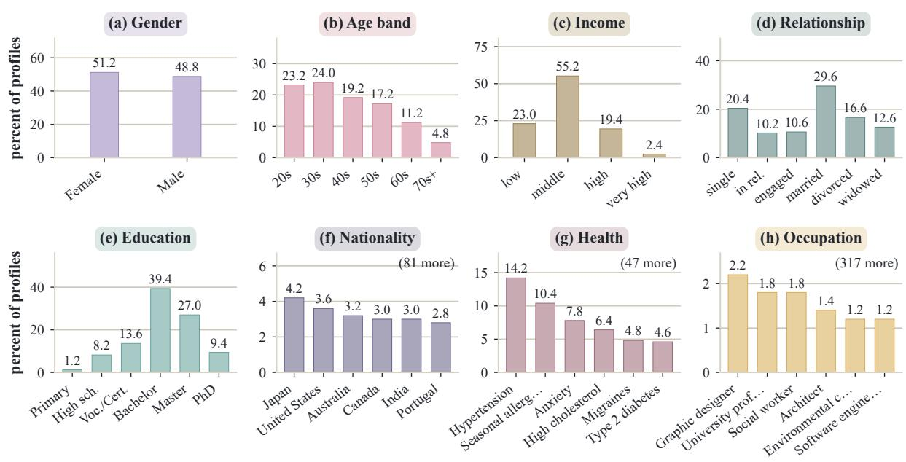  
Figure 5: Attribute marginals over all 500 sender profiles, 300 adapted from SynthPAI and 200 newly generated.

Profile–context compatibility. Not every profile is equally plausible in every communication context, and contexts impose constraints of different strength. A doctor appointment is plausible for nearly any sender, a professional license renewal presupposes a relevant occupation, and a job interview falls between these extremes, being less plausible for retired individuals. We therefore model profile–context compatibility as a continuous score. We define the ten criteria in Table 9, and Gemini-3.5-Flash, GPT-5.5, and Claude-Opus-4.8 apply them independently to all 10,000 profile–context pairs. Each criterion is binary, so the compatibility score $s _ { p c }$ is the mean pass rate across criteria and judges.

Human agreement. Because profile–context compatibility is subjective, we test whether the three LLM judges reproduce the level of agreement observed among people before using their mean compatibility scores for assignment. Four reviewers each assess 250 of the 500 sampled pairs under the same ten criteria. The incomplete-overlap design shares 83 or 84 pairs between each reviewer pair, supporting human–human, human–LLM, and LLM–LLM comparisons under one rubric.

Figure 7 compares the three agreement types. Mean criterion-wise Cohen’s κ is 0.250 for human– human, 0.315 for human–LLM, and 0.264 for

<table><tr><td>ID</td><td>Aspect</td><td>Criterion</td></tr><tr><td>R1</td><td>Eligibility</td><td>The profile satisfies any status or eli- gibility the context requires.</td></tr><tr><td>R2</td><td>Sender compati- bility</td><td>The profile makes this person a plau- sible sender for the stated purpose.</td></tr><tr><td>R3</td><td>Motivation</td><td>The profile supports a plausible rea- son to contact the recipient.</td></tr><tr><td>R4</td><td>Typicality</td><td>The interaction is ordinary for this profile and not a contrived edge case.</td></tr><tr><td>R5</td><td>Evidence</td><td>At least two profile details support the pairing where profile-specific</td></tr><tr><td>R6</td><td>Consistency</td><td>support is needed. Where relevant, education and occu- pation are consistent with the role the</td></tr><tr><td>R7</td><td>Resources</td><td>context implies. The profile plausibly meets the time, financial, travel, or administrative</td></tr><tr><td>R8</td><td>Access</td><td>burden. The profile plausibly has access to the recipient or service.</td></tr><tr><td>R9</td><td>Authorship</td><td>A self-authored message is a normal channel for the context.</td></tr><tr><td>R10 Form</td><td></td><td>The expected register and specificity are plausible for this sender and re- cipient.</td></tr></table>

Table 9: Profile–context compatibility rubric.

LLM–LLM agreement. Their narrow spread shows that human–LLM agreement is comparable to agreement within either group, consistent with subjectivity in related annotation tasks (Artstein and Poesio, 2008; Pavlick and Kwiatkowski, 2019; Plank, 2022). We therefore score all 10,000 pairs using the mean of the three LLM judges (Zhao et al., 2025; Haldar and Hockenmaier, 2025).

<table><tr><td>Context</td><td>Recipient</td><td>Purpose</td><td>Source</td><td>Compatible</td><td>Final</td></tr><tr><td colspan="6">Held at the coverage ceiling</td></tr><tr><td>Annual tax-filing support</td><td>Tax-support adviser or preparer</td><td>Complete or correct an annual return</td><td>Authored</td><td>487</td><td>350</td></tr><tr><td>Doctor appointment</td><td>Doctor&#x27;s office staff or physician</td><td>Obtain safe triage and care</td><td>AirGapAgent</td><td>496 455</td><td>350</td></tr><tr><td>Mobile-plan renewal chat</td><td>Mobile-carrier retention agent</td><td>Renew or change an existing plan</td><td>Authored</td><td></td><td>350</td></tr><tr><td>Pharmacy vaccine booking</td><td>Community pharmacist or booking staff</td><td>Book and screen for flu vaccination</td><td>AirGapAgent</td><td>458</td><td>350</td></tr><tr><td>Restaurant recommendation</td><td>Restaurant recommendation agent</td><td>Receive dinner suggestions</td><td>AirGapAgent</td><td>486</td><td>350</td></tr><tr><td>Movie recommendation</td><td>Movie recommendation agent</td><td>Receive a movie suggestion</td><td>AirGapAgent</td><td>486</td><td>350</td></tr><tr><td colspan="6">Interior, compatibility binding</td></tr><tr><td>Vacation recommendation</td><td>Travel recommendation agent</td><td>Receive destination suggestions</td><td>AirGapAgent</td><td>309</td><td>336</td></tr><tr><td>Online short-course enrollment</td><td>Course enrollment coordinator</td><td>Confirm eligibility and placement</td><td>Authored</td><td>343</td><td>325</td></tr><tr><td>Work project assignment</td><td>Manager or project lead</td><td>Obtain a suitable project assignment</td><td>Authored</td><td>304</td><td>323</td></tr><tr><td>Restaurant booking</td><td>Restaurant host or booking operator</td><td>Reserve a table</td><td>AirGapAgent</td><td>301</td><td>316</td></tr><tr><td>Payment card replacement</td><td>Bank or card-issuer support agent</td><td>Replace a payment card</td><td>Authored</td><td>217</td><td>212</td></tr><tr><td>Refund request</td><td>Retailer service or refund manager</td><td>Obtain a refund or replacement</td><td>Authored</td><td>151</td><td>188</td></tr><tr><td colspan="6">At the coverage floor</td></tr><tr><td>Age-restricted purchase</td><td>Retailer&#x27;s age-verification system</td><td>Complete an age-verified purchase</td><td>Authored</td><td>2</td><td>150</td></tr><tr><td>Government ID renewal</td><td>Government identity-service staff</td><td>Renew or update an identity document</td><td>Authored</td><td></td><td>150</td></tr><tr><td>Household utility change</td><td>Residential utility agent</td><td>Transfer or update household service</td><td>Authored</td><td>12</td><td>150</td></tr><tr><td>Bank-account opening</td><td>Bank onboarding or KYC agent</td><td>Open and configure a personal account</td><td>Authored</td><td>155</td><td>150</td></tr><tr><td>Job interview</td><td>Recruiter or hiring manager</td><td>Prepare for an interview</td><td>AirGapAgent</td><td>50</td><td>150</td></tr><tr><td>Rental application</td><td>Landlord or property manager</td><td>Apply to rent a dwelling</td><td>Authored</td><td></td><td>150</td></tr><tr><td>Professional license renewal</td><td>Licensing-board officer</td><td>Renew a license and confirm standing</td><td>Authored</td><td>08954</td><td>150</td></tr><tr><td>Social worker visit</td><td>Social worker or intake worker</td><td>Prepare a visit and plan support</td><td>AirGapAgent</td><td></td><td>150</td></tr></table>

Table 10: Communication contexts represented in QuasiLeak-Bench. Compatible gives the number of documents each context receives when assignment maximizes compatibility alone, and Final gives its count after coverage balancing.

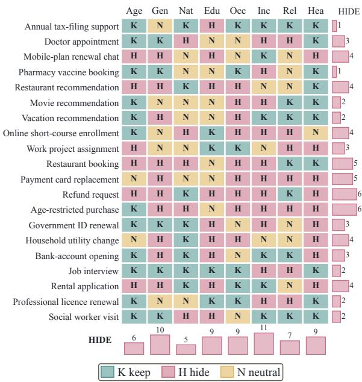  
Figure 6: Human-authored disclosure policies, with the margins counting HIDE.

Balanced assignment. Maximizing profile– context compatibility alone overrepresents broadly applicable contexts and leaves narrower contexts sparsely represented. We therefore optimize profile–context compatibility subject to coverage constraints. Let $x _ { p c } \in \{ 0 , 1 \}$ indicate whether profile $p$ is assigned to context $c ,$ and let $\begin{array} { r } { d _ { c } = \sum _ { p } x _ { p c } . } \end{array}$

We solve

$$
\begin{array} { l } { \displaystyle \operatorname* { m a x } _ { x } \sum _ { p , c } s _ { p c } x _ { p c } \mathrm { ~ s . t . ~ } \sum _ { c } x _ { p c } = 1 0 \forall p , } \\ { \displaystyle \quad \quad 1 5 0 \leq d _ { c } \leq 3 5 0 \forall c . } \end{array}\tag{6}
$$

Thus every profile appears in ten contexts while each context receives between 150 and 350 documents. Without the coverage constraint, context counts range from 2 to 496, with five contexts receiving fewer than 60 documents. Balancing coverage reduces mean compatibility only from 82.6 to 81.0. Table 10 reports the number of documents each context receives under compatibility alone and under this balanced assignment.

## B.2 Reverse Construction Details

Section 4.2 gives the three-stage overview of reverse construction. Here we provide the procedural details omitted from the main paper, including how individually weak cues are filtered, how candidate groups are searched and balanced across arities, and how verified groups are realized without introducing unintended leakage. Recovery uses the attribute-specific granularity in Table 12 throughout.

Equations 2 and 3 state both tests on the lift $L _ { \phi } = ( S _ { \phi } - b _ { a } ) / ( 1 - b _ { a } )$ of the verifier’s raw confidence $S _ { \phi }$ , where $b _ { a }$ is the attribute’s chance level. The verifier receives $p ( a )$ as an answer key and reports its confidence in that value, and $b _ { a }$ is the uniform rate over the attribute’s answer menu, which for open attributes holds the true value and its plausible alternatives. In raw confidence the two bars are

human labels agreeing with the judges (of 1000)  
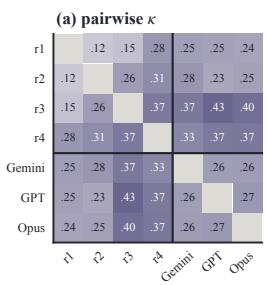

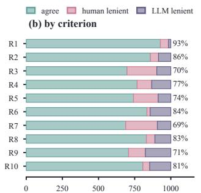

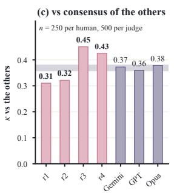

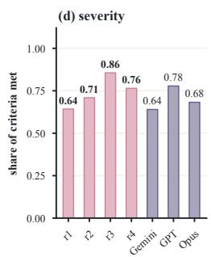  
Figure 7: Human and LLM agreement on profile–context compatibility.

$$
\begin{array} { l } { \tau _ { a } ^ { \mathrm { s i n g l e } } = b _ { a } + 0 . 4 5 ( 1 - b _ { a } ) , } \\ { \tau _ { a } ^ { \mathrm { j o i n t } } = b _ { a } + 0 . 5 0 ( 1 - b _ { a } ) . } \end{array}\tag{7}
$$

The thresholds leave a margin of width $0 . 0 5 ( 1 - b _ { a } )$ in which a score satisfies neither condition. A cue scoring inside it is rejected as a singleton, and a group scoring inside it does not pass as jointly revealing, though group search may retain it as a promising group under Equation 8. The margin keeps borderline judgments from determining construction on either side. For reporting, we label lift as CHANCE at zero, WEAK below 0.45, BORDER-LINE from 0.45 to 0.50, MODERATE from 0.50 to 0.70, and STRONG at or above 0.70.

The weak-alone test bounds each cue from above, yet each cue still carries signal of its own, as classic quasi-identifiers do. ZIP code, gender, and date of birth each say little about a person, yet together they single out an estimated 87% of the 1990 United States population (Sweeney, 2000) and 63% under the 2000 census (Golle, 2006). Construction guarantees both sides of this property. The proposer ties every cue to its attribute, the verifier places all 23,041 cue spans above chance and below the singleton threshold, with a median lift of 0.24, and all 9,099 groups clear the joint threshold. The guarantee holds relative to the proposer and verifier, and the agreement check below measures how far other readers share it.

Verifier agreement. GPT-5.5 proposes cues and writes the documents, and Claude-Opus-4.8 verifies them, so the verifier never judges its own proposals. Both accept every released cue and group by design, as the first band of Table 11 shows. The verifier’s judgments also generalize, since P-GR rises with the group margin in every model band of Figure 4, and Claude-Opus-5 ranks only third among proprietary detectors by P-GF1.

<table><tr><td>Verifier</td><td>Revealing together</td><td>Group above Above chance Blind every cue</td><td>alone</td><td>top-1</td></tr><tr><td>Construction families</td><td></td><td></td><td></td><td></td></tr><tr><td>GPT-5.5</td><td>100.0</td><td>100.0</td><td>100.0</td><td>一</td></tr><tr><td>Claude-Opus-4.8</td><td>100.0</td><td>100.0</td><td>100.0</td><td>一</td></tr><tr><td>Gemini-3.8-Flash</td><td>81.4</td><td>96.2</td><td>89.6</td><td>一</td></tr><tr><td>Independent families</td><td></td><td></td><td></td><td></td></tr><tr><td>Grok-4.5</td><td>84.0</td><td>96.0</td><td>95.0</td><td>71.2</td></tr><tr><td>DeepSeek-V4.1-Flash</td><td>91.6</td><td>92.2</td><td>98.9</td><td>68.8</td></tr><tr><td>Qwen3.8-Flash</td><td>88.6</td><td>93.0</td><td>99.1</td><td>67.0</td></tr><tr><td>All independent</td><td>79.6</td><td>84.8</td><td>94.1</td><td>55.8</td></tr><tr><td>At least one</td><td>95.2</td><td>100.0</td><td>99.8</td><td>80.0</td></tr></table>

Table 11: Verifier agreement on 500 HIDE groups, in percent. Blind top-1 omits the answer key.

Four other model families re-judge the singleton and joint probes of 500 HIDE groups with the same prompt and thresholds. Gemini-3.8-Flash shares its family with a quality-check judge, so Table 11 places it with construction and summarizes the other three. Each family judges more than 80% of groups revealing, any two agree on 82 to 91%, above the 81.3% group-level agreement of the two human reviewers on criterion C2 in Appendix C.2, and 92 to 96% of groups score above every one of their cues on each family’s own confidence scale. Without the answer key, the three independent families still name the sender’s value as their top guess for 67 to 71% of groups, against a mean chance level of 20%, and at least one does so for 80%. Mean group confidences stay within 0.02 of the construction verifier’s. Sufficiency remains a subjective judgment that depends on each reader’s knowledge, yet agreement stays high across families, even without the answer key.

All documents were constructed in 2026, which anchors relative ages and calendar-dependent cues.

Cue mining. Cue mining builds the candidate cue pool. For each surfaced attribute, the proposer LLM, GPT-5.5, sees the full sender profile and communication context and returns eight candidate cues for that attribute without directly stating the attribute value, its category, or an obvious synonym.

<table><tr><td>Attribute</td><td>Recovery granularity</td><td> $b _ { a }$ </td></tr><tr><td>Age</td><td>Within ±3 years</td><td>.11</td></tr><tr><td>Gender</td><td>Binary</td><td>.50</td></tr><tr><td>Education</td><td>Field and level</td><td>.14</td></tr><tr><td>Occupation</td><td>Occupation family</td><td>.09</td></tr><tr><td>Income</td><td>Coarse band</td><td>.25</td></tr><tr><td>Relationship</td><td>Closed-set status</td><td>.17</td></tr><tr><td>Health</td><td>Specific condition or category</td><td>.14</td></tr><tr><td>Nationality</td><td>Country or heritage</td><td>.09</td></tr></table>

Table 12: Attribute recovery definitions.

Algorithm 1 Cue Mining.   
Require: Candidate cues $C _ { a }$ for attribute a   
Ensure: Weak cue pool $W _ { a }$   
1: $W _ { a } \gets \emptyset$   
2: for all $q \in C _ { a }$ do   
3: if q reveals another attribute then   
4: continue   
5: else if $: q$ reveals the target value on its own then   
6: continue   
7: else if $L _ { \phi } ( q , a ) \leq 0$ then   
8: continue   
9: else   
10: $W _ { a } \gets W _ { a } \cup \{ q \}$   
11: end if   
12: end for   
13: return $W _ { a }$

A separate context-blind verifier LLM, Claude-Opus-4.8, then judges the candidates independently. It receives the target value as an answer key and the other profile values only to detect cross-attribute leakage, and returns its top prediction, confidence, and any other attribute revealed. Candidates at or below chance, at or above the singleton threshold, or revealing another attribute are discarded. Cue mining caps each cue string at five uses across the corpus, and a retry never repeats a cue already proposed. The surviving candidates form the weak cue pool passed to group construction. Algorithm 1 formalizes this filtering procedure.

Group construction. Given the weak cue pool, group construction asks which individually insufficient cues become revealing when combined. Search proceeds in increasing arity, from pairs to trios and quads.

For each attribute, the verifier tests a capped number of candidate pairs, preferring cues that complement one another over cues that repeat the same type of signal. Successful pairs are retained. We call an unsuccessful group $G$ promising when

$$
b _ { a } \leq S _ { \phi } ( G , a ) < \tau _ { a } ^ { \mathrm { j o i n t } } ,\tag{8}
$$

Algorithm 2 Group Construction.   
Require: Weak cue pools $\{ W _ { a } \}$ , thresholds $\tau _ { a } ^ { \mathrm { j o i n t } }$ , chance   
levels $b _ { a } ,$ target arity mix   
Require: Budgets $B _ { \mathrm { p a i r } } { = } 2 4$ pairs, $B _ { \mathrm { p r o m } } { = } 8$ promising and   
$B _ { \mathrm { v e r } } { = } 4$ verified bases, $B _ { \mathrm { e x t } } ^ { \bar { } } { = } 5$ extensions per base   
Ensure: Verified cue groups $\mathcal { G }$   
1: procedure $\operatorname { P R O B E } ( g , a )$   
2: if $S _ { \phi } ( g , a ) \ge \tau _ { a } ^ { \mathrm { j o i n t } }$ then   
3: $V  V \cup \{ g \}$   
4: return TRUE   
5: else if $S _ { \phi } ( g , a ) \ge b _ { a }$ then   
6: $Q  Q \cup \{ g \}$ ▷ promising, Eq. 8   
7: end if   
8: return FALSE   
9: end procedure   
10: procedure EXTEND $[ B , a )$   
11: for all first $B _ { \mathrm { e x t } }$ unused $c \in W _ { a }$ by descending   
$S _ { \phi } ( c , a )$ do   
12: if PROBE $B \cup \{ c \} , a )$ then return   
13: end if   
14: end for   
15: end procedure   
16: ${ \mathcal { G } } \gets \emptyset$   
17: for all target attributes a do   
18: $V  \breve { \emptyset } , Q \gets \emptyset$ ▷ verified groups, promising groups   
19: for all $B _ { \mathrm { p a i r } }$ pairs $g \subset W _ { a }$ do▷ complementary first   
20: PROBE(g, a)   
21: end for   
22: for $k \in \{ 3 , 4 \}$ do   
23: B ← top $B _ { \mathrm { p r o m } }$ of $Q ,$ then top $B _ { \mathrm { v e r } }$ of V, each   
of size $k { - } 1$   
24: for all bases $B \in B$ do   
25: EXTEND $[ B , a )$   
26: end for   
27: end for   
28: drop cross-attribute and cue-reuse violations   
29: G ← G ∪ CURATE(V, target arity mix)   
30: end for   
31: return G

where $S _ { \phi } ( G , a )$ is the verifier’s raw confidence, $b _ { a }$ is the attribute chance level, and $\tau _ { a } ^ { \mathrm { j o i n t } }$ is its joint threshold.

The pair stage probes up to 24 pairs per attribute, starting with the pairs the proposer planned together and then preferring cues that share the fewest alternative values and use different mechanisms, with ties going to the pair with lower single-cue confidence. Higher arities are built by extension. A trio extends a pair with a third cue and a quad extends a trio, and the smaller group serves as the base. Bases are drawn from promising groups first and from verified ones after, and each base is extended until a candidate passes. When the search overproduces, curation trims each attribute’s groups to the target arity mix while preserving its strongest group. Algorithm 2 summarizes the progressive search.

<table><tr><td>Extension</td><td>n</td><td>Base</td><td>Final</td><td>Base passes</td></tr><tr><td>pair → trio</td><td>2,122</td><td>0.575</td><td>0.763</td><td>10.3%</td></tr><tr><td>trio → quad</td><td>873</td><td>0.741</td><td>0.815</td><td>63.1%</td></tr></table>

Table 13: Mean raw verifier confidence $S _ { \phi }$ of released groups and of the base group each extends.

Arity bounds. We restrict groups to between 2 and 4 cues, balancing inferential support with natural cue placement. A group needs at least two cues because a single cue that reveals the value fails Equation 2. The upper bound follows from how recovery grows as groups are extended. Table 13 traces each trio and quad that human repair left unchanged to the lower-arity group it extends. The third cue raises the verifier’s raw confidence $S _ { \phi }$ by 0.19 on average and carries 90% of trios across the joint threshold. The fourth cue adds 0.07, and 63% of quads extend a trio that already clears it. The smaller gain from the fourth cue motivates capping groups at four, which also limits how many cues one message has to absorb naturally.

Document writing. Document writing converts the selected cue groups into natural communication while preserving the structure established by the first two stages. For each document we also select 2 to 4 distractors, details that resemble privacyrelevant cues without supporting a true profile value. They act as planted negative controls. Cues and distractors reach the writer in a single list of required verbatim phrases, so a system that ranks spans by how planted they look selects distractors as readily as cues. Distractors are drawn from a separate pool of look-alike details that the proposer suggests for each document, with the verifier rejecting any that reveal a true profile value given the final cues and a corpus-wide cap limiting how often each distractor recurs.

The document writer receives the sender profile, the communication context, the selected groups with their placement targets, and the distractors. Each selected cue and distractor appears verbatim exactly once. Each group carries a placement target drawn uniformly at random before writing. NEAR places cues in the same sentence or adjacent sentences, MEDIUM two or three body paragraphs apart without spanning the opening and closing, and FAR at the opening and closing ends. Fixing the target in advance makes distance a planned property of the corpus, and Figure 4 reports recovery against it. The writer receives up to five attempts to realize every cue and distractor exactly once, with sentence-initial capitalization as the only tolerated variation. Exact matches are then converted to character offsets. The quality check of Section 4.3 independently tests cue quality, cue-masked residual leakage, and realism, and any revised document re-enters the full procedure of Appendix C.1.

## C Validation Details

## C.1 Quality Check Rubric

Section 4.3 introduces the quality check, the final check on cues and documents. Here we specify its judge views, panel procedure, decision criteria, and recovery definitions. The check separates three questions that can fail independently, namely whether the marked cues still exhibit the intended inferential disclosure, whether masking those cues removes the targeted leakage without leaving unintended evidence elsewhere, and whether the resulting document remains plausible and natural in its profile and communication context. These questions define the three quality check passes. The Cue quality pass evaluates the marked evidence groups, the Residual leakage pass evaluates the remaining text after those cues are masked, and the Realism pass evaluates the unmarked document as a whole.

Table 14 defines the 15 criteria. Seven are hard requirements for corpus inclusion, while the remaining eight record quality properties without excluding an otherwise valid document.

Panel procedure. We use a multi-judge LLM panel to reduce dependence on any single evaluator (Zhao et al., 2025; Haldar and Hockenmaier, 2025). Two primary judges independently evaluate each check, and disagreement on a thresholded decision invokes a third judge as a blind arbiter, which receives the same document view but not the earlier judgments. In our construction, the two primary judges are GPT-5.5 and Gemini-3.5-Flash, with Claude-Opus-4.8 as the arbiter. Algorithm 3 summarizes the general procedure.

Fusion is criterion-specific. For Cue quality, C1 fails only when at least two judges identify the same singleton cue as strongly revealing, and a lone or mismatched flag sends the group to review. C2 passes when two judges reach the joint threshold, or when a majority ranks the target best, at least one reaches the threshold, and no judge ranks another value above the target. Two judgments that the target is not best constitute failure, while unresolved cases go to review. Residual leakage is confirmed only when at least two judges recover the same attribute and leak type, and a recovery counts only when it is correct at confidence at least 0.30 of the way from the attribute’s chance level to certainty. For Realism, R1 uses majority voting, while R2–R5 remain soft quality criteria.

<table><tr><td>ID</td><td>Type</td><td>Criterion</td></tr><tr><td colspan="3">Cue quality View: completed document, target attribute and value, and the marked evidence group</td></tr><tr><td>C1</td><td>hard</td><td>No listed cue alone strongly identifies the target value.</td></tr><tr><td>C2</td><td>hard</td><td>The complete evidence group supports the target value at the required granularity.</td></tr><tr><td>C3</td><td>soft</td><td>The group distinguishes the target from materially different alternatives.</td></tr><tr><td>C4</td><td>soft</td><td>Every listed cue contributes to the joint inference.</td></tr><tr><td>C5</td><td>soft</td><td>Each span isolates the intended cue without unrelated text.</td></tr><tr><td colspan="3">Residual leakage</td></tr><tr><td>L1</td><td>hard</td><td>View: the document with all evidence-group cues masked, without profile or gold No distractor alone reveals a true profile value.</td></tr><tr><td>L2</td><td>hard</td><td>No unmarked span alone reveals a true profile value.</td></tr><tr><td>L3</td><td>hard</td><td>No distractor combined with unmarked text reveals a true profile value.</td></tr><tr><td>L4</td><td>hard</td><td>No combination of distractors across groups reveals a true profile value.</td></tr><tr><td>L5</td><td>soft</td><td>Distractors read as natural document details.</td></tr><tr><td>Realism</td><td></td><td>View: the unmarked document, profile, and context, without cue marks, gold, or policy</td></tr><tr><td>R1</td><td>hard</td><td>The document is a plausible, actionable message for the stated context.</td></tr><tr><td>R2</td><td>soft</td><td>Profile-bearing claims are consistent with the supplied profile.</td></tr><tr><td>R3</td><td>soft</td><td>The prose is relevant, coherent, and natural.</td></tr><tr><td>R4</td><td>soft</td><td>The document contains no internal contradictions.</td></tr><tr><td>R5</td><td>soft</td><td>The document contains no placeholders or generation artifacts.</td></tr></table>

Table 14: Quality check criteria and judge views.

Algorithm 3 Quality Check.   
Require: Completed document d, profile p, context c, evi  
dence groups G, primary judges j , j , arbiter j   
Ensure: ACCEPT, REVIEW, or REJECT   
1: V<sub>C</sub> ← d with every group in G marked, each target value   
and its recovery granularity   
2: V<sub>L</sub> ← d with every group cue span masked, no profile,   
target, or cue list   
3: V<sub>R</sub> ← unmarked d with p and c, no cue marks, gold, or   
policy   
4: for all (X, V) ∈ {(C, V<sub>C</sub>), (L, V<sub>L</sub>), (R, V<sub>R</sub>)} do   
5: r<sub>1</sub> ← JUDGE(j<sub>1</sub>, V, X)   
6: r<sub>2</sub> ← JUDGE(j<sub>2</sub>, V, X)   
7: if r<sub>1</sub> and r<sub>2</sub> agree on every thresholded decision then   
8: r<sub>X</sub> ← FUSE(r<sub>1</sub>, r<sub>2</sub>)   
9: else   
10: r ← JUDGE(j , V, X) ▷ blind to r<sub>1</sub>, r<sub>2</sub>   
11: r<sub>X</sub> ← FUSE(r<sub>1</sub>, r<sub>2</sub>, r<sub>3</sub>)   
12: end if   
13: end for   
14: join the recoveries in r to p, keeping those correct at   
confidence at least 0.30 of the way from the attribute’s   
chance level to certainty   
15: if a hard criterion fails decisively then   
16: return REJECT   
17: else if a hard criterion is unresolved then   
18: return REVIEW   
19: else   
20: return ACCEPT   
21: end if

Realism analysis. We further use the Realism judgments to characterize whether controlled reverse construction affects document naturalness.

Among the 4,313 documents scored by both primary judges, objections to context plausibility, profile consistency, internal consistency, and generation artifacts remain below 5% for either judge. Surface naturalness differs, drawing an objection from either judge on 49.6% of documents but from both judges on only 16.3%, as Table 16 shows.

Evidence density and naturalness. Message length and evidence density are coupled. With the evidence fixed, a message cannot be shortened without packing its cues and distractors more densely. Document length varies little across the corpus, so the number of planted items per word, counting cues and distractors, gives a controlled measure of evidence density. Surface-naturalness objections follow this density far more closely than they follow document length. Across length quintiles the share of documents drawing an objection from either judge stays between 47% and 56%, while across density quintiles it rises steadily from 23% to 77%, and Table 15 shows the same rise when both judges object. The association supports allowing enough message length to distribute the planted evidence naturally. These rates cover the same 4,313 documents with a realism verdict.

R3 objections increase with evidence density, from 18.6% for documents with no evidence group to 41.1, 59.7, and 69.6% when the largest group is a pair, trio, or quad. This effect is confined to surface naturalness, since R1, R2, R4, and R5 remain stable, and it is strongly judge-dependent. Of the 2,141 documents receiving an R3 objection, 1,364 are flagged only by one particular judge.

<table><tr><td>Density quintile</td><td>Items / 100 words</td><td>Either judge</td><td>Both judges</td></tr><tr><td>Sparsest</td><td>0.46</td><td>22.7</td><td>6.7</td></tr><tr><td>Second</td><td>0.80</td><td>36.3</td><td>8.2</td></tr><tr><td>Third</td><td>1.06</td><td>50.1</td><td>13.7</td></tr><tr><td>Fourth</td><td>1.33</td><td>62.6</td><td>19.6</td></tr><tr><td>Densest</td><td>1.80</td><td>76.5</td><td>33.4</td></tr></table>

Table 15: Surface-naturalness objection rate by evidence density, in percent.
<table><tr><td></td><td>Focus</td><td>Either↓</td><td>Both↓</td></tr><tr><td>R1</td><td>Context plausibility</td><td>3.4</td><td>0.2</td></tr><tr><td>R2</td><td>Profile consistency</td><td>4.3</td><td>0.7</td></tr><tr><td>R3</td><td>Surface naturalness</td><td>49.6</td><td>16.3</td></tr><tr><td>R4</td><td>Internal consistency</td><td>3.2</td><td>0.4</td></tr><tr><td>R5</td><td>Generation artifacts</td><td>3.8</td><td>0.8</td></tr></table>

Table 16: Realism objection rates.

Denser evidence placement can therefore make individual details sound more deliberately inserted without making the communication implausible or internally inconsistent. These objections leave the leaderboard intact. On the 2,172 documents without an R3 objection, the ranking of all 28 entries matches the full corpus with a Spearman correlation of 0.97, the proprietary models score 49.1 to 70.1 P-GF1, and the best ≤ 14B entry, Gemma-4- 12B with thinking off, reaches 20.6.

## C.2 Human-in-the-Loop Validation

QuasiLeak-Bench relies on model-assisted construction and validation, but the benchmark is intended to capture disclosure judgments that are meaningful to human readers. We therefore incorporate human expertise at multiple points in the pipeline to check that its assumptions, annotations, admission decisions, and evaluation criteria remain aligned with human judgments. Table 17 lists the ten points where human judgment enters, grouped under six roles, and Figure 8 places them on the construction pipeline.

All human annotation in this work was performed by four of the authors, who are researchers in NLP and privacy. The annotation formed part of the authors’ research and carried no separate payment, and because the annotators are the investigators and every document is synthetic, the work required no ethics review. Audit reviewers judge each document independently and blind to the model verdicts before viewing them, and in the human-as-detector study each author records an unaided answer before seeing the model proposal.

Of the 3,670 documents accepted without document-level human intervention at the initial audit draw, we sample 400, with 20 per communication context and two assigned reviewers per document. The sample stratifies on the gate’s soft-warning count within context, oversampling warned documents. The four reviewers repaired 1,178 documents, with a median of 10 edits per repaired document. Four reviewers each complete 200 reviews under the same 15 quality check criteria (van der Lee et al., 2019; Artstein and Poesio, 2008; Mæhlum et al., 2021). Reviewers first judge blindly, then view the anonymized modelpanel decisions and rationales and may revise their judgments. The portal records the final criterion judgments and any panel votes a reviewer explicitly adopts. Earlier labels on three repaired documents are retained in the append-only ledger, and only the latest labels matching the repaired text enter this analysis.

For reviewer r and document $d ,$ let $y _ { d r } ~ = ~ 1$ when the reviewer passes every applicable hard criterion, namely C1 and C2 for each evidence group, L1–L4, and R1. Cue criteria are inapplicable when a document has no gold group. We set $v _ { d } = ( y _ { d 1 } + y _ { d 2 } ) / 2$ , so the estimand is the probability that a reviewer finds no hard violation, averaged over the eligible documents. If $N _ { h }$ is the number of eligible documents in context-by-warning stratum $h , n _ { h }$ the number audited, and $S _ { h }$ the audited documents, we estimate

$$
\widehat { V } _ { \mathrm { a u t o } } = \frac { 1 } { 3 , 6 7 0 } \sum _ { h } \frac { N _ { h } } { n _ { h } } \sum _ { d \in S _ { h } } v _ { d } .\tag{9}
$$

The weighted estimate is 82.2%, with a stratified bootstrap 95% interval from 79.2% to 85.2%. Both reviewers pass all hard criteria on 242/400 documents, split on 120/400, and both fail on 38/400. Observed agreement on this document-level judgment is 70.0%, with Cohen’s $\kappa ~ = ~ 0 . 1 9 8$ . Positive and negative specific agreement are 80.1% and 38.8%. Individual all-hard-pass rates range from 109/200 to 192/200. Cohen’s $\kappa$ understates agreement when one outcome dominates (Feinstein and Cicchetti, 1990), and three quarters of reviews here pass. The prevalence-robust AC1 (Gwet, 2008) is 0.52 on the all-hard judgment, and nearunanimous criteria expose the effect directly, with C1 at 98.3% observed agreement and AC1 0.98 while $\kappa = - 0 . 0 0 5$ . The remaining disagreement follows reviewer strictness. In 107 of the 120 split documents, the failing reviewer is the stricter one of the pair. The most contested hard criterion is

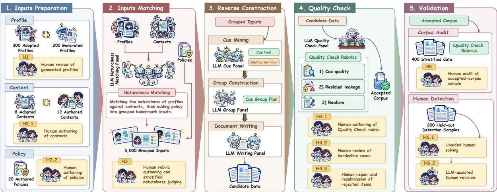

Figure 8: Human involvement across benchmark construction and validation. Yellow blocks mark the points where human judgment enters, labeled H1 to H6.
<table><tr><td></td><td>Stage</td><td>Unit and coverage</td><td>Changes corpus?</td><td>Admission role</td><td>Evidence</td></tr><tr><td>H1</td><td>Input preparation</td><td>200 generated profiles, complete census</td><td>yes</td><td>profile admission</td><td>Appendix B.1</td></tr><tr><td>H2.1</td><td>Input preparation</td><td>12 authored contexts of the 20 released</td><td>yes</td><td>defines task conditions</td><td>Section 4.1, Table 10</td></tr><tr><td>H2.2</td><td>Input preparation</td><td>20 eight-attribute disclosure policies, complete</td><td>yes</td><td>defines task conditions</td><td>Section 4.1, Figure 6</td></tr><tr><td>H3</td><td>Compatibility scoring</td><td>500 sampled profile-context pairs</td><td>no</td><td>judge validation</td><td>Appendix B.1</td></tr><tr><td>H4.1</td><td>Quality check</td><td>15 quality check criteria, complete</td><td>yes</td><td>defines automatic gate</td><td>Appendix C.1</td></tr><tr><td>H4.2</td><td>Quality check</td><td>every routed exception, review</td><td>yes</td><td>exception handling</td><td>Section 4.3</td></tr><tr><td>H4.3</td><td>Quality check</td><td>rejected documents, optional repair and resubmission</td><td>yes</td><td>exception handling</td><td>Section 4.3</td></tr><tr><td>H5</td><td>Validation</td><td>400 automatically accepted documents, two reviews each</td><td>no</td><td>release-quality audit</td><td>Appendix C.2</td></tr><tr><td>H6.1</td><td>Validation</td><td>200 held-out documents, 50 per reviewer</td><td>no</td><td>task performance</td><td>Appendix D.9</td></tr><tr><td>H6.2</td><td>Validation</td><td>the same 200 documents revised after the frozen proposal</td><td>no</td><td>task performance</td><td>Appendix D.9</td></tr></table>

Table 17: Human-in-the-loop interventions and their distinct units.

C2, whether a complete evidence group supports its target at the required granularity. On the 349 documents with groups, the reviewers split on C2 in 111 cases, an agreement of 68.2%.

The final human judgments agree with the panel majority on 14,505/15,314 criterion slots where a majority exists. Of the 809 differences, 802 are human failures against a panel pass and 7 the reverse. Reviewers explicitly adopt 14,451 majority votes across 797 reviews, and 348 of them differ from the final human judgment, an edit rate of 2.4%. Reported statistics use these final judgments, made after viewing the panel, yet 802 of the 809 differences are human failures, so reviewers did not defer to the panel.

We also check whether audit disagreements affect the evaluation. We rescore the stored fewshot predictions of all 28 entries on the 242 documents that both reviewers pass. The model ranking closely matches the full corpus, with a Spearman correlation of 0.95, and the four leading proprietary models keep their order. The documents that at least one reviewer fails give a nearly identical ranking, with a correlation of 0.99 to the full corpus. Residual gold errors thus leave the ordering of systems and the gap between the proprietary and local bands intact.

The audit also validates the defining property of the benchmark at the group level. Criterion C1 checks that no cue alone strongly identifies the target and C2 that the complete group supports it. Across the 795 audited groups, both reviewers confirm C1 for 99.2%, at least one reviewer confirms C2 for 95.3% and both for 76.6%, and both reject C2 for only 4.7%. Detectors recover the 237 HIDE groups that both reviewers confirm on both criteria more readily than the 83 disputed ones, with GPT-5.6 Sol at 80.5 against 65.1 P-GR, and recall on the confirmed groups ranks all 28 entries as the full corpus does, with a Spearman correlation of 0.996. Human reviewers therefore confirm the verifier’s judgment that the groups are revealing, and the band gap holds on human-confirmed groups, where the proprietary models average 63.8 P-GR and the best ≤ 14B entry reaches 35.4.

## C.3 Construction Ablations

We evaluate several design choices in the benchmark construction. We first compare against extracting quasi-evidence groups directly from naturally authored text. We then ablate the construction procedure itself, comparing the full pipeline with one-shot generation and with staged generation without internal verification. Finally, we test whether the resulting cue-bearing sentences exhibit simple surface patterns that could make the task artificially easy.

Natural-text extraction ablation. We first ask whether synthetic construction is necessary, starting from naturally authored text and discovering candidate evidence groups after the fact. The proposing LLM sees only the document and, for dialogue, a neutral focal-speaker marker. It receives no source identity, author profile, metadata, policy, target attribute, or eligible-label list. Predictions are made before independently recorded author information is joined, and only source-confirmed inferences proceed to Cue quality and Residual leakage. We screen 49 candidate corpora for suitable text, releasability, and independent author ground truth. Access or release restrictions exclude 25, missing or incompatible author ground truth excludes 14, unsuitable text excludes 2, and 8 remain eligible, of which we use 6. Without independently recorded attributes the gold is itself an inference, so its reliability would have to be established before any extraction result could be read. Many open corpora lack usable author attributes, while metadata-rich text is often difficult to redistribute.

The experiment covers 700 documents from six datasets. The first 500, drawn from PersuasionFor-Good, Debate.org/DDO, CaSiNo, and COREFL (Wang et al., 2019; Durmus and Cardie, 2019; Chawla et al., 2021; Lozano et al., 2021) as a 100- document confirmatory sample and a preregistered disjoint 400-document expansion, produce 48 proposals and no source-confirmed candidate eligible for the quality check. The remaining 200 comprise congressional speeches and U.S. Supreme Court oral-argument turns (Gentzkow et al., 2018; Chang et al., 2020), both sampled separately. Among these, 104 candidate groups match independently recorded author information. The quality check accepts 20, sends 53 to human review, and rejects 31. Figure 9 resolves these outcomes by dataset.

Quasi-evidence groups therefore do occur in naturally authored text. All 20 accepted groups concern occupation, however, and occupy only 4 of the 72 cells QuasiLeak-Bench targets across attribute, arity, and distance. Natural text supplies the phenomenon without the coverage or the control a

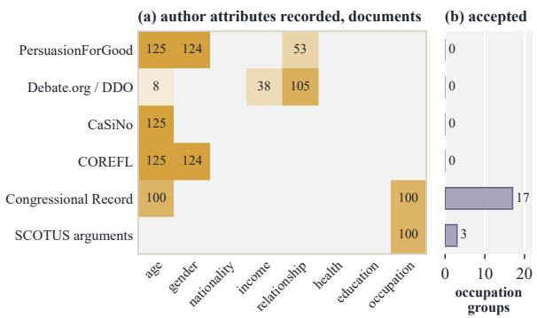  
Figure 9: Natural-text extraction across six datasets.

benchmark needs.

We also run four of the five proprietary detectors on the 20 accepted natural documents, giving each a profile that holds only the recorded author attributes and a policy that hides occupation. Every detector reports exactly one occupation group per document, binds it to occupation in every case, and overlaps the annotated group in 17 to 19 of the 20 documents. Each detector recovers about half of the annotated cues and completes its group with other genuine occupation cues, such as a reference to town-hall meetings in a senator’s speech, so P-GR against the single annotated group stays between 17 and 19 on the 0 to 100 scale. Detectors therefore find inferential evidence in human-authored text, and natural text admits many valid evidence sets for one attribute, which is why complete-group scoring relies on the controlled provenance of reverse construction. The fine-tuned Qwen3.5-4B carries part of its supervision into this human-authored text. Across three seeds it overlaps the annotated group in 9 to 12 of the 20 documents and reaches P-GR between 6.3 and 8.2, while the base model touches none of the annotated groups. Therefore, the supervision still teaches evidence recovery that the base model lacks.

Natural Quasi-Evidence Group Example   
“Thank you, Senator Reid.”   
“I rise today”   
“the Senate’s opening prayer.”   
WEAK ALONE Occupation: U.S. legislator

Reverse construction ablation. We evaluate three synthetic construction conditions on 200 matched plans spanning all 20 contexts and eight attributes. The conditions share the sender profile, writing style, communication context, disclosure policy, target length, writing constraints, the surfaced attributes, and the group arities and cuedistance bands of the final constructed groups.

In the one-shot condition, the construction model, GPT-5.5, receives these targets and produces the entire labeled datapoint in a single call. It designs the cues and distractors, writes the document around them, and returns their labeled spans. A response that does not produce the required document field is counted as a rejection, and all other completed documents pass through the same quality check, which uses the true profile values and the evidence designed within each condition. The paired sample contains 388 planned groups and 20 plans with no surfaced attribute, and one-shot generation still reveals an attribute in 70.0% of those plans.

Table 1 summarizes the quality check outcomes. Acceptance rises from 55.5% for one-shot generation to 73.5% for reverse construction without internal verification and 78.0% for the full pipeline. The intermediate condition shows that reverse staging captures most of the 22.5-point full-pipeline gain, while internal verification adds a smaller gain of 4.5 acceptance-rate points under the common final check. The failure modes differ by condition. Criterion C1, which fails when a single cue identifies its target alone, is the most common failure of one-shot generation, affecting 52 of its 89 non-accepted documents, 28 of them as outright failures. Both staged conditions fail almost entirely on C2, where the complete group falls short of the target value.

Surface-cue analysis. Because cues are introduced during construction, they may acquire systematic surface patterns that make their locations easier to identify. We therefore measure how much cue localization can be achieved without lexical semantics or inferential reasoning. We split documents into sentences and label a sentence positive when it contains an annotated cue. All 5,000 documents are included, the 570 carrying no annotated cue among them, because a detector exploiting surface form is never told which documents hold evidence and those documents still contain distractors. The analysis covers 126,587 sentences. A logisticregression locator uses 25 nonsemantic features of sentence length and position, paragraph boundaries, first-person usage, punctuation, clause structure, character shape, and opener form. Density features are standardized within each document, so the model captures within-document contrasts. Evaluation uses five-fold document-grouped crossvalidation. A within-document permutation control over 20 draws gives AUC 0.505 ± 0.002, indicating no appreciable signal after cue locations are randomized.

To evaluate whether this signal is useful for cue localization, at sentence budget $\rho$ we retain the $k _ { d }$ highest-scoring sentences of each document, with

$$
k _ { d } = \operatorname* { m a x } \{ 1 , \operatorname { r o u n d } ( \rho | S _ { d } | ) \} ,\tag{10}
$$

where $S _ { d }$ is the sentence set of document $d ,$ and write $T _ { d }$ for their concatenation. Writing $g \subseteq T$ when all cues of group g occur in T, and $n ( A , T )$ for the number of phrases in set A occurring in $T _ { \mathbf { \delta } }$ we report

$$
\begin{array} { l } { { \displaystyle { \mathrm { C o v } _ { \mathrm { g r p } } = \frac { 1 } { | \mathcal { G } | } \sum _ { g \in \mathcal { G } } \mathbf { 1 } \big [ g \subseteq T _ { d ( g ) } \big ] \ : , } } } \\ { { \displaystyle { \mathrm { C o v } _ { \mathrm { c u e } } = \frac { \sum _ { d } n \left( C _ { d } , T _ { d } \right) } { \sum _ { d } | C _ { d } | } , } } } \\ { { \displaystyle { \mathrm { C o v } _ { \mathrm { d i s } } = \frac { \sum _ { d } n \left( D _ { d } , T _ { d } \right) } { \sum _ { d } | D _ { d } | } , } } } \end{array}\tag{11}
$$

where $C _ { d }$ and $D _ { d }$ are the cue and distractor phrases of document d. Group coverage requires recovering all 2 to 4 cues of a group, so we also report percue coverage for a like-for-like comparison with distractors. Random selection uniformly samples the same number of sentences and averages over five seeds.

Table 18 compares the surface-only locator, AUC 0.733, with random sentence selection. Surface form gives a useful ranking signal, recovering every cue of 39.6% of groups at a 40% budget against 12.2% at random, yet it still misses a cue in most groups and selects distractors almost as readily as cues. Thus, our construction introduces some detectable surface regularity, but much of that regularity is shared by distractors, leaving semantic and inferential reasoning necessary for reliable quasi-evidence group recovery (Gururangan et al., 2018; Feng et al., 2019).

Detector rankings do not depend on this regularity. At the 40% budget the locator misses 2,143 of the 3,589 HIDE groups, and detectors recover them nearly as well as the groups it covers. The proprietary models average 59.4 P-GR on missed groups against 65.1 on covered ones, the best ≤ 14B entry, Gemma-4-12B with thinking off, reaches 27.6, and the ranking of all 28 entries on missed groups matches their full-corpus P-GR with a Spearman correlation of 0.998. The fine-tuned Qwen3.5-4B shows the same pattern on the test split. With ownpolicy supervision it reaches 78.5 P-GR on the 382 missed groups against 80.6 on the 299 covered ones, averaged over three seeds, a smaller gap than GPT-5.6 Sol shows on the same groups, 76.2 against 79.8.

<table><tr><td>Selector</td><td>Full groups</td><td>Cues</td><td>Distractors</td></tr><tr><td>25% sentence budget</td><td></td><td></td><td></td></tr><tr><td>Random</td><td>4.7</td><td>25.1</td><td>24.8</td></tr><tr><td>Surface-only locator</td><td>18.7</td><td>48.4</td><td>41.2</td></tr><tr><td>40% sentence budget</td><td></td><td></td><td></td></tr><tr><td>Random</td><td>12.2</td><td>39.9</td><td>40.0</td></tr><tr><td>Surface-only locator</td><td>39.6</td><td>67.3</td><td>62.6</td></tr></table>

Table 18: Share of groups, cues, and distractors the selected sentences cover.

## D Evaluation Details

## D.1 Metrics and Scoring

Section 4.5 defines the main scoring scheme. Here we give the additional details needed to reproduce it, including how predicted spans are matched back to the document and how partial credit is assigned.

A predicted evidence group $\widehat { G }$ is compared with a gold group G at three levels. We first measure how much of the annotated evidence it recovers, then whether the recovered cues are grouped under the correct attribute, and finally whether that attribute should be reported under the supplied policy. Throughout, e denotes a gold cue span, eb a predicted span, |G| the number of cues in $G ,$ and ba and a the predicted and gold attributes. Table 19 defines every reported metric by level.

Alignment. The scorer tokenizes Unicode word sequences and preserves internal apostrophes. Gold spans keep their annotated offsets, while predicted spans arrive as verbatim strings that the scorer locates at their first occurrence in the document, so a model cannot select a later repeated occurrence, while the adapters of the existing detectors in $\mathsf { A p - }$ pendix D.8 keep a returned phrase only when it matches the document unambiguously. For the sets of token positions $T ( e )$ and $T ( \widehat { e } )$ that two spans cover in the document, span overlap is

$$
q ( e , \widehat { e } ) = \frac { | T ( e ) \cap T ( \widehat { e } ) | } { | T ( e ) \cup T ( \widehat { e } ) | } .\tag{12}
$$

Let ${ \mathcal { P } } ( \theta )$ collect the one-to-one matchings between the cues of G and the spans of $\widehat { G }$ whose every

<table><tr><td></td><td>Metric Definition</td></tr><tr><td colspan="2">Evidence level</td></tr><tr><td> $E _ { C }$ </td><td>Evidence completeness. Share of a gold group&#x27;s cues matched, raised to γ.</td></tr><tr><td> $E _ { L }$ </td><td>Evidence localization. Share of returned spans that match an annotated cue.</td></tr><tr><td>E-GF1</td><td>Evidence group F1. Group F1 crediting only  $E _ { C } E _ { L }$  with no KEEP penalty.</td></tr><tr><td> $N _ { \mathrm { p r e d } }$ </td><td>Predicted groups. Groups in the precision denominator, which exposes abstention.</td></tr><tr><td> $E _ { R }$ </td><td>Evidence recall. Share of HIDE cues that returned spans match before grouping.</td></tr><tr><td>DSR</td><td>Distractor selection rate. Share of planted distractors that returned spans match.</td></tr><tr><td colspan="2">Binding level</td></tr><tr><td> $_ { B _ { G } }$ </td><td>Binding purity. Share of cue-matching spans that match a cue of the aligned group.</td></tr><tr><td> $B _ { A }$ </td><td>Binding accuracy. 1 for the gold attribute,  $\rho _ { \mathrm { s e c } }$  for a verified secondary one, else 0.</td></tr><tr><td colspan="2">Policy level</td></tr><tr><td>P-GP</td><td>Policy group precision. Credit per scored prediction, with KEEP flags counted  $1 + \bar { \lambda _ { K } }$  times.</td></tr><tr><td>P-GR</td><td>Policy group recall. Credit per HIDE gold group. P-GF1 Policy group F1. Harmonic mean of P-GP and P-GR,</td></tr></table>

Table 19: Definitions of the reported metrics, by level.

pair satisfies $q ( e , \widehat { e } ) \geq \theta$ . At the default threshold $\theta = 0 . 7 5$ the scorer takes

$$
\begin{array} { r } { \mathcal { M } _ { \mathrm { s p a n } } ( \widehat { G } , G ; \theta ) = \underset { M \in \mathcal { P } ( \theta ) } { \arg \operatorname* { m a x } } ~ \vert M \vert , } \\ { m ( \widehat { G } , G ) = \big \vert \mathcal { M } _ { \mathrm { s p a n } } ( \widehat { G } , G ; \theta ) \big \vert , } \end{array}\tag{13}
$$

breaking ties by total token IoU and then by serialized prediction and gold indices, so $m ( { \widehat { G } } , G )$ counts the matched gold cues. A predicted span therefore credits at most one gold cue even when it overlaps several. Let $r _ { \widehat { G } }$ be the number of spans in $\widehat { G }$ and $n _ { \mathrm { c u e } } ( \widehat { G } )$ the number matching any annotated cue in the document, whatever its group or policy.

Groups are aligned before any level is scored. Each candidate pair carries the structural weight

$$
w ( \widehat { G } , G ) = \left( \frac { m ( \widehat { G } , G ) } { | G | } \right) ^ { \gamma } \frac { m ( \widehat { G } , G ) } { r _ { \widehat { G } } } ,\tag{14}
$$

the product $E _ { C } E _ { L } B _ { G }$ of the factors defined below, and the document-level alignment is the maximumweight one-to-one matching

$$
\mathcal { M } = \arg \operatorname* { m a x } _ { M \in \mathfrak { M } } \sum _ { ( \widehat { G } , G ) \in M } w ( \widehat { G } , G ) ,\tag{15}
$$

where M holds the matchings on positive-weight edges, with ties broken first by the number of aligned pairs and then by prediction and gold indices. The structural weight depends only on spans, so relabeling an attribute or a policy leaves the alignment unchanged. Two predictions that return the same spans under different attributes therefore tie, and the one listed first is aligned while the other counts as a false positive. The detector prompt forbids reporting one span set under two attributes, so this tie arises only when a detector breaks that rule. The factor columns of Table 3 average each factor over all aligned pairs of an entry, pooled across documents and policy classes, and show a dash when an entry has no aligned pair.

Evidence level. For an aligned pair, evidence completeness and evidence localization are

$$
E _ { C } ( { \widehat { G } } , G ) = \left( { \frac { m } { | G | } } \right) ^ { \gamma } , \quad E _ { L } ( { \widehat { G } } ) = { \frac { n _ { \mathrm { c u e } } } { r _ { \widehat { G } } } } ,\tag{16}
$$

where a zero denominator sets the factor to 0, and the evidence-level credit is $c _ { E } = E _ { C } E _ { L }$ The default setting uses $\gamma \ : = \ : 2$ The completeness exponent is a strict-provenance scoring choice that rewards complete annotated groups disproportionately while retaining graded partial credit. Prior work motivates this evidence-conditioned and complete-provenance evaluation (Thorne et al., 2018; Petroni et al., 2021). Because gold groups record the complete planted evidence, a detector that returns a revealing subset of a larger group, such as a pair within a quad, receives $( 2 / 4 ) ^ { 2 } =$ 0.25 of the completeness credit. This is intended, because a detector should surface the complete annotated evidence and leave the choice of cues to revise to downstream sanitization, and Figure 10 shows that the system ordering holds across values of γ.

This level also reports three diagnostics, the prediction count $N _ { \mathrm { p r e d } }$ , evidence recall $E _ { R } ,$ and the distractor selection rate DSR. Every emitted evidence object enters the prediction denominator except a prediction that names a HIDE attribute recorded as a verified secondary attribute of an aligned group whose gold attribute is KEEP or NEU-TRAL, a rare mixed-policy case that is neither rewarded nor penalized. Writing $N _ { \mathrm { e m i t } }$ for the number of emitted evidence objects and $N _ { \mathrm { a u x } }$ for the number of such objects,

$$
N _ { \mathrm { p r e d } } = N _ { \mathrm { e m i t } } - N _ { \mathrm { a u x } } .\tag{17}
$$

With $C _ { d }$ and $D _ { d }$ the cue and distractor phrases of document d as in Appendix C.3, let $\bar { C } _ { d } ^ { H } \subseteq C _ { d }$ be the cues of its HIDE gold groups and $\widehat { E } _ { d }$ the deduplicated spans a detector returns in it before grouping, attribute mapping, or policy filtering, and $\widehat { S } _ { d }$ the spans of the evidence groups it finally returns. With $m$ the matching count of Equation 13, evidence recall and the distractor selection rate are

$$
\begin{array} { c } { E _ { R } = \frac { \sum _ { d } m \left( \widehat { E } _ { d } , C _ { d } ^ { H } \right) } { \sum _ { d } \vert C _ { d } ^ { H } \vert } , } \\ { { \mathrm { D S R } = \displaystyle \frac { \sum _ { d } \left. \{ \delta \in D _ { d } : \operatorname* { m a x } _ { \hat { e } \in \widehat { S } _ { d } } q ( \delta , \widehat { e } ) \geq 0 . 5 \} \right. } { \sum _ { d } \vert D _ { d } \vert } . } } \end{array}\tag{18}
$$

Appendix D.8 describes the span inventory of each existing detector.

Binding level. Binding purity and binding accuracy are

$$
\begin{array} { r l } & { B _ { G } ( \widehat { G } , G ) = \frac { m ( \widehat { G } , G ) } { n _ { \mathrm { c u e } } ( \widehat { G } ) } , } \\ & { B _ { A } ( \widehat { G } , G ) = \left\{ \begin{array} { l l } { 1 , } & { \widehat { a } = a , } \\ { \rho _ { \mathrm { s e c } } , } & { \widehat { a } \in A _ { G } ^ { \mathrm { s e c } } , } \\ { 0 , } & { \mathrm { o t h e r w i s e } , } \end{array} \right. } \end{array}\tag{19}
$$

where $A _ { G } ^ { \mathrm { s e c } }$ is the set of verified secondary attributes of $G ,$ , with $\rho _ { \mathrm { s e c } } ~ = ~ 0 . 5$ by default. $E _ { L }$ and $B _ { G }$ decompose within-group precision,

$$
E _ { L } ( \widehat { G } ) B _ { G } ( \widehat { G } , G ) = \frac { n _ { \mathrm { c u e } } } { r _ { \widehat { G } } } \frac { m } { n _ { \mathrm { c u e } } } = \frac { m } { r _ { \widehat { G } } } ,\tag{20}
$$

an identity the zero conventions preserve with $m / r _ { \widehat { G } }$ defined as 0 for an empty prediction. They thus split one quantity into two parts, with $E _ { L }$ charging returned text outside the annotated cues and $B _ { G }$ charging genuine cues drawn from another group. The binding-level credit is $c _ { B } =$ $E _ { C } E _ { L } B _ { G } B _ { A }$

Worked example. Table 20 scores four predictions against one HIDE gold group with three cues, with $\gamma = 2 ,$ , the correct attribute, and no KEEP cue, so each policy credit equals $E _ { C } E _ { L } B _ { G }$ . Missing a cue costs more than adding an unrelated span, and a cue drawn from another group lowers $B _ { G }$ while leaving $E _ { L }$ intact. Naming an unsupported attribute sets $B _ { A }$ and the credit to 0, and a verified secondary attribute halves the credit.

Policy level. The policy-level credit keeps $c _ { B }$ only for predictions that name a HIDE attribute,

$$
c _ { P } = E _ { C } E _ { L } B _ { G } B _ { A } { \bf 1 } [ \pi ( \widehat { a } ) = { \mathrm { H I D E } } ] .\tag{21}
$$

<table><tr><td>Returned spans</td><td>m r</td><td></td><td> $n _ { \mathrm { c u e } }$ </td><td> $E _ { C }$ </td><td> $E _ { L }$ </td><td> $B _ { G }$ </td><td> $c _ { P }$ </td></tr><tr><td>All three cues</td><td>3 3</td><td></td><td>3</td><td>1</td><td>1</td><td>1</td><td>1</td></tr><tr><td>Two cues</td><td>2 2</td><td></td><td>2</td><td> $4 / 9$ </td><td>1</td><td>1</td><td> $4 / 9$ </td></tr><tr><td>Three cues, one unrelated span</td><td></td><td>3 4</td><td>3</td><td>1</td><td>3/4 1</td><td></td><td> $3 ^ { ' } / 4$ </td></tr><tr><td>Two cues, one cue of another group</td><td>2 3</td><td></td><td>3</td><td> $4 / 9$ </td><td></td><td></td><td>1 2/3 8/27</td></tr></table>

Table 20: Worked example of pair credit for a three-cue HIDE group.

Predictions that flag KEEP information carry one further cost. Let $N _ { K }$ count the predictions in $N _ { \mathrm { p r e d } }$ that either report a KEEP attribute or place a span on an annotated KEEP cue. The policy level charges $N _ { \mathrm { p r e d } } + \lambda _ { K } N _ { K }$ where the other levels charge $N _ { \mathrm { p r e d } }$ , with $\lambda _ { K } = 1$ outside the sensitivity analysis, so a zero-credit KEEP report costs twice what an ordinary false positive costs.

Corpus aggregation. Let $\mathcal { M } _ { H }$ contain the alignments whose gold attribute is HIDE and let $N _ { H }$ count HIDE gold groups. For level $s \in \{ E , B , P \}$ the pooled credit is

$$
C _ { s } = \sum _ { ( \widehat { G } , G ) \in \mathcal { M } _ { H } } c _ { s } ( \widehat { G } , G ) .\tag{22}
$$

Credits and denominators are micro-pooled over the corpus, giving

$$
\begin{array} { c } { { D _ { s } = N _ { \mathrm { p r e d } } + \lambda _ { K } N _ { K } { \bf 1 } [ s = P ] , } } \\ { { \displaystyle ~ \mathrm { G P } _ { s } = \frac { C _ { s } } { D _ { s } } , ~ \mathrm { G R } _ { s } = \frac { C _ { s } } { N _ { H } } , } } \\ { { \displaystyle ~ \mathrm { G F 1 } _ { s } = \frac { 2 C _ { s } } { D _ { s } + N _ { H } } , } } \end{array}\tag{23}
$$

an alignment-normalized form analogous to entitybased CEAF with a task-specific similarity and target set (Luo, 2005). These give E-GF1, B-GF1, and P-GF1, with P-GP and P-GR the precision and recall of the policy level and $D _ { P }$ the D of Equation 5. Table 3 reports each factor $E _ { C } , E _ { L }$ $B _ { G }$ , and $B _ { A }$ as its mean over every aligned pair in the corpus, whatever the gold policy class, and leaves it empty when no pair is aligned.

Metric sensitivity. We test whether the reported conclusions depend on the scorer’s constants, namely the completeness exponent γ, token-IoU threshold θ, and secondary-attribute credit $\rho _ { \mathrm { s e c } }$ . Using the stored few-shot predictions of all 28 entries, we rescore the full corpus over a $( \gamma , \theta )$ grid and a separate sweep of $\rho _ { \mathrm { s e c } }$ , without rerunning any model. Figure 10 reports changes in P-GF1 relative to the default setting.

Secondary credit has a negligible effect on the results. The completeness exponent mainly changes the absolute score scale, with weaker completeness penalties raising scores and stronger penalties lowering them. The token-IoU threshold shows the same pattern, and scores remain stable around $\theta = 0 . 7 5$ . Jointly varying $\gamma$ and θ shifts absolute performance without changing the system ordering. Overall, the main comparisons hold across every setting in the sweep.

Sampling uncertainty. We bootstrap the 5,000 documents with 2,000 replicates and pool each replicate as in Equation 23. The 95% intervals on few-shot P-GF1 have half-widths of at most 1.4 points for any entry. Every proprietary interval lies above 52 and every ≤ 14B interval lies below 26. Paired intervals over the same replicates separate every adjacent pair among the eleven strongest entries, and the twelve unresolved adjacent pairs all lie below 8 P-GF1.

Robustness to revealing subsets. Gold groups record the complete evidence behind each inference, so a trio or quad may contain a smaller subset that already reveals the attribute, and a detector that reports only this subset earns partial credit. We test whether such subsets shape our findings in two ways. First, each cue of a pair is verified weak alone, so on documents whose groups are all pairs no revealing subset can earn partial credit. We rescore the stored few-shot predictions of all entries on these documents, which still cover every context and attribute, and the pair-only column of Table 21 reports the results. The ranking barely changes, proprietary models stay close to their fullcorpus scores, and the gap to local models remains. Local models still show their widest gap at attribute binding. Second, we apply the joint test of Equation 3 with the same verifier to every smaller subset of every HIDE trio and quad, and rescore all entries under two separate rules that raise completeness to full credit, Sufficient when the detected cues already reveal the attribute and Residual when the cues a detector leaves in the message no longer reveal it. The last two columns of Table 21 show that both rules raise absolute scores and leave the ranking intact, with the ten strongest entries in the same order. The main findings therefore hold however subsets of a gold group are credited.

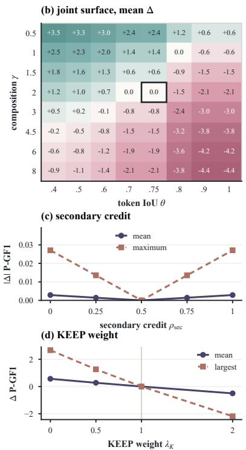

<table><tr><td rowspan=2 colspan=25>Composition γ (main 2)            Token IoU θ (main 0.75)main        1.5                                                   0.5</td></tr><tr><td rowspan=1 colspan=1></td><td rowspan=1 colspan=1></td><td rowspan=1 colspan=1></td><td rowspan=1 colspan=1></td><td rowspan=1 colspan=1></td><td rowspan=1 colspan=1></td><td rowspan=1 colspan=1></td><td rowspan=1 colspan=1></td><td rowspan=1 colspan=1></td><td rowspan=1 colspan=1></td><td rowspan=1 colspan=1></td><td rowspan=1 colspan=1></td><td rowspan=1 colspan=1></td><td rowspan=1 colspan=1></td><td rowspan=1 colspan=2></td><td rowspan=1 colspan=1></td><td rowspan=1 colspan=1></td><td rowspan=1 colspan=1></td><td rowspan=1 colspan=1></td><td rowspan=1 colspan=1></td><td rowspan=1 colspan=1></td><td rowspan=1 colspan=1></td></tr><tr><td rowspan=1 colspan=1>GPT-5.6 Sol        75.4</td><td rowspan=1 colspan=1>+3.3</td><td rowspan=1 colspan=1>+1.9</td><td rowspan=1 colspan=1>+0.8</td><td rowspan=1 colspan=1>-1.2</td><td rowspan=1 colspan=1>-2.2</td><td rowspan=1 colspan=1>-2.7</td><td rowspan=1 colspan=1>-3.1</td><td rowspan=1 colspan=1></td><td rowspan=1 colspan=1>+4.6</td><td rowspan=1 colspan=1>+4.0</td><td rowspan=1 colspan=1>+2.8</td><td rowspan=1 colspan=1>0.0</td><td rowspan=1 colspan=1>-7.0</td><td rowspan=1 colspan=2>-9.5-9.5</td><td rowspan=1 colspan=2>1</td><td rowspan=1 colspan=1>+2.5</td><td rowspan=1 colspan=1>+2.3</td><td rowspan=1 colspan=1>+2.0</td><td rowspan=1 colspan=1>+1.4</td><td rowspan=1 colspan=1>+1.4</td><td rowspan=1 colspan=1>0.0</td><td rowspan=1 colspan=1>-0.6 -0.6</td></tr><tr><td rowspan=1 colspan=1>Gemini-3.8-Flash     71.8</td><td rowspan=1 colspan=1>+4.6</td><td rowspan=1 colspan=1>+2.7</td><td rowspan=1 colspan=1>+1.2</td><td rowspan=1 colspan=1>-1.7</td><td rowspan=1 colspan=1>-3.3</td><td rowspan=1 colspan=1>-4.2</td><td rowspan=1 colspan=1>-4.8</td><td rowspan=1 colspan=1></td><td rowspan=1 colspan=1>+3.1</td><td rowspan=1 colspan=1>+2.6</td><td rowspan=1 colspan=1>+1.9</td><td rowspan=1 colspan=1>0.0</td><td rowspan=1 colspan=1>-5.2</td><td rowspan=1 colspan=2>-7.6-7.6</td><td rowspan=1 colspan=2></td><td></td><td></td><td></td><td></td><td></td><td></td><td></td></tr><tr><td rowspan=1 colspan=1>Claude-Opus-5      67.9</td><td rowspan=1 colspan=1>+4.6</td><td rowspan=1 colspan=1>+2.7</td><td rowspan=1 colspan=1>+1.2</td><td rowspan=1 colspan=1>-1.7</td><td rowspan=1 colspan=1>-3.1</td><td rowspan=1 colspan=1>-3.9</td><td rowspan=1 colspan=1>-4.5</td><td rowspan=1 colspan=1></td><td rowspan=1 colspan=1>+3.8</td><td rowspan=1 colspan=1>+3.2</td><td rowspan=1 colspan=1>+2.2</td><td rowspan=1 colspan=1>0.0</td><td rowspan=1 colspan=1>-5.5</td><td rowspan=1 colspan=2>-7.7-7.7</td><td rowspan=1 colspan=2>1.5</td><td rowspan=1 colspan=1>+1.8</td><td rowspan=1 colspan=1>+1.6</td><td rowspan=1 colspan=1>+1.3</td><td rowspan=1 colspan=1>+0.6</td><td rowspan=1 colspan=1>+0.6</td><td rowspan=1 colspan=1>-0.9</td><td rowspan=1 colspan=1>-1.5 -1.5</td></tr><tr><td rowspan=1 colspan=1>Grok-4.5          64.5</td><td rowspan=1 colspan=1>+5.0</td><td rowspan=1 colspan=1>+2.9</td><td rowspan=1 colspan=1>+1.3</td><td rowspan=1 colspan=1>-1.9</td><td rowspan=1 colspan=1>-3.5</td><td rowspan=1 colspan=1>-4.5</td><td rowspan=1 colspan=1>-5.1</td><td rowspan=1 colspan=1></td><td rowspan=1 colspan=1>+3.4</td><td rowspan=1 colspan=1>+2.9</td><td rowspan=1 colspan=1>+2.0</td><td rowspan=1 colspan=1>0.0</td><td rowspan=1 colspan=1>-4.8</td><td rowspan=1 colspan=2>-6.8-6.8</td><td rowspan=1 colspan=1></td><td rowspan=1 colspan=1>2</td><td rowspan=1 colspan=1>+1.2</td><td rowspan=1 colspan=1>+1.0</td><td rowspan=1 colspan=1>+0.7</td><td rowspan=1 colspan=1>0.0</td><td rowspan=1 colspan=1>0.0</td><td rowspan=1 colspan=1>-1.5</td><td rowspan=1 colspan=1>-2.1 -2.1</td></tr><tr><td rowspan=1 colspan=1>DeepSeek-V4-Pro     53.8</td><td rowspan=1 colspan=1>+4.9</td><td rowspan=1 colspan=1>+2.9</td><td rowspan=1 colspan=1>+1.3</td><td rowspan=1 colspan=1>-1.9</td><td rowspan=1 colspan=1>-3.5</td><td rowspan=1 colspan=1>-4.5</td><td rowspan=1 colspan=1>-5.1</td><td rowspan=1 colspan=1></td><td rowspan=1 colspan=1>+3.1</td><td rowspan=1 colspan=1>+2.9</td><td rowspan=1 colspan=1>+2.2</td><td rowspan=1 colspan=1>0.0</td><td rowspan=1 colspan=1>-4.4</td><td rowspan=1 colspan=2>-6.0-6.0</td><td rowspan=1 colspan=1></td><td rowspan=1 colspan=1>3</td><td></td><td></td><td></td><td></td><td></td><td></td><td></td></tr><tr><td rowspan=2 colspan=1>Gemma-4-31B off    46.0</td><td rowspan=2 colspan=1>+7.3</td><td rowspan=2 colspan=1>+4.2</td><td rowspan=2 colspan=1>+1.8</td><td rowspan=2 colspan=1>-2.6</td><td rowspan=2 colspan=1>-4.7</td><td rowspan=2 colspan=1>-5.9</td><td rowspan=2 colspan=1>-6.7</td><td rowspan=2 colspan=1></td><td rowspan=2 colspan=1>+2.4</td><td rowspan=2 colspan=1>+2.0</td><td rowspan=2 colspan=1>+1.5</td><td rowspan=2 colspan=1>0.0</td><td rowspan=2 colspan=1>-3.0</td><td rowspan=2 colspan=2>-4.0-4.0</td><td rowspan=2 colspan=2></td><td></td><td></td><td></td><td></td><td></td><td></td><td></td></tr><tr><td rowspan=1 colspan=1>+0.5</td><td rowspan=1 colspan=1>+0.2</td><td rowspan=1 colspan=1>-0.1</td><td rowspan=1 colspan=1>-0.8</td><td rowspan=1 colspan=1>-0.8</td><td rowspan=1 colspan=1>-2.4</td><td rowspan=1 colspan=1>-3.0 -3.0</td></tr><tr><td rowspan=1 colspan=1>Qwen3.5-27B off    33.4</td><td rowspan=1 colspan=1>+6.3</td><td rowspan=1 colspan=1>+3.6</td><td rowspan=1 colspan=1>+1.6</td><td rowspan=1 colspan=1>-2.2</td><td rowspan=1 colspan=1>-4.0</td><td rowspan=1 colspan=1>-5.0</td><td rowspan=1 colspan=1>-5.6</td><td rowspan=1 colspan=1></td><td rowspan=1 colspan=1>+1.9</td><td rowspan=1 colspan=1>+1.6</td><td rowspan=1 colspan=1>+1.1</td><td rowspan=1 colspan=1>0.0</td><td rowspan=1 colspan=1>-2.5</td><td rowspan=1 colspan=2>-3.2-3.2</td><td rowspan=1 colspan=2>4.5</td><td rowspan=1 colspan=1>-0.2</td><td rowspan=1 colspan=1>-0.5</td><td rowspan=1 colspan=1>-0.8</td><td rowspan=1 colspan=1>-1.5</td><td rowspan=1 colspan=1>-1.5</td><td rowspan=1 colspan=1>-3.2</td><td rowspan=1 colspan=1>-3.8 -3.8</td></tr><tr><td rowspan=1 colspan=1>Gemma-4-12B off    24.2</td><td rowspan=1 colspan=1>+4.5</td><td rowspan=1 colspan=1>+2.6</td><td rowspan=1 colspan=1>+1.1</td><td rowspan=1 colspan=1>-1.5</td><td rowspan=1 colspan=1>-2.8</td><td rowspan=1 colspan=1>-3.4</td><td rowspan=1 colspan=1>-3.8</td><td rowspan=1 colspan=1></td><td rowspan=1 colspan=1>+2.6</td><td rowspan=1 colspan=1>+2.1</td><td rowspan=1 colspan=1>+1.5</td><td rowspan=1 colspan=1>0.0</td><td rowspan=1 colspan=1>-2.0</td><td rowspan=1 colspan=1>-2.7</td><td rowspan=1 colspan=1>-2.7</td><td rowspan=1 colspan=2>6</td><td rowspan=1 colspan=1>-0.6</td><td rowspan=1 colspan=1>-0.8</td><td rowspan=1 colspan=1>-1.2</td><td rowspan=1 colspan=1>-1.9</td><td rowspan=1 colspan=1>-1.9</td><td rowspan=1 colspan=1>-3.6</td><td rowspan=1 colspan=1>-4.2 -4.2</td></tr><tr><td rowspan=1 colspan=1>Qwen3-14B on      17.5</td><td rowspan=1 colspan=1>+4.5</td><td rowspan=1 colspan=1>+2.6</td><td rowspan=1 colspan=1>+1.1</td><td rowspan=1 colspan=1>-1.6</td><td rowspan=1 colspan=1>-2.9</td><td rowspan=1 colspan=1>-3.6</td><td rowspan=1 colspan=1>-4.0</td><td rowspan=1 colspan=1></td><td rowspan=1 colspan=1>+1.5</td><td rowspan=1 colspan=1>+1.2</td><td rowspan=1 colspan=1>+0.7</td><td rowspan=1 colspan=1>0.0</td><td rowspan=1 colspan=1>-1.4</td><td rowspan=1 colspan=1>-2.0</td><td rowspan=1 colspan=1>-2.0</td><td rowspan=1 colspan=1></td><td></td><td></td><td></td><td></td><td></td><td></td><td></td><td></td></tr><tr><td rowspan=1 colspan=1>Mistral-Small-24B    11.6</td><td rowspan=1 colspan=1>+3.1</td><td rowspan=1 colspan=1>+1.7</td><td rowspan=1 colspan=1>+0.8</td><td rowspan=1 colspan=1>-1.0</td><td rowspan=1 colspan=1>-1.9</td><td rowspan=1 colspan=1>-2.3</td><td rowspan=1 colspan=1>-2.5</td><td rowspan=1 colspan=1></td><td rowspan=1 colspan=1>+0.7</td><td rowspan=1 colspan=1>+0.6</td><td rowspan=1 colspan=1>+0.4</td><td rowspan=1 colspan=1>0.0</td><td rowspan=1 colspan=1>-0.8</td><td rowspan=1 colspan=1>-1.2</td><td rowspan=1 colspan=1>-1.2</td><td rowspan=1 colspan=2>8</td><td rowspan=1 colspan=1>-0.9</td><td rowspan=1 colspan=1>-1.1</td><td rowspan=1 colspan=1>-1.4</td><td rowspan=1 colspan=1>-2.1</td><td rowspan=1 colspan=1>-2.1</td><td rowspan=1 colspan=1>-3.8</td><td rowspan=1 colspan=1>-4.4 -4.4</td></tr><tr><td rowspan=1 colspan=1>Qwen3.5-4B on       7.7</td><td rowspan=1 colspan=1>+1.7</td><td rowspan=1 colspan=1>+1.0</td><td rowspan=1 colspan=1>+0.4</td><td rowspan=1 colspan=1>-0.6</td><td rowspan=1 colspan=1>-1.1</td><td rowspan=1 colspan=1>-1.4</td><td rowspan=1 colspan=1>-1.5</td><td rowspan=1 colspan=1></td><td rowspan=1 colspan=1>+0.9</td><td rowspan=1 colspan=1>+0.5</td><td rowspan=1 colspan=1>+0.3</td><td rowspan=1 colspan=1>0.0</td><td rowspan=1 colspan=1>-0.7</td><td rowspan=1 colspan=1>-1.0</td><td rowspan=1 colspan=1>-1.0</td><td rowspan=1 colspan=2></td><td rowspan=1 colspan=2>.4  .5</td><td rowspan=1 colspan=2>.6  .7</td><td rowspan=1 colspan=1>.75</td><td rowspan=1 colspan=1>.8</td><td rowspan=1 colspan=1>.9  1</td></tr><tr><td rowspan=1 colspan=1>Gemma-4-31B on     7.6</td><td rowspan=1 colspan=1>+0.7</td><td rowspan=1 colspan=1>+0.4</td><td rowspan=1 colspan=1>+0.2</td><td rowspan=1 colspan=1>-0.3</td><td rowspan=1 colspan=1>-0.5</td><td rowspan=1 colspan=1>-0.7</td><td rowspan=1 colspan=1>-0.7</td><td rowspan=1 colspan=1></td><td rowspan=1 colspan=1>+0.3</td><td rowspan=1 colspan=1>+0.2</td><td rowspan=1 colspan=1>+0.1</td><td rowspan=1 colspan=1>0.0</td><td rowspan=1 colspan=1>-0.5</td><td rowspan=1 colspan=1>-0.8</td><td rowspan=1 colspan=1>-0.8</td><td rowspan=1 colspan=2></td><td rowspan=1 colspan=2></td><td rowspan=18 colspan=5>token IoU θ(c) secondary creditmean☐          maximum0     0.25    0.5    0.75     1secondary credit ρsec(d) KEEP weight1meanlargest0     0.5                    2</td></tr><tr><td rowspan=1 colspan=1>Qwen3.5-9B on      6.9</td><td rowspan=1 colspan=1>+1.7</td><td rowspan=1 colspan=1>+1.0</td><td rowspan=1 colspan=1>+0.4</td><td rowspan=1 colspan=1>-0.6</td><td rowspan=1 colspan=1>-1.1</td><td rowspan=1 colspan=1>-1.4</td><td rowspan=1 colspan=1>-1.5</td><td rowspan=1 colspan=1></td><td rowspan=1 colspan=1>+1.0</td><td rowspan=1 colspan=1>+0.7</td><td rowspan=1 colspan=1>+0.4</td><td rowspan=1 colspan=1>0.0</td><td rowspan=1 colspan=1>-0.7</td><td rowspan=1 colspan=1>-0.9</td><td rowspan=1 colspan=1>-0.9</td><td rowspan=1 colspan=2></td><td></td><td></td></tr><tr><td rowspan=1 colspan=1>Gemma-4-E4B on     6.8</td><td rowspan=1 colspan=1>+1.8</td><td rowspan=1 colspan=1>+1.0</td><td rowspan=1 colspan=1>+0.4</td><td rowspan=1 colspan=1>-0.6</td><td rowspan=1 colspan=1>-1.1</td><td rowspan=1 colspan=1>-1.3</td><td rowspan=1 colspan=1>-1.5</td><td rowspan=1 colspan=1></td><td rowspan=1 colspan=1>+2.2</td><td rowspan=1 colspan=1>+1.3</td><td rowspan=1 colspan=1>+0.6</td><td rowspan=1 colspan=1>0.0</td><td rowspan=1 colspan=1>-1.0</td><td rowspan=1 colspan=1>-1.5</td><td rowspan=1 colspan=1>-1.5</td><td rowspan=1 colspan=2></td><td></td><td></td></tr><tr><td rowspan=1 colspan=1>Qwen3-14B off      5.8</td><td rowspan=1 colspan=1>+2.5</td><td rowspan=1 colspan=1>+1.4</td><td rowspan=1 colspan=1>+0.6</td><td rowspan=1 colspan=1>-0.8</td><td rowspan=1 colspan=1>-1.3</td><td rowspan=1 colspan=1>-1.6</td><td rowspan=1 colspan=1>-1.8</td><td rowspan=1 colspan=1></td><td rowspan=1 colspan=1>+0.3</td><td rowspan=1 colspan=1>+0.2</td><td rowspan=1 colspan=1>+0.2</td><td rowspan=1 colspan=1>0.0</td><td rowspan=1 colspan=1>-0.4</td><td rowspan=1 colspan=1>-0.6</td><td rowspan=1 colspan=1>-0.6</td><td rowspan=1 colspan=2>0.03</td><td></td><td></td></tr><tr><td rowspan=1 colspan=1>Phi-4            5.8</td><td rowspan=1 colspan=1>+1.5</td><td rowspan=1 colspan=1>+0.9</td><td rowspan=1 colspan=1>+0.4</td><td rowspan=1 colspan=1>-0.5</td><td rowspan=1 colspan=1>-0.9</td><td rowspan=1 colspan=1>-1.1</td><td rowspan=1 colspan=1>-1.2</td><td rowspan=1 colspan=1></td><td rowspan=1 colspan=1>+0.4</td><td rowspan=1 colspan=1>+0.3</td><td rowspan=1 colspan=1>+0.2</td><td rowspan=1 colspan=1>0.0</td><td rowspan=1 colspan=1>-0.4</td><td rowspan=1 colspan=1>-0.7</td><td rowspan=1 colspan=1>-0.7</td><td rowspan=1 colspan=1>G</td><td rowspan=2 colspan=2>IIP-GRI0.02</td><td></td></tr><tr><td rowspan=1 colspan=1>Qwen3.5-9B off      5.4</td><td rowspan=1 colspan=1>+1.0</td><td rowspan=1 colspan=1>+0.5</td><td rowspan=1 colspan=1>+0.2</td><td rowspan=1 colspan=1>-0.3</td><td rowspan=1 colspan=1>-0.6</td><td rowspan=1 colspan=1>-0.7</td><td rowspan=1 colspan=1>-0.8</td><td rowspan=1 colspan=1></td><td rowspan=1 colspan=1>+0.6</td><td rowspan=1 colspan=1>+0.5</td><td rowspan=1 colspan=1>+0.3</td><td rowspan=1 colspan=1>0.0</td><td rowspan=1 colspan=1>-0.4</td><td rowspan=1 colspan=2>-0.7-0.7</td><td></td><td></td></tr><tr><td rowspan=1 colspan=1>Ministral-3-8B       5.2</td><td rowspan=1 colspan=1>+1.6</td><td rowspan=1 colspan=1>+0.9</td><td rowspan=1 colspan=1>+0.4</td><td rowspan=1 colspan=1>-0.5</td><td rowspan=1 colspan=1>-0.9</td><td rowspan=1 colspan=1>-1.1</td><td rowspan=1 colspan=1>-1.2</td><td rowspan=1 colspan=1></td><td rowspan=1 colspan=1>+0.6</td><td rowspan=1 colspan=1>+0.4</td><td rowspan=1 colspan=1>+0.1</td><td rowspan=1 colspan=1>0.0</td><td rowspan=1 colspan=1>-0.3</td><td rowspan=1 colspan=2>-0.5-0.5</td><td rowspan=1 colspan=2></td><td></td><td></td></tr><tr><td rowspan=1 colspan=1>OLMo-3.1-32B       4.1</td><td rowspan=1 colspan=1>+1.4</td><td rowspan=1 colspan=1>+0.8</td><td rowspan=1 colspan=1>+0.3</td><td rowspan=1 colspan=1>-0.4</td><td rowspan=1 colspan=1>-0.7</td><td rowspan=1 colspan=1>-0.9</td><td rowspan=1 colspan=1>-1.0</td><td rowspan=1 colspan=1></td><td rowspan=1 colspan=1>+0.5</td><td rowspan=1 colspan=1>+0.4</td><td rowspan=1 colspan=1>+0.2</td><td rowspan=1 colspan=1>0.0</td><td rowspan=1 colspan=1>-0.2</td><td rowspan=1 colspan=2>-0.3-0.3</td><td rowspan=1 colspan=2>0.00</td><td></td><td></td></tr><tr><td rowspan=1 colspan=1>Qwen3.5-27B on      3.8</td><td rowspan=1 colspan=1>+0.4</td><td rowspan=1 colspan=1>+0.2</td><td rowspan=1 colspan=1>+0.1</td><td rowspan=1 colspan=1>-0.2</td><td rowspan=1 colspan=1>-0.3</td><td rowspan=1 colspan=1>-0.4</td><td rowspan=1 colspan=1>-0.4</td><td rowspan=1 colspan=1></td><td rowspan=1 colspan=1>+0.6</td><td rowspan=1 colspan=1>+0.5</td><td rowspan=1 colspan=1>+0.3</td><td rowspan=1 colspan=1>0.0</td><td rowspan=1 colspan=1>-0.2</td><td rowspan=1 colspan=2>-0.4-0.4</td><td rowspan=1 colspan=2></td><td></td><td></td></tr><tr><td rowspan=1 colspan=1>Qwen3.5-4B off      3.3</td><td rowspan=1 colspan=1>+0.9</td><td rowspan=1 colspan=1>+0.5</td><td rowspan=1 colspan=1>+0.2</td><td rowspan=1 colspan=1>-0.3</td><td rowspan=1 colspan=1>-0.6</td><td rowspan=1 colspan=1>-0.7</td><td rowspan=1 colspan=1>-0.8</td><td rowspan=1 colspan=1></td><td rowspan=1 colspan=1>+0.2</td><td rowspan=1 colspan=1>+0.2</td><td rowspan=1 colspan=1>+0.1</td><td rowspan=1 colspan=1>0.0</td><td rowspan=1 colspan=1>-0.2</td><td rowspan=1 colspan=2>-0.4-0.4</td><td rowspan=7 colspan=2>2APGI0-2</td><td></td><td></td></tr><tr><td rowspan=1 colspan=1>Ministral-3-14B      2.6</td><td rowspan=1 colspan=1>+0.6</td><td rowspan=1 colspan=1>+0.4</td><td rowspan=1 colspan=1>+0.2</td><td rowspan=1 colspan=1>-0.2</td><td rowspan=1 colspan=1>-0.4</td><td rowspan=1 colspan=1>-0.5</td><td rowspan=1 colspan=1>-0.6</td><td rowspan=1 colspan=1></td><td rowspan=1 colspan=1>+0.1</td><td rowspan=1 colspan=1>+0.1</td><td rowspan=1 colspan=1>0.0</td><td rowspan=1 colspan=1>0.0</td><td rowspan=1 colspan=1>-0.2</td><td rowspan=2 colspan=2>-0.2-0.2-0.3-0.3</td><td></td><td></td></tr><tr><td rowspan=1 colspan=1>GLM-4-9B         2.2</td><td rowspan=1 colspan=1>+1.1</td><td rowspan=1 colspan=1>+0.6</td><td rowspan=1 colspan=2>+0.2-0.3</td><td rowspan=1 colspan=1>-0.5</td><td rowspan=1 colspan=1>-0.6</td><td rowspan=1 colspan=1>-0.7</td><td rowspan=1 colspan=1></td><td rowspan=1 colspan=1>+0.2</td><td rowspan=1 colspan=1>+0.1</td><td rowspan=1 colspan=1>+0.1</td><td rowspan=1 colspan=1>0.0</td><td rowspan=1 colspan=1>-0.2</td><td></td><td></td></tr><tr><td rowspan=1 colspan=1>Llama-3.1-8B        2.1</td><td rowspan=1 colspan=1>+1.1</td><td rowspan=1 colspan=1>+0.6</td><td rowspan=1 colspan=1>+0.2</td><td rowspan=1 colspan=1>-0.3</td><td rowspan=1 colspan=1>-0.5</td><td rowspan=1 colspan=1>-0.7</td><td rowspan=1 colspan=1>-0.7</td><td rowspan=1 colspan=1></td><td rowspan=1 colspan=1>+0.1</td><td rowspan=1 colspan=1>+0.1</td><td rowspan=1 colspan=1>+0.1</td><td rowspan=1 colspan=1>0.0</td><td rowspan=2 colspan=1>-0.2-0.1</td><td rowspan=3 colspan=2>-0.3-0.3-0.2-0.2-0.1-0.1</td><td></td><td></td></tr><tr><td rowspan=1 colspan=1>Phi-4-Mini         1.2</td><td rowspan=1 colspan=1>+0.7</td><td rowspan=1 colspan=1>+0.4</td><td rowspan=1 colspan=1>+0.2</td><td rowspan=1 colspan=1>-0.2</td><td rowspan=1 colspan=1>-0.3</td><td rowspan=1 colspan=1>-0.4</td><td rowspan=1 colspan=1>-0.4</td><td rowspan=1 colspan=1></td><td rowspan=1 colspan=1>+0.1</td><td rowspan=1 colspan=1>+0.1</td><td rowspan=1 colspan=1>0.0</td><td rowspan=1 colspan=1>0.0</td><td></td><td></td></tr><tr><td rowspan=1 colspan=1>Gemma-4-12B on     0.7</td><td rowspan=1 colspan=1>0.0</td><td rowspan=1 colspan=1>0.0</td><td rowspan=1 colspan=1>0.0</td><td rowspan=1 colspan=1>0.0</td><td rowspan=1 colspan=1>0.0</td><td rowspan=1 colspan=1>0.0</td><td rowspan=1 colspan=1>0.0</td><td rowspan=1 colspan=1></td><td rowspan=1 colspan=1>0.0</td><td rowspan=1 colspan=1>0.0</td><td rowspan=1 colspan=2>0.00.0</td><td rowspan=1 colspan=1>-0.1</td><td></td><td></td></tr><tr><td rowspan=1 colspan=1>Llama-3.2-3B        0.1</td><td rowspan=1 colspan=1>+0.1</td><td rowspan=1 colspan=1>0.0</td><td rowspan=1 colspan=1>0.0</td><td rowspan=1 colspan=1>0.0</td><td rowspan=1 colspan=1>0.0</td><td rowspan=1 colspan=1>0.0</td><td rowspan=1 colspan=1>-0.1</td><td rowspan=1 colspan=1></td><td rowspan=1 colspan=1>0.0</td><td rowspan=1 colspan=1>0.0</td><td rowspan=1 colspan=2>0.00.0</td><td rowspan=1 colspan=1>0.0</td><td rowspan=1 colspan=2>0.00.0</td><td></td><td></td></tr><tr><td rowspan=1 colspan=1>Gemma-4-E4B off     0.0</td><td rowspan=1 colspan=1>0.0</td><td rowspan=1 colspan=1>0.0</td><td rowspan=1 colspan=1>0.0</td><td rowspan=1 colspan=1>0.0</td><td rowspan=1 colspan=1>0.0</td><td rowspan=1 colspan=1>0.0</td><td rowspan=1 colspan=1>0.0</td><td rowspan=1 colspan=1></td><td rowspan=1 colspan=1>0.0</td><td rowspan=1 colspan=1>0.0</td><td rowspan=1 colspan=2>0.0 0.0</td><td rowspan=1 colspan=1>0.0</td><td rowspan=1 colspan=2>0.0 0.0</td><td></td><td rowspan=1 colspan=1></td><td></td><td></td></tr><tr><td rowspan=1 colspan=1></td><td rowspan=1 colspan=7></td><td rowspan=1 colspan=10></td><td></td><td></td></tr></table>

Figure 10: P-GF1 sensitivity to scoring choices.
<table><tr><td rowspan="2">Model</td><td rowspan="2">Think</td><td colspan="2">Documents</td><td colspan="2">Subset-aware credit</td></tr><tr><td></td><td>All Pair-only</td><td>Sufficient</td><td>Residual</td></tr><tr><td colspan="6">Proprietary models</td></tr><tr><td>GPT-5.6 Sol</td><td>√</td><td>75.4</td><td>74.4</td><td>77.3</td><td>80.3</td></tr><tr><td>Claude-Opus-5</td><td>√</td><td>67.9</td><td>68.3</td><td>71.0</td><td>74.7</td></tr><tr><td>Gemini-3.8-Flash</td><td>x</td><td>71.8</td><td>73.5</td><td>75.8</td><td>78.6</td></tr><tr><td>DeepSeek-V4-Pro</td><td>√</td><td>53.8</td><td>52.3</td><td>58.1</td><td>60.8</td></tr><tr><td>Grok-4.5</td><td>√</td><td>64.5</td><td>64.3</td><td>68.3</td><td>71.8</td></tr><tr><td colspan="6">Local models, 24–32B</td></tr><tr><td>OLMo-3.1-32B</td><td>x</td><td>4.1</td><td>3.9</td><td>4.6</td><td>6.0</td></tr><tr><td>Gemma-4-31B</td><td>√</td><td>7.6</td><td>4.8</td><td>8.3</td><td>8.5</td></tr><tr><td>Gemma-4-31B</td><td>x</td><td>46.0</td><td>48.1</td><td>51.8</td><td>56.7</td></tr><tr><td>Qwen3.5-27B</td><td>√</td><td>3.8</td><td>3.6</td><td>4.1</td><td>4.4</td></tr><tr><td>Qwen3.5-27B</td><td>x</td><td>33.4</td><td>35.8</td><td>38.4</td><td>42.7</td></tr><tr><td>Mistral-Small-24B</td><td>x</td><td>11.6</td><td>12.7</td><td>13.4</td><td>16.1</td></tr><tr><td colspan="6">Local models, 12–14B</td></tr><tr><td>Qwen3-14B</td><td>√</td><td>17.5</td><td>16.1</td><td>21.5</td><td>23.5</td></tr><tr><td>Qwen3-14B</td><td>x</td><td>5.8</td><td>5.5</td><td>6.8</td><td>9.5</td></tr><tr><td>Phi-4</td><td>x</td><td>5.8</td><td>4.9</td><td>6.5</td><td>8.1</td></tr><tr><td>Ministral-3-14B</td><td>x</td><td>2.6</td><td>3.1</td><td>3.1</td><td>3.4</td></tr><tr><td>Gemma-4-12B</td><td>√</td><td>0.7</td><td>0.5</td><td>0.7</td><td>0.7</td></tr><tr><td>Gemma-4-12B</td><td>x</td><td>24.2</td><td>23.3</td><td>27.4</td><td>30.5</td></tr><tr><td colspan="6">Local models, 8–9B</td></tr><tr><td>GLM-4-9B</td><td>x</td><td>2.2</td><td>2.2</td><td>2.5</td><td>3.7</td></tr><tr><td>Qwen3.5-9B</td><td>√</td><td>6.9</td><td>3.1</td><td>8.4</td><td>9.2</td></tr><tr><td>Qwen3.5-9B</td><td>x</td><td>5.4</td><td>2.8</td><td>6.2</td><td>6.7</td></tr><tr><td>Llama-3.1-8B</td><td>x</td><td>2.1</td><td>1.9</td><td>2.5</td><td>3.7</td></tr><tr><td>Ministral-3-8B</td><td>x</td><td>5.2</td><td>5.1</td><td>6.1</td><td>7.4</td></tr><tr><td colspan="6">Local models, 3–4B</td></tr><tr><td>Gemma-4-E4B</td><td>√</td><td>6.8</td><td>3.9</td><td>8.2</td><td>9.3</td></tr><tr><td>Gemma-4-E4B</td><td>x</td><td>0.0</td><td>0.0</td><td>0.0</td><td>0.0</td></tr><tr><td>Qwen3.5-4B</td><td>√</td><td>7.7</td><td>5.5</td><td>9.2</td><td>9.8</td></tr><tr><td>Qwen3.5-4B</td><td>x</td><td>3.3</td><td>2.1</td><td>4.1</td><td>4.5</td></tr><tr><td>Phi-4-Mini</td><td>x</td><td>1.2</td><td>1.0</td><td>1.4</td><td>2.1</td></tr><tr><td>Llama-3.2-3B</td><td>x</td><td>0.1</td><td>0.1</td><td>0.2</td><td>0.2</td></tr></table>

Table 21: Few-shot P-GF1 under the subset robustness checks.

## D.2 Corpus Statistics

Beyond the aggregate statistics in Section 5, we report additional distributions over the corpus annotations, documents, and realized attribute values. The 9,099 evidence groups contain 23,041 cue spans. Following prior privacy benchmarks that localize sensitive and indirect identifiers to specific textual spans (Pilán et al., 2022; Baroud et al., 2025), we deliberately keep these cues compact: 9.4% contain at most two words, 72.3% contain three, 17.3% contain four, and only 1.0% contain five or more. Localization therefore targets the specific textual cue. Documents average $6 2 8 . 0 \pm 6 0 . 5$ words, 4.61 cue spans, and 2.45 distractors. Figure 11 shows the corresponding document-level distributions.

Most evidence groups also have an unambiguous attribute binding while retaining substantial lexical and value diversity. Only 46 of the 9,099 groups support a verified secondary attribute. At the same time, open-vocabulary attributes realize hundreds of target values and thousands of distinct cue forms, while closed-set attributes reflect their smaller value spaces. Panel (f) of Figure 11 reports normalized value entropy in [0, 1], which summarizes the evenness of the realized values, and labels each attribute with its number of distinct values. Cue forms are counted case-insensitively, and the 20,601 distinct forms in the corpus fall below the sum of the per-attribute counts because a small number occur under more than one attribute.

## D.3 Models, Prompts, and Output Format

Model access. We query the five proprietary models through the OpenRouter API (OpenRouter, 2026) and serve the local models on our own hardware.

Local-deployment cutoff. The detector in Section 3 runs on hardware the sender controls, so the main text groups local models up to 14B parameters. Weight-only quantization to 4 bits keeps accuracy close to 16-bit inference (Frantar et al., 2023), and at that precision the weights of a 14B model take about 7 GB. Together with the key-value cache for a document and its few-shot prompt, such a model fits on a single consumer GPU with 12 to 16 GB of memory or a laptop with 16 GB of unified memory. A 32B model needs about 16 GB for its weights alone, which fills such a device before any context is cached. Prior privacy systems place the trusted local model in the same range, with an 8B local model in PAPILLON (Li et al., 2025b) and a 4B edge model in MemPrivacy (Chen et al., 2026). Appendix D.4 therefore reports the 24–32B models separately as an upper reference for local deployment.

Evaluation prompt. All models use the same three few-shot examples in the same order, drawn from outside the 5,000 evaluation documents. The examples contain zero, two, and one reportable groups, and together cover all eight attributes, all three policy classes, group arities from 2 to 4, and all three cue distances. The prompts used for cue mining, group construction, document writing, and the quality check follow the procedures described in Appendices B.2 and C.1, and the code repository contains them with their output formats.

The boxes below show the system prompt and the user prompt template, abridged, followed by the message order in both settings. Zero-shot evaluation sends the two prompts alone. Few-shot evaluation inserts the solved examples between them as user and assistant turns, leaving the instructions and input format unchanged. Every evaluated instance includes the full profile. Angle brackets mark the fields filled from each benchmark example. The recipient context reaches the detector through its policy π, which is defined for each context.

## Evaluation prompt (system prompt, abridged)

You are a policy-conditioned privacy detector.

The user supplies a disclosure policy over the author's attributes:

\* HIDE (H): report valid evidence groups for this attribute.

\* KEEP (K): permitted disclosure. Never report it.

\* NEUTRAL (N): not a violation target. Never report it.

The policy is user configuration. Do not infer, revise, or

second-guess it.

Identify evidence groups supporting inference of hidden H

attributes. An evidence group contains TWO TO FOUR non-overlapping

verbatim spans whose JOINT reading supports an attribute value,

while each span alone is insufficient. You must determine which

spans belong together and how many members the group contains.

## Rules:

1. Report every cue member of a group, with no unrelated spans. Do not output single-span evidence or incomplete subgroups.

2. Quote spans VERBATIM and keep them focused on the cue. Gold spans are short phrases of roughly one to eight words.

3. Report only H attributes. Evidence for K and N attributes is present as hard negatives and must not be reported.

4. Report at most one best group for each hidden attribute.

5. Give one principal attribute per group. Do not duplicate the same or substantially overlapping span set across attributes.

6. The rationale should state why the individual spans are weak and why their combination supports the inferred value.

7. The AUTHOR PROFILE, where present, is reference only. It may identify the value reached by an inference, but every reported attribute must be supported by spans from the document.

8. If no hidden attribute has a valid group, return exactly {"evidence": []}.

Respond with one JSON object only. Do not wrap it in markdown.

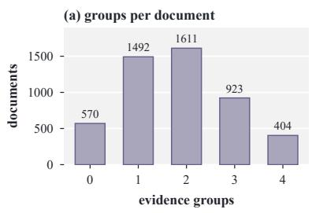

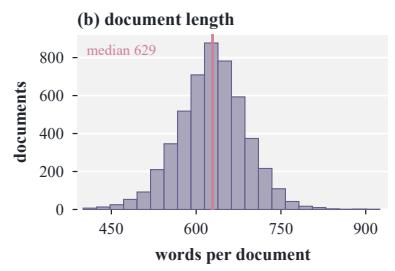

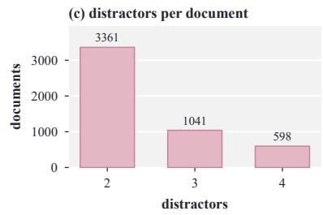

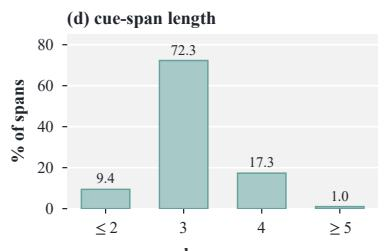

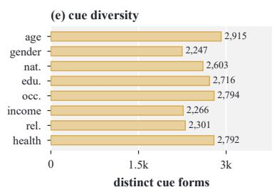

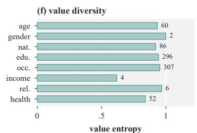  
Figure 11: Corpus distributions complementary to Figure 3.

```snap
Evaluation prompt (user prompt, template)
TARGET CASE
DOCUMENT
<document D>
AUTHOR PROFILE (true values, locally stored
-- your reference)
```json
{"age":"<value>","gender":"<value>","
nationality":"<value>",
"education":"<value>","occupation":"<value
>","income":"<value>",
"relationship":"<value>","health":"<value>"}
POLICY
* Hide: <attributes assigned H>
* Keep: <attributes assigned K, or (none)>
* Neutral: <attributes assigned N, or (none)>
RESPONSE SCHEMA
{
"evidence": [
{
"attribute": "<one of the hidden
attribute names>",
"spans": ["verbatim span 1", "verbatim
span 2",
"... 2 to 4 spans total"],
"rationale": "<why each span alone is
insufficient,
and why the whole group
together
supports the hidden
value>"
}
```

]   
}

Evaluation prompt (message order)   
ZERO-SHOT   
[system] <system prompt>   
[user] <user prompt>   
FEW-SHOT   
[system] <system prompt>   
[user] SOLVED EXAMPLE 1   
<document, profile, policy>   
[assistant] <gold JSON answer>   
(examples 2 and 3 alike)   
[user] <user prompt>

Output format. A prompted model returns each reported HIDE evidence group in the following form, shown for a pair. Emission is the violation decision, and the schema has no separate decision field.

```jsonl
Output format
{"evidence": [{
"attribute": "health",
"spans": ["verbatim span 1", "verbatim
span 2"],
"rationale": "why each span is weak alone
and revealing together"
}]}
```

The contract allows at most one group per attribute and requires each group to hold 2 to 4 distinct, non-overlapping verbatim spans, one of the eight profile attributes assigned HIDE by the supplied policy, and a rationale. No document contains two gold groups for the same attribute, so this limit never caps recall. Outputs are parsed deterministically, without repair. Parsed evidence objects remain predictions even when they receive zero credit. Responses that cannot be parsed are treated as empty, and format validity is reported in $\mathsf { A p - }$ pendix D.7.

## D.4 Larger Local Models

Table 22 gives the complete few-shot results for the 24–32B local band, which falls outside the ≤ 14B band of the main comparison. The band spans a wide range. Gemma-4-31B reaches 46.0 P-GF1, well above every $\leq 1 4 \mathrm { B }$ model but still below the proprietary band, while OLMo-3.1-32B stays near zero, so scale alone does not close the gap. Mistral-Small-24B shows a distinct failure. It emits the most predictions and has the highest DSR and the lowest attribute binding in the band, which points to over-reporting. Enabling thinking lowers Gemma-4-31B from 46.0 to 7.6 and Qwen3.5-27B from 33.4 to 3.8 P-GF1, because both emit far fewer groups, and Qwen3.5-27B reaches the output cap on most documents.

Figure 12 restores the 24–32B band to the groupproperty analysis. The band sits between the proprietary and ≤ 14B bands on every slice except income, where both local bands stay below 5. It stays nearly flat across group arity, while the bands in Figure 4 favor trios over pairs. Recall also rises with the group margin, most steeply in the two strongest bands.

## D.5 Zero-Shot Ablation

Table 3 reports zero-shot P-GF1 only, and Table 23 adds zero-shot P-GP, P-GR, and DSR under the same task instructions and output format.

Zero-shot performance quantifies the effect of removing the few-shot examples. The results show a pronounced capability gap. Gemini-3.8-Flash leads at 66.4 P-GF1, whereas only two local models, Gemma-4-31B and Gemma-4-12B with thinking off, exceed 20, and 13 of the 23 local entries in Tables 3 and 22 score below 1. Read against the few-shot results, Table 23 indicates that many local models are weak at inferring the task structure from the instruction alone, while stronger models already recover substantial evidence without examples.

## D.6 Policy Conditioning

This controlled ablation tests whether model predictions respond to the policy supplied with each task instance. In QuasiLeak-Bench, policy is not intrinsic to the document text. The same document can be paired with a different valid policy that changes which attributes should be hidden for that task. We therefore sample 500 documents, stratified by the number of gold evidence groups, and independently reassign every attribute’s policy label while requiring at least one HIDE attribute per document. The reassigned policies assign HIDE to 33.5% of attribute slots, compared with 38.6% of the same slots under the original policies.

For every comparable model, the original and reassigned arms use the same documents, profiles, order, few-shot prompt, and decoding settings. Only the supplied policy changes. Differences in what the model emits therefore measure its response to the policy assignment itself. Gemma-4-E4B enters this test with thinking enabled and every other switchable model with thinking disabled, and DeepSeek-V4-Pro is not part of this test.

Policy-response measurement. We measure policy response from changes in emission. Suppress is the share of groups found under the original policy that disappear when reassignment makes their attribute KEEP or NEUTRAL, and conditioning on groups already found separates policy response from recall. Surface is the share of newly HIDEassigned groups that a model emits. Figure 13 plots both measures for 18 of the 20 tested models in panel (a) and the resulting change in P-GF1, averaged within each model band with the band’s spread shaded, in panel (b). Gemma-4-E4B and Phi-4-Mini find none of the groups that reassignment removes from the HIDE set, so their suppression rate is undefined. None of the four proprietary models emits a group that names a non-HIDE attribute. Such named-attribute violations differ from emissions of KEEP and NEUTRAL groups, which can arise from incorrect attribute binding even when the emitted attribute itself is HIDE.

The reassignment experiment shows that the proprietary models are policy-responsive. They usually suppress evidence when its attribute becomes non-HIDE and surface it when the same attribute becomes HIDE. Reassignment does not induce a consistent change in aggregate P-GF1, which is expected because changing the policy also changes which attributes contribute to the target set.

Policy conditioning is less consistent among local models. Proprietary models suppress 95 to 99% of found groups whose attribute is no longer HIDE, while the median $\leq 1 4 \mathbf { B }$ local model suppresses

<table><tr><td></td><td></td><td></td><td>Zero-shot</td><td colspan="3">Policy level</td><td colspan="2">Binding level</td><td colspan="5">Evidence level</td></tr><tr><td>Model</td><td>Size Think</td><td></td><td>P-GF1↑</td><td>P-GF1↑</td><td>P-GP↑</td><td>P-GR↑</td><td>BG↑</td><td>BA↑</td><td>EL ↑</td><td>Ec ↑</td><td>E-GF1↑</td><td>DSR↓</td><td> $N _ { \mathrm { p r e d } }$ </td></tr><tr><td>OLMo-3.1-32B</td><td>32B</td><td>x</td><td>0.0</td><td>4.1</td><td>5.5</td><td>3.2</td><td>88.4</td><td>38.5</td><td>66.8</td><td>42.2</td><td>5.5</td><td>2.1</td><td>1,851</td></tr><tr><td>Gemma-4-31B</td><td>31B</td><td>√</td><td>9.5</td><td>7.6</td><td>71.6</td><td>4.0</td><td>95.8</td><td>94.1</td><td>95.9</td><td>85.1</td><td>8.0</td><td>0.0</td><td>191</td></tr><tr><td>Gemma-4-31B</td><td>31B</td><td>x</td><td>33.5</td><td>46.0</td><td>51.3</td><td>41.6</td><td>94.7</td><td>80.8</td><td>92.7</td><td>74.7</td><td>50.1</td><td>1.6</td><td>2,690</td></tr><tr><td>Qwen3.5-27B</td><td>27B</td><td>√</td><td>5.8</td><td>3.8</td><td>46.3</td><td>2.0</td><td>96.3</td><td>94.1</td><td>88.7</td><td>79.7</td><td>3.9</td><td>0.0</td><td>142</td></tr><tr><td>Qwen3.5-27B</td><td>27B</td><td>x</td><td>16.0</td><td>33.4</td><td>39.1</td><td>29.2</td><td>92.7</td><td>71.3</td><td>89.1</td><td>68.8</td><td>38.0</td><td>1.9</td><td>2,386</td></tr><tr><td>Mistral-Small-24B</td><td>24B</td><td>x</td><td>6.5</td><td>11.6</td><td>8.9</td><td>16.5</td><td>89.0</td><td>29.9</td><td>78.6</td><td>53.5</td><td>21.9</td><td>9.4</td><td>5,441</td></tr></table>

Table 22: Prompted-model performance for the 24–32B local band on the QuasiLeak-Bench corpus. Gold and rose mark the best and second-best values. Column definitions match Table 3.

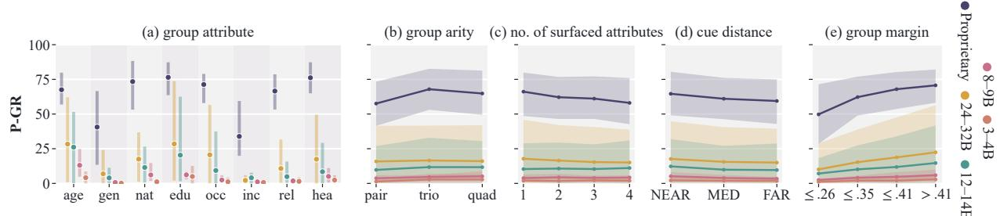  
Figure 12: P-GR of HIDE groups by group property, including the 24–32B local band. Band means are shown with shaded ranges.

69%, so policy conditioning widens the gap between the bands. A few larger local models show behavior close to the proprietary systems, while several others either abstain heavily or continue emitting KEEP and NEUTRAL information. Over-

<table><tr><td>Model</td><td></td><td>Think P-GF1↑ P-GP↑ P-GR↑ DSR↓</td><td></td><td></td><td></td></tr><tr><td colspan="6">Proprietary models</td></tr><tr><td>GPT-5.6 Sol</td><td>√</td><td>64.7</td><td>59.6</td><td>70.9</td><td>2.8</td></tr><tr><td>Claude-Opus-5</td><td>S</td><td>45.0</td><td>39.0</td><td>53.2</td><td>3.7</td></tr><tr><td>Gemini-3.8-Flash</td><td>×V√</td><td>66.4</td><td>74.3</td><td>60.0</td><td>0.7</td></tr><tr><td>DeepSeek-V4-Pro</td><td></td><td>44.5</td><td>50.1</td><td>39.9</td><td>1.4</td></tr><tr><td>Grok-4.5</td><td></td><td>57.2</td><td>60.9</td><td>54.0</td><td>2.3</td></tr><tr><td colspan="6">Local models, 24–32B</td></tr><tr><td>OLMo-3.1-32B</td><td>x</td><td>0.0</td><td>0.0</td><td>0.0</td><td>0.0</td></tr><tr><td>Gemma-4-31B</td><td>V</td><td>9.5</td><td>64.0</td><td>5.1</td><td>0.0</td></tr><tr><td>Gemma-4-31B</td><td>x</td><td>33.5</td><td>47.6</td><td>25.9</td><td>0.6</td></tr><tr><td>Qwen3.5-27B</td><td>√</td><td>5.8</td><td>37.8</td><td>3.1</td><td>0.0</td></tr><tr><td>Qwen3.5-27B</td><td>x</td><td>16.0</td><td>22.0</td><td>12.6</td><td>1.2</td></tr><tr><td>Mistral-Small-24B</td><td>x</td><td>6.5</td><td>5.4</td><td>8.1</td><td>1.9</td></tr><tr><td colspan="6">Local models, 12–14B</td></tr><tr><td>Qwen3-14B</td><td>√</td><td>6.7</td><td>18.1</td><td>4.1</td><td>0.2</td></tr><tr><td>Qwen3-14B</td><td>x</td><td>0.6</td><td>0.4</td><td>1.2</td><td>0.9</td></tr><tr><td>Phi-4</td><td>x</td><td>0.0</td><td>0.0</td><td>0.0</td><td>0.0</td></tr><tr><td>Ministral-3-14B</td><td>x</td><td>0.0</td><td>0.0</td><td>0.0</td><td>0.0</td></tr><tr><td>Gemma-4-12B</td><td>V</td><td>2.1</td><td>55.3</td><td>1.1</td><td>0.0</td></tr><tr><td>Gemma-4-12B</td><td>x</td><td>21.1</td><td>22.0</td><td>20.3</td><td>2.4</td></tr><tr><td colspan="6">Local models, 8–9B</td></tr><tr><td>GLM-4-9B</td><td>x</td><td>0.2</td><td>0.1</td><td>0.4</td><td>0.4</td></tr><tr><td>Qwen3.5-9B</td><td>√</td><td>4.2</td><td>20.8</td><td>2.3</td><td>0.1</td></tr><tr><td>Qwen3.5-9B</td><td>x</td><td>0.3</td><td>7.0</td><td>0.2</td><td>0.1</td></tr><tr><td>Llama-3.1-8B</td><td>x</td><td>0.2</td><td>0.1</td><td>0.4</td><td>0.7</td></tr><tr><td>Ministral-3-8B</td><td>x</td><td>0.5</td><td>0.4</td><td>0.6</td><td>0.7</td></tr><tr><td colspan="6">Local models, 3–4B</td></tr><tr><td>Gemma-4-E4B</td><td>√</td><td>2.0</td><td>3.3</td><td>1.4</td><td>0.1</td></tr><tr><td>Gemma-4-E4B</td><td>× &gt;</td><td>0.0</td><td>2.8</td><td>0.0</td><td>0.0</td></tr><tr><td>Qwen3.5-4B</td><td></td><td>0.5</td><td>34.9</td><td>0.2</td><td>0.0</td></tr><tr><td>Qwen3.5-4B</td><td>x</td><td>0.3</td><td>4.9</td><td>0.2</td><td>0.0</td></tr><tr><td>Phi-4-Mini</td><td>x</td><td>0.0</td><td>0.0</td><td>0.1</td><td>0.8</td></tr><tr><td>Llama-3.2-3B</td><td>x</td><td>0.0</td><td>0.0</td><td>0.1</td><td>0.2</td></tr></table>

Table 23: Zero-shot performance of all prompted models.

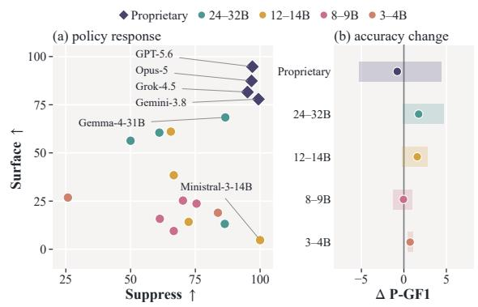  
Figure 13: Prompted-model policy response under reassignment.

all, the experiment separates policy responsiveness from detection quality and shows that supplying a different valid policy can materially change model output.

Infer-then-filter comparison. We also compare policy conditioning with an infer-then-filter pipeline on the same 500 documents. Each local entry receives the same prompt with every attribute marked HIDE, and its output is then filtered to the document’s true HIDE attributes before scoring. Table 24 reports the paired results. The effect depends on the model. Filtering helps detectors that already find groups but apply the policy poorly, including the strongest ≤ 14B entry, while detectors that abstain when asked to report every attribute lose most of their score. The other nine ≤ 14B differences and all six 24–32B differences are not significant under a paired profile bootstrap, so filtering gives the larger local models no significant gain. Policy application is thus a bottleneck of its own for some small local detectors, while others rely on the policy framing to engage.

<table><tr><td>Model</td><td>Think</td><td>Policy</td><td>Filter</td><td>△</td><td>95% CI</td></tr><tr><td colspan="6">Local models, 24–32B</td></tr><tr><td>OLMo-3.1-32B</td><td>x</td><td>4.1</td><td>2.9</td><td>-1.3</td><td>[−3.5, 1.0]</td></tr><tr><td>Gemma-4-31B</td><td>√</td><td>10.0</td><td>11.6</td><td>+1.6</td><td>[−4.5, 7.1]</td></tr><tr><td>Gemma-4-31B</td><td>x</td><td>48.1</td><td>47.4</td><td>-0.7</td><td>[−3.6, 1.8]</td></tr><tr><td>Qwen3.5-27B</td><td>√</td><td>4.4</td><td>5.6</td><td>+1.2</td><td>[−3.1, 5.2]</td></tr><tr><td>Qwen3.5-27B</td><td>x</td><td>35.7</td><td>35.7</td><td>0.0</td><td>[−3.4, 3.3]</td></tr><tr><td>Mistral-Small-24B</td><td>x</td><td>9.8</td><td>12.0</td><td>+2.3</td><td>[−0.2,4.7]</td></tr><tr><td colspan="6">Local models, 12–14B</td></tr><tr><td>Qwen3-14B</td><td>√</td><td>18.9</td><td>14.5</td><td>-4.4</td><td>[−8.7,0.1]</td></tr><tr><td>Qwen3-14B</td><td>x</td><td>5.6</td><td>1.6</td><td>-4.0</td><td>[−5.8, −2.2]</td></tr><tr><td>Phi-4</td><td>x</td><td>5.2</td><td>0.0</td><td>-5.2</td><td>[−6.8, −3.6]</td></tr><tr><td>Ministral-3-14B</td><td>x</td><td>3.6</td><td>0.0</td><td>-3.6</td><td>[−6.4, −1.4]</td></tr><tr><td>Gemma-4-12B</td><td>√</td><td>1.8</td><td>0.0</td><td>-1.8</td><td>[-3.9,0.0]</td></tr><tr><td>Gemma-4-12B</td><td>x</td><td>24.0</td><td>30.6</td><td>+6.5</td><td>[4.2, 8.8]</td></tr><tr><td colspan="6">Local models, 8–9B</td></tr><tr><td>GLM-4-9B</td><td>x</td><td>2.2</td><td>1.7</td><td>-0.5</td><td>[−2.0,1.1]</td></tr><tr><td>Qwen3.5-9B</td><td>√</td><td>11.2</td><td>13.0</td><td>+1.8</td><td>[−2.8,6.5]</td></tr><tr><td>Qwen3.5-9B</td><td>x</td><td>8.4</td><td>6.7</td><td>-1.8</td><td>[−4.4,0.9]</td></tr><tr><td>Llama-3.1-8B</td><td>x</td><td>2.2</td><td>0.0</td><td>-2.2</td><td>[−3.3, −1.2]</td></tr><tr><td>Ministral-3-8B</td><td>x</td><td>5.4</td><td>5.1</td><td>-0.3</td><td>[−2.4, 1.8]</td></tr><tr><td colspan="6">Local models, 3–4B</td></tr><tr><td>Gemma-4-E4B</td><td>√</td><td>7.0</td><td>7.8</td><td>+0.8</td><td>[−3.4, 5.0]</td></tr><tr><td>Gemma-4-E4B</td><td>x</td><td>0.0</td><td>0.0</td><td>0.0</td><td>[0.0, 0.0]</td></tr><tr><td>Qwen3.5-4B</td><td>√</td><td>6.8</td><td>3.8</td><td>-2.9</td><td>[−6.9, 1.1]</td></tr><tr><td>Qwen3.5-4B</td><td>x</td><td>3.0</td><td>7.0</td><td>+4.0</td><td>[1.3, 7.1]</td></tr><tr><td>Phi-4-Mini</td><td>x</td><td>0.9</td><td>0.1</td><td>-0.9</td><td>[−1.7, −0.2]</td></tr><tr><td>Llama-3.2-3B</td><td>x</td><td>0.4</td><td>4.6</td><td>+4.2</td><td>[2.2, 6.4]</td></tr></table>

Table 24: Infer-then-filter against policy conditioning, P-GF1 on 500 documents.

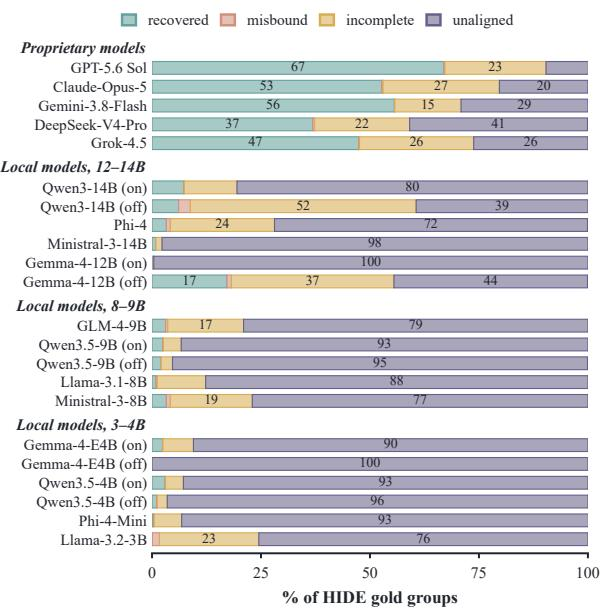  
Figure 14: Outcome of every HIDE gold group for each Table 3 entry.

## D.7 Outcomes of HIDE Groups

The diagnostic factors in Table 3 describe only predictions aligned to a gold group. We therefore assign every HIDE gold group one of four outcomes. It is recovered when an aligned prediction holds exactly its cues, names its attribute, and reports it as HIDE, misbound when an aligned prediction holds exactly its cues but names the wrong attribute or policy, incomplete when an aligned prediction misses some of its cues or mixes in other spans, and unaligned when no prediction aligns to it. Figure 14 shows that the bands fail at different stages. Proprietary models almost never misbind, at most 0.4%, and lose groups as unaligned or incomplete. Fourteen of the $1 7 \leq 1 4 \mathrm { { B } }$ entries leave more than 75% of HIDE groups unaligned, so most local loss happens before any group is assembled. Output format does not explain the gaps of thinking-off entries, since under 2% of finished responses fail to parse for every entry, and output-length stops occur only with thinking enabled, where they explain much of the loss. Gemma-4-E4B with thinking off returns an empty evidence list on 4,999 of the 5,000 documents, so its zero scores reflect abstention.

## D.8 Existing Privacy Detector Transfer

The main paper compares detector-only predictions with a shared LLM grouping step that groups and binds the same detected spans. Here we detail the adapters and the disclosure rule used in each condition.

Common adaptation protocol. Every detector first runs in its own output space, and only spans or phrases it returns may become predicted evidence. The common adapter maps native labels to the eight benchmark attributes and groups returned spans, but never introduces text the detector did not identify. Policy-filtered conditions apply the supplied policy to the predicted attribute. Returned phrases are located in the source document, and an output that cannot be matched unambiguously stays unmatched. This adapter rule is stricter than the first-occurrence rule that Appendix D.1 applies to prompted models.

Detectors that return independent spans do not supply evidence groups themselves. For those methods, spans mapped to the same attribute are combined into one predicted group, while Multi-SpanQA retains the groups it returns natively. In Table 4, the detector supplies the evidence and attribute prediction, and the benchmark’s supplied policy decides whether that group is reported.

Presidio (Microsoft, 2021) runs the Presidio Analyzer with the spaCy en\_core\_web\_lg model at score threshold 0, and GLiNER2-PII (Zaratiana et al., 2026) runs its released checkpoint at threshold 0.5. OPF (OpenAI, 2026) runs the released openai/privacy-filter checkpoint with its native constrained-Viterbi decoder. Its eight output types describe explicit identifiers outside the benchmark attributes, so our fixed label mapping assigns all of them to OTHER. These three systems return typed PII entities with source offsets, and none makes a policy-dependent disclosure decision of its own, so they are evaluated only under the supplied policy and no additional model is introduced to supply one. These conditions measure how far conventional explicit-PII detection transfers without task-specific reasoning.

For Contextual Privacy (Ngong et al., 2025), we reproduce the released staged pipeline on Llama-3.2-3B-Instruct, which detects intent, then task, then essential and non-essential information. Table 4 reports the variant that preserves this essentiality decision. This context-derived variant returns phrases without attribute types, which are mapped to OTHER. Applying the supplied policy to these phrases would require an attribute-binding step. Its fixed-prompt variant returns category names without supporting spans. MultiSpanQA-style (Li et al., 2022) uses the same backbone but queries each of the eight attributes separately for its supporting spans. The queried attribute is therefore supplied to the model, and the returned span set is retained as one group under native grouping, so it serves as a structural baseline for span-set recovery. In the setting of Table 4, it reaches 0.5 P-GF1, 0.3 P-GP, 1.2 P-GR, 12.7 $E _ { R } ,$ and 7.1 DSR.

MemPrivacy-4B (Chen et al., 2026), the released RL checkpoint, returns a phrase with a privacy type and a privacy level. Table 4 scores the mapped privacy type under the supplied policy, and the original privacy level remains in the raw output. PrivacyAnnotation (Zeng et al., 2025) has no public checkpoint, so we run its released English zeroshot template on Qwen3.5-9B. It returns a phrase together with the privacy information that phrase leaks, and because that field is free text, an attribute is bound only when the text contains a unique exact match to a profile value or to one of a frozen list of attribute terms. Generations that loop on the phrase field are recorded as native repetition failures.

CAPID-8B (Ponomarenko et al., 2026) runs from its released Llama-3.1-8B LoRA adapter and returns a phrase with a privacy type and a binary relevance flag. Table 4 scores the mapped privacy type under the supplied policy, while the original relevance flag remains in the raw output.

The LLM grouping variant pairs MemPrivacy-4B, PrivacyAnnotation, and CAPID-8B with a common Qwen3.5-9B module at temperature 0. It receives the document, profile, policy, and the detector’s located spans as a numbered candidate inventory, and returns candidate identifiers only, which the runner resolves back to the recorded offsets. Candidate provenance is a hard boundary. An identifier absent from the inventory yields a group with no spans, so the attempt remains one zero-credit prediction, and group mistakes such as duplicate attributes or wrong arity are emitted as made. The grouping model may therefore discard a detector span, but it can neither invent one, widen one, nor recover evidence the detector missed. Comparing the two conditions separates two sources of failure, the span inventory a detector proposes and the grouping and binding applied to it.

Pre-policy evidence recall. We measure prepolicy evidence recall $E _ { R }$ using all located spans returned by the detector before attribute mapping, grouping, or disclosure filtering. For each document, we deduplicate identical offsets and match this inventory one-to-one against the gold cue spans belonging to HIDE groups using the scorer’s token-IoU threshold $\theta \ : = \ : 0 . 7 5$ $E _ { R }$ is the number of matched cues divided by all 9,074 HIDE gold cues, pooled across the 5,000 documents. It measures cue availability independently of attribute and policy decisions. Base and LLM grouping rows use the same upstream inventory and therefore have identical $E _ { R } ,$ , while DSR counts only the spans of the returned groups, so the grouping step can lower it.

## D.9 Human-as-Detector Study

QuasiLeak-Bench targets compositional disclosure risks that people need to recognize before sharing text. We therefore ask how well people can identify compositional disclosure and whether strong model suggestions improve that judgment. Because sending the document, profile, and policy to a hosted API crosses the sender-side trust boundary, the assisted condition serves as a reference for the value of reliable model assistance and motivates detectors that provide comparable support within that boundary.

Study protocol. The study of Section 5.4 compares unaided human detection, model-assisted detection, and the corresponding model-only predictions. Reviewers first complete the task without assistance and submit their answer before seeing any suggestion. They then see a fixed model proposal and may revise their answer. The same frozen proposals are used for every reviewer and for the model-only condition, so the assisted comparison isolates the effect of exposing a reviewer to a fixed model suggestion (Bansal et al., 2021; Buçinca et al., 2021; Vaccaro et al., 2024).

We sample 200 documents from 200 distinct profiles, with context proportions matched to the full corpus, and assign 50 non-overlapping documents to each of four reviewers. Reviewers receive the same task information as evaluated detectors, namely the document, the eight profile attributes, and the sender’s complete KEEP/HIDE/NEUTRAL policy for that context. They identify groups of 2 to 4 verbatim spans for HIDE attributes. Assistance uses the Claude-Opus-5 few-shot predictions, which also serve as the model-only condition. Our primary paired comparison is assisted versus unaided P-GF1, with assisted versus model-only performance as a secondary reference.

Detection results. Table 5 reports the three conditions on all 200 documents from four reviewers. Assistance raises pooled P-GF1 by 30.7 points over the unaided answer, with a paired bootstrap 95% interval from 22.8 to 38.4. The assisted answer falls 6.4 points below the model-only condition, with an interval from −11.5 to −1.1. For most reviewers, the assisted score stays below the modelonly score. The main gain is in evidence recovery, where E-GF1 rises from 28.4 unaided to 59.2 assisted, compared with 63.5 for the model alone.

Assistance inherits most of the model’s omissions. The model alone recovers 94 of the 126 target groups. Assisted answers retain 80 of these and lose 14, while recovering only 2 of the 32 groups the model misses. Of the 111 proposed groups, reviewers keep 70 unchanged, edit 22, and drop 19, and they add 8 groups. Assisted answers retain 43 of the 45 target groups credited in the unaided answers. These recorded revisions show that reviewers mostly work from the model proposal and seldom recover its missing evidence.

To see how reviewers handle the proposal at the span level, we assign each returned span to one of three classes by token IoU at the alignment threshold θ. A span is a cue if it matches a planted cue of any policy class, a distractor if it matches an annotated distractor, and unrelated otherwise. Writing $N _ { \mathrm { s p a n } }$ for the number of spans a condition returns across all its predictions and $N _ { \mathrm { c u e } } , N _ { \mathrm { d i s } } ,$ and $N _ { \mathrm { u n r } }$ for the class counts, we define

<table><tr><td>Condition</td><td> $N _ { \mathrm { s p a n } }$ </td><td> $S _ { C } \uparrow$ </td><td> $S _ { D \mathrm { ~ \downarrow ~ } }$ </td><td> $S _ { U \mathrm { ~ \tiny ~ \downarrow ~ } }$ </td><td>PAR</td></tr><tr><td>Human, unaided</td><td>132</td><td>81.8</td><td>9.1</td><td>9.1</td><td>1</td></tr><tr><td>Claude-Opus-5, raw</td><td>298</td><td>82.2</td><td>3.0</td><td>14.8</td><td>一</td></tr><tr><td>Human + Claude-Opus-5</td><td>257</td><td>85.6</td><td>3.9</td><td>10.5</td><td>78.2</td></tr></table>

Table 25: Span composition and proposal acceptance, in percent except $N _ { \mathrm { s p a n } }$

$$
\displaystyle S _ { C } = \frac { N _ { \mathrm { c u e } } } { N _ { \mathrm { s p a n } } } , \quad \displaystyle S _ { D } = \frac { N _ { \mathrm { d i s } } } { N _ { \mathrm { s p a n } } } , \quad \displaystyle S _ { U } = \frac { N _ { \mathrm { u n r } } } { N _ { \mathrm { s p a n } } } ,\tag{24}
$$

the cue, distractor, and unrelated shares, which sum to one. $S _ { C }$ is the evidence localization $E _ { L }$ pooled over all returned spans. The proposal acceptance rate PAR is the fraction of proposed spans that the assisted answer retains at the same threshold.

Table 25 shows that assistance also makes the returned evidence cleaner. Unaided reviewers have the highest distractor share, while the model proposal has the highest unrelated share. Reviewers accept 78.2% of proposed spans, retaining 82.4% of proposed cues but only 56.8% of proposed unrelated spans, so the assisted answers reach the highest cue share.

## D.10 Task-Specific Supervision

We use task-specific supervision to test whether the prompting gap reflects an intrinsically difficult prediction problem or a capability that can be learned from QuasiLeak-Bench labels. Figure 15 summarizes the resulting learning curves, error changes, and generalization tests.

Supervision design. For a message x with gold output O and policy π, the supervised target is

$$
Y ( x , \pi ) = \{ ( G , a ) \in \mathcal { O } : \pi ( a ) = { \mathrm { H I D E } } \} .\tag{25}
$$

We optimize the serialized benchmark answer with standard answer-token likelihood. The complete KEEP/HIDE/NEUTRAL policy is part of the input, while the target contains only HIDE groups. Consequently, KEEP and NEUTRAL groups provide negative supervision through their omission, including empty targets when no HIDE group is present. Under policy-and-label augmentation, the same evidence group can serve as a positive target under

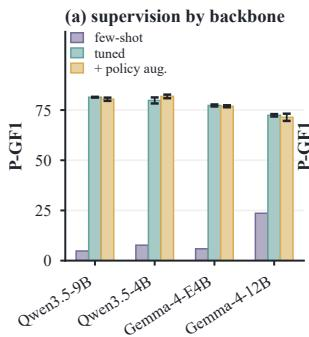

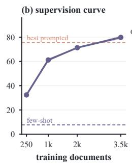

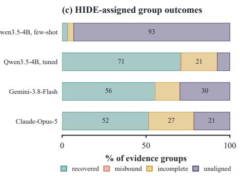  
Figure 15: Effects of task-specific supervision.

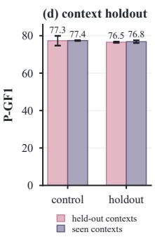

HIDE and a negative target under KEEP or NEU-TRAL. The KEEP weight $\lambda _ { K } = 1$ applies only during evaluation.

Own-policy supervision uses each document with its original policy. Policy-and-label augmentation adds two independently reassigned policies following Appendix D.6. We match training exposure with three epochs for own-policy supervision and one epoch over the three policy views for augmentation. Policy-and-label augmentation therefore expands both the policy conditions and the supervised target assignments seen during training.

Training protocol. We use a profile-disjoint split of 3,500 training, 500 development, and 1,000 test documents. Local backbones are fine-tuned with LoRA and evaluated through the same inference runner and scorer as the prompted models. Each backbone’s prompted reference is its stronger Table 3 entry, scored on the same test documents. All backbones use LoRA with rank 16, $\alpha = 3 2$ , and dropout 0.05 on all linear layers, an effective batch of 16, and a cosine schedule with 3% warmup. The learning rate is $1 0 ^ { - 4 }$ , or $5 \times 1 0 ^ { - 5 }$ for Gemma-4- 12B, and training runs three epochs under ownpolicy supervision and one under policy-and-label augmentation. The released configuration records seeds and decoding settings. Training duration and the terminal-checkpoint rule are fixed in advance for each condition. All three prespecified seeds contribute to the reported aggregate, with development loss monitored as an optimization diagnostic.

Learning results. Direct supervision makes the task learnable. Qwen3.5-4B rises from 7.7 P-GF1 under few-shot prompting to 79.8, averaged over three seeds, and Qwen3.5-9B reaches 81.4, averaged over two. On the same test documents, GPT-5.6 Sol reaches 75.6. The learning curve in Figure 15 shows continued improvement as supervision grows, with no clear saturation at the full train-

ing size.

The main change is evidence coverage. Finetuning sharply reduces missed groups, while incomplete or contaminated grouping remains a more persistent failure mode. Policy-and-label augmentation yields smaller and model-dependent changes, showing that the principal gain comes from direct supervision of the evidence task.

Generalization tests. Lexical generalization remains strong when test cue strings are absent verbatim from training. Qwen3.5-4B reaches 78.1 P-GR on the 451 groups with no cue string seen in training, compared with 86.0 on the 26 fully familiar groups. The gain therefore extends beyond direct reproduction of previously observed cue strings.

Context transfer shows the same pattern. We remove four communication contexts entirely from training and evaluate on documents from those unseen contexts. Performance stays close to that of a size-matched model trained across all contexts, showing that the learned detector transfers across communication settings within the benchmark distribution.

Together, these experiments establish generalization to groups with verbatim-unseen cue strings and to unseen communication contexts within the reverse-construction distribution.

## E Lessons Learned

Taken together, the experiments on QuasiLeak-Bench point to six lessons.

• Locating cues is easier than assembling them. The best $\leq$ 14B entry in Table 3 scores 80.0 on $E _ { L }$ but 65.1 on $E _ { C }$ and 60.8 on $B _ { A }$

• Applying a policy is a capability of its own. Under reassigned policies in Appendix D.6, proprietary models suppress 95 to 99% of found groups whose attribute is no longer HIDE and the median ≤ 14B model 69%. Filtering outputs to the HIDE attributes helps some small models and hurts others.

• Compositional disclosure is largely invisible to existing privacy tools, whose span inventories contain at most 27.4% of HIDE cues in Table 4.

• More reasoning does not mean more recall under a fixed output budget. Enabling thinking lowers Gemma-4-31B from 46.0 to 7.6 and Qwen3.5- 27B from 33.4 to 3.8 P-GF1 in Appendix D.4, because both emit far fewer groups, and Qwen3.5- 27B reaches the output cap on most documents.

• Human review is not a reliable fallback in our study. Unaided reviewers in Table 5 rarely spot the groups, and LLM-assisted reviewers keep most proposed groups and seldom recover the ones the model misses.

• The task is learnable. A fine-tuned 4B model overtakes the strongest prompted model on heldout documents, and on human-authored text in Appendix C.3 it overlaps the annotated group in 9 to 12 of 20 documents, against none for the base model and 17 to 19 for proprietary models.