# RANKING AND PARTITIONING OF ATTENTION HEADS FOR SPARSE AND CONTINUAL REINFORCEMENT LEARNING FINE-TUNING

Ruizhe Shi1 Zaiwen Yang2 Qiubo Wang3 Banghua Zhu¹ Maryam Fazel1,4

1University of Washington 2Tsinghua University 3University of Hong Kong 4Amazon, Inc.

## ABSTRACT

We study sparse and continual reinforcement learning fine-tuning of language models through attention-head ranking and partitioning. For sparse learning, we rank attention heads by gradient norm to identify a small subset of heads that can be trained effectively. For continual learning, we partition heads across tasks to reduce cross-task interference and preserve previously learned capabilities. Theoretically, we relate gradient norm to training effectiveness, and further characterize why sparse, separated head updates can remain stable. Empirically, across math, instruction-following, and coding tasks, tuning higher-ranked heads consistently outperforms tuning lower-ranked ones while often matching denser baselines, and head partitioning improves retention while preserving adaptation to new tasks.

## 1 INTRODUCTION

Reinforcement-learning (RL) fine-tuning has become an important approach for improving the capabilities of language models (LMs). However, RL fine-tuning is expensive, especially when a large fraction of model parameters is updated, which increases gradient memory and synchronization costs in distributed training (Miahi & Belilovsky, 2026; Fireworks.ai, 2026). Recent works suggest that effective adaptation can often be achieved by updating only restricted parts of the LM, such as attention modules or individual transformer layers (Jin et al., 2025; Zhang et al., 2026). This motivates sparse RL fine-tuning under a limited trainable-parameter budget.

In this work, we focus on attention heads as the basic units for sparse RL fine-tuning. Classical pruning studies show that many attention heads can be removed with little performance degradation, while a smaller subset plays more important roles (Michel et al., 2019; Voita et al., 2019). More recent studies further suggest that attention heads can specialize toward different latent signals during training (Sagitova et al., 2026), and that high-level LM capabilities can be localized to sparse, task-specific subsets of heads (Bair et al., 2026). This motivates us to design a criterion to identify those heads that are most effective to update during training.

Sparse RL fine-tuning is also appealing for continual learning, where sequential updates can interfere with previously learned capabilities and lead to catastrophic forgetting. A common approach is to constrain different tasks to parameter or gradient subspaces (Chaudhry et al., 2020; Doan et al., 2020; Wang et al., 2023; Liang & Li, 2024; Qiu et al., 2026). Sparse updates can therefore serve to separate task-specific adaptations. Such parameter isolation avoids direct overwriting, yet indirect functional interference may remain (Lanzillotta et al., 2023), requiring careful selection of the trainable parameters such as Iurada et al. (2025); Lin et al. (2025; 2026).

Contributions. We study attention-head ranking and partitioning for sparse and continual RL finetuning. Our main contributions are summarized as follows:

• We propose gradient norm as a simple criterion for ranking attention heads. Across several tasks, tuning higher-ranked heads consistently outperforms tuning lower-ranked heads, while often matching or exceeding denser baselines.

• We propose partitioning attention heads across sequential tasks and study several head-allocation strategies. Our experiments show that head partitioning with these strategies effectively prevents forgetting while preserving adaptation to new tasks.

• We provide a theoretical analysis to guide both designs. We characterize the role of gradient norm in the optimization dynamics of sparse and continual learning, and further analyze the secondorder structure of multi-head self-attention, revealing favorable properties of attention-head blocks for parameter and functional isolation.

## 2 RELATED WORKS

Sparse optimization in deep learning and LMs. Sparse optimization has been studied through subset selection (Dan et al., 2019), sparse reward-model structure (Yao et al., 2025; Shi et al., 2026), and sparse task-specific parameter updates (Guo et al., 2021). For LMs, recent works show that updating only attention modules (Jin et al., 2025) or a single layer (Zhang et al., 2026) can obtain competitive performance, while sparse updates can improve communication efficiency in distributed RL (Miahi & Belilovsky, 2026; Fireworks.ai, 2026).

Subspace continual learning. A common approach to continual learning is to reduce interference by constraining new-task updates to subspaces that avoid directions important for previous tasks. Early methods construct such subspaces from past gradients or representations (Farajtabar et al., 2020; Saha et al., 2021; Chaudhry et al., 2020; Doan et al., 2020). Recent works extend this idea to LoRA adaptation (Wang et al., 2023; Liang & Li, 2024; Zhang et al., 2025; Qiu et al., 2026), full fine-tuning (Nayak et al., 2026), and model merging (Qiao & Mahdavi, 2026; Tang et al., 2025; Yang et al., 2025). Iurada et al. (2025) rank parameters by sensitivity measured using Fisher matrix, and fine-tune only the least-sensitive ones. Lin et al. (2025) update only parameters that are activated more strongly by new data than by pretraining data, reducing interference with prior knowledge. Lin et al. (2026) dynamically update parameter-level masks based on accumulated gradient magnitudes, whereas we use static head-level gradient norms.

Theoretical understanding of continual learning. Neural tangent kernel (NTK)-based analyses relate catastrophic forgetting to overlap between task-induced tangent subspaces (Doan et al., 2020; Zheng et al., 2026), while kernel-based views have also been developed for LM fine-tuning (Malladi et al., 2023). Parameter isolation has been studied through Hessian-based arguments (Lanzillotta et al., 2023). In RL, Luo et al. (2026) characterize loss of plasticity through degradation of spectral plasticity, while Shenfeld et al. (2026) show that online RL tends to forget less by staying closer to the base policy, and Chen et al. (2026) attribute this advantage to the use of on-policy data. We connect the stability-plasticity trade-off in continual learning directly to gradient norms.

Mechanism of attention heads. Prior work has shown that attention heads are highly heterogeneous, with many heads being redundant while a smaller subset exhibits specialized behavior (Michel et al., 2019; Voita et al., 2019). More directly related to this work, Bair et al. (2026) show that small subsets of attention heads can be critical to performance on particular LM capabilities. Sagitova et al. (2026) theoretically characterize how attention heads specialize toward distinct latent signals during training. Ormaniec et al. (2025) further analyzes the second-order structure of self-attention. Together, these results motivate us to focus on attention heads as structured units.

## 3 PRELIMINARIES

Notations. Let $\left[ H \right] : = \left\{ 1 , \ldots , H \right\}$ index the attention heads. We partition the trainable attention parameters into disjoint head blocks $\boldsymbol { \theta } = ( \theta _ { 1 } , \dots , \theta _ { H } )$ , where $\theta _ { h }$ denotes the parameters associated with head $h .$ For ${ \mathit { S } } \subseteq \left\lceil H \right\rceil$ , let $\theta _ { S } : = ( \theta _ { h } ) _ { h \in S }$ and $S ^ { c } : = \lceil H \rceil \backslash S$ More generally, we write $x _ { h }$ and $x _ { S }$ for the corresponding vector blocks, and $D _ { h h ^ { \prime } }$ and $D _ { S T }$ for the corresponding matrix blocks, for $h , h ^ { \prime } \in [ H ] , \dot { S } , T \subseteq \mathbf { \bar { [ } } H ]$ . For an update $\Delta = ( \Delta _ { 1 } , \ldots , \Delta _ { H } )$ , define its head support by supp $\mathrm { { \underline { { \ { \ { h e a d } } } } } } ( \Delta ) : = \ \{ \bar { h } \in [ H ] : \| \bar { \Delta _ { h } } \| _ { 2 } > 0 \}$ . Let $\{ \xi _ { i } \} _ { i = } ^ { N }$ denote the training data and $\mathcal { L } ( \theta ) : =$ $\begin{array} { r } { \frac { 1 } { N } \sum _ { i = 1 } ^ { N } \mathcal { L } ( \boldsymbol { \theta } ; \boldsymbol { \xi } _ { i } ) } \end{array}$ the empirical training loss. In the RL fine-tuning setting, each $\xi _ { i }$ is a prompt, and $\displaystyle \ddot { \mathcal { L } } ( \overline { { { \theta } } } ; \xi _ { i } )$ denotes the corresponding empirical RL loss induced by rollouts from that prompt. We use $\| \cdot \| _ { 2 }$ for the Euclidean norm and $\left\| A \right\| _ { \mathrm { o p } }$ for the operator norm of a matrix $A$

Gradient norm. Given a model with parameters $\theta ,$ we define the gradient norm of a head set $S$ as

$$
\mathcal { G } ( S ; \theta ) : = \| \nabla _ { \theta _ { S } } \mathcal { L } ( \theta ) \| _ { 2 } = \sqrt { \sum _ { h \in S } \| \nabla _ { \theta _ { h } } \mathcal { L } ( \theta ) \| _ { 2 } ^ { 2 } } .
$$

For two tasks A and B, we write $\mathcal G _ { A } ( S ; \theta ) : = \| \nabla _ { \theta _ { S } } \mathcal L _ { A } ( \theta ) \| _ { 2 }$ and $\mathcal { G } _ { B } ( S ; \theta ) : = \| \nabla _ { \theta _ { S } } \mathcal { L } _ { B } ( \theta ) \| _ { 2 }$ . We assume that these losses are twice continuously differentiable on the relevant training regions.

Second-order terms of loss Hessian. We study the directional second-order derivative:

$$
\frac { \big | \nabla _ { \theta } \mathcal { L } ( \theta ) ^ { \top } \nabla _ { \theta } ^ { 2 } \mathcal { L } _ { ( \theta ) } \nabla _ { \theta } \mathcal { L } ( \theta ) \big | } { \| \nabla _ { \theta } \mathcal { L } ( \theta ) \| _ { 2 } ^ { 2 } } ,
$$

which measures how rapidly the gradient norm changes when moving along its own normalized gradient direction. For two objectives $\mathcal { L } _ { A }$ and $\mathcal { L } _ { B }$ , we also study the mixed directional second-order derivative:

$$
\frac { \big | \nabla _ { { \boldsymbol { \theta } } } \mathcal { L } _ { A } ( { \boldsymbol { \theta } } ) ^ { \top } \nabla _ { { \boldsymbol { \theta } } } ^ { 2 } \mathcal { L } _ { A } ( { \boldsymbol { \theta } } ) \nabla _ { { \boldsymbol { \theta } } } \mathcal { L } _ { B } ( { \boldsymbol { \theta } } ) \big | } { \| \nabla _ { { \boldsymbol { \theta } } } \mathcal { L } _ { A } ( { \boldsymbol { \theta } } ) \| _ { 2 } \| \nabla _ { { \boldsymbol { \theta } } } \mathcal { L } _ { B } ( { \boldsymbol { \theta } } ) \| _ { 2 } } ,
$$

which measures how rapidly the task-A gradient norm changes when moving along the normalized task-B gradient direction.

Multi-head self-attention. Consider a multi-head self-attention layer with input $X \in \mathbb { R } ^ { L \times d }$ and H heads. For head $h \in [ H ]$ , let $W _ { h } ^ { Q } , W _ { h } ^ { K } \in \mathbb { R } ^ { d \times d _ { k } }$ and $W _ { h } ^ { V } \in \mathbb { R } ^ { d \times d }$ , and define

$$
Q _ { h } = X W _ { h } ^ { Q } , \quad K _ { h } = X W _ { h } ^ { K } , \quad V _ { h } = X W _ { h } ^ { V } , \quad A _ { h } = \mathrm { s o f t m a x } \left( \frac { Q _ { h } K _ { h } ^ { \top } } { \sqrt { d _ { k } } } \right) .
$$

The layer output is $\begin{array} { r } { F ( \theta ) = \sum _ { h = 1 } ^ { H } A _ { h } V _ { h } \in \mathbb { R } ^ { L \times d } } \end{array}$

## 4 RANKING THE ATTENTION HEADS

## 4.1 THEORETICAL UNDERSTANDINGS

We now study gradient-norm ranking for attention heads. Given the base model $\theta _ { 0 } ,$ let $\mathcal { G } ( S ) : =$ $\mathcal { G } ( S ; \theta _ { 0 } )$ denote the gradient norm defined in Section 3, and let $S _ { k }$ be the set of the k heads with largest individual gradient norms at $\theta _ { 0 }$ . Omitted proofs are deferred to Appendix $\mathrm { A . 1 }$ . We first characterize what this quantity measures under gradient flow.

Proposition 1. Let $\theta ( t ; S )$ follow Euclidean gradient flow restricted to S, initialized at $\theta _ { 0 } ,$ and suppose the flow exists on $[ 0 , T ]$ . Then $\begin{array} { r } { - \frac { d } { d t } \mathcal { L } ( \theta ( t ; S ) ) = \mathcal { G } ( S ; \theta ( t ) ) ^ { 2 } } \end{array}$

Proof. The gradient flow satisfies $\dot { \theta } _ { S } ( t ; S ) = - \nabla _ { \theta _ { S } } \mathcal { L } ( \theta ( t ; S ) )$ and ${ \dot { \theta } } _ { S ^ { c } } ( t ; S ) = 0$ , so the chain rule gives $\begin{array} { r } { \frac { d } { d t } \mathcal { L } \big ( \theta ( t ; S ) \big ) = - \| \nabla _ { \theta _ { S } } \mathcal { L } ( \theta ( t ; S ) ) \| _ { 2 } ^ { 2 } = - \mathcal { G } ( \tilde { S } ; \theta ( t ) ) ^ { 2 } } \end{array}$ □

Corollary 2. We have $\begin{array} { r } { S _ { k } \in \arg \operatorname* { m a x } _ { | S | \leqslant k } \big \{ - \left. \frac { d } { d t } \mathcal { L } ( \theta ( t ; S ) ) \right| _ { t = 0 } \big \} } \end{array}$ , which maximizes the initial loss decrease rate.

Corollary 3. For any head set S and any $t > 0$ for which the restricted flow exists, define the time-averaged gradient norm by $\begin{array} { r } { \overline { { \mathcal { G } } } ( S ; t ) : = \sqrt { \frac { 1 } { t } } \int _ { 0 } ^ { t } \mathcal { G } ( S ; \theta ( s ; S ) ) ^ { 2 } } \end{array}$ ds. Then we have

$$
\mathcal { L } ( \theta _ { 0 } ) - \mathcal { L } ( \theta ( t ; S _ { k } ) ) \geqslant \frac { \overline { { \mathcal { G } } } ( S _ { k } ; t ) ^ { 2 } } { \operatorname* { m a x } _ { | S | \leqslant k } \overline { { \mathcal { G } } } ( S ; t ) ^ { 2 } } \operatorname* { m a x } _ { | S | \leqslant k } \left[ \mathcal { L } ( \theta _ { 0 } ) - \mathcal { L } ( \theta ( t ; S ) ) \right] .
$$

Remark 1. This simple gradient-flow analysis shows that gradient norm characterizes training efficiency under a fixed head budget. It determines both the initial loss-decrease rate and finite-time progress through the time-averaged gradient norm.

Proposition 4. Suppose that, for some $\beta > 0$

$$
\frac { \big | ( \nabla _ { \theta _ { S } } \mathcal { L } ( \theta ( t ; S ) ) ) ^ { \top } \nabla _ { \theta _ { S } } ^ { 2 } \mathcal { L } ( \theta ( t ; S ) ) \nabla _ { \theta _ { S } } \mathcal { L } ( \theta ( t ; S ) ) \big | } { \| \nabla _ { \theta _ { S } } \mathcal { L } ( \theta ( t ; S ) ) \| _ { 2 } ^ { 2 } } \leqslant \beta
$$

for all $t \in [ 0 , T ]$ with $\mathcal { G } ( S ; \theta ( t ; S ) ) > 0 .$ Then, for every $t \in ( 0 , T ]$

$$
\sqrt { \frac { 1 - e ^ { - 2 \beta t } } { 2 \beta t } } { \mathcal { G } } ( S ) \leqslant { \overline { { { \mathcal { G } } } } } ( S ; t ) \leqslant \sqrt { \frac { e ^ { 2 \beta t } - 1 } { 2 \beta t } } { \mathcal { G } } ( S ) .
$$

Remark 2. Under the second-order condition, the time-averaged gradient norm remains controlled by its initial value, so the ranking need not be recomputed during training as in Lin et al. (2026). In our experiments in Section 4.2, this ranking remains instructive for hundreds of training steps. See Section 6 for discussions on why the second-order assumption on attention blocks is reasonable.

Adam's perspective. We now give a complementary optimizer-level interpretation based on Adam. Let m and v denote the moment estimates used in the Adam update at $\theta _ { 0 } .$ and let

$$
D : = \mathrm { d i a g } ( \sqrt { v } + \epsilon _ { \mathrm { a d a m } } ) > 0 , \qquad \eta > 0 ,
$$

where $\epsilon _ { \mathrm { a d a m } } > 0$ The Adam step $\Delta ^ { \mathrm { a d a m } } = - \eta D ^ { - 1 }$ m minimizes the objective (Duchi et al., 2011):

$$
\mathcal { L } _ { \mathrm { a d a m } } ( \Delta ) : = m ^ { \top } \Delta + \frac { 1 } { 2 \eta } \Delta ^ { \top } D \Delta ,
$$

where η is the learning rate. To induce head-level sparsity, we add a group-lasso penalty and consider

$$
\mathcal { L } _ { \mathrm { a d a m } _ { \lambda } } ( \Delta ) : = m ^ { \top } \Delta + \frac { 1 } { 2 \eta } \Delta ^ { \top } D \Delta + \lambda \sum _ { h = 1 } ^ { H } \| \Delta _ { h } \| _ { 2 } , \qquad \lambda \geqslant 0 .
$$

Proposition 5. The unique minimizer $\Delta ^ { \star } ( \lambda )$ of $\mathcal { L } _ { \mathrm { a d a m } _ { \lambda } } ( \Delta )$ satisfies that ∃k, s.t

$$
\mathrm { s u p p } _ { \mathrm { h e a d } } ( \Delta ^ { \star } ( \lambda ) ) = \arg \operatorname * { T o p K } _ { h } \left( \| m _ { h } \| _ { 2 } ^ { 2 } \right) ~ .
$$

Proposition 6. Define $\Delta _ { S } ^ { \star }$ as a minimizer of $\mathcal { L } _ { \mathrm { a d a m } } ( \Delta )$ w.r.t. $\mathrm { s u p p } _ { \mathrm { h e a d } } ( \Delta ) \subseteq S ,$ and $S _ { k } ^ { ( m ) }$ be the set of the k heads with largest $\| \boldsymbol { m } _ { h } \| _ { 2 }$ . Then we have

$$
\mathcal { L } _ { \mathrm { a d a m } } ( \Delta _ { S _ { k } ^ { ( m ) } } ^ { \star } ) \leqslant \operatorname* { m i n } _ { | S | \leqslant k } \frac { \operatorname* { m i n } _ { i \in \theta _ { S } } \sqrt { v _ { i } } + \epsilon _ { \mathrm { a d a m } } } { \operatorname* { m a x } _ { i \in \theta _ { S _ { k } ^ { ( m ) } } } \sqrt { v _ { i } } + \epsilon _ { \mathrm { a d a m } } } \cdot \mathcal { L } _ { \mathrm { a d a m } } ( \Delta _ { S } ^ { \star } ) .
$$

Remark 3 (Connection to practical optimization). Theorem 5 shows that a group-sparse Adam update selects heads according to the first-moment magnitudes $\| \boldsymbol { m } _ { h } \| _ { 2 }$ , while Theorem 6 shows that the top-k heads under this ranking approximately optimize Adam's local quadratic objective. Since $m _ { h }$ is the exponential moving average of past gradients, the gradient norm $\mathcal { G } ( \{ h \} ) = \mathbf { \bar { \| } } \nabla _ { \theta _ { h } } \mathcal { L } ( \theta _ { 0 } ) \| _ { 2 }$ provides a natural surrogate for $\| \boldsymbol { m } _ { h } \| _ { 2 }$ . This provides an optimizer-level motivation beyond the gradient-flow analysis.

## 4.2 HEAD-SPARSE LEARNING EXPERIMENTS

Experimental setup. We evaluate head-sparse RL fine-tuning on Math, Instruction-following (IF), and Coding using QWEN3-1.7B, QWEN3-4B, and MISTRAL-7B-INSTRUCT-V0.3. For each task, we rank attention heads by gradient norms at the initial checkpoint and compare training the top 50% and bottom 50% heads, together with full-attention tuning and full tuning baselines. We also include random 50% attention-head tuning, where 50% head blocks are randomly selected per layer, as a baseline. All training jobs share the same training configuration, except that, given the substantially larger number of trainable parameters, we use smaller learning rates for full tuning of the QWEN3 series and for experiments on MISTRAL-7B-INSTRUCT-V0.3. Implementation details are provided in Appendix C.

Main results. Tables 1 and 2 show a consistent advantage of gradient-based head selection. Top-50% tuning outperforms bottom-50% tuning across all model–task pairs and evaluation splits, and also generally outperforms the random-50% baseline. While random selection occasionally performs better on some tasks for QwEN3-1.7B, the advantage of top-ranked heads is more robust across various settings. Despite updating only half of the attention heads, top-50% tuning often matches or exceeds full-attention and full tuning, with the same trend extending to MiSTRAL-7B-INSTRUCT-v0.3. As shown in Table 10 in Appendix B.2, head-sparse tuning also reduces the gradients to be stored and synchronized at each step, offering a significant communication-efficiency advantage in distributed training (Fireworks.ai, 2026; Miahi & Belilovsky, 2026). These results support gradient norm as an effective criterion for identifying heads useful for sparse RL tuning, consistent with the theoretical claims in Section 4.1. See supplemental results in Appendix B.1.

Comments on learning rates. Readers may wonder whether the weaker bottom 50% results simply arise because their smaller gradient scales require larger learning rates. We note that, under the fixed training configuration and the same trainable-parameter budget, this already reflects a nontrivial training-efficiency gap; moreover, if the difference were only a uniform gradient rescaling, Adam's normalization would cancel this effect. We further sweep the learning rate for bottom 50% attentionhead tuning in Appendix B.4. It reveals that larger learning rates help in some cases, but the gap to top 50% attention-head tuning generally remains.

Head-ranking consistency. Table 11 in Appendix B.2 reports Spearman distances between independently computed head rankings. Within-task distances are consistently small, indicating stable rankings across subsets of the same task. Cross-task distances are larger, reflecting task-specific differences in head importance, but remain small overall, suggesting a shared intrinsic hierarchy across tasks. In practice, this consistency also suggests that, when the training set is large, head rankings can be estimated from a small subset of the data to reduce the computation cost.

Layer-ranking consistency. We further compare gradient-norm ranking with the candidate-layer rankings obtained by direct performance evaluation. As shown in Table 3, the two rankings are highly consistent across the QWEN3-BASE series, and exactly match for QWEN3-4B-BASE. This provides additional evidence that gradient norm can serve as a useful proxy for identifying trainable attention components without exhaustively evaluating each candidate. The layer distributions of top heads are visualized in Appendix B.3.

Sparsity-performance trade-off. Beyond the fixed 50% sparsity setting, we further vary the number of trainable heads to examine how performance changes with the head budget. All configurations use the same training setup, differing only in the number of trainable attention heads. Figure 1 shows that performance generally improves as more top-ranked heads are included, while the major performance can already be achieved with a relatively small head budget.

Table 1: Sparse RL accuracy (%) of QwEN3 series. Parenthesized arrows are the performance drops compared with top 50%. The top-2 results are highlighted in pink. Top/bottom 50% performance is reported as mean±std over three random rollout seeds {32, 42, 52}.
<table><tr><td>Model</td><td>Task</td><td>Eval split</td><td>Base</td><td>Top 50%</td><td>Bottom 50%</td><td>Rand 50%</td><td>Full-attn</td><td>Full</td></tr><tr><td rowspan="2">QWEN3-1.7B</td><td rowspan="2">Math</td><td>In-dist test</td><td>26.6</td><td>36.7 ±1.0</td><td> $3 0 . 9 \pm 1 . 0 ( \downarrow 5 . 8 )$ </td><td>38.6</td><td>33.1</td><td>35.3</td></tr><tr><td>Out-dist test</td><td>70.2</td><td> $7 6 . 7 \pm 0 . 9$ </td><td> $7 3 . 6 \pm 1 . 4 ( \downarrow 3 . 1 )$ </td><td>79.2</td><td>74.2</td><td>73.6</td></tr><tr><td rowspan="2">QWEN3-1.7B</td><td>IF</td><td>In-dist test</td><td>41.7</td><td> $5 7 . 3 \pm 0 . 8 $ </td><td> $4 7 . 0 \pm 0 . 2 ( \downarrow 1 0 . 3 )$ </td><td>51.6</td><td>59.4</td><td>54.6</td></tr><tr><td></td><td>Out-dist test</td><td>17.7</td><td> $2 2 . 2 \pm 2 . 7$ </td><td> $1 5 . 9 \pm 0 . 8 ( \downarrow 6 . 3 )$ </td><td>19.7</td><td>20.0</td><td>19.7</td></tr><tr><td rowspan="2">QWEN3-1.7B</td><td>Coding</td><td>In-dist test</td><td>53.7</td><td> $5 9 . 5 \pm 1 . 2 $ </td><td> $5 7 . 8 \pm 0 . 8 ( \downarrow 1 . 8 )$ </td><td>58.5</td><td>58.2</td><td>61.6</td></tr><tr><td></td><td>Out-dist test</td><td>33.6</td><td> $3 5 . 2 \pm 1 . 4$ </td><td> $3 3 . 9 \pm 0 . 4 ( \downarrow 1 . 3 )$ </td><td>35.6</td><td>34.8</td><td>34.4</td></tr><tr><td rowspan="2">QWEN3-4B</td><td>Math</td><td>In-dist test</td><td>42.4</td><td> $5 6 . 9 \pm 2 . 8 $ </td><td> $5 0 . 8 \pm 2 . 5 ( \downarrow 6 . 2 )$ </td><td>53.3</td><td>55.3</td><td>58.2</td></tr><tr><td></td><td>Out-dist test</td><td>81.4</td><td> $8 6 . 6 \pm 1 . 9$ </td><td> $8 4 . 1 \pm 1 . 2 ( \downarrow 2 . 5 )$ </td><td>83.6</td><td>86.0</td><td>88.2</td></tr><tr><td rowspan="2">QWEN3-4B</td><td>IF</td><td>In-dist test</td><td>50.5</td><td> $6 0 . 7 \pm 3 . 8 $ </td><td> $5 2 . 5 \pm 1 . 0 ( \downarrow 8 . 2 )$ </td><td>56.3</td><td>56.2</td><td>59.2</td></tr><tr><td></td><td>Out-dist test</td><td>21.0</td><td> $2 5 . 6 \pm 1 . 3$ </td><td> $2 5 . 4 \pm 1 . 0 \ : ( \downarrow \ : 0 . 1 )$ </td><td>25.3</td><td>26.0</td><td>24.0</td></tr><tr><td rowspan="2">QWEN3-4B</td><td>Coding</td><td>In-dist test</td><td>64.6</td><td> $6 9 . 8 \pm 1 . 6$ </td><td>67.1 ±0.7 (↓ 2.7)</td><td>66.7</td><td>65.1</td><td>66.4</td></tr><tr><td></td><td>Out-dist test</td><td>46.3</td><td>53.0 ±2.2</td><td>47.0 ±3.4 (↓ 5.9)</td><td>37.9</td><td>47.9</td><td>43.6</td></tr></table>

Table 2: Sparse RL accuracy (%) of MISTRAL-7B-INSTRUCT-V0.3. Parenthesized arrows are the performance drops compared with top 50%. The highest results are highlighted in pink.
<table><tr><td>Model</td><td>Task</td><td>Eval split</td><td>Base</td><td>Top 50%</td><td>Bottom 50%</td><td>Full-attn</td></tr><tr><td rowspan="2">MISTRAL-7B-INSTRUCT-V0.3</td><td>IF</td><td>In-dist test</td><td>27.4</td><td>69.9</td><td>53.5 (↓ 16.4)</td><td>56.9</td></tr><tr><td></td><td>Out-dist test</td><td>18.3</td><td>21.0</td><td>20.3 (↓ 0.7)</td><td>25.3</td></tr></table>

Table 3: Math candidate-layer rankings for QwEN3-BASE series. Rankings are obtained using the gradient norms of attention heads in each layer, computed on a 3k-subset of DAPO-Math-17k.
<table><tr><td>Model</td><td>Performance ranking (Zhang et al., 2026)</td><td>Gradient norm ranking</td></tr><tr><td> $\mathbf { Q } \mathbf { w } \mathbf { E N 3 - 1 . 7 B - B A S E }$ </td><td> $1 0 > 1 2 > 1 > 7 > 2 4$ </td><td> $1 2 > 1 0 > 7 > 2 4 > 1$ </td></tr><tr><td> $\mathbf { Q } \mathbf { w } \mathbf { e } \mathbf { N } 3 \mathbf { - } 4 \mathbf { B } \mathbf { - } \mathbf { B } \mathbf { A } \mathbf { S } \mathbf { E }$ </td><td> $1 6 > 1 4 > 1 1 > 2 4 > 2$ </td><td> $1 6 > 1 4 > 1 1 > 2 4 > 2$ </td></tr><tr><td> $\mathbf { Q } \mathbf { w } \mathbf { e } \mathbf { N } 3 \mathbf { - } \mathbf { 8 } \mathbf { B } \mathbf { - } \mathbf { B } \mathbf { A } \mathbf { S } \mathbf { E }$ </td><td> $1 6 > 1 5 > 8 > 2 > 0$ </td><td> $1 5 \approx 1 6 > 0 > 8 > 2$ </td></tr></table>

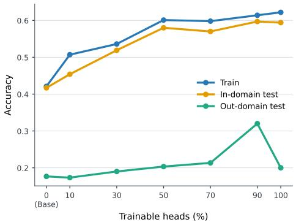  
(a) QWEN3-1.7B, IF

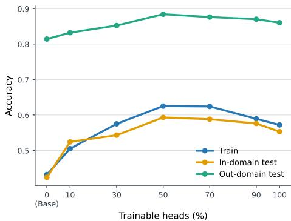  
(b) QWEN3-4B, Math  
Figure 1: Sparsity-performance trade-off on training, in-distribution test, and out-of-distribution test sets. Each panel includes top 10, 30, 50, 70, and 90% attention-head tuning plus full-attention tuning. All jobs share exactly the same training configuration.

## 5 PARTITIONING THE ATTENTION HEADS

## 5.1 THEORETICAL UNDERSTANDINGS

We consider sequential learning of two tasks A and B. Starting from a base model $\theta _ { 0 } ,$ task A is trained on a head set $S _ { A }$ to obtain $\theta _ { A } .$ after which task B is trained on a head set $S _ { B }$ from $\theta ( 0 ) = \theta _ { A }$ . Recall that Section 4 motivates using high-gradient-norm heads for task A.

Updating the same parameters for task B can overwrite the parameter changes induced by task A. This concern is particularly pronounced when the trainable parameters are restricted to a sparse subset, motivating the use of disjoint head sets across tasks. Sometimes we may assume an exact partition, $S _ { B } \subseteq S _ { A } ^ { c }$

We now characterize the trade-off between learning task B and preserving task A, i.e., plasticity and stability. Omitted proofs are deferred to Appendix A.2.

Proposition 7. Let θ(t) follow task-B Euclidean gradient flow restricted to $S _ { B }$ , initialized at $\theta ( 0 ) = \theta _ { A }$ Then $\begin{array} { r } { - \frac { d } { d t } \mathcal { L } _ { B } ( \theta ( t ) ) = \mathcal { G } _ { B } ( S _ { B } ; \theta ( t ) ) ^ { 2 } } \end{array}$ , while the change in the task-A loss satisfies $\begin{array} { r } { \left| \frac { d } { d t } \mathcal { L } _ { A } ( \theta ( t ) ) \right| \leqslant \mathcal { G } _ { A } ( S _ { B } ; \theta ( t ) ) \mathcal { G } _ { B } ( S _ { B } ; \theta ( t ) ) } \end{array}$

Proof. The first equation is by Theorem 1. The gradient flow satisfies $\dot { \theta } _ { S _ { B } } ( t ) = - \nabla _ { \theta _ { S _ { B } } } \mathcal { L } _ { B } ( \theta ( t ) )$ and $\dot { \theta } _ { S _ { R } ^ { c } } ( t ) = 0$ , so the chain rule gives dd $\sharp _ { \bf \Pi } \mathcal { L } _ { A } ( \theta ( t ) ) \ = \ - \langle \nabla _ { \theta _ { S _ { B } } } \mathcal { L } _ { A } ( \theta ( t ) ) , \nabla _ { \theta _ { S _ { B } } } \mathcal { L } _ { B } ( \theta ( t ) ) \rangle$ . The desired bound follows from Cauchy-Schwarz inequality. □

Corollary 8. Define the contraharmonic time-averaged gradient norm by

$$
\widetilde { \mathscr G } _ { B } ( S _ { B } ; t ) : = \frac { \int _ { 0 } ^ { t } \mathscr G _ { B } ( S _ { B } ; \theta ( s ) ) ^ { 2 } d s } { \int _ { 0 } ^ { t } \mathscr G _ { B } ( S _ { B } ; \theta ( s ) ) d s } ~ , \quad \widetilde { \mathscr G } _ { A | B } ( S _ { B } ; t ) : = \frac { \int _ { 0 } ^ { t } \mathscr G _ { A } ( S _ { B } ; \theta ( s ) ) \mathscr G _ { B } ( S _ { B } ; \theta ( s ) ) d s } { \int _ { 0 } ^ { t } \mathscr G _ { B } ( S _ { B } ; \theta ( s ) ) d s } ~ .
$$

$$
\begin{array} { r } { T h e n | \mathcal { L } _ { A } ( \theta ( t ) ) - \mathcal { L } _ { A } ( \theta _ { A } ) | \leqslant \frac { \tilde { \mathcal { G } } _ { A | B } ( S _ { B } ; t ) } { \tilde { \mathcal { G } } _ { B } ( S _ { B } ; t ) } [ \mathcal { L } _ { B } ( \theta _ { A } ) - \mathcal { L } _ { B } ( \theta ( t ) ) ] . } \end{array}
$$

Remark 4. For task $B ,$ we prefer heads with small task-A but large task-B gradient norm. When $S _ { B } \subseteq S _ { A } ^ { c }$ , since heads in $S _ { A } ^ { c }$ are not directly updated during task-A training, their task-A gradient norms may remain controlled by their initial values when the gradient changes smoothly. This suggests balancing the allocation by assigning some high-task-A-gradient heads to task A and some high-task-B-gradient heads to task B, motivating our later allocation strategy design.

Proposition 9. Suppose the task-B restricted gradient flow exists on [0, T], and $\exists \beta _ { A } , \beta _ { B } \geqslant 0 \ s . t .$

$$
- \frac { \nabla _ { \theta _ { s _ { B } } } \mathcal { L } _ { A } ( \theta ( t ) ) ^ { \top } \nabla _ { \theta _ { s _ { B } } } ^ { 2 } \mathcal { L } _ { A } ( \theta ( t ) ) \nabla _ { \theta _ { s _ { B } } } \mathcal { L } _ { B } ( \theta ( t ) ) } { \| \nabla _ { \theta _ { s _ { B } } } \mathcal { L } _ { A } ( \theta ( t ) ) \| _ { 2 } \| \nabla _ { \theta _ { s _ { B } } } \mathcal { L } _ { B } ( \theta ( t ) ) \| _ { 2 } } \leqslant \beta _ { A } ~ , ~ \frac { \nabla _ { \theta _ { s _ { B } } } \mathcal { L } _ { B } ( \theta ( t ) ) ^ { \top } \nabla _ { \theta _ { s _ { B } } } ^ { 2 } \mathcal { L } _ { B } ( \theta ( t ) ) \nabla _ { \theta _ { s _ { B } } } \mathcal { L } _ { B } ( \theta ( t ) ) } { \| \nabla _ { \theta _ { s _ { B } } } \mathcal { L } _ { B } ( \theta ( t ) ) \| _ { 2 } ^ { 2 } } \leqslant \beta _ { B } ~ ,
$$

whenever the corresponding gradient norms > 0. Then, for every $t \in ( 0 , T ]$

$$
| \mathcal { L } _ { A } ( \boldsymbol { \theta } ( t ) ) - \mathcal { L } _ { A } ( \boldsymbol { \theta } _ { A } ) | \leqslant \frac { \mathcal { G } _ { A } ( S _ { B } ; \boldsymbol { \theta } _ { A } ) } { \widetilde { \mathcal { G } } _ { B } ( S _ { B } ; t ) } [ \mathcal { L } _ { B } ( \boldsymbol { \theta } _ { A } ) - \mathcal { L } _ { B } ( \boldsymbol { \theta } ( t ) ) ] + \frac { \beta _ { A } [ \mathcal { L } _ { B } ( \boldsymbol { \theta } _ { A } ) - \mathcal { L } _ { B } ( \boldsymbol { \theta } ( t ) ) ] ^ { 2 } } { 2 \widetilde { \mathcal { G } } _ { B } ( S _ { B } ; t ) ^ { 2 } } ,
$$

where $\begin{array} { r } { \widetilde { \mathcal { G } } _ { B } ( S _ { B } ; t ) \geqslant \sqrt { \frac { 1 - e ^ { - 2 \beta _ { B } t } } { 2 \beta _ { B } t } } \mathcal { G } _ { B } ( S _ { B } ; \theta _ { A } ) . } \end{array}$

Remark 5. Similar to Theorem 4, this result demonstrates that the initial gradient norms can remain informative for controlling the stability-plasticity trade-off over a nontrivial training interval. In our experiments in Section 5.2, rankings computed at the initial checkpoint effectively guide continual training over hundreds of training steps. See Section 6 for discussions on the corresponding secondorder assumptions for attention blocks.

## 5.2 SEQUENTIAL CONTINUAL LEARNING EXPERIMENTS

Experimental setup. We evaluate whether partitioning attention heads can reduce interference in continual RL. We sequentially fine-tune QWEN3-1.7B and QWEN3-4B on two- and three-task sequences over Math, IF, and Coding. We compare head-partitioned tuning with continual fullattention and full-tuning baselines. Implementation details are provided in Appendix C.

Motivated by Section 5.1, we consider three head-allocation strategies:

• Top-Bottom: the previous task uses top-ranked heads, while the next task uses the remaining.

• Round-Robin: tasks alternately select their highest-ranked unassigned heads.

• Shared: in addition to disjoint task-specific heads, a remaining subset is shared across tasks.

For two-task experiments, we compare the first two strategies. For three-task experiments, we use the third, assigning 25% of the heads to each task and sharing the remaining 25%. It is worth emphasizing that we do not claim these strategies to be optimal and exhaustive. Instead, they serve to validate our theory and demonstrate possible ways to apply it.

Main results. Figures 2 to 4 show that head partitioning generally reduces forgetting while preserving adaptation to the new task, especially when full-attention tuning causes large drops on earlier tasks. Top-Bottom typically retains the first task better but adapts slightly worse to the second, while Round-Robin shows the opposite trade-off, consistent with their allocation strategies. Figures 5 and 6 further show that the head-partition approach extends to three sequential tasks with minimal degradation on previous tasks, supporting the theoretical claims in Section 5.1. See supplemental results in Appendix B.2.

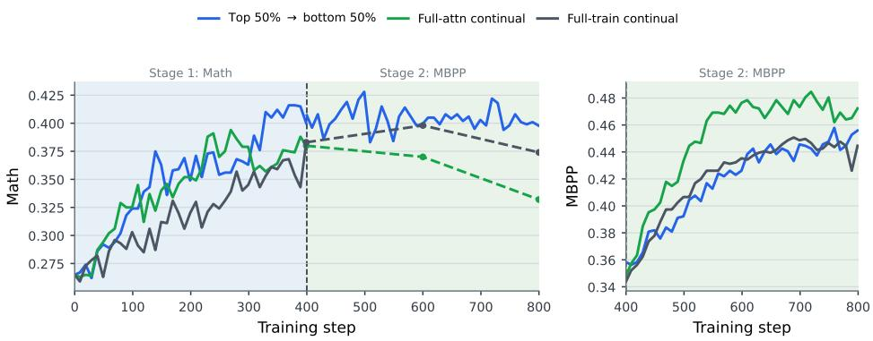  
Figure 2: Continual RL accuracy of QWEN3-1.7B (Math → Coding). The model is first trained on Math task and then on Coding task. Shaded regions mark stages.

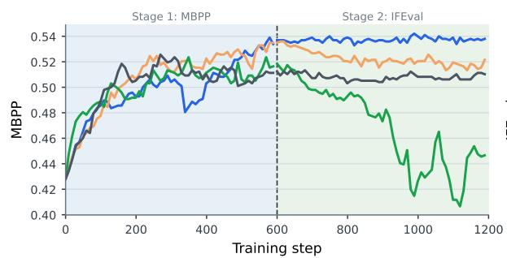

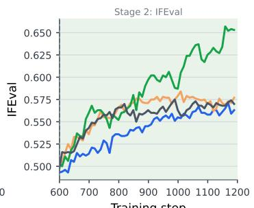  
Figure 3: Continual RL accuracy of QwEN3-4B (Coding → IF). The model is first trained on Coding task and then on IF task. Shaded regions mark stages.

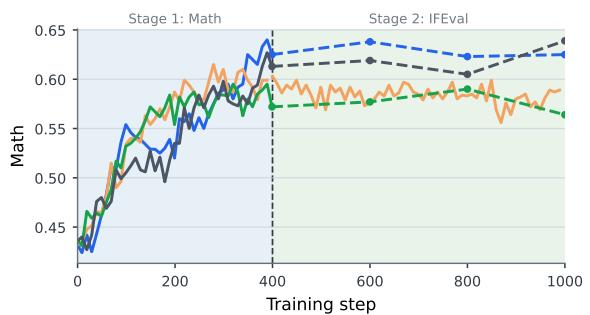

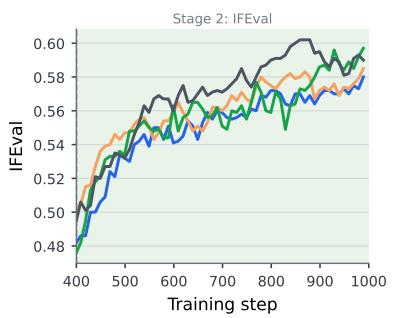  
Figure 4: Continual RL accuracy of QWEN3-4B (Math → IF). The model is first trained on Math task and then on IF task. Shaded regions mark stages.

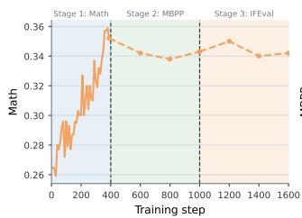

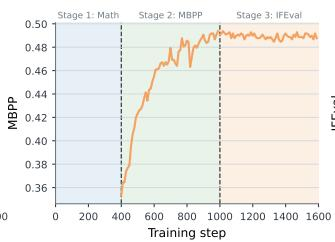

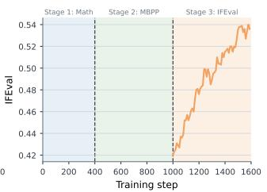  
Figure 5: Continual RL accuracy of QWEN3-1.7B (Math → Coding → IF). The model is first trained on Math task, then on Coding task, and finally on IF task. Shaded regions mark stages.

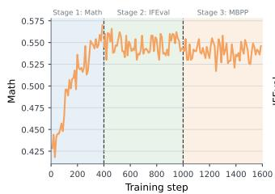

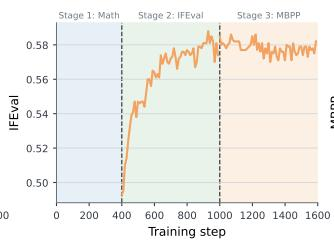

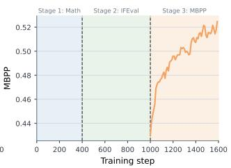  
Figure 6: Continual RL accuracy of QWEN3-4B (Math → IF → Coding). The model is first trained on Math task, then on IF task, and finally on Coding task. Shaded regions mark stages.

Furthermore, to test whether the learned adaptations are functionally localized, we reset the stage-I heads to their original values after stage II. As shown in Table 12 in Appendix B.2, this operation largely degrades stage-I performance while maintaining stage-II performance, suggesting approximate functional isolation across the allocated head subsets. This agrees with the observation of Jin et al. (2025) that attention-only fine-tuning is well approximated by model linearization.

## 6 SECOND-ORDER STRUCTURE OF SPARSE ATTENTION-HEAD UPDATES

In Sections 4.1 and 5.1, we show that favorable second-order properties allow us to control how gradient norms evolve during fine-tuning. For $S \subseteq U , \| \nabla _ { \theta _ { S } } ^ { 2 } \mathcal { L } \| _ { \mathrm { o p } } \leqslant \| \nabla _ { \theta _ { U } } ^ { 2 } \mathcal { L } \| _ { \mathrm { o p } } ,$ so sparsity generically controls second-order effects but does not explain why attention heads are preferable to arbitrary sparse parameter subsets. We next develop a more detailed, attention-head-specific second-order analysis. Omitted proofs are deferred to Appendix A.3.

We consider a single multi-head self-attention layer on a fixed rollout batch and study the secondorder bound w.r.t. its attention parameters, treating all subsequent computation as part of the loss. Let $F ( \theta )$ denote the layer output and let $\mathcal { L } ( \boldsymbol { \theta } ) = \mathcal { \ell } ( \mathbf { \bar { \mathit { F } } } ( \boldsymbol { \theta } ) )$ . Following Ormaniec et al. (2025), we use the Gauss-Newton decomposition of the Hessian:

$$
\mathbf { H } : = \nabla _ { \boldsymbol { \theta } } ^ { 2 } \mathcal { L } = \mathbf { H } _ { f } + \mathbf { H } _ { o } \mathrm { ~ , ~ } \mathbf { H } _ { f } : = \frac { \partial \ell } { \partial F } \nabla _ { \boldsymbol { \theta } } ^ { 2 } F \mathrm { ~ , ~ } \mathbf { H } _ { o } : = \left( \frac { \partial F } { \partial \boldsymbol { \theta } } \right) ^ { \intercal } \nabla _ { F } ^ { 2 } \ell ( F ) \left( \frac { \partial F } { \partial \boldsymbol { \theta } } \right) .
$$

Proposition 10. For multi-head self-attention and two heads $h \neq h ^ { \prime } , ( \mathbf { H } _ { f } ) _ { h h ^ { \prime } } = 0$ Consequently, for any head set $S , \| ( \mathbf { H } _ { f } ) _ { S S } \| _ { \mathrm { o p } } = \operatorname* { m a x } _ { h \in S } \| ( \mathbf { H } _ { f } ) _ { h h } \| _ { \mathrm { o p } } .$

Remark 6. Attention heads are naturally isolated as each head depends only on its own parameter block, making $H _ { f }$ block-diagonal across heads. This does not hold for shared parameterizations such as standard LoRA, where the matrix A is shared across attention heads, nor for more unstructured sparse parameter subsets.

We can further show that when attention concentrates on similar token representations, a sharper single-head bound is possible. Such a regime is consistent with the selective and specialized attention patterns observed empirically (Yin & Steinhardt, 2025; Olsson et al., 2022).

Proposition 11 (Special case: concentrated attention). Consider one attention head h. Suppose that for every attention row $A _ { i , : }$ there exists a token set $T _ { i }$ s.t. $\begin{array} { r } { \sum _ { j \in T _ { i } } A _ { i j } \geqslant 1 - \varepsilon } \end{array}$ and ma $\mathrm { x } _ { j , j ^ { \prime } \in T _ { i } } \parallel X _ { j , : } -$ $X _ { j ^ { \prime } , : \parallel _ { 2 } } \leqslant \rho .$ Assume the input and weight norms are bounded and $\| \nabla _ { F } \ell ( F ) \| _ { 2 } \leqslant G$ Then we have

$$
\| ( \mathbf { H } _ { f } ) _ { h h } \| _ { \mathrm { o p } } = O \left( G \left( \rho ^ { 2 } + \rho ^ { 3 } + \varepsilon \right) \right) .
$$

Proposition 12. Define the tangent kernel $\begin{array} { r } { K _ { S } : = \frac { \partial F } { \partial \theta _ { S } } \left( \frac { \partial F } { \partial \theta _ { S } } \right) } \end{array}$ for a head set S. If the outer objective is locally β-smooth in the attention output, i.e., $\| \nabla _ { F } ^ { 2 } \ell ( F ) \| _ { \mathrm { o p } } \leqslant \beta ,$ then

$$
\| ( \mathbf { H } _ { o } ) _ { S S } \| _ { \mathrm { o p } } \leqslant \beta \| K _ { S } \| _ { \mathrm { o p } } ~ .
$$

Remark 7. Jin et al. (2025) suggest that attention-only fine-tuning exhibits kernel-like behavior. In such a locally linearized regime, the Jacobian is unlikely to change rapidly, so $K _ { S }$ remains close to its initial value and its operator norm stays controlled.

Corollary 13. Under the assumptions of Theorem 12, for any head set S and any vector $v _ { S } \neq 0 ,$ whenever $\nabla _ { \theta _ { S } } { \mathcal { L } } \neq 0 ,$ we have

$$
\frac { \left| ( \nabla _ { \theta _ { S } } \mathcal { L } ) ^ { \top } { \bf H } _ { S S } v _ { S } \right| } { \| \nabla _ { \theta _ { S } } \mathcal { L } \| _ { 2 } \| v _ { S } \| _ { 2 } } \leqslant \operatorname* { m a x } _ { h \in S } \| ( { \bf H } _ { f } ) _ { h h } \| _ { \mathrm { o p } } + \beta \| K _ { S } \| _ { \mathrm { o p } } .
$$

This result recovers the second-order terms used in Theorems 4 and 9, explaining why attention-head tuning can enjoy a favorable second-order bound.

## 7 CONCLUSION

We study sparse and continual RL fine-tuning through gradient-based ranking and partitioning of attention heads. We show theoretically that gradient norm characterizes the training benefit of a head subset. Empirically, high-ranked heads support efficient sparse RL tuning, while partitioning heads across tasks effectively reduces forgetting in continual RL

It is also important to acknowledge our limitations. (i) Our experiments are restricted to relatively small language models, limited tasks, and settings without long reasoning traces. (ii) Our analysis focuses on attention parameters and may not directly extend to MLP layers, which would be important for sparse full-model fine-tuning. (iii) The theoretical second-order analysis is restricted to a single multi-head self-attention layer.

## AI USE STATEMENT

In this work, we used generative AI tools for paper drafting and polishing, coding, literature review, and quickly testing mathematical intuitions. We have not used generative AI tools for generating synthetic datasets. LLM-generated code was tested for correctness. All final theoretical results are of our own. All AI outputs were reviewed and edited by the authors. We take responsibility for the final content of this work, including text, claims or artifacts produced with the aid of generative AI.

## REFERENCES

Anna Bair, Yixuan Even Xu, Mingjie Sun, and J Zico Kolter. Compressed sensing for capability localization in large language models. In Forty-third International Conference on Machine Learning,2026. URL https://openreview.net/forum?id=X4MFtxw1sB.

Arslan Chaudhry, Naeemullah Khan, Puneet K. Dokania, and Philip H. S. Torr. Continual learning in low-rank orthogonal subspaces. In NeurIPS, 2020. URL https://proceedings.neurips.cc/paper/2020/hash/ 70d85f35a1fdc0ab701ff78779306407-Abstract.html.

Howard Chen, Noam Razin, Karthik R Narasimhan, and Danqi Chen. Retaining by doing: The role of on-policy data in mitigating forgetting. In Forty-third International Conference on Machine Learning,2026. URL https://openreview.net/forum?id=ODTM64azGa.

Chen Dan, Hong Wang, Hongyang Zhang, Yuchen Zhou, and Pradeep Kumar Ravikumar. Optimal analysis of subset-selection based 1\_p low rank approximation. In Neural Information Processing Systems,2019.URL https://api.semanticscholar.org/CorpusID:260537614.

Thang Van Doan, Mehdi Abbana Bennani, Bogdan Mazoure, Guillaume Rabusseau, and Pierre Alquier. A theoretical analysis of catastrophic forgetting through the ntk overlap matrix. In International Conference on Artificial Intelligence and Statistics, 2020. URL https : / / api . semanticscholar.org/CorpusID:222208953.

John C. Duchi, Elad Hazan, and Yoram Singer. Adaptive subgradient methods for online learning and stochastic optimization. J. Mach. Learn. Res., 12:2121–2159, 2011. URL https : / / api . semanticscholar.org/CorpusID:538820.

Mehrdad Farajtabar, Navid Azizan, Alex Mott, and Ang Li. Orthogonal gradient descent for continual learning. InAISTATS, pp. 3762–3773, 2020. URL http: //proceedings .mlr.press/ v108/farajtabar20a.html.

Fireworks.ai. Frontier rl is cheaper than you think. Fireworks.ai Blog, 3 2026. URL ht tps : // fireworks.ai/blog/frontier-rl-is-cheaper-than-you-think. Accessed: 2026-09-20.

Demi Guo, Alexander Rush, and Yoon Kim. Parameter-efficient transfer learning with diff pruning. In Chengqing Zong, Fei Xia, Wenjie Li, and Roberto Navigli (eds.), Proceedings of the 59th Annual Meeting of the Association for Computational Linguistics and the 11th International Joint Conference on Natural Language Processing (Volume 1: Long Papers), pp. 4884–4896, Online, August 2021. Association for Computational Linguistics. doi: 10.18653/v1/2021.acl-long.378. URLhttps://aclanthology.org/2021.acl-long.378/.

Leonardo Iurada, Marco Ciccone, and Tatiana Tommasi. Efficient model editing with task-localized sparse fine-tuning. In The Thirteenth International Conference on Learning Representations, 2025.URL https://openreview.net/forum?id=TDyE2iuvyc.

Ruochen Jin, Bojian Hou, Jiancong Xiao, Weijie J Su, and Li Shen. Fine-tuning attention modules only: Enhancing weight disentanglement in task arithmetic. In The Thirteenth International Conference on Learning Representations, 2025. URL https://openreview.net/forum? id=dj0TktJcVI.

Giulia Lanzillotta, Sidak Pal Singh, Benjamin F. Grewe, and Thomas Hofmann. Towards guarantees for parameter isolation in continual learning. ArXiv, abs/2310.01165, 2023. URL https : // api.semanticscholar.org/CorpusID:263605982.

Yan-Shuo Liang and Wu-Jun Li. Inflora: Interference-free low-rank adaptation for continual learning. 2024 IEEE/CVF Conference on Computer Vision and Pattern Recognition (CVPR), pp. 23638-23647, 2024. URL https://api.semanticscholar.org/CorpusID: 268819832.

Jessy Lin, Luke S. Zettlemoyer, Gargi Ghosh, Wen tau Yih, Aram H. Markosyan, Vincent-Pierre Berges, and Barlas Ouguz. Continual learning via sparse memory finetuning. ArXiv, abs/2510.15103, 2025. URL https://api.semanticscholar.org/CorpusID: 282203348.

Zekai Lin, Chao Xue, Di Liang, Xingsheng Han, Peiyang Liu, Xianjie Wu, Lei Jiang, Yu Lu, Bob Simons, Shuang Liang, and Minlong Peng. Parameter importance is not static: Evolving parameter isolation for supervised fine-tuning. In Maria Liakata, Viviane P. Moreira, Jiajun Zhang, and David Jurgens (eds.), Proceedings of the 64th Annual Meeting of the Association for Computational Linguistics (Volume 1: Long Papers), pp. 32846–32864, San Diego, California, United States, July 2026. Association for Computational Linguistics. ISBN 979-8-89176- 390-6. doi: 10.18653/v1/2026.acl-long.1516. URL https: //aclanthology.org/2026. acl-long.1516/.

Lirui Luo, Guoxi Zhang, Hongming Xu, Cong Fang, and Qing Li. SPHERE: Mitigating the loss of spectral plasticity in mixture-of-experts for deep reinforcement learning. In Forty-third International Conference on Machine Learning, 2026. URL https : //openreview . net / forum? id=hXyv6xeHkO.

Sadhika Malladi, Alexander Wettig, Dingli Yu, Danqi Chen, and Sanjeev Arora. A kernelbased view of language model fine-tuning. In ICML, pp. 23610–23641, 2023. URL ht tps : //proceedings.mlr.press/v202/malladi23a.html.

Erfan Miahi and Eugene Belilovsky. Understanding and exploiting weight update sparsity for communication-efficient distributed rl. ArXiv, abs/2602.03839, 2026. URL https : //api. semanticscholar.org/CorpusID:285275603.

Paul Michel, Omer Levy, and Graham Neubig. Are sixteen heads really better than one? In NeurIPS, pp. 14014–14024, 2019. URL http://papers.nips.cc/paper/ 9551-are-sixteen-heads-really-better-than-one.

Miles Team. Miles: Enterprise-grade reinforcement learning for large-scale model post-training. https://github.com/radixark/miles,2026.

Nikhil Shivakumar Nayak, Krishnateja Killamsetty, Ligong Han, Abhishek Bhandwaldar, Prateek Chanda, Kai Xu, Oleg Silkin, Mustafa Eyceoz, Hao Wang, Aldo Pareja, and Akash Srivastava. Sculpting subspaces: Constrained full fine-tuning in LLMs for continual learning. In The Fourteenth International Conference on Learning Representations, 2026. URL https : //openreview.net/forum?id=vQcyqsGJDw.

Catherine Olsson, Nelson Elhage, Neel Nanda, Nicholas Joseph, Nova Dassarma, Thomas Henighan, Benjamin Mann, Amanda Askell, Yuntao Bai, Anna Chen, Tom Conerly, Dawn Drain, Deep Ganguli, Zac Hatfield-Dodds, Danny Hernandez, Scott Johnston, Andy Jones, John Kernion, Liane Lovitt, Kamal Ndousse, Dario Amodei, Tom B. Brown, Jack Clark, Jared Kaplan, Sam McCandlish, and Chris Olah. In-context learning and induction heads. ArXiv, abs/2209.11895, 2022. URL https://api.semanticscholar.org/ CorpusID:252532078.

Weronika Ormaniec, Felix Dangel, and Sidak Pal Singh. What does it mean to be a transformer? insights from a theoretical hessian analysis. In The Thirteenth International Conference on Learning Representations, 2025. URL https://openreview.net/forum?id=3ddi7Uss2A.

Fuli Qiao and Mehrdad Mahdavi. Merge before forget: A single loRA continual learning via continual merging. In The Fourteenth International Conference on Learning Representations, 2026. URLhttps://openreview.net/forum?id=i1Rj7yU6eF.

Haomiao Qiu, Miao Zhang, Ziyue Qiao, Weili Guan, Min Zhang, and Liqiang Nie. SplitloRA: Balancing stability and plasticity in continual learning through gradient space splitting. In The Fourteenth International Conference on Learning Representations, 2026. URL https: //openreview.net/forum?id=Zm1hjXxRQV.

Qwen Team. Qwen3 technical report, 2025. URL https://arxiv.org/abs/2505.09388.

M. Sagitova, O. Duranthon, and L. Zdeborová. Specialization of softmax attention heads: insights from the high-dimensional single-location model, 2026. URL https: //arxiv.org/abs/ 2603.03993.

Gobinda Saha, Isha Garg, and Kaushik Roy. Gradient projection memory for continual learning. In International Conference on Learning Representations, 2021. URL https : / /openreview . net/forum?id=3AOj0RCNC2.

Idan Shenfeld, Jyothish Pari, and Pulkit Agrawal. RL's razor: Why online reinforcement learning forgets less. In The Fourteenth International Conference on Learning Representations, 2026. URL https://openreview.net/forum?id=7HNRYT4V44.

Ruizhe Shi, Minhak Song, Runlong Zhou, Zihan Zhang, Maryam Fazel, and Simon Shaolei Du. Understanding the performance gap in preference learning: A dichotomy of RLHF and DPO. In Forty-third International Conference on Machine Learning, 2026. URL https: //openreview.net/forum?id=sg94PRd3kD.

Anke Tang, Enneng Yang, Li Shen, Yong Luo, Han Hu, Lefei Zhang, Bo Du, and Dacheng Tao. Merging on the fly without retraining: A sequential approach to scalable continual model merging. In The Thirty-ninth Annual Conference on Neural Information Processing Systems, 2025. URL https://openreview.net/forum?id=rdGMyTPhui.

Elena Voita, David Talbot, Fedor Moiseev, Rico Sennrich, and Ivan Titov. Analyzing multi-head self-attention: Specialized heads do the heavy lifting, the rest can be pruned. In Proceedings of the 57th Annual Meeting of the Association for Computational Linguistics, pp. 5797–5808, Florence, Italy, July 2019. Association for Computational Linguistics. doi: 10.18653/v1/P19-1580. URL https://aclanthology.org/P19-1580/.

Xiao Wang, Tianze Chen, Qiming Ge, Han Xia, Rong Bao, Rui Zheng, Qi Zhang, Tao Gui, and Xuanjing Huang. Orthogonal subspace learning for language model continual learning. In EMNLP (Findings), pp. 10658–10671, 2023. URL https://doi.org/10.18653/v1/ 2023.findings-emnlp.715.

Enneng Yang, An Quang Tang, Li Shen, Gui-Bing Guo, Xingwei Wang, Xiaochun Cao, and Jie Zhang. Continual model merging without data: Dual projections for balancing stability and plasticity. Advances in Neural Information Processing Systems 38, 2025. URL https : //api.semanticscholar.org/CorpusID:290960643.

Yunzhen Yao, Lie He, and Michael Gastpar. Leveraging sparsity for sample-efficient preference learning: A theoretical perspective. In Forty-second International Conference on Machine Learning,2025. URL https://openreview.net/forum?id=nxCWKWok8N.

Kayo Yin and Jacob Steinhardt. Which attention heads matter for in-context learning? In Fortysecond International Conference on Machine Learning, 2025. URL https : //openreview . net/forum?id=C7XmEByCFv.

Juzheng Zhang, Jiacheng You, Ashwinee Panda, and Tom Goldstein. LoRI: Reducing cross-task interference in multi-task low-rank adaptation. In Second Conference on Language Modeling, 2025.URL https://openreview.net/forum?id=b8cW86QcOD.

Zijian Zhang, Rizhen Hu, Athanasios Glentis, Dawei Li, Chung-Yiu Yau, Hongzhou Lin, and Mingyi Hong. Is one layer enough? training a single transformer layer can match full-parameter rl training. ArXiv, abs/2607.01232, 2026. URL https://api.semanticscholar.org/ CorpusID:289706488.

Guodong Zheng, Peng Wang, Shengchao Hu, Quan Zheng, and Li Shen. Understanding the dynamics of forgetting and generalization in continual learning via the neural tangent kernel. In The Fourteenth International Conference on Learning Representations, 2026. URL https://openreview.net/forum?id=NE2yIxdo1w.

## A OMITTED PROOFS

## A.1 OMITTED PROOFS IN SECTION 4.1

Proof of Theorem 2. By Theorem 1,

$$
- \left. \frac { d } { d t } \mathcal { L } ( \theta ( t ; S ) ) \right| _ { t = 0 } = \mathcal { G } ( S ) ^ { 2 } = \sum _ { h \in S } \mathcal { G } ( \{ h \} ) ^ { 2 } .
$$

Hence selecting k heads of largest gradient norm maximizes the initial loss decrease

Proof of Theorem 3. Integrating Theorem 1 gives

$$
\mathscr { L } ( \theta _ { 0 } ) - \mathscr { L } ( \theta ( t ; S ) ) = \int _ { 0 } ^ { t } \mathscr { G } ( S ; \theta ( s ; S ) ) ^ { 2 } d s = t \overline { { \mathscr { G } } } ( S ; t ) ^ { 2 } .
$$

Then for any S with $\mathcal { G } ( S ) > 0$ we have

$$
\mathcal { L } ( \theta _ { 0 } ) - \mathcal { L } ( \theta ( t ; S _ { k } ) ) = t \overline { { \mathcal { G } } } ( S _ { k } ; t ) ^ { 2 } \geqslant \frac { \overline { { \mathcal { G } } } ( S _ { k } ; t ) ^ { 2 } } { \overline { { \mathcal { G } } } ( S ; t ) ^ { 2 } } \left[ \mathcal { L } ( \theta _ { 0 } ) - \mathcal { L } ( \theta ( t ; S ) ) \right] .
$$

Taking the maximum over $| S | \leqslant k$ proves the claim.

Proof of Theorem 4. Along the restricted gradient flow,

$$
\frac { d } { d t } \mathscr { G } ( S ; \theta ( t ; S ) ) ^ { 2 } = - 2 ( \nabla _ { \theta _ { S } } \mathcal { L } ( \theta ( t ; S ) ) ) ^ { \top } \nabla _ { \theta _ { S } } ^ { 2 } \mathcal { L } ( \theta ( t ; S ) ) \nabla _ { \theta _ { S } } \mathcal { L } ( \theta ( t ; S ) ) .
$$

Hence, whenever $\mathcal { G } ( S ; \theta ( t ; S ) ) > 0$

$$
- 2 \beta \mathscr { G } ( S ; \theta ( t ; S ) ) ^ { 2 } \leqslant \frac { d } { d t } \mathscr { G } ( S ; \theta ( t ; S ) ) ^ { 2 } \leqslant 2 \beta \mathscr { G } ( S ; \theta ( t ; S ) ) ^ { 2 } .
$$

Integrating gives

$$
e ^ { - 2 \beta s } \mathcal { G } ( S ) ^ { 2 } \leqslant \mathcal { G } ( S ; \theta ( s ; S ) ) ^ { 2 } \leqslant e ^ { 2 \beta s } \mathcal { G } ( S ) ^ { 2 }
$$

for every $s \in [ 0 , t ]$ . Averaging over $s \in [ 0 , t ]$ yields

$$
\frac { 1 - e ^ { - 2 \beta t } } { 2 \beta t } \mathcal { G } ( S ) ^ { 2 } \leqslant \overline { { \mathcal { G } } } ( S ; t ) ^ { 2 } \leqslant \frac { e ^ { 2 \beta t } - 1 } { 2 \beta t } \mathcal { G } ( S ) ^ { 2 } .
$$

Proof of Theorem 5. The objective $\mathcal { L } _ { \mathrm { a d a m } _ { \lambda } }$ is strictly convex and separable across heads. For head h, by the KKT condition, $\Delta _ { h } = 0$ is optimal iff

$$
0 \in { m _ { h } } + \lambda \partial \| \Delta _ { h } \| _ { 2 } \big | _ { \Delta _ { h } = 0 } = \left\{ m _ { h } + \lambda u : \| u \| _ { 2 } \leqslant 1 \right\} .
$$

This condition is equivalent to $\| m _ { h } \| _ { 2 } \leqslant \lambda$ . Strict convexity gives uniqueness.

Proof of Theorem 6. By restricting $\Delta$ to $S$ and solving $\mathcal { L } _ { \mathrm { a d a m } } ( \Delta )$ , we have $\Delta _ { S } ^ { \star } = - \eta D _ { S } ^ { - 1 }$ m and $\begin{array} { r } { \mathcal { L } _ { \mathrm { a d a m } } \big ( \Delta _ { S } ^ { \star } \big ) = - \frac { \eta m _ { S } ^ { \top } D _ { S S } ^ { - 1 } m _ { S } } { 2 } } \end{array}$ . Then we have that, for any $| S | \leqslant k$

$$
- \mathcal { L } _ { \mathrm { a d a m } } ( \Delta _ { S _ { k } ^ { ( m ) } } ^ { \star } ) \geqslant \frac { \eta \| m _ { S _ { k } ^ { ( m ) } } \| _ { 2 } ^ { 2 } } { 2 \operatorname* { m a x } _ { i \in \theta _ { S _ { k } ^ { ( m ) } } } ( \sqrt { v _ { i } } + \epsilon _ { \mathrm { a d a m } } ) } \geqslant \frac { \operatorname* { m i n } _ { i \in \theta _ { S } } \left( \sqrt { v _ { i } } + \epsilon _ { \mathrm { a d a m } } \right) } { \operatorname* { m a x } _ { i \in \theta _ { S _ { k } ^ { ( m ) } } } ( \sqrt { v _ { i } } + \epsilon _ { \mathrm { a d a m } } ) } \left[ - \mathcal { L } _ { \mathrm { a d a m } } ( \Delta _ { S } ^ { \star } ) \right] ,
$$

where the second inequality uses $\| m _ { S _ { k } ^ { ( m ) } } \| _ { 2 } ^ { 2 } \geqslant \| m _ { S } \| _ { 2 } ^ { 2 } .$

## A.2 OMITTED PROOFS IN SECTION 5.1

Proof of Theorem 8. By Theorem 7,

$$
| { \cal L } _ { \cal A } ( \theta ( t ) ) - { \cal  L } _ { \cal A } ( \theta _ { { \cal A } } ) | \leqslant \int _ { 0 } ^ { t } { \mathcal G } _ { \cal A } ( S _ { B } ; \theta ( s ) ) { \mathcal G } _ { \cal B } ( S _ { B } ; \theta ( s ) ) d s = \widetilde { { \mathcal G } } _ { { \cal A } | B } ( S _ { B } ; t ) \int _ { 0 } ^ { t } { \mathcal G } _ { \cal B } ( S _ { B } ; \theta ( s ) ) d s .
$$

On the other hand,

$$
\mathcal { L } _ { B } ( \boldsymbol { \theta } _ { A } ) - \mathcal { L } _ { B } ( \boldsymbol { \theta } ( t ) ) = \int _ { 0 } ^ { t } \mathcal { G } _ { B } ( S _ { B } ; \boldsymbol { \theta } ( s ) ) ^ { 2 } d s = \widetilde { \mathcal { G } } _ { B } ( S _ { B } ; t ) \int _ { 0 } ^ { t } \mathcal { G } _ { B } ( S _ { B } ; \boldsymbol { \theta } ( s ) ) d s .
$$

Proof of Theorem 9. By Cauchy-Schwarz inequality,

$$
\widetilde { \mathscr G } _ { B } ( S _ { B } ; t ) = \frac { \displaystyle \int _ { 0 } ^ { t } \mathscr G _ { B } ( S _ { B } ; \theta ( s ) ) ^ { 2 } d s } { \displaystyle \int _ { 0 } ^ { t } \mathscr G _ { B } ( S _ { B } ; \theta ( s ) ) d s } \geqslant \sqrt \frac { 1 } { t } \displaystyle \int _ { 0 } ^ { t } \mathscr G _ { B } ( S _ { B } ; \theta ( s ) ) ^ { 2 } d s .
$$

Then Theorem 4 gives

$$
\mathcal { G } _ { B } ( S _ { B } ; \theta ( s ) ) \geqslant \sqrt { \frac { 1 - e ^ { - 2 \beta _ { B } t } } { 2 \beta _ { B } t } } \mathcal { G } _ { B } ( S _ { B } ; \theta _ { A } ) .
$$

Note that

$$
\frac { d } { d t } \mathcal { G } _ { A } ( S _ { B } ; \theta ( t ) ) = - \frac { \nabla _ { \theta _ { S _ { B } } } \mathcal { L } _ { A } ( \theta ( t ) ) ^ { \top } \nabla _ { \theta _ { S _ { B } } } ^ { 2 } \mathcal { L } _ { A } ( \theta ( t ) ) \nabla _ { \theta _ { S _ { B } } } \mathcal { L } _ { B } ( \theta ( t ) ) } { \| \nabla _ { \theta _ { S _ { B } } } \mathcal { L } _ { A } ( \theta ( t ) ) \| _ { 2 } } \leqslant \beta _ { A } \mathcal { G } _ { B } ( S _ { B } ; \theta ( t ) ) ~ .
$$

Hence, for every $s \in [ 0 , t ]$

$$
\mathcal { G } _ { A } ( S _ { B } ; \theta ( s ) ) \leqslant { \mathcal G } _ { A } ( S _ { B } ; \theta _ { A } ) + \beta _ { A } \int _ { 0 } ^ { s } { \mathcal G } _ { B } ( S _ { B } ; \theta ( u ) ) d u .
$$

Then we have

$$
\begin{array} { l } { \displaystyle | \mathcal { L } _ { A } ( \boldsymbol { \theta } ( t ) ) - \mathcal { L } _ { A } ( \boldsymbol { \theta } _ { A } ) | \leqslant \int _ { 0 } ^ { t } \mathcal { G } _ { A } ( S _ { B } ; \boldsymbol { \theta } ( s ) ) \mathcal { G } _ { B } ( S _ { B } ; \boldsymbol { \theta } ( s ) ) d s } \\ { \displaystyle \leqslant \int _ { 0 } ^ { t } \bigg ( \mathcal { G } _ { A } ( S _ { B } ; \boldsymbol { \theta } _ { A } ) + \beta _ { A } \int _ { 0 } ^ { s } \mathcal { G } _ { B } ( S _ { B } ; \boldsymbol { \theta } ( u ) ) d u \bigg ) \mathcal { G } _ { B } ( S _ { B } ; \boldsymbol { \theta } ( s ) ) d s } \\ { \displaystyle = \mathcal { G } _ { A } ( S _ { B } ; \boldsymbol { \theta } _ { A } ) \int _ { 0 } ^ { t } \mathcal { G } _ { B } ( S _ { B } ; \boldsymbol { \theta } ( s ) ) d s + \frac { \beta _ { A } } { 2 } \left( \int _ { 0 } ^ { t } \mathcal { G } _ { B } ( S _ { B } ; \boldsymbol { \theta } ( s ) ) d s \right) ^ { 2 } . } \end{array}
$$

Using the fact that $\begin{array} { r } { \int _ { 0 } ^ { t } \mathcal { G } _ { B } ( S _ { B } ; \theta ( s ) ) d s = \frac { \mathcal { L } _ { B } ( \theta _ { A } ) - \mathcal { L } _ { B } ( \theta ( t ) ) } { \tilde { \mathcal { G } } _ { B } ( S _ { B } ; t ) } } \end{array}$ gives the desired bound.

## A.3 OMITTED PROOFS IN SECTION 6

For an attention row $A _ { i , : }$ , define its attention-weighted mean and centered moments by

$$
\mu _ { i } : = \sum _ { j } A _ { i j } X _ { j , : } , \quad M _ { 2 , i } : = \sum _ { j } A _ { i j } ( X _ { j , : } - \mu _ { i } ) ( X _ { j , : } - \mu _ { i } ) ^ { \top } , \quad M _ { 3 , i } : = \sum _ { j } A _ { i j } ( X _ { j , : } - \mu _ { i } ) ^ { \otimes 3 } ,
$$

where $x ^ { \otimes 3 }$ denotes the third-order tensor product.

Lemma 1. Suppose $\| X _ { j , : } \| _ { 2 } \leqslant B$ for all j. If there exists $T _ { i }$ s.t.

$$
\sum _ { j \in { T _ { i } } } A _ { i j } \geqslant 1 - \varepsilon , \qquad \operatorname* { m a x } _ { j , j ^ { \prime } \in { T _ { i } } } \| X _ { j , : } - X _ { j ^ { \prime } , : } \| _ { 2 } \leqslant \rho ,
$$

then

$$
\| M _ { 2 , i } \| _ { \mathrm { o p } } = O _ { B } ( \rho ^ { 2 } + \varepsilon ) , \qquad \| M _ { 3 , i } \| = O _ { B } ( \rho ^ { 3 } + \varepsilon ) .
$$

Proof. Fix any $j _ { 0 } \in T _ { i }$ . Since $\begin{array} { r } { \sum _ { j } A _ { i j } = 1 } \end{array}$

$$
\begin{array} { l } { \displaystyle \| \mu _ { i } - X _ { j _ { 0 } , : } \| _ { 2 } \leqslant \sum _ { j } A _ { i j } \| X _ { j , : } - X _ { j _ { 0 } , : } \| _ { 2 } } \\ { \leqslant \rho + 2 B \varepsilon . } \end{array}
$$

Hence, for $j \in T _ { i }$

$$
\| X _ { j , : } - \mu _ { i } \| _ { 2 } \leqslant 2 \rho + 2 B \varepsilon ,
$$

while for j ∉ $T _ { i } ,$

$$
\| X _ { j , : } - \mu _ { i } \| _ { 2 } \leqslant 2 B .
$$

Therefore,

$$
\begin{array} { l } { \displaystyle \| M _ { 2 , i } \| _ { \mathrm { o p } } \leqslant \sum _ { j } ^ { } A _ { i j } \| X _ { j , : } - \mu _ { i } \| _ { 2 } ^ { 2 } } \\ { \displaystyle \leqslant ( 2 \rho + 2 B \varepsilon ) ^ { 2 } + 4 B ^ { 2 } \varepsilon = O _ { B } ( \rho ^ { 2 } + \varepsilon ) , } \end{array}
$$

and similarly,

$$
\begin{array} { l } { \displaystyle \| M _ { 3 , i } \| \leqslant \sum _ { j } ^ { } A _ { i j } \| X _ { j , : } - \mu _ { i } \| _ { 2 } ^ { 3 } } \\ { \displaystyle \leqslant ( 2 \rho + 2 B \varepsilon ) ^ { 3 } + 8 B ^ { 3 } \varepsilon = O _ { B } ( \rho ^ { 3 } + \varepsilon ) . } \end{array}
$$

Lemma 2. Consider a single self-attention head

$$
F _ { h } = A _ { h } X W _ { h } ^ { V } , \qquad A _ { h } = \mathrm { s o f t m a x } \left( \frac { X W _ { h } ^ { Q } ( W _ { h } ^ { K } ) ^ { \top } X ^ { \top } } { \sqrt { d _ { k } } } \right) ,
$$

with parameter block $\theta _ { h } = ( W _ { h } ^ { Q } , W _ { h } ^ { K } , W _ { h } ^ { V } )$ . The second-derivative formulas of Ormaniec et al. (2025) express every nonzero block of the corresponding functional Hessian through the second and third centered attention moments. In particular, under bounded input and weight norms, there exists a constant C depending only on these bounds and the dimensions s.t.

$$
\| ( \mathbf { H } _ { f } ) _ { h h } \| _ { \mathrm { o p } } \leqslant C \| \nabla _ { F } \ell ( F ) \| _ { 2 } \left( \operatorname* { m a x } _ { i } \| M _ { 2 , i } \| _ { \mathrm { o p } } + \operatorname* { m a x } _ { i } \| M _ { 3 , i } \| \right) \ .
$$

Proof. For each head h, we further decompose its parameter block as

$$
\theta _ { h } = \left( W _ { h } ^ { Q } , W _ { h } ^ { K } , W _ { h } ^ { V } \right) .
$$

Accordingly, the within-head functional-Hessian block can be written as

$$
( \mathbf { H } _ { f } ) _ { h h } = \left( \begin{array} { l l l } { \left( \mathbf { H } _ { f } \right) _ { W _ { h } ^ { Q } W _ { h } ^ { Q } } } & { \left( \mathbf { H } _ { f } \right) _ { W _ { h } ^ { Q } W _ { h } ^ { K } } } & { \left( \mathbf { H } _ { f } \right) _ { W _ { h } ^ { Q } W _ { h } ^ { V } } } \\ { \left( \mathbf { H } _ { f } \right) _ { W _ { h } ^ { K } W _ { h } ^ { Q } } } & { \left( \mathbf { H } _ { f } \right) _ { W _ { h } ^ { K } W _ { h } ^ { K } } } & { \left( \mathbf { H } _ { f } \right) _ { W _ { h } ^ { K } W _ { h } ^ { V } } } \\ { \left( \mathbf { H } _ { f } \right) _ { W _ { h } ^ { V } W _ { h } ^ { Q } } } & { \left( \mathbf { H } _ { f } \right) _ { W _ { h } ^ { V } W _ { h } ^ { K } } } & { \left( \mathbf { H } _ { f } \right) _ { W _ { h } ^ { V } W _ { h } ^ { V } } } \end{array} \right) .
$$

By Theorem 3.2 and Remark 3.1 of Ormaniec et al. (2025), each nonzero $( W _ { h } ^ { Q } , W _ { h } ^ { K } , W _ { h } ^ { V } )$ block above can be written as a linear function of $M _ { 2 } , M _ { 3 }$ , or both. Under bounded input and weight norms, this implies

$$
\| ( \mathbf { H } _ { f } ) _ { h h } \| _ { \mathrm { o p } } \leqslant C \| \nabla _ { F } \ell ( F ) \| _ { 2 } \left( \operatorname* { m a x } _ { i } \| M _ { 2 , i } \| _ { \mathrm { o p } } + \operatorname* { m a x } _ { i } \| M _ { 3 , i } \| \right) \ .
$$

Proof of Theorem 10. The output of a multi-head self-attention layer is the sum of head outputs, each depending only on its own parameter block. Hence, for $h \neq h ^ { \dagger }$

$$
\nabla _ { \theta _ { h } , \theta _ { h ^ { \prime } } } ^ { 2 } F = 0 .
$$

The definition of the functional Hessian therefore gives $( { \bf { H } } _ { f } ) _ { h h ^ { \prime } } \ = \ 0 .$ Thus $( \mathbf { H } _ { f } ) _ { S S }$ is block diagonal, whose operator norm is the maximum operator norm of its diagonal blocks. □

Proof of Theorem 11. By Lemma 1,

$$
\operatorname* { m a x } _ { i } \| M _ { 2 , i } \| _ { \mathrm { o p } } = O ( \rho ^ { 2 } + \varepsilon ) , \qquad \operatorname* { m a x } _ { i } \| M _ { 3 , i } \| = O ( \rho ^ { 3 } + \varepsilon ) \ .
$$

Applying Lemma 2 and using $\| \nabla _ { F } \ell ( F ) \| _ { 2 } \leqslant G$ yields

$$
\| ( \mathbf { H } _ { f } ) _ { h h } \| _ { \mathrm { o p } } = O \left( G \left( \rho ^ { 2 } + \rho ^ { 3 } + \varepsilon \right) \right) .
$$

Proof of Theorem 12. We have

$$
\| ( \mathbf { H } _ { o } ) _ { S S } \| _ { \mathrm { o p } } = \left\| \left( \frac { \partial F } { \partial \theta _ { S } } \right) ^ { \top } \nabla _ { F } ^ { 2 } \ell ( F ) \left( \frac { \partial F } { \partial \theta _ { S } } \right) \right\| _ { \mathrm { o p } } \leqslant \left\| \frac { \partial F } { \partial \theta _ { S } } \right\| _ { \mathrm { o p } } ^ { 2 } \| \nabla _ { F } ^ { 2 } \ell ( F ) \| _ { \mathrm { o p } } \leqslant \beta \| K _ { S } \| _ { \mathrm { o p } } .
$$

Proof of Theorem 13. Note that

$$
\begin{array} { r } { \big | ( \nabla _ { \theta _ { s } } \mathcal { L } ) ^ { \top } \mathbf { H } _ { S S } v _ { S } \big | \leqslant \| \mathbf { H } _ { S S } \| _ { \mathrm { o p } } \| \nabla _ { \theta _ { s } } \mathcal { L } \| _ { 2 } \| v \| _ { 2 } \leqslant \big ( \| ( \mathbf { H } _ { f } ) _ { S S } \| _ { \mathrm { o p } } + \| ( \mathbf { H } _ { o } ) _ { S S } \| _ { \mathrm { o p } } \big ) \| \nabla _ { \theta _ { s } } \mathcal { L } \| _ { 2 } \| v \| _ { 2 } . } \end{array}
$$

Combining this with Theorems 10 and 12 gives the desired bound.

## B SUPPLEMENTAL EXPERIMENTAL RESULTS

## B.1 SUPPLEMENTAL TRAINING CURVES

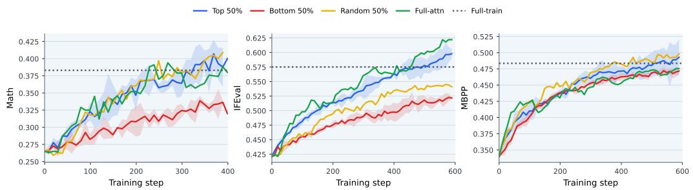  
Figure 7: Sparse RL training accuracy curves of QwEN3-1.7B. Methods include top 50%, bottom 50%, and random 50% attention-head tuning, full-attention tuning, and full tuning. Full tuning is shown as a final-score horizontal line.

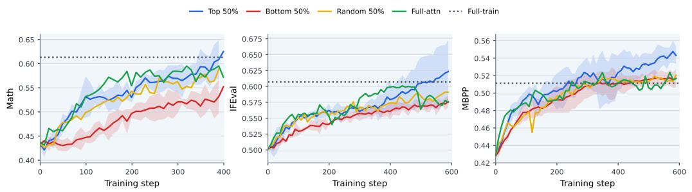  
Figure 8: Sparse RL training accuracy curves of QwEN3-4B. Methods include top 50%, bottom 50%, and random 50% attention-head tuning, full-attention tuning, and full tuning. Full tuning is shown as a final-score horizontal line.

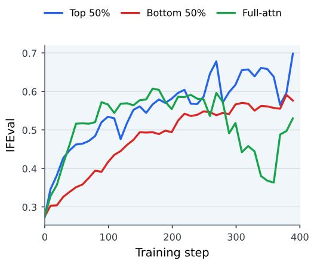  
Figure 9: Sparse RL training accuracy curves of MisTRAL-7B. Methods include top 50% and bottom 50% attention-head tuning, and full-attention tuning.

## B.2 SUPPLEMENTAL NUMERICAL RESULTS

Table 4: Continual RL accuracy (%) of QWEN3-1.7B (Math → Coding). The model is first trained on Math task and then on Coding task. Parenthesized arrows are performance changes from the previous stage. The highest performance across all methods is highlighted in pink. The performance before training on the corresponding task is highlighted in gray.
<table><tr><td>Method</td><td>Train stage</td><td>Eval split</td><td>Math metric</td><td>Coding metric</td></tr><tr><td>Top 50% → bottom 50%</td><td>I</td><td>In-dist test</td><td>37.5</td><td>56.6</td></tr><tr><td rowspan="5">Full-attn continual</td><td>II</td><td>Out-dist test</td><td>75.6</td><td>37.0</td></tr><tr><td></td><td>In-dist test</td><td>35.8 (↓ 1.7)</td><td>56.1</td></tr><tr><td></td><td>Out-dist test</td><td>75.2 (↓ 0.4)</td><td>37.7</td></tr><tr><td>I</td><td>In-dist test</td><td>33.1</td><td>54.8</td></tr><tr><td></td><td>Out-dist test</td><td>74.2</td><td>35.2</td></tr><tr><td rowspan="5">Full continual</td><td>II</td><td>In-dist test Out-dist test</td><td>30.0 (↓ 3.1)</td><td>60.1</td></tr><tr><td>I</td><td></td><td>73.0 (↓ 1.2)</td><td>36.9</td></tr><tr><td></td><td>In-dist test</td><td>35.3</td><td>55.0</td></tr><tr><td>II</td><td>Out-dist test</td><td>73.6</td><td>35.0</td></tr><tr><td></td><td>In-dist test Out-dist test</td><td>34.5 (↓ 0.8) 73.8 (↑ 0.2)</td><td>58.5 33.6</td></tr></table>

Table 5: Continual RL accuracy (%) of QwEN3-1.7B (IF → Math). The model is first trained on IF task and then on Math task. Parenthesized arrows are performance changes from the previous stage. The highest performance across all methods is highlighted in pink. The performance before training on the corresponding task is highlighted in gray.
<table><tr><td>Method</td><td>Train stage</td><td>Eval split</td><td>IF metric</td><td>Math metric</td></tr><tr><td>Top 50% → bottom 50%</td><td>I</td><td>In-dist test</td><td>58.0</td><td>24.6</td></tr><tr><td rowspan="4">Round robin 50%+50%</td><td>II</td><td>Out-dist test In-dist test</td><td>20.3 57.7 (↓ 0.3)</td><td>70.6 30.5</td></tr><tr><td></td><td>Out-dist test</td><td>20.7 (↑ 0.3)</td><td>73.8</td></tr><tr><td>I</td><td>In-dist test</td><td>52.5</td><td>27.2</td></tr><tr><td></td><td>Out-dist test</td><td>19.0</td><td>70.0</td></tr><tr><td rowspan="4">Full-attn continual</td><td>II</td><td>In-dist test</td><td>52.2 (↓ 0.3)</td><td>33.9</td></tr><tr><td></td><td>Out-dist test</td><td>18.7 (↓ 0.3)</td><td>74.0</td></tr><tr><td>I</td><td>In-dist test</td><td>59.4</td><td>24.0</td></tr><tr><td></td><td>Out-dist test</td><td>20.0</td><td>65.0</td></tr><tr><td rowspan="4">Full continual</td><td>II</td><td>In-dist test</td><td>59.3 (↓ 0.1)</td><td>35.7</td></tr><tr><td>I</td><td>Out-dist test</td><td>19.3 (↓ 0.7)</td><td>78.2</td></tr><tr><td></td><td>In-dist test</td><td>54.6</td><td>25.7</td></tr><tr><td></td><td>Out-dist test</td><td>19.7</td><td>65.2</td></tr><tr><td></td><td>II</td><td>In-dist test Out-dist test</td><td>54.4 (↓ 0.2) 21.7 (↑ 2.0)</td><td>36.1 76.8</td></tr></table>

Table 6: Continual RL accuracy (%) of QWEN3-4B (Coding → IF). The model is first trained on Coding task and then on IF task. Parenthesized arrows are performance changes from the previous stage. The highest performance across all methods is highlighted in pink. The performance before training on the corresponding task is highlighted in gray.
<table><tr><td>Method</td><td>Train stage</td><td>Eval split</td><td>Coding metric</td><td>IF metric</td></tr><tr><td>Top 50% → bottom 50%</td><td>I</td><td>In-dist test Out-dist test</td><td>69.0 51.4</td><td>49.9 24.3</td></tr><tr><td rowspan="3">Round robin 50%+50%</td><td>II</td><td>In-dist test</td><td>68.3 (↓ 0.7)</td><td>53.1</td></tr><tr><td></td><td>Out-dist test</td><td>52.6 (↑ 1.2)</td><td>23.0</td></tr><tr><td>I</td><td>In-dist test</td><td>68.0</td><td>49.8</td></tr><tr><td rowspan="4">Full-attn continual</td><td>II</td><td>Out-dist test In-dist test</td><td>42.9</td><td>25.7</td></tr><tr><td></td><td>Out-dist test</td><td>64.3 (↓ 3.7) 34.6 (↓ 8.3)</td><td>55.5</td></tr><tr><td rowspan="2">I</td><td></td><td></td><td>25.0</td></tr><tr><td>In-dist test Out-dist test</td><td>65.1</td><td>51.8</td></tr><tr><td rowspan="5">Full continual</td><td>II</td><td>In-dist test</td><td>47.9 54.8 (↓ 10.3)</td><td>22.0 62.2</td></tr><tr><td></td><td>Out-dist test</td><td>34.1 (↓ 13.8)</td><td>22.3</td></tr><tr><td>I</td><td>In-dist test</td><td>66.4</td><td>52.1</td></tr><tr><td></td><td>Out-dist test</td><td>43.6</td><td>22.7</td></tr><tr><td>II</td><td>In-dist test Out-dist test</td><td>65.9 (↓ 0.5) 41.7 (↓ 1.9)</td><td>56.0 25.0</td></tr></table>

Table 7: Continual RL accuracy (%) of QWEN3-4B (Math → IF). The model is first trained on Math task and then on IF task. Parenthesized arrows are performance changes from the previous stage. The highest performance across all methods is highlighted in pink. The performance before training on the corresponding task is highlighted in gray.
<table><tr><td>Method</td><td>Train stage</td><td>Eval split</td><td>Math metric</td><td>IF metric</td></tr><tr><td>Top 50% → bottom 50%</td><td>I</td><td>In-dist test Out-dist test</td><td>59.3 88.4</td><td>49.6 22.7</td></tr><tr><td rowspan="4">Round robin 50%+50%</td><td>II</td><td>In-dist test</td><td>60.0 (↑ 0.7)</td><td>53.6</td></tr><tr><td></td><td>Out-dist test</td><td>87.2 (↓ 1.2)</td><td>26.0</td></tr><tr><td>I</td><td>In-dist test</td><td>53.2</td><td>50.3</td></tr><tr><td></td><td>Out-dist test</td><td>86.0</td><td>23.3</td></tr><tr><td rowspan="4">Full-attn continual</td><td>II</td><td>In-dist test</td><td>53.2 (↓ 0.0)</td><td>56.4</td></tr><tr><td>I</td><td>Out-dist test</td><td>85.6 (↓ 0.4)</td><td>25.3</td></tr><tr><td></td><td>In-dist test</td><td>55.3</td><td>48.9</td></tr><tr><td>II</td><td>Out-dist test</td><td>86.0</td><td>21.3</td></tr><tr><td rowspan="4">Full continual</td><td></td><td>In-dist test Out-dist test</td><td>51.2 (↓ 4.1) 84.2 (↓ 1.8)</td><td>58.8 26.0</td></tr><tr><td>I</td><td>In-dist test</td><td>58.2</td><td>49.8</td></tr><tr><td rowspan="2">II</td><td>Out-dist test</td><td>88.2</td><td>24.0</td></tr><tr><td>In-dist test</td><td></td><td></td></tr><tr><td></td><td></td><td>Out-dist test</td><td>57.2 (↓ 1.0) 86.8 (↓ 1.4)</td><td>59.0 24.3</td></tr></table>

Table 8: Continual RL accuracy (%) of QwEN3-1.7B (Math → Coding → IF). The model is first trained on Math task, then on Coding task, and finally on IF task. Parenthesized arrows are performance changes from the previous stage. The performance before training on the corresponding task is highlighted in gray.
<table><tr><td>Train stage</td><td>Eval split</td><td>Math metric</td><td>Coding metric</td><td>IF metric</td></tr><tr><td>I</td><td>In-dist test</td><td>34.5</td><td>55.6</td><td></td></tr><tr><td rowspan="3">II</td><td>Out-dist test</td><td>76.2</td><td>34.9</td><td></td></tr><tr><td>In-dist test</td><td>32.4 (↓ 2.1)</td><td>59.3</td><td>41.7</td></tr><tr><td>Out-dist test</td><td>75.0 (↓ 1.2)</td><td>35.2</td><td>14.0</td></tr><tr><td rowspan="2">III</td><td>In-dist test</td><td>33.6 (↑ 1.2)</td><td>58.7 (↓ 0.6)</td><td>47.3</td></tr><tr><td>Out-dist test</td><td>74.8 (↓ 0.2)</td><td>34.0 (↓ 1.2)</td><td>17.7</td></tr></table>

Table 9: Continual RL accuracy (%) of QWEN3-4B (Math → IF → Coding). The model is first trained on Math task, then on IF task, and finally on Coding task. Parenthesized arrows are performance changes from the previous stage. The performance before training on the corresponding task is highlighted in gray.
<table><tr><td>Train stage</td><td>Eval split</td><td>Math metric</td><td>IF metric</td><td>Coding metric</td></tr><tr><td rowspan="2">I</td><td>In-dist test</td><td>55.7</td><td>50.2</td><td></td></tr><tr><td>Out-dist test</td><td>86.8</td><td>21.3</td><td></td></tr><tr><td rowspan="2">II</td><td>In-dist test</td><td>53.6 (↓ 2.1)</td><td>57.7</td><td>66.4</td></tr><tr><td>Out-dist test</td><td>83.0 (↓ 3.8)</td><td>24.0</td><td>43.5</td></tr><tr><td rowspan="2">III</td><td>In-dist test</td><td>53.9 (↑ 0.3)</td><td>56.7 (↓ 1.0)</td><td>67.2</td></tr><tr><td>Out-dist test</td><td>85.0 (↑ 2.0)</td><td>23.3 (↓ 0.7)</td><td>49.2</td></tr></table>

Table 10: Trainable parameters and FP32-equivalent gradient memory (4 bytes per parameter).
<table><tr><td>Model</td><td>50% Attn</td><td>Full Attn</td><td>Full</td></tr><tr><td>QWEN3-1.7B</td><td>0.176B / 0.656 GiB</td><td>0.352B / 1.312 GiB</td><td>1.721B / 6.410 GiB</td></tr><tr><td>QWEN3-4B</td><td>0.472B / 1.758 GiB</td><td>0.944B / 3.516 GiB</td><td>4.022B / 14.985 GiB</td></tr><tr><td>MISTRAL-7B-INSTRUCT-V0.3</td><td>0.671B / 2.500 GiB</td><td>1.342B / 5.000 GiB</td><td>7.248B / 27.001 GiB</td></tr></table>

Table 11: Spearman distances (d := 1 — Spearman correlation) between head rankings, where lower values indicate more similar rankings, identical rankings have distance 0, and two independent uniformly random rankings have expected distance 1. For Math and IF, within-task distances are averaged over the three pairwise comparisons among disjoint 1k-subsets of DAPO-Math-17k and RLVR-IFEva1. For Coding, the within-task distance is computed between two disjoint 487- subsets of MBPP. Cross-task distances are computed using the training sets.
<table><tr><td></td><td colspan="3">Within-task</td><td colspan="3">Cross-task</td></tr><tr><td>Model</td><td>Math</td><td>IF</td><td>Coding</td><td>Math &amp; IF</td><td>Math &amp; Coding</td><td>IF &amp; Coding</td></tr><tr><td>QWEN3-1.7B</td><td>0.025</td><td>0.026</td><td>0.051</td><td>0.044</td><td>0.084</td><td>0.081</td></tr><tr><td>QWEN3-4B</td><td>0.067</td><td>0.040</td><td>0.047</td><td>0.076</td><td>0.121</td><td>0.104</td></tr></table>

Table 12: Head-reset experiments after continual RL. After completing stage II, we reset the heads updated during stage I to their base-model values. We report the resulting test accuracy (%) changes. Stage-II performance that does not decrease after the reset is highlighted in orange. The results suggest that the adaptations learned on the disjoint head sets are functionally localized.
<table><tr><td rowspan="2" colspan="3">Model Task sequence</td><td colspan="2">Stage I task</td><td colspan="2">Stage II task</td></tr><tr><td>In-dist</td><td>Out-dist</td><td>In-dist</td><td>Out-dist</td></tr><tr><td>QWEN3-1.7B</td><td>Math → Coding</td><td>Partition</td><td>-10.7</td><td>-6.0</td><td>+1.3</td><td>-4.0</td></tr><tr><td>QWEN3-1.7B</td><td>IF → Math</td><td>Partition</td><td>-16.4</td><td>-4.3</td><td>+1.1</td><td>+1.8</td></tr><tr><td rowspan="2">QWEN3-4B</td><td rowspan="2">Coding → IF</td><td>Round robin</td><td>-11.6</td><td>-1.67</td><td>-3.3</td><td>-0.4</td></tr><tr><td>Partition</td><td>-4.0</td><td>-6.4</td><td>+0.4</td><td>+0.0</td></tr><tr><td rowspan="2">QWEN3-4B</td><td rowspan="2">Math → IF</td><td>Round robin</td><td>-0.8</td><td>+6.0</td><td>+0.6</td><td>+2.3</td></tr><tr><td>Partition</td><td>-17.4</td><td>-7.2</td><td>+0.8</td><td>-2.3</td></tr><tr><td rowspan="2"></td><td rowspan="2"></td><td>Round robin</td><td></td><td></td><td></td><td></td></tr><tr><td></td><td>-9.9</td><td>-5.8</td><td>+0.8</td><td>+0.3</td></tr></table>

## B.3 LAYER DISTRIBUTIONS OF TOP-RANKED HEADS

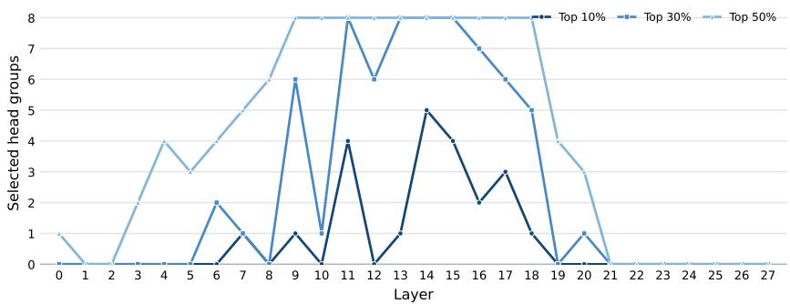  
Figure 10: Layer-wise distribution of selected attention-head groups for QwEN3-1.7B, computed on the training set of Math

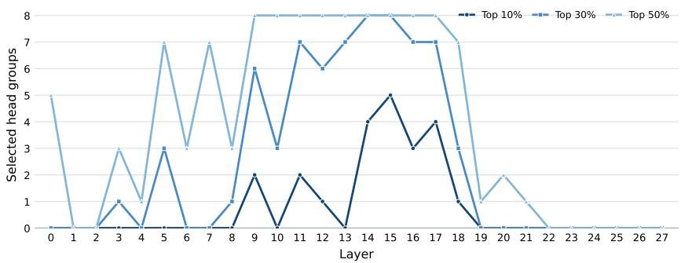  
Figure 11: Layer-wise distribution of selected attention-head groups for QwEN3-1.7B, computed on the training set of Basic Coding.

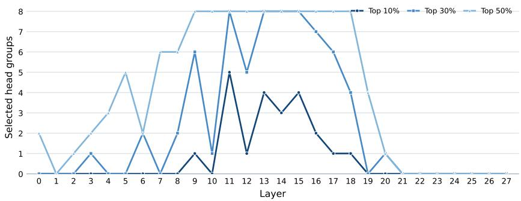  
Figure 12: Layer-wise distribution of selected attention-head groups for QwEN3-1.7B, computed on the training set of Instruction-following.

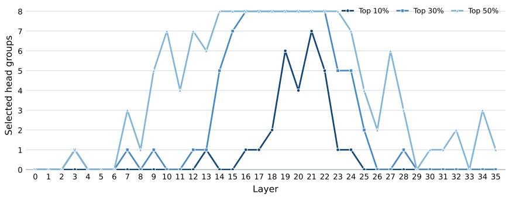  
Figure 13: Layer-wise distribution of selected attention-head groups for QwEN3-4B, computed on the training set of Math.

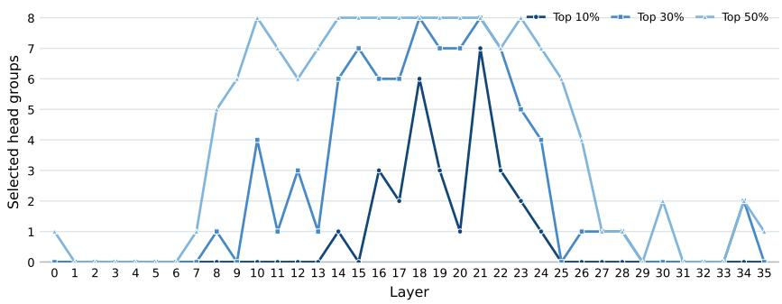  
Figure 14: Layer-wise distribution of selected attention-head groups for QwEN3-4B, computed on the training set of Basic Coding.

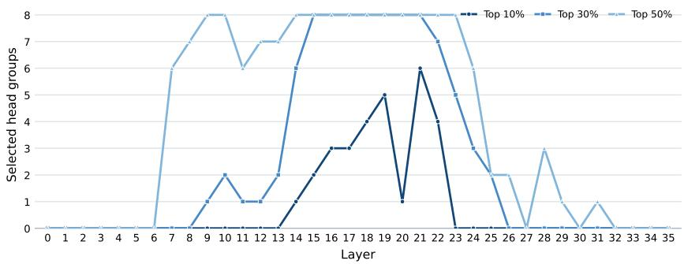  
Figure 15: Layer-wise distribution of selected attention-head groups for QwEN3-4B, computed on the training set of Instruction-following.

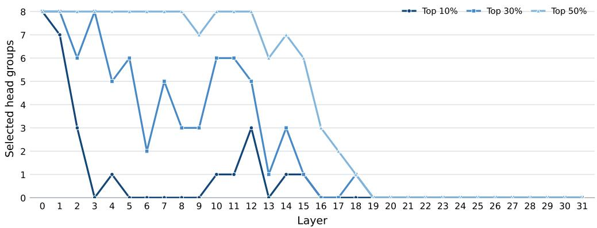  
Figure 16: Layer-wise distribution of selected attention-head groups for MisTRAL-7B-INSTRUCTION-v0.3, computed on the training set of Instruction-following.

## B.4 HYPERPARAMETER TUNING RESULTS

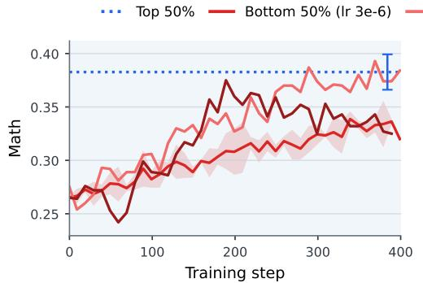  
(a) QWEN3-1.7B, Math

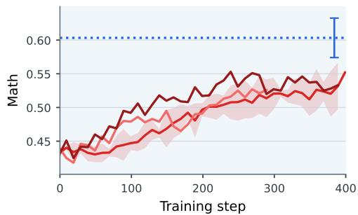  
(b) QWEN3-4B, Math

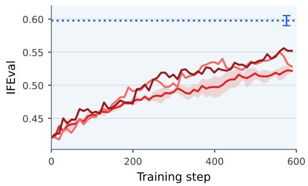  
(c) QWEN3-1.7B, IFEval

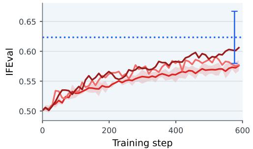  
(d) QWEN3-4B, IFEval

Figure 17: Sparse RL training accuracy curves of QwEN3 series for Math and IF tasks. The learning rate for top-50% attention-head tuning is fixed at $3 \times 1 0 ^ { - 6 }$ , while bottom-50% attention-head tuning is evaluated with learning rates of $3 \times \mathrm { { 1 0 ^ { - 6 } , 5 \times 1 0 ^ { - 6 } } }$ , and $7 \times 1 0 ^ { - 6 }$ . Top-50% attention-head tuning is shown as a horizontal line with an error bar indicating mean±std over three random rollout-seeds.

## C IMPLEMENTATION DETAILS

Codebase. Our codebase is mainly based on miles (Miles Team, 2026) (https : //github. com/radixark/miles). It is worth noting that our current sparse head tuning implementation is not yet fully optimized, though realizing its full efficiency benefits should be straightforward with modern training infrastructure. Our code is released at https: //github.com/srzer/ head–sparse-r1. The code was implemented with the assistance of Codex and Claude Code.

Datasets and benchmarks. For math, we use a 1k subset of DAPO-Math-17k (https: //huggingface.co/datasets/BytedTsinghua-SIA/DAPO-Math-17k)for training, a disjoint 1k subset for in-distribution test, and MATH-500 (https://hugqingface. co/datasets/HuggingFaceH4/MATH-500) for out-of-distribution test. For instructionfollowing, we similarly use a 1k subset of RLVR-IFEval (https://huggingface.co/ datasets/allenai/RLVR-IFeval) for training, a disjoint 1k subset for in-distribution test,andIFBench(https://huggingface.co/datasets/allenai/IFBench test) for out-of-distribution test. For basic coding, we use MBPP (https://huggingface. co/datasets/google-research-datasets/mbpp) for training, MBPP+ (https: //huggingface.co/datasets/evalplus/mbppplus) for in-distribution test, and APPS-intro-test (https://huggingface.co/datasets/codeparrot/apps) for out-of-distribution test. Notably, MBPP+ uses the same problem set as MBPP but with strengthened test cases, thus measuring performance under more rigorous evaluation.

Models. Limited by computation resources, our base models are QwEN3-1.7B (Qwen Team, 2025) (https://huggingface.co/Qwen/Qwen3-1.7B), QwEN3-4B (Qwen Team, 2025) (https://huggingface.co/Qwen/Qwen3-4B), and MISTRAL-7B-INSTRUCTv0.3(https://huggingface.co/mistralai/Mistral-7B-Instruct-v0.3).

Training hyper-parameters. Each rollout contains 16 prompts and 4 responses per prompt, with a global batch size of 64. We use temperature 1.0 and a maximum generation length of 3,072 tokens (2,048 for coding). Adam is used with learning rate 3 × 10−6 (1 × 10−6 for full training, 2 × 10−6 for MisTRAL-7B), weight decay 0.1, and (β1, β2) = (0.9, 0.98). The policy-ratio clipping range is 0.2–0.28, with zero KL and entropy coefficients. Training runs for 400–600 rollout steps.

Evaluation hyper-parameters. We use greedy-decoding for evaluation. For each evaluation example, we generate a single response with a maximum length of 4,096 tokens, temperature 1.0, and top-k equal to 1. We report pass @1 accuracy using the task-specific verifier for each task.

Computation resources. Experiments are run on NVIDIA A100 and RTX A6000 GPUs, using four GPUs per job (eight for MisTRAL-7B), with a typical runtime of approximately one day.